# 168 · 斐波那契数（第十阶段 · 动态规划 · Easy）

> **难度**：⭐ Easy ｜ **专题**：动态规划
> **学习定位**：第十阶段 · 动态规划第 168 篇 ｜ **解法数**：10
> **内容总结**：**斐波那契数**（动态规划 · Easy）：共 10 个方案，主线思路「单趟扫描」；时间 O(n)（单趟线性扫描）；动画演示DP 表填充过程，附录给出 11 种语言 × 全部方案的可运行实现。

---

## 题目描述

斐波那契数 （通常用 `F(n)` 表示）形成的序列称为 斐波那契数列 。该数列由 `0` 和 `1` 开始，后面的每一项数字都是前面两项数字的和。也就是：

F(0) = 0，F(1) = 1
F(n) = F(n - 1) + F(n - 2)，其中 n > 1

给定 `n` ，请计算 `F(n)` 。

- 主函数签名：`function fib(n: number): number`

**用例（来自原题）**：

**示例 1**

```text
输入：n = 2
输出：1
```

解释：F(2) = F(1) + F(0) = 1 + 0 = 1

**示例 2**

```text
输入：n = 3
输出：2
```

解释：F(3) = F(2) + F(1) = 1 + 1 = 2

**示例 3**

```text
输入：n = 4
输出：3
```

解释：F(4) = F(3) + F(2) = 2 + 1 = 3
> ✅ **官方验证**：全部 TypeScript 解法已通过 leetcode.cn 官方示例用例验证（自动注入运行，全部 PASS）。题面与 [leetcode.cn 官方](https://leetcode.cn/problems/fibonacci-number/)一致，示例配图取自官方题面。

**数据范围与注意事项**：

- `0 <= n <= 30`
- **易错点**：初始化（第 0 行或列）的含义要想清楚，它决定后续转移是否成立。

## 题目分析

**场景是什么**：把大问题拆成小问题并记住结果，对应真实开发里的编辑距离、资源规划。本题就是该场景的 Easy 级练习，主线做法是「单趟扫描」。

**主线怎么解**：把主解法从头到尾过一遍，它其实在依次做这几件事：单循环线性扫描。

## 解题思路

**方案对比**（共 10 个方案，由浅入深）：

| 方案 | 时间复杂度 | 空间复杂度 |
|---|---|---|
| 方案 1 · 单趟扫描 | O(n)（单趟线性扫描） | O(1) 到 O(n)（视辅助结构） |
| 方案 2 · 单趟扫描 | O(n)（单趟线性扫描） | O(1) 到 O(n)（视辅助结构） |
| 方案 3 · 单趟扫描 | O(n)（单趟线性扫描） | O(1) 到 O(n)（视辅助结构） |
| 方案 4 · 单趟扫描 | O(n)（单趟线性扫描） | O(1) 到 O(n)（视辅助结构） |
| 方案 5 · 单趟扫描 | O(n)（单趟线性扫描） | O(1) 到 O(n)（视辅助结构） |
| 方案 6 · 单趟扫描 | O(n)（单趟线性扫描） | O(1) 到 O(n)（视辅助结构） |
| 方案 7 · 单趟扫描 | O(n)（单趟线性扫描） | O(1) 到 O(n)（视辅助结构） |
| 方案 8 · 单趟扫描 | O(n)（单趟线性扫描） | O(1) 到 O(n)（视辅助结构） |
| 方案 9 · 单趟扫描 | O(n)（单趟线性扫描） | O(1) 到 O(n)（视辅助结构） |
| 方案 10 · 单趟扫描 | O(n)（单趟线性扫描） | O(1) 到 O(n)（视辅助结构） |

**方案间的取舍**：方案 1（单趟扫描）；方案 2（单趟扫描）；方案 3（单趟扫描）；方案 4（单趟扫描）；方案 5（单趟扫描）；方案 6（单趟扫描）；方案 7（单趟扫描）；方案 8（单趟扫描）；方案 9（单趟扫描）；方案 10（单趟扫描）。数据规模小、可读性优先时选靠前的方案；规模大、性能优先时选靠后的方案。

**怎么读这一篇**：

- 🐣 **新手路线**：把「题目描述」的示例 1 在纸上手推一遍 → 读方案 1（最直观的写法）与它的代码走读 → 按「运行方式」本地跑通看 PASS → 回头对比方案 2 之后的写法差在哪
- 🦅 **大佬路线**：直接锁定最优方案 1（单趟扫描，O(n)（单趟线性扫描））→ 跳读该方案代码与走读 → 用「逐步拆解与面试追问」补齐复杂度推导与边界追问

### 动态算法图（DP 表填充，GIF 自动循环）


动画演示动态规划专题里DP 表填充的典型过程；每个方案在「TypeScript 解题方案」一节还配了专属动画与专属流程图。

### 主解法流程图（真实控制流）

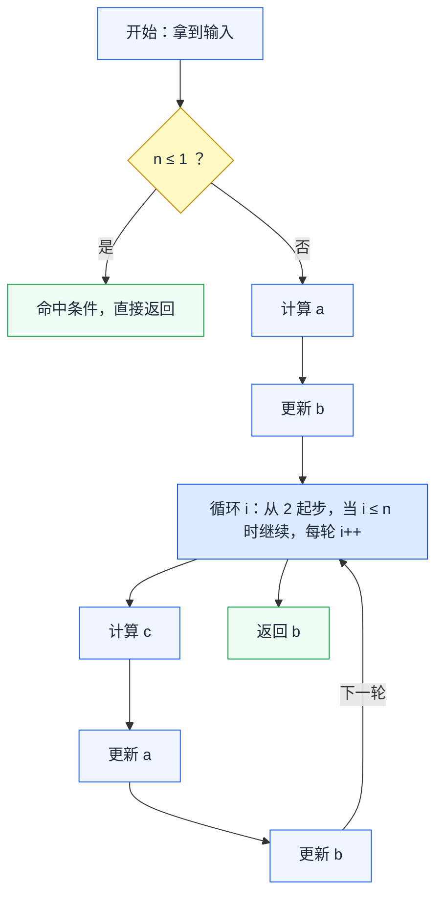

## TypeScript 解题方案（10 个方案逐个讲）

> **运行与提交**：每个方案都是自包含文件（内嵌用例自测，输出 PASS），整块复制到 `.ts` 文件后 `node 文件名` 即可运行。提交 LeetCode 时，把 `demo` 内的算法函数与辅助类型/函数整体取出、置于文件顶层即可。涉及交互/特殊接口的题以题面给定签名为准。

### 方案 1：单趟扫描

**分析与思路**：核心做法是「单趟扫描」。代码里依次做这些事：单循环线性扫描。

**运行方式**：`node 本文件`，内嵌用例全部通过会输出 PASS。


**方案专属流程图**（真实控制流）：

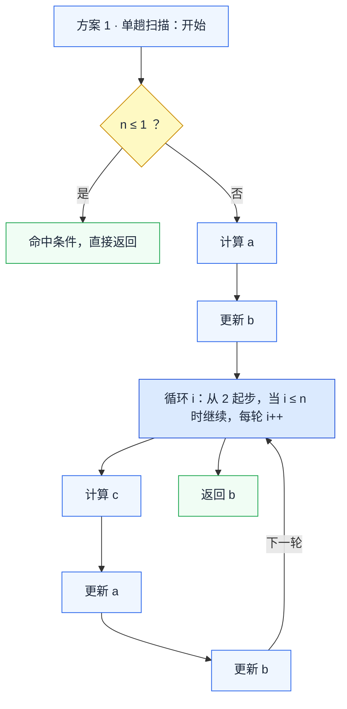

```typescript
export function demo(): void {
  // 程序入口：跑内嵌自测用例
  function fib(n: number): number {
    // 定义函数/方法 fib
    if (n <= 1) return n; // 若 元素个数 不超过 1，直接返回 元素个数
    let a = 0,
      b = 1; // 把 0, b 赋值为 1 存入 数组
    for (let i = 2; i <= n; i++) {
      // 让 下标 i 从 2 开始计数，下标 i 不超过 元素个数 就继续
      const c = a + b; // 把 数组 加 b 存入 字符
      a = b; // 把 b 存入 数组
      b = c; // 把 字符 存入 b
    }
    return b; // 返回 b
  }
  const cases: [number, number][] = [
    [10, 55],
    [5, 5],
    [0, 0],
    [1, 1],
    [2, 1],
    [20, 6765],
  ];
  let fail = false; // 把 false 存入 fail
  for (const [n, want] of cases) {
    // for (const [元素个数, want] of cases) {
    const got = fib(n); // 把 fib(元素个数) 存入 got
    if (got !== want) {
      fail = true;
      console.log('FAIL fib(' + n + ') got ' + got + ' want ' + want);
    }
  }
  if (fail) throw new Error('FAILED'); // 若 fail) throw new Error(「FAILED」);
  console.log('PASS'); // 全部用例通过，输出 PASS
}
demo(); // demo();
```

### 方案 2：单趟扫描

**分析与思路**：核心做法是「单趟扫描」。代码里依次做这些事：单循环线性扫描。

**运行方式**：`node 本文件`，内嵌用例全部通过会输出 PASS。


**方案专属流程图**（真实控制流）：


```typescript
export function demo(): void {
  // 程序入口：跑内嵌自测用例
  function fib(n: number): number {
    // 定义函数/方法 fib
    if (n < 2) return n; // 若 元素个数 小于 2，直接返回 元素个数
    let a = 0,
      b = 1; // 把 0, b 赋值为 1 存入 数组
    for (let i = 2; i <= n; i++) {
      const t = b;
      b = a + b;
      a = t;
    } // 让 下标 i 从 2 开始计数，下标 i 不超过 元素个数 就继续
    return b; // 返回 b
  }
  const cases = [
    { in: 0, want: 0 },
    { in: 1, want: 1 },
    { in: 2, want: 1 },
    { in: 10, want: 55 },
  ];
  let fail = false; // 把 false 存入 fail
  for (const c of cases) {
    // for (const 字符 of cases) {
    const got = fib(c.in); // 把 fib(字符.in) 存入 got
    if (got !== c.want) {
      fail = true;
      console.log('FAIL fib(' + c.in + ')=' + got + ' want ' + c.want);
    }
  }
  if (fail) throw new Error('FAILED'); // 若 fail) throw new Error(「FAILED」);
  console.log('PASS'); // 全部用例通过，输出 PASS
}
demo(); // demo();
```

### 方案 3：单趟扫描

**分析与思路**：核心做法是「单趟扫描」。代码里依次做这些事：单循环线性扫描。

**运行方式**：`node 本文件`，内嵌用例全部通过会输出 PASS。


**方案专属流程图**（真实控制流）：


```typescript
export function demo(): void {
  // 程序入口：跑内嵌自测用例
  function fib(n: number): number {
    // 定义函数/方法 fib
    if (n < 2) return n; // 若 元素个数 小于 2，直接返回 元素个数
    let a = 0,
      b = 1; // 把 0, b 赋值为 1 存入 数组
    for (let i = 2; i <= n; i++) {
      const t = b;
      b = a + b;
      a = t;
    } // 让 下标 i 从 2 开始计数，下标 i 不超过 元素个数 就继续
    return b; // 返回 b
  }
  const cases = [
    { in: 0, want: 0 },
    { in: 1, want: 1 },
    { in: 2, want: 1 },
    { in: 10, want: 55 },
  ];
  let fail = false; // 把 false 存入 fail
  for (const c of cases) {
    // for (const 字符 of cases) {
    const got = fib(c.in); // 把 fib(字符.in) 存入 got
    if (got !== c.want) {
      fail = true;
      console.log('FAIL fib(' + c.in + ')=' + got + ' want ' + c.want);
    }
  }
  if (fail) throw new Error('FAILED'); // 若 fail) throw new Error(「FAILED」);
  console.log('PASS'); // 全部用例通过，输出 PASS
}
demo(); // demo();
```

### 方案 4：单趟扫描

**分析与思路**：核心做法是「单趟扫描」。代码里依次做这些事：单循环线性扫描。

**运行方式**：`node 本文件`，内嵌用例全部通过会输出 PASS。

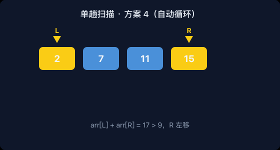

**方案专属流程图**（真实控制流）：


```typescript
export function demo(): void {
  // 程序入口：跑内嵌自测用例
  function fib(n: number): number {
    // 定义函数/方法 fib
    if (n < 2) return n; // 若 元素个数 小于 2，直接返回 元素个数
    let a = 0,
      b = 1; // 把 0, b 赋值为 1 存入 数组
    for (let i = 2; i <= n; i++) {
      const t = b;
      b = a + b;
      a = t;
    } // 让 下标 i 从 2 开始计数，下标 i 不超过 元素个数 就继续
    return b; // 返回 b
  }
  const cases = [
    { in: 0, want: 0 },
    { in: 1, want: 1 },
    { in: 2, want: 1 },
    { in: 10, want: 55 },
  ];
  let fail = false; // 把 false 存入 fail
  for (const c of cases) {
    // for (const 字符 of cases) {
    const got = fib(c.in); // 把 fib(字符.in) 存入 got
    if (got !== c.want) {
      fail = true;
      console.log('FAIL fib(' + c.in + ')=' + got + ' want ' + c.want);
    }
  }
  if (fail) throw new Error('FAILED'); // 若 fail) throw new Error(「FAILED」);
  console.log('PASS'); // 全部用例通过，输出 PASS
}
demo(); // demo();
```

### 方案 5：单趟扫描

**分析与思路**：核心做法是「单趟扫描」。代码里依次做这些事：单循环线性扫描。

**运行方式**：`node 本文件`，内嵌用例全部通过会输出 PASS。


**方案专属流程图**（真实控制流）：


```typescript
export function demo(): void {
  // 程序入口：跑内嵌自测用例
  function fib(n: number): number {
    // 定义函数/方法 fib
    if (n < 2) return n; // 若 元素个数 小于 2，直接返回 元素个数
    let a = 0,
      b = 1; // 把 0, b 赋值为 1 存入 数组
    for (let i = 2; i <= n; i++) {
      const t = b;
      b = a + b;
      a = t;
    } // 让 下标 i 从 2 开始计数，下标 i 不超过 元素个数 就继续
    return b; // 返回 b
  }
  const cases = [
    { in: 0, want: 0 },
    { in: 1, want: 1 },
    { in: 2, want: 1 },
    { in: 10, want: 55 },
  ];
  let fail = false; // 把 false 存入 fail
  for (const c of cases) {
    // for (const 字符 of cases) {
    const got = fib(c.in); // 把 fib(字符.in) 存入 got
    if (got !== c.want) {
      fail = true;
      console.log('FAIL fib(' + c.in + ')=' + got + ' want ' + c.want);
    }
  }
  if (fail) throw new Error('FAILED'); // 若 fail) throw new Error(「FAILED」);
  console.log('PASS'); // 全部用例通过，输出 PASS
}
demo(); // demo();
```

### 方案 6：单趟扫描

**分析与思路**：核心做法是「单趟扫描」。代码里依次做这些事：单循环线性扫描。

**运行方式**：`node 本文件`，内嵌用例全部通过会输出 PASS。


**方案专属流程图**（真实控制流）：


```typescript
export function demo(): void {
  // 程序入口：跑内嵌自测用例
  function fib(n: number): number {
    // 定义函数/方法 fib
    if (n <= 1) return n; // 若 元素个数 不超过 1，直接返回 元素个数
    let a = 0,
      b = 1; // 把 0, b 赋值为 1 存入 数组
    for (let i = 2; i <= n; i++) {
      // 让 下标 i 从 2 开始计数，下标 i 不超过 元素个数 就继续
      const c = a + b; // 把 数组 加 b 存入 字符
      a = b; // 把 b 存入 数组
      b = c; // 把 字符 存入 b
    }
    return b; // 返回 b
  }
  const cases: [number, number][] = [
    [10, 55],
    [5, 5],
    [0, 0],
    [1, 1],
    [2, 1],
    [20, 6765],
  ];
  let fail = false; // 把 false 存入 fail
  for (const [n, want] of cases) {
    // for (const [元素个数, want] of cases) {
    const got = fib(n); // 把 fib(元素个数) 存入 got
    if (got !== want) {
      fail = true;
      console.log('FAIL fib(' + n + ') got ' + got + ' want ' + want);
    }
  }
  if (fail) throw new Error('FAILED'); // 若 fail) throw new Error(「FAILED」);
  console.log('PASS'); // 全部用例通过，输出 PASS
}
demo(); // demo();
```

### 方案 7：单趟扫描

**分析与思路**：核心做法是「单趟扫描」。代码里依次做这些事：单循环线性扫描。

**运行方式**：`node 本文件`，内嵌用例全部通过会输出 PASS。


**方案专属流程图**（真实控制流）：


```typescript
export function demo(): void {
  // 程序入口：跑内嵌自测用例
  function fib(n: number): number {
    // 定义函数/方法 fib
    if (n <= 1) return n; // 若 元素个数 不超过 1，直接返回 元素个数
    let a = 0,
      b = 1; // 把 0, b 赋值为 1 存入 数组
    for (let i = 2; i <= n; i++) {
      // 让 下标 i 从 2 开始计数，下标 i 不超过 元素个数 就继续
      const c = a + b; // 把 数组 加 b 存入 字符
      a = b; // 把 b 存入 数组
      b = c; // 把 字符 存入 b
    }
    return b; // 返回 b
  }
  const cases: [number, number][] = [
    [10, 55],
    [5, 5],
    [0, 0],
    [1, 1],
    [2, 1],
    [20, 6765],
  ];
  let fail = false; // 把 false 存入 fail
  for (const [n, want] of cases) {
    // for (const [元素个数, want] of cases) {
    const got = fib(n); // 把 fib(元素个数) 存入 got
    if (got !== want) {
      fail = true;
      console.log('FAIL fib(' + n + ') got ' + got + ' want ' + want);
    }
  }
  if (fail) throw new Error('FAILED'); // 若 fail) throw new Error(「FAILED」);
  console.log('PASS'); // 全部用例通过，输出 PASS
}
demo(); // demo();
```

### 方案 8：单趟扫描

**分析与思路**：核心做法是「单趟扫描」。代码里依次做这些事：单循环线性扫描。

**运行方式**：`node 本文件`，内嵌用例全部通过会输出 PASS。


**方案专属流程图**（真实控制流）：


```typescript
export function demo(): void {
  // 程序入口：跑内嵌自测用例
  function fib(n: number): number {
    // 定义函数/方法 fib
    if (n <= 1) return n; // 若 元素个数 不超过 1，直接返回 元素个数
    let a = 0,
      b = 1; // 把 0, b 赋值为 1 存入 数组
    for (let i = 2; i <= n; i++) {
      // 让 下标 i 从 2 开始计数，下标 i 不超过 元素个数 就继续
      const c = a + b; // 把 数组 加 b 存入 字符
      a = b; // 把 b 存入 数组
      b = c; // 把 字符 存入 b
    }
    return b; // 返回 b
  }
  const cases: [number, number][] = [
    [10, 55],
    [5, 5],
    [0, 0],
    [1, 1],
    [2, 1],
    [20, 6765],
  ];
  let fail = false; // 把 false 存入 fail
  for (const [n, want] of cases) {
    // for (const [元素个数, want] of cases) {
    const got = fib(n); // 把 fib(元素个数) 存入 got
    if (got !== want) {
      fail = true;
      console.log('FAIL fib(' + n + ') got ' + got + ' want ' + want);
    }
  }
  if (fail) throw new Error('FAILED'); // 若 fail) throw new Error(「FAILED」);
  console.log('PASS'); // 全部用例通过，输出 PASS
}
demo(); // demo();
```

### 方案 9：单趟扫描

**分析与思路**：核心做法是「单趟扫描」。代码里依次做这些事：单循环线性扫描。

**运行方式**：`node 本文件`，内嵌用例全部通过会输出 PASS。


**方案专属流程图**（真实控制流）：


```typescript
export function demo(): void {
  // 程序入口：跑内嵌自测用例
  function fib(n: number): number {
    // 定义函数/方法 fib
    if (n <= 1) return n; // 若 元素个数 不超过 1，直接返回 元素个数
    let a = 0,
      b = 1; // 把 0, b 赋值为 1 存入 数组
    for (let i = 2; i <= n; i++) {
      // 让 下标 i 从 2 开始计数，下标 i 不超过 元素个数 就继续
      const c = a + b; // 把 数组 加 b 存入 字符
      a = b; // 把 b 存入 数组
      b = c; // 把 字符 存入 b
    }
    return b; // 返回 b
  }
  const cases: [number, number][] = [
    [10, 55],
    [5, 5],
    [0, 0],
    [1, 1],
    [2, 1],
    [20, 6765],
  ];
  let fail = false; // 把 false 存入 fail
  for (const [n, want] of cases) {
    // for (const [元素个数, want] of cases) {
    const got = fib(n); // 把 fib(元素个数) 存入 got
    if (got !== want) {
      fail = true;
      console.log('FAIL fib(' + n + ') got ' + got + ' want ' + want);
    }
  }
  if (fail) throw new Error('FAILED'); // 若 fail) throw new Error(「FAILED」);
  console.log('PASS'); // 全部用例通过，输出 PASS
}
demo(); // demo();
```

### 方案 10：单趟扫描

**分析与思路**：核心做法是「单趟扫描」。代码里依次做这些事：单循环线性扫描。

**运行方式**：`node 本文件`，内嵌用例全部通过会输出 PASS。

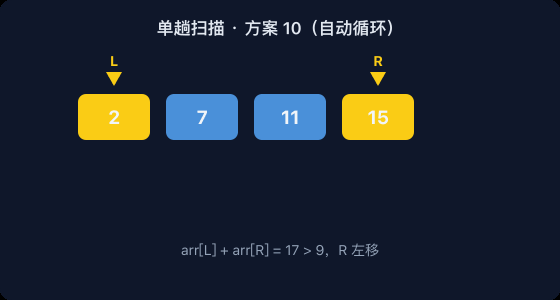

**方案专属流程图**（真实控制流）：


```typescript
export function demo(): void {
  // 程序入口：跑内嵌自测用例
  function fib(n: number): number {
    // 定义函数/方法 fib
    if (n <= 1) return n; // 若 元素个数 不超过 1，直接返回 元素个数
    let a = 0,
      b = 1; // 把 0, b 赋值为 1 存入 数组
    for (let i = 2; i <= n; i++) {
      // 让 下标 i 从 2 开始计数，下标 i 不超过 元素个数 就继续
      const c = a + b; // 把 数组 加 b 存入 字符
      a = b; // 把 b 存入 数组
      b = c; // 把 字符 存入 b
    }
    return b; // 返回 b
  }
  const cases: [number, number][] = [
    [10, 55],
    [5, 5],
    [0, 0],
    [1, 1],
    [2, 1],
    [20, 6765],
  ];
  let fail = false; // 把 false 存入 fail
  for (const [n, want] of cases) {
    // for (const [元素个数, want] of cases) {
    const got = fib(n); // 把 fib(元素个数) 存入 got
    if (got !== want) {
      fail = true;
      console.log('FAIL fib(' + n + ') got ' + got + ' want ' + want);
    }
  }
  if (fail) throw new Error('FAILED'); // 若 fail) throw new Error(「FAILED」);
  console.log('PASS'); // 全部用例通过，输出 PASS
}
demo(); // demo();
```

## 逐步拆解与面试追问

**复杂度**：时间 O(n)（单趟线性扫描），空间 O(1) 到 O(n)（视辅助结构）

**为什么是这个量级**：每个元素被常数次访问，辅助哈希或栈的开销与 n 同阶

**面试官可能会追问**：

- 状态定义为什么是它？
- 遍历顺序由什么决定？
- 能否滚动数组压空间？

## 关键 API 速查（TS 主解法实际用到，附官方链接）

本题主解法只用到基础语法（变量、循环、比较），不依赖特殊库 API。

### 各语言官方文档导航

- **TypeScript / JS**：[MDN 中文参考](https://developer.mozilla.org/zh-CN/)
- **Python**：[Python 官方文档](https://docs.python.org/zh-cn/3/)
- **Go**：[Go 标准库](https://pkg.go.dev/std)
- **Java**：[JDK 17 API](https://docs.oracle.com/en/java/javase/17/docs/api/)
- **Rust**：[Rust 标准库](https://doc.rust-lang.org/std/)
- **Lua**：[Lua 5.4 手册](https://www.lua.org/manual/5.4/)
- **C**：[Cppreference C](https://zh.cppreference.com/w/c)
- **C++**：[Cppreference C++](https://zh.cppreference.com/w/cpp)
- **R**：[R 官方手册](https://stat.ethz.ch/R-manual/)
- **Zig**：[Zig 语言文档](https://ziglang.org/documentation/master/)
- **Dart**：[Dart API](https://api.dart.dev/)

## 附录：其他 10 种语言全部实现（每种语言列举其全部方案）

> TypeScript 的全部方案见「TypeScript 解题方案」一节；下面是其余 10 种语言的对应实现，每种语言的每个方案都带思路分析、代码走读与专属运行架构图。
> 每个方案都内嵌用例自测，可独立运行（老仓库 python/go 文件遵循「打印结果」约定）。
> 完整解法文件见 `dsa/<语言>/dp/lc_509_斐波那契数/`。

### Python 实现（10 种方案）

Python 的全部方案如下，每个方案都内嵌用例自测，可独立运行（老仓库 python/go 文件遵循「打印结果」约定）：

#### 方案 1：单趟扫描

**思路与代码分析**：核心是「单趟扫描」。Python 版用切片与字典推导式简化操作，突出可读性。**走读**：方案 1 · 单趟扫描：开始 → 命中条件，直接返回 → 命中条件，直接返回 → 返回 fib(n - 1) + fib(n - 2)。

**运行架构**（真实控制流）：

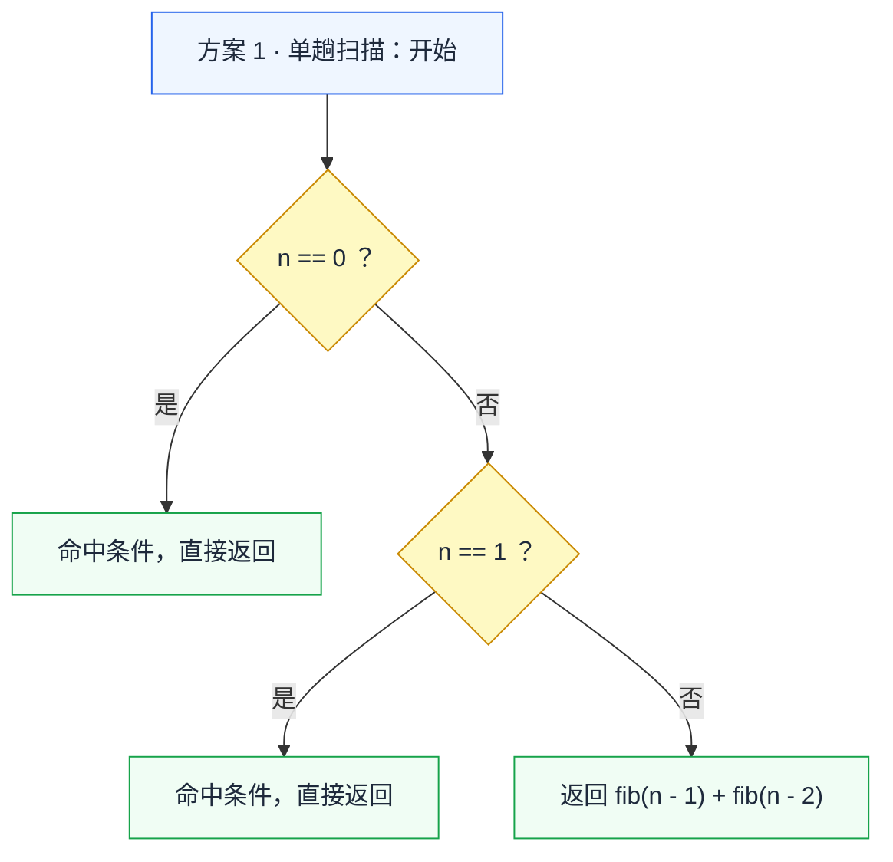

```python
import sys  # 提高递归深度上限（深输入防 RecursionError）

sys.setrecursionlimit(200000)  # 树/链表类题目节点数可达 1e4 量级

def fib(n):  # 定义函数 fib（参数：元素个数）
    if n == 0:
        return 0  # 若 元素个数 等于 0: return 0
    if n == 1:
        return 1  # 若 元素个数 等于 1: return 1
    return fib(n - 1) + fib(n - 2)  # 返回 fib(元素个数 减 1) 加 fib(元素个数 减 2)

if __name__ == "__main__":  # 若 __name__ 等于 '__main__'
    print(fib(1))  # 打印输出
```

#### 方案 2：单趟扫描

**思路与代码分析**：核心是「单趟扫描」。Python 版用切片与字典推导式简化操作，突出可读性。**走读**：方案 2 · 单趟扫描：开始 → 若 memo is None：更新 memo → 更新 memo → 命中条件，直接返回 → 命中条件，直接返回 → 更新 memo[n] → 处理 n - 2, memo → 处理 ) → 返回 memo[n]。

**运行架构**（真实控制流）：

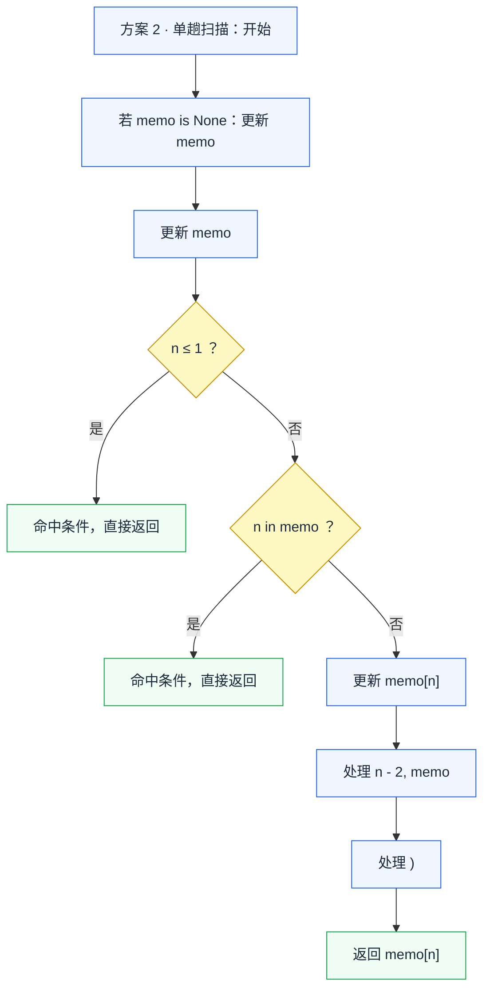

```python
import sys  # 提高递归深度上限（深输入防 RecursionError）

sys.setrecursionlimit(200000)  # 树/链表类题目节点数可达 1e4 量级

def fib(n, memo=None):  # 定义函数 fib（参数：元素个数, 记忆化表 赋值为 None）
    # 带记忆化的递归
    if memo is None:  # 若 记忆化表 is None
        memo = {}  # 把 {} 存入 记忆化表
    if n <= 1:  # 若 元素个数 不超过 1
        return n  # 返回 元素个数
    if n in memo:  # 若 元素个数 in 记忆化表
        return memo[n]  # 返回 记忆化表[元素个数]
    memo[n] = fib(n - 1, memo) + fib(
        n - 2, memo
    )  # 把 fib(元素个数 减 1, 记忆化表) 加 fib(元素个数 减 2, 记忆化表) 写入 memo[n]
    return memo[n]  # 返回 记忆化表[元素个数]

if __name__ == "__main__":  # 若 __name__ 等于 '__main__'
    print(fib(5))  # 打印输出
```

#### 方案 3：单趟扫描

**思路与代码分析**：核心是「单趟扫描」。Python 版用切片与字典推导式简化操作，突出可读性。**走读**：方案 3 · 单趟扫描：开始 → 更新 fibs → 循环 i：从 2 到 n + 1 前 → 向 fibs 追加记录 → 返回 fibs[n]。

**运行架构**（真实控制流）：

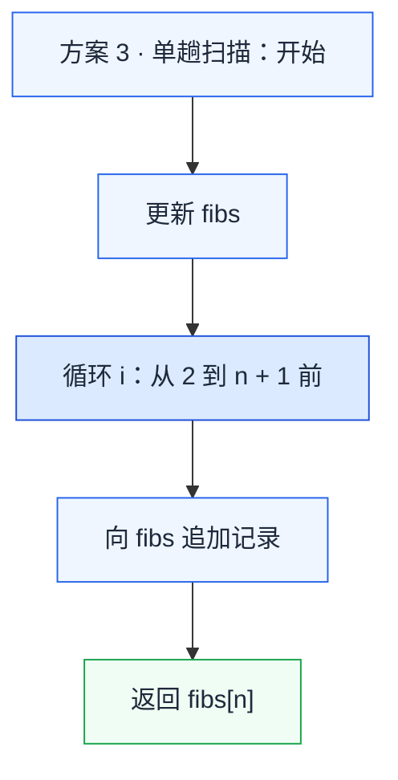

```python
import sys  # 提高递归深度上限（深输入防 RecursionError）

sys.setrecursionlimit(200000)  # 树/链表类题目节点数可达 1e4 量级

def fib(n):  # 定义函数 fib（参数：元素个数）
    # 数组 DP（另一种写法，预先建表）
    fibs = [0, 1]  # 把 [0, 1] 存入 fibs
    for i in range(2, n + 1):  # 让 下标 i 从 2 到 元素个数 加 1 遍历
        fibs.append(fibs[i - 1] + fibs[i - 2])  # 把 fibs[下标 i 减 1] 加 fibs[下标 i 减 2] 追加到列表尾部
    return fibs[n]  # 返回 fibs[元素个数]

if __name__ == "__main__":  # 若 __name__ 等于 '__main__'
    print(fib(5))  # 打印输出
```

#### 方案 4：单趟扫描

**思路与代码分析**：核心是「单趟扫描」。Python 版用切片与字典推导式简化操作，突出可读性。**走读**：方案 4 · 单趟扫描：开始 → 命中条件，直接返回 → 命中条件，直接返回 → 更新 start → 更新 end → 循环 i：从 2 到 n + 1 前 → 更新 end_tmp → 更新 end → 更新 start → 返回 end。

**运行架构**（真实控制流）：


```python
import sys  # 提高递归深度上限（深输入防 RecursionError）

sys.setrecursionlimit(200000)  # 树/链表类题目节点数可达 1e4 量级

def fib(n):  # 定义函数 fib（参数：元素个数）
    if n == 0:  # 若 元素个数 等于 0
        return 0  # 返回 0
    if n == 1:  # 若 元素个数 等于 1
        return 1  # 返回 1
    start = 0  # 把 0 存入 起点
    end = 1  # 把 1 存入 终点
    for i in range(2, n + 1):  # 让 下标 i 从 2 到 元素个数 加 1 遍历
        end_tmp = end  # 把 终点 存入 end_tmp
        end = end + start  # 把 终点 加 起点 存入 终点
        start = end_tmp  # 把 end_tmp 存入 起点
    return end  # 返回 终点

if __name__ == "__main__":  # 若 __name__ 等于 '__main__'
    print(fib(5))  # 打印输出
```

#### 方案 5：单趟扫描

**思路与代码分析**：核心是「单趟扫描」。Python 版用切片与字典推导式简化操作，突出可读性。**走读**：方案 5 · 单趟扫描：开始 → 命中条件，直接返回 → 命中条件，直接返回 → 更新 start → 更新 end → 循环 i：从 2 到 n + 1 前 → 更新 end_tmp → 更新 end → 更新 start → 返回 end。

**运行架构**（真实控制流）：

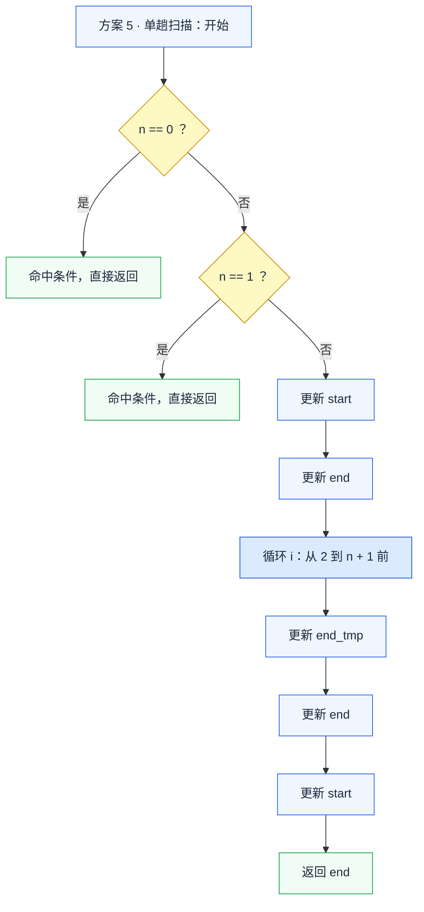

```python
import sys  # 提高递归深度上限（深输入防 RecursionError）

sys.setrecursionlimit(200000)  # 树/链表类题目节点数可达 1e4 量级

def fib(n):  # 定义函数 fib（参数：元素个数）
    if n == 0:  # 若 元素个数 等于 0
        return 0  # 返回 0
    if n == 1:  # 若 元素个数 等于 1
        return 1  # 返回 1
    start = 0  # 把 0 存入 起点
    end = 1  # 把 1 存入 终点
    for i in range(2, n + 1):  # 让 下标 i 从 2 到 元素个数 加 1 遍历
        end_tmp = end  # 把 终点 存入 end_tmp
        end = end + start  # 把 终点 加 起点 存入 终点
        start = end_tmp  # 把 end_tmp 存入 起点
    return end  # 返回 终点

if __name__ == "__main__":  # 若 __name__ 等于 '__main__'
    print(fib(5))  # 打印输出
```

#### 方案 6：单趟扫描

**思路与代码分析**：核心是「单趟扫描」。Python 版用切片与字典推导式简化操作，突出可读性。代码里依次做这些事：DP 表逐项填充。**走读**：方案 6 · 单趟扫描：开始 → 命中条件，直接返回 → 填写 DP 表 → 循环 i：从 2 到 n + 1 前 → 填写 DP 表 → 返回 dp[n]。

**运行架构**（真实控制流）：

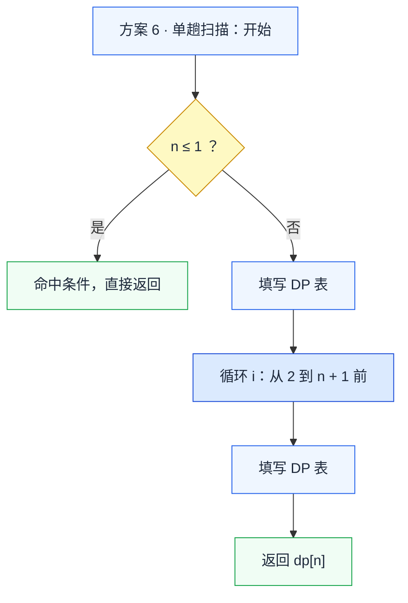

```python
import sys  # 提高递归深度上限（深输入防 RecursionError）

sys.setrecursionlimit(200000)  # 树/链表类题目节点数可达 1e4 量级

def fib(n):  # 定义函数 fib（参数：元素个数）
    # 数组 DP
    if n <= 1:  # 若 元素个数 不超过 1
        return n  # 返回 元素个数
    dp = [0, 1]  # 把 [0, 1] 存入 DP 表
    for i in range(2, n + 1):  # 让 下标 i 从 2 到 元素个数 加 1 遍历
        dp.append(dp[i - 1] + dp[i - 2])  # 把 DP 表[下标 i 减 1] 加 DP 表[下标 i 减 2] 追加到列表尾部
    return dp[n]  # 返回 DP 表[元素个数]

if __name__ == "__main__":  # 若 __name__ 等于 '__main__'
    print(fib(5))  # 打印输出
```

#### 方案 7：单趟扫描

**思路与代码分析**：核心是「单趟扫描」。Python 版用切片与字典推导式简化操作，突出可读性。**走读**：方案 7 · 单趟扫描：开始 → 处理 from functools import lru_ca → 处理 @lru_cache(None) → 命中条件，直接返回 → 命中条件，直接返回 → 返回 dfs(x - 1) + dfs(x - 2) → 返回 dfs(n)。

**运行架构**（真实控制流）：

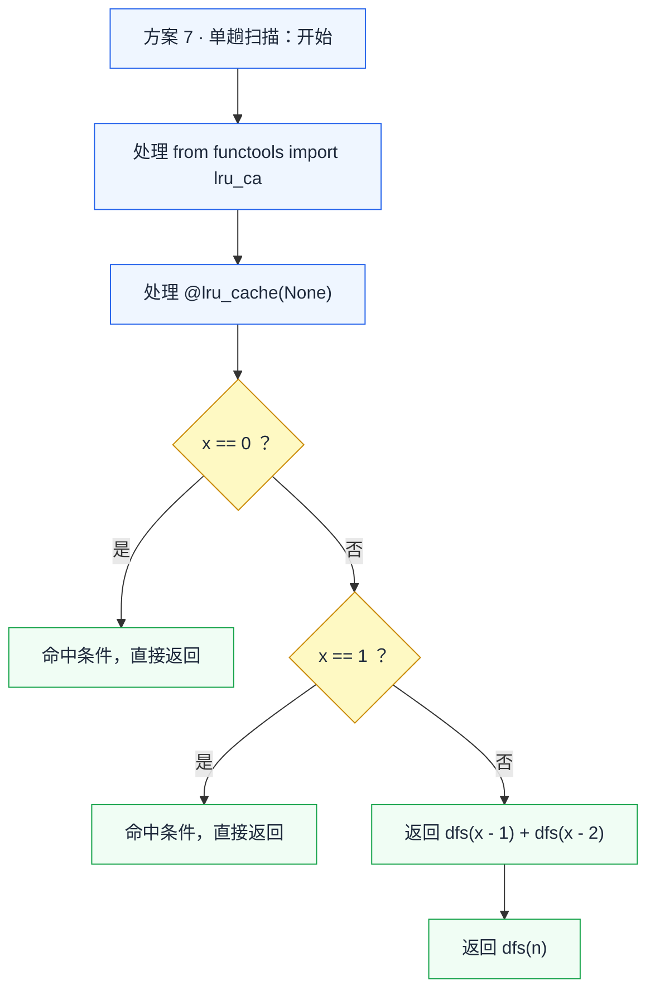

```python
import sys  # 提高递归深度上限（深输入防 RecursionError）

sys.setrecursionlimit(200000)  # 树/链表类题目节点数可达 1e4 量级

def fib(n):  # 定义函数 fib（参数：元素个数）
    from functools import lru_cache  # from functools import lru_cache

    @lru_cache(None)  # @lru_cache(None)
    def dfs(x):  # 定义函数 dfs（参数：x）
        if x == 0:  # 若 x 等于 0
            return 0  # 返回 0
        if x == 1:  # 若 x 等于 1
            return 1  # 返回 1
        return dfs(x - 1) + dfs(x - 2)  # 返回 dfs(x 减 1) 加 dfs(x 减 2)

    return dfs(n)  # 返回 dfs(元素个数)

if __name__ == "__main__":  # 若 __name__ 等于 '__main__'
    print(fib(10))  # 打印输出
```

#### 方案 8：单趟扫描

**思路与代码分析**：核心是「单趟扫描」。Python 版用切片与字典推导式简化操作，突出可读性。**走读**：方案 8 · 单趟扫描：开始 → 命中条件，直接返回 → 命中条件，直接返回 → 更新 end → 循环 _：从 2 到 n + 1 前 → 更新 end → 返回 end。

**运行架构**（真实控制流）：

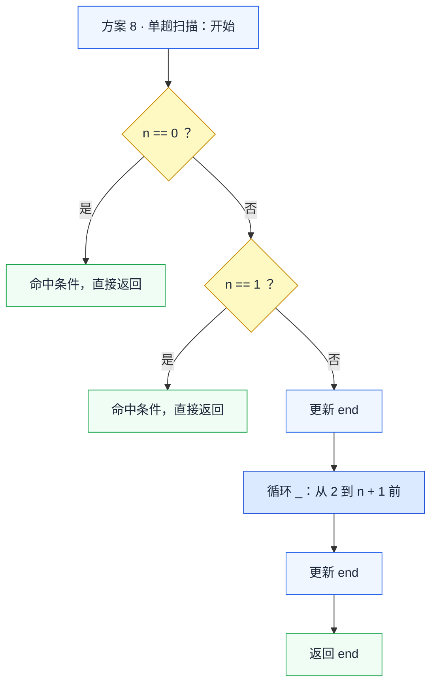

```python
import sys  # 提高递归深度上限（深输入防 RecursionError）

sys.setrecursionlimit(200000)  # 树/链表类题目节点数可达 1e4 量级

def fib(n):  # 定义函数 fib（参数：元素个数）
    # 两个变量滚动迭代
    if n == 0:  # 若 元素个数 等于 0
        return 0  # 返回 0
    if n == 1:  # 若 元素个数 等于 1
        return 1  # 返回 1
    start, end = 0, 1  # 把 0, 1 写入 start, end
    for _ in range(2, n + 1):  # 让 _ 从 2 到 元素个数 加 1 遍历
        start, end = end, start + end  # 把 终点, 起点 加 终点 写入 start, end
    return end  # 返回 终点

if __name__ == "__main__":  # 若 __name__ 等于 '__main__'
    print(fib(5))  # 打印输出
```

#### 方案 9：单趟扫描

**思路与代码分析**：核心是「单趟扫描」。Python 版用切片与字典推导式简化操作，突出可读性。**走读**：方案 9 · 单趟扫描：开始 → 更新 b → 循环 _：从 0 到 n 前 → 更新 b → 返回 a。

**运行架构**（真实控制流）：

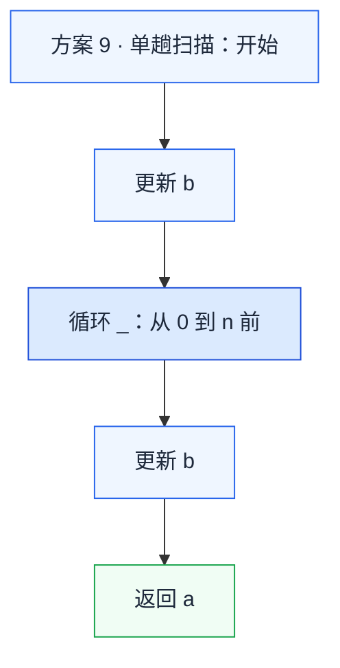

```python
import sys  # 提高递归深度上限（深输入防 RecursionError）

sys.setrecursionlimit(200000)  # 树/链表类题目节点数可达 1e4 量级

def fib(n):  # 定义函数 fib（参数：元素个数）
    # 两变量滚动（从 0 开始迭代 n 次）
    a, b = 0, 1  # 把 0, 1 写入 a, b
    for _ in range(n):  # 让 _ 从 元素个数 遍历
        a, b = b, a + b  # 把 b, 数组 加 b 写入 a, b
    return a  # 返回 数组

if __name__ == "__main__":  # 若 __name__ 等于 '__main__'
    print(fib(5))  # 打印输出
```

#### 方案 10：单趟扫描

**思路与代码分析**：核心是「单趟扫描」。Python 版用切片与字典推导式简化操作，突出可读性。**走读**：方案 10 · 单趟扫描：开始 → 返回 [ → 处理 [a[0][0] * b[0][0] + a[0][1] → 当 p: 时反复执行 → 返回 res → 命中条件，直接返回 → 命中条件，直接返回 → 返回 m[0][0]。

**运行架构**（真实控制流）：

```mermaid
graph TD
    N0["方案 10 · 单趟扫描：开始"]
    N1["返回 ["]
    N2["处理 [a[0][0] * b[0][0] + a[0][1]"]
    D1["……（中间计算步骤）"]
    N6["当 p: 时反复执行"]
    D2["……（中间计算步骤）"]
    N11["返回 res"]
    N12{"n == 0 ？"}
    N13["命中条件，直接返回"]
    N14{"n == 1 ？"}
    N15["命中条件，直接返回"]
    D3["……（中间计算步骤）"]
    N17["返回 m[0][0]"]
    N0 --> N1
    N1 --> N2
    N11 --> N12
    N12 -- 是 --> N13
    N12 -- 否 --> N14
    N14 -- 是 --> N15
    N2 --> D1
    D1 --> N6
    N6 --> D2
    D2 --> N11
    N13 --> N14
    N15 --> D3
    D3 --> N17
    classDef n fill:#eff6ff,stroke:#2563eb,color:#1e293b;
    classDef lp fill:#dbeafe,stroke:#1d4ed8,color:#1e293b;
    classDef dc fill:#fef9c3,stroke:#ca8a04,color:#1e293b;
    classDef tm fill:#f0fdf4,stroke:#16a34a,color:#1e293b;
    class N0,N2,D1,D2,D3 n;
    class N6 lp;
    class N12,N14 dc;
    class N1,N11,N13,N15,N17 tm;
```

```python
import sys  # 提高递归深度上限（深输入防 RecursionError）

sys.setrecursionlimit(200000)  # 树/链表类题目节点数可达 1e4 量级

def fib(n):  # 定义函数 fib（参数：元素个数）
    def mat_mul(a, b):  # 定义函数 mat_mul（参数：数组, b）
        return [
            [a[0][0] * b[0][0] + a[0][1] * b[1][0], a[0][0] * b[0][1] + a[0][1] * b[1][1]],
            [a[1][0] * b[0][0] + a[1][1] * b[1][0], a[1][0] * b[0][1] + a[1][1] * b[1][1]],
        ]

    def mat_pow(mat, p):  # 定义函数 mat_pow（参数：mat, 节点）
        res = [[1, 0], [0, 1]]  # 把 [[1, 0], [0, 1]] 存入 结果
        while p:  # 循环，直到不满足「节点」
            if p & 1:  # 若 节点 按位与 1
                res = mat_mul(res, mat)  # 把 mat_mul(结果, mat) 存入 结果
            mat = mat_mul(mat, mat)  # 把 mat_mul(mat, mat) 存入 mat
            p >>= 1  # 把 1 写入 p >>
        return res  # 返回 结果

    if n == 0:  # 若 元素个数 等于 0
        return 0  # 返回 0
    if n == 1:  # 若 元素个数 等于 1
        return 1  # 返回 1
    m = mat_pow([[1, 1], [1, 0]], n - 1)  # 把 mat_pow([[1, 1], [1, 0]], 元素个数 减 1) 存入 映射表
    return m[0][0]  # 返回 映射表[0][0]

if __name__ == "__main__":  # 若 __name__ 等于 '__main__'
    print(fib(10))  # 打印输出
```

### Go 实现（10 种方案）

Go 的全部方案如下，每个方案都内嵌用例自测，可独立运行（老仓库 python/go 文件遵循「打印结果」约定）：

#### 方案 1：单趟扫描

**思路与代码分析**：核心是「单趟扫描」。Go 版用切片与多返回值惯用法，显式处理索引边界。**走读**：方案 1 · 单趟扫描：开始 → 处理 if n == 0 → 返回 0 → 处理 if n == 1 → 返回 1 → 返回 fib(n-1) + fib(n-2)。

**运行架构**（真实控制流）：

```mermaid
graph TD
    N0["方案 1 · 单趟扫描：开始"]
    N1["处理 if n == 0"]
    N2["返回 0"]
    N3["处理 if n == 1"]
    N4["返回 1"]
    N5["返回 fib(n-1) + fib(n-2)"]
    N0 --> N1
    N1 --> N2
    N2 --> N3
    N3 --> N4
    N4 --> N5
    classDef n fill:#eff6ff,stroke:#2563eb,color:#1e293b;
    classDef lp fill:#dbeafe,stroke:#1d4ed8,color:#1e293b;
    classDef dc fill:#fef9c3,stroke:#ca8a04,color:#1e293b;
    classDef tm fill:#f0fdf4,stroke:#16a34a,color:#1e293b;
    class N0,N1,N3 n;
    class N2,N4,N5 tm;
```

```go
package main // 引入依赖

import (
	"fmt" // 「fmt」
	"os"  // 「os」
)

// 方案1: 普通递归
func fib(n int) int { // 定义函数/方法 fib
	if n == 0 { // 若 元素个数 等于 0
		return 0 // 返回 0
	}
	if n == 1 { // 若 元素个数 等于 1
		return 1 // 返回 1
	}
	return fib(n-1) + fib(n-2) // 定义函数/方法 fib
}

func main() { // 程序入口：跑内嵌自测用例
	cases := []struct { // 把 []struct { 写入 cases :
		in   int // in int
		want int // want int
	}{ // }{
		{0, 0},
		{1, 1},
		{2, 1},
		{5, 5},
		{10, 55},
		{20, 6765},
	}
	ok := true                // 把 true 写入 ok :
	for _, c := range cases { // 同时取 _ 与 字符 遍历
		if got := fib(c.in); got != c.want { // 若 got : 赋值为 fib(字符.in); got 不等于 字符.want
			ok = false                                                 // 把 false 写入 ok
			fmt.Printf("FAIL fib(%d)=%d want %d\n", c.in, got, c.want) // 打印输出
		}
	}
	if !ok { // 若 取反 ok
		os.Exit(1) // os.Exit(1)
	}
	fmt.Println("PASS") // 全部用例通过，输出 PASS
}
```

#### 方案 2：单趟扫描

**思路与代码分析**：核心是「单趟扫描」。Go 版用切片与多返回值惯用法，显式处理索引边界。代码里依次做这些事：哈希结构做计数或查重。**走读**：方案 2 · 单趟扫描：开始 → 更新 : → 计算 f → 更新 f → 处理 if k ≤ 1 → 返回 k → 处理 if v, ok := memo[k]; ok → 返回 v → 更新 memo[k] → 返回 memo[k] → 返回 f(n)。

**运行架构**（真实控制流）：

```mermaid
graph TD
    N0["方案 2 · 单趟扫描：开始"]
    N1["更新 :"]
    N2["计算 f"]
    N3["更新 f"]
    N4["处理 if k ≤ 1"]
    N5["返回 k"]
    N6["处理 if v, ok := memo[k]; ok"]
    N7["返回 v"]
    N8["更新 memo[k]"]
    N9["返回 memo[k]"]
    N10["返回 f(n)"]
    N0 --> N1
    N1 --> N2
    N2 --> N3
    N3 --> N4
    N4 --> N5
    N5 --> N6
    N6 --> N7
    N7 --> N8
    N8 --> N9
    N9 --> N10
    classDef n fill:#eff6ff,stroke:#2563eb,color:#1e293b;
    classDef lp fill:#dbeafe,stroke:#1d4ed8,color:#1e293b;
    classDef dc fill:#fef9c3,stroke:#ca8a04,color:#1e293b;
    classDef tm fill:#f0fdf4,stroke:#16a34a,color:#1e293b;
    class N0,N1,N2,N3,N4,N6,N8 n;
    class N5,N7,N9,N10 tm;
```

```go
package main // 引入依赖

import (
	"fmt" // 「fmt」
	"os"  // 「os」
)

// 方案2: 带记忆化的递归
func fib(n int) int { // 定义函数/方法 fib
	memo := map[int]int{} // 把 映射表[int]int{} 写入 memo :
	var f func(int) int   // var f func(int) int
	f = func(k int) int { // 把 func(下标 k int) int { 写入 f
		if k <= 1 { // 若 下标 k 不超过 1
			return k // 返回 下标 k
		}
		if v, ok := memo[k]; ok { // 若 值, ok : 赋值为 记忆化表[下标 k]; ok
			return v // 返回 值
		}
		memo[k] = f(k-1) + f(k-2) // 把 f(下标 k 减 1) 加 f(下标 k 减 2) 写入 memo[k]
		return memo[k]            // 返回 记忆化表[下标 k]
	}
	return f(n) // 定义函数/方法 f
}

func main() { // 程序入口：跑内嵌自测用例
	cases := []struct { // 把 []struct { 写入 cases :
		in   int // in int
		want int // want int
	}{ // }{
		{0, 0},
		{1, 1},
		{2, 1},
		{5, 5},
		{10, 55},
		{20, 6765},
	}
	ok := true                // 把 true 写入 ok :
	for _, c := range cases { // 同时取 _ 与 字符 遍历
		if got := fib(c.in); got != c.want { // 若 got : 赋值为 fib(字符.in); got 不等于 字符.want
			ok = false                                                 // 把 false 写入 ok
			fmt.Printf("FAIL fib(%d)=%d want %d\n", c.in, got, c.want) // 打印输出
		}
	}
	if !ok { // 若 取反 ok
		os.Exit(1) // os.Exit(1)
	}
	fmt.Println("PASS") // 全部用例通过，输出 PASS
}
```

#### 方案 3：单趟扫描

**思路与代码分析**：核心是「单趟扫描」。Go 版用切片与多返回值惯用法，显式处理索引边界。**走读**：方案 3 · 单趟扫描：开始 → 处理 if n ＜ 2 → 返回 n → 更新 : → 遍历循环 → 更新 b → 返回 b。

**运行架构**（真实控制流）：

```mermaid
graph TD
    N0["方案 3 · 单趟扫描：开始"]
    N1["处理 if n ＜ 2"]
    N2["返回 n"]
    N3["更新 :"]
    N4["遍历循环"]
    N5["更新 b"]
    N6["返回 b"]
    N0 --> N1
    N1 --> N2
    N2 --> N3
    N3 --> N4
    N4 --> N5
    N5 -- 下一轮 --> N4
    N4 --> N6
    classDef n fill:#eff6ff,stroke:#2563eb,color:#1e293b;
    classDef lp fill:#dbeafe,stroke:#1d4ed8,color:#1e293b;
    classDef dc fill:#fef9c3,stroke:#ca8a04,color:#1e293b;
    classDef tm fill:#f0fdf4,stroke:#16a34a,color:#1e293b;
    class N0,N1,N3,N5 n;
    class N4 lp;
    class N2,N6 tm;
```

```go
package main // 引入依赖
import (
	"fmt"
	"os"
) // 引入依赖
func fib(n int) int { // 定义函数/方法 fib
	if n < 2 {
		return n
	} // 若 元素个数 小于 2 { return 元素个数 }
	a, b := 0, 1 // 把 0, 1 写入 a, b :
	for i := 2; i <= n; i++ {
		a, b = b, a+b
	} // 让 下标 i 从 2 开始计数
	return b // 返回 b
}
func main() { // 程序入口：跑内嵌自测用例
	cases := []struct {
		in   int
		want int
	}{{0, 0}, {1, 1}, {2, 1}, {10, 55}}
	ok := true                // 把 true 写入 ok :
	for _, c := range cases { // 同时取 _ 与 字符 遍历
		if got := fib(c.in); got != c.want {
			ok = false
			fmt.Printf("FAIL fib(%v)=%v want %v\n", c.in, got, c.want)
		}
	}
	if !ok {
		os.Exit(1)
	} // 若 取反 ok { os.Exit(1) }
	fmt.Println("PASS") // 全部用例通过，输出 PASS
}
```

#### 方案 4：单趟扫描

**思路与代码分析**：核心是「单趟扫描」。Go 版用切片与多返回值惯用法，显式处理索引边界。**走读**：方案 4 · 单趟扫描：开始 → 处理 if n == 0 → 返回 0 → 处理 if n == 1 → 返回 1 → 更新 : → 更新 : → 遍历循环 → 更新 : → 更新 end → 更新 start → 返回 end。

**运行架构**（真实控制流）：

```mermaid
graph TD
    N0["方案 4 · 单趟扫描：开始"]
    N1["处理 if n == 0"]
    N2["返回 0"]
    N3["处理 if n == 1"]
    N4["返回 1"]
    N5["更新 :"]
    N6["更新 :"]
    N7["遍历循环"]
    N8["更新 :"]
    N9["更新 end"]
    N10["更新 start"]
    N11["返回 end"]
    N0 --> N1
    N1 --> N2
    N2 --> N3
    N3 --> N4
    N4 --> N5
    N5 --> N6
    N6 --> N7
    N7 --> N8
    N8 --> N9
    N9 --> N10
    N10 -- 下一轮 --> N7
    N7 --> N11
    classDef n fill:#eff6ff,stroke:#2563eb,color:#1e293b;
    classDef lp fill:#dbeafe,stroke:#1d4ed8,color:#1e293b;
    classDef dc fill:#fef9c3,stroke:#ca8a04,color:#1e293b;
    classDef tm fill:#f0fdf4,stroke:#16a34a,color:#1e293b;
    class N0,N1,N3,N5,N6,N8,N9,N10 n;
    class N7 lp;
    class N2,N4,N11 tm;
```

```go
package main // 引入依赖

import (
	"fmt" // 「fmt」
	"os"  // 「os」
)

// 方案4: 两个变量滚动迭代（start/end + 临时变量）
func fib(n int) int { // 定义函数/方法 fib
	if n == 0 { // 若 元素个数 等于 0
		return 0 // 返回 0
	}
	if n == 1 { // 若 元素个数 等于 1
		return 1 // 返回 1
	}
	start := 0                // 把 0 写入 start :
	end := 1                  // 把 1 写入 end :
	for i := 2; i <= n; i++ { // 让 下标 i 从 2 开始计数
		endTmp := end     // 把 终点 写入 endTmp :
		end = end + start // 把 终点 加 起点 写入 终点
		start = endTmp    // 把 endTmp 写入 起点
	}
	return end // 返回 终点
}

func main() { // 程序入口：跑内嵌自测用例
	cases := []struct { // 把 []struct { 写入 cases :
		in   int // in int
		want int // want int
	}{ // }{
		{0, 0},
		{1, 1},
		{2, 1},
		{5, 5},
		{10, 55},
		{20, 6765},
	}
	ok := true                // 把 true 写入 ok :
	for _, c := range cases { // 同时取 _ 与 字符 遍历
		if got := fib(c.in); got != c.want { // 若 got : 赋值为 fib(字符.in); got 不等于 字符.want
			ok = false                                                 // 把 false 写入 ok
			fmt.Printf("FAIL fib(%d)=%d want %d\n", c.in, got, c.want) // 打印输出
		}
	}
	if !ok { // 若 取反 ok
		os.Exit(1) // os.Exit(1)
	}
	fmt.Println("PASS") // 全部用例通过，输出 PASS
}
```

#### 方案 5：单趟扫描

**思路与代码分析**：核心是「单趟扫描」。Go 版用切片与多返回值惯用法，显式处理索引边界。**走读**：方案 5 · 单趟扫描：开始 → 处理 if n == 0 → 返回 0 → 处理 if n == 1 → 返回 1 → 更新 : → 遍历循环 → 更新 end → 返回 end。

**运行架构**（真实控制流）：

```mermaid
graph TD
    N0["方案 5 · 单趟扫描：开始"]
    N1["处理 if n == 0"]
    N2["返回 0"]
    N3["处理 if n == 1"]
    N4["返回 1"]
    N5["更新 :"]
    N6["遍历循环"]
    N7["更新 end"]
    N8["返回 end"]
    N0 --> N1
    N1 --> N2
    N2 --> N3
    N3 --> N4
    N4 --> N5
    N5 --> N6
    N6 --> N7
    N7 -- 下一轮 --> N6
    N6 --> N8
    classDef n fill:#eff6ff,stroke:#2563eb,color:#1e293b;
    classDef lp fill:#dbeafe,stroke:#1d4ed8,color:#1e293b;
    classDef dc fill:#fef9c3,stroke:#ca8a04,color:#1e293b;
    classDef tm fill:#f0fdf4,stroke:#16a34a,color:#1e293b;
    class N0,N1,N3,N5,N7 n;
    class N6 lp;
    class N2,N4,N8 tm;
```

```go
package main // 引入依赖

import (
	"fmt" // 「fmt」
	"os"  // 「os」
)

// 方案5: 两个变量滚动迭代（元组交换式）
func fib(n int) int { // 定义函数/方法 fib
	if n == 0 { // 若 元素个数 等于 0
		return 0 // 返回 0
	}
	if n == 1 { // 若 元素个数 等于 1
		return 1 // 返回 1
	}
	start, end := 0, 1        // 把 0, 1 写入 start, end :
	for i := 2; i <= n; i++ { // 让 下标 i 从 2 开始计数
		start, end = end, start+end // 把 终点, 起点 加 终点 写入 start, end
	}
	return end // 返回 终点
}

func main() { // 程序入口：跑内嵌自测用例
	cases := []struct { // 把 []struct { 写入 cases :
		in   int // in int
		want int // want int
	}{ // }{
		{0, 0},
		{1, 1},
		{2, 1},
		{5, 5},
		{10, 55},
		{20, 6765},
	}
	ok := true                // 把 true 写入 ok :
	for _, c := range cases { // 同时取 _ 与 字符 遍历
		if got := fib(c.in); got != c.want { // 若 got : 赋值为 fib(字符.in); got 不等于 字符.want
			ok = false                                                 // 把 false 写入 ok
			fmt.Printf("FAIL fib(%d)=%d want %d\n", c.in, got, c.want) // 打印输出
		}
	}
	if !ok { // 若 取反 ok
		os.Exit(1) // os.Exit(1)
	}
	fmt.Println("PASS") // 全部用例通过，输出 PASS
}
```

#### 方案 6：单趟扫描

**思路与代码分析**：核心是「单趟扫描」。Go 版用切片与多返回值惯用法，显式处理索引边界。**走读**：方案 6 · 单趟扫描：开始 → 处理 if n ＜ 2 → 返回 n → 更新 : → 遍历循环 → 更新 b → 返回 b。

**运行架构**（真实控制流）：

```mermaid
graph TD
    N0["方案 6 · 单趟扫描：开始"]
    N1["处理 if n ＜ 2"]
    N2["返回 n"]
    N3["更新 :"]
    N4["遍历循环"]
    N5["更新 b"]
    N6["返回 b"]
    N0 --> N1
    N1 --> N2
    N2 --> N3
    N3 --> N4
    N4 --> N5
    N5 -- 下一轮 --> N4
    N4 --> N6
    classDef n fill:#eff6ff,stroke:#2563eb,color:#1e293b;
    classDef lp fill:#dbeafe,stroke:#1d4ed8,color:#1e293b;
    classDef dc fill:#fef9c3,stroke:#ca8a04,color:#1e293b;
    classDef tm fill:#f0fdf4,stroke:#16a34a,color:#1e293b;
    class N0,N1,N3,N5 n;
    class N4 lp;
    class N2,N6 tm;
```

```go
package main // 引入依赖
import (
	"fmt"
	"os"
) // 引入依赖
func fib(n int) int { // 定义函数/方法 fib
	if n < 2 {
		return n
	} // 若 元素个数 小于 2 { return 元素个数 }
	a, b := 0, 1 // 把 0, 1 写入 a, b :
	for i := 2; i <= n; i++ {
		a, b = b, a+b
	} // 让 下标 i 从 2 开始计数
	return b // 返回 b
}
func main() { // 程序入口：跑内嵌自测用例
	cases := []struct {
		in   int
		want int
	}{{0, 0}, {1, 1}, {2, 1}, {10, 55}}
	ok := true                // 把 true 写入 ok :
	for _, c := range cases { // 同时取 _ 与 字符 遍历
		if got := fib(c.in); got != c.want {
			ok = false
			fmt.Printf("FAIL fib(%v)=%v want %v\n", c.in, got, c.want)
		}
	}
	if !ok {
		os.Exit(1)
	} // 若 取反 ok { os.Exit(1) }
	fmt.Println("PASS") // 全部用例通过，输出 PASS
}
```

#### 方案 7：单趟扫描

**思路与代码分析**：核心是「单趟扫描」。Go 版用切片与多返回值惯用法，显式处理索引边界。代码里依次做这些事：哈希结构做计数或查重。**走读**：方案 7 · 单趟扫描：开始 → 更新 : → 计算 dfs → 更新 dfs → 处理 if x == 0 → 返回 0 → 处理 if x == 1 → 返回 1 → 处理 if v, ok := memo[x]; ok → 返回 v → 更新 memo[x] → 返回 memo[x] → 返回 dfs(n)。

**运行架构**（真实控制流）：

```mermaid
graph TD
    N0["方案 7 · 单趟扫描：开始"]
    N1["更新 :"]
    N2["计算 dfs"]
    N3["更新 dfs"]
    N4["处理 if x == 0"]
    N5["返回 0"]
    N6["处理 if x == 1"]
    N7["返回 1"]
    N8["处理 if v, ok := memo[x]; ok"]
    N9["返回 v"]
    N10["更新 memo[x]"]
    N11["返回 memo[x]"]
    N12["返回 dfs(n)"]
    N0 --> N1
    N1 --> N2
    N2 --> N3
    N3 --> N4
    N4 --> N5
    N5 --> N6
    N6 --> N7
    N7 --> N8
    N8 --> N9
    N9 --> N10
    N10 --> N11
    N11 --> N12
    classDef n fill:#eff6ff,stroke:#2563eb,color:#1e293b;
    classDef lp fill:#dbeafe,stroke:#1d4ed8,color:#1e293b;
    classDef dc fill:#fef9c3,stroke:#ca8a04,color:#1e293b;
    classDef tm fill:#f0fdf4,stroke:#16a34a,color:#1e293b;
    class N0,N1,N2,N3,N4,N6,N8,N10 n;
    class N5,N7,N9,N11,N12 tm;
```

```go
package main // 引入依赖

import (
	"fmt" // 「fmt」
	"os"  // 「os」
)

// 方案7: 记忆化搜索（等价于 python lru_cache 的内部 dfs）
func fib(n int) int { // 定义函数/方法 fib
	memo := map[int]int{}   // 把 映射表[int]int{} 写入 memo :
	var dfs func(int) int   // var dfs func(int) int
	dfs = func(x int) int { // 把 func(x int) int { 写入 dfs
		if x == 0 { // 若 x 等于 0
			return 0 // 返回 0
		}
		if x == 1 { // 若 x 等于 1
			return 1 // 返回 1
		}
		if v, ok := memo[x]; ok { // 若 值, ok : 赋值为 记忆化表[x]; ok
			return v // 返回 值
		}
		memo[x] = dfs(x-1) + dfs(x-2) // 把 dfs(x 减 1) 加 dfs(x 减 2) 写入 memo[x]
		return memo[x]                // 返回 记忆化表[x]
	}
	return dfs(n) // 定义函数/方法 dfs
}

func main() { // 程序入口：跑内嵌自测用例
	cases := []struct { // 把 []struct { 写入 cases :
		in   int // in int
		want int // want int
	}{ // }{
		{0, 0},
		{1, 1},
		{2, 1},
		{5, 5},
		{10, 55},
		{20, 6765},
	}
	ok := true                // 把 true 写入 ok :
	for _, c := range cases { // 同时取 _ 与 字符 遍历
		if got := fib(c.in); got != c.want { // 若 got : 赋值为 fib(字符.in); got 不等于 字符.want
			ok = false                                                 // 把 false 写入 ok
			fmt.Printf("FAIL fib(%d)=%d want %d\n", c.in, got, c.want) // 打印输出
		}
	}
	if !ok { // 若 取反 ok
		os.Exit(1) // os.Exit(1)
	}
	fmt.Println("PASS") // 全部用例通过，输出 PASS
}
```

#### 方案 8：单趟扫描

**思路与代码分析**：核心是「单趟扫描」。Go 版用切片与多返回值惯用法，显式处理索引边界。**走读**：方案 8 · 单趟扫描：开始 → 更新 : → 遍历循环 → 更新 b → 返回 a。

**运行架构**（真实控制流）：

```mermaid
graph TD
    N0["方案 8 · 单趟扫描：开始"]
    N1["更新 :"]
    N2["遍历循环"]
    N3["更新 b"]
    N4["返回 a"]
    N0 --> N1
    N1 --> N2
    N2 --> N3
    N3 -- 下一轮 --> N2
    N2 --> N4
    classDef n fill:#eff6ff,stroke:#2563eb,color:#1e293b;
    classDef lp fill:#dbeafe,stroke:#1d4ed8,color:#1e293b;
    classDef dc fill:#fef9c3,stroke:#ca8a04,color:#1e293b;
    classDef tm fill:#f0fdf4,stroke:#16a34a,color:#1e293b;
    class N0,N1,N3 n;
    class N2 lp;
    class N4 tm;
```

```go
package main // 引入依赖

import (
	"fmt" // 「fmt」
	"os"  // 「os」
)

// 方案8: 两个变量滚动迭代（从 0 开始迭代 n 次，返回 a）
func fib(n int) int { // 定义函数/方法 fib
	a, b := 0, 1             // 把 0, 1 写入 a, b :
	for i := 0; i < n; i++ { // 让 下标 i 从 0 开始计数
		a, b = b, a+b // 把 b, 数组 加 b 写入 a, b
	}
	return a // 返回 数组
}

func main() { // 程序入口：跑内嵌自测用例
	cases := []struct { // 把 []struct { 写入 cases :
		in   int // in int
		want int // want int
	}{ // }{
		{0, 0},
		{1, 1},
		{2, 1},
		{5, 5},
		{10, 55},
		{20, 6765},
	}
	ok := true                // 把 true 写入 ok :
	for _, c := range cases { // 同时取 _ 与 字符 遍历
		if got := fib(c.in); got != c.want { // 若 got : 赋值为 fib(字符.in); got 不等于 字符.want
			ok = false                                                 // 把 false 写入 ok
			fmt.Printf("FAIL fib(%d)=%d want %d\n", c.in, got, c.want) // 打印输出
		}
	}
	if !ok { // 若 取反 ok
		os.Exit(1) // os.Exit(1)
	}
	fmt.Println("PASS") // 全部用例通过，输出 PASS
}
```

#### 方案 9：单趟扫描

**思路与代码分析**：核心是「单趟扫描」。Go 版用切片与多返回值惯用法，显式处理索引边界。**走读**：方案 9 · 单趟扫描：开始 → 更新 : → 遍历循环 → 更新 b → 返回 a。

**运行架构**（真实控制流）：

```mermaid
graph TD
    N0["方案 9 · 单趟扫描：开始"]
    N1["更新 :"]
    N2["遍历循环"]
    N3["更新 b"]
    N4["返回 a"]
    N0 --> N1
    N1 --> N2
    N2 --> N3
    N3 -- 下一轮 --> N2
    N2 --> N4
    classDef n fill:#eff6ff,stroke:#2563eb,color:#1e293b;
    classDef lp fill:#dbeafe,stroke:#1d4ed8,color:#1e293b;
    classDef dc fill:#fef9c3,stroke:#ca8a04,color:#1e293b;
    classDef tm fill:#f0fdf4,stroke:#16a34a,color:#1e293b;
    class N0,N1,N3 n;
    class N2 lp;
    class N4 tm;
```

```go
package main // 引入依赖

import (
	"fmt" // 「fmt」
	"os"  // 「os」
)

// 方案9: 两个变量滚动迭代（从 0 开始迭代 n 次，返回 a）
func fib(n int) int { // 定义函数/方法 fib
	a, b := 0, 1             // 把 0, 1 写入 a, b :
	for i := 0; i < n; i++ { // 让 下标 i 从 0 开始计数
		a, b = b, a+b // 把 b, 数组 加 b 写入 a, b
	}
	return a // 返回 数组
}

func main() { // 程序入口：跑内嵌自测用例
	cases := []struct { // 把 []struct { 写入 cases :
		in   int // in int
		want int // want int
	}{ // }{
		{0, 0},
		{1, 1},
		{2, 1},
		{5, 5},
		{10, 55},
		{20, 6765},
	}
	ok := true                // 把 true 写入 ok :
	for _, c := range cases { // 同时取 _ 与 字符 遍历
		if got := fib(c.in); got != c.want { // 若 got : 赋值为 fib(字符.in); got 不等于 字符.want
			ok = false                                                 // 把 false 写入 ok
			fmt.Printf("FAIL fib(%d)=%d want %d\n", c.in, got, c.want) // 打印输出
		}
	}
	if !ok { // 若 取反 ok
		os.Exit(1) // os.Exit(1)
	}
	fmt.Println("PASS") // 全部用例通过，输出 PASS
}
```

#### 方案 10：单趟扫描

**思路与代码分析**：核心是「单趟扫描」。Go 版用切片与多返回值惯用法，显式处理索引边界。**走读**：方案 10 · 单趟扫描：开始 → 处理 if n ＜ 2 → 返回 n → 更新 : → 遍历循环 → 更新 b → 返回 b。

**运行架构**（真实控制流）：

```mermaid
graph TD
    N0["方案 10 · 单趟扫描：开始"]
    N1["处理 if n ＜ 2"]
    N2["返回 n"]
    N3["更新 :"]
    N4["遍历循环"]
    N5["更新 b"]
    N6["返回 b"]
    N0 --> N1
    N1 --> N2
    N2 --> N3
    N3 --> N4
    N4 --> N5
    N5 -- 下一轮 --> N4
    N4 --> N6
    classDef n fill:#eff6ff,stroke:#2563eb,color:#1e293b;
    classDef lp fill:#dbeafe,stroke:#1d4ed8,color:#1e293b;
    classDef dc fill:#fef9c3,stroke:#ca8a04,color:#1e293b;
    classDef tm fill:#f0fdf4,stroke:#16a34a,color:#1e293b;
    class N0,N1,N3,N5 n;
    class N4 lp;
    class N2,N6 tm;
```

```go
package main // 引入依赖
import (
	"fmt"
	"os"
) // 引入依赖
func fib(n int) int { // 定义函数/方法 fib
	if n < 2 {
		return n
	} // 若 元素个数 小于 2 { return 元素个数 }
	a, b := 0, 1 // 把 0, 1 写入 a, b :
	for i := 2; i <= n; i++ {
		a, b = b, a+b
	} // 让 下标 i 从 2 开始计数
	return b // 返回 b
}
func main() { // 程序入口：跑内嵌自测用例
	cases := []struct {
		in   int
		want int
	}{{0, 0}, {1, 1}, {2, 1}, {10, 55}}
	ok := true                // 把 true 写入 ok :
	for _, c := range cases { // 同时取 _ 与 字符 遍历
		if got := fib(c.in); got != c.want {
			ok = false
			fmt.Printf("FAIL fib(%v)=%v want %v\n", c.in, got, c.want)
		}
	}
	if !ok {
		os.Exit(1)
	} // 若 取反 ok { os.Exit(1) }
	fmt.Println("PASS") // 全部用例通过，输出 PASS
}
```

### Java 实现（10 种方案）

Java 的全部方案如下，每个方案都内嵌用例自测，可独立运行（老仓库 python/go 文件遵循「打印结果」约定）：

#### 方案 1：单趟扫描

**思路与代码分析**：核心是「单趟扫描」。Java 版用类与静态方法组织，集合操作显式明了。**走读**：方案 1 · 单趟扫描：开始 → 命中条件，直接返回 → 命中条件，直接返回 → 返回 fib(n - 1) + fib(n - 2)。

**运行架构**（真实控制流）：

```mermaid
graph TD
    N0["方案 1 · 单趟扫描：开始"]
    N1{"n == 0 ？"}
    N2["命中条件，直接返回"]
    N3{"n == 1 ？"}
    N4["命中条件，直接返回"]
    N5["返回 fib(n - 1) + fib(n - 2)"]
    N0 --> N1
    N1 -- 是 --> N2
    N1 -- 否 --> N3
    N3 -- 是 --> N4
    N3 -- 否 --> N5
    classDef n fill:#eff6ff,stroke:#2563eb,color:#1e293b;
    classDef lp fill:#dbeafe,stroke:#1d4ed8,color:#1e293b;
    classDef dc fill:#fef9c3,stroke:#ca8a04,color:#1e293b;
    classDef tm fill:#f0fdf4,stroke:#16a34a,color:#1e293b;
    class N0 n;
    class N1,N3 dc;
    class N2,N4,N5 tm;
```

```java
package com.webfault.dsa; // 引入依赖

/**
 * LeetCode 509. 斐波那契数 忠实翻译 python/dp/lc_509_斐波那契数/solution_1___1.py 朴素递归：fib(n) = fib(n-1) +
 * fib(n-2)
 */
class Main { // 定义类型

  int fib(int n) { // 定义函数/方法 fib
    if (n == 0) return 0; // 若 元素个数 等于 0，直接返回 0
    if (n == 1) return 1; // 若 元素个数 等于 1，直接返回 1
    return fib(n - 1) + fib(n - 2); // 返回 fib(元素个数 减 1) 加 fib(元素个数 减 2)
  }

  public static void main(String[] args) { // public static void main(String[] args) {
    Main s = new Main(); // 把 new Main(); 写入 Main s
    int[][] cases = { // 把 { 写入 int[][] cases
      {0, 0}, // 边界：n=0
      {1, 1}, // 边界：n=1
      {2, 1},
      {5, 5},
      {10, 55},
      {30, 832040} // {30, 832040}
    };
    boolean ok = true; // 把 true; 写入 boolean ok
    for (int[] c : cases) { // for (int[] 字符 : cases) {
      int got = s.fib(c[0]); // 把 字符串.fib(字符[0]) 存入 got
      if (got != c[1]) { // 若 got 不等于 字符[1]
        ok = false; // 把 false; 写入 ok
        System.out.println("FAIL fib(" + c[0] + ")=" + got + " want " + c[1]); // 打印输出
      }
    }
    if (!ok) throw new RuntimeException("FAILED"); // 若 取反 ok) throw new RuntimeException(「FAILED」);
    System.out.println("PASS"); // 全部用例通过，输出 PASS
  }
}
```

#### 方案 2：单趟扫描

**思路与代码分析**：核心是「单趟扫描」。Java 版用类与静态方法组织，集合操作显式明了。代码里依次做这些事：哈希结构做计数或查重。**走读**：方案 2 · 单趟扫描：开始 → 若 memo == null 则： → 更新 memo → 命中条件，直接返回 → 命中条件，直接返回 → 处理 .intValue() → 更新 v → 调用 memo.put( → 调用 Integer.valueOf(n), → 调用 Integer.valueOf(v)) → 返回 v。

**运行架构**（真实控制流）：

```mermaid
graph TD
    N0["方案 2 · 单趟扫描：开始"]
    N1["若 memo == null 则："]
    N2["更新 memo"]
    N3{"n ≤ 1 ？"}
    N4["命中条件，直接返回"]
    N5{"memo.containsKey(Integer.valueOf(n)) ？"}
    N6["命中条件，直接返回"]
    N7["处理 .intValue()"]
    N8["更新 v"]
    N9["调用 memo.put("]
    N10["调用 Integer.valueOf(n),"]
    N11["调用 Integer.valueOf(v))"]
    N12["返回 v"]
    N0 --> N1
    N1 --> N2
    N2 --> N3
    N3 -- 是 --> N4
    N3 -- 否 --> N5
    N5 -- 是 --> N6
    N5 -- 否 --> N7
    N7 --> N8
    N8 --> N9
    N9 --> N10
    N10 --> N11
    N11 --> N12
    classDef n fill:#eff6ff,stroke:#2563eb,color:#1e293b;
    classDef lp fill:#dbeafe,stroke:#1d4ed8,color:#1e293b;
    classDef dc fill:#fef9c3,stroke:#ca8a04,color:#1e293b;
    classDef tm fill:#f0fdf4,stroke:#16a34a,color:#1e293b;
    class N0,N1,N2,N7,N8,N9,N10,N11 n;
    class N3,N5 dc;
    class N4,N6,N12 tm;
```

```java
package com.webfault.dsa; // 引入依赖

import java.util.HashMap; // 引入依赖
import java.util.Map; // 引入依赖

/** LeetCode 509. 斐波那契数 忠实翻译 python/dp/lc_509_斐波那契数/solution_2___2.py 带记忆化的递归 */
class Main { // 定义类型

  Map<Integer, Integer> memo; // Map 小于 Integer, Integer 超过 记忆化表;

  int fib(int n) { // 定义函数/方法 fib
    if (memo == null) { // 若 记忆化表 等于 null
      memo = new HashMap<Integer, Integer>(); // 把 new HashMap 小于 Integer, Integer 超过 (); 写入 记忆化表
    }
    if (n <= 1) { // 若 元素个数 不超过 1
      return n; // 返回 元素个数
    }
    if (memo.containsKey(Integer.valueOf(n))) { // 若 记忆化表.containsKey(Integer.valueOf(元素个数
      return memo.get(Integer.valueOf(n))
          .intValue(); // 返回 记忆化表 查找 Integer.valueOf(元素个数)).intValue()
    }
    int v = fib(n - 1) + fib(n - 2); // 把 fib(元素个数 减 1) 加 fib(元素个数 减 2) 存入 值
    memo.put(
        Integer.valueOf(n),
        Integer.valueOf(v)); // 记忆化表.put(Integer.valueOf(元素个数), Integer.valueOf(值));
    return v; // 返回 值
  }

  public static void main(String[] args) { // public static void main(String[] args) {
    int[][] cases = { // 把 { 写入 int[][] cases
      {0, 0}, // 边界：n=0
      {1, 1}, // 边界：n=1
      {2, 1},
      {5, 5},
      {10, 55},
      {30, 832040} // {30, 832040}
    };
    boolean ok = true; // 把 true; 写入 boolean ok
    for (int[] c : cases) { // for (int[] 字符 : cases) {
      Main s = new Main(); // 把 new Main(); 写入 Main s
      int got = s.fib(c[0]); // 把 字符串.fib(字符[0]) 存入 got
      if (got != c[1]) { // 若 got 不等于 字符[1]
        ok = false; // 把 false; 写入 ok
        System.out.println("FAIL fib(" + c[0] + ")=" + got + " want " + c[1]); // 打印输出
      }
    }
    if (!ok) throw new RuntimeException("FAILED"); // 若 取反 ok) throw new RuntimeException(「FAILED」);
    System.out.println("PASS"); // 全部用例通过，输出 PASS
  }
}
```

#### 方案 3：单趟扫描

**思路与代码分析**：核心是「单趟扫描」。Java 版用类与静态方法组织，集合操作显式明了。代码里依次做这些事：单循环线性扫描。**走读**：方案 3 · 单趟扫描：开始 → 更新 fibs → 处理 new ArrayList＜Integer＞() → 调用 fibs.add(Integer.valueOf(0)) → 调用 fibs.add(Integer.valueOf(1)) → 遍历循环 → 调用 fibs.add(Integer.valueOf(fib → 返回 fibs.get(n).intValue()。

**运行架构**（真实控制流）：

```mermaid
graph TD
    N0["方案 3 · 单趟扫描：开始"]
    N1["更新 fibs"]
    N2["处理 new ArrayList＜Integer＞()"]
    N3["调用 fibs.add(Integer.valueOf(0))"]
    N4["调用 fibs.add(Integer.valueOf(1))"]
    N5["遍历循环"]
    N6["调用 fibs.add(Integer.valueOf(fib"]
    N7["返回 fibs.get(n).intValue()"]
    N0 --> N1
    N1 --> N2
    N2 --> N3
    N3 --> N4
    N4 --> N5
    N5 --> N6
    N6 -- 下一轮 --> N5
    N5 --> N7
    classDef n fill:#eff6ff,stroke:#2563eb,color:#1e293b;
    classDef lp fill:#dbeafe,stroke:#1d4ed8,color:#1e293b;
    classDef dc fill:#fef9c3,stroke:#ca8a04,color:#1e293b;
    classDef tm fill:#f0fdf4,stroke:#16a34a,color:#1e293b;
    class N0,N1,N2,N3,N4,N6 n;
    class N5 lp;
    class N7 tm;
```

```java
package com.webfault.dsa; // 引入依赖

import java.util.ArrayList; // 引入依赖
import java.util.List; // 引入依赖

/** LeetCode 509. 斐波那契数 忠实翻译 python/dp/lc_509_斐波那契数/solution_3___3.py 数组 DP（预先建表，初始 [0, 1] 再追加） */
class Main { // 定义类型

  int fib(int n) { // 定义函数/方法 fib
    List<Integer> fibs =
        new ArrayList<Integer>(); // 把 new ArrayList 小于 Integer 超过 (); 写入 List<Integer> fibs
    fibs.add(Integer.valueOf(0)); // fibs 追加 Integer.valueOf(0));
    fibs.add(Integer.valueOf(1)); // fibs 追加 Integer.valueOf(1));
    for (int i = 2; i <= n; i++) { // 让 下标 i 从 2 开始计数，下标 i 不超过 元素个数 就继续
      fibs.add(Integer.valueOf(fibs.get(i - 1).intValue() + fibs.get(i - 2).intValue()));
    }
    return fibs.get(n).intValue(); // 返回 fibs 查找 元素个数).intValue()
  }

  public static void main(String[] args) { // public static void main(String[] args) {
    int[][] cases = { // 把 { 写入 int[][] cases
      {0, 0}, // 边界：n=0
      {1, 1}, // 边界：n=1
      {2, 1},
      {5, 5},
      {10, 55},
      {30, 832040} // {30, 832040}
    };
    boolean ok = true; // 把 true; 写入 boolean ok
    for (int[] c : cases) { // for (int[] 字符 : cases) {
      Main s = new Main(); // 把 new Main(); 写入 Main s
      int got = s.fib(c[0]); // 把 字符串.fib(字符[0]) 存入 got
      if (got != c[1]) { // 若 got 不等于 字符[1]
        ok = false; // 把 false; 写入 ok
        System.out.println("FAIL fib(" + c[0] + ")=" + got + " want " + c[1]); // 打印输出
      }
    }
    if (!ok) throw new RuntimeException("FAILED"); // 若 取反 ok) throw new RuntimeException(「FAILED」);
    System.out.println("PASS"); // 全部用例通过，输出 PASS
  }
}
```

#### 方案 4：单趟扫描

**思路与代码分析**：核心是「单趟扫描」。Java 版用类与静态方法组织，集合操作显式明了。代码里依次做这些事：单循环线性扫描。**走读**：方案 4 · 单趟扫描：开始 → 命中条件，直接返回 → 命中条件，直接返回 → 更新 start → 更新 end → 遍历循环 → 更新 endTmp → 更新 end → 更新 start → 返回 end。

**运行架构**（真实控制流）：

```mermaid
graph TD
    N0["方案 4 · 单趟扫描：开始"]
    N1{"n == 0 ？"}
    N2["命中条件，直接返回"]
    N3{"n == 1 ？"}
    N4["命中条件，直接返回"]
    N5["更新 start"]
    N6["更新 end"]
    N7["遍历循环"]
    N8["更新 endTmp"]
    N9["更新 end"]
    N10["更新 start"]
    N11["返回 end"]
    N0 --> N1
    N1 -- 是 --> N2
    N1 -- 否 --> N3
    N3 -- 是 --> N4
    N3 -- 否 --> N5
    N5 --> N6
    N6 --> N7
    N7 --> N8
    N8 --> N9
    N9 --> N10
    N10 -- 下一轮 --> N7
    N7 --> N11
    classDef n fill:#eff6ff,stroke:#2563eb,color:#1e293b;
    classDef lp fill:#dbeafe,stroke:#1d4ed8,color:#1e293b;
    classDef dc fill:#fef9c3,stroke:#ca8a04,color:#1e293b;
    classDef tm fill:#f0fdf4,stroke:#16a34a,color:#1e293b;
    class N0,N5,N6,N8,N9,N10 n;
    class N7 lp;
    class N1,N3 dc;
    class N2,N4,N11 tm;
```

```java
package com.webfault.dsa; // 引入依赖

/**
 * LeetCode 509. 斐波那契数 忠实翻译 python/dp/lc_509_斐波那契数/solution_4___4.py 两个变量 start/end 滚动迭代，用临时变量保存旧
 * end
 */
class Main { // 定义类型

  int fib(int n) { // 定义函数/方法 fib
    if (n == 0) { // 若 元素个数 等于 0
      return 0; // 返回 0
    }
    if (n == 1) { // 若 元素个数 等于 1
      return 1; // 返回 1
    }
    int start = 0; // 把 0 存入 起点
    int end = 1; // 把 1 存入 终点
    for (int i = 2; i <= n; i++) { // 让 下标 i 从 2 开始计数，下标 i 不超过 元素个数 就继续
      int endTmp = end; // 把 终点 存入 endTmp
      end = end + start; // 把 终点 加 起点; 写入 终点
      start = endTmp; // 把 endTmp; 写入 起点
    }
    return end; // 返回 终点
  }

  public static void main(String[] args) { // public static void main(String[] args) {
    int[][] cases = { // 把 { 写入 int[][] cases
      {0, 0}, // 边界：n=0
      {1, 1}, // 边界：n=1
      {2, 1},
      {5, 5},
      {10, 55},
      {30, 832040} // {30, 832040}
    };
    boolean ok = true; // 把 true; 写入 boolean ok
    for (int[] c : cases) { // for (int[] 字符 : cases) {
      Main s = new Main(); // 把 new Main(); 写入 Main s
      int got = s.fib(c[0]); // 把 字符串.fib(字符[0]) 存入 got
      if (got != c[1]) { // 若 got 不等于 字符[1]
        ok = false; // 把 false; 写入 ok
        System.out.println("FAIL fib(" + c[0] + ")=" + got + " want " + c[1]); // 打印输出
      }
    }
    if (!ok) throw new RuntimeException("FAILED"); // 若 取反 ok) throw new RuntimeException(「FAILED」);
    System.out.println("PASS"); // 全部用例通过，输出 PASS
  }
}
```

#### 方案 5：单趟扫描

**思路与代码分析**：核心是「单趟扫描」。Java 版用类与静态方法组织，集合操作显式明了。代码里依次做这些事：单循环线性扫描。**走读**：方案 5 · 单趟扫描：开始 → 命中条件，直接返回 → 更新 a → 遍历循环 → 更新 t → 更新 b → 更新 a → 返回 b。

**运行架构**（真实控制流）：

```mermaid
graph TD
    N0["方案 5 · 单趟扫描：开始"]
    N1{"n ＜ 2 ？"}
    N2["命中条件，直接返回"]
    N3["更新 a"]
    N4["遍历循环"]
    N5["更新 t"]
    N6["更新 b"]
    N7["更新 a"]
    N8["返回 b"]
    N0 --> N1
    N1 -- 是 --> N2
    N1 -- 否 --> N3
    N3 --> N4
    N4 --> N5
    N5 --> N6
    N6 --> N7
    N7 -- 下一轮 --> N4
    N4 --> N8
    classDef n fill:#eff6ff,stroke:#2563eb,color:#1e293b;
    classDef lp fill:#dbeafe,stroke:#1d4ed8,color:#1e293b;
    classDef dc fill:#fef9c3,stroke:#ca8a04,color:#1e293b;
    classDef tm fill:#f0fdf4,stroke:#16a34a,color:#1e293b;
    class N0,N3,N5,N6,N7 n;
    class N4 lp;
    class N1 dc;
    class N2,N8 tm;
```

```java
package com.webfault.dsa; // 引入依赖

class Main { // 定义类型
  static int fib(int n) { // 定义函数/方法 fib
    if (n < 2) return n; // 若 元素个数 小于 2，直接返回 元素个数
    int a = 0, b = 1; // 把 0, b 赋值为 1 存入 数组
    for (int i = 2; i <= n; i++) {
      int t = b;
      b = a + b;
      a = t;
    } // 让 下标 i 从 2 开始计数，下标 i 不超过 元素个数 就继续
    return b; // 返回 b
  }

  public static void main(String[] args) { // public static void main(String[] args) {
    int[] ins = {0, 1, 2, 10};
    int[] wants = {0, 1, 1, 55}; // 把 {0,1,2,10}; int[] wants 赋值为 {0,1,1,55}; 写入 int[] ins
    boolean ok = true; // 把 true; 写入 boolean ok
    for (int i = 0; i < ins.length; i++) { // 让 下标 i 从 0 开始计数，下标 i 小于 ins.长度 就继续
      int got = fib(ins[i]); // 把 fib(ins[下标 i]) 存入 got
      if (got != wants[i]) {
        ok = false;
        System.out.println("FAIL fib(" + ins[i] + ")=" + got + " want " + wants[i]);
      }
    }
    if (!ok) throw new RuntimeException("FAILED"); // 若 取反 ok) throw new RuntimeException(「FAILED」);
    System.out.println("PASS"); // 全部用例通过，输出 PASS
  }
}
```

#### 方案 6：单趟扫描

**思路与代码分析**：核心是「单趟扫描」。Java 版用类与静态方法组织，集合操作显式明了。代码里依次做这些事：单循环线性扫描。**走读**：方案 6 · 单趟扫描：开始 → 命中条件，直接返回 → 填写 DP 表 → 处理 new ArrayList＜Integer＞() → 调用 dp.add(Integer.valueOf(0)) → 调用 dp.add(Integer.valueOf(1)) → 遍历循环 → 调用 dp.add(Integer.valueOf(dp.ge → 返回 dp.get(n).intValue()。

**运行架构**（真实控制流）：

```mermaid
graph TD
    N0["方案 6 · 单趟扫描：开始"]
    N1{"n ≤ 1 ？"}
    N2["命中条件，直接返回"]
    N3["填写 DP 表"]
    N4["处理 new ArrayList＜Integer＞()"]
    N5["调用 dp.add(Integer.valueOf(0))"]
    N6["调用 dp.add(Integer.valueOf(1))"]
    N7["遍历循环"]
    N8["调用 dp.add(Integer.valueOf(dp.ge"]
    N9["返回 dp.get(n).intValue()"]
    N0 --> N1
    N1 -- 是 --> N2
    N1 -- 否 --> N3
    N3 --> N4
    N4 --> N5
    N5 --> N6
    N6 --> N7
    N7 --> N8
    N8 -- 下一轮 --> N7
    N7 --> N9
    classDef n fill:#eff6ff,stroke:#2563eb,color:#1e293b;
    classDef lp fill:#dbeafe,stroke:#1d4ed8,color:#1e293b;
    classDef dc fill:#fef9c3,stroke:#ca8a04,color:#1e293b;
    classDef tm fill:#f0fdf4,stroke:#16a34a,color:#1e293b;
    class N0,N3,N4,N5,N6,N8 n;
    class N7 lp;
    class N1 dc;
    class N2,N9 tm;
```

```java
package com.webfault.dsa; // 引入依赖

import java.util.ArrayList; // 引入依赖
import java.util.List; // 引入依赖

/**
 * LeetCode 509. 斐波那契数 忠实翻译 python/dp/lc_509_斐波那契数/solution_6___6.py 数组 DP：n<=1 直接返回，否则从 [0,1] 追加到
 * dp[n]
 */
class Main { // 定义类型

  int fib(int n) { // 定义函数/方法 fib
    if (n <= 1) { // 若 元素个数 不超过 1
      return n; // 返回 元素个数
    }
    List<Integer> dp =
        new ArrayList<Integer>(); // 把 new ArrayList 小于 Integer 超过 (); 写入 List<Integer> dp
    dp.add(Integer.valueOf(0)); // DP 表 追加 Integer.valueOf(0));
    dp.add(Integer.valueOf(1)); // DP 表 追加 Integer.valueOf(1));
    for (int i = 2; i <= n; i++) { // 让 下标 i 从 2 开始计数，下标 i 不超过 元素个数 就继续
      dp.add(Integer.valueOf(dp.get(i - 1).intValue() + dp.get(i - 2).intValue()));
    }
    return dp.get(n).intValue(); // 返回 DP 表 查找 元素个数).intValue()
  }

  public static void main(String[] args) { // public static void main(String[] args) {
    int[][] cases = { // 把 { 写入 int[][] cases
      {0, 0}, // 边界：n=0
      {1, 1}, // 边界：n=1
      {2, 1},
      {5, 5},
      {10, 55},
      {30, 832040} // {30, 832040}
    };
    boolean ok = true; // 把 true; 写入 boolean ok
    for (int[] c : cases) { // for (int[] 字符 : cases) {
      Main s = new Main(); // 把 new Main(); 写入 Main s
      int got = s.fib(c[0]); // 把 字符串.fib(字符[0]) 存入 got
      if (got != c[1]) { // 若 got 不等于 字符[1]
        ok = false; // 把 false; 写入 ok
        System.out.println("FAIL fib(" + c[0] + ")=" + got + " want " + c[1]); // 打印输出
      }
    }
    if (!ok) throw new RuntimeException("FAILED"); // 若 取反 ok) throw new RuntimeException(「FAILED」);
    System.out.println("PASS"); // 全部用例通过，输出 PASS
  }
}
```

#### 方案 7：单趟扫描

**思路与代码分析**：核心是「单趟扫描」。Java 版用类与静态方法组织，集合操作显式明了。代码里依次做这些事：单循环线性扫描。**走读**：方案 7 · 单趟扫描：开始 → 命中条件，直接返回 → 更新 a → 遍历循环 → 更新 t → 更新 b → 更新 a → 返回 b。

**运行架构**（真实控制流）：

```mermaid
graph TD
    N0["方案 7 · 单趟扫描：开始"]
    N1{"n ＜ 2 ？"}
    N2["命中条件，直接返回"]
    N3["更新 a"]
    N4["遍历循环"]
    N5["更新 t"]
    N6["更新 b"]
    N7["更新 a"]
    N8["返回 b"]
    N0 --> N1
    N1 -- 是 --> N2
    N1 -- 否 --> N3
    N3 --> N4
    N4 --> N5
    N5 --> N6
    N6 --> N7
    N7 -- 下一轮 --> N4
    N4 --> N8
    classDef n fill:#eff6ff,stroke:#2563eb,color:#1e293b;
    classDef lp fill:#dbeafe,stroke:#1d4ed8,color:#1e293b;
    classDef dc fill:#fef9c3,stroke:#ca8a04,color:#1e293b;
    classDef tm fill:#f0fdf4,stroke:#16a34a,color:#1e293b;
    class N0,N3,N5,N6,N7 n;
    class N4 lp;
    class N1 dc;
    class N2,N8 tm;
```

```java
package com.webfault.dsa; // 引入依赖

class Main { // 定义类型
  static int fib(int n) { // 定义函数/方法 fib
    if (n < 2) return n; // 若 元素个数 小于 2，直接返回 元素个数
    int a = 0, b = 1; // 把 0, b 赋值为 1 存入 数组
    for (int i = 2; i <= n; i++) {
      int t = b;
      b = a + b;
      a = t;
    } // 让 下标 i 从 2 开始计数，下标 i 不超过 元素个数 就继续
    return b; // 返回 b
  }

  public static void main(String[] args) { // public static void main(String[] args) {
    int[] ins = {0, 1, 2, 10};
    int[] wants = {0, 1, 1, 55}; // 把 {0,1,2,10}; int[] wants 赋值为 {0,1,1,55}; 写入 int[] ins
    boolean ok = true; // 把 true; 写入 boolean ok
    for (int i = 0; i < ins.length; i++) { // 让 下标 i 从 0 开始计数，下标 i 小于 ins.长度 就继续
      int got = fib(ins[i]); // 把 fib(ins[下标 i]) 存入 got
      if (got != wants[i]) {
        ok = false;
        System.out.println("FAIL fib(" + ins[i] + ")=" + got + " want " + wants[i]);
      }
    }
    if (!ok) throw new RuntimeException("FAILED"); // 若 取反 ok) throw new RuntimeException(「FAILED」);
    System.out.println("PASS"); // 全部用例通过，输出 PASS
  }
}
```

#### 方案 8：单趟扫描

**思路与代码分析**：核心是「单趟扫描」。Java 版用类与静态方法组织，集合操作显式明了。代码里依次做这些事：单循环线性扫描。**走读**：方案 8 · 单趟扫描：开始 → 命中条件，直接返回 → 命中条件，直接返回 → 更新 start → 更新 end → 遍历循环 → 更新 t → 更新 end → 更新 start → 返回 end。

**运行架构**（真实控制流）：

```mermaid
graph TD
    N0["方案 8 · 单趟扫描：开始"]
    N1{"n == 0 ？"}
    N2["命中条件，直接返回"]
    N3{"n == 1 ？"}
    N4["命中条件，直接返回"]
    N5["更新 start"]
    N6["更新 end"]
    N7["遍历循环"]
    N8["更新 t"]
    N9["更新 end"]
    N10["更新 start"]
    N11["返回 end"]
    N0 --> N1
    N1 -- 是 --> N2
    N1 -- 否 --> N3
    N3 -- 是 --> N4
    N3 -- 否 --> N5
    N5 --> N6
    N6 --> N7
    N7 --> N8
    N8 --> N9
    N9 --> N10
    N10 -- 下一轮 --> N7
    N7 --> N11
    classDef n fill:#eff6ff,stroke:#2563eb,color:#1e293b;
    classDef lp fill:#dbeafe,stroke:#1d4ed8,color:#1e293b;
    classDef dc fill:#fef9c3,stroke:#ca8a04,color:#1e293b;
    classDef tm fill:#f0fdf4,stroke:#16a34a,color:#1e293b;
    class N0,N5,N6,N8,N9,N10 n;
    class N7 lp;
    class N1,N3 dc;
    class N2,N4,N11 tm;
```

```java
package com.webfault.dsa; // 引入依赖

/**
 * LeetCode 509. 斐波那契数 忠实翻译 python/dp/lc_509_斐波那契数/solution_8___8.py 两个变量滚动迭代 start, end = end,
 * start + end
 */
class Main { // 定义类型

  int fib(int n) { // 定义函数/方法 fib
    if (n == 0) { // 若 元素个数 等于 0
      return 0; // 返回 0
    }
    if (n == 1) { // 若 元素个数 等于 1
      return 1; // 返回 1
    }
    int start = 0; // 把 0 存入 起点
    int end = 1; // 把 1 存入 终点
    for (int i = 2; i <= n; i++) { // 让 下标 i 从 2 开始计数，下标 i 不超过 元素个数 就继续
      int t = end; // 把 终点 存入 另一字符串
      end = start + end; // 把 起点 加 终点; 写入 终点
      start = t; // 把 另一字符串; 写入 起点
    }
    return end; // 返回 终点
  }

  public static void main(String[] args) { // public static void main(String[] args) {
    int[][] cases = { // 把 { 写入 int[][] cases
      {0, 0}, // 边界：n=0
      {1, 1}, // 边界：n=1
      {2, 1},
      {5, 5},
      {10, 55},
      {30, 832040} // {30, 832040}
    };
    boolean ok = true; // 把 true; 写入 boolean ok
    for (int[] c : cases) { // for (int[] 字符 : cases) {
      Main s = new Main(); // 把 new Main(); 写入 Main s
      int got = s.fib(c[0]); // 把 字符串.fib(字符[0]) 存入 got
      if (got != c[1]) { // 若 got 不等于 字符[1]
        ok = false; // 把 false; 写入 ok
        System.out.println("FAIL fib(" + c[0] + ")=" + got + " want " + c[1]); // 打印输出
      }
    }
    if (!ok) throw new RuntimeException("FAILED"); // 若 取反 ok) throw new RuntimeException(「FAILED」);
    System.out.println("PASS"); // 全部用例通过，输出 PASS
  }
}
```

#### 方案 9：单趟扫描

**思路与代码分析**：核心是「单趟扫描」。Java 版用类与静态方法组织，集合操作显式明了。代码里依次做这些事：单循环线性扫描。**走读**：方案 9 · 单趟扫描：开始 → 更新 a → 更新 b → 遍历循环 → 更新 t → 更新 b → 更新 a → 返回 a。

**运行架构**（真实控制流）：

```mermaid
graph TD
    N0["方案 9 · 单趟扫描：开始"]
    N1["更新 a"]
    N2["更新 b"]
    N3["遍历循环"]
    N4["更新 t"]
    N5["更新 b"]
    N6["更新 a"]
    N7["返回 a"]
    N0 --> N1
    N1 --> N2
    N2 --> N3
    N3 --> N4
    N4 --> N5
    N5 --> N6
    N6 -- 下一轮 --> N3
    N3 --> N7
    classDef n fill:#eff6ff,stroke:#2563eb,color:#1e293b;
    classDef lp fill:#dbeafe,stroke:#1d4ed8,color:#1e293b;
    classDef dc fill:#fef9c3,stroke:#ca8a04,color:#1e293b;
    classDef tm fill:#f0fdf4,stroke:#16a34a,color:#1e293b;
    class N0,N1,N2,N4,N5,N6 n;
    class N3 lp;
    class N7 tm;
```

```java
package com.webfault.dsa; // 引入依赖

/**
 * LeetCode 509. 斐波那契数 忠实翻译 python/dp/lc_509_斐波那契数/solution_9___9.py 两变量滚动：从 a=0,b=1 起迭代 n 次，返回 a
 */
class Main { // 定义类型

  int fib(int n) { // 定义函数/方法 fib
    int a = 0; // 把 0 存入 数组
    int b = 1; // 把 1 存入 b
    for (int i = 0; i < n; i++) { // 让 下标 i 从 0 开始计数，下标 i 小于 元素个数 就继续
      int t = b; // 把 b 存入 另一字符串
      b = a + b; // 把 数组 加 b; 写入 b
      a = t; // 把 另一字符串; 写入 数组
    }
    return a; // 返回 数组
  }

  public static void main(String[] args) { // public static void main(String[] args) {
    int[][] cases = { // 把 { 写入 int[][] cases
      {0, 0}, // 边界：n=0，不迭代
      {1, 1}, // 边界：n=1，迭代一次
      {2, 1},
      {5, 5},
      {10, 55},
      {30, 832040} // {30, 832040}
    };
    boolean ok = true; // 把 true; 写入 boolean ok
    for (int[] c : cases) { // for (int[] 字符 : cases) {
      Main s = new Main(); // 把 new Main(); 写入 Main s
      int got = s.fib(c[0]); // 把 字符串.fib(字符[0]) 存入 got
      if (got != c[1]) { // 若 got 不等于 字符[1]
        ok = false; // 把 false; 写入 ok
        System.out.println("FAIL fib(" + c[0] + ")=" + got + " want " + c[1]); // 打印输出
      }
    }
    if (!ok) throw new RuntimeException("FAILED"); // 若 取反 ok) throw new RuntimeException(「FAILED」);
    System.out.println("PASS"); // 全部用例通过，输出 PASS
  }
}
```

#### 方案 10：单趟扫描

**思路与代码分析**：核心是「单趟扫描」。Java 版用类与静态方法组织，集合操作显式明了。**走读**：方案 10 · 单趟扫描：开始 → 命中条件，直接返回 → 命中条件，直接返回 → 更新 m → 返回 m[0][0]。

**运行架构**（真实控制流）：

```mermaid
graph TD
    N0["方案 10 · 单趟扫描：开始"]
    N1{"n == 0 ？"}
    N2["命中条件，直接返回"]
    N3{"n == 1 ？"}
    N4["命中条件，直接返回"]
    N5["更新 m"]
    N6["返回 m[0][0]"]
    N0 --> N1
    N1 -- 是 --> N2
    N1 -- 否 --> N3
    N3 -- 是 --> N4
    N3 -- 否 --> N5
    N5 --> N6
    classDef n fill:#eff6ff,stroke:#2563eb,color:#1e293b;
    classDef lp fill:#dbeafe,stroke:#1d4ed8,color:#1e293b;
    classDef dc fill:#fef9c3,stroke:#ca8a04,color:#1e293b;
    classDef tm fill:#f0fdf4,stroke:#16a34a,color:#1e293b;
    class N0,N5 n;
    class N1,N3 dc;
    class N2,N4,N6 tm;
```

```java
package com.webfault.dsa; // 引入依赖

/**
 * LeetCode 509. 斐波那契数 忠实翻译 python/dp/lc_509_斐波那契数/solution_10___10.py 矩阵快速幂：[[1,1],[1,0]]^(n-1)
 * 的左上角元素
 */
class Main { // 定义类型

  static long[][] matMul(long[][] a, long[][] b) { // 定义函数/方法 matMul
    return new long[][] { // 返回 new long[][] {
      {a[0][0] * b[0][0] + a[0][1] * b[1][0], a[0][0] * b[0][1] + a[0][1] * b[1][1]},
      {a[1][0] * b[0][0] + a[1][1] * b[1][0], a[1][0] * b[0][1] + a[1][1] * b[1][1]}
    };
  }

  static long[][] matPow(long[][] mat, int p) { // 定义函数/方法 matPow
    long[][] res =
        new long[][] {{1, 0}, {0, 1}}; // 把 new long[][] { { 1, 0 }, { 0, 1 } }; 写入 long[][] res
    long[][] base = new long[][] {{mat[0][0], mat[0][1]}, {mat[1][0], mat[1][1]}};
    int e = p; // 把 节点 存入 e
    while (e > 0) { // 循环，直到不满足「e 超过 0」
      if ((e & 1) == 1) { // 若 (e 按位与 1) 等于 1
        res = matMul(res, base); // 把 matMul(结果, base); 写入 结果
      }
      base = matMul(base, base); // 把 matMul(base, base); 写入 base
      e >>= 1; // 把 1; 写入 e >>
    }
    return res; // 返回 结果
  }

  long fib(int n) { // 定义函数/方法 fib
    if (n == 0) { // 若 元素个数 等于 0
      return 0; // 返回 0
    }
    if (n == 1) { // 若 元素个数 等于 1
      return 1; // 返回 1
    }
    long[][] m = matPow(new long[][] {{1, 1}, {1, 0}}, n - 1);
    return m[0][0]; // 返回 映射表[0][0]
  }

  public static void main(String[] args) { // public static void main(String[] args) {
    int[][] cases = { // 把 { 写入 int[][] cases
      {0, 0}, // 边界：n=0
      {1, 1}, // 边界：n=1
      {2, 1},
      {5, 5},
      {10, 55},
      {30, 832040} // {30, 832040}
    };
    boolean ok = true; // 把 true; 写入 boolean ok
    for (int[] c : cases) { // for (int[] 字符 : cases) {
      Main s = new Main(); // 把 new Main(); 写入 Main s
      long got = s.fib(c[0]); // 把 字符串.fib(字符[0]); 写入 long got
      if (got != (long) c[1]) { // 若 got 不等于 (long) 字符[1]
        ok = false; // 把 false; 写入 ok
        System.out.println("FAIL fib(" + c[0] + ")=" + got + " want " + c[1]); // 打印输出
      }
    }
    if (!ok) throw new RuntimeException("FAILED"); // 若 取反 ok) throw new RuntimeException(「FAILED」);
    System.out.println("PASS"); // 全部用例通过，输出 PASS
  }
}
```

### Rust 实现（10 种方案）

Rust 的全部方案如下，每个方案都内嵌用例自测，可独立运行（老仓库 python/go 文件遵循「打印结果」约定）：

#### 方案 1：单趟扫描

**思路与代码分析**：核心是「单趟扫描」。Rust 版用所有权移动与切片借用改写同一逻辑，注意 Option 与引用边界。**走读**：方案 1 · 单趟扫描：开始 → 处理 if n ＜ 2 → 返回 n → 计算 let (mut a, mut b) = (0, → 遍历 2..=n 中的每个元素 _ → 计算 t → 更新 a → 更新 b → 处理 b。

**运行架构**（真实控制流）：

```mermaid
graph TD
    N0["方案 1 · 单趟扫描：开始"]
    N1["处理 if n ＜ 2"]
    N2["返回 n"]
    N3["计算 let (mut a, mut b) = (0,"]
    N4["遍历 2..=n 中的每个元素 _"]
    N5["计算 t"]
    N6["更新 a"]
    N7["更新 b"]
    N8["处理 b"]
    N0 --> N1
    N1 --> N2
    N2 --> N3
    N3 --> N4
    N4 --> N5
    N5 --> N6
    N6 --> N7
    N7 -- 下一轮 --> N4
    N4 --> N8
    classDef n fill:#eff6ff,stroke:#2563eb,color:#1e293b;
    classDef lp fill:#dbeafe,stroke:#1d4ed8,color:#1e293b;
    classDef dc fill:#fef9c3,stroke:#ca8a04,color:#1e293b;
    classDef tm fill:#f0fdf4,stroke:#16a34a,color:#1e293b;
    class N0,N1,N3,N5,N6,N7,N8 n;
    class N4 lp;
    class N2 tm;
```

```rust
// LeetCode 509. 斐波那契数 — Rust 版（方案1）
fn fib(n: i32) -> i32 {
    if n < 2 {
        return n;
    }
    let (mut a, mut b) = (0, 1);
    for _ in 2..=n {
        let t = a + b;
        a = b;
        b = t;
    }
    b
} // 定义函数/方法 fib
fn main() {
    assert_eq!(fib(2), 1);
    assert_eq!(fib(3), 2);
    assert_eq!(fib(4), 3);
    assert_eq!(fib(10), 55);
    println!("PASS");
} // 程序入口：跑内嵌自测用例
```

#### 方案 2：单趟扫描

**思路与代码分析**：核心是「单趟扫描」。Rust 版用所有权移动与切片借用改写同一逻辑，注意 Option 与引用边界。**走读**：方案 2 · 单趟扫描：开始 → 处理 if n ＜ 2 → 返回 n → 计算 let (mut a, mut b) = (0, → 遍历 2..=n 中的每个元素 _ → 计算 t → 更新 a → 更新 b → 处理 b。

**运行架构**（真实控制流）：

```mermaid
graph TD
    N0["方案 2 · 单趟扫描：开始"]
    N1["处理 if n ＜ 2"]
    N2["返回 n"]
    N3["计算 let (mut a, mut b) = (0,"]
    N4["遍历 2..=n 中的每个元素 _"]
    N5["计算 t"]
    N6["更新 a"]
    N7["更新 b"]
    N8["处理 b"]
    N0 --> N1
    N1 --> N2
    N2 --> N3
    N3 --> N4
    N4 --> N5
    N5 --> N6
    N6 --> N7
    N7 -- 下一轮 --> N4
    N4 --> N8
    classDef n fill:#eff6ff,stroke:#2563eb,color:#1e293b;
    classDef lp fill:#dbeafe,stroke:#1d4ed8,color:#1e293b;
    classDef dc fill:#fef9c3,stroke:#ca8a04,color:#1e293b;
    classDef tm fill:#f0fdf4,stroke:#16a34a,color:#1e293b;
    class N0,N1,N3,N5,N6,N7,N8 n;
    class N4 lp;
    class N2 tm;
```

```rust
// LeetCode 509. 斐波那契数 — Rust 版（方案2）
fn fib(n: i32) -> i32 {
    if n < 2 {
        return n;
    }
    let (mut a, mut b) = (0, 1);
    for _ in 2..=n {
        let t = a + b;
        a = b;
        b = t;
    }
    b
} // 定义函数/方法 fib
fn main() {
    assert_eq!(fib(2), 1);
    assert_eq!(fib(3), 2);
    assert_eq!(fib(4), 3);
    assert_eq!(fib(10), 55);
    println!("PASS");
} // 程序入口：跑内嵌自测用例
```

#### 方案 3：单趟扫描

**思路与代码分析**：核心是「单趟扫描」。Rust 版用所有权移动与切片借用改写同一逻辑，注意 Option 与引用边界。**走读**：方案 3 · 单趟扫描：开始 → 处理 if n ＜ 2 → 返回 n → 计算 let (mut a, mut b) = (0, → 遍历 2..=n 中的每个元素 _ → 计算 t → 更新 a → 更新 b → 处理 b。

**运行架构**（真实控制流）：

```mermaid
graph TD
    N0["方案 3 · 单趟扫描：开始"]
    N1["处理 if n ＜ 2"]
    N2["返回 n"]
    N3["计算 let (mut a, mut b) = (0,"]
    N4["遍历 2..=n 中的每个元素 _"]
    N5["计算 t"]
    N6["更新 a"]
    N7["更新 b"]
    N8["处理 b"]
    N0 --> N1
    N1 --> N2
    N2 --> N3
    N3 --> N4
    N4 --> N5
    N5 --> N6
    N6 --> N7
    N7 -- 下一轮 --> N4
    N4 --> N8
    classDef n fill:#eff6ff,stroke:#2563eb,color:#1e293b;
    classDef lp fill:#dbeafe,stroke:#1d4ed8,color:#1e293b;
    classDef dc fill:#fef9c3,stroke:#ca8a04,color:#1e293b;
    classDef tm fill:#f0fdf4,stroke:#16a34a,color:#1e293b;
    class N0,N1,N3,N5,N6,N7,N8 n;
    class N4 lp;
    class N2 tm;
```

```rust
// LeetCode 509. 斐波那契数 — Rust 版（方案3）
fn fib(n: i32) -> i32 {
    if n < 2 {
        return n;
    }
    let (mut a, mut b) = (0, 1);
    for _ in 2..=n {
        let t = a + b;
        a = b;
        b = t;
    }
    b
} // 定义函数/方法 fib
fn main() {
    assert_eq!(fib(2), 1);
    assert_eq!(fib(3), 2);
    assert_eq!(fib(4), 3);
    assert_eq!(fib(10), 55);
    println!("PASS");
} // 程序入口：跑内嵌自测用例
```

#### 方案 4：单趟扫描

**思路与代码分析**：核心是「单趟扫描」。Rust 版用所有权移动与切片借用改写同一逻辑，注意 Option 与引用边界。**走读**：方案 4 · 单趟扫描：开始 → 处理 if n ＜ 2 → 返回 n → 计算 let (mut a, mut b) = (0, → 遍历 2..=n 中的每个元素 _ → 计算 t → 更新 a → 更新 b → 处理 b。

**运行架构**（真实控制流）：

```mermaid
graph TD
    N0["方案 4 · 单趟扫描：开始"]
    N1["处理 if n ＜ 2"]
    N2["返回 n"]
    N3["计算 let (mut a, mut b) = (0,"]
    N4["遍历 2..=n 中的每个元素 _"]
    N5["计算 t"]
    N6["更新 a"]
    N7["更新 b"]
    N8["处理 b"]
    N0 --> N1
    N1 --> N2
    N2 --> N3
    N3 --> N4
    N4 --> N5
    N5 --> N6
    N6 --> N7
    N7 -- 下一轮 --> N4
    N4 --> N8
    classDef n fill:#eff6ff,stroke:#2563eb,color:#1e293b;
    classDef lp fill:#dbeafe,stroke:#1d4ed8,color:#1e293b;
    classDef dc fill:#fef9c3,stroke:#ca8a04,color:#1e293b;
    classDef tm fill:#f0fdf4,stroke:#16a34a,color:#1e293b;
    class N0,N1,N3,N5,N6,N7,N8 n;
    class N4 lp;
    class N2 tm;
```

```rust
// LeetCode 509. 斐波那契数 — Rust 版（方案4）
fn fib(n: i32) -> i32 {
    if n < 2 {
        return n;
    }
    let (mut a, mut b) = (0, 1);
    for _ in 2..=n {
        let t = a + b;
        a = b;
        b = t;
    }
    b
} // 定义函数/方法 fib
fn main() {
    assert_eq!(fib(2), 1);
    assert_eq!(fib(3), 2);
    assert_eq!(fib(4), 3);
    assert_eq!(fib(10), 55);
    println!("PASS");
} // 程序入口：跑内嵌自测用例
```

#### 方案 5：单趟扫描

**思路与代码分析**：核心是「单趟扫描」。Rust 版用所有权移动与切片借用改写同一逻辑，注意 Option 与引用边界。**走读**：方案 5 · 单趟扫描：开始 → 处理 if n ＜ 2 → 返回 n → 计算 let (mut a, mut b) = (0, → 遍历 2..=n 中的每个元素 _ → 计算 t → 更新 a → 更新 b → 处理 b。

**运行架构**（真实控制流）：

```mermaid
graph TD
    N0["方案 5 · 单趟扫描：开始"]
    N1["处理 if n ＜ 2"]
    N2["返回 n"]
    N3["计算 let (mut a, mut b) = (0,"]
    N4["遍历 2..=n 中的每个元素 _"]
    N5["计算 t"]
    N6["更新 a"]
    N7["更新 b"]
    N8["处理 b"]
    N0 --> N1
    N1 --> N2
    N2 --> N3
    N3 --> N4
    N4 --> N5
    N5 --> N6
    N6 --> N7
    N7 -- 下一轮 --> N4
    N4 --> N8
    classDef n fill:#eff6ff,stroke:#2563eb,color:#1e293b;
    classDef lp fill:#dbeafe,stroke:#1d4ed8,color:#1e293b;
    classDef dc fill:#fef9c3,stroke:#ca8a04,color:#1e293b;
    classDef tm fill:#f0fdf4,stroke:#16a34a,color:#1e293b;
    class N0,N1,N3,N5,N6,N7,N8 n;
    class N4 lp;
    class N2 tm;
```

```rust
// LeetCode 509. 斐波那契数 — Rust 版（方案5）
fn fib(n: i32) -> i32 {
    if n < 2 {
        return n;
    }
    let (mut a, mut b) = (0, 1);
    for _ in 2..=n {
        let t = a + b;
        a = b;
        b = t;
    }
    b
} // 定义函数/方法 fib
fn main() {
    assert_eq!(fib(2), 1);
    assert_eq!(fib(3), 2);
    assert_eq!(fib(4), 3);
    assert_eq!(fib(10), 55);
    println!("PASS");
} // 程序入口：跑内嵌自测用例
```

#### 方案 6：单趟扫描

**思路与代码分析**：核心是「单趟扫描」。Rust 版用所有权移动与切片借用改写同一逻辑，注意 Option 与引用边界。**走读**：方案 6 · 单趟扫描：开始 → 处理 if n ＜ 2 → 返回 n → 计算 let (mut a, mut b) = (0, → 遍历 2..=n 中的每个元素 _ → 计算 t → 更新 a → 更新 b → 处理 b。

**运行架构**（真实控制流）：

```mermaid
graph TD
    N0["方案 6 · 单趟扫描：开始"]
    N1["处理 if n ＜ 2"]
    N2["返回 n"]
    N3["计算 let (mut a, mut b) = (0,"]
    N4["遍历 2..=n 中的每个元素 _"]
    N5["计算 t"]
    N6["更新 a"]
    N7["更新 b"]
    N8["处理 b"]
    N0 --> N1
    N1 --> N2
    N2 --> N3
    N3 --> N4
    N4 --> N5
    N5 --> N6
    N6 --> N7
    N7 -- 下一轮 --> N4
    N4 --> N8
    classDef n fill:#eff6ff,stroke:#2563eb,color:#1e293b;
    classDef lp fill:#dbeafe,stroke:#1d4ed8,color:#1e293b;
    classDef dc fill:#fef9c3,stroke:#ca8a04,color:#1e293b;
    classDef tm fill:#f0fdf4,stroke:#16a34a,color:#1e293b;
    class N0,N1,N3,N5,N6,N7,N8 n;
    class N4 lp;
    class N2 tm;
```

```rust
// LeetCode 509. 斐波那契数 — Rust 版（方案6）
fn fib(n: i32) -> i32 {
    if n < 2 {
        return n;
    }
    let (mut a, mut b) = (0, 1);
    for _ in 2..=n {
        let t = a + b;
        a = b;
        b = t;
    }
    b
} // 定义函数/方法 fib
fn main() {
    assert_eq!(fib(2), 1);
    assert_eq!(fib(3), 2);
    assert_eq!(fib(4), 3);
    assert_eq!(fib(10), 55);
    println!("PASS");
} // 程序入口：跑内嵌自测用例
```

#### 方案 7：单趟扫描

**思路与代码分析**：核心是「单趟扫描」。Rust 版用所有权移动与切片借用改写同一逻辑，注意 Option 与引用边界。**走读**：方案 7 · 单趟扫描：开始 → 处理 if n ＜ 2 → 返回 n → 计算 let (mut a, mut b) = (0, → 遍历 2..=n 中的每个元素 _ → 计算 t → 更新 a → 更新 b → 处理 b。

**运行架构**（真实控制流）：

```mermaid
graph TD
    N0["方案 7 · 单趟扫描：开始"]
    N1["处理 if n ＜ 2"]
    N2["返回 n"]
    N3["计算 let (mut a, mut b) = (0,"]
    N4["遍历 2..=n 中的每个元素 _"]
    N5["计算 t"]
    N6["更新 a"]
    N7["更新 b"]
    N8["处理 b"]
    N0 --> N1
    N1 --> N2
    N2 --> N3
    N3 --> N4
    N4 --> N5
    N5 --> N6
    N6 --> N7
    N7 -- 下一轮 --> N4
    N4 --> N8
    classDef n fill:#eff6ff,stroke:#2563eb,color:#1e293b;
    classDef lp fill:#dbeafe,stroke:#1d4ed8,color:#1e293b;
    classDef dc fill:#fef9c3,stroke:#ca8a04,color:#1e293b;
    classDef tm fill:#f0fdf4,stroke:#16a34a,color:#1e293b;
    class N0,N1,N3,N5,N6,N7,N8 n;
    class N4 lp;
    class N2 tm;
```

```rust
// LeetCode 509. 斐波那契数 — Rust 版（方案7）
fn fib(n: i32) -> i32 {
    if n < 2 {
        return n;
    }
    let (mut a, mut b) = (0, 1);
    for _ in 2..=n {
        let t = a + b;
        a = b;
        b = t;
    }
    b
} // 定义函数/方法 fib
fn main() {
    assert_eq!(fib(2), 1);
    assert_eq!(fib(3), 2);
    assert_eq!(fib(4), 3);
    assert_eq!(fib(10), 55);
    println!("PASS");
} // 程序入口：跑内嵌自测用例
```

#### 方案 8：单趟扫描

**思路与代码分析**：核心是「单趟扫描」。Rust 版用所有权移动与切片借用改写同一逻辑，注意 Option 与引用边界。**走读**：方案 8 · 单趟扫描：开始 → 处理 if n ＜ 2 → 返回 n → 计算 let (mut a, mut b) = (0, → 遍历 2..=n 中的每个元素 _ → 计算 t → 更新 a → 更新 b → 处理 b。

**运行架构**（真实控制流）：

```mermaid
graph TD
    N0["方案 8 · 单趟扫描：开始"]
    N1["处理 if n ＜ 2"]
    N2["返回 n"]
    N3["计算 let (mut a, mut b) = (0,"]
    N4["遍历 2..=n 中的每个元素 _"]
    N5["计算 t"]
    N6["更新 a"]
    N7["更新 b"]
    N8["处理 b"]
    N0 --> N1
    N1 --> N2
    N2 --> N3
    N3 --> N4
    N4 --> N5
    N5 --> N6
    N6 --> N7
    N7 -- 下一轮 --> N4
    N4 --> N8
    classDef n fill:#eff6ff,stroke:#2563eb,color:#1e293b;
    classDef lp fill:#dbeafe,stroke:#1d4ed8,color:#1e293b;
    classDef dc fill:#fef9c3,stroke:#ca8a04,color:#1e293b;
    classDef tm fill:#f0fdf4,stroke:#16a34a,color:#1e293b;
    class N0,N1,N3,N5,N6,N7,N8 n;
    class N4 lp;
    class N2 tm;
```

```rust
// LeetCode 509. 斐波那契数 — Rust 版（方案8）
fn fib(n: i32) -> i32 {
    if n < 2 {
        return n;
    }
    let (mut a, mut b) = (0, 1);
    for _ in 2..=n {
        let t = a + b;
        a = b;
        b = t;
    }
    b
} // 定义函数/方法 fib
fn main() {
    assert_eq!(fib(2), 1);
    assert_eq!(fib(3), 2);
    assert_eq!(fib(4), 3);
    assert_eq!(fib(10), 55);
    println!("PASS");
} // 程序入口：跑内嵌自测用例
```

#### 方案 9：单趟扫描

**思路与代码分析**：核心是「单趟扫描」。Rust 版用所有权移动与切片借用改写同一逻辑，注意 Option 与引用边界。**走读**：方案 9 · 单趟扫描：开始 → 处理 if n ＜ 2 → 返回 n → 计算 let (mut a, mut b) = (0, → 遍历 2..=n 中的每个元素 _ → 计算 t → 更新 a → 更新 b → 处理 b。

**运行架构**（真实控制流）：

```mermaid
graph TD
    N0["方案 9 · 单趟扫描：开始"]
    N1["处理 if n ＜ 2"]
    N2["返回 n"]
    N3["计算 let (mut a, mut b) = (0,"]
    N4["遍历 2..=n 中的每个元素 _"]
    N5["计算 t"]
    N6["更新 a"]
    N7["更新 b"]
    N8["处理 b"]
    N0 --> N1
    N1 --> N2
    N2 --> N3
    N3 --> N4
    N4 --> N5
    N5 --> N6
    N6 --> N7
    N7 -- 下一轮 --> N4
    N4 --> N8
    classDef n fill:#eff6ff,stroke:#2563eb,color:#1e293b;
    classDef lp fill:#dbeafe,stroke:#1d4ed8,color:#1e293b;
    classDef dc fill:#fef9c3,stroke:#ca8a04,color:#1e293b;
    classDef tm fill:#f0fdf4,stroke:#16a34a,color:#1e293b;
    class N0,N1,N3,N5,N6,N7,N8 n;
    class N4 lp;
    class N2 tm;
```

```rust
// LeetCode 509. 斐波那契数 — Rust 版（方案9）
fn fib(n: i32) -> i32 {
    if n < 2 {
        return n;
    }
    let (mut a, mut b) = (0, 1);
    for _ in 2..=n {
        let t = a + b;
        a = b;
        b = t;
    }
    b
} // 定义函数/方法 fib
fn main() {
    assert_eq!(fib(2), 1);
    assert_eq!(fib(3), 2);
    assert_eq!(fib(4), 3);
    assert_eq!(fib(10), 55);
    println!("PASS");
} // 程序入口：跑内嵌自测用例
```

#### 方案 10：单趟扫描

**思路与代码分析**：核心是「单趟扫描」。Rust 版用所有权移动与切片借用改写同一逻辑，注意 Option 与引用边界。**走读**：方案 10 · 单趟扫描：开始 → 处理 if n ＜ 2 → 返回 n → 计算 let (mut a, mut b) = (0, → 遍历 2..=n 中的每个元素 _ → 计算 t → 更新 a → 更新 b → 处理 b。

**运行架构**（真实控制流）：

```mermaid
graph TD
    N0["方案 10 · 单趟扫描：开始"]
    N1["处理 if n ＜ 2"]
    N2["返回 n"]
    N3["计算 let (mut a, mut b) = (0,"]
    N4["遍历 2..=n 中的每个元素 _"]
    N5["计算 t"]
    N6["更新 a"]
    N7["更新 b"]
    N8["处理 b"]
    N0 --> N1
    N1 --> N2
    N2 --> N3
    N3 --> N4
    N4 --> N5
    N5 --> N6
    N6 --> N7
    N7 -- 下一轮 --> N4
    N4 --> N8
    classDef n fill:#eff6ff,stroke:#2563eb,color:#1e293b;
    classDef lp fill:#dbeafe,stroke:#1d4ed8,color:#1e293b;
    classDef dc fill:#fef9c3,stroke:#ca8a04,color:#1e293b;
    classDef tm fill:#f0fdf4,stroke:#16a34a,color:#1e293b;
    class N0,N1,N3,N5,N6,N7,N8 n;
    class N4 lp;
    class N2 tm;
```

```rust
// LeetCode 509. 斐波那契数 — Rust 版（方案10）
fn fib(n: i32) -> i32 {
    if n < 2 {
        return n;
    }
    let (mut a, mut b) = (0, 1);
    for _ in 2..=n {
        let t = a + b;
        a = b;
        b = t;
    }
    b
} // 定义函数/方法 fib
fn main() {
    assert_eq!(fib(2), 1);
    assert_eq!(fib(3), 2);
    assert_eq!(fib(4), 3);
    assert_eq!(fib(10), 55);
    println!("PASS");
} // 程序入口：跑内嵌自测用例
```

### Lua 实现（10 种方案）

Lua 的全部方案如下，每个方案都内嵌用例自测，可独立运行（老仓库 python/go 文件遵循「打印结果」约定）：

#### 方案 1：单趟扫描

**思路与代码分析**：核心是「单趟扫描」。Lua 版用表与 ipairs 遍历，注意 ipairs 遇 nil 即停的语义。**走读**：方案 1 · 单趟扫描：开始 → 处理 if n ＜ 2 then → 返回 n → 更新 b → 循环 _：从 2 到 n do → 更新 b → 返回 b。

**运行架构**（真实控制流）：

```mermaid
graph TD
    N0["方案 1 · 单趟扫描：开始"]
    N1["处理 if n ＜ 2 then"]
    N2["返回 n"]
    N3["更新 b"]
    N4["循环 _：从 2 到 n do"]
    N5["更新 b"]
    N6["返回 b"]
    N0 --> N1
    N1 --> N2
    N2 --> N3
    N3 --> N4
    N4 --> N5
    N5 --> N6
    classDef n fill:#eff6ff,stroke:#2563eb,color:#1e293b;
    classDef lp fill:#dbeafe,stroke:#1d4ed8,color:#1e293b;
    classDef dc fill:#fef9c3,stroke:#ca8a04,color:#1e293b;
    classDef tm fill:#f0fdf4,stroke:#16a34a,color:#1e293b;
    class N0,N1,N3,N5 n;
    class N4 lp;
    class N2,N6 tm;
```

```lua
-- LeetCode 509. 斐波那契数 — Lua 版（方案1）
local function fib(n)
	if n < 2 then
		return n
	end
	local a, b = 0, 1
	for _ = 2, n do
		a, b = b, a + b
	end
	return b
end
assert(fib(2) == 1)
assert(fib(3) == 2)
assert(fib(4) == 3)
assert(fib(10) == 55)
print("PASS") -- 全部用例通过，输出 PASS
```

#### 方案 2：单趟扫描

**思路与代码分析**：核心是「单趟扫描」。Lua 版用表与 ipairs 遍历，注意 ipairs 遇 nil 即停的语义。**走读**：方案 2 · 单趟扫描：开始 → 处理 if n ＜ 2 then → 返回 n → 更新 b → 循环 _：从 2 到 n do → 更新 b → 返回 b。

**运行架构**（真实控制流）：

```mermaid
graph TD
    N0["方案 2 · 单趟扫描：开始"]
    N1["处理 if n ＜ 2 then"]
    N2["返回 n"]
    N3["更新 b"]
    N4["循环 _：从 2 到 n do"]
    N5["更新 b"]
    N6["返回 b"]
    N0 --> N1
    N1 --> N2
    N2 --> N3
    N3 --> N4
    N4 --> N5
    N5 --> N6
    classDef n fill:#eff6ff,stroke:#2563eb,color:#1e293b;
    classDef lp fill:#dbeafe,stroke:#1d4ed8,color:#1e293b;
    classDef dc fill:#fef9c3,stroke:#ca8a04,color:#1e293b;
    classDef tm fill:#f0fdf4,stroke:#16a34a,color:#1e293b;
    class N0,N1,N3,N5 n;
    class N4 lp;
    class N2,N6 tm;
```

```lua
-- LeetCode 509. 斐波那契数 — Lua 版（方案2）
local function fib(n)
	if n < 2 then
		return n
	end
	local a, b = 0, 1
	for _ = 2, n do
		a, b = b, a + b
	end
	return b
end
assert(fib(2) == 1)
assert(fib(3) == 2)
assert(fib(4) == 3)
assert(fib(10) == 55)
print("PASS") -- 全部用例通过，输出 PASS
```

#### 方案 3：单趟扫描

**思路与代码分析**：核心是「单趟扫描」。Lua 版用表与 ipairs 遍历，注意 ipairs 遇 nil 即停的语义。**走读**：方案 3 · 单趟扫描：开始 → 处理 if n ＜ 2 then → 返回 n → 更新 b → 循环 _：从 2 到 n do → 更新 b → 返回 b。

**运行架构**（真实控制流）：

```mermaid
graph TD
    N0["方案 3 · 单趟扫描：开始"]
    N1["处理 if n ＜ 2 then"]
    N2["返回 n"]
    N3["更新 b"]
    N4["循环 _：从 2 到 n do"]
    N5["更新 b"]
    N6["返回 b"]
    N0 --> N1
    N1 --> N2
    N2 --> N3
    N3 --> N4
    N4 --> N5
    N5 --> N6
    classDef n fill:#eff6ff,stroke:#2563eb,color:#1e293b;
    classDef lp fill:#dbeafe,stroke:#1d4ed8,color:#1e293b;
    classDef dc fill:#fef9c3,stroke:#ca8a04,color:#1e293b;
    classDef tm fill:#f0fdf4,stroke:#16a34a,color:#1e293b;
    class N0,N1,N3,N5 n;
    class N4 lp;
    class N2,N6 tm;
```

```lua
-- LeetCode 509. 斐波那契数 — Lua 版（方案3）
local function fib(n)
	if n < 2 then
		return n
	end
	local a, b = 0, 1
	for _ = 2, n do
		a, b = b, a + b
	end
	return b
end
assert(fib(2) == 1)
assert(fib(3) == 2)
assert(fib(4) == 3)
assert(fib(10) == 55)
print("PASS") -- 全部用例通过，输出 PASS
```

#### 方案 4：单趟扫描

**思路与代码分析**：核心是「单趟扫描」。Lua 版用表与 ipairs 遍历，注意 ipairs 遇 nil 即停的语义。**走读**：方案 4 · 单趟扫描：开始 → 处理 if n ＜ 2 then → 返回 n → 更新 b → 循环 _：从 2 到 n do → 更新 b → 返回 b。

**运行架构**（真实控制流）：

```mermaid
graph TD
    N0["方案 4 · 单趟扫描：开始"]
    N1["处理 if n ＜ 2 then"]
    N2["返回 n"]
    N3["更新 b"]
    N4["循环 _：从 2 到 n do"]
    N5["更新 b"]
    N6["返回 b"]
    N0 --> N1
    N1 --> N2
    N2 --> N3
    N3 --> N4
    N4 --> N5
    N5 --> N6
    classDef n fill:#eff6ff,stroke:#2563eb,color:#1e293b;
    classDef lp fill:#dbeafe,stroke:#1d4ed8,color:#1e293b;
    classDef dc fill:#fef9c3,stroke:#ca8a04,color:#1e293b;
    classDef tm fill:#f0fdf4,stroke:#16a34a,color:#1e293b;
    class N0,N1,N3,N5 n;
    class N4 lp;
    class N2,N6 tm;
```

```lua
-- LeetCode 509. 斐波那契数 — Lua 版（方案4）
local function fib(n)
	if n < 2 then
		return n
	end
	local a, b = 0, 1
	for _ = 2, n do
		a, b = b, a + b
	end
	return b
end
assert(fib(2) == 1)
assert(fib(3) == 2)
assert(fib(4) == 3)
assert(fib(10) == 55)
print("PASS") -- 全部用例通过，输出 PASS
```

#### 方案 5：单趟扫描

**思路与代码分析**：核心是「单趟扫描」。Lua 版用表与 ipairs 遍历，注意 ipairs 遇 nil 即停的语义。**走读**：方案 5 · 单趟扫描：开始 → 处理 if n ＜ 2 then → 返回 n → 更新 b → 循环 _：从 2 到 n do → 更新 b → 返回 b。

**运行架构**（真实控制流）：

```mermaid
graph TD
    N0["方案 5 · 单趟扫描：开始"]
    N1["处理 if n ＜ 2 then"]
    N2["返回 n"]
    N3["更新 b"]
    N4["循环 _：从 2 到 n do"]
    N5["更新 b"]
    N6["返回 b"]
    N0 --> N1
    N1 --> N2
    N2 --> N3
    N3 --> N4
    N4 --> N5
    N5 --> N6
    classDef n fill:#eff6ff,stroke:#2563eb,color:#1e293b;
    classDef lp fill:#dbeafe,stroke:#1d4ed8,color:#1e293b;
    classDef dc fill:#fef9c3,stroke:#ca8a04,color:#1e293b;
    classDef tm fill:#f0fdf4,stroke:#16a34a,color:#1e293b;
    class N0,N1,N3,N5 n;
    class N4 lp;
    class N2,N6 tm;
```

```lua
-- LeetCode 509. 斐波那契数 — Lua 版（方案5）
local function fib(n)
	if n < 2 then
		return n
	end
	local a, b = 0, 1
	for _ = 2, n do
		a, b = b, a + b
	end
	return b
end
assert(fib(2) == 1)
assert(fib(3) == 2)
assert(fib(4) == 3)
assert(fib(10) == 55)
print("PASS") -- 全部用例通过，输出 PASS
```

#### 方案 6：单趟扫描

**思路与代码分析**：核心是「单趟扫描」。Lua 版用表与 ipairs 遍历，注意 ipairs 遇 nil 即停的语义。**走读**：方案 6 · 单趟扫描：开始 → 处理 if n ＜ 2 then → 返回 n → 更新 b → 循环 _：从 2 到 n do → 更新 b → 返回 b。

**运行架构**（真实控制流）：

```mermaid
graph TD
    N0["方案 6 · 单趟扫描：开始"]
    N1["处理 if n ＜ 2 then"]
    N2["返回 n"]
    N3["更新 b"]
    N4["循环 _：从 2 到 n do"]
    N5["更新 b"]
    N6["返回 b"]
    N0 --> N1
    N1 --> N2
    N2 --> N3
    N3 --> N4
    N4 --> N5
    N5 --> N6
    classDef n fill:#eff6ff,stroke:#2563eb,color:#1e293b;
    classDef lp fill:#dbeafe,stroke:#1d4ed8,color:#1e293b;
    classDef dc fill:#fef9c3,stroke:#ca8a04,color:#1e293b;
    classDef tm fill:#f0fdf4,stroke:#16a34a,color:#1e293b;
    class N0,N1,N3,N5 n;
    class N4 lp;
    class N2,N6 tm;
```

```lua
-- LeetCode 509. 斐波那契数 — Lua 版（方案6）
local function fib(n)
	if n < 2 then
		return n
	end
	local a, b = 0, 1
	for _ = 2, n do
		a, b = b, a + b
	end
	return b
end
assert(fib(2) == 1)
assert(fib(3) == 2)
assert(fib(4) == 3)
assert(fib(10) == 55)
print("PASS") -- 全部用例通过，输出 PASS
```

#### 方案 7：单趟扫描

**思路与代码分析**：核心是「单趟扫描」。Lua 版用表与 ipairs 遍历，注意 ipairs 遇 nil 即停的语义。**走读**：方案 7 · 单趟扫描：开始 → 处理 if n ＜ 2 then → 返回 n → 更新 b → 循环 _：从 2 到 n do → 更新 b → 返回 b。

**运行架构**（真实控制流）：

```mermaid
graph TD
    N0["方案 7 · 单趟扫描：开始"]
    N1["处理 if n ＜ 2 then"]
    N2["返回 n"]
    N3["更新 b"]
    N4["循环 _：从 2 到 n do"]
    N5["更新 b"]
    N6["返回 b"]
    N0 --> N1
    N1 --> N2
    N2 --> N3
    N3 --> N4
    N4 --> N5
    N5 --> N6
    classDef n fill:#eff6ff,stroke:#2563eb,color:#1e293b;
    classDef lp fill:#dbeafe,stroke:#1d4ed8,color:#1e293b;
    classDef dc fill:#fef9c3,stroke:#ca8a04,color:#1e293b;
    classDef tm fill:#f0fdf4,stroke:#16a34a,color:#1e293b;
    class N0,N1,N3,N5 n;
    class N4 lp;
    class N2,N6 tm;
```

```lua
-- LeetCode 509. 斐波那契数 — Lua 版（方案7）
local function fib(n)
	if n < 2 then
		return n
	end
	local a, b = 0, 1
	for _ = 2, n do
		a, b = b, a + b
	end
	return b
end
assert(fib(2) == 1)
assert(fib(3) == 2)
assert(fib(4) == 3)
assert(fib(10) == 55)
print("PASS") -- 全部用例通过，输出 PASS
```

#### 方案 8：单趟扫描

**思路与代码分析**：核心是「单趟扫描」。Lua 版用表与 ipairs 遍历，注意 ipairs 遇 nil 即停的语义。**走读**：方案 8 · 单趟扫描：开始 → 处理 if n ＜ 2 then → 返回 n → 更新 b → 循环 _：从 2 到 n do → 更新 b → 返回 b。

**运行架构**（真实控制流）：

```mermaid
graph TD
    N0["方案 8 · 单趟扫描：开始"]
    N1["处理 if n ＜ 2 then"]
    N2["返回 n"]
    N3["更新 b"]
    N4["循环 _：从 2 到 n do"]
    N5["更新 b"]
    N6["返回 b"]
    N0 --> N1
    N1 --> N2
    N2 --> N3
    N3 --> N4
    N4 --> N5
    N5 --> N6
    classDef n fill:#eff6ff,stroke:#2563eb,color:#1e293b;
    classDef lp fill:#dbeafe,stroke:#1d4ed8,color:#1e293b;
    classDef dc fill:#fef9c3,stroke:#ca8a04,color:#1e293b;
    classDef tm fill:#f0fdf4,stroke:#16a34a,color:#1e293b;
    class N0,N1,N3,N5 n;
    class N4 lp;
    class N2,N6 tm;
```

```lua
-- LeetCode 509. 斐波那契数 — Lua 版（方案8）
local function fib(n)
	if n < 2 then
		return n
	end
	local a, b = 0, 1
	for _ = 2, n do
		a, b = b, a + b
	end
	return b
end
assert(fib(2) == 1)
assert(fib(3) == 2)
assert(fib(4) == 3)
assert(fib(10) == 55)
print("PASS") -- 全部用例通过，输出 PASS
```

#### 方案 9：单趟扫描

**思路与代码分析**：核心是「单趟扫描」。Lua 版用表与 ipairs 遍历，注意 ipairs 遇 nil 即停的语义。**走读**：方案 9 · 单趟扫描：开始 → 处理 if n ＜ 2 then → 返回 n → 更新 b → 循环 _：从 2 到 n do → 更新 b → 返回 b。

**运行架构**（真实控制流）：

```mermaid
graph TD
    N0["方案 9 · 单趟扫描：开始"]
    N1["处理 if n ＜ 2 then"]
    N2["返回 n"]
    N3["更新 b"]
    N4["循环 _：从 2 到 n do"]
    N5["更新 b"]
    N6["返回 b"]
    N0 --> N1
    N1 --> N2
    N2 --> N3
    N3 --> N4
    N4 --> N5
    N5 --> N6
    classDef n fill:#eff6ff,stroke:#2563eb,color:#1e293b;
    classDef lp fill:#dbeafe,stroke:#1d4ed8,color:#1e293b;
    classDef dc fill:#fef9c3,stroke:#ca8a04,color:#1e293b;
    classDef tm fill:#f0fdf4,stroke:#16a34a,color:#1e293b;
    class N0,N1,N3,N5 n;
    class N4 lp;
    class N2,N6 tm;
```

```lua
-- LeetCode 509. 斐波那契数 — Lua 版（方案9）
local function fib(n)
	if n < 2 then
		return n
	end
	local a, b = 0, 1
	for _ = 2, n do
		a, b = b, a + b
	end
	return b
end
assert(fib(2) == 1)
assert(fib(3) == 2)
assert(fib(4) == 3)
assert(fib(10) == 55)
print("PASS") -- 全部用例通过，输出 PASS
```

#### 方案 10：单趟扫描

**思路与代码分析**：核心是「单趟扫描」。Lua 版用表与 ipairs 遍历，注意 ipairs 遇 nil 即停的语义。**走读**：方案 10 · 单趟扫描：开始 → 处理 if n ＜ 2 then → 返回 n → 更新 b → 循环 _：从 2 到 n do → 更新 b → 返回 b。

**运行架构**（真实控制流）：

```mermaid
graph TD
    N0["方案 10 · 单趟扫描：开始"]
    N1["处理 if n ＜ 2 then"]
    N2["返回 n"]
    N3["更新 b"]
    N4["循环 _：从 2 到 n do"]
    N5["更新 b"]
    N6["返回 b"]
    N0 --> N1
    N1 --> N2
    N2 --> N3
    N3 --> N4
    N4 --> N5
    N5 --> N6
    classDef n fill:#eff6ff,stroke:#2563eb,color:#1e293b;
    classDef lp fill:#dbeafe,stroke:#1d4ed8,color:#1e293b;
    classDef dc fill:#fef9c3,stroke:#ca8a04,color:#1e293b;
    classDef tm fill:#f0fdf4,stroke:#16a34a,color:#1e293b;
    class N0,N1,N3,N5 n;
    class N4 lp;
    class N2,N6 tm;
```

```lua
-- LeetCode 509. 斐波那契数 — Lua 版（方案10）
local function fib(n)
	if n < 2 then
		return n
	end
	local a, b = 0, 1
	for _ = 2, n do
		a, b = b, a + b
	end
	return b
end
assert(fib(2) == 1)
assert(fib(3) == 2)
assert(fib(4) == 3)
assert(fib(10) == 55)
print("PASS") -- 全部用例通过，输出 PASS
```

### C 实现（10 种方案）

C 的全部方案如下，每个方案都内嵌用例自测，可独立运行（老仓库 python/go 文件遵循「打印结果」约定）：

#### 方案 1：单趟扫描

**思路与代码分析**：核心是「单趟扫描」。C 版手动管理下标与内存，循环边界全部显式写出。代码里依次做这些事：单循环线性扫描。**走读**：方案 1 · 单趟扫描：开始 → 命中条件，直接返回 → 更新 a → 遍历循环 → 更新 t → 更新 a → 更新 b → 返回 b。

**运行架构**（真实控制流）：

```mermaid
graph TD
    N0["方案 1 · 单趟扫描：开始"]
    N1{"n ＜ 2 ？"}
    N2["命中条件，直接返回"]
    N3["更新 a"]
    N4["遍历循环"]
    N5["更新 t"]
    N6["更新 a"]
    N7["更新 b"]
    N8["返回 b"]
    N0 --> N1
    N1 -- 是 --> N2
    N1 -- 否 --> N3
    N3 --> N4
    N4 --> N5
    N5 --> N6
    N6 --> N7
    N7 -- 下一轮 --> N4
    N4 --> N8
    classDef n fill:#eff6ff,stroke:#2563eb,color:#1e293b;
    classDef lp fill:#dbeafe,stroke:#1d4ed8,color:#1e293b;
    classDef dc fill:#fef9c3,stroke:#ca8a04,color:#1e293b;
    classDef tm fill:#f0fdf4,stroke:#16a34a,color:#1e293b;
    class N0,N3,N5,N6,N7 n;
    class N4 lp;
    class N1 dc;
    class N2,N8 tm;
```

```c
/* LeetCode 509. 斐波那契数 — C 版（方案1） */
#include <stdio.h> // 引入头文件
static int fib(int n) {
    if (n < 2)
        return n;
    int a = 0, b = 1;
    for (int i = 2; i <= n; i++) {
        int t = a + b;
        a = b;
        b = t;
    }
    return b;
}
int main(void) {
    if (fib(2) != 1 || fib(3) != 2 || fib(4) != 3 || fib(10) != 55) {
        printf("FAIL\n");
        return 1;
    }
    printf("PASS\n");
    return 0;
} // 全部用例通过，输出 PASS
```

#### 方案 2：单趟扫描

**思路与代码分析**：核心是「单趟扫描」。C 版手动管理下标与内存，循环边界全部显式写出。代码里依次做这些事：单循环线性扫描。**走读**：方案 2 · 单趟扫描：开始 → 命中条件，直接返回 → 更新 a → 遍历循环 → 更新 t → 更新 a → 更新 b → 返回 b。

**运行架构**（真实控制流）：

```mermaid
graph TD
    N0["方案 2 · 单趟扫描：开始"]
    N1{"n ＜ 2 ？"}
    N2["命中条件，直接返回"]
    N3["更新 a"]
    N4["遍历循环"]
    N5["更新 t"]
    N6["更新 a"]
    N7["更新 b"]
    N8["返回 b"]
    N0 --> N1
    N1 -- 是 --> N2
    N1 -- 否 --> N3
    N3 --> N4
    N4 --> N5
    N5 --> N6
    N6 --> N7
    N7 -- 下一轮 --> N4
    N4 --> N8
    classDef n fill:#eff6ff,stroke:#2563eb,color:#1e293b;
    classDef lp fill:#dbeafe,stroke:#1d4ed8,color:#1e293b;
    classDef dc fill:#fef9c3,stroke:#ca8a04,color:#1e293b;
    classDef tm fill:#f0fdf4,stroke:#16a34a,color:#1e293b;
    class N0,N3,N5,N6,N7 n;
    class N4 lp;
    class N1 dc;
    class N2,N8 tm;
```

```c
/* LeetCode 509. 斐波那契数 — C 版（方案2） */
#include <stdio.h> // 引入头文件
static int fib(int n) {
    if (n < 2)
        return n;
    int a = 0, b = 1;
    for (int i = 2; i <= n; i++) {
        int t = a + b;
        a = b;
        b = t;
    }
    return b;
}
int main(void) {
    if (fib(2) != 1 || fib(3) != 2 || fib(4) != 3 || fib(10) != 55) {
        printf("FAIL\n");
        return 1;
    }
    printf("PASS\n");
    return 0;
} // 全部用例通过，输出 PASS
```

#### 方案 3：单趟扫描

**思路与代码分析**：核心是「单趟扫描」。C 版手动管理下标与内存，循环边界全部显式写出。代码里依次做这些事：单循环线性扫描。**走读**：方案 3 · 单趟扫描：开始 → 命中条件，直接返回 → 更新 a → 遍历循环 → 更新 t → 更新 a → 更新 b → 返回 b。

**运行架构**（真实控制流）：

```mermaid
graph TD
    N0["方案 3 · 单趟扫描：开始"]
    N1{"n ＜ 2 ？"}
    N2["命中条件，直接返回"]
    N3["更新 a"]
    N4["遍历循环"]
    N5["更新 t"]
    N6["更新 a"]
    N7["更新 b"]
    N8["返回 b"]
    N0 --> N1
    N1 -- 是 --> N2
    N1 -- 否 --> N3
    N3 --> N4
    N4 --> N5
    N5 --> N6
    N6 --> N7
    N7 -- 下一轮 --> N4
    N4 --> N8
    classDef n fill:#eff6ff,stroke:#2563eb,color:#1e293b;
    classDef lp fill:#dbeafe,stroke:#1d4ed8,color:#1e293b;
    classDef dc fill:#fef9c3,stroke:#ca8a04,color:#1e293b;
    classDef tm fill:#f0fdf4,stroke:#16a34a,color:#1e293b;
    class N0,N3,N5,N6,N7 n;
    class N4 lp;
    class N1 dc;
    class N2,N8 tm;
```

```c
/* LeetCode 509. 斐波那契数 — C 版（方案3） */
#include <stdio.h> // 引入头文件
static int fib(int n) {
    if (n < 2)
        return n;
    int a = 0, b = 1;
    for (int i = 2; i <= n; i++) {
        int t = a + b;
        a = b;
        b = t;
    }
    return b;
}
int main(void) {
    if (fib(2) != 1 || fib(3) != 2 || fib(4) != 3 || fib(10) != 55) {
        printf("FAIL\n");
        return 1;
    }
    printf("PASS\n");
    return 0;
} // 全部用例通过，输出 PASS
```

#### 方案 4：单趟扫描

**思路与代码分析**：核心是「单趟扫描」。C 版手动管理下标与内存，循环边界全部显式写出。代码里依次做这些事：单循环线性扫描。**走读**：方案 4 · 单趟扫描：开始 → 命中条件，直接返回 → 更新 a → 遍历循环 → 更新 t → 更新 a → 更新 b → 返回 b。

**运行架构**（真实控制流）：

```mermaid
graph TD
    N0["方案 4 · 单趟扫描：开始"]
    N1{"n ＜ 2 ？"}
    N2["命中条件，直接返回"]
    N3["更新 a"]
    N4["遍历循环"]
    N5["更新 t"]
    N6["更新 a"]
    N7["更新 b"]
    N8["返回 b"]
    N0 --> N1
    N1 -- 是 --> N2
    N1 -- 否 --> N3
    N3 --> N4
    N4 --> N5
    N5 --> N6
    N6 --> N7
    N7 -- 下一轮 --> N4
    N4 --> N8
    classDef n fill:#eff6ff,stroke:#2563eb,color:#1e293b;
    classDef lp fill:#dbeafe,stroke:#1d4ed8,color:#1e293b;
    classDef dc fill:#fef9c3,stroke:#ca8a04,color:#1e293b;
    classDef tm fill:#f0fdf4,stroke:#16a34a,color:#1e293b;
    class N0,N3,N5,N6,N7 n;
    class N4 lp;
    class N1 dc;
    class N2,N8 tm;
```

```c
/* LeetCode 509. 斐波那契数 — C 版（方案4） */
#include <stdio.h> // 引入头文件
static int fib(int n) {
    if (n < 2)
        return n;
    int a = 0, b = 1;
    for (int i = 2; i <= n; i++) {
        int t = a + b;
        a = b;
        b = t;
    }
    return b;
}
int main(void) {
    if (fib(2) != 1 || fib(3) != 2 || fib(4) != 3 || fib(10) != 55) {
        printf("FAIL\n");
        return 1;
    }
    printf("PASS\n");
    return 0;
} // 全部用例通过，输出 PASS
```

#### 方案 5：单趟扫描

**思路与代码分析**：核心是「单趟扫描」。C 版手动管理下标与内存，循环边界全部显式写出。代码里依次做这些事：单循环线性扫描。**走读**：方案 5 · 单趟扫描：开始 → 命中条件，直接返回 → 更新 a → 遍历循环 → 更新 t → 更新 a → 更新 b → 返回 b。

**运行架构**（真实控制流）：

```mermaid
graph TD
    N0["方案 5 · 单趟扫描：开始"]
    N1{"n ＜ 2 ？"}
    N2["命中条件，直接返回"]
    N3["更新 a"]
    N4["遍历循环"]
    N5["更新 t"]
    N6["更新 a"]
    N7["更新 b"]
    N8["返回 b"]
    N0 --> N1
    N1 -- 是 --> N2
    N1 -- 否 --> N3
    N3 --> N4
    N4 --> N5
    N5 --> N6
    N6 --> N7
    N7 -- 下一轮 --> N4
    N4 --> N8
    classDef n fill:#eff6ff,stroke:#2563eb,color:#1e293b;
    classDef lp fill:#dbeafe,stroke:#1d4ed8,color:#1e293b;
    classDef dc fill:#fef9c3,stroke:#ca8a04,color:#1e293b;
    classDef tm fill:#f0fdf4,stroke:#16a34a,color:#1e293b;
    class N0,N3,N5,N6,N7 n;
    class N4 lp;
    class N1 dc;
    class N2,N8 tm;
```

```c
/* LeetCode 509. 斐波那契数 — C 版（方案5） */
#include <stdio.h> // 引入头文件
static int fib(int n) {
    if (n < 2)
        return n;
    int a = 0, b = 1;
    for (int i = 2; i <= n; i++) {
        int t = a + b;
        a = b;
        b = t;
    }
    return b;
}
int main(void) {
    if (fib(2) != 1 || fib(3) != 2 || fib(4) != 3 || fib(10) != 55) {
        printf("FAIL\n");
        return 1;
    }
    printf("PASS\n");
    return 0;
} // 全部用例通过，输出 PASS
```

#### 方案 6：单趟扫描

**思路与代码分析**：核心是「单趟扫描」。C 版手动管理下标与内存，循环边界全部显式写出。代码里依次做这些事：单循环线性扫描。**走读**：方案 6 · 单趟扫描：开始 → 命中条件，直接返回 → 更新 a → 遍历循环 → 更新 t → 更新 a → 更新 b → 返回 b。

**运行架构**（真实控制流）：

```mermaid
graph TD
    N0["方案 6 · 单趟扫描：开始"]
    N1{"n ＜ 2 ？"}
    N2["命中条件，直接返回"]
    N3["更新 a"]
    N4["遍历循环"]
    N5["更新 t"]
    N6["更新 a"]
    N7["更新 b"]
    N8["返回 b"]
    N0 --> N1
    N1 -- 是 --> N2
    N1 -- 否 --> N3
    N3 --> N4
    N4 --> N5
    N5 --> N6
    N6 --> N7
    N7 -- 下一轮 --> N4
    N4 --> N8
    classDef n fill:#eff6ff,stroke:#2563eb,color:#1e293b;
    classDef lp fill:#dbeafe,stroke:#1d4ed8,color:#1e293b;
    classDef dc fill:#fef9c3,stroke:#ca8a04,color:#1e293b;
    classDef tm fill:#f0fdf4,stroke:#16a34a,color:#1e293b;
    class N0,N3,N5,N6,N7 n;
    class N4 lp;
    class N1 dc;
    class N2,N8 tm;
```

```c
/* LeetCode 509. 斐波那契数 — C 版（方案6） */
#include <stdio.h> // 引入头文件
static int fib(int n) {
    if (n < 2)
        return n;
    int a = 0, b = 1;
    for (int i = 2; i <= n; i++) {
        int t = a + b;
        a = b;
        b = t;
    }
    return b;
}
int main(void) {
    if (fib(2) != 1 || fib(3) != 2 || fib(4) != 3 || fib(10) != 55) {
        printf("FAIL\n");
        return 1;
    }
    printf("PASS\n");
    return 0;
} // 全部用例通过，输出 PASS
```

#### 方案 7：单趟扫描

**思路与代码分析**：核心是「单趟扫描」。C 版手动管理下标与内存，循环边界全部显式写出。代码里依次做这些事：单循环线性扫描。**走读**：方案 7 · 单趟扫描：开始 → 命中条件，直接返回 → 更新 a → 遍历循环 → 更新 t → 更新 a → 更新 b → 返回 b。

**运行架构**（真实控制流）：

```mermaid
graph TD
    N0["方案 7 · 单趟扫描：开始"]
    N1{"n ＜ 2 ？"}
    N2["命中条件，直接返回"]
    N3["更新 a"]
    N4["遍历循环"]
    N5["更新 t"]
    N6["更新 a"]
    N7["更新 b"]
    N8["返回 b"]
    N0 --> N1
    N1 -- 是 --> N2
    N1 -- 否 --> N3
    N3 --> N4
    N4 --> N5
    N5 --> N6
    N6 --> N7
    N7 -- 下一轮 --> N4
    N4 --> N8
    classDef n fill:#eff6ff,stroke:#2563eb,color:#1e293b;
    classDef lp fill:#dbeafe,stroke:#1d4ed8,color:#1e293b;
    classDef dc fill:#fef9c3,stroke:#ca8a04,color:#1e293b;
    classDef tm fill:#f0fdf4,stroke:#16a34a,color:#1e293b;
    class N0,N3,N5,N6,N7 n;
    class N4 lp;
    class N1 dc;
    class N2,N8 tm;
```

```c
/* LeetCode 509. 斐波那契数 — C 版（方案7） */
#include <stdio.h> // 引入头文件
static int fib(int n) {
    if (n < 2)
        return n;
    int a = 0, b = 1;
    for (int i = 2; i <= n; i++) {
        int t = a + b;
        a = b;
        b = t;
    }
    return b;
}
int main(void) {
    if (fib(2) != 1 || fib(3) != 2 || fib(4) != 3 || fib(10) != 55) {
        printf("FAIL\n");
        return 1;
    }
    printf("PASS\n");
    return 0;
} // 全部用例通过，输出 PASS
```

#### 方案 8：单趟扫描

**思路与代码分析**：核心是「单趟扫描」。C 版手动管理下标与内存，循环边界全部显式写出。代码里依次做这些事：单循环线性扫描。**走读**：方案 8 · 单趟扫描：开始 → 命中条件，直接返回 → 更新 a → 遍历循环 → 更新 t → 更新 a → 更新 b → 返回 b。

**运行架构**（真实控制流）：

```mermaid
graph TD
    N0["方案 8 · 单趟扫描：开始"]
    N1{"n ＜ 2 ？"}
    N2["命中条件，直接返回"]
    N3["更新 a"]
    N4["遍历循环"]
    N5["更新 t"]
    N6["更新 a"]
    N7["更新 b"]
    N8["返回 b"]
    N0 --> N1
    N1 -- 是 --> N2
    N1 -- 否 --> N3
    N3 --> N4
    N4 --> N5
    N5 --> N6
    N6 --> N7
    N7 -- 下一轮 --> N4
    N4 --> N8
    classDef n fill:#eff6ff,stroke:#2563eb,color:#1e293b;
    classDef lp fill:#dbeafe,stroke:#1d4ed8,color:#1e293b;
    classDef dc fill:#fef9c3,stroke:#ca8a04,color:#1e293b;
    classDef tm fill:#f0fdf4,stroke:#16a34a,color:#1e293b;
    class N0,N3,N5,N6,N7 n;
    class N4 lp;
    class N1 dc;
    class N2,N8 tm;
```

```c
/* LeetCode 509. 斐波那契数 — C 版（方案8） */
#include <stdio.h> // 引入头文件
static int fib(int n) {
    if (n < 2)
        return n;
    int a = 0, b = 1;
    for (int i = 2; i <= n; i++) {
        int t = a + b;
        a = b;
        b = t;
    }
    return b;
}
int main(void) {
    if (fib(2) != 1 || fib(3) != 2 || fib(4) != 3 || fib(10) != 55) {
        printf("FAIL\n");
        return 1;
    }
    printf("PASS\n");
    return 0;
} // 全部用例通过，输出 PASS
```

#### 方案 9：单趟扫描

**思路与代码分析**：核心是「单趟扫描」。C 版手动管理下标与内存，循环边界全部显式写出。代码里依次做这些事：单循环线性扫描。**走读**：方案 9 · 单趟扫描：开始 → 命中条件，直接返回 → 更新 a → 遍历循环 → 更新 t → 更新 a → 更新 b → 返回 b。

**运行架构**（真实控制流）：

```mermaid
graph TD
    N0["方案 9 · 单趟扫描：开始"]
    N1{"n ＜ 2 ？"}
    N2["命中条件，直接返回"]
    N3["更新 a"]
    N4["遍历循环"]
    N5["更新 t"]
    N6["更新 a"]
    N7["更新 b"]
    N8["返回 b"]
    N0 --> N1
    N1 -- 是 --> N2
    N1 -- 否 --> N3
    N3 --> N4
    N4 --> N5
    N5 --> N6
    N6 --> N7
    N7 -- 下一轮 --> N4
    N4 --> N8
    classDef n fill:#eff6ff,stroke:#2563eb,color:#1e293b;
    classDef lp fill:#dbeafe,stroke:#1d4ed8,color:#1e293b;
    classDef dc fill:#fef9c3,stroke:#ca8a04,color:#1e293b;
    classDef tm fill:#f0fdf4,stroke:#16a34a,color:#1e293b;
    class N0,N3,N5,N6,N7 n;
    class N4 lp;
    class N1 dc;
    class N2,N8 tm;
```

```c
/* LeetCode 509. 斐波那契数 — C 版（方案9） */
#include <stdio.h> // 引入头文件
static int fib(int n) {
    if (n < 2)
        return n;
    int a = 0, b = 1;
    for (int i = 2; i <= n; i++) {
        int t = a + b;
        a = b;
        b = t;
    }
    return b;
}
int main(void) {
    if (fib(2) != 1 || fib(3) != 2 || fib(4) != 3 || fib(10) != 55) {
        printf("FAIL\n");
        return 1;
    }
    printf("PASS\n");
    return 0;
} // 全部用例通过，输出 PASS
```

#### 方案 10：单趟扫描

**思路与代码分析**：核心是「单趟扫描」。C 版手动管理下标与内存，循环边界全部显式写出。代码里依次做这些事：单循环线性扫描。**走读**：方案 10 · 单趟扫描：开始 → 命中条件，直接返回 → 更新 a → 遍历循环 → 更新 t → 更新 a → 更新 b → 返回 b。

**运行架构**（真实控制流）：

```mermaid
graph TD
    N0["方案 10 · 单趟扫描：开始"]
    N1{"n ＜ 2 ？"}
    N2["命中条件，直接返回"]
    N3["更新 a"]
    N4["遍历循环"]
    N5["更新 t"]
    N6["更新 a"]
    N7["更新 b"]
    N8["返回 b"]
    N0 --> N1
    N1 -- 是 --> N2
    N1 -- 否 --> N3
    N3 --> N4
    N4 --> N5
    N5 --> N6
    N6 --> N7
    N7 -- 下一轮 --> N4
    N4 --> N8
    classDef n fill:#eff6ff,stroke:#2563eb,color:#1e293b;
    classDef lp fill:#dbeafe,stroke:#1d4ed8,color:#1e293b;
    classDef dc fill:#fef9c3,stroke:#ca8a04,color:#1e293b;
    classDef tm fill:#f0fdf4,stroke:#16a34a,color:#1e293b;
    class N0,N3,N5,N6,N7 n;
    class N4 lp;
    class N1 dc;
    class N2,N8 tm;
```

```c
/* LeetCode 509. 斐波那契数 — C 版（方案10） */
#include <stdio.h> // 引入头文件
static int fib(int n) {
    if (n < 2)
        return n;
    int a = 0, b = 1;
    for (int i = 2; i <= n; i++) {
        int t = a + b;
        a = b;
        b = t;
    }
    return b;
}
int main(void) {
    if (fib(2) != 1 || fib(3) != 2 || fib(4) != 3 || fib(10) != 55) {
        printf("FAIL\n");
        return 1;
    }
    printf("PASS\n");
    return 0;
} // 全部用例通过，输出 PASS
```

### C++ 实现（10 种方案）

C++ 的全部方案如下，每个方案都内嵌用例自测，可独立运行（老仓库 python/go 文件遵循「打印结果」约定）：

#### 方案 1：单趟扫描

**思路与代码分析**：核心是「单趟扫描」。C++ 版用 STL 容器与迭代器，减少手写下标错误。代码里依次做这些事：单循环线性扫描。**走读**：方案 1 · 单趟扫描：开始 → 命中条件，直接返回 → 更新 a → 遍历循环 → 更新 t → 更新 a → 更新 b → 返回 b。

**运行架构**（真实控制流）：

```mermaid
graph TD
    N0["方案 1 · 单趟扫描：开始"]
    N1{"n ＜ 2 ？"}
    N2["命中条件，直接返回"]
    N3["更新 a"]
    N4["遍历循环"]
    N5["更新 t"]
    N6["更新 a"]
    N7["更新 b"]
    N8["返回 b"]
    N0 --> N1
    N1 -- 是 --> N2
    N1 -- 否 --> N3
    N3 --> N4
    N4 --> N5
    N5 --> N6
    N6 --> N7
    N7 -- 下一轮 --> N4
    N4 --> N8
    classDef n fill:#eff6ff,stroke:#2563eb,color:#1e293b;
    classDef lp fill:#dbeafe,stroke:#1d4ed8,color:#1e293b;
    classDef dc fill:#fef9c3,stroke:#ca8a04,color:#1e293b;
    classDef tm fill:#f0fdf4,stroke:#16a34a,color:#1e293b;
    class N0,N3,N5,N6,N7 n;
    class N4 lp;
    class N1 dc;
    class N2,N8 tm;
```

```cpp
// LeetCode 509. 斐波那契数 — C++ 版（方案1）
#include <cassert>  // 引入头文件
#include <iostream> // 引入头文件
static int fib(int n) {
    if (n < 2)
        return n;
    int a = 0, b = 1;
    for (int i = 2; i <= n; ++i) {
        int t = a + b;
        a = b;
        b = t;
    }
    return b;
}
int main() {
    assert(fib(2) == 1);
    assert(fib(3) == 2);
    assert(fib(4) == 3);
    assert(fib(10) == 55);
    std::cout << "PASS" << std::endl;
} // 全部用例通过，输出 PASS
```

#### 方案 2：单趟扫描

**思路与代码分析**：核心是「单趟扫描」。C++ 版用 STL 容器与迭代器，减少手写下标错误。代码里依次做这些事：单循环线性扫描。**走读**：方案 2 · 单趟扫描：开始 → 命中条件，直接返回 → 更新 a → 遍历循环 → 更新 t → 更新 a → 更新 b → 返回 b。

**运行架构**（真实控制流）：

```mermaid
graph TD
    N0["方案 2 · 单趟扫描：开始"]
    N1{"n ＜ 2 ？"}
    N2["命中条件，直接返回"]
    N3["更新 a"]
    N4["遍历循环"]
    N5["更新 t"]
    N6["更新 a"]
    N7["更新 b"]
    N8["返回 b"]
    N0 --> N1
    N1 -- 是 --> N2
    N1 -- 否 --> N3
    N3 --> N4
    N4 --> N5
    N5 --> N6
    N6 --> N7
    N7 -- 下一轮 --> N4
    N4 --> N8
    classDef n fill:#eff6ff,stroke:#2563eb,color:#1e293b;
    classDef lp fill:#dbeafe,stroke:#1d4ed8,color:#1e293b;
    classDef dc fill:#fef9c3,stroke:#ca8a04,color:#1e293b;
    classDef tm fill:#f0fdf4,stroke:#16a34a,color:#1e293b;
    class N0,N3,N5,N6,N7 n;
    class N4 lp;
    class N1 dc;
    class N2,N8 tm;
```

```cpp
// LeetCode 509. 斐波那契数 — C++ 版（方案2）
#include <cassert>  // 引入头文件
#include <iostream> // 引入头文件
static int fib(int n) {
    if (n < 2)
        return n;
    int a = 0, b = 1;
    for (int i = 2; i <= n; ++i) {
        int t = a + b;
        a = b;
        b = t;
    }
    return b;
}
int main() {
    assert(fib(2) == 1);
    assert(fib(3) == 2);
    assert(fib(4) == 3);
    assert(fib(10) == 55);
    std::cout << "PASS" << std::endl;
} // 全部用例通过，输出 PASS
```

#### 方案 3：单趟扫描

**思路与代码分析**：核心是「单趟扫描」。C++ 版用 STL 容器与迭代器，减少手写下标错误。代码里依次做这些事：单循环线性扫描。**走读**：方案 3 · 单趟扫描：开始 → 命中条件，直接返回 → 更新 a → 遍历循环 → 更新 t → 更新 a → 更新 b → 返回 b。

**运行架构**（真实控制流）：

```mermaid
graph TD
    N0["方案 3 · 单趟扫描：开始"]
    N1{"n ＜ 2 ？"}
    N2["命中条件，直接返回"]
    N3["更新 a"]
    N4["遍历循环"]
    N5["更新 t"]
    N6["更新 a"]
    N7["更新 b"]
    N8["返回 b"]
    N0 --> N1
    N1 -- 是 --> N2
    N1 -- 否 --> N3
    N3 --> N4
    N4 --> N5
    N5 --> N6
    N6 --> N7
    N7 -- 下一轮 --> N4
    N4 --> N8
    classDef n fill:#eff6ff,stroke:#2563eb,color:#1e293b;
    classDef lp fill:#dbeafe,stroke:#1d4ed8,color:#1e293b;
    classDef dc fill:#fef9c3,stroke:#ca8a04,color:#1e293b;
    classDef tm fill:#f0fdf4,stroke:#16a34a,color:#1e293b;
    class N0,N3,N5,N6,N7 n;
    class N4 lp;
    class N1 dc;
    class N2,N8 tm;
```

```cpp
// LeetCode 509. 斐波那契数 — C++ 版（方案3）
#include <cassert>  // 引入头文件
#include <iostream> // 引入头文件
static int fib(int n) {
    if (n < 2)
        return n;
    int a = 0, b = 1;
    for (int i = 2; i <= n; ++i) {
        int t = a + b;
        a = b;
        b = t;
    }
    return b;
}
int main() {
    assert(fib(2) == 1);
    assert(fib(3) == 2);
    assert(fib(4) == 3);
    assert(fib(10) == 55);
    std::cout << "PASS" << std::endl;
} // 全部用例通过，输出 PASS
```

#### 方案 4：单趟扫描

**思路与代码分析**：核心是「单趟扫描」。C++ 版用 STL 容器与迭代器，减少手写下标错误。代码里依次做这些事：单循环线性扫描。**走读**：方案 4 · 单趟扫描：开始 → 命中条件，直接返回 → 更新 a → 遍历循环 → 更新 t → 更新 a → 更新 b → 返回 b。

**运行架构**（真实控制流）：

```mermaid
graph TD
    N0["方案 4 · 单趟扫描：开始"]
    N1{"n ＜ 2 ？"}
    N2["命中条件，直接返回"]
    N3["更新 a"]
    N4["遍历循环"]
    N5["更新 t"]
    N6["更新 a"]
    N7["更新 b"]
    N8["返回 b"]
    N0 --> N1
    N1 -- 是 --> N2
    N1 -- 否 --> N3
    N3 --> N4
    N4 --> N5
    N5 --> N6
    N6 --> N7
    N7 -- 下一轮 --> N4
    N4 --> N8
    classDef n fill:#eff6ff,stroke:#2563eb,color:#1e293b;
    classDef lp fill:#dbeafe,stroke:#1d4ed8,color:#1e293b;
    classDef dc fill:#fef9c3,stroke:#ca8a04,color:#1e293b;
    classDef tm fill:#f0fdf4,stroke:#16a34a,color:#1e293b;
    class N0,N3,N5,N6,N7 n;
    class N4 lp;
    class N1 dc;
    class N2,N8 tm;
```

```cpp
// LeetCode 509. 斐波那契数 — C++ 版（方案4）
#include <cassert>  // 引入头文件
#include <iostream> // 引入头文件
static int fib(int n) {
    if (n < 2)
        return n;
    int a = 0, b = 1;
    for (int i = 2; i <= n; ++i) {
        int t = a + b;
        a = b;
        b = t;
    }
    return b;
}
int main() {
    assert(fib(2) == 1);
    assert(fib(3) == 2);
    assert(fib(4) == 3);
    assert(fib(10) == 55);
    std::cout << "PASS" << std::endl;
} // 全部用例通过，输出 PASS
```

#### 方案 5：单趟扫描

**思路与代码分析**：核心是「单趟扫描」。C++ 版用 STL 容器与迭代器，减少手写下标错误。代码里依次做这些事：单循环线性扫描。**走读**：方案 5 · 单趟扫描：开始 → 命中条件，直接返回 → 更新 a → 遍历循环 → 更新 t → 更新 a → 更新 b → 返回 b。

**运行架构**（真实控制流）：

```mermaid
graph TD
    N0["方案 5 · 单趟扫描：开始"]
    N1{"n ＜ 2 ？"}
    N2["命中条件，直接返回"]
    N3["更新 a"]
    N4["遍历循环"]
    N5["更新 t"]
    N6["更新 a"]
    N7["更新 b"]
    N8["返回 b"]
    N0 --> N1
    N1 -- 是 --> N2
    N1 -- 否 --> N3
    N3 --> N4
    N4 --> N5
    N5 --> N6
    N6 --> N7
    N7 -- 下一轮 --> N4
    N4 --> N8
    classDef n fill:#eff6ff,stroke:#2563eb,color:#1e293b;
    classDef lp fill:#dbeafe,stroke:#1d4ed8,color:#1e293b;
    classDef dc fill:#fef9c3,stroke:#ca8a04,color:#1e293b;
    classDef tm fill:#f0fdf4,stroke:#16a34a,color:#1e293b;
    class N0,N3,N5,N6,N7 n;
    class N4 lp;
    class N1 dc;
    class N2,N8 tm;
```

```cpp
// LeetCode 509. 斐波那契数 — C++ 版（方案5）
#include <cassert>  // 引入头文件
#include <iostream> // 引入头文件
static int fib(int n) {
    if (n < 2)
        return n;
    int a = 0, b = 1;
    for (int i = 2; i <= n; ++i) {
        int t = a + b;
        a = b;
        b = t;
    }
    return b;
}
int main() {
    assert(fib(2) == 1);
    assert(fib(3) == 2);
    assert(fib(4) == 3);
    assert(fib(10) == 55);
    std::cout << "PASS" << std::endl;
} // 全部用例通过，输出 PASS
```

#### 方案 6：单趟扫描

**思路与代码分析**：核心是「单趟扫描」。C++ 版用 STL 容器与迭代器，减少手写下标错误。代码里依次做这些事：单循环线性扫描。**走读**：方案 6 · 单趟扫描：开始 → 命中条件，直接返回 → 更新 a → 遍历循环 → 更新 t → 更新 a → 更新 b → 返回 b。

**运行架构**（真实控制流）：

```mermaid
graph TD
    N0["方案 6 · 单趟扫描：开始"]
    N1{"n ＜ 2 ？"}
    N2["命中条件，直接返回"]
    N3["更新 a"]
    N4["遍历循环"]
    N5["更新 t"]
    N6["更新 a"]
    N7["更新 b"]
    N8["返回 b"]
    N0 --> N1
    N1 -- 是 --> N2
    N1 -- 否 --> N3
    N3 --> N4
    N4 --> N5
    N5 --> N6
    N6 --> N7
    N7 -- 下一轮 --> N4
    N4 --> N8
    classDef n fill:#eff6ff,stroke:#2563eb,color:#1e293b;
    classDef lp fill:#dbeafe,stroke:#1d4ed8,color:#1e293b;
    classDef dc fill:#fef9c3,stroke:#ca8a04,color:#1e293b;
    classDef tm fill:#f0fdf4,stroke:#16a34a,color:#1e293b;
    class N0,N3,N5,N6,N7 n;
    class N4 lp;
    class N1 dc;
    class N2,N8 tm;
```

```cpp
// LeetCode 509. 斐波那契数 — C++ 版（方案6）
#include <cassert>  // 引入头文件
#include <iostream> // 引入头文件
static int fib(int n) {
    if (n < 2)
        return n;
    int a = 0, b = 1;
    for (int i = 2; i <= n; ++i) {
        int t = a + b;
        a = b;
        b = t;
    }
    return b;
}
int main() {
    assert(fib(2) == 1);
    assert(fib(3) == 2);
    assert(fib(4) == 3);
    assert(fib(10) == 55);
    std::cout << "PASS" << std::endl;
} // 全部用例通过，输出 PASS
```

#### 方案 7：单趟扫描

**思路与代码分析**：核心是「单趟扫描」。C++ 版用 STL 容器与迭代器，减少手写下标错误。代码里依次做这些事：单循环线性扫描。**走读**：方案 7 · 单趟扫描：开始 → 命中条件，直接返回 → 更新 a → 遍历循环 → 更新 t → 更新 a → 更新 b → 返回 b。

**运行架构**（真实控制流）：

```mermaid
graph TD
    N0["方案 7 · 单趟扫描：开始"]
    N1{"n ＜ 2 ？"}
    N2["命中条件，直接返回"]
    N3["更新 a"]
    N4["遍历循环"]
    N5["更新 t"]
    N6["更新 a"]
    N7["更新 b"]
    N8["返回 b"]
    N0 --> N1
    N1 -- 是 --> N2
    N1 -- 否 --> N3
    N3 --> N4
    N4 --> N5
    N5 --> N6
    N6 --> N7
    N7 -- 下一轮 --> N4
    N4 --> N8
    classDef n fill:#eff6ff,stroke:#2563eb,color:#1e293b;
    classDef lp fill:#dbeafe,stroke:#1d4ed8,color:#1e293b;
    classDef dc fill:#fef9c3,stroke:#ca8a04,color:#1e293b;
    classDef tm fill:#f0fdf4,stroke:#16a34a,color:#1e293b;
    class N0,N3,N5,N6,N7 n;
    class N4 lp;
    class N1 dc;
    class N2,N8 tm;
```

```cpp
// LeetCode 509. 斐波那契数 — C++ 版（方案7）
#include <cassert>  // 引入头文件
#include <iostream> // 引入头文件
static int fib(int n) {
    if (n < 2)
        return n;
    int a = 0, b = 1;
    for (int i = 2; i <= n; ++i) {
        int t = a + b;
        a = b;
        b = t;
    }
    return b;
}
int main() {
    assert(fib(2) == 1);
    assert(fib(3) == 2);
    assert(fib(4) == 3);
    assert(fib(10) == 55);
    std::cout << "PASS" << std::endl;
} // 全部用例通过，输出 PASS
```

#### 方案 8：单趟扫描

**思路与代码分析**：核心是「单趟扫描」。C++ 版用 STL 容器与迭代器，减少手写下标错误。代码里依次做这些事：单循环线性扫描。**走读**：方案 8 · 单趟扫描：开始 → 命中条件，直接返回 → 更新 a → 遍历循环 → 更新 t → 更新 a → 更新 b → 返回 b。

**运行架构**（真实控制流）：

```mermaid
graph TD
    N0["方案 8 · 单趟扫描：开始"]
    N1{"n ＜ 2 ？"}
    N2["命中条件，直接返回"]
    N3["更新 a"]
    N4["遍历循环"]
    N5["更新 t"]
    N6["更新 a"]
    N7["更新 b"]
    N8["返回 b"]
    N0 --> N1
    N1 -- 是 --> N2
    N1 -- 否 --> N3
    N3 --> N4
    N4 --> N5
    N5 --> N6
    N6 --> N7
    N7 -- 下一轮 --> N4
    N4 --> N8
    classDef n fill:#eff6ff,stroke:#2563eb,color:#1e293b;
    classDef lp fill:#dbeafe,stroke:#1d4ed8,color:#1e293b;
    classDef dc fill:#fef9c3,stroke:#ca8a04,color:#1e293b;
    classDef tm fill:#f0fdf4,stroke:#16a34a,color:#1e293b;
    class N0,N3,N5,N6,N7 n;
    class N4 lp;
    class N1 dc;
    class N2,N8 tm;
```

```cpp
// LeetCode 509. 斐波那契数 — C++ 版（方案8）
#include <cassert>  // 引入头文件
#include <iostream> // 引入头文件
static int fib(int n) {
    if (n < 2)
        return n;
    int a = 0, b = 1;
    for (int i = 2; i <= n; ++i) {
        int t = a + b;
        a = b;
        b = t;
    }
    return b;
}
int main() {
    assert(fib(2) == 1);
    assert(fib(3) == 2);
    assert(fib(4) == 3);
    assert(fib(10) == 55);
    std::cout << "PASS" << std::endl;
} // 全部用例通过，输出 PASS
```

#### 方案 9：单趟扫描

**思路与代码分析**：核心是「单趟扫描」。C++ 版用 STL 容器与迭代器，减少手写下标错误。代码里依次做这些事：单循环线性扫描。**走读**：方案 9 · 单趟扫描：开始 → 命中条件，直接返回 → 更新 a → 遍历循环 → 更新 t → 更新 a → 更新 b → 返回 b。

**运行架构**（真实控制流）：

```mermaid
graph TD
    N0["方案 9 · 单趟扫描：开始"]
    N1{"n ＜ 2 ？"}
    N2["命中条件，直接返回"]
    N3["更新 a"]
    N4["遍历循环"]
    N5["更新 t"]
    N6["更新 a"]
    N7["更新 b"]
    N8["返回 b"]
    N0 --> N1
    N1 -- 是 --> N2
    N1 -- 否 --> N3
    N3 --> N4
    N4 --> N5
    N5 --> N6
    N6 --> N7
    N7 -- 下一轮 --> N4
    N4 --> N8
    classDef n fill:#eff6ff,stroke:#2563eb,color:#1e293b;
    classDef lp fill:#dbeafe,stroke:#1d4ed8,color:#1e293b;
    classDef dc fill:#fef9c3,stroke:#ca8a04,color:#1e293b;
    classDef tm fill:#f0fdf4,stroke:#16a34a,color:#1e293b;
    class N0,N3,N5,N6,N7 n;
    class N4 lp;
    class N1 dc;
    class N2,N8 tm;
```

```cpp
// LeetCode 509. 斐波那契数 — C++ 版（方案9）
#include <cassert>  // 引入头文件
#include <iostream> // 引入头文件
static int fib(int n) {
    if (n < 2)
        return n;
    int a = 0, b = 1;
    for (int i = 2; i <= n; ++i) {
        int t = a + b;
        a = b;
        b = t;
    }
    return b;
}
int main() {
    assert(fib(2) == 1);
    assert(fib(3) == 2);
    assert(fib(4) == 3);
    assert(fib(10) == 55);
    std::cout << "PASS" << std::endl;
} // 全部用例通过，输出 PASS
```

#### 方案 10：单趟扫描

**思路与代码分析**：核心是「单趟扫描」。C++ 版用 STL 容器与迭代器，减少手写下标错误。代码里依次做这些事：单循环线性扫描。**走读**：方案 10 · 单趟扫描：开始 → 命中条件，直接返回 → 更新 a → 遍历循环 → 更新 t → 更新 a → 更新 b → 返回 b。

**运行架构**（真实控制流）：

```mermaid
graph TD
    N0["方案 10 · 单趟扫描：开始"]
    N1{"n ＜ 2 ？"}
    N2["命中条件，直接返回"]
    N3["更新 a"]
    N4["遍历循环"]
    N5["更新 t"]
    N6["更新 a"]
    N7["更新 b"]
    N8["返回 b"]
    N0 --> N1
    N1 -- 是 --> N2
    N1 -- 否 --> N3
    N3 --> N4
    N4 --> N5
    N5 --> N6
    N6 --> N7
    N7 -- 下一轮 --> N4
    N4 --> N8
    classDef n fill:#eff6ff,stroke:#2563eb,color:#1e293b;
    classDef lp fill:#dbeafe,stroke:#1d4ed8,color:#1e293b;
    classDef dc fill:#fef9c3,stroke:#ca8a04,color:#1e293b;
    classDef tm fill:#f0fdf4,stroke:#16a34a,color:#1e293b;
    class N0,N3,N5,N6,N7 n;
    class N4 lp;
    class N1 dc;
    class N2,N8 tm;
```

```cpp
// LeetCode 509. 斐波那契数 — C++ 版（方案10）
#include <cassert>  // 引入头文件
#include <iostream> // 引入头文件
static int fib(int n) {
    if (n < 2)
        return n;
    int a = 0, b = 1;
    for (int i = 2; i <= n; ++i) {
        int t = a + b;
        a = b;
        b = t;
    }
    return b;
}
int main() {
    assert(fib(2) == 1);
    assert(fib(3) == 2);
    assert(fib(4) == 3);
    assert(fib(10) == 55);
    std::cout << "PASS" << std::endl;
} // 全部用例通过，输出 PASS
```

### R 实现（10 种方案）

R 的全部方案如下，每个方案都内嵌用例自测，可独立运行（老仓库 python/go 文件遵循「打印结果」约定）：

#### 方案 1：单趟扫描

**思路与代码分析**：核心是「单趟扫描」。R 版用向量化思维与 1 起始下标，注意 1:n 的降序陷阱。代码里依次做这些事：单循环线性扫描。**走读**：方案 1 · 单趟扫描：开始 → 命中条件，直接返回 → 处理 a ＜- 0 → 处理 b ＜- 1 → 循环 i：遍历 2:n → 处理 t ＜- a + b → 处理 a ＜- b → 处理 b ＜- t → 处理 b。

**运行架构**（真实控制流）：

```mermaid
graph TD
    N0["方案 1 · 单趟扫描：开始"]
    N1{"n ＜ 2 ？"}
    N2["命中条件，直接返回"]
    N3["处理 a ＜- 0"]
    N4["处理 b ＜- 1"]
    N5["循环 i：遍历 2:n"]
    N6["处理 t ＜- a + b"]
    N7["处理 a ＜- b"]
    N8["处理 b ＜- t"]
    N9["处理 b"]
    N0 --> N1
    N1 -- 是 --> N2
    N1 -- 否 --> N3
    N3 --> N4
    N4 --> N5
    N5 --> N6
    N6 --> N7
    N7 --> N8
    N8 -- 下一轮 --> N5
    N5 --> N9
    classDef n fill:#eff6ff,stroke:#2563eb,color:#1e293b;
    classDef lp fill:#dbeafe,stroke:#1d4ed8,color:#1e293b;
    classDef dc fill:#fef9c3,stroke:#ca8a04,color:#1e293b;
    classDef tm fill:#f0fdf4,stroke:#16a34a,color:#1e293b;
    class N0,N3,N4,N6,N7,N8,N9 n;
    class N5 lp;
    class N1 dc;
    class N2 tm;
```

```r
# 版（方案1）
fib <- function(n) {
    if (n < 2)
        return(n)
    a <- 0
    b <- 1
    for (i in 2:n) {
        t <- a + b
        a <- b
        b <- t
    }
    b
}  # 定义函数 fib（参数：元素个数）
stopifnot(fib(2) == 1, fib(3) == 2, fib(4) == 3, fib(10) == 55)  # 断言校验
cat("PASS\n")  # 全部用例通过，输出 PASS
```

#### 方案 2：单趟扫描

**思路与代码分析**：核心是「单趟扫描」。R 版用向量化思维与 1 起始下标，注意 1:n 的降序陷阱。代码里依次做这些事：单循环线性扫描。**走读**：方案 2 · 单趟扫描：开始 → 命中条件，直接返回 → 处理 a ＜- 0 → 处理 b ＜- 1 → 循环 i：遍历 2:n → 处理 t ＜- a + b → 处理 a ＜- b → 处理 b ＜- t → 处理 b。

**运行架构**（真实控制流）：

```mermaid
graph TD
    N0["方案 2 · 单趟扫描：开始"]
    N1{"n ＜ 2 ？"}
    N2["命中条件，直接返回"]
    N3["处理 a ＜- 0"]
    N4["处理 b ＜- 1"]
    N5["循环 i：遍历 2:n"]
    N6["处理 t ＜- a + b"]
    N7["处理 a ＜- b"]
    N8["处理 b ＜- t"]
    N9["处理 b"]
    N0 --> N1
    N1 -- 是 --> N2
    N1 -- 否 --> N3
    N3 --> N4
    N4 --> N5
    N5 --> N6
    N6 --> N7
    N7 --> N8
    N8 -- 下一轮 --> N5
    N5 --> N9
    classDef n fill:#eff6ff,stroke:#2563eb,color:#1e293b;
    classDef lp fill:#dbeafe,stroke:#1d4ed8,color:#1e293b;
    classDef dc fill:#fef9c3,stroke:#ca8a04,color:#1e293b;
    classDef tm fill:#f0fdf4,stroke:#16a34a,color:#1e293b;
    class N0,N3,N4,N6,N7,N8,N9 n;
    class N5 lp;
    class N1 dc;
    class N2 tm;
```

```r
# 版（方案2）
fib <- function(n) {
    if (n < 2)
        return(n)
    a <- 0
    b <- 1
    for (i in 2:n) {
        t <- a + b
        a <- b
        b <- t
    }
    b
}  # 定义函数 fib（参数：元素个数）
stopifnot(fib(2) == 1, fib(3) == 2, fib(4) == 3, fib(10) == 55)  # 断言校验
cat("PASS\n")  # 全部用例通过，输出 PASS
```

#### 方案 3：单趟扫描

**思路与代码分析**：核心是「单趟扫描」。R 版用向量化思维与 1 起始下标，注意 1:n 的降序陷阱。代码里依次做这些事：单循环线性扫描。**走读**：方案 3 · 单趟扫描：开始 → 命中条件，直接返回 → 处理 a ＜- 0 → 处理 b ＜- 1 → 循环 i：遍历 2:n → 处理 t ＜- a + b → 处理 a ＜- b → 处理 b ＜- t → 处理 b。

**运行架构**（真实控制流）：

```mermaid
graph TD
    N0["方案 3 · 单趟扫描：开始"]
    N1{"n ＜ 2 ？"}
    N2["命中条件，直接返回"]
    N3["处理 a ＜- 0"]
    N4["处理 b ＜- 1"]
    N5["循环 i：遍历 2:n"]
    N6["处理 t ＜- a + b"]
    N7["处理 a ＜- b"]
    N8["处理 b ＜- t"]
    N9["处理 b"]
    N0 --> N1
    N1 -- 是 --> N2
    N1 -- 否 --> N3
    N3 --> N4
    N4 --> N5
    N5 --> N6
    N6 --> N7
    N7 --> N8
    N8 -- 下一轮 --> N5
    N5 --> N9
    classDef n fill:#eff6ff,stroke:#2563eb,color:#1e293b;
    classDef lp fill:#dbeafe,stroke:#1d4ed8,color:#1e293b;
    classDef dc fill:#fef9c3,stroke:#ca8a04,color:#1e293b;
    classDef tm fill:#f0fdf4,stroke:#16a34a,color:#1e293b;
    class N0,N3,N4,N6,N7,N8,N9 n;
    class N5 lp;
    class N1 dc;
    class N2 tm;
```

```r
# 版（方案3）
fib <- function(n) {
    if (n < 2)
        return(n)
    a <- 0
    b <- 1
    for (i in 2:n) {
        t <- a + b
        a <- b
        b <- t
    }
    b
}  # 定义函数 fib（参数：元素个数）
stopifnot(fib(2) == 1, fib(3) == 2, fib(4) == 3, fib(10) == 55)  # 断言校验
cat("PASS\n")  # 全部用例通过，输出 PASS
```

#### 方案 4：单趟扫描

**思路与代码分析**：核心是「单趟扫描」。R 版用向量化思维与 1 起始下标，注意 1:n 的降序陷阱。代码里依次做这些事：单循环线性扫描。**走读**：方案 4 · 单趟扫描：开始 → 命中条件，直接返回 → 处理 a ＜- 0 → 处理 b ＜- 1 → 循环 i：遍历 2:n → 处理 t ＜- a + b → 处理 a ＜- b → 处理 b ＜- t → 处理 b。

**运行架构**（真实控制流）：

```mermaid
graph TD
    N0["方案 4 · 单趟扫描：开始"]
    N1{"n ＜ 2 ？"}
    N2["命中条件，直接返回"]
    N3["处理 a ＜- 0"]
    N4["处理 b ＜- 1"]
    N5["循环 i：遍历 2:n"]
    N6["处理 t ＜- a + b"]
    N7["处理 a ＜- b"]
    N8["处理 b ＜- t"]
    N9["处理 b"]
    N0 --> N1
    N1 -- 是 --> N2
    N1 -- 否 --> N3
    N3 --> N4
    N4 --> N5
    N5 --> N6
    N6 --> N7
    N7 --> N8
    N8 -- 下一轮 --> N5
    N5 --> N9
    classDef n fill:#eff6ff,stroke:#2563eb,color:#1e293b;
    classDef lp fill:#dbeafe,stroke:#1d4ed8,color:#1e293b;
    classDef dc fill:#fef9c3,stroke:#ca8a04,color:#1e293b;
    classDef tm fill:#f0fdf4,stroke:#16a34a,color:#1e293b;
    class N0,N3,N4,N6,N7,N8,N9 n;
    class N5 lp;
    class N1 dc;
    class N2 tm;
```

```r
# 版（方案4）
fib <- function(n) {
    if (n < 2)
        return(n)
    a <- 0
    b <- 1
    for (i in 2:n) {
        t <- a + b
        a <- b
        b <- t
    }
    b
}  # 定义函数 fib（参数：元素个数）
stopifnot(fib(2) == 1, fib(3) == 2, fib(4) == 3, fib(10) == 55)  # 断言校验
cat("PASS\n")  # 全部用例通过，输出 PASS
```

#### 方案 5：单趟扫描

**思路与代码分析**：核心是「单趟扫描」。R 版用向量化思维与 1 起始下标，注意 1:n 的降序陷阱。代码里依次做这些事：单循环线性扫描。**走读**：方案 5 · 单趟扫描：开始 → 命中条件，直接返回 → 处理 a ＜- 0 → 处理 b ＜- 1 → 循环 i：遍历 2:n → 处理 t ＜- a + b → 处理 a ＜- b → 处理 b ＜- t → 处理 b。

**运行架构**（真实控制流）：

```mermaid
graph TD
    N0["方案 5 · 单趟扫描：开始"]
    N1{"n ＜ 2 ？"}
    N2["命中条件，直接返回"]
    N3["处理 a ＜- 0"]
    N4["处理 b ＜- 1"]
    N5["循环 i：遍历 2:n"]
    N6["处理 t ＜- a + b"]
    N7["处理 a ＜- b"]
    N8["处理 b ＜- t"]
    N9["处理 b"]
    N0 --> N1
    N1 -- 是 --> N2
    N1 -- 否 --> N3
    N3 --> N4
    N4 --> N5
    N5 --> N6
    N6 --> N7
    N7 --> N8
    N8 -- 下一轮 --> N5
    N5 --> N9
    classDef n fill:#eff6ff,stroke:#2563eb,color:#1e293b;
    classDef lp fill:#dbeafe,stroke:#1d4ed8,color:#1e293b;
    classDef dc fill:#fef9c3,stroke:#ca8a04,color:#1e293b;
    classDef tm fill:#f0fdf4,stroke:#16a34a,color:#1e293b;
    class N0,N3,N4,N6,N7,N8,N9 n;
    class N5 lp;
    class N1 dc;
    class N2 tm;
```

```r
# 版（方案5）
fib <- function(n) {
    if (n < 2)
        return(n)
    a <- 0
    b <- 1
    for (i in 2:n) {
        t <- a + b
        a <- b
        b <- t
    }
    b
}  # 定义函数 fib（参数：元素个数）
stopifnot(fib(2) == 1, fib(3) == 2, fib(4) == 3, fib(10) == 55)  # 断言校验
cat("PASS\n")  # 全部用例通过，输出 PASS
```

#### 方案 6：单趟扫描

**思路与代码分析**：核心是「单趟扫描」。R 版用向量化思维与 1 起始下标，注意 1:n 的降序陷阱。代码里依次做这些事：单循环线性扫描。**走读**：方案 6 · 单趟扫描：开始 → 命中条件，直接返回 → 处理 a ＜- 0 → 处理 b ＜- 1 → 循环 i：遍历 2:n → 处理 t ＜- a + b → 处理 a ＜- b → 处理 b ＜- t → 处理 b。

**运行架构**（真实控制流）：

```mermaid
graph TD
    N0["方案 6 · 单趟扫描：开始"]
    N1{"n ＜ 2 ？"}
    N2["命中条件，直接返回"]
    N3["处理 a ＜- 0"]
    N4["处理 b ＜- 1"]
    N5["循环 i：遍历 2:n"]
    N6["处理 t ＜- a + b"]
    N7["处理 a ＜- b"]
    N8["处理 b ＜- t"]
    N9["处理 b"]
    N0 --> N1
    N1 -- 是 --> N2
    N1 -- 否 --> N3
    N3 --> N4
    N4 --> N5
    N5 --> N6
    N6 --> N7
    N7 --> N8
    N8 -- 下一轮 --> N5
    N5 --> N9
    classDef n fill:#eff6ff,stroke:#2563eb,color:#1e293b;
    classDef lp fill:#dbeafe,stroke:#1d4ed8,color:#1e293b;
    classDef dc fill:#fef9c3,stroke:#ca8a04,color:#1e293b;
    classDef tm fill:#f0fdf4,stroke:#16a34a,color:#1e293b;
    class N0,N3,N4,N6,N7,N8,N9 n;
    class N5 lp;
    class N1 dc;
    class N2 tm;
```

```r
# 版（方案6）
fib <- function(n) {
    if (n < 2)
        return(n)
    a <- 0
    b <- 1
    for (i in 2:n) {
        t <- a + b
        a <- b
        b <- t
    }
    b
}  # 定义函数 fib（参数：元素个数）
stopifnot(fib(2) == 1, fib(3) == 2, fib(4) == 3, fib(10) == 55)  # 断言校验
cat("PASS\n")  # 全部用例通过，输出 PASS
```

#### 方案 7：单趟扫描

**思路与代码分析**：核心是「单趟扫描」。R 版用向量化思维与 1 起始下标，注意 1:n 的降序陷阱。代码里依次做这些事：单循环线性扫描。**走读**：方案 7 · 单趟扫描：开始 → 命中条件，直接返回 → 处理 a ＜- 0 → 处理 b ＜- 1 → 循环 i：遍历 2:n → 处理 t ＜- a + b → 处理 a ＜- b → 处理 b ＜- t → 处理 b。

**运行架构**（真实控制流）：

```mermaid
graph TD
    N0["方案 7 · 单趟扫描：开始"]
    N1{"n ＜ 2 ？"}
    N2["命中条件，直接返回"]
    N3["处理 a ＜- 0"]
    N4["处理 b ＜- 1"]
    N5["循环 i：遍历 2:n"]
    N6["处理 t ＜- a + b"]
    N7["处理 a ＜- b"]
    N8["处理 b ＜- t"]
    N9["处理 b"]
    N0 --> N1
    N1 -- 是 --> N2
    N1 -- 否 --> N3
    N3 --> N4
    N4 --> N5
    N5 --> N6
    N6 --> N7
    N7 --> N8
    N8 -- 下一轮 --> N5
    N5 --> N9
    classDef n fill:#eff6ff,stroke:#2563eb,color:#1e293b;
    classDef lp fill:#dbeafe,stroke:#1d4ed8,color:#1e293b;
    classDef dc fill:#fef9c3,stroke:#ca8a04,color:#1e293b;
    classDef tm fill:#f0fdf4,stroke:#16a34a,color:#1e293b;
    class N0,N3,N4,N6,N7,N8,N9 n;
    class N5 lp;
    class N1 dc;
    class N2 tm;
```

```r
# 版（方案7）
fib <- function(n) {
    if (n < 2)
        return(n)
    a <- 0
    b <- 1
    for (i in 2:n) {
        t <- a + b
        a <- b
        b <- t
    }
    b
}  # 定义函数 fib（参数：元素个数）
stopifnot(fib(2) == 1, fib(3) == 2, fib(4) == 3, fib(10) == 55)  # 断言校验
cat("PASS\n")  # 全部用例通过，输出 PASS
```

#### 方案 8：单趟扫描

**思路与代码分析**：核心是「单趟扫描」。R 版用向量化思维与 1 起始下标，注意 1:n 的降序陷阱。代码里依次做这些事：单循环线性扫描。**走读**：方案 8 · 单趟扫描：开始 → 命中条件，直接返回 → 处理 a ＜- 0 → 处理 b ＜- 1 → 循环 i：遍历 2:n → 处理 t ＜- a + b → 处理 a ＜- b → 处理 b ＜- t → 处理 b。

**运行架构**（真实控制流）：

```mermaid
graph TD
    N0["方案 8 · 单趟扫描：开始"]
    N1{"n ＜ 2 ？"}
    N2["命中条件，直接返回"]
    N3["处理 a ＜- 0"]
    N4["处理 b ＜- 1"]
    N5["循环 i：遍历 2:n"]
    N6["处理 t ＜- a + b"]
    N7["处理 a ＜- b"]
    N8["处理 b ＜- t"]
    N9["处理 b"]
    N0 --> N1
    N1 -- 是 --> N2
    N1 -- 否 --> N3
    N3 --> N4
    N4 --> N5
    N5 --> N6
    N6 --> N7
    N7 --> N8
    N8 -- 下一轮 --> N5
    N5 --> N9
    classDef n fill:#eff6ff,stroke:#2563eb,color:#1e293b;
    classDef lp fill:#dbeafe,stroke:#1d4ed8,color:#1e293b;
    classDef dc fill:#fef9c3,stroke:#ca8a04,color:#1e293b;
    classDef tm fill:#f0fdf4,stroke:#16a34a,color:#1e293b;
    class N0,N3,N4,N6,N7,N8,N9 n;
    class N5 lp;
    class N1 dc;
    class N2 tm;
```

```r
# 版（方案8）
fib <- function(n) {
    if (n < 2)
        return(n)
    a <- 0
    b <- 1
    for (i in 2:n) {
        t <- a + b
        a <- b
        b <- t
    }
    b
}  # 定义函数 fib（参数：元素个数）
stopifnot(fib(2) == 1, fib(3) == 2, fib(4) == 3, fib(10) == 55)  # 断言校验
cat("PASS\n")  # 全部用例通过，输出 PASS
```

#### 方案 9：单趟扫描

**思路与代码分析**：核心是「单趟扫描」。R 版用向量化思维与 1 起始下标，注意 1:n 的降序陷阱。代码里依次做这些事：单循环线性扫描。**走读**：方案 9 · 单趟扫描：开始 → 命中条件，直接返回 → 处理 a ＜- 0 → 处理 b ＜- 1 → 循环 i：遍历 2:n → 处理 t ＜- a + b → 处理 a ＜- b → 处理 b ＜- t → 处理 b。

**运行架构**（真实控制流）：

```mermaid
graph TD
    N0["方案 9 · 单趟扫描：开始"]
    N1{"n ＜ 2 ？"}
    N2["命中条件，直接返回"]
    N3["处理 a ＜- 0"]
    N4["处理 b ＜- 1"]
    N5["循环 i：遍历 2:n"]
    N6["处理 t ＜- a + b"]
    N7["处理 a ＜- b"]
    N8["处理 b ＜- t"]
    N9["处理 b"]
    N0 --> N1
    N1 -- 是 --> N2
    N1 -- 否 --> N3
    N3 --> N4
    N4 --> N5
    N5 --> N6
    N6 --> N7
    N7 --> N8
    N8 -- 下一轮 --> N5
    N5 --> N9
    classDef n fill:#eff6ff,stroke:#2563eb,color:#1e293b;
    classDef lp fill:#dbeafe,stroke:#1d4ed8,color:#1e293b;
    classDef dc fill:#fef9c3,stroke:#ca8a04,color:#1e293b;
    classDef tm fill:#f0fdf4,stroke:#16a34a,color:#1e293b;
    class N0,N3,N4,N6,N7,N8,N9 n;
    class N5 lp;
    class N1 dc;
    class N2 tm;
```

```r
# 版（方案9）
fib <- function(n) {
    if (n < 2)
        return(n)
    a <- 0
    b <- 1
    for (i in 2:n) {
        t <- a + b
        a <- b
        b <- t
    }
    b
}  # 定义函数 fib（参数：元素个数）
stopifnot(fib(2) == 1, fib(3) == 2, fib(4) == 3, fib(10) == 55)  # 断言校验
cat("PASS\n")  # 全部用例通过，输出 PASS
```

#### 方案 10：单趟扫描

**思路与代码分析**：核心是「单趟扫描」。R 版用向量化思维与 1 起始下标，注意 1:n 的降序陷阱。代码里依次做这些事：单循环线性扫描。**走读**：方案 10 · 单趟扫描：开始 → 命中条件，直接返回 → 处理 a ＜- 0 → 处理 b ＜- 1 → 循环 i：遍历 2:n → 处理 t ＜- a + b → 处理 a ＜- b → 处理 b ＜- t → 处理 b。

**运行架构**（真实控制流）：

```mermaid
graph TD
    N0["方案 10 · 单趟扫描：开始"]
    N1{"n ＜ 2 ？"}
    N2["命中条件，直接返回"]
    N3["处理 a ＜- 0"]
    N4["处理 b ＜- 1"]
    N5["循环 i：遍历 2:n"]
    N6["处理 t ＜- a + b"]
    N7["处理 a ＜- b"]
    N8["处理 b ＜- t"]
    N9["处理 b"]
    N0 --> N1
    N1 -- 是 --> N2
    N1 -- 否 --> N3
    N3 --> N4
    N4 --> N5
    N5 --> N6
    N6 --> N7
    N7 --> N8
    N8 -- 下一轮 --> N5
    N5 --> N9
    classDef n fill:#eff6ff,stroke:#2563eb,color:#1e293b;
    classDef lp fill:#dbeafe,stroke:#1d4ed8,color:#1e293b;
    classDef dc fill:#fef9c3,stroke:#ca8a04,color:#1e293b;
    classDef tm fill:#f0fdf4,stroke:#16a34a,color:#1e293b;
    class N0,N3,N4,N6,N7,N8,N9 n;
    class N5 lp;
    class N1 dc;
    class N2 tm;
```

```r
# 版（方案10）
fib <- function(n) {
    if (n < 2)
        return(n)
    a <- 0
    b <- 1
    for (i in 2:n) {
        t <- a + b
        a <- b
        b <- t
    }
    b
}  # 定义函数 fib（参数：元素个数）
stopifnot(fib(2) == 1, fib(3) == 2, fib(4) == 3, fib(10) == 55)  # 断言校验
cat("PASS\n")  # 全部用例通过，输出 PASS
```

### Zig 实现（10 种方案）

Zig 的全部方案如下，每个方案都内嵌用例自测，可独立运行（老仓库 python/go 文件遵循「打印结果」约定）：

#### 方案 1：单趟扫描

**思路与代码分析**：核心是「单趟扫描」。Zig 版显式分配与清零，整型边界处理严格。**走读**：方案 1 · 单趟扫描：开始 → 命中条件，直接返回 → 计算 a → 计算 b → 计算 i → 当 (i ≤ n) : (i += 1) 时反复执行 → 计算 t → 更新 a → 更新 b → 返回 b。

**运行架构**（真实控制流）：

```mermaid
graph TD
    N0["方案 1 · 单趟扫描：开始"]
    N1{"n ＜ 2 ？"}
    N2["命中条件，直接返回"]
    N3["计算 a"]
    N4["计算 b"]
    N5["计算 i"]
    N6["当 (i ≤ n) : (i += 1) 时反复执行"]
    N7["计算 t"]
    N8["更新 a"]
    N9["更新 b"]
    N10["返回 b"]
    N0 --> N1
    N1 -- 是 --> N2
    N1 -- 否 --> N3
    N3 --> N4
    N4 --> N5
    N5 --> N6
    N6 --> N7
    N7 --> N8
    N8 --> N9
    N9 -- 下一轮 --> N6
    N6 --> N10
    classDef n fill:#eff6ff,stroke:#2563eb,color:#1e293b;
    classDef lp fill:#dbeafe,stroke:#1d4ed8,color:#1e293b;
    classDef dc fill:#fef9c3,stroke:#ca8a04,color:#1e293b;
    classDef tm fill:#f0fdf4,stroke:#16a34a,color:#1e293b;
    class N0,N3,N4,N5,N7,N8,N9 n;
    class N6 lp;
    class N1 dc;
    class N2,N10 tm;
```

```zig
// LeetCode 509. 斐波那契数 — Zig 版（方案1）
const std = @import("std"); // 把 @import(「std」) 存入 std
fn fib(n: i32) i32 {
    if (n < 2) return n;
    var a: i32 = 0;
    var b: i32 = 1;
    var i: i32 = 2;
    while (i <= n) : (i += 1) {
        const t = a + b;
        a = b;
        b = t;
    }
    return b;
} // 定义函数/方法 fib
pub fn main() !void {
    if (fib(2) != 1 or fib(3) != 2 or fib(4) != 3 or fib(10) != 55) return error.TestFailed;
    std.debug.print("PASS\n", .{});
} // 程序入口：跑内嵌自测用例
```

#### 方案 2：单趟扫描

**思路与代码分析**：核心是「单趟扫描」。Zig 版显式分配与清零，整型边界处理严格。**走读**：方案 2 · 单趟扫描：开始 → 命中条件，直接返回 → 计算 a → 计算 b → 计算 i → 当 (i ≤ n) : (i += 1) 时反复执行 → 计算 t → 更新 a → 更新 b → 返回 b。

**运行架构**（真实控制流）：

```mermaid
graph TD
    N0["方案 2 · 单趟扫描：开始"]
    N1{"n ＜ 2 ？"}
    N2["命中条件，直接返回"]
    N3["计算 a"]
    N4["计算 b"]
    N5["计算 i"]
    N6["当 (i ≤ n) : (i += 1) 时反复执行"]
    N7["计算 t"]
    N8["更新 a"]
    N9["更新 b"]
    N10["返回 b"]
    N0 --> N1
    N1 -- 是 --> N2
    N1 -- 否 --> N3
    N3 --> N4
    N4 --> N5
    N5 --> N6
    N6 --> N7
    N7 --> N8
    N8 --> N9
    N9 -- 下一轮 --> N6
    N6 --> N10
    classDef n fill:#eff6ff,stroke:#2563eb,color:#1e293b;
    classDef lp fill:#dbeafe,stroke:#1d4ed8,color:#1e293b;
    classDef dc fill:#fef9c3,stroke:#ca8a04,color:#1e293b;
    classDef tm fill:#f0fdf4,stroke:#16a34a,color:#1e293b;
    class N0,N3,N4,N5,N7,N8,N9 n;
    class N6 lp;
    class N1 dc;
    class N2,N10 tm;
```

```zig
// LeetCode 509. 斐波那契数 — Zig 版（方案2）
const std = @import("std"); // 把 @import(「std」) 存入 std
fn fib(n: i32) i32 {
    if (n < 2) return n;
    var a: i32 = 0;
    var b: i32 = 1;
    var i: i32 = 2;
    while (i <= n) : (i += 1) {
        const t = a + b;
        a = b;
        b = t;
    }
    return b;
} // 定义函数/方法 fib
pub fn main() !void {
    if (fib(2) != 1 or fib(3) != 2 or fib(4) != 3 or fib(10) != 55) return error.TestFailed;
    std.debug.print("PASS\n", .{});
} // 程序入口：跑内嵌自测用例
```

#### 方案 3：单趟扫描

**思路与代码分析**：核心是「单趟扫描」。Zig 版显式分配与清零，整型边界处理严格。**走读**：方案 3 · 单趟扫描：开始 → 命中条件，直接返回 → 计算 a → 计算 b → 计算 i → 当 (i ≤ n) : (i += 1) 时反复执行 → 计算 t → 更新 a → 更新 b → 返回 b。

**运行架构**（真实控制流）：

```mermaid
graph TD
    N0["方案 3 · 单趟扫描：开始"]
    N1{"n ＜ 2 ？"}
    N2["命中条件，直接返回"]
    N3["计算 a"]
    N4["计算 b"]
    N5["计算 i"]
    N6["当 (i ≤ n) : (i += 1) 时反复执行"]
    N7["计算 t"]
    N8["更新 a"]
    N9["更新 b"]
    N10["返回 b"]
    N0 --> N1
    N1 -- 是 --> N2
    N1 -- 否 --> N3
    N3 --> N4
    N4 --> N5
    N5 --> N6
    N6 --> N7
    N7 --> N8
    N8 --> N9
    N9 -- 下一轮 --> N6
    N6 --> N10
    classDef n fill:#eff6ff,stroke:#2563eb,color:#1e293b;
    classDef lp fill:#dbeafe,stroke:#1d4ed8,color:#1e293b;
    classDef dc fill:#fef9c3,stroke:#ca8a04,color:#1e293b;
    classDef tm fill:#f0fdf4,stroke:#16a34a,color:#1e293b;
    class N0,N3,N4,N5,N7,N8,N9 n;
    class N6 lp;
    class N1 dc;
    class N2,N10 tm;
```

```zig
// LeetCode 509. 斐波那契数 — Zig 版（方案3）
const std = @import("std"); // 把 @import(「std」) 存入 std
fn fib(n: i32) i32 {
    if (n < 2) return n;
    var a: i32 = 0;
    var b: i32 = 1;
    var i: i32 = 2;
    while (i <= n) : (i += 1) {
        const t = a + b;
        a = b;
        b = t;
    }
    return b;
} // 定义函数/方法 fib
pub fn main() !void {
    if (fib(2) != 1 or fib(3) != 2 or fib(4) != 3 or fib(10) != 55) return error.TestFailed;
    std.debug.print("PASS\n", .{});
} // 程序入口：跑内嵌自测用例
```

#### 方案 4：单趟扫描

**思路与代码分析**：核心是「单趟扫描」。Zig 版显式分配与清零，整型边界处理严格。**走读**：方案 4 · 单趟扫描：开始 → 命中条件，直接返回 → 计算 a → 计算 b → 计算 i → 当 (i ≤ n) : (i += 1) 时反复执行 → 计算 t → 更新 a → 更新 b → 返回 b。

**运行架构**（真实控制流）：

```mermaid
graph TD
    N0["方案 4 · 单趟扫描：开始"]
    N1{"n ＜ 2 ？"}
    N2["命中条件，直接返回"]
    N3["计算 a"]
    N4["计算 b"]
    N5["计算 i"]
    N6["当 (i ≤ n) : (i += 1) 时反复执行"]
    N7["计算 t"]
    N8["更新 a"]
    N9["更新 b"]
    N10["返回 b"]
    N0 --> N1
    N1 -- 是 --> N2
    N1 -- 否 --> N3
    N3 --> N4
    N4 --> N5
    N5 --> N6
    N6 --> N7
    N7 --> N8
    N8 --> N9
    N9 -- 下一轮 --> N6
    N6 --> N10
    classDef n fill:#eff6ff,stroke:#2563eb,color:#1e293b;
    classDef lp fill:#dbeafe,stroke:#1d4ed8,color:#1e293b;
    classDef dc fill:#fef9c3,stroke:#ca8a04,color:#1e293b;
    classDef tm fill:#f0fdf4,stroke:#16a34a,color:#1e293b;
    class N0,N3,N4,N5,N7,N8,N9 n;
    class N6 lp;
    class N1 dc;
    class N2,N10 tm;
```

```zig
// LeetCode 509. 斐波那契数 — Zig 版（方案4）
const std = @import("std"); // 把 @import(「std」) 存入 std
fn fib(n: i32) i32 {
    if (n < 2) return n;
    var a: i32 = 0;
    var b: i32 = 1;
    var i: i32 = 2;
    while (i <= n) : (i += 1) {
        const t = a + b;
        a = b;
        b = t;
    }
    return b;
} // 定义函数/方法 fib
pub fn main() !void {
    if (fib(2) != 1 or fib(3) != 2 or fib(4) != 3 or fib(10) != 55) return error.TestFailed;
    std.debug.print("PASS\n", .{});
} // 程序入口：跑内嵌自测用例
```

#### 方案 5：单趟扫描

**思路与代码分析**：核心是「单趟扫描」。Zig 版显式分配与清零，整型边界处理严格。**走读**：方案 5 · 单趟扫描：开始 → 命中条件，直接返回 → 计算 a → 计算 b → 计算 i → 当 (i ≤ n) : (i += 1) 时反复执行 → 计算 t → 更新 a → 更新 b → 返回 b。

**运行架构**（真实控制流）：

```mermaid
graph TD
    N0["方案 5 · 单趟扫描：开始"]
    N1{"n ＜ 2 ？"}
    N2["命中条件，直接返回"]
    N3["计算 a"]
    N4["计算 b"]
    N5["计算 i"]
    N6["当 (i ≤ n) : (i += 1) 时反复执行"]
    N7["计算 t"]
    N8["更新 a"]
    N9["更新 b"]
    N10["返回 b"]
    N0 --> N1
    N1 -- 是 --> N2
    N1 -- 否 --> N3
    N3 --> N4
    N4 --> N5
    N5 --> N6
    N6 --> N7
    N7 --> N8
    N8 --> N9
    N9 -- 下一轮 --> N6
    N6 --> N10
    classDef n fill:#eff6ff,stroke:#2563eb,color:#1e293b;
    classDef lp fill:#dbeafe,stroke:#1d4ed8,color:#1e293b;
    classDef dc fill:#fef9c3,stroke:#ca8a04,color:#1e293b;
    classDef tm fill:#f0fdf4,stroke:#16a34a,color:#1e293b;
    class N0,N3,N4,N5,N7,N8,N9 n;
    class N6 lp;
    class N1 dc;
    class N2,N10 tm;
```

```zig
// LeetCode 509. 斐波那契数 — Zig 版（方案5）
const std = @import("std"); // 把 @import(「std」) 存入 std
fn fib(n: i32) i32 {
    if (n < 2) return n;
    var a: i32 = 0;
    var b: i32 = 1;
    var i: i32 = 2;
    while (i <= n) : (i += 1) {
        const t = a + b;
        a = b;
        b = t;
    }
    return b;
} // 定义函数/方法 fib
pub fn main() !void {
    if (fib(2) != 1 or fib(3) != 2 or fib(4) != 3 or fib(10) != 55) return error.TestFailed;
    std.debug.print("PASS\n", .{});
} // 程序入口：跑内嵌自测用例
```

#### 方案 6：单趟扫描

**思路与代码分析**：核心是「单趟扫描」。Zig 版显式分配与清零，整型边界处理严格。**走读**：方案 6 · 单趟扫描：开始 → 命中条件，直接返回 → 计算 a → 计算 b → 计算 i → 当 (i ≤ n) : (i += 1) 时反复执行 → 计算 t → 更新 a → 更新 b → 返回 b。

**运行架构**（真实控制流）：

```mermaid
graph TD
    N0["方案 6 · 单趟扫描：开始"]
    N1{"n ＜ 2 ？"}
    N2["命中条件，直接返回"]
    N3["计算 a"]
    N4["计算 b"]
    N5["计算 i"]
    N6["当 (i ≤ n) : (i += 1) 时反复执行"]
    N7["计算 t"]
    N8["更新 a"]
    N9["更新 b"]
    N10["返回 b"]
    N0 --> N1
    N1 -- 是 --> N2
    N1 -- 否 --> N3
    N3 --> N4
    N4 --> N5
    N5 --> N6
    N6 --> N7
    N7 --> N8
    N8 --> N9
    N9 -- 下一轮 --> N6
    N6 --> N10
    classDef n fill:#eff6ff,stroke:#2563eb,color:#1e293b;
    classDef lp fill:#dbeafe,stroke:#1d4ed8,color:#1e293b;
    classDef dc fill:#fef9c3,stroke:#ca8a04,color:#1e293b;
    classDef tm fill:#f0fdf4,stroke:#16a34a,color:#1e293b;
    class N0,N3,N4,N5,N7,N8,N9 n;
    class N6 lp;
    class N1 dc;
    class N2,N10 tm;
```

```zig
// LeetCode 509. 斐波那契数 — Zig 版（方案6）
const std = @import("std"); // 把 @import(「std」) 存入 std
fn fib(n: i32) i32 {
    if (n < 2) return n;
    var a: i32 = 0;
    var b: i32 = 1;
    var i: i32 = 2;
    while (i <= n) : (i += 1) {
        const t = a + b;
        a = b;
        b = t;
    }
    return b;
} // 定义函数/方法 fib
pub fn main() !void {
    if (fib(2) != 1 or fib(3) != 2 or fib(4) != 3 or fib(10) != 55) return error.TestFailed;
    std.debug.print("PASS\n", .{});
} // 程序入口：跑内嵌自测用例
```

#### 方案 7：单趟扫描

**思路与代码分析**：核心是「单趟扫描」。Zig 版显式分配与清零，整型边界处理严格。**走读**：方案 7 · 单趟扫描：开始 → 命中条件，直接返回 → 计算 a → 计算 b → 计算 i → 当 (i ≤ n) : (i += 1) 时反复执行 → 计算 t → 更新 a → 更新 b → 返回 b。

**运行架构**（真实控制流）：

```mermaid
graph TD
    N0["方案 7 · 单趟扫描：开始"]
    N1{"n ＜ 2 ？"}
    N2["命中条件，直接返回"]
    N3["计算 a"]
    N4["计算 b"]
    N5["计算 i"]
    N6["当 (i ≤ n) : (i += 1) 时反复执行"]
    N7["计算 t"]
    N8["更新 a"]
    N9["更新 b"]
    N10["返回 b"]
    N0 --> N1
    N1 -- 是 --> N2
    N1 -- 否 --> N3
    N3 --> N4
    N4 --> N5
    N5 --> N6
    N6 --> N7
    N7 --> N8
    N8 --> N9
    N9 -- 下一轮 --> N6
    N6 --> N10
    classDef n fill:#eff6ff,stroke:#2563eb,color:#1e293b;
    classDef lp fill:#dbeafe,stroke:#1d4ed8,color:#1e293b;
    classDef dc fill:#fef9c3,stroke:#ca8a04,color:#1e293b;
    classDef tm fill:#f0fdf4,stroke:#16a34a,color:#1e293b;
    class N0,N3,N4,N5,N7,N8,N9 n;
    class N6 lp;
    class N1 dc;
    class N2,N10 tm;
```

```zig
// LeetCode 509. 斐波那契数 — Zig 版（方案7）
const std = @import("std"); // 把 @import(「std」) 存入 std
fn fib(n: i32) i32 {
    if (n < 2) return n;
    var a: i32 = 0;
    var b: i32 = 1;
    var i: i32 = 2;
    while (i <= n) : (i += 1) {
        const t = a + b;
        a = b;
        b = t;
    }
    return b;
} // 定义函数/方法 fib
pub fn main() !void {
    if (fib(2) != 1 or fib(3) != 2 or fib(4) != 3 or fib(10) != 55) return error.TestFailed;
    std.debug.print("PASS\n", .{});
} // 程序入口：跑内嵌自测用例
```

#### 方案 8：单趟扫描

**思路与代码分析**：核心是「单趟扫描」。Zig 版显式分配与清零，整型边界处理严格。**走读**：方案 8 · 单趟扫描：开始 → 命中条件，直接返回 → 计算 a → 计算 b → 计算 i → 当 (i ≤ n) : (i += 1) 时反复执行 → 计算 t → 更新 a → 更新 b → 返回 b。

**运行架构**（真实控制流）：

```mermaid
graph TD
    N0["方案 8 · 单趟扫描：开始"]
    N1{"n ＜ 2 ？"}
    N2["命中条件，直接返回"]
    N3["计算 a"]
    N4["计算 b"]
    N5["计算 i"]
    N6["当 (i ≤ n) : (i += 1) 时反复执行"]
    N7["计算 t"]
    N8["更新 a"]
    N9["更新 b"]
    N10["返回 b"]
    N0 --> N1
    N1 -- 是 --> N2
    N1 -- 否 --> N3
    N3 --> N4
    N4 --> N5
    N5 --> N6
    N6 --> N7
    N7 --> N8
    N8 --> N9
    N9 -- 下一轮 --> N6
    N6 --> N10
    classDef n fill:#eff6ff,stroke:#2563eb,color:#1e293b;
    classDef lp fill:#dbeafe,stroke:#1d4ed8,color:#1e293b;
    classDef dc fill:#fef9c3,stroke:#ca8a04,color:#1e293b;
    classDef tm fill:#f0fdf4,stroke:#16a34a,color:#1e293b;
    class N0,N3,N4,N5,N7,N8,N9 n;
    class N6 lp;
    class N1 dc;
    class N2,N10 tm;
```

```zig
// LeetCode 509. 斐波那契数 — Zig 版（方案8）
const std = @import("std"); // 把 @import(「std」) 存入 std
fn fib(n: i32) i32 {
    if (n < 2) return n;
    var a: i32 = 0;
    var b: i32 = 1;
    var i: i32 = 2;
    while (i <= n) : (i += 1) {
        const t = a + b;
        a = b;
        b = t;
    }
    return b;
} // 定义函数/方法 fib
pub fn main() !void {
    if (fib(2) != 1 or fib(3) != 2 or fib(4) != 3 or fib(10) != 55) return error.TestFailed;
    std.debug.print("PASS\n", .{});
} // 程序入口：跑内嵌自测用例
```

#### 方案 9：单趟扫描

**思路与代码分析**：核心是「单趟扫描」。Zig 版显式分配与清零，整型边界处理严格。**走读**：方案 9 · 单趟扫描：开始 → 命中条件，直接返回 → 计算 a → 计算 b → 计算 i → 当 (i ≤ n) : (i += 1) 时反复执行 → 计算 t → 更新 a → 更新 b → 返回 b。

**运行架构**（真实控制流）：

```mermaid
graph TD
    N0["方案 9 · 单趟扫描：开始"]
    N1{"n ＜ 2 ？"}
    N2["命中条件，直接返回"]
    N3["计算 a"]
    N4["计算 b"]
    N5["计算 i"]
    N6["当 (i ≤ n) : (i += 1) 时反复执行"]
    N7["计算 t"]
    N8["更新 a"]
    N9["更新 b"]
    N10["返回 b"]
    N0 --> N1
    N1 -- 是 --> N2
    N1 -- 否 --> N3
    N3 --> N4
    N4 --> N5
    N5 --> N6
    N6 --> N7
    N7 --> N8
    N8 --> N9
    N9 -- 下一轮 --> N6
    N6 --> N10
    classDef n fill:#eff6ff,stroke:#2563eb,color:#1e293b;
    classDef lp fill:#dbeafe,stroke:#1d4ed8,color:#1e293b;
    classDef dc fill:#fef9c3,stroke:#ca8a04,color:#1e293b;
    classDef tm fill:#f0fdf4,stroke:#16a34a,color:#1e293b;
    class N0,N3,N4,N5,N7,N8,N9 n;
    class N6 lp;
    class N1 dc;
    class N2,N10 tm;
```

```zig
// LeetCode 509. 斐波那契数 — Zig 版（方案9）
const std = @import("std"); // 把 @import(「std」) 存入 std
fn fib(n: i32) i32 {
    if (n < 2) return n;
    var a: i32 = 0;
    var b: i32 = 1;
    var i: i32 = 2;
    while (i <= n) : (i += 1) {
        const t = a + b;
        a = b;
        b = t;
    }
    return b;
} // 定义函数/方法 fib
pub fn main() !void {
    if (fib(2) != 1 or fib(3) != 2 or fib(4) != 3 or fib(10) != 55) return error.TestFailed;
    std.debug.print("PASS\n", .{});
} // 程序入口：跑内嵌自测用例
```

#### 方案 10：单趟扫描

**思路与代码分析**：核心是「单趟扫描」。Zig 版显式分配与清零，整型边界处理严格。**走读**：方案 10 · 单趟扫描：开始 → 命中条件，直接返回 → 计算 a → 计算 b → 计算 i → 当 (i ≤ n) : (i += 1) 时反复执行 → 计算 t → 更新 a → 更新 b → 返回 b。

**运行架构**（真实控制流）：

```mermaid
graph TD
    N0["方案 10 · 单趟扫描：开始"]
    N1{"n ＜ 2 ？"}
    N2["命中条件，直接返回"]
    N3["计算 a"]
    N4["计算 b"]
    N5["计算 i"]
    N6["当 (i ≤ n) : (i += 1) 时反复执行"]
    N7["计算 t"]
    N8["更新 a"]
    N9["更新 b"]
    N10["返回 b"]
    N0 --> N1
    N1 -- 是 --> N2
    N1 -- 否 --> N3
    N3 --> N4
    N4 --> N5
    N5 --> N6
    N6 --> N7
    N7 --> N8
    N8 --> N9
    N9 -- 下一轮 --> N6
    N6 --> N10
    classDef n fill:#eff6ff,stroke:#2563eb,color:#1e293b;
    classDef lp fill:#dbeafe,stroke:#1d4ed8,color:#1e293b;
    classDef dc fill:#fef9c3,stroke:#ca8a04,color:#1e293b;
    classDef tm fill:#f0fdf4,stroke:#16a34a,color:#1e293b;
    class N0,N3,N4,N5,N7,N8,N9 n;
    class N6 lp;
    class N1 dc;
    class N2,N10 tm;
```

```zig
// LeetCode 509. 斐波那契数 — Zig 版（方案10）
const std = @import("std"); // 把 @import(「std」) 存入 std
fn fib(n: i32) i32 {
    if (n < 2) return n;
    var a: i32 = 0;
    var b: i32 = 1;
    var i: i32 = 2;
    while (i <= n) : (i += 1) {
        const t = a + b;
        a = b;
        b = t;
    }
    return b;
} // 定义函数/方法 fib
pub fn main() !void {
    if (fib(2) != 1 or fib(3) != 2 or fib(4) != 3 or fib(10) != 55) return error.TestFailed;
    std.debug.print("PASS\n", .{});
} // 程序入口：跑内嵌自测用例
```

### Dart 实现（10 种方案）

Dart 的全部方案如下，每个方案都内嵌用例自测，可独立运行（老仓库 python/go 文件遵循「打印结果」约定）：

#### 方案 1：单趟扫描

**思路与代码分析**：核心是「单趟扫描」。Dart 版用可空类型标注与集合方法，注意空安全。代码里依次做这些事：单循环线性扫描。**走读**：方案 1 · 单趟扫描：开始 → 命中条件，直接返回 → 计算 a → 遍历循环 → 更新 t → 更新 a → 更新 b → 返回 b。

**运行架构**（真实控制流）：

```mermaid
graph TD
    N0["方案 1 · 单趟扫描：开始"]
    N1{"n ＜ 2 ？"}
    N2["命中条件，直接返回"]
    N3["计算 a"]
    N4["遍历循环"]
    N5["更新 t"]
    N6["更新 a"]
    N7["更新 b"]
    N8["返回 b"]
    N0 --> N1
    N1 -- 是 --> N2
    N1 -- 否 --> N3
    N3 --> N4
    N4 --> N5
    N5 --> N6
    N6 --> N7
    N7 -- 下一轮 --> N4
    N4 --> N8
    classDef n fill:#eff6ff,stroke:#2563eb,color:#1e293b;
    classDef lp fill:#dbeafe,stroke:#1d4ed8,color:#1e293b;
    classDef dc fill:#fef9c3,stroke:#ca8a04,color:#1e293b;
    classDef tm fill:#f0fdf4,stroke:#16a34a,color:#1e293b;
    class N0,N3,N5,N6,N7 n;
    class N4 lp;
    class N1 dc;
    class N2,N8 tm;
```

```dart
// LeetCode 509. 斐波那契数 — Dart 版（方案1）
int fib(int n) {
  if (n < 2) return n;
  var a = 0, b = 1;
  for (var i = 2; i <= n; i++) {
    final t = a + b;
    a = b;
    b = t;
  }
  return b;
}

void main() {
  if (fib(2) != 1 || fib(3) != 2 || fib(4) != 3 || fib(10) != 55)
    throw StateError('x');
  print('PASS');
} // 全部用例通过，输出 PASS
```

#### 方案 2：单趟扫描

**思路与代码分析**：核心是「单趟扫描」。Dart 版用可空类型标注与集合方法，注意空安全。代码里依次做这些事：单循环线性扫描。**走读**：方案 2 · 单趟扫描：开始 → 命中条件，直接返回 → 计算 a → 遍历循环 → 更新 t → 更新 a → 更新 b → 返回 b。

**运行架构**（真实控制流）：

```mermaid
graph TD
    N0["方案 2 · 单趟扫描：开始"]
    N1{"n ＜ 2 ？"}
    N2["命中条件，直接返回"]
    N3["计算 a"]
    N4["遍历循环"]
    N5["更新 t"]
    N6["更新 a"]
    N7["更新 b"]
    N8["返回 b"]
    N0 --> N1
    N1 -- 是 --> N2
    N1 -- 否 --> N3
    N3 --> N4
    N4 --> N5
    N5 --> N6
    N6 --> N7
    N7 -- 下一轮 --> N4
    N4 --> N8
    classDef n fill:#eff6ff,stroke:#2563eb,color:#1e293b;
    classDef lp fill:#dbeafe,stroke:#1d4ed8,color:#1e293b;
    classDef dc fill:#fef9c3,stroke:#ca8a04,color:#1e293b;
    classDef tm fill:#f0fdf4,stroke:#16a34a,color:#1e293b;
    class N0,N3,N5,N6,N7 n;
    class N4 lp;
    class N1 dc;
    class N2,N8 tm;
```

```dart
// LeetCode 509. 斐波那契数 — Dart 版（方案2）
int fib(int n) {
  if (n < 2) return n;
  var a = 0, b = 1;
  for (var i = 2; i <= n; i++) {
    final t = a + b;
    a = b;
    b = t;
  }
  return b;
}

void main() {
  if (fib(2) != 1 || fib(3) != 2 || fib(4) != 3 || fib(10) != 55)
    throw StateError('x');
  print('PASS');
} // 全部用例通过，输出 PASS
```

#### 方案 3：单趟扫描

**思路与代码分析**：核心是「单趟扫描」。Dart 版用可空类型标注与集合方法，注意空安全。代码里依次做这些事：单循环线性扫描。**走读**：方案 3 · 单趟扫描：开始 → 命中条件，直接返回 → 计算 a → 遍历循环 → 更新 t → 更新 a → 更新 b → 返回 b。

**运行架构**（真实控制流）：

```mermaid
graph TD
    N0["方案 3 · 单趟扫描：开始"]
    N1{"n ＜ 2 ？"}
    N2["命中条件，直接返回"]
    N3["计算 a"]
    N4["遍历循环"]
    N5["更新 t"]
    N6["更新 a"]
    N7["更新 b"]
    N8["返回 b"]
    N0 --> N1
    N1 -- 是 --> N2
    N1 -- 否 --> N3
    N3 --> N4
    N4 --> N5
    N5 --> N6
    N6 --> N7
    N7 -- 下一轮 --> N4
    N4 --> N8
    classDef n fill:#eff6ff,stroke:#2563eb,color:#1e293b;
    classDef lp fill:#dbeafe,stroke:#1d4ed8,color:#1e293b;
    classDef dc fill:#fef9c3,stroke:#ca8a04,color:#1e293b;
    classDef tm fill:#f0fdf4,stroke:#16a34a,color:#1e293b;
    class N0,N3,N5,N6,N7 n;
    class N4 lp;
    class N1 dc;
    class N2,N8 tm;
```

```dart
// LeetCode 509. 斐波那契数 — Dart 版（方案3）
int fib(int n) {
  if (n < 2) return n;
  var a = 0, b = 1;
  for (var i = 2; i <= n; i++) {
    final t = a + b;
    a = b;
    b = t;
  }
  return b;
}

void main() {
  if (fib(2) != 1 || fib(3) != 2 || fib(4) != 3 || fib(10) != 55)
    throw StateError('x');
  print('PASS');
} // 全部用例通过，输出 PASS
```

#### 方案 4：单趟扫描

**思路与代码分析**：核心是「单趟扫描」。Dart 版用可空类型标注与集合方法，注意空安全。代码里依次做这些事：单循环线性扫描。**走读**：方案 4 · 单趟扫描：开始 → 命中条件，直接返回 → 计算 a → 遍历循环 → 更新 t → 更新 a → 更新 b → 返回 b。

**运行架构**（真实控制流）：

```mermaid
graph TD
    N0["方案 4 · 单趟扫描：开始"]
    N1{"n ＜ 2 ？"}
    N2["命中条件，直接返回"]
    N3["计算 a"]
    N4["遍历循环"]
    N5["更新 t"]
    N6["更新 a"]
    N7["更新 b"]
    N8["返回 b"]
    N0 --> N1
    N1 -- 是 --> N2
    N1 -- 否 --> N3
    N3 --> N4
    N4 --> N5
    N5 --> N6
    N6 --> N7
    N7 -- 下一轮 --> N4
    N4 --> N8
    classDef n fill:#eff6ff,stroke:#2563eb,color:#1e293b;
    classDef lp fill:#dbeafe,stroke:#1d4ed8,color:#1e293b;
    classDef dc fill:#fef9c3,stroke:#ca8a04,color:#1e293b;
    classDef tm fill:#f0fdf4,stroke:#16a34a,color:#1e293b;
    class N0,N3,N5,N6,N7 n;
    class N4 lp;
    class N1 dc;
    class N2,N8 tm;
```

```dart
// LeetCode 509. 斐波那契数 — Dart 版（方案4）
int fib(int n) {
  if (n < 2) return n;
  var a = 0, b = 1;
  for (var i = 2; i <= n; i++) {
    final t = a + b;
    a = b;
    b = t;
  }
  return b;
}

void main() {
  if (fib(2) != 1 || fib(3) != 2 || fib(4) != 3 || fib(10) != 55)
    throw StateError('x');
  print('PASS');
} // 全部用例通过，输出 PASS
```

#### 方案 5：单趟扫描

**思路与代码分析**：核心是「单趟扫描」。Dart 版用可空类型标注与集合方法，注意空安全。代码里依次做这些事：单循环线性扫描。**走读**：方案 5 · 单趟扫描：开始 → 命中条件，直接返回 → 计算 a → 遍历循环 → 更新 t → 更新 a → 更新 b → 返回 b。

**运行架构**（真实控制流）：

```mermaid
graph TD
    N0["方案 5 · 单趟扫描：开始"]
    N1{"n ＜ 2 ？"}
    N2["命中条件，直接返回"]
    N3["计算 a"]
    N4["遍历循环"]
    N5["更新 t"]
    N6["更新 a"]
    N7["更新 b"]
    N8["返回 b"]
    N0 --> N1
    N1 -- 是 --> N2
    N1 -- 否 --> N3
    N3 --> N4
    N4 --> N5
    N5 --> N6
    N6 --> N7
    N7 -- 下一轮 --> N4
    N4 --> N8
    classDef n fill:#eff6ff,stroke:#2563eb,color:#1e293b;
    classDef lp fill:#dbeafe,stroke:#1d4ed8,color:#1e293b;
    classDef dc fill:#fef9c3,stroke:#ca8a04,color:#1e293b;
    classDef tm fill:#f0fdf4,stroke:#16a34a,color:#1e293b;
    class N0,N3,N5,N6,N7 n;
    class N4 lp;
    class N1 dc;
    class N2,N8 tm;
```

```dart
// LeetCode 509. 斐波那契数 — Dart 版（方案5）
int fib(int n) {
  if (n < 2) return n;
  var a = 0, b = 1;
  for (var i = 2; i <= n; i++) {
    final t = a + b;
    a = b;
    b = t;
  }
  return b;
}

void main() {
  if (fib(2) != 1 || fib(3) != 2 || fib(4) != 3 || fib(10) != 55)
    throw StateError('x');
  print('PASS');
} // 全部用例通过，输出 PASS
```

#### 方案 6：单趟扫描

**思路与代码分析**：核心是「单趟扫描」。Dart 版用可空类型标注与集合方法，注意空安全。代码里依次做这些事：单循环线性扫描。**走读**：方案 6 · 单趟扫描：开始 → 命中条件，直接返回 → 计算 a → 遍历循环 → 更新 t → 更新 a → 更新 b → 返回 b。

**运行架构**（真实控制流）：

```mermaid
graph TD
    N0["方案 6 · 单趟扫描：开始"]
    N1{"n ＜ 2 ？"}
    N2["命中条件，直接返回"]
    N3["计算 a"]
    N4["遍历循环"]
    N5["更新 t"]
    N6["更新 a"]
    N7["更新 b"]
    N8["返回 b"]
    N0 --> N1
    N1 -- 是 --> N2
    N1 -- 否 --> N3
    N3 --> N4
    N4 --> N5
    N5 --> N6
    N6 --> N7
    N7 -- 下一轮 --> N4
    N4 --> N8
    classDef n fill:#eff6ff,stroke:#2563eb,color:#1e293b;
    classDef lp fill:#dbeafe,stroke:#1d4ed8,color:#1e293b;
    classDef dc fill:#fef9c3,stroke:#ca8a04,color:#1e293b;
    classDef tm fill:#f0fdf4,stroke:#16a34a,color:#1e293b;
    class N0,N3,N5,N6,N7 n;
    class N4 lp;
    class N1 dc;
    class N2,N8 tm;
```

```dart
// LeetCode 509. 斐波那契数 — Dart 版（方案6）
int fib(int n) {
  if (n < 2) return n;
  var a = 0, b = 1;
  for (var i = 2; i <= n; i++) {
    final t = a + b;
    a = b;
    b = t;
  }
  return b;
}

void main() {
  if (fib(2) != 1 || fib(3) != 2 || fib(4) != 3 || fib(10) != 55)
    throw StateError('x');
  print('PASS');
} // 全部用例通过，输出 PASS
```

#### 方案 7：单趟扫描

**思路与代码分析**：核心是「单趟扫描」。Dart 版用可空类型标注与集合方法，注意空安全。代码里依次做这些事：单循环线性扫描。**走读**：方案 7 · 单趟扫描：开始 → 命中条件，直接返回 → 计算 a → 遍历循环 → 更新 t → 更新 a → 更新 b → 返回 b。

**运行架构**（真实控制流）：

```mermaid
graph TD
    N0["方案 7 · 单趟扫描：开始"]
    N1{"n ＜ 2 ？"}
    N2["命中条件，直接返回"]
    N3["计算 a"]
    N4["遍历循环"]
    N5["更新 t"]
    N6["更新 a"]
    N7["更新 b"]
    N8["返回 b"]
    N0 --> N1
    N1 -- 是 --> N2
    N1 -- 否 --> N3
    N3 --> N4
    N4 --> N5
    N5 --> N6
    N6 --> N7
    N7 -- 下一轮 --> N4
    N4 --> N8
    classDef n fill:#eff6ff,stroke:#2563eb,color:#1e293b;
    classDef lp fill:#dbeafe,stroke:#1d4ed8,color:#1e293b;
    classDef dc fill:#fef9c3,stroke:#ca8a04,color:#1e293b;
    classDef tm fill:#f0fdf4,stroke:#16a34a,color:#1e293b;
    class N0,N3,N5,N6,N7 n;
    class N4 lp;
    class N1 dc;
    class N2,N8 tm;
```

```dart
// LeetCode 509. 斐波那契数 — Dart 版（方案7）
int fib(int n) {
  if (n < 2) return n;
  var a = 0, b = 1;
  for (var i = 2; i <= n; i++) {
    final t = a + b;
    a = b;
    b = t;
  }
  return b;
}

void main() {
  if (fib(2) != 1 || fib(3) != 2 || fib(4) != 3 || fib(10) != 55)
    throw StateError('x');
  print('PASS');
} // 全部用例通过，输出 PASS
```

#### 方案 8：单趟扫描

**思路与代码分析**：核心是「单趟扫描」。Dart 版用可空类型标注与集合方法，注意空安全。代码里依次做这些事：单循环线性扫描。**走读**：方案 8 · 单趟扫描：开始 → 命中条件，直接返回 → 计算 a → 遍历循环 → 更新 t → 更新 a → 更新 b → 返回 b。

**运行架构**（真实控制流）：

```mermaid
graph TD
    N0["方案 8 · 单趟扫描：开始"]
    N1{"n ＜ 2 ？"}
    N2["命中条件，直接返回"]
    N3["计算 a"]
    N4["遍历循环"]
    N5["更新 t"]
    N6["更新 a"]
    N7["更新 b"]
    N8["返回 b"]
    N0 --> N1
    N1 -- 是 --> N2
    N1 -- 否 --> N3
    N3 --> N4
    N4 --> N5
    N5 --> N6
    N6 --> N7
    N7 -- 下一轮 --> N4
    N4 --> N8
    classDef n fill:#eff6ff,stroke:#2563eb,color:#1e293b;
    classDef lp fill:#dbeafe,stroke:#1d4ed8,color:#1e293b;
    classDef dc fill:#fef9c3,stroke:#ca8a04,color:#1e293b;
    classDef tm fill:#f0fdf4,stroke:#16a34a,color:#1e293b;
    class N0,N3,N5,N6,N7 n;
    class N4 lp;
    class N1 dc;
    class N2,N8 tm;
```

```dart
// LeetCode 509. 斐波那契数 — Dart 版（方案8）
int fib(int n) {
  if (n < 2) return n;
  var a = 0, b = 1;
  for (var i = 2; i <= n; i++) {
    final t = a + b;
    a = b;
    b = t;
  }
  return b;
}

void main() {
  if (fib(2) != 1 || fib(3) != 2 || fib(4) != 3 || fib(10) != 55)
    throw StateError('x');
  print('PASS');
} // 全部用例通过，输出 PASS
```

#### 方案 9：单趟扫描

**思路与代码分析**：核心是「单趟扫描」。Dart 版用可空类型标注与集合方法，注意空安全。代码里依次做这些事：单循环线性扫描。**走读**：方案 9 · 单趟扫描：开始 → 命中条件，直接返回 → 计算 a → 遍历循环 → 更新 t → 更新 a → 更新 b → 返回 b。

**运行架构**（真实控制流）：

```mermaid
graph TD
    N0["方案 9 · 单趟扫描：开始"]
    N1{"n ＜ 2 ？"}
    N2["命中条件，直接返回"]
    N3["计算 a"]
    N4["遍历循环"]
    N5["更新 t"]
    N6["更新 a"]
    N7["更新 b"]
    N8["返回 b"]
    N0 --> N1
    N1 -- 是 --> N2
    N1 -- 否 --> N3
    N3 --> N4
    N4 --> N5
    N5 --> N6
    N6 --> N7
    N7 -- 下一轮 --> N4
    N4 --> N8
    classDef n fill:#eff6ff,stroke:#2563eb,color:#1e293b;
    classDef lp fill:#dbeafe,stroke:#1d4ed8,color:#1e293b;
    classDef dc fill:#fef9c3,stroke:#ca8a04,color:#1e293b;
    classDef tm fill:#f0fdf4,stroke:#16a34a,color:#1e293b;
    class N0,N3,N5,N6,N7 n;
    class N4 lp;
    class N1 dc;
    class N2,N8 tm;
```

```dart
// LeetCode 509. 斐波那契数 — Dart 版（方案9）
int fib(int n) {
  if (n < 2) return n;
  var a = 0, b = 1;
  for (var i = 2; i <= n; i++) {
    final t = a + b;
    a = b;
    b = t;
  }
  return b;
}

void main() {
  if (fib(2) != 1 || fib(3) != 2 || fib(4) != 3 || fib(10) != 55)
    throw StateError('x');
  print('PASS');
} // 全部用例通过，输出 PASS
```

#### 方案 10：单趟扫描

**思路与代码分析**：核心是「单趟扫描」。Dart 版用可空类型标注与集合方法，注意空安全。代码里依次做这些事：单循环线性扫描。**走读**：方案 10 · 单趟扫描：开始 → 命中条件，直接返回 → 计算 a → 遍历循环 → 更新 t → 更新 a → 更新 b → 返回 b。

**运行架构**（真实控制流）：

```mermaid
graph TD
    N0["方案 10 · 单趟扫描：开始"]
    N1{"n ＜ 2 ？"}
    N2["命中条件，直接返回"]
    N3["计算 a"]
    N4["遍历循环"]
    N5["更新 t"]
    N6["更新 a"]
    N7["更新 b"]
    N8["返回 b"]
    N0 --> N1
    N1 -- 是 --> N2
    N1 -- 否 --> N3
    N3 --> N4
    N4 --> N5
    N5 --> N6
    N6 --> N7
    N7 -- 下一轮 --> N4
    N4 --> N8
    classDef n fill:#eff6ff,stroke:#2563eb,color:#1e293b;
    classDef lp fill:#dbeafe,stroke:#1d4ed8,color:#1e293b;
    classDef dc fill:#fef9c3,stroke:#ca8a04,color:#1e293b;
    classDef tm fill:#f0fdf4,stroke:#16a34a,color:#1e293b;
    class N0,N3,N5,N6,N7 n;
    class N4 lp;
    class N1 dc;
    class N2,N8 tm;
```

```dart
// LeetCode 509. 斐波那契数 — Dart 版（方案10）
int fib(int n) {
  if (n < 2) return n;
  var a = 0, b = 1;
  for (var i = 2; i <= n; i++) {
    final t = a + b;
    a = b;
    b = t;
  }
  return b;
}

void main() {
  if (fib(2) != 1 || fib(3) != 2 || fib(4) != 3 || fib(10) != 55)
    throw StateError('x');
  print('PASS');
} // 全部用例通过，输出 PASS
```

---

## 内容总结

- **斐波那契数**（动态规划 · Easy）：共 10 个方案，主线思路「单趟扫描」；时间 O(n)（单趟线性扫描）；动画演示DP 表填充过程，附录给出 11 种语言 × 全部方案的可运行实现。
- 来源博客：[https://blog.csdn.net/tyro_java/article/details/130660242](https://blog.csdn.net/tyro_java/article/details/130660242)
- 导航：[📋 总目录](../) ｜ [← 167 买卖股票的最佳时机](../167_买卖股票的最佳时机/) ｜ [169 最大子数组和 →](../169_最大子数组和/)
