# 169 · 最大子数组和（第十阶段 · 动态规划 · Easy）

> **难度**：⭐ Easy ｜ **专题**：动态规划
> **学习定位**：第十阶段 · 动态规划第 169 篇 ｜ **解法数**：3
> **内容总结**：**最大子数组和**（动态规划 · Easy）：共 3 个方案，主线思路「动态规划」；时间 O(n)（单趟线性扫描）；动画演示DP 表填充过程，附录给出 11 种语言 × 全部方案的可运行实现。

---

## 题目描述

给你一个整数数组 `nums` ，请你找出一个具有最大和的连续子数组（子数组最少包含一个元素），返回其最大和。

子数组 是数组中的一个连续部分。

- 主函数签名：`function maxSubArray(nums: number[]): number`

**用例（来自原题）**：

**示例 1**

```text
输入：nums = [-2,1,-3,4,-1,2,1,-5,4]
输出：6
```

解释：连续子数组 [4,-1,2,1] 的和最大，为 6 。

**示例 2**

```text
输入：nums = [1]
输出：1
```

**示例 3**

```text
输入：nums = [5,4,-1,7,8]
输出：23
```
> ✅ **官方验证**：全部 TypeScript 解法已通过 leetcode.cn 官方示例用例验证（自动注入运行，全部 PASS）。题面与 [leetcode.cn 官方](https://leetcode.cn/problems/maximum-subarray/)一致，示例配图取自官方题面。

**数据范围与注意事项**：

- `1 <= nums.length <= 10^5`
- `-10^4 <= nums[i] <= 10^4`
- 进阶：如果你已经实现复杂度为 `O(n)` 的解法，尝试使用更为精妙的 分治法 求解。
- **易错点**：初始化（第 0 行或列）的含义要想清楚，它决定后续转移是否成立。

## 题目分析

**场景是什么**：把大问题拆成小问题并记住结果，对应真实开发里的编辑距离、资源规划。本题就是该场景的 Easy 级练习，主线做法是「动态规划」。

**主线怎么解**：把主解法从头到尾过一遍，它其实在依次做这几件事：单循环线性扫描。

## 解题思路

**方案对比**（共 3 个方案，由浅入深）：

| 方案 | 时间复杂度 | 空间复杂度 |
|---|---|---|
| 方案 1 · 动态规划 | O(n)（单趟线性扫描） | O(1) 到 O(n)（视辅助结构） |
| 方案 2 · 动态规划 | O(n)（单趟线性扫描） | O(1) 到 O(n)（视辅助结构） |
| 方案 3 · 分治 | O(n)（单趟线性扫描） | O(1) 到 O(n)（视辅助结构） |

**由浅入深的路径**：动态规划 → 分治；每往右一步，都在补上一步的短板。

**方案间的取舍**：方案 1（动态规划）；方案 2（动态规划）；方案 3（分治）。数据规模小、可读性优先时选靠前的方案；规模大、性能优先时选靠后的方案。

**怎么读这一篇**：

- 🐣 **新手路线**：把「题目描述」的示例 1 在纸上手推一遍 → 读方案 1（最直观的写法）与它的代码走读 → 按「运行方式」本地跑通看 PASS → 回头对比方案 2 之后的写法差在哪
- 🦅 **大佬路线**：直接锁定最优方案 1（动态规划，O(n)（单趟线性扫描））→ 跳读该方案代码与走读 → 用「逐步拆解与面试追问」补齐复杂度推导与边界追问

### 动态算法图（DP 表填充，GIF 自动循环）


动画演示动态规划专题里DP 表填充的典型过程；每个方案在「TypeScript 解题方案」一节还配了专属动画与专属流程图。

### 主解法流程图（真实控制流）

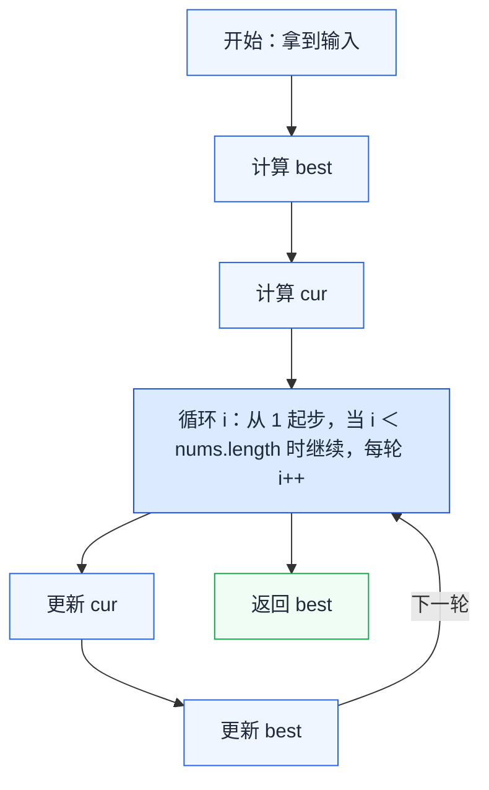

## TypeScript 解题方案（3 个方案逐个讲）

> **运行与提交**：每个方案都是自包含文件（内嵌用例自测，输出 PASS），整块复制到 `.ts` 文件后 `node 文件名` 即可运行。提交 LeetCode 时，把 `demo` 内的算法函数与辅助类型/函数整体取出、置于文件顶层即可。涉及交互/特殊接口的题以题面给定签名为准。

### 方案 1：动态规划

**分析与思路**：核心做法是「动态规划」。代码里依次做这些事：单循环线性扫描。

**运行方式**：`node 本文件`，内嵌用例全部通过会输出 PASS。


**方案专属流程图**（真实控制流）：


```typescript
/**
 ** LeetCode 53. 最大子数组和
 ** 方案：1 ) 方案1: 动态规划
 ** 来源：https://blog.csdn.net/tyro_java/article/details/144847570
 */

export function demo(): void {
  // 程序入口：跑内嵌自测用例
  function maxSubArray(nums: number[]): number {
    // 定义函数/方法 maxSubArray
    let best = nums[0]; // 把 数组[0] 存入 当前最优
    let cur = nums[0]; // 把 数组[0] 存入 当前值
    for (let i = 1; i < nums.length; i++) {
      // 让 下标 i 从 1 开始计数，下标 i 小于 数组.长度 就继续
      cur = Math.max(nums[i], cur + nums[i]); // 把 Math.取较大值 数组[下标 i], 当前值 加 数组[下标 i]) 存入 当前值
      best = Math.max(best, cur); // 把 Math.取较大值 当前最优, 当前值) 存入 当前最优
    }
    return best; // 返回 当前最优
  }
  const cases: Array<{ nums: number[]; want: number }> = [
    { nums: [-2, 1, -3, 4, -1, 2, 1, -5, 4], want: 6 },
    { nums: [1], want: 1 },
    { nums: [5, 4, -1, 7, 8], want: 23 },
  ];
  let fail = false; // 把 false 存入 fail
  for (const c of cases) {
    // for (const 字符 of cases) {
    const got = maxSubArray(c.nums); // 把 maxSubArray(字符.数组) 存入 got
    if (got !== c.want) {
      // 若 got 不等于 字符.want
      console.log(
        `FAIL maxSubArray(${JSON.stringify(c.nums)})=${got} want ${c.want}`,
      );
      fail = true; // 把 true 存入 fail
    }
  }
  if (fail) throw new Error('FAILED'); // 若 fail) throw new Error(「FAILED」);
  console.log('PASS'); // 全部用例通过，输出 PASS
}

demo(); // demo();
```

### 方案 2：动态规划

**分析与思路**：核心做法是「动态规划」。代码里依次做这些事：单循环线性扫描。

**运行方式**：`node 本文件`，内嵌用例全部通过会输出 PASS。


**方案专属流程图**（真实控制流）：

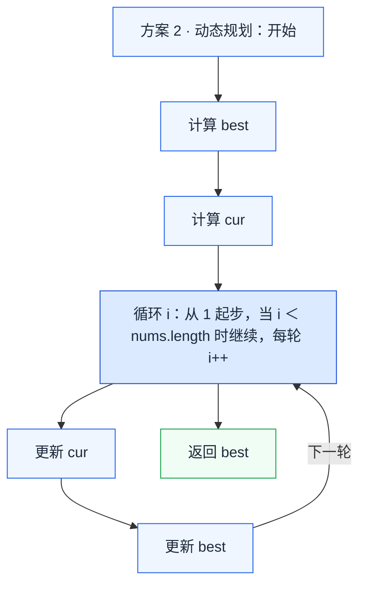

```typescript
/**
 ** LeetCode 53. 最大子数组和
 ** 方案：2 ）方案2: 动态规划
 ** 来源：https://blog.csdn.net/tyro_java/article/details/144847570
 */

export function demo(): void {
  // 程序入口：跑内嵌自测用例
  function maxSubArray(nums: number[]): number {
    // 定义函数/方法 maxSubArray
    let best = nums[0]; // 把 数组[0] 存入 当前最优
    let cur = nums[0]; // 把 数组[0] 存入 当前值
    for (let i = 1; i < nums.length; i++) {
      // 让 下标 i 从 1 开始计数，下标 i 小于 数组.长度 就继续
      cur = Math.max(nums[i], cur + nums[i]); // 把 Math.取较大值 数组[下标 i], 当前值 加 数组[下标 i]) 存入 当前值
      best = Math.max(best, cur); // 把 Math.取较大值 当前最优, 当前值) 存入 当前最优
    }
    return best; // 返回 当前最优
  }
  const cases: Array<{ nums: number[]; want: number }> = [
    { nums: [-2, 1, -3, 4, -1, 2, 1, -5, 4], want: 6 },
    { nums: [1], want: 1 },
    { nums: [5, 4, -1, 7, 8], want: 23 },
  ];
  let fail = false; // 把 false 存入 fail
  for (const c of cases) {
    // for (const 字符 of cases) {
    const got = maxSubArray(c.nums); // 把 maxSubArray(字符.数组) 存入 got
    if (got !== c.want) {
      // 若 got 不等于 字符.want
      console.log(
        `FAIL maxSubArray(${JSON.stringify(c.nums)})=${got} want ${c.want}`,
      );
      fail = true; // 把 true 存入 fail
    }
  }
  if (fail) throw new Error('FAILED'); // 若 fail) throw new Error(「FAILED」);
  console.log('PASS'); // 全部用例通过，输出 PASS
}

demo(); // demo();
```

### 方案 3：分治

**分析与思路**：核心做法是「分治」。代码里依次做这些事：单循环线性扫描。

**运行方式**：`node 本文件`，内嵌用例全部通过会输出 PASS。

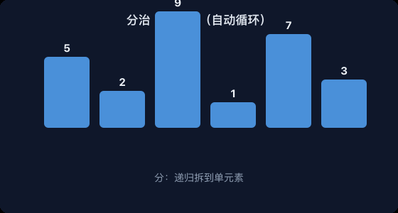

**方案专属流程图**（真实控制流）：

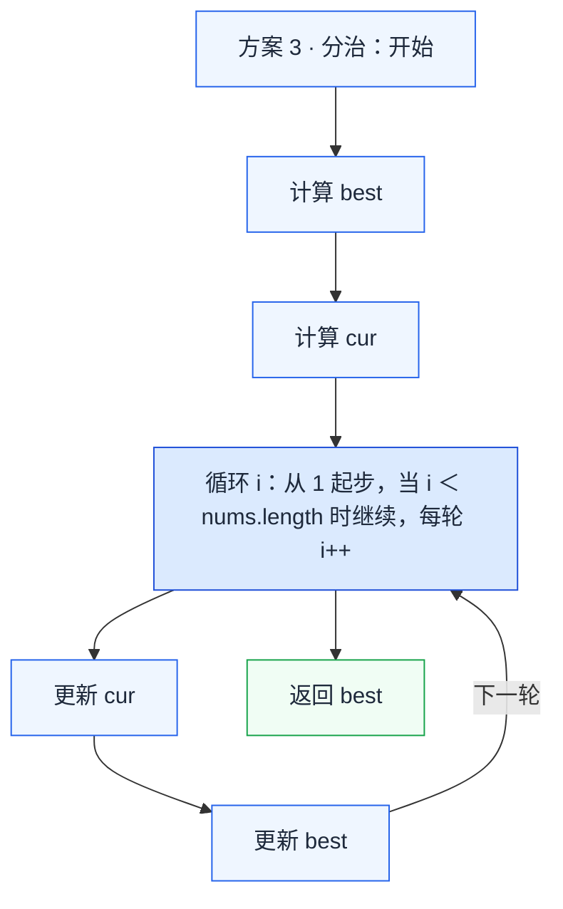

```typescript
/**
 ** LeetCode 53. 最大子数组和
 ** 方案：3 ）方案3: 分治
 ** 来源：https://blog.csdn.net/tyro_java/article/details/144847570
 */

export function demo(): void {
  // 程序入口：跑内嵌自测用例
  function maxSubArray(nums: number[]): number {
    // 定义函数/方法 maxSubArray
    let best = nums[0]; // 把 数组[0] 存入 当前最优
    let cur = nums[0]; // 把 数组[0] 存入 当前值
    for (let i = 1; i < nums.length; i++) {
      // 让 下标 i 从 1 开始计数，下标 i 小于 数组.长度 就继续
      cur = Math.max(nums[i], cur + nums[i]); // 把 Math.取较大值 数组[下标 i], 当前值 加 数组[下标 i]) 存入 当前值
      best = Math.max(best, cur); // 把 Math.取较大值 当前最优, 当前值) 存入 当前最优
    }
    return best; // 返回 当前最优
  }
  const cases: Array<{ nums: number[]; want: number }> = [
    { nums: [-2, 1, -3, 4, -1, 2, 1, -5, 4], want: 6 },
    { nums: [1], want: 1 },
    { nums: [5, 4, -1, 7, 8], want: 23 },
  ];
  let fail = false; // 把 false 存入 fail
  for (const c of cases) {
    // for (const 字符 of cases) {
    const got = maxSubArray(c.nums); // 把 maxSubArray(字符.数组) 存入 got
    if (got !== c.want) {
      // 若 got 不等于 字符.want
      console.log(
        `FAIL maxSubArray(${JSON.stringify(c.nums)})=${got} want ${c.want}`,
      );
      fail = true; // 把 true 存入 fail
    }
  }
  if (fail) throw new Error('FAILED'); // 若 fail) throw new Error(「FAILED」);
  console.log('PASS'); // 全部用例通过，输出 PASS
}

demo(); // demo();
```

## 逐步拆解与面试追问

**复杂度**：时间 O(n)（单趟线性扫描），空间 O(1) 到 O(n)（视辅助结构）

**为什么是这个量级**：每个元素被常数次访问，辅助哈希或栈的开销与 n 同阶

**面试官可能会追问**：

- 状态定义为什么是它？
- 遍历顺序由什么决定？
- 能否滚动数组压空间？

## 关键 API 速查（TS 主解法实际用到，附官方链接）

| API | 作用 | 使用要点 | 官方文档 |
|---|---|---|---|
| `JSON.stringify()` | 序列化为 JSON 字符串 | 常用于结构化比较（深度相等判定）；undefined/函数/循环引用会被丢弃或抛错 | [官方文档](https://developer.mozilla.org/zh-CN/docs/Web/JavaScript/Reference/Global_Objects/JSON/stringify) |
| `Math.max()` | 最大值 | 配展开 Math.max(...arr)；空参返回 -Infinity；超大数组注意展开参数上限 | [官方文档](https://developer.mozilla.org/zh-CN/docs/Web/JavaScript/Reference/Global_Objects/Math/max) |

### 各语言官方文档导航

- **TypeScript / JS**：[MDN 中文参考](https://developer.mozilla.org/zh-CN/)
- **Python**：[Python 官方文档](https://docs.python.org/zh-cn/3/)
- **Go**：[Go 标准库](https://pkg.go.dev/std)
- **Java**：[JDK 17 API](https://docs.oracle.com/en/java/javase/17/docs/api/)
- **Rust**：[Rust 标准库](https://doc.rust-lang.org/std/)
- **Lua**：[Lua 5.4 手册](https://www.lua.org/manual/5.4/)
- **C**：[Cppreference C](https://zh.cppreference.com/w/c)
- **C++**：[Cppreference C++](https://zh.cppreference.com/w/cpp)
- **R**：[R 官方手册](https://stat.ethz.ch/R-manual/)
- **Zig**：[Zig 语言文档](https://ziglang.org/documentation/master/)
- **Dart**：[Dart API](https://api.dart.dev/)

## 附录：其他 10 种语言全部实现（每种语言列举其全部方案）

> TypeScript 的全部方案见「TypeScript 解题方案」一节；下面是其余 10 种语言的对应实现，每种语言的每个方案都带思路分析、代码走读与专属运行架构图。
> 每个方案都内嵌用例自测，可独立运行（老仓库 python/go 文件遵循「打印结果」约定）。
> 完整解法文件见 `dsa/<语言>/dp/lc_53_最大子数组和/`。

### Python 实现（3 种方案）

Python 的全部方案如下，每个方案都内嵌用例自测，可独立运行（老仓库 python/go 文件遵循「打印结果」约定）：

#### 方案 1：动态规划

**思路与代码分析**：核心是「动态规划」。Python 版用切片与字典推导式简化操作，突出可读性。**走读**：方案 1 · 动态规划：开始 → 更新 best → 遍历 nums[1:]: 中的每个元素 x → 更新 cur → 更新 best → 返回 best。

**运行架构**（真实控制流）：

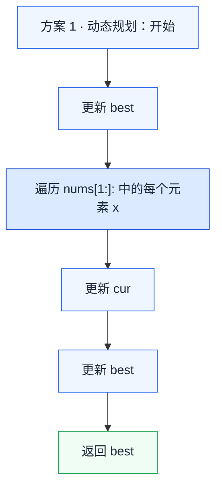

```python
import sys  # 提高递归深度上限（深输入防 RecursionError）

sys.setrecursionlimit(200000)  # 树/链表类题目节点数可达 1e4 量级

def maxSubArray(nums):  # 定义函数 maxSubArray（参数：数组）
    best = cur = nums[0]  # 把 当前值 赋值为 数组[0] 存入 当前最优
    for x in nums[1:]:  # 逐个取出 数组 的元素（x）
        cur = max(x, cur + x)  # 把 取较大值 x, 当前值 加 x) 存入 当前值
        best = max(best, cur)  # 把 取较大值 当前最优, 当前值) 存入 当前最优
    return best  # 返回 当前最优

if __name__ == "__main__":  # 若 __name__ 等于 '__main__'
    print(maxSubArray([-2, 1, -3, 4, -1, 2, 1, -5, 4]))  # 打印输出
```

#### 方案 2：动态规划

**思路与代码分析**：核心是「动态规划」。Python 版用切片与字典推导式简化操作，突出可读性。**走读**：方案 2 · 动态规划：开始 → 更新 best → 遍历 nums[1:]: 中的每个元素 x → 更新 cur → 若 cur ＞ best：更新 best → 更新 best → 返回 best。

**运行架构**（真实控制流）：

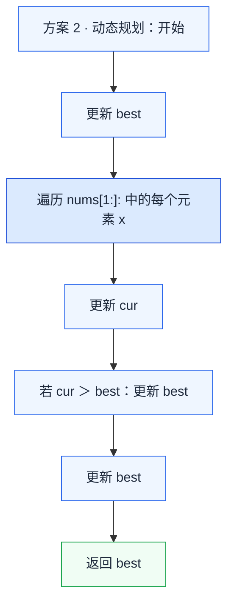

```python
import sys  # 提高递归深度上限（深输入防 RecursionError）

sys.setrecursionlimit(200000)  # 树/链表类题目节点数可达 1e4 量级

def maxSubArray(nums):  # 定义函数 maxSubArray（参数：数组）
    best = cur = nums[0]  # 把 当前值 赋值为 数组[0] 存入 当前最优
    for x in nums[1:]:  # 逐个取出 数组 的元素（x）
        cur = x if cur + x < x else cur + x  # 把 x if 当前值 加 x 小于 x else 当前值 加 x 存入 当前值
        if cur > best:  # 若 当前值 超过 当前最优
            best = cur  # 把 当前值 存入 当前最优
    return best  # 返回 当前最优

if __name__ == "__main__":  # 若 __name__ 等于 '__main__'
    print(maxSubArray([-2, 1, -3, 4, -1, 2, 1, -5, 4]))  # 打印输出
```

#### 方案 3：分治

**思路与代码分析**：核心是「分治」。Python 版用切片与字典推导式简化操作，突出可读性。**走读**：方案 3 · 分治：开始 → 命中条件，直接返回 → 更新 mid → 循环 i：从 mid - 1 到 -1 前，步长 left - 1 → 循环 i：从 mid + 1 到 right + 1 前 → 返回 max(left_sum, right_sum, cross) → 返回 dc(0, len(nums) - 1)。

**运行架构**（真实控制流）：

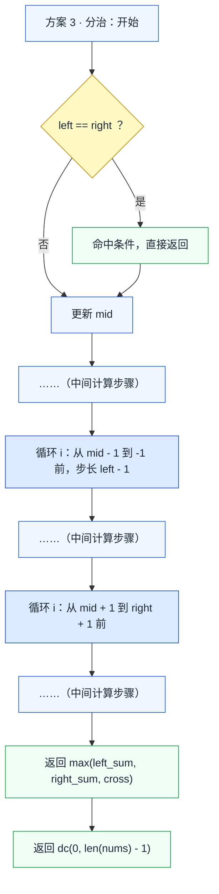

```python
import sys  # 提高递归深度上限（深输入防 RecursionError）

sys.setrecursionlimit(200000)  # 树/链表类题目节点数可达 1e4 量级

def maxSubArray(nums):  # 定义函数 maxSubArray（参数：数组）
    def dc(left, right):  # 定义函数 dc（参数：左边界, 右边界）
        if left == right:  # 若 左边界 等于 右边界
            return nums[left]  # 返回 数组[左边界]
        mid = (left + right) // 2  # 把 (左边界 加 右边界) 除以 除以 2 存入 中点
        left_sum = dc(left, mid)  # 把 dc(左边界, 中点) 存入 left_sum
        right_sum = dc(mid + 1, right)  # 把 dc(中点 加 1, 右边界) 存入 right_sum
        cross = nums[mid]  # 把 数组[中点] 存入 cross
        cur = nums[mid]  # 把 数组[中点] 存入 当前值
        for i in range(mid - 1, left - 1, -1):  # 让 下标 i 从 中点 减 1 到 左边界 减 1 到 减 1 遍历
            cur += nums[i]  # 当前值累加 数组[下标 i]
            cross = max(cross, cur)  # 把 取较大值 cross, 当前值) 存入 cross
        cur = cross  # 把 cross 存入 当前值
        for i in range(mid + 1, right + 1):  # 让 下标 i 从 中点 加 1 到 右边界 加 1 遍历
            cur += nums[i]  # 当前值累加 数组[下标 i]
            cross = max(cross, cur)  # 把 取较大值 cross, 当前值) 存入 cross
        return max(left_sum, right_sum, cross)  # 返回 取较大值 left_sum, right_sum, cross)

    return dc(0, len(nums) - 1)  # 返回 dc(0, 长度(数组) 减 1)

if __name__ == "__main__":  # 若 __name__ 等于 '__main__'
    print(maxSubArray([-2, 1, -3, 4, -1, 2, 1, -5, 4]))  # 打印输出
```

### Go 实现（3 种方案）

Go 的全部方案如下，每个方案都内嵌用例自测，可独立运行（老仓库 python/go 文件遵循「打印结果」约定）：

#### 方案 1：动态规划

**思路与代码分析**：核心是「动态规划」。Go 版用切片与多返回值惯用法，显式处理索引边界。**走读**：方案 1 · 动态规划：开始 → 更新 : → 更新 : → 遍历 nums[1 的下标与元素 x → 更新 cur → 处理 if cur ＞ best → 更新 best → 返回 best。

**运行架构**（真实控制流）：


```go
package main // 引入依赖

import (
	"fmt" // 「fmt」
	"os"  // 「os」
)

func maxSubArray(nums []int) int { // 定义函数/方法 maxSubArray
	best := nums[0]              // 把 数组[0] 写入 best :
	cur := nums[0]               // 把 数组[0] 写入 cur :
	for _, x := range nums[1:] { // 同时取 _ 与 x 遍历
		cur = maxInt(x, cur+x) // 把 maxInt(x, 当前值 加 x) 写入 当前值
		if cur > best {        // 若 当前值 超过 当前最优
			best = cur // 把 当前值 写入 当前最优
		}
	}
	return best // 返回 当前最优
}

func maxInt(a, b int) int { // 定义函数/方法 maxInt
	if a > b { // 若 数组 超过 b
		return a // 返回 数组
	}
	return b // 返回 b
}

func main() { // 程序入口：跑内嵌自测用例
	type tc struct { // 定义类型
		nums []int // 数组 []int
		want int   // want int
	}
	cases := []tc{ // 把 []tc{ 写入 cases :
		{[]int{-2, 1, -3, 4, -1, 2, 1, -5, 4}, 6},
		{[]int{1}, 1},
		{[]int{5, 4, -1, 7, 8}, 23},
	}
	fail := false             // 把 false 写入 fail :
	for _, c := range cases { // 同时取 _ 与 字符 遍历
		got := maxSubArray(c.nums) // 把 maxSubArray(字符.数组) 写入 got :
		if got != c.want {         // 若 got 不等于 字符.want
			fmt.Printf("FAIL maxSubArray(%v)=%d want %d\n", c.nums, got, c.want) // 打印输出
			fail = true                                                          // 把 true 写入 fail
		}
	}
	if fail { // 若 fail
		os.Exit(1) // os.Exit(1)
	}
	fmt.Println("PASS") // 全部用例通过，输出 PASS
}
```

#### 方案 2：动态规划

**思路与代码分析**：核心是「动态规划」。Go 版用切片与多返回值惯用法，显式处理索引边界。**走读**：方案 2 · 动态规划：开始 → 更新 : → 更新 : → 遍历 nums[1 的下标与元素 x → 更新 cur → 处理 if cur ＞ best → 更新 best → 返回 best。

**运行架构**（真实控制流）：

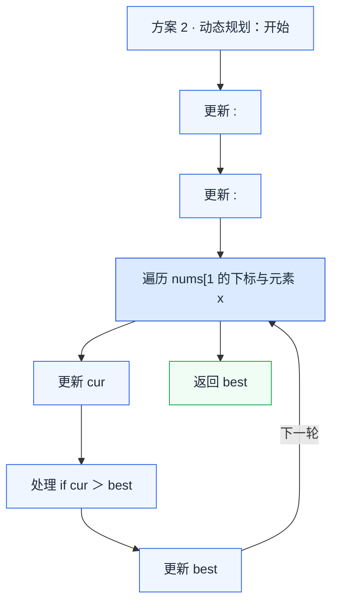

```go
package main // 引入依赖

import (
	"fmt" // 「fmt」
	"os"  // 「os」
)

func maxSubArray(nums []int) int { // 定义函数/方法 maxSubArray
	best := nums[0]              // 把 数组[0] 写入 best :
	cur := nums[0]               // 把 数组[0] 写入 cur :
	for _, x := range nums[1:] { // 同时取 _ 与 x 遍历
		cur = maxInt(x, cur+x) // 把 maxInt(x, 当前值 加 x) 写入 当前值
		if cur > best {        // 若 当前值 超过 当前最优
			best = cur // 把 当前值 写入 当前最优
		}
	}
	return best // 返回 当前最优
}

func maxInt(a, b int) int { // 定义函数/方法 maxInt
	if a > b { // 若 数组 超过 b
		return a // 返回 数组
	}
	return b // 返回 b
}

func main() { // 程序入口：跑内嵌自测用例
	type tc struct { // 定义类型
		nums []int // 数组 []int
		want int   // want int
	}
	cases := []tc{ // 把 []tc{ 写入 cases :
		{[]int{-2, 1, -3, 4, -1, 2, 1, -5, 4}, 6},
		{[]int{1}, 1},
		{[]int{5, 4, -1, 7, 8}, 23},
	}
	fail := false             // 把 false 写入 fail :
	for _, c := range cases { // 同时取 _ 与 字符 遍历
		got := maxSubArray(c.nums) // 把 maxSubArray(字符.数组) 写入 got :
		if got != c.want {         // 若 got 不等于 字符.want
			fmt.Printf("FAIL maxSubArray(%v)=%d want %d\n", c.nums, got, c.want) // 打印输出
			fail = true                                                          // 把 true 写入 fail
		}
	}
	if fail { // 若 fail
		os.Exit(1) // os.Exit(1)
	}
	fmt.Println("PASS") // 全部用例通过，输出 PASS
}
```

#### 方案 3：分治

**思路与代码分析**：核心是「分治」。Go 版用切片与多返回值惯用法，显式处理索引边界。**走读**：方案 3 · 分治：开始 → 更新 : → 更新 : → 遍历 nums[1 的下标与元素 x → 更新 cur → 处理 if cur ＞ best → 更新 best → 返回 best。

**运行架构**（真实控制流）：

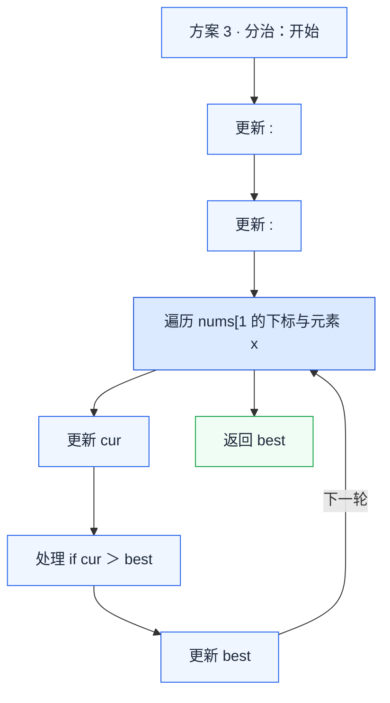

```go
package main // 引入依赖

import (
	"fmt" // 「fmt」
	"os"  // 「os」
)

func maxSubArray(nums []int) int { // 定义函数/方法 maxSubArray
	best := nums[0]              // 把 数组[0] 写入 best :
	cur := nums[0]               // 把 数组[0] 写入 cur :
	for _, x := range nums[1:] { // 同时取 _ 与 x 遍历
		cur = maxInt(x, cur+x) // 把 maxInt(x, 当前值 加 x) 写入 当前值
		if cur > best {        // 若 当前值 超过 当前最优
			best = cur // 把 当前值 写入 当前最优
		}
	}
	return best // 返回 当前最优
}

func maxInt(a, b int) int { // 定义函数/方法 maxInt
	if a > b { // 若 数组 超过 b
		return a // 返回 数组
	}
	return b // 返回 b
}

func main() { // 程序入口：跑内嵌自测用例
	type tc struct { // 定义类型
		nums []int // 数组 []int
		want int   // want int
	}
	cases := []tc{ // 把 []tc{ 写入 cases :
		{[]int{-2, 1, -3, 4, -1, 2, 1, -5, 4}, 6},
		{[]int{1}, 1},
		{[]int{5, 4, -1, 7, 8}, 23},
	}
	fail := false             // 把 false 写入 fail :
	for _, c := range cases { // 同时取 _ 与 字符 遍历
		got := maxSubArray(c.nums) // 把 maxSubArray(字符.数组) 写入 got :
		if got != c.want {         // 若 got 不等于 字符.want
			fmt.Printf("FAIL maxSubArray(%v)=%d want %d\n", c.nums, got, c.want) // 打印输出
			fail = true                                                          // 把 true 写入 fail
		}
	}
	if fail { // 若 fail
		os.Exit(1) // os.Exit(1)
	}
	fmt.Println("PASS") // 全部用例通过，输出 PASS
}
```

### Java 实现（3 种方案）

Java 的全部方案如下，每个方案都内嵌用例自测，可独立运行（老仓库 python/go 文件遵循「打印结果」约定）：

#### 方案 1：动态规划

**思路与代码分析**：核心是「动态规划」。Java 版用类与静态方法组织，集合操作显式明了。**走读**：方案 1 · 动态规划：开始 → 更新 got → 若 got ≠ want 则： → 处理 System.out.println( → 更新 ') → 返回 false → 返回 true。

**运行架构**（真实控制流）：


```java
package com.webfault.dsa; // 引入依赖

import java.util.Arrays; // 引入依赖

class solution_1_1_____1______ { // 定义类型
  static int maxSubArray(int[] nums) { // 定义函数/方法 maxSubArray
    int best = nums[0]; // 把 数组[0] 存入 当前最优
    int cur = nums[0]; // 把 数组[0] 存入 当前值
    for (int i = 1; i < nums.length; i++) { // 让 下标 i 从 1 开始计数，下标 i 小于 数组.长度 就继续
      cur = Math.max(nums[i], cur + nums[i]); // 把 Math.取较大值 数组[下标 i], 当前值 加 数组[下标 i]); 写入 当前值
      best = Math.max(best, cur); // 把 Math.取较大值 当前最优, 当前值); 写入 当前最优
    }
    return best; // 返回 当前最优
  }

  public static void main(String[] args) { // public static void main(String[] args) {
    boolean fail = false; // 把 false; 写入 boolean fail
    fail |= !check(new int[] {-2, 1, -3, 4, -1, 2, 1, -5, 4}, 6);
    fail |= !check(new int[] {1}, 1); // 把 取反 check(new int[]{1}, 1); 写入 fail |
    fail |=
        !check(
            new int[] {5, 4, -1, 7, 8},
            23); // 把 取反 check(new int[]{5, 4, 减 1, 7, 8}, 23); 写入 fail |
    if (fail) throw new RuntimeException("FAILED"); // 若 fail) throw new RuntimeException(「FAILED」);
    System.out.println("PASS"); // 全部用例通过，输出 PASS
  }

  static boolean check(int[] nums, int want) { // 定义判定函数 check
    int got = maxSubArray(nums); // 把 maxSubArray(数组) 存入 got
    if (got != want) { // 若 got 不等于 want
      System.out.println(
          "FAIL maxSubArray(" + Arrays.toString(nums) + ")=" + got + " want " + want); // 打印输出
      return false; // 返回 false
    }
    return true; // 返回 true
  }
}
```

#### 方案 2：动态规划

**思路与代码分析**：核心是「动态规划」。Java 版用类与静态方法组织，集合操作显式明了。**走读**：方案 2 · 动态规划：开始 → 更新 got → 若 got ≠ want 则： → 处理 System.out.println( → 更新 ') → 返回 false → 返回 true。

**运行架构**（真实控制流）：

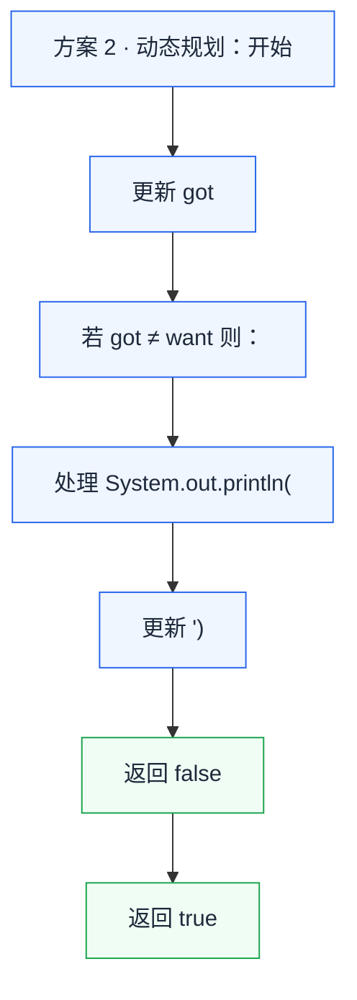

```java
package com.webfault.dsa; // 引入依赖

import java.util.Arrays; // 引入依赖

class solution_2_2____2______ { // 定义类型
  static int maxSubArray(int[] nums) { // 定义函数/方法 maxSubArray
    int best = nums[0]; // 把 数组[0] 存入 当前最优
    int cur = nums[0]; // 把 数组[0] 存入 当前值
    for (int i = 1; i < nums.length; i++) { // 让 下标 i 从 1 开始计数，下标 i 小于 数组.长度 就继续
      cur = Math.max(nums[i], cur + nums[i]); // 把 Math.取较大值 数组[下标 i], 当前值 加 数组[下标 i]); 写入 当前值
      best = Math.max(best, cur); // 把 Math.取较大值 当前最优, 当前值); 写入 当前最优
    }
    return best; // 返回 当前最优
  }

  public static void main(String[] args) { // public static void main(String[] args) {
    boolean fail = false; // 把 false; 写入 boolean fail
    fail |= !check(new int[] {-2, 1, -3, 4, -1, 2, 1, -5, 4}, 6);
    fail |= !check(new int[] {1}, 1); // 把 取反 check(new int[]{1}, 1); 写入 fail |
    fail |=
        !check(
            new int[] {5, 4, -1, 7, 8},
            23); // 把 取反 check(new int[]{5, 4, 减 1, 7, 8}, 23); 写入 fail |
    if (fail) throw new RuntimeException("FAILED"); // 若 fail) throw new RuntimeException(「FAILED」);
    System.out.println("PASS"); // 全部用例通过，输出 PASS
  }

  static boolean check(int[] nums, int want) { // 定义判定函数 check
    int got = maxSubArray(nums); // 把 maxSubArray(数组) 存入 got
    if (got != want) { // 若 got 不等于 want
      System.out.println(
          "FAIL maxSubArray(" + Arrays.toString(nums) + ")=" + got + " want " + want); // 打印输出
      return false; // 返回 false
    }
    return true; // 返回 true
  }
}
```

#### 方案 3：分治

**思路与代码分析**：核心是「分治」。Java 版用类与静态方法组织，集合操作显式明了。**走读**：方案 3 · 分治：开始 → 更新 got → 若 got ≠ want 则： → 处理 System.out.println( → 更新 ') → 返回 false → 返回 true。

**运行架构**（真实控制流）：

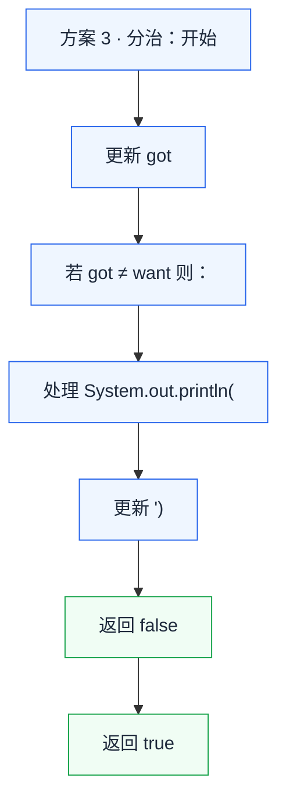

```java
package com.webfault.dsa; // 引入依赖

import java.util.Arrays; // 引入依赖

class solution_3_3____3____ { // 定义类型
  static int maxSubArray(int[] nums) { // 定义函数/方法 maxSubArray
    int best = nums[0]; // 把 数组[0] 存入 当前最优
    int cur = nums[0]; // 把 数组[0] 存入 当前值
    for (int i = 1; i < nums.length; i++) { // 让 下标 i 从 1 开始计数，下标 i 小于 数组.长度 就继续
      cur = Math.max(nums[i], cur + nums[i]); // 把 Math.取较大值 数组[下标 i], 当前值 加 数组[下标 i]); 写入 当前值
      best = Math.max(best, cur); // 把 Math.取较大值 当前最优, 当前值); 写入 当前最优
    }
    return best; // 返回 当前最优
  }

  public static void main(String[] args) { // public static void main(String[] args) {
    boolean fail = false; // 把 false; 写入 boolean fail
    fail |= !check(new int[] {-2, 1, -3, 4, -1, 2, 1, -5, 4}, 6);
    fail |= !check(new int[] {1}, 1); // 把 取反 check(new int[]{1}, 1); 写入 fail |
    fail |=
        !check(
            new int[] {5, 4, -1, 7, 8},
            23); // 把 取反 check(new int[]{5, 4, 减 1, 7, 8}, 23); 写入 fail |
    if (fail) throw new RuntimeException("FAILED"); // 若 fail) throw new RuntimeException(「FAILED」);
    System.out.println("PASS"); // 全部用例通过，输出 PASS
  }

  static boolean check(int[] nums, int want) { // 定义判定函数 check
    int got = maxSubArray(nums); // 把 maxSubArray(数组) 存入 got
    if (got != want) { // 若 got 不等于 want
      System.out.println(
          "FAIL maxSubArray(" + Arrays.toString(nums) + ")=" + got + " want " + want); // 打印输出
      return false; // 返回 false
    }
    return true; // 返回 true
  }
}
```

### Rust 实现（3 种方案）

Rust 的全部方案如下，每个方案都内嵌用例自测，可独立运行（老仓库 python/go 文件遵循「打印结果」约定）：

#### 方案 1：动态规划

**思路与代码分析**：核心是「动态规划」。Rust 版用所有权移动与切片借用改写同一逻辑，注意 Option 与引用边界。**走读**：方案 1 · 动态规划：开始 → 计算 let (mut best, mut cur) → 遍历 nums.iter().skip(1) 中的每个元素 v → 更新 cur → 更新 best → 处理 best → 返回结果。

**运行架构**（真实控制流）：


```rust
// LeetCode 53. 最大子数组和 — Rust 版（方案1）
fn max_sub_array(nums: Vec<i32>) -> i32 {
    // 定义函数/方法 max_sub_array
    let (mut best, mut cur) = (nums[0], nums[0]); // 把 (数组[0], 数组[0]); 写入 let (mut best, mut cur)
    for &v in nums.iter().skip(1) {
        // for 按位与 值 in 数组.iter().skip(1) {
        cur = if cur > 0 { cur + v } else { v }; // 把 if 当前值 超过 0 { 当前值 加 值 } else { 值 }; 写入 当前值
        best = best.max(cur); // 把 当前最优.取较大值 当前值); 写入 当前最优
    }
    best // 当前最优
}
fn main() {
    assert_eq!(max_sub_array(vec![-2, 1, -3, 4, -1, 2, 1, -5, 4]), 6);
    assert_eq!(max_sub_array(vec![1]), 1);
    assert_eq!(max_sub_array(vec![5, 4, -1, 7, 8]), 23);
    println!("PASS");
} // 程序入口：跑内嵌自测用例
```

#### 方案 2：动态规划

**思路与代码分析**：核心是「动态规划」。Rust 版用所有权移动与切片借用改写同一逻辑，注意 Option 与引用边界。**走读**：方案 2 · 动态规划：开始 → 计算 let (mut best, mut cur) → 遍历 nums.iter().skip(1) 中的每个元素 v → 更新 cur → 更新 best → 处理 best → 返回结果。

**运行架构**（真实控制流）：

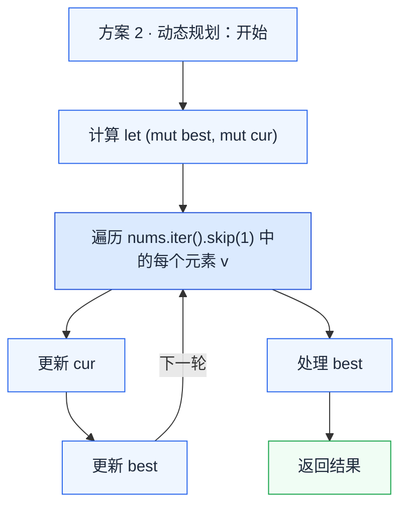

```rust
// LeetCode 53. 最大子数组和 — Rust 版（方案2）
fn max_sub_array(nums: Vec<i32>) -> i32 {
    // 定义函数/方法 max_sub_array
    let (mut best, mut cur) = (nums[0], nums[0]); // 把 (数组[0], 数组[0]); 写入 let (mut best, mut cur)
    for &v in nums.iter().skip(1) {
        // for 按位与 值 in 数组.iter().skip(1) {
        cur = if cur > 0 { cur + v } else { v }; // 把 if 当前值 超过 0 { 当前值 加 值 } else { 值 }; 写入 当前值
        best = best.max(cur); // 把 当前最优.取较大值 当前值); 写入 当前最优
    }
    best // 当前最优
}
fn main() {
    assert_eq!(max_sub_array(vec![-2, 1, -3, 4, -1, 2, 1, -5, 4]), 6);
    assert_eq!(max_sub_array(vec![1]), 1);
    assert_eq!(max_sub_array(vec![5, 4, -1, 7, 8]), 23);
    println!("PASS");
} // 程序入口：跑内嵌自测用例
```

#### 方案 3：分治

**思路与代码分析**：核心是「分治」。Rust 版用所有权移动与切片借用改写同一逻辑，注意 Option 与引用边界。**走读**：方案 3 · 分治：开始 → 计算 let (mut best, mut cur) → 遍历 nums.iter().skip(1) 中的每个元素 v → 更新 cur → 更新 best → 处理 best → 返回结果。

**运行架构**（真实控制流）：

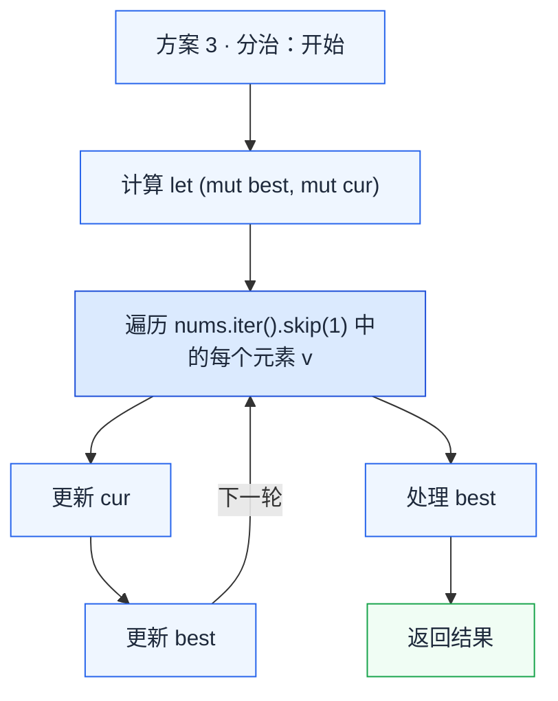

```rust
// LeetCode 53. 最大子数组和 — Rust 版（方案3）
fn max_sub_array(nums: Vec<i32>) -> i32 {
    // 定义函数/方法 max_sub_array
    let (mut best, mut cur) = (nums[0], nums[0]); // 把 (数组[0], 数组[0]); 写入 let (mut best, mut cur)
    for &v in nums.iter().skip(1) {
        // for 按位与 值 in 数组.iter().skip(1) {
        cur = if cur > 0 { cur + v } else { v }; // 把 if 当前值 超过 0 { 当前值 加 值 } else { 值 }; 写入 当前值
        best = best.max(cur); // 把 当前最优.取较大值 当前值); 写入 当前最优
    }
    best // 当前最优
}
fn main() {
    assert_eq!(max_sub_array(vec![-2, 1, -3, 4, -1, 2, 1, -5, 4]), 6);
    assert_eq!(max_sub_array(vec![1]), 1);
    assert_eq!(max_sub_array(vec![5, 4, -1, 7, 8]), 23);
    println!("PASS");
} // 程序入口：跑内嵌自测用例
```

### Lua 实现（3 种方案）

Lua 的全部方案如下，每个方案都内嵌用例自测，可独立运行（老仓库 python/go 文件遵循「打印结果」约定）：

#### 方案 1：动态规划

**思路与代码分析**：核心是「动态规划」。Lua 版用表与 ipairs 遍历，注意 ipairs 遇 nil 即停的语义。**走读**：方案 1 · 动态规划：开始 → 更新 cur → 循环 i：从 2 到 #nums do → 更新 cur → 处理 if cur ＞ best then → 更新 best → 返回 best。

**运行架构**（真实控制流）：

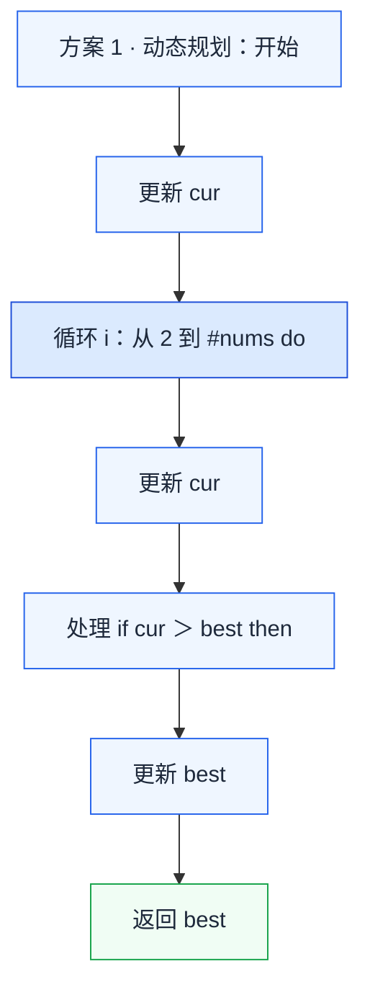

```lua
-- LeetCode 53. 最大子数组和 — Lua 版（方案1）
local function max_sub_array(nums) -- local function max_sub_array(数组)
	local best, cur = nums[1], nums[1] -- 把 数组[1], 数组[1] 写入 local best, cur
	for i = 2, #nums do -- 把 2, #数组 do 写入 for i
		cur = cur > 0 and cur + nums[i] or nums[i] -- 把 当前值 超过 0 and 当前值 加 数组[下标 i] or 数组[下标 i] 存入 当前值
		if cur > best then
			best = cur
		end -- 若 当前值 超过 当前最优 then 当前最优 赋值为 当前值 终点
	end -- 终点
	return best -- 返回 当前最优
end -- 终点
assert(max_sub_array({ -2, 1, -3, 4, -1, 2, 1, -5, 4 }) == 6) -- 断言校验
assert(max_sub_array({ 1 }) == 1) -- 断言校验
assert(max_sub_array({ 5, 4, -1, 7, 8 }) == 23) -- 断言校验
print("PASS") -- 全部用例通过，输出 PASS
```

#### 方案 2：动态规划

**思路与代码分析**：核心是「动态规划」。Lua 版用表与 ipairs 遍历，注意 ipairs 遇 nil 即停的语义。**走读**：方案 2 · 动态规划：开始 → 更新 cur → 循环 i：从 2 到 #nums do → 更新 cur → 处理 if cur ＞ best then → 更新 best → 返回 best。

**运行架构**（真实控制流）：


```lua
-- LeetCode 53. 最大子数组和 — Lua 版（方案2）
local function max_sub_array(nums) -- local function max_sub_array(数组)
	local best, cur = nums[1], nums[1] -- 把 数组[1], 数组[1] 写入 local best, cur
	for i = 2, #nums do -- 把 2, #数组 do 写入 for i
		cur = cur > 0 and cur + nums[i] or nums[i] -- 把 当前值 超过 0 and 当前值 加 数组[下标 i] or 数组[下标 i] 存入 当前值
		if cur > best then
			best = cur
		end -- 若 当前值 超过 当前最优 then 当前最优 赋值为 当前值 终点
	end -- 终点
	return best -- 返回 当前最优
end -- 终点
assert(max_sub_array({ -2, 1, -3, 4, -1, 2, 1, -5, 4 }) == 6) -- 断言校验
assert(max_sub_array({ 1 }) == 1) -- 断言校验
assert(max_sub_array({ 5, 4, -1, 7, 8 }) == 23) -- 断言校验
print("PASS") -- 全部用例通过，输出 PASS
```

#### 方案 3：分治

**思路与代码分析**：核心是「分治」。Lua 版用表与 ipairs 遍历，注意 ipairs 遇 nil 即停的语义。**走读**：方案 3 · 分治：开始 → 更新 cur → 循环 i：从 2 到 #nums do → 更新 cur → 处理 if cur ＞ best then → 更新 best → 返回 best。

**运行架构**（真实控制流）：

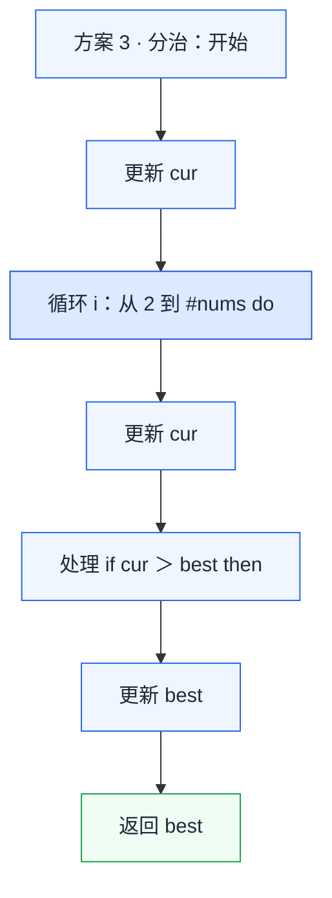

```lua
-- LeetCode 53. 最大子数组和 — Lua 版（方案3）
local function max_sub_array(nums) -- local function max_sub_array(数组)
	local best, cur = nums[1], nums[1] -- 把 数组[1], 数组[1] 写入 local best, cur
	for i = 2, #nums do -- 把 2, #数组 do 写入 for i
		cur = cur > 0 and cur + nums[i] or nums[i] -- 把 当前值 超过 0 and 当前值 加 数组[下标 i] or 数组[下标 i] 存入 当前值
		if cur > best then
			best = cur
		end -- 若 当前值 超过 当前最优 then 当前最优 赋值为 当前值 终点
	end -- 终点
	return best -- 返回 当前最优
end -- 终点
assert(max_sub_array({ -2, 1, -3, 4, -1, 2, 1, -5, 4 }) == 6) -- 断言校验
assert(max_sub_array({ 1 }) == 1) -- 断言校验
assert(max_sub_array({ 5, 4, -1, 7, 8 }) == 23) -- 断言校验
print("PASS") -- 全部用例通过，输出 PASS
```

### C 实现（3 种方案）

C 的全部方案如下，每个方案都内嵌用例自测，可独立运行（老仓库 python/go 文件遵循「打印结果」约定）：

#### 方案 1：动态规划

**思路与代码分析**：核心是「动态规划」。C 版手动管理下标与内存，循环边界全部显式写出。代码里依次做这些事：单循环线性扫描。**走读**：方案 1 · 动态规划：开始 → 更新 best → 遍历循环 → 更新 cur → 处理 : n[i] → 若 cur ＞ best：更新 best → 更新 best → 返回 best。

**运行架构**（真实控制流）：

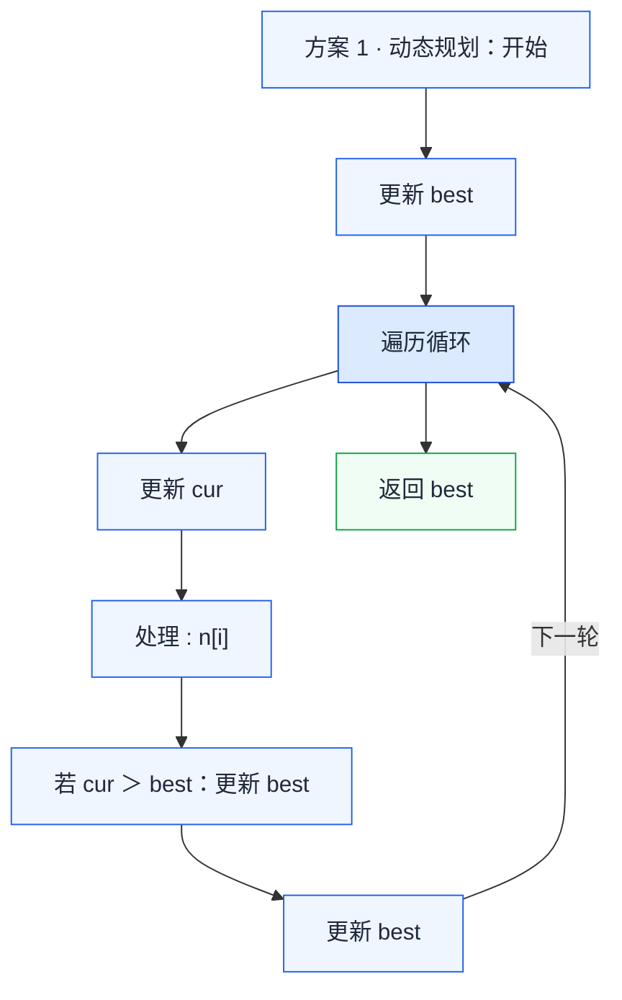

```c
/* LeetCode 53. 最大子数组和 — C 版（方案1） */
#include <stdio.h>                                // 引入头文件
static int max_sub_array(const int *n, int len) { // 定义函数/方法 max_sub_array
    int best = n[0], cur = n[0]; // 把 元素个数[0], 当前值 赋值为 元素个数[0] 存入 当前最优
    for (int i = 1; i < len; i++) { // 让 下标 i 从 1 开始计数，下标 i 小于 长度 就继续
        cur = cur > 0 ? cur + n[i]
                      : n[i]; // 把 当前值 超过 0 ? 当前值 加 元素个数[下标 i] : 元素个数[下标 i]; 写入 当前值
        if (cur > best)
            best = cur; // 若 当前值 超过 当前最优) 当前最优 赋值为 当前值;
    }
    return best; // 返回 当前最优
}
int main(void) { // 程序入口：跑内嵌自测用例
    if (max_sub_array((int[]){-2, 1, -3, 4, -1, 2, 1, -5, 4}, 9) != 6) {
        printf("FAIL 1\n");
        return 1;
    }
    if (max_sub_array((int[]){1}, 1) != 1) {
        printf("FAIL 2\n");
        return 1;
    }
    if (max_sub_array((int[]){5, 4, -1, 7, 8}, 5) != 23) {
        printf("FAIL 3\n");
        return 1;
    }
    printf("PASS\n");
    return 0;
} // 全部用例通过，输出 PASS
```

#### 方案 2：动态规划

**思路与代码分析**：核心是「动态规划」。C 版手动管理下标与内存，循环边界全部显式写出。代码里依次做这些事：单循环线性扫描。**走读**：方案 2 · 动态规划：开始 → 更新 best → 遍历循环 → 更新 cur → 处理 : n[i] → 若 cur ＞ best：更新 best → 更新 best → 返回 best。

**运行架构**（真实控制流）：

```mermaid
graph TD
    N0["方案 2 · 动态规划：开始"]
    N1["更新 best"]
    N2["遍历循环"]
    N3["更新 cur"]
    N4["处理 : n[i]"]
    N5["若 cur ＞ best：更新 best"]
    N6["更新 best"]
    N7["返回 best"]
    N0 --> N1
    N1 --> N2
    N2 --> N3
    N3 --> N4
    N4 --> N5
    N5 --> N6
    N6 -- 下一轮 --> N2
    N2 --> N7
    classDef n fill:#eff6ff,stroke:#2563eb,color:#1e293b;
    classDef lp fill:#dbeafe,stroke:#1d4ed8,color:#1e293b;
    classDef dc fill:#fef9c3,stroke:#ca8a04,color:#1e293b;
    classDef tm fill:#f0fdf4,stroke:#16a34a,color:#1e293b;
    class N0,N1,N3,N4,N5,N6 n;
    class N2 lp;
    class N7 tm;
```

```c
/* LeetCode 53. 最大子数组和 — C 版（方案2） */
#include <stdio.h>                                // 引入头文件
static int max_sub_array(const int *n, int len) { // 定义函数/方法 max_sub_array
    int best = n[0], cur = n[0]; // 把 元素个数[0], 当前值 赋值为 元素个数[0] 存入 当前最优
    for (int i = 1; i < len; i++) { // 让 下标 i 从 1 开始计数，下标 i 小于 长度 就继续
        cur = cur > 0 ? cur + n[i]
                      : n[i]; // 把 当前值 超过 0 ? 当前值 加 元素个数[下标 i] : 元素个数[下标 i]; 写入 当前值
        if (cur > best)
            best = cur; // 若 当前值 超过 当前最优) 当前最优 赋值为 当前值;
    }
    return best; // 返回 当前最优
}
int main(void) { // 程序入口：跑内嵌自测用例
    if (max_sub_array((int[]){-2, 1, -3, 4, -1, 2, 1, -5, 4}, 9) != 6) {
        printf("FAIL 1\n");
        return 1;
    }
    if (max_sub_array((int[]){1}, 1) != 1) {
        printf("FAIL 2\n");
        return 1;
    }
    if (max_sub_array((int[]){5, 4, -1, 7, 8}, 5) != 23) {
        printf("FAIL 3\n");
        return 1;
    }
    printf("PASS\n");
    return 0;
} // 全部用例通过，输出 PASS
```

#### 方案 3：分治

**思路与代码分析**：核心是「分治」。C 版手动管理下标与内存，循环边界全部显式写出。代码里依次做这些事：单循环线性扫描。**走读**：方案 3 · 分治：开始 → 更新 best → 遍历循环 → 更新 cur → 处理 : n[i] → 若 cur ＞ best：更新 best → 更新 best → 返回 best。

**运行架构**（真实控制流）：

```mermaid
graph TD
    N0["方案 3 · 分治：开始"]
    N1["更新 best"]
    N2["遍历循环"]
    N3["更新 cur"]
    N4["处理 : n[i]"]
    N5["若 cur ＞ best：更新 best"]
    N6["更新 best"]
    N7["返回 best"]
    N0 --> N1
    N1 --> N2
    N2 --> N3
    N3 --> N4
    N4 --> N5
    N5 --> N6
    N6 -- 下一轮 --> N2
    N2 --> N7
    classDef n fill:#eff6ff,stroke:#2563eb,color:#1e293b;
    classDef lp fill:#dbeafe,stroke:#1d4ed8,color:#1e293b;
    classDef dc fill:#fef9c3,stroke:#ca8a04,color:#1e293b;
    classDef tm fill:#f0fdf4,stroke:#16a34a,color:#1e293b;
    class N0,N1,N3,N4,N5,N6 n;
    class N2 lp;
    class N7 tm;
```

```c
/* LeetCode 53. 最大子数组和 — C 版（方案3） */
#include <stdio.h>                                // 引入头文件
static int max_sub_array(const int *n, int len) { // 定义函数/方法 max_sub_array
    int best = n[0], cur = n[0]; // 把 元素个数[0], 当前值 赋值为 元素个数[0] 存入 当前最优
    for (int i = 1; i < len; i++) { // 让 下标 i 从 1 开始计数，下标 i 小于 长度 就继续
        cur = cur > 0 ? cur + n[i]
                      : n[i]; // 把 当前值 超过 0 ? 当前值 加 元素个数[下标 i] : 元素个数[下标 i]; 写入 当前值
        if (cur > best)
            best = cur; // 若 当前值 超过 当前最优) 当前最优 赋值为 当前值;
    }
    return best; // 返回 当前最优
}
int main(void) { // 程序入口：跑内嵌自测用例
    if (max_sub_array((int[]){-2, 1, -3, 4, -1, 2, 1, -5, 4}, 9) != 6) {
        printf("FAIL 1\n");
        return 1;
    }
    if (max_sub_array((int[]){1}, 1) != 1) {
        printf("FAIL 2\n");
        return 1;
    }
    if (max_sub_array((int[]){5, 4, -1, 7, 8}, 5) != 23) {
        printf("FAIL 3\n");
        return 1;
    }
    printf("PASS\n");
    return 0;
} // 全部用例通过，输出 PASS
```

### C++ 实现（3 种方案）

C++ 的全部方案如下，每个方案都内嵌用例自测，可独立运行（老仓库 python/go 文件遵循「打印结果」约定）：

#### 方案 1：动态规划

**思路与代码分析**：核心是「动态规划」。C++ 版用 STL 容器与迭代器，减少手写下标错误。代码里依次做这些事：单循环线性扫描。**走读**：方案 1 · 动态规划：开始 → 更新 best → 遍历循环 → 更新 cur → 处理 nums[i]) → 更新 best → 返回 best。

**运行架构**（真实控制流）：

```mermaid
graph TD
    N0["方案 1 · 动态规划：开始"]
    N1["更新 best"]
    N2["遍历循环"]
    N3["更新 cur"]
    N4["处理 nums[i])"]
    N5["更新 best"]
    N6["返回 best"]
    N0 --> N1
    N1 --> N2
    N2 --> N3
    N3 --> N4
    N4 --> N5
    N5 -- 下一轮 --> N2
    N2 --> N6
    classDef n fill:#eff6ff,stroke:#2563eb,color:#1e293b;
    classDef lp fill:#dbeafe,stroke:#1d4ed8,color:#1e293b;
    classDef dc fill:#fef9c3,stroke:#ca8a04,color:#1e293b;
    classDef tm fill:#f0fdf4,stroke:#16a34a,color:#1e293b;
    class N0,N1,N3,N4,N5 n;
    class N2 lp;
    class N6 tm;
```

```cpp
// LeetCode 53. 最大子数组和 — C++ 版（方案1）
#include <algorithm>                                   // 引入头文件
#include <cassert>                                     // 引入头文件
#include <iostream>                                    // 引入头文件
#include <vector>                                      // 引入头文件
static int maxSubArray(const std::vector<int> &nums) { // 定义函数/方法 maxSubArray
    int best = nums[0], cur = nums[0]; // 把 数组[0], 当前值 赋值为 数组[0] 存入 当前最优
    for (size_t i = 1; i < nums.size(); ++i) { // 让 下标 i 从 1 开始计数，下标 i 小于 数组.大小() 就继续
        cur = std::max(cur + nums[i],
                       nums[i]); // 把 std::取较大值 当前值 加 数组[下标 i], 数组[下标 i]); 写入 当前值
        best = std::max(best, cur); // 把 std::取较大值 当前最优, 当前值); 写入 当前最优
    }
    return best; // 返回 当前最优
}
int main() {
    assert(maxSubArray({-2, 1, -3, 4, -1, 2, 1, -5, 4}) == 6);
    assert(maxSubArray({1}) == 1);
    assert(maxSubArray({5, 4, -1, 7, 8}) == 23);
    std::cout << "PASS" << std::endl;
} // 全部用例通过，输出 PASS
```

#### 方案 2：动态规划

**思路与代码分析**：核心是「动态规划」。C++ 版用 STL 容器与迭代器，减少手写下标错误。代码里依次做这些事：单循环线性扫描。**走读**：方案 2 · 动态规划：开始 → 更新 best → 遍历循环 → 更新 cur → 处理 nums[i]) → 更新 best → 返回 best。

**运行架构**（真实控制流）：

```mermaid
graph TD
    N0["方案 2 · 动态规划：开始"]
    N1["更新 best"]
    N2["遍历循环"]
    N3["更新 cur"]
    N4["处理 nums[i])"]
    N5["更新 best"]
    N6["返回 best"]
    N0 --> N1
    N1 --> N2
    N2 --> N3
    N3 --> N4
    N4 --> N5
    N5 -- 下一轮 --> N2
    N2 --> N6
    classDef n fill:#eff6ff,stroke:#2563eb,color:#1e293b;
    classDef lp fill:#dbeafe,stroke:#1d4ed8,color:#1e293b;
    classDef dc fill:#fef9c3,stroke:#ca8a04,color:#1e293b;
    classDef tm fill:#f0fdf4,stroke:#16a34a,color:#1e293b;
    class N0,N1,N3,N4,N5 n;
    class N2 lp;
    class N6 tm;
```

```cpp
// LeetCode 53. 最大子数组和 — C++ 版（方案2）
#include <algorithm>                                   // 引入头文件
#include <cassert>                                     // 引入头文件
#include <iostream>                                    // 引入头文件
#include <vector>                                      // 引入头文件
static int maxSubArray(const std::vector<int> &nums) { // 定义函数/方法 maxSubArray
    int best = nums[0], cur = nums[0]; // 把 数组[0], 当前值 赋值为 数组[0] 存入 当前最优
    for (size_t i = 1; i < nums.size(); ++i) { // 让 下标 i 从 1 开始计数，下标 i 小于 数组.大小() 就继续
        cur = std::max(cur + nums[i],
                       nums[i]); // 把 std::取较大值 当前值 加 数组[下标 i], 数组[下标 i]); 写入 当前值
        best = std::max(best, cur); // 把 std::取较大值 当前最优, 当前值); 写入 当前最优
    }
    return best; // 返回 当前最优
}
int main() {
    assert(maxSubArray({-2, 1, -3, 4, -1, 2, 1, -5, 4}) == 6);
    assert(maxSubArray({1}) == 1);
    assert(maxSubArray({5, 4, -1, 7, 8}) == 23);
    std::cout << "PASS" << std::endl;
} // 全部用例通过，输出 PASS
```

#### 方案 3：分治

**思路与代码分析**：核心是「分治」。C++ 版用 STL 容器与迭代器，减少手写下标错误。代码里依次做这些事：单循环线性扫描。**走读**：方案 3 · 分治：开始 → 更新 best → 遍历循环 → 更新 cur → 处理 nums[i]) → 更新 best → 返回 best。

**运行架构**（真实控制流）：

```mermaid
graph TD
    N0["方案 3 · 分治：开始"]
    N1["更新 best"]
    N2["遍历循环"]
    N3["更新 cur"]
    N4["处理 nums[i])"]
    N5["更新 best"]
    N6["返回 best"]
    N0 --> N1
    N1 --> N2
    N2 --> N3
    N3 --> N4
    N4 --> N5
    N5 -- 下一轮 --> N2
    N2 --> N6
    classDef n fill:#eff6ff,stroke:#2563eb,color:#1e293b;
    classDef lp fill:#dbeafe,stroke:#1d4ed8,color:#1e293b;
    classDef dc fill:#fef9c3,stroke:#ca8a04,color:#1e293b;
    classDef tm fill:#f0fdf4,stroke:#16a34a,color:#1e293b;
    class N0,N1,N3,N4,N5 n;
    class N2 lp;
    class N6 tm;
```

```cpp
// LeetCode 53. 最大子数组和 — C++ 版（方案3）
#include <algorithm>                                   // 引入头文件
#include <cassert>                                     // 引入头文件
#include <iostream>                                    // 引入头文件
#include <vector>                                      // 引入头文件
static int maxSubArray(const std::vector<int> &nums) { // 定义函数/方法 maxSubArray
    int best = nums[0], cur = nums[0]; // 把 数组[0], 当前值 赋值为 数组[0] 存入 当前最优
    for (size_t i = 1; i < nums.size(); ++i) { // 让 下标 i 从 1 开始计数，下标 i 小于 数组.大小() 就继续
        cur = std::max(cur + nums[i],
                       nums[i]); // 把 std::取较大值 当前值 加 数组[下标 i], 数组[下标 i]); 写入 当前值
        best = std::max(best, cur); // 把 std::取较大值 当前最优, 当前值); 写入 当前最优
    }
    return best; // 返回 当前最优
}
int main() {
    assert(maxSubArray({-2, 1, -3, 4, -1, 2, 1, -5, 4}) == 6);
    assert(maxSubArray({1}) == 1);
    assert(maxSubArray({5, 4, -1, 7, 8}) == 23);
    std::cout << "PASS" << std::endl;
} // 全部用例通过，输出 PASS
```

### R 实现（3 种方案）

R 的全部方案如下，每个方案都内嵌用例自测，可独立运行（老仓库 python/go 文件遵循「打印结果」约定）：

#### 方案 1：动态规划

**思路与代码分析**：核心是「动态规划」。R 版用向量化思维与 1 起始下标，注意 1:n 的降序陷阱。代码里依次做这些事：单循环线性扫描。**走读**：方案 1 · 动态规划：开始 → 处理 best ＜- nums[1] → 处理 cur ＜- nums[1] → 循环 v：遍历 nums[-1] → 处理 cur ＜- max(cur + v, v) → 处理 best ＜- max(best, cur) → 处理 best → 返回结果。

**运行架构**（真实控制流）：

```mermaid
graph TD
    N0["方案 1 · 动态规划：开始"]
    N1["处理 best ＜- nums[1]"]
    N2["处理 cur ＜- nums[1]"]
    N3["循环 v：遍历 nums[-1]"]
    N4["处理 cur ＜- max(cur + v, v)"]
    N5["处理 best ＜- max(best, cur)"]
    N6["处理 best"]
    N7["返回结果"]
    N0 --> N1
    N1 --> N2
    N2 --> N3
    N3 --> N4
    N4 --> N5
    N5 -- 下一轮 --> N3
    N3 --> N6
    N6 --> N7
    classDef n fill:#eff6ff,stroke:#2563eb,color:#1e293b;
    classDef lp fill:#dbeafe,stroke:#1d4ed8,color:#1e293b;
    classDef dc fill:#fef9c3,stroke:#ca8a04,color:#1e293b;
    classDef tm fill:#f0fdf4,stroke:#16a34a,color:#1e293b;
    class N0,N1,N2,N4,N5,N6 n;
    class N3 lp;
    class N7 tm;
```

```r
# 版（方案1） 定义函数 max_sub_array（参数：数组）
max_sub_array <- function(nums) {
    best <- nums[1]
    cur <- nums[1]  # 把 数组[1]; 当前值 小于 减 数组[1] 存入 当前最优
    for (v in nums[-1]) {
        # for (值 in 数组[ 减 1]) {
        cur <- max(cur + v, v)  # 把 取较大值 当前值 加 值, 值) 存入 当前值
        best <- max(best, cur)  # 把 取较大值 当前最优, 当前值) 存入 当前最优
    }
    best  # 当前最优
}
stopifnot(max_sub_array(c(-2, 1, -3, 4, -1, 2, 1, -5, 4)) == 6)  # 断言校验
stopifnot(max_sub_array(c(1)) == 1)  # 断言校验
stopifnot(max_sub_array(c(5, 4, -1, 7, 8)) == 23)  # 断言校验
cat("PASS\n")  # 全部用例通过，输出 PASS
```

#### 方案 2：动态规划

**思路与代码分析**：核心是「动态规划」。R 版用向量化思维与 1 起始下标，注意 1:n 的降序陷阱。代码里依次做这些事：单循环线性扫描。**走读**：方案 2 · 动态规划：开始 → 处理 best ＜- nums[1] → 处理 cur ＜- nums[1] → 循环 v：遍历 nums[-1] → 处理 cur ＜- max(cur + v, v) → 处理 best ＜- max(best, cur) → 处理 best → 返回结果。

**运行架构**（真实控制流）：

```mermaid
graph TD
    N0["方案 2 · 动态规划：开始"]
    N1["处理 best ＜- nums[1]"]
    N2["处理 cur ＜- nums[1]"]
    N3["循环 v：遍历 nums[-1]"]
    N4["处理 cur ＜- max(cur + v, v)"]
    N5["处理 best ＜- max(best, cur)"]
    N6["处理 best"]
    N7["返回结果"]
    N0 --> N1
    N1 --> N2
    N2 --> N3
    N3 --> N4
    N4 --> N5
    N5 -- 下一轮 --> N3
    N3 --> N6
    N6 --> N7
    classDef n fill:#eff6ff,stroke:#2563eb,color:#1e293b;
    classDef lp fill:#dbeafe,stroke:#1d4ed8,color:#1e293b;
    classDef dc fill:#fef9c3,stroke:#ca8a04,color:#1e293b;
    classDef tm fill:#f0fdf4,stroke:#16a34a,color:#1e293b;
    class N0,N1,N2,N4,N5,N6 n;
    class N3 lp;
    class N7 tm;
```

```r
# 版（方案2） 定义函数 max_sub_array（参数：数组）
max_sub_array <- function(nums) {
    best <- nums[1]
    cur <- nums[1]  # 把 数组[1]; 当前值 小于 减 数组[1] 存入 当前最优
    for (v in nums[-1]) {
        # for (值 in 数组[ 减 1]) {
        cur <- max(cur + v, v)  # 把 取较大值 当前值 加 值, 值) 存入 当前值
        best <- max(best, cur)  # 把 取较大值 当前最优, 当前值) 存入 当前最优
    }
    best  # 当前最优
}
stopifnot(max_sub_array(c(-2, 1, -3, 4, -1, 2, 1, -5, 4)) == 6)  # 断言校验
stopifnot(max_sub_array(c(1)) == 1)  # 断言校验
stopifnot(max_sub_array(c(5, 4, -1, 7, 8)) == 23)  # 断言校验
cat("PASS\n")  # 全部用例通过，输出 PASS
```

#### 方案 3：分治

**思路与代码分析**：核心是「分治」。R 版用向量化思维与 1 起始下标，注意 1:n 的降序陷阱。代码里依次做这些事：单循环线性扫描。**走读**：方案 3 · 分治：开始 → 处理 best ＜- nums[1] → 处理 cur ＜- nums[1] → 循环 v：遍历 nums[-1] → 处理 cur ＜- max(cur + v, v) → 处理 best ＜- max(best, cur) → 处理 best → 返回结果。

**运行架构**（真实控制流）：

```mermaid
graph TD
    N0["方案 3 · 分治：开始"]
    N1["处理 best ＜- nums[1]"]
    N2["处理 cur ＜- nums[1]"]
    N3["循环 v：遍历 nums[-1]"]
    N4["处理 cur ＜- max(cur + v, v)"]
    N5["处理 best ＜- max(best, cur)"]
    N6["处理 best"]
    N7["返回结果"]
    N0 --> N1
    N1 --> N2
    N2 --> N3
    N3 --> N4
    N4 --> N5
    N5 -- 下一轮 --> N3
    N3 --> N6
    N6 --> N7
    classDef n fill:#eff6ff,stroke:#2563eb,color:#1e293b;
    classDef lp fill:#dbeafe,stroke:#1d4ed8,color:#1e293b;
    classDef dc fill:#fef9c3,stroke:#ca8a04,color:#1e293b;
    classDef tm fill:#f0fdf4,stroke:#16a34a,color:#1e293b;
    class N0,N1,N2,N4,N5,N6 n;
    class N3 lp;
    class N7 tm;
```

```r
# 版（方案3） 定义函数 max_sub_array（参数：数组）
max_sub_array <- function(nums) {
    best <- nums[1]
    cur <- nums[1]  # 把 数组[1]; 当前值 小于 减 数组[1] 存入 当前最优
    for (v in nums[-1]) {
        # for (值 in 数组[ 减 1]) {
        cur <- max(cur + v, v)  # 把 取较大值 当前值 加 值, 值) 存入 当前值
        best <- max(best, cur)  # 把 取较大值 当前最优, 当前值) 存入 当前最优
    }
    best  # 当前最优
}
stopifnot(max_sub_array(c(-2, 1, -3, 4, -1, 2, 1, -5, 4)) == 6)  # 断言校验
stopifnot(max_sub_array(c(1)) == 1)  # 断言校验
stopifnot(max_sub_array(c(5, 4, -1, 7, 8)) == 23)  # 断言校验
cat("PASS\n")  # 全部用例通过，输出 PASS
```

### Zig 实现（3 种方案）

Zig 的全部方案如下，每个方案都内嵌用例自测，可独立运行（老仓库 python/go 文件遵循「打印结果」约定）：

#### 方案 1：动态规划

**思路与代码分析**：核心是「动态规划」。Zig 版显式分配与清零，整型边界处理严格。代码里依次做这些事：单循环线性扫描。**走读**：方案 1 · 动态规划：开始 → 计算 best → 计算 cur → 遍历集合元素 → 更新 cur → 更新 best → 返回 best。

**运行架构**（真实控制流）：

```mermaid
graph TD
    N0["方案 1 · 动态规划：开始"]
    N1["计算 best"]
    N2["计算 cur"]
    N3["遍历集合元素"]
    N4["更新 cur"]
    N5["更新 best"]
    N6["返回 best"]
    N0 --> N1
    N1 --> N2
    N2 --> N3
    N3 --> N4
    N4 --> N5
    N5 -- 下一轮 --> N3
    N3 --> N6
    classDef n fill:#eff6ff,stroke:#2563eb,color:#1e293b;
    classDef lp fill:#dbeafe,stroke:#1d4ed8,color:#1e293b;
    classDef dc fill:#fef9c3,stroke:#ca8a04,color:#1e293b;
    classDef tm fill:#f0fdf4,stroke:#16a34a,color:#1e293b;
    class N0,N1,N2,N4,N5 n;
    class N3 lp;
    class N6 tm;
```

```zig
// LeetCode 53. 最大子数组和 — Zig 版（方案1）
const std = @import("std"); // 把 @import(「std」) 存入 std
fn maxSubArray(nums: []const i32) i32 { // 定义函数/方法 maxSubArray
    var best = nums[0]; // 把 数组[0] 存入 当前最优
    var cur = nums[0]; // 把 数组[0] 存入 当前值
    for (nums[1..]) |v| { // for (数组[1..]) 按位或 值 按位或 {
        cur = @max(cur + v, v); // 把 @取较大值 当前值 加 值, 值); 写入 当前值
        best = @max(best, cur); // 把 @取较大值 当前最优, 当前值); 写入 当前最优
    }
    return best; // 返回 当前最优
}
pub fn main() !void { // 程序入口：跑内嵌自测用例
    if (maxSubArray(&[_]i32{ -2, 1, -3, 4, -1, 2, 1, -5, 4 }) != 6) return error.TestFailed;
    if (maxSubArray(&[_]i32{1}) != 1) return error.TestFailed; // 若 maxSubArray( 按位与 [_]i32{1}) 不等于 1，直接返回 error.TestFailed
    if (maxSubArray(&[_]i32{ 5, 4, -1, 7, 8 }) != 23) return error.TestFailed;
    std.debug.print("PASS\n", .{});
} // 全部用例通过，输出 PASS
```

#### 方案 2：动态规划

**思路与代码分析**：核心是「动态规划」。Zig 版显式分配与清零，整型边界处理严格。代码里依次做这些事：单循环线性扫描。**走读**：方案 2 · 动态规划：开始 → 计算 best → 计算 cur → 遍历集合元素 → 更新 cur → 更新 best → 返回 best。

**运行架构**（真实控制流）：

```mermaid
graph TD
    N0["方案 2 · 动态规划：开始"]
    N1["计算 best"]
    N2["计算 cur"]
    N3["遍历集合元素"]
    N4["更新 cur"]
    N5["更新 best"]
    N6["返回 best"]
    N0 --> N1
    N1 --> N2
    N2 --> N3
    N3 --> N4
    N4 --> N5
    N5 -- 下一轮 --> N3
    N3 --> N6
    classDef n fill:#eff6ff,stroke:#2563eb,color:#1e293b;
    classDef lp fill:#dbeafe,stroke:#1d4ed8,color:#1e293b;
    classDef dc fill:#fef9c3,stroke:#ca8a04,color:#1e293b;
    classDef tm fill:#f0fdf4,stroke:#16a34a,color:#1e293b;
    class N0,N1,N2,N4,N5 n;
    class N3 lp;
    class N6 tm;
```

```zig
// LeetCode 53. 最大子数组和 — Zig 版（方案2）
const std = @import("std"); // 把 @import(「std」) 存入 std
fn maxSubArray(nums: []const i32) i32 { // 定义函数/方法 maxSubArray
    var best = nums[0]; // 把 数组[0] 存入 当前最优
    var cur = nums[0]; // 把 数组[0] 存入 当前值
    for (nums[1..]) |v| { // for (数组[1..]) 按位或 值 按位或 {
        cur = @max(cur + v, v); // 把 @取较大值 当前值 加 值, 值); 写入 当前值
        best = @max(best, cur); // 把 @取较大值 当前最优, 当前值); 写入 当前最优
    }
    return best; // 返回 当前最优
}
pub fn main() !void { // 程序入口：跑内嵌自测用例
    if (maxSubArray(&[_]i32{ -2, 1, -3, 4, -1, 2, 1, -5, 4 }) != 6) return error.TestFailed;
    if (maxSubArray(&[_]i32{1}) != 1) return error.TestFailed; // 若 maxSubArray( 按位与 [_]i32{1}) 不等于 1，直接返回 error.TestFailed
    if (maxSubArray(&[_]i32{ 5, 4, -1, 7, 8 }) != 23) return error.TestFailed;
    std.debug.print("PASS\n", .{});
} // 全部用例通过，输出 PASS
```

#### 方案 3：分治

**思路与代码分析**：核心是「分治」。Zig 版显式分配与清零，整型边界处理严格。代码里依次做这些事：单循环线性扫描。**走读**：方案 3 · 分治：开始 → 计算 best → 计算 cur → 遍历集合元素 → 更新 cur → 更新 best → 返回 best。

**运行架构**（真实控制流）：

```mermaid
graph TD
    N0["方案 3 · 分治：开始"]
    N1["计算 best"]
    N2["计算 cur"]
    N3["遍历集合元素"]
    N4["更新 cur"]
    N5["更新 best"]
    N6["返回 best"]
    N0 --> N1
    N1 --> N2
    N2 --> N3
    N3 --> N4
    N4 --> N5
    N5 -- 下一轮 --> N3
    N3 --> N6
    classDef n fill:#eff6ff,stroke:#2563eb,color:#1e293b;
    classDef lp fill:#dbeafe,stroke:#1d4ed8,color:#1e293b;
    classDef dc fill:#fef9c3,stroke:#ca8a04,color:#1e293b;
    classDef tm fill:#f0fdf4,stroke:#16a34a,color:#1e293b;
    class N0,N1,N2,N4,N5 n;
    class N3 lp;
    class N6 tm;
```

```zig
// LeetCode 53. 最大子数组和 — Zig 版（方案3）
const std = @import("std"); // 把 @import(「std」) 存入 std
fn maxSubArray(nums: []const i32) i32 { // 定义函数/方法 maxSubArray
    var best = nums[0]; // 把 数组[0] 存入 当前最优
    var cur = nums[0]; // 把 数组[0] 存入 当前值
    for (nums[1..]) |v| { // for (数组[1..]) 按位或 值 按位或 {
        cur = @max(cur + v, v); // 把 @取较大值 当前值 加 值, 值); 写入 当前值
        best = @max(best, cur); // 把 @取较大值 当前最优, 当前值); 写入 当前最优
    }
    return best; // 返回 当前最优
}
pub fn main() !void { // 程序入口：跑内嵌自测用例
    if (maxSubArray(&[_]i32{ -2, 1, -3, 4, -1, 2, 1, -5, 4 }) != 6) return error.TestFailed;
    if (maxSubArray(&[_]i32{1}) != 1) return error.TestFailed; // 若 maxSubArray( 按位与 [_]i32{1}) 不等于 1，直接返回 error.TestFailed
    if (maxSubArray(&[_]i32{ 5, 4, -1, 7, 8 }) != 23) return error.TestFailed;
    std.debug.print("PASS\n", .{});
} // 全部用例通过，输出 PASS
```

### Dart 实现（3 种方案）

Dart 的全部方案如下，每个方案都内嵌用例自测，可独立运行（老仓库 python/go 文件遵循「打印结果」约定）：

#### 方案 1：动态规划

**思路与代码分析**：核心是「动态规划」。Dart 版用可空类型标注与集合方法，注意空安全。代码里依次做这些事：单循环线性扫描。**走读**：方案 1 · 动态规划：开始 → 计算 best → 遍历循环 → 更新 cur → 处理 ? cur + nums[i] → 处理 : nums[i] → 若 cur ＞ best：更新 best → 返回 best。

**运行架构**（真实控制流）：

```mermaid
graph TD
    N0["方案 1 · 动态规划：开始"]
    N1["计算 best"]
    N2["遍历循环"]
    N3["更新 cur"]
    N4["处理 ? cur + nums[i]"]
    N5["处理 : nums[i]"]
    N6["若 cur ＞ best：更新 best"]
    N7["返回 best"]
    N0 --> N1
    N1 --> N2
    N2 --> N3
    N3 --> N4
    N4 --> N5
    N5 --> N6
    N6 -- 下一轮 --> N2
    N2 --> N7
    classDef n fill:#eff6ff,stroke:#2563eb,color:#1e293b;
    classDef lp fill:#dbeafe,stroke:#1d4ed8,color:#1e293b;
    classDef dc fill:#fef9c3,stroke:#ca8a04,color:#1e293b;
    classDef tm fill:#f0fdf4,stroke:#16a34a,color:#1e293b;
    class N0,N1,N3,N4,N5,N6 n;
    class N2 lp;
    class N7 tm;
```

```dart
// LeetCode 53. 最大子数组和 — Dart 版（方案1）
int maxSubArray(List<int> nums) {
  // 定义函数/方法 maxSubArray
  var best = nums[0], cur = nums[0]; // 把 数组[0], 当前值 赋值为 数组[0] 存入 当前最优
  for (var i = 1; i < nums.length; i++) {
    // 让 下标 i 从 1 开始计数，下标 i 小于 数组.长度 就继续
    cur = cur > 0
        ? cur + nums[i]
        : nums[i]; // 把 当前值 超过 0 ? 当前值 加 数组[下标 i] : 数组[下标 i] 存入 当前值
    if (cur > best) best = cur; // 若 当前值 超过 当前最优) 当前最优 赋值为 当前值;
  }
  return best; // 返回 当前最优
}

void main() {
  if (maxSubArray([-2, 1, -3, 4, -1, 2, 1, -5, 4]) != 6) throw StateError('c1');
  if (maxSubArray([1]) != 1) throw StateError('c2');
  if (maxSubArray([5, 4, -1, 7, 8]) != 23) throw StateError('c3');
  print('PASS');
} // 全部用例通过，输出 PASS
```

#### 方案 2：动态规划

**思路与代码分析**：核心是「动态规划」。Dart 版用可空类型标注与集合方法，注意空安全。代码里依次做这些事：单循环线性扫描。**走读**：方案 2 · 动态规划：开始 → 计算 best → 遍历循环 → 更新 cur → 处理 ? cur + nums[i] → 处理 : nums[i] → 若 cur ＞ best：更新 best → 返回 best。

**运行架构**（真实控制流）：

```mermaid
graph TD
    N0["方案 2 · 动态规划：开始"]
    N1["计算 best"]
    N2["遍历循环"]
    N3["更新 cur"]
    N4["处理 ? cur + nums[i]"]
    N5["处理 : nums[i]"]
    N6["若 cur ＞ best：更新 best"]
    N7["返回 best"]
    N0 --> N1
    N1 --> N2
    N2 --> N3
    N3 --> N4
    N4 --> N5
    N5 --> N6
    N6 -- 下一轮 --> N2
    N2 --> N7
    classDef n fill:#eff6ff,stroke:#2563eb,color:#1e293b;
    classDef lp fill:#dbeafe,stroke:#1d4ed8,color:#1e293b;
    classDef dc fill:#fef9c3,stroke:#ca8a04,color:#1e293b;
    classDef tm fill:#f0fdf4,stroke:#16a34a,color:#1e293b;
    class N0,N1,N3,N4,N5,N6 n;
    class N2 lp;
    class N7 tm;
```

```dart
// LeetCode 53. 最大子数组和 — Dart 版（方案2）
int maxSubArray(List<int> nums) {
  // 定义函数/方法 maxSubArray
  var best = nums[0], cur = nums[0]; // 把 数组[0], 当前值 赋值为 数组[0] 存入 当前最优
  for (var i = 1; i < nums.length; i++) {
    // 让 下标 i 从 1 开始计数，下标 i 小于 数组.长度 就继续
    cur = cur > 0
        ? cur + nums[i]
        : nums[i]; // 把 当前值 超过 0 ? 当前值 加 数组[下标 i] : 数组[下标 i] 存入 当前值
    if (cur > best) best = cur; // 若 当前值 超过 当前最优) 当前最优 赋值为 当前值;
  }
  return best; // 返回 当前最优
}

void main() {
  if (maxSubArray([-2, 1, -3, 4, -1, 2, 1, -5, 4]) != 6) throw StateError('c1');
  if (maxSubArray([1]) != 1) throw StateError('c2');
  if (maxSubArray([5, 4, -1, 7, 8]) != 23) throw StateError('c3');
  print('PASS');
} // 全部用例通过，输出 PASS
```

#### 方案 3：分治

**思路与代码分析**：核心是「分治」。Dart 版用可空类型标注与集合方法，注意空安全。代码里依次做这些事：单循环线性扫描。**走读**：方案 3 · 分治：开始 → 计算 best → 遍历循环 → 更新 cur → 处理 ? cur + nums[i] → 处理 : nums[i] → 若 cur ＞ best：更新 best → 返回 best。

**运行架构**（真实控制流）：

```mermaid
graph TD
    N0["方案 3 · 分治：开始"]
    N1["计算 best"]
    N2["遍历循环"]
    N3["更新 cur"]
    N4["处理 ? cur + nums[i]"]
    N5["处理 : nums[i]"]
    N6["若 cur ＞ best：更新 best"]
    N7["返回 best"]
    N0 --> N1
    N1 --> N2
    N2 --> N3
    N3 --> N4
    N4 --> N5
    N5 --> N6
    N6 -- 下一轮 --> N2
    N2 --> N7
    classDef n fill:#eff6ff,stroke:#2563eb,color:#1e293b;
    classDef lp fill:#dbeafe,stroke:#1d4ed8,color:#1e293b;
    classDef dc fill:#fef9c3,stroke:#ca8a04,color:#1e293b;
    classDef tm fill:#f0fdf4,stroke:#16a34a,color:#1e293b;
    class N0,N1,N3,N4,N5,N6 n;
    class N2 lp;
    class N7 tm;
```

```dart
// LeetCode 53. 最大子数组和 — Dart 版（方案3）
int maxSubArray(List<int> nums) {
  // 定义函数/方法 maxSubArray
  var best = nums[0], cur = nums[0]; // 把 数组[0], 当前值 赋值为 数组[0] 存入 当前最优
  for (var i = 1; i < nums.length; i++) {
    // 让 下标 i 从 1 开始计数，下标 i 小于 数组.长度 就继续
    cur = cur > 0
        ? cur + nums[i]
        : nums[i]; // 把 当前值 超过 0 ? 当前值 加 数组[下标 i] : 数组[下标 i] 存入 当前值
    if (cur > best) best = cur; // 若 当前值 超过 当前最优) 当前最优 赋值为 当前值;
  }
  return best; // 返回 当前最优
}

void main() {
  if (maxSubArray([-2, 1, -3, 4, -1, 2, 1, -5, 4]) != 6) throw StateError('c1');
  if (maxSubArray([1]) != 1) throw StateError('c2');
  if (maxSubArray([5, 4, -1, 7, 8]) != 23) throw StateError('c3');
  print('PASS');
} // 全部用例通过，输出 PASS
```

---

## 内容总结

- **最大子数组和**（动态规划 · Easy）：共 3 个方案，主线思路「动态规划」；时间 O(n)（单趟线性扫描）；动画演示DP 表填充过程，附录给出 11 种语言 × 全部方案的可运行实现。
- 来源博客：[https://blog.csdn.net/tyro_java/article/details/144847570](https://blog.csdn.net/tyro_java/article/details/144847570)
- 导航：[📋 总目录](../) ｜ [← 168 斐波那契数](../168_斐波那契数/) ｜ [170 爬楼梯 →](../170_爬楼梯/)
