# 170 · 爬楼梯（第十阶段 · 动态规划 · Easy）

> **难度**：⭐ Easy ｜ **专题**：动态规划
> **学习定位**：第十阶段 · 动态规划第 170 篇 ｜ **解法数**：8
> **内容总结**：**爬楼梯**（动态规划 · Easy）：共 8 个方案，主线思路「单趟扫描」；时间 O(n)（单趟线性扫描）；动画演示DP 表填充过程，附录给出 11 种语言 × 全部方案的可运行实现。

---

## 题目描述

假设你正在爬楼梯。需要 `n` 阶你才能到达楼顶。

每次你可以爬 `1` 或 `2` 个台阶。你有多少种不同的方法可以爬到楼顶呢？

- 主函数签名：`function climbStairs(n: number): number`

**用例（来自原题）**：

**示例 1**

```text
输入：n = 2
输出：2
```

解释：有两种方法可以爬到楼顶。 1. 1 阶 + 1 阶 2. 2 阶

**示例 2**

```text
输入：n = 3
输出：3
```

解释：有三种方法可以爬到楼顶。 1. 1 阶 + 1 阶 + 1 阶 2. 1 阶 + 2 阶 3. 2 阶 + 1 阶
> ✅ **官方验证**：全部 TypeScript 解法已通过 leetcode.cn 官方示例用例验证（自动注入运行，全部 PASS）。题面与 [leetcode.cn 官方](https://leetcode.cn/problems/climbing-stairs/)一致，示例配图取自官方题面。

**数据范围与注意事项**：

- `1 <= n <= 45`
- **易错点**：初始化（第 0 行或列）的含义要想清楚，它决定后续转移是否成立。

## 题目分析

**场景是什么**：把大问题拆成小问题并记住结果，对应真实开发里的编辑距离、资源规划。本题就是该场景的 Easy 级练习，主线做法是「单趟扫描」。

**主线怎么解**：把主解法从头到尾过一遍，它其实在依次做这几件事：单循环线性扫描。

## 解题思路

**方案对比**（共 8 个方案，由浅入深）：

| 方案 | 时间复杂度 | 空间复杂度 |
|---|---|---|
| 方案 1 · 单趟扫描 | O(n)（单趟线性扫描） | O(1) 到 O(n)（视辅助结构） |
| 方案 2 · 单趟扫描 | O(n)（单趟线性扫描） | O(1) 到 O(n)（视辅助结构） |
| 方案 3 · 单趟扫描 | O(n)（单趟线性扫描） | O(1) 到 O(n)（视辅助结构） |
| 方案 4 · 单趟扫描 | O(n)（单趟线性扫描） | O(1) 到 O(n)（视辅助结构） |
| 方案 5 · 单趟扫描 | O(n)（单趟线性扫描） | O(1) 到 O(n)（视辅助结构） |
| 方案 6 · 单趟扫描 | O(n)（单趟线性扫描） | O(1) 到 O(n)（视辅助结构） |
| 方案 7 · 单趟扫描 | O(n)（单趟线性扫描） | O(1) 到 O(n)（视辅助结构） |
| 方案 8 · 单趟扫描 | O(n)（单趟线性扫描） | O(1) 到 O(n)（视辅助结构） |

**方案间的取舍**：方案 1（单趟扫描）；方案 2（单趟扫描）；方案 3（单趟扫描）；方案 4（单趟扫描）；方案 5（单趟扫描）；方案 6（单趟扫描）；方案 7（单趟扫描）；方案 8（单趟扫描）。数据规模小、可读性优先时选靠前的方案；规模大、性能优先时选靠后的方案。

**怎么读这一篇**：

- 🐣 **新手路线**：把「题目描述」的示例 1 在纸上手推一遍 → 读方案 1（最直观的写法）与它的代码走读 → 按「运行方式」本地跑通看 PASS → 回头对比方案 2 之后的写法差在哪
- 🦅 **大佬路线**：直接锁定最优方案 1（单趟扫描，O(n)（单趟线性扫描））→ 跳读该方案代码与走读 → 用「逐步拆解与面试追问」补齐复杂度推导与边界追问

### 动态算法图（DP 表填充，GIF 自动循环）


动画演示动态规划专题里DP 表填充的典型过程；每个方案在「TypeScript 解题方案」一节还配了专属动画与专属流程图。

### 主解法流程图（真实控制流）

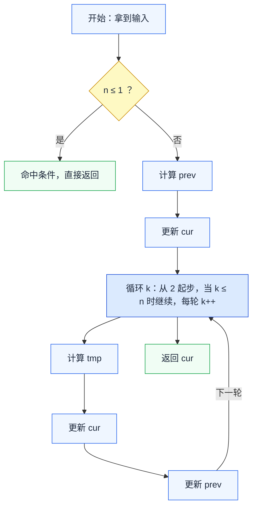

## TypeScript 解题方案（8 个方案逐个讲）

> **运行与提交**：每个方案都是自包含文件（内嵌用例自测，输出 PASS），整块复制到 `.ts` 文件后 `node 文件名` 即可运行。提交 LeetCode 时，把 `demo` 内的算法函数与辅助类型/函数整体取出、置于文件顶层即可。涉及交互/特殊接口的题以题面给定签名为准。

### 方案 1：单趟扫描

**分析与思路**：核心做法是「单趟扫描」。代码里依次做这些事：单循环线性扫描。

**运行方式**：`node 本文件`，内嵌用例全部通过会输出 PASS。


**方案专属流程图**（真实控制流）：


```typescript
/**
 ** LeetCode 70. 爬楼梯
 ** 来源：https://blog.csdn.net/tyro_java/article/details/130660487
 */

export function demo(): void {
  // 程序入口：跑内嵌自测用例
  function climbStairs(n: number): number {
    // 定义函数/方法 climbStairs
    if (n <= 1) return 1; // 若 元素个数 不超过 1，直接返回 1
    let prev = 1,
      cur = 1; // 把 1, 当前值 赋值为 1 存入 前一个
    for (let k = 2; k <= n; k++) {
      // 让 下标 k 从 2 开始计数，下标 k 不超过 元素个数 就继续
      const tmp = cur; // 把 当前值 存入 临时变量
      cur = prev + cur; // 把 前一个 加 当前值 存入 当前值
      prev = tmp; // 把 临时变量 存入 前一个
    }
    return cur; // 返回 当前值
  }
  const cases: Array<{ n: number; want: number }> = [
    { n: 2, want: 2 },
    { n: 3, want: 3 },
    { n: 10, want: 89 },
  ];
  let fail = false; // 把 false 存入 fail
  for (const c of cases) {
    // for (const 字符 of cases) {
    const got = climbStairs(c.n); // 把 climbStairs(字符.元素个数) 存入 got
    if (got !== c.want) {
      // 若 got 不等于 字符.want
      console.log(`FAIL climbStairs(${c.n})=${got} want ${c.want}`);
      fail = true; // 把 true 存入 fail
    }
  }
  if (fail) throw new Error('FAILED'); // 若 fail) throw new Error(「FAILED」);
  console.log('PASS'); // 全部用例通过，输出 PASS
}

demo(); // demo();
```

### 方案 2：单趟扫描

**分析与思路**：核心做法是「单趟扫描」。代码里依次做这些事：单循环线性扫描。

**运行方式**：`node 本文件`，内嵌用例全部通过会输出 PASS。


**方案专属流程图**（真实控制流）：


```typescript
/**
 ** LeetCode 70. 爬楼梯
 ** 来源：https://blog.csdn.net/tyro_java/article/details/130660487
 */

export function demo(): void {
  // 程序入口：跑内嵌自测用例
  function climbStairs(n: number): number {
    // 定义函数/方法 climbStairs
    if (n <= 1) return 1; // 若 元素个数 不超过 1，直接返回 1
    let prev = 1,
      cur = 1; // 把 1, 当前值 赋值为 1 存入 前一个
    for (let k = 2; k <= n; k++) {
      // 让 下标 k 从 2 开始计数，下标 k 不超过 元素个数 就继续
      const tmp = cur; // 把 当前值 存入 临时变量
      cur = prev + cur; // 把 前一个 加 当前值 存入 当前值
      prev = tmp; // 把 临时变量 存入 前一个
    }
    return cur; // 返回 当前值
  }
  const cases: Array<{ n: number; want: number }> = [
    { n: 2, want: 2 },
    { n: 3, want: 3 },
    { n: 10, want: 89 },
  ];
  let fail = false; // 把 false 存入 fail
  for (const c of cases) {
    // for (const 字符 of cases) {
    const got = climbStairs(c.n); // 把 climbStairs(字符.元素个数) 存入 got
    if (got !== c.want) {
      // 若 got 不等于 字符.want
      console.log(`FAIL climbStairs(${c.n})=${got} want ${c.want}`);
      fail = true; // 把 true 存入 fail
    }
  }
  if (fail) throw new Error('FAILED'); // 若 fail) throw new Error(「FAILED」);
  console.log('PASS'); // 全部用例通过，输出 PASS
}

demo(); // demo();
```

### 方案 3：单趟扫描

**分析与思路**：核心做法是「单趟扫描」。代码里依次做这些事：单循环线性扫描。

**运行方式**：`node 本文件`，内嵌用例全部通过会输出 PASS。


**方案专属流程图**（真实控制流）：


```typescript
/**
 ** LeetCode 70. 爬楼梯
 ** 方案：方案3
 ** 来源：https://blog.csdn.net/tyro_java/article/details/130660487
 */

export function demo(): void {
  // 程序入口：跑内嵌自测用例
  function climbStairs(n: number): number {
    // 定义函数/方法 climbStairs
    if (n <= 1) return 1; // 若 元素个数 不超过 1，直接返回 1
    let prev = 1,
      cur = 1; // 把 1, 当前值 赋值为 1 存入 前一个
    for (let k = 2; k <= n; k++) {
      // 让 下标 k 从 2 开始计数，下标 k 不超过 元素个数 就继续
      const tmp = cur; // 把 当前值 存入 临时变量
      cur = prev + cur; // 把 前一个 加 当前值 存入 当前值
      prev = tmp; // 把 临时变量 存入 前一个
    }
    return cur; // 返回 当前值
  }
  const cases: Array<{ n: number; want: number }> = [
    { n: 2, want: 2 },
    { n: 3, want: 3 },
    { n: 10, want: 89 },
  ];
  let fail = false; // 把 false 存入 fail
  for (const c of cases) {
    // for (const 字符 of cases) {
    const got = climbStairs(c.n); // 把 climbStairs(字符.元素个数) 存入 got
    if (got !== c.want) {
      // 若 got 不等于 字符.want
      console.log(`FAIL climbStairs(${c.n})=${got} want ${c.want}`);
      fail = true; // 把 true 存入 fail
    }
  }
  if (fail) throw new Error('FAILED'); // 若 fail) throw new Error(「FAILED」);
  console.log('PASS'); // 全部用例通过，输出 PASS
}

demo(); // demo();
```

### 方案 4：单趟扫描

**分析与思路**：核心做法是「单趟扫描」。代码里依次做这些事：单循环线性扫描。

**运行方式**：`node 本文件`，内嵌用例全部通过会输出 PASS。


**方案专属流程图**（真实控制流）：


```typescript
/**
 ** LeetCode 70. 爬楼梯
 ** 方案：方案4
 ** 来源：https://blog.csdn.net/tyro_java/article/details/130660487
 */

export function demo(): void {
  // 程序入口：跑内嵌自测用例
  function climbStairs(n: number): number {
    // 定义函数/方法 climbStairs
    if (n <= 1) return 1; // 若 元素个数 不超过 1，直接返回 1
    let prev = 1,
      cur = 1; // 把 1, 当前值 赋值为 1 存入 前一个
    for (let k = 2; k <= n; k++) {
      // 让 下标 k 从 2 开始计数，下标 k 不超过 元素个数 就继续
      const tmp = cur; // 把 当前值 存入 临时变量
      cur = prev + cur; // 把 前一个 加 当前值 存入 当前值
      prev = tmp; // 把 临时变量 存入 前一个
    }
    return cur; // 返回 当前值
  }
  const cases: Array<{ n: number; want: number }> = [
    { n: 2, want: 2 },
    { n: 3, want: 3 },
    { n: 10, want: 89 },
  ];
  let fail = false; // 把 false 存入 fail
  for (const c of cases) {
    // for (const 字符 of cases) {
    const got = climbStairs(c.n); // 把 climbStairs(字符.元素个数) 存入 got
    if (got !== c.want) {
      // 若 got 不等于 字符.want
      console.log(`FAIL climbStairs(${c.n})=${got} want ${c.want}`);
      fail = true; // 把 true 存入 fail
    }
  }
  if (fail) throw new Error('FAILED'); // 若 fail) throw new Error(「FAILED」);
  console.log('PASS'); // 全部用例通过，输出 PASS
}

demo(); // demo();
```

### 方案 5：单趟扫描

**分析与思路**：核心做法是「单趟扫描」。代码里依次做这些事：单循环线性扫描。

**运行方式**：`node 本文件`，内嵌用例全部通过会输出 PASS。


**方案专属流程图**（真实控制流）：


```typescript
/**
 ** LeetCode 70. 爬楼梯
 ** 来源：https://blog.csdn.net/tyro_java/article/details/130660487
 */

export function demo(): void {
  // 程序入口：跑内嵌自测用例
  function climbStairs(n: number): number {
    // 定义函数/方法 climbStairs
    if (n <= 1) return 1; // 若 元素个数 不超过 1，直接返回 1
    let prev = 1,
      cur = 1; // 把 1, 当前值 赋值为 1 存入 前一个
    for (let k = 2; k <= n; k++) {
      // 让 下标 k 从 2 开始计数，下标 k 不超过 元素个数 就继续
      const tmp = cur; // 把 当前值 存入 临时变量
      cur = prev + cur; // 把 前一个 加 当前值 存入 当前值
      prev = tmp; // 把 临时变量 存入 前一个
    }
    return cur; // 返回 当前值
  }
  const cases: Array<{ n: number; want: number }> = [
    { n: 2, want: 2 },
    { n: 3, want: 3 },
    { n: 10, want: 89 },
  ];
  let fail = false; // 把 false 存入 fail
  for (const c of cases) {
    // for (const 字符 of cases) {
    const got = climbStairs(c.n); // 把 climbStairs(字符.元素个数) 存入 got
    if (got !== c.want) {
      // 若 got 不等于 字符.want
      console.log(`FAIL climbStairs(${c.n})=${got} want ${c.want}`);
      fail = true; // 把 true 存入 fail
    }
  }
  if (fail) throw new Error('FAILED'); // 若 fail) throw new Error(「FAILED」);
  console.log('PASS'); // 全部用例通过，输出 PASS
}

demo(); // demo();
```

### 方案 6：单趟扫描

**分析与思路**：核心做法是「单趟扫描」。代码里依次做这些事：单循环线性扫描。

**运行方式**：`node 本文件`，内嵌用例全部通过会输出 PASS。


**方案专属流程图**（真实控制流）：

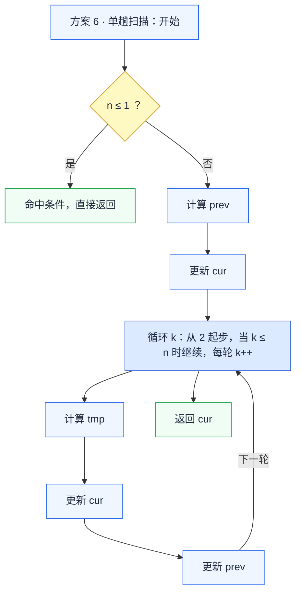

```typescript
/**
 ** LeetCode 70. 爬楼梯
 ** 来源：https://blog.csdn.net/tyro_java/article/details/130660487
 */

export function demo(): void {
  // 程序入口：跑内嵌自测用例
  function climbStairs(n: number): number {
    // 定义函数/方法 climbStairs
    if (n <= 1) return 1; // 若 元素个数 不超过 1，直接返回 1
    let prev = 1,
      cur = 1; // 把 1, 当前值 赋值为 1 存入 前一个
    for (let k = 2; k <= n; k++) {
      // 让 下标 k 从 2 开始计数，下标 k 不超过 元素个数 就继续
      const tmp = cur; // 把 当前值 存入 临时变量
      cur = prev + cur; // 把 前一个 加 当前值 存入 当前值
      prev = tmp; // 把 临时变量 存入 前一个
    }
    return cur; // 返回 当前值
  }
  const cases: Array<{ n: number; want: number }> = [
    { n: 2, want: 2 },
    { n: 3, want: 3 },
    { n: 10, want: 89 },
  ];
  let fail = false; // 把 false 存入 fail
  for (const c of cases) {
    // for (const 字符 of cases) {
    const got = climbStairs(c.n); // 把 climbStairs(字符.元素个数) 存入 got
    if (got !== c.want) {
      // 若 got 不等于 字符.want
      console.log(`FAIL climbStairs(${c.n})=${got} want ${c.want}`);
      fail = true; // 把 true 存入 fail
    }
  }
  if (fail) throw new Error('FAILED'); // 若 fail) throw new Error(「FAILED」);
  console.log('PASS'); // 全部用例通过，输出 PASS
}

demo(); // demo();
```

### 方案 7：单趟扫描

**分析与思路**：核心做法是「单趟扫描」。代码里依次做这些事：单循环线性扫描。

**运行方式**：`node 本文件`，内嵌用例全部通过会输出 PASS。


**方案专属流程图**（真实控制流）：


```typescript
/**
 ** LeetCode 70. 爬楼梯
 ** 来源：https://blog.csdn.net/tyro_java/article/details/130660487
 */

export function demo(): void {
  // 程序入口：跑内嵌自测用例
  function climbStairs(n: number): number {
    // 定义函数/方法 climbStairs
    if (n <= 1) return 1; // 若 元素个数 不超过 1，直接返回 1
    let prev = 1,
      cur = 1; // 把 1, 当前值 赋值为 1 存入 前一个
    for (let k = 2; k <= n; k++) {
      // 让 下标 k 从 2 开始计数，下标 k 不超过 元素个数 就继续
      const tmp = cur; // 把 当前值 存入 临时变量
      cur = prev + cur; // 把 前一个 加 当前值 存入 当前值
      prev = tmp; // 把 临时变量 存入 前一个
    }
    return cur; // 返回 当前值
  }
  const cases: Array<{ n: number; want: number }> = [
    { n: 2, want: 2 },
    { n: 3, want: 3 },
    { n: 10, want: 89 },
  ];
  let fail = false; // 把 false 存入 fail
  for (const c of cases) {
    // for (const 字符 of cases) {
    const got = climbStairs(c.n); // 把 climbStairs(字符.元素个数) 存入 got
    if (got !== c.want) {
      // 若 got 不等于 字符.want
      console.log(`FAIL climbStairs(${c.n})=${got} want ${c.want}`);
      fail = true; // 把 true 存入 fail
    }
  }
  if (fail) throw new Error('FAILED'); // 若 fail) throw new Error(「FAILED」);
  console.log('PASS'); // 全部用例通过，输出 PASS
}

demo(); // demo();
```

### 方案 8：单趟扫描

**分析与思路**：核心做法是「单趟扫描」。代码里依次做这些事：单循环线性扫描。

**运行方式**：`node 本文件`，内嵌用例全部通过会输出 PASS。


**方案专属流程图**（真实控制流）：


```typescript
/**
 ** LeetCode 70. 爬楼梯
 ** 来源：https://blog.csdn.net/tyro_java/article/details/130660487
 */

export function demo(): void {
  // 程序入口：跑内嵌自测用例
  function climbStairs(n: number): number {
    // 定义函数/方法 climbStairs
    if (n <= 1) return 1; // 若 元素个数 不超过 1，直接返回 1
    let prev = 1,
      cur = 1; // 把 1, 当前值 赋值为 1 存入 前一个
    for (let k = 2; k <= n; k++) {
      // 让 下标 k 从 2 开始计数，下标 k 不超过 元素个数 就继续
      const tmp = cur; // 把 当前值 存入 临时变量
      cur = prev + cur; // 把 前一个 加 当前值 存入 当前值
      prev = tmp; // 把 临时变量 存入 前一个
    }
    return cur; // 返回 当前值
  }
  const cases: Array<{ n: number; want: number }> = [
    { n: 2, want: 2 },
    { n: 3, want: 3 },
    { n: 10, want: 89 },
  ];
  let fail = false; // 把 false 存入 fail
  for (const c of cases) {
    // for (const 字符 of cases) {
    const got = climbStairs(c.n); // 把 climbStairs(字符.元素个数) 存入 got
    if (got !== c.want) {
      // 若 got 不等于 字符.want
      console.log(`FAIL climbStairs(${c.n})=${got} want ${c.want}`);
      fail = true; // 把 true 存入 fail
    }
  }
  if (fail) throw new Error('FAILED'); // 若 fail) throw new Error(「FAILED」);
  console.log('PASS'); // 全部用例通过，输出 PASS
}

demo(); // demo();
```

## 逐步拆解与面试追问

**复杂度**：时间 O(n)（单趟线性扫描），空间 O(1) 到 O(n)（视辅助结构）

**为什么是这个量级**：每个元素被常数次访问，辅助哈希或栈的开销与 n 同阶

**面试官可能会追问**：

- 状态定义为什么是它？
- 遍历顺序由什么决定？
- 能否滚动数组压空间？

## 关键 API 速查（TS 主解法实际用到，附官方链接）

本题主解法只用到基础语法（变量、循环、比较），不依赖特殊库 API。

### 各语言官方文档导航

- **TypeScript / JS**：[MDN 中文参考](https://developer.mozilla.org/zh-CN/)
- **Python**：[Python 官方文档](https://docs.python.org/zh-cn/3/)
- **Go**：[Go 标准库](https://pkg.go.dev/std)
- **Java**：[JDK 17 API](https://docs.oracle.com/en/java/javase/17/docs/api/)
- **Rust**：[Rust 标准库](https://doc.rust-lang.org/std/)
- **Lua**：[Lua 5.4 手册](https://www.lua.org/manual/5.4/)
- **C**：[Cppreference C](https://zh.cppreference.com/w/c)
- **C++**：[Cppreference C++](https://zh.cppreference.com/w/cpp)
- **R**：[R 官方手册](https://stat.ethz.ch/R-manual/)
- **Zig**：[Zig 语言文档](https://ziglang.org/documentation/master/)
- **Dart**：[Dart API](https://api.dart.dev/)

## 附录：其他 10 种语言全部实现（每种语言列举其全部方案）

> TypeScript 的全部方案见「TypeScript 解题方案」一节；下面是其余 10 种语言的对应实现，每种语言的每个方案都带思路分析、代码走读与专属运行架构图。
> 每个方案都内嵌用例自测，可独立运行（老仓库 python/go 文件遵循「打印结果」约定）。
> 完整解法文件见 `dsa/<语言>/dp/lc_70_爬楼梯/`。

### Python 实现（8 种方案）

Python 的全部方案如下，每个方案都内嵌用例自测，可独立运行（老仓库 python/go 文件遵循「打印结果」约定）：

#### 方案 1：单趟扫描

**思路与代码分析**：核心是「单趟扫描」。Python 版用切片与字典推导式简化操作，突出可读性。**走读**：方案 1 · 单趟扫描：开始 → 处理 from functools import lru_ca → 处理 @lru_cache(None) → 命中条件，直接返回 → 返回 f(k - 1) + f(k - 2) → 返回 f(n)。

**运行架构**（真实控制流）：

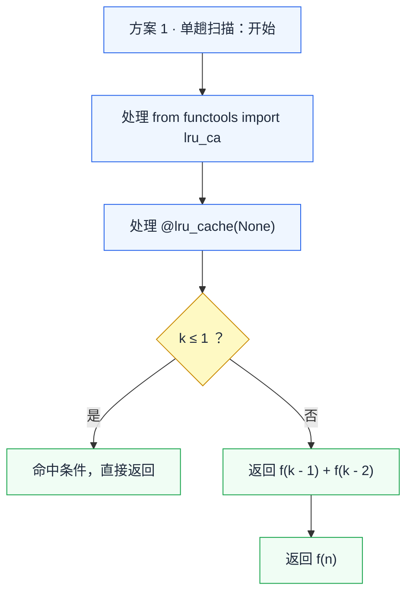

```python
import sys  # 提高递归深度上限（深输入防 RecursionError）

sys.setrecursionlimit(200000)  # 树/链表类题目节点数可达 1e4 量级

def climbStairs(n):  # 定义函数 climbStairs（参数：元素个数）
    # 递归 + 记忆化
    from functools import lru_cache  # from functools import lru_cache

    @lru_cache(None)  # @lru_cache(None)
    def f(k):  # 定义函数 f（参数：下标 k）
        if k <= 1:  # 若 下标 k 不超过 1
            return 1  # 返回 1
        return f(k - 1) + f(k - 2)  # 返回 f(下标 k 减 1) 加 f(下标 k 减 2)

    return f(n)  # 返回 f(元素个数)

if __name__ == "__main__":  # 若 __name__ 等于 '__main__'
    print(climbStairs(5))  # 打印输出
```

#### 方案 2：单趟扫描

**思路与代码分析**：核心是「单趟扫描」。Python 版用切片与字典推导式简化操作，突出可读性。代码里依次做这些事：DP 表逐项填充。**走读**：方案 2 · 单趟扫描：开始 → 命中条件，直接返回 → 填写 DP 表 → 填写 DP 表 → 填写 DP 表 → 循环 i：从 2 到 n + 1 前 → 填写 DP 表 → 返回 dp[n]。

**运行架构**（真实控制流）：

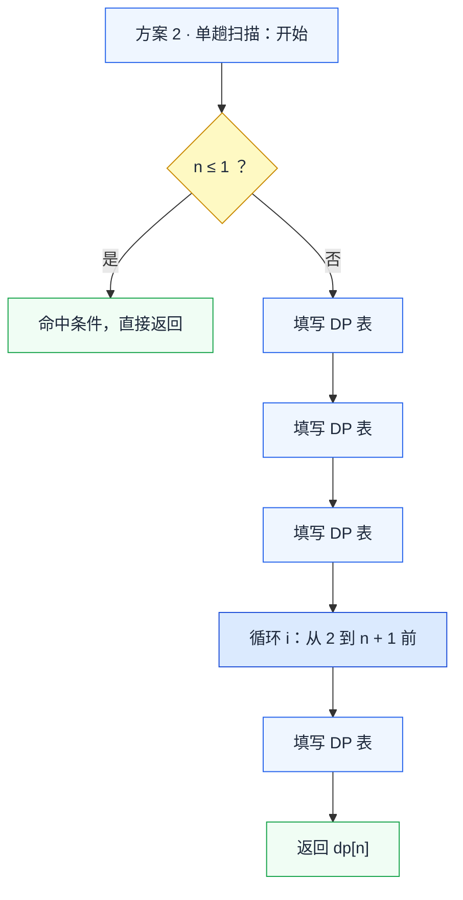

```python
import sys  # 提高递归深度上限（深输入防 RecursionError）

sys.setrecursionlimit(200000)  # 树/链表类题目节点数可达 1e4 量级

def climbStairs(n):  # 定义函数 climbStairs（参数：元素个数）
    # 动态规划（数组）
    if n <= 1:  # 若 元素个数 不超过 1
        return 1  # 返回 1
    dp = [0] * (n + 1)  # 把 [0] 乘 (元素个数 加 1) 存入 DP 表
    dp[0] = 1  # 把 1 写入 dp[0]
    dp[1] = 1  # 把 1 写入 dp[1]
    for i in range(2, n + 1):  # 让 下标 i 从 2 到 元素个数 加 1 遍历
        dp[i] = dp[i - 1] + dp[i - 2]  # 把 DP 表[下标 i 减 1] 加 DP 表[下标 i 减 2] 写入 dp[i]
    return dp[n]  # 返回 DP 表[元素个数]

if __name__ == "__main__":  # 若 __name__ 等于 '__main__'
    print(climbStairs(5))  # 打印输出
```

#### 方案 3：单趟扫描

**思路与代码分析**：核心是「单趟扫描」。Python 版用切片与字典推导式简化操作，突出可读性。代码里依次做这些事：DP 表逐项填充。**走读**：方案 3 · 单趟扫描：开始 → 命中条件，直接返回 → 填写 DP 表 → 循环 i：从 2 到 n + 1 前 → 填写 DP 表 → 返回 dp[n]。

**运行架构**（真实控制流）：

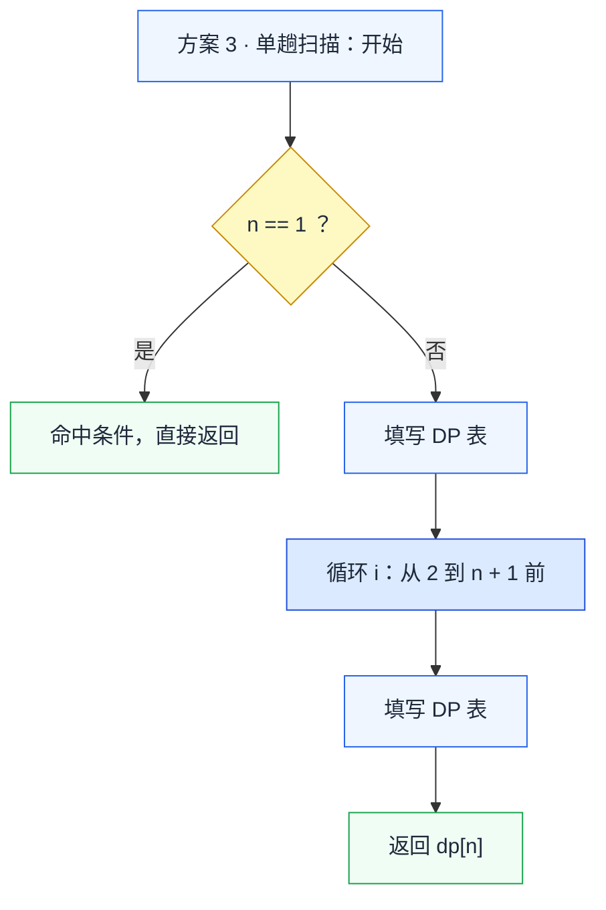

```python
import sys  # 提高递归深度上限（深输入防 RecursionError）

sys.setrecursionlimit(200000)  # 树/链表类题目节点数可达 1e4 量级

def climbStairs(n):  # 定义函数 climbStairs（参数：元素个数）
    # 动态规划（数组，初始化 [1, 1]）
    if n == 1:  # 若 元素个数 等于 1
        return 1  # 返回 1
    dp = [1, 1]  # 把 [1, 1] 存入 DP 表
    for i in range(2, n + 1):  # 让 下标 i 从 2 到 元素个数 加 1 遍历
        dp.append(dp[i - 1] + dp[i - 2])  # 把 DP 表[下标 i 减 1] 加 DP 表[下标 i 减 2] 追加到列表尾部
    return dp[n]  # 返回 DP 表[元素个数]

if __name__ == "__main__":  # 若 __name__ 等于 '__main__'
    print(climbStairs(5))  # 打印输出
```

#### 方案 4：单趟扫描

**思路与代码分析**：核心是「单趟扫描」。Python 版用切片与字典推导式简化操作，突出可读性。**走读**：方案 4 · 单趟扫描：开始 → 命中条件，直接返回 → 更新 dp0 → 更新 dp1 → 循环 i：从 2 到 n + 1 前 → 更新 tmp → 更新 dp0 → 更新 + → 返回 dp1。

**运行架构**（真实控制流）：

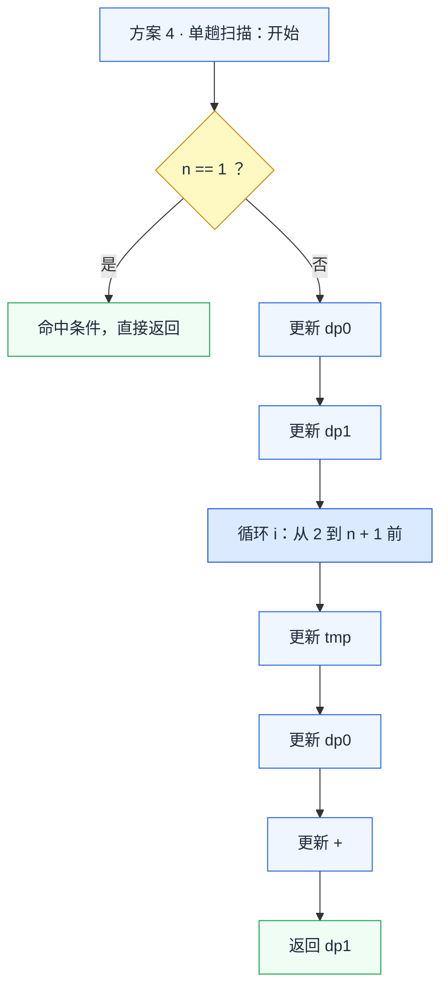

```python
import sys  # 提高递归深度上限（深输入防 RecursionError）

sys.setrecursionlimit(200000)  # 树/链表类题目节点数可达 1e4 量级

def climbStairs(n):  # 定义函数 climbStairs（参数：元素个数）
    # 两个变量（空间优化）
    if n == 1:  # 若 元素个数 等于 1
        return 1  # 返回 1
    dp0 = 1  # 把 1 存入 dp0
    dp1 = 1  # 把 1 存入 dp1
    for i in range(2, n + 1):  # 让 下标 i 从 2 到 元素个数 加 1 遍历
        tmp = dp0  # 把 dp0 存入 临时变量
        dp0 = dp1  # 把 dp1 存入 dp0
        dp1 += tmp  # dp1累加 临时变量
    return dp1  # 返回 dp1

if __name__ == "__main__":  # 若 __name__ 等于 '__main__'
    print(climbStairs(5))  # 打印输出
```

#### 方案 5：单趟扫描

**思路与代码分析**：核心是「单趟扫描」。Python 版用切片与字典推导式简化操作，突出可读性。**走读**：方案 5 · 单趟扫描：开始 → 返回 [ → 处理 [a[0][0] * b[0][0] + a[0][1] → 处理 [a[1][0] * b[0][0] + a[1][1] → 处理 ] → 更新 res → 当 p: 时反复执行 → 若 p & 1：更新 res → 更新 res → 更新 mat → 更新 >> → 返回 res → 命中条件，直接返回 → 更新 mat → 返回 power(mat, n)[0][0]。

**运行架构**（真实控制流）：

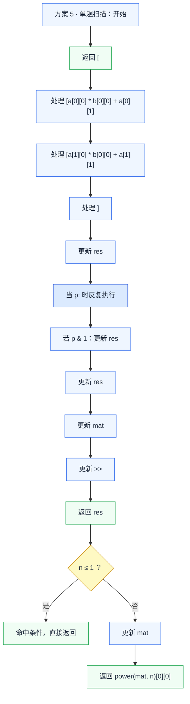

```python
import sys  # 提高递归深度上限（深输入防 RecursionError）

sys.setrecursionlimit(200000)  # 树/链表类题目节点数可达 1e4 量级

def climbStairs(n):  # 定义函数 climbStairs（参数：元素个数）
    # 矩阵快速幂
    def multiply(a, b):  # 定义函数 multiply（参数：数组, b）
        return [
            [a[0][0] * b[0][0] + a[0][1] * b[1][0], a[0][0] * b[0][1] + a[0][1] * b[1][1]],
            [a[1][0] * b[0][0] + a[1][1] * b[1][0], a[1][0] * b[0][1] + a[1][1] * b[1][1]],
        ]

    def power(mat, p):  # 定义函数 power（参数：mat, 节点）
        res = [[1, 0], [0, 1]]  # 把 [[1, 0], [0, 1]] 存入 结果
        while p:  # 循环，直到不满足「节点」
            if p & 1:  # 若 节点 按位与 1
                res = multiply(res, mat)  # 把 multiply(结果, mat) 存入 结果
            mat = multiply(mat, mat)  # 把 multiply(mat, mat) 存入 mat
            p >>= 1  # 把 1 写入 p >>
        return res  # 返回 结果

    if n <= 1:  # 若 元素个数 不超过 1
        return 1  # 返回 1
    mat = [[1, 1], [1, 0]]  # 把 [[1, 1], [1, 0]] 存入 mat
    return power(mat, n)[0][0]  # 返回 power(mat, 元素个数)[0][0]

if __name__ == "__main__":  # 若 __name__ 等于 '__main__'
    print(climbStairs(5))  # 打印输出
```

#### 方案 6：单趟扫描

**思路与代码分析**：核心是「单趟扫描」。Python 版用切片与字典推导式简化操作，突出可读性。**走读**：方案 6 · 单趟扫描：开始 → 命中条件，直接返回 → 更新 b → 更新 c → 更新 d → 命中条件，直接返回 → 返回 (c, d) → 返回 fib(n + 1)[0]。

**运行架构**（真实控制流）：

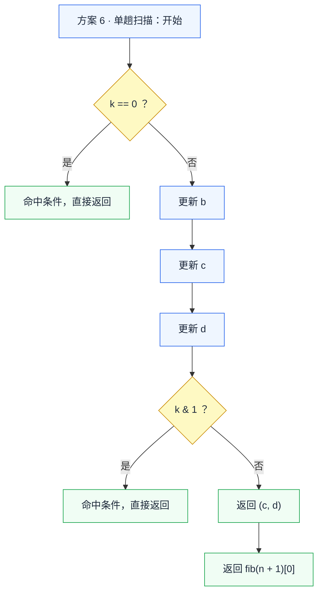

```python
import sys  # 提高递归深度上限（深输入防 RecursionError）

sys.setrecursionlimit(200000)  # 树/链表类题目节点数可达 1e4 量级

def climbStairs(n):  # 定义函数 climbStairs（参数：元素个数）
    # 快速倍增法求斐波那契（climbStairs(n) = fib(n+1)）
    def fib(k):  # 定义函数 fib（参数：下标 k）
        # 返回 (F(k), F(k+1))
        if k == 0:  # 若 下标 k 等于 0
            return (0, 1)  # 返回 (0, 1)
        a, b = fib(k >> 1)  # 把 fib(下标 k 超过 超过 1) 写入 a, b
        c = a * (2 * b - a)  # 把 数组 乘 (2 乘 b 减 数组) 存入 字符
        d = a * a + b * b  # 把 数组 乘 数组 加 b 乘 b 存入 d
        if k & 1:  # 若 下标 k 按位与 1
            return (d, c + d)  # 返回 (d, 字符 加 d)
        return (c, d)  # 返回 (字符, d)

    return fib(n + 1)[0]  # 返回 fib(元素个数 加 1)[0]

if __name__ == "__main__":  # 若 __name__ 等于 '__main__'
    print(climbStairs(5))  # 打印输出
```

#### 方案 7：单趟扫描

**思路与代码分析**：核心是「单趟扫描」。Python 版用切片与字典推导式简化操作，突出可读性。**走读**：方案 7 · 单趟扫描：开始 → 更新 b → 循环 _：从 0 到 n 前 → 更新 b → 返回 a。

**运行架构**（真实控制流）：

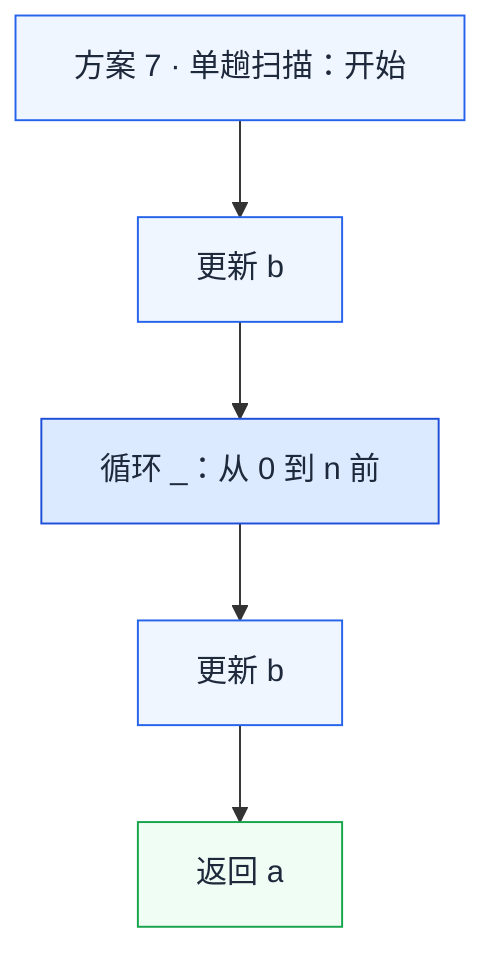

```python
import sys  # 提高递归深度上限（深输入防 RecursionError）

sys.setrecursionlimit(200000)  # 树/链表类题目节点数可达 1e4 量级

def climbStairs(n):  # 定义函数 climbStairs（参数：元素个数）
    # 迭代生成（生成器累计）
    a, b = 1, 1  # 把 1, 1 写入 a, b
    for _ in range(n):  # 让 _ 从 元素个数 遍历
        a, b = b, a + b  # 把 b, 数组 加 b 写入 a, b
    return a  # 返回 数组

if __name__ == "__main__":  # 若 __name__ 等于 '__main__'
    print(climbStairs(5))  # 打印输出
```

#### 方案 8：单趟扫描

**思路与代码分析**：核心是「单趟扫描」。Python 版用切片与字典推导式简化操作，突出可读性。**走读**：方案 8 · 单趟扫描：开始 → 更新 sqrt5 → 更新 phi → 更新 psi → 返回 round( → 处理 (phi ** (n + 1) - psi ** (n → 处理 )。

**运行架构**（真实控制流）：

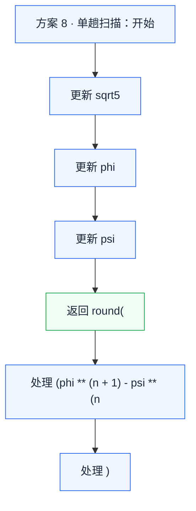

```python
import sys  # 提高递归深度上限（深输入防 RecursionError）

sys.setrecursionlimit(200000)  # 树/链表类题目节点数可达 1e4 量级

def climbStairs(n):  # 定义函数 climbStairs（参数：元素个数）
    # 闭式公式（Binet）—— n 较小时精确
    import math  # 引入依赖

    sqrt5 = math.sqrt(5)  # 把 math.sqrt(5) 存入 sqrt5
    phi = (1 + sqrt5) / 2  # 把 (1 加 sqrt5) 除以 2 存入 phi
    psi = (1 - sqrt5) / 2  # 把 (1 减 sqrt5) 除以 2 存入 psi
    return round(
        (phi ** (n + 1) - psi ** (n + 1)) / sqrt5
    )  # 返回 round((phi 乘 乘 (元素个数 加 1) 减 psi 乘 乘 (元素个数 加 1)) 除以 sqrt5)

if __name__ == "__main__":  # 若 __name__ 等于 '__main__'
    print(climbStairs(5))  # 打印输出
```

### Go 实现（8 种方案）

Go 的全部方案如下，每个方案都内嵌用例自测，可独立运行（老仓库 python/go 文件遵循「打印结果」约定）：

#### 方案 1：单趟扫描

**思路与代码分析**：核心是「单趟扫描」。Go 版用切片与多返回值惯用法，显式处理索引边界。**走读**：方案 1 · 单趟扫描：开始 → 处理 if n ≤ 1 → 返回 1 → 更新 : → 遍历循环 → 更新 cur → 返回 cur。

**运行架构**（真实控制流）：

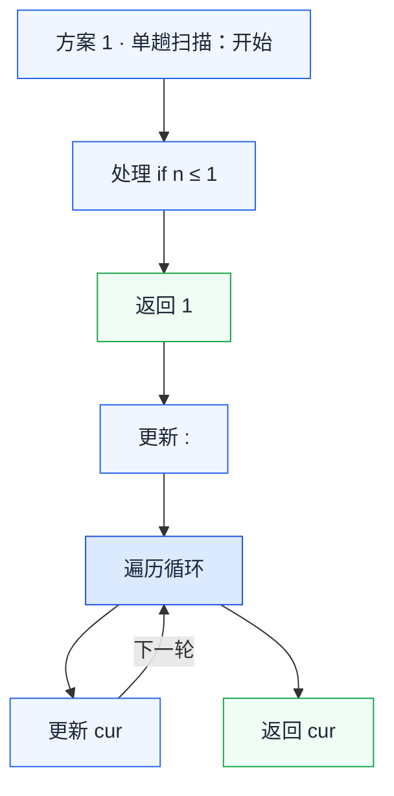

```go
package main // 引入依赖

import (
	"fmt" // 「fmt」
	"os"  // 「os」
)

func climbStairs(n int) int { // 定义函数/方法 climbStairs
	if n <= 1 { // 若 元素个数 不超过 1
		return 1 // 返回 1
	}
	prev, cur := 1, 1         // 把 1, 1 写入 prev, cur :
	for k := 2; k <= n; k++ { // 让 下标 k 从 2 开始计数
		prev, cur = cur, prev+cur // 把 当前值, 前一个 加 当前值 写入 prev, cur
	}
	return cur // 返回 当前值
}

func main() { // 程序入口：跑内嵌自测用例
	type tc struct { // 定义类型
		n    int // 元素个数 int
		want int // want int
	}
	cases := []tc{ // 把 []tc{ 写入 cases :
		{2, 2},
		{3, 3},
		{10, 89},
	}
	fail := false             // 把 false 写入 fail :
	for _, c := range cases { // 同时取 _ 与 字符 遍历
		got := climbStairs(c.n) // 把 climbStairs(字符.元素个数) 写入 got :
		if got != c.want {      // 若 got 不等于 字符.want
			fmt.Printf("FAIL climbStairs(%d)=%d want %d\n", c.n, got, c.want) // 打印输出
			fail = true                                                       // 把 true 写入 fail
		}
	}
	if fail { // 若 fail
		os.Exit(1) // os.Exit(1)
	}
	fmt.Println("PASS") // 全部用例通过，输出 PASS
}
```

#### 方案 2：单趟扫描

**思路与代码分析**：核心是「单趟扫描」。Go 版用切片与多返回值惯用法，显式处理索引边界。**走读**：方案 2 · 单趟扫描：开始 → 处理 if n ≤ 1 → 返回 1 → 更新 : → 遍历循环 → 更新 cur → 返回 cur。

**运行架构**（真实控制流）：


```go
package main // 引入依赖

import (
	"fmt" // 「fmt」
	"os"  // 「os」
)

func climbStairs(n int) int { // 定义函数/方法 climbStairs
	if n <= 1 { // 若 元素个数 不超过 1
		return 1 // 返回 1
	}
	prev, cur := 1, 1         // 把 1, 1 写入 prev, cur :
	for k := 2; k <= n; k++ { // 让 下标 k 从 2 开始计数
		prev, cur = cur, prev+cur // 把 当前值, 前一个 加 当前值 写入 prev, cur
	}
	return cur // 返回 当前值
}

func main() { // 程序入口：跑内嵌自测用例
	type tc struct { // 定义类型
		n    int // 元素个数 int
		want int // want int
	}
	cases := []tc{ // 把 []tc{ 写入 cases :
		{2, 2},
		{3, 3},
		{10, 89},
	}
	fail := false             // 把 false 写入 fail :
	for _, c := range cases { // 同时取 _ 与 字符 遍历
		got := climbStairs(c.n) // 把 climbStairs(字符.元素个数) 写入 got :
		if got != c.want {      // 若 got 不等于 字符.want
			fmt.Printf("FAIL climbStairs(%d)=%d want %d\n", c.n, got, c.want) // 打印输出
			fail = true                                                       // 把 true 写入 fail
		}
	}
	if fail { // 若 fail
		os.Exit(1) // os.Exit(1)
	}
	fmt.Println("PASS") // 全部用例通过，输出 PASS
}
```

#### 方案 3：单趟扫描

**思路与代码分析**：核心是「单趟扫描」。Go 版用切片与多返回值惯用法，显式处理索引边界。**走读**：方案 3 · 单趟扫描：开始 → 处理 if n ≤ 1 → 返回 1 → 更新 : → 遍历循环 → 更新 cur → 返回 cur。

**运行架构**（真实控制流）：


```go
package main // 引入依赖

import (
	"fmt" // 「fmt」
	"os"  // 「os」
)

func climbStairs(n int) int { // 定义函数/方法 climbStairs
	if n <= 1 { // 若 元素个数 不超过 1
		return 1 // 返回 1
	}
	prev, cur := 1, 1         // 把 1, 1 写入 prev, cur :
	for k := 2; k <= n; k++ { // 让 下标 k 从 2 开始计数
		prev, cur = cur, prev+cur // 把 当前值, 前一个 加 当前值 写入 prev, cur
	}
	return cur // 返回 当前值
}

func main() { // 程序入口：跑内嵌自测用例
	type tc struct { // 定义类型
		n    int // 元素个数 int
		want int // want int
	}
	cases := []tc{ // 把 []tc{ 写入 cases :
		{2, 2},
		{3, 3},
		{10, 89},
	}
	fail := false             // 把 false 写入 fail :
	for _, c := range cases { // 同时取 _ 与 字符 遍历
		got := climbStairs(c.n) // 把 climbStairs(字符.元素个数) 写入 got :
		if got != c.want {      // 若 got 不等于 字符.want
			fmt.Printf("FAIL climbStairs(%d)=%d want %d\n", c.n, got, c.want) // 打印输出
			fail = true                                                       // 把 true 写入 fail
		}
	}
	if fail { // 若 fail
		os.Exit(1) // os.Exit(1)
	}
	fmt.Println("PASS") // 全部用例通过，输出 PASS
}
```

#### 方案 4：单趟扫描

**思路与代码分析**：核心是「单趟扫描」。Go 版用切片与多返回值惯用法，显式处理索引边界。**走读**：方案 4 · 单趟扫描：开始 → 处理 if n ≤ 1 → 返回 1 → 更新 : → 遍历循环 → 更新 cur → 返回 cur。

**运行架构**（真实控制流）：

```mermaid
graph TD
    N0["方案 4 · 单趟扫描：开始"]
    N1["处理 if n ≤ 1"]
    N2["返回 1"]
    N3["更新 :"]
    N4["遍历循环"]
    N5["更新 cur"]
    N6["返回 cur"]
    N0 --> N1
    N1 --> N2
    N2 --> N3
    N3 --> N4
    N4 --> N5
    N5 -- 下一轮 --> N4
    N4 --> N6
    classDef n fill:#eff6ff,stroke:#2563eb,color:#1e293b;
    classDef lp fill:#dbeafe,stroke:#1d4ed8,color:#1e293b;
    classDef dc fill:#fef9c3,stroke:#ca8a04,color:#1e293b;
    classDef tm fill:#f0fdf4,stroke:#16a34a,color:#1e293b;
    class N0,N1,N3,N5 n;
    class N4 lp;
    class N2,N6 tm;
```

```go
package main // 引入依赖

import (
	"fmt" // 「fmt」
	"os"  // 「os」
)

func climbStairs(n int) int { // 定义函数/方法 climbStairs
	if n <= 1 { // 若 元素个数 不超过 1
		return 1 // 返回 1
	}
	prev, cur := 1, 1         // 把 1, 1 写入 prev, cur :
	for k := 2; k <= n; k++ { // 让 下标 k 从 2 开始计数
		prev, cur = cur, prev+cur // 把 当前值, 前一个 加 当前值 写入 prev, cur
	}
	return cur // 返回 当前值
}

func main() { // 程序入口：跑内嵌自测用例
	type tc struct { // 定义类型
		n    int // 元素个数 int
		want int // want int
	}
	cases := []tc{ // 把 []tc{ 写入 cases :
		{2, 2},
		{3, 3},
		{10, 89},
	}
	fail := false             // 把 false 写入 fail :
	for _, c := range cases { // 同时取 _ 与 字符 遍历
		got := climbStairs(c.n) // 把 climbStairs(字符.元素个数) 写入 got :
		if got != c.want {      // 若 got 不等于 字符.want
			fmt.Printf("FAIL climbStairs(%d)=%d want %d\n", c.n, got, c.want) // 打印输出
			fail = true                                                       // 把 true 写入 fail
		}
	}
	if fail { // 若 fail
		os.Exit(1) // os.Exit(1)
	}
	fmt.Println("PASS") // 全部用例通过，输出 PASS
}
```

#### 方案 5：单趟扫描

**思路与代码分析**：核心是「单趟扫描」。Go 版用切片与多返回值惯用法，显式处理索引边界。**走读**：方案 5 · 单趟扫描：开始 → 处理 if n ≤ 1 → 返回 1 → 更新 : → 遍历循环 → 更新 cur → 返回 cur。

**运行架构**（真实控制流）：

```mermaid
graph TD
    N0["方案 5 · 单趟扫描：开始"]
    N1["处理 if n ≤ 1"]
    N2["返回 1"]
    N3["更新 :"]
    N4["遍历循环"]
    N5["更新 cur"]
    N6["返回 cur"]
    N0 --> N1
    N1 --> N2
    N2 --> N3
    N3 --> N4
    N4 --> N5
    N5 -- 下一轮 --> N4
    N4 --> N6
    classDef n fill:#eff6ff,stroke:#2563eb,color:#1e293b;
    classDef lp fill:#dbeafe,stroke:#1d4ed8,color:#1e293b;
    classDef dc fill:#fef9c3,stroke:#ca8a04,color:#1e293b;
    classDef tm fill:#f0fdf4,stroke:#16a34a,color:#1e293b;
    class N0,N1,N3,N5 n;
    class N4 lp;
    class N2,N6 tm;
```

```go
package main // 引入依赖

import (
	"fmt" // 「fmt」
	"os"  // 「os」
)

func climbStairs(n int) int { // 定义函数/方法 climbStairs
	if n <= 1 { // 若 元素个数 不超过 1
		return 1 // 返回 1
	}
	prev, cur := 1, 1         // 把 1, 1 写入 prev, cur :
	for k := 2; k <= n; k++ { // 让 下标 k 从 2 开始计数
		prev, cur = cur, prev+cur // 把 当前值, 前一个 加 当前值 写入 prev, cur
	}
	return cur // 返回 当前值
}

func main() { // 程序入口：跑内嵌自测用例
	type tc struct { // 定义类型
		n    int // 元素个数 int
		want int // want int
	}
	cases := []tc{ // 把 []tc{ 写入 cases :
		{2, 2},
		{3, 3},
		{10, 89},
	}
	fail := false             // 把 false 写入 fail :
	for _, c := range cases { // 同时取 _ 与 字符 遍历
		got := climbStairs(c.n) // 把 climbStairs(字符.元素个数) 写入 got :
		if got != c.want {      // 若 got 不等于 字符.want
			fmt.Printf("FAIL climbStairs(%d)=%d want %d\n", c.n, got, c.want) // 打印输出
			fail = true                                                       // 把 true 写入 fail
		}
	}
	if fail { // 若 fail
		os.Exit(1) // os.Exit(1)
	}
	fmt.Println("PASS") // 全部用例通过，输出 PASS
}
```

#### 方案 6：单趟扫描

**思路与代码分析**：核心是「单趟扫描」。Go 版用切片与多返回值惯用法，显式处理索引边界。**走读**：方案 6 · 单趟扫描：开始 → 处理 if n ≤ 1 → 返回 1 → 更新 : → 遍历循环 → 更新 cur → 返回 cur。

**运行架构**（真实控制流）：

```mermaid
graph TD
    N0["方案 6 · 单趟扫描：开始"]
    N1["处理 if n ≤ 1"]
    N2["返回 1"]
    N3["更新 :"]
    N4["遍历循环"]
    N5["更新 cur"]
    N6["返回 cur"]
    N0 --> N1
    N1 --> N2
    N2 --> N3
    N3 --> N4
    N4 --> N5
    N5 -- 下一轮 --> N4
    N4 --> N6
    classDef n fill:#eff6ff,stroke:#2563eb,color:#1e293b;
    classDef lp fill:#dbeafe,stroke:#1d4ed8,color:#1e293b;
    classDef dc fill:#fef9c3,stroke:#ca8a04,color:#1e293b;
    classDef tm fill:#f0fdf4,stroke:#16a34a,color:#1e293b;
    class N0,N1,N3,N5 n;
    class N4 lp;
    class N2,N6 tm;
```

```go
package main // 引入依赖

import (
	"fmt" // 「fmt」
	"os"  // 「os」
)

func climbStairs(n int) int { // 定义函数/方法 climbStairs
	if n <= 1 { // 若 元素个数 不超过 1
		return 1 // 返回 1
	}
	prev, cur := 1, 1         // 把 1, 1 写入 prev, cur :
	for k := 2; k <= n; k++ { // 让 下标 k 从 2 开始计数
		prev, cur = cur, prev+cur // 把 当前值, 前一个 加 当前值 写入 prev, cur
	}
	return cur // 返回 当前值
}

func main() { // 程序入口：跑内嵌自测用例
	type tc struct { // 定义类型
		n    int // 元素个数 int
		want int // want int
	}
	cases := []tc{ // 把 []tc{ 写入 cases :
		{2, 2},
		{3, 3},
		{10, 89},
	}
	fail := false             // 把 false 写入 fail :
	for _, c := range cases { // 同时取 _ 与 字符 遍历
		got := climbStairs(c.n) // 把 climbStairs(字符.元素个数) 写入 got :
		if got != c.want {      // 若 got 不等于 字符.want
			fmt.Printf("FAIL climbStairs(%d)=%d want %d\n", c.n, got, c.want) // 打印输出
			fail = true                                                       // 把 true 写入 fail
		}
	}
	if fail { // 若 fail
		os.Exit(1) // os.Exit(1)
	}
	fmt.Println("PASS") // 全部用例通过，输出 PASS
}
```

#### 方案 7：单趟扫描

**思路与代码分析**：核心是「单趟扫描」。Go 版用切片与多返回值惯用法，显式处理索引边界。**走读**：方案 7 · 单趟扫描：开始 → 处理 if n ≤ 1 → 返回 1 → 更新 : → 遍历循环 → 更新 cur → 返回 cur。

**运行架构**（真实控制流）：

```mermaid
graph TD
    N0["方案 7 · 单趟扫描：开始"]
    N1["处理 if n ≤ 1"]
    N2["返回 1"]
    N3["更新 :"]
    N4["遍历循环"]
    N5["更新 cur"]
    N6["返回 cur"]
    N0 --> N1
    N1 --> N2
    N2 --> N3
    N3 --> N4
    N4 --> N5
    N5 -- 下一轮 --> N4
    N4 --> N6
    classDef n fill:#eff6ff,stroke:#2563eb,color:#1e293b;
    classDef lp fill:#dbeafe,stroke:#1d4ed8,color:#1e293b;
    classDef dc fill:#fef9c3,stroke:#ca8a04,color:#1e293b;
    classDef tm fill:#f0fdf4,stroke:#16a34a,color:#1e293b;
    class N0,N1,N3,N5 n;
    class N4 lp;
    class N2,N6 tm;
```

```go
package main // 引入依赖

import (
	"fmt" // 「fmt」
	"os"  // 「os」
)

func climbStairs(n int) int { // 定义函数/方法 climbStairs
	if n <= 1 { // 若 元素个数 不超过 1
		return 1 // 返回 1
	}
	prev, cur := 1, 1         // 把 1, 1 写入 prev, cur :
	for k := 2; k <= n; k++ { // 让 下标 k 从 2 开始计数
		prev, cur = cur, prev+cur // 把 当前值, 前一个 加 当前值 写入 prev, cur
	}
	return cur // 返回 当前值
}

func main() { // 程序入口：跑内嵌自测用例
	type tc struct { // 定义类型
		n    int // 元素个数 int
		want int // want int
	}
	cases := []tc{ // 把 []tc{ 写入 cases :
		{2, 2},
		{3, 3},
		{10, 89},
	}
	fail := false             // 把 false 写入 fail :
	for _, c := range cases { // 同时取 _ 与 字符 遍历
		got := climbStairs(c.n) // 把 climbStairs(字符.元素个数) 写入 got :
		if got != c.want {      // 若 got 不等于 字符.want
			fmt.Printf("FAIL climbStairs(%d)=%d want %d\n", c.n, got, c.want) // 打印输出
			fail = true                                                       // 把 true 写入 fail
		}
	}
	if fail { // 若 fail
		os.Exit(1) // os.Exit(1)
	}
	fmt.Println("PASS") // 全部用例通过，输出 PASS
}
```

#### 方案 8：单趟扫描

**思路与代码分析**：核心是「单趟扫描」。Go 版用切片与多返回值惯用法，显式处理索引边界。**走读**：方案 8 · 单趟扫描：开始 → 处理 if n ≤ 1 → 返回 1 → 更新 : → 遍历循环 → 更新 cur → 返回 cur。

**运行架构**（真实控制流）：

```mermaid
graph TD
    N0["方案 8 · 单趟扫描：开始"]
    N1["处理 if n ≤ 1"]
    N2["返回 1"]
    N3["更新 :"]
    N4["遍历循环"]
    N5["更新 cur"]
    N6["返回 cur"]
    N0 --> N1
    N1 --> N2
    N2 --> N3
    N3 --> N4
    N4 --> N5
    N5 -- 下一轮 --> N4
    N4 --> N6
    classDef n fill:#eff6ff,stroke:#2563eb,color:#1e293b;
    classDef lp fill:#dbeafe,stroke:#1d4ed8,color:#1e293b;
    classDef dc fill:#fef9c3,stroke:#ca8a04,color:#1e293b;
    classDef tm fill:#f0fdf4,stroke:#16a34a,color:#1e293b;
    class N0,N1,N3,N5 n;
    class N4 lp;
    class N2,N6 tm;
```

```go
package main // 引入依赖

import (
	"fmt" // 「fmt」
	"os"  // 「os」
)

func climbStairs(n int) int { // 定义函数/方法 climbStairs
	if n <= 1 { // 若 元素个数 不超过 1
		return 1 // 返回 1
	}
	prev, cur := 1, 1         // 把 1, 1 写入 prev, cur :
	for k := 2; k <= n; k++ { // 让 下标 k 从 2 开始计数
		prev, cur = cur, prev+cur // 把 当前值, 前一个 加 当前值 写入 prev, cur
	}
	return cur // 返回 当前值
}

func main() { // 程序入口：跑内嵌自测用例
	type tc struct { // 定义类型
		n    int // 元素个数 int
		want int // want int
	}
	cases := []tc{ // 把 []tc{ 写入 cases :
		{2, 2},
		{3, 3},
		{10, 89},
	}
	fail := false             // 把 false 写入 fail :
	for _, c := range cases { // 同时取 _ 与 字符 遍历
		got := climbStairs(c.n) // 把 climbStairs(字符.元素个数) 写入 got :
		if got != c.want {      // 若 got 不等于 字符.want
			fmt.Printf("FAIL climbStairs(%d)=%d want %d\n", c.n, got, c.want) // 打印输出
			fail = true                                                       // 把 true 写入 fail
		}
	}
	if fail { // 若 fail
		os.Exit(1) // os.Exit(1)
	}
	fmt.Println("PASS") // 全部用例通过，输出 PASS
}
```

### Java 实现（8 种方案）

Java 的全部方案如下，每个方案都内嵌用例自测，可独立运行（老仓库 python/go 文件遵循「打印结果」约定）：

#### 方案 1：单趟扫描

**思路与代码分析**：核心是「单趟扫描」。Java 版用类与静态方法组织，集合操作显式明了。**走读**：方案 1 · 单趟扫描：开始 → 更新 got → 若 got ≠ want 则： → 更新 ') → 返回 false → 返回 true。

**运行架构**（真实控制流）：

```mermaid
graph TD
    N0["方案 1 · 单趟扫描：开始"]
    N1["更新 got"]
    N2["若 got ≠ want 则："]
    N3["更新 ')"]
    N4["返回 false"]
    N5["返回 true"]
    N0 --> N1
    N1 --> N2
    N2 --> N3
    N3 --> N4
    N4 --> N5
    classDef n fill:#eff6ff,stroke:#2563eb,color:#1e293b;
    classDef lp fill:#dbeafe,stroke:#1d4ed8,color:#1e293b;
    classDef dc fill:#fef9c3,stroke:#ca8a04,color:#1e293b;
    classDef tm fill:#f0fdf4,stroke:#16a34a,color:#1e293b;
    class N0,N1,N2,N3 n;
    class N4,N5 tm;
```

```java
package com.webfault.dsa; // 引入依赖

class solution_1___1 { // 定义类型
  static int climbStairs(int n) { // 定义函数/方法 climbStairs
    if (n <= 1) return 1; // 若 元素个数 不超过 1，直接返回 1
    int prev = 1, cur = 1; // 把 1, 当前值 赋值为 1 存入 前一个
    for (int k = 2; k <= n; k++) { // 让 下标 k 从 2 开始计数，下标 k 不超过 元素个数 就继续
      int tmp = cur; // 把 当前值 存入 临时变量
      cur = prev + cur; // 把 前一个 加 当前值; 写入 当前值
      prev = tmp; // 把 临时变量; 写入 前一个
    }
    return cur; // 返回 当前值
  }

  public static void main(String[] args) { // public static void main(String[] args) {
    boolean fail = false; // 把 false; 写入 boolean fail
    fail |= !check(2, 2); // 把 取反 check(2, 2); 写入 fail |
    fail |= !check(3, 3); // 把 取反 check(3, 3); 写入 fail |
    fail |= !check(10, 89); // 把 取反 check(10, 89); 写入 fail |
    if (fail) throw new RuntimeException("FAILED"); // 若 fail) throw new RuntimeException(「FAILED」);
    System.out.println("PASS"); // 全部用例通过，输出 PASS
  }

  static boolean check(int n, int want) { // 定义判定函数 check
    int got = climbStairs(n); // 把 climbStairs(元素个数) 存入 got
    if (got != want) { // 若 got 不等于 want
      System.out.println("FAIL climbStairs(" + n + ")=" + got + " want " + want); // 打印输出
      return false; // 返回 false
    }
    return true; // 返回 true
  }
}
```

#### 方案 2：单趟扫描

**思路与代码分析**：核心是「单趟扫描」。Java 版用类与静态方法组织，集合操作显式明了。**走读**：方案 2 · 单趟扫描：开始 → 更新 got → 若 got ≠ want 则： → 更新 ') → 返回 false → 返回 true。

**运行架构**（真实控制流）：

```mermaid
graph TD
    N0["方案 2 · 单趟扫描：开始"]
    N1["更新 got"]
    N2["若 got ≠ want 则："]
    N3["更新 ')"]
    N4["返回 false"]
    N5["返回 true"]
    N0 --> N1
    N1 --> N2
    N2 --> N3
    N3 --> N4
    N4 --> N5
    classDef n fill:#eff6ff,stroke:#2563eb,color:#1e293b;
    classDef lp fill:#dbeafe,stroke:#1d4ed8,color:#1e293b;
    classDef dc fill:#fef9c3,stroke:#ca8a04,color:#1e293b;
    classDef tm fill:#f0fdf4,stroke:#16a34a,color:#1e293b;
    class N0,N1,N2,N3 n;
    class N4,N5 tm;
```

```java
package com.webfault.dsa; // 引入依赖

class solution_2___2 { // 定义类型
  static int climbStairs(int n) { // 定义函数/方法 climbStairs
    if (n <= 1) return 1; // 若 元素个数 不超过 1，直接返回 1
    int prev = 1, cur = 1; // 把 1, 当前值 赋值为 1 存入 前一个
    for (int k = 2; k <= n; k++) { // 让 下标 k 从 2 开始计数，下标 k 不超过 元素个数 就继续
      int tmp = cur; // 把 当前值 存入 临时变量
      cur = prev + cur; // 把 前一个 加 当前值; 写入 当前值
      prev = tmp; // 把 临时变量; 写入 前一个
    }
    return cur; // 返回 当前值
  }

  public static void main(String[] args) { // public static void main(String[] args) {
    boolean fail = false; // 把 false; 写入 boolean fail
    fail |= !check(2, 2); // 把 取反 check(2, 2); 写入 fail |
    fail |= !check(3, 3); // 把 取反 check(3, 3); 写入 fail |
    fail |= !check(10, 89); // 把 取反 check(10, 89); 写入 fail |
    if (fail) throw new RuntimeException("FAILED"); // 若 fail) throw new RuntimeException(「FAILED」);
    System.out.println("PASS"); // 全部用例通过，输出 PASS
  }

  static boolean check(int n, int want) { // 定义判定函数 check
    int got = climbStairs(n); // 把 climbStairs(元素个数) 存入 got
    if (got != want) { // 若 got 不等于 want
      System.out.println("FAIL climbStairs(" + n + ")=" + got + " want " + want); // 打印输出
      return false; // 返回 false
    }
    return true; // 返回 true
  }
}
```

#### 方案 3：单趟扫描

**思路与代码分析**：核心是「单趟扫描」。Java 版用类与静态方法组织，集合操作显式明了。**走读**：方案 3 · 单趟扫描：开始 → 更新 got → 若 got ≠ want 则： → 更新 ') → 返回 false → 返回 true。

**运行架构**（真实控制流）：

```mermaid
graph TD
    N0["方案 3 · 单趟扫描：开始"]
    N1["更新 got"]
    N2["若 got ≠ want 则："]
    N3["更新 ')"]
    N4["返回 false"]
    N5["返回 true"]
    N0 --> N1
    N1 --> N2
    N2 --> N3
    N3 --> N4
    N4 --> N5
    classDef n fill:#eff6ff,stroke:#2563eb,color:#1e293b;
    classDef lp fill:#dbeafe,stroke:#1d4ed8,color:#1e293b;
    classDef dc fill:#fef9c3,stroke:#ca8a04,color:#1e293b;
    classDef tm fill:#f0fdf4,stroke:#16a34a,color:#1e293b;
    class N0,N1,N2,N3 n;
    class N4,N5 tm;
```

```java
package com.webfault.dsa; // 引入依赖

class solution_3___3 { // 定义类型
  static int climbStairs(int n) { // 定义函数/方法 climbStairs
    if (n <= 1) return 1; // 若 元素个数 不超过 1，直接返回 1
    int prev = 1, cur = 1; // 把 1, 当前值 赋值为 1 存入 前一个
    for (int k = 2; k <= n; k++) { // 让 下标 k 从 2 开始计数，下标 k 不超过 元素个数 就继续
      int tmp = cur; // 把 当前值 存入 临时变量
      cur = prev + cur; // 把 前一个 加 当前值; 写入 当前值
      prev = tmp; // 把 临时变量; 写入 前一个
    }
    return cur; // 返回 当前值
  }

  public static void main(String[] args) { // public static void main(String[] args) {
    boolean fail = false; // 把 false; 写入 boolean fail
    fail |= !check(2, 2); // 把 取反 check(2, 2); 写入 fail |
    fail |= !check(3, 3); // 把 取反 check(3, 3); 写入 fail |
    fail |= !check(10, 89); // 把 取反 check(10, 89); 写入 fail |
    if (fail) throw new RuntimeException("FAILED"); // 若 fail) throw new RuntimeException(「FAILED」);
    System.out.println("PASS"); // 全部用例通过，输出 PASS
  }

  static boolean check(int n, int want) { // 定义判定函数 check
    int got = climbStairs(n); // 把 climbStairs(元素个数) 存入 got
    if (got != want) { // 若 got 不等于 want
      System.out.println("FAIL climbStairs(" + n + ")=" + got + " want " + want); // 打印输出
      return false; // 返回 false
    }
    return true; // 返回 true
  }
}
```

#### 方案 4：单趟扫描

**思路与代码分析**：核心是「单趟扫描」。Java 版用类与静态方法组织，集合操作显式明了。**走读**：方案 4 · 单趟扫描：开始 → 更新 got → 若 got ≠ want 则： → 更新 ') → 返回 false → 返回 true。

**运行架构**（真实控制流）：

```mermaid
graph TD
    N0["方案 4 · 单趟扫描：开始"]
    N1["更新 got"]
    N2["若 got ≠ want 则："]
    N3["更新 ')"]
    N4["返回 false"]
    N5["返回 true"]
    N0 --> N1
    N1 --> N2
    N2 --> N3
    N3 --> N4
    N4 --> N5
    classDef n fill:#eff6ff,stroke:#2563eb,color:#1e293b;
    classDef lp fill:#dbeafe,stroke:#1d4ed8,color:#1e293b;
    classDef dc fill:#fef9c3,stroke:#ca8a04,color:#1e293b;
    classDef tm fill:#f0fdf4,stroke:#16a34a,color:#1e293b;
    class N0,N1,N2,N3 n;
    class N4,N5 tm;
```

```java
package com.webfault.dsa; // 引入依赖

class solution_4___4 { // 定义类型
  static int climbStairs(int n) { // 定义函数/方法 climbStairs
    if (n <= 1) return 1; // 若 元素个数 不超过 1，直接返回 1
    int prev = 1, cur = 1; // 把 1, 当前值 赋值为 1 存入 前一个
    for (int k = 2; k <= n; k++) { // 让 下标 k 从 2 开始计数，下标 k 不超过 元素个数 就继续
      int tmp = cur; // 把 当前值 存入 临时变量
      cur = prev + cur; // 把 前一个 加 当前值; 写入 当前值
      prev = tmp; // 把 临时变量; 写入 前一个
    }
    return cur; // 返回 当前值
  }

  public static void main(String[] args) { // public static void main(String[] args) {
    boolean fail = false; // 把 false; 写入 boolean fail
    fail |= !check(2, 2); // 把 取反 check(2, 2); 写入 fail |
    fail |= !check(3, 3); // 把 取反 check(3, 3); 写入 fail |
    fail |= !check(10, 89); // 把 取反 check(10, 89); 写入 fail |
    if (fail) throw new RuntimeException("FAILED"); // 若 fail) throw new RuntimeException(「FAILED」);
    System.out.println("PASS"); // 全部用例通过，输出 PASS
  }

  static boolean check(int n, int want) { // 定义判定函数 check
    int got = climbStairs(n); // 把 climbStairs(元素个数) 存入 got
    if (got != want) { // 若 got 不等于 want
      System.out.println("FAIL climbStairs(" + n + ")=" + got + " want " + want); // 打印输出
      return false; // 返回 false
    }
    return true; // 返回 true
  }
}
```

#### 方案 5：单趟扫描

**思路与代码分析**：核心是「单趟扫描」。Java 版用类与静态方法组织，集合操作显式明了。**走读**：方案 5 · 单趟扫描：开始 → 更新 got → 若 got ≠ want 则： → 更新 ') → 返回 false → 返回 true。

**运行架构**（真实控制流）：

```mermaid
graph TD
    N0["方案 5 · 单趟扫描：开始"]
    N1["更新 got"]
    N2["若 got ≠ want 则："]
    N3["更新 ')"]
    N4["返回 false"]
    N5["返回 true"]
    N0 --> N1
    N1 --> N2
    N2 --> N3
    N3 --> N4
    N4 --> N5
    classDef n fill:#eff6ff,stroke:#2563eb,color:#1e293b;
    classDef lp fill:#dbeafe,stroke:#1d4ed8,color:#1e293b;
    classDef dc fill:#fef9c3,stroke:#ca8a04,color:#1e293b;
    classDef tm fill:#f0fdf4,stroke:#16a34a,color:#1e293b;
    class N0,N1,N2,N3 n;
    class N4,N5 tm;
```

```java
package com.webfault.dsa; // 引入依赖

class solution_5___5 { // 定义类型
  static int climbStairs(int n) { // 定义函数/方法 climbStairs
    if (n <= 1) return 1; // 若 元素个数 不超过 1，直接返回 1
    int prev = 1, cur = 1; // 把 1, 当前值 赋值为 1 存入 前一个
    for (int k = 2; k <= n; k++) { // 让 下标 k 从 2 开始计数，下标 k 不超过 元素个数 就继续
      int tmp = cur; // 把 当前值 存入 临时变量
      cur = prev + cur; // 把 前一个 加 当前值; 写入 当前值
      prev = tmp; // 把 临时变量; 写入 前一个
    }
    return cur; // 返回 当前值
  }

  public static void main(String[] args) { // public static void main(String[] args) {
    boolean fail = false; // 把 false; 写入 boolean fail
    fail |= !check(2, 2); // 把 取反 check(2, 2); 写入 fail |
    fail |= !check(3, 3); // 把 取反 check(3, 3); 写入 fail |
    fail |= !check(10, 89); // 把 取反 check(10, 89); 写入 fail |
    if (fail) throw new RuntimeException("FAILED"); // 若 fail) throw new RuntimeException(「FAILED」);
    System.out.println("PASS"); // 全部用例通过，输出 PASS
  }

  static boolean check(int n, int want) { // 定义判定函数 check
    int got = climbStairs(n); // 把 climbStairs(元素个数) 存入 got
    if (got != want) { // 若 got 不等于 want
      System.out.println("FAIL climbStairs(" + n + ")=" + got + " want " + want); // 打印输出
      return false; // 返回 false
    }
    return true; // 返回 true
  }
}
```

#### 方案 6：单趟扫描

**思路与代码分析**：核心是「单趟扫描」。Java 版用类与静态方法组织，集合操作显式明了。**走读**：方案 6 · 单趟扫描：开始 → 更新 got → 若 got ≠ want 则： → 更新 ') → 返回 false → 返回 true。

**运行架构**（真实控制流）：

```mermaid
graph TD
    N0["方案 6 · 单趟扫描：开始"]
    N1["更新 got"]
    N2["若 got ≠ want 则："]
    N3["更新 ')"]
    N4["返回 false"]
    N5["返回 true"]
    N0 --> N1
    N1 --> N2
    N2 --> N3
    N3 --> N4
    N4 --> N5
    classDef n fill:#eff6ff,stroke:#2563eb,color:#1e293b;
    classDef lp fill:#dbeafe,stroke:#1d4ed8,color:#1e293b;
    classDef dc fill:#fef9c3,stroke:#ca8a04,color:#1e293b;
    classDef tm fill:#f0fdf4,stroke:#16a34a,color:#1e293b;
    class N0,N1,N2,N3 n;
    class N4,N5 tm;
```

```java
package com.webfault.dsa; // 引入依赖

class solution_6___6 { // 定义类型
  static int climbStairs(int n) { // 定义函数/方法 climbStairs
    if (n <= 1) return 1; // 若 元素个数 不超过 1，直接返回 1
    int prev = 1, cur = 1; // 把 1, 当前值 赋值为 1 存入 前一个
    for (int k = 2; k <= n; k++) { // 让 下标 k 从 2 开始计数，下标 k 不超过 元素个数 就继续
      int tmp = cur; // 把 当前值 存入 临时变量
      cur = prev + cur; // 把 前一个 加 当前值; 写入 当前值
      prev = tmp; // 把 临时变量; 写入 前一个
    }
    return cur; // 返回 当前值
  }

  public static void main(String[] args) { // public static void main(String[] args) {
    boolean fail = false; // 把 false; 写入 boolean fail
    fail |= !check(2, 2); // 把 取反 check(2, 2); 写入 fail |
    fail |= !check(3, 3); // 把 取反 check(3, 3); 写入 fail |
    fail |= !check(10, 89); // 把 取反 check(10, 89); 写入 fail |
    if (fail) throw new RuntimeException("FAILED"); // 若 fail) throw new RuntimeException(「FAILED」);
    System.out.println("PASS"); // 全部用例通过，输出 PASS
  }

  static boolean check(int n, int want) { // 定义判定函数 check
    int got = climbStairs(n); // 把 climbStairs(元素个数) 存入 got
    if (got != want) { // 若 got 不等于 want
      System.out.println("FAIL climbStairs(" + n + ")=" + got + " want " + want); // 打印输出
      return false; // 返回 false
    }
    return true; // 返回 true
  }
}
```

#### 方案 7：单趟扫描

**思路与代码分析**：核心是「单趟扫描」。Java 版用类与静态方法组织，集合操作显式明了。**走读**：方案 7 · 单趟扫描：开始 → 更新 got → 若 got ≠ want 则： → 更新 ') → 返回 false → 返回 true。

**运行架构**（真实控制流）：

```mermaid
graph TD
    N0["方案 7 · 单趟扫描：开始"]
    N1["更新 got"]
    N2["若 got ≠ want 则："]
    N3["更新 ')"]
    N4["返回 false"]
    N5["返回 true"]
    N0 --> N1
    N1 --> N2
    N2 --> N3
    N3 --> N4
    N4 --> N5
    classDef n fill:#eff6ff,stroke:#2563eb,color:#1e293b;
    classDef lp fill:#dbeafe,stroke:#1d4ed8,color:#1e293b;
    classDef dc fill:#fef9c3,stroke:#ca8a04,color:#1e293b;
    classDef tm fill:#f0fdf4,stroke:#16a34a,color:#1e293b;
    class N0,N1,N2,N3 n;
    class N4,N5 tm;
```

```java
package com.webfault.dsa; // 引入依赖

class solution_7___7 { // 定义类型
  static int climbStairs(int n) { // 定义函数/方法 climbStairs
    if (n <= 1) return 1; // 若 元素个数 不超过 1，直接返回 1
    int prev = 1, cur = 1; // 把 1, 当前值 赋值为 1 存入 前一个
    for (int k = 2; k <= n; k++) { // 让 下标 k 从 2 开始计数，下标 k 不超过 元素个数 就继续
      int tmp = cur; // 把 当前值 存入 临时变量
      cur = prev + cur; // 把 前一个 加 当前值; 写入 当前值
      prev = tmp; // 把 临时变量; 写入 前一个
    }
    return cur; // 返回 当前值
  }

  public static void main(String[] args) { // public static void main(String[] args) {
    boolean fail = false; // 把 false; 写入 boolean fail
    fail |= !check(2, 2); // 把 取反 check(2, 2); 写入 fail |
    fail |= !check(3, 3); // 把 取反 check(3, 3); 写入 fail |
    fail |= !check(10, 89); // 把 取反 check(10, 89); 写入 fail |
    if (fail) throw new RuntimeException("FAILED"); // 若 fail) throw new RuntimeException(「FAILED」);
    System.out.println("PASS"); // 全部用例通过，输出 PASS
  }

  static boolean check(int n, int want) { // 定义判定函数 check
    int got = climbStairs(n); // 把 climbStairs(元素个数) 存入 got
    if (got != want) { // 若 got 不等于 want
      System.out.println("FAIL climbStairs(" + n + ")=" + got + " want " + want); // 打印输出
      return false; // 返回 false
    }
    return true; // 返回 true
  }
}
```

#### 方案 8：单趟扫描

**思路与代码分析**：核心是「单趟扫描」。Java 版用类与静态方法组织，集合操作显式明了。**走读**：方案 8 · 单趟扫描：开始 → 更新 got → 若 got ≠ want 则： → 更新 ') → 返回 false → 返回 true。

**运行架构**（真实控制流）：

```mermaid
graph TD
    N0["方案 8 · 单趟扫描：开始"]
    N1["更新 got"]
    N2["若 got ≠ want 则："]
    N3["更新 ')"]
    N4["返回 false"]
    N5["返回 true"]
    N0 --> N1
    N1 --> N2
    N2 --> N3
    N3 --> N4
    N4 --> N5
    classDef n fill:#eff6ff,stroke:#2563eb,color:#1e293b;
    classDef lp fill:#dbeafe,stroke:#1d4ed8,color:#1e293b;
    classDef dc fill:#fef9c3,stroke:#ca8a04,color:#1e293b;
    classDef tm fill:#f0fdf4,stroke:#16a34a,color:#1e293b;
    class N0,N1,N2,N3 n;
    class N4,N5 tm;
```

```java
package com.webfault.dsa; // 引入依赖

class solution_8___8 { // 定义类型
  static int climbStairs(int n) { // 定义函数/方法 climbStairs
    if (n <= 1) return 1; // 若 元素个数 不超过 1，直接返回 1
    int prev = 1, cur = 1; // 把 1, 当前值 赋值为 1 存入 前一个
    for (int k = 2; k <= n; k++) { // 让 下标 k 从 2 开始计数，下标 k 不超过 元素个数 就继续
      int tmp = cur; // 把 当前值 存入 临时变量
      cur = prev + cur; // 把 前一个 加 当前值; 写入 当前值
      prev = tmp; // 把 临时变量; 写入 前一个
    }
    return cur; // 返回 当前值
  }

  public static void main(String[] args) { // public static void main(String[] args) {
    boolean fail = false; // 把 false; 写入 boolean fail
    fail |= !check(2, 2); // 把 取反 check(2, 2); 写入 fail |
    fail |= !check(3, 3); // 把 取反 check(3, 3); 写入 fail |
    fail |= !check(10, 89); // 把 取反 check(10, 89); 写入 fail |
    if (fail) throw new RuntimeException("FAILED"); // 若 fail) throw new RuntimeException(「FAILED」);
    System.out.println("PASS"); // 全部用例通过，输出 PASS
  }

  static boolean check(int n, int want) { // 定义判定函数 check
    int got = climbStairs(n); // 把 climbStairs(元素个数) 存入 got
    if (got != want) { // 若 got 不等于 want
      System.out.println("FAIL climbStairs(" + n + ")=" + got + " want " + want); // 打印输出
      return false; // 返回 false
    }
    return true; // 返回 true
  }
}
```

### Rust 实现（8 种方案）

Rust 的全部方案如下，每个方案都内嵌用例自测，可独立运行（老仓库 python/go 文件遵循「打印结果」约定）：

#### 方案 1：单趟扫描

**思路与代码分析**：核心是「单趟扫描」。Rust 版用所有权移动与切片借用改写同一逻辑，注意 Option 与引用边界。**走读**：方案 1 · 单趟扫描：开始 → 处理 if n ≤ 2 → 返回 n → 计算 let (mut a, mut b) = (1, → 遍历 3..=n 中的每个元素 _ → 计算 t → 更新 a → 更新 b → 处理 b。

**运行架构**（真实控制流）：

```mermaid
graph TD
    N0["方案 1 · 单趟扫描：开始"]
    N1["处理 if n ≤ 2"]
    N2["返回 n"]
    N3["计算 let (mut a, mut b) = (1,"]
    N4["遍历 3..=n 中的每个元素 _"]
    N5["计算 t"]
    N6["更新 a"]
    N7["更新 b"]
    N8["处理 b"]
    N0 --> N1
    N1 --> N2
    N2 --> N3
    N3 --> N4
    N4 --> N5
    N5 --> N6
    N6 --> N7
    N7 -- 下一轮 --> N4
    N4 --> N8
    classDef n fill:#eff6ff,stroke:#2563eb,color:#1e293b;
    classDef lp fill:#dbeafe,stroke:#1d4ed8,color:#1e293b;
    classDef dc fill:#fef9c3,stroke:#ca8a04,color:#1e293b;
    classDef tm fill:#f0fdf4,stroke:#16a34a,color:#1e293b;
    class N0,N1,N3,N5,N6,N7,N8 n;
    class N4 lp;
    class N2 tm;
```

```rust
// LeetCode 70. 爬楼梯 — Rust 版（方案1）
fn climb_stairs(n: i32) -> i32 {
    if n <= 2 {
        return n;
    }
    let (mut a, mut b) = (1, 2);
    for _ in 3..=n {
        let t = a + b;
        a = b;
        b = t;
    }
    b
} // 定义函数/方法 climb_stairs
fn main() {
    assert_eq!(climb_stairs(2), 2);
    assert_eq!(climb_stairs(3), 3);
    assert_eq!(climb_stairs(10), 89);
    println!("PASS");
} // 程序入口：跑内嵌自测用例
```

#### 方案 2：单趟扫描

**思路与代码分析**：核心是「单趟扫描」。Rust 版用所有权移动与切片借用改写同一逻辑，注意 Option 与引用边界。**走读**：方案 2 · 单趟扫描：开始 → 处理 if n ≤ 2 → 返回 n → 计算 let (mut a, mut b) = (1, → 遍历 3..=n 中的每个元素 _ → 计算 t → 更新 a → 更新 b → 处理 b。

**运行架构**（真实控制流）：

```mermaid
graph TD
    N0["方案 2 · 单趟扫描：开始"]
    N1["处理 if n ≤ 2"]
    N2["返回 n"]
    N3["计算 let (mut a, mut b) = (1,"]
    N4["遍历 3..=n 中的每个元素 _"]
    N5["计算 t"]
    N6["更新 a"]
    N7["更新 b"]
    N8["处理 b"]
    N0 --> N1
    N1 --> N2
    N2 --> N3
    N3 --> N4
    N4 --> N5
    N5 --> N6
    N6 --> N7
    N7 -- 下一轮 --> N4
    N4 --> N8
    classDef n fill:#eff6ff,stroke:#2563eb,color:#1e293b;
    classDef lp fill:#dbeafe,stroke:#1d4ed8,color:#1e293b;
    classDef dc fill:#fef9c3,stroke:#ca8a04,color:#1e293b;
    classDef tm fill:#f0fdf4,stroke:#16a34a,color:#1e293b;
    class N0,N1,N3,N5,N6,N7,N8 n;
    class N4 lp;
    class N2 tm;
```

```rust
// LeetCode 70. 爬楼梯 — Rust 版（方案2）
fn climb_stairs(n: i32) -> i32 {
    if n <= 2 {
        return n;
    }
    let (mut a, mut b) = (1, 2);
    for _ in 3..=n {
        let t = a + b;
        a = b;
        b = t;
    }
    b
} // 定义函数/方法 climb_stairs
fn main() {
    assert_eq!(climb_stairs(2), 2);
    assert_eq!(climb_stairs(3), 3);
    assert_eq!(climb_stairs(10), 89);
    println!("PASS");
} // 程序入口：跑内嵌自测用例
```

#### 方案 3：单趟扫描

**思路与代码分析**：核心是「单趟扫描」。Rust 版用所有权移动与切片借用改写同一逻辑，注意 Option 与引用边界。**走读**：方案 3 · 单趟扫描：开始 → 处理 if n ≤ 2 → 返回 n → 计算 let (mut a, mut b) = (1, → 遍历 3..=n 中的每个元素 _ → 计算 t → 更新 a → 更新 b → 处理 b。

**运行架构**（真实控制流）：

```mermaid
graph TD
    N0["方案 3 · 单趟扫描：开始"]
    N1["处理 if n ≤ 2"]
    N2["返回 n"]
    N3["计算 let (mut a, mut b) = (1,"]
    N4["遍历 3..=n 中的每个元素 _"]
    N5["计算 t"]
    N6["更新 a"]
    N7["更新 b"]
    N8["处理 b"]
    N0 --> N1
    N1 --> N2
    N2 --> N3
    N3 --> N4
    N4 --> N5
    N5 --> N6
    N6 --> N7
    N7 -- 下一轮 --> N4
    N4 --> N8
    classDef n fill:#eff6ff,stroke:#2563eb,color:#1e293b;
    classDef lp fill:#dbeafe,stroke:#1d4ed8,color:#1e293b;
    classDef dc fill:#fef9c3,stroke:#ca8a04,color:#1e293b;
    classDef tm fill:#f0fdf4,stroke:#16a34a,color:#1e293b;
    class N0,N1,N3,N5,N6,N7,N8 n;
    class N4 lp;
    class N2 tm;
```

```rust
// LeetCode 70. 爬楼梯 — Rust 版（方案3）
fn climb_stairs(n: i32) -> i32 {
    if n <= 2 {
        return n;
    }
    let (mut a, mut b) = (1, 2);
    for _ in 3..=n {
        let t = a + b;
        a = b;
        b = t;
    }
    b
} // 定义函数/方法 climb_stairs
fn main() {
    assert_eq!(climb_stairs(2), 2);
    assert_eq!(climb_stairs(3), 3);
    assert_eq!(climb_stairs(10), 89);
    println!("PASS");
} // 程序入口：跑内嵌自测用例
```

#### 方案 4：单趟扫描

**思路与代码分析**：核心是「单趟扫描」。Rust 版用所有权移动与切片借用改写同一逻辑，注意 Option 与引用边界。**走读**：方案 4 · 单趟扫描：开始 → 处理 if n ≤ 2 → 返回 n → 计算 let (mut a, mut b) = (1, → 遍历 3..=n 中的每个元素 _ → 计算 t → 更新 a → 更新 b → 处理 b。

**运行架构**（真实控制流）：

```mermaid
graph TD
    N0["方案 4 · 单趟扫描：开始"]
    N1["处理 if n ≤ 2"]
    N2["返回 n"]
    N3["计算 let (mut a, mut b) = (1,"]
    N4["遍历 3..=n 中的每个元素 _"]
    N5["计算 t"]
    N6["更新 a"]
    N7["更新 b"]
    N8["处理 b"]
    N0 --> N1
    N1 --> N2
    N2 --> N3
    N3 --> N4
    N4 --> N5
    N5 --> N6
    N6 --> N7
    N7 -- 下一轮 --> N4
    N4 --> N8
    classDef n fill:#eff6ff,stroke:#2563eb,color:#1e293b;
    classDef lp fill:#dbeafe,stroke:#1d4ed8,color:#1e293b;
    classDef dc fill:#fef9c3,stroke:#ca8a04,color:#1e293b;
    classDef tm fill:#f0fdf4,stroke:#16a34a,color:#1e293b;
    class N0,N1,N3,N5,N6,N7,N8 n;
    class N4 lp;
    class N2 tm;
```

```rust
// LeetCode 70. 爬楼梯 — Rust 版（方案4）
fn climb_stairs(n: i32) -> i32 {
    if n <= 2 {
        return n;
    }
    let (mut a, mut b) = (1, 2);
    for _ in 3..=n {
        let t = a + b;
        a = b;
        b = t;
    }
    b
} // 定义函数/方法 climb_stairs
fn main() {
    assert_eq!(climb_stairs(2), 2);
    assert_eq!(climb_stairs(3), 3);
    assert_eq!(climb_stairs(10), 89);
    println!("PASS");
} // 程序入口：跑内嵌自测用例
```

#### 方案 5：单趟扫描

**思路与代码分析**：核心是「单趟扫描」。Rust 版用所有权移动与切片借用改写同一逻辑，注意 Option 与引用边界。**走读**：方案 5 · 单趟扫描：开始 → 处理 if n ≤ 2 → 返回 n → 计算 let (mut a, mut b) = (1, → 遍历 3..=n 中的每个元素 _ → 计算 t → 更新 a → 更新 b → 处理 b。

**运行架构**（真实控制流）：

```mermaid
graph TD
    N0["方案 5 · 单趟扫描：开始"]
    N1["处理 if n ≤ 2"]
    N2["返回 n"]
    N3["计算 let (mut a, mut b) = (1,"]
    N4["遍历 3..=n 中的每个元素 _"]
    N5["计算 t"]
    N6["更新 a"]
    N7["更新 b"]
    N8["处理 b"]
    N0 --> N1
    N1 --> N2
    N2 --> N3
    N3 --> N4
    N4 --> N5
    N5 --> N6
    N6 --> N7
    N7 -- 下一轮 --> N4
    N4 --> N8
    classDef n fill:#eff6ff,stroke:#2563eb,color:#1e293b;
    classDef lp fill:#dbeafe,stroke:#1d4ed8,color:#1e293b;
    classDef dc fill:#fef9c3,stroke:#ca8a04,color:#1e293b;
    classDef tm fill:#f0fdf4,stroke:#16a34a,color:#1e293b;
    class N0,N1,N3,N5,N6,N7,N8 n;
    class N4 lp;
    class N2 tm;
```

```rust
// LeetCode 70. 爬楼梯 — Rust 版（方案5）
fn climb_stairs(n: i32) -> i32 {
    if n <= 2 {
        return n;
    }
    let (mut a, mut b) = (1, 2);
    for _ in 3..=n {
        let t = a + b;
        a = b;
        b = t;
    }
    b
} // 定义函数/方法 climb_stairs
fn main() {
    assert_eq!(climb_stairs(2), 2);
    assert_eq!(climb_stairs(3), 3);
    assert_eq!(climb_stairs(10), 89);
    println!("PASS");
} // 程序入口：跑内嵌自测用例
```

#### 方案 6：单趟扫描

**思路与代码分析**：核心是「单趟扫描」。Rust 版用所有权移动与切片借用改写同一逻辑，注意 Option 与引用边界。**走读**：方案 6 · 单趟扫描：开始 → 处理 if n ≤ 2 → 返回 n → 计算 let (mut a, mut b) = (1, → 遍历 3..=n 中的每个元素 _ → 计算 t → 更新 a → 更新 b → 处理 b。

**运行架构**（真实控制流）：

```mermaid
graph TD
    N0["方案 6 · 单趟扫描：开始"]
    N1["处理 if n ≤ 2"]
    N2["返回 n"]
    N3["计算 let (mut a, mut b) = (1,"]
    N4["遍历 3..=n 中的每个元素 _"]
    N5["计算 t"]
    N6["更新 a"]
    N7["更新 b"]
    N8["处理 b"]
    N0 --> N1
    N1 --> N2
    N2 --> N3
    N3 --> N4
    N4 --> N5
    N5 --> N6
    N6 --> N7
    N7 -- 下一轮 --> N4
    N4 --> N8
    classDef n fill:#eff6ff,stroke:#2563eb,color:#1e293b;
    classDef lp fill:#dbeafe,stroke:#1d4ed8,color:#1e293b;
    classDef dc fill:#fef9c3,stroke:#ca8a04,color:#1e293b;
    classDef tm fill:#f0fdf4,stroke:#16a34a,color:#1e293b;
    class N0,N1,N3,N5,N6,N7,N8 n;
    class N4 lp;
    class N2 tm;
```

```rust
// LeetCode 70. 爬楼梯 — Rust 版（方案6）
fn climb_stairs(n: i32) -> i32 {
    if n <= 2 {
        return n;
    }
    let (mut a, mut b) = (1, 2);
    for _ in 3..=n {
        let t = a + b;
        a = b;
        b = t;
    }
    b
} // 定义函数/方法 climb_stairs
fn main() {
    assert_eq!(climb_stairs(2), 2);
    assert_eq!(climb_stairs(3), 3);
    assert_eq!(climb_stairs(10), 89);
    println!("PASS");
} // 程序入口：跑内嵌自测用例
```

#### 方案 7：单趟扫描

**思路与代码分析**：核心是「单趟扫描」。Rust 版用所有权移动与切片借用改写同一逻辑，注意 Option 与引用边界。**走读**：方案 7 · 单趟扫描：开始 → 处理 if n ≤ 2 → 返回 n → 计算 let (mut a, mut b) = (1, → 遍历 3..=n 中的每个元素 _ → 计算 t → 更新 a → 更新 b → 处理 b。

**运行架构**（真实控制流）：

```mermaid
graph TD
    N0["方案 7 · 单趟扫描：开始"]
    N1["处理 if n ≤ 2"]
    N2["返回 n"]
    N3["计算 let (mut a, mut b) = (1,"]
    N4["遍历 3..=n 中的每个元素 _"]
    N5["计算 t"]
    N6["更新 a"]
    N7["更新 b"]
    N8["处理 b"]
    N0 --> N1
    N1 --> N2
    N2 --> N3
    N3 --> N4
    N4 --> N5
    N5 --> N6
    N6 --> N7
    N7 -- 下一轮 --> N4
    N4 --> N8
    classDef n fill:#eff6ff,stroke:#2563eb,color:#1e293b;
    classDef lp fill:#dbeafe,stroke:#1d4ed8,color:#1e293b;
    classDef dc fill:#fef9c3,stroke:#ca8a04,color:#1e293b;
    classDef tm fill:#f0fdf4,stroke:#16a34a,color:#1e293b;
    class N0,N1,N3,N5,N6,N7,N8 n;
    class N4 lp;
    class N2 tm;
```

```rust
// LeetCode 70. 爬楼梯 — Rust 版（方案7）
fn climb_stairs(n: i32) -> i32 {
    if n <= 2 {
        return n;
    }
    let (mut a, mut b) = (1, 2);
    for _ in 3..=n {
        let t = a + b;
        a = b;
        b = t;
    }
    b
} // 定义函数/方法 climb_stairs
fn main() {
    assert_eq!(climb_stairs(2), 2);
    assert_eq!(climb_stairs(3), 3);
    assert_eq!(climb_stairs(10), 89);
    println!("PASS");
} // 程序入口：跑内嵌自测用例
```

#### 方案 8：单趟扫描

**思路与代码分析**：核心是「单趟扫描」。Rust 版用所有权移动与切片借用改写同一逻辑，注意 Option 与引用边界。**走读**：方案 8 · 单趟扫描：开始 → 处理 if n ≤ 2 → 返回 n → 计算 let (mut a, mut b) = (1, → 遍历 3..=n 中的每个元素 _ → 计算 t → 更新 a → 更新 b → 处理 b。

**运行架构**（真实控制流）：

```mermaid
graph TD
    N0["方案 8 · 单趟扫描：开始"]
    N1["处理 if n ≤ 2"]
    N2["返回 n"]
    N3["计算 let (mut a, mut b) = (1,"]
    N4["遍历 3..=n 中的每个元素 _"]
    N5["计算 t"]
    N6["更新 a"]
    N7["更新 b"]
    N8["处理 b"]
    N0 --> N1
    N1 --> N2
    N2 --> N3
    N3 --> N4
    N4 --> N5
    N5 --> N6
    N6 --> N7
    N7 -- 下一轮 --> N4
    N4 --> N8
    classDef n fill:#eff6ff,stroke:#2563eb,color:#1e293b;
    classDef lp fill:#dbeafe,stroke:#1d4ed8,color:#1e293b;
    classDef dc fill:#fef9c3,stroke:#ca8a04,color:#1e293b;
    classDef tm fill:#f0fdf4,stroke:#16a34a,color:#1e293b;
    class N0,N1,N3,N5,N6,N7,N8 n;
    class N4 lp;
    class N2 tm;
```

```rust
// LeetCode 70. 爬楼梯 — Rust 版（方案8）
fn climb_stairs(n: i32) -> i32 {
    if n <= 2 {
        return n;
    }
    let (mut a, mut b) = (1, 2);
    for _ in 3..=n {
        let t = a + b;
        a = b;
        b = t;
    }
    b
} // 定义函数/方法 climb_stairs
fn main() {
    assert_eq!(climb_stairs(2), 2);
    assert_eq!(climb_stairs(3), 3);
    assert_eq!(climb_stairs(10), 89);
    println!("PASS");
} // 程序入口：跑内嵌自测用例
```

### Lua 实现（8 种方案）

Lua 的全部方案如下，每个方案都内嵌用例自测，可独立运行（老仓库 python/go 文件遵循「打印结果」约定）：

#### 方案 1：单趟扫描

**思路与代码分析**：核心是「单趟扫描」。Lua 版用表与 ipairs 遍历，注意 ipairs 遇 nil 即停的语义。**走读**：方案 1 · 单趟扫描：开始 → 处理 if n ≤ 2 then → 返回 n → 更新 b → 循环 _：从 3 到 n do → 更新 b → 返回 b。

**运行架构**（真实控制流）：

```mermaid
graph TD
    N0["方案 1 · 单趟扫描：开始"]
    N1["处理 if n ≤ 2 then"]
    N2["返回 n"]
    N3["更新 b"]
    N4["循环 _：从 3 到 n do"]
    N5["更新 b"]
    N6["返回 b"]
    N0 --> N1
    N1 --> N2
    N2 --> N3
    N3 --> N4
    N4 --> N5
    N5 --> N6
    classDef n fill:#eff6ff,stroke:#2563eb,color:#1e293b;
    classDef lp fill:#dbeafe,stroke:#1d4ed8,color:#1e293b;
    classDef dc fill:#fef9c3,stroke:#ca8a04,color:#1e293b;
    classDef tm fill:#f0fdf4,stroke:#16a34a,color:#1e293b;
    class N0,N1,N3,N5 n;
    class N4 lp;
    class N2,N6 tm;
```

```lua
-- LeetCode 70. 爬楼梯 — Lua 版（方案1）
local function climb_stairs(n)
	if n <= 2 then
		return n
	end
	local a, b = 1, 2
	for _ = 3, n do
		a, b = b, a + b
	end
	return b
end
assert(climb_stairs(2) == 2)
assert(climb_stairs(3) == 3)
assert(climb_stairs(10) == 89)
print("PASS") -- 全部用例通过，输出 PASS
```

#### 方案 2：单趟扫描

**思路与代码分析**：核心是「单趟扫描」。Lua 版用表与 ipairs 遍历，注意 ipairs 遇 nil 即停的语义。**走读**：方案 2 · 单趟扫描：开始 → 处理 if n ≤ 2 then → 返回 n → 更新 b → 循环 _：从 3 到 n do → 更新 b → 返回 b。

**运行架构**（真实控制流）：

```mermaid
graph TD
    N0["方案 2 · 单趟扫描：开始"]
    N1["处理 if n ≤ 2 then"]
    N2["返回 n"]
    N3["更新 b"]
    N4["循环 _：从 3 到 n do"]
    N5["更新 b"]
    N6["返回 b"]
    N0 --> N1
    N1 --> N2
    N2 --> N3
    N3 --> N4
    N4 --> N5
    N5 --> N6
    classDef n fill:#eff6ff,stroke:#2563eb,color:#1e293b;
    classDef lp fill:#dbeafe,stroke:#1d4ed8,color:#1e293b;
    classDef dc fill:#fef9c3,stroke:#ca8a04,color:#1e293b;
    classDef tm fill:#f0fdf4,stroke:#16a34a,color:#1e293b;
    class N0,N1,N3,N5 n;
    class N4 lp;
    class N2,N6 tm;
```

```lua
-- LeetCode 70. 爬楼梯 — Lua 版（方案2）
local function climb_stairs(n)
	if n <= 2 then
		return n
	end
	local a, b = 1, 2
	for _ = 3, n do
		a, b = b, a + b
	end
	return b
end
assert(climb_stairs(2) == 2)
assert(climb_stairs(3) == 3)
assert(climb_stairs(10) == 89)
print("PASS") -- 全部用例通过，输出 PASS
```

#### 方案 3：单趟扫描

**思路与代码分析**：核心是「单趟扫描」。Lua 版用表与 ipairs 遍历，注意 ipairs 遇 nil 即停的语义。**走读**：方案 3 · 单趟扫描：开始 → 处理 if n ≤ 2 then → 返回 n → 更新 b → 循环 _：从 3 到 n do → 更新 b → 返回 b。

**运行架构**（真实控制流）：

```mermaid
graph TD
    N0["方案 3 · 单趟扫描：开始"]
    N1["处理 if n ≤ 2 then"]
    N2["返回 n"]
    N3["更新 b"]
    N4["循环 _：从 3 到 n do"]
    N5["更新 b"]
    N6["返回 b"]
    N0 --> N1
    N1 --> N2
    N2 --> N3
    N3 --> N4
    N4 --> N5
    N5 --> N6
    classDef n fill:#eff6ff,stroke:#2563eb,color:#1e293b;
    classDef lp fill:#dbeafe,stroke:#1d4ed8,color:#1e293b;
    classDef dc fill:#fef9c3,stroke:#ca8a04,color:#1e293b;
    classDef tm fill:#f0fdf4,stroke:#16a34a,color:#1e293b;
    class N0,N1,N3,N5 n;
    class N4 lp;
    class N2,N6 tm;
```

```lua
-- LeetCode 70. 爬楼梯 — Lua 版（方案3）
local function climb_stairs(n)
	if n <= 2 then
		return n
	end
	local a, b = 1, 2
	for _ = 3, n do
		a, b = b, a + b
	end
	return b
end
assert(climb_stairs(2) == 2)
assert(climb_stairs(3) == 3)
assert(climb_stairs(10) == 89)
print("PASS") -- 全部用例通过，输出 PASS
```

#### 方案 4：单趟扫描

**思路与代码分析**：核心是「单趟扫描」。Lua 版用表与 ipairs 遍历，注意 ipairs 遇 nil 即停的语义。**走读**：方案 4 · 单趟扫描：开始 → 处理 if n ≤ 2 then → 返回 n → 更新 b → 循环 _：从 3 到 n do → 更新 b → 返回 b。

**运行架构**（真实控制流）：

```mermaid
graph TD
    N0["方案 4 · 单趟扫描：开始"]
    N1["处理 if n ≤ 2 then"]
    N2["返回 n"]
    N3["更新 b"]
    N4["循环 _：从 3 到 n do"]
    N5["更新 b"]
    N6["返回 b"]
    N0 --> N1
    N1 --> N2
    N2 --> N3
    N3 --> N4
    N4 --> N5
    N5 --> N6
    classDef n fill:#eff6ff,stroke:#2563eb,color:#1e293b;
    classDef lp fill:#dbeafe,stroke:#1d4ed8,color:#1e293b;
    classDef dc fill:#fef9c3,stroke:#ca8a04,color:#1e293b;
    classDef tm fill:#f0fdf4,stroke:#16a34a,color:#1e293b;
    class N0,N1,N3,N5 n;
    class N4 lp;
    class N2,N6 tm;
```

```lua
-- LeetCode 70. 爬楼梯 — Lua 版（方案4）
local function climb_stairs(n)
	if n <= 2 then
		return n
	end
	local a, b = 1, 2
	for _ = 3, n do
		a, b = b, a + b
	end
	return b
end
assert(climb_stairs(2) == 2)
assert(climb_stairs(3) == 3)
assert(climb_stairs(10) == 89)
print("PASS") -- 全部用例通过，输出 PASS
```

#### 方案 5：单趟扫描

**思路与代码分析**：核心是「单趟扫描」。Lua 版用表与 ipairs 遍历，注意 ipairs 遇 nil 即停的语义。**走读**：方案 5 · 单趟扫描：开始 → 处理 if n ≤ 2 then → 返回 n → 更新 b → 循环 _：从 3 到 n do → 更新 b → 返回 b。

**运行架构**（真实控制流）：

```mermaid
graph TD
    N0["方案 5 · 单趟扫描：开始"]
    N1["处理 if n ≤ 2 then"]
    N2["返回 n"]
    N3["更新 b"]
    N4["循环 _：从 3 到 n do"]
    N5["更新 b"]
    N6["返回 b"]
    N0 --> N1
    N1 --> N2
    N2 --> N3
    N3 --> N4
    N4 --> N5
    N5 --> N6
    classDef n fill:#eff6ff,stroke:#2563eb,color:#1e293b;
    classDef lp fill:#dbeafe,stroke:#1d4ed8,color:#1e293b;
    classDef dc fill:#fef9c3,stroke:#ca8a04,color:#1e293b;
    classDef tm fill:#f0fdf4,stroke:#16a34a,color:#1e293b;
    class N0,N1,N3,N5 n;
    class N4 lp;
    class N2,N6 tm;
```

```lua
-- LeetCode 70. 爬楼梯 — Lua 版（方案5）
local function climb_stairs(n)
	if n <= 2 then
		return n
	end
	local a, b = 1, 2
	for _ = 3, n do
		a, b = b, a + b
	end
	return b
end
assert(climb_stairs(2) == 2)
assert(climb_stairs(3) == 3)
assert(climb_stairs(10) == 89)
print("PASS") -- 全部用例通过，输出 PASS
```

#### 方案 6：单趟扫描

**思路与代码分析**：核心是「单趟扫描」。Lua 版用表与 ipairs 遍历，注意 ipairs 遇 nil 即停的语义。**走读**：方案 6 · 单趟扫描：开始 → 处理 if n ≤ 2 then → 返回 n → 更新 b → 循环 _：从 3 到 n do → 更新 b → 返回 b。

**运行架构**（真实控制流）：

```mermaid
graph TD
    N0["方案 6 · 单趟扫描：开始"]
    N1["处理 if n ≤ 2 then"]
    N2["返回 n"]
    N3["更新 b"]
    N4["循环 _：从 3 到 n do"]
    N5["更新 b"]
    N6["返回 b"]
    N0 --> N1
    N1 --> N2
    N2 --> N3
    N3 --> N4
    N4 --> N5
    N5 --> N6
    classDef n fill:#eff6ff,stroke:#2563eb,color:#1e293b;
    classDef lp fill:#dbeafe,stroke:#1d4ed8,color:#1e293b;
    classDef dc fill:#fef9c3,stroke:#ca8a04,color:#1e293b;
    classDef tm fill:#f0fdf4,stroke:#16a34a,color:#1e293b;
    class N0,N1,N3,N5 n;
    class N4 lp;
    class N2,N6 tm;
```

```lua
-- LeetCode 70. 爬楼梯 — Lua 版（方案6）
local function climb_stairs(n)
	if n <= 2 then
		return n
	end
	local a, b = 1, 2
	for _ = 3, n do
		a, b = b, a + b
	end
	return b
end
assert(climb_stairs(2) == 2)
assert(climb_stairs(3) == 3)
assert(climb_stairs(10) == 89)
print("PASS") -- 全部用例通过，输出 PASS
```

#### 方案 7：单趟扫描

**思路与代码分析**：核心是「单趟扫描」。Lua 版用表与 ipairs 遍历，注意 ipairs 遇 nil 即停的语义。**走读**：方案 7 · 单趟扫描：开始 → 处理 if n ≤ 2 then → 返回 n → 更新 b → 循环 _：从 3 到 n do → 更新 b → 返回 b。

**运行架构**（真实控制流）：

```mermaid
graph TD
    N0["方案 7 · 单趟扫描：开始"]
    N1["处理 if n ≤ 2 then"]
    N2["返回 n"]
    N3["更新 b"]
    N4["循环 _：从 3 到 n do"]
    N5["更新 b"]
    N6["返回 b"]
    N0 --> N1
    N1 --> N2
    N2 --> N3
    N3 --> N4
    N4 --> N5
    N5 --> N6
    classDef n fill:#eff6ff,stroke:#2563eb,color:#1e293b;
    classDef lp fill:#dbeafe,stroke:#1d4ed8,color:#1e293b;
    classDef dc fill:#fef9c3,stroke:#ca8a04,color:#1e293b;
    classDef tm fill:#f0fdf4,stroke:#16a34a,color:#1e293b;
    class N0,N1,N3,N5 n;
    class N4 lp;
    class N2,N6 tm;
```

```lua
-- LeetCode 70. 爬楼梯 — Lua 版（方案7）
local function climb_stairs(n)
	if n <= 2 then
		return n
	end
	local a, b = 1, 2
	for _ = 3, n do
		a, b = b, a + b
	end
	return b
end
assert(climb_stairs(2) == 2)
assert(climb_stairs(3) == 3)
assert(climb_stairs(10) == 89)
print("PASS") -- 全部用例通过，输出 PASS
```

#### 方案 8：单趟扫描

**思路与代码分析**：核心是「单趟扫描」。Lua 版用表与 ipairs 遍历，注意 ipairs 遇 nil 即停的语义。**走读**：方案 8 · 单趟扫描：开始 → 处理 if n ≤ 2 then → 返回 n → 更新 b → 循环 _：从 3 到 n do → 更新 b → 返回 b。

**运行架构**（真实控制流）：

```mermaid
graph TD
    N0["方案 8 · 单趟扫描：开始"]
    N1["处理 if n ≤ 2 then"]
    N2["返回 n"]
    N3["更新 b"]
    N4["循环 _：从 3 到 n do"]
    N5["更新 b"]
    N6["返回 b"]
    N0 --> N1
    N1 --> N2
    N2 --> N3
    N3 --> N4
    N4 --> N5
    N5 --> N6
    classDef n fill:#eff6ff,stroke:#2563eb,color:#1e293b;
    classDef lp fill:#dbeafe,stroke:#1d4ed8,color:#1e293b;
    classDef dc fill:#fef9c3,stroke:#ca8a04,color:#1e293b;
    classDef tm fill:#f0fdf4,stroke:#16a34a,color:#1e293b;
    class N0,N1,N3,N5 n;
    class N4 lp;
    class N2,N6 tm;
```

```lua
-- LeetCode 70. 爬楼梯 — Lua 版（方案8）
local function climb_stairs(n)
	if n <= 2 then
		return n
	end
	local a, b = 1, 2
	for _ = 3, n do
		a, b = b, a + b
	end
	return b
end
assert(climb_stairs(2) == 2)
assert(climb_stairs(3) == 3)
assert(climb_stairs(10) == 89)
print("PASS") -- 全部用例通过，输出 PASS
```

### C 实现（8 种方案）

C 的全部方案如下，每个方案都内嵌用例自测，可独立运行（老仓库 python/go 文件遵循「打印结果」约定）：

#### 方案 1：单趟扫描

**思路与代码分析**：核心是「单趟扫描」。C 版手动管理下标与内存，循环边界全部显式写出。代码里依次做这些事：单循环线性扫描。**走读**：方案 1 · 单趟扫描：开始 → 命中条件，直接返回 → 更新 a → 遍历循环 → 更新 t → 更新 a → 更新 b → 返回 b。

**运行架构**（真实控制流）：

```mermaid
graph TD
    N0["方案 1 · 单趟扫描：开始"]
    N1{"n ≤ 2 ？"}
    N2["命中条件，直接返回"]
    N3["更新 a"]
    N4["遍历循环"]
    N5["更新 t"]
    N6["更新 a"]
    N7["更新 b"]
    N8["返回 b"]
    N0 --> N1
    N1 -- 是 --> N2
    N1 -- 否 --> N3
    N3 --> N4
    N4 --> N5
    N5 --> N6
    N6 --> N7
    N7 -- 下一轮 --> N4
    N4 --> N8
    classDef n fill:#eff6ff,stroke:#2563eb,color:#1e293b;
    classDef lp fill:#dbeafe,stroke:#1d4ed8,color:#1e293b;
    classDef dc fill:#fef9c3,stroke:#ca8a04,color:#1e293b;
    classDef tm fill:#f0fdf4,stroke:#16a34a,color:#1e293b;
    class N0,N3,N5,N6,N7 n;
    class N4 lp;
    class N1 dc;
    class N2,N8 tm;
```

```c
/* LeetCode 70. 爬楼梯 — C 版（方案1） */
#include <stdio.h> // 引入头文件
static int climb_stairs(int n) {
    if (n <= 2)
        return n;
    int a = 1, b = 2;
    for (int i = 3; i <= n; i++) {
        int t = a + b;
        a = b;
        b = t;
    }
    return b;
}
int main(void) {
    if (climb_stairs(2) != 2 || climb_stairs(3) != 3 || climb_stairs(10) != 89) {
        printf("FAIL\n");
        return 1;
    }
    printf("PASS\n");
    return 0;
} // 全部用例通过，输出 PASS
```

#### 方案 2：单趟扫描

**思路与代码分析**：核心是「单趟扫描」。C 版手动管理下标与内存，循环边界全部显式写出。代码里依次做这些事：单循环线性扫描。**走读**：方案 2 · 单趟扫描：开始 → 命中条件，直接返回 → 更新 a → 遍历循环 → 更新 t → 更新 a → 更新 b → 返回 b。

**运行架构**（真实控制流）：

```mermaid
graph TD
    N0["方案 2 · 单趟扫描：开始"]
    N1{"n ≤ 2 ？"}
    N2["命中条件，直接返回"]
    N3["更新 a"]
    N4["遍历循环"]
    N5["更新 t"]
    N6["更新 a"]
    N7["更新 b"]
    N8["返回 b"]
    N0 --> N1
    N1 -- 是 --> N2
    N1 -- 否 --> N3
    N3 --> N4
    N4 --> N5
    N5 --> N6
    N6 --> N7
    N7 -- 下一轮 --> N4
    N4 --> N8
    classDef n fill:#eff6ff,stroke:#2563eb,color:#1e293b;
    classDef lp fill:#dbeafe,stroke:#1d4ed8,color:#1e293b;
    classDef dc fill:#fef9c3,stroke:#ca8a04,color:#1e293b;
    classDef tm fill:#f0fdf4,stroke:#16a34a,color:#1e293b;
    class N0,N3,N5,N6,N7 n;
    class N4 lp;
    class N1 dc;
    class N2,N8 tm;
```

```c
/* LeetCode 70. 爬楼梯 — C 版（方案2） */
#include <stdio.h> // 引入头文件
static int climb_stairs(int n) {
    if (n <= 2)
        return n;
    int a = 1, b = 2;
    for (int i = 3; i <= n; i++) {
        int t = a + b;
        a = b;
        b = t;
    }
    return b;
}
int main(void) {
    if (climb_stairs(2) != 2 || climb_stairs(3) != 3 || climb_stairs(10) != 89) {
        printf("FAIL\n");
        return 1;
    }
    printf("PASS\n");
    return 0;
} // 全部用例通过，输出 PASS
```

#### 方案 3：单趟扫描

**思路与代码分析**：核心是「单趟扫描」。C 版手动管理下标与内存，循环边界全部显式写出。代码里依次做这些事：单循环线性扫描。**走读**：方案 3 · 单趟扫描：开始 → 命中条件，直接返回 → 更新 a → 遍历循环 → 更新 t → 更新 a → 更新 b → 返回 b。

**运行架构**（真实控制流）：

```mermaid
graph TD
    N0["方案 3 · 单趟扫描：开始"]
    N1{"n ≤ 2 ？"}
    N2["命中条件，直接返回"]
    N3["更新 a"]
    N4["遍历循环"]
    N5["更新 t"]
    N6["更新 a"]
    N7["更新 b"]
    N8["返回 b"]
    N0 --> N1
    N1 -- 是 --> N2
    N1 -- 否 --> N3
    N3 --> N4
    N4 --> N5
    N5 --> N6
    N6 --> N7
    N7 -- 下一轮 --> N4
    N4 --> N8
    classDef n fill:#eff6ff,stroke:#2563eb,color:#1e293b;
    classDef lp fill:#dbeafe,stroke:#1d4ed8,color:#1e293b;
    classDef dc fill:#fef9c3,stroke:#ca8a04,color:#1e293b;
    classDef tm fill:#f0fdf4,stroke:#16a34a,color:#1e293b;
    class N0,N3,N5,N6,N7 n;
    class N4 lp;
    class N1 dc;
    class N2,N8 tm;
```

```c
/* LeetCode 70. 爬楼梯 — C 版（方案3） */
#include <stdio.h> // 引入头文件
static int climb_stairs(int n) {
    if (n <= 2)
        return n;
    int a = 1, b = 2;
    for (int i = 3; i <= n; i++) {
        int t = a + b;
        a = b;
        b = t;
    }
    return b;
}
int main(void) {
    if (climb_stairs(2) != 2 || climb_stairs(3) != 3 || climb_stairs(10) != 89) {
        printf("FAIL\n");
        return 1;
    }
    printf("PASS\n");
    return 0;
} // 全部用例通过，输出 PASS
```

#### 方案 4：单趟扫描

**思路与代码分析**：核心是「单趟扫描」。C 版手动管理下标与内存，循环边界全部显式写出。代码里依次做这些事：单循环线性扫描。**走读**：方案 4 · 单趟扫描：开始 → 命中条件，直接返回 → 更新 a → 遍历循环 → 更新 t → 更新 a → 更新 b → 返回 b。

**运行架构**（真实控制流）：

```mermaid
graph TD
    N0["方案 4 · 单趟扫描：开始"]
    N1{"n ≤ 2 ？"}
    N2["命中条件，直接返回"]
    N3["更新 a"]
    N4["遍历循环"]
    N5["更新 t"]
    N6["更新 a"]
    N7["更新 b"]
    N8["返回 b"]
    N0 --> N1
    N1 -- 是 --> N2
    N1 -- 否 --> N3
    N3 --> N4
    N4 --> N5
    N5 --> N6
    N6 --> N7
    N7 -- 下一轮 --> N4
    N4 --> N8
    classDef n fill:#eff6ff,stroke:#2563eb,color:#1e293b;
    classDef lp fill:#dbeafe,stroke:#1d4ed8,color:#1e293b;
    classDef dc fill:#fef9c3,stroke:#ca8a04,color:#1e293b;
    classDef tm fill:#f0fdf4,stroke:#16a34a,color:#1e293b;
    class N0,N3,N5,N6,N7 n;
    class N4 lp;
    class N1 dc;
    class N2,N8 tm;
```

```c
/* LeetCode 70. 爬楼梯 — C 版（方案4） */
#include <stdio.h> // 引入头文件
static int climb_stairs(int n) {
    if (n <= 2)
        return n;
    int a = 1, b = 2;
    for (int i = 3; i <= n; i++) {
        int t = a + b;
        a = b;
        b = t;
    }
    return b;
}
int main(void) {
    if (climb_stairs(2) != 2 || climb_stairs(3) != 3 || climb_stairs(10) != 89) {
        printf("FAIL\n");
        return 1;
    }
    printf("PASS\n");
    return 0;
} // 全部用例通过，输出 PASS
```

#### 方案 5：单趟扫描

**思路与代码分析**：核心是「单趟扫描」。C 版手动管理下标与内存，循环边界全部显式写出。代码里依次做这些事：单循环线性扫描。**走读**：方案 5 · 单趟扫描：开始 → 命中条件，直接返回 → 更新 a → 遍历循环 → 更新 t → 更新 a → 更新 b → 返回 b。

**运行架构**（真实控制流）：

```mermaid
graph TD
    N0["方案 5 · 单趟扫描：开始"]
    N1{"n ≤ 2 ？"}
    N2["命中条件，直接返回"]
    N3["更新 a"]
    N4["遍历循环"]
    N5["更新 t"]
    N6["更新 a"]
    N7["更新 b"]
    N8["返回 b"]
    N0 --> N1
    N1 -- 是 --> N2
    N1 -- 否 --> N3
    N3 --> N4
    N4 --> N5
    N5 --> N6
    N6 --> N7
    N7 -- 下一轮 --> N4
    N4 --> N8
    classDef n fill:#eff6ff,stroke:#2563eb,color:#1e293b;
    classDef lp fill:#dbeafe,stroke:#1d4ed8,color:#1e293b;
    classDef dc fill:#fef9c3,stroke:#ca8a04,color:#1e293b;
    classDef tm fill:#f0fdf4,stroke:#16a34a,color:#1e293b;
    class N0,N3,N5,N6,N7 n;
    class N4 lp;
    class N1 dc;
    class N2,N8 tm;
```

```c
/* LeetCode 70. 爬楼梯 — C 版（方案5） */
#include <stdio.h> // 引入头文件
static int climb_stairs(int n) {
    if (n <= 2)
        return n;
    int a = 1, b = 2;
    for (int i = 3; i <= n; i++) {
        int t = a + b;
        a = b;
        b = t;
    }
    return b;
}
int main(void) {
    if (climb_stairs(2) != 2 || climb_stairs(3) != 3 || climb_stairs(10) != 89) {
        printf("FAIL\n");
        return 1;
    }
    printf("PASS\n");
    return 0;
} // 全部用例通过，输出 PASS
```

#### 方案 6：单趟扫描

**思路与代码分析**：核心是「单趟扫描」。C 版手动管理下标与内存，循环边界全部显式写出。代码里依次做这些事：单循环线性扫描。**走读**：方案 6 · 单趟扫描：开始 → 命中条件，直接返回 → 更新 a → 遍历循环 → 更新 t → 更新 a → 更新 b → 返回 b。

**运行架构**（真实控制流）：

```mermaid
graph TD
    N0["方案 6 · 单趟扫描：开始"]
    N1{"n ≤ 2 ？"}
    N2["命中条件，直接返回"]
    N3["更新 a"]
    N4["遍历循环"]
    N5["更新 t"]
    N6["更新 a"]
    N7["更新 b"]
    N8["返回 b"]
    N0 --> N1
    N1 -- 是 --> N2
    N1 -- 否 --> N3
    N3 --> N4
    N4 --> N5
    N5 --> N6
    N6 --> N7
    N7 -- 下一轮 --> N4
    N4 --> N8
    classDef n fill:#eff6ff,stroke:#2563eb,color:#1e293b;
    classDef lp fill:#dbeafe,stroke:#1d4ed8,color:#1e293b;
    classDef dc fill:#fef9c3,stroke:#ca8a04,color:#1e293b;
    classDef tm fill:#f0fdf4,stroke:#16a34a,color:#1e293b;
    class N0,N3,N5,N6,N7 n;
    class N4 lp;
    class N1 dc;
    class N2,N8 tm;
```

```c
/* LeetCode 70. 爬楼梯 — C 版（方案6） */
#include <stdio.h> // 引入头文件
static int climb_stairs(int n) {
    if (n <= 2)
        return n;
    int a = 1, b = 2;
    for (int i = 3; i <= n; i++) {
        int t = a + b;
        a = b;
        b = t;
    }
    return b;
}
int main(void) {
    if (climb_stairs(2) != 2 || climb_stairs(3) != 3 || climb_stairs(10) != 89) {
        printf("FAIL\n");
        return 1;
    }
    printf("PASS\n");
    return 0;
} // 全部用例通过，输出 PASS
```

#### 方案 7：单趟扫描

**思路与代码分析**：核心是「单趟扫描」。C 版手动管理下标与内存，循环边界全部显式写出。代码里依次做这些事：单循环线性扫描。**走读**：方案 7 · 单趟扫描：开始 → 命中条件，直接返回 → 更新 a → 遍历循环 → 更新 t → 更新 a → 更新 b → 返回 b。

**运行架构**（真实控制流）：

```mermaid
graph TD
    N0["方案 7 · 单趟扫描：开始"]
    N1{"n ≤ 2 ？"}
    N2["命中条件，直接返回"]
    N3["更新 a"]
    N4["遍历循环"]
    N5["更新 t"]
    N6["更新 a"]
    N7["更新 b"]
    N8["返回 b"]
    N0 --> N1
    N1 -- 是 --> N2
    N1 -- 否 --> N3
    N3 --> N4
    N4 --> N5
    N5 --> N6
    N6 --> N7
    N7 -- 下一轮 --> N4
    N4 --> N8
    classDef n fill:#eff6ff,stroke:#2563eb,color:#1e293b;
    classDef lp fill:#dbeafe,stroke:#1d4ed8,color:#1e293b;
    classDef dc fill:#fef9c3,stroke:#ca8a04,color:#1e293b;
    classDef tm fill:#f0fdf4,stroke:#16a34a,color:#1e293b;
    class N0,N3,N5,N6,N7 n;
    class N4 lp;
    class N1 dc;
    class N2,N8 tm;
```

```c
/* LeetCode 70. 爬楼梯 — C 版（方案7） */
#include <stdio.h> // 引入头文件
static int climb_stairs(int n) {
    if (n <= 2)
        return n;
    int a = 1, b = 2;
    for (int i = 3; i <= n; i++) {
        int t = a + b;
        a = b;
        b = t;
    }
    return b;
}
int main(void) {
    if (climb_stairs(2) != 2 || climb_stairs(3) != 3 || climb_stairs(10) != 89) {
        printf("FAIL\n");
        return 1;
    }
    printf("PASS\n");
    return 0;
} // 全部用例通过，输出 PASS
```

#### 方案 8：单趟扫描

**思路与代码分析**：核心是「单趟扫描」。C 版手动管理下标与内存，循环边界全部显式写出。代码里依次做这些事：单循环线性扫描。**走读**：方案 8 · 单趟扫描：开始 → 命中条件，直接返回 → 更新 a → 遍历循环 → 更新 t → 更新 a → 更新 b → 返回 b。

**运行架构**（真实控制流）：

```mermaid
graph TD
    N0["方案 8 · 单趟扫描：开始"]
    N1{"n ≤ 2 ？"}
    N2["命中条件，直接返回"]
    N3["更新 a"]
    N4["遍历循环"]
    N5["更新 t"]
    N6["更新 a"]
    N7["更新 b"]
    N8["返回 b"]
    N0 --> N1
    N1 -- 是 --> N2
    N1 -- 否 --> N3
    N3 --> N4
    N4 --> N5
    N5 --> N6
    N6 --> N7
    N7 -- 下一轮 --> N4
    N4 --> N8
    classDef n fill:#eff6ff,stroke:#2563eb,color:#1e293b;
    classDef lp fill:#dbeafe,stroke:#1d4ed8,color:#1e293b;
    classDef dc fill:#fef9c3,stroke:#ca8a04,color:#1e293b;
    classDef tm fill:#f0fdf4,stroke:#16a34a,color:#1e293b;
    class N0,N3,N5,N6,N7 n;
    class N4 lp;
    class N1 dc;
    class N2,N8 tm;
```

```c
/* LeetCode 70. 爬楼梯 — C 版（方案8） */
#include <stdio.h> // 引入头文件
static int climb_stairs(int n) {
    if (n <= 2)
        return n;
    int a = 1, b = 2;
    for (int i = 3; i <= n; i++) {
        int t = a + b;
        a = b;
        b = t;
    }
    return b;
}
int main(void) {
    if (climb_stairs(2) != 2 || climb_stairs(3) != 3 || climb_stairs(10) != 89) {
        printf("FAIL\n");
        return 1;
    }
    printf("PASS\n");
    return 0;
} // 全部用例通过，输出 PASS
```

### C++ 实现（8 种方案）

C++ 的全部方案如下，每个方案都内嵌用例自测，可独立运行（老仓库 python/go 文件遵循「打印结果」约定）：

#### 方案 1：单趟扫描

**思路与代码分析**：核心是「单趟扫描」。C++ 版用 STL 容器与迭代器，减少手写下标错误。代码里依次做这些事：单循环线性扫描。**走读**：方案 1 · 单趟扫描：开始 → 命中条件，直接返回 → 更新 a → 遍历循环 → 更新 t → 更新 a → 更新 b → 返回 b。

**运行架构**（真实控制流）：

```mermaid
graph TD
    N0["方案 1 · 单趟扫描：开始"]
    N1{"n ≤ 2 ？"}
    N2["命中条件，直接返回"]
    N3["更新 a"]
    N4["遍历循环"]
    N5["更新 t"]
    N6["更新 a"]
    N7["更新 b"]
    N8["返回 b"]
    N0 --> N1
    N1 -- 是 --> N2
    N1 -- 否 --> N3
    N3 --> N4
    N4 --> N5
    N5 --> N6
    N6 --> N7
    N7 -- 下一轮 --> N4
    N4 --> N8
    classDef n fill:#eff6ff,stroke:#2563eb,color:#1e293b;
    classDef lp fill:#dbeafe,stroke:#1d4ed8,color:#1e293b;
    classDef dc fill:#fef9c3,stroke:#ca8a04,color:#1e293b;
    classDef tm fill:#f0fdf4,stroke:#16a34a,color:#1e293b;
    class N0,N3,N5,N6,N7 n;
    class N4 lp;
    class N1 dc;
    class N2,N8 tm;
```

```cpp
// LeetCode 70. 爬楼梯 — C++ 版（方案1）
#include <cassert>  // 引入头文件
#include <iostream> // 引入头文件
static int climbStairs(int n) {
    if (n <= 2)
        return n;
    int a = 1, b = 2;
    for (int i = 3; i <= n; ++i) {
        int t = a + b;
        a = b;
        b = t;
    }
    return b;
}
int main() {
    assert(climbStairs(2) == 2);
    assert(climbStairs(3) == 3);
    assert(climbStairs(10) == 89);
    std::cout << "PASS" << std::endl;
} // 全部用例通过，输出 PASS
```

#### 方案 2：单趟扫描

**思路与代码分析**：核心是「单趟扫描」。C++ 版用 STL 容器与迭代器，减少手写下标错误。代码里依次做这些事：单循环线性扫描。**走读**：方案 2 · 单趟扫描：开始 → 命中条件，直接返回 → 更新 a → 遍历循环 → 更新 t → 更新 a → 更新 b → 返回 b。

**运行架构**（真实控制流）：

```mermaid
graph TD
    N0["方案 2 · 单趟扫描：开始"]
    N1{"n ≤ 2 ？"}
    N2["命中条件，直接返回"]
    N3["更新 a"]
    N4["遍历循环"]
    N5["更新 t"]
    N6["更新 a"]
    N7["更新 b"]
    N8["返回 b"]
    N0 --> N1
    N1 -- 是 --> N2
    N1 -- 否 --> N3
    N3 --> N4
    N4 --> N5
    N5 --> N6
    N6 --> N7
    N7 -- 下一轮 --> N4
    N4 --> N8
    classDef n fill:#eff6ff,stroke:#2563eb,color:#1e293b;
    classDef lp fill:#dbeafe,stroke:#1d4ed8,color:#1e293b;
    classDef dc fill:#fef9c3,stroke:#ca8a04,color:#1e293b;
    classDef tm fill:#f0fdf4,stroke:#16a34a,color:#1e293b;
    class N0,N3,N5,N6,N7 n;
    class N4 lp;
    class N1 dc;
    class N2,N8 tm;
```

```cpp
// LeetCode 70. 爬楼梯 — C++ 版（方案2）
#include <cassert>  // 引入头文件
#include <iostream> // 引入头文件
static int climbStairs(int n) {
    if (n <= 2)
        return n;
    int a = 1, b = 2;
    for (int i = 3; i <= n; ++i) {
        int t = a + b;
        a = b;
        b = t;
    }
    return b;
}
int main() {
    assert(climbStairs(2) == 2);
    assert(climbStairs(3) == 3);
    assert(climbStairs(10) == 89);
    std::cout << "PASS" << std::endl;
} // 全部用例通过，输出 PASS
```

#### 方案 3：单趟扫描

**思路与代码分析**：核心是「单趟扫描」。C++ 版用 STL 容器与迭代器，减少手写下标错误。代码里依次做这些事：单循环线性扫描。**走读**：方案 3 · 单趟扫描：开始 → 命中条件，直接返回 → 更新 a → 遍历循环 → 更新 t → 更新 a → 更新 b → 返回 b。

**运行架构**（真实控制流）：

```mermaid
graph TD
    N0["方案 3 · 单趟扫描：开始"]
    N1{"n ≤ 2 ？"}
    N2["命中条件，直接返回"]
    N3["更新 a"]
    N4["遍历循环"]
    N5["更新 t"]
    N6["更新 a"]
    N7["更新 b"]
    N8["返回 b"]
    N0 --> N1
    N1 -- 是 --> N2
    N1 -- 否 --> N3
    N3 --> N4
    N4 --> N5
    N5 --> N6
    N6 --> N7
    N7 -- 下一轮 --> N4
    N4 --> N8
    classDef n fill:#eff6ff,stroke:#2563eb,color:#1e293b;
    classDef lp fill:#dbeafe,stroke:#1d4ed8,color:#1e293b;
    classDef dc fill:#fef9c3,stroke:#ca8a04,color:#1e293b;
    classDef tm fill:#f0fdf4,stroke:#16a34a,color:#1e293b;
    class N0,N3,N5,N6,N7 n;
    class N4 lp;
    class N1 dc;
    class N2,N8 tm;
```

```cpp
// LeetCode 70. 爬楼梯 — C++ 版（方案3）
#include <cassert>  // 引入头文件
#include <iostream> // 引入头文件
static int climbStairs(int n) {
    if (n <= 2)
        return n;
    int a = 1, b = 2;
    for (int i = 3; i <= n; ++i) {
        int t = a + b;
        a = b;
        b = t;
    }
    return b;
}
int main() {
    assert(climbStairs(2) == 2);
    assert(climbStairs(3) == 3);
    assert(climbStairs(10) == 89);
    std::cout << "PASS" << std::endl;
} // 全部用例通过，输出 PASS
```

#### 方案 4：单趟扫描

**思路与代码分析**：核心是「单趟扫描」。C++ 版用 STL 容器与迭代器，减少手写下标错误。代码里依次做这些事：单循环线性扫描。**走读**：方案 4 · 单趟扫描：开始 → 命中条件，直接返回 → 更新 a → 遍历循环 → 更新 t → 更新 a → 更新 b → 返回 b。

**运行架构**（真实控制流）：

```mermaid
graph TD
    N0["方案 4 · 单趟扫描：开始"]
    N1{"n ≤ 2 ？"}
    N2["命中条件，直接返回"]
    N3["更新 a"]
    N4["遍历循环"]
    N5["更新 t"]
    N6["更新 a"]
    N7["更新 b"]
    N8["返回 b"]
    N0 --> N1
    N1 -- 是 --> N2
    N1 -- 否 --> N3
    N3 --> N4
    N4 --> N5
    N5 --> N6
    N6 --> N7
    N7 -- 下一轮 --> N4
    N4 --> N8
    classDef n fill:#eff6ff,stroke:#2563eb,color:#1e293b;
    classDef lp fill:#dbeafe,stroke:#1d4ed8,color:#1e293b;
    classDef dc fill:#fef9c3,stroke:#ca8a04,color:#1e293b;
    classDef tm fill:#f0fdf4,stroke:#16a34a,color:#1e293b;
    class N0,N3,N5,N6,N7 n;
    class N4 lp;
    class N1 dc;
    class N2,N8 tm;
```

```cpp
// LeetCode 70. 爬楼梯 — C++ 版（方案4）
#include <cassert>  // 引入头文件
#include <iostream> // 引入头文件
static int climbStairs(int n) {
    if (n <= 2)
        return n;
    int a = 1, b = 2;
    for (int i = 3; i <= n; ++i) {
        int t = a + b;
        a = b;
        b = t;
    }
    return b;
}
int main() {
    assert(climbStairs(2) == 2);
    assert(climbStairs(3) == 3);
    assert(climbStairs(10) == 89);
    std::cout << "PASS" << std::endl;
} // 全部用例通过，输出 PASS
```

#### 方案 5：单趟扫描

**思路与代码分析**：核心是「单趟扫描」。C++ 版用 STL 容器与迭代器，减少手写下标错误。代码里依次做这些事：单循环线性扫描。**走读**：方案 5 · 单趟扫描：开始 → 命中条件，直接返回 → 更新 a → 遍历循环 → 更新 t → 更新 a → 更新 b → 返回 b。

**运行架构**（真实控制流）：

```mermaid
graph TD
    N0["方案 5 · 单趟扫描：开始"]
    N1{"n ≤ 2 ？"}
    N2["命中条件，直接返回"]
    N3["更新 a"]
    N4["遍历循环"]
    N5["更新 t"]
    N6["更新 a"]
    N7["更新 b"]
    N8["返回 b"]
    N0 --> N1
    N1 -- 是 --> N2
    N1 -- 否 --> N3
    N3 --> N4
    N4 --> N5
    N5 --> N6
    N6 --> N7
    N7 -- 下一轮 --> N4
    N4 --> N8
    classDef n fill:#eff6ff,stroke:#2563eb,color:#1e293b;
    classDef lp fill:#dbeafe,stroke:#1d4ed8,color:#1e293b;
    classDef dc fill:#fef9c3,stroke:#ca8a04,color:#1e293b;
    classDef tm fill:#f0fdf4,stroke:#16a34a,color:#1e293b;
    class N0,N3,N5,N6,N7 n;
    class N4 lp;
    class N1 dc;
    class N2,N8 tm;
```

```cpp
// LeetCode 70. 爬楼梯 — C++ 版（方案5）
#include <cassert>  // 引入头文件
#include <iostream> // 引入头文件
static int climbStairs(int n) {
    if (n <= 2)
        return n;
    int a = 1, b = 2;
    for (int i = 3; i <= n; ++i) {
        int t = a + b;
        a = b;
        b = t;
    }
    return b;
}
int main() {
    assert(climbStairs(2) == 2);
    assert(climbStairs(3) == 3);
    assert(climbStairs(10) == 89);
    std::cout << "PASS" << std::endl;
} // 全部用例通过，输出 PASS
```

#### 方案 6：单趟扫描

**思路与代码分析**：核心是「单趟扫描」。C++ 版用 STL 容器与迭代器，减少手写下标错误。代码里依次做这些事：单循环线性扫描。**走读**：方案 6 · 单趟扫描：开始 → 命中条件，直接返回 → 更新 a → 遍历循环 → 更新 t → 更新 a → 更新 b → 返回 b。

**运行架构**（真实控制流）：

```mermaid
graph TD
    N0["方案 6 · 单趟扫描：开始"]
    N1{"n ≤ 2 ？"}
    N2["命中条件，直接返回"]
    N3["更新 a"]
    N4["遍历循环"]
    N5["更新 t"]
    N6["更新 a"]
    N7["更新 b"]
    N8["返回 b"]
    N0 --> N1
    N1 -- 是 --> N2
    N1 -- 否 --> N3
    N3 --> N4
    N4 --> N5
    N5 --> N6
    N6 --> N7
    N7 -- 下一轮 --> N4
    N4 --> N8
    classDef n fill:#eff6ff,stroke:#2563eb,color:#1e293b;
    classDef lp fill:#dbeafe,stroke:#1d4ed8,color:#1e293b;
    classDef dc fill:#fef9c3,stroke:#ca8a04,color:#1e293b;
    classDef tm fill:#f0fdf4,stroke:#16a34a,color:#1e293b;
    class N0,N3,N5,N6,N7 n;
    class N4 lp;
    class N1 dc;
    class N2,N8 tm;
```

```cpp
// LeetCode 70. 爬楼梯 — C++ 版（方案6）
#include <cassert>  // 引入头文件
#include <iostream> // 引入头文件
static int climbStairs(int n) {
    if (n <= 2)
        return n;
    int a = 1, b = 2;
    for (int i = 3; i <= n; ++i) {
        int t = a + b;
        a = b;
        b = t;
    }
    return b;
}
int main() {
    assert(climbStairs(2) == 2);
    assert(climbStairs(3) == 3);
    assert(climbStairs(10) == 89);
    std::cout << "PASS" << std::endl;
} // 全部用例通过，输出 PASS
```

#### 方案 7：单趟扫描

**思路与代码分析**：核心是「单趟扫描」。C++ 版用 STL 容器与迭代器，减少手写下标错误。代码里依次做这些事：单循环线性扫描。**走读**：方案 7 · 单趟扫描：开始 → 命中条件，直接返回 → 更新 a → 遍历循环 → 更新 t → 更新 a → 更新 b → 返回 b。

**运行架构**（真实控制流）：

```mermaid
graph TD
    N0["方案 7 · 单趟扫描：开始"]
    N1{"n ≤ 2 ？"}
    N2["命中条件，直接返回"]
    N3["更新 a"]
    N4["遍历循环"]
    N5["更新 t"]
    N6["更新 a"]
    N7["更新 b"]
    N8["返回 b"]
    N0 --> N1
    N1 -- 是 --> N2
    N1 -- 否 --> N3
    N3 --> N4
    N4 --> N5
    N5 --> N6
    N6 --> N7
    N7 -- 下一轮 --> N4
    N4 --> N8
    classDef n fill:#eff6ff,stroke:#2563eb,color:#1e293b;
    classDef lp fill:#dbeafe,stroke:#1d4ed8,color:#1e293b;
    classDef dc fill:#fef9c3,stroke:#ca8a04,color:#1e293b;
    classDef tm fill:#f0fdf4,stroke:#16a34a,color:#1e293b;
    class N0,N3,N5,N6,N7 n;
    class N4 lp;
    class N1 dc;
    class N2,N8 tm;
```

```cpp
// LeetCode 70. 爬楼梯 — C++ 版（方案7）
#include <cassert>  // 引入头文件
#include <iostream> // 引入头文件
static int climbStairs(int n) {
    if (n <= 2)
        return n;
    int a = 1, b = 2;
    for (int i = 3; i <= n; ++i) {
        int t = a + b;
        a = b;
        b = t;
    }
    return b;
}
int main() {
    assert(climbStairs(2) == 2);
    assert(climbStairs(3) == 3);
    assert(climbStairs(10) == 89);
    std::cout << "PASS" << std::endl;
} // 全部用例通过，输出 PASS
```

#### 方案 8：单趟扫描

**思路与代码分析**：核心是「单趟扫描」。C++ 版用 STL 容器与迭代器，减少手写下标错误。代码里依次做这些事：单循环线性扫描。**走读**：方案 8 · 单趟扫描：开始 → 命中条件，直接返回 → 更新 a → 遍历循环 → 更新 t → 更新 a → 更新 b → 返回 b。

**运行架构**（真实控制流）：

```mermaid
graph TD
    N0["方案 8 · 单趟扫描：开始"]
    N1{"n ≤ 2 ？"}
    N2["命中条件，直接返回"]
    N3["更新 a"]
    N4["遍历循环"]
    N5["更新 t"]
    N6["更新 a"]
    N7["更新 b"]
    N8["返回 b"]
    N0 --> N1
    N1 -- 是 --> N2
    N1 -- 否 --> N3
    N3 --> N4
    N4 --> N5
    N5 --> N6
    N6 --> N7
    N7 -- 下一轮 --> N4
    N4 --> N8
    classDef n fill:#eff6ff,stroke:#2563eb,color:#1e293b;
    classDef lp fill:#dbeafe,stroke:#1d4ed8,color:#1e293b;
    classDef dc fill:#fef9c3,stroke:#ca8a04,color:#1e293b;
    classDef tm fill:#f0fdf4,stroke:#16a34a,color:#1e293b;
    class N0,N3,N5,N6,N7 n;
    class N4 lp;
    class N1 dc;
    class N2,N8 tm;
```

```cpp
// LeetCode 70. 爬楼梯 — C++ 版（方案8）
#include <cassert>  // 引入头文件
#include <iostream> // 引入头文件
static int climbStairs(int n) {
    if (n <= 2)
        return n;
    int a = 1, b = 2;
    for (int i = 3; i <= n; ++i) {
        int t = a + b;
        a = b;
        b = t;
    }
    return b;
}
int main() {
    assert(climbStairs(2) == 2);
    assert(climbStairs(3) == 3);
    assert(climbStairs(10) == 89);
    std::cout << "PASS" << std::endl;
} // 全部用例通过，输出 PASS
```

### R 实现（8 种方案）

R 的全部方案如下，每个方案都内嵌用例自测，可独立运行（老仓库 python/go 文件遵循「打印结果」约定）：

#### 方案 1：单趟扫描

**思路与代码分析**：核心是「单趟扫描」。R 版用向量化思维与 1 起始下标，注意 1:n 的降序陷阱。代码里依次做这些事：单循环线性扫描。**走读**：方案 1 · 单趟扫描：开始 → 命中条件，直接返回 → 处理 a ＜- 1L → 处理 b ＜- 2L → 循环 i：遍历 3:n → 处理 t ＜- a + b → 处理 a ＜- b → 处理 b ＜- t → 处理 b。

**运行架构**（真实控制流）：

```mermaid
graph TD
    N0["方案 1 · 单趟扫描：开始"]
    N1{"n ≤ 2 ？"}
    N2["命中条件，直接返回"]
    N3["处理 a ＜- 1L"]
    N4["处理 b ＜- 2L"]
    N5["循环 i：遍历 3:n"]
    N6["处理 t ＜- a + b"]
    N7["处理 a ＜- b"]
    N8["处理 b ＜- t"]
    N9["处理 b"]
    N0 --> N1
    N1 -- 是 --> N2
    N1 -- 否 --> N3
    N3 --> N4
    N4 --> N5
    N5 --> N6
    N6 --> N7
    N7 --> N8
    N8 -- 下一轮 --> N5
    N5 --> N9
    classDef n fill:#eff6ff,stroke:#2563eb,color:#1e293b;
    classDef lp fill:#dbeafe,stroke:#1d4ed8,color:#1e293b;
    classDef dc fill:#fef9c3,stroke:#ca8a04,color:#1e293b;
    classDef tm fill:#f0fdf4,stroke:#16a34a,color:#1e293b;
    class N0,N3,N4,N6,N7,N8,N9 n;
    class N5 lp;
    class N1 dc;
    class N2 tm;
```

```r
climb_stairs <- function(n) {
    if (n <= 2)
        return(n)
    a <- 1L
    b <- 2L
    for (i in 3:n) {
        t <- a + b
        a <- b
        b <- t
    }
    b
}  # 定义函数 climb_stairs（参数：元素个数）
stopifnot(climb_stairs(2) == 2, climb_stairs(3) == 3, climb_stairs(10) == 89)  # 断言校验
cat("PASS\n")  # 全部用例通过，输出 PASS
```

#### 方案 2：单趟扫描

**思路与代码分析**：核心是「单趟扫描」。R 版用向量化思维与 1 起始下标，注意 1:n 的降序陷阱。代码里依次做这些事：单循环线性扫描。**走读**：方案 2 · 单趟扫描：开始 → 命中条件，直接返回 → 处理 a ＜- 1L → 处理 b ＜- 2L → 循环 i：遍历 3:n → 处理 t ＜- a + b → 处理 a ＜- b → 处理 b ＜- t → 处理 b。

**运行架构**（真实控制流）：

```mermaid
graph TD
    N0["方案 2 · 单趟扫描：开始"]
    N1{"n ≤ 2 ？"}
    N2["命中条件，直接返回"]
    N3["处理 a ＜- 1L"]
    N4["处理 b ＜- 2L"]
    N5["循环 i：遍历 3:n"]
    N6["处理 t ＜- a + b"]
    N7["处理 a ＜- b"]
    N8["处理 b ＜- t"]
    N9["处理 b"]
    N0 --> N1
    N1 -- 是 --> N2
    N1 -- 否 --> N3
    N3 --> N4
    N4 --> N5
    N5 --> N6
    N6 --> N7
    N7 --> N8
    N8 -- 下一轮 --> N5
    N5 --> N9
    classDef n fill:#eff6ff,stroke:#2563eb,color:#1e293b;
    classDef lp fill:#dbeafe,stroke:#1d4ed8,color:#1e293b;
    classDef dc fill:#fef9c3,stroke:#ca8a04,color:#1e293b;
    classDef tm fill:#f0fdf4,stroke:#16a34a,color:#1e293b;
    class N0,N3,N4,N6,N7,N8,N9 n;
    class N5 lp;
    class N1 dc;
    class N2 tm;
```

```r
climb_stairs <- function(n) {
    if (n <= 2)
        return(n)
    a <- 1L
    b <- 2L
    for (i in 3:n) {
        t <- a + b
        a <- b
        b <- t
    }
    b
}  # 定义函数 climb_stairs（参数：元素个数）
stopifnot(climb_stairs(2) == 2, climb_stairs(3) == 3, climb_stairs(10) == 89)  # 断言校验
cat("PASS\n")  # 全部用例通过，输出 PASS
```

#### 方案 3：单趟扫描

**思路与代码分析**：核心是「单趟扫描」。R 版用向量化思维与 1 起始下标，注意 1:n 的降序陷阱。代码里依次做这些事：单循环线性扫描。**走读**：方案 3 · 单趟扫描：开始 → 命中条件，直接返回 → 处理 a ＜- 1L → 处理 b ＜- 2L → 循环 i：遍历 3:n → 处理 t ＜- a + b → 处理 a ＜- b → 处理 b ＜- t → 处理 b。

**运行架构**（真实控制流）：

```mermaid
graph TD
    N0["方案 3 · 单趟扫描：开始"]
    N1{"n ≤ 2 ？"}
    N2["命中条件，直接返回"]
    N3["处理 a ＜- 1L"]
    N4["处理 b ＜- 2L"]
    N5["循环 i：遍历 3:n"]
    N6["处理 t ＜- a + b"]
    N7["处理 a ＜- b"]
    N8["处理 b ＜- t"]
    N9["处理 b"]
    N0 --> N1
    N1 -- 是 --> N2
    N1 -- 否 --> N3
    N3 --> N4
    N4 --> N5
    N5 --> N6
    N6 --> N7
    N7 --> N8
    N8 -- 下一轮 --> N5
    N5 --> N9
    classDef n fill:#eff6ff,stroke:#2563eb,color:#1e293b;
    classDef lp fill:#dbeafe,stroke:#1d4ed8,color:#1e293b;
    classDef dc fill:#fef9c3,stroke:#ca8a04,color:#1e293b;
    classDef tm fill:#f0fdf4,stroke:#16a34a,color:#1e293b;
    class N0,N3,N4,N6,N7,N8,N9 n;
    class N5 lp;
    class N1 dc;
    class N2 tm;
```

```r
climb_stairs <- function(n) {
    if (n <= 2)
        return(n)
    a <- 1L
    b <- 2L
    for (i in 3:n) {
        t <- a + b
        a <- b
        b <- t
    }
    b
}  # 定义函数 climb_stairs（参数：元素个数）
stopifnot(climb_stairs(2) == 2, climb_stairs(3) == 3, climb_stairs(10) == 89)  # 断言校验
cat("PASS\n")  # 全部用例通过，输出 PASS
```

#### 方案 4：单趟扫描

**思路与代码分析**：核心是「单趟扫描」。R 版用向量化思维与 1 起始下标，注意 1:n 的降序陷阱。代码里依次做这些事：单循环线性扫描。**走读**：方案 4 · 单趟扫描：开始 → 命中条件，直接返回 → 处理 a ＜- 1L → 处理 b ＜- 2L → 循环 i：遍历 3:n → 处理 t ＜- a + b → 处理 a ＜- b → 处理 b ＜- t → 处理 b。

**运行架构**（真实控制流）：

```mermaid
graph TD
    N0["方案 4 · 单趟扫描：开始"]
    N1{"n ≤ 2 ？"}
    N2["命中条件，直接返回"]
    N3["处理 a ＜- 1L"]
    N4["处理 b ＜- 2L"]
    N5["循环 i：遍历 3:n"]
    N6["处理 t ＜- a + b"]
    N7["处理 a ＜- b"]
    N8["处理 b ＜- t"]
    N9["处理 b"]
    N0 --> N1
    N1 -- 是 --> N2
    N1 -- 否 --> N3
    N3 --> N4
    N4 --> N5
    N5 --> N6
    N6 --> N7
    N7 --> N8
    N8 -- 下一轮 --> N5
    N5 --> N9
    classDef n fill:#eff6ff,stroke:#2563eb,color:#1e293b;
    classDef lp fill:#dbeafe,stroke:#1d4ed8,color:#1e293b;
    classDef dc fill:#fef9c3,stroke:#ca8a04,color:#1e293b;
    classDef tm fill:#f0fdf4,stroke:#16a34a,color:#1e293b;
    class N0,N3,N4,N6,N7,N8,N9 n;
    class N5 lp;
    class N1 dc;
    class N2 tm;
```

```r
climb_stairs <- function(n) {
    if (n <= 2)
        return(n)
    a <- 1L
    b <- 2L
    for (i in 3:n) {
        t <- a + b
        a <- b
        b <- t
    }
    b
}  # 定义函数 climb_stairs（参数：元素个数）
stopifnot(climb_stairs(2) == 2, climb_stairs(3) == 3, climb_stairs(10) == 89)  # 断言校验
cat("PASS\n")  # 全部用例通过，输出 PASS
```

#### 方案 5：单趟扫描

**思路与代码分析**：核心是「单趟扫描」。R 版用向量化思维与 1 起始下标，注意 1:n 的降序陷阱。代码里依次做这些事：单循环线性扫描。**走读**：方案 5 · 单趟扫描：开始 → 命中条件，直接返回 → 处理 a ＜- 1L → 处理 b ＜- 2L → 循环 i：遍历 3:n → 处理 t ＜- a + b → 处理 a ＜- b → 处理 b ＜- t → 处理 b。

**运行架构**（真实控制流）：

```mermaid
graph TD
    N0["方案 5 · 单趟扫描：开始"]
    N1{"n ≤ 2 ？"}
    N2["命中条件，直接返回"]
    N3["处理 a ＜- 1L"]
    N4["处理 b ＜- 2L"]
    N5["循环 i：遍历 3:n"]
    N6["处理 t ＜- a + b"]
    N7["处理 a ＜- b"]
    N8["处理 b ＜- t"]
    N9["处理 b"]
    N0 --> N1
    N1 -- 是 --> N2
    N1 -- 否 --> N3
    N3 --> N4
    N4 --> N5
    N5 --> N6
    N6 --> N7
    N7 --> N8
    N8 -- 下一轮 --> N5
    N5 --> N9
    classDef n fill:#eff6ff,stroke:#2563eb,color:#1e293b;
    classDef lp fill:#dbeafe,stroke:#1d4ed8,color:#1e293b;
    classDef dc fill:#fef9c3,stroke:#ca8a04,color:#1e293b;
    classDef tm fill:#f0fdf4,stroke:#16a34a,color:#1e293b;
    class N0,N3,N4,N6,N7,N8,N9 n;
    class N5 lp;
    class N1 dc;
    class N2 tm;
```

```r
climb_stairs <- function(n) {
    if (n <= 2)
        return(n)
    a <- 1L
    b <- 2L
    for (i in 3:n) {
        t <- a + b
        a <- b
        b <- t
    }
    b
}  # 定义函数 climb_stairs（参数：元素个数）
stopifnot(climb_stairs(2) == 2, climb_stairs(3) == 3, climb_stairs(10) == 89)  # 断言校验
cat("PASS\n")  # 全部用例通过，输出 PASS
```

#### 方案 6：单趟扫描

**思路与代码分析**：核心是「单趟扫描」。R 版用向量化思维与 1 起始下标，注意 1:n 的降序陷阱。代码里依次做这些事：单循环线性扫描。**走读**：方案 6 · 单趟扫描：开始 → 命中条件，直接返回 → 处理 a ＜- 1L → 处理 b ＜- 2L → 循环 i：遍历 3:n → 处理 t ＜- a + b → 处理 a ＜- b → 处理 b ＜- t → 处理 b。

**运行架构**（真实控制流）：

```mermaid
graph TD
    N0["方案 6 · 单趟扫描：开始"]
    N1{"n ≤ 2 ？"}
    N2["命中条件，直接返回"]
    N3["处理 a ＜- 1L"]
    N4["处理 b ＜- 2L"]
    N5["循环 i：遍历 3:n"]
    N6["处理 t ＜- a + b"]
    N7["处理 a ＜- b"]
    N8["处理 b ＜- t"]
    N9["处理 b"]
    N0 --> N1
    N1 -- 是 --> N2
    N1 -- 否 --> N3
    N3 --> N4
    N4 --> N5
    N5 --> N6
    N6 --> N7
    N7 --> N8
    N8 -- 下一轮 --> N5
    N5 --> N9
    classDef n fill:#eff6ff,stroke:#2563eb,color:#1e293b;
    classDef lp fill:#dbeafe,stroke:#1d4ed8,color:#1e293b;
    classDef dc fill:#fef9c3,stroke:#ca8a04,color:#1e293b;
    classDef tm fill:#f0fdf4,stroke:#16a34a,color:#1e293b;
    class N0,N3,N4,N6,N7,N8,N9 n;
    class N5 lp;
    class N1 dc;
    class N2 tm;
```

```r
climb_stairs <- function(n) {
    if (n <= 2)
        return(n)
    a <- 1L
    b <- 2L
    for (i in 3:n) {
        t <- a + b
        a <- b
        b <- t
    }
    b
}  # 定义函数 climb_stairs（参数：元素个数）
stopifnot(climb_stairs(2) == 2, climb_stairs(3) == 3, climb_stairs(10) == 89)  # 断言校验
cat("PASS\n")  # 全部用例通过，输出 PASS
```

#### 方案 7：单趟扫描

**思路与代码分析**：核心是「单趟扫描」。R 版用向量化思维与 1 起始下标，注意 1:n 的降序陷阱。代码里依次做这些事：单循环线性扫描。**走读**：方案 7 · 单趟扫描：开始 → 命中条件，直接返回 → 处理 a ＜- 1L → 处理 b ＜- 2L → 循环 i：遍历 3:n → 处理 t ＜- a + b → 处理 a ＜- b → 处理 b ＜- t → 处理 b。

**运行架构**（真实控制流）：

```mermaid
graph TD
    N0["方案 7 · 单趟扫描：开始"]
    N1{"n ≤ 2 ？"}
    N2["命中条件，直接返回"]
    N3["处理 a ＜- 1L"]
    N4["处理 b ＜- 2L"]
    N5["循环 i：遍历 3:n"]
    N6["处理 t ＜- a + b"]
    N7["处理 a ＜- b"]
    N8["处理 b ＜- t"]
    N9["处理 b"]
    N0 --> N1
    N1 -- 是 --> N2
    N1 -- 否 --> N3
    N3 --> N4
    N4 --> N5
    N5 --> N6
    N6 --> N7
    N7 --> N8
    N8 -- 下一轮 --> N5
    N5 --> N9
    classDef n fill:#eff6ff,stroke:#2563eb,color:#1e293b;
    classDef lp fill:#dbeafe,stroke:#1d4ed8,color:#1e293b;
    classDef dc fill:#fef9c3,stroke:#ca8a04,color:#1e293b;
    classDef tm fill:#f0fdf4,stroke:#16a34a,color:#1e293b;
    class N0,N3,N4,N6,N7,N8,N9 n;
    class N5 lp;
    class N1 dc;
    class N2 tm;
```

```r
climb_stairs <- function(n) {
    if (n <= 2)
        return(n)
    a <- 1L
    b <- 2L
    for (i in 3:n) {
        t <- a + b
        a <- b
        b <- t
    }
    b
}  # 定义函数 climb_stairs（参数：元素个数）
stopifnot(climb_stairs(2) == 2, climb_stairs(3) == 3, climb_stairs(10) == 89)  # 断言校验
cat("PASS\n")  # 全部用例通过，输出 PASS
```

#### 方案 8：单趟扫描

**思路与代码分析**：核心是「单趟扫描」。R 版用向量化思维与 1 起始下标，注意 1:n 的降序陷阱。代码里依次做这些事：单循环线性扫描。**走读**：方案 8 · 单趟扫描：开始 → 命中条件，直接返回 → 处理 a ＜- 1L → 处理 b ＜- 2L → 循环 i：遍历 3:n → 处理 t ＜- a + b → 处理 a ＜- b → 处理 b ＜- t → 处理 b。

**运行架构**（真实控制流）：

```mermaid
graph TD
    N0["方案 8 · 单趟扫描：开始"]
    N1{"n ≤ 2 ？"}
    N2["命中条件，直接返回"]
    N3["处理 a ＜- 1L"]
    N4["处理 b ＜- 2L"]
    N5["循环 i：遍历 3:n"]
    N6["处理 t ＜- a + b"]
    N7["处理 a ＜- b"]
    N8["处理 b ＜- t"]
    N9["处理 b"]
    N0 --> N1
    N1 -- 是 --> N2
    N1 -- 否 --> N3
    N3 --> N4
    N4 --> N5
    N5 --> N6
    N6 --> N7
    N7 --> N8
    N8 -- 下一轮 --> N5
    N5 --> N9
    classDef n fill:#eff6ff,stroke:#2563eb,color:#1e293b;
    classDef lp fill:#dbeafe,stroke:#1d4ed8,color:#1e293b;
    classDef dc fill:#fef9c3,stroke:#ca8a04,color:#1e293b;
    classDef tm fill:#f0fdf4,stroke:#16a34a,color:#1e293b;
    class N0,N3,N4,N6,N7,N8,N9 n;
    class N5 lp;
    class N1 dc;
    class N2 tm;
```

```r
climb_stairs <- function(n) {
    if (n <= 2)
        return(n)
    a <- 1L
    b <- 2L
    for (i in 3:n) {
        t <- a + b
        a <- b
        b <- t
    }
    b
}  # 定义函数 climb_stairs（参数：元素个数）
stopifnot(climb_stairs(2) == 2, climb_stairs(3) == 3, climb_stairs(10) == 89)  # 断言校验
cat("PASS\n")  # 全部用例通过，输出 PASS
```

### Zig 实现（8 种方案）

Zig 的全部方案如下，每个方案都内嵌用例自测，可独立运行（老仓库 python/go 文件遵循「打印结果」约定）：

#### 方案 1：单趟扫描

**思路与代码分析**：核心是「单趟扫描」。Zig 版显式分配与清零，整型边界处理严格。**走读**：方案 1 · 单趟扫描：开始 → 命中条件，直接返回 → 计算 a → 计算 b → 计算 i → 当 (i ≤ n) : (i += 1) 时反复执行 → 计算 t → 更新 a → 更新 b → 返回 b。

**运行架构**（真实控制流）：

```mermaid
graph TD
    N0["方案 1 · 单趟扫描：开始"]
    N1{"n ≤ 2 ？"}
    N2["命中条件，直接返回"]
    N3["计算 a"]
    N4["计算 b"]
    N5["计算 i"]
    N6["当 (i ≤ n) : (i += 1) 时反复执行"]
    N7["计算 t"]
    N8["更新 a"]
    N9["更新 b"]
    N10["返回 b"]
    N0 --> N1
    N1 -- 是 --> N2
    N1 -- 否 --> N3
    N3 --> N4
    N4 --> N5
    N5 --> N6
    N6 --> N7
    N7 --> N8
    N8 --> N9
    N9 -- 下一轮 --> N6
    N6 --> N10
    classDef n fill:#eff6ff,stroke:#2563eb,color:#1e293b;
    classDef lp fill:#dbeafe,stroke:#1d4ed8,color:#1e293b;
    classDef dc fill:#fef9c3,stroke:#ca8a04,color:#1e293b;
    classDef tm fill:#f0fdf4,stroke:#16a34a,color:#1e293b;
    class N0,N3,N4,N5,N7,N8,N9 n;
    class N6 lp;
    class N1 dc;
    class N2,N10 tm;
```

```zig
// LeetCode 70. 爬楼梯 — Zig 版（方案1）
const std = @import("std"); // 把 @import(「std」) 存入 std
fn climbStairs(n: i32) i32 {
    if (n <= 2) return n;
    var a: i32 = 1;
    var b: i32 = 2;
    var i: i32 = 3;
    while (i <= n) : (i += 1) {
        const t = a + b;
        a = b;
        b = t;
    }
    return b;
} // 定义函数/方法 climbStairs
pub fn main() !void {
    if (climbStairs(2) != 2 or climbStairs(3) != 3 or climbStairs(10) != 89) return error.TestFailed;
    std.debug.print("PASS\n", .{});
} // 程序入口：跑内嵌自测用例
```

#### 方案 2：单趟扫描

**思路与代码分析**：核心是「单趟扫描」。Zig 版显式分配与清零，整型边界处理严格。**走读**：方案 2 · 单趟扫描：开始 → 命中条件，直接返回 → 计算 a → 计算 b → 计算 i → 当 (i ≤ n) : (i += 1) 时反复执行 → 计算 t → 更新 a → 更新 b → 返回 b。

**运行架构**（真实控制流）：

```mermaid
graph TD
    N0["方案 2 · 单趟扫描：开始"]
    N1{"n ≤ 2 ？"}
    N2["命中条件，直接返回"]
    N3["计算 a"]
    N4["计算 b"]
    N5["计算 i"]
    N6["当 (i ≤ n) : (i += 1) 时反复执行"]
    N7["计算 t"]
    N8["更新 a"]
    N9["更新 b"]
    N10["返回 b"]
    N0 --> N1
    N1 -- 是 --> N2
    N1 -- 否 --> N3
    N3 --> N4
    N4 --> N5
    N5 --> N6
    N6 --> N7
    N7 --> N8
    N8 --> N9
    N9 -- 下一轮 --> N6
    N6 --> N10
    classDef n fill:#eff6ff,stroke:#2563eb,color:#1e293b;
    classDef lp fill:#dbeafe,stroke:#1d4ed8,color:#1e293b;
    classDef dc fill:#fef9c3,stroke:#ca8a04,color:#1e293b;
    classDef tm fill:#f0fdf4,stroke:#16a34a,color:#1e293b;
    class N0,N3,N4,N5,N7,N8,N9 n;
    class N6 lp;
    class N1 dc;
    class N2,N10 tm;
```

```zig
// LeetCode 70. 爬楼梯 — Zig 版（方案2）
const std = @import("std"); // 把 @import(「std」) 存入 std
fn climbStairs(n: i32) i32 {
    if (n <= 2) return n;
    var a: i32 = 1;
    var b: i32 = 2;
    var i: i32 = 3;
    while (i <= n) : (i += 1) {
        const t = a + b;
        a = b;
        b = t;
    }
    return b;
} // 定义函数/方法 climbStairs
pub fn main() !void {
    if (climbStairs(2) != 2 or climbStairs(3) != 3 or climbStairs(10) != 89) return error.TestFailed;
    std.debug.print("PASS\n", .{});
} // 程序入口：跑内嵌自测用例
```

#### 方案 3：单趟扫描

**思路与代码分析**：核心是「单趟扫描」。Zig 版显式分配与清零，整型边界处理严格。**走读**：方案 3 · 单趟扫描：开始 → 命中条件，直接返回 → 计算 a → 计算 b → 计算 i → 当 (i ≤ n) : (i += 1) 时反复执行 → 计算 t → 更新 a → 更新 b → 返回 b。

**运行架构**（真实控制流）：

```mermaid
graph TD
    N0["方案 3 · 单趟扫描：开始"]
    N1{"n ≤ 2 ？"}
    N2["命中条件，直接返回"]
    N3["计算 a"]
    N4["计算 b"]
    N5["计算 i"]
    N6["当 (i ≤ n) : (i += 1) 时反复执行"]
    N7["计算 t"]
    N8["更新 a"]
    N9["更新 b"]
    N10["返回 b"]
    N0 --> N1
    N1 -- 是 --> N2
    N1 -- 否 --> N3
    N3 --> N4
    N4 --> N5
    N5 --> N6
    N6 --> N7
    N7 --> N8
    N8 --> N9
    N9 -- 下一轮 --> N6
    N6 --> N10
    classDef n fill:#eff6ff,stroke:#2563eb,color:#1e293b;
    classDef lp fill:#dbeafe,stroke:#1d4ed8,color:#1e293b;
    classDef dc fill:#fef9c3,stroke:#ca8a04,color:#1e293b;
    classDef tm fill:#f0fdf4,stroke:#16a34a,color:#1e293b;
    class N0,N3,N4,N5,N7,N8,N9 n;
    class N6 lp;
    class N1 dc;
    class N2,N10 tm;
```

```zig
// LeetCode 70. 爬楼梯 — Zig 版（方案3）
const std = @import("std"); // 把 @import(「std」) 存入 std
fn climbStairs(n: i32) i32 {
    if (n <= 2) return n;
    var a: i32 = 1;
    var b: i32 = 2;
    var i: i32 = 3;
    while (i <= n) : (i += 1) {
        const t = a + b;
        a = b;
        b = t;
    }
    return b;
} // 定义函数/方法 climbStairs
pub fn main() !void {
    if (climbStairs(2) != 2 or climbStairs(3) != 3 or climbStairs(10) != 89) return error.TestFailed;
    std.debug.print("PASS\n", .{});
} // 程序入口：跑内嵌自测用例
```

#### 方案 4：单趟扫描

**思路与代码分析**：核心是「单趟扫描」。Zig 版显式分配与清零，整型边界处理严格。**走读**：方案 4 · 单趟扫描：开始 → 命中条件，直接返回 → 计算 a → 计算 b → 计算 i → 当 (i ≤ n) : (i += 1) 时反复执行 → 计算 t → 更新 a → 更新 b → 返回 b。

**运行架构**（真实控制流）：

```mermaid
graph TD
    N0["方案 4 · 单趟扫描：开始"]
    N1{"n ≤ 2 ？"}
    N2["命中条件，直接返回"]
    N3["计算 a"]
    N4["计算 b"]
    N5["计算 i"]
    N6["当 (i ≤ n) : (i += 1) 时反复执行"]
    N7["计算 t"]
    N8["更新 a"]
    N9["更新 b"]
    N10["返回 b"]
    N0 --> N1
    N1 -- 是 --> N2
    N1 -- 否 --> N3
    N3 --> N4
    N4 --> N5
    N5 --> N6
    N6 --> N7
    N7 --> N8
    N8 --> N9
    N9 -- 下一轮 --> N6
    N6 --> N10
    classDef n fill:#eff6ff,stroke:#2563eb,color:#1e293b;
    classDef lp fill:#dbeafe,stroke:#1d4ed8,color:#1e293b;
    classDef dc fill:#fef9c3,stroke:#ca8a04,color:#1e293b;
    classDef tm fill:#f0fdf4,stroke:#16a34a,color:#1e293b;
    class N0,N3,N4,N5,N7,N8,N9 n;
    class N6 lp;
    class N1 dc;
    class N2,N10 tm;
```

```zig
// LeetCode 70. 爬楼梯 — Zig 版（方案4）
const std = @import("std"); // 把 @import(「std」) 存入 std
fn climbStairs(n: i32) i32 {
    if (n <= 2) return n;
    var a: i32 = 1;
    var b: i32 = 2;
    var i: i32 = 3;
    while (i <= n) : (i += 1) {
        const t = a + b;
        a = b;
        b = t;
    }
    return b;
} // 定义函数/方法 climbStairs
pub fn main() !void {
    if (climbStairs(2) != 2 or climbStairs(3) != 3 or climbStairs(10) != 89) return error.TestFailed;
    std.debug.print("PASS\n", .{});
} // 程序入口：跑内嵌自测用例
```

#### 方案 5：单趟扫描

**思路与代码分析**：核心是「单趟扫描」。Zig 版显式分配与清零，整型边界处理严格。**走读**：方案 5 · 单趟扫描：开始 → 命中条件，直接返回 → 计算 a → 计算 b → 计算 i → 当 (i ≤ n) : (i += 1) 时反复执行 → 计算 t → 更新 a → 更新 b → 返回 b。

**运行架构**（真实控制流）：

```mermaid
graph TD
    N0["方案 5 · 单趟扫描：开始"]
    N1{"n ≤ 2 ？"}
    N2["命中条件，直接返回"]
    N3["计算 a"]
    N4["计算 b"]
    N5["计算 i"]
    N6["当 (i ≤ n) : (i += 1) 时反复执行"]
    N7["计算 t"]
    N8["更新 a"]
    N9["更新 b"]
    N10["返回 b"]
    N0 --> N1
    N1 -- 是 --> N2
    N1 -- 否 --> N3
    N3 --> N4
    N4 --> N5
    N5 --> N6
    N6 --> N7
    N7 --> N8
    N8 --> N9
    N9 -- 下一轮 --> N6
    N6 --> N10
    classDef n fill:#eff6ff,stroke:#2563eb,color:#1e293b;
    classDef lp fill:#dbeafe,stroke:#1d4ed8,color:#1e293b;
    classDef dc fill:#fef9c3,stroke:#ca8a04,color:#1e293b;
    classDef tm fill:#f0fdf4,stroke:#16a34a,color:#1e293b;
    class N0,N3,N4,N5,N7,N8,N9 n;
    class N6 lp;
    class N1 dc;
    class N2,N10 tm;
```

```zig
// LeetCode 70. 爬楼梯 — Zig 版（方案5）
const std = @import("std"); // 把 @import(「std」) 存入 std
fn climbStairs(n: i32) i32 {
    if (n <= 2) return n;
    var a: i32 = 1;
    var b: i32 = 2;
    var i: i32 = 3;
    while (i <= n) : (i += 1) {
        const t = a + b;
        a = b;
        b = t;
    }
    return b;
} // 定义函数/方法 climbStairs
pub fn main() !void {
    if (climbStairs(2) != 2 or climbStairs(3) != 3 or climbStairs(10) != 89) return error.TestFailed;
    std.debug.print("PASS\n", .{});
} // 程序入口：跑内嵌自测用例
```

#### 方案 6：单趟扫描

**思路与代码分析**：核心是「单趟扫描」。Zig 版显式分配与清零，整型边界处理严格。**走读**：方案 6 · 单趟扫描：开始 → 命中条件，直接返回 → 计算 a → 计算 b → 计算 i → 当 (i ≤ n) : (i += 1) 时反复执行 → 计算 t → 更新 a → 更新 b → 返回 b。

**运行架构**（真实控制流）：

```mermaid
graph TD
    N0["方案 6 · 单趟扫描：开始"]
    N1{"n ≤ 2 ？"}
    N2["命中条件，直接返回"]
    N3["计算 a"]
    N4["计算 b"]
    N5["计算 i"]
    N6["当 (i ≤ n) : (i += 1) 时反复执行"]
    N7["计算 t"]
    N8["更新 a"]
    N9["更新 b"]
    N10["返回 b"]
    N0 --> N1
    N1 -- 是 --> N2
    N1 -- 否 --> N3
    N3 --> N4
    N4 --> N5
    N5 --> N6
    N6 --> N7
    N7 --> N8
    N8 --> N9
    N9 -- 下一轮 --> N6
    N6 --> N10
    classDef n fill:#eff6ff,stroke:#2563eb,color:#1e293b;
    classDef lp fill:#dbeafe,stroke:#1d4ed8,color:#1e293b;
    classDef dc fill:#fef9c3,stroke:#ca8a04,color:#1e293b;
    classDef tm fill:#f0fdf4,stroke:#16a34a,color:#1e293b;
    class N0,N3,N4,N5,N7,N8,N9 n;
    class N6 lp;
    class N1 dc;
    class N2,N10 tm;
```

```zig
// LeetCode 70. 爬楼梯 — Zig 版（方案6）
const std = @import("std"); // 把 @import(「std」) 存入 std
fn climbStairs(n: i32) i32 {
    if (n <= 2) return n;
    var a: i32 = 1;
    var b: i32 = 2;
    var i: i32 = 3;
    while (i <= n) : (i += 1) {
        const t = a + b;
        a = b;
        b = t;
    }
    return b;
} // 定义函数/方法 climbStairs
pub fn main() !void {
    if (climbStairs(2) != 2 or climbStairs(3) != 3 or climbStairs(10) != 89) return error.TestFailed;
    std.debug.print("PASS\n", .{});
} // 程序入口：跑内嵌自测用例
```

#### 方案 7：单趟扫描

**思路与代码分析**：核心是「单趟扫描」。Zig 版显式分配与清零，整型边界处理严格。**走读**：方案 7 · 单趟扫描：开始 → 命中条件，直接返回 → 计算 a → 计算 b → 计算 i → 当 (i ≤ n) : (i += 1) 时反复执行 → 计算 t → 更新 a → 更新 b → 返回 b。

**运行架构**（真实控制流）：

```mermaid
graph TD
    N0["方案 7 · 单趟扫描：开始"]
    N1{"n ≤ 2 ？"}
    N2["命中条件，直接返回"]
    N3["计算 a"]
    N4["计算 b"]
    N5["计算 i"]
    N6["当 (i ≤ n) : (i += 1) 时反复执行"]
    N7["计算 t"]
    N8["更新 a"]
    N9["更新 b"]
    N10["返回 b"]
    N0 --> N1
    N1 -- 是 --> N2
    N1 -- 否 --> N3
    N3 --> N4
    N4 --> N5
    N5 --> N6
    N6 --> N7
    N7 --> N8
    N8 --> N9
    N9 -- 下一轮 --> N6
    N6 --> N10
    classDef n fill:#eff6ff,stroke:#2563eb,color:#1e293b;
    classDef lp fill:#dbeafe,stroke:#1d4ed8,color:#1e293b;
    classDef dc fill:#fef9c3,stroke:#ca8a04,color:#1e293b;
    classDef tm fill:#f0fdf4,stroke:#16a34a,color:#1e293b;
    class N0,N3,N4,N5,N7,N8,N9 n;
    class N6 lp;
    class N1 dc;
    class N2,N10 tm;
```

```zig
// LeetCode 70. 爬楼梯 — Zig 版（方案7）
const std = @import("std"); // 把 @import(「std」) 存入 std
fn climbStairs(n: i32) i32 {
    if (n <= 2) return n;
    var a: i32 = 1;
    var b: i32 = 2;
    var i: i32 = 3;
    while (i <= n) : (i += 1) {
        const t = a + b;
        a = b;
        b = t;
    }
    return b;
} // 定义函数/方法 climbStairs
pub fn main() !void {
    if (climbStairs(2) != 2 or climbStairs(3) != 3 or climbStairs(10) != 89) return error.TestFailed;
    std.debug.print("PASS\n", .{});
} // 程序入口：跑内嵌自测用例
```

#### 方案 8：单趟扫描

**思路与代码分析**：核心是「单趟扫描」。Zig 版显式分配与清零，整型边界处理严格。**走读**：方案 8 · 单趟扫描：开始 → 命中条件，直接返回 → 计算 a → 计算 b → 计算 i → 当 (i ≤ n) : (i += 1) 时反复执行 → 计算 t → 更新 a → 更新 b → 返回 b。

**运行架构**（真实控制流）：

```mermaid
graph TD
    N0["方案 8 · 单趟扫描：开始"]
    N1{"n ≤ 2 ？"}
    N2["命中条件，直接返回"]
    N3["计算 a"]
    N4["计算 b"]
    N5["计算 i"]
    N6["当 (i ≤ n) : (i += 1) 时反复执行"]
    N7["计算 t"]
    N8["更新 a"]
    N9["更新 b"]
    N10["返回 b"]
    N0 --> N1
    N1 -- 是 --> N2
    N1 -- 否 --> N3
    N3 --> N4
    N4 --> N5
    N5 --> N6
    N6 --> N7
    N7 --> N8
    N8 --> N9
    N9 -- 下一轮 --> N6
    N6 --> N10
    classDef n fill:#eff6ff,stroke:#2563eb,color:#1e293b;
    classDef lp fill:#dbeafe,stroke:#1d4ed8,color:#1e293b;
    classDef dc fill:#fef9c3,stroke:#ca8a04,color:#1e293b;
    classDef tm fill:#f0fdf4,stroke:#16a34a,color:#1e293b;
    class N0,N3,N4,N5,N7,N8,N9 n;
    class N6 lp;
    class N1 dc;
    class N2,N10 tm;
```

```zig
// LeetCode 70. 爬楼梯 — Zig 版（方案8）
const std = @import("std"); // 把 @import(「std」) 存入 std
fn climbStairs(n: i32) i32 {
    if (n <= 2) return n;
    var a: i32 = 1;
    var b: i32 = 2;
    var i: i32 = 3;
    while (i <= n) : (i += 1) {
        const t = a + b;
        a = b;
        b = t;
    }
    return b;
} // 定义函数/方法 climbStairs
pub fn main() !void {
    if (climbStairs(2) != 2 or climbStairs(3) != 3 or climbStairs(10) != 89) return error.TestFailed;
    std.debug.print("PASS\n", .{});
} // 程序入口：跑内嵌自测用例
```

### Dart 实现（8 种方案）

Dart 的全部方案如下，每个方案都内嵌用例自测，可独立运行（老仓库 python/go 文件遵循「打印结果」约定）：

#### 方案 1：单趟扫描

**思路与代码分析**：核心是「单趟扫描」。Dart 版用可空类型标注与集合方法，注意空安全。代码里依次做这些事：单循环线性扫描。**走读**：方案 1 · 单趟扫描：开始 → 命中条件，直接返回 → 计算 a → 遍历循环 → 更新 t → 更新 a → 更新 b → 返回 b。

**运行架构**（真实控制流）：

```mermaid
graph TD
    N0["方案 1 · 单趟扫描：开始"]
    N1{"n ≤ 2 ？"}
    N2["命中条件，直接返回"]
    N3["计算 a"]
    N4["遍历循环"]
    N5["更新 t"]
    N6["更新 a"]
    N7["更新 b"]
    N8["返回 b"]
    N0 --> N1
    N1 -- 是 --> N2
    N1 -- 否 --> N3
    N3 --> N4
    N4 --> N5
    N5 --> N6
    N6 --> N7
    N7 -- 下一轮 --> N4
    N4 --> N8
    classDef n fill:#eff6ff,stroke:#2563eb,color:#1e293b;
    classDef lp fill:#dbeafe,stroke:#1d4ed8,color:#1e293b;
    classDef dc fill:#fef9c3,stroke:#ca8a04,color:#1e293b;
    classDef tm fill:#f0fdf4,stroke:#16a34a,color:#1e293b;
    class N0,N3,N5,N6,N7 n;
    class N4 lp;
    class N1 dc;
    class N2,N8 tm;
```

```dart
// LeetCode 70. 爬楼梯 — Dart 版（方案1）
int climbStairs(int n) {
  if (n <= 2) return n;
  var a = 1, b = 2;
  for (var i = 3; i <= n; i++) {
    final t = a + b;
    a = b;
    b = t;
  }
  return b;
}

void main() {
  if (climbStairs(2) != 2 || climbStairs(3) != 3 || climbStairs(10) != 89)
    throw StateError('x');
  print('PASS');
} // 全部用例通过，输出 PASS
```

#### 方案 2：单趟扫描

**思路与代码分析**：核心是「单趟扫描」。Dart 版用可空类型标注与集合方法，注意空安全。代码里依次做这些事：单循环线性扫描。**走读**：方案 2 · 单趟扫描：开始 → 命中条件，直接返回 → 计算 a → 遍历循环 → 更新 t → 更新 a → 更新 b → 返回 b。

**运行架构**（真实控制流）：

```mermaid
graph TD
    N0["方案 2 · 单趟扫描：开始"]
    N1{"n ≤ 2 ？"}
    N2["命中条件，直接返回"]
    N3["计算 a"]
    N4["遍历循环"]
    N5["更新 t"]
    N6["更新 a"]
    N7["更新 b"]
    N8["返回 b"]
    N0 --> N1
    N1 -- 是 --> N2
    N1 -- 否 --> N3
    N3 --> N4
    N4 --> N5
    N5 --> N6
    N6 --> N7
    N7 -- 下一轮 --> N4
    N4 --> N8
    classDef n fill:#eff6ff,stroke:#2563eb,color:#1e293b;
    classDef lp fill:#dbeafe,stroke:#1d4ed8,color:#1e293b;
    classDef dc fill:#fef9c3,stroke:#ca8a04,color:#1e293b;
    classDef tm fill:#f0fdf4,stroke:#16a34a,color:#1e293b;
    class N0,N3,N5,N6,N7 n;
    class N4 lp;
    class N1 dc;
    class N2,N8 tm;
```

```dart
// LeetCode 70. 爬楼梯 — Dart 版（方案2）
int climbStairs(int n) {
  if (n <= 2) return n;
  var a = 1, b = 2;
  for (var i = 3; i <= n; i++) {
    final t = a + b;
    a = b;
    b = t;
  }
  return b;
}

void main() {
  if (climbStairs(2) != 2 || climbStairs(3) != 3 || climbStairs(10) != 89)
    throw StateError('x');
  print('PASS');
} // 全部用例通过，输出 PASS
```

#### 方案 3：单趟扫描

**思路与代码分析**：核心是「单趟扫描」。Dart 版用可空类型标注与集合方法，注意空安全。代码里依次做这些事：单循环线性扫描。**走读**：方案 3 · 单趟扫描：开始 → 命中条件，直接返回 → 计算 a → 遍历循环 → 更新 t → 更新 a → 更新 b → 返回 b。

**运行架构**（真实控制流）：

```mermaid
graph TD
    N0["方案 3 · 单趟扫描：开始"]
    N1{"n ≤ 2 ？"}
    N2["命中条件，直接返回"]
    N3["计算 a"]
    N4["遍历循环"]
    N5["更新 t"]
    N6["更新 a"]
    N7["更新 b"]
    N8["返回 b"]
    N0 --> N1
    N1 -- 是 --> N2
    N1 -- 否 --> N3
    N3 --> N4
    N4 --> N5
    N5 --> N6
    N6 --> N7
    N7 -- 下一轮 --> N4
    N4 --> N8
    classDef n fill:#eff6ff,stroke:#2563eb,color:#1e293b;
    classDef lp fill:#dbeafe,stroke:#1d4ed8,color:#1e293b;
    classDef dc fill:#fef9c3,stroke:#ca8a04,color:#1e293b;
    classDef tm fill:#f0fdf4,stroke:#16a34a,color:#1e293b;
    class N0,N3,N5,N6,N7 n;
    class N4 lp;
    class N1 dc;
    class N2,N8 tm;
```

```dart
// LeetCode 70. 爬楼梯 — Dart 版（方案3）
int climbStairs(int n) {
  if (n <= 2) return n;
  var a = 1, b = 2;
  for (var i = 3; i <= n; i++) {
    final t = a + b;
    a = b;
    b = t;
  }
  return b;
}

void main() {
  if (climbStairs(2) != 2 || climbStairs(3) != 3 || climbStairs(10) != 89)
    throw StateError('x');
  print('PASS');
} // 全部用例通过，输出 PASS
```

#### 方案 4：单趟扫描

**思路与代码分析**：核心是「单趟扫描」。Dart 版用可空类型标注与集合方法，注意空安全。代码里依次做这些事：单循环线性扫描。**走读**：方案 4 · 单趟扫描：开始 → 命中条件，直接返回 → 计算 a → 遍历循环 → 更新 t → 更新 a → 更新 b → 返回 b。

**运行架构**（真实控制流）：

```mermaid
graph TD
    N0["方案 4 · 单趟扫描：开始"]
    N1{"n ≤ 2 ？"}
    N2["命中条件，直接返回"]
    N3["计算 a"]
    N4["遍历循环"]
    N5["更新 t"]
    N6["更新 a"]
    N7["更新 b"]
    N8["返回 b"]
    N0 --> N1
    N1 -- 是 --> N2
    N1 -- 否 --> N3
    N3 --> N4
    N4 --> N5
    N5 --> N6
    N6 --> N7
    N7 -- 下一轮 --> N4
    N4 --> N8
    classDef n fill:#eff6ff,stroke:#2563eb,color:#1e293b;
    classDef lp fill:#dbeafe,stroke:#1d4ed8,color:#1e293b;
    classDef dc fill:#fef9c3,stroke:#ca8a04,color:#1e293b;
    classDef tm fill:#f0fdf4,stroke:#16a34a,color:#1e293b;
    class N0,N3,N5,N6,N7 n;
    class N4 lp;
    class N1 dc;
    class N2,N8 tm;
```

```dart
// LeetCode 70. 爬楼梯 — Dart 版（方案4）
int climbStairs(int n) {
  if (n <= 2) return n;
  var a = 1, b = 2;
  for (var i = 3; i <= n; i++) {
    final t = a + b;
    a = b;
    b = t;
  }
  return b;
}

void main() {
  if (climbStairs(2) != 2 || climbStairs(3) != 3 || climbStairs(10) != 89)
    throw StateError('x');
  print('PASS');
} // 全部用例通过，输出 PASS
```

#### 方案 5：单趟扫描

**思路与代码分析**：核心是「单趟扫描」。Dart 版用可空类型标注与集合方法，注意空安全。代码里依次做这些事：单循环线性扫描。**走读**：方案 5 · 单趟扫描：开始 → 命中条件，直接返回 → 计算 a → 遍历循环 → 更新 t → 更新 a → 更新 b → 返回 b。

**运行架构**（真实控制流）：

```mermaid
graph TD
    N0["方案 5 · 单趟扫描：开始"]
    N1{"n ≤ 2 ？"}
    N2["命中条件，直接返回"]
    N3["计算 a"]
    N4["遍历循环"]
    N5["更新 t"]
    N6["更新 a"]
    N7["更新 b"]
    N8["返回 b"]
    N0 --> N1
    N1 -- 是 --> N2
    N1 -- 否 --> N3
    N3 --> N4
    N4 --> N5
    N5 --> N6
    N6 --> N7
    N7 -- 下一轮 --> N4
    N4 --> N8
    classDef n fill:#eff6ff,stroke:#2563eb,color:#1e293b;
    classDef lp fill:#dbeafe,stroke:#1d4ed8,color:#1e293b;
    classDef dc fill:#fef9c3,stroke:#ca8a04,color:#1e293b;
    classDef tm fill:#f0fdf4,stroke:#16a34a,color:#1e293b;
    class N0,N3,N5,N6,N7 n;
    class N4 lp;
    class N1 dc;
    class N2,N8 tm;
```

```dart
// LeetCode 70. 爬楼梯 — Dart 版（方案5）
int climbStairs(int n) {
  if (n <= 2) return n;
  var a = 1, b = 2;
  for (var i = 3; i <= n; i++) {
    final t = a + b;
    a = b;
    b = t;
  }
  return b;
}

void main() {
  if (climbStairs(2) != 2 || climbStairs(3) != 3 || climbStairs(10) != 89)
    throw StateError('x');
  print('PASS');
} // 全部用例通过，输出 PASS
```

#### 方案 6：单趟扫描

**思路与代码分析**：核心是「单趟扫描」。Dart 版用可空类型标注与集合方法，注意空安全。代码里依次做这些事：单循环线性扫描。**走读**：方案 6 · 单趟扫描：开始 → 命中条件，直接返回 → 计算 a → 遍历循环 → 更新 t → 更新 a → 更新 b → 返回 b。

**运行架构**（真实控制流）：

```mermaid
graph TD
    N0["方案 6 · 单趟扫描：开始"]
    N1{"n ≤ 2 ？"}
    N2["命中条件，直接返回"]
    N3["计算 a"]
    N4["遍历循环"]
    N5["更新 t"]
    N6["更新 a"]
    N7["更新 b"]
    N8["返回 b"]
    N0 --> N1
    N1 -- 是 --> N2
    N1 -- 否 --> N3
    N3 --> N4
    N4 --> N5
    N5 --> N6
    N6 --> N7
    N7 -- 下一轮 --> N4
    N4 --> N8
    classDef n fill:#eff6ff,stroke:#2563eb,color:#1e293b;
    classDef lp fill:#dbeafe,stroke:#1d4ed8,color:#1e293b;
    classDef dc fill:#fef9c3,stroke:#ca8a04,color:#1e293b;
    classDef tm fill:#f0fdf4,stroke:#16a34a,color:#1e293b;
    class N0,N3,N5,N6,N7 n;
    class N4 lp;
    class N1 dc;
    class N2,N8 tm;
```

```dart
// LeetCode 70. 爬楼梯 — Dart 版（方案6）
int climbStairs(int n) {
  if (n <= 2) return n;
  var a = 1, b = 2;
  for (var i = 3; i <= n; i++) {
    final t = a + b;
    a = b;
    b = t;
  }
  return b;
}

void main() {
  if (climbStairs(2) != 2 || climbStairs(3) != 3 || climbStairs(10) != 89)
    throw StateError('x');
  print('PASS');
} // 全部用例通过，输出 PASS
```

#### 方案 7：单趟扫描

**思路与代码分析**：核心是「单趟扫描」。Dart 版用可空类型标注与集合方法，注意空安全。代码里依次做这些事：单循环线性扫描。**走读**：方案 7 · 单趟扫描：开始 → 命中条件，直接返回 → 计算 a → 遍历循环 → 更新 t → 更新 a → 更新 b → 返回 b。

**运行架构**（真实控制流）：

```mermaid
graph TD
    N0["方案 7 · 单趟扫描：开始"]
    N1{"n ≤ 2 ？"}
    N2["命中条件，直接返回"]
    N3["计算 a"]
    N4["遍历循环"]
    N5["更新 t"]
    N6["更新 a"]
    N7["更新 b"]
    N8["返回 b"]
    N0 --> N1
    N1 -- 是 --> N2
    N1 -- 否 --> N3
    N3 --> N4
    N4 --> N5
    N5 --> N6
    N6 --> N7
    N7 -- 下一轮 --> N4
    N4 --> N8
    classDef n fill:#eff6ff,stroke:#2563eb,color:#1e293b;
    classDef lp fill:#dbeafe,stroke:#1d4ed8,color:#1e293b;
    classDef dc fill:#fef9c3,stroke:#ca8a04,color:#1e293b;
    classDef tm fill:#f0fdf4,stroke:#16a34a,color:#1e293b;
    class N0,N3,N5,N6,N7 n;
    class N4 lp;
    class N1 dc;
    class N2,N8 tm;
```

```dart
// LeetCode 70. 爬楼梯 — Dart 版（方案7）
int climbStairs(int n) {
  if (n <= 2) return n;
  var a = 1, b = 2;
  for (var i = 3; i <= n; i++) {
    final t = a + b;
    a = b;
    b = t;
  }
  return b;
}

void main() {
  if (climbStairs(2) != 2 || climbStairs(3) != 3 || climbStairs(10) != 89)
    throw StateError('x');
  print('PASS');
} // 全部用例通过，输出 PASS
```

#### 方案 8：单趟扫描

**思路与代码分析**：核心是「单趟扫描」。Dart 版用可空类型标注与集合方法，注意空安全。代码里依次做这些事：单循环线性扫描。**走读**：方案 8 · 单趟扫描：开始 → 命中条件，直接返回 → 计算 a → 遍历循环 → 更新 t → 更新 a → 更新 b → 返回 b。

**运行架构**（真实控制流）：

```mermaid
graph TD
    N0["方案 8 · 单趟扫描：开始"]
    N1{"n ≤ 2 ？"}
    N2["命中条件，直接返回"]
    N3["计算 a"]
    N4["遍历循环"]
    N5["更新 t"]
    N6["更新 a"]
    N7["更新 b"]
    N8["返回 b"]
    N0 --> N1
    N1 -- 是 --> N2
    N1 -- 否 --> N3
    N3 --> N4
    N4 --> N5
    N5 --> N6
    N6 --> N7
    N7 -- 下一轮 --> N4
    N4 --> N8
    classDef n fill:#eff6ff,stroke:#2563eb,color:#1e293b;
    classDef lp fill:#dbeafe,stroke:#1d4ed8,color:#1e293b;
    classDef dc fill:#fef9c3,stroke:#ca8a04,color:#1e293b;
    classDef tm fill:#f0fdf4,stroke:#16a34a,color:#1e293b;
    class N0,N3,N5,N6,N7 n;
    class N4 lp;
    class N1 dc;
    class N2,N8 tm;
```

```dart
// LeetCode 70. 爬楼梯 — Dart 版（方案8）
int climbStairs(int n) {
  if (n <= 2) return n;
  var a = 1, b = 2;
  for (var i = 3; i <= n; i++) {
    final t = a + b;
    a = b;
    b = t;
  }
  return b;
}

void main() {
  if (climbStairs(2) != 2 || climbStairs(3) != 3 || climbStairs(10) != 89)
    throw StateError('x');
  print('PASS');
} // 全部用例通过，输出 PASS
```

---

## 内容总结

- **爬楼梯**（动态规划 · Easy）：共 8 个方案，主线思路「单趟扫描」；时间 O(n)（单趟线性扫描）；动画演示DP 表填充过程，附录给出 11 种语言 × 全部方案的可运行实现。
- 来源博客：[https://blog.csdn.net/tyro_java/article/details/130660487](https://blog.csdn.net/tyro_java/article/details/130660487)
- 导航：[📋 总目录](../) ｜ [← 169 最大子数组和](../169_最大子数组和/) ｜ [171 最长等差数列 →](../171_最长等差数列/)
