# 171 · 最长等差数列（第十阶段 · 动态规划 · Medium）

> **难度**：⭐⭐ Medium ｜ **专题**：动态规划
> **学习定位**：第十阶段 · 动态规划第 171 篇 ｜ **解法数**：2
> **内容总结**：**最长等差数列**（动态规划 · Medium）：共 2 个方案，主线思路「动态规划」；时间 O(n) 到 O(m·n)（取决于状态维度）；动画演示DP 表填充过程，附录给出 11 种语言 × 全部方案的可运行实现。

---

## 题目描述

给定一个整数数组 `nums`，返回 `nums` 中最长等差子序列的长度。

注意：

 子序列 是由另一个数组删除一些（也可以不删除）元素后得到的数组，并且不改变剩余元素之间的相对顺序。
 如果对于所有 `0

- 主函数签名：`function longestArithSeqLength(nums: number[]): number`

**用例（来自原题）**：

**示例 1**

解释：整个数组是公差为 3 的等差数列

**示例 2**

解释：最长的等差子序列是 [4,7,10]

**示例 3**

解释：最长的等差子序列是 [20,15,10,5]
> 题面与 [leetcode.cn 官方](https://leetcode.cn/problems/longest-arithmetic-subsequence/)一致，示例配图取自官方题面。

**数据范围与注意事项**：

- `2 <= nums.length <= 1500`
- `0 <= nums[i] <= 500`
- **易错点**：初始化（第 0 行或列）的含义要想清楚，它决定后续转移是否成立。

## 题目分析

**场景是什么**：把大问题拆成小问题并记住结果，对应真实开发里的编辑距离、资源规划。本题就是该场景的 Medium 级练习，主线做法是「动态规划」。

**主线怎么解**：把主解法从头到尾过一遍，它其实在依次做这几件事：DP 表逐项填充 → 双重循环遍历。

## 解题思路

**方案对比**（共 2 个方案，由浅入深）：

| 方案 | 时间复杂度 | 空间复杂度 |
|---|---|---|
| 方案 1 · 动态规划 | O(n) 到 O(m·n)（取决于状态维度） | 即 DP 表大小 |
| 方案 2 · 动态规划 | O(n) 到 O(m·n)（取决于状态维度） | 即 DP 表大小 |

**方案间的取舍**：方案 1（动态规划）；方案 2（动态规划）。数据规模小、可读性优先时选靠前的方案；规模大、性能优先时选靠后的方案。

**怎么读这一篇**：

- 🐣 **新手路线**：把「题目描述」的示例 1 在纸上手推一遍 → 读方案 1（最直观的写法）与它的代码走读 → 按「运行方式」本地跑通看 PASS → 回头对比方案 2 之后的写法差在哪
- 🦅 **大佬路线**：直接锁定最优方案 1（动态规划，O(n) 到 O(m·n)（取决于状态维度））→ 跳读该方案代码与走读 → 用「逐步拆解与面试追问」补齐复杂度推导与边界追问

### 动态算法图（DP 表填充，GIF 自动循环）


动画演示动态规划专题里DP 表填充的典型过程；每个方案在「TypeScript 解题方案」一节还配了专属动画与专属流程图。

### 主解法流程图（真实控制流）

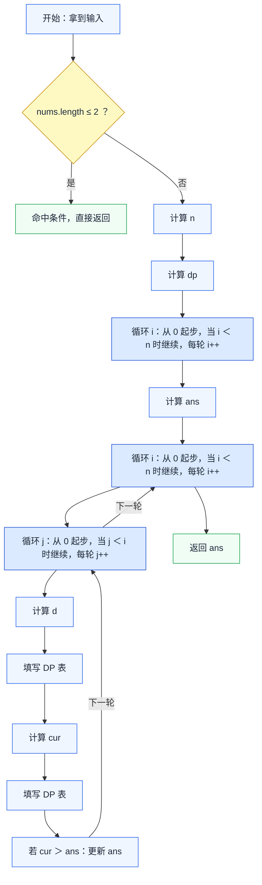

## TypeScript 解题方案（2 个方案逐个讲）

> **运行与提交**：每个方案都是自包含文件（内嵌用例自测，输出 PASS），整块复制到 `.ts` 文件后 `node 文件名` 即可运行。提交 LeetCode 时，把 `demo` 内的算法函数与辅助类型/函数整体取出、置于文件顶层即可。涉及交互/特殊接口的题以题面给定签名为准。

### 方案 1：动态规划

**分析与思路**：核心做法是「动态规划」。代码里依次做这些事：DP 表逐项填充；双重循环遍历。

**运行方式**：`node 本文件`，内嵌用例全部通过会输出 PASS。


**方案专属流程图**（真实控制流）：

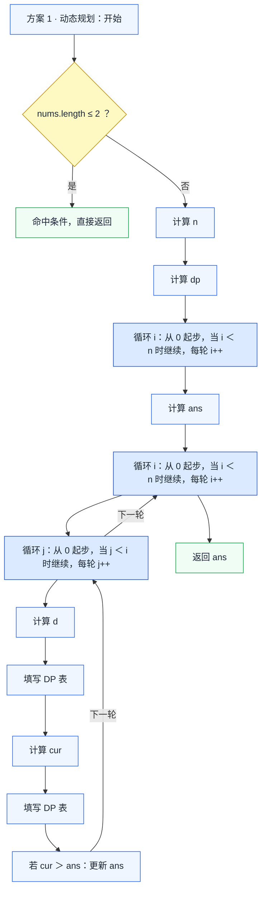

```typescript
export function demo(): void {
  // 程序入口：跑内嵌自测用例
  function longestArithSeqLength(nums: number[]): number {
    // 定义函数/方法 longestArithSeqLength
    if (nums.length <= 2) return nums.length; // 若 数组.长度 不超过 2，直接返回 数组.长度
    const n = nums.length; // 把 数组.长度 存入 元素个数
    const dp: { [d: number]: number }[] = []; // 把 []; 写入 const dp: { [d: number]: number }[]
    for (let i = 0; i < n; i++) dp.push({}); // 让 下标 i 从 0 开始计数，下标 i 小于 元素个数 就继续
    let ans = 2; // 把 2 存入 答案
    for (let i = 0; i < n; i++) {
      // 让 下标 i 从 0 开始计数，下标 i 小于 元素个数 就继续
      for (let j = 0; j < i; j++) {
        // 让 下标 j 从 0 开始计数，下标 j 小于 下标 i 就继续
        const d = nums[i] - nums[j]; // 把 数组[下标 i] 减 数组[下标 j] 存入 d
        const prev = dp[j][d] === undefined ? 1 : dp[j][d]; // 把 DP 表[下标 j][d] 全等于 undefined ? 1 : DP 表[下标 j][d] 存入 前一个
        const cur = prev + 1; // 把 前一个 加 1 存入 当前值
        dp[i][d] = cur; // 把 当前值; 写入 dp[i][d]
        if (cur > ans) ans = cur; // 若 当前值 超过 答案) 答案 赋值为 当前值;
      }
    }
    return ans; // 返回 答案
  }

  const cases: { in: number[]; want: number }[] = [
    { in: [9, 4, 7, 2, 10], want: 3 },
    { in: [3, 6, 9, 12], want: 4 },
    { in: [20, 1, 15, 3, 10, 5, 8], want: 4 },
    { in: [1], want: 1 },
  ];
  let fail = false; // 把 false 存入 fail
  for (const c of cases) {
    // for (const 字符 of cases) {
    const got = longestArithSeqLength(c.in); // 把 longestArithSeqLength(字符.in) 存入 got
    if (got !== c.want) {
      // 若 got 不等于 字符.want
      fail = true; // 把 true 存入 fail
      console.log(
        'FAIL in=' + JSON.stringify(c.in) + ' got=' + got + ' want=' + c.want,
      ); // 打印输出
    }
  }
  if (fail) throw new Error('FAILED'); // 若 fail) throw new Error(「FAILED」);
  console.log('PASS'); // 全部用例通过，输出 PASS
}
demo(); // demo();
```

### 方案 2：动态规划

**分析与思路**：核心做法是「动态规划」。代码里依次做这些事：DP 表逐项填充；双重循环遍历。

**运行方式**：`node 本文件`，内嵌用例全部通过会输出 PASS。


**方案专属流程图**（真实控制流）：


```typescript
export function demo(): void {
  // 程序入口：跑内嵌自测用例
  function longestArithSeqLength(nums: number[]): number {
    // 定义函数/方法 longestArithSeqLength
    if (nums.length <= 2) return nums.length; // 若 数组.长度 不超过 2，直接返回 数组.长度
    const n = nums.length; // 把 数组.长度 存入 元素个数
    const dp: { [d: number]: number }[] = []; // 把 []; 写入 const dp: { [d: number]: number }[]
    for (let i = 0; i < n; i++) dp.push({}); // 让 下标 i 从 0 开始计数，下标 i 小于 元素个数 就继续
    let ans = 2; // 把 2 存入 答案
    for (let i = 0; i < n; i++) {
      // 让 下标 i 从 0 开始计数，下标 i 小于 元素个数 就继续
      for (let j = 0; j < i; j++) {
        // 让 下标 j 从 0 开始计数，下标 j 小于 下标 i 就继续
        const d = nums[i] - nums[j]; // 把 数组[下标 i] 减 数组[下标 j] 存入 d
        const prev = dp[j][d] === undefined ? 1 : dp[j][d]; // 把 DP 表[下标 j][d] 全等于 undefined ? 1 : DP 表[下标 j][d] 存入 前一个
        const cur = prev + 1; // 把 前一个 加 1 存入 当前值
        dp[i][d] = cur; // 把 当前值; 写入 dp[i][d]
        if (cur > ans) ans = cur; // 若 当前值 超过 答案) 答案 赋值为 当前值;
      }
    }
    return ans; // 返回 答案
  }

  const cases: { in: number[]; want: number }[] = [
    { in: [9, 4, 7, 2, 10], want: 3 },
    { in: [3, 6, 9, 12], want: 4 },
    { in: [20, 1, 15, 3, 10, 5, 8], want: 4 },
    { in: [1], want: 1 },
  ];
  let fail = false; // 把 false 存入 fail
  for (const c of cases) {
    // for (const 字符 of cases) {
    const got = longestArithSeqLength(c.in); // 把 longestArithSeqLength(字符.in) 存入 got
    if (got !== c.want) {
      // 若 got 不等于 字符.want
      fail = true; // 把 true 存入 fail
      console.log(
        'FAIL in=' + JSON.stringify(c.in) + ' got=' + got + ' want=' + c.want,
      ); // 打印输出
    }
  }
  if (fail) throw new Error('FAILED'); // 若 fail) throw new Error(「FAILED」);
  console.log('PASS'); // 全部用例通过，输出 PASS
}
demo(); // demo();
```

## 逐步拆解与面试追问

**复杂度**：时间 O(n) 到 O(m·n)（取决于状态维度），空间即 DP 表大小

**为什么是这个量级**：动态规划把指数级枚举压成表，每格只算一次，复杂度等于「状态数 × 转移代价」

**面试官可能会追问**：

- 状态定义为什么是它？
- 遍历顺序由什么决定？
- 能否滚动数组压空间？

## 关键 API 速查（TS 主解法实际用到，附官方链接）

| API | 作用 | 使用要点 | 官方文档 |
|---|---|---|---|
| `Array.prototype.push()` | 尾部追加 | 返回新长度；可一次多个；均摊 O(1)；会改变原数组 | [官方文档](https://developer.mozilla.org/zh-CN/docs/Web/JavaScript/Reference/Global_Objects/Array/push) |
| `JSON.stringify()` | 序列化为 JSON 字符串 | 常用于结构化比较（深度相等判定）；undefined/函数/循环引用会被丢弃或抛错 | [官方文档](https://developer.mozilla.org/zh-CN/docs/Web/JavaScript/Reference/Global_Objects/JSON/stringify) |

### 各语言官方文档导航

- **TypeScript / JS**：[MDN 中文参考](https://developer.mozilla.org/zh-CN/)
- **Python**：[Python 官方文档](https://docs.python.org/zh-cn/3/)
- **Go**：[Go 标准库](https://pkg.go.dev/std)
- **Java**：[JDK 17 API](https://docs.oracle.com/en/java/javase/17/docs/api/)
- **Rust**：[Rust 标准库](https://doc.rust-lang.org/std/)
- **Lua**：[Lua 5.4 手册](https://www.lua.org/manual/5.4/)
- **C**：[Cppreference C](https://zh.cppreference.com/w/c)
- **C++**：[Cppreference C++](https://zh.cppreference.com/w/cpp)
- **R**：[R 官方手册](https://stat.ethz.ch/R-manual/)
- **Zig**：[Zig 语言文档](https://ziglang.org/documentation/master/)
- **Dart**：[Dart API](https://api.dart.dev/)

## 附录：其他 10 种语言全部实现（每种语言列举其全部方案）

> TypeScript 的全部方案见「TypeScript 解题方案」一节；下面是其余 10 种语言的对应实现，每种语言的每个方案都带思路分析、代码走读与专属运行架构图。
> 每个方案都内嵌用例自测，可独立运行（老仓库 python/go 文件遵循「打印结果」约定）。
> 完整解法文件见 `dsa/<语言>/dp/lc_1027_最长等差数列/`。

### Python 实现（2 种方案）

Python 的全部方案如下，每个方案都内嵌用例自测，可独立运行（老仓库 python/go 文件遵循「打印结果」约定）：

#### 方案 1：动态规划

**思路与代码分析**：核心是「动态规划」。Python 版用切片与字典推导式简化操作，突出可读性。代码里依次做这些事：DP 表逐项填充。**走读**：方案 1 · 动态规划：开始 → 命中条件，直接返回 → 更新 n → 填写 DP 表 → 更新 ans → 循环 i：从 0 到 n 前 → 循环 j：从 0 到 i 前 → 更新 d → 填写 DP 表 → 更新 cur → 填写 DP 表 → 若 cur ＞ ans：更新 ans → 更新 ans → 返回 ans。

**运行架构**（真实控制流）：

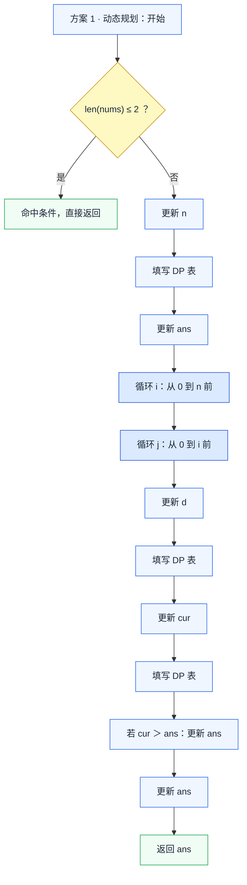

```python
import sys  # 提高递归深度上限（深输入防 RecursionError）

sys.setrecursionlimit(200000)  # 树/链表类题目节点数可达 1e4 量级

def longestArithSeqLength(nums):  # 定义函数 longestArithSeqLength（参数：数组）
    if len(nums) <= 2:  # 若 长度(数组) 不超过 2
        return len(nums)  # 返回 长度(数组)
    n = len(nums)  # 把 长度(数组) 存入 元素个数
    dp = [{} for _ in range(n)]  # 把 [{} for _ in range(元素个数)] 存入 DP 表
    ans = 2  # 把 2 存入 答案
    for i in range(n):  # 让 下标 i 从 元素个数 遍历
        for j in range(i):  # 让 下标 j 从 下标 i 遍历
            d = nums[i] - nums[j]  # 把 数组[下标 i] 减 数组[下标 j] 存入 d
            prev = dp[j].get(d, 1)  # 把 DP 表[下标 j] 查找 d, 1) 存入 前一个
            cur = prev + 1  # 把 前一个 加 1 存入 当前值
            dp[i][d] = cur  # 把 当前值 写入 dp[i][d]
            if cur > ans:  # 若 当前值 超过 答案
                ans = cur  # 把 当前值 存入 答案
    return ans  # 返回 答案

if __name__ == "__main__":  # 若 __name__ 等于 '__main__'
    print(longestArithSeqLength([9, 4, 7, 2, 10]))  # 打印输出
```

#### 方案 2：动态规划

**思路与代码分析**：核心是「动态规划」。Python 版用切片与字典推导式简化操作，突出可读性。代码里依次做这些事：DP 表逐项填充。**走读**：方案 2 · 动态规划：开始 → 命中条件，直接返回 → 更新 n → 填写 DP 表 → 更新 ans → 循环 i：从 0 到 n 前 → 循环 j：从 0 到 i 前 → 更新 d → 填写 DP 表 → 填写 DP 表 → 若 length ＞ ans：更新 ans → 更新 ans → 返回 ans。

**运行架构**（真实控制流）：

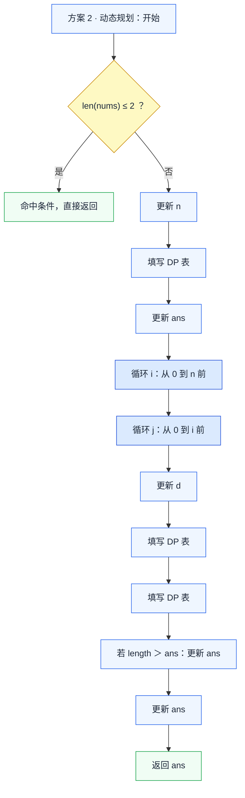

```python
import sys  # 提高递归深度上限（深输入防 RecursionError）

sys.setrecursionlimit(200000)  # 树/链表类题目节点数可达 1e4 量级

def longestArithSeqLength(nums):  # 定义函数 longestArithSeqLength（参数：数组）
    if len(nums) <= 2:  # 若 长度(数组) 不超过 2
        return len(nums)  # 返回 长度(数组)
    n = len(nums)  # 把 长度(数组) 存入 元素个数
    # 用 map 记录以 i 结尾、公差为 d 的最长等差子序列长度
    dp = [{} for _ in range(n)]  # 把 [{} for _ in range(元素个数)] 存入 DP 表
    ans = 2  # 把 2 存入 答案
    for i in range(n):  # 让 下标 i 从 元素个数 遍历
        for j in range(i):  # 让 下标 j 从 下标 i 遍历
            d = nums[i] - nums[j]  # 把 数组[下标 i] 减 数组[下标 j] 存入 d
            length = dp[j].get(d, 1) + 1  # 把 DP 表[下标 j] 查找 d, 1) 加 1 存入 长度
            dp[i][d] = length  # 把 长度 写入 dp[i][d]
            if length > ans:  # 若 长度 超过 答案
                ans = length  # 把 长度 存入 答案
    return ans  # 返回 答案

if __name__ == "__main__":  # 若 __name__ 等于 '__main__'
    print(longestArithSeqLength([3, 6, 9, 12]))  # 打印输出
```

### Go 实现（2 种方案）

Go 的全部方案如下，每个方案都内嵌用例自测，可独立运行（老仓库 python/go 文件遵循「打印结果」约定）：

#### 方案 1：动态规划

**思路与代码分析**：核心是「动态规划」。Go 版用切片与多返回值惯用法，显式处理索引边界。代码里依次做这些事：哈希结构做计数或查重；DP 表逐项填充。**走读**：方案 1 · 动态规划：开始 → 处理 if len(nums) ≤ 2 → 返回 len(nums) → 遍历 dp 的下标与元素 i → 遍历循环 → 遍历循环 → 返回 ans。

**运行架构**（真实控制流）：

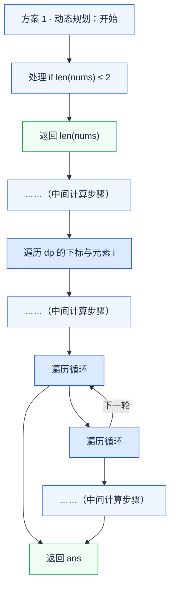

```go
package main // 引入依赖

import (
	"fmt" // 「fmt」
	"os"  // 「os」
)

// longestArithSeqLength 是 Python 参考 solution_1 的忠实翻译（DP dp[i][d]）。
func longestArithSeqLength(nums []int) int { // 定义函数/方法 longestArithSeqLength
	if len(nums) <= 2 { // 若 长度(数组) 不超过 2
		return len(nums) // 定义函数/方法 len
	}
	n := len(nums)               // 把 长度(数组) 写入 n :
	dp := make([]map[int]int, n) // 把 make([]映射表[int]int, 元素个数) 写入 dp :
	for i := range dp {          // 把 range DP 表 { 写入 for i :
		dp[i] = map[int]int{} // 把 映射表[int]int{} 写入 dp[i]
	}
	ans := 2                 // 把 2 写入 ans :
	for i := 0; i < n; i++ { // 让 下标 i 从 0 开始计数
		for j := 0; j < i; j++ { // 让 下标 j 从 0 开始计数
			d := nums[i] - nums[j]     // 把 数组[下标 i] 减 数组[下标 j] 写入 d :
			prev := 1                  // 把 1 写入 prev :
			if v, ok := dp[j][d]; ok { // 若 值, ok : 赋值为 DP 表[下标 j][d]; ok
				prev = v // 把 值 写入 前一个
			}
			cur := prev + 1 // 把 前一个 加 1 写入 cur :
			dp[i][d] = cur  // 把 当前值 写入 dp[i][d]
			if cur > ans {  // 若 当前值 超过 答案
				ans = cur // 把 当前值 写入 答案
			}
		}
	}
	return ans // 返回 答案
}

func main() { // 程序入口：跑内嵌自测用例
	type tc struct { // 定义类型
		nums []int // 数组 []int
		want int   // want int
	}
	cases := []tc{ // 把 []tc{ 写入 cases :
		{[]int{9, 4, 7, 2, 10}, 3},
		{[]int{20, 1, 15, 3, 10, 5, 8}, 4},
		{[]int{1, 2, 3, 4}, 4},
		{[]int{83, 20, 17, 43, 52, 78, 68, 45}, 2},
		{[]int{3, 6, 9, 12}, 4},
	}
	for _, c := range cases { // 同时取 _ 与 字符 遍历
		if got := longestArithSeqLength(c.nums); got != c.want { // 若 got : 赋值为 longestArithSeqLength(字符.数组); got 不等于 字符.want
			fmt.Printf("FAIL %v got=%d want=%d\n", c.nums, got, c.want) // 打印输出
			os.Exit(1)                                                  // os.Exit(1)
		}
	}
	fmt.Println("PASS") // 全部用例通过，输出 PASS
}
```

#### 方案 2：动态规划

**思路与代码分析**：核心是「动态规划」。Go 版用切片与多返回值惯用法，显式处理索引边界。代码里依次做这些事：哈希结构做计数或查重；DP 表逐项填充。**走读**：方案 2 · 动态规划：开始 → 更新 : → 返回 n → 遍历 dp 的下标与元素 i → 遍历循环 → 遍历循环 → 返回 best。

**运行架构**（真实控制流）：

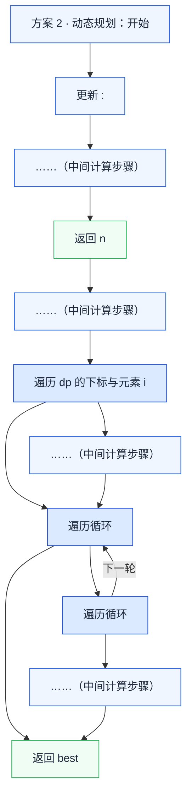

```go
package main // 引入依赖
import (
	"fmt"
	"os"
) // 引入依赖
func longestArithSeqLength(nums []int) int { // 定义函数/方法 longestArithSeqLength
	n := len(nums) // 把 长度(数组) 写入 n :
	if n <= 2 {
		return n
	} // 若 元素个数 不超过 2 { return 元素个数 }
	best := 2                    // 把 2 写入 best :
	dp := make([]map[int]int, n) // 把 make([]映射表[int]int, 元素个数) 写入 dp :
	for i := range dp {
		dp[i] = map[int]int{}
	} // 把 range DP 表 { DP 表[下标 i] 赋值为 映射表[int]int{} } 写入 for i :
	for i := 1; i < n; i++ { // 让 下标 i 从 1 开始计数
		for j := 0; j < i; j++ { // 让 下标 j 从 0 开始计数
			d := nums[i] - nums[j] // 把 数组[下标 i] 减 数组[下标 j] 写入 d :
			v := 2                 // 把 2 写入 v :
			if dp[j][d] > 0 {
				v = dp[j][d] + 1
			} // 若 DP 表[下标 j][d] 超过 0 { 值 赋值为 DP 表[下标 j][d] 加 1 }
			if dp[i][d] < v {
				dp[i][d] = v
			} // 若 DP 表[下标 i][d] 小于 值 { DP 表[下标 i][d] 赋值为 值 }
			if dp[i][d] > best {
				best = dp[i][d]
			} // 若 DP 表[下标 i][d] 超过 当前最优 { 当前最优 赋值为 DP 表[下标 i][d] }
		}
	}
	return best // 返回 当前最优
}
func main() { // 程序入口：跑内嵌自测用例
	cases := []struct {
		in   []int
		want int
	}{ // 把 []struct{ in []int; want int }{ 写入 cases :
		{[]int{9, 4, 7, 2, 10}, 3}, {[]int{20, 1, 15, 3, 10, 5, 8}, 4}, {[]int{3, 6, 9, 12}, 4},
	}
	ok := true                // 把 true 写入 ok :
	for _, c := range cases { // 同时取 _ 与 字符 遍历
		if got := longestArithSeqLength(c.in); got != c.want {
			ok = false
			fmt.Printf("FAIL=%v want %v\n", got, c.want)
		}
	}
	if !ok {
		os.Exit(1)
	} // 若 取反 ok { os.Exit(1) }
	fmt.Println("PASS") // 全部用例通过，输出 PASS
}
```

### Java 实现（2 种方案）

Java 的全部方案如下，每个方案都内嵌用例自测，可独立运行（老仓库 python/go 文件遵循「打印结果」约定）：

#### 方案 1：动态规划

**思路与代码分析**：核心是「动态规划」。Java 版用类与静态方法组织，集合操作显式明了。代码里依次做这些事：哈希结构做计数或查重；DP 表逐项填充；双重循环遍历。**走读**：方案 1 · 动态规划：开始 → 更新 n → 命中条件，直接返回 → 填写 DP 表 → 处理 new HashMap[n] → 遍历循环 → 更新 ans → 遍历循环 → 遍历循环 → 更新 d → 填写 DP 表 → 更新 cur → 填写 DP 表 → 若 cur ＞ ans：更新 ans → 返回 ans。

**运行架构**（真实控制流）：

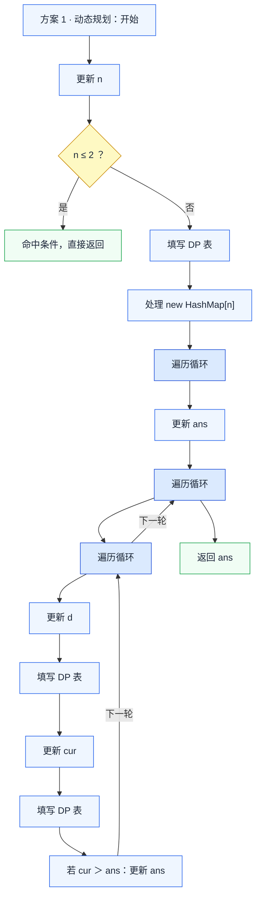

```java
package com.webfault.dsa; // 引入依赖

import java.util.*; // 引入依赖

class lc1027_solution111 { // 定义类型
  public int longestArithSeqLength(int[] nums) { // 定义函数/方法 longestArithSeqLength
    int n = nums.length; // 把 数组.长度 存入 元素个数
    if (n <= 2) return n; // 若 元素个数 不超过 2，直接返回 元素个数
    HashMap<Integer, Integer>[] dp =
        new HashMap[n]; // 把 new HashMap[元素个数]; 写入 HashMap<Integer, Integer>[] dp
    for (int i = 0; i < n; i++) dp[i] = new HashMap<>(); // 让 下标 i 从 0 开始计数，下标 i 小于 元素个数 就继续
    int ans = 2; // 把 2 存入 答案
    for (int i = 0; i < n; i++) { // 让 下标 i 从 0 开始计数，下标 i 小于 元素个数 就继续
      for (int j = 0; j < i; j++) { // 让 下标 j 从 0 开始计数，下标 j 小于 下标 i 就继续
        int d = nums[i] - nums[j]; // 把 数组[下标 i] 减 数组[下标 j] 存入 d
        int prev = dp[j].getOrDefault(d, 1); // 把 DP 表[下标 j].getOrDefault(d, 1) 存入 前一个
        int cur = prev + 1; // 把 前一个 加 1 存入 当前值
        dp[i].put(d, cur); // DP 表[下标 i].put(d, 当前值);
        if (cur > ans) ans = cur; // 若 当前值 超过 答案) 答案 赋值为 当前值;
      }
    }
    return ans; // 返回 答案
  }

  public static void main(String[] args) { // public static void main(String[] args) {
    lc1027_solution111 s =
        new lc1027_solution111(); // 把 new lc1027_solution111(); 写入 lc1027_solution111 s
    int got = s.longestArithSeqLength(new int[] {9, 4, 7, 2, 10});
    if (got != 3) {
      System.out.println("FAIL got " + got);
      throw new RuntimeException("FAILED");
    }
    System.out.println("PASS"); // 全部用例通过，输出 PASS
  }
}
```

#### 方案 2：动态规划

**思路与代码分析**：核心是「动态规划」。Java 版用类与静态方法组织，集合操作显式明了。代码里依次做这些事：哈希结构做计数或查重；DP 表逐项填充；双重循环遍历。**走读**：方案 2 · 动态规划：开始 → 更新 n → 命中条件，直接返回 → 填写 DP 表 → 处理 new HashMap[n] → 遍历循环 → 更新 ans → 遍历循环 → 遍历循环 → 更新 d → 填写 DP 表 → 填写 DP 表 → 若 length ＞ ans：更新 ans → 返回 ans。

**运行架构**（真实控制流）：

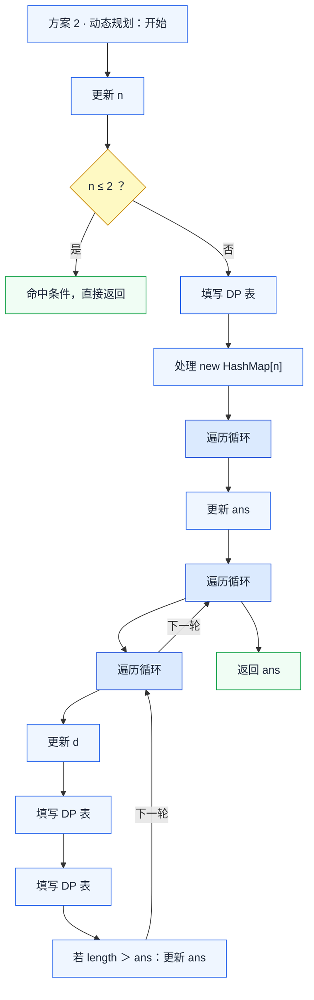

```java
package com.webfault.dsa; // 引入依赖

import java.util.*; // 引入依赖

class solution222Map { // 定义类型
  public int longestArithSeqLength(int[] nums) { // 定义函数/方法 longestArithSeqLength
    int n = nums.length; // 把 数组.长度 存入 元素个数
    if (n <= 2) return n; // 若 元素个数 不超过 2，直接返回 元素个数
    HashMap<Integer, Integer>[] dp =
        new HashMap[n]; // 把 new HashMap[元素个数]; 写入 HashMap<Integer, Integer>[] dp
    for (int i = 0; i < n; i++) dp[i] = new HashMap<>(); // 让 下标 i 从 0 开始计数，下标 i 小于 元素个数 就继续
    int ans = 2; // 把 2 存入 答案
    for (int i = 0; i < n; i++) { // 让 下标 i 从 0 开始计数，下标 i 小于 元素个数 就继续
      for (int j = 0; j < i; j++) { // 让 下标 j 从 0 开始计数，下标 j 小于 下标 i 就继续
        int d = nums[i] - nums[j]; // 把 数组[下标 i] 减 数组[下标 j] 存入 d
        int length = dp[j].getOrDefault(d, 1) + 1; // 把 DP 表[下标 j].getOrDefault(d, 1) 加 1 存入 长度
        dp[i].put(d, length); // DP 表[下标 i].put(d, 长度);
        if (length > ans) ans = length; // 若 长度 超过 答案) 答案 赋值为 长度;
      }
    }
    return ans; // 返回 答案
  }

  public static void main(String[] args) { // public static void main(String[] args) {
    solution222Map s = new solution222Map(); // 把 new solution222Map(); 写入 solution222Map s
    int got =
        s.longestArithSeqLength(
            new int[] {3, 6, 9, 12}); // 把 字符串.longestArithSeqLength(new int[]{3, 6, 9, 12}) 存入 got
    if (got != 4) {
      System.out.println("FAIL got " + got);
      throw new RuntimeException("FAILED");
    }
    System.out.println("PASS"); // 全部用例通过，输出 PASS
  }
}
```

### Rust 实现（2 种方案）

Rust 的全部方案如下，每个方案都内嵌用例自测，可独立运行（老仓库 python/go 文件遵循「打印结果」约定）：

#### 方案 1：动态规划

**思路与代码分析**：核心是「动态规划」。Rust 版用所有权移动与切片借用改写同一逻辑，注意 Option 与引用边界。代码里依次做这些事：哈希结构做计数或查重；DP 表逐项填充。**走读**：方案 1 · 动态规划：开始 → 计算 n → 计算 dp → 计算 best → 遍历 0..n 中的每个元素 i → 遍历 0..i 中的每个元素 j → 计算 d → 填写 DP 表 → 填写 DP 表 → 处理 if cur ＞ best → 更新 best → 处理 best → 返回结果。

**运行架构**（真实控制流）：


```rust
// LeetCode 1027. 最长等差数列 — Rust 版（方案1）
use std::collections::HashMap; // 引入依赖
fn longest_arith_seq_length(nums: Vec<i32>) -> i32 {
    // 定义函数/方法 longest_arith_seq_length
    let n = nums.len(); // 把 数组.长度() 存入 元素个数
    let mut dp: Vec<HashMap<i32, i32>> = vec![HashMap::new(); n];
    let mut best = 1; // 把 1; 写入 let mut best
    for i in 0..n {
        // 逐个取出 0 的元素（下标 i）
        for j in 0..i {
            // 逐个取出 0 的元素（下标 j）
            let d = nums[i] - nums[j]; // 把 数组[下标 i] 减 数组[下标 j] 存入 d
            let cur = dp[j].get(&d).copied().unwrap_or(1) + 1; // 把 DP 表[下标 j] 查找 按位与 d).copied().unwrap_or(1) 加 1 存入 当前值
            dp[i].insert(d, cur); // DP 表[下标 i] 插入 d, 当前值);
            if cur > best {
                best = cur;
            } // 若 当前值 超过 当前最优 { 当前最优 赋值为 当前值; }
        }
    }
    best // 当前最优
}
fn main() {
    assert_eq!(longest_arith_seq_length(vec![9, 4, 7, 2, 10]), 3);
    assert_eq!(longest_arith_seq_length(vec![3, 6, 9, 12]), 4);
    println!("PASS");
} // 程序入口：跑内嵌自测用例
```

#### 方案 2：动态规划

**思路与代码分析**：核心是「动态规划」。Rust 版用所有权移动与切片借用改写同一逻辑，注意 Option 与引用边界。代码里依次做这些事：哈希结构做计数或查重；DP 表逐项填充。**走读**：方案 2 · 动态规划：开始 → 计算 n → 计算 dp → 计算 best → 遍历 0..n 中的每个元素 i → 遍历 0..i 中的每个元素 j → 计算 d → 填写 DP 表 → 填写 DP 表 → 处理 if cur ＞ best → 更新 best → 处理 best → 返回结果。

**运行架构**（真实控制流）：

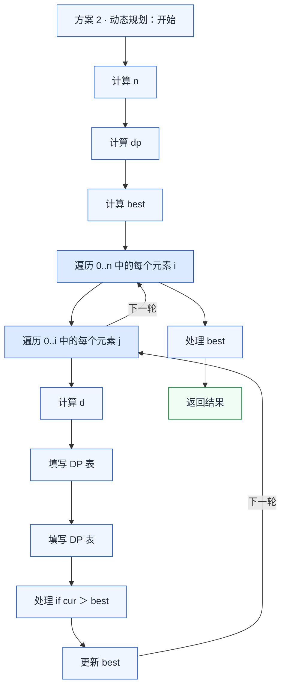

```rust
// LeetCode 1027. 最长等差数列 — Rust 版（方案2）
use std::collections::HashMap; // 引入依赖
fn longest_arith_seq_length(nums: Vec<i32>) -> i32 {
    // 定义函数/方法 longest_arith_seq_length
    let n = nums.len(); // 把 数组.长度() 存入 元素个数
    let mut dp: Vec<HashMap<i32, i32>> = vec![HashMap::new(); n];
    let mut best = 1; // 把 1; 写入 let mut best
    for i in 0..n {
        // 逐个取出 0 的元素（下标 i）
        for j in 0..i {
            // 逐个取出 0 的元素（下标 j）
            let d = nums[i] - nums[j]; // 把 数组[下标 i] 减 数组[下标 j] 存入 d
            let cur = dp[j].get(&d).copied().unwrap_or(1) + 1; // 把 DP 表[下标 j] 查找 按位与 d).copied().unwrap_or(1) 加 1 存入 当前值
            dp[i].insert(d, cur); // DP 表[下标 i] 插入 d, 当前值);
            if cur > best {
                best = cur;
            } // 若 当前值 超过 当前最优 { 当前最优 赋值为 当前值; }
        }
    }
    best // 当前最优
}
fn main() {
    assert_eq!(longest_arith_seq_length(vec![9, 4, 7, 2, 10]), 3);
    assert_eq!(longest_arith_seq_length(vec![3, 6, 9, 12]), 4);
    println!("PASS");
} // 程序入口：跑内嵌自测用例
```

### Lua 实现（2 种方案）

Lua 的全部方案如下，每个方案都内嵌用例自测，可独立运行（老仓库 python/go 文件遵循「打印结果」约定）：

#### 方案 1：动态规划

**思路与代码分析**：核心是「动态规划」。Lua 版用表与 ipairs 遍历，注意 ipairs 遇 nil 即停的语义。代码里依次做这些事：DP 表逐项填充。**走读**：方案 1 · 动态规划：开始 → 更新 n → 填写 DP 表 → 循环 i：从 1 到 n do → 填写 DP 表 → 更新 best → 循环 i：从 1 到 n do → 循环 j：从 1 到 i - 1 do → 更新 d → 填写 DP 表 → 填写 DP 表 → 处理 if cur ＞ best then → 更新 best → 返回 best。

**运行架构**（真实控制流）：

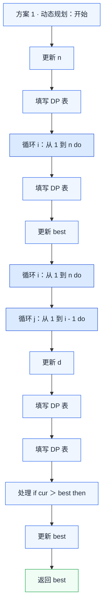

```lua
-- LeetCode 1027. 最长等差数列 — Lua 版（方案1）
local function longest_arith_seq_length(nums) -- local function longest_arith_seq_length(数组)
	local n = #nums -- 把 #数组 写入 local n
	local dp = {} -- 把 {} 写入 local dp
	for i = 1, n do
		dp[i] = {}
	end -- 让 下标 i 从 1 走到 元素个数（Lua 1 基）
	local best = 1 -- 把 1 写入 local best
	for i = 1, n do -- 让 下标 i 从 1 走到 元素个数（Lua 1 基）
		for j = 1, i - 1 do -- 让 下标 j 从 1 走到 下标 i（Lua 1 基）
			local d = nums[i] - nums[j] -- 把 数组[下标 i] 减 数组[下标 j] 写入 local d
			local cur = (dp[j][d] or 1) + 1 -- 把 (DP 表[下标 j][d] or 1) 加 1 写入 local cur
			dp[i][d] = cur -- 把 当前值 写入 dp[i][d]
			if cur > best then
				best = cur
			end -- 若 当前值 超过 当前最优 then 当前最优 赋值为 当前值 终点
		end -- 终点
	end -- 终点
	return best -- 返回 当前最优
end -- 终点
assert(longest_arith_seq_length({ 9, 4, 7, 2, 10 }) == 3) -- 断言校验
assert(longest_arith_seq_length({ 3, 6, 9, 12 }) == 4) -- 断言校验
print("PASS") -- 全部用例通过，输出 PASS
```

#### 方案 2：动态规划

**思路与代码分析**：核心是「动态规划」。Lua 版用表与 ipairs 遍历，注意 ipairs 遇 nil 即停的语义。代码里依次做这些事：DP 表逐项填充。**走读**：方案 2 · 动态规划：开始 → 更新 n → 填写 DP 表 → 循环 i：从 1 到 n do → 填写 DP 表 → 更新 best → 循环 i：从 1 到 n do → 循环 j：从 1 到 i - 1 do → 更新 d → 填写 DP 表 → 填写 DP 表 → 处理 if cur ＞ best then → 更新 best → 返回 best。

**运行架构**（真实控制流）：

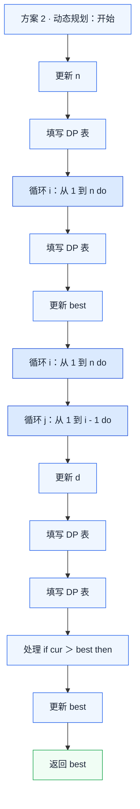

```lua
-- LeetCode 1027. 最长等差数列 — Lua 版（方案2）
local function longest_arith_seq_length(nums) -- local function longest_arith_seq_length(数组)
	local n = #nums -- 把 #数组 写入 local n
	local dp = {} -- 把 {} 写入 local dp
	for i = 1, n do
		dp[i] = {}
	end -- 让 下标 i 从 1 走到 元素个数（Lua 1 基）
	local best = 1 -- 把 1 写入 local best
	for i = 1, n do -- 让 下标 i 从 1 走到 元素个数（Lua 1 基）
		for j = 1, i - 1 do -- 让 下标 j 从 1 走到 下标 i（Lua 1 基）
			local d = nums[i] - nums[j] -- 把 数组[下标 i] 减 数组[下标 j] 写入 local d
			local cur = (dp[j][d] or 1) + 1 -- 把 (DP 表[下标 j][d] or 1) 加 1 写入 local cur
			dp[i][d] = cur -- 把 当前值 写入 dp[i][d]
			if cur > best then
				best = cur
			end -- 若 当前值 超过 当前最优 then 当前最优 赋值为 当前值 终点
		end -- 终点
	end -- 终点
	return best -- 返回 当前最优
end -- 终点
assert(longest_arith_seq_length({ 9, 4, 7, 2, 10 }) == 3) -- 断言校验
assert(longest_arith_seq_length({ 3, 6, 9, 12 }) == 4) -- 断言校验
print("PASS") -- 全部用例通过，输出 PASS
```

### C 实现（2 种方案）

C 的全部方案如下，每个方案都内嵌用例自测，可独立运行（老仓库 python/go 文件遵循「打印结果」约定）：

#### 方案 1：动态规划

**思路与代码分析**：核心是「动态规划」。C 版手动管理下标与内存，循环边界全部显式写出。代码里依次做这些事：双重循环遍历。**走读**：方案 1 · 动态规划：开始 → 命中条件，直接返回 → 更新 best → 遍历循环 → 遍历循环 → 遍历循环 → 返回 best。

**运行架构**（真实控制流）：

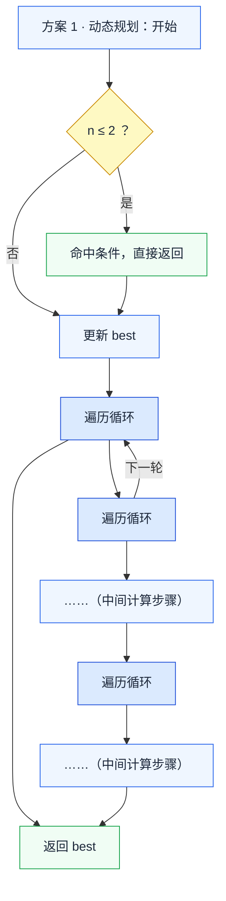

```c
/* LeetCode 1027. 最长等差数列 — C 版（方案1） */
#include <stdio.h>                                            // 引入头文件
static int longest_arith_seq_length(const int *nums, int n) { // 定义函数/方法 longest_arith_seq_length
    /* n 小，用 O(n^2 * d) 简化：dp[i][d] 用哈希替代 —— 简化为暴力双循环+线性回溯 */
    if (n <= 2)
        return n;                 // 若 元素个数 不超过 2，直接返回 元素个数
    int best = 2;                 // 把 2 存入 当前最优
    for (int i = 0; i < n; i++) { // 让 下标 i 从 0 开始计数，下标 i 小于 元素个数 就继续
        for (int j = i + 1; j < n; j++) { // 让 下标 j 从 下标 i 加 1 开始计数，下标 j 小于 元素个数 就继续
            int d = nums[j] - nums[i]; // 把 数组[下标 j] 减 数组[下标 i] 存入 d
            int cur = 2;               // 把 2 存入 当前值
            int last = nums[j];        // 把 数组[下标 j] 存入 last
            for (int k = j + 1; k < n;
                 k++) { // 让 下标 k 从 下标 j 加 1 开始计数，下标 k 小于 元素个数 就继续
                if (nums[k] - last == d) {
                    cur++;
                    last = nums[k];
                } // 若 数组[下标 k] 减 last 等于 d) { 当前值 加一 ; last 赋值为 数组[下标 k]; }
            }
            if (cur > best)
                best = cur; // 若 当前值 超过 当前最优) 当前最优 赋值为 当前值;
        }
    }
    return best; // 返回 当前最优
}
int main(void) { // 程序入口：跑内嵌自测用例
    if (longest_arith_seq_length((int[]){9, 4, 7, 2, 10}, 5) != 3) {
        printf("FAIL 1\n");
        return 1;
    }
    if (longest_arith_seq_length((int[]){3, 6, 9, 12}, 4) != 4) {
        printf("FAIL 2\n");
        return 1;
    }
    printf("PASS\n");
    return 0;
} // 全部用例通过，输出 PASS
```

#### 方案 2：动态规划

**思路与代码分析**：核心是「动态规划」。C 版手动管理下标与内存，循环边界全部显式写出。代码里依次做这些事：双重循环遍历。**走读**：方案 2 · 动态规划：开始 → 命中条件，直接返回 → 更新 best → 遍历循环 → 遍历循环 → 遍历循环 → 返回 best。

**运行架构**（真实控制流）：


```c
/* LeetCode 1027. 最长等差数列 — C 版（方案2） */
#include <stdio.h>                                            // 引入头文件
static int longest_arith_seq_length(const int *nums, int n) { // 定义函数/方法 longest_arith_seq_length
    /* n 小，用 O(n^2 * d) 简化：dp[i][d] 用哈希替代 —— 简化为暴力双循环+线性回溯 */
    if (n <= 2)
        return n;                 // 若 元素个数 不超过 2，直接返回 元素个数
    int best = 2;                 // 把 2 存入 当前最优
    for (int i = 0; i < n; i++) { // 让 下标 i 从 0 开始计数，下标 i 小于 元素个数 就继续
        for (int j = i + 1; j < n; j++) { // 让 下标 j 从 下标 i 加 1 开始计数，下标 j 小于 元素个数 就继续
            int d = nums[j] - nums[i]; // 把 数组[下标 j] 减 数组[下标 i] 存入 d
            int cur = 2;               // 把 2 存入 当前值
            int last = nums[j];        // 把 数组[下标 j] 存入 last
            for (int k = j + 1; k < n;
                 k++) { // 让 下标 k 从 下标 j 加 1 开始计数，下标 k 小于 元素个数 就继续
                if (nums[k] - last == d) {
                    cur++;
                    last = nums[k];
                } // 若 数组[下标 k] 减 last 等于 d) { 当前值 加一 ; last 赋值为 数组[下标 k]; }
            }
            if (cur > best)
                best = cur; // 若 当前值 超过 当前最优) 当前最优 赋值为 当前值;
        }
    }
    return best; // 返回 当前最优
}
int main(void) { // 程序入口：跑内嵌自测用例
    if (longest_arith_seq_length((int[]){9, 4, 7, 2, 10}, 5) != 3) {
        printf("FAIL 1\n");
        return 1;
    }
    if (longest_arith_seq_length((int[]){3, 6, 9, 12}, 4) != 4) {
        printf("FAIL 2\n");
        return 1;
    }
    printf("PASS\n");
    return 0;
} // 全部用例通过，输出 PASS
```

### C++ 实现（2 种方案）

C++ 的全部方案如下，每个方案都内嵌用例自测，可独立运行（老仓库 python/go 文件遵循「打印结果」约定）：

#### 方案 1：动态规划

**思路与代码分析**：核心是「动态规划」。C++ 版用 STL 容器与迭代器，减少手写下标错误。代码里依次做这些事：哈希结构做计数或查重；DP 表逐项填充；双重循环遍历。**走读**：方案 1 · 动态规划：开始 → 更新 n → 处理 std::vector＜std::unordered_m → 更新 best → 遍历循环 → 遍历循环 → 更新 d → 填写 DP 表 → 处理 : 2 → 填写 DP 表 → 更新 best → 返回 best。

**运行架构**（真实控制流）：


```cpp
// LeetCode 1027. 最长等差数列 — C++ 版（方案1）
#include <cassert>                                               // 引入头文件
#include <iostream>                                              // 引入头文件
#include <unordered_map>                                         // 引入头文件
#include <vector>                                                // 引入头文件
static int longestArithSeqLength(const std::vector<int> &nums) { // 定义函数/方法 longestArithSeqLength
    size_t n = nums.size();                                      // 把 数组.大小(); 写入 size_t n
    std::vector<std::unordered_map<int, int>> dp(n);
    int best = 1;                    // 把 1 存入 当前最优
    for (size_t i = 0; i < n; ++i) { // 让 下标 i 从 0 开始计数，下标 i 小于 元素个数 就继续
        for (size_t j = 0; j < i; ++j) { // 让 下标 j 从 0 开始计数，下标 j 小于 下标 i 就继续
            int d = nums[i] - nums[j];   // 把 数组[下标 i] 减 数组[下标 j] 存入 d
            int cur = dp[j].count(d) ? dp[j][d] + 1
                                     : 2; // 把 DP 表[下标 j].计数(d) ? DP 表[下标 j][d] 加 1 : 2 存入 当前值
            dp[i][d] = cur;               // 把 当前值; 写入 dp[i][d]
            best = std::max(best, cur); // 把 std::取较大值 当前最优, 当前值); 写入 当前最优
        }
    }
    return best; // 返回 当前最优
}
int main() {
    assert(longestArithSeqLength({9, 4, 7, 2, 10}) == 3);
    assert(longestArithSeqLength({3, 6, 9, 12}) == 4);
    std::cout << "PASS" << std::endl;
} // 全部用例通过，输出 PASS
```

#### 方案 2：动态规划

**思路与代码分析**：核心是「动态规划」。C++ 版用 STL 容器与迭代器，减少手写下标错误。代码里依次做这些事：哈希结构做计数或查重；DP 表逐项填充；双重循环遍历。**走读**：方案 2 · 动态规划：开始 → 更新 n → 处理 std::vector＜std::unordered_m → 更新 best → 遍历循环 → 遍历循环 → 更新 d → 填写 DP 表 → 处理 : 2 → 填写 DP 表 → 更新 best → 返回 best。

**运行架构**（真实控制流）：

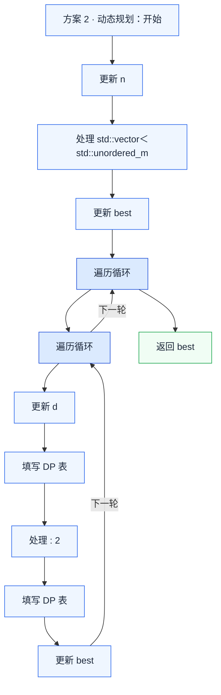

```cpp
// LeetCode 1027. 最长等差数列 — C++ 版（方案2）
#include <cassert>                                               // 引入头文件
#include <iostream>                                              // 引入头文件
#include <unordered_map>                                         // 引入头文件
#include <vector>                                                // 引入头文件
static int longestArithSeqLength(const std::vector<int> &nums) { // 定义函数/方法 longestArithSeqLength
    size_t n = nums.size();                                      // 把 数组.大小(); 写入 size_t n
    std::vector<std::unordered_map<int, int>> dp(n);
    int best = 1;                    // 把 1 存入 当前最优
    for (size_t i = 0; i < n; ++i) { // 让 下标 i 从 0 开始计数，下标 i 小于 元素个数 就继续
        for (size_t j = 0; j < i; ++j) { // 让 下标 j 从 0 开始计数，下标 j 小于 下标 i 就继续
            int d = nums[i] - nums[j];   // 把 数组[下标 i] 减 数组[下标 j] 存入 d
            int cur = dp[j].count(d) ? dp[j][d] + 1
                                     : 2; // 把 DP 表[下标 j].计数(d) ? DP 表[下标 j][d] 加 1 : 2 存入 当前值
            dp[i][d] = cur;               // 把 当前值; 写入 dp[i][d]
            best = std::max(best, cur); // 把 std::取较大值 当前最优, 当前值); 写入 当前最优
        }
    }
    return best; // 返回 当前最优
}
int main() {
    assert(longestArithSeqLength({9, 4, 7, 2, 10}) == 3);
    assert(longestArithSeqLength({3, 6, 9, 12}) == 4);
    std::cout << "PASS" << std::endl;
} // 全部用例通过，输出 PASS
```

### R 实现（2 种方案）

R 的全部方案如下，每个方案都内嵌用例自测，可独立运行（老仓库 python/go 文件遵循「打印结果」约定）：

#### 方案 1：动态规划

**思路与代码分析**：核心是「动态规划」。R 版用向量化思维与 1 起始下标，注意 1:n 的降序陷阱。代码里依次做这些事：DP 表逐项填充；双重循环遍历。**走读**：方案 1 · 动态规划：开始 → 处理 n ＜- length(nums) → 处理 dp ＜- vector(list, n) → 循环 i：遍历 seq_len(n)) dp[[i]] <- new.env(parent = emptyenv() → 处理 best ＜- 1L → 循环 i：遍历 seq_len(n) → 循环 j：遍历 seq_len(i - 1) → 处理 d ＜- nums[i] - nums[j] → 填写 DP 表 → 填写 DP 表 → 填写 DP 表 → 若 cur ＞ best：处理 best ＜- cur → 处理 best ＜- cur → 处理 best → 返回结果。

**运行架构**（真实控制流）：

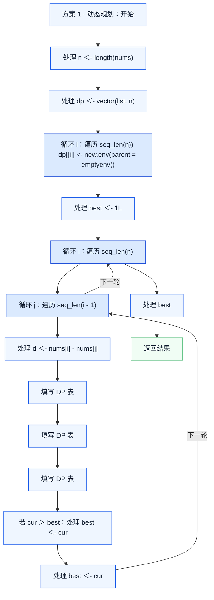

```r
# 版（方案1） 定义函数 longest_arith_seq_length（参数：数组）
longest_arith_seq_length <- function(nums) {
    n <- length(nums)  # 把 长度(数组) 存入 元素个数
    dp <- vector("list", n)  # 把 vector(「列表」, 元素个数) 存入 DP 表
    for (i in seq_len(n)) dp[[i]] <- new.env(parent = emptyenv())
    best <- 1L  # 把 1L 存入 当前最优
    for (i in seq_len(n)) {
        # for (下标 i in seq_len(元素个数)) { for (下标 j in seq_len(下标 i 减 1)) {
        for (j in seq_len(i - 1)) {
            d <- nums[i] - nums[j]  # 把 数组[下标 i] 减 数组[下标 j] 存入 d
            cur <- if (!is.null(dp[[j]][[as.character(d)]]))
                dp[[j]][[as.character(d)]] + 1L else 2L
            dp[[i]][[as.character(d)]] <- cur  # 把 当前值 存入 dp[[i]][[as.character(d)]]
            if (cur > best)
                best <- cur  # 若 当前值 超过 当前最优) 当前最优 小于 减 当前值
        }
    }
    best  # 当前最优
}
stopifnot(longest_arith_seq_length(c(9, 4, 7, 2, 10)) == 3)  # 断言校验
stopifnot(longest_arith_seq_length(c(3, 6, 9, 12)) == 4)  # 断言校验
cat("PASS\n")  # 全部用例通过，输出 PASS
```

#### 方案 2：动态规划

**思路与代码分析**：核心是「动态规划」。R 版用向量化思维与 1 起始下标，注意 1:n 的降序陷阱。代码里依次做这些事：DP 表逐项填充；双重循环遍历。**走读**：方案 2 · 动态规划：开始 → 处理 n ＜- length(nums) → 处理 dp ＜- vector(list, n) → 循环 i：遍历 seq_len(n)) dp[[i]] <- new.env(parent = emptyenv() → 处理 best ＜- 1L → 循环 i：遍历 seq_len(n) → 循环 j：遍历 seq_len(i - 1) → 处理 d ＜- nums[i] - nums[j] → 填写 DP 表 → 填写 DP 表 → 填写 DP 表 → 若 cur ＞ best：处理 best ＜- cur → 处理 best ＜- cur → 处理 best → 返回结果。

**运行架构**（真实控制流）：

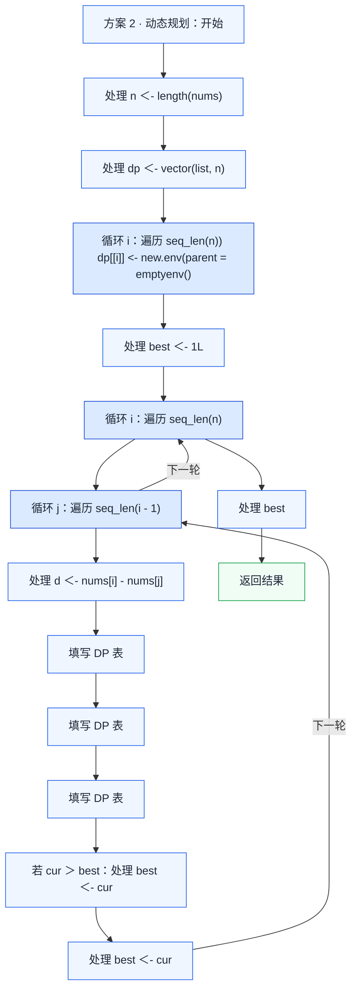

```r
# 版（方案2） 定义函数 longest_arith_seq_length（参数：数组）
longest_arith_seq_length <- function(nums) {
    n <- length(nums)  # 把 长度(数组) 存入 元素个数
    dp <- vector("list", n)  # 把 vector(「列表」, 元素个数) 存入 DP 表
    for (i in seq_len(n)) dp[[i]] <- new.env(parent = emptyenv())
    best <- 1L  # 把 1L 存入 当前最优
    for (i in seq_len(n)) {
        # for (下标 i in seq_len(元素个数)) { for (下标 j in seq_len(下标 i 减 1)) {
        for (j in seq_len(i - 1)) {
            d <- nums[i] - nums[j]  # 把 数组[下标 i] 减 数组[下标 j] 存入 d
            cur <- if (!is.null(dp[[j]][[as.character(d)]]))
                dp[[j]][[as.character(d)]] + 1L else 2L
            dp[[i]][[as.character(d)]] <- cur  # 把 当前值 存入 dp[[i]][[as.character(d)]]
            if (cur > best)
                best <- cur  # 若 当前值 超过 当前最优) 当前最优 小于 减 当前值
        }
    }
    best  # 当前最优
}
stopifnot(longest_arith_seq_length(c(9, 4, 7, 2, 10)) == 3)  # 断言校验
stopifnot(longest_arith_seq_length(c(3, 6, 9, 12)) == 4)  # 断言校验
cat("PASS\n")  # 全部用例通过，输出 PASS
```

### Zig 实现（2 种方案）

Zig 的全部方案如下，每个方案都内嵌用例自测，可独立运行（老仓库 python/go 文件遵循「打印结果」约定）：

#### 方案 1：动态规划

**思路与代码分析**：核心是「动态规划」。Zig 版显式分配与清零，整型边界处理严格。代码里依次做这些事：双重循环遍历。**走读**：方案 1 · 动态规划：开始 → 计算 n → 若 n ≤ 2) return @intCast(n：None → 计算 best → 遍历集合元素 → 遍历集合元素 → 计算 d → 计算 cur → 计算 last → 遍历集合元素 → 若 nums[k] - last == d 则： → 更新 + → 更新 last → 若 cur ＞ best：更新 best → 返回 best。

**运行架构**（真实控制流）：

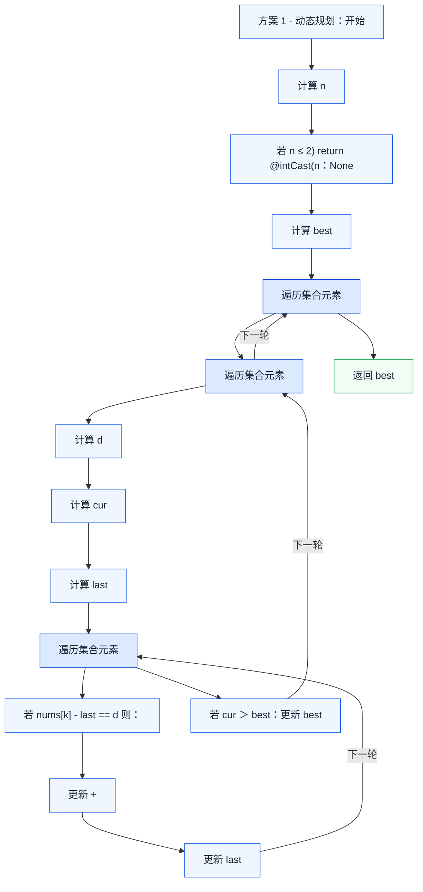

```zig
// LeetCode 1027. 最长等差数列 — Zig 版（方案1）
const std = @import("std"); // 把 @import(「std」) 存入 std
fn longestArithSeqLength(nums: []const i32) i32 { // 定义函数/方法 longestArithSeqLength
    const n = nums.len; // 把 数组.长度 存入 元素个数
    if (n <= 2) return @intCast(n); // 若 元素个数 不超过 2，直接返回 @intCast(元素个数)
    var best: i32 = 2; // 把 2; 写入 var best: i32
    for (0..n) |i| { // 让 下标 i 从 0 走到 元素个数 减一
        for (i + 1..n) |j| { // for (下标 i 加 1..元素个数) 按位或 下标 j 按位或 {
            const d = nums[j] - nums[i]; // 把 数组[下标 j] 减 数组[下标 i] 存入 d
            var cur: i32 = 2; // 把 2; 写入 var cur: i32
            var last = nums[j]; // 把 数组[下标 j] 存入 last
            for (j + 1..n) |k| { // for (下标 j 加 1..元素个数) 按位或 下标 k 按位或 {
                if (nums[k] - last == d) { // 若 数组[下标 k] 减 last 等于 d
                    cur += 1; // 当前值累加 1
                    last = nums[k]; // 把 数组[下标 k]; 写入 last
                }
            }
            if (cur > best) best = cur; // 若 当前值 超过 当前最优) 当前最优 赋值为 当前值;
        }
    }
    return best; // 返回 当前最优
}
pub fn main() !void { // 程序入口：跑内嵌自测用例
    if (longestArithSeqLength(&[_]i32{ 9, 4, 7, 2, 10 }) != 3) return error.TestFailed;
    if (longestArithSeqLength(&[_]i32{ 3, 6, 9, 12 }) != 4) return error.TestFailed;
    std.debug.print("PASS\n", .{});
} // 全部用例通过，输出 PASS
```

#### 方案 2：动态规划

**思路与代码分析**：核心是「动态规划」。Zig 版显式分配与清零，整型边界处理严格。代码里依次做这些事：双重循环遍历。**走读**：方案 2 · 动态规划：开始 → 计算 n → 若 n ≤ 2) return @intCast(n：None → 计算 best → 遍历集合元素 → 遍历集合元素 → 计算 d → 计算 cur → 计算 last → 遍历集合元素 → 若 nums[k] - last == d 则： → 更新 + → 更新 last → 若 cur ＞ best：更新 best → 返回 best。

**运行架构**（真实控制流）：

```mermaid
graph TD
    N0["方案 2 · 动态规划：开始"]
    N1["计算 n"]
    N2["若 n ≤ 2) return @intCast(n：None"]
    N3["计算 best"]
    N4["遍历集合元素"]
    N5["遍历集合元素"]
    N6["计算 d"]
    N7["计算 cur"]
    N8["计算 last"]
    N9["遍历集合元素"]
    N10["若 nums[k] - last == d 则："]
    N11["更新 +"]
    N12["更新 last"]
    N13["若 cur ＞ best：更新 best"]
    N14["返回 best"]
    N0 --> N1
    N1 --> N2
    N2 --> N3
    N3 --> N4
    N4 --> N5
    N5 --> N6
    N6 --> N7
    N7 --> N8
    N8 --> N9
    N9 --> N10
    N10 --> N11
    N11 --> N12
    N12 -- 下一轮 --> N9
    N9 --> N13
    N13 -- 下一轮 --> N5
    N5 -- 下一轮 --> N4
    N4 --> N14
    classDef n fill:#eff6ff,stroke:#2563eb,color:#1e293b;
    classDef lp fill:#dbeafe,stroke:#1d4ed8,color:#1e293b;
    classDef dc fill:#fef9c3,stroke:#ca8a04,color:#1e293b;
    classDef tm fill:#f0fdf4,stroke:#16a34a,color:#1e293b;
    class N0,N1,N2,N3,N6,N7,N8,N10,N11,N12,N13 n;
    class N4,N5,N9 lp;
    class N14 tm;
```

```zig
// LeetCode 1027. 最长等差数列 — Zig 版（方案2）
const std = @import("std"); // 把 @import(「std」) 存入 std
fn longestArithSeqLength(nums: []const i32) i32 { // 定义函数/方法 longestArithSeqLength
    const n = nums.len; // 把 数组.长度 存入 元素个数
    if (n <= 2) return @intCast(n); // 若 元素个数 不超过 2，直接返回 @intCast(元素个数)
    var best: i32 = 2; // 把 2; 写入 var best: i32
    for (0..n) |i| { // 让 下标 i 从 0 走到 元素个数 减一
        for (i + 1..n) |j| { // for (下标 i 加 1..元素个数) 按位或 下标 j 按位或 {
            const d = nums[j] - nums[i]; // 把 数组[下标 j] 减 数组[下标 i] 存入 d
            var cur: i32 = 2; // 把 2; 写入 var cur: i32
            var last = nums[j]; // 把 数组[下标 j] 存入 last
            for (j + 1..n) |k| { // for (下标 j 加 1..元素个数) 按位或 下标 k 按位或 {
                if (nums[k] - last == d) { // 若 数组[下标 k] 减 last 等于 d
                    cur += 1; // 当前值累加 1
                    last = nums[k]; // 把 数组[下标 k]; 写入 last
                }
            }
            if (cur > best) best = cur; // 若 当前值 超过 当前最优) 当前最优 赋值为 当前值;
        }
    }
    return best; // 返回 当前最优
}
pub fn main() !void { // 程序入口：跑内嵌自测用例
    if (longestArithSeqLength(&[_]i32{ 9, 4, 7, 2, 10 }) != 3) return error.TestFailed;
    if (longestArithSeqLength(&[_]i32{ 3, 6, 9, 12 }) != 4) return error.TestFailed;
    std.debug.print("PASS\n", .{});
} // 全部用例通过，输出 PASS
```

### Dart 实现（2 种方案）

Dart 的全部方案如下，每个方案都内嵌用例自测，可独立运行（老仓库 python/go 文件遵循「打印结果」约定）：

#### 方案 1：动态规划

**思路与代码分析**：核心是「动态规划」。Dart 版用可空类型标注与集合方法，注意空安全。代码里依次做这些事：DP 表逐项填充；双重循环遍历。**走读**：方案 1 · 动态规划：开始 → 更新 n → 填写 DP 表 → 计算 best → 遍历循环 → 遍历循环 → 更新 d → 填写 DP 表 → 填写 DP 表 → 若 cur ＞ best：更新 best → 返回 best。

**运行架构**（真实控制流）：

```mermaid
graph TD
    N0["方案 1 · 动态规划：开始"]
    N1["更新 n"]
    N2["填写 DP 表"]
    N3["计算 best"]
    N4["遍历循环"]
    N5["遍历循环"]
    N6["更新 d"]
    N7["填写 DP 表"]
    N8["填写 DP 表"]
    N9["若 cur ＞ best：更新 best"]
    N10["返回 best"]
    N0 --> N1
    N1 --> N2
    N2 --> N3
    N3 --> N4
    N4 --> N5
    N5 --> N6
    N6 --> N7
    N7 --> N8
    N8 --> N9
    N9 -- 下一轮 --> N5
    N5 -- 下一轮 --> N4
    N4 --> N10
    classDef n fill:#eff6ff,stroke:#2563eb,color:#1e293b;
    classDef lp fill:#dbeafe,stroke:#1d4ed8,color:#1e293b;
    classDef dc fill:#fef9c3,stroke:#ca8a04,color:#1e293b;
    classDef tm fill:#f0fdf4,stroke:#16a34a,color:#1e293b;
    class N0,N1,N2,N3,N6,N7,N8,N9 n;
    class N4,N5 lp;
    class N10 tm;
```

```dart
// LeetCode 1027. 最长等差数列 — Dart 版（方案1）
int longestArithSeqLength(List<int> nums) {
  // 定义函数/方法 longestArithSeqLength
  final n = nums.length; // 把 数组.长度 存入 元素个数
  final dp = List<Map<int, int>>.generate(n, (_) => {});
  var best = 1; // 把 1 存入 当前最优
  for (var i = 0; i < n; i++) {
    // 让 下标 i 从 0 开始计数，下标 i 小于 元素个数 就继续
    for (var j = 0; j < i; j++) {
      // 让 下标 j 从 0 开始计数，下标 j 小于 下标 i 就继续
      final d = nums[i] - nums[j]; // 把 数组[下标 i] 减 数组[下标 j] 存入 d
      final cur = (dp[j][d] ?? 1) + 1; // 把 (DP 表[下标 j][d] ?? 1) 加 1 存入 当前值
      dp[i][d] = cur; // 把 当前值; 写入 dp[i][d]
      if (cur > best) best = cur; // 若 当前值 超过 当前最优) 当前最优 赋值为 当前值;
    }
  }
  return best; // 返回 当前最优
}

void main() {
  if (longestArithSeqLength([9, 4, 7, 2, 10]) != 3) throw StateError('c1');
  if (longestArithSeqLength([3, 6, 9, 12]) != 4) throw StateError('c2');
  print('PASS');
} // 全部用例通过，输出 PASS
```

#### 方案 2：动态规划

**思路与代码分析**：核心是「动态规划」。Dart 版用可空类型标注与集合方法，注意空安全。代码里依次做这些事：DP 表逐项填充；双重循环遍历。**走读**：方案 2 · 动态规划：开始 → 更新 n → 填写 DP 表 → 计算 best → 遍历循环 → 遍历循环 → 更新 d → 填写 DP 表 → 填写 DP 表 → 若 cur ＞ best：更新 best → 返回 best。

**运行架构**（真实控制流）：

```mermaid
graph TD
    N0["方案 2 · 动态规划：开始"]
    N1["更新 n"]
    N2["填写 DP 表"]
    N3["计算 best"]
    N4["遍历循环"]
    N5["遍历循环"]
    N6["更新 d"]
    N7["填写 DP 表"]
    N8["填写 DP 表"]
    N9["若 cur ＞ best：更新 best"]
    N10["返回 best"]
    N0 --> N1
    N1 --> N2
    N2 --> N3
    N3 --> N4
    N4 --> N5
    N5 --> N6
    N6 --> N7
    N7 --> N8
    N8 --> N9
    N9 -- 下一轮 --> N5
    N5 -- 下一轮 --> N4
    N4 --> N10
    classDef n fill:#eff6ff,stroke:#2563eb,color:#1e293b;
    classDef lp fill:#dbeafe,stroke:#1d4ed8,color:#1e293b;
    classDef dc fill:#fef9c3,stroke:#ca8a04,color:#1e293b;
    classDef tm fill:#f0fdf4,stroke:#16a34a,color:#1e293b;
    class N0,N1,N2,N3,N6,N7,N8,N9 n;
    class N4,N5 lp;
    class N10 tm;
```

```dart
// LeetCode 1027. 最长等差数列 — Dart 版（方案2）
int longestArithSeqLength(List<int> nums) {
  // 定义函数/方法 longestArithSeqLength
  final n = nums.length; // 把 数组.长度 存入 元素个数
  final dp = List<Map<int, int>>.generate(n, (_) => {});
  var best = 1; // 把 1 存入 当前最优
  for (var i = 0; i < n; i++) {
    // 让 下标 i 从 0 开始计数，下标 i 小于 元素个数 就继续
    for (var j = 0; j < i; j++) {
      // 让 下标 j 从 0 开始计数，下标 j 小于 下标 i 就继续
      final d = nums[i] - nums[j]; // 把 数组[下标 i] 减 数组[下标 j] 存入 d
      final cur = (dp[j][d] ?? 1) + 1; // 把 (DP 表[下标 j][d] ?? 1) 加 1 存入 当前值
      dp[i][d] = cur; // 把 当前值; 写入 dp[i][d]
      if (cur > best) best = cur; // 若 当前值 超过 当前最优) 当前最优 赋值为 当前值;
    }
  }
  return best; // 返回 当前最优
}

void main() {
  if (longestArithSeqLength([9, 4, 7, 2, 10]) != 3) throw StateError('c1');
  if (longestArithSeqLength([3, 6, 9, 12]) != 4) throw StateError('c2');
  print('PASS');
} // 全部用例通过，输出 PASS
```

---

## 内容总结

- **最长等差数列**（动态规划 · Medium）：共 2 个方案，主线思路「动态规划」；时间 O(n) 到 O(m·n)（取决于状态维度）；动画演示DP 表填充过程，附录给出 11 种语言 × 全部方案的可运行实现。
- 来源博客：[https://blog.csdn.net/tyro_java/article/details/144831173](https://blog.csdn.net/tyro_java/article/details/144831173)
- 导航：[📋 总目录](../) ｜ [← 170 爬楼梯](../170_爬楼梯/) ｜ [172 最长公共子序列 →](../172_最长公共子序列/)
