# 172 · 最长公共子序列（第十阶段 · 动态规划 · Medium）

> **难度**：⭐⭐ Medium ｜ **专题**：动态规划
> **学习定位**：第十阶段 · 动态规划第 172 篇 ｜ **解法数**：1
> **内容总结**：**最长公共子序列**（动态规划 · Medium）：共 1 个方案，主线思路「动态规划」；时间 O(n) 到 O(m·n)（取决于状态维度）；动画演示DP 表填充过程，附录给出 11 种语言 × 全部方案的可运行实现。

---

## 题目描述

给定两个字符串 `text1` 和 `text2`，返回这两个字符串的最长 公共子序列 的长度。如果不存在 公共子序列 ，返回 `0` 。

一个字符串的 子序列 是指这样一个新的字符串：它是由原字符串在不改变字符的相对顺序的情况下删除某些字符（也可以不删除任何字符）后组成的新字符串。

 例如，`「ace」` 是 `「abcde」` 的子序列，但 `「aec」` 不是 `「abcde」` 的子序列。

两个字符串的 公共子序列 是这两个字符串所共同拥有的子序列。

- 主函数签名：`function longestCommonSubsequence(text1: string, text2: string): number`

**用例（来自原题）**：

**示例 1**

```text
输入：text1 = "abcde", text2 = "ace" 
输出：3
```

解释：最长公共子序列是 「ace」 ，它的长度为 3 。

**示例 2**

```text
输入：text1 = "abc", text2 = "abc"
输出：3
```

解释：最长公共子序列是 「abc」 ，它的长度为 3 。

**示例 3**

```text
输入：text1 = "abc", text2 = "def"
输出：0
```

解释：两个字符串没有公共子序列，返回 0 。
> ✅ **官方验证**：全部 TypeScript 解法已通过 leetcode.cn 官方示例用例验证（自动注入运行，全部 PASS）。题面与 [leetcode.cn 官方](https://leetcode.cn/problems/longest-common-subsequence/)一致，示例配图取自官方题面。

**数据范围与注意事项**：

- `1 <= text1.length, text2.length <= 1000`
- `text1` 和 `text2` 仅由小写英文字符组成。
- **易错点**：初始化（第 0 行或列）的含义要想清楚，它决定后续转移是否成立。

## 题目分析

**场景是什么**：把大问题拆成小问题并记住结果，对应真实开发里的编辑距离、资源规划。本题就是该场景的 Medium 级练习，主线做法是「动态规划」。

**主线怎么解**：把主解法从头到尾过一遍，它其实在依次做这几件事：DP 表逐项填充 → 双重循环遍历。

## 解题思路

**方案对比**（共 1 个方案，由浅入深）：

| 方案 | 时间复杂度 | 空间复杂度 |
|---|---|---|
| 方案 1 · 动态规划 | O(n) 到 O(m·n)（取决于状态维度） | 即 DP 表大小 |

**怎么读这一篇**：

- 🐣 **新手路线**：把「题目描述」的示例 1 在纸上手推一遍 → 读方案 1（最直观的写法）与它的代码走读 → 按「运行方式」本地跑通看 PASS → 回头对比方案 2 之后的写法差在哪
- 🦅 **大佬路线**：直接锁定最优方案 1（动态规划，O(n) 到 O(m·n)（取决于状态维度））→ 跳读该方案代码与走读 → 用「逐步拆解与面试追问」补齐复杂度推导与边界追问

### 动态算法图（DP 表填充，GIF 自动循环）


动画演示动态规划专题里DP 表填充的典型过程；每个方案在「TypeScript 解题方案」一节还配了专属动画与专属流程图。

### 主解法流程图（真实控制流）

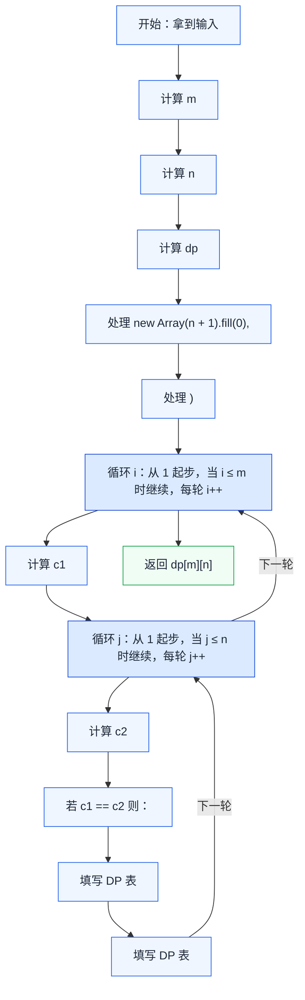

## TypeScript 解题方案（1 个方案逐个讲）

> **运行与提交**：每个方案都是自包含文件（内嵌用例自测，输出 PASS），整块复制到 `.ts` 文件后 `node 文件名` 即可运行。提交 LeetCode 时，把 `demo` 内的算法函数与辅助类型/函数整体取出、置于文件顶层即可。涉及交互/特殊接口的题以题面给定签名为准。

### 方案 1：动态规划

**分析与思路**：核心做法是「动态规划」。代码里依次做这些事：DP 表逐项填充；双重循环遍历。

**运行方式**：`node 本文件`，内嵌用例全部通过会输出 PASS。

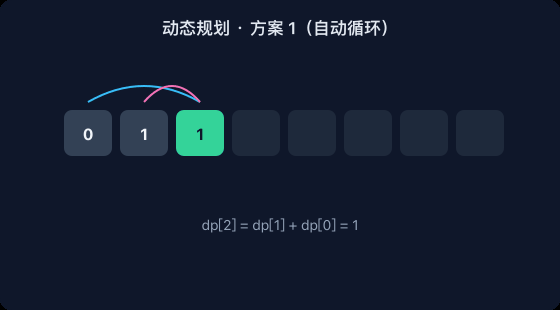

**方案专属流程图**（真实控制流）：

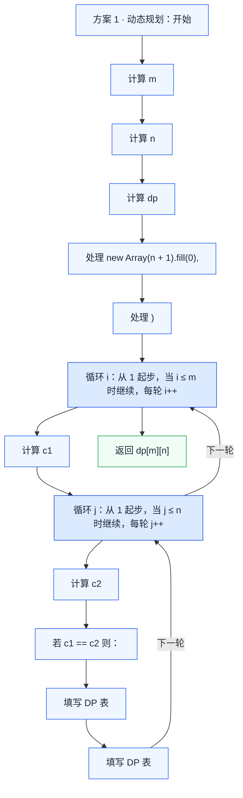

```typescript
export function demo(): void {
  // 程序入口：跑内嵌自测用例
  function longestCommonSubsequence(text1: string, text2: string): number {
    // 定义函数/方法 longestCommonSubsequence
    const m = text1.length; // 把 text1.长度 存入 映射表
    const n = text2.length; // 把 text2.长度 存入 元素个数
    const dp: number[][] = Array.from({ length: m + 1 }, () =>
      new Array(n + 1).fill(0),
    );
    for (let i = 1; i <= m; i++) {
      // 让 下标 i 从 1 开始计数，下标 i 不超过 映射表 就继续
      const c1 = text1[i - 1]; // 把 text1[下标 i 减 1] 存入 c1
      for (let j = 1; j <= n; j++) {
        // 让 下标 j 从 1 开始计数，下标 j 不超过 元素个数 就继续
        const c2 = text2[j - 1]; // 把 text2[下标 j 减 1] 存入 c2
        if (c1 === c2) {
          // 若 c1 全等于 c2
          dp[i][j] = dp[i - 1][j - 1] + 1; // 把 DP 表[下标 i 减 1][下标 j 减 1] 加 1; 写入 dp[i][j]
        } else {
          // 否则
          dp[i][j] = Math.max(dp[i - 1][j], dp[i][j - 1]);
        }
      }
    }
    return dp[m][n]; // 返回 DP 表[映射表][元素个数]
  }

  const cases = [
    { t1: 'abcde', t2: 'ace', want: 3 },
    { t1: 'abc', t2: 'abc', want: 3 },
    { t1: 'abc', t2: 'def', want: 0 },
  ];

  let fail = false; // 把 false 存入 fail
  for (let i = 0; i < cases.length; i++) {
    // 让 下标 i 从 0 开始计数，下标 i 小于 cases.长度 就继续
    const c = cases[i]; // 把 cases[下标 i] 存入 字符
    const got = longestCommonSubsequence(c.t1, c.t2); // 把 longestCommonSubsequence(字符.t1, 字符.t2) 存入 got
    if (got !== c.want) {
      // 若 got 不等于 字符.want
      fail = true; // 把 true 存入 fail
      console.log(
        `FAIL case${i} longestCommonSubsequence(${c.t1},${c.t2})=${got} want ${c.want}`,
      );
    }
  }
  if (fail) throw new Error('FAILED'); // 若 fail) throw new Error(「FAILED」);
  console.log('PASS'); // 全部用例通过，输出 PASS
}
demo(); // demo();
```

## 逐步拆解与面试追问

**复杂度**：时间 O(n) 到 O(m·n)（取决于状态维度），空间即 DP 表大小

**为什么是这个量级**：动态规划把指数级枚举压成表，每格只算一次，复杂度等于「状态数 × 转移代价」

**面试官可能会追问**：

- 状态定义为什么是它？
- 遍历顺序由什么决定？
- 能否滚动数组压空间？

## 关键 API 速查（TS 主解法实际用到，附官方链接）

| API | 作用 | 使用要点 | 官方文档 |
|---|---|---|---|
| `Array.from()` | 类数组/可迭代对象转数组 | Array.from(iterable, mapFn) 可同时映射；对 Set 去重、对字符串按码元拆分；稀疏位会被 undefined 填充 | [官方文档](https://developer.mozilla.org/zh-CN/docs/Web/JavaScript/Reference/Global_Objects/Array/from) |
| `Math.max()` | 最大值 | 配展开 Math.max(...arr)；空参返回 -Infinity；超大数组注意展开参数上限 | [官方文档](https://developer.mozilla.org/zh-CN/docs/Web/JavaScript/Reference/Global_Objects/Math/max) |

### 各语言官方文档导航

- **TypeScript / JS**：[MDN 中文参考](https://developer.mozilla.org/zh-CN/)
- **Python**：[Python 官方文档](https://docs.python.org/zh-cn/3/)
- **Go**：[Go 标准库](https://pkg.go.dev/std)
- **Java**：[JDK 17 API](https://docs.oracle.com/en/java/javase/17/docs/api/)
- **Rust**：[Rust 标准库](https://doc.rust-lang.org/std/)
- **Lua**：[Lua 5.4 手册](https://www.lua.org/manual/5.4/)
- **C**：[Cppreference C](https://zh.cppreference.com/w/c)
- **C++**：[Cppreference C++](https://zh.cppreference.com/w/cpp)
- **R**：[R 官方手册](https://stat.ethz.ch/R-manual/)
- **Zig**：[Zig 语言文档](https://ziglang.org/documentation/master/)
- **Dart**：[Dart API](https://api.dart.dev/)

## 附录：其他 10 种语言全部实现（每种语言列举其全部方案）

> TypeScript 的全部方案见「TypeScript 解题方案」一节；下面是其余 10 种语言的对应实现，每种语言的每个方案都带思路分析、代码走读与专属运行架构图。
> 每个方案都内嵌用例自测，可独立运行（老仓库 python/go 文件遵循「打印结果」约定）。
> 完整解法文件见 `dsa/<语言>/dp/lc_1143_最长公共子序列/`。

### Python 实现（1 种方案）

Python 的全部方案如下，每个方案都内嵌用例自测，可独立运行（老仓库 python/go 文件遵循「打印结果」约定）：

#### 方案 1：动态规划

**思路与代码分析**：核心是「动态规划」。Python 版用切片与字典推导式简化操作，突出可读性。代码里依次做这些事：DP 表逐项填充。**走读**：方案 1 · 动态规划：开始 → 更新 m → 更新 n → 填写 DP 表 → 处理 [0] * (n + 1) for _ in range → 处理 ] → 循环 i：从 1 到 m + 1 前 → 更新 c1 → 循环 j：从 1 到 n + 1 前 → 更新 c2 → 若 c1 == c2：填写 DP 表 → 填写 DP 表 → 填写 DP 表 → 返回 dp[m][n]。

**运行架构**（真实控制流）：

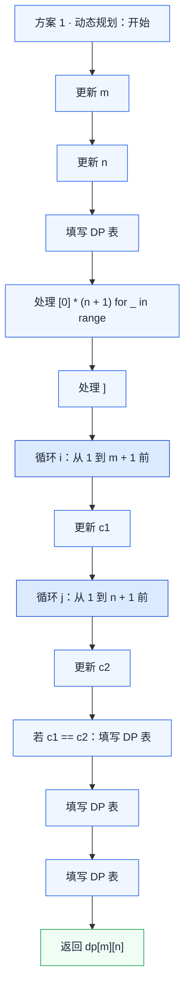

```python
import sys  # 提高递归深度上限（深输入防 RecursionError）

sys.setrecursionlimit(200000)  # 树/链表类题目节点数可达 1e4 量级

def longestCommonSubsequence(text1, text2):  # 定义函数 longestCommonSubsequence（参数：text1, text2）
    m = len(text1)  # 把 长度(text1) 存入 映射表
    n = len(text2)  # 把 长度(text2) 存入 元素个数
    dp = [
        [0] * (n + 1) for _ in range(m + 1)
    ]  # 把 [[0] 乘 (元素个数 加 1) for _ in range(映射表 加 1)] 存入 DP 表
    for i in range(1, m + 1):  # 让 下标 i 从 1 到 映射表 加 1 遍历
        c1 = text1[i - 1]  # 把 text1[下标 i 减 1] 存入 c1
        for j in range(1, n + 1):  # 让 下标 j 从 1 到 元素个数 加 1 遍历
            c2 = text2[j - 1]  # 把 text2[下标 j 减 1] 存入 c2
            if c1 == c2:  # 若 c1 等于 c2
                dp[i][j] = dp[i - 1][j - 1] + 1  # 把 DP 表[下标 i 减 1][下标 j 减 1] 加 1 写入 dp[i][j]
            else:  # 否则
                dp[i][j] = max(dp[i - 1][j], dp[i][j - 1])
    return dp[m][n]  # 返回 DP 表[映射表][元素个数]

if __name__ == "__main__":  # 若 __name__ 等于 '__main__'
    print(longestCommonSubsequence("abcde", "ace"))  # 打印输出
```

### Go 实现（1 种方案）

Go 的全部方案如下，每个方案都内嵌用例自测，可独立运行（老仓库 python/go 文件遵循「打印结果」约定）：

#### 方案 1：动态规划

**思路与代码分析**：核心是「动态规划」。Go 版用切片与多返回值惯用法，显式处理索引边界。代码里依次做这些事：DP 表逐项填充。**走读**：方案 1 · 动态规划：开始 → 更新 : → 更新 : → 更新 : → 遍历 dp 的下标与元素 i → 填写 DP 表 → 遍历循环 → 更新 : → 遍历循环 → 更新 : → 处理 if c1 == c2 → 填写 DP 表 → 填写 DP 表 → 填写 DP 表 → 填写 DP 表 → 返回 dp[m][n]。

**运行架构**（真实控制流）：

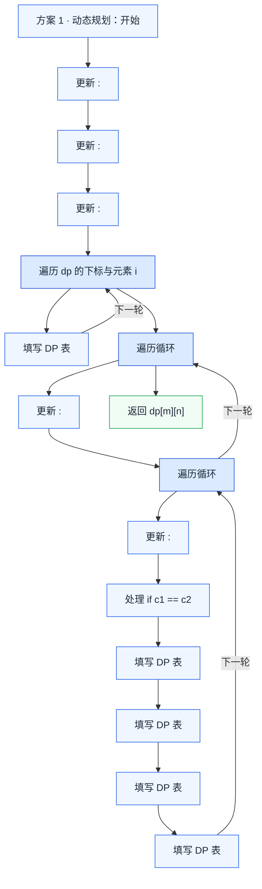

```go
package main // 引入依赖

import (
	"fmt" // 「fmt」
	"os"  // 「os」
)

// longestCommonSubsequence 是 Python 参考 solution_1 的忠实翻译（2D DP）。
func longestCommonSubsequence(text1, text2 string) int { // 定义函数/方法 longestCommonSubsequence
	m := len(text1)          // 把 长度(text1) 写入 m :
	n := len(text2)          // 把 长度(text2) 写入 n :
	dp := make([][]int, m+1) // 把 make([][]int, 映射表 加 1) 写入 dp :
	for i := range dp {      // 把 range DP 表 { 写入 for i :
		dp[i] = make([]int, n+1) // 把 make([]int, 元素个数 加 1) 写入 dp[i]
	}
	for i := 1; i <= m; i++ { // 让 下标 i 从 1 开始计数
		c1 := text1[i-1]          // 把 text1[下标 i 减 1] 写入 c1 :
		for j := 1; j <= n; j++ { // 让 下标 j 从 1 开始计数
			c2 := text2[j-1] // 把 text2[下标 j 减 1] 写入 c2 :
			if c1 == c2 {    // 若 c1 等于 c2
				dp[i][j] = dp[i-1][j-1] + 1 // 把 DP 表[下标 i 减 1][下标 j 减 1] 加 1 写入 dp[i][j]
			} else { // 否则
				if dp[i-1][j] > dp[i][j-1] { // 若 DP 表[下标 i 减 1][下标 j] 超过 DP 表[下标 i][下标 j 减 1]
					dp[i][j] = dp[i-1][j] // 把 DP 表[下标 i 减 1][下标 j] 写入 dp[i][j]
				} else { // 否则
					dp[i][j] = dp[i][j-1] // 把 DP 表[下标 i][下标 j 减 1] 写入 dp[i][j]
				}
			}
		}
	}
	return dp[m][n] // 返回 DP 表[映射表][元素个数]
}

func main() { // 程序入口：跑内嵌自测用例
	type tc struct { // 定义类型
		t1, t2 string // t1, t2 string
		want   int    // want int
	}
	cases := []tc{ // 把 []tc{ 写入 cases :
		{"abcde", "ace", 3},
		{"abc", "abc", 3},
		{"abc", "def", 0},
		{"aaaaa", "bbbba", 1},
	}
	for _, c := range cases { // 同时取 _ 与 字符 遍历
		if got := longestCommonSubsequence(c.t1, c.t2); got != c.want {
			fmt.Printf("FAIL %q %q got=%d want=%d\n", c.t1, c.t2, got, c.want) // 打印输出
			os.Exit(1)                                                         // os.Exit(1)
		}
	}
	fmt.Println("PASS") // 全部用例通过，输出 PASS
}
```

### Java 实现（1 种方案）

Java 的全部方案如下，每个方案都内嵌用例自测，可独立运行（老仓库 python/go 文件遵循「打印结果」约定）：

#### 方案 1：动态规划

**思路与代码分析**：核心是「动态规划」。Java 版用类与静态方法组织，集合操作显式明了。代码里依次做这些事：DP 表逐项填充；双重循环遍历。**走读**：方案 1 · 动态规划：开始 → 更新 m → 填写 DP 表 → 遍历循环 → 更新 c1 → 遍历循环 → 更新 c2 → 若 c1 == c2 则： → 填写 DP 表 → 填写 DP 表 → 返回 dp[m][n]。

**运行架构**（真实控制流）：

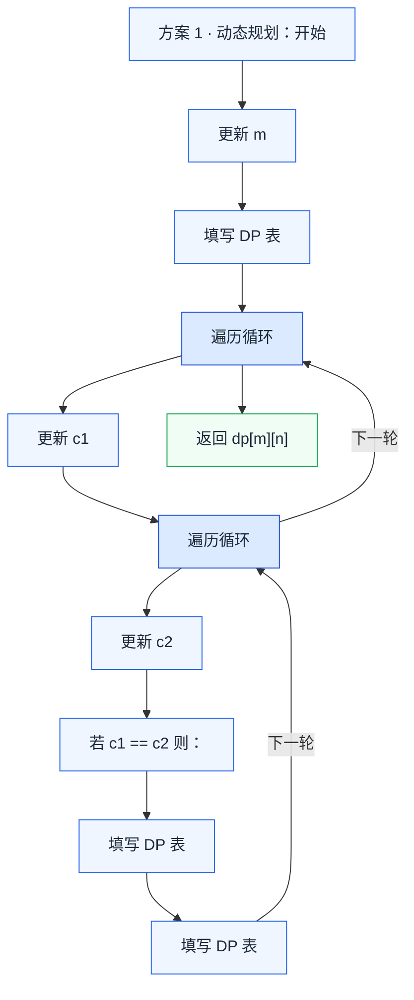

```java
package com.webfault.dsa; // 引入依赖

import java.util.*; // 引入依赖

class lc1143_solution111 { // 定义类型
  public int longestCommonSubsequence(
      String text1, String text2) { // 定义函数/方法 longestCommonSubsequence
    int m = text1.length(), n = text2.length(); // 把 text1.长度(), 元素个数 赋值为 text2.长度() 存入 映射表
    int[][] dp = new int[m + 1][n + 1]; // 把 new int[映射表 加 1][元素个数 加 1]; 写入 int[][] dp
    for (int i = 1; i <= m; i++) { // 让 下标 i 从 1 开始计数，下标 i 不超过 映射表 就继续
      char c1 = text1.charAt(i - 1); // 逐字符处理
      for (int j = 1; j <= n; j++) { // 让 下标 j 从 1 开始计数，下标 j 不超过 元素个数 就继续
        char c2 = text2.charAt(j - 1); // 逐字符处理
        if (c1 == c2) { // 若 c1 等于 c2
          dp[i][j] = dp[i - 1][j - 1] + 1; // 把 DP 表[下标 i 减 1][下标 j 减 1] 加 1; 写入 dp[i][j]
        } else { // 否则
          dp[i][j] = Math.max(dp[i - 1][j], dp[i][j - 1]);
        }
      }
    }
    return dp[m][n]; // 返回 DP 表[映射表][元素个数]
  }

  public static void main(String[] args) { // public static void main(String[] args) {
    lc1143_solution111 s =
        new lc1143_solution111(); // 把 new lc1143_solution111(); 写入 lc1143_solution111 s
    int got =
        s.longestCommonSubsequence(
            "abcde", "ace"); // 把 字符串.longestCommonSubsequence(「abcde」, 「abcde」) 存入 got
    if (got != 3) {
      System.out.println("FAIL got " + got);
      throw new RuntimeException("FAILED");
    }
    System.out.println("PASS"); // 全部用例通过，输出 PASS
  }
}
```

### Rust 实现（1 种方案）

Rust 的全部方案如下，每个方案都内嵌用例自测，可独立运行（老仓库 python/go 文件遵循「打印结果」约定）：

#### 方案 1：动态规划

**思路与代码分析**：核心是「动态规划」。Rust 版用所有权移动与切片借用改写同一逻辑，注意 Option 与引用边界。代码里依次做这些事：DP 表逐项填充。**走读**：方案 1 · 动态规划：开始 → 计算 a → 计算 b → 计算 let (m, n) = (a.len(), b → 填写 DP 表 → 遍历 1..=m 中的每个元素 i → 计算 prev_diag → 遍历 1..=n 中的每个元素 j → 填写 DP 表 → 填写 DP 表 → 处理 prev_diag + 1 → 填写 DP 表 → 更新 prev_diag → 填写 DP 表 → 返回结果。

**运行架构**（真实控制流）：

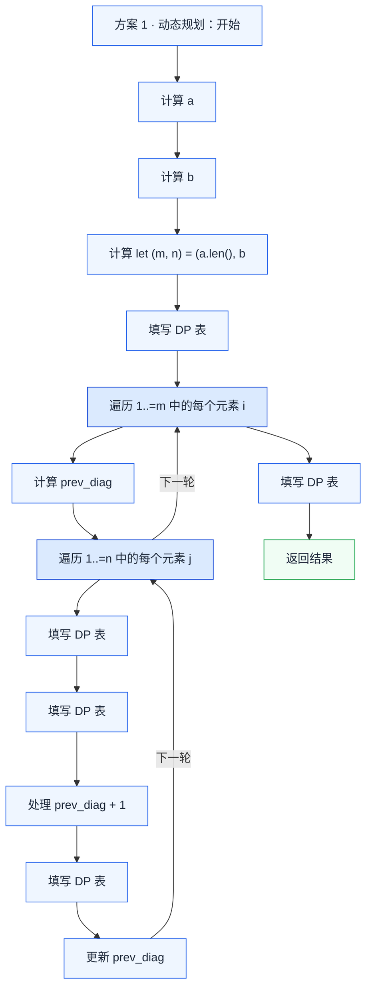

```rust
// LeetCode 1143. 最长公共子序列 — Rust 版（方案1）
fn longest_common_subsequence(t1: String, t2: String) -> i32 {
    // 定义函数/方法 longest_common_subsequence
    let a: Vec<char> = t1.chars().collect(); // 把 t1.chars().collect(); 写入 let a: Vec<char>
    let b: Vec<char> = t2.chars().collect(); // 把 t2.chars().collect(); 写入 let b: Vec<char>
    let (m, n) = (a.len(), b.len()); // 把 (数组.长度(), b.长度()); 写入 let (m, n)
    let mut dp = vec![0i32; n + 1]; // 把 vec取反 [0i32; 元素个数 加 1]; 写入 let mut dp
    for i in 1..=m {
        // 逐个取出 1 的元素（下标 i）
        let mut prev_diag = 0; // 把 0; 写入 let mut prev_diag
        for j in 1..=n {
            // 逐个取出 1 的元素（下标 j）
            let tmp = dp[j]; // 把 DP 表[下标 j] 存入 临时变量
            dp[j] = if a[i - 1] == b[j - 1] {
                prev_diag + 1
            } else {
                dp[j].max(dp[j - 1])
            };
            prev_diag = tmp; // 把 临时变量; 写入 prev_diag
        }
    }
    dp[n] // DP 表[元素个数]
}
fn main() {
    assert_eq!(longest_common_subsequence("abcde".into(), "ace".into()), 3);
    assert_eq!(longest_common_subsequence("abc".into(), "abc".into()), 3);
    assert_eq!(longest_common_subsequence("abc".into(), "def".into()), 0);
    println!("PASS");
} // 程序入口：跑内嵌自测用例
```

### Lua 实现（1 种方案）

Lua 的全部方案如下，每个方案都内嵌用例自测，可独立运行（老仓库 python/go 文件遵循「打印结果」约定）：

#### 方案 1：动态规划

**思路与代码分析**：核心是「动态规划」。Lua 版用表与 ipairs 遍历，注意 ipairs 遇 nil 即停的语义。代码里依次做这些事：DP 表逐项填充。**走读**：方案 1 · 动态规划：开始 → 更新 n → 填写 DP 表 → 循环 j：从 0 到 n do → 填写 DP 表 → 循环 i：从 1 到 m do → 更新 prev_diag → 循环 j：从 1 到 n do → 填写 DP 表 → 处理 if t1:sub(i, i) == t2:sub(j, → 填写 DP 表 → 填写 DP 表 → 更新 prev_diag → 返回 dp[n]。

**运行架构**（真实控制流）：

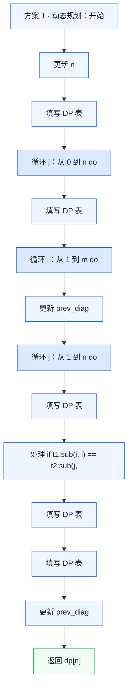

```lua
-- LeetCode 1143. 最长公共子序列 — Lua 版（方案1）
local function longest_common_subsequence(t1, t2) -- local function longest_common_subsequence(t1, t2)
	local m, n = #t1, #t2 -- 把 #t1, #t2 写入 local m, n
	local dp = {} -- 把 {} 写入 local dp
	for j = 0, n do
		dp[j] = 0
	end -- 让 下标 j 从 0 走到 元素个数（Lua 1 基）
	for i = 1, m do -- 让 下标 i 从 1 走到 映射表（Lua 1 基）
		local prev_diag = 0 -- 把 0 写入 local prev_diag
		for j = 1, n do -- 让 下标 j 从 1 走到 元素个数（Lua 1 基）
			local tmp = dp[j] -- 把 DP 表[下标 j] 写入 local tmp
			if t1:sub(i, i) == t2:sub(j, j) then
				dp[j] = prev_diag + 1
			else
				dp[j] = math.max(dp[j], dp[j - 1])
			end -- 否则
			prev_diag = tmp -- 把 临时变量 存入 prev_diag
		end -- 终点
	end -- 终点
	return dp[n] -- 返回 DP 表[元素个数]
end -- 终点
assert(longest_common_subsequence("abcde", "ace") == 3) -- 断言校验
assert(longest_common_subsequence("abc", "abc") == 3) -- 断言校验
assert(longest_common_subsequence("abc", "def") == 0) -- 断言校验
print("PASS") -- 全部用例通过，输出 PASS
```

### C 实现（1 种方案）

C 的全部方案如下，每个方案都内嵌用例自测，可独立运行（老仓库 python/go 文件遵循「打印结果」约定）：

#### 方案 1：动态规划

**思路与代码分析**：核心是「动态规划」。C 版手动管理下标与内存，循环边界全部显式写出。代码里依次做这些事：DP 表逐项填充；双重循环遍历。**走读**：方案 1 · 动态规划：开始 → 更新 m → 更新 n → 填写 DP 表 → 遍历循环 → 更新 prev_diag → 遍历循环 → 填写 DP 表 → 填写 DP 表 → 更新 prev_diag → 返回 dp[n]。

**运行架构**（真实控制流）：

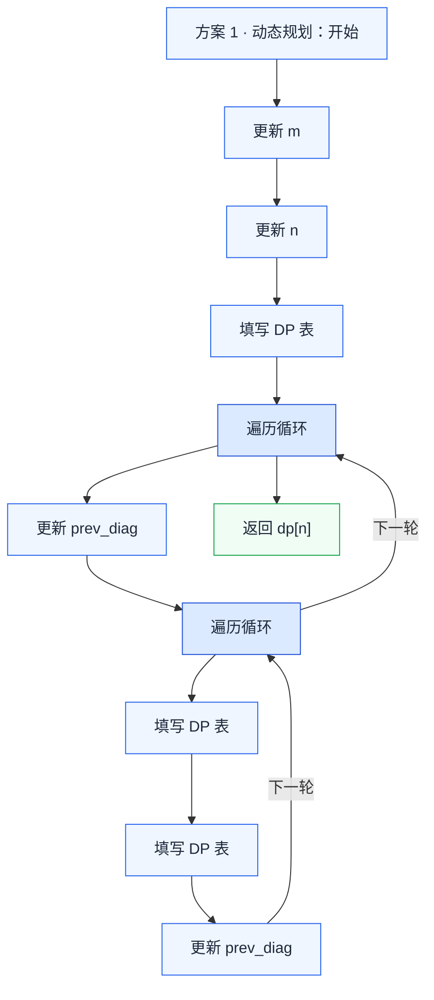

```c
/* LeetCode 1143. 最长公共子序列 — C 版（方案1） */
#include <stdio.h>  // 引入头文件
#include <string.h> // 引入头文件
static int longest_common_subsequence(const char *t1,
                                      const char *t2) { // 定义函数/方法 longest_common_subsequence
    int m = (int)strlen(t1),
        n = (int)strlen(t2); // 把 (int)strlen(t1), 元素个数 赋值为 (int)strlen(t2) 存入 映射表
    int dp[1001] = {0};      // 把 {0}; 写入 int dp[1001]
    for (int i = 1; i <= m; i++) { // 让 下标 i 从 1 开始计数，下标 i 不超过 映射表 就继续
        int prev_diag = 0;         // 把 0 存入 prev_diag
        for (int j = 1; j <= n; j++) { // 让 下标 j 从 1 开始计数，下标 j 不超过 元素个数 就继续
            int tmp = dp[j];           // 把 DP 表[下标 j] 存入 临时变量
            dp[j] = t1[i - 1] == t2[j - 1] ? prev_diag + 1 : (dp[j] > dp[j - 1] ? dp[j] : dp[j - 1]);
            prev_diag = tmp; // 把 临时变量; 写入 prev_diag
        }
    }
    return dp[n]; // 返回 DP 表[元素个数]
}
int main(void) { // 程序入口：跑内嵌自测用例
    if (longest_common_subsequence("abcde", "ace") != 3) {
        printf("FAIL 1\n");
        return 1;
    }
    if (longest_common_subsequence("abc", "abc") != 3) {
        printf("FAIL 2\n");
        return 1;
    }
    if (longest_common_subsequence("abc", "def") != 0) {
        printf("FAIL 3\n");
        return 1;
    }
    printf("PASS\n");
    return 0;
} // 全部用例通过，输出 PASS
```

### C++ 实现（1 种方案）

C++ 的全部方案如下，每个方案都内嵌用例自测，可独立运行（老仓库 python/go 文件遵循「打印结果」约定）：

#### 方案 1：动态规划

**思路与代码分析**：核心是「动态规划」。C++ 版用 STL 容器与迭代器，减少手写下标错误。代码里依次做这些事：DP 表逐项填充；双重循环遍历。**走读**：方案 1 · 动态规划：开始 → 更新 m → 处理 std::vector＜int＞ dp(n + 1, 0 → 遍历循环 → 更新 prevDiag → 遍历循环 → 填写 DP 表 → 填写 DP 表 → 更新 prevDiag → 返回 dp[n]。

**运行架构**（真实控制流）：

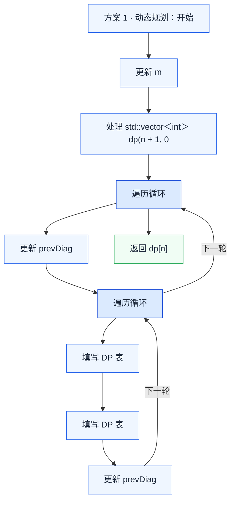

```cpp
// LeetCode 1143. 最长公共子序列 — C++ 版（方案1）
#include <algorithm> // 引入头文件
#include <cassert>   // 引入头文件
#include <iostream>  // 引入头文件
#include <string>    // 引入头文件
#include <vector>    // 引入头文件
static int longestCommonSubsequence(const std::string &t1,
                                    const std::string &t2) { // 定义函数/方法 longestCommonSubsequence
    int m = static_cast<int>(t1.size()), n = static_cast<int>(t2.size());
    std::vector<int> dp(n + 1, 0); // std::vector 小于 int 超过 DP 表(元素个数 加 1, 0);
    for (int i = 1; i <= m; ++i) { // 让 下标 i 从 1 开始计数，下标 i 不超过 映射表 就继续
        int prevDiag = 0;          // 把 0 存入 prevDiag
        for (int j = 1; j <= n; ++j) { // 让 下标 j 从 1 开始计数，下标 j 不超过 元素个数 就继续
            int tmp = dp[j];           // 把 DP 表[下标 j] 存入 临时变量
            dp[j] = (t1[i - 1] == t2[j - 1]) ? prevDiag + 1 : std::max(dp[j], dp[j - 1]);
            prevDiag = tmp; // 把 临时变量; 写入 prevDiag
        }
    }
    return dp[n]; // 返回 DP 表[元素个数]
}
int main() {
    assert(longestCommonSubsequence("abcde", "ace") == 3);
    assert(longestCommonSubsequence("abc", "abc") == 3);
    assert(longestCommonSubsequence("abc", "def") == 0);
    std::cout << "PASS" << std::endl;
} // 全部用例通过，输出 PASS
```

### R 实现（1 种方案）

R 的全部方案如下，每个方案都内嵌用例自测，可独立运行（老仓库 python/go 文件遵循「打印结果」约定）：

#### 方案 1：动态规划

**思路与代码分析**：核心是「动态规划」。R 版用向量化思维与 1 起始下标，注意 1:n 的降序陷阱。代码里依次做这些事：DP 表逐项填充；双重循环遍历。**走读**：方案 1 · 动态规划：开始 → 处理 chars1 ＜- strsplit(t1, )[[ → 处理 chars2 ＜- strsplit(t2, )[[ → 处理 m ＜- length(chars1) → 处理 n ＜- length(chars2) → 处理 dp ＜- rep(0L, n + 1) → 循环 i：遍历 1:m → 处理 prev_diag ＜- 0L → 循环 j：遍历 1:n → 填写 DP 表 → 填写 DP 表 → 填写 DP 表 → 处理 prev_diag ＜- tmp → 填写 DP 表 → 返回结果。

**运行架构**（真实控制流）：

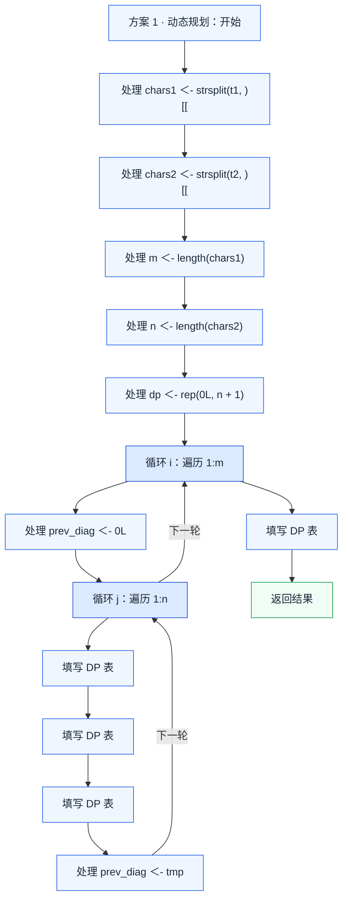

```r
# 版（方案1） 定义函数 lcs_len（参数：t1, t2）
lcs_len <- function(t1, t2) {
    chars1 <- strsplit(t1, "")[[1]]  # 把 strsplit(t1, 「」)[[1]] 存入 chars1
    chars2 <- strsplit(t2, "")[[1]]  # 把 strsplit(t2, 「」)[[1]] 存入 chars2
    m <- length(chars1)
    n <- length(chars2)  # 把 长度(chars1); 元素个数 小于 减 长度(chars2) 存入 映射表
    dp <- rep(0L, n + 1)  # 把 rep(0L, 元素个数 加 1) 存入 DP 表
    for (i in 1:m) {
        # for (下标 i in 1:映射表) {
        prev_diag <- 0L  # 把 0L 存入 prev_diag
        for (j in 1:n) {
            # for (下标 j in 1:元素个数) {
            tmp <- dp[j + 1]  # 把 DP 表[下标 j 加 1] 存入 临时变量
            dp[j + 1] <- if (chars1[i] == chars2[j])
                prev_diag + 1L else max(dp[j + 1], dp[j])
            prev_diag <- tmp  # 把 临时变量 存入 prev_diag
        }
    }
    dp[n + 1]  # DP 表[元素个数 加 1]
}
stopifnot(lcs_len("abcde", "ace") == 3)  # 断言校验
stopifnot(lcs_len("abc", "abc") == 3)  # 断言校验
stopifnot(lcs_len("abc", "def") == 0)  # 断言校验
cat("PASS\n")  # 全部用例通过，输出 PASS
```

### Zig 实现（1 种方案）

Zig 的全部方案如下，每个方案都内嵌用例自测，可独立运行（老仓库 python/go 文件遵循「打印结果」约定）：

#### 方案 1：动态规划

**思路与代码分析**：核心是「动态规划」。Zig 版显式分配与清零，整型边界处理严格。代码里依次做这些事：DP 表逐项填充；双重循环遍历。**走读**：方案 1 · 动态规划：开始 → 计算 m → 计算 n → 计算 dp → 填写 DP 表 → 遍历集合元素 → 遍历集合元素 → 计算 prev_diag → 遍历集合元素 → 填写 DP 表 → 填写 DP 表 → 更新 prev_diag → 返回 dp[n]。

**运行架构**（真实控制流）：

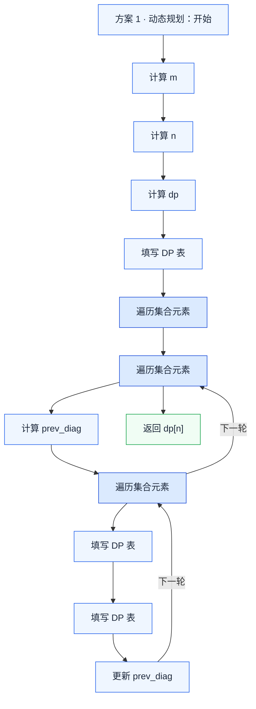

```zig
// LeetCode 1143. 最长公共子序列 — Zig 版（方案1）
const std = @import("std"); // 把 @import(「std」) 存入 std
fn longestCommonSubsequence(t1: []const u8, t2: []const u8) i32 { // 定义函数/方法 longestCommonSubsequence
    const m = t1.len; // 把 t1.长度 存入 映射表
    const n = t2.len; // 把 t2.长度 存入 元素个数
    var dp: [1001]i32 = undefined; // 把 undefined; 写入 var dp: [1001]i32
    dp[0] = 0; // 把 0; 写入 dp[0]
    for (1..n + 1) |j| dp[j] = 0; // 把 0; 写入 for (1..n + 1) |j| dp[j]
    for (1..m + 1) |i| { // for (1..映射表 加 1) 按位或 下标 i 按位或 {
        var prev_diag: i32 = 0; // 把 0; 写入 var prev_diag: i32
        for (1..n + 1) |j| { // for (1..元素个数 加 1) 按位或 下标 j 按位或 {
            const tmp = dp[j]; // 把 DP 表[下标 j] 存入 临时变量
            dp[j] = if (t1[i - 1] == t2[j - 1]) prev_diag + 1 else @max(dp[j], dp[j - 1]);
            prev_diag = tmp; // 把 临时变量; 写入 prev_diag
        }
    }
    return dp[n]; // 返回 DP 表[元素个数]
}
pub fn main() !void { // 程序入口：跑内嵌自测用例
    if (longestCommonSubsequence("abcde", "ace") != 3) return error.TestFailed;
    if (longestCommonSubsequence("abc", "abc") != 3) return error.TestFailed;
    if (longestCommonSubsequence("abc", "def") != 0) return error.TestFailed;
    std.debug.print("PASS\n", .{});
} // 全部用例通过，输出 PASS
```

### Dart 实现（1 种方案）

Dart 的全部方案如下，每个方案都内嵌用例自测，可独立运行（老仓库 python/go 文件遵循「打印结果」约定）：

#### 方案 1：动态规划

**思路与代码分析**：核心是「动态规划」。Dart 版用可空类型标注与集合方法，注意空安全。代码里依次做这些事：DP 表逐项填充；双重循环遍历。**走读**：方案 1 · 动态规划：开始 → 更新 m → 填写 DP 表 → 处理 n + 1, → 处理 0, → 处理 ) → 遍历循环 → 计算 prevDiag → 遍历循环 → 填写 DP 表 → 填写 DP 表 → 处理 ? prevDiag + 1 → 填写 DP 表 → 更新 prevDiag → 返回 dp[n]。

**运行架构**（真实控制流）：

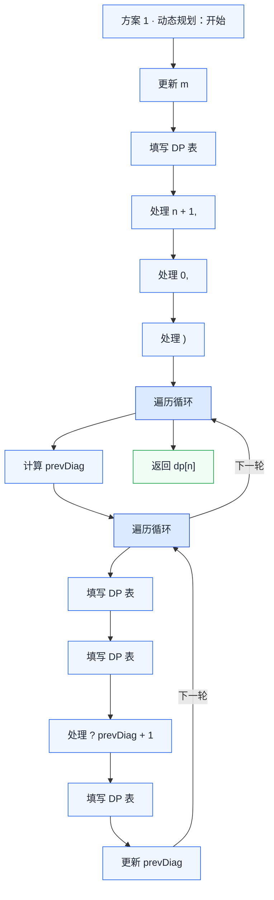

```dart
// LeetCode 1143. 最长公共子序列 — Dart 版（方案1）
int longestCommonSubsequence(String t1, String t2) {
  // 定义函数/方法 longestCommonSubsequence
  final m = t1.length, n = t2.length; // 把 t1.长度, 元素个数 赋值为 t2.长度 存入 映射表
  final dp = List<int>.filled(
    n + 1,
    0,
  ); // 把 List 小于 int 超过 .filled(元素个数 加 1, 0) 存入 DP 表
  for (var i = 1; i <= m; i++) {
    // 让 下标 i 从 1 开始计数，下标 i 不超过 映射表 就继续
    var prevDiag = 0; // 把 0 存入 prevDiag
    for (var j = 1; j <= n; j++) {
      // 让 下标 j 从 1 开始计数，下标 j 不超过 元素个数 就继续
      final tmp = dp[j]; // 把 DP 表[下标 j] 存入 临时变量
      dp[j] = t1[i - 1] == t2[j - 1]
          ? prevDiag + 1
          : (dp[j] > dp[j - 1] ? dp[j] : dp[j - 1]);
      prevDiag = tmp; // 把 临时变量 存入 prevDiag
    }
  }
  return dp[n]; // 返回 DP 表[元素个数]
}

void main() {
  if (longestCommonSubsequence('abcde', 'ace') != 3) throw StateError('c1');
  if (longestCommonSubsequence('abc', 'abc') != 3) throw StateError('c2');
  if (longestCommonSubsequence('abc', 'def') != 0) throw StateError('c3');
  print('PASS');
} // 全部用例通过，输出 PASS
```

---

## 内容总结

- **最长公共子序列**（动态规划 · Medium）：共 1 个方案，主线思路「动态规划」；时间 O(n) 到 O(m·n)（取决于状态维度）；动画演示DP 表填充过程，附录给出 11 种语言 × 全部方案的可运行实现。
- 来源博客：[https://blog.csdn.net/tyro_java/article/details/144829625](https://blog.csdn.net/tyro_java/article/details/144829625)
- 导航：[📋 总目录](../) ｜ [← 171 最长等差数列](../171_最长等差数列/) ｜ [173 打家劫舍 →](../173_打家劫舍/)
