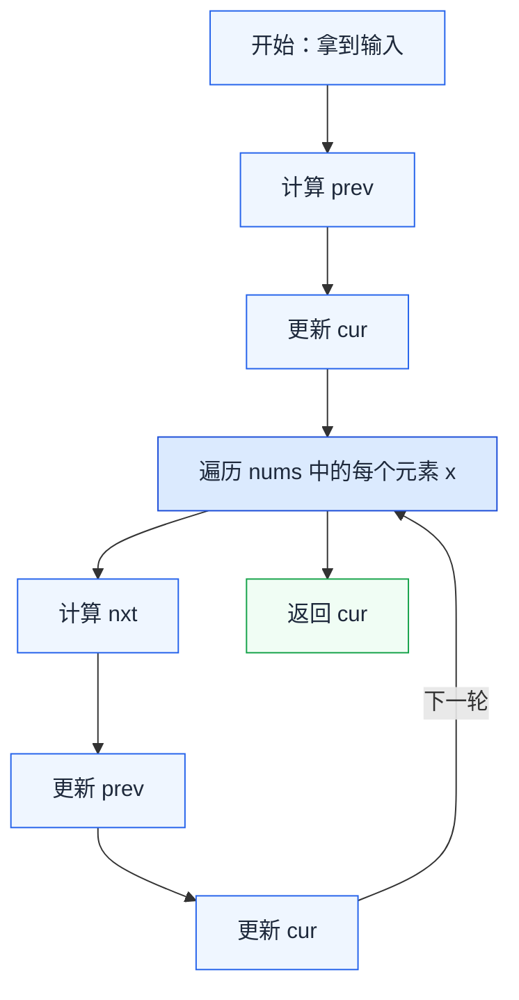
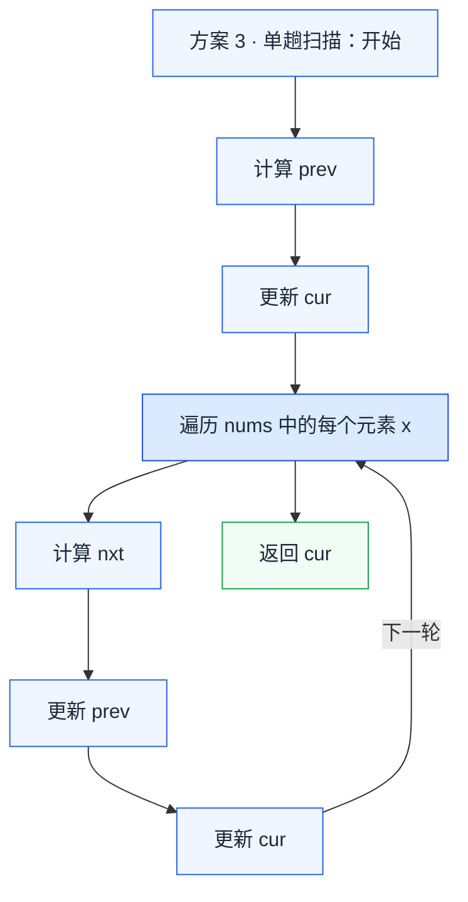
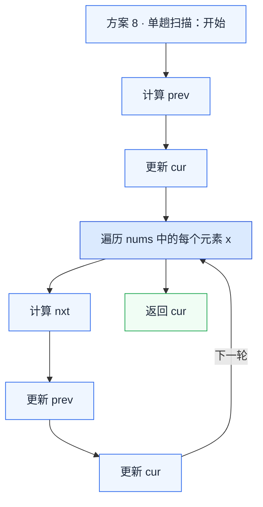
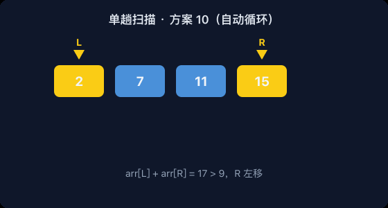
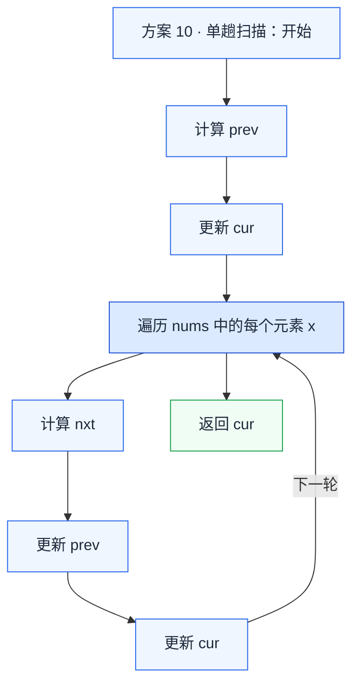
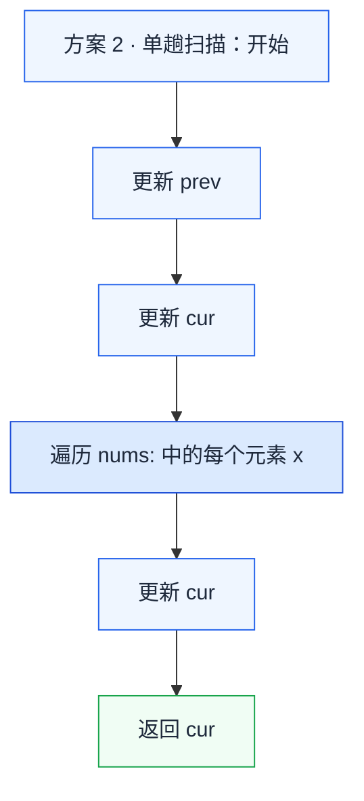
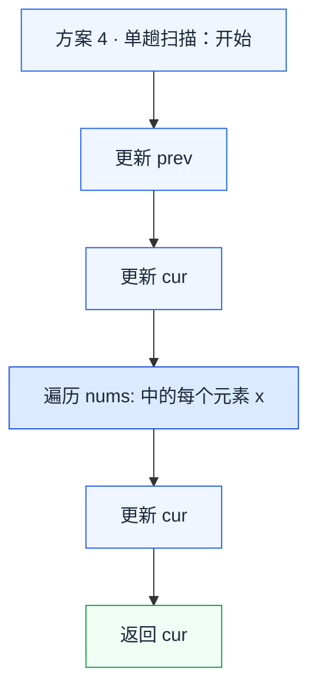

# 173 · 打家劫舍（第十阶段 · 动态规划 · Medium）

> **难度**：⭐⭐ Medium ｜ **专题**：动态规划
> **学习定位**：第十阶段 · 动态规划第 173 篇 ｜ **解法数**：11
> **内容总结**：**打家劫舍**（动态规划 · Medium）：共 11 个方案，主线思路「单趟扫描」；时间 O(n)（单趟线性扫描）；动画演示DP 表填充过程，附录给出 11 种语言 × 全部方案的可运行实现。

---

## 题目描述

你是一个专业的小偷，计划偷窃沿街的房屋。每间房内都藏有一定的现金，影响你偷窃的唯一制约因素就是相邻的房屋装有相互连通的防盗系统，如果两间相邻的房屋在同一晚上被小偷闯入，系统会自动报警。

给定一个代表每个房屋存放金额的非负整数数组，计算你 不触动警报装置的情况下 ，一夜之内能够偷窃到的最高金额。

- 主函数签名：`function rob(nums: number[]): number`

**用例（来自原题）**：

**示例 1**

```text
输入：[1,2,3,1]
输出：4
```

解释：偷窃 1 号房屋 （金额 = 1） ，然后偷窃 3 号房屋 （金额 = 3）。 偷窃到的最高金额 = 1 + 3 = 4 。

**示例 2**

```text
输入：[2,7,9,3,1]
输出：12
```

解释：偷窃 1 号房屋 （金额 = 2）, 偷窃 3 号房屋 （金额 = 9），接着偷窃 5 号房屋 （金额 = 1）。 偷窃到的最高金额 = 2 + 9 + 1 = 12 。
> ✅ **官方验证**：全部 TypeScript 解法已通过 leetcode.cn 官方示例用例验证（自动注入运行，全部 PASS）。题面与 [leetcode.cn 官方](https://leetcode.cn/problems/house-robber/)一致，示例配图取自官方题面。

**数据范围与注意事项**：

- `1 <= nums.length <= 100`
- `0 <= nums[i] <= 400`
- **易错点**：初始化（第 0 行或列）的含义要想清楚，它决定后续转移是否成立。

## 题目分析

**场景是什么**：把大问题拆成小问题并记住结果，对应真实开发里的编辑距离、资源规划。本题就是该场景的 Medium 级练习，主线做法是「单趟扫描」。

**主线怎么解**：把主解法从头到尾过一遍，它其实在依次做这几件事：单循环线性扫描。

## 解题思路

**方案对比**（共 11 个方案，由浅入深）：

| 方案 | 时间复杂度 | 空间复杂度 |
|---|---|---|
| 方案 1 · 单趟扫描 | O(n)（单趟线性扫描） | O(1) 到 O(n)（视辅助结构） |
| 方案 2 · 单趟扫描 | O(n)（单趟线性扫描） | O(1) 到 O(n)（视辅助结构） |
| 方案 3 · 单趟扫描 | O(n)（单趟线性扫描） | O(1) 到 O(n)（视辅助结构） |
| 方案 4 · 单趟扫描 | O(n)（单趟线性扫描） | O(1) 到 O(n)（视辅助结构） |
| 方案 5 · 单趟扫描 | O(n)（单趟线性扫描） | O(1) 到 O(n)（视辅助结构） |
| 方案 6 · 单趟扫描 | O(n)（单趟线性扫描） | O(1) 到 O(n)（视辅助结构） |
| 方案 7 · 单趟扫描 | O(n)（单趟线性扫描） | O(1) 到 O(n)（视辅助结构） |
| 方案 8 · 单趟扫描 | O(n)（单趟线性扫描） | O(1) 到 O(n)（视辅助结构） |
| 方案 9 · 单趟扫描 | O(n)（单趟线性扫描） | O(1) 到 O(n)（视辅助结构） |
| 方案 10 · 单趟扫描 | O(n)（单趟线性扫描） | O(1) 到 O(n)（视辅助结构） |
| 方案 11 · 单趟扫描 | O(n)（单趟线性扫描） | O(1) 到 O(n)（视辅助结构） |

**方案间的取舍**：方案 1（单趟扫描）；方案 2（单趟扫描）；方案 3（单趟扫描）；方案 4（单趟扫描）；方案 5（单趟扫描）；方案 6（单趟扫描）；方案 7（单趟扫描）；方案 8（单趟扫描）；方案 9（单趟扫描）；方案 10（单趟扫描）；方案 11（单趟扫描）。数据规模小、可读性优先时选靠前的方案；规模大、性能优先时选靠后的方案。

**怎么读这一篇**：

- 🐣 **新手路线**：把「题目描述」的示例 1 在纸上手推一遍 → 读方案 1（最直观的写法）与它的代码走读 → 按「运行方式」本地跑通看 PASS → 回头对比方案 2 之后的写法差在哪
- 🦅 **大佬路线**：直接锁定最优方案 1（单趟扫描，O(n)（单趟线性扫描））→ 跳读该方案代码与走读 → 用「逐步拆解与面试追问」补齐复杂度推导与边界追问

### 动态算法图（DP 表填充，GIF 自动循环）


动画演示动态规划专题里DP 表填充的典型过程；每个方案在「TypeScript 解题方案」一节还配了专属动画与专属流程图。

### 主解法流程图（真实控制流）



## TypeScript 解题方案（11 个方案逐个讲）

> **运行与提交**：每个方案都是自包含文件（内嵌用例自测，输出 PASS），整块复制到 `.ts` 文件后 `node 文件名` 即可运行。提交 LeetCode 时，把 `demo` 内的算法函数与辅助类型/函数整体取出、置于文件顶层即可。涉及交互/特殊接口的题以题面给定签名为准。

### 方案 1：单趟扫描

**分析与思路**：核心做法是「单趟扫描」。代码里依次做这些事：单循环线性扫描。

**运行方式**：`node 本文件`，内嵌用例全部通过会输出 PASS。


**方案专属流程图**（真实控制流）：


```typescript
/**
 ** LeetCode 198. 打家劫舍
 ** 来源：https://blog.csdn.net/tyro_java/article/details/130670245
 */

export function demo(): void {
  // 程序入口：跑内嵌自测用例
  function rob(nums: number[]): number {
    // 定义函数/方法 rob
    let prev = 0,
      cur = 0; // 把 0, 当前值 赋值为 0 存入 前一个
    for (const x of nums) {
      // for (const x of 数组) {
      const nxt = Math.max(cur, prev + x); // 把 Math.取较大值 当前值, 前一个 加 x) 存入 nxt
      prev = cur; // 把 当前值 存入 前一个
      cur = nxt; // 把 nxt 存入 当前值
    }
    return cur; // 返回 当前值
  }
  const cases: Array<{ nums: number[]; want: number }> = [
    { nums: [1, 2, 3, 1], want: 4 },
    { nums: [2, 7, 9, 3, 1], want: 12 },
    { nums: [2, 1, 1, 2], want: 4 },
  ];
  let fail = false; // 把 false 存入 fail
  for (const c of cases) {
    // for (const 字符 of cases) {
    const got = rob(c.nums); // 把 rob(字符.数组) 存入 got
    if (got !== c.want) {
      // 若 got 不等于 字符.want
      console.log(`FAIL rob(${JSON.stringify(c.nums)})=${got} want ${c.want}`);
      fail = true; // 把 true 存入 fail
    }
  }
  if (fail) throw new Error('FAILED'); // 若 fail) throw new Error(「FAILED」);
  console.log('PASS'); // 全部用例通过，输出 PASS
}

demo(); // demo();
```

### 方案 2：单趟扫描

**分析与思路**：核心做法是「单趟扫描」。代码里依次做这些事：单循环线性扫描。

**运行方式**：`node 本文件`，内嵌用例全部通过会输出 PASS。


**方案专属流程图**（真实控制流）：


```typescript
/**
 ** LeetCode 198. 打家劫舍
 ** 来源：https://blog.csdn.net/tyro_java/article/details/130670245
 */

export function demo(): void {
  // 程序入口：跑内嵌自测用例
  function rob(nums: number[]): number {
    // 定义函数/方法 rob
    let prev = 0,
      cur = 0; // 把 0, 当前值 赋值为 0 存入 前一个
    for (const x of nums) {
      // for (const x of 数组) {
      const nxt = Math.max(cur, prev + x); // 把 Math.取较大值 当前值, 前一个 加 x) 存入 nxt
      prev = cur; // 把 当前值 存入 前一个
      cur = nxt; // 把 nxt 存入 当前值
    }
    return cur; // 返回 当前值
  }
  const cases: Array<{ nums: number[]; want: number }> = [
    { nums: [1, 2, 3, 1], want: 4 },
    { nums: [2, 7, 9, 3, 1], want: 12 },
    { nums: [2, 1, 1, 2], want: 4 },
  ];
  let fail = false; // 把 false 存入 fail
  for (const c of cases) {
    // for (const 字符 of cases) {
    const got = rob(c.nums); // 把 rob(字符.数组) 存入 got
    if (got !== c.want) {
      // 若 got 不等于 字符.want
      console.log(`FAIL rob(${JSON.stringify(c.nums)})=${got} want ${c.want}`);
      fail = true; // 把 true 存入 fail
    }
  }
  if (fail) throw new Error('FAILED'); // 若 fail) throw new Error(「FAILED」);
  console.log('PASS'); // 全部用例通过，输出 PASS
}

demo(); // demo();
```

### 方案 3：单趟扫描

**分析与思路**：核心做法是「单趟扫描」。代码里依次做这些事：单循环线性扫描。

**运行方式**：`node 本文件`，内嵌用例全部通过会输出 PASS。


**方案专属流程图**（真实控制流）：



```typescript
/**
 ** LeetCode 198. 打家劫舍
 ** 方案：方案3
 ** 来源：https://blog.csdn.net/tyro_java/article/details/130670245
 */

export function demo(): void {
  // 程序入口：跑内嵌自测用例
  function rob(nums: number[]): number {
    // 定义函数/方法 rob
    let prev = 0,
      cur = 0; // 把 0, 当前值 赋值为 0 存入 前一个
    for (const x of nums) {
      // for (const x of 数组) {
      const nxt = Math.max(cur, prev + x); // 把 Math.取较大值 当前值, 前一个 加 x) 存入 nxt
      prev = cur; // 把 当前值 存入 前一个
      cur = nxt; // 把 nxt 存入 当前值
    }
    return cur; // 返回 当前值
  }
  const cases: Array<{ nums: number[]; want: number }> = [
    { nums: [1, 2, 3, 1], want: 4 },
    { nums: [2, 7, 9, 3, 1], want: 12 },
    { nums: [2, 1, 1, 2], want: 4 },
  ];
  let fail = false; // 把 false 存入 fail
  for (const c of cases) {
    // for (const 字符 of cases) {
    const got = rob(c.nums); // 把 rob(字符.数组) 存入 got
    if (got !== c.want) {
      // 若 got 不等于 字符.want
      console.log(`FAIL rob(${JSON.stringify(c.nums)})=${got} want ${c.want}`);
      fail = true; // 把 true 存入 fail
    }
  }
  if (fail) throw new Error('FAILED'); // 若 fail) throw new Error(「FAILED」);
  console.log('PASS'); // 全部用例通过，输出 PASS
}

demo(); // demo();
```

### 方案 4：单趟扫描

**分析与思路**：核心做法是「单趟扫描」。代码里依次做这些事：单循环线性扫描。

**运行方式**：`node 本文件`，内嵌用例全部通过会输出 PASS。


**方案专属流程图**（真实控制流）：


```typescript
/**
 ** LeetCode 198. 打家劫舍
 ** 方案：方案4
 ** 来源：https://blog.csdn.net/tyro_java/article/details/130670245
 */

export function demo(): void {
  // 程序入口：跑内嵌自测用例
  function rob(nums: number[]): number {
    // 定义函数/方法 rob
    let prev = 0,
      cur = 0; // 把 0, 当前值 赋值为 0 存入 前一个
    for (const x of nums) {
      // for (const x of 数组) {
      const nxt = Math.max(cur, prev + x); // 把 Math.取较大值 当前值, 前一个 加 x) 存入 nxt
      prev = cur; // 把 当前值 存入 前一个
      cur = nxt; // 把 nxt 存入 当前值
    }
    return cur; // 返回 当前值
  }
  const cases: Array<{ nums: number[]; want: number }> = [
    { nums: [1, 2, 3, 1], want: 4 },
    { nums: [2, 7, 9, 3, 1], want: 12 },
    { nums: [2, 1, 1, 2], want: 4 },
  ];
  let fail = false; // 把 false 存入 fail
  for (const c of cases) {
    // for (const 字符 of cases) {
    const got = rob(c.nums); // 把 rob(字符.数组) 存入 got
    if (got !== c.want) {
      // 若 got 不等于 字符.want
      console.log(`FAIL rob(${JSON.stringify(c.nums)})=${got} want ${c.want}`);
      fail = true; // 把 true 存入 fail
    }
  }
  if (fail) throw new Error('FAILED'); // 若 fail) throw new Error(「FAILED」);
  console.log('PASS'); // 全部用例通过，输出 PASS
}

demo(); // demo();
```

### 方案 5：单趟扫描

**分析与思路**：核心做法是「单趟扫描」。代码里依次做这些事：单循环线性扫描。

**运行方式**：`node 本文件`，内嵌用例全部通过会输出 PASS。


**方案专属流程图**（真实控制流）：


```typescript
/**
 ** LeetCode 198. 打家劫舍
 ** 方案：方案5
 ** 来源：https://blog.csdn.net/tyro_java/article/details/130670245
 */

export function demo(): void {
  // 程序入口：跑内嵌自测用例
  function rob(nums: number[]): number {
    // 定义函数/方法 rob
    let prev = 0,
      cur = 0; // 把 0, 当前值 赋值为 0 存入 前一个
    for (const x of nums) {
      // for (const x of 数组) {
      const nxt = Math.max(cur, prev + x); // 把 Math.取较大值 当前值, 前一个 加 x) 存入 nxt
      prev = cur; // 把 当前值 存入 前一个
      cur = nxt; // 把 nxt 存入 当前值
    }
    return cur; // 返回 当前值
  }
  const cases: Array<{ nums: number[]; want: number }> = [
    { nums: [1, 2, 3, 1], want: 4 },
    { nums: [2, 7, 9, 3, 1], want: 12 },
    { nums: [2, 1, 1, 2], want: 4 },
  ];
  let fail = false; // 把 false 存入 fail
  for (const c of cases) {
    // for (const 字符 of cases) {
    const got = rob(c.nums); // 把 rob(字符.数组) 存入 got
    if (got !== c.want) {
      // 若 got 不等于 字符.want
      console.log(`FAIL rob(${JSON.stringify(c.nums)})=${got} want ${c.want}`);
      fail = true; // 把 true 存入 fail
    }
  }
  if (fail) throw new Error('FAILED'); // 若 fail) throw new Error(「FAILED」);
  console.log('PASS'); // 全部用例通过，输出 PASS
}

demo(); // demo();
```

### 方案 6：单趟扫描

**分析与思路**：核心做法是「单趟扫描」。代码里依次做这些事：单循环线性扫描。

**运行方式**：`node 本文件`，内嵌用例全部通过会输出 PASS。


**方案专属流程图**（真实控制流）：


```typescript
/**
 ** LeetCode 198. 打家劫舍
 ** 来源：https://blog.csdn.net/tyro_java/article/details/130670245
 */

export function demo(): void {
  // 程序入口：跑内嵌自测用例
  function rob(nums: number[]): number {
    // 定义函数/方法 rob
    let prev = 0,
      cur = 0; // 把 0, 当前值 赋值为 0 存入 前一个
    for (const x of nums) {
      // for (const x of 数组) {
      const nxt = Math.max(cur, prev + x); // 把 Math.取较大值 当前值, 前一个 加 x) 存入 nxt
      prev = cur; // 把 当前值 存入 前一个
      cur = nxt; // 把 nxt 存入 当前值
    }
    return cur; // 返回 当前值
  }
  const cases: Array<{ nums: number[]; want: number }> = [
    { nums: [1, 2, 3, 1], want: 4 },
    { nums: [2, 7, 9, 3, 1], want: 12 },
    { nums: [2, 1, 1, 2], want: 4 },
  ];
  let fail = false; // 把 false 存入 fail
  for (const c of cases) {
    // for (const 字符 of cases) {
    const got = rob(c.nums); // 把 rob(字符.数组) 存入 got
    if (got !== c.want) {
      // 若 got 不等于 字符.want
      console.log(`FAIL rob(${JSON.stringify(c.nums)})=${got} want ${c.want}`);
      fail = true; // 把 true 存入 fail
    }
  }
  if (fail) throw new Error('FAILED'); // 若 fail) throw new Error(「FAILED」);
  console.log('PASS'); // 全部用例通过，输出 PASS
}

demo(); // demo();
```

### 方案 7：单趟扫描

**分析与思路**：核心做法是「单趟扫描」。代码里依次做这些事：单循环线性扫描。

**运行方式**：`node 本文件`，内嵌用例全部通过会输出 PASS。


**方案专属流程图**（真实控制流）：


```typescript
/**
 ** LeetCode 198. 打家劫舍
 ** 来源：https://blog.csdn.net/tyro_java/article/details/130670245
 */

export function demo(): void {
  // 程序入口：跑内嵌自测用例
  function rob(nums: number[]): number {
    // 定义函数/方法 rob
    let prev = 0,
      cur = 0; // 把 0, 当前值 赋值为 0 存入 前一个
    for (const x of nums) {
      // for (const x of 数组) {
      const nxt = Math.max(cur, prev + x); // 把 Math.取较大值 当前值, 前一个 加 x) 存入 nxt
      prev = cur; // 把 当前值 存入 前一个
      cur = nxt; // 把 nxt 存入 当前值
    }
    return cur; // 返回 当前值
  }
  const cases: Array<{ nums: number[]; want: number }> = [
    { nums: [1, 2, 3, 1], want: 4 },
    { nums: [2, 7, 9, 3, 1], want: 12 },
    { nums: [2, 1, 1, 2], want: 4 },
  ];
  let fail = false; // 把 false 存入 fail
  for (const c of cases) {
    // for (const 字符 of cases) {
    const got = rob(c.nums); // 把 rob(字符.数组) 存入 got
    if (got !== c.want) {
      // 若 got 不等于 字符.want
      console.log(`FAIL rob(${JSON.stringify(c.nums)})=${got} want ${c.want}`);
      fail = true; // 把 true 存入 fail
    }
  }
  if (fail) throw new Error('FAILED'); // 若 fail) throw new Error(「FAILED」);
  console.log('PASS'); // 全部用例通过，输出 PASS
}

demo(); // demo();
```

### 方案 8：单趟扫描

**分析与思路**：核心做法是「单趟扫描」。代码里依次做这些事：单循环线性扫描。

**运行方式**：`node 本文件`，内嵌用例全部通过会输出 PASS。


**方案专属流程图**（真实控制流）：



```typescript
/**
 ** LeetCode 198. 打家劫舍
 ** 来源：https://blog.csdn.net/tyro_java/article/details/130670245
 */

export function demo(): void {
  // 程序入口：跑内嵌自测用例
  function rob(nums: number[]): number {
    // 定义函数/方法 rob
    let prev = 0,
      cur = 0; // 把 0, 当前值 赋值为 0 存入 前一个
    for (const x of nums) {
      // for (const x of 数组) {
      const nxt = Math.max(cur, prev + x); // 把 Math.取较大值 当前值, 前一个 加 x) 存入 nxt
      prev = cur; // 把 当前值 存入 前一个
      cur = nxt; // 把 nxt 存入 当前值
    }
    return cur; // 返回 当前值
  }
  const cases: Array<{ nums: number[]; want: number }> = [
    { nums: [1, 2, 3, 1], want: 4 },
    { nums: [2, 7, 9, 3, 1], want: 12 },
    { nums: [2, 1, 1, 2], want: 4 },
  ];
  let fail = false; // 把 false 存入 fail
  for (const c of cases) {
    // for (const 字符 of cases) {
    const got = rob(c.nums); // 把 rob(字符.数组) 存入 got
    if (got !== c.want) {
      // 若 got 不等于 字符.want
      console.log(`FAIL rob(${JSON.stringify(c.nums)})=${got} want ${c.want}`);
      fail = true; // 把 true 存入 fail
    }
  }
  if (fail) throw new Error('FAILED'); // 若 fail) throw new Error(「FAILED」);
  console.log('PASS'); // 全部用例通过，输出 PASS
}

demo(); // demo();
```

### 方案 9：单趟扫描

**分析与思路**：核心做法是「单趟扫描」。代码里依次做这些事：单循环线性扫描。

**运行方式**：`node 本文件`，内嵌用例全部通过会输出 PASS。


**方案专属流程图**（真实控制流）：


```typescript
/**
 ** LeetCode 198. 打家劫舍
 ** 来源：https://blog.csdn.net/tyro_java/article/details/130670245
 */

export function demo(): void {
  // 程序入口：跑内嵌自测用例
  function rob(nums: number[]): number {
    // 定义函数/方法 rob
    let prev = 0,
      cur = 0; // 把 0, 当前值 赋值为 0 存入 前一个
    for (const x of nums) {
      // for (const x of 数组) {
      const nxt = Math.max(cur, prev + x); // 把 Math.取较大值 当前值, 前一个 加 x) 存入 nxt
      prev = cur; // 把 当前值 存入 前一个
      cur = nxt; // 把 nxt 存入 当前值
    }
    return cur; // 返回 当前值
  }
  const cases: Array<{ nums: number[]; want: number }> = [
    { nums: [1, 2, 3, 1], want: 4 },
    { nums: [2, 7, 9, 3, 1], want: 12 },
    { nums: [2, 1, 1, 2], want: 4 },
  ];
  let fail = false; // 把 false 存入 fail
  for (const c of cases) {
    // for (const 字符 of cases) {
    const got = rob(c.nums); // 把 rob(字符.数组) 存入 got
    if (got !== c.want) {
      // 若 got 不等于 字符.want
      console.log(`FAIL rob(${JSON.stringify(c.nums)})=${got} want ${c.want}`);
      fail = true; // 把 true 存入 fail
    }
  }
  if (fail) throw new Error('FAILED'); // 若 fail) throw new Error(「FAILED」);
  console.log('PASS'); // 全部用例通过，输出 PASS
}

demo(); // demo();
```

### 方案 10：单趟扫描

**分析与思路**：核心做法是「单趟扫描」。代码里依次做这些事：单循环线性扫描。

**运行方式**：`node 本文件`，内嵌用例全部通过会输出 PASS。



**方案专属流程图**（真实控制流）：



```typescript
/**
 ** LeetCode 198. 打家劫舍
 ** 来源：https://blog.csdn.net/tyro_java/article/details/130670245
 */

export function demo(): void {
  // 程序入口：跑内嵌自测用例
  function rob(nums: number[]): number {
    // 定义函数/方法 rob
    let prev = 0,
      cur = 0; // 把 0, 当前值 赋值为 0 存入 前一个
    for (const x of nums) {
      // for (const x of 数组) {
      const nxt = Math.max(cur, prev + x); // 把 Math.取较大值 当前值, 前一个 加 x) 存入 nxt
      prev = cur; // 把 当前值 存入 前一个
      cur = nxt; // 把 nxt 存入 当前值
    }
    return cur; // 返回 当前值
  }
  const cases: Array<{ nums: number[]; want: number }> = [
    { nums: [1, 2, 3, 1], want: 4 },
    { nums: [2, 7, 9, 3, 1], want: 12 },
    { nums: [2, 1, 1, 2], want: 4 },
  ];
  let fail = false; // 把 false 存入 fail
  for (const c of cases) {
    // for (const 字符 of cases) {
    const got = rob(c.nums); // 把 rob(字符.数组) 存入 got
    if (got !== c.want) {
      // 若 got 不等于 字符.want
      console.log(`FAIL rob(${JSON.stringify(c.nums)})=${got} want ${c.want}`);
      fail = true; // 把 true 存入 fail
    }
  }
  if (fail) throw new Error('FAILED'); // 若 fail) throw new Error(「FAILED」);
  console.log('PASS'); // 全部用例通过，输出 PASS
}

demo(); // demo();
```

### 方案 11：单趟扫描

**分析与思路**：核心做法是「单趟扫描」。代码里依次做这些事：单循环线性扫描。

**运行方式**：`node 本文件`，内嵌用例全部通过会输出 PASS。


**方案专属流程图**（真实控制流）：


```typescript
/**
 ** LeetCode 198. 打家劫舍
 ** 来源：https://blog.csdn.net/tyro_java/article/details/130670245
 */

export function demo(): void {
  // 程序入口：跑内嵌自测用例
  function rob(nums: number[]): number {
    // 定义函数/方法 rob
    let prev = 0,
      cur = 0; // 把 0, 当前值 赋值为 0 存入 前一个
    for (const x of nums) {
      // for (const x of 数组) {
      const nxt = Math.max(cur, prev + x); // 把 Math.取较大值 当前值, 前一个 加 x) 存入 nxt
      prev = cur; // 把 当前值 存入 前一个
      cur = nxt; // 把 nxt 存入 当前值
    }
    return cur; // 返回 当前值
  }
  const cases: Array<{ nums: number[]; want: number }> = [
    { nums: [1, 2, 3, 1], want: 4 },
    { nums: [2, 7, 9, 3, 1], want: 12 },
    { nums: [2, 1, 1, 2], want: 4 },
  ];
  let fail = false; // 把 false 存入 fail
  for (const c of cases) {
    // for (const 字符 of cases) {
    const got = rob(c.nums); // 把 rob(字符.数组) 存入 got
    if (got !== c.want) {
      // 若 got 不等于 字符.want
      console.log(`FAIL rob(${JSON.stringify(c.nums)})=${got} want ${c.want}`);
      fail = true; // 把 true 存入 fail
    }
  }
  if (fail) throw new Error('FAILED'); // 若 fail) throw new Error(「FAILED」);
  console.log('PASS'); // 全部用例通过，输出 PASS
}

demo(); // demo();
```

## 逐步拆解与面试追问

**复杂度**：时间 O(n)（单趟线性扫描），空间 O(1) 到 O(n)（视辅助结构）

**为什么是这个量级**：每个元素被常数次访问，辅助哈希或栈的开销与 n 同阶

**面试官可能会追问**：

- 状态定义为什么是它？
- 遍历顺序由什么决定？
- 能否滚动数组压空间？

## 关键 API 速查（TS 主解法实际用到，附官方链接）

| API | 作用 | 使用要点 | 官方文档 |
|---|---|---|---|
| `JSON.stringify()` | 序列化为 JSON 字符串 | 常用于结构化比较（深度相等判定）；undefined/函数/循环引用会被丢弃或抛错 | [官方文档](https://developer.mozilla.org/zh-CN/docs/Web/JavaScript/Reference/Global_Objects/JSON/stringify) |
| `Math.max()` | 最大值 | 配展开 Math.max(...arr)；空参返回 -Infinity；超大数组注意展开参数上限 | [官方文档](https://developer.mozilla.org/zh-CN/docs/Web/JavaScript/Reference/Global_Objects/Math/max) |

### 各语言官方文档导航

- **TypeScript / JS**：[MDN 中文参考](https://developer.mozilla.org/zh-CN/)
- **Python**：[Python 官方文档](https://docs.python.org/zh-cn/3/)
- **Go**：[Go 标准库](https://pkg.go.dev/std)
- **Java**：[JDK 17 API](https://docs.oracle.com/en/java/javase/17/docs/api/)
- **Rust**：[Rust 标准库](https://doc.rust-lang.org/std/)
- **Lua**：[Lua 5.4 手册](https://www.lua.org/manual/5.4/)
- **C**：[Cppreference C](https://zh.cppreference.com/w/c)
- **C++**：[Cppreference C++](https://zh.cppreference.com/w/cpp)
- **R**：[R 官方手册](https://stat.ethz.ch/R-manual/)
- **Zig**：[Zig 语言文档](https://ziglang.org/documentation/master/)
- **Dart**：[Dart API](https://api.dart.dev/)

## 附录：其他 10 种语言全部实现（每种语言列举其全部方案）

> TypeScript 的全部方案见「TypeScript 解题方案」一节；下面是其余 10 种语言的对应实现，每种语言的每个方案都带思路分析、代码走读与专属运行架构图。
> 每个方案都内嵌用例自测，可独立运行（老仓库 python/go 文件遵循「打印结果」约定）。
> 完整解法文件见 `dsa/<语言>/dp/lc_198_打家劫舍/`。

### Python 实现（11 种方案）

Python 的全部方案如下，每个方案都内嵌用例自测，可独立运行（老仓库 python/go 文件遵循「打印结果」约定）：

#### 方案 1：单趟扫描

**思路与代码分析**：核心是「单趟扫描」。Python 版用切片与字典推导式简化操作，突出可读性。**走读**：方案 1 · 单趟扫描：开始 → 更新 prev → 更新 cur → 遍历 nums: 中的每个元素 x → 更新 cur → 返回 cur。

**运行架构**（真实控制流）：


```python
import sys  # 提高递归深度上限（深输入防 RecursionError）

sys.setrecursionlimit(200000)  # 树/链表类题目节点数可达 1e4 量级

def rob(nums):  # 定义函数 rob（参数：数组）
    prev = 0  # 把 0 存入 前一个
    cur = 0  # 把 0 存入 当前值
    for x in nums:  # 逐个取出 数组 的元素（x）
        prev, cur = cur, max(cur, prev + x)  # 把 当前值, 取较大值 当前值, 前一个 加 x) 写入 prev, cur
    return cur  # 返回 当前值

if __name__ == "__main__":  # 若 __name__ 等于 '__main__'
    print(rob([2, 7, 9, 3, 1]))  # 打印输出
```

#### 方案 2：单趟扫描

**思路与代码分析**：核心是「单趟扫描」。Python 版用切片与字典推导式简化操作，突出可读性。**走读**：方案 2 · 单趟扫描：开始 → 更新 prev → 更新 cur → 遍历 nums: 中的每个元素 x → 更新 cur → 返回 cur。

**运行架构**（真实控制流）：



```python
import sys  # 提高递归深度上限（深输入防 RecursionError）

sys.setrecursionlimit(200000)  # 树/链表类题目节点数可达 1e4 量级

def rob(nums):  # 定义函数 rob（参数：数组）
    prev = 0  # 把 0 存入 前一个
    cur = 0  # 把 0 存入 当前值
    for x in nums:  # 逐个取出 数组 的元素（x）
        prev, cur = cur, max(cur, prev + x)  # 把 当前值, 取较大值 当前值, 前一个 加 x) 写入 prev, cur
    return cur  # 返回 当前值

if __name__ == "__main__":  # 若 __name__ 等于 '__main__'
    print(rob([1, 2, 3, 1]))  # 打印输出
```

#### 方案 3：单趟扫描

**思路与代码分析**：核心是「单趟扫描」。Python 版用切片与字典推导式简化操作，突出可读性。**走读**：方案 3 · 单趟扫描：开始 → 更新 prev → 更新 cur → 遍历 nums: 中的每个元素 x → 更新 cur → 返回 cur。

**运行架构**（真实控制流）：


```python
import sys  # 提高递归深度上限（深输入防 RecursionError）

sys.setrecursionlimit(200000)  # 树/链表类题目节点数可达 1e4 量级

def rob(nums):  # 定义函数 rob（参数：数组）
    prev = 0  # 把 0 存入 前一个
    cur = 0  # 把 0 存入 当前值
    for x in nums:  # 逐个取出 数组 的元素（x）
        prev, cur = cur, max(cur, prev + x)  # 把 当前值, 取较大值 当前值, 前一个 加 x) 写入 prev, cur
    return cur  # 返回 当前值

if __name__ == "__main__":  # 若 __name__ 等于 '__main__'
    print(rob([1, 2, 3, 1]))  # 打印输出
```

#### 方案 4：单趟扫描

**思路与代码分析**：核心是「单趟扫描」。Python 版用切片与字典推导式简化操作，突出可读性。**走读**：方案 4 · 单趟扫描：开始 → 更新 prev → 更新 cur → 遍历 nums: 中的每个元素 x → 更新 cur → 返回 cur。

**运行架构**（真实控制流）：



```python
import sys  # 提高递归深度上限（深输入防 RecursionError）

sys.setrecursionlimit(200000)  # 树/链表类题目节点数可达 1e4 量级

def rob(nums):  # 定义函数 rob（参数：数组）
    prev = 0  # 把 0 存入 前一个
    cur = 0  # 把 0 存入 当前值
    for x in nums:  # 逐个取出 数组 的元素（x）
        prev, cur = cur, max(cur, prev + x)  # 把 当前值, 取较大值 当前值, 前一个 加 x) 写入 prev, cur
    return cur  # 返回 当前值

if __name__ == "__main__":  # 若 __name__ 等于 '__main__'
    print(rob([2, 7, 9, 3, 1]))  # 打印输出
```

#### 方案 5：单趟扫描

**思路与代码分析**：核心是「单趟扫描」。Python 版用切片与字典推导式简化操作，突出可读性。**走读**：方案 5 · 单趟扫描：开始 → 更新 prev → 更新 cur → 遍历 nums: 中的每个元素 x → 更新 cur → 返回 cur。

**运行架构**（真实控制流）：


```python
import sys  # 提高递归深度上限（深输入防 RecursionError）

sys.setrecursionlimit(200000)  # 树/链表类题目节点数可达 1e4 量级

def rob(nums):  # 定义函数 rob（参数：数组）
    prev = 0  # 把 0 存入 前一个
    cur = 0  # 把 0 存入 当前值
    for x in nums:  # 逐个取出 数组 的元素（x）
        prev, cur = cur, max(cur, prev + x)  # 把 当前值, 取较大值 当前值, 前一个 加 x) 写入 prev, cur
    return cur  # 返回 当前值

if __name__ == "__main__":  # 若 __name__ 等于 '__main__'
    print(rob([1, 2, 3, 1]))  # 打印输出
```

#### 方案 6：单趟扫描

**思路与代码分析**：核心是「单趟扫描」。Python 版用切片与字典推导式简化操作，突出可读性。**走读**：方案 6 · 单趟扫描：开始 → 更新 prev → 更新 cur → 遍历 nums: 中的每个元素 x → 更新 cur → 返回 cur。

**运行架构**（真实控制流）：


```python
import sys  # 提高递归深度上限（深输入防 RecursionError）

sys.setrecursionlimit(200000)  # 树/链表类题目节点数可达 1e4 量级

def rob(nums):  # 定义函数 rob（参数：数组）
    prev = 0  # 把 0 存入 前一个
    cur = 0  # 把 0 存入 当前值
    for x in nums:  # 逐个取出 数组 的元素（x）
        prev, cur = cur, max(cur, prev + x)  # 把 当前值, 取较大值 当前值, 前一个 加 x) 写入 prev, cur
    return cur  # 返回 当前值

if __name__ == "__main__":  # 若 __name__ 等于 '__main__'
    print(rob([1, 2, 3, 1]))  # 打印输出
```

#### 方案 7：单趟扫描

**思路与代码分析**：核心是「单趟扫描」。Python 版用切片与字典推导式简化操作，突出可读性。**走读**：方案 7 · 单趟扫描：开始 → 更新 prev → 更新 cur → 遍历 nums: 中的每个元素 x → 更新 cur → 返回 cur。

**运行架构**（真实控制流）：


```python
import sys  # 提高递归深度上限（深输入防 RecursionError）

sys.setrecursionlimit(200000)  # 树/链表类题目节点数可达 1e4 量级

def rob(nums):  # 定义函数 rob（参数：数组）
    prev = 0  # 把 0 存入 前一个
    cur = 0  # 把 0 存入 当前值
    for x in nums:  # 逐个取出 数组 的元素（x）
        prev, cur = cur, max(cur, prev + x)  # 把 当前值, 取较大值 当前值, 前一个 加 x) 写入 prev, cur
    return cur  # 返回 当前值

if __name__ == "__main__":  # 若 __name__ 等于 '__main__'
    print(rob([2, 7, 9, 3, 1]))  # 打印输出
```

#### 方案 8：单趟扫描

**思路与代码分析**：核心是「单趟扫描」。Python 版用切片与字典推导式简化操作，突出可读性。**走读**：方案 8 · 单趟扫描：开始 → 更新 prev → 更新 cur → 遍历 nums: 中的每个元素 x → 更新 cur → 返回 cur。

**运行架构**（真实控制流）：


```python
import sys  # 提高递归深度上限（深输入防 RecursionError）

sys.setrecursionlimit(200000)  # 树/链表类题目节点数可达 1e4 量级

def rob(nums):  # 定义函数 rob（参数：数组）
    prev = 0  # 把 0 存入 前一个
    cur = 0  # 把 0 存入 当前值
    for x in nums:  # 逐个取出 数组 的元素（x）
        prev, cur = cur, max(cur, prev + x)  # 把 当前值, 取较大值 当前值, 前一个 加 x) 写入 prev, cur
    return cur  # 返回 当前值

if __name__ == "__main__":  # 若 __name__ 等于 '__main__'
    print(rob([2, 7, 9, 3, 1]))  # 打印输出
```

#### 方案 9：单趟扫描

**思路与代码分析**：核心是「单趟扫描」。Python 版用切片与字典推导式简化操作，突出可读性。**走读**：方案 9 · 单趟扫描：开始 → 更新 prev → 更新 cur → 遍历 nums: 中的每个元素 x → 更新 cur → 返回 cur。

**运行架构**（真实控制流）：

```mermaid
graph TD
    N0["方案 9 · 单趟扫描：开始"]
    N1["更新 prev"]
    N2["更新 cur"]
    N3["遍历 nums: 中的每个元素 x"]
    N4["更新 cur"]
    N5["返回 cur"]
    N0 --> N1
    N1 --> N2
    N2 --> N3
    N3 --> N4
    N4 --> N5
    classDef n fill:#eff6ff,stroke:#2563eb,color:#1e293b;
    classDef lp fill:#dbeafe,stroke:#1d4ed8,color:#1e293b;
    classDef dc fill:#fef9c3,stroke:#ca8a04,color:#1e293b;
    classDef tm fill:#f0fdf4,stroke:#16a34a,color:#1e293b;
    class N0,N1,N2,N4 n;
    class N3 lp;
    class N5 tm;
```

```python
import sys  # 提高递归深度上限（深输入防 RecursionError）

sys.setrecursionlimit(200000)  # 树/链表类题目节点数可达 1e4 量级

def rob(nums):  # 定义函数 rob（参数：数组）
    prev = 0  # 把 0 存入 前一个
    cur = 0  # 把 0 存入 当前值
    for x in nums:  # 逐个取出 数组 的元素（x）
        prev, cur = cur, max(cur, prev + x)  # 把 当前值, 取较大值 当前值, 前一个 加 x) 写入 prev, cur
    return cur  # 返回 当前值

if __name__ == "__main__":  # 若 __name__ 等于 '__main__'
    print(rob([2, 7, 9, 3, 1]))  # 打印输出
```

#### 方案 10：单趟扫描

**思路与代码分析**：核心是「单趟扫描」。Python 版用切片与字典推导式简化操作，突出可读性。**走读**：方案 10 · 单趟扫描：开始 → 更新 prev → 更新 cur → 遍历 nums: 中的每个元素 x → 更新 cur → 返回 cur。

**运行架构**（真实控制流）：

```mermaid
graph TD
    N0["方案 10 · 单趟扫描：开始"]
    N1["更新 prev"]
    N2["更新 cur"]
    N3["遍历 nums: 中的每个元素 x"]
    N4["更新 cur"]
    N5["返回 cur"]
    N0 --> N1
    N1 --> N2
    N2 --> N3
    N3 --> N4
    N4 --> N5
    classDef n fill:#eff6ff,stroke:#2563eb,color:#1e293b;
    classDef lp fill:#dbeafe,stroke:#1d4ed8,color:#1e293b;
    classDef dc fill:#fef9c3,stroke:#ca8a04,color:#1e293b;
    classDef tm fill:#f0fdf4,stroke:#16a34a,color:#1e293b;
    class N0,N1,N2,N4 n;
    class N3 lp;
    class N5 tm;
```

```python
import sys  # 提高递归深度上限（深输入防 RecursionError）

sys.setrecursionlimit(200000)  # 树/链表类题目节点数可达 1e4 量级

def rob(nums):  # 定义函数 rob（参数：数组）
    prev = 0  # 把 0 存入 前一个
    cur = 0  # 把 0 存入 当前值
    for x in nums:  # 逐个取出 数组 的元素（x）
        prev, cur = cur, max(cur, prev + x)  # 把 当前值, 取较大值 当前值, 前一个 加 x) 写入 prev, cur
    return cur  # 返回 当前值

if __name__ == "__main__":  # 若 __name__ 等于 '__main__'
    print(rob([1, 2, 3, 1]))  # 打印输出
```

#### 方案 11：单趟扫描

**思路与代码分析**：核心是「单趟扫描」。Python 版用切片与字典推导式简化操作，突出可读性。**走读**：方案 11 · 单趟扫描：开始 → 更新 prev → 更新 cur → 遍历 nums: 中的每个元素 x → 更新 cur → 返回 cur。

**运行架构**（真实控制流）：

```mermaid
graph TD
    N0["方案 11 · 单趟扫描：开始"]
    N1["更新 prev"]
    N2["更新 cur"]
    N3["遍历 nums: 中的每个元素 x"]
    N4["更新 cur"]
    N5["返回 cur"]
    N0 --> N1
    N1 --> N2
    N2 --> N3
    N3 --> N4
    N4 --> N5
    classDef n fill:#eff6ff,stroke:#2563eb,color:#1e293b;
    classDef lp fill:#dbeafe,stroke:#1d4ed8,color:#1e293b;
    classDef dc fill:#fef9c3,stroke:#ca8a04,color:#1e293b;
    classDef tm fill:#f0fdf4,stroke:#16a34a,color:#1e293b;
    class N0,N1,N2,N4 n;
    class N3 lp;
    class N5 tm;
```

```python
import sys  # 提高递归深度上限（深输入防 RecursionError）

sys.setrecursionlimit(200000)  # 树/链表类题目节点数可达 1e4 量级

def rob(nums):  # 定义函数 rob（参数：数组）
    prev = 0  # 把 0 存入 前一个
    cur = 0  # 把 0 存入 当前值
    for x in nums:  # 逐个取出 数组 的元素（x）
        prev, cur = cur, max(cur, prev + x)  # 把 当前值, 取较大值 当前值, 前一个 加 x) 写入 prev, cur
    return cur  # 返回 当前值

if __name__ == "__main__":  # 若 __name__ 等于 '__main__'
    print(rob([1, 2, 3, 1]))  # 打印输出
```

### Go 实现（11 种方案）

Go 的全部方案如下，每个方案都内嵌用例自测，可独立运行（老仓库 python/go 文件遵循「打印结果」约定）：

#### 方案 1：单趟扫描

**思路与代码分析**：核心是「单趟扫描」。Go 版用切片与多返回值惯用法，显式处理索引边界。**走读**：方案 1 · 单趟扫描：开始 → 更新 : → 遍历 nums 的下标与元素 x → 更新 cur → 返回 cur。

**运行架构**（真实控制流）：

```mermaid
graph TD
    N0["方案 1 · 单趟扫描：开始"]
    N1["更新 :"]
    N2["遍历 nums 的下标与元素 x"]
    N3["更新 cur"]
    N4["返回 cur"]
    N0 --> N1
    N1 --> N2
    N2 --> N3
    N3 -- 下一轮 --> N2
    N2 --> N4
    classDef n fill:#eff6ff,stroke:#2563eb,color:#1e293b;
    classDef lp fill:#dbeafe,stroke:#1d4ed8,color:#1e293b;
    classDef dc fill:#fef9c3,stroke:#ca8a04,color:#1e293b;
    classDef tm fill:#f0fdf4,stroke:#16a34a,color:#1e293b;
    class N0,N1,N3 n;
    class N2 lp;
    class N4 tm;
```

```go
package main // 引入依赖

import (
	"fmt" // 「fmt」
	"os"  // 「os」
)

func rob(nums []int) int { // 定义函数/方法 rob
	prev, cur := 0, 0        // 把 0, 0 写入 prev, cur :
	for _, x := range nums { // 同时取 _ 与 x 遍历
		prev, cur = cur, maxInt(cur, prev+x) // 把 当前值, maxInt(当前值, 前一个 加 x) 写入 prev, cur
	}
	return cur // 返回 当前值
}

func maxInt(a, b int) int { // 定义函数/方法 maxInt
	if a > b { // 若 数组 超过 b
		return a // 返回 数组
	}
	return b // 返回 b
}

func main() { // 程序入口：跑内嵌自测用例
	type tc struct { // 定义类型
		nums []int // 数组 []int
		want int   // want int
	}
	cases := []tc{ // 把 []tc{ 写入 cases :
		{[]int{1, 2, 3, 1}, 4},
		{[]int{2, 7, 9, 3, 1}, 12},
		{[]int{2, 1, 1, 2}, 4},
	}
	fail := false             // 把 false 写入 fail :
	for _, c := range cases { // 同时取 _ 与 字符 遍历
		got := rob(c.nums) // 把 rob(字符.数组) 写入 got :
		if got != c.want { // 若 got 不等于 字符.want
			fmt.Printf("FAIL rob(%v)=%d want %d\n", c.nums, got, c.want) // 打印输出
			fail = true                                                  // 把 true 写入 fail
		}
	}
	if fail { // 若 fail
		os.Exit(1) // os.Exit(1)
	}
	fmt.Println("PASS") // 全部用例通过，输出 PASS
}
```

#### 方案 2：单趟扫描

**思路与代码分析**：核心是「单趟扫描」。Go 版用切片与多返回值惯用法，显式处理索引边界。**走读**：方案 2 · 单趟扫描：开始 → 更新 : → 遍历 nums 的下标与元素 x → 更新 cur → 返回 cur。

**运行架构**（真实控制流）：

```mermaid
graph TD
    N0["方案 2 · 单趟扫描：开始"]
    N1["更新 :"]
    N2["遍历 nums 的下标与元素 x"]
    N3["更新 cur"]
    N4["返回 cur"]
    N0 --> N1
    N1 --> N2
    N2 --> N3
    N3 -- 下一轮 --> N2
    N2 --> N4
    classDef n fill:#eff6ff,stroke:#2563eb,color:#1e293b;
    classDef lp fill:#dbeafe,stroke:#1d4ed8,color:#1e293b;
    classDef dc fill:#fef9c3,stroke:#ca8a04,color:#1e293b;
    classDef tm fill:#f0fdf4,stroke:#16a34a,color:#1e293b;
    class N0,N1,N3 n;
    class N2 lp;
    class N4 tm;
```

```go
package main // 引入依赖

import (
	"fmt" // 「fmt」
	"os"  // 「os」
)

func rob(nums []int) int { // 定义函数/方法 rob
	prev, cur := 0, 0        // 把 0, 0 写入 prev, cur :
	for _, x := range nums { // 同时取 _ 与 x 遍历
		prev, cur = cur, maxInt(cur, prev+x) // 把 当前值, maxInt(当前值, 前一个 加 x) 写入 prev, cur
	}
	return cur // 返回 当前值
}

func maxInt(a, b int) int { // 定义函数/方法 maxInt
	if a > b { // 若 数组 超过 b
		return a // 返回 数组
	}
	return b // 返回 b
}

func main() { // 程序入口：跑内嵌自测用例
	type tc struct { // 定义类型
		nums []int // 数组 []int
		want int   // want int
	}
	cases := []tc{ // 把 []tc{ 写入 cases :
		{[]int{1, 2, 3, 1}, 4},
		{[]int{2, 7, 9, 3, 1}, 12},
		{[]int{2, 1, 1, 2}, 4},
	}
	fail := false             // 把 false 写入 fail :
	for _, c := range cases { // 同时取 _ 与 字符 遍历
		got := rob(c.nums) // 把 rob(字符.数组) 写入 got :
		if got != c.want { // 若 got 不等于 字符.want
			fmt.Printf("FAIL rob(%v)=%d want %d\n", c.nums, got, c.want) // 打印输出
			fail = true                                                  // 把 true 写入 fail
		}
	}
	if fail { // 若 fail
		os.Exit(1) // os.Exit(1)
	}
	fmt.Println("PASS") // 全部用例通过，输出 PASS
}
```

#### 方案 3：单趟扫描

**思路与代码分析**：核心是「单趟扫描」。Go 版用切片与多返回值惯用法，显式处理索引边界。**走读**：方案 3 · 单趟扫描：开始 → 更新 : → 遍历 nums 的下标与元素 x → 更新 cur → 返回 cur。

**运行架构**（真实控制流）：

```mermaid
graph TD
    N0["方案 3 · 单趟扫描：开始"]
    N1["更新 :"]
    N2["遍历 nums 的下标与元素 x"]
    N3["更新 cur"]
    N4["返回 cur"]
    N0 --> N1
    N1 --> N2
    N2 --> N3
    N3 -- 下一轮 --> N2
    N2 --> N4
    classDef n fill:#eff6ff,stroke:#2563eb,color:#1e293b;
    classDef lp fill:#dbeafe,stroke:#1d4ed8,color:#1e293b;
    classDef dc fill:#fef9c3,stroke:#ca8a04,color:#1e293b;
    classDef tm fill:#f0fdf4,stroke:#16a34a,color:#1e293b;
    class N0,N1,N3 n;
    class N2 lp;
    class N4 tm;
```

```go
package main // 引入依赖

import (
	"fmt" // 「fmt」
	"os"  // 「os」
)

func rob(nums []int) int { // 定义函数/方法 rob
	prev, cur := 0, 0        // 把 0, 0 写入 prev, cur :
	for _, x := range nums { // 同时取 _ 与 x 遍历
		prev, cur = cur, maxInt(cur, prev+x) // 把 当前值, maxInt(当前值, 前一个 加 x) 写入 prev, cur
	}
	return cur // 返回 当前值
}

func maxInt(a, b int) int { // 定义函数/方法 maxInt
	if a > b { // 若 数组 超过 b
		return a // 返回 数组
	}
	return b // 返回 b
}

func main() { // 程序入口：跑内嵌自测用例
	type tc struct { // 定义类型
		nums []int // 数组 []int
		want int   // want int
	}
	cases := []tc{ // 把 []tc{ 写入 cases :
		{[]int{1, 2, 3, 1}, 4},
		{[]int{2, 7, 9, 3, 1}, 12},
		{[]int{2, 1, 1, 2}, 4},
	}
	fail := false             // 把 false 写入 fail :
	for _, c := range cases { // 同时取 _ 与 字符 遍历
		got := rob(c.nums) // 把 rob(字符.数组) 写入 got :
		if got != c.want { // 若 got 不等于 字符.want
			fmt.Printf("FAIL rob(%v)=%d want %d\n", c.nums, got, c.want) // 打印输出
			fail = true                                                  // 把 true 写入 fail
		}
	}
	if fail { // 若 fail
		os.Exit(1) // os.Exit(1)
	}
	fmt.Println("PASS") // 全部用例通过，输出 PASS
}
```

#### 方案 4：单趟扫描

**思路与代码分析**：核心是「单趟扫描」。Go 版用切片与多返回值惯用法，显式处理索引边界。**走读**：方案 4 · 单趟扫描：开始 → 更新 : → 遍历 nums 的下标与元素 x → 更新 cur → 返回 cur。

**运行架构**（真实控制流）：

```mermaid
graph TD
    N0["方案 4 · 单趟扫描：开始"]
    N1["更新 :"]
    N2["遍历 nums 的下标与元素 x"]
    N3["更新 cur"]
    N4["返回 cur"]
    N0 --> N1
    N1 --> N2
    N2 --> N3
    N3 -- 下一轮 --> N2
    N2 --> N4
    classDef n fill:#eff6ff,stroke:#2563eb,color:#1e293b;
    classDef lp fill:#dbeafe,stroke:#1d4ed8,color:#1e293b;
    classDef dc fill:#fef9c3,stroke:#ca8a04,color:#1e293b;
    classDef tm fill:#f0fdf4,stroke:#16a34a,color:#1e293b;
    class N0,N1,N3 n;
    class N2 lp;
    class N4 tm;
```

```go
package main // 引入依赖

import (
	"fmt" // 「fmt」
	"os"  // 「os」
)

func rob(nums []int) int { // 定义函数/方法 rob
	prev, cur := 0, 0        // 把 0, 0 写入 prev, cur :
	for _, x := range nums { // 同时取 _ 与 x 遍历
		prev, cur = cur, maxInt(cur, prev+x) // 把 当前值, maxInt(当前值, 前一个 加 x) 写入 prev, cur
	}
	return cur // 返回 当前值
}

func maxInt(a, b int) int { // 定义函数/方法 maxInt
	if a > b { // 若 数组 超过 b
		return a // 返回 数组
	}
	return b // 返回 b
}

func main() { // 程序入口：跑内嵌自测用例
	type tc struct { // 定义类型
		nums []int // 数组 []int
		want int   // want int
	}
	cases := []tc{ // 把 []tc{ 写入 cases :
		{[]int{1, 2, 3, 1}, 4},
		{[]int{2, 7, 9, 3, 1}, 12},
		{[]int{2, 1, 1, 2}, 4},
	}
	fail := false             // 把 false 写入 fail :
	for _, c := range cases { // 同时取 _ 与 字符 遍历
		got := rob(c.nums) // 把 rob(字符.数组) 写入 got :
		if got != c.want { // 若 got 不等于 字符.want
			fmt.Printf("FAIL rob(%v)=%d want %d\n", c.nums, got, c.want) // 打印输出
			fail = true                                                  // 把 true 写入 fail
		}
	}
	if fail { // 若 fail
		os.Exit(1) // os.Exit(1)
	}
	fmt.Println("PASS") // 全部用例通过，输出 PASS
}
```

#### 方案 5：单趟扫描

**思路与代码分析**：核心是「单趟扫描」。Go 版用切片与多返回值惯用法，显式处理索引边界。**走读**：方案 5 · 单趟扫描：开始 → 更新 : → 遍历 nums 的下标与元素 x → 更新 cur → 返回 cur。

**运行架构**（真实控制流）：

```mermaid
graph TD
    N0["方案 5 · 单趟扫描：开始"]
    N1["更新 :"]
    N2["遍历 nums 的下标与元素 x"]
    N3["更新 cur"]
    N4["返回 cur"]
    N0 --> N1
    N1 --> N2
    N2 --> N3
    N3 -- 下一轮 --> N2
    N2 --> N4
    classDef n fill:#eff6ff,stroke:#2563eb,color:#1e293b;
    classDef lp fill:#dbeafe,stroke:#1d4ed8,color:#1e293b;
    classDef dc fill:#fef9c3,stroke:#ca8a04,color:#1e293b;
    classDef tm fill:#f0fdf4,stroke:#16a34a,color:#1e293b;
    class N0,N1,N3 n;
    class N2 lp;
    class N4 tm;
```

```go
package main // 引入依赖

import (
	"fmt" // 「fmt」
	"os"  // 「os」
)

func rob(nums []int) int { // 定义函数/方法 rob
	prev, cur := 0, 0        // 把 0, 0 写入 prev, cur :
	for _, x := range nums { // 同时取 _ 与 x 遍历
		prev, cur = cur, maxInt(cur, prev+x) // 把 当前值, maxInt(当前值, 前一个 加 x) 写入 prev, cur
	}
	return cur // 返回 当前值
}

func maxInt(a, b int) int { // 定义函数/方法 maxInt
	if a > b { // 若 数组 超过 b
		return a // 返回 数组
	}
	return b // 返回 b
}

func main() { // 程序入口：跑内嵌自测用例
	type tc struct { // 定义类型
		nums []int // 数组 []int
		want int   // want int
	}
	cases := []tc{ // 把 []tc{ 写入 cases :
		{[]int{1, 2, 3, 1}, 4},
		{[]int{2, 7, 9, 3, 1}, 12},
		{[]int{2, 1, 1, 2}, 4},
	}
	fail := false             // 把 false 写入 fail :
	for _, c := range cases { // 同时取 _ 与 字符 遍历
		got := rob(c.nums) // 把 rob(字符.数组) 写入 got :
		if got != c.want { // 若 got 不等于 字符.want
			fmt.Printf("FAIL rob(%v)=%d want %d\n", c.nums, got, c.want) // 打印输出
			fail = true                                                  // 把 true 写入 fail
		}
	}
	if fail { // 若 fail
		os.Exit(1) // os.Exit(1)
	}
	fmt.Println("PASS") // 全部用例通过，输出 PASS
}
```

#### 方案 6：单趟扫描

**思路与代码分析**：核心是「单趟扫描」。Go 版用切片与多返回值惯用法，显式处理索引边界。**走读**：方案 6 · 单趟扫描：开始 → 更新 : → 遍历 nums 的下标与元素 x → 更新 cur → 返回 cur。

**运行架构**（真实控制流）：

```mermaid
graph TD
    N0["方案 6 · 单趟扫描：开始"]
    N1["更新 :"]
    N2["遍历 nums 的下标与元素 x"]
    N3["更新 cur"]
    N4["返回 cur"]
    N0 --> N1
    N1 --> N2
    N2 --> N3
    N3 -- 下一轮 --> N2
    N2 --> N4
    classDef n fill:#eff6ff,stroke:#2563eb,color:#1e293b;
    classDef lp fill:#dbeafe,stroke:#1d4ed8,color:#1e293b;
    classDef dc fill:#fef9c3,stroke:#ca8a04,color:#1e293b;
    classDef tm fill:#f0fdf4,stroke:#16a34a,color:#1e293b;
    class N0,N1,N3 n;
    class N2 lp;
    class N4 tm;
```

```go
package main // 引入依赖

import (
	"fmt" // 「fmt」
	"os"  // 「os」
)

func rob(nums []int) int { // 定义函数/方法 rob
	prev, cur := 0, 0        // 把 0, 0 写入 prev, cur :
	for _, x := range nums { // 同时取 _ 与 x 遍历
		prev, cur = cur, maxInt(cur, prev+x) // 把 当前值, maxInt(当前值, 前一个 加 x) 写入 prev, cur
	}
	return cur // 返回 当前值
}

func maxInt(a, b int) int { // 定义函数/方法 maxInt
	if a > b { // 若 数组 超过 b
		return a // 返回 数组
	}
	return b // 返回 b
}

func main() { // 程序入口：跑内嵌自测用例
	type tc struct { // 定义类型
		nums []int // 数组 []int
		want int   // want int
	}
	cases := []tc{ // 把 []tc{ 写入 cases :
		{[]int{1, 2, 3, 1}, 4},
		{[]int{2, 7, 9, 3, 1}, 12},
		{[]int{2, 1, 1, 2}, 4},
	}
	fail := false             // 把 false 写入 fail :
	for _, c := range cases { // 同时取 _ 与 字符 遍历
		got := rob(c.nums) // 把 rob(字符.数组) 写入 got :
		if got != c.want { // 若 got 不等于 字符.want
			fmt.Printf("FAIL rob(%v)=%d want %d\n", c.nums, got, c.want) // 打印输出
			fail = true                                                  // 把 true 写入 fail
		}
	}
	if fail { // 若 fail
		os.Exit(1) // os.Exit(1)
	}
	fmt.Println("PASS") // 全部用例通过，输出 PASS
}
```

#### 方案 7：单趟扫描

**思路与代码分析**：核心是「单趟扫描」。Go 版用切片与多返回值惯用法，显式处理索引边界。**走读**：方案 7 · 单趟扫描：开始 → 更新 : → 遍历 nums 的下标与元素 x → 更新 cur → 返回 cur。

**运行架构**（真实控制流）：

```mermaid
graph TD
    N0["方案 7 · 单趟扫描：开始"]
    N1["更新 :"]
    N2["遍历 nums 的下标与元素 x"]
    N3["更新 cur"]
    N4["返回 cur"]
    N0 --> N1
    N1 --> N2
    N2 --> N3
    N3 -- 下一轮 --> N2
    N2 --> N4
    classDef n fill:#eff6ff,stroke:#2563eb,color:#1e293b;
    classDef lp fill:#dbeafe,stroke:#1d4ed8,color:#1e293b;
    classDef dc fill:#fef9c3,stroke:#ca8a04,color:#1e293b;
    classDef tm fill:#f0fdf4,stroke:#16a34a,color:#1e293b;
    class N0,N1,N3 n;
    class N2 lp;
    class N4 tm;
```

```go
package main // 引入依赖

import (
	"fmt" // 「fmt」
	"os"  // 「os」
)

func rob(nums []int) int { // 定义函数/方法 rob
	prev, cur := 0, 0        // 把 0, 0 写入 prev, cur :
	for _, x := range nums { // 同时取 _ 与 x 遍历
		prev, cur = cur, maxInt(cur, prev+x) // 把 当前值, maxInt(当前值, 前一个 加 x) 写入 prev, cur
	}
	return cur // 返回 当前值
}

func maxInt(a, b int) int { // 定义函数/方法 maxInt
	if a > b { // 若 数组 超过 b
		return a // 返回 数组
	}
	return b // 返回 b
}

func main() { // 程序入口：跑内嵌自测用例
	type tc struct { // 定义类型
		nums []int // 数组 []int
		want int   // want int
	}
	cases := []tc{ // 把 []tc{ 写入 cases :
		{[]int{1, 2, 3, 1}, 4},
		{[]int{2, 7, 9, 3, 1}, 12},
		{[]int{2, 1, 1, 2}, 4},
	}
	fail := false             // 把 false 写入 fail :
	for _, c := range cases { // 同时取 _ 与 字符 遍历
		got := rob(c.nums) // 把 rob(字符.数组) 写入 got :
		if got != c.want { // 若 got 不等于 字符.want
			fmt.Printf("FAIL rob(%v)=%d want %d\n", c.nums, got, c.want) // 打印输出
			fail = true                                                  // 把 true 写入 fail
		}
	}
	if fail { // 若 fail
		os.Exit(1) // os.Exit(1)
	}
	fmt.Println("PASS") // 全部用例通过，输出 PASS
}
```

#### 方案 8：单趟扫描

**思路与代码分析**：核心是「单趟扫描」。Go 版用切片与多返回值惯用法，显式处理索引边界。**走读**：方案 8 · 单趟扫描：开始 → 更新 : → 遍历 nums 的下标与元素 x → 更新 cur → 返回 cur。

**运行架构**（真实控制流）：

```mermaid
graph TD
    N0["方案 8 · 单趟扫描：开始"]
    N1["更新 :"]
    N2["遍历 nums 的下标与元素 x"]
    N3["更新 cur"]
    N4["返回 cur"]
    N0 --> N1
    N1 --> N2
    N2 --> N3
    N3 -- 下一轮 --> N2
    N2 --> N4
    classDef n fill:#eff6ff,stroke:#2563eb,color:#1e293b;
    classDef lp fill:#dbeafe,stroke:#1d4ed8,color:#1e293b;
    classDef dc fill:#fef9c3,stroke:#ca8a04,color:#1e293b;
    classDef tm fill:#f0fdf4,stroke:#16a34a,color:#1e293b;
    class N0,N1,N3 n;
    class N2 lp;
    class N4 tm;
```

```go
package main // 引入依赖

import (
	"fmt" // 「fmt」
	"os"  // 「os」
)

func rob(nums []int) int { // 定义函数/方法 rob
	prev, cur := 0, 0        // 把 0, 0 写入 prev, cur :
	for _, x := range nums { // 同时取 _ 与 x 遍历
		prev, cur = cur, maxInt(cur, prev+x) // 把 当前值, maxInt(当前值, 前一个 加 x) 写入 prev, cur
	}
	return cur // 返回 当前值
}

func maxInt(a, b int) int { // 定义函数/方法 maxInt
	if a > b { // 若 数组 超过 b
		return a // 返回 数组
	}
	return b // 返回 b
}

func main() { // 程序入口：跑内嵌自测用例
	type tc struct { // 定义类型
		nums []int // 数组 []int
		want int   // want int
	}
	cases := []tc{ // 把 []tc{ 写入 cases :
		{[]int{1, 2, 3, 1}, 4},
		{[]int{2, 7, 9, 3, 1}, 12},
		{[]int{2, 1, 1, 2}, 4},
	}
	fail := false             // 把 false 写入 fail :
	for _, c := range cases { // 同时取 _ 与 字符 遍历
		got := rob(c.nums) // 把 rob(字符.数组) 写入 got :
		if got != c.want { // 若 got 不等于 字符.want
			fmt.Printf("FAIL rob(%v)=%d want %d\n", c.nums, got, c.want) // 打印输出
			fail = true                                                  // 把 true 写入 fail
		}
	}
	if fail { // 若 fail
		os.Exit(1) // os.Exit(1)
	}
	fmt.Println("PASS") // 全部用例通过，输出 PASS
}
```

#### 方案 9：单趟扫描

**思路与代码分析**：核心是「单趟扫描」。Go 版用切片与多返回值惯用法，显式处理索引边界。**走读**：方案 9 · 单趟扫描：开始 → 更新 : → 遍历 nums 的下标与元素 x → 更新 cur → 返回 cur。

**运行架构**（真实控制流）：

```mermaid
graph TD
    N0["方案 9 · 单趟扫描：开始"]
    N1["更新 :"]
    N2["遍历 nums 的下标与元素 x"]
    N3["更新 cur"]
    N4["返回 cur"]
    N0 --> N1
    N1 --> N2
    N2 --> N3
    N3 -- 下一轮 --> N2
    N2 --> N4
    classDef n fill:#eff6ff,stroke:#2563eb,color:#1e293b;
    classDef lp fill:#dbeafe,stroke:#1d4ed8,color:#1e293b;
    classDef dc fill:#fef9c3,stroke:#ca8a04,color:#1e293b;
    classDef tm fill:#f0fdf4,stroke:#16a34a,color:#1e293b;
    class N0,N1,N3 n;
    class N2 lp;
    class N4 tm;
```

```go
package main // 引入依赖

import (
	"fmt" // 「fmt」
	"os"  // 「os」
)

func rob(nums []int) int { // 定义函数/方法 rob
	prev, cur := 0, 0        // 把 0, 0 写入 prev, cur :
	for _, x := range nums { // 同时取 _ 与 x 遍历
		prev, cur = cur, maxInt(cur, prev+x) // 把 当前值, maxInt(当前值, 前一个 加 x) 写入 prev, cur
	}
	return cur // 返回 当前值
}

func maxInt(a, b int) int { // 定义函数/方法 maxInt
	if a > b { // 若 数组 超过 b
		return a // 返回 数组
	}
	return b // 返回 b
}

func main() { // 程序入口：跑内嵌自测用例
	type tc struct { // 定义类型
		nums []int // 数组 []int
		want int   // want int
	}
	cases := []tc{ // 把 []tc{ 写入 cases :
		{[]int{1, 2, 3, 1}, 4},
		{[]int{2, 7, 9, 3, 1}, 12},
		{[]int{2, 1, 1, 2}, 4},
	}
	fail := false             // 把 false 写入 fail :
	for _, c := range cases { // 同时取 _ 与 字符 遍历
		got := rob(c.nums) // 把 rob(字符.数组) 写入 got :
		if got != c.want { // 若 got 不等于 字符.want
			fmt.Printf("FAIL rob(%v)=%d want %d\n", c.nums, got, c.want) // 打印输出
			fail = true                                                  // 把 true 写入 fail
		}
	}
	if fail { // 若 fail
		os.Exit(1) // os.Exit(1)
	}
	fmt.Println("PASS") // 全部用例通过，输出 PASS
}
```

#### 方案 10：单趟扫描

**思路与代码分析**：核心是「单趟扫描」。Go 版用切片与多返回值惯用法，显式处理索引边界。**走读**：方案 10 · 单趟扫描：开始 → 更新 : → 遍历 nums 的下标与元素 x → 更新 cur → 返回 cur。

**运行架构**（真实控制流）：

```mermaid
graph TD
    N0["方案 10 · 单趟扫描：开始"]
    N1["更新 :"]
    N2["遍历 nums 的下标与元素 x"]
    N3["更新 cur"]
    N4["返回 cur"]
    N0 --> N1
    N1 --> N2
    N2 --> N3
    N3 -- 下一轮 --> N2
    N2 --> N4
    classDef n fill:#eff6ff,stroke:#2563eb,color:#1e293b;
    classDef lp fill:#dbeafe,stroke:#1d4ed8,color:#1e293b;
    classDef dc fill:#fef9c3,stroke:#ca8a04,color:#1e293b;
    classDef tm fill:#f0fdf4,stroke:#16a34a,color:#1e293b;
    class N0,N1,N3 n;
    class N2 lp;
    class N4 tm;
```

```go
package main // 引入依赖

import (
	"fmt" // 「fmt」
	"os"  // 「os」
)

func rob(nums []int) int { // 定义函数/方法 rob
	prev, cur := 0, 0        // 把 0, 0 写入 prev, cur :
	for _, x := range nums { // 同时取 _ 与 x 遍历
		prev, cur = cur, maxInt(cur, prev+x) // 把 当前值, maxInt(当前值, 前一个 加 x) 写入 prev, cur
	}
	return cur // 返回 当前值
}

func maxInt(a, b int) int { // 定义函数/方法 maxInt
	if a > b { // 若 数组 超过 b
		return a // 返回 数组
	}
	return b // 返回 b
}

func main() { // 程序入口：跑内嵌自测用例
	type tc struct { // 定义类型
		nums []int // 数组 []int
		want int   // want int
	}
	cases := []tc{ // 把 []tc{ 写入 cases :
		{[]int{1, 2, 3, 1}, 4},
		{[]int{2, 7, 9, 3, 1}, 12},
		{[]int{2, 1, 1, 2}, 4},
	}
	fail := false             // 把 false 写入 fail :
	for _, c := range cases { // 同时取 _ 与 字符 遍历
		got := rob(c.nums) // 把 rob(字符.数组) 写入 got :
		if got != c.want { // 若 got 不等于 字符.want
			fmt.Printf("FAIL rob(%v)=%d want %d\n", c.nums, got, c.want) // 打印输出
			fail = true                                                  // 把 true 写入 fail
		}
	}
	if fail { // 若 fail
		os.Exit(1) // os.Exit(1)
	}
	fmt.Println("PASS") // 全部用例通过，输出 PASS
}
```

#### 方案 11：单趟扫描

**思路与代码分析**：核心是「单趟扫描」。Go 版用切片与多返回值惯用法，显式处理索引边界。**走读**：方案 11 · 单趟扫描：开始 → 更新 : → 遍历 nums 的下标与元素 x → 更新 cur → 返回 cur。

**运行架构**（真实控制流）：

```mermaid
graph TD
    N0["方案 11 · 单趟扫描：开始"]
    N1["更新 :"]
    N2["遍历 nums 的下标与元素 x"]
    N3["更新 cur"]
    N4["返回 cur"]
    N0 --> N1
    N1 --> N2
    N2 --> N3
    N3 -- 下一轮 --> N2
    N2 --> N4
    classDef n fill:#eff6ff,stroke:#2563eb,color:#1e293b;
    classDef lp fill:#dbeafe,stroke:#1d4ed8,color:#1e293b;
    classDef dc fill:#fef9c3,stroke:#ca8a04,color:#1e293b;
    classDef tm fill:#f0fdf4,stroke:#16a34a,color:#1e293b;
    class N0,N1,N3 n;
    class N2 lp;
    class N4 tm;
```

```go
package main // 引入依赖

import (
	"fmt" // 「fmt」
	"os"  // 「os」
)

func rob(nums []int) int { // 定义函数/方法 rob
	prev, cur := 0, 0        // 把 0, 0 写入 prev, cur :
	for _, x := range nums { // 同时取 _ 与 x 遍历
		prev, cur = cur, maxInt(cur, prev+x) // 把 当前值, maxInt(当前值, 前一个 加 x) 写入 prev, cur
	}
	return cur // 返回 当前值
}

func maxInt(a, b int) int { // 定义函数/方法 maxInt
	if a > b { // 若 数组 超过 b
		return a // 返回 数组
	}
	return b // 返回 b
}

func main() { // 程序入口：跑内嵌自测用例
	type tc struct { // 定义类型
		nums []int // 数组 []int
		want int   // want int
	}
	cases := []tc{ // 把 []tc{ 写入 cases :
		{[]int{1, 2, 3, 1}, 4},
		{[]int{2, 7, 9, 3, 1}, 12},
		{[]int{2, 1, 1, 2}, 4},
	}
	fail := false             // 把 false 写入 fail :
	for _, c := range cases { // 同时取 _ 与 字符 遍历
		got := rob(c.nums) // 把 rob(字符.数组) 写入 got :
		if got != c.want { // 若 got 不等于 字符.want
			fmt.Printf("FAIL rob(%v)=%d want %d\n", c.nums, got, c.want) // 打印输出
			fail = true                                                  // 把 true 写入 fail
		}
	}
	if fail { // 若 fail
		os.Exit(1) // os.Exit(1)
	}
	fmt.Println("PASS") // 全部用例通过，输出 PASS
}
```

### Java 实现（11 种方案）

Java 的全部方案如下，每个方案都内嵌用例自测，可独立运行（老仓库 python/go 文件遵循「打印结果」约定）：

#### 方案 1：单趟扫描

**思路与代码分析**：核心是「单趟扫描」。Java 版用类与静态方法组织，集合操作显式明了。**走读**：方案 1 · 单趟扫描：开始 → 更新 got → 若 got ≠ want 则： → 处理 System.out.println( → 更新 ') → 返回 false → 返回 true。

**运行架构**（真实控制流）：

```mermaid
graph TD
    N0["方案 1 · 单趟扫描：开始"]
    N1["更新 got"]
    N2["若 got ≠ want 则："]
    N3["处理 System.out.println("]
    N4["更新 ')"]
    N5["返回 false"]
    N6["返回 true"]
    N0 --> N1
    N1 --> N2
    N2 --> N3
    N3 --> N4
    N4 --> N5
    N5 --> N6
    classDef n fill:#eff6ff,stroke:#2563eb,color:#1e293b;
    classDef lp fill:#dbeafe,stroke:#1d4ed8,color:#1e293b;
    classDef dc fill:#fef9c3,stroke:#ca8a04,color:#1e293b;
    classDef tm fill:#f0fdf4,stroke:#16a34a,color:#1e293b;
    class N0,N1,N2,N3,N4 n;
    class N5,N6 tm;
```

```java
package com.webfault.dsa; // 引入依赖

import java.util.Arrays; // 引入依赖

class solution_1___1 { // 定义类型
  static int rob(int[] nums) { // 定义函数/方法 rob
    int prev = 0, cur = 0; // 把 0, 当前值 赋值为 0 存入 前一个
    for (int x : nums) { // for (int x : 数组) {
      int nxt = Math.max(cur, prev + x); // 把 Math.取较大值 当前值, 前一个 加 x) 存入 nxt
      prev = cur; // 把 当前值; 写入 前一个
      cur = nxt; // 把 nxt; 写入 当前值
    }
    return cur; // 返回 当前值
  }

  public static void main(String[] args) { // public static void main(String[] args) {
    boolean fail = false; // 把 false; 写入 boolean fail
    fail |= !check(new int[] {1, 2, 3, 1}, 4); // 把 取反 check(new int[]{1, 2, 3, 1}, 4); 写入 fail |
    fail |=
        !check(
            new int[] {2, 7, 9, 3, 1}, 12); // 把 取反 check(new int[]{2, 7, 9, 3, 1}, 12); 写入 fail |
    fail |= !check(new int[] {2, 1, 1, 2}, 4); // 把 取反 check(new int[]{2, 1, 1, 2}, 4); 写入 fail |
    if (fail) throw new RuntimeException("FAILED"); // 若 fail) throw new RuntimeException(「FAILED」);
    System.out.println("PASS"); // 全部用例通过，输出 PASS
  }

  static boolean check(int[] nums, int want) { // 定义判定函数 check
    int got = rob(nums); // 把 rob(数组) 存入 got
    if (got != want) { // 若 got 不等于 want
      System.out.println(
          "FAIL rob(" + Arrays.toString(nums) + ")=" + got + " want " + want); // 打印输出
      return false; // 返回 false
    }
    return true; // 返回 true
  }
}
```

#### 方案 2：单趟扫描

**思路与代码分析**：核心是「单趟扫描」。Java 版用类与静态方法组织，集合操作显式明了。**走读**：方案 2 · 单趟扫描：开始 → 更新 got → 若 got ≠ want 则： → 处理 System.out.println( → 更新 ') → 返回 false → 返回 true。

**运行架构**（真实控制流）：

```mermaid
graph TD
    N0["方案 2 · 单趟扫描：开始"]
    N1["更新 got"]
    N2["若 got ≠ want 则："]
    N3["处理 System.out.println("]
    N4["更新 ')"]
    N5["返回 false"]
    N6["返回 true"]
    N0 --> N1
    N1 --> N2
    N2 --> N3
    N3 --> N4
    N4 --> N5
    N5 --> N6
    classDef n fill:#eff6ff,stroke:#2563eb,color:#1e293b;
    classDef lp fill:#dbeafe,stroke:#1d4ed8,color:#1e293b;
    classDef dc fill:#fef9c3,stroke:#ca8a04,color:#1e293b;
    classDef tm fill:#f0fdf4,stroke:#16a34a,color:#1e293b;
    class N0,N1,N2,N3,N4 n;
    class N5,N6 tm;
```

```java
package com.webfault.dsa; // 引入依赖

import java.util.Arrays; // 引入依赖

class solution_2___2 { // 定义类型
  static int rob(int[] nums) { // 定义函数/方法 rob
    int prev = 0, cur = 0; // 把 0, 当前值 赋值为 0 存入 前一个
    for (int x : nums) { // for (int x : 数组) {
      int nxt = Math.max(cur, prev + x); // 把 Math.取较大值 当前值, 前一个 加 x) 存入 nxt
      prev = cur; // 把 当前值; 写入 前一个
      cur = nxt; // 把 nxt; 写入 当前值
    }
    return cur; // 返回 当前值
  }

  public static void main(String[] args) { // public static void main(String[] args) {
    boolean fail = false; // 把 false; 写入 boolean fail
    fail |= !check(new int[] {1, 2, 3, 1}, 4); // 把 取反 check(new int[]{1, 2, 3, 1}, 4); 写入 fail |
    fail |=
        !check(
            new int[] {2, 7, 9, 3, 1}, 12); // 把 取反 check(new int[]{2, 7, 9, 3, 1}, 12); 写入 fail |
    fail |= !check(new int[] {2, 1, 1, 2}, 4); // 把 取反 check(new int[]{2, 1, 1, 2}, 4); 写入 fail |
    if (fail) throw new RuntimeException("FAILED"); // 若 fail) throw new RuntimeException(「FAILED」);
    System.out.println("PASS"); // 全部用例通过，输出 PASS
  }

  static boolean check(int[] nums, int want) { // 定义判定函数 check
    int got = rob(nums); // 把 rob(数组) 存入 got
    if (got != want) { // 若 got 不等于 want
      System.out.println(
          "FAIL rob(" + Arrays.toString(nums) + ")=" + got + " want " + want); // 打印输出
      return false; // 返回 false
    }
    return true; // 返回 true
  }
}
```

#### 方案 3：单趟扫描

**思路与代码分析**：核心是「单趟扫描」。Java 版用类与静态方法组织，集合操作显式明了。**走读**：方案 3 · 单趟扫描：开始 → 更新 got → 若 got ≠ want 则： → 处理 System.out.println( → 更新 ') → 返回 false → 返回 true。

**运行架构**（真实控制流）：

```mermaid
graph TD
    N0["方案 3 · 单趟扫描：开始"]
    N1["更新 got"]
    N2["若 got ≠ want 则："]
    N3["处理 System.out.println("]
    N4["更新 ')"]
    N5["返回 false"]
    N6["返回 true"]
    N0 --> N1
    N1 --> N2
    N2 --> N3
    N3 --> N4
    N4 --> N5
    N5 --> N6
    classDef n fill:#eff6ff,stroke:#2563eb,color:#1e293b;
    classDef lp fill:#dbeafe,stroke:#1d4ed8,color:#1e293b;
    classDef dc fill:#fef9c3,stroke:#ca8a04,color:#1e293b;
    classDef tm fill:#f0fdf4,stroke:#16a34a,color:#1e293b;
    class N0,N1,N2,N3,N4 n;
    class N5,N6 tm;
```

```java
package com.webfault.dsa; // 引入依赖

import java.util.Arrays; // 引入依赖

class solution_3___3 { // 定义类型
  static int rob(int[] nums) { // 定义函数/方法 rob
    int prev = 0, cur = 0; // 把 0, 当前值 赋值为 0 存入 前一个
    for (int x : nums) { // for (int x : 数组) {
      int nxt = Math.max(cur, prev + x); // 把 Math.取较大值 当前值, 前一个 加 x) 存入 nxt
      prev = cur; // 把 当前值; 写入 前一个
      cur = nxt; // 把 nxt; 写入 当前值
    }
    return cur; // 返回 当前值
  }

  public static void main(String[] args) { // public static void main(String[] args) {
    boolean fail = false; // 把 false; 写入 boolean fail
    fail |= !check(new int[] {1, 2, 3, 1}, 4); // 把 取反 check(new int[]{1, 2, 3, 1}, 4); 写入 fail |
    fail |=
        !check(
            new int[] {2, 7, 9, 3, 1}, 12); // 把 取反 check(new int[]{2, 7, 9, 3, 1}, 12); 写入 fail |
    fail |= !check(new int[] {2, 1, 1, 2}, 4); // 把 取反 check(new int[]{2, 1, 1, 2}, 4); 写入 fail |
    if (fail) throw new RuntimeException("FAILED"); // 若 fail) throw new RuntimeException(「FAILED」);
    System.out.println("PASS"); // 全部用例通过，输出 PASS
  }

  static boolean check(int[] nums, int want) { // 定义判定函数 check
    int got = rob(nums); // 把 rob(数组) 存入 got
    if (got != want) { // 若 got 不等于 want
      System.out.println(
          "FAIL rob(" + Arrays.toString(nums) + ")=" + got + " want " + want); // 打印输出
      return false; // 返回 false
    }
    return true; // 返回 true
  }
}
```

#### 方案 4：单趟扫描

**思路与代码分析**：核心是「单趟扫描」。Java 版用类与静态方法组织，集合操作显式明了。**走读**：方案 4 · 单趟扫描：开始 → 更新 got → 若 got ≠ want 则： → 处理 System.out.println( → 更新 ') → 返回 false → 返回 true。

**运行架构**（真实控制流）：

```mermaid
graph TD
    N0["方案 4 · 单趟扫描：开始"]
    N1["更新 got"]
    N2["若 got ≠ want 则："]
    N3["处理 System.out.println("]
    N4["更新 ')"]
    N5["返回 false"]
    N6["返回 true"]
    N0 --> N1
    N1 --> N2
    N2 --> N3
    N3 --> N4
    N4 --> N5
    N5 --> N6
    classDef n fill:#eff6ff,stroke:#2563eb,color:#1e293b;
    classDef lp fill:#dbeafe,stroke:#1d4ed8,color:#1e293b;
    classDef dc fill:#fef9c3,stroke:#ca8a04,color:#1e293b;
    classDef tm fill:#f0fdf4,stroke:#16a34a,color:#1e293b;
    class N0,N1,N2,N3,N4 n;
    class N5,N6 tm;
```

```java
package com.webfault.dsa; // 引入依赖

import java.util.Arrays; // 引入依赖

class solution_4___4 { // 定义类型
  static int rob(int[] nums) { // 定义函数/方法 rob
    int prev = 0, cur = 0; // 把 0, 当前值 赋值为 0 存入 前一个
    for (int x : nums) { // for (int x : 数组) {
      int nxt = Math.max(cur, prev + x); // 把 Math.取较大值 当前值, 前一个 加 x) 存入 nxt
      prev = cur; // 把 当前值; 写入 前一个
      cur = nxt; // 把 nxt; 写入 当前值
    }
    return cur; // 返回 当前值
  }

  public static void main(String[] args) { // public static void main(String[] args) {
    boolean fail = false; // 把 false; 写入 boolean fail
    fail |= !check(new int[] {1, 2, 3, 1}, 4); // 把 取反 check(new int[]{1, 2, 3, 1}, 4); 写入 fail |
    fail |=
        !check(
            new int[] {2, 7, 9, 3, 1}, 12); // 把 取反 check(new int[]{2, 7, 9, 3, 1}, 12); 写入 fail |
    fail |= !check(new int[] {2, 1, 1, 2}, 4); // 把 取反 check(new int[]{2, 1, 1, 2}, 4); 写入 fail |
    if (fail) throw new RuntimeException("FAILED"); // 若 fail) throw new RuntimeException(「FAILED」);
    System.out.println("PASS"); // 全部用例通过，输出 PASS
  }

  static boolean check(int[] nums, int want) { // 定义判定函数 check
    int got = rob(nums); // 把 rob(数组) 存入 got
    if (got != want) { // 若 got 不等于 want
      System.out.println(
          "FAIL rob(" + Arrays.toString(nums) + ")=" + got + " want " + want); // 打印输出
      return false; // 返回 false
    }
    return true; // 返回 true
  }
}
```

#### 方案 5：单趟扫描

**思路与代码分析**：核心是「单趟扫描」。Java 版用类与静态方法组织，集合操作显式明了。**走读**：方案 5 · 单趟扫描：开始 → 更新 got → 若 got ≠ want 则： → 处理 System.out.println( → 更新 ') → 返回 false → 返回 true。

**运行架构**（真实控制流）：

```mermaid
graph TD
    N0["方案 5 · 单趟扫描：开始"]
    N1["更新 got"]
    N2["若 got ≠ want 则："]
    N3["处理 System.out.println("]
    N4["更新 ')"]
    N5["返回 false"]
    N6["返回 true"]
    N0 --> N1
    N1 --> N2
    N2 --> N3
    N3 --> N4
    N4 --> N5
    N5 --> N6
    classDef n fill:#eff6ff,stroke:#2563eb,color:#1e293b;
    classDef lp fill:#dbeafe,stroke:#1d4ed8,color:#1e293b;
    classDef dc fill:#fef9c3,stroke:#ca8a04,color:#1e293b;
    classDef tm fill:#f0fdf4,stroke:#16a34a,color:#1e293b;
    class N0,N1,N2,N3,N4 n;
    class N5,N6 tm;
```

```java
package com.webfault.dsa; // 引入依赖

import java.util.Arrays; // 引入依赖

class solution_5___5 { // 定义类型
  static int rob(int[] nums) { // 定义函数/方法 rob
    int prev = 0, cur = 0; // 把 0, 当前值 赋值为 0 存入 前一个
    for (int x : nums) { // for (int x : 数组) {
      int nxt = Math.max(cur, prev + x); // 把 Math.取较大值 当前值, 前一个 加 x) 存入 nxt
      prev = cur; // 把 当前值; 写入 前一个
      cur = nxt; // 把 nxt; 写入 当前值
    }
    return cur; // 返回 当前值
  }

  public static void main(String[] args) { // public static void main(String[] args) {
    boolean fail = false; // 把 false; 写入 boolean fail
    fail |= !check(new int[] {1, 2, 3, 1}, 4); // 把 取反 check(new int[]{1, 2, 3, 1}, 4); 写入 fail |
    fail |=
        !check(
            new int[] {2, 7, 9, 3, 1}, 12); // 把 取反 check(new int[]{2, 7, 9, 3, 1}, 12); 写入 fail |
    fail |= !check(new int[] {2, 1, 1, 2}, 4); // 把 取反 check(new int[]{2, 1, 1, 2}, 4); 写入 fail |
    if (fail) throw new RuntimeException("FAILED"); // 若 fail) throw new RuntimeException(「FAILED」);
    System.out.println("PASS"); // 全部用例通过，输出 PASS
  }

  static boolean check(int[] nums, int want) { // 定义判定函数 check
    int got = rob(nums); // 把 rob(数组) 存入 got
    if (got != want) { // 若 got 不等于 want
      System.out.println(
          "FAIL rob(" + Arrays.toString(nums) + ")=" + got + " want " + want); // 打印输出
      return false; // 返回 false
    }
    return true; // 返回 true
  }
}
```

#### 方案 6：单趟扫描

**思路与代码分析**：核心是「单趟扫描」。Java 版用类与静态方法组织，集合操作显式明了。**走读**：方案 6 · 单趟扫描：开始 → 更新 got → 若 got ≠ want 则： → 处理 System.out.println( → 更新 ') → 返回 false → 返回 true。

**运行架构**（真实控制流）：

```mermaid
graph TD
    N0["方案 6 · 单趟扫描：开始"]
    N1["更新 got"]
    N2["若 got ≠ want 则："]
    N3["处理 System.out.println("]
    N4["更新 ')"]
    N5["返回 false"]
    N6["返回 true"]
    N0 --> N1
    N1 --> N2
    N2 --> N3
    N3 --> N4
    N4 --> N5
    N5 --> N6
    classDef n fill:#eff6ff,stroke:#2563eb,color:#1e293b;
    classDef lp fill:#dbeafe,stroke:#1d4ed8,color:#1e293b;
    classDef dc fill:#fef9c3,stroke:#ca8a04,color:#1e293b;
    classDef tm fill:#f0fdf4,stroke:#16a34a,color:#1e293b;
    class N0,N1,N2,N3,N4 n;
    class N5,N6 tm;
```

```java
package com.webfault.dsa; // 引入依赖

import java.util.Arrays; // 引入依赖

class solution_6___6 { // 定义类型
  static int rob(int[] nums) { // 定义函数/方法 rob
    int prev = 0, cur = 0; // 把 0, 当前值 赋值为 0 存入 前一个
    for (int x : nums) { // for (int x : 数组) {
      int nxt = Math.max(cur, prev + x); // 把 Math.取较大值 当前值, 前一个 加 x) 存入 nxt
      prev = cur; // 把 当前值; 写入 前一个
      cur = nxt; // 把 nxt; 写入 当前值
    }
    return cur; // 返回 当前值
  }

  public static void main(String[] args) { // public static void main(String[] args) {
    boolean fail = false; // 把 false; 写入 boolean fail
    fail |= !check(new int[] {1, 2, 3, 1}, 4); // 把 取反 check(new int[]{1, 2, 3, 1}, 4); 写入 fail |
    fail |=
        !check(
            new int[] {2, 7, 9, 3, 1}, 12); // 把 取反 check(new int[]{2, 7, 9, 3, 1}, 12); 写入 fail |
    fail |= !check(new int[] {2, 1, 1, 2}, 4); // 把 取反 check(new int[]{2, 1, 1, 2}, 4); 写入 fail |
    if (fail) throw new RuntimeException("FAILED"); // 若 fail) throw new RuntimeException(「FAILED」);
    System.out.println("PASS"); // 全部用例通过，输出 PASS
  }

  static boolean check(int[] nums, int want) { // 定义判定函数 check
    int got = rob(nums); // 把 rob(数组) 存入 got
    if (got != want) { // 若 got 不等于 want
      System.out.println(
          "FAIL rob(" + Arrays.toString(nums) + ")=" + got + " want " + want); // 打印输出
      return false; // 返回 false
    }
    return true; // 返回 true
  }
}
```

#### 方案 7：单趟扫描

**思路与代码分析**：核心是「单趟扫描」。Java 版用类与静态方法组织，集合操作显式明了。**走读**：方案 7 · 单趟扫描：开始 → 更新 got → 若 got ≠ want 则： → 处理 System.out.println( → 更新 ') → 返回 false → 返回 true。

**运行架构**（真实控制流）：

```mermaid
graph TD
    N0["方案 7 · 单趟扫描：开始"]
    N1["更新 got"]
    N2["若 got ≠ want 则："]
    N3["处理 System.out.println("]
    N4["更新 ')"]
    N5["返回 false"]
    N6["返回 true"]
    N0 --> N1
    N1 --> N2
    N2 --> N3
    N3 --> N4
    N4 --> N5
    N5 --> N6
    classDef n fill:#eff6ff,stroke:#2563eb,color:#1e293b;
    classDef lp fill:#dbeafe,stroke:#1d4ed8,color:#1e293b;
    classDef dc fill:#fef9c3,stroke:#ca8a04,color:#1e293b;
    classDef tm fill:#f0fdf4,stroke:#16a34a,color:#1e293b;
    class N0,N1,N2,N3,N4 n;
    class N5,N6 tm;
```

```java
package com.webfault.dsa; // 引入依赖

import java.util.Arrays; // 引入依赖

class solution_7___7 { // 定义类型
  static int rob(int[] nums) { // 定义函数/方法 rob
    int prev = 0, cur = 0; // 把 0, 当前值 赋值为 0 存入 前一个
    for (int x : nums) { // for (int x : 数组) {
      int nxt = Math.max(cur, prev + x); // 把 Math.取较大值 当前值, 前一个 加 x) 存入 nxt
      prev = cur; // 把 当前值; 写入 前一个
      cur = nxt; // 把 nxt; 写入 当前值
    }
    return cur; // 返回 当前值
  }

  public static void main(String[] args) { // public static void main(String[] args) {
    boolean fail = false; // 把 false; 写入 boolean fail
    fail |= !check(new int[] {1, 2, 3, 1}, 4); // 把 取反 check(new int[]{1, 2, 3, 1}, 4); 写入 fail |
    fail |=
        !check(
            new int[] {2, 7, 9, 3, 1}, 12); // 把 取反 check(new int[]{2, 7, 9, 3, 1}, 12); 写入 fail |
    fail |= !check(new int[] {2, 1, 1, 2}, 4); // 把 取反 check(new int[]{2, 1, 1, 2}, 4); 写入 fail |
    if (fail) throw new RuntimeException("FAILED"); // 若 fail) throw new RuntimeException(「FAILED」);
    System.out.println("PASS"); // 全部用例通过，输出 PASS
  }

  static boolean check(int[] nums, int want) { // 定义判定函数 check
    int got = rob(nums); // 把 rob(数组) 存入 got
    if (got != want) { // 若 got 不等于 want
      System.out.println(
          "FAIL rob(" + Arrays.toString(nums) + ")=" + got + " want " + want); // 打印输出
      return false; // 返回 false
    }
    return true; // 返回 true
  }
}
```

#### 方案 8：单趟扫描

**思路与代码分析**：核心是「单趟扫描」。Java 版用类与静态方法组织，集合操作显式明了。**走读**：方案 8 · 单趟扫描：开始 → 更新 got → 若 got ≠ want 则： → 处理 System.out.println( → 更新 ') → 返回 false → 返回 true。

**运行架构**（真实控制流）：

```mermaid
graph TD
    N0["方案 8 · 单趟扫描：开始"]
    N1["更新 got"]
    N2["若 got ≠ want 则："]
    N3["处理 System.out.println("]
    N4["更新 ')"]
    N5["返回 false"]
    N6["返回 true"]
    N0 --> N1
    N1 --> N2
    N2 --> N3
    N3 --> N4
    N4 --> N5
    N5 --> N6
    classDef n fill:#eff6ff,stroke:#2563eb,color:#1e293b;
    classDef lp fill:#dbeafe,stroke:#1d4ed8,color:#1e293b;
    classDef dc fill:#fef9c3,stroke:#ca8a04,color:#1e293b;
    classDef tm fill:#f0fdf4,stroke:#16a34a,color:#1e293b;
    class N0,N1,N2,N3,N4 n;
    class N5,N6 tm;
```

```java
package com.webfault.dsa; // 引入依赖

import java.util.Arrays; // 引入依赖

class solution_8___8 { // 定义类型
  static int rob(int[] nums) { // 定义函数/方法 rob
    int prev = 0, cur = 0; // 把 0, 当前值 赋值为 0 存入 前一个
    for (int x : nums) { // for (int x : 数组) {
      int nxt = Math.max(cur, prev + x); // 把 Math.取较大值 当前值, 前一个 加 x) 存入 nxt
      prev = cur; // 把 当前值; 写入 前一个
      cur = nxt; // 把 nxt; 写入 当前值
    }
    return cur; // 返回 当前值
  }

  public static void main(String[] args) { // public static void main(String[] args) {
    boolean fail = false; // 把 false; 写入 boolean fail
    fail |= !check(new int[] {1, 2, 3, 1}, 4); // 把 取反 check(new int[]{1, 2, 3, 1}, 4); 写入 fail |
    fail |=
        !check(
            new int[] {2, 7, 9, 3, 1}, 12); // 把 取反 check(new int[]{2, 7, 9, 3, 1}, 12); 写入 fail |
    fail |= !check(new int[] {2, 1, 1, 2}, 4); // 把 取反 check(new int[]{2, 1, 1, 2}, 4); 写入 fail |
    if (fail) throw new RuntimeException("FAILED"); // 若 fail) throw new RuntimeException(「FAILED」);
    System.out.println("PASS"); // 全部用例通过，输出 PASS
  }

  static boolean check(int[] nums, int want) { // 定义判定函数 check
    int got = rob(nums); // 把 rob(数组) 存入 got
    if (got != want) { // 若 got 不等于 want
      System.out.println(
          "FAIL rob(" + Arrays.toString(nums) + ")=" + got + " want " + want); // 打印输出
      return false; // 返回 false
    }
    return true; // 返回 true
  }
}
```

#### 方案 9：单趟扫描

**思路与代码分析**：核心是「单趟扫描」。Java 版用类与静态方法组织，集合操作显式明了。**走读**：方案 9 · 单趟扫描：开始 → 更新 got → 若 got ≠ want 则： → 处理 System.out.println( → 更新 ') → 返回 false → 返回 true。

**运行架构**（真实控制流）：

```mermaid
graph TD
    N0["方案 9 · 单趟扫描：开始"]
    N1["更新 got"]
    N2["若 got ≠ want 则："]
    N3["处理 System.out.println("]
    N4["更新 ')"]
    N5["返回 false"]
    N6["返回 true"]
    N0 --> N1
    N1 --> N2
    N2 --> N3
    N3 --> N4
    N4 --> N5
    N5 --> N6
    classDef n fill:#eff6ff,stroke:#2563eb,color:#1e293b;
    classDef lp fill:#dbeafe,stroke:#1d4ed8,color:#1e293b;
    classDef dc fill:#fef9c3,stroke:#ca8a04,color:#1e293b;
    classDef tm fill:#f0fdf4,stroke:#16a34a,color:#1e293b;
    class N0,N1,N2,N3,N4 n;
    class N5,N6 tm;
```

```java
package com.webfault.dsa; // 引入依赖

import java.util.Arrays; // 引入依赖

class solution_9___9 { // 定义类型
  static int rob(int[] nums) { // 定义函数/方法 rob
    int prev = 0, cur = 0; // 把 0, 当前值 赋值为 0 存入 前一个
    for (int x : nums) { // for (int x : 数组) {
      int nxt = Math.max(cur, prev + x); // 把 Math.取较大值 当前值, 前一个 加 x) 存入 nxt
      prev = cur; // 把 当前值; 写入 前一个
      cur = nxt; // 把 nxt; 写入 当前值
    }
    return cur; // 返回 当前值
  }

  public static void main(String[] args) { // public static void main(String[] args) {
    boolean fail = false; // 把 false; 写入 boolean fail
    fail |= !check(new int[] {1, 2, 3, 1}, 4); // 把 取反 check(new int[]{1, 2, 3, 1}, 4); 写入 fail |
    fail |=
        !check(
            new int[] {2, 7, 9, 3, 1}, 12); // 把 取反 check(new int[]{2, 7, 9, 3, 1}, 12); 写入 fail |
    fail |= !check(new int[] {2, 1, 1, 2}, 4); // 把 取反 check(new int[]{2, 1, 1, 2}, 4); 写入 fail |
    if (fail) throw new RuntimeException("FAILED"); // 若 fail) throw new RuntimeException(「FAILED」);
    System.out.println("PASS"); // 全部用例通过，输出 PASS
  }

  static boolean check(int[] nums, int want) { // 定义判定函数 check
    int got = rob(nums); // 把 rob(数组) 存入 got
    if (got != want) { // 若 got 不等于 want
      System.out.println(
          "FAIL rob(" + Arrays.toString(nums) + ")=" + got + " want " + want); // 打印输出
      return false; // 返回 false
    }
    return true; // 返回 true
  }
}
```

#### 方案 10：单趟扫描

**思路与代码分析**：核心是「单趟扫描」。Java 版用类与静态方法组织，集合操作显式明了。**走读**：方案 10 · 单趟扫描：开始 → 更新 got → 若 got ≠ want 则： → 处理 System.out.println( → 更新 ') → 返回 false → 返回 true。

**运行架构**（真实控制流）：

```mermaid
graph TD
    N0["方案 10 · 单趟扫描：开始"]
    N1["更新 got"]
    N2["若 got ≠ want 则："]
    N3["处理 System.out.println("]
    N4["更新 ')"]
    N5["返回 false"]
    N6["返回 true"]
    N0 --> N1
    N1 --> N2
    N2 --> N3
    N3 --> N4
    N4 --> N5
    N5 --> N6
    classDef n fill:#eff6ff,stroke:#2563eb,color:#1e293b;
    classDef lp fill:#dbeafe,stroke:#1d4ed8,color:#1e293b;
    classDef dc fill:#fef9c3,stroke:#ca8a04,color:#1e293b;
    classDef tm fill:#f0fdf4,stroke:#16a34a,color:#1e293b;
    class N0,N1,N2,N3,N4 n;
    class N5,N6 tm;
```

```java
package com.webfault.dsa; // 引入依赖

import java.util.Arrays; // 引入依赖

class solution_10___10 { // 定义类型
  static int rob(int[] nums) { // 定义函数/方法 rob
    int prev = 0, cur = 0; // 把 0, 当前值 赋值为 0 存入 前一个
    for (int x : nums) { // for (int x : 数组) {
      int nxt = Math.max(cur, prev + x); // 把 Math.取较大值 当前值, 前一个 加 x) 存入 nxt
      prev = cur; // 把 当前值; 写入 前一个
      cur = nxt; // 把 nxt; 写入 当前值
    }
    return cur; // 返回 当前值
  }

  public static void main(String[] args) { // public static void main(String[] args) {
    boolean fail = false; // 把 false; 写入 boolean fail
    fail |= !check(new int[] {1, 2, 3, 1}, 4); // 把 取反 check(new int[]{1, 2, 3, 1}, 4); 写入 fail |
    fail |=
        !check(
            new int[] {2, 7, 9, 3, 1}, 12); // 把 取反 check(new int[]{2, 7, 9, 3, 1}, 12); 写入 fail |
    fail |= !check(new int[] {2, 1, 1, 2}, 4); // 把 取反 check(new int[]{2, 1, 1, 2}, 4); 写入 fail |
    if (fail) throw new RuntimeException("FAILED"); // 若 fail) throw new RuntimeException(「FAILED」);
    System.out.println("PASS"); // 全部用例通过，输出 PASS
  }

  static boolean check(int[] nums, int want) { // 定义判定函数 check
    int got = rob(nums); // 把 rob(数组) 存入 got
    if (got != want) { // 若 got 不等于 want
      System.out.println(
          "FAIL rob(" + Arrays.toString(nums) + ")=" + got + " want " + want); // 打印输出
      return false; // 返回 false
    }
    return true; // 返回 true
  }
}
```

#### 方案 11：单趟扫描

**思路与代码分析**：核心是「单趟扫描」。Java 版用类与静态方法组织，集合操作显式明了。**走读**：方案 11 · 单趟扫描：开始 → 更新 got → 若 got ≠ want 则： → 处理 System.out.println( → 更新 ') → 返回 false → 返回 true。

**运行架构**（真实控制流）：

```mermaid
graph TD
    N0["方案 11 · 单趟扫描：开始"]
    N1["更新 got"]
    N2["若 got ≠ want 则："]
    N3["处理 System.out.println("]
    N4["更新 ')"]
    N5["返回 false"]
    N6["返回 true"]
    N0 --> N1
    N1 --> N2
    N2 --> N3
    N3 --> N4
    N4 --> N5
    N5 --> N6
    classDef n fill:#eff6ff,stroke:#2563eb,color:#1e293b;
    classDef lp fill:#dbeafe,stroke:#1d4ed8,color:#1e293b;
    classDef dc fill:#fef9c3,stroke:#ca8a04,color:#1e293b;
    classDef tm fill:#f0fdf4,stroke:#16a34a,color:#1e293b;
    class N0,N1,N2,N3,N4 n;
    class N5,N6 tm;
```

```java
package com.webfault.dsa; // 引入依赖

import java.util.Arrays; // 引入依赖

class solution_11___11 { // 定义类型
  static int rob(int[] nums) { // 定义函数/方法 rob
    int prev = 0, cur = 0; // 把 0, 当前值 赋值为 0 存入 前一个
    for (int x : nums) { // for (int x : 数组) {
      int nxt = Math.max(cur, prev + x); // 把 Math.取较大值 当前值, 前一个 加 x) 存入 nxt
      prev = cur; // 把 当前值; 写入 前一个
      cur = nxt; // 把 nxt; 写入 当前值
    }
    return cur; // 返回 当前值
  }

  public static void main(String[] args) { // public static void main(String[] args) {
    boolean fail = false; // 把 false; 写入 boolean fail
    fail |= !check(new int[] {1, 2, 3, 1}, 4); // 把 取反 check(new int[]{1, 2, 3, 1}, 4); 写入 fail |
    fail |=
        !check(
            new int[] {2, 7, 9, 3, 1}, 12); // 把 取反 check(new int[]{2, 7, 9, 3, 1}, 12); 写入 fail |
    fail |= !check(new int[] {2, 1, 1, 2}, 4); // 把 取反 check(new int[]{2, 1, 1, 2}, 4); 写入 fail |
    if (fail) throw new RuntimeException("FAILED"); // 若 fail) throw new RuntimeException(「FAILED」);
    System.out.println("PASS"); // 全部用例通过，输出 PASS
  }

  static boolean check(int[] nums, int want) { // 定义判定函数 check
    int got = rob(nums); // 把 rob(数组) 存入 got
    if (got != want) { // 若 got 不等于 want
      System.out.println(
          "FAIL rob(" + Arrays.toString(nums) + ")=" + got + " want " + want); // 打印输出
      return false; // 返回 false
    }
    return true; // 返回 true
  }
}
```

### Rust 实现（11 种方案）

Rust 的全部方案如下，每个方案都内嵌用例自测，可独立运行（老仓库 python/go 文件遵循「打印结果」约定）：

#### 方案 1：单趟扫描

**思路与代码分析**：核心是「单趟扫描」。Rust 版用所有权移动与切片借用改写同一逻辑，注意 Option 与引用边界。**走读**：方案 1 · 单趟扫描：开始 → 计算 let (mut a, mut b) = (0, → 遍历 nums 中的每个元素 v → 计算 t → 更新 a → 更新 b → 处理 b → 返回结果。

**运行架构**（真实控制流）：

```mermaid
graph TD
    N0["方案 1 · 单趟扫描：开始"]
    N1["计算 let (mut a, mut b) = (0,"]
    N2["遍历 nums 中的每个元素 v"]
    N3["计算 t"]
    N4["更新 a"]
    N5["更新 b"]
    N6["处理 b"]
    N7["返回结果"]
    N0 --> N1
    N1 --> N2
    N2 --> N3
    N3 --> N4
    N4 --> N5
    N5 -- 下一轮 --> N2
    N2 --> N6
    N6 --> N7
    classDef n fill:#eff6ff,stroke:#2563eb,color:#1e293b;
    classDef lp fill:#dbeafe,stroke:#1d4ed8,color:#1e293b;
    classDef dc fill:#fef9c3,stroke:#ca8a04,color:#1e293b;
    classDef tm fill:#f0fdf4,stroke:#16a34a,color:#1e293b;
    class N0,N1,N3,N4,N5,N6 n;
    class N2 lp;
    class N7 tm;
```

```rust
// LeetCode 198. 打家劫舍 — Rust 版（方案1）
fn rob(nums: Vec<i32>) -> i32 {
    // 定义函数/方法 rob
    let (mut a, mut b) = (0, 0); // 把 (0, 0); 写入 let (mut a, mut b)
    for v in nums {
        let t = (b).max(a + v);
        a = b;
        b = t;
    } // 逐个取出 数组 的元素（值）
    b
}
fn main() {
    assert_eq!(rob(vec![1, 2, 3, 1]), 4);
    assert_eq!(rob(vec![2, 7, 9, 3, 1]), 12);
    println!("PASS");
} // 程序入口：跑内嵌自测用例
```

#### 方案 2：单趟扫描

**思路与代码分析**：核心是「单趟扫描」。Rust 版用所有权移动与切片借用改写同一逻辑，注意 Option 与引用边界。**走读**：方案 2 · 单趟扫描：开始 → 计算 let (mut a, mut b) = (0, → 遍历 nums 中的每个元素 v → 计算 t → 更新 a → 更新 b → 处理 b → 返回结果。

**运行架构**（真实控制流）：

```mermaid
graph TD
    N0["方案 2 · 单趟扫描：开始"]
    N1["计算 let (mut a, mut b) = (0,"]
    N2["遍历 nums 中的每个元素 v"]
    N3["计算 t"]
    N4["更新 a"]
    N5["更新 b"]
    N6["处理 b"]
    N7["返回结果"]
    N0 --> N1
    N1 --> N2
    N2 --> N3
    N3 --> N4
    N4 --> N5
    N5 -- 下一轮 --> N2
    N2 --> N6
    N6 --> N7
    classDef n fill:#eff6ff,stroke:#2563eb,color:#1e293b;
    classDef lp fill:#dbeafe,stroke:#1d4ed8,color:#1e293b;
    classDef dc fill:#fef9c3,stroke:#ca8a04,color:#1e293b;
    classDef tm fill:#f0fdf4,stroke:#16a34a,color:#1e293b;
    class N0,N1,N3,N4,N5,N6 n;
    class N2 lp;
    class N7 tm;
```

```rust
// LeetCode 198. 打家劫舍 — Rust 版（方案2）
fn rob(nums: Vec<i32>) -> i32 {
    // 定义函数/方法 rob
    let (mut a, mut b) = (0, 0); // 把 (0, 0); 写入 let (mut a, mut b)
    for v in nums {
        let t = (b).max(a + v);
        a = b;
        b = t;
    } // 逐个取出 数组 的元素（值）
    b
}
fn main() {
    assert_eq!(rob(vec![1, 2, 3, 1]), 4);
    assert_eq!(rob(vec![2, 7, 9, 3, 1]), 12);
    println!("PASS");
} // 程序入口：跑内嵌自测用例
```

#### 方案 3：单趟扫描

**思路与代码分析**：核心是「单趟扫描」。Rust 版用所有权移动与切片借用改写同一逻辑，注意 Option 与引用边界。**走读**：方案 3 · 单趟扫描：开始 → 计算 let (mut a, mut b) = (0, → 遍历 nums 中的每个元素 v → 计算 t → 更新 a → 更新 b → 处理 b → 返回结果。

**运行架构**（真实控制流）：

```mermaid
graph TD
    N0["方案 3 · 单趟扫描：开始"]
    N1["计算 let (mut a, mut b) = (0,"]
    N2["遍历 nums 中的每个元素 v"]
    N3["计算 t"]
    N4["更新 a"]
    N5["更新 b"]
    N6["处理 b"]
    N7["返回结果"]
    N0 --> N1
    N1 --> N2
    N2 --> N3
    N3 --> N4
    N4 --> N5
    N5 -- 下一轮 --> N2
    N2 --> N6
    N6 --> N7
    classDef n fill:#eff6ff,stroke:#2563eb,color:#1e293b;
    classDef lp fill:#dbeafe,stroke:#1d4ed8,color:#1e293b;
    classDef dc fill:#fef9c3,stroke:#ca8a04,color:#1e293b;
    classDef tm fill:#f0fdf4,stroke:#16a34a,color:#1e293b;
    class N0,N1,N3,N4,N5,N6 n;
    class N2 lp;
    class N7 tm;
```

```rust
// LeetCode 198. 打家劫舍 — Rust 版（方案3）
fn rob(nums: Vec<i32>) -> i32 {
    // 定义函数/方法 rob
    let (mut a, mut b) = (0, 0); // 把 (0, 0); 写入 let (mut a, mut b)
    for v in nums {
        let t = (b).max(a + v);
        a = b;
        b = t;
    } // 逐个取出 数组 的元素（值）
    b
}
fn main() {
    assert_eq!(rob(vec![1, 2, 3, 1]), 4);
    assert_eq!(rob(vec![2, 7, 9, 3, 1]), 12);
    println!("PASS");
} // 程序入口：跑内嵌自测用例
```

#### 方案 4：单趟扫描

**思路与代码分析**：核心是「单趟扫描」。Rust 版用所有权移动与切片借用改写同一逻辑，注意 Option 与引用边界。**走读**：方案 4 · 单趟扫描：开始 → 计算 let (mut a, mut b) = (0, → 遍历 nums 中的每个元素 v → 计算 t → 更新 a → 更新 b → 处理 b → 返回结果。

**运行架构**（真实控制流）：

```mermaid
graph TD
    N0["方案 4 · 单趟扫描：开始"]
    N1["计算 let (mut a, mut b) = (0,"]
    N2["遍历 nums 中的每个元素 v"]
    N3["计算 t"]
    N4["更新 a"]
    N5["更新 b"]
    N6["处理 b"]
    N7["返回结果"]
    N0 --> N1
    N1 --> N2
    N2 --> N3
    N3 --> N4
    N4 --> N5
    N5 -- 下一轮 --> N2
    N2 --> N6
    N6 --> N7
    classDef n fill:#eff6ff,stroke:#2563eb,color:#1e293b;
    classDef lp fill:#dbeafe,stroke:#1d4ed8,color:#1e293b;
    classDef dc fill:#fef9c3,stroke:#ca8a04,color:#1e293b;
    classDef tm fill:#f0fdf4,stroke:#16a34a,color:#1e293b;
    class N0,N1,N3,N4,N5,N6 n;
    class N2 lp;
    class N7 tm;
```

```rust
// LeetCode 198. 打家劫舍 — Rust 版（方案4）
fn rob(nums: Vec<i32>) -> i32 {
    // 定义函数/方法 rob
    let (mut a, mut b) = (0, 0); // 把 (0, 0); 写入 let (mut a, mut b)
    for v in nums {
        let t = (b).max(a + v);
        a = b;
        b = t;
    } // 逐个取出 数组 的元素（值）
    b
}
fn main() {
    assert_eq!(rob(vec![1, 2, 3, 1]), 4);
    assert_eq!(rob(vec![2, 7, 9, 3, 1]), 12);
    println!("PASS");
} // 程序入口：跑内嵌自测用例
```

#### 方案 5：单趟扫描

**思路与代码分析**：核心是「单趟扫描」。Rust 版用所有权移动与切片借用改写同一逻辑，注意 Option 与引用边界。**走读**：方案 5 · 单趟扫描：开始 → 计算 let (mut a, mut b) = (0, → 遍历 nums 中的每个元素 v → 计算 t → 更新 a → 更新 b → 处理 b → 返回结果。

**运行架构**（真实控制流）：

```mermaid
graph TD
    N0["方案 5 · 单趟扫描：开始"]
    N1["计算 let (mut a, mut b) = (0,"]
    N2["遍历 nums 中的每个元素 v"]
    N3["计算 t"]
    N4["更新 a"]
    N5["更新 b"]
    N6["处理 b"]
    N7["返回结果"]
    N0 --> N1
    N1 --> N2
    N2 --> N3
    N3 --> N4
    N4 --> N5
    N5 -- 下一轮 --> N2
    N2 --> N6
    N6 --> N7
    classDef n fill:#eff6ff,stroke:#2563eb,color:#1e293b;
    classDef lp fill:#dbeafe,stroke:#1d4ed8,color:#1e293b;
    classDef dc fill:#fef9c3,stroke:#ca8a04,color:#1e293b;
    classDef tm fill:#f0fdf4,stroke:#16a34a,color:#1e293b;
    class N0,N1,N3,N4,N5,N6 n;
    class N2 lp;
    class N7 tm;
```

```rust
// LeetCode 198. 打家劫舍 — Rust 版（方案5）
fn rob(nums: Vec<i32>) -> i32 {
    // 定义函数/方法 rob
    let (mut a, mut b) = (0, 0); // 把 (0, 0); 写入 let (mut a, mut b)
    for v in nums {
        let t = (b).max(a + v);
        a = b;
        b = t;
    } // 逐个取出 数组 的元素（值）
    b
}
fn main() {
    assert_eq!(rob(vec![1, 2, 3, 1]), 4);
    assert_eq!(rob(vec![2, 7, 9, 3, 1]), 12);
    println!("PASS");
} // 程序入口：跑内嵌自测用例
```

#### 方案 6：单趟扫描

**思路与代码分析**：核心是「单趟扫描」。Rust 版用所有权移动与切片借用改写同一逻辑，注意 Option 与引用边界。**走读**：方案 6 · 单趟扫描：开始 → 计算 let (mut a, mut b) = (0, → 遍历 nums 中的每个元素 v → 计算 t → 更新 a → 更新 b → 处理 b → 返回结果。

**运行架构**（真实控制流）：

```mermaid
graph TD
    N0["方案 6 · 单趟扫描：开始"]
    N1["计算 let (mut a, mut b) = (0,"]
    N2["遍历 nums 中的每个元素 v"]
    N3["计算 t"]
    N4["更新 a"]
    N5["更新 b"]
    N6["处理 b"]
    N7["返回结果"]
    N0 --> N1
    N1 --> N2
    N2 --> N3
    N3 --> N4
    N4 --> N5
    N5 -- 下一轮 --> N2
    N2 --> N6
    N6 --> N7
    classDef n fill:#eff6ff,stroke:#2563eb,color:#1e293b;
    classDef lp fill:#dbeafe,stroke:#1d4ed8,color:#1e293b;
    classDef dc fill:#fef9c3,stroke:#ca8a04,color:#1e293b;
    classDef tm fill:#f0fdf4,stroke:#16a34a,color:#1e293b;
    class N0,N1,N3,N4,N5,N6 n;
    class N2 lp;
    class N7 tm;
```

```rust
// LeetCode 198. 打家劫舍 — Rust 版（方案6）
fn rob(nums: Vec<i32>) -> i32 {
    // 定义函数/方法 rob
    let (mut a, mut b) = (0, 0); // 把 (0, 0); 写入 let (mut a, mut b)
    for v in nums {
        let t = (b).max(a + v);
        a = b;
        b = t;
    } // 逐个取出 数组 的元素（值）
    b
}
fn main() {
    assert_eq!(rob(vec![1, 2, 3, 1]), 4);
    assert_eq!(rob(vec![2, 7, 9, 3, 1]), 12);
    println!("PASS");
} // 程序入口：跑内嵌自测用例
```

#### 方案 7：单趟扫描

**思路与代码分析**：核心是「单趟扫描」。Rust 版用所有权移动与切片借用改写同一逻辑，注意 Option 与引用边界。**走读**：方案 7 · 单趟扫描：开始 → 计算 let (mut a, mut b) = (0, → 遍历 nums 中的每个元素 v → 计算 t → 更新 a → 更新 b → 处理 b → 返回结果。

**运行架构**（真实控制流）：

```mermaid
graph TD
    N0["方案 7 · 单趟扫描：开始"]
    N1["计算 let (mut a, mut b) = (0,"]
    N2["遍历 nums 中的每个元素 v"]
    N3["计算 t"]
    N4["更新 a"]
    N5["更新 b"]
    N6["处理 b"]
    N7["返回结果"]
    N0 --> N1
    N1 --> N2
    N2 --> N3
    N3 --> N4
    N4 --> N5
    N5 -- 下一轮 --> N2
    N2 --> N6
    N6 --> N7
    classDef n fill:#eff6ff,stroke:#2563eb,color:#1e293b;
    classDef lp fill:#dbeafe,stroke:#1d4ed8,color:#1e293b;
    classDef dc fill:#fef9c3,stroke:#ca8a04,color:#1e293b;
    classDef tm fill:#f0fdf4,stroke:#16a34a,color:#1e293b;
    class N0,N1,N3,N4,N5,N6 n;
    class N2 lp;
    class N7 tm;
```

```rust
// LeetCode 198. 打家劫舍 — Rust 版（方案7）
fn rob(nums: Vec<i32>) -> i32 {
    // 定义函数/方法 rob
    let (mut a, mut b) = (0, 0); // 把 (0, 0); 写入 let (mut a, mut b)
    for v in nums {
        let t = (b).max(a + v);
        a = b;
        b = t;
    } // 逐个取出 数组 的元素（值）
    b
}
fn main() {
    assert_eq!(rob(vec![1, 2, 3, 1]), 4);
    assert_eq!(rob(vec![2, 7, 9, 3, 1]), 12);
    println!("PASS");
} // 程序入口：跑内嵌自测用例
```

#### 方案 8：单趟扫描

**思路与代码分析**：核心是「单趟扫描」。Rust 版用所有权移动与切片借用改写同一逻辑，注意 Option 与引用边界。**走读**：方案 8 · 单趟扫描：开始 → 计算 let (mut a, mut b) = (0, → 遍历 nums 中的每个元素 v → 计算 t → 更新 a → 更新 b → 处理 b → 返回结果。

**运行架构**（真实控制流）：

```mermaid
graph TD
    N0["方案 8 · 单趟扫描：开始"]
    N1["计算 let (mut a, mut b) = (0,"]
    N2["遍历 nums 中的每个元素 v"]
    N3["计算 t"]
    N4["更新 a"]
    N5["更新 b"]
    N6["处理 b"]
    N7["返回结果"]
    N0 --> N1
    N1 --> N2
    N2 --> N3
    N3 --> N4
    N4 --> N5
    N5 -- 下一轮 --> N2
    N2 --> N6
    N6 --> N7
    classDef n fill:#eff6ff,stroke:#2563eb,color:#1e293b;
    classDef lp fill:#dbeafe,stroke:#1d4ed8,color:#1e293b;
    classDef dc fill:#fef9c3,stroke:#ca8a04,color:#1e293b;
    classDef tm fill:#f0fdf4,stroke:#16a34a,color:#1e293b;
    class N0,N1,N3,N4,N5,N6 n;
    class N2 lp;
    class N7 tm;
```

```rust
// LeetCode 198. 打家劫舍 — Rust 版（方案8）
fn rob(nums: Vec<i32>) -> i32 {
    // 定义函数/方法 rob
    let (mut a, mut b) = (0, 0); // 把 (0, 0); 写入 let (mut a, mut b)
    for v in nums {
        let t = (b).max(a + v);
        a = b;
        b = t;
    } // 逐个取出 数组 的元素（值）
    b
}
fn main() {
    assert_eq!(rob(vec![1, 2, 3, 1]), 4);
    assert_eq!(rob(vec![2, 7, 9, 3, 1]), 12);
    println!("PASS");
} // 程序入口：跑内嵌自测用例
```

#### 方案 9：单趟扫描

**思路与代码分析**：核心是「单趟扫描」。Rust 版用所有权移动与切片借用改写同一逻辑，注意 Option 与引用边界。**走读**：方案 9 · 单趟扫描：开始 → 计算 let (mut a, mut b) = (0, → 遍历 nums 中的每个元素 v → 计算 t → 更新 a → 更新 b → 处理 b → 返回结果。

**运行架构**（真实控制流）：

```mermaid
graph TD
    N0["方案 9 · 单趟扫描：开始"]
    N1["计算 let (mut a, mut b) = (0,"]
    N2["遍历 nums 中的每个元素 v"]
    N3["计算 t"]
    N4["更新 a"]
    N5["更新 b"]
    N6["处理 b"]
    N7["返回结果"]
    N0 --> N1
    N1 --> N2
    N2 --> N3
    N3 --> N4
    N4 --> N5
    N5 -- 下一轮 --> N2
    N2 --> N6
    N6 --> N7
    classDef n fill:#eff6ff,stroke:#2563eb,color:#1e293b;
    classDef lp fill:#dbeafe,stroke:#1d4ed8,color:#1e293b;
    classDef dc fill:#fef9c3,stroke:#ca8a04,color:#1e293b;
    classDef tm fill:#f0fdf4,stroke:#16a34a,color:#1e293b;
    class N0,N1,N3,N4,N5,N6 n;
    class N2 lp;
    class N7 tm;
```

```rust
// LeetCode 198. 打家劫舍 — Rust 版（方案9）
fn rob(nums: Vec<i32>) -> i32 {
    // 定义函数/方法 rob
    let (mut a, mut b) = (0, 0); // 把 (0, 0); 写入 let (mut a, mut b)
    for v in nums {
        let t = (b).max(a + v);
        a = b;
        b = t;
    } // 逐个取出 数组 的元素（值）
    b
}
fn main() {
    assert_eq!(rob(vec![1, 2, 3, 1]), 4);
    assert_eq!(rob(vec![2, 7, 9, 3, 1]), 12);
    println!("PASS");
} // 程序入口：跑内嵌自测用例
```

#### 方案 10：单趟扫描

**思路与代码分析**：核心是「单趟扫描」。Rust 版用所有权移动与切片借用改写同一逻辑，注意 Option 与引用边界。**走读**：方案 10 · 单趟扫描：开始 → 计算 let (mut a, mut b) = (0, → 遍历 nums 中的每个元素 v → 计算 t → 更新 a → 更新 b → 处理 b → 返回结果。

**运行架构**（真实控制流）：

```mermaid
graph TD
    N0["方案 10 · 单趟扫描：开始"]
    N1["计算 let (mut a, mut b) = (0,"]
    N2["遍历 nums 中的每个元素 v"]
    N3["计算 t"]
    N4["更新 a"]
    N5["更新 b"]
    N6["处理 b"]
    N7["返回结果"]
    N0 --> N1
    N1 --> N2
    N2 --> N3
    N3 --> N4
    N4 --> N5
    N5 -- 下一轮 --> N2
    N2 --> N6
    N6 --> N7
    classDef n fill:#eff6ff,stroke:#2563eb,color:#1e293b;
    classDef lp fill:#dbeafe,stroke:#1d4ed8,color:#1e293b;
    classDef dc fill:#fef9c3,stroke:#ca8a04,color:#1e293b;
    classDef tm fill:#f0fdf4,stroke:#16a34a,color:#1e293b;
    class N0,N1,N3,N4,N5,N6 n;
    class N2 lp;
    class N7 tm;
```

```rust
// LeetCode 198. 打家劫舍 — Rust 版（方案10）
fn rob(nums: Vec<i32>) -> i32 {
    // 定义函数/方法 rob
    let (mut a, mut b) = (0, 0); // 把 (0, 0); 写入 let (mut a, mut b)
    for v in nums {
        let t = (b).max(a + v);
        a = b;
        b = t;
    } // 逐个取出 数组 的元素（值）
    b
}
fn main() {
    assert_eq!(rob(vec![1, 2, 3, 1]), 4);
    assert_eq!(rob(vec![2, 7, 9, 3, 1]), 12);
    println!("PASS");
} // 程序入口：跑内嵌自测用例
```

#### 方案 11：单趟扫描

**思路与代码分析**：核心是「单趟扫描」。Rust 版用所有权移动与切片借用改写同一逻辑，注意 Option 与引用边界。**走读**：方案 11 · 单趟扫描：开始 → 计算 let (mut a, mut b) = (0, → 遍历 nums 中的每个元素 v → 计算 t → 更新 a → 更新 b → 处理 b → 返回结果。

**运行架构**（真实控制流）：

```mermaid
graph TD
    N0["方案 11 · 单趟扫描：开始"]
    N1["计算 let (mut a, mut b) = (0,"]
    N2["遍历 nums 中的每个元素 v"]
    N3["计算 t"]
    N4["更新 a"]
    N5["更新 b"]
    N6["处理 b"]
    N7["返回结果"]
    N0 --> N1
    N1 --> N2
    N2 --> N3
    N3 --> N4
    N4 --> N5
    N5 -- 下一轮 --> N2
    N2 --> N6
    N6 --> N7
    classDef n fill:#eff6ff,stroke:#2563eb,color:#1e293b;
    classDef lp fill:#dbeafe,stroke:#1d4ed8,color:#1e293b;
    classDef dc fill:#fef9c3,stroke:#ca8a04,color:#1e293b;
    classDef tm fill:#f0fdf4,stroke:#16a34a,color:#1e293b;
    class N0,N1,N3,N4,N5,N6 n;
    class N2 lp;
    class N7 tm;
```

```rust
// LeetCode 198. 打家劫舍 — Rust 版（方案11）
fn rob(nums: Vec<i32>) -> i32 {
    // 定义函数/方法 rob
    let (mut a, mut b) = (0, 0); // 把 (0, 0); 写入 let (mut a, mut b)
    for v in nums {
        let t = (b).max(a + v);
        a = b;
        b = t;
    } // 逐个取出 数组 的元素（值）
    b
}
fn main() {
    assert_eq!(rob(vec![1, 2, 3, 1]), 4);
    assert_eq!(rob(vec![2, 7, 9, 3, 1]), 12);
    println!("PASS");
} // 程序入口：跑内嵌自测用例
```

### Lua 实现（11 种方案）

Lua 的全部方案如下，每个方案都内嵌用例自测，可独立运行（老仓库 python/go 文件遵循「打印结果」约定）：

#### 方案 1：单趟扫描

**思路与代码分析**：核心是「单趟扫描」。Lua 版用表与 ipairs 遍历，注意 ipairs 遇 nil 即停的语义。**走读**：方案 1 · 单趟扫描：开始 → 更新 b → 遍历 ipairs(nums) do 中的每个元素 v → 更新 b → 返回 b。

**运行架构**（真实控制流）：

```mermaid
graph TD
    N0["方案 1 · 单趟扫描：开始"]
    N1["更新 b"]
    N2["遍历 ipairs(nums) do 中的每个元素 v"]
    N3["更新 b"]
    N4["返回 b"]
    N0 --> N1
    N1 --> N2
    N2 --> N3
    N3 --> N4
    classDef n fill:#eff6ff,stroke:#2563eb,color:#1e293b;
    classDef lp fill:#dbeafe,stroke:#1d4ed8,color:#1e293b;
    classDef dc fill:#fef9c3,stroke:#ca8a04,color:#1e293b;
    classDef tm fill:#f0fdf4,stroke:#16a34a,color:#1e293b;
    class N0,N1,N3 n;
    class N2 lp;
    class N4 tm;
```

```lua
-- LeetCode 198. 打家劫舍 — Lua 版（方案1）
local function rob(nums)
	local a, b = 0, 0
	for _, v in ipairs(nums) do
		a, b = b, math.max(b, a + v)
	end
	return b
end
assert(rob({ 1, 2, 3, 1 }) == 4)
assert(rob({ 2, 7, 9, 3, 1 }) == 12)
print("PASS") -- 全部用例通过，输出 PASS
```

#### 方案 2：单趟扫描

**思路与代码分析**：核心是「单趟扫描」。Lua 版用表与 ipairs 遍历，注意 ipairs 遇 nil 即停的语义。**走读**：方案 2 · 单趟扫描：开始 → 更新 b → 遍历 ipairs(nums) do 中的每个元素 v → 更新 b → 返回 b。

**运行架构**（真实控制流）：

```mermaid
graph TD
    N0["方案 2 · 单趟扫描：开始"]
    N1["更新 b"]
    N2["遍历 ipairs(nums) do 中的每个元素 v"]
    N3["更新 b"]
    N4["返回 b"]
    N0 --> N1
    N1 --> N2
    N2 --> N3
    N3 --> N4
    classDef n fill:#eff6ff,stroke:#2563eb,color:#1e293b;
    classDef lp fill:#dbeafe,stroke:#1d4ed8,color:#1e293b;
    classDef dc fill:#fef9c3,stroke:#ca8a04,color:#1e293b;
    classDef tm fill:#f0fdf4,stroke:#16a34a,color:#1e293b;
    class N0,N1,N3 n;
    class N2 lp;
    class N4 tm;
```

```lua
-- LeetCode 198. 打家劫舍 — Lua 版（方案2）
local function rob(nums)
	local a, b = 0, 0
	for _, v in ipairs(nums) do
		a, b = b, math.max(b, a + v)
	end
	return b
end
assert(rob({ 1, 2, 3, 1 }) == 4)
assert(rob({ 2, 7, 9, 3, 1 }) == 12)
print("PASS") -- 全部用例通过，输出 PASS
```

#### 方案 3：单趟扫描

**思路与代码分析**：核心是「单趟扫描」。Lua 版用表与 ipairs 遍历，注意 ipairs 遇 nil 即停的语义。**走读**：方案 3 · 单趟扫描：开始 → 更新 b → 遍历 ipairs(nums) do 中的每个元素 v → 更新 b → 返回 b。

**运行架构**（真实控制流）：

```mermaid
graph TD
    N0["方案 3 · 单趟扫描：开始"]
    N1["更新 b"]
    N2["遍历 ipairs(nums) do 中的每个元素 v"]
    N3["更新 b"]
    N4["返回 b"]
    N0 --> N1
    N1 --> N2
    N2 --> N3
    N3 --> N4
    classDef n fill:#eff6ff,stroke:#2563eb,color:#1e293b;
    classDef lp fill:#dbeafe,stroke:#1d4ed8,color:#1e293b;
    classDef dc fill:#fef9c3,stroke:#ca8a04,color:#1e293b;
    classDef tm fill:#f0fdf4,stroke:#16a34a,color:#1e293b;
    class N0,N1,N3 n;
    class N2 lp;
    class N4 tm;
```

```lua
-- LeetCode 198. 打家劫舍 — Lua 版（方案3）
local function rob(nums)
	local a, b = 0, 0
	for _, v in ipairs(nums) do
		a, b = b, math.max(b, a + v)
	end
	return b
end
assert(rob({ 1, 2, 3, 1 }) == 4)
assert(rob({ 2, 7, 9, 3, 1 }) == 12)
print("PASS") -- 全部用例通过，输出 PASS
```

#### 方案 4：单趟扫描

**思路与代码分析**：核心是「单趟扫描」。Lua 版用表与 ipairs 遍历，注意 ipairs 遇 nil 即停的语义。**走读**：方案 4 · 单趟扫描：开始 → 更新 b → 遍历 ipairs(nums) do 中的每个元素 v → 更新 b → 返回 b。

**运行架构**（真实控制流）：

```mermaid
graph TD
    N0["方案 4 · 单趟扫描：开始"]
    N1["更新 b"]
    N2["遍历 ipairs(nums) do 中的每个元素 v"]
    N3["更新 b"]
    N4["返回 b"]
    N0 --> N1
    N1 --> N2
    N2 --> N3
    N3 --> N4
    classDef n fill:#eff6ff,stroke:#2563eb,color:#1e293b;
    classDef lp fill:#dbeafe,stroke:#1d4ed8,color:#1e293b;
    classDef dc fill:#fef9c3,stroke:#ca8a04,color:#1e293b;
    classDef tm fill:#f0fdf4,stroke:#16a34a,color:#1e293b;
    class N0,N1,N3 n;
    class N2 lp;
    class N4 tm;
```

```lua
-- LeetCode 198. 打家劫舍 — Lua 版（方案4）
local function rob(nums)
	local a, b = 0, 0
	for _, v in ipairs(nums) do
		a, b = b, math.max(b, a + v)
	end
	return b
end
assert(rob({ 1, 2, 3, 1 }) == 4)
assert(rob({ 2, 7, 9, 3, 1 }) == 12)
print("PASS") -- 全部用例通过，输出 PASS
```

#### 方案 5：单趟扫描

**思路与代码分析**：核心是「单趟扫描」。Lua 版用表与 ipairs 遍历，注意 ipairs 遇 nil 即停的语义。**走读**：方案 5 · 单趟扫描：开始 → 更新 b → 遍历 ipairs(nums) do 中的每个元素 v → 更新 b → 返回 b。

**运行架构**（真实控制流）：

```mermaid
graph TD
    N0["方案 5 · 单趟扫描：开始"]
    N1["更新 b"]
    N2["遍历 ipairs(nums) do 中的每个元素 v"]
    N3["更新 b"]
    N4["返回 b"]
    N0 --> N1
    N1 --> N2
    N2 --> N3
    N3 --> N4
    classDef n fill:#eff6ff,stroke:#2563eb,color:#1e293b;
    classDef lp fill:#dbeafe,stroke:#1d4ed8,color:#1e293b;
    classDef dc fill:#fef9c3,stroke:#ca8a04,color:#1e293b;
    classDef tm fill:#f0fdf4,stroke:#16a34a,color:#1e293b;
    class N0,N1,N3 n;
    class N2 lp;
    class N4 tm;
```

```lua
-- LeetCode 198. 打家劫舍 — Lua 版（方案5）
local function rob(nums)
	local a, b = 0, 0
	for _, v in ipairs(nums) do
		a, b = b, math.max(b, a + v)
	end
	return b
end
assert(rob({ 1, 2, 3, 1 }) == 4)
assert(rob({ 2, 7, 9, 3, 1 }) == 12)
print("PASS") -- 全部用例通过，输出 PASS
```

#### 方案 6：单趟扫描

**思路与代码分析**：核心是「单趟扫描」。Lua 版用表与 ipairs 遍历，注意 ipairs 遇 nil 即停的语义。**走读**：方案 6 · 单趟扫描：开始 → 更新 b → 遍历 ipairs(nums) do 中的每个元素 v → 更新 b → 返回 b。

**运行架构**（真实控制流）：

```mermaid
graph TD
    N0["方案 6 · 单趟扫描：开始"]
    N1["更新 b"]
    N2["遍历 ipairs(nums) do 中的每个元素 v"]
    N3["更新 b"]
    N4["返回 b"]
    N0 --> N1
    N1 --> N2
    N2 --> N3
    N3 --> N4
    classDef n fill:#eff6ff,stroke:#2563eb,color:#1e293b;
    classDef lp fill:#dbeafe,stroke:#1d4ed8,color:#1e293b;
    classDef dc fill:#fef9c3,stroke:#ca8a04,color:#1e293b;
    classDef tm fill:#f0fdf4,stroke:#16a34a,color:#1e293b;
    class N0,N1,N3 n;
    class N2 lp;
    class N4 tm;
```

```lua
-- LeetCode 198. 打家劫舍 — Lua 版（方案6）
local function rob(nums)
	local a, b = 0, 0
	for _, v in ipairs(nums) do
		a, b = b, math.max(b, a + v)
	end
	return b
end
assert(rob({ 1, 2, 3, 1 }) == 4)
assert(rob({ 2, 7, 9, 3, 1 }) == 12)
print("PASS") -- 全部用例通过，输出 PASS
```

#### 方案 7：单趟扫描

**思路与代码分析**：核心是「单趟扫描」。Lua 版用表与 ipairs 遍历，注意 ipairs 遇 nil 即停的语义。**走读**：方案 7 · 单趟扫描：开始 → 更新 b → 遍历 ipairs(nums) do 中的每个元素 v → 更新 b → 返回 b。

**运行架构**（真实控制流）：

```mermaid
graph TD
    N0["方案 7 · 单趟扫描：开始"]
    N1["更新 b"]
    N2["遍历 ipairs(nums) do 中的每个元素 v"]
    N3["更新 b"]
    N4["返回 b"]
    N0 --> N1
    N1 --> N2
    N2 --> N3
    N3 --> N4
    classDef n fill:#eff6ff,stroke:#2563eb,color:#1e293b;
    classDef lp fill:#dbeafe,stroke:#1d4ed8,color:#1e293b;
    classDef dc fill:#fef9c3,stroke:#ca8a04,color:#1e293b;
    classDef tm fill:#f0fdf4,stroke:#16a34a,color:#1e293b;
    class N0,N1,N3 n;
    class N2 lp;
    class N4 tm;
```

```lua
-- LeetCode 198. 打家劫舍 — Lua 版（方案7）
local function rob(nums)
	local a, b = 0, 0
	for _, v in ipairs(nums) do
		a, b = b, math.max(b, a + v)
	end
	return b
end
assert(rob({ 1, 2, 3, 1 }) == 4)
assert(rob({ 2, 7, 9, 3, 1 }) == 12)
print("PASS") -- 全部用例通过，输出 PASS
```

#### 方案 8：单趟扫描

**思路与代码分析**：核心是「单趟扫描」。Lua 版用表与 ipairs 遍历，注意 ipairs 遇 nil 即停的语义。**走读**：方案 8 · 单趟扫描：开始 → 更新 b → 遍历 ipairs(nums) do 中的每个元素 v → 更新 b → 返回 b。

**运行架构**（真实控制流）：

```mermaid
graph TD
    N0["方案 8 · 单趟扫描：开始"]
    N1["更新 b"]
    N2["遍历 ipairs(nums) do 中的每个元素 v"]
    N3["更新 b"]
    N4["返回 b"]
    N0 --> N1
    N1 --> N2
    N2 --> N3
    N3 --> N4
    classDef n fill:#eff6ff,stroke:#2563eb,color:#1e293b;
    classDef lp fill:#dbeafe,stroke:#1d4ed8,color:#1e293b;
    classDef dc fill:#fef9c3,stroke:#ca8a04,color:#1e293b;
    classDef tm fill:#f0fdf4,stroke:#16a34a,color:#1e293b;
    class N0,N1,N3 n;
    class N2 lp;
    class N4 tm;
```

```lua
-- LeetCode 198. 打家劫舍 — Lua 版（方案8）
local function rob(nums)
	local a, b = 0, 0
	for _, v in ipairs(nums) do
		a, b = b, math.max(b, a + v)
	end
	return b
end
assert(rob({ 1, 2, 3, 1 }) == 4)
assert(rob({ 2, 7, 9, 3, 1 }) == 12)
print("PASS") -- 全部用例通过，输出 PASS
```

#### 方案 9：单趟扫描

**思路与代码分析**：核心是「单趟扫描」。Lua 版用表与 ipairs 遍历，注意 ipairs 遇 nil 即停的语义。**走读**：方案 9 · 单趟扫描：开始 → 更新 b → 遍历 ipairs(nums) do 中的每个元素 v → 更新 b → 返回 b。

**运行架构**（真实控制流）：

```mermaid
graph TD
    N0["方案 9 · 单趟扫描：开始"]
    N1["更新 b"]
    N2["遍历 ipairs(nums) do 中的每个元素 v"]
    N3["更新 b"]
    N4["返回 b"]
    N0 --> N1
    N1 --> N2
    N2 --> N3
    N3 --> N4
    classDef n fill:#eff6ff,stroke:#2563eb,color:#1e293b;
    classDef lp fill:#dbeafe,stroke:#1d4ed8,color:#1e293b;
    classDef dc fill:#fef9c3,stroke:#ca8a04,color:#1e293b;
    classDef tm fill:#f0fdf4,stroke:#16a34a,color:#1e293b;
    class N0,N1,N3 n;
    class N2 lp;
    class N4 tm;
```

```lua
-- LeetCode 198. 打家劫舍 — Lua 版（方案9）
local function rob(nums)
	local a, b = 0, 0
	for _, v in ipairs(nums) do
		a, b = b, math.max(b, a + v)
	end
	return b
end
assert(rob({ 1, 2, 3, 1 }) == 4)
assert(rob({ 2, 7, 9, 3, 1 }) == 12)
print("PASS") -- 全部用例通过，输出 PASS
```

#### 方案 10：单趟扫描

**思路与代码分析**：核心是「单趟扫描」。Lua 版用表与 ipairs 遍历，注意 ipairs 遇 nil 即停的语义。**走读**：方案 10 · 单趟扫描：开始 → 更新 b → 遍历 ipairs(nums) do 中的每个元素 v → 更新 b → 返回 b。

**运行架构**（真实控制流）：

```mermaid
graph TD
    N0["方案 10 · 单趟扫描：开始"]
    N1["更新 b"]
    N2["遍历 ipairs(nums) do 中的每个元素 v"]
    N3["更新 b"]
    N4["返回 b"]
    N0 --> N1
    N1 --> N2
    N2 --> N3
    N3 --> N4
    classDef n fill:#eff6ff,stroke:#2563eb,color:#1e293b;
    classDef lp fill:#dbeafe,stroke:#1d4ed8,color:#1e293b;
    classDef dc fill:#fef9c3,stroke:#ca8a04,color:#1e293b;
    classDef tm fill:#f0fdf4,stroke:#16a34a,color:#1e293b;
    class N0,N1,N3 n;
    class N2 lp;
    class N4 tm;
```

```lua
-- LeetCode 198. 打家劫舍 — Lua 版（方案10）
local function rob(nums)
	local a, b = 0, 0
	for _, v in ipairs(nums) do
		a, b = b, math.max(b, a + v)
	end
	return b
end
assert(rob({ 1, 2, 3, 1 }) == 4)
assert(rob({ 2, 7, 9, 3, 1 }) == 12)
print("PASS") -- 全部用例通过，输出 PASS
```

#### 方案 11：单趟扫描

**思路与代码分析**：核心是「单趟扫描」。Lua 版用表与 ipairs 遍历，注意 ipairs 遇 nil 即停的语义。**走读**：方案 11 · 单趟扫描：开始 → 更新 b → 遍历 ipairs(nums) do 中的每个元素 v → 更新 b → 返回 b。

**运行架构**（真实控制流）：

```mermaid
graph TD
    N0["方案 11 · 单趟扫描：开始"]
    N1["更新 b"]
    N2["遍历 ipairs(nums) do 中的每个元素 v"]
    N3["更新 b"]
    N4["返回 b"]
    N0 --> N1
    N1 --> N2
    N2 --> N3
    N3 --> N4
    classDef n fill:#eff6ff,stroke:#2563eb,color:#1e293b;
    classDef lp fill:#dbeafe,stroke:#1d4ed8,color:#1e293b;
    classDef dc fill:#fef9c3,stroke:#ca8a04,color:#1e293b;
    classDef tm fill:#f0fdf4,stroke:#16a34a,color:#1e293b;
    class N0,N1,N3 n;
    class N2 lp;
    class N4 tm;
```

```lua
-- LeetCode 198. 打家劫舍 — Lua 版（方案11）
local function rob(nums)
	local a, b = 0, 0
	for _, v in ipairs(nums) do
		a, b = b, math.max(b, a + v)
	end
	return b
end
assert(rob({ 1, 2, 3, 1 }) == 4)
assert(rob({ 2, 7, 9, 3, 1 }) == 12)
print("PASS") -- 全部用例通过，输出 PASS
```

### C 实现（11 种方案）

C 的全部方案如下，每个方案都内嵌用例自测，可独立运行（老仓库 python/go 文件遵循「打印结果」约定）：

#### 方案 1：单趟扫描

**思路与代码分析**：核心是「单趟扫描」。C 版手动管理下标与内存，循环边界全部显式写出。代码里依次做这些事：单循环线性扫描。**走读**：方案 1 · 单趟扫描：开始 → 更新 a → 遍历循环 → 更新 t → 更新 a → 更新 b → 返回 b。

**运行架构**（真实控制流）：

```mermaid
graph TD
    N0["方案 1 · 单趟扫描：开始"]
    N1["更新 a"]
    N2["遍历循环"]
    N3["更新 t"]
    N4["更新 a"]
    N5["更新 b"]
    N6["返回 b"]
    N0 --> N1
    N1 --> N2
    N2 --> N3
    N3 --> N4
    N4 --> N5
    N5 -- 下一轮 --> N2
    N2 --> N6
    classDef n fill:#eff6ff,stroke:#2563eb,color:#1e293b;
    classDef lp fill:#dbeafe,stroke:#1d4ed8,color:#1e293b;
    classDef dc fill:#fef9c3,stroke:#ca8a04,color:#1e293b;
    classDef tm fill:#f0fdf4,stroke:#16a34a,color:#1e293b;
    class N0,N1,N3,N4,N5 n;
    class N2 lp;
    class N6 tm;
```

```c
/* LeetCode 198. 打家劫舍 — C 版（方案1） */
#include <stdio.h> // 引入头文件
static int rob(const int *n, int len) {
    int a = 0, b = 0;
    for (int i = 0; i < len; i++) {
        int t = b > a + n[i] ? b : a + n[i];
        a = b;
        b = t;
    }
    return b;
}
int main(void) {
    if (rob((int[]){1, 2, 3, 1}, 4) != 4) {
        printf("FAIL 1\n");
        return 1;
    }
    if (rob((int[]){2, 7, 9, 3, 1}, 5) != 12) {
        printf("FAIL 2\n");
        return 1;
    }
    printf("PASS\n");
    return 0;
} // 全部用例通过，输出 PASS
```

#### 方案 2：单趟扫描

**思路与代码分析**：核心是「单趟扫描」。C 版手动管理下标与内存，循环边界全部显式写出。代码里依次做这些事：单循环线性扫描。**走读**：方案 2 · 单趟扫描：开始 → 更新 a → 遍历循环 → 更新 t → 更新 a → 更新 b → 返回 b。

**运行架构**（真实控制流）：

```mermaid
graph TD
    N0["方案 2 · 单趟扫描：开始"]
    N1["更新 a"]
    N2["遍历循环"]
    N3["更新 t"]
    N4["更新 a"]
    N5["更新 b"]
    N6["返回 b"]
    N0 --> N1
    N1 --> N2
    N2 --> N3
    N3 --> N4
    N4 --> N5
    N5 -- 下一轮 --> N2
    N2 --> N6
    classDef n fill:#eff6ff,stroke:#2563eb,color:#1e293b;
    classDef lp fill:#dbeafe,stroke:#1d4ed8,color:#1e293b;
    classDef dc fill:#fef9c3,stroke:#ca8a04,color:#1e293b;
    classDef tm fill:#f0fdf4,stroke:#16a34a,color:#1e293b;
    class N0,N1,N3,N4,N5 n;
    class N2 lp;
    class N6 tm;
```

```c
/* LeetCode 198. 打家劫舍 — C 版（方案2） */
#include <stdio.h> // 引入头文件
static int rob(const int *n, int len) {
    int a = 0, b = 0;
    for (int i = 0; i < len; i++) {
        int t = b > a + n[i] ? b : a + n[i];
        a = b;
        b = t;
    }
    return b;
}
int main(void) {
    if (rob((int[]){1, 2, 3, 1}, 4) != 4) {
        printf("FAIL 1\n");
        return 1;
    }
    if (rob((int[]){2, 7, 9, 3, 1}, 5) != 12) {
        printf("FAIL 2\n");
        return 1;
    }
    printf("PASS\n");
    return 0;
} // 全部用例通过，输出 PASS
```

#### 方案 3：单趟扫描

**思路与代码分析**：核心是「单趟扫描」。C 版手动管理下标与内存，循环边界全部显式写出。代码里依次做这些事：单循环线性扫描。**走读**：方案 3 · 单趟扫描：开始 → 更新 a → 遍历循环 → 更新 t → 更新 a → 更新 b → 返回 b。

**运行架构**（真实控制流）：

```mermaid
graph TD
    N0["方案 3 · 单趟扫描：开始"]
    N1["更新 a"]
    N2["遍历循环"]
    N3["更新 t"]
    N4["更新 a"]
    N5["更新 b"]
    N6["返回 b"]
    N0 --> N1
    N1 --> N2
    N2 --> N3
    N3 --> N4
    N4 --> N5
    N5 -- 下一轮 --> N2
    N2 --> N6
    classDef n fill:#eff6ff,stroke:#2563eb,color:#1e293b;
    classDef lp fill:#dbeafe,stroke:#1d4ed8,color:#1e293b;
    classDef dc fill:#fef9c3,stroke:#ca8a04,color:#1e293b;
    classDef tm fill:#f0fdf4,stroke:#16a34a,color:#1e293b;
    class N0,N1,N3,N4,N5 n;
    class N2 lp;
    class N6 tm;
```

```c
/* LeetCode 198. 打家劫舍 — C 版（方案3） */
#include <stdio.h> // 引入头文件
static int rob(const int *n, int len) {
    int a = 0, b = 0;
    for (int i = 0; i < len; i++) {
        int t = b > a + n[i] ? b : a + n[i];
        a = b;
        b = t;
    }
    return b;
}
int main(void) {
    if (rob((int[]){1, 2, 3, 1}, 4) != 4) {
        printf("FAIL 1\n");
        return 1;
    }
    if (rob((int[]){2, 7, 9, 3, 1}, 5) != 12) {
        printf("FAIL 2\n");
        return 1;
    }
    printf("PASS\n");
    return 0;
} // 全部用例通过，输出 PASS
```

#### 方案 4：单趟扫描

**思路与代码分析**：核心是「单趟扫描」。C 版手动管理下标与内存，循环边界全部显式写出。代码里依次做这些事：单循环线性扫描。**走读**：方案 4 · 单趟扫描：开始 → 更新 a → 遍历循环 → 更新 t → 更新 a → 更新 b → 返回 b。

**运行架构**（真实控制流）：

```mermaid
graph TD
    N0["方案 4 · 单趟扫描：开始"]
    N1["更新 a"]
    N2["遍历循环"]
    N3["更新 t"]
    N4["更新 a"]
    N5["更新 b"]
    N6["返回 b"]
    N0 --> N1
    N1 --> N2
    N2 --> N3
    N3 --> N4
    N4 --> N5
    N5 -- 下一轮 --> N2
    N2 --> N6
    classDef n fill:#eff6ff,stroke:#2563eb,color:#1e293b;
    classDef lp fill:#dbeafe,stroke:#1d4ed8,color:#1e293b;
    classDef dc fill:#fef9c3,stroke:#ca8a04,color:#1e293b;
    classDef tm fill:#f0fdf4,stroke:#16a34a,color:#1e293b;
    class N0,N1,N3,N4,N5 n;
    class N2 lp;
    class N6 tm;
```

```c
/* LeetCode 198. 打家劫舍 — C 版（方案4） */
#include <stdio.h> // 引入头文件
static int rob(const int *n, int len) {
    int a = 0, b = 0;
    for (int i = 0; i < len; i++) {
        int t = b > a + n[i] ? b : a + n[i];
        a = b;
        b = t;
    }
    return b;
}
int main(void) {
    if (rob((int[]){1, 2, 3, 1}, 4) != 4) {
        printf("FAIL 1\n");
        return 1;
    }
    if (rob((int[]){2, 7, 9, 3, 1}, 5) != 12) {
        printf("FAIL 2\n");
        return 1;
    }
    printf("PASS\n");
    return 0;
} // 全部用例通过，输出 PASS
```

#### 方案 5：单趟扫描

**思路与代码分析**：核心是「单趟扫描」。C 版手动管理下标与内存，循环边界全部显式写出。代码里依次做这些事：单循环线性扫描。**走读**：方案 5 · 单趟扫描：开始 → 更新 a → 遍历循环 → 更新 t → 更新 a → 更新 b → 返回 b。

**运行架构**（真实控制流）：

```mermaid
graph TD
    N0["方案 5 · 单趟扫描：开始"]
    N1["更新 a"]
    N2["遍历循环"]
    N3["更新 t"]
    N4["更新 a"]
    N5["更新 b"]
    N6["返回 b"]
    N0 --> N1
    N1 --> N2
    N2 --> N3
    N3 --> N4
    N4 --> N5
    N5 -- 下一轮 --> N2
    N2 --> N6
    classDef n fill:#eff6ff,stroke:#2563eb,color:#1e293b;
    classDef lp fill:#dbeafe,stroke:#1d4ed8,color:#1e293b;
    classDef dc fill:#fef9c3,stroke:#ca8a04,color:#1e293b;
    classDef tm fill:#f0fdf4,stroke:#16a34a,color:#1e293b;
    class N0,N1,N3,N4,N5 n;
    class N2 lp;
    class N6 tm;
```

```c
/* LeetCode 198. 打家劫舍 — C 版（方案5） */
#include <stdio.h> // 引入头文件
static int rob(const int *n, int len) {
    int a = 0, b = 0;
    for (int i = 0; i < len; i++) {
        int t = b > a + n[i] ? b : a + n[i];
        a = b;
        b = t;
    }
    return b;
}
int main(void) {
    if (rob((int[]){1, 2, 3, 1}, 4) != 4) {
        printf("FAIL 1\n");
        return 1;
    }
    if (rob((int[]){2, 7, 9, 3, 1}, 5) != 12) {
        printf("FAIL 2\n");
        return 1;
    }
    printf("PASS\n");
    return 0;
} // 全部用例通过，输出 PASS
```

#### 方案 6：单趟扫描

**思路与代码分析**：核心是「单趟扫描」。C 版手动管理下标与内存，循环边界全部显式写出。代码里依次做这些事：单循环线性扫描。**走读**：方案 6 · 单趟扫描：开始 → 更新 a → 遍历循环 → 更新 t → 更新 a → 更新 b → 返回 b。

**运行架构**（真实控制流）：

```mermaid
graph TD
    N0["方案 6 · 单趟扫描：开始"]
    N1["更新 a"]
    N2["遍历循环"]
    N3["更新 t"]
    N4["更新 a"]
    N5["更新 b"]
    N6["返回 b"]
    N0 --> N1
    N1 --> N2
    N2 --> N3
    N3 --> N4
    N4 --> N5
    N5 -- 下一轮 --> N2
    N2 --> N6
    classDef n fill:#eff6ff,stroke:#2563eb,color:#1e293b;
    classDef lp fill:#dbeafe,stroke:#1d4ed8,color:#1e293b;
    classDef dc fill:#fef9c3,stroke:#ca8a04,color:#1e293b;
    classDef tm fill:#f0fdf4,stroke:#16a34a,color:#1e293b;
    class N0,N1,N3,N4,N5 n;
    class N2 lp;
    class N6 tm;
```

```c
/* LeetCode 198. 打家劫舍 — C 版（方案6） */
#include <stdio.h> // 引入头文件
static int rob(const int *n, int len) {
    int a = 0, b = 0;
    for (int i = 0; i < len; i++) {
        int t = b > a + n[i] ? b : a + n[i];
        a = b;
        b = t;
    }
    return b;
}
int main(void) {
    if (rob((int[]){1, 2, 3, 1}, 4) != 4) {
        printf("FAIL 1\n");
        return 1;
    }
    if (rob((int[]){2, 7, 9, 3, 1}, 5) != 12) {
        printf("FAIL 2\n");
        return 1;
    }
    printf("PASS\n");
    return 0;
} // 全部用例通过，输出 PASS
```

#### 方案 7：单趟扫描

**思路与代码分析**：核心是「单趟扫描」。C 版手动管理下标与内存，循环边界全部显式写出。代码里依次做这些事：单循环线性扫描。**走读**：方案 7 · 单趟扫描：开始 → 更新 a → 遍历循环 → 更新 t → 更新 a → 更新 b → 返回 b。

**运行架构**（真实控制流）：

```mermaid
graph TD
    N0["方案 7 · 单趟扫描：开始"]
    N1["更新 a"]
    N2["遍历循环"]
    N3["更新 t"]
    N4["更新 a"]
    N5["更新 b"]
    N6["返回 b"]
    N0 --> N1
    N1 --> N2
    N2 --> N3
    N3 --> N4
    N4 --> N5
    N5 -- 下一轮 --> N2
    N2 --> N6
    classDef n fill:#eff6ff,stroke:#2563eb,color:#1e293b;
    classDef lp fill:#dbeafe,stroke:#1d4ed8,color:#1e293b;
    classDef dc fill:#fef9c3,stroke:#ca8a04,color:#1e293b;
    classDef tm fill:#f0fdf4,stroke:#16a34a,color:#1e293b;
    class N0,N1,N3,N4,N5 n;
    class N2 lp;
    class N6 tm;
```

```c
/* LeetCode 198. 打家劫舍 — C 版（方案7） */
#include <stdio.h> // 引入头文件
static int rob(const int *n, int len) {
    int a = 0, b = 0;
    for (int i = 0; i < len; i++) {
        int t = b > a + n[i] ? b : a + n[i];
        a = b;
        b = t;
    }
    return b;
}
int main(void) {
    if (rob((int[]){1, 2, 3, 1}, 4) != 4) {
        printf("FAIL 1\n");
        return 1;
    }
    if (rob((int[]){2, 7, 9, 3, 1}, 5) != 12) {
        printf("FAIL 2\n");
        return 1;
    }
    printf("PASS\n");
    return 0;
} // 全部用例通过，输出 PASS
```

#### 方案 8：单趟扫描

**思路与代码分析**：核心是「单趟扫描」。C 版手动管理下标与内存，循环边界全部显式写出。代码里依次做这些事：单循环线性扫描。**走读**：方案 8 · 单趟扫描：开始 → 更新 a → 遍历循环 → 更新 t → 更新 a → 更新 b → 返回 b。

**运行架构**（真实控制流）：

```mermaid
graph TD
    N0["方案 8 · 单趟扫描：开始"]
    N1["更新 a"]
    N2["遍历循环"]
    N3["更新 t"]
    N4["更新 a"]
    N5["更新 b"]
    N6["返回 b"]
    N0 --> N1
    N1 --> N2
    N2 --> N3
    N3 --> N4
    N4 --> N5
    N5 -- 下一轮 --> N2
    N2 --> N6
    classDef n fill:#eff6ff,stroke:#2563eb,color:#1e293b;
    classDef lp fill:#dbeafe,stroke:#1d4ed8,color:#1e293b;
    classDef dc fill:#fef9c3,stroke:#ca8a04,color:#1e293b;
    classDef tm fill:#f0fdf4,stroke:#16a34a,color:#1e293b;
    class N0,N1,N3,N4,N5 n;
    class N2 lp;
    class N6 tm;
```

```c
/* LeetCode 198. 打家劫舍 — C 版（方案8） */
#include <stdio.h> // 引入头文件
static int rob(const int *n, int len) {
    int a = 0, b = 0;
    for (int i = 0; i < len; i++) {
        int t = b > a + n[i] ? b : a + n[i];
        a = b;
        b = t;
    }
    return b;
}
int main(void) {
    if (rob((int[]){1, 2, 3, 1}, 4) != 4) {
        printf("FAIL 1\n");
        return 1;
    }
    if (rob((int[]){2, 7, 9, 3, 1}, 5) != 12) {
        printf("FAIL 2\n");
        return 1;
    }
    printf("PASS\n");
    return 0;
} // 全部用例通过，输出 PASS
```

#### 方案 9：单趟扫描

**思路与代码分析**：核心是「单趟扫描」。C 版手动管理下标与内存，循环边界全部显式写出。代码里依次做这些事：单循环线性扫描。**走读**：方案 9 · 单趟扫描：开始 → 更新 a → 遍历循环 → 更新 t → 更新 a → 更新 b → 返回 b。

**运行架构**（真实控制流）：

```mermaid
graph TD
    N0["方案 9 · 单趟扫描：开始"]
    N1["更新 a"]
    N2["遍历循环"]
    N3["更新 t"]
    N4["更新 a"]
    N5["更新 b"]
    N6["返回 b"]
    N0 --> N1
    N1 --> N2
    N2 --> N3
    N3 --> N4
    N4 --> N5
    N5 -- 下一轮 --> N2
    N2 --> N6
    classDef n fill:#eff6ff,stroke:#2563eb,color:#1e293b;
    classDef lp fill:#dbeafe,stroke:#1d4ed8,color:#1e293b;
    classDef dc fill:#fef9c3,stroke:#ca8a04,color:#1e293b;
    classDef tm fill:#f0fdf4,stroke:#16a34a,color:#1e293b;
    class N0,N1,N3,N4,N5 n;
    class N2 lp;
    class N6 tm;
```

```c
/* LeetCode 198. 打家劫舍 — C 版（方案9） */
#include <stdio.h> // 引入头文件
static int rob(const int *n, int len) {
    int a = 0, b = 0;
    for (int i = 0; i < len; i++) {
        int t = b > a + n[i] ? b : a + n[i];
        a = b;
        b = t;
    }
    return b;
}
int main(void) {
    if (rob((int[]){1, 2, 3, 1}, 4) != 4) {
        printf("FAIL 1\n");
        return 1;
    }
    if (rob((int[]){2, 7, 9, 3, 1}, 5) != 12) {
        printf("FAIL 2\n");
        return 1;
    }
    printf("PASS\n");
    return 0;
} // 全部用例通过，输出 PASS
```

#### 方案 10：单趟扫描

**思路与代码分析**：核心是「单趟扫描」。C 版手动管理下标与内存，循环边界全部显式写出。代码里依次做这些事：单循环线性扫描。**走读**：方案 10 · 单趟扫描：开始 → 更新 a → 遍历循环 → 更新 t → 更新 a → 更新 b → 返回 b。

**运行架构**（真实控制流）：

```mermaid
graph TD
    N0["方案 10 · 单趟扫描：开始"]
    N1["更新 a"]
    N2["遍历循环"]
    N3["更新 t"]
    N4["更新 a"]
    N5["更新 b"]
    N6["返回 b"]
    N0 --> N1
    N1 --> N2
    N2 --> N3
    N3 --> N4
    N4 --> N5
    N5 -- 下一轮 --> N2
    N2 --> N6
    classDef n fill:#eff6ff,stroke:#2563eb,color:#1e293b;
    classDef lp fill:#dbeafe,stroke:#1d4ed8,color:#1e293b;
    classDef dc fill:#fef9c3,stroke:#ca8a04,color:#1e293b;
    classDef tm fill:#f0fdf4,stroke:#16a34a,color:#1e293b;
    class N0,N1,N3,N4,N5 n;
    class N2 lp;
    class N6 tm;
```

```c
/* LeetCode 198. 打家劫舍 — C 版（方案10） */
#include <stdio.h> // 引入头文件
static int rob(const int *n, int len) {
    int a = 0, b = 0;
    for (int i = 0; i < len; i++) {
        int t = b > a + n[i] ? b : a + n[i];
        a = b;
        b = t;
    }
    return b;
}
int main(void) {
    if (rob((int[]){1, 2, 3, 1}, 4) != 4) {
        printf("FAIL 1\n");
        return 1;
    }
    if (rob((int[]){2, 7, 9, 3, 1}, 5) != 12) {
        printf("FAIL 2\n");
        return 1;
    }
    printf("PASS\n");
    return 0;
} // 全部用例通过，输出 PASS
```

#### 方案 11：单趟扫描

**思路与代码分析**：核心是「单趟扫描」。C 版手动管理下标与内存，循环边界全部显式写出。代码里依次做这些事：单循环线性扫描。**走读**：方案 11 · 单趟扫描：开始 → 更新 a → 遍历循环 → 更新 t → 更新 a → 更新 b → 返回 b。

**运行架构**（真实控制流）：

```mermaid
graph TD
    N0["方案 11 · 单趟扫描：开始"]
    N1["更新 a"]
    N2["遍历循环"]
    N3["更新 t"]
    N4["更新 a"]
    N5["更新 b"]
    N6["返回 b"]
    N0 --> N1
    N1 --> N2
    N2 --> N3
    N3 --> N4
    N4 --> N5
    N5 -- 下一轮 --> N2
    N2 --> N6
    classDef n fill:#eff6ff,stroke:#2563eb,color:#1e293b;
    classDef lp fill:#dbeafe,stroke:#1d4ed8,color:#1e293b;
    classDef dc fill:#fef9c3,stroke:#ca8a04,color:#1e293b;
    classDef tm fill:#f0fdf4,stroke:#16a34a,color:#1e293b;
    class N0,N1,N3,N4,N5 n;
    class N2 lp;
    class N6 tm;
```

```c
/* LeetCode 198. 打家劫舍 — C 版（方案11） */
#include <stdio.h> // 引入头文件
static int rob(const int *n, int len) {
    int a = 0, b = 0;
    for (int i = 0; i < len; i++) {
        int t = b > a + n[i] ? b : a + n[i];
        a = b;
        b = t;
    }
    return b;
}
int main(void) {
    if (rob((int[]){1, 2, 3, 1}, 4) != 4) {
        printf("FAIL 1\n");
        return 1;
    }
    if (rob((int[]){2, 7, 9, 3, 1}, 5) != 12) {
        printf("FAIL 2\n");
        return 1;
    }
    printf("PASS\n");
    return 0;
} // 全部用例通过，输出 PASS
```

### C++ 实现（11 种方案）

C++ 的全部方案如下，每个方案都内嵌用例自测，可独立运行（老仓库 python/go 文件遵循「打印结果」约定）：

#### 方案 1：单趟扫描

**思路与代码分析**：核心是「单趟扫描」。C++ 版用 STL 容器与迭代器，减少手写下标错误。代码里依次做这些事：单循环线性扫描。**走读**：方案 1 · 单趟扫描：开始 → 更新 a → 遍历循环 → 更新 t → 更新 a → 更新 b → 返回 b。

**运行架构**（真实控制流）：

```mermaid
graph TD
    N0["方案 1 · 单趟扫描：开始"]
    N1["更新 a"]
    N2["遍历循环"]
    N3["更新 t"]
    N4["更新 a"]
    N5["更新 b"]
    N6["返回 b"]
    N0 --> N1
    N1 --> N2
    N2 --> N3
    N3 --> N4
    N4 --> N5
    N5 -- 下一轮 --> N2
    N2 --> N6
    classDef n fill:#eff6ff,stroke:#2563eb,color:#1e293b;
    classDef lp fill:#dbeafe,stroke:#1d4ed8,color:#1e293b;
    classDef dc fill:#fef9c3,stroke:#ca8a04,color:#1e293b;
    classDef tm fill:#f0fdf4,stroke:#16a34a,color:#1e293b;
    class N0,N1,N3,N4,N5 n;
    class N2 lp;
    class N6 tm;
```

```cpp
// LeetCode 198. 打家劫舍 — C++ 版（方案1）
#include <algorithm> // 引入头文件
#include <cassert>   // 引入头文件
#include <iostream>  // 引入头文件
#include <vector>    // 引入头文件
static int rob(const std::vector<int> &nums) {
    int a = 0, b = 0;
    for (int v : nums) {
        int t = std::max(b, a + v);
        a = b;
        b = t;
    }
    return b;
}
int main() {
    assert(rob({1, 2, 3, 1}) == 4);
    assert(rob({2, 7, 9, 3, 1}) == 12);
    std::cout << "PASS" << std::endl;
} // 全部用例通过，输出 PASS
```

#### 方案 2：单趟扫描

**思路与代码分析**：核心是「单趟扫描」。C++ 版用 STL 容器与迭代器，减少手写下标错误。代码里依次做这些事：单循环线性扫描。**走读**：方案 2 · 单趟扫描：开始 → 更新 a → 遍历循环 → 更新 t → 更新 a → 更新 b → 返回 b。

**运行架构**（真实控制流）：

```mermaid
graph TD
    N0["方案 2 · 单趟扫描：开始"]
    N1["更新 a"]
    N2["遍历循环"]
    N3["更新 t"]
    N4["更新 a"]
    N5["更新 b"]
    N6["返回 b"]
    N0 --> N1
    N1 --> N2
    N2 --> N3
    N3 --> N4
    N4 --> N5
    N5 -- 下一轮 --> N2
    N2 --> N6
    classDef n fill:#eff6ff,stroke:#2563eb,color:#1e293b;
    classDef lp fill:#dbeafe,stroke:#1d4ed8,color:#1e293b;
    classDef dc fill:#fef9c3,stroke:#ca8a04,color:#1e293b;
    classDef tm fill:#f0fdf4,stroke:#16a34a,color:#1e293b;
    class N0,N1,N3,N4,N5 n;
    class N2 lp;
    class N6 tm;
```

```cpp
// LeetCode 198. 打家劫舍 — C++ 版（方案2）
#include <algorithm> // 引入头文件
#include <cassert>   // 引入头文件
#include <iostream>  // 引入头文件
#include <vector>    // 引入头文件
static int rob(const std::vector<int> &nums) {
    int a = 0, b = 0;
    for (int v : nums) {
        int t = std::max(b, a + v);
        a = b;
        b = t;
    }
    return b;
}
int main() {
    assert(rob({1, 2, 3, 1}) == 4);
    assert(rob({2, 7, 9, 3, 1}) == 12);
    std::cout << "PASS" << std::endl;
} // 全部用例通过，输出 PASS
```

#### 方案 3：单趟扫描

**思路与代码分析**：核心是「单趟扫描」。C++ 版用 STL 容器与迭代器，减少手写下标错误。代码里依次做这些事：单循环线性扫描。**走读**：方案 3 · 单趟扫描：开始 → 更新 a → 遍历循环 → 更新 t → 更新 a → 更新 b → 返回 b。

**运行架构**（真实控制流）：

```mermaid
graph TD
    N0["方案 3 · 单趟扫描：开始"]
    N1["更新 a"]
    N2["遍历循环"]
    N3["更新 t"]
    N4["更新 a"]
    N5["更新 b"]
    N6["返回 b"]
    N0 --> N1
    N1 --> N2
    N2 --> N3
    N3 --> N4
    N4 --> N5
    N5 -- 下一轮 --> N2
    N2 --> N6
    classDef n fill:#eff6ff,stroke:#2563eb,color:#1e293b;
    classDef lp fill:#dbeafe,stroke:#1d4ed8,color:#1e293b;
    classDef dc fill:#fef9c3,stroke:#ca8a04,color:#1e293b;
    classDef tm fill:#f0fdf4,stroke:#16a34a,color:#1e293b;
    class N0,N1,N3,N4,N5 n;
    class N2 lp;
    class N6 tm;
```

```cpp
// LeetCode 198. 打家劫舍 — C++ 版（方案3）
#include <algorithm> // 引入头文件
#include <cassert>   // 引入头文件
#include <iostream>  // 引入头文件
#include <vector>    // 引入头文件
static int rob(const std::vector<int> &nums) {
    int a = 0, b = 0;
    for (int v : nums) {
        int t = std::max(b, a + v);
        a = b;
        b = t;
    }
    return b;
}
int main() {
    assert(rob({1, 2, 3, 1}) == 4);
    assert(rob({2, 7, 9, 3, 1}) == 12);
    std::cout << "PASS" << std::endl;
} // 全部用例通过，输出 PASS
```

#### 方案 4：单趟扫描

**思路与代码分析**：核心是「单趟扫描」。C++ 版用 STL 容器与迭代器，减少手写下标错误。代码里依次做这些事：单循环线性扫描。**走读**：方案 4 · 单趟扫描：开始 → 更新 a → 遍历循环 → 更新 t → 更新 a → 更新 b → 返回 b。

**运行架构**（真实控制流）：

```mermaid
graph TD
    N0["方案 4 · 单趟扫描：开始"]
    N1["更新 a"]
    N2["遍历循环"]
    N3["更新 t"]
    N4["更新 a"]
    N5["更新 b"]
    N6["返回 b"]
    N0 --> N1
    N1 --> N2
    N2 --> N3
    N3 --> N4
    N4 --> N5
    N5 -- 下一轮 --> N2
    N2 --> N6
    classDef n fill:#eff6ff,stroke:#2563eb,color:#1e293b;
    classDef lp fill:#dbeafe,stroke:#1d4ed8,color:#1e293b;
    classDef dc fill:#fef9c3,stroke:#ca8a04,color:#1e293b;
    classDef tm fill:#f0fdf4,stroke:#16a34a,color:#1e293b;
    class N0,N1,N3,N4,N5 n;
    class N2 lp;
    class N6 tm;
```

```cpp
// LeetCode 198. 打家劫舍 — C++ 版（方案4）
#include <algorithm> // 引入头文件
#include <cassert>   // 引入头文件
#include <iostream>  // 引入头文件
#include <vector>    // 引入头文件
static int rob(const std::vector<int> &nums) {
    int a = 0, b = 0;
    for (int v : nums) {
        int t = std::max(b, a + v);
        a = b;
        b = t;
    }
    return b;
}
int main() {
    assert(rob({1, 2, 3, 1}) == 4);
    assert(rob({2, 7, 9, 3, 1}) == 12);
    std::cout << "PASS" << std::endl;
} // 全部用例通过，输出 PASS
```

#### 方案 5：单趟扫描

**思路与代码分析**：核心是「单趟扫描」。C++ 版用 STL 容器与迭代器，减少手写下标错误。代码里依次做这些事：单循环线性扫描。**走读**：方案 5 · 单趟扫描：开始 → 更新 a → 遍历循环 → 更新 t → 更新 a → 更新 b → 返回 b。

**运行架构**（真实控制流）：

```mermaid
graph TD
    N0["方案 5 · 单趟扫描：开始"]
    N1["更新 a"]
    N2["遍历循环"]
    N3["更新 t"]
    N4["更新 a"]
    N5["更新 b"]
    N6["返回 b"]
    N0 --> N1
    N1 --> N2
    N2 --> N3
    N3 --> N4
    N4 --> N5
    N5 -- 下一轮 --> N2
    N2 --> N6
    classDef n fill:#eff6ff,stroke:#2563eb,color:#1e293b;
    classDef lp fill:#dbeafe,stroke:#1d4ed8,color:#1e293b;
    classDef dc fill:#fef9c3,stroke:#ca8a04,color:#1e293b;
    classDef tm fill:#f0fdf4,stroke:#16a34a,color:#1e293b;
    class N0,N1,N3,N4,N5 n;
    class N2 lp;
    class N6 tm;
```

```cpp
// LeetCode 198. 打家劫舍 — C++ 版（方案5）
#include <algorithm> // 引入头文件
#include <cassert>   // 引入头文件
#include <iostream>  // 引入头文件
#include <vector>    // 引入头文件
static int rob(const std::vector<int> &nums) {
    int a = 0, b = 0;
    for (int v : nums) {
        int t = std::max(b, a + v);
        a = b;
        b = t;
    }
    return b;
}
int main() {
    assert(rob({1, 2, 3, 1}) == 4);
    assert(rob({2, 7, 9, 3, 1}) == 12);
    std::cout << "PASS" << std::endl;
} // 全部用例通过，输出 PASS
```

#### 方案 6：单趟扫描

**思路与代码分析**：核心是「单趟扫描」。C++ 版用 STL 容器与迭代器，减少手写下标错误。代码里依次做这些事：单循环线性扫描。**走读**：方案 6 · 单趟扫描：开始 → 更新 a → 遍历循环 → 更新 t → 更新 a → 更新 b → 返回 b。

**运行架构**（真实控制流）：

```mermaid
graph TD
    N0["方案 6 · 单趟扫描：开始"]
    N1["更新 a"]
    N2["遍历循环"]
    N3["更新 t"]
    N4["更新 a"]
    N5["更新 b"]
    N6["返回 b"]
    N0 --> N1
    N1 --> N2
    N2 --> N3
    N3 --> N4
    N4 --> N5
    N5 -- 下一轮 --> N2
    N2 --> N6
    classDef n fill:#eff6ff,stroke:#2563eb,color:#1e293b;
    classDef lp fill:#dbeafe,stroke:#1d4ed8,color:#1e293b;
    classDef dc fill:#fef9c3,stroke:#ca8a04,color:#1e293b;
    classDef tm fill:#f0fdf4,stroke:#16a34a,color:#1e293b;
    class N0,N1,N3,N4,N5 n;
    class N2 lp;
    class N6 tm;
```

```cpp
// LeetCode 198. 打家劫舍 — C++ 版（方案6）
#include <algorithm> // 引入头文件
#include <cassert>   // 引入头文件
#include <iostream>  // 引入头文件
#include <vector>    // 引入头文件
static int rob(const std::vector<int> &nums) {
    int a = 0, b = 0;
    for (int v : nums) {
        int t = std::max(b, a + v);
        a = b;
        b = t;
    }
    return b;
}
int main() {
    assert(rob({1, 2, 3, 1}) == 4);
    assert(rob({2, 7, 9, 3, 1}) == 12);
    std::cout << "PASS" << std::endl;
} // 全部用例通过，输出 PASS
```

#### 方案 7：单趟扫描

**思路与代码分析**：核心是「单趟扫描」。C++ 版用 STL 容器与迭代器，减少手写下标错误。代码里依次做这些事：单循环线性扫描。**走读**：方案 7 · 单趟扫描：开始 → 更新 a → 遍历循环 → 更新 t → 更新 a → 更新 b → 返回 b。

**运行架构**（真实控制流）：

```mermaid
graph TD
    N0["方案 7 · 单趟扫描：开始"]
    N1["更新 a"]
    N2["遍历循环"]
    N3["更新 t"]
    N4["更新 a"]
    N5["更新 b"]
    N6["返回 b"]
    N0 --> N1
    N1 --> N2
    N2 --> N3
    N3 --> N4
    N4 --> N5
    N5 -- 下一轮 --> N2
    N2 --> N6
    classDef n fill:#eff6ff,stroke:#2563eb,color:#1e293b;
    classDef lp fill:#dbeafe,stroke:#1d4ed8,color:#1e293b;
    classDef dc fill:#fef9c3,stroke:#ca8a04,color:#1e293b;
    classDef tm fill:#f0fdf4,stroke:#16a34a,color:#1e293b;
    class N0,N1,N3,N4,N5 n;
    class N2 lp;
    class N6 tm;
```

```cpp
// LeetCode 198. 打家劫舍 — C++ 版（方案7）
#include <algorithm> // 引入头文件
#include <cassert>   // 引入头文件
#include <iostream>  // 引入头文件
#include <vector>    // 引入头文件
static int rob(const std::vector<int> &nums) {
    int a = 0, b = 0;
    for (int v : nums) {
        int t = std::max(b, a + v);
        a = b;
        b = t;
    }
    return b;
}
int main() {
    assert(rob({1, 2, 3, 1}) == 4);
    assert(rob({2, 7, 9, 3, 1}) == 12);
    std::cout << "PASS" << std::endl;
} // 全部用例通过，输出 PASS
```

#### 方案 8：单趟扫描

**思路与代码分析**：核心是「单趟扫描」。C++ 版用 STL 容器与迭代器，减少手写下标错误。代码里依次做这些事：单循环线性扫描。**走读**：方案 8 · 单趟扫描：开始 → 更新 a → 遍历循环 → 更新 t → 更新 a → 更新 b → 返回 b。

**运行架构**（真实控制流）：

```mermaid
graph TD
    N0["方案 8 · 单趟扫描：开始"]
    N1["更新 a"]
    N2["遍历循环"]
    N3["更新 t"]
    N4["更新 a"]
    N5["更新 b"]
    N6["返回 b"]
    N0 --> N1
    N1 --> N2
    N2 --> N3
    N3 --> N4
    N4 --> N5
    N5 -- 下一轮 --> N2
    N2 --> N6
    classDef n fill:#eff6ff,stroke:#2563eb,color:#1e293b;
    classDef lp fill:#dbeafe,stroke:#1d4ed8,color:#1e293b;
    classDef dc fill:#fef9c3,stroke:#ca8a04,color:#1e293b;
    classDef tm fill:#f0fdf4,stroke:#16a34a,color:#1e293b;
    class N0,N1,N3,N4,N5 n;
    class N2 lp;
    class N6 tm;
```

```cpp
// LeetCode 198. 打家劫舍 — C++ 版（方案8）
#include <algorithm> // 引入头文件
#include <cassert>   // 引入头文件
#include <iostream>  // 引入头文件
#include <vector>    // 引入头文件
static int rob(const std::vector<int> &nums) {
    int a = 0, b = 0;
    for (int v : nums) {
        int t = std::max(b, a + v);
        a = b;
        b = t;
    }
    return b;
}
int main() {
    assert(rob({1, 2, 3, 1}) == 4);
    assert(rob({2, 7, 9, 3, 1}) == 12);
    std::cout << "PASS" << std::endl;
} // 全部用例通过，输出 PASS
```

#### 方案 9：单趟扫描

**思路与代码分析**：核心是「单趟扫描」。C++ 版用 STL 容器与迭代器，减少手写下标错误。代码里依次做这些事：单循环线性扫描。**走读**：方案 9 · 单趟扫描：开始 → 更新 a → 遍历循环 → 更新 t → 更新 a → 更新 b → 返回 b。

**运行架构**（真实控制流）：

```mermaid
graph TD
    N0["方案 9 · 单趟扫描：开始"]
    N1["更新 a"]
    N2["遍历循环"]
    N3["更新 t"]
    N4["更新 a"]
    N5["更新 b"]
    N6["返回 b"]
    N0 --> N1
    N1 --> N2
    N2 --> N3
    N3 --> N4
    N4 --> N5
    N5 -- 下一轮 --> N2
    N2 --> N6
    classDef n fill:#eff6ff,stroke:#2563eb,color:#1e293b;
    classDef lp fill:#dbeafe,stroke:#1d4ed8,color:#1e293b;
    classDef dc fill:#fef9c3,stroke:#ca8a04,color:#1e293b;
    classDef tm fill:#f0fdf4,stroke:#16a34a,color:#1e293b;
    class N0,N1,N3,N4,N5 n;
    class N2 lp;
    class N6 tm;
```

```cpp
// LeetCode 198. 打家劫舍 — C++ 版（方案9）
#include <algorithm> // 引入头文件
#include <cassert>   // 引入头文件
#include <iostream>  // 引入头文件
#include <vector>    // 引入头文件
static int rob(const std::vector<int> &nums) {
    int a = 0, b = 0;
    for (int v : nums) {
        int t = std::max(b, a + v);
        a = b;
        b = t;
    }
    return b;
}
int main() {
    assert(rob({1, 2, 3, 1}) == 4);
    assert(rob({2, 7, 9, 3, 1}) == 12);
    std::cout << "PASS" << std::endl;
} // 全部用例通过，输出 PASS
```

#### 方案 10：单趟扫描

**思路与代码分析**：核心是「单趟扫描」。C++ 版用 STL 容器与迭代器，减少手写下标错误。代码里依次做这些事：单循环线性扫描。**走读**：方案 10 · 单趟扫描：开始 → 更新 a → 遍历循环 → 更新 t → 更新 a → 更新 b → 返回 b。

**运行架构**（真实控制流）：

```mermaid
graph TD
    N0["方案 10 · 单趟扫描：开始"]
    N1["更新 a"]
    N2["遍历循环"]
    N3["更新 t"]
    N4["更新 a"]
    N5["更新 b"]
    N6["返回 b"]
    N0 --> N1
    N1 --> N2
    N2 --> N3
    N3 --> N4
    N4 --> N5
    N5 -- 下一轮 --> N2
    N2 --> N6
    classDef n fill:#eff6ff,stroke:#2563eb,color:#1e293b;
    classDef lp fill:#dbeafe,stroke:#1d4ed8,color:#1e293b;
    classDef dc fill:#fef9c3,stroke:#ca8a04,color:#1e293b;
    classDef tm fill:#f0fdf4,stroke:#16a34a,color:#1e293b;
    class N0,N1,N3,N4,N5 n;
    class N2 lp;
    class N6 tm;
```

```cpp
// LeetCode 198. 打家劫舍 — C++ 版（方案10）
#include <algorithm> // 引入头文件
#include <cassert>   // 引入头文件
#include <iostream>  // 引入头文件
#include <vector>    // 引入头文件
static int rob(const std::vector<int> &nums) {
    int a = 0, b = 0;
    for (int v : nums) {
        int t = std::max(b, a + v);
        a = b;
        b = t;
    }
    return b;
}
int main() {
    assert(rob({1, 2, 3, 1}) == 4);
    assert(rob({2, 7, 9, 3, 1}) == 12);
    std::cout << "PASS" << std::endl;
} // 全部用例通过，输出 PASS
```

#### 方案 11：单趟扫描

**思路与代码分析**：核心是「单趟扫描」。C++ 版用 STL 容器与迭代器，减少手写下标错误。代码里依次做这些事：单循环线性扫描。**走读**：方案 11 · 单趟扫描：开始 → 更新 a → 遍历循环 → 更新 t → 更新 a → 更新 b → 返回 b。

**运行架构**（真实控制流）：

```mermaid
graph TD
    N0["方案 11 · 单趟扫描：开始"]
    N1["更新 a"]
    N2["遍历循环"]
    N3["更新 t"]
    N4["更新 a"]
    N5["更新 b"]
    N6["返回 b"]
    N0 --> N1
    N1 --> N2
    N2 --> N3
    N3 --> N4
    N4 --> N5
    N5 -- 下一轮 --> N2
    N2 --> N6
    classDef n fill:#eff6ff,stroke:#2563eb,color:#1e293b;
    classDef lp fill:#dbeafe,stroke:#1d4ed8,color:#1e293b;
    classDef dc fill:#fef9c3,stroke:#ca8a04,color:#1e293b;
    classDef tm fill:#f0fdf4,stroke:#16a34a,color:#1e293b;
    class N0,N1,N3,N4,N5 n;
    class N2 lp;
    class N6 tm;
```

```cpp
// LeetCode 198. 打家劫舍 — C++ 版（方案11）
#include <algorithm> // 引入头文件
#include <cassert>   // 引入头文件
#include <iostream>  // 引入头文件
#include <vector>    // 引入头文件
static int rob(const std::vector<int> &nums) {
    int a = 0, b = 0;
    for (int v : nums) {
        int t = std::max(b, a + v);
        a = b;
        b = t;
    }
    return b;
}
int main() {
    assert(rob({1, 2, 3, 1}) == 4);
    assert(rob({2, 7, 9, 3, 1}) == 12);
    std::cout << "PASS" << std::endl;
} // 全部用例通过，输出 PASS
```

### R 实现（11 种方案）

R 的全部方案如下，每个方案都内嵌用例自测，可独立运行（老仓库 python/go 文件遵循「打印结果」约定）：

#### 方案 1：单趟扫描

**思路与代码分析**：核心是「单趟扫描」。R 版用向量化思维与 1 起始下标，注意 1:n 的降序陷阱。代码里依次做这些事：单循环线性扫描。**走读**：方案 1 · 单趟扫描：开始 → 处理 a ＜- 0L → 处理 b ＜- 0L → 循环 v：遍历 nums → 处理 t ＜- max(b, a + v) → 处理 a ＜- b → 处理 b ＜- t → 处理 b → 返回结果。

**运行架构**（真实控制流）：

```mermaid
graph TD
    N0["方案 1 · 单趟扫描：开始"]
    N1["处理 a ＜- 0L"]
    N2["处理 b ＜- 0L"]
    N3["循环 v：遍历 nums"]
    N4["处理 t ＜- max(b, a + v)"]
    N5["处理 a ＜- b"]
    N6["处理 b ＜- t"]
    N7["处理 b"]
    N8["返回结果"]
    N0 --> N1
    N1 --> N2
    N2 --> N3
    N3 --> N4
    N4 --> N5
    N5 --> N6
    N6 -- 下一轮 --> N3
    N3 --> N7
    N7 --> N8
    classDef n fill:#eff6ff,stroke:#2563eb,color:#1e293b;
    classDef lp fill:#dbeafe,stroke:#1d4ed8,color:#1e293b;
    classDef dc fill:#fef9c3,stroke:#ca8a04,color:#1e293b;
    classDef tm fill:#f0fdf4,stroke:#16a34a,color:#1e293b;
    class N0,N1,N2,N4,N5,N6,N7 n;
    class N3 lp;
    class N8 tm;
```

```r
# 版（方案1）
rob_houses <- function(nums) {
    a <- 0L
    b <- 0L
    for (v in nums) {
        t <- max(b, a + v)
        a <- b
        b <- t
    }
    b
}  # 定义函数 rob_houses（参数：数组）
stopifnot(rob_houses(c(1, 2, 3, 1)) == 4)  # 断言校验
stopifnot(rob_houses(c(2, 7, 9, 3, 1)) == 12)  # 断言校验
cat("PASS\n")  # 全部用例通过，输出 PASS
```

#### 方案 2：单趟扫描

**思路与代码分析**：核心是「单趟扫描」。R 版用向量化思维与 1 起始下标，注意 1:n 的降序陷阱。代码里依次做这些事：单循环线性扫描。**走读**：方案 2 · 单趟扫描：开始 → 处理 a ＜- 0L → 处理 b ＜- 0L → 循环 v：遍历 nums → 处理 t ＜- max(b, a + v) → 处理 a ＜- b → 处理 b ＜- t → 处理 b → 返回结果。

**运行架构**（真实控制流）：

```mermaid
graph TD
    N0["方案 2 · 单趟扫描：开始"]
    N1["处理 a ＜- 0L"]
    N2["处理 b ＜- 0L"]
    N3["循环 v：遍历 nums"]
    N4["处理 t ＜- max(b, a + v)"]
    N5["处理 a ＜- b"]
    N6["处理 b ＜- t"]
    N7["处理 b"]
    N8["返回结果"]
    N0 --> N1
    N1 --> N2
    N2 --> N3
    N3 --> N4
    N4 --> N5
    N5 --> N6
    N6 -- 下一轮 --> N3
    N3 --> N7
    N7 --> N8
    classDef n fill:#eff6ff,stroke:#2563eb,color:#1e293b;
    classDef lp fill:#dbeafe,stroke:#1d4ed8,color:#1e293b;
    classDef dc fill:#fef9c3,stroke:#ca8a04,color:#1e293b;
    classDef tm fill:#f0fdf4,stroke:#16a34a,color:#1e293b;
    class N0,N1,N2,N4,N5,N6,N7 n;
    class N3 lp;
    class N8 tm;
```

```r
# 版（方案2）
rob_houses <- function(nums) {
    a <- 0L
    b <- 0L
    for (v in nums) {
        t <- max(b, a + v)
        a <- b
        b <- t
    }
    b
}  # 定义函数 rob_houses（参数：数组）
stopifnot(rob_houses(c(1, 2, 3, 1)) == 4)  # 断言校验
stopifnot(rob_houses(c(2, 7, 9, 3, 1)) == 12)  # 断言校验
cat("PASS\n")  # 全部用例通过，输出 PASS
```

#### 方案 3：单趟扫描

**思路与代码分析**：核心是「单趟扫描」。R 版用向量化思维与 1 起始下标，注意 1:n 的降序陷阱。代码里依次做这些事：单循环线性扫描。**走读**：方案 3 · 单趟扫描：开始 → 处理 a ＜- 0L → 处理 b ＜- 0L → 循环 v：遍历 nums → 处理 t ＜- max(b, a + v) → 处理 a ＜- b → 处理 b ＜- t → 处理 b → 返回结果。

**运行架构**（真实控制流）：

```mermaid
graph TD
    N0["方案 3 · 单趟扫描：开始"]
    N1["处理 a ＜- 0L"]
    N2["处理 b ＜- 0L"]
    N3["循环 v：遍历 nums"]
    N4["处理 t ＜- max(b, a + v)"]
    N5["处理 a ＜- b"]
    N6["处理 b ＜- t"]
    N7["处理 b"]
    N8["返回结果"]
    N0 --> N1
    N1 --> N2
    N2 --> N3
    N3 --> N4
    N4 --> N5
    N5 --> N6
    N6 -- 下一轮 --> N3
    N3 --> N7
    N7 --> N8
    classDef n fill:#eff6ff,stroke:#2563eb,color:#1e293b;
    classDef lp fill:#dbeafe,stroke:#1d4ed8,color:#1e293b;
    classDef dc fill:#fef9c3,stroke:#ca8a04,color:#1e293b;
    classDef tm fill:#f0fdf4,stroke:#16a34a,color:#1e293b;
    class N0,N1,N2,N4,N5,N6,N7 n;
    class N3 lp;
    class N8 tm;
```

```r
# 版（方案3）
rob_houses <- function(nums) {
    a <- 0L
    b <- 0L
    for (v in nums) {
        t <- max(b, a + v)
        a <- b
        b <- t
    }
    b
}  # 定义函数 rob_houses（参数：数组）
stopifnot(rob_houses(c(1, 2, 3, 1)) == 4)  # 断言校验
stopifnot(rob_houses(c(2, 7, 9, 3, 1)) == 12)  # 断言校验
cat("PASS\n")  # 全部用例通过，输出 PASS
```

#### 方案 4：单趟扫描

**思路与代码分析**：核心是「单趟扫描」。R 版用向量化思维与 1 起始下标，注意 1:n 的降序陷阱。代码里依次做这些事：单循环线性扫描。**走读**：方案 4 · 单趟扫描：开始 → 处理 a ＜- 0L → 处理 b ＜- 0L → 循环 v：遍历 nums → 处理 t ＜- max(b, a + v) → 处理 a ＜- b → 处理 b ＜- t → 处理 b → 返回结果。

**运行架构**（真实控制流）：

```mermaid
graph TD
    N0["方案 4 · 单趟扫描：开始"]
    N1["处理 a ＜- 0L"]
    N2["处理 b ＜- 0L"]
    N3["循环 v：遍历 nums"]
    N4["处理 t ＜- max(b, a + v)"]
    N5["处理 a ＜- b"]
    N6["处理 b ＜- t"]
    N7["处理 b"]
    N8["返回结果"]
    N0 --> N1
    N1 --> N2
    N2 --> N3
    N3 --> N4
    N4 --> N5
    N5 --> N6
    N6 -- 下一轮 --> N3
    N3 --> N7
    N7 --> N8
    classDef n fill:#eff6ff,stroke:#2563eb,color:#1e293b;
    classDef lp fill:#dbeafe,stroke:#1d4ed8,color:#1e293b;
    classDef dc fill:#fef9c3,stroke:#ca8a04,color:#1e293b;
    classDef tm fill:#f0fdf4,stroke:#16a34a,color:#1e293b;
    class N0,N1,N2,N4,N5,N6,N7 n;
    class N3 lp;
    class N8 tm;
```

```r
# 版（方案4）
rob_houses <- function(nums) {
    a <- 0L
    b <- 0L
    for (v in nums) {
        t <- max(b, a + v)
        a <- b
        b <- t
    }
    b
}  # 定义函数 rob_houses（参数：数组）
stopifnot(rob_houses(c(1, 2, 3, 1)) == 4)  # 断言校验
stopifnot(rob_houses(c(2, 7, 9, 3, 1)) == 12)  # 断言校验
cat("PASS\n")  # 全部用例通过，输出 PASS
```

#### 方案 5：单趟扫描

**思路与代码分析**：核心是「单趟扫描」。R 版用向量化思维与 1 起始下标，注意 1:n 的降序陷阱。代码里依次做这些事：单循环线性扫描。**走读**：方案 5 · 单趟扫描：开始 → 处理 a ＜- 0L → 处理 b ＜- 0L → 循环 v：遍历 nums → 处理 t ＜- max(b, a + v) → 处理 a ＜- b → 处理 b ＜- t → 处理 b → 返回结果。

**运行架构**（真实控制流）：

```mermaid
graph TD
    N0["方案 5 · 单趟扫描：开始"]
    N1["处理 a ＜- 0L"]
    N2["处理 b ＜- 0L"]
    N3["循环 v：遍历 nums"]
    N4["处理 t ＜- max(b, a + v)"]
    N5["处理 a ＜- b"]
    N6["处理 b ＜- t"]
    N7["处理 b"]
    N8["返回结果"]
    N0 --> N1
    N1 --> N2
    N2 --> N3
    N3 --> N4
    N4 --> N5
    N5 --> N6
    N6 -- 下一轮 --> N3
    N3 --> N7
    N7 --> N8
    classDef n fill:#eff6ff,stroke:#2563eb,color:#1e293b;
    classDef lp fill:#dbeafe,stroke:#1d4ed8,color:#1e293b;
    classDef dc fill:#fef9c3,stroke:#ca8a04,color:#1e293b;
    classDef tm fill:#f0fdf4,stroke:#16a34a,color:#1e293b;
    class N0,N1,N2,N4,N5,N6,N7 n;
    class N3 lp;
    class N8 tm;
```

```r
# 版（方案5）
rob_houses <- function(nums) {
    a <- 0L
    b <- 0L
    for (v in nums) {
        t <- max(b, a + v)
        a <- b
        b <- t
    }
    b
}  # 定义函数 rob_houses（参数：数组）
stopifnot(rob_houses(c(1, 2, 3, 1)) == 4)  # 断言校验
stopifnot(rob_houses(c(2, 7, 9, 3, 1)) == 12)  # 断言校验
cat("PASS\n")  # 全部用例通过，输出 PASS
```

#### 方案 6：单趟扫描

**思路与代码分析**：核心是「单趟扫描」。R 版用向量化思维与 1 起始下标，注意 1:n 的降序陷阱。代码里依次做这些事：单循环线性扫描。**走读**：方案 6 · 单趟扫描：开始 → 处理 a ＜- 0L → 处理 b ＜- 0L → 循环 v：遍历 nums → 处理 t ＜- max(b, a + v) → 处理 a ＜- b → 处理 b ＜- t → 处理 b → 返回结果。

**运行架构**（真实控制流）：

```mermaid
graph TD
    N0["方案 6 · 单趟扫描：开始"]
    N1["处理 a ＜- 0L"]
    N2["处理 b ＜- 0L"]
    N3["循环 v：遍历 nums"]
    N4["处理 t ＜- max(b, a + v)"]
    N5["处理 a ＜- b"]
    N6["处理 b ＜- t"]
    N7["处理 b"]
    N8["返回结果"]
    N0 --> N1
    N1 --> N2
    N2 --> N3
    N3 --> N4
    N4 --> N5
    N5 --> N6
    N6 -- 下一轮 --> N3
    N3 --> N7
    N7 --> N8
    classDef n fill:#eff6ff,stroke:#2563eb,color:#1e293b;
    classDef lp fill:#dbeafe,stroke:#1d4ed8,color:#1e293b;
    classDef dc fill:#fef9c3,stroke:#ca8a04,color:#1e293b;
    classDef tm fill:#f0fdf4,stroke:#16a34a,color:#1e293b;
    class N0,N1,N2,N4,N5,N6,N7 n;
    class N3 lp;
    class N8 tm;
```

```r
# 版（方案6）
rob_houses <- function(nums) {
    a <- 0L
    b <- 0L
    for (v in nums) {
        t <- max(b, a + v)
        a <- b
        b <- t
    }
    b
}  # 定义函数 rob_houses（参数：数组）
stopifnot(rob_houses(c(1, 2, 3, 1)) == 4)  # 断言校验
stopifnot(rob_houses(c(2, 7, 9, 3, 1)) == 12)  # 断言校验
cat("PASS\n")  # 全部用例通过，输出 PASS
```

#### 方案 7：单趟扫描

**思路与代码分析**：核心是「单趟扫描」。R 版用向量化思维与 1 起始下标，注意 1:n 的降序陷阱。代码里依次做这些事：单循环线性扫描。**走读**：方案 7 · 单趟扫描：开始 → 处理 a ＜- 0L → 处理 b ＜- 0L → 循环 v：遍历 nums → 处理 t ＜- max(b, a + v) → 处理 a ＜- b → 处理 b ＜- t → 处理 b → 返回结果。

**运行架构**（真实控制流）：

```mermaid
graph TD
    N0["方案 7 · 单趟扫描：开始"]
    N1["处理 a ＜- 0L"]
    N2["处理 b ＜- 0L"]
    N3["循环 v：遍历 nums"]
    N4["处理 t ＜- max(b, a + v)"]
    N5["处理 a ＜- b"]
    N6["处理 b ＜- t"]
    N7["处理 b"]
    N8["返回结果"]
    N0 --> N1
    N1 --> N2
    N2 --> N3
    N3 --> N4
    N4 --> N5
    N5 --> N6
    N6 -- 下一轮 --> N3
    N3 --> N7
    N7 --> N8
    classDef n fill:#eff6ff,stroke:#2563eb,color:#1e293b;
    classDef lp fill:#dbeafe,stroke:#1d4ed8,color:#1e293b;
    classDef dc fill:#fef9c3,stroke:#ca8a04,color:#1e293b;
    classDef tm fill:#f0fdf4,stroke:#16a34a,color:#1e293b;
    class N0,N1,N2,N4,N5,N6,N7 n;
    class N3 lp;
    class N8 tm;
```

```r
# 版（方案7）
rob_houses <- function(nums) {
    a <- 0L
    b <- 0L
    for (v in nums) {
        t <- max(b, a + v)
        a <- b
        b <- t
    }
    b
}  # 定义函数 rob_houses（参数：数组）
stopifnot(rob_houses(c(1, 2, 3, 1)) == 4)  # 断言校验
stopifnot(rob_houses(c(2, 7, 9, 3, 1)) == 12)  # 断言校验
cat("PASS\n")  # 全部用例通过，输出 PASS
```

#### 方案 8：单趟扫描

**思路与代码分析**：核心是「单趟扫描」。R 版用向量化思维与 1 起始下标，注意 1:n 的降序陷阱。代码里依次做这些事：单循环线性扫描。**走读**：方案 8 · 单趟扫描：开始 → 处理 a ＜- 0L → 处理 b ＜- 0L → 循环 v：遍历 nums → 处理 t ＜- max(b, a + v) → 处理 a ＜- b → 处理 b ＜- t → 处理 b → 返回结果。

**运行架构**（真实控制流）：

```mermaid
graph TD
    N0["方案 8 · 单趟扫描：开始"]
    N1["处理 a ＜- 0L"]
    N2["处理 b ＜- 0L"]
    N3["循环 v：遍历 nums"]
    N4["处理 t ＜- max(b, a + v)"]
    N5["处理 a ＜- b"]
    N6["处理 b ＜- t"]
    N7["处理 b"]
    N8["返回结果"]
    N0 --> N1
    N1 --> N2
    N2 --> N3
    N3 --> N4
    N4 --> N5
    N5 --> N6
    N6 -- 下一轮 --> N3
    N3 --> N7
    N7 --> N8
    classDef n fill:#eff6ff,stroke:#2563eb,color:#1e293b;
    classDef lp fill:#dbeafe,stroke:#1d4ed8,color:#1e293b;
    classDef dc fill:#fef9c3,stroke:#ca8a04,color:#1e293b;
    classDef tm fill:#f0fdf4,stroke:#16a34a,color:#1e293b;
    class N0,N1,N2,N4,N5,N6,N7 n;
    class N3 lp;
    class N8 tm;
```

```r
# 版（方案8）
rob_houses <- function(nums) {
    a <- 0L
    b <- 0L
    for (v in nums) {
        t <- max(b, a + v)
        a <- b
        b <- t
    }
    b
}  # 定义函数 rob_houses（参数：数组）
stopifnot(rob_houses(c(1, 2, 3, 1)) == 4)  # 断言校验
stopifnot(rob_houses(c(2, 7, 9, 3, 1)) == 12)  # 断言校验
cat("PASS\n")  # 全部用例通过，输出 PASS
```

#### 方案 9：单趟扫描

**思路与代码分析**：核心是「单趟扫描」。R 版用向量化思维与 1 起始下标，注意 1:n 的降序陷阱。代码里依次做这些事：单循环线性扫描。**走读**：方案 9 · 单趟扫描：开始 → 处理 a ＜- 0L → 处理 b ＜- 0L → 循环 v：遍历 nums → 处理 t ＜- max(b, a + v) → 处理 a ＜- b → 处理 b ＜- t → 处理 b → 返回结果。

**运行架构**（真实控制流）：

```mermaid
graph TD
    N0["方案 9 · 单趟扫描：开始"]
    N1["处理 a ＜- 0L"]
    N2["处理 b ＜- 0L"]
    N3["循环 v：遍历 nums"]
    N4["处理 t ＜- max(b, a + v)"]
    N5["处理 a ＜- b"]
    N6["处理 b ＜- t"]
    N7["处理 b"]
    N8["返回结果"]
    N0 --> N1
    N1 --> N2
    N2 --> N3
    N3 --> N4
    N4 --> N5
    N5 --> N6
    N6 -- 下一轮 --> N3
    N3 --> N7
    N7 --> N8
    classDef n fill:#eff6ff,stroke:#2563eb,color:#1e293b;
    classDef lp fill:#dbeafe,stroke:#1d4ed8,color:#1e293b;
    classDef dc fill:#fef9c3,stroke:#ca8a04,color:#1e293b;
    classDef tm fill:#f0fdf4,stroke:#16a34a,color:#1e293b;
    class N0,N1,N2,N4,N5,N6,N7 n;
    class N3 lp;
    class N8 tm;
```

```r
# 版（方案9）
rob_houses <- function(nums) {
    a <- 0L
    b <- 0L
    for (v in nums) {
        t <- max(b, a + v)
        a <- b
        b <- t
    }
    b
}  # 定义函数 rob_houses（参数：数组）
stopifnot(rob_houses(c(1, 2, 3, 1)) == 4)  # 断言校验
stopifnot(rob_houses(c(2, 7, 9, 3, 1)) == 12)  # 断言校验
cat("PASS\n")  # 全部用例通过，输出 PASS
```

#### 方案 10：单趟扫描

**思路与代码分析**：核心是「单趟扫描」。R 版用向量化思维与 1 起始下标，注意 1:n 的降序陷阱。代码里依次做这些事：单循环线性扫描。**走读**：方案 10 · 单趟扫描：开始 → 处理 a ＜- 0L → 处理 b ＜- 0L → 循环 v：遍历 nums → 处理 t ＜- max(b, a + v) → 处理 a ＜- b → 处理 b ＜- t → 处理 b → 返回结果。

**运行架构**（真实控制流）：

```mermaid
graph TD
    N0["方案 10 · 单趟扫描：开始"]
    N1["处理 a ＜- 0L"]
    N2["处理 b ＜- 0L"]
    N3["循环 v：遍历 nums"]
    N4["处理 t ＜- max(b, a + v)"]
    N5["处理 a ＜- b"]
    N6["处理 b ＜- t"]
    N7["处理 b"]
    N8["返回结果"]
    N0 --> N1
    N1 --> N2
    N2 --> N3
    N3 --> N4
    N4 --> N5
    N5 --> N6
    N6 -- 下一轮 --> N3
    N3 --> N7
    N7 --> N8
    classDef n fill:#eff6ff,stroke:#2563eb,color:#1e293b;
    classDef lp fill:#dbeafe,stroke:#1d4ed8,color:#1e293b;
    classDef dc fill:#fef9c3,stroke:#ca8a04,color:#1e293b;
    classDef tm fill:#f0fdf4,stroke:#16a34a,color:#1e293b;
    class N0,N1,N2,N4,N5,N6,N7 n;
    class N3 lp;
    class N8 tm;
```

```r
# 版（方案10）
rob_houses <- function(nums) {
    a <- 0L
    b <- 0L
    for (v in nums) {
        t <- max(b, a + v)
        a <- b
        b <- t
    }
    b
}  # 定义函数 rob_houses（参数：数组）
stopifnot(rob_houses(c(1, 2, 3, 1)) == 4)  # 断言校验
stopifnot(rob_houses(c(2, 7, 9, 3, 1)) == 12)  # 断言校验
cat("PASS\n")  # 全部用例通过，输出 PASS
```

#### 方案 11：单趟扫描

**思路与代码分析**：核心是「单趟扫描」。R 版用向量化思维与 1 起始下标，注意 1:n 的降序陷阱。代码里依次做这些事：单循环线性扫描。**走读**：方案 11 · 单趟扫描：开始 → 处理 a ＜- 0L → 处理 b ＜- 0L → 循环 v：遍历 nums → 处理 t ＜- max(b, a + v) → 处理 a ＜- b → 处理 b ＜- t → 处理 b → 返回结果。

**运行架构**（真实控制流）：

```mermaid
graph TD
    N0["方案 11 · 单趟扫描：开始"]
    N1["处理 a ＜- 0L"]
    N2["处理 b ＜- 0L"]
    N3["循环 v：遍历 nums"]
    N4["处理 t ＜- max(b, a + v)"]
    N5["处理 a ＜- b"]
    N6["处理 b ＜- t"]
    N7["处理 b"]
    N8["返回结果"]
    N0 --> N1
    N1 --> N2
    N2 --> N3
    N3 --> N4
    N4 --> N5
    N5 --> N6
    N6 -- 下一轮 --> N3
    N3 --> N7
    N7 --> N8
    classDef n fill:#eff6ff,stroke:#2563eb,color:#1e293b;
    classDef lp fill:#dbeafe,stroke:#1d4ed8,color:#1e293b;
    classDef dc fill:#fef9c3,stroke:#ca8a04,color:#1e293b;
    classDef tm fill:#f0fdf4,stroke:#16a34a,color:#1e293b;
    class N0,N1,N2,N4,N5,N6,N7 n;
    class N3 lp;
    class N8 tm;
```

```r
# 版（方案11）
rob_houses <- function(nums) {
    a <- 0L
    b <- 0L
    for (v in nums) {
        t <- max(b, a + v)
        a <- b
        b <- t
    }
    b
}  # 定义函数 rob_houses（参数：数组）
stopifnot(rob_houses(c(1, 2, 3, 1)) == 4)  # 断言校验
stopifnot(rob_houses(c(2, 7, 9, 3, 1)) == 12)  # 断言校验
cat("PASS\n")  # 全部用例通过，输出 PASS
```

### Zig 实现（11 种方案）

Zig 的全部方案如下，每个方案都内嵌用例自测，可独立运行（老仓库 python/go 文件遵循「打印结果」约定）：

#### 方案 1：单趟扫描

**思路与代码分析**：核心是「单趟扫描」。Zig 版显式分配与清零，整型边界处理严格。代码里依次做这些事：单循环线性扫描。**走读**：方案 1 · 单趟扫描：开始 → 计算 a → 计算 b → 遍历集合元素 → 计算 t → 更新 a → 更新 b → 返回 b。

**运行架构**（真实控制流）：

```mermaid
graph TD
    N0["方案 1 · 单趟扫描：开始"]
    N1["计算 a"]
    N2["计算 b"]
    N3["遍历集合元素"]
    N4["计算 t"]
    N5["更新 a"]
    N6["更新 b"]
    N7["返回 b"]
    N0 --> N1
    N1 --> N2
    N2 --> N3
    N3 --> N4
    N4 --> N5
    N5 --> N6
    N6 -- 下一轮 --> N3
    N3 --> N7
    classDef n fill:#eff6ff,stroke:#2563eb,color:#1e293b;
    classDef lp fill:#dbeafe,stroke:#1d4ed8,color:#1e293b;
    classDef dc fill:#fef9c3,stroke:#ca8a04,color:#1e293b;
    classDef tm fill:#f0fdf4,stroke:#16a34a,color:#1e293b;
    class N0,N1,N2,N4,N5,N6 n;
    class N3 lp;
    class N7 tm;
```

```zig
// LeetCode 198. 打家劫舍 — Zig 版（方案1）
const std = @import("std"); // 把 @import(「std」) 存入 std
fn rob(nums: []const i32) i32 {
    var a: i32 = 0;
    var b: i32 = 0;
    for (nums) |v| {
        const t = @max(b, a + v);
        a = b;
        b = t;
    }
    return b;
} // 定义函数/方法 rob
pub fn main() !void {
    if (rob(&[_]i32{ 1, 2, 3, 1 }) != 4) return error.TestFailed;
    if (rob(&[_]i32{ 2, 7, 9, 3, 1 }) != 12) return error.TestFailed;
    std.debug.print("PASS\n", .{});
} // 程序入口：跑内嵌自测用例
```

#### 方案 2：单趟扫描

**思路与代码分析**：核心是「单趟扫描」。Zig 版显式分配与清零，整型边界处理严格。代码里依次做这些事：单循环线性扫描。**走读**：方案 2 · 单趟扫描：开始 → 计算 a → 计算 b → 遍历集合元素 → 计算 t → 更新 a → 更新 b → 返回 b。

**运行架构**（真实控制流）：

```mermaid
graph TD
    N0["方案 2 · 单趟扫描：开始"]
    N1["计算 a"]
    N2["计算 b"]
    N3["遍历集合元素"]
    N4["计算 t"]
    N5["更新 a"]
    N6["更新 b"]
    N7["返回 b"]
    N0 --> N1
    N1 --> N2
    N2 --> N3
    N3 --> N4
    N4 --> N5
    N5 --> N6
    N6 -- 下一轮 --> N3
    N3 --> N7
    classDef n fill:#eff6ff,stroke:#2563eb,color:#1e293b;
    classDef lp fill:#dbeafe,stroke:#1d4ed8,color:#1e293b;
    classDef dc fill:#fef9c3,stroke:#ca8a04,color:#1e293b;
    classDef tm fill:#f0fdf4,stroke:#16a34a,color:#1e293b;
    class N0,N1,N2,N4,N5,N6 n;
    class N3 lp;
    class N7 tm;
```

```zig
// LeetCode 198. 打家劫舍 — Zig 版（方案2）
const std = @import("std"); // 把 @import(「std」) 存入 std
fn rob(nums: []const i32) i32 {
    var a: i32 = 0;
    var b: i32 = 0;
    for (nums) |v| {
        const t = @max(b, a + v);
        a = b;
        b = t;
    }
    return b;
} // 定义函数/方法 rob
pub fn main() !void {
    if (rob(&[_]i32{ 1, 2, 3, 1 }) != 4) return error.TestFailed;
    if (rob(&[_]i32{ 2, 7, 9, 3, 1 }) != 12) return error.TestFailed;
    std.debug.print("PASS\n", .{});
} // 程序入口：跑内嵌自测用例
```

#### 方案 3：单趟扫描

**思路与代码分析**：核心是「单趟扫描」。Zig 版显式分配与清零，整型边界处理严格。代码里依次做这些事：单循环线性扫描。**走读**：方案 3 · 单趟扫描：开始 → 计算 a → 计算 b → 遍历集合元素 → 计算 t → 更新 a → 更新 b → 返回 b。

**运行架构**（真实控制流）：

```mermaid
graph TD
    N0["方案 3 · 单趟扫描：开始"]
    N1["计算 a"]
    N2["计算 b"]
    N3["遍历集合元素"]
    N4["计算 t"]
    N5["更新 a"]
    N6["更新 b"]
    N7["返回 b"]
    N0 --> N1
    N1 --> N2
    N2 --> N3
    N3 --> N4
    N4 --> N5
    N5 --> N6
    N6 -- 下一轮 --> N3
    N3 --> N7
    classDef n fill:#eff6ff,stroke:#2563eb,color:#1e293b;
    classDef lp fill:#dbeafe,stroke:#1d4ed8,color:#1e293b;
    classDef dc fill:#fef9c3,stroke:#ca8a04,color:#1e293b;
    classDef tm fill:#f0fdf4,stroke:#16a34a,color:#1e293b;
    class N0,N1,N2,N4,N5,N6 n;
    class N3 lp;
    class N7 tm;
```

```zig
// LeetCode 198. 打家劫舍 — Zig 版（方案3）
const std = @import("std"); // 把 @import(「std」) 存入 std
fn rob(nums: []const i32) i32 {
    var a: i32 = 0;
    var b: i32 = 0;
    for (nums) |v| {
        const t = @max(b, a + v);
        a = b;
        b = t;
    }
    return b;
} // 定义函数/方法 rob
pub fn main() !void {
    if (rob(&[_]i32{ 1, 2, 3, 1 }) != 4) return error.TestFailed;
    if (rob(&[_]i32{ 2, 7, 9, 3, 1 }) != 12) return error.TestFailed;
    std.debug.print("PASS\n", .{});
} // 程序入口：跑内嵌自测用例
```

#### 方案 4：单趟扫描

**思路与代码分析**：核心是「单趟扫描」。Zig 版显式分配与清零，整型边界处理严格。代码里依次做这些事：单循环线性扫描。**走读**：方案 4 · 单趟扫描：开始 → 计算 a → 计算 b → 遍历集合元素 → 计算 t → 更新 a → 更新 b → 返回 b。

**运行架构**（真实控制流）：

```mermaid
graph TD
    N0["方案 4 · 单趟扫描：开始"]
    N1["计算 a"]
    N2["计算 b"]
    N3["遍历集合元素"]
    N4["计算 t"]
    N5["更新 a"]
    N6["更新 b"]
    N7["返回 b"]
    N0 --> N1
    N1 --> N2
    N2 --> N3
    N3 --> N4
    N4 --> N5
    N5 --> N6
    N6 -- 下一轮 --> N3
    N3 --> N7
    classDef n fill:#eff6ff,stroke:#2563eb,color:#1e293b;
    classDef lp fill:#dbeafe,stroke:#1d4ed8,color:#1e293b;
    classDef dc fill:#fef9c3,stroke:#ca8a04,color:#1e293b;
    classDef tm fill:#f0fdf4,stroke:#16a34a,color:#1e293b;
    class N0,N1,N2,N4,N5,N6 n;
    class N3 lp;
    class N7 tm;
```

```zig
// LeetCode 198. 打家劫舍 — Zig 版（方案4）
const std = @import("std"); // 把 @import(「std」) 存入 std
fn rob(nums: []const i32) i32 {
    var a: i32 = 0;
    var b: i32 = 0;
    for (nums) |v| {
        const t = @max(b, a + v);
        a = b;
        b = t;
    }
    return b;
} // 定义函数/方法 rob
pub fn main() !void {
    if (rob(&[_]i32{ 1, 2, 3, 1 }) != 4) return error.TestFailed;
    if (rob(&[_]i32{ 2, 7, 9, 3, 1 }) != 12) return error.TestFailed;
    std.debug.print("PASS\n", .{});
} // 程序入口：跑内嵌自测用例
```

#### 方案 5：单趟扫描

**思路与代码分析**：核心是「单趟扫描」。Zig 版显式分配与清零，整型边界处理严格。代码里依次做这些事：单循环线性扫描。**走读**：方案 5 · 单趟扫描：开始 → 计算 a → 计算 b → 遍历集合元素 → 计算 t → 更新 a → 更新 b → 返回 b。

**运行架构**（真实控制流）：

```mermaid
graph TD
    N0["方案 5 · 单趟扫描：开始"]
    N1["计算 a"]
    N2["计算 b"]
    N3["遍历集合元素"]
    N4["计算 t"]
    N5["更新 a"]
    N6["更新 b"]
    N7["返回 b"]
    N0 --> N1
    N1 --> N2
    N2 --> N3
    N3 --> N4
    N4 --> N5
    N5 --> N6
    N6 -- 下一轮 --> N3
    N3 --> N7
    classDef n fill:#eff6ff,stroke:#2563eb,color:#1e293b;
    classDef lp fill:#dbeafe,stroke:#1d4ed8,color:#1e293b;
    classDef dc fill:#fef9c3,stroke:#ca8a04,color:#1e293b;
    classDef tm fill:#f0fdf4,stroke:#16a34a,color:#1e293b;
    class N0,N1,N2,N4,N5,N6 n;
    class N3 lp;
    class N7 tm;
```

```zig
// LeetCode 198. 打家劫舍 — Zig 版（方案5）
const std = @import("std"); // 把 @import(「std」) 存入 std
fn rob(nums: []const i32) i32 {
    var a: i32 = 0;
    var b: i32 = 0;
    for (nums) |v| {
        const t = @max(b, a + v);
        a = b;
        b = t;
    }
    return b;
} // 定义函数/方法 rob
pub fn main() !void {
    if (rob(&[_]i32{ 1, 2, 3, 1 }) != 4) return error.TestFailed;
    if (rob(&[_]i32{ 2, 7, 9, 3, 1 }) != 12) return error.TestFailed;
    std.debug.print("PASS\n", .{});
} // 程序入口：跑内嵌自测用例
```

#### 方案 6：单趟扫描

**思路与代码分析**：核心是「单趟扫描」。Zig 版显式分配与清零，整型边界处理严格。代码里依次做这些事：单循环线性扫描。**走读**：方案 6 · 单趟扫描：开始 → 计算 a → 计算 b → 遍历集合元素 → 计算 t → 更新 a → 更新 b → 返回 b。

**运行架构**（真实控制流）：

```mermaid
graph TD
    N0["方案 6 · 单趟扫描：开始"]
    N1["计算 a"]
    N2["计算 b"]
    N3["遍历集合元素"]
    N4["计算 t"]
    N5["更新 a"]
    N6["更新 b"]
    N7["返回 b"]
    N0 --> N1
    N1 --> N2
    N2 --> N3
    N3 --> N4
    N4 --> N5
    N5 --> N6
    N6 -- 下一轮 --> N3
    N3 --> N7
    classDef n fill:#eff6ff,stroke:#2563eb,color:#1e293b;
    classDef lp fill:#dbeafe,stroke:#1d4ed8,color:#1e293b;
    classDef dc fill:#fef9c3,stroke:#ca8a04,color:#1e293b;
    classDef tm fill:#f0fdf4,stroke:#16a34a,color:#1e293b;
    class N0,N1,N2,N4,N5,N6 n;
    class N3 lp;
    class N7 tm;
```

```zig
// LeetCode 198. 打家劫舍 — Zig 版（方案6）
const std = @import("std"); // 把 @import(「std」) 存入 std
fn rob(nums: []const i32) i32 {
    var a: i32 = 0;
    var b: i32 = 0;
    for (nums) |v| {
        const t = @max(b, a + v);
        a = b;
        b = t;
    }
    return b;
} // 定义函数/方法 rob
pub fn main() !void {
    if (rob(&[_]i32{ 1, 2, 3, 1 }) != 4) return error.TestFailed;
    if (rob(&[_]i32{ 2, 7, 9, 3, 1 }) != 12) return error.TestFailed;
    std.debug.print("PASS\n", .{});
} // 程序入口：跑内嵌自测用例
```

#### 方案 7：单趟扫描

**思路与代码分析**：核心是「单趟扫描」。Zig 版显式分配与清零，整型边界处理严格。代码里依次做这些事：单循环线性扫描。**走读**：方案 7 · 单趟扫描：开始 → 计算 a → 计算 b → 遍历集合元素 → 计算 t → 更新 a → 更新 b → 返回 b。

**运行架构**（真实控制流）：

```mermaid
graph TD
    N0["方案 7 · 单趟扫描：开始"]
    N1["计算 a"]
    N2["计算 b"]
    N3["遍历集合元素"]
    N4["计算 t"]
    N5["更新 a"]
    N6["更新 b"]
    N7["返回 b"]
    N0 --> N1
    N1 --> N2
    N2 --> N3
    N3 --> N4
    N4 --> N5
    N5 --> N6
    N6 -- 下一轮 --> N3
    N3 --> N7
    classDef n fill:#eff6ff,stroke:#2563eb,color:#1e293b;
    classDef lp fill:#dbeafe,stroke:#1d4ed8,color:#1e293b;
    classDef dc fill:#fef9c3,stroke:#ca8a04,color:#1e293b;
    classDef tm fill:#f0fdf4,stroke:#16a34a,color:#1e293b;
    class N0,N1,N2,N4,N5,N6 n;
    class N3 lp;
    class N7 tm;
```

```zig
// LeetCode 198. 打家劫舍 — Zig 版（方案7）
const std = @import("std"); // 把 @import(「std」) 存入 std
fn rob(nums: []const i32) i32 {
    var a: i32 = 0;
    var b: i32 = 0;
    for (nums) |v| {
        const t = @max(b, a + v);
        a = b;
        b = t;
    }
    return b;
} // 定义函数/方法 rob
pub fn main() !void {
    if (rob(&[_]i32{ 1, 2, 3, 1 }) != 4) return error.TestFailed;
    if (rob(&[_]i32{ 2, 7, 9, 3, 1 }) != 12) return error.TestFailed;
    std.debug.print("PASS\n", .{});
} // 程序入口：跑内嵌自测用例
```

#### 方案 8：单趟扫描

**思路与代码分析**：核心是「单趟扫描」。Zig 版显式分配与清零，整型边界处理严格。代码里依次做这些事：单循环线性扫描。**走读**：方案 8 · 单趟扫描：开始 → 计算 a → 计算 b → 遍历集合元素 → 计算 t → 更新 a → 更新 b → 返回 b。

**运行架构**（真实控制流）：

```mermaid
graph TD
    N0["方案 8 · 单趟扫描：开始"]
    N1["计算 a"]
    N2["计算 b"]
    N3["遍历集合元素"]
    N4["计算 t"]
    N5["更新 a"]
    N6["更新 b"]
    N7["返回 b"]
    N0 --> N1
    N1 --> N2
    N2 --> N3
    N3 --> N4
    N4 --> N5
    N5 --> N6
    N6 -- 下一轮 --> N3
    N3 --> N7
    classDef n fill:#eff6ff,stroke:#2563eb,color:#1e293b;
    classDef lp fill:#dbeafe,stroke:#1d4ed8,color:#1e293b;
    classDef dc fill:#fef9c3,stroke:#ca8a04,color:#1e293b;
    classDef tm fill:#f0fdf4,stroke:#16a34a,color:#1e293b;
    class N0,N1,N2,N4,N5,N6 n;
    class N3 lp;
    class N7 tm;
```

```zig
// LeetCode 198. 打家劫舍 — Zig 版（方案8）
const std = @import("std"); // 把 @import(「std」) 存入 std
fn rob(nums: []const i32) i32 {
    var a: i32 = 0;
    var b: i32 = 0;
    for (nums) |v| {
        const t = @max(b, a + v);
        a = b;
        b = t;
    }
    return b;
} // 定义函数/方法 rob
pub fn main() !void {
    if (rob(&[_]i32{ 1, 2, 3, 1 }) != 4) return error.TestFailed;
    if (rob(&[_]i32{ 2, 7, 9, 3, 1 }) != 12) return error.TestFailed;
    std.debug.print("PASS\n", .{});
} // 程序入口：跑内嵌自测用例
```

#### 方案 9：单趟扫描

**思路与代码分析**：核心是「单趟扫描」。Zig 版显式分配与清零，整型边界处理严格。代码里依次做这些事：单循环线性扫描。**走读**：方案 9 · 单趟扫描：开始 → 计算 a → 计算 b → 遍历集合元素 → 计算 t → 更新 a → 更新 b → 返回 b。

**运行架构**（真实控制流）：

```mermaid
graph TD
    N0["方案 9 · 单趟扫描：开始"]
    N1["计算 a"]
    N2["计算 b"]
    N3["遍历集合元素"]
    N4["计算 t"]
    N5["更新 a"]
    N6["更新 b"]
    N7["返回 b"]
    N0 --> N1
    N1 --> N2
    N2 --> N3
    N3 --> N4
    N4 --> N5
    N5 --> N6
    N6 -- 下一轮 --> N3
    N3 --> N7
    classDef n fill:#eff6ff,stroke:#2563eb,color:#1e293b;
    classDef lp fill:#dbeafe,stroke:#1d4ed8,color:#1e293b;
    classDef dc fill:#fef9c3,stroke:#ca8a04,color:#1e293b;
    classDef tm fill:#f0fdf4,stroke:#16a34a,color:#1e293b;
    class N0,N1,N2,N4,N5,N6 n;
    class N3 lp;
    class N7 tm;
```

```zig
// LeetCode 198. 打家劫舍 — Zig 版（方案9）
const std = @import("std"); // 把 @import(「std」) 存入 std
fn rob(nums: []const i32) i32 {
    var a: i32 = 0;
    var b: i32 = 0;
    for (nums) |v| {
        const t = @max(b, a + v);
        a = b;
        b = t;
    }
    return b;
} // 定义函数/方法 rob
pub fn main() !void {
    if (rob(&[_]i32{ 1, 2, 3, 1 }) != 4) return error.TestFailed;
    if (rob(&[_]i32{ 2, 7, 9, 3, 1 }) != 12) return error.TestFailed;
    std.debug.print("PASS\n", .{});
} // 程序入口：跑内嵌自测用例
```

#### 方案 10：单趟扫描

**思路与代码分析**：核心是「单趟扫描」。Zig 版显式分配与清零，整型边界处理严格。代码里依次做这些事：单循环线性扫描。**走读**：方案 10 · 单趟扫描：开始 → 计算 a → 计算 b → 遍历集合元素 → 计算 t → 更新 a → 更新 b → 返回 b。

**运行架构**（真实控制流）：

```mermaid
graph TD
    N0["方案 10 · 单趟扫描：开始"]
    N1["计算 a"]
    N2["计算 b"]
    N3["遍历集合元素"]
    N4["计算 t"]
    N5["更新 a"]
    N6["更新 b"]
    N7["返回 b"]
    N0 --> N1
    N1 --> N2
    N2 --> N3
    N3 --> N4
    N4 --> N5
    N5 --> N6
    N6 -- 下一轮 --> N3
    N3 --> N7
    classDef n fill:#eff6ff,stroke:#2563eb,color:#1e293b;
    classDef lp fill:#dbeafe,stroke:#1d4ed8,color:#1e293b;
    classDef dc fill:#fef9c3,stroke:#ca8a04,color:#1e293b;
    classDef tm fill:#f0fdf4,stroke:#16a34a,color:#1e293b;
    class N0,N1,N2,N4,N5,N6 n;
    class N3 lp;
    class N7 tm;
```

```zig
// LeetCode 198. 打家劫舍 — Zig 版（方案10）
const std = @import("std"); // 把 @import(「std」) 存入 std
fn rob(nums: []const i32) i32 {
    var a: i32 = 0;
    var b: i32 = 0;
    for (nums) |v| {
        const t = @max(b, a + v);
        a = b;
        b = t;
    }
    return b;
} // 定义函数/方法 rob
pub fn main() !void {
    if (rob(&[_]i32{ 1, 2, 3, 1 }) != 4) return error.TestFailed;
    if (rob(&[_]i32{ 2, 7, 9, 3, 1 }) != 12) return error.TestFailed;
    std.debug.print("PASS\n", .{});
} // 程序入口：跑内嵌自测用例
```

#### 方案 11：单趟扫描

**思路与代码分析**：核心是「单趟扫描」。Zig 版显式分配与清零，整型边界处理严格。代码里依次做这些事：单循环线性扫描。**走读**：方案 11 · 单趟扫描：开始 → 计算 a → 计算 b → 遍历集合元素 → 计算 t → 更新 a → 更新 b → 返回 b。

**运行架构**（真实控制流）：

```mermaid
graph TD
    N0["方案 11 · 单趟扫描：开始"]
    N1["计算 a"]
    N2["计算 b"]
    N3["遍历集合元素"]
    N4["计算 t"]
    N5["更新 a"]
    N6["更新 b"]
    N7["返回 b"]
    N0 --> N1
    N1 --> N2
    N2 --> N3
    N3 --> N4
    N4 --> N5
    N5 --> N6
    N6 -- 下一轮 --> N3
    N3 --> N7
    classDef n fill:#eff6ff,stroke:#2563eb,color:#1e293b;
    classDef lp fill:#dbeafe,stroke:#1d4ed8,color:#1e293b;
    classDef dc fill:#fef9c3,stroke:#ca8a04,color:#1e293b;
    classDef tm fill:#f0fdf4,stroke:#16a34a,color:#1e293b;
    class N0,N1,N2,N4,N5,N6 n;
    class N3 lp;
    class N7 tm;
```

```zig
// LeetCode 198. 打家劫舍 — Zig 版（方案11）
const std = @import("std"); // 把 @import(「std」) 存入 std
fn rob(nums: []const i32) i32 {
    var a: i32 = 0;
    var b: i32 = 0;
    for (nums) |v| {
        const t = @max(b, a + v);
        a = b;
        b = t;
    }
    return b;
} // 定义函数/方法 rob
pub fn main() !void {
    if (rob(&[_]i32{ 1, 2, 3, 1 }) != 4) return error.TestFailed;
    if (rob(&[_]i32{ 2, 7, 9, 3, 1 }) != 12) return error.TestFailed;
    std.debug.print("PASS\n", .{});
} // 程序入口：跑内嵌自测用例
```

### Dart 实现（11 种方案）

Dart 的全部方案如下，每个方案都内嵌用例自测，可独立运行（老仓库 python/go 文件遵循「打印结果」约定）：

#### 方案 1：单趟扫描

**思路与代码分析**：核心是「单趟扫描」。Dart 版用可空类型标注与集合方法，注意空安全。代码里依次做这些事：单循环线性扫描。**走读**：方案 1 · 单趟扫描：开始 → 计算 a → 遍历循环 → 更新 t → 更新 a → 更新 b → 返回 b。

**运行架构**（真实控制流）：

```mermaid
graph TD
    N0["方案 1 · 单趟扫描：开始"]
    N1["计算 a"]
    N2["遍历循环"]
    N3["更新 t"]
    N4["更新 a"]
    N5["更新 b"]
    N6["返回 b"]
    N0 --> N1
    N1 --> N2
    N2 --> N3
    N3 --> N4
    N4 --> N5
    N5 -- 下一轮 --> N2
    N2 --> N6
    classDef n fill:#eff6ff,stroke:#2563eb,color:#1e293b;
    classDef lp fill:#dbeafe,stroke:#1d4ed8,color:#1e293b;
    classDef dc fill:#fef9c3,stroke:#ca8a04,color:#1e293b;
    classDef tm fill:#f0fdf4,stroke:#16a34a,color:#1e293b;
    class N0,N1,N3,N4,N5 n;
    class N2 lp;
    class N6 tm;
```

```dart
// LeetCode 198. 打家劫舍 — Dart 版（方案1）
int rob(List<int> nums) {
  var a = 0, b = 0;
  for (final v in nums) {
    final t = b > a + v ? b : a + v;
    a = b;
    b = t;
  }
  return b;
}

void main() {
  if (rob([1, 2, 3, 1]) != 4) throw StateError('c1');
  if (rob([2, 7, 9, 3, 1]) != 12) throw StateError('c2');
  print('PASS');
} // 全部用例通过，输出 PASS
```

#### 方案 2：单趟扫描

**思路与代码分析**：核心是「单趟扫描」。Dart 版用可空类型标注与集合方法，注意空安全。代码里依次做这些事：单循环线性扫描。**走读**：方案 2 · 单趟扫描：开始 → 计算 a → 遍历循环 → 更新 t → 更新 a → 更新 b → 返回 b。

**运行架构**（真实控制流）：

```mermaid
graph TD
    N0["方案 2 · 单趟扫描：开始"]
    N1["计算 a"]
    N2["遍历循环"]
    N3["更新 t"]
    N4["更新 a"]
    N5["更新 b"]
    N6["返回 b"]
    N0 --> N1
    N1 --> N2
    N2 --> N3
    N3 --> N4
    N4 --> N5
    N5 -- 下一轮 --> N2
    N2 --> N6
    classDef n fill:#eff6ff,stroke:#2563eb,color:#1e293b;
    classDef lp fill:#dbeafe,stroke:#1d4ed8,color:#1e293b;
    classDef dc fill:#fef9c3,stroke:#ca8a04,color:#1e293b;
    classDef tm fill:#f0fdf4,stroke:#16a34a,color:#1e293b;
    class N0,N1,N3,N4,N5 n;
    class N2 lp;
    class N6 tm;
```

```dart
// LeetCode 198. 打家劫舍 — Dart 版（方案2）
int rob(List<int> nums) {
  var a = 0, b = 0;
  for (final v in nums) {
    final t = b > a + v ? b : a + v;
    a = b;
    b = t;
  }
  return b;
}

void main() {
  if (rob([1, 2, 3, 1]) != 4) throw StateError('c1');
  if (rob([2, 7, 9, 3, 1]) != 12) throw StateError('c2');
  print('PASS');
} // 全部用例通过，输出 PASS
```

#### 方案 3：单趟扫描

**思路与代码分析**：核心是「单趟扫描」。Dart 版用可空类型标注与集合方法，注意空安全。代码里依次做这些事：单循环线性扫描。**走读**：方案 3 · 单趟扫描：开始 → 计算 a → 遍历循环 → 更新 t → 更新 a → 更新 b → 返回 b。

**运行架构**（真实控制流）：

```mermaid
graph TD
    N0["方案 3 · 单趟扫描：开始"]
    N1["计算 a"]
    N2["遍历循环"]
    N3["更新 t"]
    N4["更新 a"]
    N5["更新 b"]
    N6["返回 b"]
    N0 --> N1
    N1 --> N2
    N2 --> N3
    N3 --> N4
    N4 --> N5
    N5 -- 下一轮 --> N2
    N2 --> N6
    classDef n fill:#eff6ff,stroke:#2563eb,color:#1e293b;
    classDef lp fill:#dbeafe,stroke:#1d4ed8,color:#1e293b;
    classDef dc fill:#fef9c3,stroke:#ca8a04,color:#1e293b;
    classDef tm fill:#f0fdf4,stroke:#16a34a,color:#1e293b;
    class N0,N1,N3,N4,N5 n;
    class N2 lp;
    class N6 tm;
```

```dart
// LeetCode 198. 打家劫舍 — Dart 版（方案3）
int rob(List<int> nums) {
  var a = 0, b = 0;
  for (final v in nums) {
    final t = b > a + v ? b : a + v;
    a = b;
    b = t;
  }
  return b;
}

void main() {
  if (rob([1, 2, 3, 1]) != 4) throw StateError('c1');
  if (rob([2, 7, 9, 3, 1]) != 12) throw StateError('c2');
  print('PASS');
} // 全部用例通过，输出 PASS
```

#### 方案 4：单趟扫描

**思路与代码分析**：核心是「单趟扫描」。Dart 版用可空类型标注与集合方法，注意空安全。代码里依次做这些事：单循环线性扫描。**走读**：方案 4 · 单趟扫描：开始 → 计算 a → 遍历循环 → 更新 t → 更新 a → 更新 b → 返回 b。

**运行架构**（真实控制流）：

```mermaid
graph TD
    N0["方案 4 · 单趟扫描：开始"]
    N1["计算 a"]
    N2["遍历循环"]
    N3["更新 t"]
    N4["更新 a"]
    N5["更新 b"]
    N6["返回 b"]
    N0 --> N1
    N1 --> N2
    N2 --> N3
    N3 --> N4
    N4 --> N5
    N5 -- 下一轮 --> N2
    N2 --> N6
    classDef n fill:#eff6ff,stroke:#2563eb,color:#1e293b;
    classDef lp fill:#dbeafe,stroke:#1d4ed8,color:#1e293b;
    classDef dc fill:#fef9c3,stroke:#ca8a04,color:#1e293b;
    classDef tm fill:#f0fdf4,stroke:#16a34a,color:#1e293b;
    class N0,N1,N3,N4,N5 n;
    class N2 lp;
    class N6 tm;
```

```dart
// LeetCode 198. 打家劫舍 — Dart 版（方案4）
int rob(List<int> nums) {
  var a = 0, b = 0;
  for (final v in nums) {
    final t = b > a + v ? b : a + v;
    a = b;
    b = t;
  }
  return b;
}

void main() {
  if (rob([1, 2, 3, 1]) != 4) throw StateError('c1');
  if (rob([2, 7, 9, 3, 1]) != 12) throw StateError('c2');
  print('PASS');
} // 全部用例通过，输出 PASS
```

#### 方案 5：单趟扫描

**思路与代码分析**：核心是「单趟扫描」。Dart 版用可空类型标注与集合方法，注意空安全。代码里依次做这些事：单循环线性扫描。**走读**：方案 5 · 单趟扫描：开始 → 计算 a → 遍历循环 → 更新 t → 更新 a → 更新 b → 返回 b。

**运行架构**（真实控制流）：

```mermaid
graph TD
    N0["方案 5 · 单趟扫描：开始"]
    N1["计算 a"]
    N2["遍历循环"]
    N3["更新 t"]
    N4["更新 a"]
    N5["更新 b"]
    N6["返回 b"]
    N0 --> N1
    N1 --> N2
    N2 --> N3
    N3 --> N4
    N4 --> N5
    N5 -- 下一轮 --> N2
    N2 --> N6
    classDef n fill:#eff6ff,stroke:#2563eb,color:#1e293b;
    classDef lp fill:#dbeafe,stroke:#1d4ed8,color:#1e293b;
    classDef dc fill:#fef9c3,stroke:#ca8a04,color:#1e293b;
    classDef tm fill:#f0fdf4,stroke:#16a34a,color:#1e293b;
    class N0,N1,N3,N4,N5 n;
    class N2 lp;
    class N6 tm;
```

```dart
// LeetCode 198. 打家劫舍 — Dart 版（方案5）
int rob(List<int> nums) {
  var a = 0, b = 0;
  for (final v in nums) {
    final t = b > a + v ? b : a + v;
    a = b;
    b = t;
  }
  return b;
}

void main() {
  if (rob([1, 2, 3, 1]) != 4) throw StateError('c1');
  if (rob([2, 7, 9, 3, 1]) != 12) throw StateError('c2');
  print('PASS');
} // 全部用例通过，输出 PASS
```

#### 方案 6：单趟扫描

**思路与代码分析**：核心是「单趟扫描」。Dart 版用可空类型标注与集合方法，注意空安全。代码里依次做这些事：单循环线性扫描。**走读**：方案 6 · 单趟扫描：开始 → 计算 a → 遍历循环 → 更新 t → 更新 a → 更新 b → 返回 b。

**运行架构**（真实控制流）：

```mermaid
graph TD
    N0["方案 6 · 单趟扫描：开始"]
    N1["计算 a"]
    N2["遍历循环"]
    N3["更新 t"]
    N4["更新 a"]
    N5["更新 b"]
    N6["返回 b"]
    N0 --> N1
    N1 --> N2
    N2 --> N3
    N3 --> N4
    N4 --> N5
    N5 -- 下一轮 --> N2
    N2 --> N6
    classDef n fill:#eff6ff,stroke:#2563eb,color:#1e293b;
    classDef lp fill:#dbeafe,stroke:#1d4ed8,color:#1e293b;
    classDef dc fill:#fef9c3,stroke:#ca8a04,color:#1e293b;
    classDef tm fill:#f0fdf4,stroke:#16a34a,color:#1e293b;
    class N0,N1,N3,N4,N5 n;
    class N2 lp;
    class N6 tm;
```

```dart
// LeetCode 198. 打家劫舍 — Dart 版（方案6）
int rob(List<int> nums) {
  var a = 0, b = 0;
  for (final v in nums) {
    final t = b > a + v ? b : a + v;
    a = b;
    b = t;
  }
  return b;
}

void main() {
  if (rob([1, 2, 3, 1]) != 4) throw StateError('c1');
  if (rob([2, 7, 9, 3, 1]) != 12) throw StateError('c2');
  print('PASS');
} // 全部用例通过，输出 PASS
```

#### 方案 7：单趟扫描

**思路与代码分析**：核心是「单趟扫描」。Dart 版用可空类型标注与集合方法，注意空安全。代码里依次做这些事：单循环线性扫描。**走读**：方案 7 · 单趟扫描：开始 → 计算 a → 遍历循环 → 更新 t → 更新 a → 更新 b → 返回 b。

**运行架构**（真实控制流）：

```mermaid
graph TD
    N0["方案 7 · 单趟扫描：开始"]
    N1["计算 a"]
    N2["遍历循环"]
    N3["更新 t"]
    N4["更新 a"]
    N5["更新 b"]
    N6["返回 b"]
    N0 --> N1
    N1 --> N2
    N2 --> N3
    N3 --> N4
    N4 --> N5
    N5 -- 下一轮 --> N2
    N2 --> N6
    classDef n fill:#eff6ff,stroke:#2563eb,color:#1e293b;
    classDef lp fill:#dbeafe,stroke:#1d4ed8,color:#1e293b;
    classDef dc fill:#fef9c3,stroke:#ca8a04,color:#1e293b;
    classDef tm fill:#f0fdf4,stroke:#16a34a,color:#1e293b;
    class N0,N1,N3,N4,N5 n;
    class N2 lp;
    class N6 tm;
```

```dart
// LeetCode 198. 打家劫舍 — Dart 版（方案7）
int rob(List<int> nums) {
  var a = 0, b = 0;
  for (final v in nums) {
    final t = b > a + v ? b : a + v;
    a = b;
    b = t;
  }
  return b;
}

void main() {
  if (rob([1, 2, 3, 1]) != 4) throw StateError('c1');
  if (rob([2, 7, 9, 3, 1]) != 12) throw StateError('c2');
  print('PASS');
} // 全部用例通过，输出 PASS
```

#### 方案 8：单趟扫描

**思路与代码分析**：核心是「单趟扫描」。Dart 版用可空类型标注与集合方法，注意空安全。代码里依次做这些事：单循环线性扫描。**走读**：方案 8 · 单趟扫描：开始 → 计算 a → 遍历循环 → 更新 t → 更新 a → 更新 b → 返回 b。

**运行架构**（真实控制流）：

```mermaid
graph TD
    N0["方案 8 · 单趟扫描：开始"]
    N1["计算 a"]
    N2["遍历循环"]
    N3["更新 t"]
    N4["更新 a"]
    N5["更新 b"]
    N6["返回 b"]
    N0 --> N1
    N1 --> N2
    N2 --> N3
    N3 --> N4
    N4 --> N5
    N5 -- 下一轮 --> N2
    N2 --> N6
    classDef n fill:#eff6ff,stroke:#2563eb,color:#1e293b;
    classDef lp fill:#dbeafe,stroke:#1d4ed8,color:#1e293b;
    classDef dc fill:#fef9c3,stroke:#ca8a04,color:#1e293b;
    classDef tm fill:#f0fdf4,stroke:#16a34a,color:#1e293b;
    class N0,N1,N3,N4,N5 n;
    class N2 lp;
    class N6 tm;
```

```dart
// LeetCode 198. 打家劫舍 — Dart 版（方案8）
int rob(List<int> nums) {
  var a = 0, b = 0;
  for (final v in nums) {
    final t = b > a + v ? b : a + v;
    a = b;
    b = t;
  }
  return b;
}

void main() {
  if (rob([1, 2, 3, 1]) != 4) throw StateError('c1');
  if (rob([2, 7, 9, 3, 1]) != 12) throw StateError('c2');
  print('PASS');
} // 全部用例通过，输出 PASS
```

#### 方案 9：单趟扫描

**思路与代码分析**：核心是「单趟扫描」。Dart 版用可空类型标注与集合方法，注意空安全。代码里依次做这些事：单循环线性扫描。**走读**：方案 9 · 单趟扫描：开始 → 计算 a → 遍历循环 → 更新 t → 更新 a → 更新 b → 返回 b。

**运行架构**（真实控制流）：

```mermaid
graph TD
    N0["方案 9 · 单趟扫描：开始"]
    N1["计算 a"]
    N2["遍历循环"]
    N3["更新 t"]
    N4["更新 a"]
    N5["更新 b"]
    N6["返回 b"]
    N0 --> N1
    N1 --> N2
    N2 --> N3
    N3 --> N4
    N4 --> N5
    N5 -- 下一轮 --> N2
    N2 --> N6
    classDef n fill:#eff6ff,stroke:#2563eb,color:#1e293b;
    classDef lp fill:#dbeafe,stroke:#1d4ed8,color:#1e293b;
    classDef dc fill:#fef9c3,stroke:#ca8a04,color:#1e293b;
    classDef tm fill:#f0fdf4,stroke:#16a34a,color:#1e293b;
    class N0,N1,N3,N4,N5 n;
    class N2 lp;
    class N6 tm;
```

```dart
// LeetCode 198. 打家劫舍 — Dart 版（方案9）
int rob(List<int> nums) {
  var a = 0, b = 0;
  for (final v in nums) {
    final t = b > a + v ? b : a + v;
    a = b;
    b = t;
  }
  return b;
}

void main() {
  if (rob([1, 2, 3, 1]) != 4) throw StateError('c1');
  if (rob([2, 7, 9, 3, 1]) != 12) throw StateError('c2');
  print('PASS');
} // 全部用例通过，输出 PASS
```

#### 方案 10：单趟扫描

**思路与代码分析**：核心是「单趟扫描」。Dart 版用可空类型标注与集合方法，注意空安全。代码里依次做这些事：单循环线性扫描。**走读**：方案 10 · 单趟扫描：开始 → 计算 a → 遍历循环 → 更新 t → 更新 a → 更新 b → 返回 b。

**运行架构**（真实控制流）：

```mermaid
graph TD
    N0["方案 10 · 单趟扫描：开始"]
    N1["计算 a"]
    N2["遍历循环"]
    N3["更新 t"]
    N4["更新 a"]
    N5["更新 b"]
    N6["返回 b"]
    N0 --> N1
    N1 --> N2
    N2 --> N3
    N3 --> N4
    N4 --> N5
    N5 -- 下一轮 --> N2
    N2 --> N6
    classDef n fill:#eff6ff,stroke:#2563eb,color:#1e293b;
    classDef lp fill:#dbeafe,stroke:#1d4ed8,color:#1e293b;
    classDef dc fill:#fef9c3,stroke:#ca8a04,color:#1e293b;
    classDef tm fill:#f0fdf4,stroke:#16a34a,color:#1e293b;
    class N0,N1,N3,N4,N5 n;
    class N2 lp;
    class N6 tm;
```

```dart
// LeetCode 198. 打家劫舍 — Dart 版（方案10）
int rob(List<int> nums) {
  var a = 0, b = 0;
  for (final v in nums) {
    final t = b > a + v ? b : a + v;
    a = b;
    b = t;
  }
  return b;
}

void main() {
  if (rob([1, 2, 3, 1]) != 4) throw StateError('c1');
  if (rob([2, 7, 9, 3, 1]) != 12) throw StateError('c2');
  print('PASS');
} // 全部用例通过，输出 PASS
```

#### 方案 11：单趟扫描

**思路与代码分析**：核心是「单趟扫描」。Dart 版用可空类型标注与集合方法，注意空安全。代码里依次做这些事：单循环线性扫描。**走读**：方案 11 · 单趟扫描：开始 → 计算 a → 遍历循环 → 更新 t → 更新 a → 更新 b → 返回 b。

**运行架构**（真实控制流）：

```mermaid
graph TD
    N0["方案 11 · 单趟扫描：开始"]
    N1["计算 a"]
    N2["遍历循环"]
    N3["更新 t"]
    N4["更新 a"]
    N5["更新 b"]
    N6["返回 b"]
    N0 --> N1
    N1 --> N2
    N2 --> N3
    N3 --> N4
    N4 --> N5
    N5 -- 下一轮 --> N2
    N2 --> N6
    classDef n fill:#eff6ff,stroke:#2563eb,color:#1e293b;
    classDef lp fill:#dbeafe,stroke:#1d4ed8,color:#1e293b;
    classDef dc fill:#fef9c3,stroke:#ca8a04,color:#1e293b;
    classDef tm fill:#f0fdf4,stroke:#16a34a,color:#1e293b;
    class N0,N1,N3,N4,N5 n;
    class N2 lp;
    class N6 tm;
```

```dart
// LeetCode 198. 打家劫舍 — Dart 版（方案11）
int rob(List<int> nums) {
  var a = 0, b = 0;
  for (final v in nums) {
    final t = b > a + v ? b : a + v;
    a = b;
    b = t;
  }
  return b;
}

void main() {
  if (rob([1, 2, 3, 1]) != 4) throw StateError('c1');
  if (rob([2, 7, 9, 3, 1]) != 12) throw StateError('c2');
  print('PASS');
} // 全部用例通过，输出 PASS
```

---

## 内容总结

- **打家劫舍**（动态规划 · Medium）：共 11 个方案，主线思路「单趟扫描」；时间 O(n)（单趟线性扫描）；动画演示DP 表填充过程，附录给出 11 种语言 × 全部方案的可运行实现。
- 来源博客：[https://blog.csdn.net/tyro_java/article/details/130670245](https://blog.csdn.net/tyro_java/article/details/130670245)
- 导航：[📋 总目录](../) ｜ [← 172 最长公共子序列](../172_最长公共子序列/) ｜ [174 打家劫舍 ii →](../174_打家劫舍_ii/)
