# 174 · 打家劫舍 ii（第十阶段 · 动态规划 · Medium）

> **难度**：⭐⭐ Medium ｜ **专题**：动态规划
> **学习定位**：第十阶段 · 动态规划第 174 篇 ｜ **解法数**：4
> **内容总结**：**打家劫舍 ii**（动态规划 · Medium）：共 4 个方案，主线思路「动态规划」；时间 O(n²)（两层嵌套扫描）；动画演示DP 表填充过程，附录给出 11 种语言 × 全部方案的可运行实现。

---

## 题目描述

你是一个专业的小偷，计划偷窃沿街的房屋，每间房内都藏有一定的现金。这个地方所有的房屋都 围成一圈 ，这意味着第一个房屋和最后一个房屋是紧挨着的。同时，相邻的房屋装有相互连通的防盗系统，如果两间相邻的房屋在同一晚上被小偷闯入，系统会自动报警 。

给定一个代表每个房屋存放金额的非负整数数组，计算你 在不触动警报装置的情况下 ，今晚能够偷窃到的最高金额。

示例 1：

输入：nums = [2,3,2]
输出：3
解释：你不能先偷窃 1 号房屋（金额 = 2），然后偷窃 3 号房屋（金额 = 2）, 因为他们是相邻的。

- 主函数签名：`function rob(nums: number[]): number`

**用例（来自原题）**：

**示例 2**

```text
输入：nums = [1,2,3,1]
输出：4
```

解释：你可以先偷窃 1 号房屋（金额 = 1），然后偷窃 3 号房屋（金额 = 3）。 偷窃到的最高金额 = 1 + 3 = 4 。

**示例 3**

```text
输入：nums = [1,2,3]
输出：3
```
> ✅ **官方验证**：全部 TypeScript 解法已通过 leetcode.cn 官方示例用例验证（自动注入运行，全部 PASS）。题面与 [leetcode.cn 官方](https://leetcode.cn/problems/house-robber-ii/)一致，示例配图取自官方题面。

**数据范围与注意事项**：

- `1 <= nums.length <= 100`
- `0 <= nums[i] <= 1000`
- **易错点**：初始化（第 0 行或列）的含义要想清楚，它决定后续转移是否成立。

## 题目分析

**场景是什么**：把大问题拆成小问题并记住结果，对应真实开发里的编辑距离、资源规划。本题就是该场景的 Medium 级练习，主线做法是「动态规划」。

**主线怎么解**：把主解法从头到尾过一遍，它其实在依次做这几件事：双重循环遍历。

## 解题思路

**方案对比**（共 4 个方案，由浅入深）：

| 方案 | 时间复杂度 | 空间复杂度 |
|---|---|---|
| 方案 1 · 动态规划 | O(n²)（两层嵌套扫描） | O(1) 到 O(n) |
| 方案 2 · 动态规划 | O(n) 到 O(m·n)（取决于状态维度） | 即 DP 表大小 |
| 方案 3 · 单趟扫描 | O(n)（单趟线性扫描） | O(1) 到 O(n)（视辅助结构） |
| 方案 4 · 单趟扫描 | O(n)（单趟线性扫描） | O(1) 到 O(n)（视辅助结构） |

**由浅入深的路径**：动态规划 → 单趟扫描；每往右一步，都在补上一步的短板。

**方案间的取舍**：方案 1（动态规划）；方案 2（动态规划）；方案 3（单趟扫描）；方案 4（单趟扫描）。数据规模小、可读性优先时选靠前的方案；规模大、性能优先时选靠后的方案。

**怎么读这一篇**：

- 🐣 **新手路线**：把「题目描述」的示例 1 在纸上手推一遍 → 读方案 1（最直观的写法）与它的代码走读 → 按「运行方式」本地跑通看 PASS → 回头对比方案 2 之后的写法差在哪
- 🦅 **大佬路线**：直接锁定最优方案 2（动态规划，O(n) 到 O(m·n)（取决于状态维度））→ 跳读该方案代码与走读 → 用「逐步拆解与面试追问」补齐复杂度推导与边界追问

### 动态算法图（DP 表填充，GIF 自动循环）


动画演示动态规划专题里DP 表填充的典型过程；每个方案在「TypeScript 解题方案」一节还配了专属动画与专属流程图。

### 主解法流程图（真实控制流）

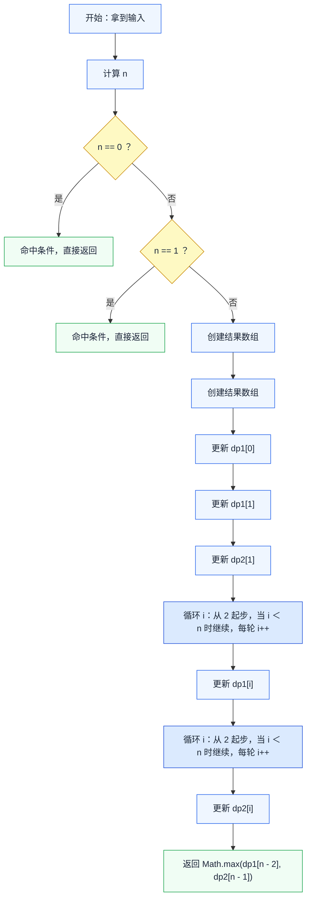

## TypeScript 解题方案（4 个方案逐个讲）

> **运行与提交**：每个方案都是自包含文件（内嵌用例自测，输出 PASS），整块复制到 `.ts` 文件后 `node 文件名` 即可运行。提交 LeetCode 时，把 `demo` 内的算法函数与辅助类型/函数整体取出、置于文件顶层即可。涉及交互/特殊接口的题以题面给定签名为准。

### 方案 1：动态规划

**分析与思路**：核心做法是「动态规划」。代码里依次做这些事：双重循环遍历。

**运行方式**：`node 本文件`，内嵌用例全部通过会输出 PASS。


**方案专属流程图**（真实控制流）：

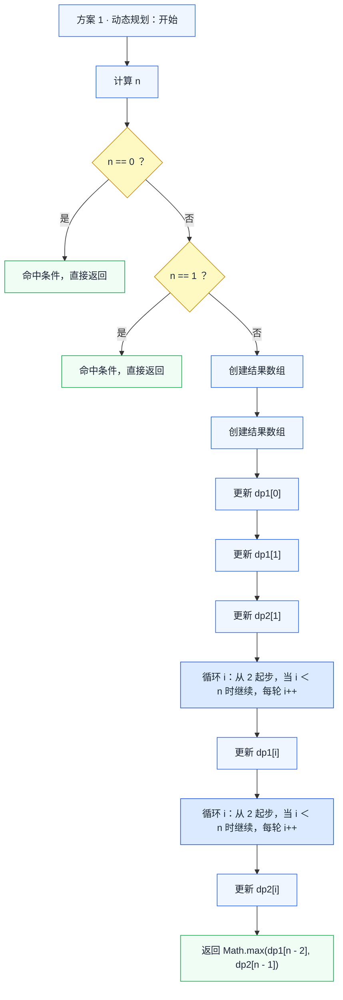

```typescript
export function demo(): void {
  // 程序入口：跑内嵌自测用例
  function rob(nums: number[]): number {
    // 定义函数/方法 rob
    const n = nums.length; // 把 数组.长度 存入 元素个数
    if (n === 0) return 0; // 若 元素个数 全等于 0，直接返回 0
    if (n === 1) return nums[0]; // 若 元素个数 全等于 1，直接返回 数组[0]
    const dp1 = new Array(n).fill(0); // 把 new Array(元素个数).fill(0) 存入 dp1
    const dp2 = new Array(n).fill(0); // 把 new Array(元素个数).fill(0) 存入 dp2
    dp1[0] = nums[0]; // 把 数组[0]; 写入 dp1[0]
    dp1[1] = Math.max(nums[0], nums[1]); // 把 Math.取较大值 数组[0], 数组[1]); 写入 dp1[1]
    dp2[1] = nums[1]; // 把 数组[1]; 写入 dp2[1]
    for (let i = 2; i < n; i++)
      dp1[i] = Math.max(dp1[i - 1], dp1[i - 2] + nums[i]); // 让 下标 i 从 2 开始计数，下标 i 小于 元素个数 就继续
    for (let i = 2; i < n; i++)
      dp2[i] = Math.max(dp2[i - 1], dp2[i - 2] + nums[i]); // 让 下标 i 从 2 开始计数，下标 i 小于 元素个数 减 1 就继续
    return Math.max(dp1[n - 2], dp2[n - 1]); // 返回 Math.取较大值 dp1[元素个数 减 2], dp2[元素个数 减 1])
  }
  const cases = [
    { in: [2, 3, 2], want: 3 },
    { in: [1, 2, 3, 1], want: 4 },
    { in: [5], want: 5 },
    { in: [], want: 0 },
  ];
  let fail = false; // 把 false 存入 fail
  for (const c of cases) {
    // for (const 字符 of cases) {
    const got = rob(c.in); // 把 rob(字符.in) 存入 got
    if (got !== c.want) {
      fail = true;
      console.log(
        'FAIL rob(' + JSON.stringify(c.in) + ')=' + got + ' want ' + c.want,
      );
    }
  }
  if (fail) throw new Error('FAILED'); // 若 fail) throw new Error(「FAILED」);
  console.log('PASS'); // 全部用例通过，输出 PASS
}
demo(); // demo();
```

### 方案 2：动态规划

**分析与思路**：核心做法是「动态规划」。代码里依次做这些事：DP 表逐项填充；单循环线性扫描。

**运行方式**：`node 本文件`，内嵌用例全部通过会输出 PASS。


**方案专属流程图**（真实控制流）：

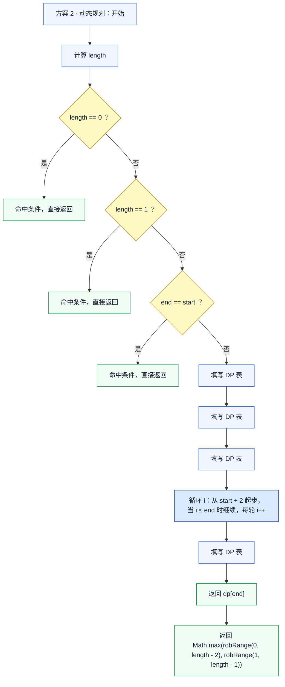

```typescript
export function demo(): void {
  // 程序入口：跑内嵌自测用例
  function rob(nums: number[]): number {
    // 定义函数/方法 rob
    const length = nums.length; // 把 数组.长度 存入 长度
    if (length === 0) return 0; // 若 长度 全等于 0，直接返回 0
    if (length === 1) return nums[0]; // 若 长度 全等于 1，直接返回 数组[0]
    function robRange(start: number, end: number): number {
      // 定义函数/方法 robRange
      if (end === start) return nums[start]; // 若 终点 全等于 起点，直接返回 数组[起点]
      const dp = new Array(end + 1).fill(0); // 把 new Array(终点 加 1).fill(0) 存入 DP 表
      dp[start] = nums[start]; // 把 数组[起点]; 写入 dp[start]
      dp[start + 1] = Math.max(nums[start], nums[start + 1]); // 把 Math.取较大值 数组[起点], 数组[起点 加 1]); 写入 dp[start + 1]
      for (let i = start + 2; i <= end; i++)
        dp[i] = Math.max(dp[i - 2] + nums[i], dp[i - 1]); // 让 下标 i 从 起点 加 2 开始计数，下标 i 不超过 终点 就继续
      return dp[end]; // 返回 DP 表[终点]
    }
    return Math.max(robRange(0, length - 2), robRange(1, length - 1)); // 返回 Math.取较大值 robRange(0, 长度 减 2), robRange(1, 长度 减 1))
  }
  const cases = [
    { in: [2, 3, 2], want: 3 },
    { in: [1, 2, 3, 1], want: 4 },
    { in: [5], want: 5 },
    { in: [], want: 0 },
  ];
  let fail = false; // 把 false 存入 fail
  for (const c of cases) {
    // for (const 字符 of cases) {
    const got = rob(c.in); // 把 rob(字符.in) 存入 got
    if (got !== c.want) {
      fail = true;
      console.log(
        'FAIL rob(' + JSON.stringify(c.in) + ')=' + got + ' want ' + c.want,
      );
    }
  }
  if (fail) throw new Error('FAILED'); // 若 fail) throw new Error(「FAILED」);
  console.log('PASS'); // 全部用例通过，输出 PASS
}
demo(); // demo();
```

### 方案 3：单趟扫描

**分析与思路**：核心做法是「单趟扫描」。代码里依次做这些事：单循环线性扫描。

**运行方式**：`node 本文件`，内嵌用例全部通过会输出 PASS。


**方案专属流程图**（真实控制流）：

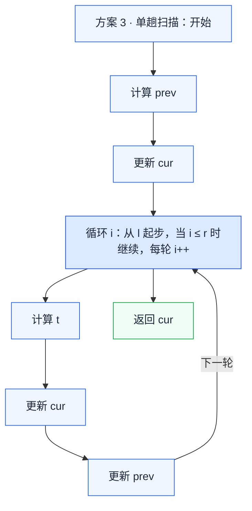

```typescript
export function demo(): void {
  // 程序入口：跑内嵌自测用例
  function helper(nums: number[], l: number, r: number): number {
    // 定义函数/方法 helper
    let prev = 0,
      cur = 0; // 把 0, 当前值 赋值为 0 存入 前一个
    for (let i = l; i <= r; i++) {
      const t = cur;
      cur = Math.max(cur, prev + nums[i]);
      prev = t;
    } // 让 下标 i 从 左指针 开始计数，下标 i 不超过 右指针 就继续
    return cur; // 返回 当前值
  }
  function rob(nums: number[]): number {
    // 定义函数/方法 rob
    const n = nums.length; // 把 数组.长度 存入 元素个数
    if (n === 0) return 0; // 若 元素个数 全等于 0，直接返回 0
    if (n === 1) return nums[0]; // 若 元素个数 全等于 1，直接返回 数组[0]
    return Math.max(helper(nums, 0, n - 2), helper(nums, 1, n - 1)); // 返回 Math.取较大值 helper(数组,0,元素个数 减 2), helper(数组,1,元素个数 减 1))
  }
  const cases = [
    { in: [2, 3, 2], want: 3 },
    { in: [1, 2, 3, 1], want: 4 },
    { in: [1, 2, 1, 1], want: 3 },
  ];
  let fail = false; // 把 false 存入 fail
  for (const c of cases) {
    // for (const 字符 of cases) {
    const got = rob(c.in); // 把 rob(字符.in) 存入 got
    if (got !== c.want) {
      fail = true;
      console.log('FAIL ' + got + ' want ' + c.want);
    }
  }
  if (fail) throw new Error('FAILED'); // 若 fail) throw new Error(「FAILED」);
  console.log('PASS'); // 全部用例通过，输出 PASS
}
demo(); // demo();
```

### 方案 4：单趟扫描

**分析与思路**：核心做法是「单趟扫描」。代码里依次做这些事：单循环线性扫描。

**运行方式**：`node 本文件`，内嵌用例全部通过会输出 PASS。


**方案专属流程图**（真实控制流）：

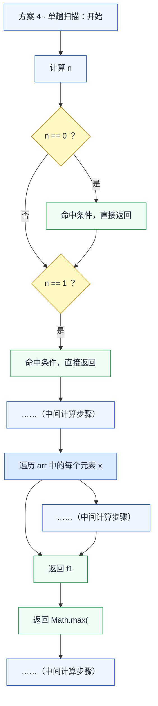

```typescript
export function demo(): void {
  // 程序入口：跑内嵌自测用例
  function rob(nums: number[]): number {
    // 定义函数/方法 rob
    const n = nums.length; // 把 数组.长度 存入 元素个数
    if (n === 0) return 0; // 若 元素个数 全等于 0，直接返回 0
    if (n === 1) return nums[0]; // 若 元素个数 全等于 1，直接返回 数组[0]
    function helper(arr: number[]): number {
      // 定义函数/方法 helper
      let f0 = 0,
        f1 = 0; // 把 0, f1 赋值为 0 存入 f0
      for (const x of arr) {
        const nf = Math.max(f1, f0 + x);
        f0 = f1;
        f1 = nf;
      }
      return f1; // 返回 f1
    }
    return Math.max(
      nums[0] + helper(nums.slice(2, n - 1)),
      helper(nums.slice(1, n)),
    );
  }
  const cases = [
    { in: [2, 3, 2], want: 3 },
    { in: [1, 2, 3, 1], want: 4 },
    { in: [5], want: 5 },
    { in: [], want: 0 },
  ];
  let fail = false; // 把 false 存入 fail
  for (const c of cases) {
    // for (const 字符 of cases) {
    const got = rob(c.in); // 把 rob(字符.in) 存入 got
    if (got !== c.want) {
      fail = true;
      console.log(
        'FAIL rob(' + JSON.stringify(c.in) + ')=' + got + ' want ' + c.want,
      );
    }
  }
  if (fail) throw new Error('FAILED'); // 若 fail) throw new Error(「FAILED」);
  console.log('PASS'); // 全部用例通过，输出 PASS
}
demo(); // demo();
```

## 逐步拆解与面试追问

**复杂度**：时间 O(n²)（两层嵌套扫描），空间 O(1) 到 O(n)

**为什么是这个量级**：外层定起点、内层扫终点，n 个起点各扫 n 次

**面试官可能会追问**：

- 状态定义为什么是它？
- 遍历顺序由什么决定？
- 能否滚动数组压空间？

## 关键 API 速查（TS 主解法实际用到，附官方链接）

| API | 作用 | 使用要点 | 官方文档 |
|---|---|---|---|
| `JSON.stringify()` | 序列化为 JSON 字符串 | 常用于结构化比较（深度相等判定）；undefined/函数/循环引用会被丢弃或抛错 | [官方文档](https://developer.mozilla.org/zh-CN/docs/Web/JavaScript/Reference/Global_Objects/JSON/stringify) |
| `Math.max()` | 最大值 | 配展开 Math.max(...arr)；空参返回 -Infinity；超大数组注意展开参数上限 | [官方文档](https://developer.mozilla.org/zh-CN/docs/Web/JavaScript/Reference/Global_Objects/Math/max) |

### 各语言官方文档导航

- **TypeScript / JS**：[MDN 中文参考](https://developer.mozilla.org/zh-CN/)
- **Python**：[Python 官方文档](https://docs.python.org/zh-cn/3/)
- **Go**：[Go 标准库](https://pkg.go.dev/std)
- **Java**：[JDK 17 API](https://docs.oracle.com/en/java/javase/17/docs/api/)
- **Rust**：[Rust 标准库](https://doc.rust-lang.org/std/)
- **Lua**：[Lua 5.4 手册](https://www.lua.org/manual/5.4/)
- **C**：[Cppreference C](https://zh.cppreference.com/w/c)
- **C++**：[Cppreference C++](https://zh.cppreference.com/w/cpp)
- **R**：[R 官方手册](https://stat.ethz.ch/R-manual/)
- **Zig**：[Zig 语言文档](https://ziglang.org/documentation/master/)
- **Dart**：[Dart API](https://api.dart.dev/)

## 附录：其他 10 种语言全部实现（每种语言列举其全部方案）

> TypeScript 的全部方案见「TypeScript 解题方案」一节；下面是其余 10 种语言的对应实现，每种语言的每个方案都带思路分析、代码走读与专属运行架构图。
> 每个方案都内嵌用例自测，可独立运行（老仓库 python/go 文件遵循「打印结果」约定）。
> 完整解法文件见 `dsa/<语言>/dp/lc_213_打家劫舍_ii/`。

### Python 实现（4 种方案）

Python 的全部方案如下，每个方案都内嵌用例自测，可独立运行（老仓库 python/go 文件遵循「打印结果」约定）：

#### 方案 1：动态规划

**思路与代码分析**：核心是「动态规划」。Python 版用切片与字典推导式简化操作，突出可读性。**走读**：方案 1 · 动态规划：开始 → 更新 n → 命中条件，直接返回 → 命中条件，直接返回 → 循环 i：从 2 到 n 前 → 循环 i：从 2 到 n - 1 前 → 返回 max(dp1[n - 2], dp2[n - 1])。

**运行架构**（真实控制流）：

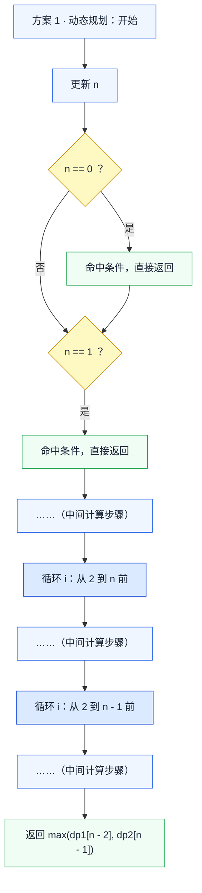

```python
import sys  # 提高递归深度上限（深输入防 RecursionError）

sys.setrecursionlimit(200000)  # 树/链表类题目节点数可达 1e4 量级

def rob(nums):  # 定义函数 rob（参数：数组）
    n = len(nums)  # 把 长度(数组) 存入 元素个数
    if n == 0:  # 若 元素个数 等于 0
        return 0  # 返回 0
    if n == 1:  # 若 元素个数 等于 1
        return nums[0]  # 返回 数组[0]

    # dp1 不抢最后一个房子, dp2 不抢第一个房子
    dp1 = [0] * n  # 把 [0] 乘 元素个数 存入 dp1
    dp2 = [0] * n  # 把 [0] 乘 元素个数 存入 dp2

    dp1[0] = nums[0]  # 把 数组[0] 写入 dp1[0]
    dp1[1] = max(nums[0], nums[1])  # 把 取较大值 数组[0], 数组[1]) 写入 dp1[1]
    dp2[1] = nums[1]  # 把 数组[1] 写入 dp2[1]

    for i in range(2, n):  # 让 下标 i 从 2 到 元素个数 遍历
        dp1[i] = max(
            dp1[i - 1], dp1[i - 2] + nums[i]
        )  # 把 取较大值 dp1[下标 i 减 1], dp1[下标 i 减 2] 加 数组[下标 i]) 写入 dp1[i]
    for i in range(2, n - 1):  # 让 下标 i 从 2 到 元素个数 减 1 遍历
        dp2[i] = max(
            dp2[i - 1], dp2[i - 2] + nums[i]
        )  # 把 取较大值 dp2[下标 i 减 1], dp2[下标 i 减 2] 加 数组[下标 i]) 写入 dp2[i]

    return max(dp1[n - 2], dp2[n - 1])  # 返回 取较大值 dp1[元素个数 减 2], dp2[元素个数 减 1])

if __name__ == "__main__":  # 若 __name__ 等于 '__main__'
    print(rob([2, 3, 2]))  # 打印输出
```

#### 方案 2：动态规划

**思路与代码分析**：核心是「动态规划」。Python 版用切片与字典推导式简化操作，突出可读性。代码里依次做这些事：DP 表逐项填充。**走读**：方案 2 · 动态规划：开始 → 更新 length → 命中条件，直接返回 → 命中条件，直接返回 → 命中条件，直接返回 → 循环 i：从 start + 2 到 end + 1 前 → 返回 dp[end] → 返回 max(ret1, ret2)。

**运行架构**（真实控制流）：

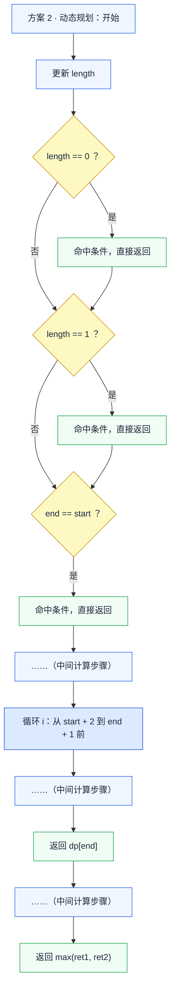

```python
import sys  # 提高递归深度上限（深输入防 RecursionError）

sys.setrecursionlimit(200000)  # 树/链表类题目节点数可达 1e4 量级

def rob(nums):  # 定义函数 rob（参数：数组）
    length = len(nums)  # 把 长度(数组) 存入 长度
    if length == 0:  # 若 长度 等于 0
        return 0  # 返回 0
    if length == 1:  # 若 长度 等于 1
        return nums[0]  # 返回 数组[0]

    def robRange(start, end):  # 定义函数 robRange（参数：起点, 终点）
        if end == start:  # 若 终点 等于 起点
            return nums[start]  # 返回 数组[起点]
        dp = [0] * (end + 1)  # 把 [0] 乘 (终点 加 1) 存入 DP 表
        dp[start] = nums[start]  # 把 数组[起点] 写入 dp[start]
        dp[start + 1] = max(
            nums[start], nums[start + 1]
        )  # 把 取较大值 数组[起点], 数组[起点 加 1]) 写入 dp[start + 1]
        for i in range(start + 2, end + 1):  # 让 下标 i 从 起点 加 2 到 终点 加 1 遍历
            dp[i] = max(
                dp[i - 2] + nums[i], dp[i - 1]
            )  # 把 取较大值 DP 表[下标 i 减 2] 加 数组[下标 i], DP 表[下标 i 减 1]) 写入 dp[i]
        return dp[end]  # 返回 DP 表[终点]

    ret1 = robRange(0, length - 2)  # 把 robRange(0, 长度 减 2) 存入 ret1
    ret2 = robRange(1, length - 1)  # 把 robRange(1, 长度 减 1) 存入 ret2
    return max(ret1, ret2)  # 返回 取较大值 ret1, ret2)

if __name__ == "__main__":  # 若 __name__ 等于 '__main__'
    print(rob([2, 3, 2]))  # 打印输出
```

#### 方案 3：单趟扫描

**思路与代码分析**：核心是「单趟扫描」。Python 版用切片与字典推导式简化操作，突出可读性。**走读**：方案 3 · 单趟扫描：开始 → 更新 length → 命中条件，直接返回 → 更新 = → 返回 max(nums[0], nums[1]) → 更新 first → 更新 second → 循环 i：从 start + 2 到 end + 1 前 → 更新 temp → 更新 second → 更新 first → 返回 second → 返回 max( → 调用 robRange(0, length - 2), rob → 处理 )。

**运行架构**（真实控制流）：

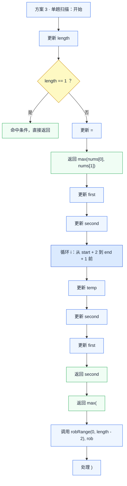

```python
import sys  # 提高递归深度上限（深输入防 RecursionError）

sys.setrecursionlimit(200000)  # 树/链表类题目节点数可达 1e4 量级

def rob(nums):  # 定义函数 rob（参数：数组）
    length = len(nums)  # 把 长度(数组) 存入 长度
    if length == 1:  # 若 长度 等于 1
        return nums[0]  # 返回 数组[0]
    elif length == 2:  # 否则，若 长度 等于 2
        return max(nums[0], nums[1])  # 返回 取较大值 数组[0], 数组[1])

    def robRange(start, end):  # 定义函数 robRange（参数：起点, 终点）
        first = nums[start]  # 把 数组[起点] 存入 first
        second = max(nums[start], nums[start + 1])  # 把 取较大值 数组[起点], 数组[起点 加 1]) 存入 second
        for i in range(start + 2, end + 1):  # 让 下标 i 从 起点 加 2 到 终点 加 1 遍历
            temp = second  # 把 second 存入 临时变量
            second = max(first + nums[i], second)  # 把 取较大值 first 加 数组[下标 i], second) 存入 second
            first = temp  # 把 临时变量 存入 first
        return second  # 返回 second

    return max(
        robRange(0, length - 2), robRange(1, length - 1)
    )  # 返回 取较大值 robRange(0, 长度 减 2), robRange(1, 长度 减 1))

if __name__ == "__main__":  # 若 __name__ 等于 '__main__'
    print(rob([2, 3, 2]))  # 打印输出
```

#### 方案 4：单趟扫描

**思路与代码分析**：核心是「单趟扫描」。Python 版用切片与字典推导式简化操作，突出可读性。**走读**：方案 4 · 单趟扫描：开始 → 更新 n → 命中条件，直接返回 → 命中条件，直接返回 → 更新 f0 → 更新 f1 → 遍历 arr: 中的每个元素 x → 更新 f1 → 返回 f1 → 返回 max( → 处理 nums[0] + helper(nums[2 : n → 处理 )。

**运行架构**（真实控制流）：

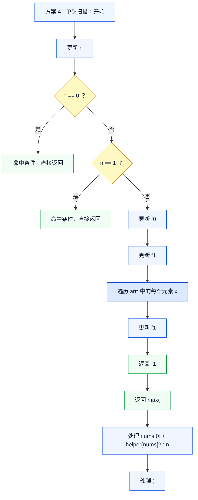

```python
import sys  # 提高递归深度上限（深输入防 RecursionError）

sys.setrecursionlimit(200000)  # 树/链表类题目节点数可达 1e4 量级

def rob(nums):  # 定义函数 rob（参数：数组）
    n = len(nums)  # 把 长度(数组) 存入 元素个数
    if n == 0:  # 若 元素个数 等于 0
        return 0  # 返回 0
    if n == 1:  # 若 元素个数 等于 1
        return nums[0]  # 返回 数组[0]

    def helper(arr):  # 定义函数 helper（参数：数组）
        f0 = 0  # 把 0 存入 f0
        f1 = 0  # 把 0 存入 f1
        for x in arr:  # 逐个取出 数组 的元素（x）
            f0, f1 = f1, max(f1, f0 + x)  # 把 f1, 取较大值 f1, f0 加 x) 写入 f0, f1
        return f1  # 返回 f1

    return max(
        nums[0] + helper(nums[2 : n - 1]), helper(nums[1:n])
    )  # 返回 取较大值 数组[0] 加 helper(数组[2:元素个数 减 1]), helper(数组[1:元素个数]))

if __name__ == "__main__":  # 若 __name__ 等于 '__main__'
    print(rob([2, 3, 2]))  # 打印输出
```

### Go 实现（4 种方案）

Go 的全部方案如下，每个方案都内嵌用例自测，可独立运行（老仓库 python/go 文件遵循「打印结果」约定）：

#### 方案 1：动态规划

**思路与代码分析**：核心是「动态规划」。Go 版用切片与多返回值惯用法，显式处理索引边界。**走读**：方案 1 · 动态规划：开始 → 更新 : → 处理 if n == 0 → 返回 0 → 处理 if n == 1 → 返回 nums[0] → 更新 : → 更新 : → 更新 dp1[0] → 更新 dp1[1] → 更新 dp2[1] → 遍历循环 → 更新 dp1[i] → 遍历循环 → 更新 dp2[i] → 返回 max2(dp1[n-2], dp2[n-1])。

**运行架构**（真实控制流）：

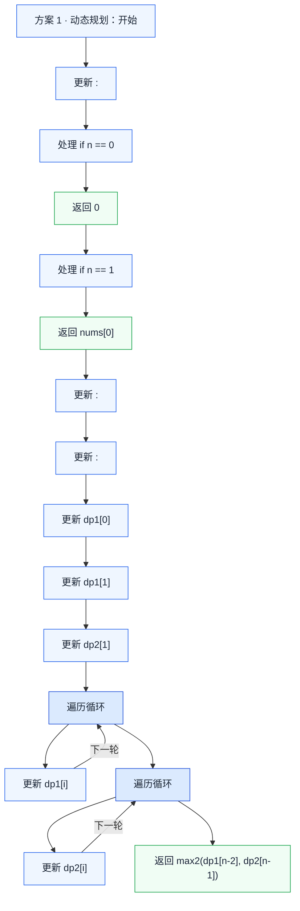

```go
package main // 引入依赖

import (
	"fmt" // 「fmt」
	"os"  // 「os」
)

func max2(a, b int) int { // 定义函数/方法 max2
	if a > b { // 若 数组 超过 b
		return a // 返回 数组
	}
	return b // 返回 b
}

// rob 是 Python 参考 solution_1 的忠实翻译（两条 DP 线：dp1 不抢最后一个，dp2 不抢第一个）。
func rob(nums []int) int { // 定义函数/方法 rob
	n := len(nums) // 把 长度(数组) 写入 n :
	if n == 0 {    // 若 元素个数 等于 0
		return 0 // 返回 0
	}
	if n == 1 { // 若 元素个数 等于 1
		return nums[0] // 返回 数组[0]
	}
	dp1 := make([]int, n)           // 把 make([]int, 元素个数) 写入 dp1 :
	dp2 := make([]int, n)           // 把 make([]int, 元素个数) 写入 dp2 :
	dp1[0] = nums[0]                // 把 数组[0] 写入 dp1[0]
	dp1[1] = max2(nums[0], nums[1]) // 把 max2(数组[0], 数组[1]) 写入 dp1[1]
	dp2[1] = nums[1]                // 把 数组[1] 写入 dp2[1]
	for i := 2; i < n; i++ {        // 让 下标 i 从 2 开始计数
		dp1[i] = max2(dp1[i-1], dp1[i-2]+nums[i]) // 把 max2(dp1[下标 i 减 1], dp1[下标 i 减 2] 加 数组[下标 i]) 写入 dp1[i]
	}
	for i := 2; i < n; i++ { // 让 下标 i 从 2 开始计数
		dp2[i] = max2(dp2[i-1], dp2[i-2]+nums[i]) // 把 max2(dp2[下标 i 减 1], dp2[下标 i 减 2] 加 数组[下标 i]) 写入 dp2[i]
	}
	return max2(dp1[n-2], dp2[n-1]) // 定义函数/方法 max2
}

func main() { // 程序入口：跑内嵌自测用例
	type tc struct { // 定义类型
		nums []int // 数组 []int
		want int   // want int
	}
	cases := []tc{ // 把 []tc{ 写入 cases :
		{[]int{2, 3, 2}, 3},
		{[]int{1, 2, 3, 1}, 4},
		{[]int{5}, 5},
		{[]int{3, 2, 4, 1}, 7},
		{[]int{2, 1, 1, 2}, 3},
	}
	for _, c := range cases { // 同时取 _ 与 字符 遍历
		if got := rob(c.nums); got != c.want { // 若 got : 赋值为 rob(字符.数组); got 不等于 字符.want
			fmt.Printf("FAIL %v got=%d want=%d\n", c.nums, got, c.want) // 打印输出
			os.Exit(1)                                                  // os.Exit(1)
		}
	}
	fmt.Println("PASS") // 全部用例通过，输出 PASS
}
```

#### 方案 2：动态规划

**思路与代码分析**：核心是「动态规划」。Go 版用切片与多返回值惯用法，显式处理索引边界。**走读**：方案 2 · 动态规划：开始 → 更新 : → 处理 if n == 0 → 返回 0 → 处理 if n == 1 → 返回 nums[0] → 返回 max(helper(nums, 0, n-2), helper(nums, 1, n-1))。

**运行架构**（真实控制流）：

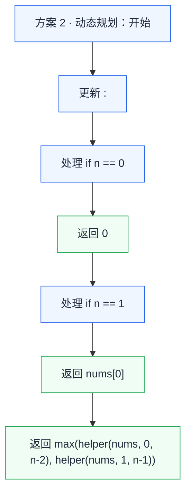

```go
package main // 引入依赖
import (
	"fmt"
	"os"
) // 引入依赖
func rob(nums []int) int { // 定义函数/方法 rob
	n := len(nums) // 把 长度(数组) 写入 n :
	if n == 0 {
		return 0
	} // 若 元素个数 等于 0 { return 0 }
	if n == 1 {
		return nums[0]
	} // 若 元素个数 等于 1 { return 数组[0] }
	return max(helper(nums, 0, n-2), helper(nums, 1, n-1)) // 定义函数/方法 max
}
func helper(nums []int, l, r int) int { // 定义函数/方法 helper
	prev, cur := 0, 0 // 把 0, 0 写入 prev, cur :
	for i := l; i <= r; i++ {
		prev, cur = cur, max(cur, prev+nums[i])
	}
	return cur // 返回 当前值
}
func max(a, b int) int {
	if a > b {
		return a
	}
	return b
} // 定义函数/方法 max
func main() { // 程序入口：跑内嵌自测用例
	cases := []struct {
		in   []int
		want int
	}{ // 把 []struct{ in []int; want int }{ 写入 cases :
		{[]int{2, 3, 2}, 3}, {[]int{1, 2, 3, 1}, 4}, {[]int{1, 2, 1, 1}, 3},
	}
	ok := true                // 把 true 写入 ok :
	for _, c := range cases { // 同时取 _ 与 字符 遍历
		if got := rob(c.in); got != c.want {
			ok = false
			fmt.Printf("FAIL rob=%v want %v\n", got, c.want)
		}
	}
	if !ok {
		os.Exit(1)
	} // 若 取反 ok { os.Exit(1) }
	fmt.Println("PASS") // 全部用例通过，输出 PASS
}
```

#### 方案 3：单趟扫描

**思路与代码分析**：核心是「单趟扫描」。Go 版用切片与多返回值惯用法，显式处理索引边界。**走读**：方案 3 · 单趟扫描：开始 → 更新 : → 处理 if length == 1 → 返回 nums[0] → 处理 if length == 2 → 返回 max2(nums[0], nums[1]) → 返回 max2(robRange(nums, 0, length-2), robRange(nums, 1, length-1))。

**运行架构**（真实控制流）：

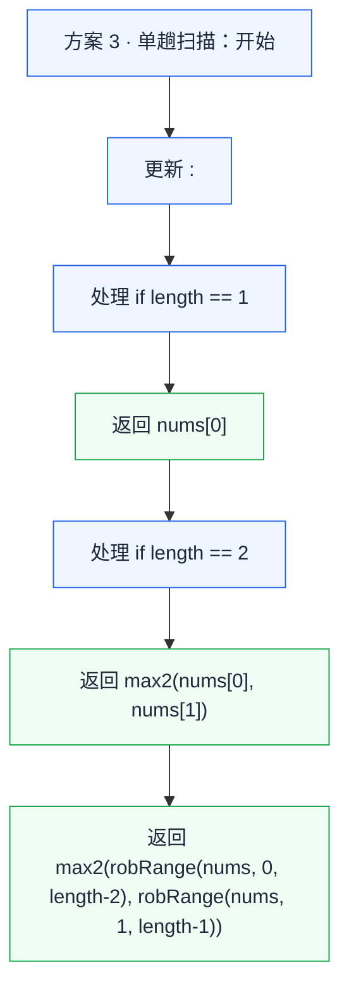

```go
package main // 引入依赖

import (
	"fmt" // 「fmt」
	"os"  // 「os」
)

func max2(a, b int) int { // 定义函数/方法 max2
	if a > b { // 若 数组 超过 b
		return a // 返回 数组
	}
	return b // 返回 b
}

// rob 是 Python 参考 solution_3 的忠实翻译（robRange 区间 DP）。
func rob(nums []int) int { // 定义函数/方法 rob
	length := len(nums) // 把 长度(数组) 写入 length :
	if length == 1 {    // 若 长度 等于 1
		return nums[0] // 返回 数组[0]
	}
	if length == 2 { // 若 长度 等于 2
		return max2(nums[0], nums[1]) // 定义函数/方法 max2
	}
	return max2(robRange(nums, 0, length-2), robRange(nums, 1, length-1)) // 定义函数/方法 max2
}

func robRange(nums []int, start, end int) int { // 定义函数/方法 robRange
	first := nums[start]                       // 把 数组[起点] 写入 first :
	second := max2(nums[start], nums[start+1]) // 把 max2(数组[起点], 数组[起点 加 1]) 写入 second :
	for i := start + 2; i <= end; i++ {        // 把 起点 加 2; 下标 i 不超过 终点; 下标 i 加一 { 写入 for i :
		temp := second                       // 把 second 写入 temp :
		second = max2(first+nums[i], second) // 把 max2(first 加 数组[下标 i], second) 写入 second
		first = temp                         // 把 临时变量 写入 first
	}
	return second // 返回 second
}

func main() { // 程序入口：跑内嵌自测用例
	type tc struct { // 定义类型
		nums []int // 数组 []int
		want int   // want int
	}
	cases := []tc{ // 把 []tc{ 写入 cases :
		{[]int{2, 3, 2}, 3},
		{[]int{1, 2, 3, 1}, 4},
		{[]int{1, 2, 1, 1}, 3},
		{[]int{5}, 5},
		{[]int{2, 1, 1, 2}, 3},
	}
	for _, c := range cases { // 同时取 _ 与 字符 遍历
		if got := rob(c.nums); got != c.want { // 若 got : 赋值为 rob(字符.数组); got 不等于 字符.want
			fmt.Printf("FAIL %v got=%d want=%d\n", c.nums, got, c.want) // 打印输出
			os.Exit(1)                                                  // os.Exit(1)
		}
	}
	fmt.Println("PASS") // 全部用例通过，输出 PASS
}
```

#### 方案 4：单趟扫描

**思路与代码分析**：核心是「单趟扫描」。Go 版用切片与多返回值惯用法，显式处理索引边界。**走读**：方案 4 · 单趟扫描：开始 → 更新 : → 处理 if n == 0 → 返回 0 → 处理 if n == 1 → 返回 nums[0] → 更新 : → 更新 : → 遍历 arr 的下标与元素 x → 更新 f1 → 返回 f1 → 返回 max2(nums[0]+helper(nums[2:n-1]), helper(nums[1:n]))。

**运行架构**（真实控制流）：

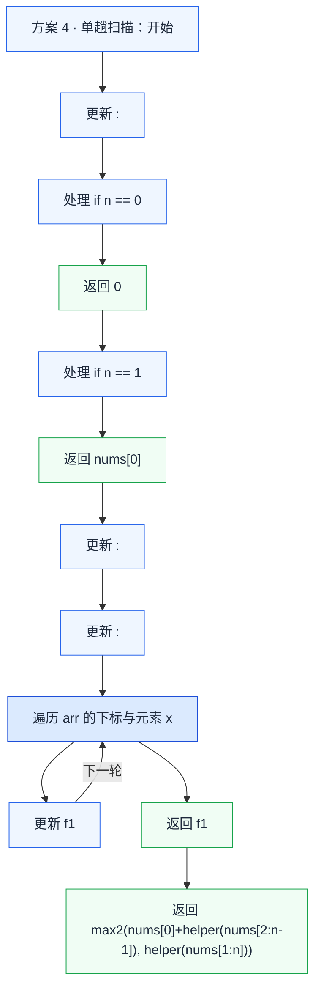

```go
package main // 引入依赖

import (
	"fmt" // 「fmt」
	"os"  // 「os」
)

func max2(a, b int) int { // 定义函数/方法 max2
	if a > b { // 若 数组 超过 b
		return a // 返回 数组
	}
	return b // 返回 b
}

// rob 是 Python 参考 solution_4 的忠实翻译（helper 滚动 DP + 两段比较）。
func rob(nums []int) int { // 定义函数/方法 rob
	n := len(nums) // 把 长度(数组) 写入 n :
	if n == 0 {    // 若 元素个数 等于 0
		return 0 // 返回 0
	}
	if n == 1 { // 若 元素个数 等于 1
		return nums[0] // 返回 数组[0]
	}
	helper := func(arr []int) int { // 把 func(数组 []int) int { 写入 helper :
		f0, f1 := 0, 0          // 把 0, 0 写入 f0, f1 :
		for _, x := range arr { // 同时取 _ 与 x 遍历
			f0, f1 = f1, max2(f1, f0+x) // 把 f1, max2(f1, f0 加 x) 写入 f0, f1
		}
		return f1 // 返回 f1
	}
	return max2(nums[0]+helper(nums[2:n-1]), helper(nums[1:n])) // 定义函数/方法 max2
}

func main() { // 程序入口：跑内嵌自测用例
	type tc struct { // 定义类型
		nums []int // 数组 []int
		want int   // want int
	}
	cases := []tc{ // 把 []tc{ 写入 cases :
		{[]int{2, 3, 2}, 3},
		{[]int{1, 2, 3, 1}, 4},
		{[]int{1, 2, 1, 1}, 3},
		{[]int{5}, 5},
		{[]int{2, 1, 1, 2}, 3},
	}
	for _, c := range cases { // 同时取 _ 与 字符 遍历
		if got := rob(c.nums); got != c.want { // 若 got : 赋值为 rob(字符.数组); got 不等于 字符.want
			fmt.Printf("FAIL %v got=%d want=%d\n", c.nums, got, c.want) // 打印输出
			os.Exit(1)                                                  // os.Exit(1)
		}
	}
	fmt.Println("PASS") // 全部用例通过，输出 PASS
}
```

### Java 实现（4 种方案）

Java 的全部方案如下，每个方案都内嵌用例自测，可独立运行（老仓库 python/go 文件遵循「打印结果」约定）：

#### 方案 1：动态规划

**思路与代码分析**：核心是「动态规划」。Java 版用类与静态方法组织，集合操作显式明了。代码里依次做这些事：双重循环遍历。**走读**：方案 1 · 动态规划：开始 → 更新 n → 命中条件，直接返回 → 命中条件，直接返回 → 遍历循环 → 遍历循环 → 返回 Math.max(dp1[n - 2], dp2[n - 1])。

**运行架构**（真实控制流）：

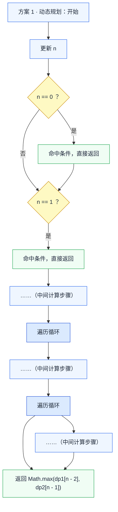

```java
package com.webfault.dsa; // 引入依赖

import java.util.*; // 引入依赖

class lc213_solution111 { // 定义类型
  public int rob(int[] nums) { // 定义函数/方法 rob
    int n = nums.length; // 把 数组.长度 存入 元素个数
    if (n == 0) return 0; // 若 元素个数 等于 0，直接返回 0
    if (n == 1) return nums[0]; // 若 元素个数 等于 1，直接返回 数组[0]
    if (n == 2) return Math.max(nums[0], nums[1]); // 若 元素个数 等于 2，直接返回 Math.取较大值 数组[0], 数组[1])
    int[] dp1 = new int[n]; // 把 new int[元素个数]; 写入 int[] dp1
    int[] dp2 = new int[n]; // 把 new int[元素个数]; 写入 int[] dp2
    dp1[0] = nums[0]; // 把 数组[0]; 写入 dp1[0]
    dp1[1] = Math.max(nums[0], nums[1]); // 把 Math.取较大值 数组[0], 数组[1]); 写入 dp1[1]
    for (int i = 2; i < n; i++) { // 让 下标 i 从 2 开始计数，下标 i 小于 元素个数 减 1 就继续
      dp1[i] = Math.max(dp1[i - 1], dp1[i - 2] + nums[i]);
    }
    dp2[1] = nums[1]; // 把 数组[1]; 写入 dp2[1]
    for (int i = 2; i < n; i++) { // 让 下标 i 从 2 开始计数，下标 i 小于 元素个数 就继续
      dp2[i] = Math.max(dp2[i - 1], dp2[i - 2] + nums[i]);
    }
    return Math.max(dp1[n - 2], dp2[n - 1]); // 返回 Math.取较大值 dp1[元素个数 减 2], dp2[元素个数 减 1])
  }

  public static void main(String[] args) { // public static void main(String[] args) {
    lc213_solution111 s =
        new lc213_solution111(); // 把 new lc213_solution111(); 写入 lc213_solution111 s
    int got = s.rob(new int[] {2, 3, 2}); // 把 字符串.rob(new int[]{2, 3, 2}) 存入 got
    if (got != 3) {
      System.out.println("FAIL got " + got);
      throw new RuntimeException("FAILED");
    }
    System.out.println("PASS"); // 全部用例通过，输出 PASS
  }
}
```

#### 方案 2：动态规划

**思路与代码分析**：核心是「动态规划」。Java 版用类与静态方法组织，集合操作显式明了。**走读**：方案 2 · 动态规划：开始 → 更新 len → 命中条件，直接返回 → 命中条件，直接返回 → 若 len == 2) return Math.max(nums[0], nums[1]：None → 更新 ret1 → 更新 ret2 → 返回 Math.max(ret1, ret2)。

**运行架构**（真实控制流）：

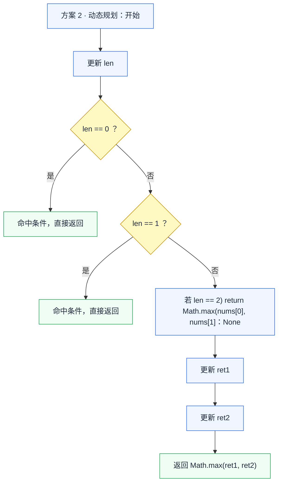

```java
package com.webfault.dsa; // 引入依赖

import java.util.*; // 引入依赖

class lc213_solution222 { // 定义类型
  public int rob(int[] nums) { // 定义函数/方法 rob
    int len = nums.length; // 把 数组.长度 存入 长度
    if (len == 0) return 0; // 若 长度 等于 0，直接返回 0
    if (len == 1) return nums[0]; // 若 长度 等于 1，直接返回 数组[0]
    if (len == 2) return Math.max(nums[0], nums[1]); // 若 长度 等于 2，直接返回 Math.取较大值 数组[0], 数组[1])
    int ret1 = robRange(nums, 0, len - 2); // 把 robRange(数组, 0, 长度 减 2) 存入 ret1
    int ret2 = robRange(nums, 1, len - 1); // 把 robRange(数组, 1, 长度 减 1) 存入 ret2
    return Math.max(ret1, ret2); // 返回 Math.取较大值 ret1, ret2)
  }

  private int robRange(int[] nums, int start, int end) { // 定义函数/方法 robRange
    int dp0 = 0, dp1 = 0; // 把 0, dp1 赋值为 0 存入 dp0
    for (int i = start; i <= end; i++) { // 让 下标 i 从 起点 开始计数，下标 i 不超过 终点 就继续
      int tmp = dp1; // 把 dp1 存入 临时变量
      dp1 = Math.max(dp0 + nums[i], dp1); // 把 Math.取较大值 dp0 加 数组[下标 i], dp1); 写入 dp1
      dp0 = tmp; // 把 临时变量; 写入 dp0
    }
    return dp1; // 返回 dp1
  }

  public static void main(String[] args) { // public static void main(String[] args) {
    lc213_solution222 s =
        new lc213_solution222(); // 把 new lc213_solution222(); 写入 lc213_solution222 s
    int got = s.rob(new int[] {2, 3, 2}); // 把 字符串.rob(new int[]{2, 3, 2}) 存入 got
    if (got != 3) {
      System.out.println("FAIL got " + got);
      throw new RuntimeException("FAILED");
    }
    System.out.println("PASS"); // 全部用例通过，输出 PASS
  }
}
```

#### 方案 3：单趟扫描

**思路与代码分析**：核心是「单趟扫描」。Java 版用类与静态方法组织，集合操作显式明了。**走读**：方案 3 · 单趟扫描：开始 → 更新 length → 命中条件，直接返回 → 返回 Math.max(nums[0], nums[1]) → 返回 Math.max(robRange(nums, 0, length - 2), robRange(nums, 1, length - 1))。

**运行架构**（真实控制流）：

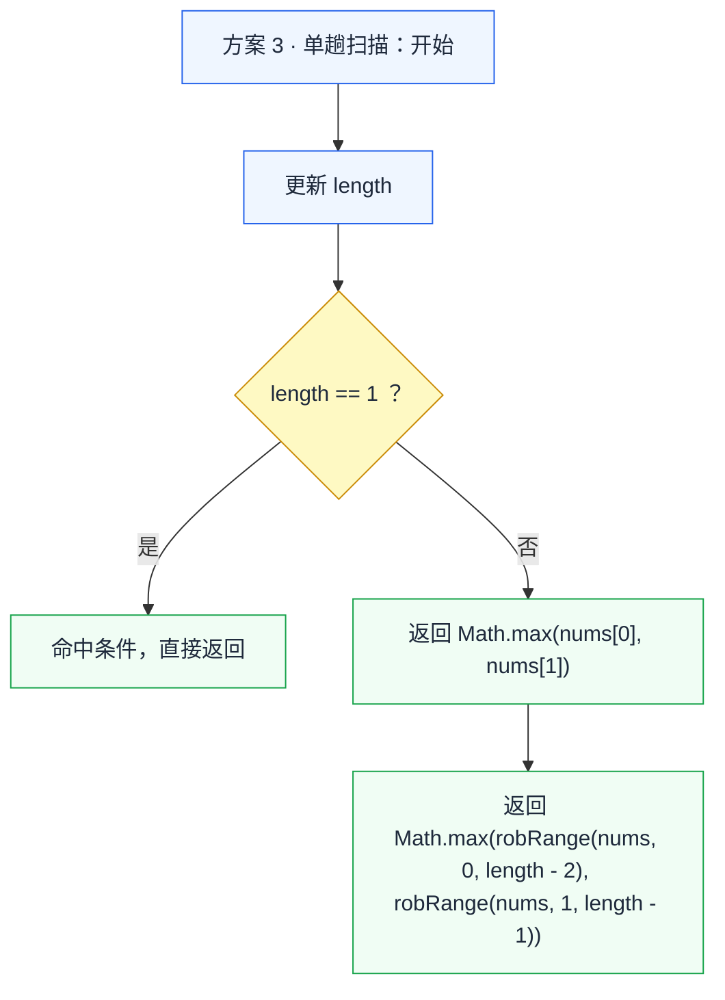

```java
package com.webfault.dsa; // 引入依赖

import java.util.*; // 引入依赖

class lc213_solution333 { // 定义类型
  public int rob(int[] nums) { // 定义函数/方法 rob
    int length = nums.length; // 把 数组.长度 存入 长度
    if (length == 1) { // 若 长度 等于 1
      return nums[0]; // 返回 数组[0]
    } else if (length == 2) { // 否则，若 长度 等于 2
      return Math.max(nums[0], nums[1]); // 返回 Math.取较大值 数组[0], 数组[1])
    }
    return Math.max(robRange(nums, 0, length - 2), robRange(nums, 1, length - 1));
  }

  private int robRange(int[] nums, int start, int end) { // 定义函数/方法 robRange
    int dp0 = 0, dp1 = 0; // 把 0, dp1 赋值为 0 存入 dp0
    for (int i = start; i <= end; i++) { // 让 下标 i 从 起点 开始计数，下标 i 不超过 终点 就继续
      int tmp = dp1; // 把 dp1 存入 临时变量
      dp1 = Math.max(dp0 + nums[i], dp1); // 把 Math.取较大值 dp0 加 数组[下标 i], dp1); 写入 dp1
      dp0 = tmp; // 把 临时变量; 写入 dp0
    }
    return dp1; // 返回 dp1
  }

  public static void main(String[] args) { // public static void main(String[] args) {
    lc213_solution333 s =
        new lc213_solution333(); // 把 new lc213_solution333(); 写入 lc213_solution333 s
    int got = s.rob(new int[] {2, 3, 2}); // 把 字符串.rob(new int[]{2, 3, 2}) 存入 got
    if (got != 3) {
      System.out.println("FAIL got " + got);
      throw new RuntimeException("FAILED");
    }
    System.out.println("PASS"); // 全部用例通过，输出 PASS
  }
}
```

#### 方案 4：单趟扫描

**思路与代码分析**：核心是「单趟扫描」。Java 版用类与静态方法组织，集合操作显式明了。**走读**：方案 4 · 单趟扫描：开始 → 更新 n → 命中条件，直接返回 → 命中条件，直接返回 → 若 n == 2) return Math.max(nums[0], nums[1]：None → 更新 left → 调用 helper( → 调用 Arrays.copyOfRange( → 处理 nums, 2, n - 1)) → 更新 right → 调用 helper(Arrays.copyOfRange(nu → 返回 Math.max(nums[0] + left, right)。

**运行架构**（真实控制流）：

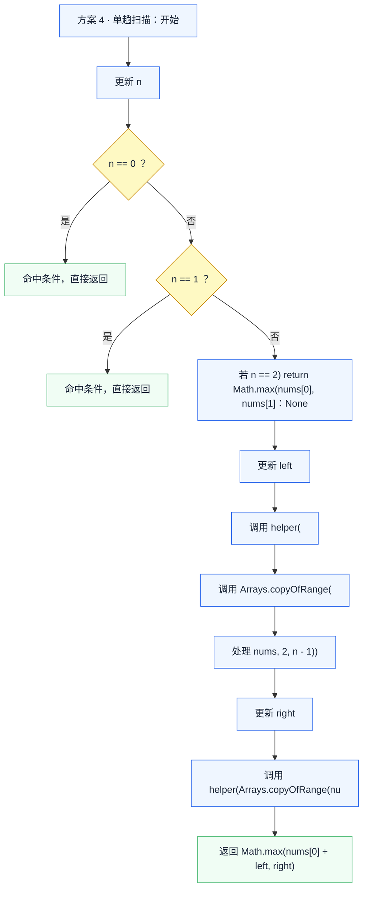

```java
package com.webfault.dsa; // 引入依赖

import java.util.*; // 引入依赖

class lc213_solution444 { // 定义类型
  public int rob(int[] nums) { // 定义函数/方法 rob
    int n = nums.length; // 把 数组.长度 存入 元素个数
    if (n == 0) return 0; // 若 元素个数 等于 0，直接返回 0
    if (n == 1) return nums[0]; // 若 元素个数 等于 1，直接返回 数组[0]
    if (n == 2) return Math.max(nums[0], nums[1]); // 若 元素个数 等于 2，直接返回 Math.取较大值 数组[0], 数组[1])
    int left =
        helper(
            Arrays.copyOfRange(
                nums, 2, n - 1)); // 把 helper(Arrays.copyOfRange(数组, 2, 元素个数 减 1)) 存入 左边界
    int right =
        helper(Arrays.copyOfRange(nums, 1, n)); // 把 helper(Arrays.copyOfRange(数组, 1, 元素个数)) 存入 右边界
    return Math.max(nums[0] + left, right); // 返回 Math.取较大值 数组[0] 加 左边界, 右边界)
  }

  private int helper(int[] arr) { // 定义函数/方法 helper
    int f0 = 0, f1 = 0; // 把 0, f1 赋值为 0 存入 f0
    for (int x : arr) { // for (int x : 数组) {
      int nf1 = Math.max(f1, f0 + x); // 把 Math.取较大值 f1, f0 加 x) 存入 nf1
      f0 = f1; // 把 f1; 写入 f0
      f1 = nf1; // 把 nf1; 写入 f1
    }
    return f1; // 返回 f1
  }

  public static void main(String[] args) { // public static void main(String[] args) {
    lc213_solution444 s =
        new lc213_solution444(); // 把 new lc213_solution444(); 写入 lc213_solution444 s
    int got = s.rob(new int[] {2, 3, 2}); // 把 字符串.rob(new int[]{2, 3, 2}) 存入 got
    if (got != 3) {
      System.out.println("FAIL got " + got);
      throw new RuntimeException("FAILED");
    }
    System.out.println("PASS"); // 全部用例通过，输出 PASS
  }
}
```

### Rust 实现（4 种方案）

Rust 的全部方案如下，每个方案都内嵌用例自测，可独立运行（老仓库 python/go 文件遵循「打印结果」约定）：

#### 方案 1：动态规划

**思路与代码分析**：核心是「动态规划」。Rust 版用所有权移动与切片借用改写同一逻辑，注意 Option 与引用边界。**走读**：方案 1 · 动态规划：开始 → 处理 if nums.len() == 1 → 返回 nums[0] → 计算 rob1 → 计算 let (mut a, mut b) = (0, → 遍历 slice 中的每个元素 v → 计算 t → 更新 a → 更新 b → 处理 b → 调用 rob_ii_helper(&nums[1..]).ma。

**运行架构**（真实控制流）：

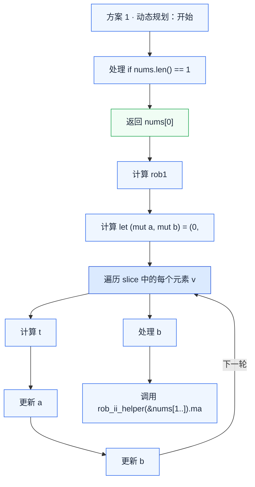

```rust
// LeetCode 213. 打家劫舍II — Rust 版（方案1）
fn rob_ii(nums: Vec<i32>) -> i32 {
    // 定义函数/方法 rob_ii
    if nums.len() == 1 {
        return nums[0];
    } // 若 数组.长度() 等于 1 { return 数组[0]; }
    let rob1 = |slice: &[i32]| -> i32 {
        let (mut a, mut b) = (0, 0);
        for &v in slice {
            let t = b.max(a + v);
            a = b;
            b = t;
        }
        b
    };
    rob_ii_helper(&nums[1..]).max(rob1(&nums[..nums.len() - 1]))
}
fn rob_ii_helper(nums: &[i32]) -> i32 {
    let (mut a, mut b) = (0, 0);
    for &v in nums {
        let t = b.max(a + v);
        a = b;
        b = t;
    }
    b
} // 定义函数/方法 rob_ii_helper
fn main() {
    assert_eq!(rob_ii(vec![2, 3, 2]), 3);
    assert_eq!(rob_ii(vec![1, 2, 3, 1]), 4);
    assert_eq!(rob_ii(vec![1]), 1);
    println!("PASS");
} // 程序入口：跑内嵌自测用例
```

#### 方案 2：动态规划

**思路与代码分析**：核心是「动态规划」。Rust 版用所有权移动与切片借用改写同一逻辑，注意 Option 与引用边界。**走读**：方案 2 · 动态规划：开始 → 处理 if nums.len() == 1 → 返回 nums[0] → 计算 rob1 → 计算 let (mut a, mut b) = (0, → 遍历 slice 中的每个元素 v → 计算 t → 更新 a → 更新 b → 处理 b → 调用 rob_ii_helper(&nums[1..]).ma。

**运行架构**（真实控制流）：


```rust
// LeetCode 213. 打家劫舍II — Rust 版（方案2）
fn rob_ii(nums: Vec<i32>) -> i32 {
    // 定义函数/方法 rob_ii
    if nums.len() == 1 {
        return nums[0];
    } // 若 数组.长度() 等于 1 { return 数组[0]; }
    let rob1 = |slice: &[i32]| -> i32 {
        let (mut a, mut b) = (0, 0);
        for &v in slice {
            let t = b.max(a + v);
            a = b;
            b = t;
        }
        b
    };
    rob_ii_helper(&nums[1..]).max(rob1(&nums[..nums.len() - 1]))
}
fn rob_ii_helper(nums: &[i32]) -> i32 {
    let (mut a, mut b) = (0, 0);
    for &v in nums {
        let t = b.max(a + v);
        a = b;
        b = t;
    }
    b
} // 定义函数/方法 rob_ii_helper
fn main() {
    assert_eq!(rob_ii(vec![2, 3, 2]), 3);
    assert_eq!(rob_ii(vec![1, 2, 3, 1]), 4);
    assert_eq!(rob_ii(vec![1]), 1);
    println!("PASS");
} // 程序入口：跑内嵌自测用例
```

#### 方案 3：单趟扫描

**思路与代码分析**：核心是「单趟扫描」。Rust 版用所有权移动与切片借用改写同一逻辑，注意 Option 与引用边界。**走读**：方案 3 · 单趟扫描：开始 → 处理 if nums.len() == 1 → 返回 nums[0] → 计算 rob1 → 计算 let (mut a, mut b) = (0, → 遍历 slice 中的每个元素 v → 计算 t → 更新 a → 更新 b → 处理 b → 调用 rob_ii_helper(&nums[1..]).ma。

**运行架构**（真实控制流）：

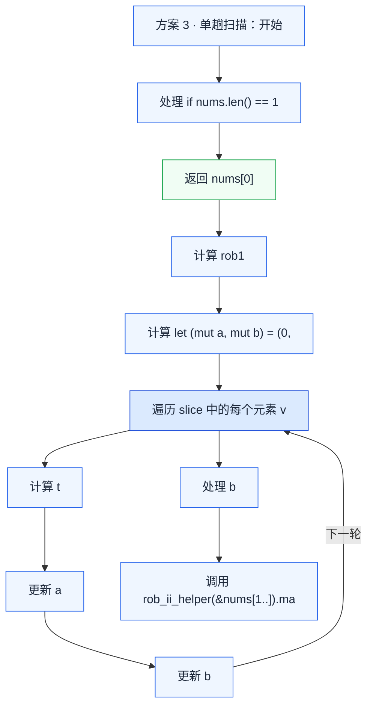

```rust
// LeetCode 213. 打家劫舍II — Rust 版（方案3）
fn rob_ii(nums: Vec<i32>) -> i32 {
    // 定义函数/方法 rob_ii
    if nums.len() == 1 {
        return nums[0];
    } // 若 数组.长度() 等于 1 { return 数组[0]; }
    let rob1 = |slice: &[i32]| -> i32 {
        let (mut a, mut b) = (0, 0);
        for &v in slice {
            let t = b.max(a + v);
            a = b;
            b = t;
        }
        b
    };
    rob_ii_helper(&nums[1..]).max(rob1(&nums[..nums.len() - 1]))
}
fn rob_ii_helper(nums: &[i32]) -> i32 {
    let (mut a, mut b) = (0, 0);
    for &v in nums {
        let t = b.max(a + v);
        a = b;
        b = t;
    }
    b
} // 定义函数/方法 rob_ii_helper
fn main() {
    assert_eq!(rob_ii(vec![2, 3, 2]), 3);
    assert_eq!(rob_ii(vec![1, 2, 3, 1]), 4);
    assert_eq!(rob_ii(vec![1]), 1);
    println!("PASS");
} // 程序入口：跑内嵌自测用例
```

#### 方案 4：单趟扫描

**思路与代码分析**：核心是「单趟扫描」。Rust 版用所有权移动与切片借用改写同一逻辑，注意 Option 与引用边界。**走读**：方案 4 · 单趟扫描：开始 → 处理 if nums.len() == 1 → 返回 nums[0] → 计算 rob1 → 计算 let (mut a, mut b) = (0, → 遍历 slice 中的每个元素 v → 计算 t → 更新 a → 更新 b → 处理 b → 调用 rob_ii_helper(&nums[1..]).ma。

**运行架构**（真实控制流）：

```mermaid
graph TD
    N0["方案 4 · 单趟扫描：开始"]
    N1["处理 if nums.len() == 1"]
    N2["返回 nums[0]"]
    N3["计算 rob1"]
    N4["计算 let (mut a, mut b) = (0,"]
    N5["遍历 slice 中的每个元素 v"]
    N6["计算 t"]
    N7["更新 a"]
    N8["更新 b"]
    N9["处理 b"]
    N10["调用 rob_ii_helper(&nums[1..]).ma"]
    N0 --> N1
    N1 --> N2
    N2 --> N3
    N3 --> N4
    N4 --> N5
    N5 --> N6
    N6 --> N7
    N7 --> N8
    N8 -- 下一轮 --> N5
    N5 --> N9
    N9 --> N10
    classDef n fill:#eff6ff,stroke:#2563eb,color:#1e293b;
    classDef lp fill:#dbeafe,stroke:#1d4ed8,color:#1e293b;
    classDef dc fill:#fef9c3,stroke:#ca8a04,color:#1e293b;
    classDef tm fill:#f0fdf4,stroke:#16a34a,color:#1e293b;
    class N0,N1,N3,N4,N6,N7,N8,N9,N10 n;
    class N5 lp;
    class N2 tm;
```

```rust
// LeetCode 213. 打家劫舍II — Rust 版（方案4）
fn rob_ii(nums: Vec<i32>) -> i32 {
    // 定义函数/方法 rob_ii
    if nums.len() == 1 {
        return nums[0];
    } // 若 数组.长度() 等于 1 { return 数组[0]; }
    let rob1 = |slice: &[i32]| -> i32 {
        let (mut a, mut b) = (0, 0);
        for &v in slice {
            let t = b.max(a + v);
            a = b;
            b = t;
        }
        b
    };
    rob_ii_helper(&nums[1..]).max(rob1(&nums[..nums.len() - 1]))
}
fn rob_ii_helper(nums: &[i32]) -> i32 {
    let (mut a, mut b) = (0, 0);
    for &v in nums {
        let t = b.max(a + v);
        a = b;
        b = t;
    }
    b
} // 定义函数/方法 rob_ii_helper
fn main() {
    assert_eq!(rob_ii(vec![2, 3, 2]), 3);
    assert_eq!(rob_ii(vec![1, 2, 3, 1]), 4);
    assert_eq!(rob_ii(vec![1]), 1);
    println!("PASS");
} // 程序入口：跑内嵌自测用例
```

### Lua 实现（4 种方案）

Lua 的全部方案如下，每个方案都内嵌用例自测，可独立运行（老仓库 python/go 文件遵循「打印结果」约定）：

#### 方案 1：动态规划

**思路与代码分析**：核心是「动态规划」。Lua 版用表与 ipairs 遍历，注意 ipairs 遇 nil 即停的语义。**走读**：方案 1 · 动态规划：开始 → 更新 b → 遍历 ipairs(nums) do 中的每个元素 v → 更新 b → 返回 b。

**运行架构**（真实控制流）：

```mermaid
graph TD
    N0["方案 1 · 动态规划：开始"]
    N1["更新 b"]
    N2["遍历 ipairs(nums) do 中的每个元素 v"]
    N3["更新 b"]
    N4["返回 b"]
    N0 --> N1
    N1 --> N2
    N2 --> N3
    N3 --> N4
    classDef n fill:#eff6ff,stroke:#2563eb,color:#1e293b;
    classDef lp fill:#dbeafe,stroke:#1d4ed8,color:#1e293b;
    classDef dc fill:#fef9c3,stroke:#ca8a04,color:#1e293b;
    classDef tm fill:#f0fdf4,stroke:#16a34a,color:#1e293b;
    class N0,N1,N3 n;
    class N2 lp;
    class N4 tm;
```

```lua
-- LeetCode 213. 打家劫舍II — Lua 版（方案1）
local function rob_line(nums)
	local a, b = 0, 0
	for _, v in ipairs(nums) do
		a, b = b, math.max(b, a + v)
	end
	return b
end
local function rob_ii(nums) -- local function rob_ii(数组)
	if #nums == 1 then
		return nums[1]
	end -- 若 #数组 等于 1 then return 数组[1] 终点
	local skip_first, skip_last = {}, {} -- 把 {}, {} 写入 local skip_first, skip_last
	for i = 2, #nums do
		skip_first[#skip_first + 1] = nums[i]
	end
	for i = 1, #nums - 1 do
		skip_last[#skip_last + 1] = nums[i]
	end
	return math.max(rob_line(skip_first), rob_line(skip_last)) -- 返回 math.取较大值 rob_line(skip_first), rob_line(skip_last))
end -- 终点
assert(rob_ii({ 2, 3, 2 }) == 3) -- 断言校验
assert(rob_ii({ 1, 2, 3, 1 }) == 4) -- 断言校验
assert(rob_ii({ 1 }) == 1) -- 断言校验
print("PASS") -- 全部用例通过，输出 PASS
```

#### 方案 2：动态规划

**思路与代码分析**：核心是「动态规划」。Lua 版用表与 ipairs 遍历，注意 ipairs 遇 nil 即停的语义。**走读**：方案 2 · 动态规划：开始 → 更新 b → 遍历 ipairs(nums) do 中的每个元素 v → 更新 b → 返回 b。

**运行架构**（真实控制流）：

```mermaid
graph TD
    N0["方案 2 · 动态规划：开始"]
    N1["更新 b"]
    N2["遍历 ipairs(nums) do 中的每个元素 v"]
    N3["更新 b"]
    N4["返回 b"]
    N0 --> N1
    N1 --> N2
    N2 --> N3
    N3 --> N4
    classDef n fill:#eff6ff,stroke:#2563eb,color:#1e293b;
    classDef lp fill:#dbeafe,stroke:#1d4ed8,color:#1e293b;
    classDef dc fill:#fef9c3,stroke:#ca8a04,color:#1e293b;
    classDef tm fill:#f0fdf4,stroke:#16a34a,color:#1e293b;
    class N0,N1,N3 n;
    class N2 lp;
    class N4 tm;
```

```lua
-- LeetCode 213. 打家劫舍II — Lua 版（方案2）
local function rob_line(nums)
	local a, b = 0, 0
	for _, v in ipairs(nums) do
		a, b = b, math.max(b, a + v)
	end
	return b
end
local function rob_ii(nums) -- local function rob_ii(数组)
	if #nums == 1 then
		return nums[1]
	end -- 若 #数组 等于 1 then return 数组[1] 终点
	local skip_first, skip_last = {}, {} -- 把 {}, {} 写入 local skip_first, skip_last
	for i = 2, #nums do
		skip_first[#skip_first + 1] = nums[i]
	end
	for i = 1, #nums - 1 do
		skip_last[#skip_last + 1] = nums[i]
	end
	return math.max(rob_line(skip_first), rob_line(skip_last)) -- 返回 math.取较大值 rob_line(skip_first), rob_line(skip_last))
end -- 终点
assert(rob_ii({ 2, 3, 2 }) == 3) -- 断言校验
assert(rob_ii({ 1, 2, 3, 1 }) == 4) -- 断言校验
assert(rob_ii({ 1 }) == 1) -- 断言校验
print("PASS") -- 全部用例通过，输出 PASS
```

#### 方案 3：单趟扫描

**思路与代码分析**：核心是「单趟扫描」。Lua 版用表与 ipairs 遍历，注意 ipairs 遇 nil 即停的语义。**走读**：方案 3 · 单趟扫描：开始 → 更新 b → 遍历 ipairs(nums) do 中的每个元素 v → 更新 b → 返回 b。

**运行架构**（真实控制流）：

```mermaid
graph TD
    N0["方案 3 · 单趟扫描：开始"]
    N1["更新 b"]
    N2["遍历 ipairs(nums) do 中的每个元素 v"]
    N3["更新 b"]
    N4["返回 b"]
    N0 --> N1
    N1 --> N2
    N2 --> N3
    N3 --> N4
    classDef n fill:#eff6ff,stroke:#2563eb,color:#1e293b;
    classDef lp fill:#dbeafe,stroke:#1d4ed8,color:#1e293b;
    classDef dc fill:#fef9c3,stroke:#ca8a04,color:#1e293b;
    classDef tm fill:#f0fdf4,stroke:#16a34a,color:#1e293b;
    class N0,N1,N3 n;
    class N2 lp;
    class N4 tm;
```

```lua
-- LeetCode 213. 打家劫舍II — Lua 版（方案3）
local function rob_line(nums)
	local a, b = 0, 0
	for _, v in ipairs(nums) do
		a, b = b, math.max(b, a + v)
	end
	return b
end
local function rob_ii(nums) -- local function rob_ii(数组)
	if #nums == 1 then
		return nums[1]
	end -- 若 #数组 等于 1 then return 数组[1] 终点
	local skip_first, skip_last = {}, {} -- 把 {}, {} 写入 local skip_first, skip_last
	for i = 2, #nums do
		skip_first[#skip_first + 1] = nums[i]
	end
	for i = 1, #nums - 1 do
		skip_last[#skip_last + 1] = nums[i]
	end
	return math.max(rob_line(skip_first), rob_line(skip_last)) -- 返回 math.取较大值 rob_line(skip_first), rob_line(skip_last))
end -- 终点
assert(rob_ii({ 2, 3, 2 }) == 3) -- 断言校验
assert(rob_ii({ 1, 2, 3, 1 }) == 4) -- 断言校验
assert(rob_ii({ 1 }) == 1) -- 断言校验
print("PASS") -- 全部用例通过，输出 PASS
```

#### 方案 4：单趟扫描

**思路与代码分析**：核心是「单趟扫描」。Lua 版用表与 ipairs 遍历，注意 ipairs 遇 nil 即停的语义。**走读**：方案 4 · 单趟扫描：开始 → 更新 b → 遍历 ipairs(nums) do 中的每个元素 v → 更新 b → 返回 b。

**运行架构**（真实控制流）：

```mermaid
graph TD
    N0["方案 4 · 单趟扫描：开始"]
    N1["更新 b"]
    N2["遍历 ipairs(nums) do 中的每个元素 v"]
    N3["更新 b"]
    N4["返回 b"]
    N0 --> N1
    N1 --> N2
    N2 --> N3
    N3 --> N4
    classDef n fill:#eff6ff,stroke:#2563eb,color:#1e293b;
    classDef lp fill:#dbeafe,stroke:#1d4ed8,color:#1e293b;
    classDef dc fill:#fef9c3,stroke:#ca8a04,color:#1e293b;
    classDef tm fill:#f0fdf4,stroke:#16a34a,color:#1e293b;
    class N0,N1,N3 n;
    class N2 lp;
    class N4 tm;
```

```lua
-- LeetCode 213. 打家劫舍II — Lua 版（方案4）
local function rob_line(nums)
	local a, b = 0, 0
	for _, v in ipairs(nums) do
		a, b = b, math.max(b, a + v)
	end
	return b
end
local function rob_ii(nums) -- local function rob_ii(数组)
	if #nums == 1 then
		return nums[1]
	end -- 若 #数组 等于 1 then return 数组[1] 终点
	local skip_first, skip_last = {}, {} -- 把 {}, {} 写入 local skip_first, skip_last
	for i = 2, #nums do
		skip_first[#skip_first + 1] = nums[i]
	end
	for i = 1, #nums - 1 do
		skip_last[#skip_last + 1] = nums[i]
	end
	return math.max(rob_line(skip_first), rob_line(skip_last)) -- 返回 math.取较大值 rob_line(skip_first), rob_line(skip_last))
end -- 终点
assert(rob_ii({ 2, 3, 2 }) == 3) -- 断言校验
assert(rob_ii({ 1, 2, 3, 1 }) == 4) -- 断言校验
assert(rob_ii({ 1 }) == 1) -- 断言校验
print("PASS") -- 全部用例通过，输出 PASS
```

### C 实现（4 种方案）

C 的全部方案如下，每个方案都内嵌用例自测，可独立运行（老仓库 python/go 文件遵循「打印结果」约定）：

#### 方案 1：动态规划

**思路与代码分析**：核心是「动态规划」。C 版手动管理下标与内存，循环边界全部显式写出。**走读**：方案 1 · 动态规划：开始 → 命中条件，直接返回 → 更新 r1 → 更新 r2 → 返回 r1 ＞ r2 ? r1 : r2。

**运行架构**（真实控制流）：

```mermaid
graph TD
    N0["方案 1 · 动态规划：开始"]
    N1{"len == 1 ？"}
    N2["命中条件，直接返回"]
    N3["更新 r1"]
    N4["更新 r2"]
    N5["返回 r1 ＞ r2 ? r1 : r2"]
    N0 --> N1
    N1 -- 是 --> N2
    N1 -- 否 --> N3
    N3 --> N4
    N4 --> N5
    classDef n fill:#eff6ff,stroke:#2563eb,color:#1e293b;
    classDef lp fill:#dbeafe,stroke:#1d4ed8,color:#1e293b;
    classDef dc fill:#fef9c3,stroke:#ca8a04,color:#1e293b;
    classDef tm fill:#f0fdf4,stroke:#16a34a,color:#1e293b;
    class N0,N3,N4 n;
    class N1 dc;
    class N2,N5 tm;
```

```c
/* LeetCode 213. 打家劫舍II — C 版（方案1） */
#include <stdio.h> // 引入头文件
static int rob_line(const int *n, int len) {
    int a = 0, b = 0;
    for (int i = 0; i < len; i++) {
        int t = b > a + n[i] ? b : a + n[i];
        a = b;
        b = t;
    }
    return b;
}
static int rob_ii(const int *n, int len) { // 定义函数/方法 rob_ii
    if (len == 1)
        return n[0];                   // 若 长度 等于 1，直接返回 元素个数[0]
    int r1 = rob_line(n + 1, len - 1); // 把 rob_line(元素个数 加 1, 长度 减 1) 存入 r1
    int r2 = rob_line(n, len - 1);     // 把 rob_line(元素个数, 长度 减 1) 存入 r2
    return r1 > r2 ? r1 : r2;          // 返回 r1 超过 r2 ? r1 : r2
}
int main(void) { // 程序入口：跑内嵌自测用例
    if (rob_ii((int[]){2, 3, 2}, 3) != 3) {
        printf("FAIL 1\n");
        return 1;
    }
    if (rob_ii((int[]){1, 2, 3, 1}, 4) != 4) {
        printf("FAIL 2\n");
        return 1;
    }
    if (rob_ii((int[]){1}, 1) != 1) {
        printf("FAIL 3\n");
        return 1;
    } // 若 rob_ii((int[]){1}, 1) 不等于 1) { 输出「FAIL 3 」); return 1; }
    printf("PASS\n");
    return 0;
} // 全部用例通过，输出 PASS
```

#### 方案 2：动态规划

**思路与代码分析**：核心是「动态规划」。C 版手动管理下标与内存，循环边界全部显式写出。**走读**：方案 2 · 动态规划：开始 → 命中条件，直接返回 → 更新 r1 → 更新 r2 → 返回 r1 ＞ r2 ? r1 : r2。

**运行架构**（真实控制流）：

```mermaid
graph TD
    N0["方案 2 · 动态规划：开始"]
    N1{"len == 1 ？"}
    N2["命中条件，直接返回"]
    N3["更新 r1"]
    N4["更新 r2"]
    N5["返回 r1 ＞ r2 ? r1 : r2"]
    N0 --> N1
    N1 -- 是 --> N2
    N1 -- 否 --> N3
    N3 --> N4
    N4 --> N5
    classDef n fill:#eff6ff,stroke:#2563eb,color:#1e293b;
    classDef lp fill:#dbeafe,stroke:#1d4ed8,color:#1e293b;
    classDef dc fill:#fef9c3,stroke:#ca8a04,color:#1e293b;
    classDef tm fill:#f0fdf4,stroke:#16a34a,color:#1e293b;
    class N0,N3,N4 n;
    class N1 dc;
    class N2,N5 tm;
```

```c
/* LeetCode 213. 打家劫舍II — C 版（方案2） */
#include <stdio.h> // 引入头文件
static int rob_line(const int *n, int len) {
    int a = 0, b = 0;
    for (int i = 0; i < len; i++) {
        int t = b > a + n[i] ? b : a + n[i];
        a = b;
        b = t;
    }
    return b;
}
static int rob_ii(const int *n, int len) { // 定义函数/方法 rob_ii
    if (len == 1)
        return n[0];                   // 若 长度 等于 1，直接返回 元素个数[0]
    int r1 = rob_line(n + 1, len - 1); // 把 rob_line(元素个数 加 1, 长度 减 1) 存入 r1
    int r2 = rob_line(n, len - 1);     // 把 rob_line(元素个数, 长度 减 1) 存入 r2
    return r1 > r2 ? r1 : r2;          // 返回 r1 超过 r2 ? r1 : r2
}
int main(void) { // 程序入口：跑内嵌自测用例
    if (rob_ii((int[]){2, 3, 2}, 3) != 3) {
        printf("FAIL 1\n");
        return 1;
    }
    if (rob_ii((int[]){1, 2, 3, 1}, 4) != 4) {
        printf("FAIL 2\n");
        return 1;
    }
    if (rob_ii((int[]){1}, 1) != 1) {
        printf("FAIL 3\n");
        return 1;
    } // 若 rob_ii((int[]){1}, 1) 不等于 1) { 输出「FAIL 3 」); return 1; }
    printf("PASS\n");
    return 0;
} // 全部用例通过，输出 PASS
```

#### 方案 3：单趟扫描

**思路与代码分析**：核心是「单趟扫描」。C 版手动管理下标与内存，循环边界全部显式写出。**走读**：方案 3 · 单趟扫描：开始 → 命中条件，直接返回 → 更新 r1 → 更新 r2 → 返回 r1 ＞ r2 ? r1 : r2。

**运行架构**（真实控制流）：

```mermaid
graph TD
    N0["方案 3 · 单趟扫描：开始"]
    N1{"len == 1 ？"}
    N2["命中条件，直接返回"]
    N3["更新 r1"]
    N4["更新 r2"]
    N5["返回 r1 ＞ r2 ? r1 : r2"]
    N0 --> N1
    N1 -- 是 --> N2
    N1 -- 否 --> N3
    N3 --> N4
    N4 --> N5
    classDef n fill:#eff6ff,stroke:#2563eb,color:#1e293b;
    classDef lp fill:#dbeafe,stroke:#1d4ed8,color:#1e293b;
    classDef dc fill:#fef9c3,stroke:#ca8a04,color:#1e293b;
    classDef tm fill:#f0fdf4,stroke:#16a34a,color:#1e293b;
    class N0,N3,N4 n;
    class N1 dc;
    class N2,N5 tm;
```

```c
/* LeetCode 213. 打家劫舍II — C 版（方案3） */
#include <stdio.h> // 引入头文件
static int rob_line(const int *n, int len) {
    int a = 0, b = 0;
    for (int i = 0; i < len; i++) {
        int t = b > a + n[i] ? b : a + n[i];
        a = b;
        b = t;
    }
    return b;
}
static int rob_ii(const int *n, int len) { // 定义函数/方法 rob_ii
    if (len == 1)
        return n[0];                   // 若 长度 等于 1，直接返回 元素个数[0]
    int r1 = rob_line(n + 1, len - 1); // 把 rob_line(元素个数 加 1, 长度 减 1) 存入 r1
    int r2 = rob_line(n, len - 1);     // 把 rob_line(元素个数, 长度 减 1) 存入 r2
    return r1 > r2 ? r1 : r2;          // 返回 r1 超过 r2 ? r1 : r2
}
int main(void) { // 程序入口：跑内嵌自测用例
    if (rob_ii((int[]){2, 3, 2}, 3) != 3) {
        printf("FAIL 1\n");
        return 1;
    }
    if (rob_ii((int[]){1, 2, 3, 1}, 4) != 4) {
        printf("FAIL 2\n");
        return 1;
    }
    if (rob_ii((int[]){1}, 1) != 1) {
        printf("FAIL 3\n");
        return 1;
    } // 若 rob_ii((int[]){1}, 1) 不等于 1) { 输出「FAIL 3 」); return 1; }
    printf("PASS\n");
    return 0;
} // 全部用例通过，输出 PASS
```

#### 方案 4：单趟扫描

**思路与代码分析**：核心是「单趟扫描」。C 版手动管理下标与内存，循环边界全部显式写出。**走读**：方案 4 · 单趟扫描：开始 → 命中条件，直接返回 → 更新 r1 → 更新 r2 → 返回 r1 ＞ r2 ? r1 : r2。

**运行架构**（真实控制流）：

```mermaid
graph TD
    N0["方案 4 · 单趟扫描：开始"]
    N1{"len == 1 ？"}
    N2["命中条件，直接返回"]
    N3["更新 r1"]
    N4["更新 r2"]
    N5["返回 r1 ＞ r2 ? r1 : r2"]
    N0 --> N1
    N1 -- 是 --> N2
    N1 -- 否 --> N3
    N3 --> N4
    N4 --> N5
    classDef n fill:#eff6ff,stroke:#2563eb,color:#1e293b;
    classDef lp fill:#dbeafe,stroke:#1d4ed8,color:#1e293b;
    classDef dc fill:#fef9c3,stroke:#ca8a04,color:#1e293b;
    classDef tm fill:#f0fdf4,stroke:#16a34a,color:#1e293b;
    class N0,N3,N4 n;
    class N1 dc;
    class N2,N5 tm;
```

```c
/* LeetCode 213. 打家劫舍II — C 版（方案4） */
#include <stdio.h> // 引入头文件
static int rob_line(const int *n, int len) {
    int a = 0, b = 0;
    for (int i = 0; i < len; i++) {
        int t = b > a + n[i] ? b : a + n[i];
        a = b;
        b = t;
    }
    return b;
}
static int rob_ii(const int *n, int len) { // 定义函数/方法 rob_ii
    if (len == 1)
        return n[0];                   // 若 长度 等于 1，直接返回 元素个数[0]
    int r1 = rob_line(n + 1, len - 1); // 把 rob_line(元素个数 加 1, 长度 减 1) 存入 r1
    int r2 = rob_line(n, len - 1);     // 把 rob_line(元素个数, 长度 减 1) 存入 r2
    return r1 > r2 ? r1 : r2;          // 返回 r1 超过 r2 ? r1 : r2
}
int main(void) { // 程序入口：跑内嵌自测用例
    if (rob_ii((int[]){2, 3, 2}, 3) != 3) {
        printf("FAIL 1\n");
        return 1;
    }
    if (rob_ii((int[]){1, 2, 3, 1}, 4) != 4) {
        printf("FAIL 2\n");
        return 1;
    }
    if (rob_ii((int[]){1}, 1) != 1) {
        printf("FAIL 3\n");
        return 1;
    } // 若 rob_ii((int[]){1}, 1) 不等于 1) { 输出「FAIL 3 」); return 1; }
    printf("PASS\n");
    return 0;
} // 全部用例通过，输出 PASS
```

### C++ 实现（4 种方案）

C++ 的全部方案如下，每个方案都内嵌用例自测，可独立运行（老仓库 python/go 文件遵循「打印结果」约定）：

#### 方案 1：动态规划

**思路与代码分析**：核心是「动态规划」。C++ 版用 STL 容器与迭代器，减少手写下标错误。**走读**：方案 1 · 动态规划：开始 → 命中条件，直接返回 → 处理 std::vector＜int＞ skipFirst( → 调用 nums.begin() + 1, → 调用 nums.end()) → 处理 std::vector＜int＞ skipLast(nu → 调用 nums.end() - → 处理 1) → 返回 std::max(robLine(skipFirst), → 调用 robLine(skipLast))。

**运行架构**（真实控制流）：

```mermaid
graph TD
    N0["方案 1 · 动态规划：开始"]
    N1{"nums.size() == 1 ？"}
    N2["命中条件，直接返回"]
    N3["处理 std::vector＜int＞ skipFirst("]
    N4["调用 nums.begin() + 1,"]
    N5["调用 nums.end())"]
    N6["处理 std::vector＜int＞ skipLast(nu"]
    N7["调用 nums.end() -"]
    N8["处理 1)"]
    N9["返回 std::max(robLine(skipFirst),"]
    N10["调用 robLine(skipLast))"]
    N0 --> N1
    N1 -- 是 --> N2
    N1 -- 否 --> N3
    N3 --> N4
    N4 --> N5
    N5 --> N6
    N6 --> N7
    N7 --> N8
    N8 --> N9
    N9 --> N10
    classDef n fill:#eff6ff,stroke:#2563eb,color:#1e293b;
    classDef lp fill:#dbeafe,stroke:#1d4ed8,color:#1e293b;
    classDef dc fill:#fef9c3,stroke:#ca8a04,color:#1e293b;
    classDef tm fill:#f0fdf4,stroke:#16a34a,color:#1e293b;
    class N0,N3,N4,N5,N6,N7,N8,N10 n;
    class N1 dc;
    class N2,N9 tm;
```

```cpp
// LeetCode 213. 打家劫舍II — C++ 版（方案1）
#include <algorithm> // 引入头文件
#include <cassert>   // 引入头文件
#include <iostream>  // 引入头文件
#include <vector>    // 引入头文件
static int robLine(const std::vector<int> &nums) {
    int a = 0, b = 0;
    for (int v : nums) {
        int t = std::max(b, a + v);
        a = b;
        b = t;
    }
    return b;
}
static int robII(const std::vector<int> &nums) { // 定义函数/方法 robII
    if (nums.size() == 1)
        return nums[0]; // 若 数组.大小() 等于 1，直接返回 数组[0]
    std::vector<int> skipFirst(
        nums.begin() + 1,
        nums.end()); // std::vector 小于 int 超过 skipFirst(数组 迭代位置 加 1, 数组.终点());
    std::vector<int> skipLast(nums.begin(),
                              nums.end() -
                                  1); // std::vector 小于 int 超过 skipLast(数组 迭代位置 , 数组.终点() 减 1);
    return std::max(robLine(skipFirst),
                    robLine(skipLast)); // 返回 std::取较大值 robLine(skipFirst), robLine(skipLast))
}
int main() {
    assert(robII({2, 3, 2}) == 3);
    assert(robII({1, 2, 3, 1}) == 4);
    assert(robII({1}) == 1);
    std::cout << "PASS" << std::endl;
} // 全部用例通过，输出 PASS
```

#### 方案 2：动态规划

**思路与代码分析**：核心是「动态规划」。C++ 版用 STL 容器与迭代器，减少手写下标错误。**走读**：方案 2 · 动态规划：开始 → 命中条件，直接返回 → 处理 std::vector＜int＞ skipFirst( → 调用 nums.begin() + 1, → 调用 nums.end()) → 处理 std::vector＜int＞ skipLast(nu → 调用 nums.end() - → 处理 1) → 返回 std::max(robLine(skipFirst), → 调用 robLine(skipLast))。

**运行架构**（真实控制流）：

```mermaid
graph TD
    N0["方案 2 · 动态规划：开始"]
    N1{"nums.size() == 1 ？"}
    N2["命中条件，直接返回"]
    N3["处理 std::vector＜int＞ skipFirst("]
    N4["调用 nums.begin() + 1,"]
    N5["调用 nums.end())"]
    N6["处理 std::vector＜int＞ skipLast(nu"]
    N7["调用 nums.end() -"]
    N8["处理 1)"]
    N9["返回 std::max(robLine(skipFirst),"]
    N10["调用 robLine(skipLast))"]
    N0 --> N1
    N1 -- 是 --> N2
    N1 -- 否 --> N3
    N3 --> N4
    N4 --> N5
    N5 --> N6
    N6 --> N7
    N7 --> N8
    N8 --> N9
    N9 --> N10
    classDef n fill:#eff6ff,stroke:#2563eb,color:#1e293b;
    classDef lp fill:#dbeafe,stroke:#1d4ed8,color:#1e293b;
    classDef dc fill:#fef9c3,stroke:#ca8a04,color:#1e293b;
    classDef tm fill:#f0fdf4,stroke:#16a34a,color:#1e293b;
    class N0,N3,N4,N5,N6,N7,N8,N10 n;
    class N1 dc;
    class N2,N9 tm;
```

```cpp
// LeetCode 213. 打家劫舍II — C++ 版（方案2）
#include <algorithm> // 引入头文件
#include <cassert>   // 引入头文件
#include <iostream>  // 引入头文件
#include <vector>    // 引入头文件
static int robLine(const std::vector<int> &nums) {
    int a = 0, b = 0;
    for (int v : nums) {
        int t = std::max(b, a + v);
        a = b;
        b = t;
    }
    return b;
}
static int robII(const std::vector<int> &nums) { // 定义函数/方法 robII
    if (nums.size() == 1)
        return nums[0]; // 若 数组.大小() 等于 1，直接返回 数组[0]
    std::vector<int> skipFirst(
        nums.begin() + 1,
        nums.end()); // std::vector 小于 int 超过 skipFirst(数组 迭代位置 加 1, 数组.终点());
    std::vector<int> skipLast(nums.begin(),
                              nums.end() -
                                  1); // std::vector 小于 int 超过 skipLast(数组 迭代位置 , 数组.终点() 减 1);
    return std::max(robLine(skipFirst),
                    robLine(skipLast)); // 返回 std::取较大值 robLine(skipFirst), robLine(skipLast))
}
int main() {
    assert(robII({2, 3, 2}) == 3);
    assert(robII({1, 2, 3, 1}) == 4);
    assert(robII({1}) == 1);
    std::cout << "PASS" << std::endl;
} // 全部用例通过，输出 PASS
```

#### 方案 3：单趟扫描

**思路与代码分析**：核心是「单趟扫描」。C++ 版用 STL 容器与迭代器，减少手写下标错误。**走读**：方案 3 · 单趟扫描：开始 → 命中条件，直接返回 → 处理 std::vector＜int＞ skipFirst( → 调用 nums.begin() + 1, → 调用 nums.end()) → 处理 std::vector＜int＞ skipLast(nu → 调用 nums.end() - → 处理 1) → 返回 std::max(robLine(skipFirst), → 调用 robLine(skipLast))。

**运行架构**（真实控制流）：

```mermaid
graph TD
    N0["方案 3 · 单趟扫描：开始"]
    N1{"nums.size() == 1 ？"}
    N2["命中条件，直接返回"]
    N3["处理 std::vector＜int＞ skipFirst("]
    N4["调用 nums.begin() + 1,"]
    N5["调用 nums.end())"]
    N6["处理 std::vector＜int＞ skipLast(nu"]
    N7["调用 nums.end() -"]
    N8["处理 1)"]
    N9["返回 std::max(robLine(skipFirst),"]
    N10["调用 robLine(skipLast))"]
    N0 --> N1
    N1 -- 是 --> N2
    N1 -- 否 --> N3
    N3 --> N4
    N4 --> N5
    N5 --> N6
    N6 --> N7
    N7 --> N8
    N8 --> N9
    N9 --> N10
    classDef n fill:#eff6ff,stroke:#2563eb,color:#1e293b;
    classDef lp fill:#dbeafe,stroke:#1d4ed8,color:#1e293b;
    classDef dc fill:#fef9c3,stroke:#ca8a04,color:#1e293b;
    classDef tm fill:#f0fdf4,stroke:#16a34a,color:#1e293b;
    class N0,N3,N4,N5,N6,N7,N8,N10 n;
    class N1 dc;
    class N2,N9 tm;
```

```cpp
// LeetCode 213. 打家劫舍II — C++ 版（方案3）
#include <algorithm> // 引入头文件
#include <cassert>   // 引入头文件
#include <iostream>  // 引入头文件
#include <vector>    // 引入头文件
static int robLine(const std::vector<int> &nums) {
    int a = 0, b = 0;
    for (int v : nums) {
        int t = std::max(b, a + v);
        a = b;
        b = t;
    }
    return b;
}
static int robII(const std::vector<int> &nums) { // 定义函数/方法 robII
    if (nums.size() == 1)
        return nums[0]; // 若 数组.大小() 等于 1，直接返回 数组[0]
    std::vector<int> skipFirst(
        nums.begin() + 1,
        nums.end()); // std::vector 小于 int 超过 skipFirst(数组 迭代位置 加 1, 数组.终点());
    std::vector<int> skipLast(nums.begin(),
                              nums.end() -
                                  1); // std::vector 小于 int 超过 skipLast(数组 迭代位置 , 数组.终点() 减 1);
    return std::max(robLine(skipFirst),
                    robLine(skipLast)); // 返回 std::取较大值 robLine(skipFirst), robLine(skipLast))
}
int main() {
    assert(robII({2, 3, 2}) == 3);
    assert(robII({1, 2, 3, 1}) == 4);
    assert(robII({1}) == 1);
    std::cout << "PASS" << std::endl;
} // 全部用例通过，输出 PASS
```

#### 方案 4：单趟扫描

**思路与代码分析**：核心是「单趟扫描」。C++ 版用 STL 容器与迭代器，减少手写下标错误。**走读**：方案 4 · 单趟扫描：开始 → 命中条件，直接返回 → 处理 std::vector＜int＞ skipFirst( → 调用 nums.begin() + 1, → 调用 nums.end()) → 处理 std::vector＜int＞ skipLast(nu → 调用 nums.end() - → 处理 1) → 返回 std::max(robLine(skipFirst), → 调用 robLine(skipLast))。

**运行架构**（真实控制流）：

```mermaid
graph TD
    N0["方案 4 · 单趟扫描：开始"]
    N1{"nums.size() == 1 ？"}
    N2["命中条件，直接返回"]
    N3["处理 std::vector＜int＞ skipFirst("]
    N4["调用 nums.begin() + 1,"]
    N5["调用 nums.end())"]
    N6["处理 std::vector＜int＞ skipLast(nu"]
    N7["调用 nums.end() -"]
    N8["处理 1)"]
    N9["返回 std::max(robLine(skipFirst),"]
    N10["调用 robLine(skipLast))"]
    N0 --> N1
    N1 -- 是 --> N2
    N1 -- 否 --> N3
    N3 --> N4
    N4 --> N5
    N5 --> N6
    N6 --> N7
    N7 --> N8
    N8 --> N9
    N9 --> N10
    classDef n fill:#eff6ff,stroke:#2563eb,color:#1e293b;
    classDef lp fill:#dbeafe,stroke:#1d4ed8,color:#1e293b;
    classDef dc fill:#fef9c3,stroke:#ca8a04,color:#1e293b;
    classDef tm fill:#f0fdf4,stroke:#16a34a,color:#1e293b;
    class N0,N3,N4,N5,N6,N7,N8,N10 n;
    class N1 dc;
    class N2,N9 tm;
```

```cpp
// LeetCode 213. 打家劫舍II — C++ 版（方案4）
#include <algorithm> // 引入头文件
#include <cassert>   // 引入头文件
#include <iostream>  // 引入头文件
#include <vector>    // 引入头文件
static int robLine(const std::vector<int> &nums) {
    int a = 0, b = 0;
    for (int v : nums) {
        int t = std::max(b, a + v);
        a = b;
        b = t;
    }
    return b;
}
static int robII(const std::vector<int> &nums) { // 定义函数/方法 robII
    if (nums.size() == 1)
        return nums[0]; // 若 数组.大小() 等于 1，直接返回 数组[0]
    std::vector<int> skipFirst(
        nums.begin() + 1,
        nums.end()); // std::vector 小于 int 超过 skipFirst(数组 迭代位置 加 1, 数组.终点());
    std::vector<int> skipLast(nums.begin(),
                              nums.end() -
                                  1); // std::vector 小于 int 超过 skipLast(数组 迭代位置 , 数组.终点() 减 1);
    return std::max(robLine(skipFirst),
                    robLine(skipLast)); // 返回 std::取较大值 robLine(skipFirst), robLine(skipLast))
}
int main() {
    assert(robII({2, 3, 2}) == 3);
    assert(robII({1, 2, 3, 1}) == 4);
    assert(robII({1}) == 1);
    std::cout << "PASS" << std::endl;
} // 全部用例通过，输出 PASS
```

### R 实现（4 种方案）

R 的全部方案如下，每个方案都内嵌用例自测，可独立运行（老仓库 python/go 文件遵循「打印结果」约定）：

#### 方案 1：动态规划

**思路与代码分析**：核心是「动态规划」。R 版用向量化思维与 1 起始下标，注意 1:n 的降序陷阱。代码里依次做这些事：单循环线性扫描。**走读**：方案 1 · 动态规划：开始 → 处理 a ＜- 0L → 处理 b ＜- 0L → 循环 v：遍历 nums → 处理 t ＜- max(b, a + v) → 处理 a ＜- b → 处理 b ＜- t → 处理 b → 返回结果。

**运行架构**（真实控制流）：

```mermaid
graph TD
    N0["方案 1 · 动态规划：开始"]
    N1["处理 a ＜- 0L"]
    N2["处理 b ＜- 0L"]
    N3["循环 v：遍历 nums"]
    N4["处理 t ＜- max(b, a + v)"]
    N5["处理 a ＜- b"]
    N6["处理 b ＜- t"]
    N7["处理 b"]
    N8["返回结果"]
    N0 --> N1
    N1 --> N2
    N2 --> N3
    N3 --> N4
    N4 --> N5
    N5 --> N6
    N6 -- 下一轮 --> N3
    N3 --> N7
    N7 --> N8
    classDef n fill:#eff6ff,stroke:#2563eb,color:#1e293b;
    classDef lp fill:#dbeafe,stroke:#1d4ed8,color:#1e293b;
    classDef dc fill:#fef9c3,stroke:#ca8a04,color:#1e293b;
    classDef tm fill:#f0fdf4,stroke:#16a34a,color:#1e293b;
    class N0,N1,N2,N4,N5,N6,N7 n;
    class N3 lp;
    class N8 tm;
```

```r
# 版（方案1）
rob_line <- function(nums) {
    a <- 0L
    b <- 0L
    for (v in nums) {
        t <- max(b, a + v)
        a <- b
        b <- t
    }
    b
}  # 定义函数 rob_line（参数：数组）
rob_ii <- function(nums) {
    # 定义函数 rob_ii（参数：数组）
    if (length(nums) == 1)
        return(nums)  # 若 长度(数组) 等于 1) return(数组
    max(rob_line(nums[-1]), rob_line(nums[-length(nums)]))  # 取较大值 rob_line(数组[ 减 1]), rob_line(数组[ 减 长度(数组)]))
}
stopifnot(rob_ii(c(2, 3, 2)) == 3)  # 断言校验
stopifnot(rob_ii(c(1, 2, 3, 1)) == 4)  # 断言校验
stopifnot(rob_ii(c(1)) == 1)  # 断言校验
cat("PASS\n")  # 全部用例通过，输出 PASS
```

#### 方案 2：动态规划

**思路与代码分析**：核心是「动态规划」。R 版用向量化思维与 1 起始下标，注意 1:n 的降序陷阱。代码里依次做这些事：单循环线性扫描。**走读**：方案 2 · 动态规划：开始 → 处理 a ＜- 0L → 处理 b ＜- 0L → 循环 v：遍历 nums → 处理 t ＜- max(b, a + v) → 处理 a ＜- b → 处理 b ＜- t → 处理 b → 返回结果。

**运行架构**（真实控制流）：

```mermaid
graph TD
    N0["方案 2 · 动态规划：开始"]
    N1["处理 a ＜- 0L"]
    N2["处理 b ＜- 0L"]
    N3["循环 v：遍历 nums"]
    N4["处理 t ＜- max(b, a + v)"]
    N5["处理 a ＜- b"]
    N6["处理 b ＜- t"]
    N7["处理 b"]
    N8["返回结果"]
    N0 --> N1
    N1 --> N2
    N2 --> N3
    N3 --> N4
    N4 --> N5
    N5 --> N6
    N6 -- 下一轮 --> N3
    N3 --> N7
    N7 --> N8
    classDef n fill:#eff6ff,stroke:#2563eb,color:#1e293b;
    classDef lp fill:#dbeafe,stroke:#1d4ed8,color:#1e293b;
    classDef dc fill:#fef9c3,stroke:#ca8a04,color:#1e293b;
    classDef tm fill:#f0fdf4,stroke:#16a34a,color:#1e293b;
    class N0,N1,N2,N4,N5,N6,N7 n;
    class N3 lp;
    class N8 tm;
```

```r
# 版（方案2）
rob_line <- function(nums) {
    a <- 0L
    b <- 0L
    for (v in nums) {
        t <- max(b, a + v)
        a <- b
        b <- t
    }
    b
}  # 定义函数 rob_line（参数：数组）
rob_ii <- function(nums) {
    # 定义函数 rob_ii（参数：数组）
    if (length(nums) == 1)
        return(nums)  # 若 长度(数组) 等于 1) return(数组
    max(rob_line(nums[-1]), rob_line(nums[-length(nums)]))  # 取较大值 rob_line(数组[ 减 1]), rob_line(数组[ 减 长度(数组)]))
}
stopifnot(rob_ii(c(2, 3, 2)) == 3)  # 断言校验
stopifnot(rob_ii(c(1, 2, 3, 1)) == 4)  # 断言校验
stopifnot(rob_ii(c(1)) == 1)  # 断言校验
cat("PASS\n")  # 全部用例通过，输出 PASS
```

#### 方案 3：单趟扫描

**思路与代码分析**：核心是「单趟扫描」。R 版用向量化思维与 1 起始下标，注意 1:n 的降序陷阱。代码里依次做这些事：单循环线性扫描。**走读**：方案 3 · 单趟扫描：开始 → 处理 a ＜- 0L → 处理 b ＜- 0L → 循环 v：遍历 nums → 处理 t ＜- max(b, a + v) → 处理 a ＜- b → 处理 b ＜- t → 处理 b → 返回结果。

**运行架构**（真实控制流）：

```mermaid
graph TD
    N0["方案 3 · 单趟扫描：开始"]
    N1["处理 a ＜- 0L"]
    N2["处理 b ＜- 0L"]
    N3["循环 v：遍历 nums"]
    N4["处理 t ＜- max(b, a + v)"]
    N5["处理 a ＜- b"]
    N6["处理 b ＜- t"]
    N7["处理 b"]
    N8["返回结果"]
    N0 --> N1
    N1 --> N2
    N2 --> N3
    N3 --> N4
    N4 --> N5
    N5 --> N6
    N6 -- 下一轮 --> N3
    N3 --> N7
    N7 --> N8
    classDef n fill:#eff6ff,stroke:#2563eb,color:#1e293b;
    classDef lp fill:#dbeafe,stroke:#1d4ed8,color:#1e293b;
    classDef dc fill:#fef9c3,stroke:#ca8a04,color:#1e293b;
    classDef tm fill:#f0fdf4,stroke:#16a34a,color:#1e293b;
    class N0,N1,N2,N4,N5,N6,N7 n;
    class N3 lp;
    class N8 tm;
```

```r
# 版（方案3）
rob_line <- function(nums) {
    a <- 0L
    b <- 0L
    for (v in nums) {
        t <- max(b, a + v)
        a <- b
        b <- t
    }
    b
}  # 定义函数 rob_line（参数：数组）
rob_ii <- function(nums) {
    # 定义函数 rob_ii（参数：数组）
    if (length(nums) == 1)
        return(nums)  # 若 长度(数组) 等于 1) return(数组
    max(rob_line(nums[-1]), rob_line(nums[-length(nums)]))  # 取较大值 rob_line(数组[ 减 1]), rob_line(数组[ 减 长度(数组)]))
}
stopifnot(rob_ii(c(2, 3, 2)) == 3)  # 断言校验
stopifnot(rob_ii(c(1, 2, 3, 1)) == 4)  # 断言校验
stopifnot(rob_ii(c(1)) == 1)  # 断言校验
cat("PASS\n")  # 全部用例通过，输出 PASS
```

#### 方案 4：单趟扫描

**思路与代码分析**：核心是「单趟扫描」。R 版用向量化思维与 1 起始下标，注意 1:n 的降序陷阱。代码里依次做这些事：单循环线性扫描。**走读**：方案 4 · 单趟扫描：开始 → 处理 a ＜- 0L → 处理 b ＜- 0L → 循环 v：遍历 nums → 处理 t ＜- max(b, a + v) → 处理 a ＜- b → 处理 b ＜- t → 处理 b → 返回结果。

**运行架构**（真实控制流）：

```mermaid
graph TD
    N0["方案 4 · 单趟扫描：开始"]
    N1["处理 a ＜- 0L"]
    N2["处理 b ＜- 0L"]
    N3["循环 v：遍历 nums"]
    N4["处理 t ＜- max(b, a + v)"]
    N5["处理 a ＜- b"]
    N6["处理 b ＜- t"]
    N7["处理 b"]
    N8["返回结果"]
    N0 --> N1
    N1 --> N2
    N2 --> N3
    N3 --> N4
    N4 --> N5
    N5 --> N6
    N6 -- 下一轮 --> N3
    N3 --> N7
    N7 --> N8
    classDef n fill:#eff6ff,stroke:#2563eb,color:#1e293b;
    classDef lp fill:#dbeafe,stroke:#1d4ed8,color:#1e293b;
    classDef dc fill:#fef9c3,stroke:#ca8a04,color:#1e293b;
    classDef tm fill:#f0fdf4,stroke:#16a34a,color:#1e293b;
    class N0,N1,N2,N4,N5,N6,N7 n;
    class N3 lp;
    class N8 tm;
```

```r
# 版（方案4）
rob_line <- function(nums) {
    a <- 0L
    b <- 0L
    for (v in nums) {
        t <- max(b, a + v)
        a <- b
        b <- t
    }
    b
}  # 定义函数 rob_line（参数：数组）
rob_ii <- function(nums) {
    # 定义函数 rob_ii（参数：数组）
    if (length(nums) == 1)
        return(nums)  # 若 长度(数组) 等于 1) return(数组
    max(rob_line(nums[-1]), rob_line(nums[-length(nums)]))  # 取较大值 rob_line(数组[ 减 1]), rob_line(数组[ 减 长度(数组)]))
}
stopifnot(rob_ii(c(2, 3, 2)) == 3)  # 断言校验
stopifnot(rob_ii(c(1, 2, 3, 1)) == 4)  # 断言校验
stopifnot(rob_ii(c(1)) == 1)  # 断言校验
cat("PASS\n")  # 全部用例通过，输出 PASS
```

### Zig 实现（4 种方案）

Zig 的全部方案如下，每个方案都内嵌用例自测，可独立运行（老仓库 python/go 文件遵循「打印结果」约定）：

#### 方案 1：动态规划

**思路与代码分析**：核心是「动态规划」。Zig 版显式分配与清零，整型边界处理严格。**走读**：方案 1 · 动态规划：开始 → 命中条件，直接返回 → 计算 r1 → 计算 r2 → 返回 @max(r1, r2)。

**运行架构**（真实控制流）：

```mermaid
graph TD
    N0["方案 1 · 动态规划：开始"]
    N1{"nums.len == 1 ？"}
    N2["命中条件，直接返回"]
    N3["计算 r1"]
    N4["计算 r2"]
    N5["返回 @max(r1, r2)"]
    N0 --> N1
    N1 -- 是 --> N2
    N1 -- 否 --> N3
    N3 --> N4
    N4 --> N5
    classDef n fill:#eff6ff,stroke:#2563eb,color:#1e293b;
    classDef lp fill:#dbeafe,stroke:#1d4ed8,color:#1e293b;
    classDef dc fill:#fef9c3,stroke:#ca8a04,color:#1e293b;
    classDef tm fill:#f0fdf4,stroke:#16a34a,color:#1e293b;
    class N0,N3,N4 n;
    class N1 dc;
    class N2,N5 tm;
```

```zig
// LeetCode 213. 打家劫舍II — Zig 版（方案1）
const std = @import("std"); // 把 @import(「std」) 存入 std
fn robLine(nums: []const i32) i32 {
    var a: i32 = 0;
    var b: i32 = 0;
    for (nums) |v| {
        const t = @max(b, a + v);
        a = b;
        b = t;
    }
    return b;
} // 定义函数/方法 robLine
fn robII(nums: []const i32) i32 { // 定义函数/方法 robII
    if (nums.len == 1) return nums[0]; // 若 数组.长度 等于 1，直接返回 数组[0]
    const r1 = robLine(nums[1..]); // 把 robLine(数组[1..]) 存入 r1
    const r2 = robLine(nums[0 .. nums.len - 1]); // 把 robLine(数组[0 .. 数组.长度 减 1]) 存入 r2
    return @max(r1, r2); // 返回 @取较大值 r1, r2)
}
pub fn main() !void {
    if (robII(&[_]i32{ 2, 3, 2 }) != 3) return error.TestFailed;
    if (robII(&[_]i32{ 1, 2, 3, 1 }) != 4) return error.TestFailed;
    if (robII(&[_]i32{1}) != 1) return error.TestFailed;
    std.debug.print("PASS\n", .{});
} // 程序入口：跑内嵌自测用例
```

#### 方案 2：动态规划

**思路与代码分析**：核心是「动态规划」。Zig 版显式分配与清零，整型边界处理严格。**走读**：方案 2 · 动态规划：开始 → 命中条件，直接返回 → 计算 r1 → 计算 r2 → 返回 @max(r1, r2)。

**运行架构**（真实控制流）：

```mermaid
graph TD
    N0["方案 2 · 动态规划：开始"]
    N1{"nums.len == 1 ？"}
    N2["命中条件，直接返回"]
    N3["计算 r1"]
    N4["计算 r2"]
    N5["返回 @max(r1, r2)"]
    N0 --> N1
    N1 -- 是 --> N2
    N1 -- 否 --> N3
    N3 --> N4
    N4 --> N5
    classDef n fill:#eff6ff,stroke:#2563eb,color:#1e293b;
    classDef lp fill:#dbeafe,stroke:#1d4ed8,color:#1e293b;
    classDef dc fill:#fef9c3,stroke:#ca8a04,color:#1e293b;
    classDef tm fill:#f0fdf4,stroke:#16a34a,color:#1e293b;
    class N0,N3,N4 n;
    class N1 dc;
    class N2,N5 tm;
```

```zig
// LeetCode 213. 打家劫舍II — Zig 版（方案2）
const std = @import("std"); // 把 @import(「std」) 存入 std
fn robLine(nums: []const i32) i32 {
    var a: i32 = 0;
    var b: i32 = 0;
    for (nums) |v| {
        const t = @max(b, a + v);
        a = b;
        b = t;
    }
    return b;
} // 定义函数/方法 robLine
fn robII(nums: []const i32) i32 { // 定义函数/方法 robII
    if (nums.len == 1) return nums[0]; // 若 数组.长度 等于 1，直接返回 数组[0]
    const r1 = robLine(nums[1..]); // 把 robLine(数组[1..]) 存入 r1
    const r2 = robLine(nums[0 .. nums.len - 1]); // 把 robLine(数组[0 .. 数组.长度 减 1]) 存入 r2
    return @max(r1, r2); // 返回 @取较大值 r1, r2)
}
pub fn main() !void {
    if (robII(&[_]i32{ 2, 3, 2 }) != 3) return error.TestFailed;
    if (robII(&[_]i32{ 1, 2, 3, 1 }) != 4) return error.TestFailed;
    if (robII(&[_]i32{1}) != 1) return error.TestFailed;
    std.debug.print("PASS\n", .{});
} // 程序入口：跑内嵌自测用例
```

#### 方案 3：单趟扫描

**思路与代码分析**：核心是「单趟扫描」。Zig 版显式分配与清零，整型边界处理严格。**走读**：方案 3 · 单趟扫描：开始 → 命中条件，直接返回 → 计算 r1 → 计算 r2 → 返回 @max(r1, r2)。

**运行架构**（真实控制流）：

```mermaid
graph TD
    N0["方案 3 · 单趟扫描：开始"]
    N1{"nums.len == 1 ？"}
    N2["命中条件，直接返回"]
    N3["计算 r1"]
    N4["计算 r2"]
    N5["返回 @max(r1, r2)"]
    N0 --> N1
    N1 -- 是 --> N2
    N1 -- 否 --> N3
    N3 --> N4
    N4 --> N5
    classDef n fill:#eff6ff,stroke:#2563eb,color:#1e293b;
    classDef lp fill:#dbeafe,stroke:#1d4ed8,color:#1e293b;
    classDef dc fill:#fef9c3,stroke:#ca8a04,color:#1e293b;
    classDef tm fill:#f0fdf4,stroke:#16a34a,color:#1e293b;
    class N0,N3,N4 n;
    class N1 dc;
    class N2,N5 tm;
```

```zig
// LeetCode 213. 打家劫舍II — Zig 版（方案3）
const std = @import("std"); // 把 @import(「std」) 存入 std
fn robLine(nums: []const i32) i32 {
    var a: i32 = 0;
    var b: i32 = 0;
    for (nums) |v| {
        const t = @max(b, a + v);
        a = b;
        b = t;
    }
    return b;
} // 定义函数/方法 robLine
fn robII(nums: []const i32) i32 { // 定义函数/方法 robII
    if (nums.len == 1) return nums[0]; // 若 数组.长度 等于 1，直接返回 数组[0]
    const r1 = robLine(nums[1..]); // 把 robLine(数组[1..]) 存入 r1
    const r2 = robLine(nums[0 .. nums.len - 1]); // 把 robLine(数组[0 .. 数组.长度 减 1]) 存入 r2
    return @max(r1, r2); // 返回 @取较大值 r1, r2)
}
pub fn main() !void {
    if (robII(&[_]i32{ 2, 3, 2 }) != 3) return error.TestFailed;
    if (robII(&[_]i32{ 1, 2, 3, 1 }) != 4) return error.TestFailed;
    if (robII(&[_]i32{1}) != 1) return error.TestFailed;
    std.debug.print("PASS\n", .{});
} // 程序入口：跑内嵌自测用例
```

#### 方案 4：单趟扫描

**思路与代码分析**：核心是「单趟扫描」。Zig 版显式分配与清零，整型边界处理严格。**走读**：方案 4 · 单趟扫描：开始 → 命中条件，直接返回 → 计算 r1 → 计算 r2 → 返回 @max(r1, r2)。

**运行架构**（真实控制流）：

```mermaid
graph TD
    N0["方案 4 · 单趟扫描：开始"]
    N1{"nums.len == 1 ？"}
    N2["命中条件，直接返回"]
    N3["计算 r1"]
    N4["计算 r2"]
    N5["返回 @max(r1, r2)"]
    N0 --> N1
    N1 -- 是 --> N2
    N1 -- 否 --> N3
    N3 --> N4
    N4 --> N5
    classDef n fill:#eff6ff,stroke:#2563eb,color:#1e293b;
    classDef lp fill:#dbeafe,stroke:#1d4ed8,color:#1e293b;
    classDef dc fill:#fef9c3,stroke:#ca8a04,color:#1e293b;
    classDef tm fill:#f0fdf4,stroke:#16a34a,color:#1e293b;
    class N0,N3,N4 n;
    class N1 dc;
    class N2,N5 tm;
```

```zig
// LeetCode 213. 打家劫舍II — Zig 版（方案4）
const std = @import("std"); // 把 @import(「std」) 存入 std
fn robLine(nums: []const i32) i32 {
    var a: i32 = 0;
    var b: i32 = 0;
    for (nums) |v| {
        const t = @max(b, a + v);
        a = b;
        b = t;
    }
    return b;
} // 定义函数/方法 robLine
fn robII(nums: []const i32) i32 { // 定义函数/方法 robII
    if (nums.len == 1) return nums[0]; // 若 数组.长度 等于 1，直接返回 数组[0]
    const r1 = robLine(nums[1..]); // 把 robLine(数组[1..]) 存入 r1
    const r2 = robLine(nums[0 .. nums.len - 1]); // 把 robLine(数组[0 .. 数组.长度 减 1]) 存入 r2
    return @max(r1, r2); // 返回 @取较大值 r1, r2)
}
pub fn main() !void {
    if (robII(&[_]i32{ 2, 3, 2 }) != 3) return error.TestFailed;
    if (robII(&[_]i32{ 1, 2, 3, 1 }) != 4) return error.TestFailed;
    if (robII(&[_]i32{1}) != 1) return error.TestFailed;
    std.debug.print("PASS\n", .{});
} // 程序入口：跑内嵌自测用例
```

### Dart 实现（4 种方案）

Dart 的全部方案如下，每个方案都内嵌用例自测，可独立运行（老仓库 python/go 文件遵循「打印结果」约定）：

#### 方案 1：动态规划

**思路与代码分析**：核心是「动态规划」。Dart 版用可空类型标注与集合方法，注意空安全。**走读**：方案 1 · 动态规划：开始 → 命中条件，直接返回 → 返回 robLine(nums.sublist(1)) → 更新 > → 处理 0 → 处理 ? robLine(nums.sublist(1)) → 处理 : robLine( → 调用 nums.sublist(0, nums.length → 处理 )。

**运行架构**（真实控制流）：

```mermaid
graph TD
    N0["方案 1 · 动态规划：开始"]
    N1{"nums.length == 1 ？"}
    N2["命中条件，直接返回"]
    N3["返回 robLine(nums.sublist(1))"]
    N4["更新 >"]
    N5["处理 0"]
    N6["处理 ? robLine(nums.sublist(1))"]
    N7["处理 : robLine("]
    N8["调用 nums.sublist(0, nums.length"]
    N9["处理 )"]
    N0 --> N1
    N1 -- 是 --> N2
    N1 -- 否 --> N3
    N3 --> N4
    N4 --> N5
    N5 --> N6
    N6 --> N7
    N7 --> N8
    N8 --> N9
    classDef n fill:#eff6ff,stroke:#2563eb,color:#1e293b;
    classDef lp fill:#dbeafe,stroke:#1d4ed8,color:#1e293b;
    classDef dc fill:#fef9c3,stroke:#ca8a04,color:#1e293b;
    classDef tm fill:#f0fdf4,stroke:#16a34a,color:#1e293b;
    class N0,N4,N5,N6,N7,N8,N9 n;
    class N1 dc;
    class N2,N3 tm;
```

```dart
// LeetCode 213. 打家劫舍II — Dart 版（方案1）
int robLine(List<int> nums) {
  var a = 0, b = 0;
  for (final v in nums) {
    final t = b > a + v ? b : a + v;
    a = b;
    b = t;
  }
  return b;
}

int robII(List<int> nums) {
  // 定义函数/方法 robII
  if (nums.length == 1) return nums[0]; // 若 数组.长度 等于 1，直接返回 数组[0]
  return robLine(nums.sublist(1))
              .compareTo(robLine(nums.sublist(0, nums.length - 1))) >=
          0
      ? robLine(nums.sublist(1)) // ? robLine(数组.sublist(1))
      : robLine(
          nums.sublist(0, nums.length - 1),
        ); // : robLine(数组.sublist(0, 数组.长度 减 1));
}

void main() {
  if (robII([2, 3, 2]) != 3) throw StateError('c1');
  if (robII([1, 2, 3, 1]) != 4) throw StateError('c2');
  if (robII([1]) != 1) throw StateError('c3');
  print('PASS');
} // 全部用例通过，输出 PASS
```

#### 方案 2：动态规划

**思路与代码分析**：核心是「动态规划」。Dart 版用可空类型标注与集合方法，注意空安全。**走读**：方案 2 · 动态规划：开始 → 命中条件，直接返回 → 返回 robLine(nums.sublist(1)) → 更新 > → 处理 0 → 处理 ? robLine(nums.sublist(1)) → 处理 : robLine( → 调用 nums.sublist(0, nums.length → 处理 )。

**运行架构**（真实控制流）：

```mermaid
graph TD
    N0["方案 2 · 动态规划：开始"]
    N1{"nums.length == 1 ？"}
    N2["命中条件，直接返回"]
    N3["返回 robLine(nums.sublist(1))"]
    N4["更新 >"]
    N5["处理 0"]
    N6["处理 ? robLine(nums.sublist(1))"]
    N7["处理 : robLine("]
    N8["调用 nums.sublist(0, nums.length"]
    N9["处理 )"]
    N0 --> N1
    N1 -- 是 --> N2
    N1 -- 否 --> N3
    N3 --> N4
    N4 --> N5
    N5 --> N6
    N6 --> N7
    N7 --> N8
    N8 --> N9
    classDef n fill:#eff6ff,stroke:#2563eb,color:#1e293b;
    classDef lp fill:#dbeafe,stroke:#1d4ed8,color:#1e293b;
    classDef dc fill:#fef9c3,stroke:#ca8a04,color:#1e293b;
    classDef tm fill:#f0fdf4,stroke:#16a34a,color:#1e293b;
    class N0,N4,N5,N6,N7,N8,N9 n;
    class N1 dc;
    class N2,N3 tm;
```

```dart
// LeetCode 213. 打家劫舍II — Dart 版（方案2）
int robLine(List<int> nums) {
  var a = 0, b = 0;
  for (final v in nums) {
    final t = b > a + v ? b : a + v;
    a = b;
    b = t;
  }
  return b;
}

int robII(List<int> nums) {
  // 定义函数/方法 robII
  if (nums.length == 1) return nums[0]; // 若 数组.长度 等于 1，直接返回 数组[0]
  return robLine(nums.sublist(1))
              .compareTo(robLine(nums.sublist(0, nums.length - 1))) >=
          0
      ? robLine(nums.sublist(1)) // ? robLine(数组.sublist(1))
      : robLine(
          nums.sublist(0, nums.length - 1),
        ); // : robLine(数组.sublist(0, 数组.长度 减 1));
}

void main() {
  if (robII([2, 3, 2]) != 3) throw StateError('c1');
  if (robII([1, 2, 3, 1]) != 4) throw StateError('c2');
  if (robII([1]) != 1) throw StateError('c3');
  print('PASS');
} // 全部用例通过，输出 PASS
```

#### 方案 3：单趟扫描

**思路与代码分析**：核心是「单趟扫描」。Dart 版用可空类型标注与集合方法，注意空安全。**走读**：方案 3 · 单趟扫描：开始 → 命中条件，直接返回 → 返回 robLine(nums.sublist(1)) → 更新 > → 处理 0 → 处理 ? robLine(nums.sublist(1)) → 处理 : robLine( → 调用 nums.sublist(0, nums.length → 处理 )。

**运行架构**（真实控制流）：

```mermaid
graph TD
    N0["方案 3 · 单趟扫描：开始"]
    N1{"nums.length == 1 ？"}
    N2["命中条件，直接返回"]
    N3["返回 robLine(nums.sublist(1))"]
    N4["更新 >"]
    N5["处理 0"]
    N6["处理 ? robLine(nums.sublist(1))"]
    N7["处理 : robLine("]
    N8["调用 nums.sublist(0, nums.length"]
    N9["处理 )"]
    N0 --> N1
    N1 -- 是 --> N2
    N1 -- 否 --> N3
    N3 --> N4
    N4 --> N5
    N5 --> N6
    N6 --> N7
    N7 --> N8
    N8 --> N9
    classDef n fill:#eff6ff,stroke:#2563eb,color:#1e293b;
    classDef lp fill:#dbeafe,stroke:#1d4ed8,color:#1e293b;
    classDef dc fill:#fef9c3,stroke:#ca8a04,color:#1e293b;
    classDef tm fill:#f0fdf4,stroke:#16a34a,color:#1e293b;
    class N0,N4,N5,N6,N7,N8,N9 n;
    class N1 dc;
    class N2,N3 tm;
```

```dart
// LeetCode 213. 打家劫舍II — Dart 版（方案3）
int robLine(List<int> nums) {
  var a = 0, b = 0;
  for (final v in nums) {
    final t = b > a + v ? b : a + v;
    a = b;
    b = t;
  }
  return b;
}

int robII(List<int> nums) {
  // 定义函数/方法 robII
  if (nums.length == 1) return nums[0]; // 若 数组.长度 等于 1，直接返回 数组[0]
  return robLine(nums.sublist(1))
              .compareTo(robLine(nums.sublist(0, nums.length - 1))) >=
          0
      ? robLine(nums.sublist(1)) // ? robLine(数组.sublist(1))
      : robLine(
          nums.sublist(0, nums.length - 1),
        ); // : robLine(数组.sublist(0, 数组.长度 减 1));
}

void main() {
  if (robII([2, 3, 2]) != 3) throw StateError('c1');
  if (robII([1, 2, 3, 1]) != 4) throw StateError('c2');
  if (robII([1]) != 1) throw StateError('c3');
  print('PASS');
} // 全部用例通过，输出 PASS
```

#### 方案 4：单趟扫描

**思路与代码分析**：核心是「单趟扫描」。Dart 版用可空类型标注与集合方法，注意空安全。**走读**：方案 4 · 单趟扫描：开始 → 命中条件，直接返回 → 返回 robLine(nums.sublist(1)) → 更新 > → 处理 0 → 处理 ? robLine(nums.sublist(1)) → 处理 : robLine( → 调用 nums.sublist(0, nums.length → 处理 )。

**运行架构**（真实控制流）：

```mermaid
graph TD
    N0["方案 4 · 单趟扫描：开始"]
    N1{"nums.length == 1 ？"}
    N2["命中条件，直接返回"]
    N3["返回 robLine(nums.sublist(1))"]
    N4["更新 >"]
    N5["处理 0"]
    N6["处理 ? robLine(nums.sublist(1))"]
    N7["处理 : robLine("]
    N8["调用 nums.sublist(0, nums.length"]
    N9["处理 )"]
    N0 --> N1
    N1 -- 是 --> N2
    N1 -- 否 --> N3
    N3 --> N4
    N4 --> N5
    N5 --> N6
    N6 --> N7
    N7 --> N8
    N8 --> N9
    classDef n fill:#eff6ff,stroke:#2563eb,color:#1e293b;
    classDef lp fill:#dbeafe,stroke:#1d4ed8,color:#1e293b;
    classDef dc fill:#fef9c3,stroke:#ca8a04,color:#1e293b;
    classDef tm fill:#f0fdf4,stroke:#16a34a,color:#1e293b;
    class N0,N4,N5,N6,N7,N8,N9 n;
    class N1 dc;
    class N2,N3 tm;
```

```dart
// LeetCode 213. 打家劫舍II — Dart 版（方案4）
int robLine(List<int> nums) {
  var a = 0, b = 0;
  for (final v in nums) {
    final t = b > a + v ? b : a + v;
    a = b;
    b = t;
  }
  return b;
}

int robII(List<int> nums) {
  // 定义函数/方法 robII
  if (nums.length == 1) return nums[0]; // 若 数组.长度 等于 1，直接返回 数组[0]
  return robLine(nums.sublist(1))
              .compareTo(robLine(nums.sublist(0, nums.length - 1))) >=
          0
      ? robLine(nums.sublist(1)) // ? robLine(数组.sublist(1))
      : robLine(
          nums.sublist(0, nums.length - 1),
        ); // : robLine(数组.sublist(0, 数组.长度 减 1));
}

void main() {
  if (robII([2, 3, 2]) != 3) throw StateError('c1');
  if (robII([1, 2, 3, 1]) != 4) throw StateError('c2');
  if (robII([1]) != 1) throw StateError('c3');
  print('PASS');
} // 全部用例通过，输出 PASS
```

---

## 内容总结

- **打家劫舍 ii**（动态规划 · Medium）：共 4 个方案，主线思路「动态规划」；时间 O(n²)（两层嵌套扫描）；动画演示DP 表填充过程，附录给出 11 种语言 × 全部方案的可运行实现。
- 来源博客：[https://blog.csdn.net/tyro_java/article/details/144850170](https://blog.csdn.net/tyro_java/article/details/144850170)
- 导航：[📋 总目录](../) ｜ [← 173 打家劫舍](../173_打家劫舍/) ｜ [175 最长递增子序列 →](../175_最长递增子序列/)
