# 175 · 最长递增子序列（第十阶段 · 动态规划 · Medium）

> **难度**：⭐⭐ Medium ｜ **专题**：动态规划
> **学习定位**：第十阶段 · 动态规划第 175 篇 ｜ **解法数**：2
> **内容总结**：**最长递增子序列**（动态规划 · Medium）：共 2 个方案，主线思路「迭代指针处理」；时间 O(n)（单趟线性扫描）；动画演示DP 表填充过程，附录给出 11 种语言 × 全部方案的可运行实现。

---

## 题目描述

给你一个整数数组 `nums` ，找到其中最长严格递增子序列的长度。

子序列 是由数组派生而来的序列，删除（或不删除）数组中的元素而不改变其余元素的顺序。例如，`[3,6,2,7]` 是数组 `[0,3,1,6,2,2,7]` 的子序列。

- 主函数签名：`function treeToLevel(root: any): any[]`

**用例（来自原题）**：

**示例 1**

```text
输入：nums = [10,9,2,5,3,7,101,18]
输出：4
```

解释：最长递增子序列是 [2,3,7,101]，因此长度为 4 。

**示例 2**

```text
输入：nums = [0,1,0,3,2,3]
输出：4
```

**示例 3**

```text
输入：nums = [7,7,7,7,7,7,7]
输出：1
```
> ✅ **官方验证**：全部 TypeScript 解法已通过 leetcode.cn 官方示例用例验证（自动注入运行，全部 PASS）。题面与 [leetcode.cn 官方](https://leetcode.cn/problems/longest-increasing-subsequence/)一致，示例配图取自官方题面。

**数据范围与注意事项**：

- `1 <= nums.length <= 2500`
- `-10^4 <= nums[i] <= 10^4`
- 你能将算法的时间复杂度降低到 `O(n log(n))` 吗？
- **易错点**：初始化（第 0 行或列）的含义要想清楚，它决定后续转移是否成立。

## 题目分析

**场景是什么**：把大问题拆成小问题并记住结果，对应真实开发里的编辑距离、资源规划。本题就是该场景的 Medium 级练习，主线做法是「迭代指针处理」。

**主线怎么解**：把主解法从头到尾过一遍，它其实在依次做这几件事：队列或堆的调度。

## 解题思路

**方案对比**（共 2 个方案，由浅入深）：

| 方案 | 时间复杂度 | 空间复杂度 |
|---|---|---|
| 方案 1 · 迭代指针处理 | O(n)（单趟线性扫描） | O(1) 到 O(n)（视辅助结构） |
| 方案 2 · 方案2（动态规划 + 二分查找 O(n log n)） | O(n) 到 O(m·n)（取决于状态维度） | 即 DP 表大小 |

**由浅入深的路径**：迭代指针处理 → 方案2（动态规划 + 二分查找 O(n log n)）；每往右一步，都在补上一步的短板。

**方案间的取舍**：方案 1（迭代指针处理）；方案 2（方案2（动态规划 + 二分查找 O(n log n)））。数据规模小、可读性优先时选靠前的方案；规模大、性能优先时选靠后的方案。

**怎么读这一篇**：

- 🐣 **新手路线**：把「题目描述」的示例 1 在纸上手推一遍 → 读方案 1（最直观的写法）与它的代码走读 → 按「运行方式」本地跑通看 PASS → 回头对比方案 2 之后的写法差在哪
- 🦅 **大佬路线**：直接锁定最优方案 1（迭代指针处理，O(n)（单趟线性扫描））→ 跳读该方案代码与走读 → 用「逐步拆解与面试追问」补齐复杂度推导与边界追问

### 动态算法图（DP 表填充，GIF 自动循环）


动画演示动态规划专题里DP 表填充的典型过程；每个方案在「TypeScript 解题方案」一节还配了专属动画与专属流程图。

### 主解法流程图（真实控制流）

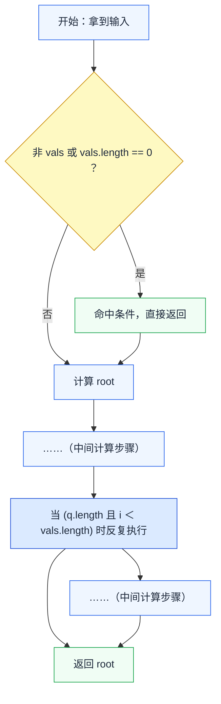

## TypeScript 解题方案（2 个方案逐个讲）

> **运行与提交**：每个方案都是自包含文件（内嵌用例自测，输出 PASS），整块复制到 `.ts` 文件后 `node 文件名` 即可运行。提交 LeetCode 时，把 `demo` 内的算法函数与辅助类型/函数整体取出、置于文件顶层即可。涉及交互/特殊接口的题以题面给定签名为准。

### 方案 1：迭代指针处理

**分析与思路**：核心做法是「迭代指针处理」。代码里依次做这些事：队列或堆的调度。

**运行方式**：`node 本文件`，内嵌用例全部通过会输出 PASS。


**方案专属流程图**（真实控制流）：

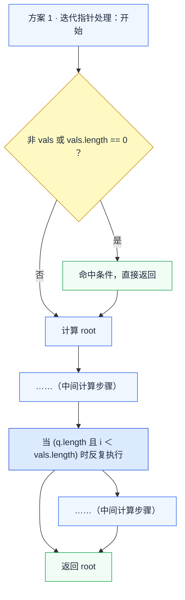

```typescript
class TreeNode {
  // 定义类型
  val: any;
  left: any;
  right: any; // 值: any; 左边界: any; 右边界: any;
  constructor(val?: any, left?: any, right?: any) {
    // constructor(值?: any, 左边界?: any, 右边界?: any) {
    this.val = val === undefined ? 0 : val; // 把 (值 全等于 undefined ? 0 : 值); 写入 值
    this.left = left === undefined ? null : left; // 把 (左边界 全等于 undefined ? null : 左边界); 写入 左边界
    this.right = right === undefined ? null : right; // 把 (右边界 全等于 undefined ? null : 右边界); 写入 右边界
  }
}
function buildTree(vals: any): any {
  // 定义函数/方法 buildTree
  if (!vals || vals.length === 0) return null; // 若 取反 vals 或 vals.长度 全等于 0，直接返回 null
  const root = new TreeNode(vals[0]);
  const q: any[] = [root];
  let i = 1;
  while (q.length && i < vals.length) {
    // 循环，直到不满足「节点.长度 且 下标 i 小于 vals.长度」
    const node = q.shift(); // 把 节点.shift() 存入 节点
    if (vals[i] !== null && vals[i] !== undefined) {
      node.left = new TreeNode(vals[i]);
      q.push(node.left);
    }
    i++; // 下标 i 加一
    if (i < vals.length && vals[i] !== null && vals[i] !== undefined) {
      node.right = new TreeNode(vals[i]);
      q.push(node.right);
    }
    i++; // 下标 i 加一
  }
  return root; // 返回 根节点
}
function treeToLevel(root: any): any[] {
  // 定义函数/方法 treeToLevel
  if (!root) return []; // 若 取反 根节点，直接返回 []
  const out: any[] = [];
  const q: any[] = [root]; // 把 []; const 节点: any[] 赋值为 [根节点]; 写入 const out: any[]
  while (q.length) {
    // 循环，直到不满足「节点.长度」
    const n = q.shift(); // 把 节点.shift() 存入 元素个数
    if (n === null || n === undefined) {
      out.push(null);
      continue;
    }
    out.push(n.val);
    q.push(n.left);
    q.push(n.right); // 把 元素个数.值 压入栈/数组尾部
  }
  while (out.length && out[out.length - 1] === null) out.pop(); // 循环，直到不满足「out.长度 且 out[out.长度 减 1] 全等于 null) out 弹出 );」
  return out; // 返回 out
}
class ListNode {
  // 定义类型
  val: any;
  next: any; // 值: any; 下一个: any;
  constructor(val?: any, next?: any) {
    this.val = val === undefined ? 0 : val;
    this.next = next === undefined ? null : next;
  }
}
function buildList(vals: any): any {
  // 定义函数/方法 buildList
  const dummy = new ListNode(0);
  let cur = dummy; // 把 new ListNode(0); let 当前值 赋值为 哨兵节点 存入 哨兵节点
  for (const v of vals) {
    cur.next = new ListNode(v);
    cur = cur.next;
  } // 把 new ListNode(值); 当前值 赋值为 当前值.下一个; } 写入 下一个
  return dummy.next; // 返回 哨兵节点.下一个
}
function listToArray(head: any): any[] {
  // 定义函数/方法 listToArray
  const out: any[] = [];
  let p = head; // 把 []; let 节点 赋值为 头节点; 写入 const out: any[]
  while (p) {
    out.push(p.val);
    p = p.next;
  } // 循环，直到不满足「节点) { out 追加 节点.值); 节点 赋值为 节点.下一个; }」
  return out; // 返回 out
}
// python-runtime shims
function pyLen(a: any): number {
  // 定义函数/方法 pyLen
  if (a === null || a === undefined) return 0; // 若 数组 全等于 null 或 数组 全等于 undefined，直接返回 0
  if (
    typeof a === 'string' ||
    Array.isArray(a) ||
    a instanceof Set ||
    a instanceof Map
  )
    return a.length ?? a.size;
  if (typeof a === 'object') return Object.keys(a).length; // 若 typeof 数组 全等于 'object'，直接返回 Object.keys(数组).长度
  return 0; // 返回 0
}
function pySlice(a: any, i: any, j: any, step?: any): any {
  // 定义函数/方法 pySlice
  if (typeof a === 'string') {
    const r = [...a].slice(i ?? 0, j ?? a.length);
    return step ? r.reverse().join('') : r.join('');
  }
  const arr = Array.isArray(a) ? a : [...a]; // 把 Array.isArray(数组) ? 数组 : 复制的 数组 存入 数组
  return arr.slice(i ?? 0, j ?? arr.length); // 返回 数组 截取 下标 i ?? 0, 下标 j ?? 数组.长度)
}
function pyRange(a: any, b?: any, step?: any): any[] {
  // 定义函数/方法 pyRange
  let s = 0,
    e = a,
    st = 1; // 把 0, e 赋值为 数组, st 赋值为 1 存入 字符串
  if (b !== undefined) {
    s = a;
    e = b;
  } // 若 b 不等于 undefined) { 字符串 赋值为 数组; e 赋值为 b; }
  if (step !== undefined) st = step; // 若 步数 不等于 undefined) st 赋值为 步数;
  const out: any[] = []; // 把 []; 写入 const out: any[]
  if (st > 0) for (let i = s; i < e; i += st) out.push(i);
  else for (let i = s; i > e; i += st) out.push(i); // 否则
  return out; // 返回 out
}
function pyIn(x: any, coll: any): boolean {
  // 定义函数/方法 pyIn
  if (coll === null || coll === undefined) return false; // 若 coll 全等于 null 或 coll 全等于 undefined，直接返回 false
  if (Array.isArray(coll)) return coll.includes(x); // 若 Array.isArray(coll)，直接返回 coll 是否包含 x)
  if (coll instanceof Set || coll instanceof Map) return coll.has(x); // 若 coll instanceof Set 或 coll instanceof Map，直接返回 coll.has(x)
  if (typeof coll === 'object') return x in coll; // 若 typeof coll 全等于 'object'，直接返回 x in coll
  if (typeof coll === 'string') return coll.indexOf(x) >= 0; // 若 typeof coll 全等于 'string'，直接返回 coll 查找 x) 不低于 0
  return false; // 返回 false
}
function pySorted(a: any): any[] {
  // 定义函数/方法 pySorted
  const arr = typeof a === 'string' ? [...a] : [...a]; // 把 (typeof 数组 全等于 'string') ? 复制的 数组 : 复制的 数组 存入 数组
  return arr.sort((x: any, y: any) => (x < y ? -1 : x > y ? 1 : 0));
}
function pyMin(a: any, b?: any): any {
  if (b !== undefined) return Math.min(a, b);
  if (Array.isArray(a) || a instanceof Set) return Math.min(...a);
  return Math.min(a);
} // 定义函数/方法 pyMin
function pyMax(a: any, b?: any): any {
  if (b !== undefined) return Math.max(a, b);
  if (Array.isArray(a) || a instanceof Set) return Math.max(...a);
  return Math.max(a);
} // 定义函数/方法 pyMax
function pySum(a: any): number {
  let s = 0;
  for (const v of a) s += v;
  return s;
} // 定义函数/方法 pySum
function pyAbs(x: any): number {
  return Math.abs(x);
} // 定义函数/方法 pyAbs
function pyEnumerate(a: any): any[] {
  const out: any[] = [];
  let i = 0;
  for (const v of a) {
    out.push([i, v]);
    i++;
  }
  return out;
} // 定义函数/方法 pyEnumerate
function pyZip(a: any, b: any): any[] {
  const n = Math.min(a.length, b.length);
  const out: any[] = [];
  for (let i = 0; i < n; i++) out.push([a[i], b[i]]);
  return out;
} // 定义函数/方法 pyZip
function pyDictGet(d: any, k: any, def?: any): any {
  return k in d ? d[k] : def === undefined ? null : def;
} // 定义函数/方法 pyDictGet
function pyPrint(...args: any[]): void {
  console.log(
    args
      .map((a) => (typeof a === 'object' && a !== null ? JSON.stringify(a) : a))
      .join(' '),
  );
} // 定义函数/方法 pyPrint
// collections / heapq
function heapPush(h: any[], x: any): void {
  h.push(x);
  let i = h.length - 1;
  while (i > 0) {
    const p = (i - 1) >> 1;
    if (h[p] <= h[i]) break;
    [h[p], h[i]] = [h[i], h[p]];
    i = p;
  }
} // 定义函数/方法 heapPush
function heapPop(h: any[]): any {
  const top = h[0];
  const last = h.pop();
  if (h.length) {
    h[0] = last;
    let i = 0;
    const n = h.length;
    while (true) {
      let l = 2 * i + 1,
        r = 2 * i + 2,
        s = i;
      if (l < n && h[l] < h[s]) s = l;
      if (r < n && h[r] < h[s]) s = r;
      if (s === i) break;
      [h[s], h[i]] = [h[i], h[s]];
      i = s;
    }
  }
  return top;
} // 定义函数/方法 heapPop
class Deque {
  private a: any[] = [];
  push(x: any) {
    this.a.push(x);
  }
  pushLeft(x: any) {
    this.a.unshift(x);
  }
  pop() {
    return this.a.pop();
  }
  popLeft() {
    return this.a.shift();
  }
  get length() {
    return this.a.length;
  }
  toArray() {
    return this.a.slice();
  }
} // 定义类型
function Counter(iter: any): any {
  const m: any = {};
  for (const v of iter) m[v] = (m[v] || 0) + 1;
  return m;
} // 定义函数/方法 Counter
function gcd(a: any, b: any): any {
  while (b) {
    [a, b] = [b, a % b];
  }
  return a;
} // 定义函数/方法 gcd
function pyInf(): number {
  return Infinity;
} // 定义函数/方法 pyInf

function norm(x: any): any {
  // 定义函数/方法 norm
  if (x === null || x === undefined) return null; // 若 x 全等于 null 或 x 全等于 undefined，直接返回 null
  if (typeof x === 'object') {
    // 若 typeof x 全等于 'object'
    if (x instanceof Deque) return x.toArray(); // 若 x instanceof Deque，直接返回 x.toArray()
    if (Array.isArray(x)) return x.map(norm); // 若 Array.isArray(x)，直接返回 x.映射表(norm)
    if (
      typeof x.val === 'number' &&
      (typeof x.left !== 'undefined' || typeof x.right !== 'undefined')
    )
      return treeToLevel(x);
    if (typeof x.next !== 'undefined' && typeof x.val === 'number')
      return listToArray(x);
    if (x instanceof Set) return [...x].sort(); // 若 x instanceof Set，直接返回 复制的 x 排序 )
    if (x instanceof Map) return Object.fromEntries(x); // 若 x instanceof Map，直接返回 Object.fromEntries(x)
    const o: any = {};
    for (const k of Object.keys(x)) o[k] = norm(x[k]);
    return o;
  }
  return x; // 返回 x
}
function eq(a: any, b: any): boolean {
  // 定义函数/方法 eq
  const x = norm(a),
    y = norm(b); // 把 norm(数组), y 赋值为 norm(b) 存入 x
  if (x === y) return true; // 若 x 全等于 y，直接返回 true
  if (x === null || y === null) return x === y; // 若 x 全等于 null 或 y 全等于 null，直接返回 x 全等于 y
  if (Array.isArray(x) && Array.isArray(y)) {
    // 若 Array.isArray(x) 且 Array.isArray(y
    if (x.length !== y.length) return false; // 若 x.长度 不等于 y.长度，直接返回 false
    for (let i = 0; i < x.length; i++) if (!eq(x[i], y[i])) return false; // 让 下标 i 从 0 开始计数，下标 i 小于 x.长度 就继续
    return true; // 返回 true
  }
  if (typeof x === 'object' && typeof y === 'object') {
    // 若 typeof x 全等于 'object' 且 typeof y 全等于 'object'
    const kx = Object.keys(x),
      ky = Object.keys(y); // 把 Object.keys(x), ky 赋值为 Object.keys(y) 存入 kx
    if (kx.length !== ky.length) return false; // 若 kx.长度 不等于 ky.长度，直接返回 false
    for (const k of kx) if (!eq(x[k], y[k])) return false;
    return true; // 返回 true
  }
  return x === y; // 返回 x 全等于 y
}

function lengthOfLIS(nums) {
  // 定义函数/方法 lengthOfLIS
  if (!nums.length) return 0; // 若 取反 数组.长度，直接返回 0
  const dp = new Array(nums.length).fill(1); // 把 new Array(数组.长度).fill(1) 存入 DP 表
  let ans = 1; // 把 1 存入 答案
  for (let i = 0; i < nums.length; i++) {
    // 让 下标 i 从 0 开始计数，下标 i 小于 数组.长度 就继续
    for (let j = 0; j < i; j++) {
      // 让 下标 j 从 0 开始计数，下标 j 小于 下标 i 就继续
      if (nums[j] < nums[i]) dp[i] = Math.max(dp[i], dp[j] + 1);
    }
    ans = Math.max(ans, dp[i]); // 把 Math.取较大值 答案, DP 表[下标 i]) 存入 答案
  }
  return ans; // 返回 答案
}
export function demo(): void {
  // 程序入口：跑内嵌自测用例
  const cases = [
    { in: [[10, 9, 2, 5, 3, 7, 101, 18]], want: 4 },
    { in: [[0, 1, 0, 3, 2, 3]], want: 4 },
    { in: [[7, 7, 7, 7]], want: 1 },
    { in: [[4, 10, 4, 3, 8, 9]], want: 3 },
  ];
  let fail = false; // 把 false 存入 fail
  for (const c of cases) {
    // for (const 字符 of cases) {
    const got = lengthOfLIS(...c.in); // 把 lengthOfLIS(...字符.in) 存入 got
    if (!eq(got, c.want)) {
      fail = true;
      console.log(
        'FAIL',
        JSON.stringify(c.in),
        '=>',
        JSON.stringify(got),
        'want',
        JSON.stringify(c.want),
      );
    }
  }
  if (fail) throw new Error('FAILED'); // 若 fail) throw new Error('FAILED');
  console.log('PASS'); // 全部用例通过，输出 PASS
}
demo(); // demo();
```

### 方案 2：方案2（动态规划 + 二分查找 O(n log n)）

**分析与思路**：核心做法是「方案2（动态规划 + 二分查找 O(n log n)）」。代码里依次做这些事：DP 表逐项填充；二分收缩区间；单循环线性扫描。

**运行方式**：`node 本文件`，内嵌用例全部通过会输出 PASS。

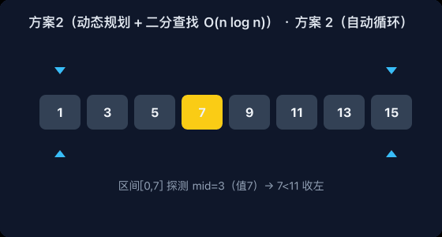

**方案专属流程图**（真实控制流）：

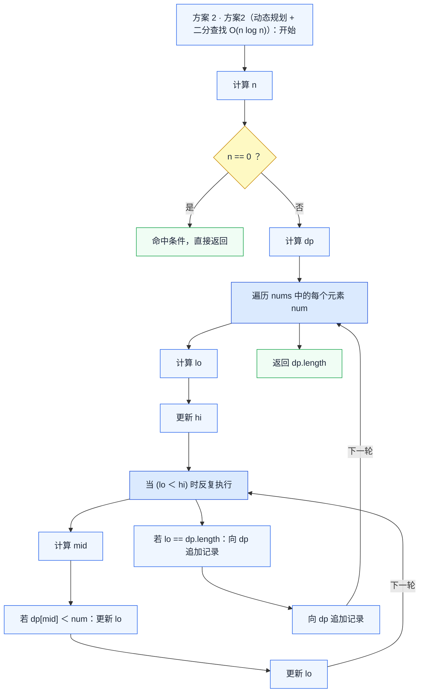

```typescript
/**
 ** LeetCode 300. 最长递增子序列
 ** 方案：方案2（动态规划 + 二分查找 O(n log n)）
 ** 来源：python 参考忠实移植
 */

function lengthOfLIS(nums: number[]): number {
  // 定义函数/方法 lengthOfLIS
  const n = nums.length; // 把 数组.长度 存入 元素个数
  if (n === 0) return 0; // 若 元素个数 全等于 0，直接返回 0
  const dp: number[] = []; // 把 []; 写入 const dp: number[]
  for (const num of nums) {
    // for (const num of 数组) {
    let lo = 0,
      hi = dp.length; // 把 0, 右边界 赋值为 DP 表.长度 存入 左边界
    while (lo < hi) {
      // 循环，直到不满足「左边界 小于 右边界」
      const mid = (lo + hi) >> 1; // 把 (左边界 加 右边界) 超过 超过 1 存入 中点
      if (dp[mid] < num)
        lo = mid + 1; // 若 DP 表[中点] 小于 num) 左边界 赋值为 中点 加 1;
      else hi = mid; // 否则
    }
    if (lo === dp.length)
      dp.push(num); // 若 左边界 全等于 DP 表.长度) DP 表 追加 num);
    else dp[lo] = num; // 否则
  }
  return dp.length; // 返回 DP 表.长度
}

export function demo(): void {
  // 程序入口：跑内嵌自测用例
  const cases: { in: number[]; want: number }[] = [
    { in: [10, 9, 2, 5, 3, 7, 101, 18], want: 4 },
    { in: [0, 1, 0, 3, 2, 3], want: 4 },
    { in: [7, 7, 7, 7], want: 1 },
  ];
  let fail = false; // 把 false 存入 fail
  for (const c of cases) {
    // for (const 字符 of cases) {
    const got = lengthOfLIS(c.in); // 把 lengthOfLIS(字符.in) 存入 got
    if (got !== c.want) {
      // 若 got 不等于 字符.want
      fail = true; // 把 true 存入 fail
      console.log('FAIL', JSON.stringify(c.in), 'want', c.want, 'got', got); // 打印输出
    }
  }
  if (fail) throw new Error('FAILED'); // 若 fail) throw new Error(「FAILED」);
  console.log('PASS'); // 全部用例通过，输出 PASS
}
demo(); // demo();
```

## 逐步拆解与面试追问

**复杂度**：时间 O(n)（单趟线性扫描），空间 O(1) 到 O(n)（视辅助结构）

**为什么是这个量级**：每个元素被常数次访问，辅助哈希或栈的开销与 n 同阶

**面试官可能会追问**：

- 状态定义为什么是它？
- 遍历顺序由什么决定？
- 能否滚动数组压空间？

## 关键 API 速查（TS 主解法实际用到，附官方链接）

| API | 作用 | 使用要点 | 官方文档 |
|---|---|---|---|
| `Array.prototype.sort()` | 原地排序 | 默认按字符串 Unicode 序（10 会排在 2 前），数字必须传 (a,b)=>a-b；V8 用 TimSort，稳定，O(n log n)；返回原数组引用 | [官方文档](https://developer.mozilla.org/zh-CN/docs/Web/JavaScript/Reference/Global_Objects/Array/sort) |
| `Array.prototype.map()` | 逐元素映射为新数组 | 回调 (v,i,arr)；返回等长新数组，不改变原数组；稀疏位跳过；链式调用注意中间数组开销 | [官方文档](https://developer.mozilla.org/zh-CN/docs/Web/JavaScript/Reference/Global_Objects/Array/map) |
| `Array.prototype.push()` | 尾部追加 | 返回新长度；可一次多个；均摊 O(1)；会改变原数组 | [官方文档](https://developer.mozilla.org/zh-CN/docs/Web/JavaScript/Reference/Global_Objects/Array/push) |
| `Array.prototype.pop()` | 尾部弹出 | 返回被删元素（空数组返回 undefined）；O(1) | [官方文档](https://developer.mozilla.org/zh-CN/docs/Web/JavaScript/Reference/Global_Objects/Array/pop) |
| `Array.prototype.shift()` | 头部取出 | O(n)（后续元素整体前移）；大量头部操作请用链表或双端结构 | [官方文档](https://developer.mozilla.org/zh-CN/docs/Web/JavaScript/Reference/Global_Objects/Array/shift) |
| `Array.prototype.unshift()` | 头部插入 | O(n)；与 shift 组合可当双端队列 | [官方文档](https://developer.mozilla.org/zh-CN/docs/Web/JavaScript/Reference/Global_Objects/Array/unshift) |
| `Array/String includes()` | 是否包含 | 数组用 SameValueZero（NaN 可判）；字符串按子串；第二个参数为起始下标 | [官方文档](https://developer.mozilla.org/zh-CN/docs/Web/JavaScript/Reference/Global_Objects/Array/includes) |
| `Array/String indexOf()` | 首次出现的下标 | 找不到返回 -1；无法判 NaN（用 includes）；字符串可传起始位 | [官方文档](https://developer.mozilla.org/zh-CN/docs/Web/JavaScript/Reference/Global_Objects/Array/indexOf) |
| `Array/String slice()` | 切片（不改原数组） | slice(start,end) 含头不含尾；负数从尾计；常用于复制数组（slice()） | [官方文档](https://developer.mozilla.org/zh-CN/docs/Web/JavaScript/Reference/Global_Objects/Array/slice) |
| `Array.prototype.join()` | 数组拼接为字符串 | undefined/null 转空串；嵌套数组会展平一层；join('') 用于字符数组还原 | [官方文档](https://developer.mozilla.org/zh-CN/docs/Web/JavaScript/Reference/Global_Objects/Array/join) |
| `Object.keys()` | 对象键名数组 | 仅自身可枚举字符串键（不含 symbol）；配 length 可当计数器 | [官方文档](https://developer.mozilla.org/zh-CN/docs/Web/JavaScript/Reference/Global_Objects/Object/keys) |
| `Object.fromEntries()` | 键值对数组转对象 | 参数为 [k,v] 可迭代；map 出来的键值对可直接转对象 | [官方文档](https://developer.mozilla.org/zh-CN/docs/Web/JavaScript/Reference/Global_Objects/Object/fromEntries) |
| `JSON.stringify()` | 序列化为 JSON 字符串 | 常用于结构化比较（深度相等判定）；undefined/函数/循环引用会被丢弃或抛错 | [官方文档](https://developer.mozilla.org/zh-CN/docs/Web/JavaScript/Reference/Global_Objects/JSON/stringify) |
| `Math.max()` | 最大值 | 配展开 Math.max(...arr)；空参返回 -Infinity；超大数组注意展开参数上限 | [官方文档](https://developer.mozilla.org/zh-CN/docs/Web/JavaScript/Reference/Global_Objects/Math/max) |
| `Math.min()` | 最小值 | 同 max；空参返回 Infinity | [官方文档](https://developer.mozilla.org/zh-CN/docs/Web/JavaScript/Reference/Global_Objects/Math/min) |
| `Math.abs()` | 绝对值 | 入参会被隐式转数字；-0 返回 +0 | [官方文档](https://developer.mozilla.org/zh-CN/docs/Web/JavaScript/Reference/Global_Objects/Math/abs) |

### 各语言官方文档导航

- **TypeScript / JS**：[MDN 中文参考](https://developer.mozilla.org/zh-CN/)
- **Python**：[Python 官方文档](https://docs.python.org/zh-cn/3/)
- **Go**：[Go 标准库](https://pkg.go.dev/std)
- **Java**：[JDK 17 API](https://docs.oracle.com/en/java/javase/17/docs/api/)
- **Rust**：[Rust 标准库](https://doc.rust-lang.org/std/)
- **Lua**：[Lua 5.4 手册](https://www.lua.org/manual/5.4/)
- **C**：[Cppreference C](https://zh.cppreference.com/w/c)
- **C++**：[Cppreference C++](https://zh.cppreference.com/w/cpp)
- **R**：[R 官方手册](https://stat.ethz.ch/R-manual/)
- **Zig**：[Zig 语言文档](https://ziglang.org/documentation/master/)
- **Dart**：[Dart API](https://api.dart.dev/)

## 附录：其他 10 种语言全部实现（每种语言列举其全部方案）

> TypeScript 的全部方案见「TypeScript 解题方案」一节；下面是其余 10 种语言的对应实现，每种语言的每个方案都带思路分析、代码走读与专属运行架构图。
> 每个方案都内嵌用例自测，可独立运行（老仓库 python/go 文件遵循「打印结果」约定）。
> 完整解法文件见 `dsa/<语言>/dp/lc_300_最长递增子序列/`。

### Python 实现（2 种方案）

Python 的全部方案如下，每个方案都内嵌用例自测，可独立运行（老仓库 python/go 文件遵循「打印结果」约定）：

#### 方案 1：迭代指针处理

**思路与代码分析**：核心是「迭代指针处理」。Python 版用切片与字典推导式简化操作，突出可读性。代码里依次做这些事：DP 表逐项填充。**走读**：方案 1 · 迭代指针处理：开始 → 更新 n → 命中条件，直接返回 → 填写 DP 表 → 循环 i：从 0 到 n 前 → 循环 j：从 0 到 i 前 → 若 nums[j] ＜ nums[i]：填写 DP 表 → 填写 DP 表 → 返回 max(dp)。

**运行架构**（真实控制流）：

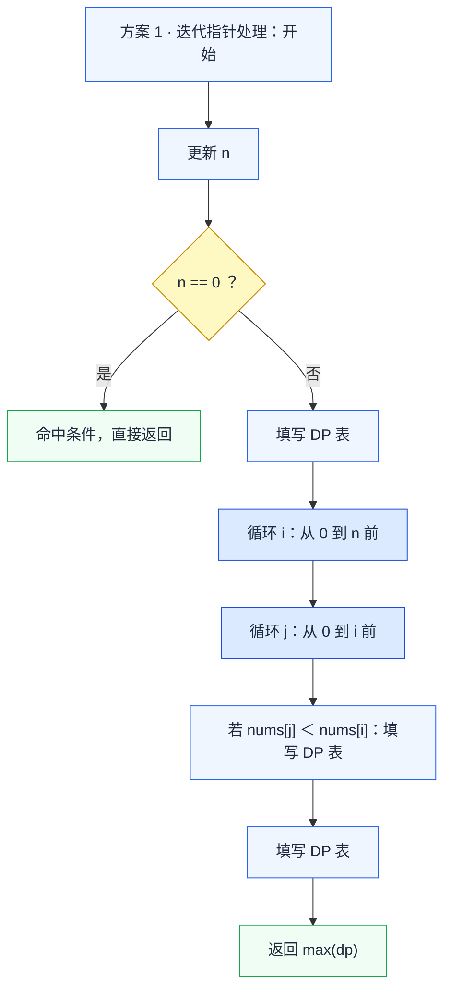

```python
import sys  # 提高递归深度上限（深输入防 RecursionError）

sys.setrecursionlimit(200000)  # 树/链表类题目节点数可达 1e4 量级

def lengthOfLIS(nums):  # 定义函数 lengthOfLIS（参数：数组）
    n = len(nums)  # 把 长度(数组) 存入 元素个数
    if n == 0:  # 若 元素个数 等于 0
        return 0  # 返回 0
    # 初始化 dp 数组，每个元素设为 1
    dp = [1] * n  # 把 [1] 乘 元素个数 存入 DP 表
    for i in range(n):  # 让 下标 i 从 元素个数 遍历
        for j in range(i):  # 让 下标 j 从 下标 i 遍历
            if nums[j] < nums[i]:  # 若 数组[下标 j] 小于 数组[下标 i]
                dp[i] = max(dp[i], dp[j] + 1)  # 把 取较大值 DP 表[下标 i], DP 表[下标 j] 加 1) 写入 dp[i]
    return max(dp)  # 返回 取较大值 DP 表)

if __name__ == "__main__":  # 若 __name__ 等于 '__main__'
    print(lengthOfLIS([10, 9, 2, 5, 3, 7, 101, 18]))  # 打印输出
```

#### 方案 2：方案2（动态规划 + 二分查找 O(n log n)）

**思路与代码分析**：核心是「方案2（动态规划 + 二分查找 O(n log n)）」。Python 版用切片与字典推导式简化操作，突出可读性。代码里依次做这些事：DP 表逐项填充。**走读**：方案 2 · 方案2（动态规划 + 二分查找 O(n log n)）：开始 → 更新 n → 命中条件，直接返回 → 填写 DP 表 → 遍历 nums: 中的每个元素 num → 更新 i → 若 i == len(dp)：向 dp 追加记录 → 向 dp 追加记录 → 填写 DP 表 → 返回 len(dp)。

**运行架构**（真实控制流）：

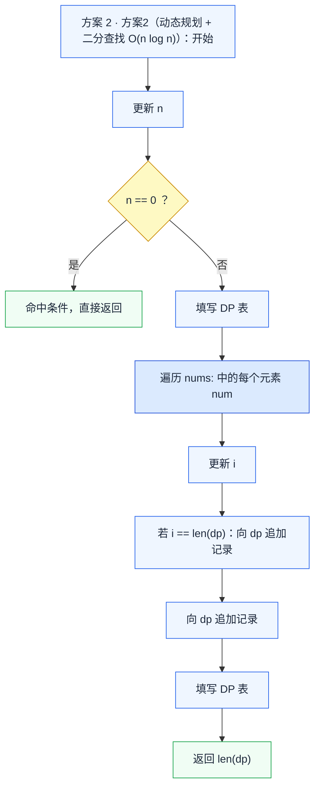

```python
import sys  # 提高递归深度上限（深输入防 RecursionError）

sys.setrecursionlimit(200000)  # 树/链表类题目节点数可达 1e4 量级
import bisect  # 引入依赖

def lengthOfLIS(nums):  # 定义函数 lengthOfLIS（参数：数组）
    # 动态规划 + 二分查找（O(n log n)）
    n = len(nums)  # 把 长度(数组) 存入 元素个数
    if n == 0:  # 若 元素个数 等于 0
        return 0  # 返回 0
    dp = []  # 把 [] 存入 DP 表
    for num in nums:  # 逐个取出 数组 的元素（num）
        i = bisect.bisect_left(dp, num)  # 把 bisect.bisect_left(DP 表, num) 存入 下标 i
        if i == len(dp):  # 若 下标 i 等于 长度(DP 表
            dp.append(num)  # 把 num 追加到列表尾部
        else:  # 否则
            dp[i] = num  # 把 num 写入 dp[i]
    return len(dp)  # 返回 长度(DP 表)

if __name__ == "__main__":  # 若 __name__ 等于 '__main__'
    print(lengthOfLIS([10, 9, 2, 5, 3, 7, 101, 18]))  # 打印输出
```

### Go 实现（2 种方案）

Go 的全部方案如下，每个方案都内嵌用例自测，可独立运行（老仓库 python/go 文件遵循「打印结果」约定）：

#### 方案 1：迭代指针处理

**思路与代码分析**：核心是「迭代指针处理」。Go 版用切片与多返回值惯用法，显式处理索引边界。代码里依次做这些事：DP 表逐项填充。**走读**：方案 1 · 迭代指针处理：开始 → 更新 : → 返回 0 → 遍历 dp 的下标与元素 i → 遍历循环 → 遍历循环 → 遍历 dp 的下标与元素 v → 返回 ans。

**运行架构**（真实控制流）：

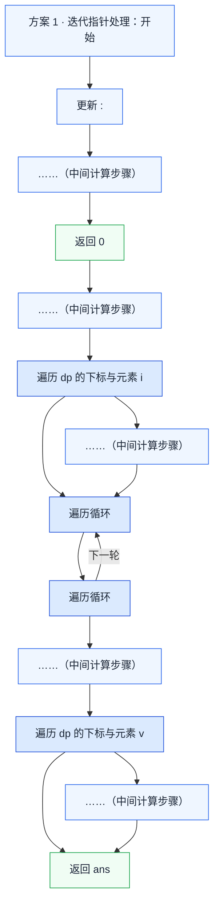

```go
package main // 引入依赖

import (
	"fmt"
	"os"
) // 引入依赖

func lengthOfLIS(nums []int) int { // 定义函数/方法 lengthOfLIS
	n := len(nums) // 把 长度(数组) 写入 n :
	if n == 0 {    // 若 元素个数 等于 0
		return 0 // 返回 0
	}
	dp := make([]int, n) // 把 make([]int, 元素个数) 写入 dp :
	for i := range dp {  // 把 range DP 表 { 写入 for i :
		dp[i] = 1 // 把 1 写入 dp[i]
	}
	for i := 0; i < n; i++ { // 让 下标 i 从 0 开始计数
		for j := 0; j < i; j++ { // 让 下标 j 从 0 开始计数
			if nums[j] < nums[i] { // 若 数组[下标 j] 小于 数组[下标 i]
				if dp[j]+1 > dp[i] { // 若 DP 表[下标 j] 加 1 超过 DP 表[下标 i]
					dp[i] = dp[j] + 1 // 把 DP 表[下标 j] 加 1 写入 dp[i]
				}
			}
		}
	}
	ans := 0               // 把 0 写入 ans :
	for _, v := range dp { // 同时取 _ 与 值 遍历
		if v > ans { // 若 值 超过 答案
			ans = v // 把 值 写入 答案
		}
	}
	return ans // 返回 答案
}

func main() { // 程序入口：跑内嵌自测用例
	type tc struct { // 定义类型
		in   []int // in []int
		want int   // want int
	}
	cases := []tc{ // 把 []tc{ 写入 cases :
		{[]int{10, 9, 2, 5, 3, 7, 101, 18}, 4},
		{[]int{}, 0},
	}
	ok := true                // 把 true 写入 ok :
	for _, c := range cases { // 同时取 _ 与 字符 遍历
		if got := lengthOfLIS(c.in); got != c.want { // 若 got : 赋值为 lengthOfLIS(字符.in); got 不等于 字符.want
			ok = false                                                         // 把 false 写入 ok
			fmt.Printf("FAIL lengthOfLIS(%v)=%v want %v\n", c.in, got, c.want) // 打印输出
		}
	}
	if !ok { // 若 取反 ok
		os.Exit(1) // os.Exit(1)
	}
	fmt.Println("PASS") // 全部用例通过，输出 PASS
}
```

#### 方案 2：方案2（动态规划 + 二分查找 O(n log n)）

**思路与代码分析**：核心是「方案2（动态规划 + 二分查找 O(n log n)）」。Go 版用切片与多返回值惯用法，显式处理索引边界。代码里依次做这些事：DP 表逐项填充。**走读**：方案 2 · 方案2（动态规划 + 二分查找 O(n log n)）：开始 → 更新 : → 返回 0 → 遍历 nums 的下标与元素 num → 遍历循环 → 返回 len(dp)。

**运行架构**（真实控制流）：

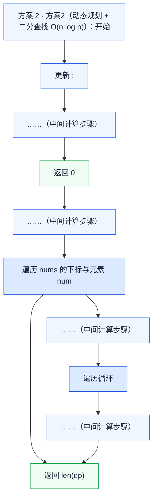

```go
package main // 引入依赖

import (
	"fmt"
	"os"
) // 引入依赖

func lengthOfLIS(nums []int) int { // 定义函数/方法 lengthOfLIS
	n := len(nums) // 把 长度(数组) 写入 n :
	if n == 0 {    // 若 元素个数 等于 0
		return 0 // 返回 0
	}
	dp := []int{}              // 把 []int{} 写入 dp :
	for _, num := range nums { // 同时取 _ 与 num 遍历
		lo, hi := 0, len(dp) // 把 0, 长度(DP 表) 写入 lo, hi :
		for lo < hi {        // for 左边界 小于 右边界 {
			mid := (lo + hi) / 2 // 把 (左边界 加 右边界) 除以 2 写入 mid :
			if dp[mid] < num {   // 若 DP 表[中点] 小于 num
				lo = mid + 1 // 把 中点 加 1 写入 左边界
			} else { // 否则
				hi = mid // 把 中点 写入 右边界
			}
		}
		i := lo           // 把 左边界 写入 i :
		if i == len(dp) { // 若 下标 i 等于 长度(DP 表
			dp = append(dp, num) // 把 append(DP 表, num) 写入 DP 表
		} else { // 否则
			dp[i] = num // 把 num 写入 dp[i]
		}
	}
	return len(dp) // 定义函数/方法 len
}

func main() { // 程序入口：跑内嵌自测用例
	type tc struct { // 定义类型
		in   []int // in []int
		want int   // want int
	}
	cases := []tc{ // 把 []tc{ 写入 cases :
		{[]int{10, 9, 2, 5, 3, 7, 101, 18}, 4},
		{[]int{}, 0},
	}
	ok := true                // 把 true 写入 ok :
	for _, c := range cases { // 同时取 _ 与 字符 遍历
		if got := lengthOfLIS(c.in); got != c.want { // 若 got : 赋值为 lengthOfLIS(字符.in); got 不等于 字符.want
			ok = false                                                         // 把 false 写入 ok
			fmt.Printf("FAIL lengthOfLIS(%v)=%v want %v\n", c.in, got, c.want) // 打印输出
		}
	}
	if !ok { // 若 取反 ok
		os.Exit(1) // os.Exit(1)
	}
	fmt.Println("PASS") // 全部用例通过，输出 PASS
}
```

### Java 实现（2 种方案）

Java 的全部方案如下，每个方案都内嵌用例自测，可独立运行（老仓库 python/go 文件遵循「打印结果」约定）：

#### 方案 1：迭代指针处理

**思路与代码分析**：核心是「迭代指针处理」。Java 版用类与静态方法组织，集合操作显式明了。代码里依次做这些事：DP 表逐项填充；双重循环遍历。**走读**：方案 1 · 迭代指针处理：开始 → 更新 n → 命中条件，直接返回 → 填写 DP 表 → 遍历循环 → 遍历循环 → 遍历循环 → 若 nums[j] ＜ nums[i]) dp[i] = Math.max(dp[i], dp[j] + 1：None → 填写 DP 表 → 遍历循环 → 返回 best。

**运行架构**（真实控制流）：

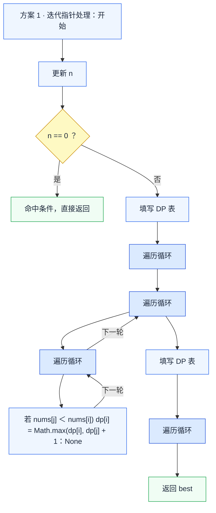

```java
package com.webfault.dsa; // 引入依赖

import java.util.*; // 引入依赖

class Main { // 定义类型

  static int lengthOfLIS(int[] nums) { // 定义函数/方法 lengthOfLIS
    int n = nums.length; // 把 数组.长度 存入 元素个数
    if (n == 0) return 0; // 若 元素个数 等于 0，直接返回 0
    int[] dp = new int[n]; // 把 new int[元素个数]; 写入 int[] dp
    for (int i = 0; i < n; i++) dp[i] = 1; // 让 下标 i 从 0 开始计数，下标 i 小于 元素个数 就继续
    for (int i = 0; i < n; i++) { // 让 下标 i 从 0 开始计数，下标 i 小于 元素个数 就继续
      for (int j = 0; j < i; j++) { // 让 下标 j 从 0 开始计数，下标 j 小于 下标 i 就继续
        if (nums[j] < nums[i]) dp[i] = Math.max(dp[i], dp[j] + 1);
      }
    }
    int best = dp[0]; // 把 DP 表[0] 存入 当前最优
    for (int v : dp) if (v > best) best = v; // 把 值; 写入 for (int v : dp) if (v > best) best
    return best; // 返回 当前最优
  }

  public static void main(String[] args) { // public static void main(String[] args) {
    int[][] cases = { // 把 { 写入 int[][] cases
      {10, 9, 2, 5, 3, 7, 101, 18},
      {0, 1, 0, 3, 2, 3},
      {7, 7, 7, 7},
      {1, 3, 6, 7, 9, 4, 10, 5, 6},
    };
    int[] wants = {4, 4, 1, 6}; // 把 {4, 4, 1, 6}; 写入 int[] wants
    boolean ok = true; // 把 true; 写入 boolean ok
    for (int ci = 0; ci < cases.length; ci++) { // 让 ci 从 0 开始计数，ci 小于 cases.长度 就继续
      int got = lengthOfLIS(cases[ci]); // 把 lengthOfLIS(cases[ci]) 存入 got
      if (got != wants[ci]) { // 若 got 不等于 wants[ci]
        ok = false; // 把 false; 写入 ok
        System.out.println("FAIL case " + ci + " got " + got + " want " + wants[ci]); // 打印输出
      }
    }
    if (!ok) throw new RuntimeException("FAILED"); // 若 取反 ok) throw new RuntimeException(「FAILED」);
    System.out.println("PASS"); // 全部用例通过，输出 PASS
  }
}
```

#### 方案 2：方案2（动态规划 + 二分查找 O(n log n)）

**思路与代码分析**：核心是「方案2（动态规划 + 二分查找 O(n log n)）」。Java 版用类与静态方法组织，集合操作显式明了。代码里依次做这些事：单循环线性扫描。**走读**：方案 2 · 方案2（动态规划 + 二分查找 O(n log n)）：开始 → 更新 n → 命中条件，直接返回 → 填写 DP 表 → 遍历循环 → 更新 i → 当 (i ＜ dp.size() 且 dp.get(i) ＜ num) i++ 时反复执行 → 若 i == dp.size()) dp.add(num：None → 返回 dp.size()。

**运行架构**（真实控制流）：

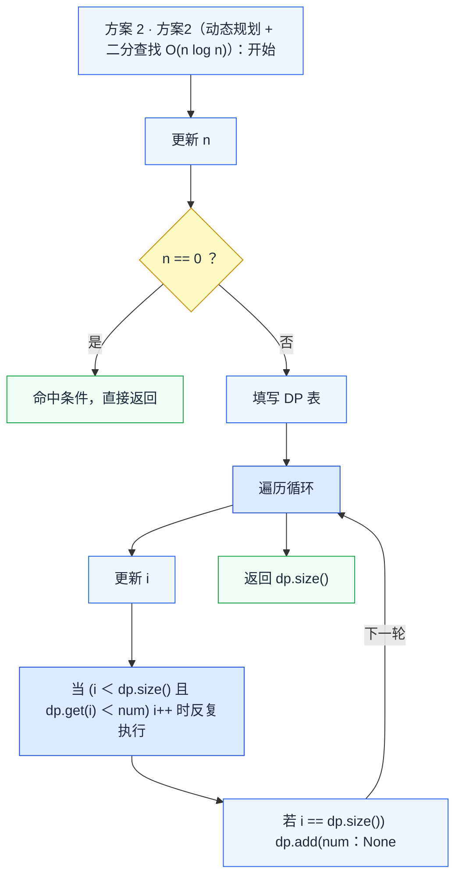

```java
package com.webfault.dsa; // 引入依赖

import java.util.*; // 引入依赖

class Main { // 定义类型

  static int lengthOfLIS(int[] nums) { // 定义函数/方法 lengthOfLIS
    int n = nums.length; // 把 数组.长度 存入 元素个数
    if (n == 0) return 0; // 若 元素个数 等于 0，直接返回 0
    java.util.ArrayList<Integer> dp = new java.util.ArrayList<>();
    for (int num : nums) { // for (int num : 数组) {
      int i = 0; // 把 0 存入 下标 i
      while (i < dp.size() && dp.get(i) < num) i++;
      if (i == dp.size()) dp.add(num); // 若 下标 i 等于 DP 表.大小()) DP 表 追加 num);
      else dp.set(i, num); // 否则
    }
    return dp.size(); // 返回 DP 表.大小()
  }

  public static void main(String[] args) { // public static void main(String[] args) {
    int[][] cases = { // 把 { 写入 int[][] cases
      {10, 9, 2, 5, 3, 7, 101, 18},
      {0, 1, 0, 3, 2, 3},
      {7, 7, 7, 7},
      {1, 3, 6, 7, 9, 4, 10, 5, 6},
    };
    int[] wants = {4, 4, 1, 6}; // 把 {4, 4, 1, 6}; 写入 int[] wants
    boolean ok = true; // 把 true; 写入 boolean ok
    for (int ci = 0; ci < cases.length; ci++) { // 让 ci 从 0 开始计数，ci 小于 cases.长度 就继续
      int got = lengthOfLIS(cases[ci]); // 把 lengthOfLIS(cases[ci]) 存入 got
      if (got != wants[ci]) { // 若 got 不等于 wants[ci]
        ok = false; // 把 false; 写入 ok
        System.out.println("FAIL case " + ci + " got " + got + " want " + wants[ci]); // 打印输出
      }
    }
    if (!ok) throw new RuntimeException("FAILED"); // 若 取反 ok) throw new RuntimeException(「FAILED」);
    System.out.println("PASS"); // 全部用例通过，输出 PASS
  }
}
```

### Rust 实现（2 种方案）

Rust 的全部方案如下，每个方案都内嵌用例自测，可独立运行（老仓库 python/go 文件遵循「打印结果」约定）：

#### 方案 1：迭代指针处理

**思路与代码分析**：核心是「迭代指针处理」。Rust 版用所有权移动与切片借用改写同一逻辑，注意 Option 与引用边界。代码里依次做这些事：DP 表逐项填充。**走读**：方案 1 · 迭代指针处理：开始 → 填写 DP 表 → 计算 best → 遍历 0..nums.len() 中的每个元素 i → 遍历 0..i 中的每个元素 j → 处理 if nums[j] ＜ nums[i] → 填写 DP 表 → 填写 DP 表 → 处理 best → 返回结果。

**运行架构**（真实控制流）：

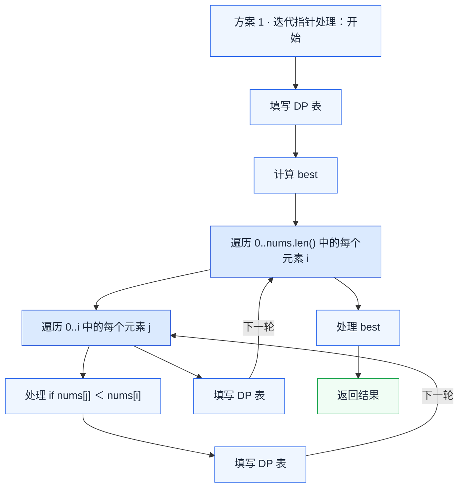

```rust
// LeetCode 300. 最长递增子序列 — Rust 版（方案1）
fn length_of_lis(nums: Vec<i32>) -> i32 {
    // 定义函数/方法 length_of_lis
    let mut dp = vec![1i32; nums.len()]; // 把 vec取反 [1i32; 数组.长度()]; 写入 let mut dp
    let mut best = 0; // 把 0; 写入 let mut best
    for i in 0..nums.len() {
        // 逐个取出 0 的元素（下标 i）
        for j in 0..i {
            // 逐个取出 0 的元素（下标 j）
            if nums[j] < nums[i] {
                dp[i] = dp[i].max(dp[j] + 1);
            }
        }
        best = best.max(dp[i]); // 把 当前最优.取较大值 DP 表[下标 i]); 写入 当前最优
    }
    best // 当前最优
}
fn main() {
    assert_eq!(length_of_lis(vec![10, 9, 2, 5, 3, 7, 101, 18]), 4);
    assert_eq!(length_of_lis(vec![0, 1, 0, 3, 2, 3]), 4);
    assert_eq!(length_of_lis(vec![7, 7, 7, 7]), 1);
    println!("PASS");
} // 程序入口：跑内嵌自测用例
```

#### 方案 2：方案2（动态规划 + 二分查找 O(n log n)）

**思路与代码分析**：核心是「方案2（动态规划 + 二分查找 O(n log n)）」。Rust 版用所有权移动与切片借用改写同一逻辑，注意 Option 与引用边界。代码里依次做这些事：DP 表逐项填充。**走读**：方案 2 · 方案2（动态规划 + 二分查找 O(n log n)）：开始 → 填写 DP 表 → 计算 best → 遍历 0..nums.len() 中的每个元素 i → 遍历 0..i 中的每个元素 j → 处理 if nums[j] ＜ nums[i] → 填写 DP 表 → 填写 DP 表 → 处理 best → 返回结果。

**运行架构**（真实控制流）：

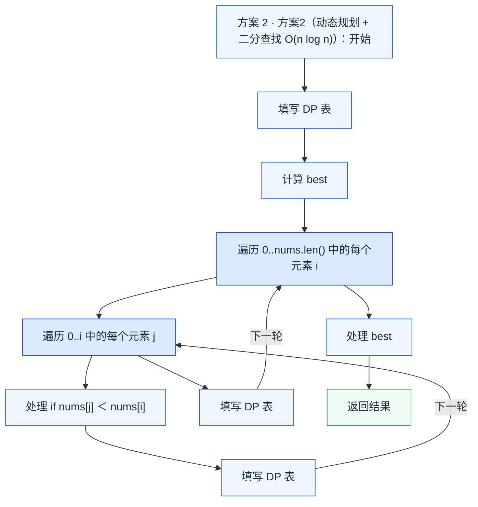

```rust
// LeetCode 300. 最长递增子序列 — Rust 版（方案2）
fn length_of_lis(nums: Vec<i32>) -> i32 {
    // 定义函数/方法 length_of_lis
    let mut dp = vec![1i32; nums.len()]; // 把 vec取反 [1i32; 数组.长度()]; 写入 let mut dp
    let mut best = 0; // 把 0; 写入 let mut best
    for i in 0..nums.len() {
        // 逐个取出 0 的元素（下标 i）
        for j in 0..i {
            // 逐个取出 0 的元素（下标 j）
            if nums[j] < nums[i] {
                dp[i] = dp[i].max(dp[j] + 1);
            }
        }
        best = best.max(dp[i]); // 把 当前最优.取较大值 DP 表[下标 i]); 写入 当前最优
    }
    best // 当前最优
}
fn main() {
    assert_eq!(length_of_lis(vec![10, 9, 2, 5, 3, 7, 101, 18]), 4);
    assert_eq!(length_of_lis(vec![0, 1, 0, 3, 2, 3]), 4);
    assert_eq!(length_of_lis(vec![7, 7, 7, 7]), 1);
    println!("PASS");
} // 程序入口：跑内嵌自测用例
```

### Lua 实现（2 种方案）

Lua 的全部方案如下，每个方案都内嵌用例自测，可独立运行（老仓库 python/go 文件遵循「打印结果」约定）：

#### 方案 1：迭代指针处理

**思路与代码分析**：核心是「迭代指针处理」。Lua 版用表与 ipairs 遍历，注意 ipairs 遇 nil 即停的语义。代码里依次做这些事：DP 表逐项填充。**走读**：方案 1 · 迭代指针处理：开始 → 更新 n → 填写 DP 表 → 循环 i：从 1 到 n do → 填写 DP 表 → 更新 best → 循环 i：从 1 到 n do → 循环 j：从 1 到 i - 1 do → 填写 DP 表 → 填写 DP 表 → 填写 DP 表 → 填写 DP 表 → 返回 best。

**运行架构**（真实控制流）：

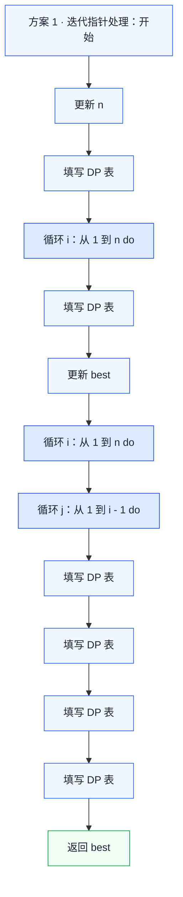

```lua
-- LeetCode 300. 最长递增子序列 — Lua 版（方案1）
local function length_of_lis(nums) -- local function length_of_lis(数组)
	local n = #nums -- 把 #数组 写入 local n
	local dp = {} -- 把 {} 写入 local dp
	for i = 1, n do
		dp[i] = 1
	end -- 让 下标 i 从 1 走到 元素个数（Lua 1 基）
	local best = 0 -- 把 0 写入 local best
	for i = 1, n do -- 让 下标 i 从 1 走到 元素个数（Lua 1 基）
		for j = 1, i - 1 do -- 让 下标 j 从 1 走到 下标 i（Lua 1 基）
			if nums[j] < nums[i] and dp[j] + 1 > dp[i] then
				dp[i] = dp[j] + 1
			end
		end -- 终点
		if dp[i] > best then
			best = dp[i]
		end -- 若 DP 表[下标 i] 超过 当前最优 then 当前最优 赋值为 DP 表[下标 i] 终点
	end -- 终点
	return best -- 返回 当前最优
end -- 终点
assert(length_of_lis({ 10, 9, 2, 5, 3, 7, 101, 18 }) == 4) -- 断言校验
assert(length_of_lis({ 0, 1, 0, 3, 2, 3 }) == 4) -- 断言校验
assert(length_of_lis({ 7, 7, 7, 7 }) == 1) -- 断言校验
print("PASS") -- 全部用例通过，输出 PASS
```

#### 方案 2：方案2（动态规划 + 二分查找 O(n log n)）

**思路与代码分析**：核心是「方案2（动态规划 + 二分查找 O(n log n)）」。Lua 版用表与 ipairs 遍历，注意 ipairs 遇 nil 即停的语义。代码里依次做这些事：DP 表逐项填充。**走读**：方案 2 · 方案2（动态规划 + 二分查找 O(n log n)）：开始 → 更新 n → 填写 DP 表 → 循环 i：从 1 到 n do → 填写 DP 表 → 更新 best → 循环 i：从 1 到 n do → 循环 j：从 1 到 i - 1 do → 填写 DP 表 → 填写 DP 表 → 填写 DP 表 → 填写 DP 表 → 返回 best。

**运行架构**（真实控制流）：

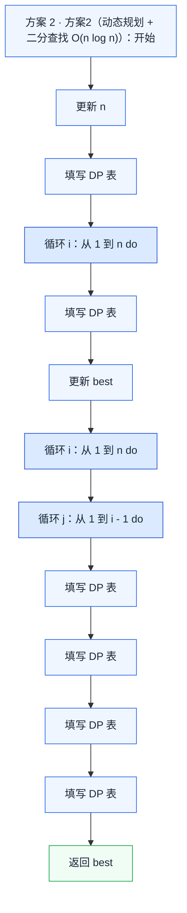

```lua
-- LeetCode 300. 最长递增子序列 — Lua 版（方案2）
local function length_of_lis(nums) -- local function length_of_lis(数组)
	local n = #nums -- 把 #数组 写入 local n
	local dp = {} -- 把 {} 写入 local dp
	for i = 1, n do
		dp[i] = 1
	end -- 让 下标 i 从 1 走到 元素个数（Lua 1 基）
	local best = 0 -- 把 0 写入 local best
	for i = 1, n do -- 让 下标 i 从 1 走到 元素个数（Lua 1 基）
		for j = 1, i - 1 do -- 让 下标 j 从 1 走到 下标 i（Lua 1 基）
			if nums[j] < nums[i] and dp[j] + 1 > dp[i] then
				dp[i] = dp[j] + 1
			end
		end -- 终点
		if dp[i] > best then
			best = dp[i]
		end -- 若 DP 表[下标 i] 超过 当前最优 then 当前最优 赋值为 DP 表[下标 i] 终点
	end -- 终点
	return best -- 返回 当前最优
end -- 终点
assert(length_of_lis({ 10, 9, 2, 5, 3, 7, 101, 18 }) == 4) -- 断言校验
assert(length_of_lis({ 0, 1, 0, 3, 2, 3 }) == 4) -- 断言校验
assert(length_of_lis({ 7, 7, 7, 7 }) == 1) -- 断言校验
print("PASS") -- 全部用例通过，输出 PASS
```

### C 实现（2 种方案）

C 的全部方案如下，每个方案都内嵌用例自测，可独立运行（老仓库 python/go 文件遵循「打印结果」约定）：

#### 方案 1：迭代指针处理

**思路与代码分析**：核心是「迭代指针处理」。C 版手动管理下标与内存，循环边界全部显式写出。代码里依次做这些事：DP 表逐项填充；双重循环遍历。**走读**：方案 1 · 迭代指针处理：开始 → 填写 DP 表 → 遍历循环 → 填写 DP 表 → 遍历循环 → 若 n[j] ＜ n[i] 且 dp[j] + 1 ＞ dp[i]：填写 DP 表 → 填写 DP 表 → 若 dp[i] ＞ best：填写 DP 表 → 填写 DP 表 → 返回 best。

**运行架构**（真实控制流）：

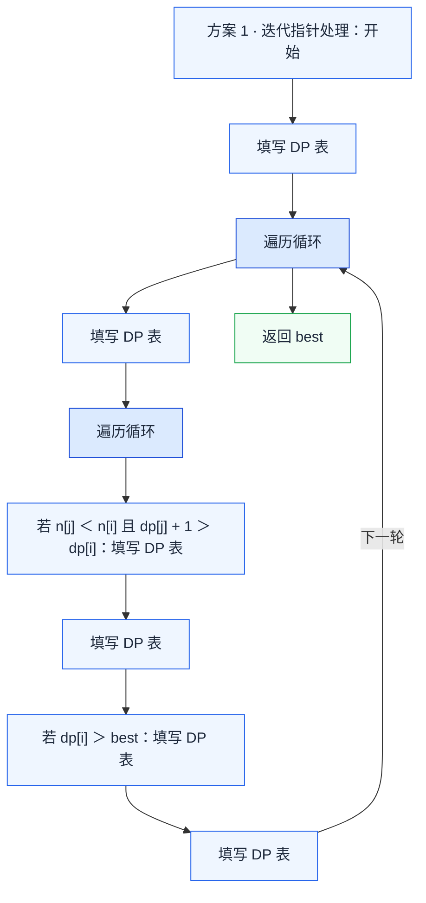

```c
/* LeetCode 300. 最长递增子序列 — C 版（方案1） */
#include <stdio.h>                                // 引入头文件
static int length_of_lis(const int *n, int len) { // 定义函数/方法 length_of_lis
    int dp[4096], best = 0;                       // 把 0; 写入 int dp[4096], best
    for (int i = 0; i < len; i++) { // 让 下标 i 从 0 开始计数，下标 i 小于 长度 就继续
        dp[i] = 1;                  // 把 1; 写入 dp[i]
        for (int j = 0; j < i; j++) // 让 下标 j 从 0 开始计数，下标 j 小于 下标 i 就继续
            if (n[j] < n[i] && dp[j] + 1 > dp[i])
                dp[i] = dp[j] + 1;
        if (dp[i] > best)
            best = dp[i]; // 若 DP 表[下标 i] 超过 当前最优) 当前最优 赋值为 DP 表[下标 i];
    }
    return best; // 返回 当前最优
}
int main(void) { // 程序入口：跑内嵌自测用例
    if (length_of_lis((int[]){10, 9, 2, 5, 3, 7, 101, 18}, 8) != 4) {
        printf("FAIL 1\n");
        return 1;
    }
    if (length_of_lis((int[]){0, 1, 0, 3, 2, 3}, 6) != 4) {
        printf("FAIL 2\n");
        return 1;
    }
    if (length_of_lis((int[]){7, 7, 7, 7}, 4) != 1) {
        printf("FAIL 3\n");
        return 1;
    }
    printf("PASS\n");
    return 0;
} // 全部用例通过，输出 PASS
```

#### 方案 2：方案2（动态规划 + 二分查找 O(n log n)）

**思路与代码分析**：核心是「方案2（动态规划 + 二分查找 O(n log n)）」。C 版手动管理下标与内存，循环边界全部显式写出。代码里依次做这些事：DP 表逐项填充；双重循环遍历。**走读**：方案 2 · 方案2（动态规划 + 二分查找 O(n log n)）：开始 → 填写 DP 表 → 遍历循环 → 填写 DP 表 → 遍历循环 → 若 n[j] ＜ n[i] 且 dp[j] + 1 ＞ dp[i]：填写 DP 表 → 填写 DP 表 → 若 dp[i] ＞ best：填写 DP 表 → 填写 DP 表 → 返回 best。

**运行架构**（真实控制流）：

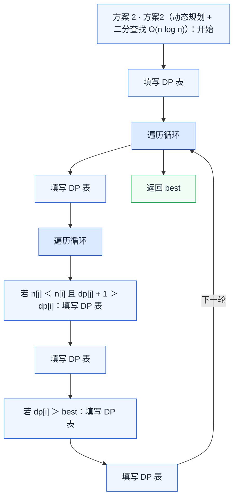

```c
/* LeetCode 300. 最长递增子序列 — C 版（方案2） */
#include <stdio.h>                                // 引入头文件
static int length_of_lis(const int *n, int len) { // 定义函数/方法 length_of_lis
    int dp[4096], best = 0;                       // 把 0; 写入 int dp[4096], best
    for (int i = 0; i < len; i++) { // 让 下标 i 从 0 开始计数，下标 i 小于 长度 就继续
        dp[i] = 1;                  // 把 1; 写入 dp[i]
        for (int j = 0; j < i; j++) // 让 下标 j 从 0 开始计数，下标 j 小于 下标 i 就继续
            if (n[j] < n[i] && dp[j] + 1 > dp[i])
                dp[i] = dp[j] + 1;
        if (dp[i] > best)
            best = dp[i]; // 若 DP 表[下标 i] 超过 当前最优) 当前最优 赋值为 DP 表[下标 i];
    }
    return best; // 返回 当前最优
}
int main(void) { // 程序入口：跑内嵌自测用例
    if (length_of_lis((int[]){10, 9, 2, 5, 3, 7, 101, 18}, 8) != 4) {
        printf("FAIL 1\n");
        return 1;
    }
    if (length_of_lis((int[]){0, 1, 0, 3, 2, 3}, 6) != 4) {
        printf("FAIL 2\n");
        return 1;
    }
    if (length_of_lis((int[]){7, 7, 7, 7}, 4) != 1) {
        printf("FAIL 3\n");
        return 1;
    }
    printf("PASS\n");
    return 0;
} // 全部用例通过，输出 PASS
```

### C++ 实现（2 种方案）

C++ 的全部方案如下，每个方案都内嵌用例自测，可独立运行（老仓库 python/go 文件遵循「打印结果」约定）：

#### 方案 1：迭代指针处理

**思路与代码分析**：核心是「迭代指针处理」。C++ 版用 STL 容器与迭代器，减少手写下标错误。代码里依次做这些事：DP 表逐项填充；双重循环遍历。**走读**：方案 1 · 迭代指针处理：开始 → 处理 std::vector＜int＞ dp(nums.siz → 更新 best → 遍历循环 → 遍历循环 → 若 nums[j] ＜ nums[i]：填写 DP 表 → 填写 DP 表 → 填写 DP 表 → 返回 best。

**运行架构**（真实控制流）：

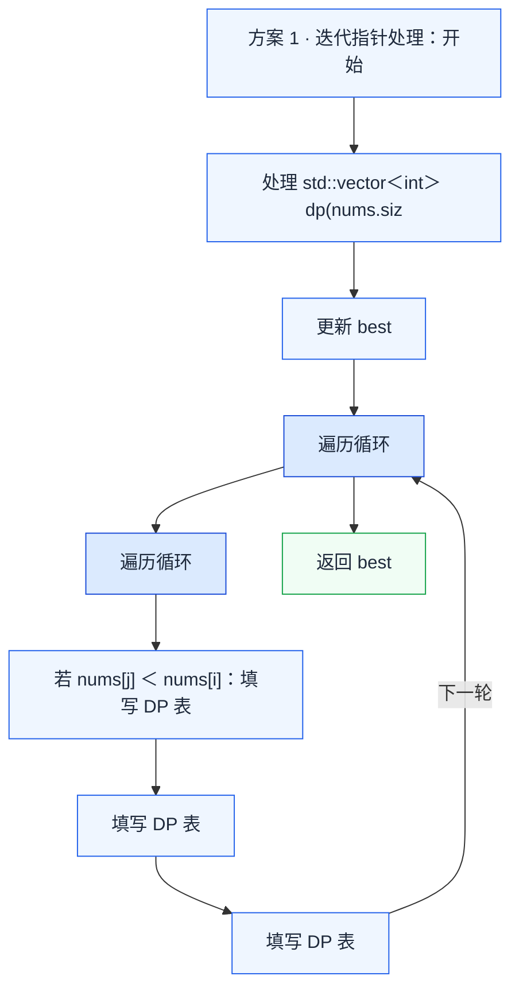

```cpp
// LeetCode 300. 最长递增子序列 — C++ 版（方案1）
#include <algorithm>                                   // 引入头文件
#include <cassert>                                     // 引入头文件
#include <iostream>                                    // 引入头文件
#include <vector>                                      // 引入头文件
static int lengthOfLIS(const std::vector<int> &nums) { // 定义函数/方法 lengthOfLIS
    std::vector<int> dp(nums.size(), 1); // std::vector 小于 int 超过 DP 表(数组.大小(), 1);
    int best = 0;                        // 把 0 存入 当前最优
    for (size_t i = 0; i < nums.size(); ++i) { // 让 下标 i 从 0 开始计数，下标 i 小于 数组.大小() 就继续
        for (size_t j = 0; j < i; ++j) // 让 下标 j 从 0 开始计数，下标 j 小于 下标 i 就继续
            if (nums[j] < nums[i])
                dp[i] = std::max(dp[i], dp[j] + 1);
        best = std::max(best, dp[i]); // 把 std::取较大值 当前最优, DP 表[下标 i]); 写入 当前最优
    }
    return best; // 返回 当前最优
}
int main() {
    assert(lengthOfLIS({10, 9, 2, 5, 3, 7, 101, 18}) == 4);
    assert(lengthOfLIS({0, 1, 0, 3, 2, 3}) == 4);
    assert(lengthOfLIS({7, 7, 7, 7}) == 1);
    std::cout << "PASS" << std::endl;
} // 全部用例通过，输出 PASS
```

#### 方案 2：方案2（动态规划 + 二分查找 O(n log n)）

**思路与代码分析**：核心是「方案2（动态规划 + 二分查找 O(n log n)）」。C++ 版用 STL 容器与迭代器，减少手写下标错误。代码里依次做这些事：DP 表逐项填充；双重循环遍历。**走读**：方案 2 · 方案2（动态规划 + 二分查找 O(n log n)）：开始 → 处理 std::vector＜int＞ dp(nums.siz → 更新 best → 遍历循环 → 遍历循环 → 若 nums[j] ＜ nums[i]：填写 DP 表 → 填写 DP 表 → 填写 DP 表 → 返回 best。

**运行架构**（真实控制流）：

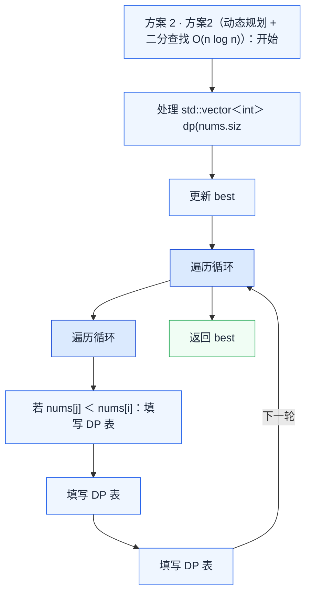

```cpp
// LeetCode 300. 最长递增子序列 — C++ 版（方案2）
#include <algorithm>                                   // 引入头文件
#include <cassert>                                     // 引入头文件
#include <iostream>                                    // 引入头文件
#include <vector>                                      // 引入头文件
static int lengthOfLIS(const std::vector<int> &nums) { // 定义函数/方法 lengthOfLIS
    std::vector<int> dp(nums.size(), 1); // std::vector 小于 int 超过 DP 表(数组.大小(), 1);
    int best = 0;                        // 把 0 存入 当前最优
    for (size_t i = 0; i < nums.size(); ++i) { // 让 下标 i 从 0 开始计数，下标 i 小于 数组.大小() 就继续
        for (size_t j = 0; j < i; ++j) // 让 下标 j 从 0 开始计数，下标 j 小于 下标 i 就继续
            if (nums[j] < nums[i])
                dp[i] = std::max(dp[i], dp[j] + 1);
        best = std::max(best, dp[i]); // 把 std::取较大值 当前最优, DP 表[下标 i]); 写入 当前最优
    }
    return best; // 返回 当前最优
}
int main() {
    assert(lengthOfLIS({10, 9, 2, 5, 3, 7, 101, 18}) == 4);
    assert(lengthOfLIS({0, 1, 0, 3, 2, 3}) == 4);
    assert(lengthOfLIS({7, 7, 7, 7}) == 1);
    std::cout << "PASS" << std::endl;
} // 全部用例通过，输出 PASS
```

### R 实现（2 种方案）

R 的全部方案如下，每个方案都内嵌用例自测，可独立运行（老仓库 python/go 文件遵循「打印结果」约定）：

#### 方案 1：迭代指针处理

**思路与代码分析**：核心是「迭代指针处理」。R 版用向量化思维与 1 起始下标，注意 1:n 的降序陷阱。代码里依次做这些事：DP 表逐项填充；双重循环遍历。**走读**：方案 1 · 迭代指针处理：开始 → 处理 n ＜- length(nums) → 处理 dp ＜- rep(1L, n) → 处理 best ＜- 0L → 循环 i：遍历 seq_len(n) → 循环 j：遍历 seq_len(i - 1) → 若 nums[j] ＜ nums[i] 且 dp[j] + 1L ＞ dp[i]：填写 DP 表 → 填写 DP 表 → 若 dp[i] ＞ best：填写 DP 表 → 填写 DP 表 → 处理 best → 返回结果。

**运行架构**（真实控制流）：

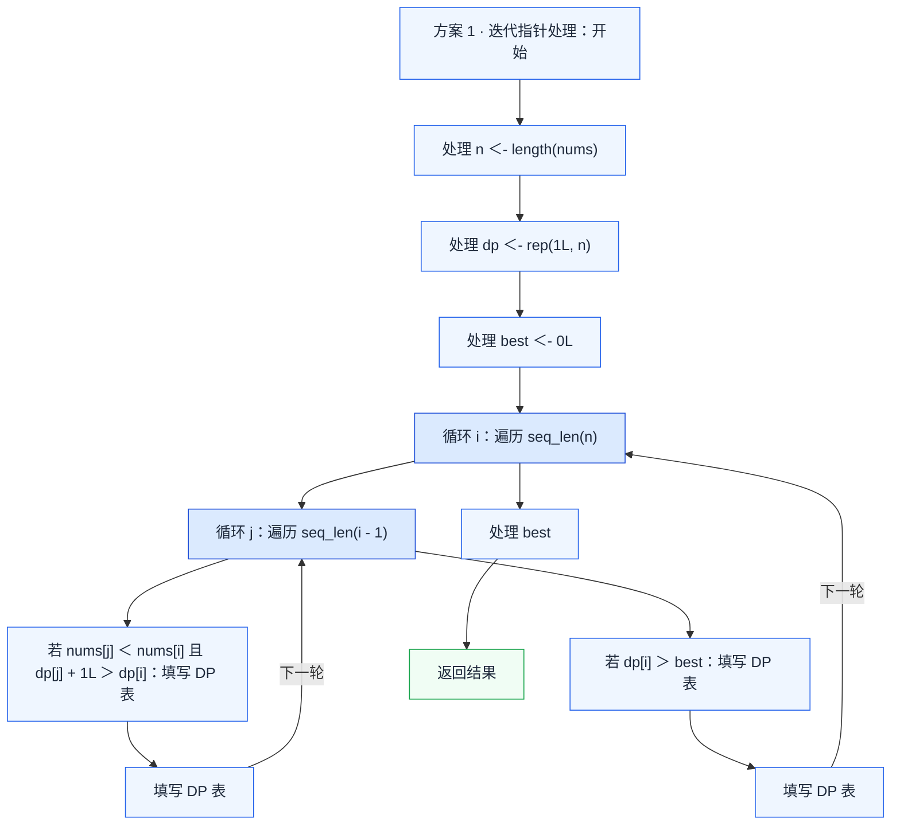

```r
# 版（方案1） 定义函数 length_of_lis（参数：数组）
length_of_lis <- function(nums) {
    n <- length(nums)  # 把 长度(数组) 存入 元素个数
    dp <- rep(1L, n)  # 把 rep(1L, 元素个数) 存入 DP 表
    best <- 0L  # 把 0L 存入 当前最优
    for (i in seq_len(n)) {
        # for (下标 i in seq_len(元素个数)) { for (下标 j in seq_len(下标 i 减 1)) {
        for (j in seq_len(i - 1)) {
            if (nums[j] < nums[i] && dp[j] + 1L > dp[i])
                dp[i] <- dp[j] + 1L
        }
        if (dp[i] > best)
            best <- dp[i]  # 若 DP 表[下标 i] 超过 当前最优) 当前最优 小于 减 DP 表[下标 i]
    }
    best  # 当前最优
}
stopifnot(length_of_lis(c(10, 9, 2, 5, 3, 7, 101, 18)) == 4)  # 断言校验
stopifnot(length_of_lis(c(0, 1, 0, 3, 2, 3)) == 4)  # 断言校验
stopifnot(length_of_lis(c(7, 7, 7, 7)) == 1)  # 断言校验
cat("PASS\n")  # 全部用例通过，输出 PASS
```

#### 方案 2：方案2（动态规划 + 二分查找 O(n log n)）

**思路与代码分析**：核心是「方案2（动态规划 + 二分查找 O(n log n)）」。R 版用向量化思维与 1 起始下标，注意 1:n 的降序陷阱。代码里依次做这些事：DP 表逐项填充；双重循环遍历。**走读**：方案 2 · 方案2（动态规划 + 二分查找 O(n log n)）：开始 → 处理 n ＜- length(nums) → 处理 dp ＜- rep(1L, n) → 处理 best ＜- 0L → 循环 i：遍历 seq_len(n) → 循环 j：遍历 seq_len(i - 1) → 若 nums[j] ＜ nums[i] 且 dp[j] + 1L ＞ dp[i]：填写 DP 表 → 填写 DP 表 → 若 dp[i] ＞ best：填写 DP 表 → 填写 DP 表 → 处理 best → 返回结果。

**运行架构**（真实控制流）：

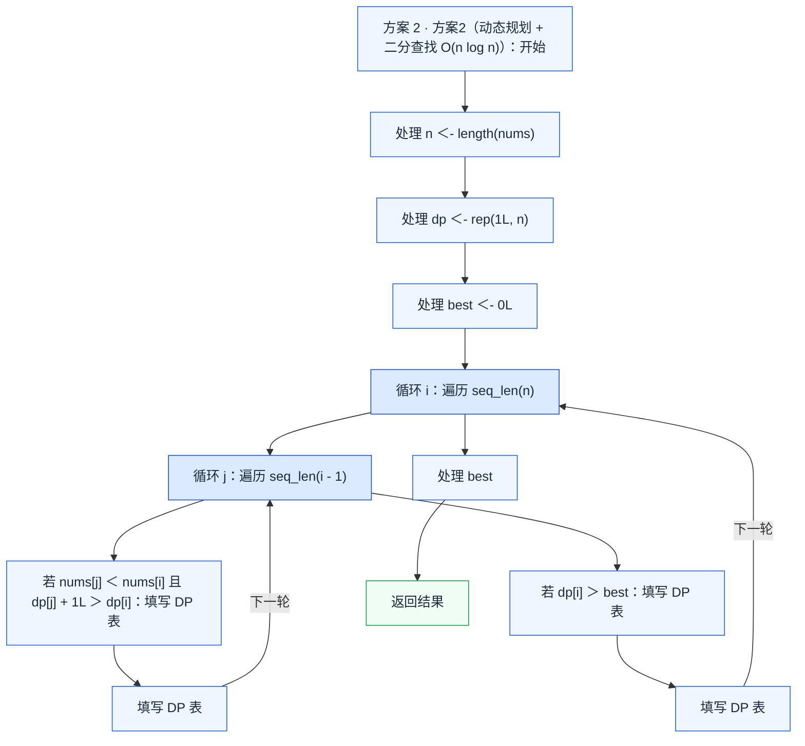

```r
# 版（方案2） 定义函数 length_of_lis（参数：数组）
length_of_lis <- function(nums) {
    n <- length(nums)  # 把 长度(数组) 存入 元素个数
    dp <- rep(1L, n)  # 把 rep(1L, 元素个数) 存入 DP 表
    best <- 0L  # 把 0L 存入 当前最优
    for (i in seq_len(n)) {
        # for (下标 i in seq_len(元素个数)) { for (下标 j in seq_len(下标 i 减 1)) {
        for (j in seq_len(i - 1)) {
            if (nums[j] < nums[i] && dp[j] + 1L > dp[i])
                dp[i] <- dp[j] + 1L
        }
        if (dp[i] > best)
            best <- dp[i]  # 若 DP 表[下标 i] 超过 当前最优) 当前最优 小于 减 DP 表[下标 i]
    }
    best  # 当前最优
}
stopifnot(length_of_lis(c(10, 9, 2, 5, 3, 7, 101, 18)) == 4)  # 断言校验
stopifnot(length_of_lis(c(0, 1, 0, 3, 2, 3)) == 4)  # 断言校验
stopifnot(length_of_lis(c(7, 7, 7, 7)) == 1)  # 断言校验
cat("PASS\n")  # 全部用例通过，输出 PASS
```

### Zig 实现（2 种方案）

Zig 的全部方案如下，每个方案都内嵌用例自测，可独立运行（老仓库 python/go 文件遵循「打印结果」约定）：

#### 方案 1：迭代指针处理

**思路与代码分析**：核心是「迭代指针处理」。Zig 版显式分配与清零，整型边界处理严格。代码里依次做这些事：DP 表逐项填充；双重循环遍历。**走读**：方案 1 · 迭代指针处理：开始 → 计算 dp → 计算 best → 遍历集合元素 → 填写 DP 表 → 遍历集合元素 → 若 nums[j] ＜ nums[i] and dp[j] + 1 ＞ dp[i]：填写 DP 表 → 若 dp[i] ＞ best：填写 DP 表 → 返回 best。

**运行架构**（真实控制流）：

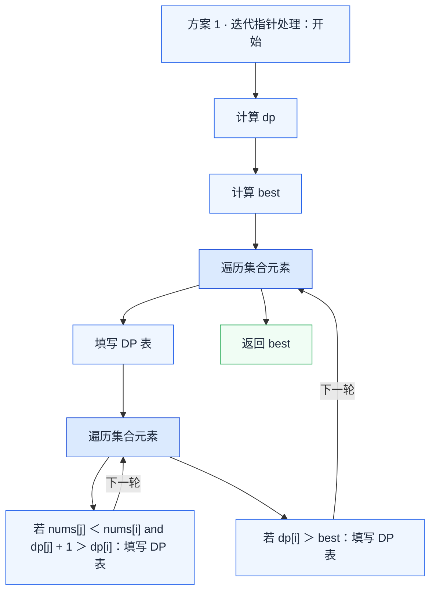

```zig
// LeetCode 300. 最长递增子序列 — Zig 版（方案1）
const std = @import("std"); // 把 @import(「std」) 存入 std
fn lengthOfLIS(nums: []const i32) i32 { // 定义函数/方法 lengthOfLIS
    var dp: [4096]i32 = undefined; // 把 undefined; 写入 var dp: [4096]i32
    var best: i32 = 0; // 把 0; 写入 var best: i32
    for (0..nums.len) |i| { // 逐个取出 0..数组.长度 的元素（下标 i）
        dp[i] = 1; // 把 1; 写入 dp[i]
        for (0..i) |j| { // 让 下标 j 从 0 走到 下标 i 减一
            if (nums[j] < nums[i] and dp[j] + 1 > dp[i]) dp[i] = dp[j] + 1;
        }
        if (dp[i] > best) best = dp[i]; // 若 DP 表[下标 i] 超过 当前最优) 当前最优 赋值为 DP 表[下标 i];
    }
    return best; // 返回 当前最优
}
pub fn main() !void { // 程序入口：跑内嵌自测用例
    if (lengthOfLIS(&[_]i32{ 10, 9, 2, 5, 3, 7, 101, 18 }) != 4) return error.TestFailed;
    if (lengthOfLIS(&[_]i32{ 0, 1, 0, 3, 2, 3 }) != 4) return error.TestFailed;
    if (lengthOfLIS(&[_]i32{ 7, 7, 7, 7 }) != 1) return error.TestFailed;
    std.debug.print("PASS\n", .{});
} // 全部用例通过，输出 PASS
```

#### 方案 2：方案2（动态规划 + 二分查找 O(n log n)）

**思路与代码分析**：核心是「方案2（动态规划 + 二分查找 O(n log n)）」。Zig 版显式分配与清零，整型边界处理严格。代码里依次做这些事：DP 表逐项填充；双重循环遍历。**走读**：方案 2 · 方案2（动态规划 + 二分查找 O(n log n)）：开始 → 计算 dp → 计算 best → 遍历集合元素 → 填写 DP 表 → 遍历集合元素 → 若 nums[j] ＜ nums[i] and dp[j] + 1 ＞ dp[i]：填写 DP 表 → 若 dp[i] ＞ best：填写 DP 表 → 返回 best。

**运行架构**（真实控制流）：

```mermaid
graph TD
    N0["方案 2 · 方案2（动态规划 + 二分查找 O(n log n)）：开始"]
    N1["计算 dp"]
    N2["计算 best"]
    N3["遍历集合元素"]
    N4["填写 DP 表"]
    N5["遍历集合元素"]
    N6["若 nums[j] ＜ nums[i] and dp[j] + 1 ＞ dp[i]：填写 DP 表"]
    N7["若 dp[i] ＞ best：填写 DP 表"]
    N8["返回 best"]
    N0 --> N1
    N1 --> N2
    N2 --> N3
    N3 --> N4
    N4 --> N5
    N5 --> N6
    N6 -- 下一轮 --> N5
    N5 --> N7
    N7 -- 下一轮 --> N3
    N3 --> N8
    classDef n fill:#eff6ff,stroke:#2563eb,color:#1e293b;
    classDef lp fill:#dbeafe,stroke:#1d4ed8,color:#1e293b;
    classDef dc fill:#fef9c3,stroke:#ca8a04,color:#1e293b;
    classDef tm fill:#f0fdf4,stroke:#16a34a,color:#1e293b;
    class N0,N1,N2,N4,N6,N7 n;
    class N3,N5 lp;
    class N8 tm;
```

```zig
// LeetCode 300. 最长递增子序列 — Zig 版（方案2）
const std = @import("std"); // 把 @import(「std」) 存入 std
fn lengthOfLIS(nums: []const i32) i32 { // 定义函数/方法 lengthOfLIS
    var dp: [4096]i32 = undefined; // 把 undefined; 写入 var dp: [4096]i32
    var best: i32 = 0; // 把 0; 写入 var best: i32
    for (0..nums.len) |i| { // 逐个取出 0..数组.长度 的元素（下标 i）
        dp[i] = 1; // 把 1; 写入 dp[i]
        for (0..i) |j| { // 让 下标 j 从 0 走到 下标 i 减一
            if (nums[j] < nums[i] and dp[j] + 1 > dp[i]) dp[i] = dp[j] + 1;
        }
        if (dp[i] > best) best = dp[i]; // 若 DP 表[下标 i] 超过 当前最优) 当前最优 赋值为 DP 表[下标 i];
    }
    return best; // 返回 当前最优
}
pub fn main() !void { // 程序入口：跑内嵌自测用例
    if (lengthOfLIS(&[_]i32{ 10, 9, 2, 5, 3, 7, 101, 18 }) != 4) return error.TestFailed;
    if (lengthOfLIS(&[_]i32{ 0, 1, 0, 3, 2, 3 }) != 4) return error.TestFailed;
    if (lengthOfLIS(&[_]i32{ 7, 7, 7, 7 }) != 1) return error.TestFailed;
    std.debug.print("PASS\n", .{});
} // 全部用例通过，输出 PASS
```

### Dart 实现（2 种方案）

Dart 的全部方案如下，每个方案都内嵌用例自测，可独立运行（老仓库 python/go 文件遵循「打印结果」约定）：

#### 方案 1：迭代指针处理

**思路与代码分析**：核心是「迭代指针处理」。Dart 版用可空类型标注与集合方法，注意空安全。代码里依次做这些事：DP 表逐项填充；双重循环遍历。**走读**：方案 1 · 迭代指针处理：开始 → 更新 n → 填写 DP 表 → 处理 n, → 处理 1, → 处理 ) → 计算 best → 遍历循环 → 遍历循环 → 若 nums[j] ＜ nums[i] 且 dp[j] + 1 ＞ dp[i]：填写 DP 表 → 若 dp[i] ＞ best：填写 DP 表 → 填写 DP 表 → 返回 best。

**运行架构**（真实控制流）：

```mermaid
graph TD
    N0["方案 1 · 迭代指针处理：开始"]
    N1["更新 n"]
    N2["填写 DP 表"]
    N3["处理 n,"]
    N4["处理 1,"]
    N5["处理 )"]
    N6["计算 best"]
    N7["遍历循环"]
    N8["遍历循环"]
    N9["若 nums[j] ＜ nums[i] 且 dp[j] + 1 ＞ dp[i]：填写 DP 表"]
    N10["若 dp[i] ＞ best：填写 DP 表"]
    N11["填写 DP 表"]
    N12["返回 best"]
    N0 --> N1
    N1 --> N2
    N2 --> N3
    N3 --> N4
    N4 --> N5
    N5 --> N6
    N6 --> N7
    N7 --> N8
    N8 --> N9
    N9 -- 下一轮 --> N8
    N8 --> N10
    N10 --> N11
    N11 -- 下一轮 --> N7
    N7 --> N12
    classDef n fill:#eff6ff,stroke:#2563eb,color:#1e293b;
    classDef lp fill:#dbeafe,stroke:#1d4ed8,color:#1e293b;
    classDef dc fill:#fef9c3,stroke:#ca8a04,color:#1e293b;
    classDef tm fill:#f0fdf4,stroke:#16a34a,color:#1e293b;
    class N0,N1,N2,N3,N4,N5,N6,N9,N10,N11 n;
    class N7,N8 lp;
    class N12 tm;
```

```dart
// LeetCode 300. 最长递增子序列 — Dart 版（方案1）
int lengthOfLIS(List<int> nums) {
  // 定义函数/方法 lengthOfLIS
  final n = nums.length; // 把 数组.长度 存入 元素个数
  final dp = List<int>.filled(
    n,
    1,
  ); // 把 List 小于 int 超过 .filled(元素个数, 1) 存入 DP 表
  var best = 0; // 把 0 存入 当前最优
  for (var i = 0; i < n; i++) {
    // 让 下标 i 从 0 开始计数，下标 i 小于 元素个数 就继续
    for (var j = 0; j < i; j++) {
      // 让 下标 j 从 0 开始计数，下标 j 小于 下标 i 就继续
      if (nums[j] < nums[i] && dp[j] + 1 > dp[i]) dp[i] = dp[j] + 1;
    }
    if (dp[i] > best)
      best = dp[i]; // 若 DP 表[下标 i] 超过 当前最优) 当前最优 赋值为 DP 表[下标 i];
  }
  return best; // 返回 当前最优
}

void main() {
  if (lengthOfLIS([10, 9, 2, 5, 3, 7, 101, 18]) != 4) throw StateError('c1');
  if (lengthOfLIS([0, 1, 0, 3, 2, 3]) != 4) throw StateError('c2');
  if (lengthOfLIS([7, 7, 7, 7]) != 1) throw StateError('c3');
  print('PASS');
} // 全部用例通过，输出 PASS
```

#### 方案 2：方案2（动态规划 + 二分查找 O(n log n)）

**思路与代码分析**：核心是「方案2（动态规划 + 二分查找 O(n log n)）」。Dart 版用可空类型标注与集合方法，注意空安全。代码里依次做这些事：DP 表逐项填充；双重循环遍历。**走读**：方案 2 · 方案2（动态规划 + 二分查找 O(n log n)）：开始 → 更新 n → 填写 DP 表 → 处理 n, → 处理 1, → 处理 ) → 计算 best → 遍历循环 → 遍历循环 → 若 nums[j] ＜ nums[i] 且 dp[j] + 1 ＞ dp[i]：填写 DP 表 → 若 dp[i] ＞ best：填写 DP 表 → 填写 DP 表 → 返回 best。

**运行架构**（真实控制流）：

```mermaid
graph TD
    N0["方案 2 · 方案2（动态规划 + 二分查找 O(n log n)）：开始"]
    N1["更新 n"]
    N2["填写 DP 表"]
    N3["处理 n,"]
    N4["处理 1,"]
    N5["处理 )"]
    N6["计算 best"]
    N7["遍历循环"]
    N8["遍历循环"]
    N9["若 nums[j] ＜ nums[i] 且 dp[j] + 1 ＞ dp[i]：填写 DP 表"]
    N10["若 dp[i] ＞ best：填写 DP 表"]
    N11["填写 DP 表"]
    N12["返回 best"]
    N0 --> N1
    N1 --> N2
    N2 --> N3
    N3 --> N4
    N4 --> N5
    N5 --> N6
    N6 --> N7
    N7 --> N8
    N8 --> N9
    N9 -- 下一轮 --> N8
    N8 --> N10
    N10 --> N11
    N11 -- 下一轮 --> N7
    N7 --> N12
    classDef n fill:#eff6ff,stroke:#2563eb,color:#1e293b;
    classDef lp fill:#dbeafe,stroke:#1d4ed8,color:#1e293b;
    classDef dc fill:#fef9c3,stroke:#ca8a04,color:#1e293b;
    classDef tm fill:#f0fdf4,stroke:#16a34a,color:#1e293b;
    class N0,N1,N2,N3,N4,N5,N6,N9,N10,N11 n;
    class N7,N8 lp;
    class N12 tm;
```

```dart
// LeetCode 300. 最长递增子序列 — Dart 版（方案2）
int lengthOfLIS(List<int> nums) {
  // 定义函数/方法 lengthOfLIS
  final n = nums.length; // 把 数组.长度 存入 元素个数
  final dp = List<int>.filled(
    n,
    1,
  ); // 把 List 小于 int 超过 .filled(元素个数, 1) 存入 DP 表
  var best = 0; // 把 0 存入 当前最优
  for (var i = 0; i < n; i++) {
    // 让 下标 i 从 0 开始计数，下标 i 小于 元素个数 就继续
    for (var j = 0; j < i; j++) {
      // 让 下标 j 从 0 开始计数，下标 j 小于 下标 i 就继续
      if (nums[j] < nums[i] && dp[j] + 1 > dp[i]) dp[i] = dp[j] + 1;
    }
    if (dp[i] > best)
      best = dp[i]; // 若 DP 表[下标 i] 超过 当前最优) 当前最优 赋值为 DP 表[下标 i];
  }
  return best; // 返回 当前最优
}

void main() {
  if (lengthOfLIS([10, 9, 2, 5, 3, 7, 101, 18]) != 4) throw StateError('c1');
  if (lengthOfLIS([0, 1, 0, 3, 2, 3]) != 4) throw StateError('c2');
  if (lengthOfLIS([7, 7, 7, 7]) != 1) throw StateError('c3');
  print('PASS');
} // 全部用例通过，输出 PASS
```

---

## 内容总结

- **最长递增子序列**（动态规划 · Medium）：共 2 个方案，主线思路「迭代指针处理」；时间 O(n)（单趟线性扫描）；动画演示DP 表填充过程，附录给出 11 种语言 × 全部方案的可运行实现。
- 来源博客：[https://blog.csdn.net/tyro_java/article/details/144823912](https://blog.csdn.net/tyro_java/article/details/144823912)
- 导航：[📋 总目录](../) ｜ [← 174 打家劫舍 ii](../174_打家劫舍_ii/) ｜ [176 最长的严格递增或递减子数组 →](../176_最长的严格递增或递减子数组/)
