# 176 · 最长的严格递增或递减子数组（第十阶段 · 动态规划 · Medium）

> **难度**：⭐⭐ Medium ｜ **专题**：动态规划
> **学习定位**：第十阶段 · 动态规划第 176 篇 ｜ **解法数**：3
> **内容总结**：**最长的严格递增或递减子数组**（动态规划 · Medium）：共 3 个方案，主线思路「迭代指针处理」；时间 O(n)（单趟线性扫描）；动画演示DP 表填充过程，附录给出 11 种语言 × 全部方案的可运行实现。

---

## 题目描述

给你一个整数数组 `nums` 。

返回数组 `nums` 中 严格递增 或 严格递减 的最长非空子数组的长度。

- 主函数签名：`function treeToLevel(root: any): any[]`

**用例（来自原题）**：

**示例 1**

**示例 2**

**示例 3**
> 题面与 [leetcode.cn 官方](https://leetcode.cn/problems/longest-strictly-increasing-or-strictly-decreasing-subarray/)一致，示例配图取自官方题面。

**数据范围与注意事项**：

- `1 <= nums.length <= 50`
- `1 <= nums[i] <= 50`
- **易错点**：初始化（第 0 行或列）的含义要想清楚，它决定后续转移是否成立。

## 题目分析

**场景是什么**：把大问题拆成小问题并记住结果，对应真实开发里的编辑距离、资源规划。本题就是该场景的 Medium 级练习，主线做法是「迭代指针处理」。

**主线怎么解**：把主解法从头到尾过一遍，它其实在依次做这几件事：队列或堆的调度。

## 解题思路

**方案对比**（共 3 个方案，由浅入深）：

| 方案 | 时间复杂度 | 空间复杂度 |
|---|---|---|
| 方案 1 · 迭代指针处理 | O(n)（单趟线性扫描） | O(1) 到 O(n)（视辅助结构） |
| 方案 2 · 直接实现 | O(n) 量级 | O(n) |
| 方案 3 · 迭代指针处理 | O(n)（单趟线性扫描） | O(1) 到 O(n)（视辅助结构） |

**由浅入深的路径**：迭代指针处理 → 直接实现；每往右一步，都在补上一步的短板。

**方案间的取舍**：方案 1（迭代指针处理）；方案 2（直接实现）；方案 3（迭代指针处理）。数据规模小、可读性优先时选靠前的方案；规模大、性能优先时选靠后的方案。

**怎么读这一篇**：

- 🐣 **新手路线**：把「题目描述」的示例 1 在纸上手推一遍 → 读方案 1（最直观的写法）与它的代码走读 → 按「运行方式」本地跑通看 PASS → 回头对比方案 2 之后的写法差在哪
- 🦅 **大佬路线**：直接锁定最优方案 1（迭代指针处理，O(n)（单趟线性扫描））→ 跳读该方案代码与走读 → 用「逐步拆解与面试追问」补齐复杂度推导与边界追问

### 动态算法图（DP 表填充，GIF 自动循环）


动画演示动态规划专题里DP 表填充的典型过程；每个方案在「TypeScript 解题方案」一节还配了专属动画与专属流程图。

### 主解法流程图（真实控制流）

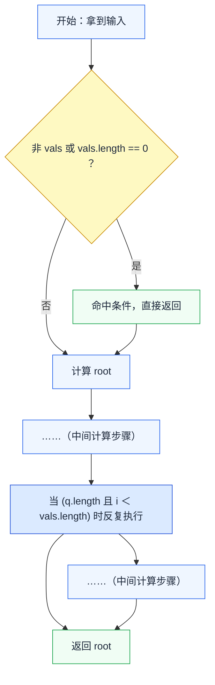

## TypeScript 解题方案（3 个方案逐个讲）

> **运行与提交**：每个方案都是自包含文件（内嵌用例自测，输出 PASS），整块复制到 `.ts` 文件后 `node 文件名` 即可运行。提交 LeetCode 时，把 `demo` 内的算法函数与辅助类型/函数整体取出、置于文件顶层即可。涉及交互/特殊接口的题以题面给定签名为准。

### 方案 1：迭代指针处理

**分析与思路**：核心做法是「迭代指针处理」。代码里依次做这些事：队列或堆的调度。

**运行方式**：`node 本文件`，内嵌用例全部通过会输出 PASS。


**方案专属流程图**（真实控制流）：

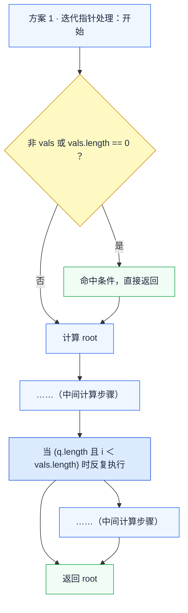

```typescript
class TreeNode {
  // 定义类型
  val: any;
  left: any;
  right: any; // 值: any; 左边界: any; 右边界: any;
  constructor(val?: any, left?: any, right?: any) {
    // constructor(值?: any, 左边界?: any, 右边界?: any) {
    this.val = val === undefined ? 0 : val; // 把 (值 全等于 undefined ? 0 : 值); 写入 值
    this.left = left === undefined ? null : left; // 把 (左边界 全等于 undefined ? null : 左边界); 写入 左边界
    this.right = right === undefined ? null : right; // 把 (右边界 全等于 undefined ? null : 右边界); 写入 右边界
  }
}
function buildTree(vals: any): any {
  // 定义函数/方法 buildTree
  if (!vals || vals.length === 0) return null; // 若 取反 vals 或 vals.长度 全等于 0，直接返回 null
  const root = new TreeNode(vals[0]);
  const q: any[] = [root];
  let i = 1;
  while (q.length && i < vals.length) {
    // 循环，直到不满足「节点.长度 且 下标 i 小于 vals.长度」
    const node = q.shift(); // 把 节点.shift() 存入 节点
    if (vals[i] !== null && vals[i] !== undefined) {
      node.left = new TreeNode(vals[i]);
      q.push(node.left);
    }
    i++; // 下标 i 加一
    if (i < vals.length && vals[i] !== null && vals[i] !== undefined) {
      node.right = new TreeNode(vals[i]);
      q.push(node.right);
    }
    i++; // 下标 i 加一
  }
  return root; // 返回 根节点
}
function treeToLevel(root: any): any[] {
  // 定义函数/方法 treeToLevel
  if (!root) return []; // 若 取反 根节点，直接返回 []
  const out: any[] = [];
  const q: any[] = [root]; // 把 []; const 节点: any[] 赋值为 [根节点]; 写入 const out: any[]
  while (q.length) {
    // 循环，直到不满足「节点.长度」
    const n = q.shift(); // 把 节点.shift() 存入 元素个数
    if (n === null || n === undefined) {
      out.push(null);
      continue;
    }
    out.push(n.val);
    q.push(n.left);
    q.push(n.right); // 把 元素个数.值 压入栈/数组尾部
  }
  while (out.length && out[out.length - 1] === null) out.pop(); // 循环，直到不满足「out.长度 且 out[out.长度 减 1] 全等于 null) out 弹出 );」
  return out; // 返回 out
}
class ListNode {
  // 定义类型
  val: any;
  next: any; // 值: any; 下一个: any;
  constructor(val?: any, next?: any) {
    this.val = val === undefined ? 0 : val;
    this.next = next === undefined ? null : next;
  }
}
function buildList(vals: any): any {
  // 定义函数/方法 buildList
  const dummy = new ListNode(0);
  let cur = dummy; // 把 new ListNode(0); let 当前值 赋值为 哨兵节点 存入 哨兵节点
  for (const v of vals) {
    cur.next = new ListNode(v);
    cur = cur.next;
  } // 把 new ListNode(值); 当前值 赋值为 当前值.下一个; } 写入 下一个
  return dummy.next; // 返回 哨兵节点.下一个
}
function listToArray(head: any): any[] {
  // 定义函数/方法 listToArray
  const out: any[] = [];
  let p = head; // 把 []; let 节点 赋值为 头节点; 写入 const out: any[]
  while (p) {
    out.push(p.val);
    p = p.next;
  } // 循环，直到不满足「节点) { out 追加 节点.值); 节点 赋值为 节点.下一个; }」
  return out; // 返回 out
}
// python-runtime shims
function pyLen(a: any): number {
  // 定义函数/方法 pyLen
  if (a === null || a === undefined) return 0; // 若 数组 全等于 null 或 数组 全等于 undefined，直接返回 0
  if (
    typeof a === 'string' ||
    Array.isArray(a) ||
    a instanceof Set ||
    a instanceof Map
  )
    return a.length ?? a.size;
  if (typeof a === 'object') return Object.keys(a).length; // 若 typeof 数组 全等于 'object'，直接返回 Object.keys(数组).长度
  return 0; // 返回 0
}
function pySlice(a: any, i: any, j: any, step?: any): any {
  // 定义函数/方法 pySlice
  if (typeof a === 'string') {
    const r = [...a].slice(i ?? 0, j ?? a.length);
    return step ? r.reverse().join('') : r.join('');
  }
  const arr = Array.isArray(a) ? a : [...a]; // 把 Array.isArray(数组) ? 数组 : 复制的 数组 存入 数组
  return arr.slice(i ?? 0, j ?? arr.length); // 返回 数组 截取 下标 i ?? 0, 下标 j ?? 数组.长度)
}
function pyRange(a: any, b?: any, step?: any): any[] {
  // 定义函数/方法 pyRange
  let s = 0,
    e = a,
    st = 1; // 把 0, e 赋值为 数组, st 赋值为 1 存入 字符串
  if (b !== undefined) {
    s = a;
    e = b;
  } // 若 b 不等于 undefined) { 字符串 赋值为 数组; e 赋值为 b; }
  if (step !== undefined) st = step; // 若 步数 不等于 undefined) st 赋值为 步数;
  const out: any[] = []; // 把 []; 写入 const out: any[]
  if (st > 0) for (let i = s; i < e; i += st) out.push(i);
  else for (let i = s; i > e; i += st) out.push(i); // 否则
  return out; // 返回 out
}
function pyIn(x: any, coll: any): boolean {
  // 定义函数/方法 pyIn
  if (coll === null || coll === undefined) return false; // 若 coll 全等于 null 或 coll 全等于 undefined，直接返回 false
  if (Array.isArray(coll)) return coll.includes(x); // 若 Array.isArray(coll)，直接返回 coll 是否包含 x)
  if (coll instanceof Set || coll instanceof Map) return coll.has(x); // 若 coll instanceof Set 或 coll instanceof Map，直接返回 coll.has(x)
  if (typeof coll === 'object') return x in coll; // 若 typeof coll 全等于 'object'，直接返回 x in coll
  if (typeof coll === 'string') return coll.indexOf(x) >= 0; // 若 typeof coll 全等于 'string'，直接返回 coll 查找 x) 不低于 0
  return false; // 返回 false
}
function pySorted(a: any): any[] {
  // 定义函数/方法 pySorted
  const arr = typeof a === 'string' ? [...a] : [...a]; // 把 (typeof 数组 全等于 'string') ? 复制的 数组 : 复制的 数组 存入 数组
  return arr.sort((x: any, y: any) => (x < y ? -1 : x > y ? 1 : 0));
}
function pyMin(a: any, b?: any): any {
  if (b !== undefined) return Math.min(a, b);
  if (Array.isArray(a) || a instanceof Set) return Math.min(...a);
  return Math.min(a);
} // 定义函数/方法 pyMin
function pyMax(a: any, b?: any): any {
  if (b !== undefined) return Math.max(a, b);
  if (Array.isArray(a) || a instanceof Set) return Math.max(...a);
  return Math.max(a);
} // 定义函数/方法 pyMax
function pySum(a: any): number {
  let s = 0;
  for (const v of a) s += v;
  return s;
} // 定义函数/方法 pySum
function pyAbs(x: any): number {
  return Math.abs(x);
} // 定义函数/方法 pyAbs
function pyEnumerate(a: any): any[] {
  const out: any[] = [];
  let i = 0;
  for (const v of a) {
    out.push([i, v]);
    i++;
  }
  return out;
} // 定义函数/方法 pyEnumerate
function pyZip(a: any, b: any): any[] {
  const n = Math.min(a.length, b.length);
  const out: any[] = [];
  for (let i = 0; i < n; i++) out.push([a[i], b[i]]);
  return out;
} // 定义函数/方法 pyZip
function pyDictGet(d: any, k: any, def?: any): any {
  return k in d ? d[k] : def === undefined ? null : def;
} // 定义函数/方法 pyDictGet
function pyPrint(...args: any[]): void {
  console.log(
    args
      .map((a) => (typeof a === 'object' && a !== null ? JSON.stringify(a) : a))
      .join(' '),
  );
} // 定义函数/方法 pyPrint
// collections / heapq
function heapPush(h: any[], x: any): void {
  h.push(x);
  let i = h.length - 1;
  while (i > 0) {
    const p = (i - 1) >> 1;
    if (h[p] <= h[i]) break;
    [h[p], h[i]] = [h[i], h[p]];
    i = p;
  }
} // 定义函数/方法 heapPush
function heapPop(h: any[]): any {
  const top = h[0];
  const last = h.pop();
  if (h.length) {
    h[0] = last;
    let i = 0;
    const n = h.length;
    while (true) {
      let l = 2 * i + 1,
        r = 2 * i + 2,
        s = i;
      if (l < n && h[l] < h[s]) s = l;
      if (r < n && h[r] < h[s]) s = r;
      if (s === i) break;
      [h[s], h[i]] = [h[i], h[s]];
      i = s;
    }
  }
  return top;
} // 定义函数/方法 heapPop
class Deque {
  private a: any[] = [];
  push(x: any) {
    this.a.push(x);
  }
  pushLeft(x: any) {
    this.a.unshift(x);
  }
  pop() {
    return this.a.pop();
  }
  popLeft() {
    return this.a.shift();
  }
  get length() {
    return this.a.length;
  }
  toArray() {
    return this.a.slice();
  }
} // 定义类型
function Counter(iter: any): any {
  const m: any = {};
  for (const v of iter) m[v] = (m[v] || 0) + 1;
  return m;
} // 定义函数/方法 Counter
function gcd(a: any, b: any): any {
  while (b) {
    [a, b] = [b, a % b];
  }
  return a;
} // 定义函数/方法 gcd
function pyInf(): number {
  return Infinity;
} // 定义函数/方法 pyInf

function norm(x: any): any {
  // 定义函数/方法 norm
  if (x === null || x === undefined) return null; // 若 x 全等于 null 或 x 全等于 undefined，直接返回 null
  if (typeof x === 'object') {
    // 若 typeof x 全等于 'object'
    if (x instanceof Deque) return x.toArray(); // 若 x instanceof Deque，直接返回 x.toArray()
    if (Array.isArray(x)) return x.map(norm); // 若 Array.isArray(x)，直接返回 x.映射表(norm)
    if (
      typeof x.val === 'number' &&
      (typeof x.left !== 'undefined' || typeof x.right !== 'undefined')
    )
      return treeToLevel(x);
    if (typeof x.next !== 'undefined' && typeof x.val === 'number')
      return listToArray(x);
    if (x instanceof Set) return [...x].sort(); // 若 x instanceof Set，直接返回 复制的 x 排序 )
    if (x instanceof Map) return Object.fromEntries(x); // 若 x instanceof Map，直接返回 Object.fromEntries(x)
    const o: any = {};
    for (const k of Object.keys(x)) o[k] = norm(x[k]);
    return o;
  }
  return x; // 返回 x
}
function eq(a: any, b: any): boolean {
  // 定义函数/方法 eq
  const x = norm(a),
    y = norm(b); // 把 norm(数组), y 赋值为 norm(b) 存入 x
  if (x === y) return true; // 若 x 全等于 y，直接返回 true
  if (x === null || y === null) return x === y; // 若 x 全等于 null 或 y 全等于 null，直接返回 x 全等于 y
  if (Array.isArray(x) && Array.isArray(y)) {
    // 若 Array.isArray(x) 且 Array.isArray(y
    if (x.length !== y.length) return false; // 若 x.长度 不等于 y.长度，直接返回 false
    for (let i = 0; i < x.length; i++) if (!eq(x[i], y[i])) return false; // 让 下标 i 从 0 开始计数，下标 i 小于 x.长度 就继续
    return true; // 返回 true
  }
  if (typeof x === 'object' && typeof y === 'object') {
    // 若 typeof x 全等于 'object' 且 typeof y 全等于 'object'
    const kx = Object.keys(x),
      ky = Object.keys(y); // 把 Object.keys(x), ky 赋值为 Object.keys(y) 存入 kx
    if (kx.length !== ky.length) return false; // 若 kx.长度 不等于 ky.长度，直接返回 false
    for (const k of kx) if (!eq(x[k], y[k])) return false;
    return true; // 返回 true
  }
  return x === y; // 返回 x 全等于 y
}

function longestMonotonic(nums) {
  // 定义函数/方法 longestMonotonic
  if (nums.length <= 1) return nums.length; // 若 数组.长度 不超过 1，直接返回 数组.长度
  let ans = 1,
    inc = 1,
    dec = 1; // 把 1, inc 赋值为 1, dec 赋值为 1 存入 答案
  for (let i = 1; i < nums.length; i++) {
    // 让 下标 i 从 1 开始计数，下标 i 小于 数组.长度 就继续
    if (nums[i] > nums[i - 1]) {
      inc++;
      dec = 1;
    } // 若 数组[下标 i] 超过 数组[下标 i 减 1]) { inc 加一 ; dec 赋值为 1; }
    else if (nums[i] < nums[i - 1]) {
      dec++;
      inc = 1;
    } // 否则，若 数组[下标 i] 小于 数组[下标 i 减 1]) { dec 加一 ; inc 赋值为 1; }
    else {
      inc = 1;
      dec = 1;
    } // 否则
    ans = Math.max(ans, inc, dec); // 把 Math.取较大值 答案, inc, dec) 存入 答案
  }
  return ans; // 返回 答案
}
export function demo(): void {
  // 程序入口：跑内嵌自测用例
  const cases = [
    { in: [[1, 2, 3, 4, 5]], want: 5 },
    { in: [[5, 4, 3, 2, 1]], want: 5 },
    { in: [[1, 3, 2, 4, 5]], want: 3 },
    { in: [[1]], want: 1 },
  ];
  let fail = false; // 把 false 存入 fail
  for (const c of cases) {
    // for (const 字符 of cases) {
    const got = longestMonotonic(...c.in); // 把 longestMonotonic(...字符.in) 存入 got
    if (!eq(got, c.want)) {
      fail = true;
      console.log(
        'FAIL',
        JSON.stringify(c.in),
        '=>',
        JSON.stringify(got),
        'want',
        JSON.stringify(c.want),
      );
    }
  }
  if (fail) throw new Error('FAILED'); // 若 fail) throw new Error('FAILED');
  console.log('PASS'); // 全部用例通过，输出 PASS
}
demo(); // demo();
```

### 方案 2：直接实现

**分析与思路**：核心做法是「直接实现」。

**运行方式**：`node 本文件`，内嵌用例全部通过会输出 PASS。


**方案专属流程图**（真实控制流）：

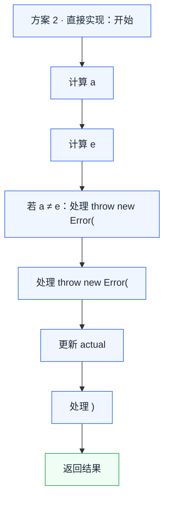

```typescript
function assertEq(actual: any, expected: any, msg: string = ''): void {
  // 定义函数/方法 assertEq
  const a = JSON.stringify(actual);
  const e = JSON.stringify(expected);
  if (a !== e)
    throw new Error(
      'ASSERT FAILED ' + msg + ' :: actual=' + a + ' expected=' + e,
    );
}

function longestMonotonicSubarray(nums: number[]): number {
  // 定义函数/方法 longestMonotonicSubarray
  if (!nums.length) return 0; // 若 取反 数组.长度，直接返回 0
  const n = nums.length;
  let ans = 1;
  let i = 0; // 把 数组.长度; let 答案 赋值为 1; let 下标 i 赋值为 0 存入 元素个数
  while (i < n) {
    // 循环，直到不满足「下标 i 小于 元素个数」
    let j = i; // 把 下标 i 存入 下标 j
    while (j + 1 < n && nums[j + 1] > nums[j]) j++;
    ans = Math.max(ans, j - i + 1); // 把 Math.取较大值 答案, 下标 j 减 下标 i 加 1) 存入 答案
    j = i; // 把 下标 i 存入 下标 j
    while (j + 1 < n && nums[j + 1] < nums[j]) j++;
    ans = Math.max(ans, j - i + 1); // 把 Math.取较大值 答案, 下标 j 减 下标 i 加 1) 存入 答案
    i++; // 下标 i 加一
  }
  return ans; // 返回 答案
}
export function demo(): void {
  // 程序入口：跑内嵌自测用例
  assertEq(longestMonotonicSubarray([1, 4, 3, 3, 2]), 2, 'lms'); // 断言校验
  assertEq(longestMonotonicSubarray([]), 0, 'empty'); // 断言校验
  assertEq(longestMonotonicSubarray([1, 2, 3, 4]), 4, 'inc'); // 断言校验
  console.log('PASS'); // 全部用例通过，输出 PASS
}
demo(); // demo();
```

### 方案 3：迭代指针处理

**分析与思路**：核心做法是「迭代指针处理」。代码里依次做这些事：队列或堆的调度。

**运行方式**：`node 本文件`，内嵌用例全部通过会输出 PASS。


**方案专属流程图**（真实控制流）：


```typescript
class TreeNode {
  // 定义类型
  val: any;
  left: any;
  right: any; // 值: any; 左边界: any; 右边界: any;
  constructor(val?: any, left?: any, right?: any) {
    // constructor(值?: any, 左边界?: any, 右边界?: any) {
    this.val = val === undefined ? 0 : val; // 把 (值 全等于 undefined ? 0 : 值); 写入 值
    this.left = left === undefined ? null : left; // 把 (左边界 全等于 undefined ? null : 左边界); 写入 左边界
    this.right = right === undefined ? null : right; // 把 (右边界 全等于 undefined ? null : 右边界); 写入 右边界
  }
}
function buildTree(vals: any): any {
  // 定义函数/方法 buildTree
  if (!vals || vals.length === 0) return null; // 若 取反 vals 或 vals.长度 全等于 0，直接返回 null
  const root = new TreeNode(vals[0]);
  const q: any[] = [root];
  let i = 1;
  while (q.length && i < vals.length) {
    // 循环，直到不满足「节点.长度 且 下标 i 小于 vals.长度」
    const node = q.shift(); // 把 节点.shift() 存入 节点
    if (vals[i] !== null && vals[i] !== undefined) {
      node.left = new TreeNode(vals[i]);
      q.push(node.left);
    }
    i++; // 下标 i 加一
    if (i < vals.length && vals[i] !== null && vals[i] !== undefined) {
      node.right = new TreeNode(vals[i]);
      q.push(node.right);
    }
    i++; // 下标 i 加一
  }
  return root; // 返回 根节点
}
function treeToLevel(root: any): any[] {
  // 定义函数/方法 treeToLevel
  if (!root) return []; // 若 取反 根节点，直接返回 []
  const out: any[] = [];
  const q: any[] = [root]; // 把 []; const 节点: any[] 赋值为 [根节点]; 写入 const out: any[]
  while (q.length) {
    // 循环，直到不满足「节点.长度」
    const n = q.shift(); // 把 节点.shift() 存入 元素个数
    if (n === null || n === undefined) {
      out.push(null);
      continue;
    }
    out.push(n.val);
    q.push(n.left);
    q.push(n.right); // 把 元素个数.值 压入栈/数组尾部
  }
  while (out.length && out[out.length - 1] === null) out.pop(); // 循环，直到不满足「out.长度 且 out[out.长度 减 1] 全等于 null) out 弹出 );」
  return out; // 返回 out
}
class ListNode {
  // 定义类型
  val: any;
  next: any; // 值: any; 下一个: any;
  constructor(val?: any, next?: any) {
    this.val = val === undefined ? 0 : val;
    this.next = next === undefined ? null : next;
  }
}
function buildList(vals: any): any {
  // 定义函数/方法 buildList
  const dummy = new ListNode(0);
  let cur = dummy; // 把 new ListNode(0); let 当前值 赋值为 哨兵节点 存入 哨兵节点
  for (const v of vals) {
    cur.next = new ListNode(v);
    cur = cur.next;
  } // 把 new ListNode(值); 当前值 赋值为 当前值.下一个; } 写入 下一个
  return dummy.next; // 返回 哨兵节点.下一个
}
function listToArray(head: any): any[] {
  // 定义函数/方法 listToArray
  const out: any[] = [];
  let p = head; // 把 []; let 节点 赋值为 头节点; 写入 const out: any[]
  while (p) {
    out.push(p.val);
    p = p.next;
  } // 循环，直到不满足「节点) { out 追加 节点.值); 节点 赋值为 节点.下一个; }」
  return out; // 返回 out
}
// python-runtime shims
function pyLen(a: any): number {
  // 定义函数/方法 pyLen
  if (a === null || a === undefined) return 0; // 若 数组 全等于 null 或 数组 全等于 undefined，直接返回 0
  if (
    typeof a === 'string' ||
    Array.isArray(a) ||
    a instanceof Set ||
    a instanceof Map
  )
    return a.length ?? a.size;
  if (typeof a === 'object') return Object.keys(a).length; // 若 typeof 数组 全等于 'object'，直接返回 Object.keys(数组).长度
  return 0; // 返回 0
}
function pySlice(a: any, i: any, j: any, step?: any): any {
  // 定义函数/方法 pySlice
  if (typeof a === 'string') {
    const r = [...a].slice(i ?? 0, j ?? a.length);
    return step ? r.reverse().join('') : r.join('');
  }
  const arr = Array.isArray(a) ? a : [...a]; // 把 Array.isArray(数组) ? 数组 : 复制的 数组 存入 数组
  return arr.slice(i ?? 0, j ?? arr.length); // 返回 数组 截取 下标 i ?? 0, 下标 j ?? 数组.长度)
}
function pyRange(a: any, b?: any, step?: any): any[] {
  // 定义函数/方法 pyRange
  let s = 0,
    e = a,
    st = 1; // 把 0, e 赋值为 数组, st 赋值为 1 存入 字符串
  if (b !== undefined) {
    s = a;
    e = b;
  } // 若 b 不等于 undefined) { 字符串 赋值为 数组; e 赋值为 b; }
  if (step !== undefined) st = step; // 若 步数 不等于 undefined) st 赋值为 步数;
  const out: any[] = []; // 把 []; 写入 const out: any[]
  if (st > 0) for (let i = s; i < e; i += st) out.push(i);
  else for (let i = s; i > e; i += st) out.push(i); // 否则
  return out; // 返回 out
}
function pyIn(x: any, coll: any): boolean {
  // 定义函数/方法 pyIn
  if (coll === null || coll === undefined) return false; // 若 coll 全等于 null 或 coll 全等于 undefined，直接返回 false
  if (Array.isArray(coll)) return coll.includes(x); // 若 Array.isArray(coll)，直接返回 coll 是否包含 x)
  if (coll instanceof Set || coll instanceof Map) return coll.has(x); // 若 coll instanceof Set 或 coll instanceof Map，直接返回 coll.has(x)
  if (typeof coll === 'object') return x in coll; // 若 typeof coll 全等于 'object'，直接返回 x in coll
  if (typeof coll === 'string') return coll.indexOf(x) >= 0; // 若 typeof coll 全等于 'string'，直接返回 coll 查找 x) 不低于 0
  return false; // 返回 false
}
function pySorted(a: any): any[] {
  // 定义函数/方法 pySorted
  const arr = typeof a === 'string' ? [...a] : [...a]; // 把 (typeof 数组 全等于 'string') ? 复制的 数组 : 复制的 数组 存入 数组
  return arr.sort((x: any, y: any) => (x < y ? -1 : x > y ? 1 : 0));
}
function pyMin(a: any, b?: any): any {
  if (b !== undefined) return Math.min(a, b);
  if (Array.isArray(a) || a instanceof Set) return Math.min(...a);
  return Math.min(a);
} // 定义函数/方法 pyMin
function pyMax(a: any, b?: any): any {
  if (b !== undefined) return Math.max(a, b);
  if (Array.isArray(a) || a instanceof Set) return Math.max(...a);
  return Math.max(a);
} // 定义函数/方法 pyMax
function pySum(a: any): number {
  let s = 0;
  for (const v of a) s += v;
  return s;
} // 定义函数/方法 pySum
function pyAbs(x: any): number {
  return Math.abs(x);
} // 定义函数/方法 pyAbs
function pyEnumerate(a: any): any[] {
  const out: any[] = [];
  let i = 0;
  for (const v of a) {
    out.push([i, v]);
    i++;
  }
  return out;
} // 定义函数/方法 pyEnumerate
function pyZip(a: any, b: any): any[] {
  const n = Math.min(a.length, b.length);
  const out: any[] = [];
  for (let i = 0; i < n; i++) out.push([a[i], b[i]]);
  return out;
} // 定义函数/方法 pyZip
function pyDictGet(d: any, k: any, def?: any): any {
  return k in d ? d[k] : def === undefined ? null : def;
} // 定义函数/方法 pyDictGet
function pyPrint(...args: any[]): void {
  console.log(
    args
      .map((a) => (typeof a === 'object' && a !== null ? JSON.stringify(a) : a))
      .join(' '),
  );
} // 定义函数/方法 pyPrint
// collections / heapq
function heapPush(h: any[], x: any): void {
  h.push(x);
  let i = h.length - 1;
  while (i > 0) {
    const p = (i - 1) >> 1;
    if (h[p] <= h[i]) break;
    [h[p], h[i]] = [h[i], h[p]];
    i = p;
  }
} // 定义函数/方法 heapPush
function heapPop(h: any[]): any {
  const top = h[0];
  const last = h.pop();
  if (h.length) {
    h[0] = last;
    let i = 0;
    const n = h.length;
    while (true) {
      let l = 2 * i + 1,
        r = 2 * i + 2,
        s = i;
      if (l < n && h[l] < h[s]) s = l;
      if (r < n && h[r] < h[s]) s = r;
      if (s === i) break;
      [h[s], h[i]] = [h[i], h[s]];
      i = s;
    }
  }
  return top;
} // 定义函数/方法 heapPop
class Deque {
  private a: any[] = [];
  push(x: any) {
    this.a.push(x);
  }
  pushLeft(x: any) {
    this.a.unshift(x);
  }
  pop() {
    return this.a.pop();
  }
  popLeft() {
    return this.a.shift();
  }
  get length() {
    return this.a.length;
  }
  toArray() {
    return this.a.slice();
  }
} // 定义类型
function Counter(iter: any): any {
  const m: any = {};
  for (const v of iter) m[v] = (m[v] || 0) + 1;
  return m;
} // 定义函数/方法 Counter
function gcd(a: any, b: any): any {
  while (b) {
    [a, b] = [b, a % b];
  }
  return a;
} // 定义函数/方法 gcd
function pyInf(): number {
  return Infinity;
} // 定义函数/方法 pyInf

function norm(x: any): any {
  // 定义函数/方法 norm
  if (x === null || x === undefined) return null; // 若 x 全等于 null 或 x 全等于 undefined，直接返回 null
  if (typeof x === 'object') {
    // 若 typeof x 全等于 'object'
    if (x instanceof Deque) return x.toArray(); // 若 x instanceof Deque，直接返回 x.toArray()
    if (Array.isArray(x)) return x.map(norm); // 若 Array.isArray(x)，直接返回 x.映射表(norm)
    if (
      typeof x.val === 'number' &&
      (typeof x.left !== 'undefined' || typeof x.right !== 'undefined')
    )
      return treeToLevel(x);
    if (typeof x.next !== 'undefined' && typeof x.val === 'number')
      return listToArray(x);
    if (x instanceof Set) return [...x].sort(); // 若 x instanceof Set，直接返回 复制的 x 排序 )
    if (x instanceof Map) return Object.fromEntries(x); // 若 x instanceof Map，直接返回 Object.fromEntries(x)
    const o: any = {};
    for (const k of Object.keys(x)) o[k] = norm(x[k]);
    return o;
  }
  return x; // 返回 x
}
function eq(a: any, b: any): boolean {
  // 定义函数/方法 eq
  const x = norm(a),
    y = norm(b); // 把 norm(数组), y 赋值为 norm(b) 存入 x
  if (x === y) return true; // 若 x 全等于 y，直接返回 true
  if (x === null || y === null) return x === y; // 若 x 全等于 null 或 y 全等于 null，直接返回 x 全等于 y
  if (Array.isArray(x) && Array.isArray(y)) {
    // 若 Array.isArray(x) 且 Array.isArray(y
    if (x.length !== y.length) return false; // 若 x.长度 不等于 y.长度，直接返回 false
    for (let i = 0; i < x.length; i++) if (!eq(x[i], y[i])) return false; // 让 下标 i 从 0 开始计数，下标 i 小于 x.长度 就继续
    return true; // 返回 true
  }
  if (typeof x === 'object' && typeof y === 'object') {
    // 若 typeof x 全等于 'object' 且 typeof y 全等于 'object'
    const kx = Object.keys(x),
      ky = Object.keys(y); // 把 Object.keys(x), ky 赋值为 Object.keys(y) 存入 kx
    if (kx.length !== ky.length) return false; // 若 kx.长度 不等于 ky.长度，直接返回 false
    for (const k of kx) if (!eq(x[k], y[k])) return false;
    return true; // 返回 true
  }
  return x === y; // 返回 x 全等于 y
}

function longestMonotonic(nums) {
  // 定义函数/方法 longestMonotonic
  if (nums.length <= 1) return nums.length; // 若 数组.长度 不超过 1，直接返回 数组.长度
  let ans = 1,
    inc = 1,
    dec = 1; // 把 1, inc 赋值为 1, dec 赋值为 1 存入 答案
  for (let i = 1; i < nums.length; i++) {
    // 让 下标 i 从 1 开始计数，下标 i 小于 数组.长度 就继续
    if (nums[i] > nums[i - 1]) {
      inc++;
      dec = 1;
    } // 若 数组[下标 i] 超过 数组[下标 i 减 1]) { inc 加一 ; dec 赋值为 1; }
    else if (nums[i] < nums[i - 1]) {
      dec++;
      inc = 1;
    } // 否则，若 数组[下标 i] 小于 数组[下标 i 减 1]) { dec 加一 ; inc 赋值为 1; }
    else {
      inc = 1;
      dec = 1;
    } // 否则
    ans = Math.max(ans, inc, dec); // 把 Math.取较大值 答案, inc, dec) 存入 答案
  }
  return ans; // 返回 答案
}
export function demo(): void {
  // 程序入口：跑内嵌自测用例
  const cases = [
    { in: [[1, 2, 3, 4, 5]], want: 5 },
    { in: [[5, 4, 3, 2, 1]], want: 5 },
    { in: [[1, 3, 2, 4, 5]], want: 3 },
    { in: [[1]], want: 1 },
  ];
  let fail = false; // 把 false 存入 fail
  for (const c of cases) {
    // for (const 字符 of cases) {
    const got = longestMonotonic(...c.in); // 把 longestMonotonic(...字符.in) 存入 got
    if (!eq(got, c.want)) {
      fail = true;
      console.log(
        'FAIL',
        JSON.stringify(c.in),
        '=>',
        JSON.stringify(got),
        'want',
        JSON.stringify(c.want),
      );
    }
  }
  if (fail) throw new Error('FAILED'); // 若 fail) throw new Error('FAILED');
  console.log('PASS'); // 全部用例通过，输出 PASS
}
demo(); // demo();
```

## 逐步拆解与面试追问

**复杂度**：时间 O(n)（单趟线性扫描），空间 O(1) 到 O(n)（视辅助结构）

**为什么是这个量级**：每个元素被常数次访问，辅助哈希或栈的开销与 n 同阶

**面试官可能会追问**：

- 状态定义为什么是它？
- 遍历顺序由什么决定？
- 能否滚动数组压空间？

## 关键 API 速查（TS 主解法实际用到，附官方链接）

| API | 作用 | 使用要点 | 官方文档 |
|---|---|---|---|
| `Array.prototype.sort()` | 原地排序 | 默认按字符串 Unicode 序（10 会排在 2 前），数字必须传 (a,b)=>a-b；V8 用 TimSort，稳定，O(n log n)；返回原数组引用 | [官方文档](https://developer.mozilla.org/zh-CN/docs/Web/JavaScript/Reference/Global_Objects/Array/sort) |
| `Array.prototype.map()` | 逐元素映射为新数组 | 回调 (v,i,arr)；返回等长新数组，不改变原数组；稀疏位跳过；链式调用注意中间数组开销 | [官方文档](https://developer.mozilla.org/zh-CN/docs/Web/JavaScript/Reference/Global_Objects/Array/map) |
| `Array.prototype.push()` | 尾部追加 | 返回新长度；可一次多个；均摊 O(1)；会改变原数组 | [官方文档](https://developer.mozilla.org/zh-CN/docs/Web/JavaScript/Reference/Global_Objects/Array/push) |
| `Array.prototype.pop()` | 尾部弹出 | 返回被删元素（空数组返回 undefined）；O(1) | [官方文档](https://developer.mozilla.org/zh-CN/docs/Web/JavaScript/Reference/Global_Objects/Array/pop) |
| `Array.prototype.shift()` | 头部取出 | O(n)（后续元素整体前移）；大量头部操作请用链表或双端结构 | [官方文档](https://developer.mozilla.org/zh-CN/docs/Web/JavaScript/Reference/Global_Objects/Array/shift) |
| `Array.prototype.unshift()` | 头部插入 | O(n)；与 shift 组合可当双端队列 | [官方文档](https://developer.mozilla.org/zh-CN/docs/Web/JavaScript/Reference/Global_Objects/Array/unshift) |
| `Array/String includes()` | 是否包含 | 数组用 SameValueZero（NaN 可判）；字符串按子串；第二个参数为起始下标 | [官方文档](https://developer.mozilla.org/zh-CN/docs/Web/JavaScript/Reference/Global_Objects/Array/includes) |
| `Array/String indexOf()` | 首次出现的下标 | 找不到返回 -1；无法判 NaN（用 includes）；字符串可传起始位 | [官方文档](https://developer.mozilla.org/zh-CN/docs/Web/JavaScript/Reference/Global_Objects/Array/indexOf) |
| `Array/String slice()` | 切片（不改原数组） | slice(start,end) 含头不含尾；负数从尾计；常用于复制数组（slice()） | [官方文档](https://developer.mozilla.org/zh-CN/docs/Web/JavaScript/Reference/Global_Objects/Array/slice) |
| `Array.prototype.join()` | 数组拼接为字符串 | undefined/null 转空串；嵌套数组会展平一层；join('') 用于字符数组还原 | [官方文档](https://developer.mozilla.org/zh-CN/docs/Web/JavaScript/Reference/Global_Objects/Array/join) |
| `Object.keys()` | 对象键名数组 | 仅自身可枚举字符串键（不含 symbol）；配 length 可当计数器 | [官方文档](https://developer.mozilla.org/zh-CN/docs/Web/JavaScript/Reference/Global_Objects/Object/keys) |
| `Object.fromEntries()` | 键值对数组转对象 | 参数为 [k,v] 可迭代；map 出来的键值对可直接转对象 | [官方文档](https://developer.mozilla.org/zh-CN/docs/Web/JavaScript/Reference/Global_Objects/Object/fromEntries) |
| `JSON.stringify()` | 序列化为 JSON 字符串 | 常用于结构化比较（深度相等判定）；undefined/函数/循环引用会被丢弃或抛错 | [官方文档](https://developer.mozilla.org/zh-CN/docs/Web/JavaScript/Reference/Global_Objects/JSON/stringify) |
| `Math.max()` | 最大值 | 配展开 Math.max(...arr)；空参返回 -Infinity；超大数组注意展开参数上限 | [官方文档](https://developer.mozilla.org/zh-CN/docs/Web/JavaScript/Reference/Global_Objects/Math/max) |
| `Math.min()` | 最小值 | 同 max；空参返回 Infinity | [官方文档](https://developer.mozilla.org/zh-CN/docs/Web/JavaScript/Reference/Global_Objects/Math/min) |
| `Math.abs()` | 绝对值 | 入参会被隐式转数字；-0 返回 +0 | [官方文档](https://developer.mozilla.org/zh-CN/docs/Web/JavaScript/Reference/Global_Objects/Math/abs) |

### 各语言官方文档导航

- **TypeScript / JS**：[MDN 中文参考](https://developer.mozilla.org/zh-CN/)
- **Python**：[Python 官方文档](https://docs.python.org/zh-cn/3/)
- **Go**：[Go 标准库](https://pkg.go.dev/std)
- **Java**：[JDK 17 API](https://docs.oracle.com/en/java/javase/17/docs/api/)
- **Rust**：[Rust 标准库](https://doc.rust-lang.org/std/)
- **Lua**：[Lua 5.4 手册](https://www.lua.org/manual/5.4/)
- **C**：[Cppreference C](https://zh.cppreference.com/w/c)
- **C++**：[Cppreference C++](https://zh.cppreference.com/w/cpp)
- **R**：[R 官方手册](https://stat.ethz.ch/R-manual/)
- **Zig**：[Zig 语言文档](https://ziglang.org/documentation/master/)
- **Dart**：[Dart API](https://api.dart.dev/)

## 附录：其他 10 种语言全部实现（每种语言列举其全部方案）

> TypeScript 的全部方案见「TypeScript 解题方案」一节；下面是其余 10 种语言的对应实现，每种语言的每个方案都带思路分析、代码走读与专属运行架构图。
> 每个方案都内嵌用例自测，可独立运行（老仓库 python/go 文件遵循「打印结果」约定）。
> 完整解法文件见 `dsa/<语言>/dp/lc_3105_最长的严格递增或递减子数组/`。

### Python 实现（3 种方案）

Python 的全部方案如下，每个方案都内嵌用例自测，可独立运行（老仓库 python/go 文件遵循「打印结果」约定）：

#### 方案 1：迭代指针处理

**思路与代码分析**：核心是「迭代指针处理」。Python 版用切片与字典推导式简化操作，突出可读性。**走读**：方案 1 · 迭代指针处理：开始 → 命中条件，直接返回 → 更新 n → 循环 i：从 1 到 n 前 → 返回 ans。

**运行架构**（真实控制流）：

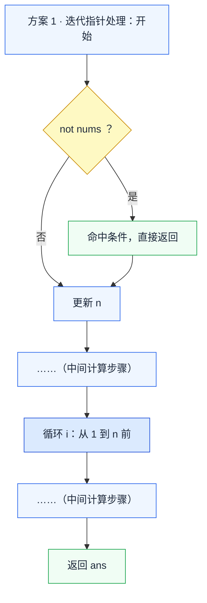

```python
import sys  # 提高递归深度上限（深输入防 RecursionError）

sys.setrecursionlimit(200000)  # 树/链表类题目节点数可达 1e4 量级

def longestMonotonicSubarray(nums):  # 定义函数 longestMonotonicSubarray（参数：数组）
    if not nums:  # 若 not 数组
        return 0  # 返回 0
    n = len(nums)  # 把 长度(数组) 存入 元素个数
    ans = 1  # 把 1 存入 答案
    inc = 1  # 把 1 存入 inc
    dec = 1  # 把 1 存入 dec
    for i in range(1, n):  # 让 下标 i 从 1 到 元素个数 遍历
        if nums[i] > nums[i - 1]:  # 若 数组[下标 i] 超过 数组[下标 i 减 1]
            inc += 1  # inc累加 1
            dec = 1  # 把 1 存入 dec
        elif nums[i] < nums[i - 1]:  # 否则，若 数组[下标 i] 小于 数组[下标 i 减 1]
            dec += 1  # dec累加 1
            inc = 1  # 把 1 存入 inc
        else:  # 否则
            inc = 1  # 把 1 存入 inc
            dec = 1  # 把 1 存入 dec
        ans = max(ans, inc, dec)  # 把 取较大值 答案, inc, dec) 存入 答案
    return ans  # 返回 答案

if __name__ == "__main__":  # 若 __name__ 等于 '__main__'
    print(longestMonotonicSubarray([1, 4, 3, 3, 2]))  # 打印输出
```

#### 方案 2：直接实现

**思路与代码分析**：核心是「直接实现」。Python 版用切片与字典推导式简化操作，突出可读性。**走读**：方案 2 · 直接实现：开始 → 命中条件，直接返回 → 更新 n → 当 i ＜ n: 时反复执行 → 当 ( 时反复执行 → 当 ( 时反复执行 → 返回 ans。

**运行架构**（真实控制流）：

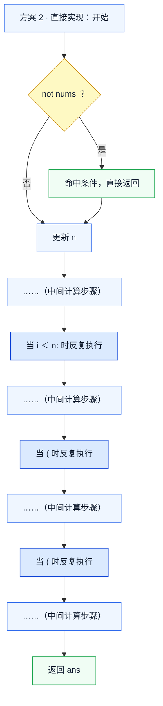

```python
import sys  # 提高递归深度上限（深输入防 RecursionError）

sys.setrecursionlimit(200000)  # 树/链表类题目节点数可达 1e4 量级

def longestMonotonicSubarray(nums):  # 定义函数 longestMonotonicSubarray（参数：数组）
    if not nums:  # 若 not 数组
        return 0  # 返回 0
    n = len(nums)  # 把 长度(数组) 存入 元素个数
    ans = 1  # 把 1 存入 答案
    i = 0  # 把 0 存入 下标 i
    while i < n:  # 循环，直到不满足「下标 i 小于 元素个数」
        j = i  # 把 下标 i 存入 下标 j
        while (
            j + 1 < n and nums[j + 1] > nums[j]
        ):  # 循环，直到不满足「下标 j 加 1 小于 元素个数 and 数组[下标 j 加 1] 超过 数组[下标 j]」
            j += 1  # 下标 j累加 1
        ans = max(ans, j - i + 1)  # 把 取较大值 答案, 下标 j 减 下标 i 加 1) 存入 答案
        j = i  # 把 下标 i 存入 下标 j
        while (
            j + 1 < n and nums[j + 1] < nums[j]
        ):  # 循环，直到不满足「下标 j 加 1 小于 元素个数 and 数组[下标 j 加 1] 小于 数组[下标 j]」
            j += 1  # 下标 j累加 1
        ans = max(ans, j - i + 1)  # 把 取较大值 答案, 下标 j 减 下标 i 加 1) 存入 答案
        i += 1  # 下标 i累加 1
    return ans  # 返回 答案

if __name__ == "__main__":  # 若 __name__ 等于 '__main__'
    print(longestMonotonicSubarray([1, 4, 3, 3, 2]))  # 打印输出
```

#### 方案 3：迭代指针处理

**思路与代码分析**：核心是「迭代指针处理」。Python 版用切片与字典推导式简化操作，突出可读性。**走读**：方案 3 · 迭代指针处理：开始 → 命中条件，直接返回 → 更新 n → 循环 i：从 1 到 n 前 → 循环 i：从 1 到 n 前 → 返回 ans。

**运行架构**（真实控制流）：

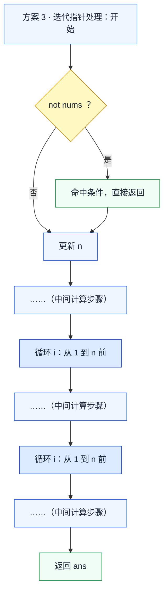

```python
import sys  # 提高递归深度上限（深输入防 RecursionError）

sys.setrecursionlimit(200000)  # 树/链表类题目节点数可达 1e4 量级

def longestMonotonicSubarray(nums):  # 定义函数 longestMonotonicSubarray（参数：数组）
    if not nums:  # 若 not 数组
        return 0  # 返回 0
    n = len(nums)  # 把 长度(数组) 存入 元素个数
    ans = 1  # 把 1 存入 答案
    length = 1  # 把 1 存入 长度
    # increasing run
    for i in range(1, n):  # 让 下标 i 从 1 到 元素个数 遍历
        if nums[i] > nums[i - 1]:  # 若 数组[下标 i] 超过 数组[下标 i 减 1]
            length += 1  # 长度累加 1
            ans = max(ans, length)  # 把 取较大值 答案, 长度) 存入 答案
        else:  # 否则
            length = 1  # 把 1 存入 长度
    # decreasing run
    length = 1  # 把 1 存入 长度
    for i in range(1, n):  # 让 下标 i 从 1 到 元素个数 遍历
        if nums[i] < nums[i - 1]:  # 若 数组[下标 i] 小于 数组[下标 i 减 1]
            length += 1  # 长度累加 1
            ans = max(ans, length)  # 把 取较大值 答案, 长度) 存入 答案
        else:  # 否则
            length = 1  # 把 1 存入 长度
    return ans  # 返回 答案

if __name__ == "__main__":  # 若 __name__ 等于 '__main__'
    print(longestMonotonicSubarray([1, 4, 3, 3, 2]))  # 打印输出
```

### Go 实现（3 种方案）

Go 的全部方案如下，每个方案都内嵌用例自测，可独立运行（老仓库 python/go 文件遵循「打印结果」约定）：

#### 方案 1：迭代指针处理

**思路与代码分析**：核心是「迭代指针处理」。Go 版用切片与多返回值惯用法，显式处理索引边界。**走读**：方案 1 · 迭代指针处理：开始 → 处理 if len(nums) == 0 → 返回 0 → 遍历循环 → 返回 ans。

**运行架构**（真实控制流）：

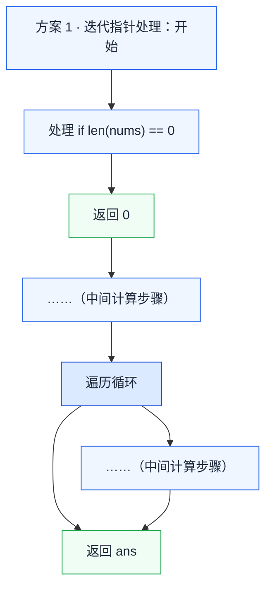

```go
package main // 引入依赖

import (
	"fmt"
	"os"
) // 引入依赖

func longestMonotonicSubarray(nums []int) int { // 定义函数/方法 longestMonotonicSubarray
	if len(nums) == 0 { // 若 长度(数组) 等于 0
		return 0 // 返回 0
	}
	n := len(nums)           // 把 长度(数组) 写入 n :
	ans := 1                 // 把 1 写入 ans :
	inc := 1                 // 把 1 写入 inc :
	dec := 1                 // 把 1 写入 dec :
	for i := 1; i < n; i++ { // 让 下标 i 从 1 开始计数
		if nums[i] > nums[i-1] { // 若 数组[下标 i] 超过 数组[下标 i 减 1]
			inc++   // inc 加一
			dec = 1 // 把 1 写入 dec
		} else if nums[i] < nums[i-1] { // 否则，若 数组[下标 i] 小于 数组[下标 i 减 1]
			dec++   // dec 加一
			inc = 1 // 把 1 写入 inc
		} else { // 否则
			inc = 1 // 把 1 写入 inc
			dec = 1 // 把 1 写入 dec
		}
		if ans < inc { // 若 答案 小于 inc
			ans = inc // 把 inc 写入 答案
		}
		if ans < dec { // 若 答案 小于 dec
			ans = dec // 把 dec 写入 答案
		}
	}
	return ans // 返回 答案
}

func main() { // 程序入口：跑内嵌自测用例
	type tc struct { // 定义类型
		in   []int // in []int
		want int   // want int
	}
	cases := []tc{ // 把 []tc{ 写入 cases :
		{[]int{1, 4, 3, 3, 2}, 2},
		{[]int{1, 2, 3, 4, 5}, 5},
	}
	ok := true                // 把 true 写入 ok :
	for _, c := range cases { // 同时取 _ 与 字符 遍历
		if got := longestMonotonicSubarray(c.in); got != c.want { // 若 got : 赋值为 longestMonotonicSubarray(字符.in); got 不等于 字符.want
			ok = false                                                                      // 把 false 写入 ok
			fmt.Printf("FAIL longestMonotonicSubarray(%v)=%v want %v\n", c.in, got, c.want) // 打印输出
		}
	}
	if !ok { // 若 取反 ok
		os.Exit(1) // os.Exit(1)
	}
	fmt.Println("PASS") // 全部用例通过，输出 PASS
}
```

#### 方案 2：直接实现

**思路与代码分析**：核心是「直接实现」。Go 版用切片与多返回值惯用法，显式处理索引边界。**走读**：方案 2 · 直接实现：开始 → 处理 if len(nums) == 0 → 返回 0 → 遍历循环 → 遍历循环 → 遍历循环 → 返回 ans。

**运行架构**（真实控制流）：

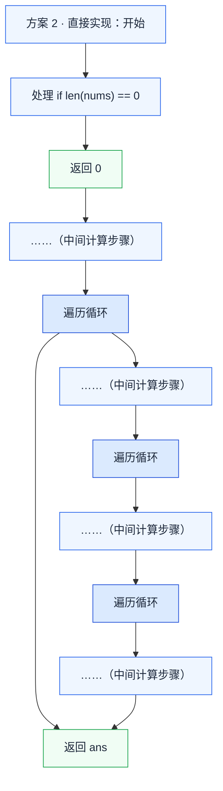

```go
package main // 引入依赖

import (
	"fmt"
	"os"
) // 引入依赖

func longestMonotonicSubarray(nums []int) int { // 定义函数/方法 longestMonotonicSubarray
	if len(nums) == 0 { // 若 长度(数组) 等于 0
		return 0 // 返回 0
	}
	n := len(nums) // 把 长度(数组) 写入 n :
	ans := 1       // 把 1 写入 ans :
	i := 0         // 把 0 写入 i :
	for i < n {    // for 下标 i 小于 元素个数 {
		j := i                               // 把 下标 i 写入 j :
		for j+1 < n && nums[j+1] > nums[j] { // for 下标 j 加 1 小于 元素个数 且 数组[下标 j 加 1] 超过 数组[下标 j] {
			j++ // 下标 j 加一
		}
		if ans < j-i+1 { // 若 答案 小于 下标 j 减 下标 i 加 1
			ans = j - i + 1 // 把 下标 j 减 下标 i 加 1 写入 答案
		}
		j = i                                // 把 下标 i 写入 下标 j
		for j+1 < n && nums[j+1] < nums[j] { // for 下标 j 加 1 小于 元素个数 且 数组[下标 j 加 1] 小于 数组[下标 j] {
			j++ // 下标 j 加一
		}
		if ans < j-i+1 { // 若 答案 小于 下标 j 减 下标 i 加 1
			ans = j - i + 1 // 把 下标 j 减 下标 i 加 1 写入 答案
		}
		i++ // 下标 i 加一
	}
	return ans // 返回 答案
}

func main() { // 程序入口：跑内嵌自测用例
	type tc struct { // 定义类型
		in   []int // in []int
		want int   // want int
	}
	cases := []tc{ // 把 []tc{ 写入 cases :
		{[]int{1, 4, 3, 3, 2}, 2},
		{[]int{1, 2, 3, 4, 5}, 5},
	}
	ok := true                // 把 true 写入 ok :
	for _, c := range cases { // 同时取 _ 与 字符 遍历
		if got := longestMonotonicSubarray(c.in); got != c.want { // 若 got : 赋值为 longestMonotonicSubarray(字符.in); got 不等于 字符.want
			ok = false                                                                      // 把 false 写入 ok
			fmt.Printf("FAIL longestMonotonicSubarray(%v)=%v want %v\n", c.in, got, c.want) // 打印输出
		}
	}
	if !ok { // 若 取反 ok
		os.Exit(1) // os.Exit(1)
	}
	fmt.Println("PASS") // 全部用例通过，输出 PASS
}
```

#### 方案 3：迭代指针处理

**思路与代码分析**：核心是「迭代指针处理」。Go 版用切片与多返回值惯用法，显式处理索引边界。**走读**：方案 3 · 迭代指针处理：开始 → 处理 if len(nums) == 0 → 返回 0 → 遍历循环 → 遍历循环 → 返回 ans。

**运行架构**（真实控制流）：

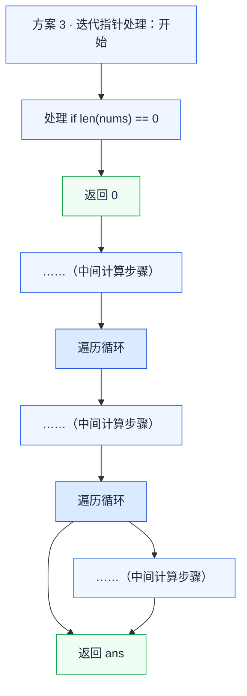

```go
package main // 引入依赖

import (
	"fmt"
	"os"
) // 引入依赖

func longestMonotonicSubarray(nums []int) int { // 定义函数/方法 longestMonotonicSubarray
	if len(nums) == 0 { // 若 长度(数组) 等于 0
		return 0 // 返回 0
	}
	n := len(nums)           // 把 长度(数组) 写入 n :
	ans := 1                 // 把 1 写入 ans :
	length := 1              // 把 1 写入 length :
	for i := 1; i < n; i++ { // 让 下标 i 从 1 开始计数
		if nums[i] > nums[i-1] { // 若 数组[下标 i] 超过 数组[下标 i 减 1]
			length++          // 长度 加一
			if ans < length { // 若 答案 小于 长度
				ans = length // 把 长度 写入 答案
			}
		} else { // 否则
			length = 1 // 把 1 写入 长度
		}
	}
	length = 1               // 把 1 写入 长度
	for i := 1; i < n; i++ { // 让 下标 i 从 1 开始计数
		if nums[i] < nums[i-1] { // 若 数组[下标 i] 小于 数组[下标 i 减 1]
			length++          // 长度 加一
			if ans < length { // 若 答案 小于 长度
				ans = length // 把 长度 写入 答案
			}
		} else { // 否则
			length = 1 // 把 1 写入 长度
		}
	}
	return ans // 返回 答案
}

func main() { // 程序入口：跑内嵌自测用例
	type tc struct { // 定义类型
		in   []int // in []int
		want int   // want int
	}
	cases := []tc{ // 把 []tc{ 写入 cases :
		{[]int{1, 4, 3, 3, 2}, 2},
		{[]int{1, 2, 3, 4, 5}, 5},
	}
	ok := true                // 把 true 写入 ok :
	for _, c := range cases { // 同时取 _ 与 字符 遍历
		if got := longestMonotonicSubarray(c.in); got != c.want { // 若 got : 赋值为 longestMonotonicSubarray(字符.in); got 不等于 字符.want
			ok = false                                                                      // 把 false 写入 ok
			fmt.Printf("FAIL longestMonotonicSubarray(%v)=%v want %v\n", c.in, got, c.want) // 打印输出
		}
	}
	if !ok { // 若 取反 ok
		os.Exit(1) // os.Exit(1)
	}
	fmt.Println("PASS") // 全部用例通过，输出 PASS
}
```

### Java 实现（3 种方案）

Java 的全部方案如下，每个方案都内嵌用例自测，可独立运行（老仓库 python/go 文件遵循「打印结果」约定）：

#### 方案 1：迭代指针处理

**思路与代码分析**：核心是「迭代指针处理」。Java 版用类与静态方法组织，集合操作显式明了。代码里依次做这些事：单循环线性扫描。**走读**：方案 1 · 迭代指针处理：开始 → 命中条件，直接返回 → 更新 n → 更新 ans → 遍历循环 → 若 nums[i] ＞ nums[i - 1] 则： → 处理 inc++ → 更新 dec → 处理 dec++ → 更新 inc → 更新 inc → 更新 dec → 更新 ans → 返回 ans。

**运行架构**（真实控制流）：

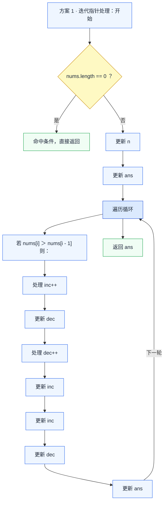

```java
package com.webfault.dsa; // 引入依赖

import java.util.*; // 引入依赖

class lc3105_solution111 { // 定义类型
  public int longestMonotonicSubarray(int[] nums) { // 定义函数/方法 longestMonotonicSubarray
    if (nums.length == 0) return 0; // 若 数组.长度 等于 0，直接返回 0
    int n = nums.length; // 把 数组.长度 存入 元素个数
    int ans = 1, inc = 1, dec = 1; // 把 1, inc 赋值为 1, dec 赋值为 1 存入 答案
    for (int i = 1; i < n; i++) { // 让 下标 i 从 1 开始计数，下标 i 小于 元素个数 就继续
      if (nums[i] > nums[i - 1]) { // 若 数组[下标 i] 超过 数组[下标 i 减 1]
        inc++;
        dec = 1; // 把 1; 写入 inc++; dec
      } else if (nums[i] < nums[i - 1]) { // 否则，若 数组[下标 i] 小于 数组[下标 i 减 1]
        dec++;
        inc = 1; // 把 1; 写入 dec++; inc
      } else { // 否则
        inc = 1;
        dec = 1; // 把 1; dec 赋值为 1; 写入 inc
      }
      ans = Math.max(ans, Math.max(inc, dec)); // 把 Math.取较大值 答案, Math.取较大值 inc, dec)); 写入 答案
    }
    return ans; // 返回 答案
  }

  public static void main(String[] args) { // public static void main(String[] args) {
    lc3105_solution111 s =
        new lc3105_solution111(); // 把 new lc3105_solution111(); 写入 lc3105_solution111 s
    int got = s.longestMonotonicSubarray(new int[] {1, 4, 3, 3, 2});
    if (got != 2) {
      System.out.println("FAIL got " + got);
      throw new RuntimeException("FAILED");
    }
    System.out.println("PASS"); // 全部用例通过，输出 PASS
  }
}
```

#### 方案 2：直接实现

**思路与代码分析**：核心是「直接实现」。Java 版用类与静态方法组织，集合操作显式明了。**走读**：方案 2 · 直接实现：开始 → 命中条件，直接返回 → 更新 n → 更新 ans → 更新 i → 当 (i ＜ n) 时反复执行 → 更新 j → 当 (j + 1 ＜ n 且 nums[j + 1] ＞ nums[j]) j++ 时反复执行 → 更新 ans → 更新 j → 当 (j + 1 ＜ n 且 nums[j + 1] ＜ nums[j]) j++ 时反复执行 → 更新 ans → 处理 i++ → 返回 ans。

**运行架构**（真实控制流）：

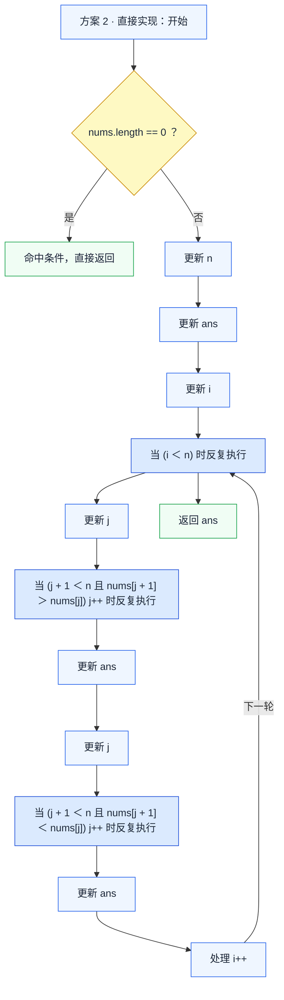

```java
package com.webfault.dsa; // 引入依赖

import java.util.*; // 引入依赖

class lc3105_solution222 { // 定义类型
  public int longestMonotonicSubarray(int[] nums) { // 定义函数/方法 longestMonotonicSubarray
    if (nums.length == 0) return 0; // 若 数组.长度 等于 0，直接返回 0
    int n = nums.length; // 把 数组.长度 存入 元素个数
    int ans = 1; // 把 1 存入 答案
    int i = 0; // 把 0 存入 下标 i
    while (i < n) { // 循环，直到不满足「下标 i 小于 元素个数」
      int j = i; // 把 下标 i 存入 下标 j
      while (j + 1 < n && nums[j + 1] > nums[j]) j++;
      ans = Math.max(ans, j - i + 1); // 把 Math.取较大值 答案, 下标 j 减 下标 i 加 1); 写入 答案
      j = i; // 把 下标 i; 写入 下标 j
      while (j + 1 < n && nums[j + 1] < nums[j]) j++;
      ans = Math.max(ans, j - i + 1); // 把 Math.取较大值 答案, 下标 j 减 下标 i 加 1); 写入 答案
      i++; // 下标 i 加一
    }
    return ans; // 返回 答案
  }

  public static void main(String[] args) { // public static void main(String[] args) {
    lc3105_solution222 s =
        new lc3105_solution222(); // 把 new lc3105_solution222(); 写入 lc3105_solution222 s
    int got = s.longestMonotonicSubarray(new int[] {1, 4, 3, 3, 2});
    if (got != 2) {
      System.out.println("FAIL got " + got);
      throw new RuntimeException("FAILED");
    }
    System.out.println("PASS"); // 全部用例通过，输出 PASS
  }
}
```

#### 方案 3：迭代指针处理

**思路与代码分析**：核心是「迭代指针处理」。Java 版用类与静态方法组织，集合操作显式明了。代码里依次做这些事：双重循环遍历。**走读**：方案 3 · 迭代指针处理：开始 → 命中条件，直接返回 → 更新 n → 更新 ans → 更新 length → 遍历循环 → 若 nums[i] ＞ nums[i - 1] 则： → 处理 length++ → 更新 ans → 更新 length → 遍历循环 → 若 nums[i] ＜ nums[i - 1] 则： → 处理 length++ → 更新 ans → 返回 ans。

**运行架构**（真实控制流）：

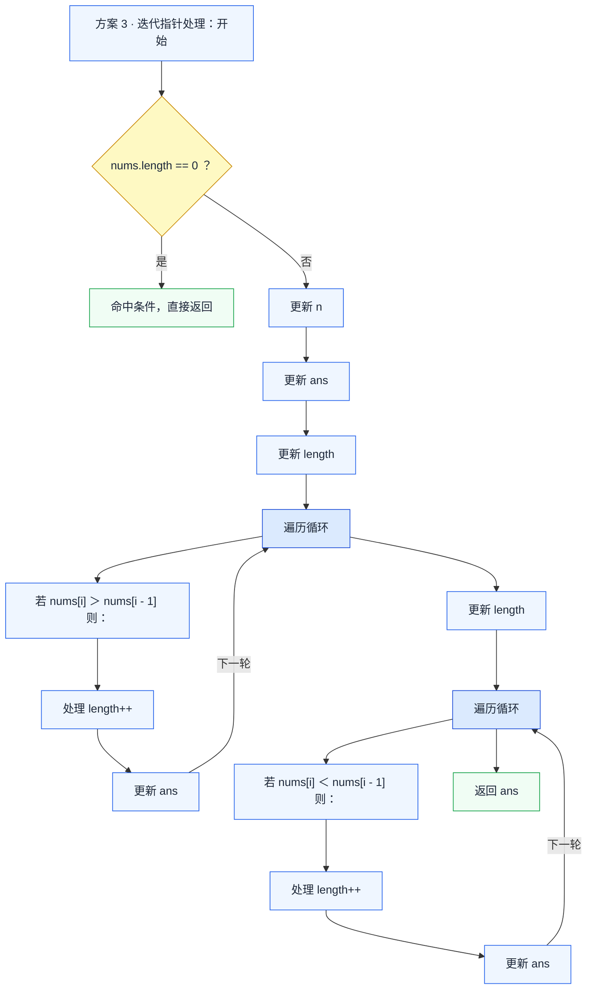

```java
package com.webfault.dsa; // 引入依赖

import java.util.*; // 引入依赖

class lc3105_solution333 { // 定义类型
  public int longestMonotonicSubarray(int[] nums) { // 定义函数/方法 longestMonotonicSubarray
    if (nums.length == 0) return 0; // 若 数组.长度 等于 0，直接返回 0
    int n = nums.length; // 把 数组.长度 存入 元素个数
    int ans = 1; // 把 1 存入 答案
    int length = 1; // 把 1 存入 长度
    for (int i = 1; i < n; i++) { // 让 下标 i 从 1 开始计数，下标 i 小于 元素个数 就继续
      if (nums[i] > nums[i - 1]) {
        length++;
        ans = Math.max(ans, length);
      } else length = 1; // 否则
    }
    length = 1; // 把 1; 写入 长度
    for (int i = 1; i < n; i++) { // 让 下标 i 从 1 开始计数，下标 i 小于 元素个数 就继续
      if (nums[i] < nums[i - 1]) {
        length++;
        ans = Math.max(ans, length);
      } else length = 1; // 否则
    }
    return ans; // 返回 答案
  }

  public static void main(String[] args) { // public static void main(String[] args) {
    lc3105_solution333 s =
        new lc3105_solution333(); // 把 new lc3105_solution333(); 写入 lc3105_solution333 s
    int got = s.longestMonotonicSubarray(new int[] {1, 4, 3, 3, 2});
    if (got != 2) {
      System.out.println("FAIL got " + got);
      throw new RuntimeException("FAILED");
    }
    System.out.println("PASS"); // 全部用例通过，输出 PASS
  }
}
```

### Rust 实现（3 种方案）

Rust 的全部方案如下，每个方案都内嵌用例自测，可独立运行（老仓库 python/go 文件遵循「打印结果」约定）：

#### 方案 1：迭代指针处理

**思路与代码分析**：核心是「迭代指针处理」。Rust 版用所有权移动与切片借用改写同一逻辑，注意 Option 与引用边界。**走读**：方案 1 · 迭代指针处理：开始 → 处理 if nums.is_empty() → 返回 0 → 计算 let (mut inc, mut dec, m → 遍历 1..nums.len() 中的每个元素 i → 处理 if nums[i] ＞ nums[i - 1] → 更新 + → 更新 dec → 更新 + → 更新 inc → 更新 inc → 更新 dec → 更新 best → 处理 best。

**运行架构**（真实控制流）：


```rust
// LeetCode 3105. 最长的严格递增或递减子数组 — Rust 版（方案1）
fn longest_monotonic_subarray(nums: Vec<i32>) -> i32 {
    // 定义函数/方法 longest_monotonic_subarray
    if nums.is_empty() {
        return 0;
    } // 若 数组 是否为空 { return 0; }
    let (mut inc, mut dec, mut best) = (1i32, 1i32, 1i32); // 把 (1i32, 1i32, 1i32); 写入 let (mut inc, mut dec, mut best)
    for i in 1..nums.len() {
        // 逐个取出 1 的元素（下标 i）
        if nums[i] > nums[i - 1] {
            inc += 1;
            dec = 1;
        }
        // 若 数组[下标 i] 超过 数组[下标 i 减 1] { inc 累加 1; dec 赋值为 1; }
        else if nums[i] < nums[i - 1] {
            dec += 1;
            inc = 1;
        }
        // 否则，若 数组[下标 i] 小于 数组[下标 i 减 1] { dec 累加 1; inc 赋值为 1; }
        else {
            inc = 1;
            dec = 1;
        } // 否则
        best = best.max(inc).max(dec); // 把 当前最优.取较大值 inc).取较大值 dec); 写入 当前最优
    }
    best // 当前最优
}
fn main() {
    assert_eq!(longest_monotonic_subarray(vec![1, 2, 3, 4, 5]), 5);
    assert_eq!(longest_monotonic_subarray(vec![5, 4, 3, 2, 1]), 5);
    assert_eq!(longest_monotonic_subarray(vec![1, 4, 3, 2, 5]), 3);
    println!("PASS");
} // 程序入口：跑内嵌自测用例
```

#### 方案 2：直接实现

**思路与代码分析**：核心是「直接实现」。Rust 版用所有权移动与切片借用改写同一逻辑，注意 Option 与引用边界。**走读**：方案 2 · 直接实现：开始 → 处理 if nums.is_empty() → 返回 0 → 计算 let (mut inc, mut dec, m → 遍历 1..nums.len() 中的每个元素 i → 处理 if nums[i] ＞ nums[i - 1] → 更新 + → 更新 dec → 更新 + → 更新 inc → 更新 inc → 更新 dec → 更新 best → 处理 best。

**运行架构**（真实控制流）：

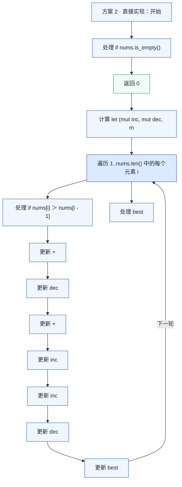

```rust
// LeetCode 3105. 最长的严格递增或递减子数组 — Rust 版（方案2）
fn longest_monotonic_subarray(nums: Vec<i32>) -> i32 {
    // 定义函数/方法 longest_monotonic_subarray
    if nums.is_empty() {
        return 0;
    } // 若 数组 是否为空 { return 0; }
    let (mut inc, mut dec, mut best) = (1i32, 1i32, 1i32); // 把 (1i32, 1i32, 1i32); 写入 let (mut inc, mut dec, mut best)
    for i in 1..nums.len() {
        // 逐个取出 1 的元素（下标 i）
        if nums[i] > nums[i - 1] {
            inc += 1;
            dec = 1;
        }
        // 若 数组[下标 i] 超过 数组[下标 i 减 1] { inc 累加 1; dec 赋值为 1; }
        else if nums[i] < nums[i - 1] {
            dec += 1;
            inc = 1;
        }
        // 否则，若 数组[下标 i] 小于 数组[下标 i 减 1] { dec 累加 1; inc 赋值为 1; }
        else {
            inc = 1;
            dec = 1;
        } // 否则
        best = best.max(inc).max(dec); // 把 当前最优.取较大值 inc).取较大值 dec); 写入 当前最优
    }
    best // 当前最优
}
fn main() {
    assert_eq!(longest_monotonic_subarray(vec![1, 2, 3, 4, 5]), 5);
    assert_eq!(longest_monotonic_subarray(vec![5, 4, 3, 2, 1]), 5);
    assert_eq!(longest_monotonic_subarray(vec![1, 4, 3, 2, 5]), 3);
    println!("PASS");
} // 程序入口：跑内嵌自测用例
```

#### 方案 3：迭代指针处理

**思路与代码分析**：核心是「迭代指针处理」。Rust 版用所有权移动与切片借用改写同一逻辑，注意 Option 与引用边界。**走读**：方案 3 · 迭代指针处理：开始 → 处理 if nums.is_empty() → 返回 0 → 计算 let (mut inc, mut dec, m → 遍历 1..nums.len() 中的每个元素 i → 处理 if nums[i] ＞ nums[i - 1] → 更新 + → 更新 dec → 更新 + → 更新 inc → 更新 inc → 更新 dec → 更新 best → 处理 best。

**运行架构**（真实控制流）：


```rust
// LeetCode 3105. 最长的严格递增或递减子数组 — Rust 版（方案3）
fn longest_monotonic_subarray(nums: Vec<i32>) -> i32 {
    // 定义函数/方法 longest_monotonic_subarray
    if nums.is_empty() {
        return 0;
    } // 若 数组 是否为空 { return 0; }
    let (mut inc, mut dec, mut best) = (1i32, 1i32, 1i32); // 把 (1i32, 1i32, 1i32); 写入 let (mut inc, mut dec, mut best)
    for i in 1..nums.len() {
        // 逐个取出 1 的元素（下标 i）
        if nums[i] > nums[i - 1] {
            inc += 1;
            dec = 1;
        }
        // 若 数组[下标 i] 超过 数组[下标 i 减 1] { inc 累加 1; dec 赋值为 1; }
        else if nums[i] < nums[i - 1] {
            dec += 1;
            inc = 1;
        }
        // 否则，若 数组[下标 i] 小于 数组[下标 i 减 1] { dec 累加 1; inc 赋值为 1; }
        else {
            inc = 1;
            dec = 1;
        } // 否则
        best = best.max(inc).max(dec); // 把 当前最优.取较大值 inc).取较大值 dec); 写入 当前最优
    }
    best // 当前最优
}
fn main() {
    assert_eq!(longest_monotonic_subarray(vec![1, 2, 3, 4, 5]), 5);
    assert_eq!(longest_monotonic_subarray(vec![5, 4, 3, 2, 1]), 5);
    assert_eq!(longest_monotonic_subarray(vec![1, 4, 3, 2, 5]), 3);
    println!("PASS");
} // 程序入口：跑内嵌自测用例
```

### Lua 实现（3 种方案）

Lua 的全部方案如下，每个方案都内嵌用例自测，可独立运行（老仓库 python/go 文件遵循「打印结果」约定）：

#### 方案 1：迭代指针处理

**思路与代码分析**：核心是「迭代指针处理」。Lua 版用表与 ipairs 遍历，注意 ipairs 遇 nil 即停的语义。**走读**：方案 1 · 迭代指针处理：开始 → 处理 if #nums == 0 then → 返回 0 → 循环 i：从 2 到 #nums do → 返回 best。

**运行架构**（真实控制流）：

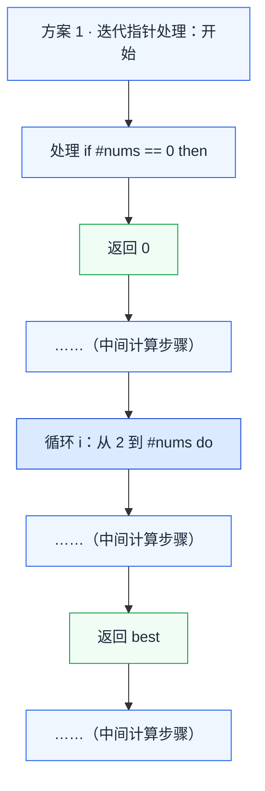

```lua
-- LeetCode 3105. 最长的严格递增或递减子数组 — Lua 版（方案1）
local function longest_monotonic_subarray(nums) -- local function longest_monotonic_subarray(数组)
	if #nums == 0 then
		return 0
	end -- 若 #数组 等于 0 then return 0 终点
	local inc, dec, best = 1, 1, 1 -- 把 1, 1, 1 写入 local inc, dec, best
	for i = 2, #nums do -- 把 2, #数组 do 写入 for i
		if nums[i] > nums[i - 1] then
			inc = inc + 1
			dec = 1 -- 若 数组[下标 i] 超过 数组[下标 i 减 1] then inc 赋值为 inc 加 1; dec 赋值为 1
		elseif nums[i] < nums[i - 1] then
			dec = dec + 1
			inc = 1
		else
			inc = 1
			dec = 1
		end -- 否则
		if inc > best then
			best = inc
		end -- 若 inc 超过 当前最优 then 当前最优 赋值为 inc 终点
		if dec > best then
			best = dec
		end -- 若 dec 超过 当前最优 then 当前最优 赋值为 dec 终点
	end -- 终点
	return best -- 返回 当前最优
end -- 终点
assert(longest_monotonic_subarray({ 1, 2, 3, 4, 5 }) == 5) -- 断言校验
assert(longest_monotonic_subarray({ 5, 4, 3, 2, 1 }) == 5) -- 断言校验
assert(longest_monotonic_subarray({ 1, 4, 3, 2, 5 }) == 3) -- 断言校验
print("PASS") -- 全部用例通过，输出 PASS
```

#### 方案 2：直接实现

**思路与代码分析**：核心是「直接实现」。Lua 版用表与 ipairs 遍历，注意 ipairs 遇 nil 即停的语义。**走读**：方案 2 · 直接实现：开始 → 处理 if #nums == 0 then → 返回 0 → 循环 i：从 2 到 #nums do → 返回 best。

**运行架构**（真实控制流）：

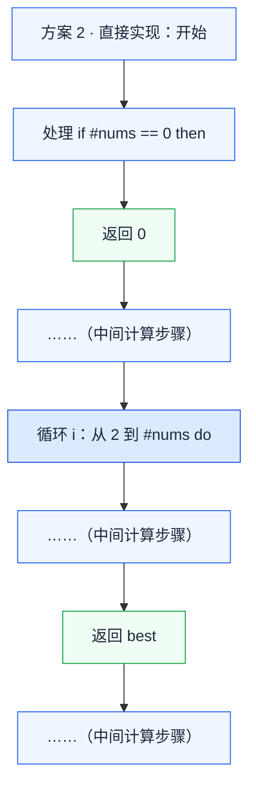

```lua
-- LeetCode 3105. 最长的严格递增或递减子数组 — Lua 版（方案2）
local function longest_monotonic_subarray(nums) -- local function longest_monotonic_subarray(数组)
	if #nums == 0 then
		return 0
	end -- 若 #数组 等于 0 then return 0 终点
	local inc, dec, best = 1, 1, 1 -- 把 1, 1, 1 写入 local inc, dec, best
	for i = 2, #nums do -- 把 2, #数组 do 写入 for i
		if nums[i] > nums[i - 1] then
			inc = inc + 1
			dec = 1 -- 若 数组[下标 i] 超过 数组[下标 i 减 1] then inc 赋值为 inc 加 1; dec 赋值为 1
		elseif nums[i] < nums[i - 1] then
			dec = dec + 1
			inc = 1
		else
			inc = 1
			dec = 1
		end -- 否则
		if inc > best then
			best = inc
		end -- 若 inc 超过 当前最优 then 当前最优 赋值为 inc 终点
		if dec > best then
			best = dec
		end -- 若 dec 超过 当前最优 then 当前最优 赋值为 dec 终点
	end -- 终点
	return best -- 返回 当前最优
end -- 终点
assert(longest_monotonic_subarray({ 1, 2, 3, 4, 5 }) == 5) -- 断言校验
assert(longest_monotonic_subarray({ 5, 4, 3, 2, 1 }) == 5) -- 断言校验
assert(longest_monotonic_subarray({ 1, 4, 3, 2, 5 }) == 3) -- 断言校验
print("PASS") -- 全部用例通过，输出 PASS
```

#### 方案 3：迭代指针处理

**思路与代码分析**：核心是「迭代指针处理」。Lua 版用表与 ipairs 遍历，注意 ipairs 遇 nil 即停的语义。**走读**：方案 3 · 迭代指针处理：开始 → 处理 if #nums == 0 then → 返回 0 → 循环 i：从 2 到 #nums do → 返回 best。

**运行架构**（真实控制流）：

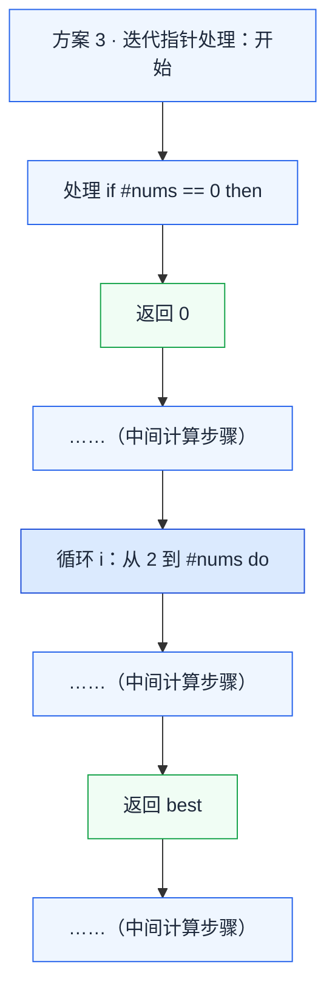

```lua
-- LeetCode 3105. 最长的严格递增或递减子数组 — Lua 版（方案3）
local function longest_monotonic_subarray(nums) -- local function longest_monotonic_subarray(数组)
	if #nums == 0 then
		return 0
	end -- 若 #数组 等于 0 then return 0 终点
	local inc, dec, best = 1, 1, 1 -- 把 1, 1, 1 写入 local inc, dec, best
	for i = 2, #nums do -- 把 2, #数组 do 写入 for i
		if nums[i] > nums[i - 1] then
			inc = inc + 1
			dec = 1 -- 若 数组[下标 i] 超过 数组[下标 i 减 1] then inc 赋值为 inc 加 1; dec 赋值为 1
		elseif nums[i] < nums[i - 1] then
			dec = dec + 1
			inc = 1
		else
			inc = 1
			dec = 1
		end -- 否则
		if inc > best then
			best = inc
		end -- 若 inc 超过 当前最优 then 当前最优 赋值为 inc 终点
		if dec > best then
			best = dec
		end -- 若 dec 超过 当前最优 then 当前最优 赋值为 dec 终点
	end -- 终点
	return best -- 返回 当前最优
end -- 终点
assert(longest_monotonic_subarray({ 1, 2, 3, 4, 5 }) == 5) -- 断言校验
assert(longest_monotonic_subarray({ 5, 4, 3, 2, 1 }) == 5) -- 断言校验
assert(longest_monotonic_subarray({ 1, 4, 3, 2, 5 }) == 3) -- 断言校验
print("PASS") -- 全部用例通过，输出 PASS
```

### C 实现（3 种方案）

C 的全部方案如下，每个方案都内嵌用例自测，可独立运行（老仓库 python/go 文件遵循「打印结果」约定）：

#### 方案 1：迭代指针处理

**思路与代码分析**：核心是「迭代指针处理」。C 版手动管理下标与内存，循环边界全部显式写出。代码里依次做这些事：单循环线性扫描。**走读**：方案 1 · 迭代指针处理：开始 → 命中条件，直接返回 → 更新 inc → 遍历循环 → 返回 best。

**运行架构**（真实控制流）：

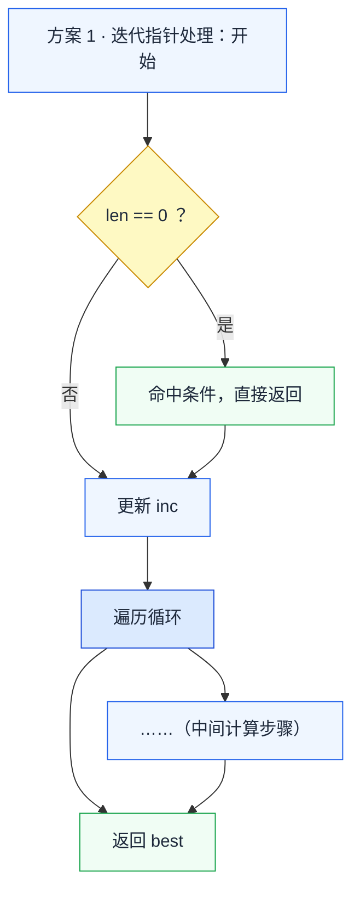

```c
/* LeetCode 3105. 最长的严格递增或递减子数组 — C 版（方案1） */
#include <stdio.h>                                             // 引入头文件
static int longest_monotonic_subarray(const int *n, int len) { // 定义函数/方法 longest_monotonic_subarray
    if (len == 0)
        return 0;                   // 若 长度 等于 0，直接返回 0
    int inc = 1, dec = 1, best = 1; // 把 1, dec 赋值为 1, 当前最优 赋值为 1 存入 inc
    for (int i = 1; i < len; i++) { // 让 下标 i 从 1 开始计数，下标 i 小于 长度 就继续
        if (n[i] > n[i - 1]) {
            inc++;
            dec = 1;
        } // 若 元素个数[下标 i] 超过 元素个数[下标 i 减 1]) { inc 加一 ; dec 赋值为 1; }
        else if (n[i] < n[i - 1]) {
            dec++;
            inc = 1;
        } // 否则，若 元素个数[下标 i] 小于 元素个数[下标 i 减 1]) { dec 加一 ; inc 赋值为 1; }
        else {
            inc = 1;
            dec = 1;
        } // 否则
        if (inc > best)
            best = inc; // 若 inc 超过 当前最优) 当前最优 赋值为 inc;
        if (dec > best)
            best = dec; // 若 dec 超过 当前最优) 当前最优 赋值为 dec;
    }
    return best; // 返回 当前最优
}
int main(void) { // 程序入口：跑内嵌自测用例
    if (longest_monotonic_subarray((int[]){1, 2, 3, 4, 5}, 5) != 5) {
        printf("FAIL 1\n");
        return 1;
    }
    if (longest_monotonic_subarray((int[]){5, 4, 3, 2, 1}, 5) != 5) {
        printf("FAIL 2\n");
        return 1;
    }
    if (longest_monotonic_subarray((int[]){1, 4, 3, 2, 5}, 5) != 3) {
        printf("FAIL 3\n");
        return 1;
    }
    printf("PASS\n");
    return 0;
} // 全部用例通过，输出 PASS
```

#### 方案 2：直接实现

**思路与代码分析**：核心是「直接实现」。C 版手动管理下标与内存，循环边界全部显式写出。代码里依次做这些事：单循环线性扫描。**走读**：方案 2 · 直接实现：开始 → 命中条件，直接返回 → 更新 inc → 遍历循环 → 返回 best。

**运行架构**（真实控制流）：

```mermaid
graph TD
    N0["方案 2 · 直接实现：开始"]
    N1{"len == 0 ？"}
    N2["命中条件，直接返回"]
    N3["更新 inc"]
    N4["遍历循环"]
    D1["……（中间计算步骤）"]
    N16["返回 best"]
    N0 --> N1
    N1 -- 是 --> N2
    N1 -- 否 --> N3
    N3 --> N4
    N4 --> N16
    N2 --> N3
    N4 --> D1
    D1 --> N16
    classDef n fill:#eff6ff,stroke:#2563eb,color:#1e293b;
    classDef lp fill:#dbeafe,stroke:#1d4ed8,color:#1e293b;
    classDef dc fill:#fef9c3,stroke:#ca8a04,color:#1e293b;
    classDef tm fill:#f0fdf4,stroke:#16a34a,color:#1e293b;
    class N0,N3,D1 n;
    class N4 lp;
    class N1 dc;
    class N2,N16 tm;
```

```c
/* LeetCode 3105. 最长的严格递增或递减子数组 — C 版（方案2） */
#include <stdio.h>                                             // 引入头文件
static int longest_monotonic_subarray(const int *n, int len) { // 定义函数/方法 longest_monotonic_subarray
    if (len == 0)
        return 0;                   // 若 长度 等于 0，直接返回 0
    int inc = 1, dec = 1, best = 1; // 把 1, dec 赋值为 1, 当前最优 赋值为 1 存入 inc
    for (int i = 1; i < len; i++) { // 让 下标 i 从 1 开始计数，下标 i 小于 长度 就继续
        if (n[i] > n[i - 1]) {
            inc++;
            dec = 1;
        } // 若 元素个数[下标 i] 超过 元素个数[下标 i 减 1]) { inc 加一 ; dec 赋值为 1; }
        else if (n[i] < n[i - 1]) {
            dec++;
            inc = 1;
        } // 否则，若 元素个数[下标 i] 小于 元素个数[下标 i 减 1]) { dec 加一 ; inc 赋值为 1; }
        else {
            inc = 1;
            dec = 1;
        } // 否则
        if (inc > best)
            best = inc; // 若 inc 超过 当前最优) 当前最优 赋值为 inc;
        if (dec > best)
            best = dec; // 若 dec 超过 当前最优) 当前最优 赋值为 dec;
    }
    return best; // 返回 当前最优
}
int main(void) { // 程序入口：跑内嵌自测用例
    if (longest_monotonic_subarray((int[]){1, 2, 3, 4, 5}, 5) != 5) {
        printf("FAIL 1\n");
        return 1;
    }
    if (longest_monotonic_subarray((int[]){5, 4, 3, 2, 1}, 5) != 5) {
        printf("FAIL 2\n");
        return 1;
    }
    if (longest_monotonic_subarray((int[]){1, 4, 3, 2, 5}, 5) != 3) {
        printf("FAIL 3\n");
        return 1;
    }
    printf("PASS\n");
    return 0;
} // 全部用例通过，输出 PASS
```

#### 方案 3：迭代指针处理

**思路与代码分析**：核心是「迭代指针处理」。C 版手动管理下标与内存，循环边界全部显式写出。代码里依次做这些事：单循环线性扫描。**走读**：方案 3 · 迭代指针处理：开始 → 命中条件，直接返回 → 更新 inc → 遍历循环 → 返回 best。

**运行架构**（真实控制流）：

```mermaid
graph TD
    N0["方案 3 · 迭代指针处理：开始"]
    N1{"len == 0 ？"}
    N2["命中条件，直接返回"]
    N3["更新 inc"]
    N4["遍历循环"]
    D1["……（中间计算步骤）"]
    N16["返回 best"]
    N0 --> N1
    N1 -- 是 --> N2
    N1 -- 否 --> N3
    N3 --> N4
    N4 --> N16
    N2 --> N3
    N4 --> D1
    D1 --> N16
    classDef n fill:#eff6ff,stroke:#2563eb,color:#1e293b;
    classDef lp fill:#dbeafe,stroke:#1d4ed8,color:#1e293b;
    classDef dc fill:#fef9c3,stroke:#ca8a04,color:#1e293b;
    classDef tm fill:#f0fdf4,stroke:#16a34a,color:#1e293b;
    class N0,N3,D1 n;
    class N4 lp;
    class N1 dc;
    class N2,N16 tm;
```

```c
/* LeetCode 3105. 最长的严格递增或递减子数组 — C 版（方案3） */
#include <stdio.h>                                             // 引入头文件
static int longest_monotonic_subarray(const int *n, int len) { // 定义函数/方法 longest_monotonic_subarray
    if (len == 0)
        return 0;                   // 若 长度 等于 0，直接返回 0
    int inc = 1, dec = 1, best = 1; // 把 1, dec 赋值为 1, 当前最优 赋值为 1 存入 inc
    for (int i = 1; i < len; i++) { // 让 下标 i 从 1 开始计数，下标 i 小于 长度 就继续
        if (n[i] > n[i - 1]) {
            inc++;
            dec = 1;
        } // 若 元素个数[下标 i] 超过 元素个数[下标 i 减 1]) { inc 加一 ; dec 赋值为 1; }
        else if (n[i] < n[i - 1]) {
            dec++;
            inc = 1;
        } // 否则，若 元素个数[下标 i] 小于 元素个数[下标 i 减 1]) { dec 加一 ; inc 赋值为 1; }
        else {
            inc = 1;
            dec = 1;
        } // 否则
        if (inc > best)
            best = inc; // 若 inc 超过 当前最优) 当前最优 赋值为 inc;
        if (dec > best)
            best = dec; // 若 dec 超过 当前最优) 当前最优 赋值为 dec;
    }
    return best; // 返回 当前最优
}
int main(void) { // 程序入口：跑内嵌自测用例
    if (longest_monotonic_subarray((int[]){1, 2, 3, 4, 5}, 5) != 5) {
        printf("FAIL 1\n");
        return 1;
    }
    if (longest_monotonic_subarray((int[]){5, 4, 3, 2, 1}, 5) != 5) {
        printf("FAIL 2\n");
        return 1;
    }
    if (longest_monotonic_subarray((int[]){1, 4, 3, 2, 5}, 5) != 3) {
        printf("FAIL 3\n");
        return 1;
    }
    printf("PASS\n");
    return 0;
} // 全部用例通过，输出 PASS
```

### C++ 实现（3 种方案）

C++ 的全部方案如下，每个方案都内嵌用例自测，可独立运行（老仓库 python/go 文件遵循「打印结果」约定）：

#### 方案 1：迭代指针处理

**思路与代码分析**：核心是「迭代指针处理」。C++ 版用 STL 容器与迭代器，减少手写下标错误。代码里依次做这些事：单循环线性扫描。**走读**：方案 1 · 迭代指针处理：开始 → 命中条件，直接返回 → 更新 inc → 遍历循环 → 若 nums[i] ＞ nums[i - 1] 则： → 处理 ++inc → 更新 dec → 处理 ++dec → 更新 inc → 更新 inc → 更新 dec → 更新 best → 返回 best。

**运行架构**（真实控制流）：

```mermaid
graph TD
    N0["方案 1 · 迭代指针处理：开始"]
    N1{"nums.empty() ？"}
    N2["命中条件，直接返回"]
    N3["更新 inc"]
    N4["遍历循环"]
    N5["若 nums[i] ＞ nums[i - 1] 则："]
    N6["处理 ++inc"]
    N7["更新 dec"]
    N8["处理 ++dec"]
    N9["更新 inc"]
    N10["更新 inc"]
    N11["更新 dec"]
    N12["更新 best"]
    N13["返回 best"]
    N0 --> N1
    N1 -- 是 --> N2
    N1 -- 否 --> N3
    N3 --> N4
    N4 --> N5
    N5 --> N6
    N6 --> N7
    N7 --> N8
    N8 --> N9
    N9 --> N10
    N10 --> N11
    N11 --> N12
    N12 -- 下一轮 --> N4
    N4 --> N13
    classDef n fill:#eff6ff,stroke:#2563eb,color:#1e293b;
    classDef lp fill:#dbeafe,stroke:#1d4ed8,color:#1e293b;
    classDef dc fill:#fef9c3,stroke:#ca8a04,color:#1e293b;
    classDef tm fill:#f0fdf4,stroke:#16a34a,color:#1e293b;
    class N0,N3,N5,N6,N7,N8,N9,N10,N11,N12 n;
    class N4 lp;
    class N1 dc;
    class N2,N13 tm;
```

```cpp
// LeetCode 3105. 最长的严格递增或递减子数组 — C++ 版（方案1）
#include <algorithm>                                                // 引入头文件
#include <cassert>                                                  // 引入头文件
#include <iostream>                                                 // 引入头文件
#include <vector>                                                   // 引入头文件
static int longestMonotonicSubarray(const std::vector<int> &nums) { // 定义函数/方法 longestMonotonicSubarray
    if (nums.empty())
        return 0;                   // 若 数组 是否为空，直接返回 0
    int inc = 1, dec = 1, best = 1; // 把 1, dec 赋值为 1, 当前最优 赋值为 1 存入 inc
    for (size_t i = 1; i < nums.size(); ++i) { // 让 下标 i 从 1 开始计数，下标 i 小于 数组.大小() 就继续
        if (nums[i] > nums[i - 1]) {
            ++inc;
            dec = 1;
        } // 若 数组[下标 i] 超过 数组[下标 i 减 1]) { 加一 inc; dec 赋值为 1; }
        else if (nums[i] < nums[i - 1]) {
            ++dec;
            inc = 1;
        } // 否则，若 数组[下标 i] 小于 数组[下标 i 减 1]) { 加一 dec; inc 赋值为 1; }
        else {
            inc = 1;
            dec = 1;
        }                                  // 否则
        best = std::max({best, inc, dec}); // 把 std::取较大值 {当前最优, inc, dec}); 写入 当前最优
    }
    return best; // 返回 当前最优
}
int main() {
    assert(longestMonotonicSubarray({1, 2, 3, 4, 5}) == 5);
    assert(longestMonotonicSubarray({5, 4, 3, 2, 1}) == 5);
    assert(longestMonotonicSubarray({1, 4, 3, 2, 5}) == 3);
    std::cout << "PASS" << std::endl;
} // 全部用例通过，输出 PASS
```

#### 方案 2：直接实现

**思路与代码分析**：核心是「直接实现」。C++ 版用 STL 容器与迭代器，减少手写下标错误。代码里依次做这些事：单循环线性扫描。**走读**：方案 2 · 直接实现：开始 → 命中条件，直接返回 → 更新 inc → 遍历循环 → 若 nums[i] ＞ nums[i - 1] 则： → 处理 ++inc → 更新 dec → 处理 ++dec → 更新 inc → 更新 inc → 更新 dec → 更新 best → 返回 best。

**运行架构**（真实控制流）：

```mermaid
graph TD
    N0["方案 2 · 直接实现：开始"]
    N1{"nums.empty() ？"}
    N2["命中条件，直接返回"]
    N3["更新 inc"]
    N4["遍历循环"]
    N5["若 nums[i] ＞ nums[i - 1] 则："]
    N6["处理 ++inc"]
    N7["更新 dec"]
    N8["处理 ++dec"]
    N9["更新 inc"]
    N10["更新 inc"]
    N11["更新 dec"]
    N12["更新 best"]
    N13["返回 best"]
    N0 --> N1
    N1 -- 是 --> N2
    N1 -- 否 --> N3
    N3 --> N4
    N4 --> N5
    N5 --> N6
    N6 --> N7
    N7 --> N8
    N8 --> N9
    N9 --> N10
    N10 --> N11
    N11 --> N12
    N12 -- 下一轮 --> N4
    N4 --> N13
    classDef n fill:#eff6ff,stroke:#2563eb,color:#1e293b;
    classDef lp fill:#dbeafe,stroke:#1d4ed8,color:#1e293b;
    classDef dc fill:#fef9c3,stroke:#ca8a04,color:#1e293b;
    classDef tm fill:#f0fdf4,stroke:#16a34a,color:#1e293b;
    class N0,N3,N5,N6,N7,N8,N9,N10,N11,N12 n;
    class N4 lp;
    class N1 dc;
    class N2,N13 tm;
```

```cpp
// LeetCode 3105. 最长的严格递增或递减子数组 — C++ 版（方案2）
#include <algorithm>                                                // 引入头文件
#include <cassert>                                                  // 引入头文件
#include <iostream>                                                 // 引入头文件
#include <vector>                                                   // 引入头文件
static int longestMonotonicSubarray(const std::vector<int> &nums) { // 定义函数/方法 longestMonotonicSubarray
    if (nums.empty())
        return 0;                   // 若 数组 是否为空，直接返回 0
    int inc = 1, dec = 1, best = 1; // 把 1, dec 赋值为 1, 当前最优 赋值为 1 存入 inc
    for (size_t i = 1; i < nums.size(); ++i) { // 让 下标 i 从 1 开始计数，下标 i 小于 数组.大小() 就继续
        if (nums[i] > nums[i - 1]) {
            ++inc;
            dec = 1;
        } // 若 数组[下标 i] 超过 数组[下标 i 减 1]) { 加一 inc; dec 赋值为 1; }
        else if (nums[i] < nums[i - 1]) {
            ++dec;
            inc = 1;
        } // 否则，若 数组[下标 i] 小于 数组[下标 i 减 1]) { 加一 dec; inc 赋值为 1; }
        else {
            inc = 1;
            dec = 1;
        }                                  // 否则
        best = std::max({best, inc, dec}); // 把 std::取较大值 {当前最优, inc, dec}); 写入 当前最优
    }
    return best; // 返回 当前最优
}
int main() {
    assert(longestMonotonicSubarray({1, 2, 3, 4, 5}) == 5);
    assert(longestMonotonicSubarray({5, 4, 3, 2, 1}) == 5);
    assert(longestMonotonicSubarray({1, 4, 3, 2, 5}) == 3);
    std::cout << "PASS" << std::endl;
} // 全部用例通过，输出 PASS
```

#### 方案 3：迭代指针处理

**思路与代码分析**：核心是「迭代指针处理」。C++ 版用 STL 容器与迭代器，减少手写下标错误。代码里依次做这些事：单循环线性扫描。**走读**：方案 3 · 迭代指针处理：开始 → 命中条件，直接返回 → 更新 inc → 遍历循环 → 若 nums[i] ＞ nums[i - 1] 则： → 处理 ++inc → 更新 dec → 处理 ++dec → 更新 inc → 更新 inc → 更新 dec → 更新 best → 返回 best。

**运行架构**（真实控制流）：

```mermaid
graph TD
    N0["方案 3 · 迭代指针处理：开始"]
    N1{"nums.empty() ？"}
    N2["命中条件，直接返回"]
    N3["更新 inc"]
    N4["遍历循环"]
    N5["若 nums[i] ＞ nums[i - 1] 则："]
    N6["处理 ++inc"]
    N7["更新 dec"]
    N8["处理 ++dec"]
    N9["更新 inc"]
    N10["更新 inc"]
    N11["更新 dec"]
    N12["更新 best"]
    N13["返回 best"]
    N0 --> N1
    N1 -- 是 --> N2
    N1 -- 否 --> N3
    N3 --> N4
    N4 --> N5
    N5 --> N6
    N6 --> N7
    N7 --> N8
    N8 --> N9
    N9 --> N10
    N10 --> N11
    N11 --> N12
    N12 -- 下一轮 --> N4
    N4 --> N13
    classDef n fill:#eff6ff,stroke:#2563eb,color:#1e293b;
    classDef lp fill:#dbeafe,stroke:#1d4ed8,color:#1e293b;
    classDef dc fill:#fef9c3,stroke:#ca8a04,color:#1e293b;
    classDef tm fill:#f0fdf4,stroke:#16a34a,color:#1e293b;
    class N0,N3,N5,N6,N7,N8,N9,N10,N11,N12 n;
    class N4 lp;
    class N1 dc;
    class N2,N13 tm;
```

```cpp
// LeetCode 3105. 最长的严格递增或递减子数组 — C++ 版（方案3）
#include <algorithm>                                                // 引入头文件
#include <cassert>                                                  // 引入头文件
#include <iostream>                                                 // 引入头文件
#include <vector>                                                   // 引入头文件
static int longestMonotonicSubarray(const std::vector<int> &nums) { // 定义函数/方法 longestMonotonicSubarray
    if (nums.empty())
        return 0;                   // 若 数组 是否为空，直接返回 0
    int inc = 1, dec = 1, best = 1; // 把 1, dec 赋值为 1, 当前最优 赋值为 1 存入 inc
    for (size_t i = 1; i < nums.size(); ++i) { // 让 下标 i 从 1 开始计数，下标 i 小于 数组.大小() 就继续
        if (nums[i] > nums[i - 1]) {
            ++inc;
            dec = 1;
        } // 若 数组[下标 i] 超过 数组[下标 i 减 1]) { 加一 inc; dec 赋值为 1; }
        else if (nums[i] < nums[i - 1]) {
            ++dec;
            inc = 1;
        } // 否则，若 数组[下标 i] 小于 数组[下标 i 减 1]) { 加一 dec; inc 赋值为 1; }
        else {
            inc = 1;
            dec = 1;
        }                                  // 否则
        best = std::max({best, inc, dec}); // 把 std::取较大值 {当前最优, inc, dec}); 写入 当前最优
    }
    return best; // 返回 当前最优
}
int main() {
    assert(longestMonotonicSubarray({1, 2, 3, 4, 5}) == 5);
    assert(longestMonotonicSubarray({5, 4, 3, 2, 1}) == 5);
    assert(longestMonotonicSubarray({1, 4, 3, 2, 5}) == 3);
    std::cout << "PASS" << std::endl;
} // 全部用例通过，输出 PASS
```

### R 实现（3 种方案）

R 的全部方案如下，每个方案都内嵌用例自测，可独立运行（老仓库 python/go 文件遵循「打印结果」约定）：

#### 方案 1：迭代指针处理

**思路与代码分析**：核心是「迭代指针处理」。R 版用向量化思维与 1 起始下标，注意 1:n 的降序陷阱。代码里依次做这些事：单循环线性扫描。**走读**：方案 1 · 迭代指针处理：开始 → 命中条件，直接返回 → 处理 inc ＜- 1L → 处理 dec ＜- 1L → 处理 best ＜- 1L → 循环 i：遍历 2:length(nums) → 若 nums[i] ＞ nums[i - 1] 则： → 处理 inc ＜- inc + 1L → 处理 dec ＜- 1L → 处理 dec ＜- dec + 1L → 处理 inc ＜- 1L → 处理 inc ＜- 1L → 处理 dec ＜- 1L → 处理 best ＜- max(best, inc, dec) → 处理 best。

**运行架构**（真实控制流）：

```mermaid
graph TD
    N0["方案 1 · 迭代指针处理：开始"]
    N1{"length(nums) == 0 ？"}
    N2["命中条件，直接返回"]
    N3["处理 inc ＜- 1L"]
    N4["处理 dec ＜- 1L"]
    N5["处理 best ＜- 1L"]
    N6["循环 i：遍历 2:length(nums)"]
    N7["若 nums[i] ＞ nums[i - 1] 则："]
    N8["处理 inc ＜- inc + 1L"]
    N9["处理 dec ＜- 1L"]
    N10["处理 dec ＜- dec + 1L"]
    N11["处理 inc ＜- 1L"]
    N12["处理 inc ＜- 1L"]
    N13["处理 dec ＜- 1L"]
    N14["处理 best ＜- max(best, inc, dec)"]
    N15["处理 best"]
    N0 --> N1
    N1 -- 是 --> N2
    N1 -- 否 --> N3
    N3 --> N4
    N4 --> N5
    N5 --> N6
    N6 --> N7
    N7 --> N8
    N8 --> N9
    N9 --> N10
    N10 --> N11
    N11 --> N12
    N12 --> N13
    N13 --> N14
    N14 -- 下一轮 --> N6
    N6 --> N15
    classDef n fill:#eff6ff,stroke:#2563eb,color:#1e293b;
    classDef lp fill:#dbeafe,stroke:#1d4ed8,color:#1e293b;
    classDef dc fill:#fef9c3,stroke:#ca8a04,color:#1e293b;
    classDef tm fill:#f0fdf4,stroke:#16a34a,color:#1e293b;
    class N0,N3,N4,N5,N7,N8,N9,N10,N11,N12,N13,N14,N15 n;
    class N6 lp;
    class N1 dc;
    class N2 tm;
```

```r
# 最长的严格递增或递减子数组 — R 版（方案1） 定义函数 longest_monotonic_subarray（参数：数组）
longest_monotonic_subarray <- function(nums) {
    if (length(nums) == 0)
        return(0L)  # 若 长度(数组) 等于 0) return(0L
    inc <- 1L
    dec <- 1L
    best <- 1L  # 把 1L; dec 小于 减 1L; 当前最优 小于 减 1L 存入 inc
    for (i in 2:length(nums)) {
        # for (下标 i in 2:长度(数组)) {
        if (nums[i] > nums[i - 1]) {
            inc <- inc + 1L
            dec <- 1L
        } else if (nums[i] < nums[i - 1]) {
            dec <- dec + 1L
            inc <- 1L
        } else {
            inc <- 1L
            dec <- 1L
        }  # 否则
        best <- max(best, inc, dec)  # 把 取较大值 当前最优, inc, dec) 存入 当前最优
    }
    best  # 当前最优
}
stopifnot(longest_monotonic_subarray(c(1, 2, 3, 4, 5)) == 5)  # 断言校验
stopifnot(longest_monotonic_subarray(c(5, 4, 3, 2, 1)) == 5)  # 断言校验
stopifnot(longest_monotonic_subarray(c(1, 4, 3, 2, 5)) == 3)  # 断言校验
cat("PASS\n")  # 全部用例通过，输出 PASS
```

#### 方案 2：直接实现

**思路与代码分析**：核心是「直接实现」。R 版用向量化思维与 1 起始下标，注意 1:n 的降序陷阱。代码里依次做这些事：单循环线性扫描。**走读**：方案 2 · 直接实现：开始 → 命中条件，直接返回 → 处理 inc ＜- 1L → 处理 dec ＜- 1L → 处理 best ＜- 1L → 循环 i：遍历 2:length(nums) → 若 nums[i] ＞ nums[i - 1] 则： → 处理 inc ＜- inc + 1L → 处理 dec ＜- 1L → 处理 dec ＜- dec + 1L → 处理 inc ＜- 1L → 处理 inc ＜- 1L → 处理 dec ＜- 1L → 处理 best ＜- max(best, inc, dec) → 处理 best。

**运行架构**（真实控制流）：

```mermaid
graph TD
    N0["方案 2 · 直接实现：开始"]
    N1{"length(nums) == 0 ？"}
    N2["命中条件，直接返回"]
    N3["处理 inc ＜- 1L"]
    N4["处理 dec ＜- 1L"]
    N5["处理 best ＜- 1L"]
    N6["循环 i：遍历 2:length(nums)"]
    N7["若 nums[i] ＞ nums[i - 1] 则："]
    N8["处理 inc ＜- inc + 1L"]
    N9["处理 dec ＜- 1L"]
    N10["处理 dec ＜- dec + 1L"]
    N11["处理 inc ＜- 1L"]
    N12["处理 inc ＜- 1L"]
    N13["处理 dec ＜- 1L"]
    N14["处理 best ＜- max(best, inc, dec)"]
    N15["处理 best"]
    N0 --> N1
    N1 -- 是 --> N2
    N1 -- 否 --> N3
    N3 --> N4
    N4 --> N5
    N5 --> N6
    N6 --> N7
    N7 --> N8
    N8 --> N9
    N9 --> N10
    N10 --> N11
    N11 --> N12
    N12 --> N13
    N13 --> N14
    N14 -- 下一轮 --> N6
    N6 --> N15
    classDef n fill:#eff6ff,stroke:#2563eb,color:#1e293b;
    classDef lp fill:#dbeafe,stroke:#1d4ed8,color:#1e293b;
    classDef dc fill:#fef9c3,stroke:#ca8a04,color:#1e293b;
    classDef tm fill:#f0fdf4,stroke:#16a34a,color:#1e293b;
    class N0,N3,N4,N5,N7,N8,N9,N10,N11,N12,N13,N14,N15 n;
    class N6 lp;
    class N1 dc;
    class N2 tm;
```

```r
# 最长的严格递增或递减子数组 — R 版（方案2） 定义函数 longest_monotonic_subarray（参数：数组）
longest_monotonic_subarray <- function(nums) {
    if (length(nums) == 0)
        return(0L)  # 若 长度(数组) 等于 0) return(0L
    inc <- 1L
    dec <- 1L
    best <- 1L  # 把 1L; dec 小于 减 1L; 当前最优 小于 减 1L 存入 inc
    for (i in 2:length(nums)) {
        # for (下标 i in 2:长度(数组)) {
        if (nums[i] > nums[i - 1]) {
            inc <- inc + 1L
            dec <- 1L
        } else if (nums[i] < nums[i - 1]) {
            dec <- dec + 1L
            inc <- 1L
        } else {
            inc <- 1L
            dec <- 1L
        }  # 否则
        best <- max(best, inc, dec)  # 把 取较大值 当前最优, inc, dec) 存入 当前最优
    }
    best  # 当前最优
}
stopifnot(longest_monotonic_subarray(c(1, 2, 3, 4, 5)) == 5)  # 断言校验
stopifnot(longest_monotonic_subarray(c(5, 4, 3, 2, 1)) == 5)  # 断言校验
stopifnot(longest_monotonic_subarray(c(1, 4, 3, 2, 5)) == 3)  # 断言校验
cat("PASS\n")  # 全部用例通过，输出 PASS
```

#### 方案 3：迭代指针处理

**思路与代码分析**：核心是「迭代指针处理」。R 版用向量化思维与 1 起始下标，注意 1:n 的降序陷阱。代码里依次做这些事：单循环线性扫描。**走读**：方案 3 · 迭代指针处理：开始 → 命中条件，直接返回 → 处理 inc ＜- 1L → 处理 dec ＜- 1L → 处理 best ＜- 1L → 循环 i：遍历 2:length(nums) → 若 nums[i] ＞ nums[i - 1] 则： → 处理 inc ＜- inc + 1L → 处理 dec ＜- 1L → 处理 dec ＜- dec + 1L → 处理 inc ＜- 1L → 处理 inc ＜- 1L → 处理 dec ＜- 1L → 处理 best ＜- max(best, inc, dec) → 处理 best。

**运行架构**（真实控制流）：

```mermaid
graph TD
    N0["方案 3 · 迭代指针处理：开始"]
    N1{"length(nums) == 0 ？"}
    N2["命中条件，直接返回"]
    N3["处理 inc ＜- 1L"]
    N4["处理 dec ＜- 1L"]
    N5["处理 best ＜- 1L"]
    N6["循环 i：遍历 2:length(nums)"]
    N7["若 nums[i] ＞ nums[i - 1] 则："]
    N8["处理 inc ＜- inc + 1L"]
    N9["处理 dec ＜- 1L"]
    N10["处理 dec ＜- dec + 1L"]
    N11["处理 inc ＜- 1L"]
    N12["处理 inc ＜- 1L"]
    N13["处理 dec ＜- 1L"]
    N14["处理 best ＜- max(best, inc, dec)"]
    N15["处理 best"]
    N0 --> N1
    N1 -- 是 --> N2
    N1 -- 否 --> N3
    N3 --> N4
    N4 --> N5
    N5 --> N6
    N6 --> N7
    N7 --> N8
    N8 --> N9
    N9 --> N10
    N10 --> N11
    N11 --> N12
    N12 --> N13
    N13 --> N14
    N14 -- 下一轮 --> N6
    N6 --> N15
    classDef n fill:#eff6ff,stroke:#2563eb,color:#1e293b;
    classDef lp fill:#dbeafe,stroke:#1d4ed8,color:#1e293b;
    classDef dc fill:#fef9c3,stroke:#ca8a04,color:#1e293b;
    classDef tm fill:#f0fdf4,stroke:#16a34a,color:#1e293b;
    class N0,N3,N4,N5,N7,N8,N9,N10,N11,N12,N13,N14,N15 n;
    class N6 lp;
    class N1 dc;
    class N2 tm;
```

```r
# 最长的严格递增或递减子数组 — R 版（方案3） 定义函数 longest_monotonic_subarray（参数：数组）
longest_monotonic_subarray <- function(nums) {
    if (length(nums) == 0)
        return(0L)  # 若 长度(数组) 等于 0) return(0L
    inc <- 1L
    dec <- 1L
    best <- 1L  # 把 1L; dec 小于 减 1L; 当前最优 小于 减 1L 存入 inc
    for (i in 2:length(nums)) {
        # for (下标 i in 2:长度(数组)) {
        if (nums[i] > nums[i - 1]) {
            inc <- inc + 1L
            dec <- 1L
        } else if (nums[i] < nums[i - 1]) {
            dec <- dec + 1L
            inc <- 1L
        } else {
            inc <- 1L
            dec <- 1L
        }  # 否则
        best <- max(best, inc, dec)  # 把 取较大值 当前最优, inc, dec) 存入 当前最优
    }
    best  # 当前最优
}
stopifnot(longest_monotonic_subarray(c(1, 2, 3, 4, 5)) == 5)  # 断言校验
stopifnot(longest_monotonic_subarray(c(5, 4, 3, 2, 1)) == 5)  # 断言校验
stopifnot(longest_monotonic_subarray(c(1, 4, 3, 2, 5)) == 3)  # 断言校验
cat("PASS\n")  # 全部用例通过，输出 PASS
```

### Zig 实现（3 种方案）

Zig 的全部方案如下，每个方案都内嵌用例自测，可独立运行（老仓库 python/go 文件遵循「打印结果」约定）：

#### 方案 1：迭代指针处理

**思路与代码分析**：核心是「迭代指针处理」。Zig 版显式分配与清零，整型边界处理严格。代码里依次做这些事：单循环线性扫描。**走读**：方案 1 · 迭代指针处理：开始 → 命中条件，直接返回 → 计算 inc → 计算 dec → 计算 best → 遍历集合元素 → 若 nums[i] ＞ nums[i - 1] 则： → 更新 + → 更新 dec → 更新 + → 更新 inc → 更新 inc → 更新 dec → 更新 best → 返回 best。

**运行架构**（真实控制流）：

```mermaid
graph TD
    N0["方案 1 · 迭代指针处理：开始"]
    N1{"nums.len == 0 ？"}
    N2["命中条件，直接返回"]
    N3["计算 inc"]
    N4["计算 dec"]
    N5["计算 best"]
    N6["遍历集合元素"]
    N7["若 nums[i] ＞ nums[i - 1] 则："]
    N8["更新 +"]
    N9["更新 dec"]
    N10["更新 +"]
    N11["更新 inc"]
    N12["更新 inc"]
    N13["更新 dec"]
    N14["更新 best"]
    N15["返回 best"]
    N0 --> N1
    N1 -- 是 --> N2
    N1 -- 否 --> N3
    N3 --> N4
    N4 --> N5
    N5 --> N6
    N6 --> N7
    N7 --> N8
    N8 --> N9
    N9 --> N10
    N10 --> N11
    N11 --> N12
    N12 --> N13
    N13 --> N14
    N14 -- 下一轮 --> N6
    N6 --> N15
    classDef n fill:#eff6ff,stroke:#2563eb,color:#1e293b;
    classDef lp fill:#dbeafe,stroke:#1d4ed8,color:#1e293b;
    classDef dc fill:#fef9c3,stroke:#ca8a04,color:#1e293b;
    classDef tm fill:#f0fdf4,stroke:#16a34a,color:#1e293b;
    class N0,N3,N4,N5,N7,N8,N9,N10,N11,N12,N13,N14 n;
    class N6 lp;
    class N1 dc;
    class N2,N15 tm;
```

```zig
// LeetCode 3105. 最长的严格递增或递减子数组 — Zig 版（方案1）
const std = @import("std"); // 把 @import(「std」) 存入 std
fn longestMonotonicSubarray(nums: []const i32) i32 { // 定义函数/方法 longestMonotonicSubarray
    if (nums.len == 0) return 0; // 若 数组.长度 等于 0，直接返回 0
    var inc: i32 = 1; // 把 1; 写入 var inc: i32
    var dec: i32 = 1; // 把 1; 写入 var dec: i32
    var best: i32 = 1; // 把 1; 写入 var best: i32
    for (1..nums.len) |i| { // 逐个取出 1..数组.长度 的元素（下标 i）
        if (nums[i] > nums[i - 1]) { // 若 数组[下标 i] 超过 数组[下标 i 减 1]
            inc += 1; // inc累加 1
            dec = 1; // 把 1; 写入 dec
        } else if (nums[i] < nums[i - 1]) { // 否则，若 数组[下标 i] 小于 数组[下标 i 减 1]
            dec += 1; // dec累加 1
            inc = 1; // 把 1; 写入 inc
        } else { // 否则
            inc = 1; // 把 1; 写入 inc
            dec = 1; // 把 1; 写入 dec
        }
        best = @max(best, @max(inc, dec)); // 把 @取较大值 当前最优, @取较大值 inc, dec)); 写入 当前最优
    }
    return best; // 返回 当前最优
}
pub fn main() !void { // 程序入口：跑内嵌自测用例
    if (longestMonotonicSubarray(&[_]i32{ 1, 2, 3, 4, 5 }) != 5) return error.TestFailed;
    if (longestMonotonicSubarray(&[_]i32{ 5, 4, 3, 2, 1 }) != 5) return error.TestFailed;
    if (longestMonotonicSubarray(&[_]i32{ 1, 4, 3, 2, 5 }) != 3) return error.TestFailed;
    std.debug.print("PASS\n", .{});
} // 全部用例通过，输出 PASS
```

#### 方案 2：直接实现

**思路与代码分析**：核心是「直接实现」。Zig 版显式分配与清零，整型边界处理严格。代码里依次做这些事：单循环线性扫描。**走读**：方案 2 · 直接实现：开始 → 命中条件，直接返回 → 计算 inc → 计算 dec → 计算 best → 遍历集合元素 → 若 nums[i] ＞ nums[i - 1] 则： → 更新 + → 更新 dec → 更新 + → 更新 inc → 更新 inc → 更新 dec → 更新 best → 返回 best。

**运行架构**（真实控制流）：

```mermaid
graph TD
    N0["方案 2 · 直接实现：开始"]
    N1{"nums.len == 0 ？"}
    N2["命中条件，直接返回"]
    N3["计算 inc"]
    N4["计算 dec"]
    N5["计算 best"]
    N6["遍历集合元素"]
    N7["若 nums[i] ＞ nums[i - 1] 则："]
    N8["更新 +"]
    N9["更新 dec"]
    N10["更新 +"]
    N11["更新 inc"]
    N12["更新 inc"]
    N13["更新 dec"]
    N14["更新 best"]
    N15["返回 best"]
    N0 --> N1
    N1 -- 是 --> N2
    N1 -- 否 --> N3
    N3 --> N4
    N4 --> N5
    N5 --> N6
    N6 --> N7
    N7 --> N8
    N8 --> N9
    N9 --> N10
    N10 --> N11
    N11 --> N12
    N12 --> N13
    N13 --> N14
    N14 -- 下一轮 --> N6
    N6 --> N15
    classDef n fill:#eff6ff,stroke:#2563eb,color:#1e293b;
    classDef lp fill:#dbeafe,stroke:#1d4ed8,color:#1e293b;
    classDef dc fill:#fef9c3,stroke:#ca8a04,color:#1e293b;
    classDef tm fill:#f0fdf4,stroke:#16a34a,color:#1e293b;
    class N0,N3,N4,N5,N7,N8,N9,N10,N11,N12,N13,N14 n;
    class N6 lp;
    class N1 dc;
    class N2,N15 tm;
```

```zig
// LeetCode 3105. 最长的严格递增或递减子数组 — Zig 版（方案2）
const std = @import("std"); // 把 @import(「std」) 存入 std
fn longestMonotonicSubarray(nums: []const i32) i32 { // 定义函数/方法 longestMonotonicSubarray
    if (nums.len == 0) return 0; // 若 数组.长度 等于 0，直接返回 0
    var inc: i32 = 1; // 把 1; 写入 var inc: i32
    var dec: i32 = 1; // 把 1; 写入 var dec: i32
    var best: i32 = 1; // 把 1; 写入 var best: i32
    for (1..nums.len) |i| { // 逐个取出 1..数组.长度 的元素（下标 i）
        if (nums[i] > nums[i - 1]) { // 若 数组[下标 i] 超过 数组[下标 i 减 1]
            inc += 1; // inc累加 1
            dec = 1; // 把 1; 写入 dec
        } else if (nums[i] < nums[i - 1]) { // 否则，若 数组[下标 i] 小于 数组[下标 i 减 1]
            dec += 1; // dec累加 1
            inc = 1; // 把 1; 写入 inc
        } else { // 否则
            inc = 1; // 把 1; 写入 inc
            dec = 1; // 把 1; 写入 dec
        }
        best = @max(best, @max(inc, dec)); // 把 @取较大值 当前最优, @取较大值 inc, dec)); 写入 当前最优
    }
    return best; // 返回 当前最优
}
pub fn main() !void { // 程序入口：跑内嵌自测用例
    if (longestMonotonicSubarray(&[_]i32{ 1, 2, 3, 4, 5 }) != 5) return error.TestFailed;
    if (longestMonotonicSubarray(&[_]i32{ 5, 4, 3, 2, 1 }) != 5) return error.TestFailed;
    if (longestMonotonicSubarray(&[_]i32{ 1, 4, 3, 2, 5 }) != 3) return error.TestFailed;
    std.debug.print("PASS\n", .{});
} // 全部用例通过，输出 PASS
```

#### 方案 3：迭代指针处理

**思路与代码分析**：核心是「迭代指针处理」。Zig 版显式分配与清零，整型边界处理严格。代码里依次做这些事：单循环线性扫描。**走读**：方案 3 · 迭代指针处理：开始 → 命中条件，直接返回 → 计算 inc → 计算 dec → 计算 best → 遍历集合元素 → 若 nums[i] ＞ nums[i - 1] 则： → 更新 + → 更新 dec → 更新 + → 更新 inc → 更新 inc → 更新 dec → 更新 best → 返回 best。

**运行架构**（真实控制流）：

```mermaid
graph TD
    N0["方案 3 · 迭代指针处理：开始"]
    N1{"nums.len == 0 ？"}
    N2["命中条件，直接返回"]
    N3["计算 inc"]
    N4["计算 dec"]
    N5["计算 best"]
    N6["遍历集合元素"]
    N7["若 nums[i] ＞ nums[i - 1] 则："]
    N8["更新 +"]
    N9["更新 dec"]
    N10["更新 +"]
    N11["更新 inc"]
    N12["更新 inc"]
    N13["更新 dec"]
    N14["更新 best"]
    N15["返回 best"]
    N0 --> N1
    N1 -- 是 --> N2
    N1 -- 否 --> N3
    N3 --> N4
    N4 --> N5
    N5 --> N6
    N6 --> N7
    N7 --> N8
    N8 --> N9
    N9 --> N10
    N10 --> N11
    N11 --> N12
    N12 --> N13
    N13 --> N14
    N14 -- 下一轮 --> N6
    N6 --> N15
    classDef n fill:#eff6ff,stroke:#2563eb,color:#1e293b;
    classDef lp fill:#dbeafe,stroke:#1d4ed8,color:#1e293b;
    classDef dc fill:#fef9c3,stroke:#ca8a04,color:#1e293b;
    classDef tm fill:#f0fdf4,stroke:#16a34a,color:#1e293b;
    class N0,N3,N4,N5,N7,N8,N9,N10,N11,N12,N13,N14 n;
    class N6 lp;
    class N1 dc;
    class N2,N15 tm;
```

```zig
// LeetCode 3105. 最长的严格递增或递减子数组 — Zig 版（方案3）
const std = @import("std"); // 把 @import(「std」) 存入 std
fn longestMonotonicSubarray(nums: []const i32) i32 { // 定义函数/方法 longestMonotonicSubarray
    if (nums.len == 0) return 0; // 若 数组.长度 等于 0，直接返回 0
    var inc: i32 = 1; // 把 1; 写入 var inc: i32
    var dec: i32 = 1; // 把 1; 写入 var dec: i32
    var best: i32 = 1; // 把 1; 写入 var best: i32
    for (1..nums.len) |i| { // 逐个取出 1..数组.长度 的元素（下标 i）
        if (nums[i] > nums[i - 1]) { // 若 数组[下标 i] 超过 数组[下标 i 减 1]
            inc += 1; // inc累加 1
            dec = 1; // 把 1; 写入 dec
        } else if (nums[i] < nums[i - 1]) { // 否则，若 数组[下标 i] 小于 数组[下标 i 减 1]
            dec += 1; // dec累加 1
            inc = 1; // 把 1; 写入 inc
        } else { // 否则
            inc = 1; // 把 1; 写入 inc
            dec = 1; // 把 1; 写入 dec
        }
        best = @max(best, @max(inc, dec)); // 把 @取较大值 当前最优, @取较大值 inc, dec)); 写入 当前最优
    }
    return best; // 返回 当前最优
}
pub fn main() !void { // 程序入口：跑内嵌自测用例
    if (longestMonotonicSubarray(&[_]i32{ 1, 2, 3, 4, 5 }) != 5) return error.TestFailed;
    if (longestMonotonicSubarray(&[_]i32{ 5, 4, 3, 2, 1 }) != 5) return error.TestFailed;
    if (longestMonotonicSubarray(&[_]i32{ 1, 4, 3, 2, 5 }) != 3) return error.TestFailed;
    std.debug.print("PASS\n", .{});
} // 全部用例通过，输出 PASS
```

### Dart 实现（3 种方案）

Dart 的全部方案如下，每个方案都内嵌用例自测，可独立运行（老仓库 python/go 文件遵循「打印结果」约定）：

#### 方案 1：迭代指针处理

**思路与代码分析**：核心是「迭代指针处理」。Dart 版用可空类型标注与集合方法，注意空安全。代码里依次做这些事：单循环线性扫描。**走读**：方案 1 · 迭代指针处理：开始 → 命中条件，直接返回 → 计算 inc → 遍历循环 → 若 nums[i] ＞ nums[i - 1] 则： → 处理 inc++ → 更新 dec → 处理 dec++ → 更新 inc → 更新 inc → 更新 dec → 若 inc ＞ best：更新 best → 若 dec ＞ best：更新 best → 返回 best。

**运行架构**（真实控制流）：

```mermaid
graph TD
    N0["方案 1 · 迭代指针处理：开始"]
    N1{"nums.isEmpty ？"}
    N2["命中条件，直接返回"]
    N3["计算 inc"]
    N4["遍历循环"]
    N5["若 nums[i] ＞ nums[i - 1] 则："]
    N6["处理 inc++"]
    N7["更新 dec"]
    N8["处理 dec++"]
    N9["更新 inc"]
    N10["更新 inc"]
    N11["更新 dec"]
    N12["若 inc ＞ best：更新 best"]
    N13["若 dec ＞ best：更新 best"]
    N14["返回 best"]
    N0 --> N1
    N1 -- 是 --> N2
    N1 -- 否 --> N3
    N3 --> N4
    N4 --> N5
    N5 --> N6
    N6 --> N7
    N7 --> N8
    N8 --> N9
    N9 --> N10
    N10 --> N11
    N11 --> N12
    N12 --> N13
    N13 -- 下一轮 --> N4
    N4 --> N14
    classDef n fill:#eff6ff,stroke:#2563eb,color:#1e293b;
    classDef lp fill:#dbeafe,stroke:#1d4ed8,color:#1e293b;
    classDef dc fill:#fef9c3,stroke:#ca8a04,color:#1e293b;
    classDef tm fill:#f0fdf4,stroke:#16a34a,color:#1e293b;
    class N0,N3,N5,N6,N7,N8,N9,N10,N11,N12,N13 n;
    class N4 lp;
    class N1 dc;
    class N2,N14 tm;
```

```dart
// LeetCode 3105. 最长的严格递增或递减子数组 — Dart 版（方案1）
int longestMonotonicSubarray(List<int> nums) {
  // 定义函数/方法 longestMonotonicSubarray
  if (nums.isEmpty) return 0; // 若 数组.isEmpty，直接返回 0
  var inc = 1, dec = 1, best = 1; // 把 1, dec 赋值为 1, 当前最优 赋值为 1 存入 inc
  for (var i = 1; i < nums.length; i++) {
    // 让 下标 i 从 1 开始计数，下标 i 小于 数组.长度 就继续
    if (nums[i] > nums[i - 1]) {
      inc++;
      dec = 1;
    } // 若 数组[下标 i] 超过 数组[下标 i 减 1]) { inc 加一 ; dec 赋值为 1; }
    else if (nums[i] < nums[i - 1]) {
      dec++;
      inc = 1;
    } // 否则，若 数组[下标 i] 小于 数组[下标 i 减 1]) { dec 加一 ; inc 赋值为 1; }
    else {
      inc = 1;
      dec = 1;
    } // 否则
    if (inc > best) best = inc; // 若 inc 超过 当前最优) 当前最优 赋值为 inc;
    if (dec > best) best = dec; // 若 dec 超过 当前最优) 当前最优 赋值为 dec;
  }
  return best; // 返回 当前最优
}

void main() {
  if (longestMonotonicSubarray([1, 2, 3, 4, 5]) != 5) throw StateError('c1');
  if (longestMonotonicSubarray([5, 4, 3, 2, 1]) != 5) throw StateError('c2');
  if (longestMonotonicSubarray([1, 4, 3, 2, 5]) != 3) throw StateError('c3');
  print('PASS');
} // 全部用例通过，输出 PASS
```

#### 方案 2：直接实现

**思路与代码分析**：核心是「直接实现」。Dart 版用可空类型标注与集合方法，注意空安全。代码里依次做这些事：单循环线性扫描。**走读**：方案 2 · 直接实现：开始 → 命中条件，直接返回 → 计算 inc → 遍历循环 → 若 nums[i] ＞ nums[i - 1] 则： → 处理 inc++ → 更新 dec → 处理 dec++ → 更新 inc → 更新 inc → 更新 dec → 若 inc ＞ best：更新 best → 若 dec ＞ best：更新 best → 返回 best。

**运行架构**（真实控制流）：

```mermaid
graph TD
    N0["方案 2 · 直接实现：开始"]
    N1{"nums.isEmpty ？"}
    N2["命中条件，直接返回"]
    N3["计算 inc"]
    N4["遍历循环"]
    N5["若 nums[i] ＞ nums[i - 1] 则："]
    N6["处理 inc++"]
    N7["更新 dec"]
    N8["处理 dec++"]
    N9["更新 inc"]
    N10["更新 inc"]
    N11["更新 dec"]
    N12["若 inc ＞ best：更新 best"]
    N13["若 dec ＞ best：更新 best"]
    N14["返回 best"]
    N0 --> N1
    N1 -- 是 --> N2
    N1 -- 否 --> N3
    N3 --> N4
    N4 --> N5
    N5 --> N6
    N6 --> N7
    N7 --> N8
    N8 --> N9
    N9 --> N10
    N10 --> N11
    N11 --> N12
    N12 --> N13
    N13 -- 下一轮 --> N4
    N4 --> N14
    classDef n fill:#eff6ff,stroke:#2563eb,color:#1e293b;
    classDef lp fill:#dbeafe,stroke:#1d4ed8,color:#1e293b;
    classDef dc fill:#fef9c3,stroke:#ca8a04,color:#1e293b;
    classDef tm fill:#f0fdf4,stroke:#16a34a,color:#1e293b;
    class N0,N3,N5,N6,N7,N8,N9,N10,N11,N12,N13 n;
    class N4 lp;
    class N1 dc;
    class N2,N14 tm;
```

```dart
// LeetCode 3105. 最长的严格递增或递减子数组 — Dart 版（方案2）
int longestMonotonicSubarray(List<int> nums) {
  // 定义函数/方法 longestMonotonicSubarray
  if (nums.isEmpty) return 0; // 若 数组.isEmpty，直接返回 0
  var inc = 1, dec = 1, best = 1; // 把 1, dec 赋值为 1, 当前最优 赋值为 1 存入 inc
  for (var i = 1; i < nums.length; i++) {
    // 让 下标 i 从 1 开始计数，下标 i 小于 数组.长度 就继续
    if (nums[i] > nums[i - 1]) {
      inc++;
      dec = 1;
    } // 若 数组[下标 i] 超过 数组[下标 i 减 1]) { inc 加一 ; dec 赋值为 1; }
    else if (nums[i] < nums[i - 1]) {
      dec++;
      inc = 1;
    } // 否则，若 数组[下标 i] 小于 数组[下标 i 减 1]) { dec 加一 ; inc 赋值为 1; }
    else {
      inc = 1;
      dec = 1;
    } // 否则
    if (inc > best) best = inc; // 若 inc 超过 当前最优) 当前最优 赋值为 inc;
    if (dec > best) best = dec; // 若 dec 超过 当前最优) 当前最优 赋值为 dec;
  }
  return best; // 返回 当前最优
}

void main() {
  if (longestMonotonicSubarray([1, 2, 3, 4, 5]) != 5) throw StateError('c1');
  if (longestMonotonicSubarray([5, 4, 3, 2, 1]) != 5) throw StateError('c2');
  if (longestMonotonicSubarray([1, 4, 3, 2, 5]) != 3) throw StateError('c3');
  print('PASS');
} // 全部用例通过，输出 PASS
```

#### 方案 3：迭代指针处理

**思路与代码分析**：核心是「迭代指针处理」。Dart 版用可空类型标注与集合方法，注意空安全。代码里依次做这些事：单循环线性扫描。**走读**：方案 3 · 迭代指针处理：开始 → 命中条件，直接返回 → 计算 inc → 遍历循环 → 若 nums[i] ＞ nums[i - 1] 则： → 处理 inc++ → 更新 dec → 处理 dec++ → 更新 inc → 更新 inc → 更新 dec → 若 inc ＞ best：更新 best → 若 dec ＞ best：更新 best → 返回 best。

**运行架构**（真实控制流）：

```mermaid
graph TD
    N0["方案 3 · 迭代指针处理：开始"]
    N1{"nums.isEmpty ？"}
    N2["命中条件，直接返回"]
    N3["计算 inc"]
    N4["遍历循环"]
    N5["若 nums[i] ＞ nums[i - 1] 则："]
    N6["处理 inc++"]
    N7["更新 dec"]
    N8["处理 dec++"]
    N9["更新 inc"]
    N10["更新 inc"]
    N11["更新 dec"]
    N12["若 inc ＞ best：更新 best"]
    N13["若 dec ＞ best：更新 best"]
    N14["返回 best"]
    N0 --> N1
    N1 -- 是 --> N2
    N1 -- 否 --> N3
    N3 --> N4
    N4 --> N5
    N5 --> N6
    N6 --> N7
    N7 --> N8
    N8 --> N9
    N9 --> N10
    N10 --> N11
    N11 --> N12
    N12 --> N13
    N13 -- 下一轮 --> N4
    N4 --> N14
    classDef n fill:#eff6ff,stroke:#2563eb,color:#1e293b;
    classDef lp fill:#dbeafe,stroke:#1d4ed8,color:#1e293b;
    classDef dc fill:#fef9c3,stroke:#ca8a04,color:#1e293b;
    classDef tm fill:#f0fdf4,stroke:#16a34a,color:#1e293b;
    class N0,N3,N5,N6,N7,N8,N9,N10,N11,N12,N13 n;
    class N4 lp;
    class N1 dc;
    class N2,N14 tm;
```

```dart
// LeetCode 3105. 最长的严格递增或递减子数组 — Dart 版（方案3）
int longestMonotonicSubarray(List<int> nums) {
  // 定义函数/方法 longestMonotonicSubarray
  if (nums.isEmpty) return 0; // 若 数组.isEmpty，直接返回 0
  var inc = 1, dec = 1, best = 1; // 把 1, dec 赋值为 1, 当前最优 赋值为 1 存入 inc
  for (var i = 1; i < nums.length; i++) {
    // 让 下标 i 从 1 开始计数，下标 i 小于 数组.长度 就继续
    if (nums[i] > nums[i - 1]) {
      inc++;
      dec = 1;
    } // 若 数组[下标 i] 超过 数组[下标 i 减 1]) { inc 加一 ; dec 赋值为 1; }
    else if (nums[i] < nums[i - 1]) {
      dec++;
      inc = 1;
    } // 否则，若 数组[下标 i] 小于 数组[下标 i 减 1]) { dec 加一 ; inc 赋值为 1; }
    else {
      inc = 1;
      dec = 1;
    } // 否则
    if (inc > best) best = inc; // 若 inc 超过 当前最优) 当前最优 赋值为 inc;
    if (dec > best) best = dec; // 若 dec 超过 当前最优) 当前最优 赋值为 dec;
  }
  return best; // 返回 当前最优
}

void main() {
  if (longestMonotonicSubarray([1, 2, 3, 4, 5]) != 5) throw StateError('c1');
  if (longestMonotonicSubarray([5, 4, 3, 2, 1]) != 5) throw StateError('c2');
  if (longestMonotonicSubarray([1, 4, 3, 2, 5]) != 3) throw StateError('c3');
  print('PASS');
} // 全部用例通过，输出 PASS
```

---

## 内容总结

- **最长的严格递增或递减子数组**（动态规划 · Medium）：共 3 个方案，主线思路「迭代指针处理」；时间 O(n)（单趟线性扫描）；动画演示DP 表填充过程，附录给出 11 种语言 × 全部方案的可运行实现。
- 来源博客：[https://blog.csdn.net/tyro_java/article/details/144829935](https://blog.csdn.net/tyro_java/article/details/144829935)
- 导航：[📋 总目录](../) ｜ [← 175 最长递增子序列](../175_最长递增子序列/) ｜ [177 零钱兑换 →](../177_零钱兑换/)
