# 178 · 打家劫舍 iii（第十阶段 · 动态规划 · Medium）

> **难度**：⭐⭐ Medium ｜ **专题**：动态规划
> **学习定位**：第十阶段 · 动态规划第 178 篇 ｜ **解法数**：2
> **内容总结**：**打家劫舍 iii**（动态规划 · Medium）：共 2 个方案，主线思路「迭代指针处理」；时间 O(n)（单趟线性扫描）；动画演示DP 表填充过程，附录给出 11 种语言 × 全部方案的可运行实现。

---

## 题目描述

小偷又发现了一个新的可行窃的地区。这个地区只有一个入口，我们称之为 `root` 。

除了 `root` 之外，每栋房子有且只有一个「父「房子与之相连。一番侦察之后，聪明的小偷意识到「这个地方的所有房屋的排列类似于一棵二叉树」。 如果 两个直接相连的房子在同一天晚上被打劫 ，房屋将自动报警。

给定二叉树的 `root` 。返回 在不触动警报的情况下 ，小偷能够盗取的最高金额 。

- 主函数签名：`function treeToLevel(root: any): any[]`

**用例（来自原题）**：

**示例 1**

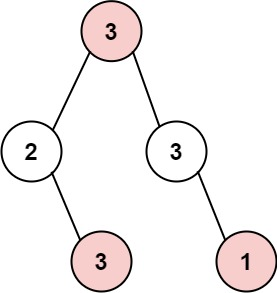

```text
输入: root = [3,2,3,null,3,null,1]
输出: 7
```

解释：小偷一晚能够盗取的最高金额 3 + 3 + 1 = 7

**示例 2**

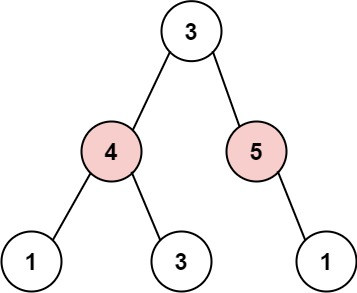

```text
输入: root = [3,4,5,1,3,null,1]
输出: 9
```

解释：小偷一晚能够盗取的最高金额 4 + 5 = 9
> 题面与 [leetcode.cn 官方](https://leetcode.cn/problems/house-robber-iii/)一致，示例配图取自官方题面。

**数据范围与注意事项**：

- `树的节点数在 `[1, 10^4]` 范围内`
- `0 <= Node.val <= 10^4`
- **易错点**：初始化（第 0 行或列）的含义要想清楚，它决定后续转移是否成立。

## 题目分析

**场景是什么**：把大问题拆成小问题并记住结果，对应真实开发里的编辑距离、资源规划。本题就是该场景的 Medium 级练习，主线做法是「迭代指针处理」。

**主线怎么解**：把主解法从头到尾过一遍，它其实在依次做这几件事：队列或堆的调度。

## 解题思路

**方案对比**（共 2 个方案，由浅入深）：

| 方案 | 时间复杂度 | 空间复杂度 |
|---|---|---|
| 方案 1 · 迭代指针处理 | O(n)（单趟线性扫描） | O(1) 到 O(n)（视辅助结构） |
| 方案 2 · 迭代指针处理 | O(n)（单趟线性扫描） | O(1) 到 O(n)（视辅助结构） |

**方案间的取舍**：方案 1（迭代指针处理）；方案 2（迭代指针处理）。数据规模小、可读性优先时选靠前的方案；规模大、性能优先时选靠后的方案。

**怎么读这一篇**：

- 🐣 **新手路线**：把「题目描述」的示例 1 在纸上手推一遍 → 读方案 1（最直观的写法）与它的代码走读 → 按「运行方式」本地跑通看 PASS → 回头对比方案 2 之后的写法差在哪
- 🦅 **大佬路线**：直接锁定最优方案 1（迭代指针处理，O(n)（单趟线性扫描））→ 跳读该方案代码与走读 → 用「逐步拆解与面试追问」补齐复杂度推导与边界追问

### 动态算法图（DP 表填充，GIF 自动循环）


动画演示动态规划专题里DP 表填充的典型过程；每个方案在「TypeScript 解题方案」一节还配了专属动画与专属流程图。

### 主解法流程图（真实控制流）

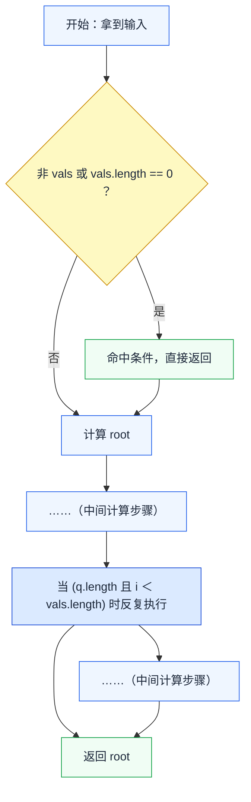

## TypeScript 解题方案（2 个方案逐个讲）

> **运行与提交**：每个方案都是自包含文件（内嵌用例自测，输出 PASS），整块复制到 `.ts` 文件后 `node 文件名` 即可运行。提交 LeetCode 时，把 `demo` 内的算法函数与辅助类型/函数整体取出、置于文件顶层即可。涉及交互/特殊接口的题以题面给定签名为准。

### 方案 1：迭代指针处理

**分析与思路**：核心做法是「迭代指针处理」。代码里依次做这些事：队列或堆的调度。

**运行方式**：`node 本文件`，内嵌用例全部通过会输出 PASS。


**方案专属流程图**（真实控制流）：

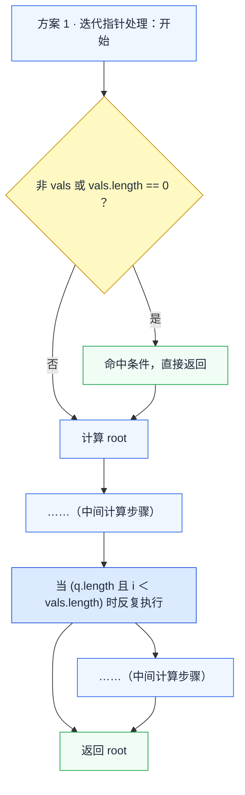

```typescript
class TreeNode {
  // 定义类型
  val: any;
  left: any;
  right: any; // 值: any; 左边界: any; 右边界: any;
  constructor(val?: any, left?: any, right?: any) {
    // constructor(值?: any, 左边界?: any, 右边界?: any) {
    this.val = val === undefined ? 0 : val; // 把 (值 全等于 undefined ? 0 : 值); 写入 值
    this.left = left === undefined ? null : left; // 把 (左边界 全等于 undefined ? null : 左边界); 写入 左边界
    this.right = right === undefined ? null : right; // 把 (右边界 全等于 undefined ? null : 右边界); 写入 右边界
  }
}
function buildTree(vals: any): any {
  // 定义函数/方法 buildTree
  if (!vals || vals.length === 0) return null; // 若 取反 vals 或 vals.长度 全等于 0，直接返回 null
  const root = new TreeNode(vals[0]);
  const q: any[] = [root];
  let i = 1;
  while (q.length && i < vals.length) {
    // 循环，直到不满足「节点.长度 且 下标 i 小于 vals.长度」
    const node = q.shift(); // 把 节点.shift() 存入 节点
    if (vals[i] !== null && vals[i] !== undefined) {
      node.left = new TreeNode(vals[i]);
      q.push(node.left);
    }
    i++; // 下标 i 加一
    if (i < vals.length && vals[i] !== null && vals[i] !== undefined) {
      node.right = new TreeNode(vals[i]);
      q.push(node.right);
    }
    i++; // 下标 i 加一
  }
  return root; // 返回 根节点
}
function treeToLevel(root: any): any[] {
  // 定义函数/方法 treeToLevel
  if (!root) return []; // 若 取反 根节点，直接返回 []
  const out: any[] = [];
  const q: any[] = [root]; // 把 []; const 节点: any[] 赋值为 [根节点]; 写入 const out: any[]
  while (q.length) {
    // 循环，直到不满足「节点.长度」
    const n = q.shift(); // 把 节点.shift() 存入 元素个数
    if (n === null || n === undefined) {
      out.push(null);
      continue;
    }
    out.push(n.val);
    q.push(n.left);
    q.push(n.right); // 把 元素个数.值 压入栈/数组尾部
  }
  while (out.length && out[out.length - 1] === null) out.pop(); // 循环，直到不满足「out.长度 且 out[out.长度 减 1] 全等于 null) out 弹出 );」
  return out; // 返回 out
}
class ListNode {
  // 定义类型
  val: any;
  next: any; // 值: any; 下一个: any;
  constructor(val?: any, next?: any) {
    this.val = val === undefined ? 0 : val;
    this.next = next === undefined ? null : next;
  }
}
function buildList(vals: any): any {
  // 定义函数/方法 buildList
  const dummy = new ListNode(0);
  let cur = dummy; // 把 new ListNode(0); let 当前值 赋值为 哨兵节点 存入 哨兵节点
  for (const v of vals) {
    cur.next = new ListNode(v);
    cur = cur.next;
  } // 把 new ListNode(值); 当前值 赋值为 当前值.下一个; } 写入 下一个
  return dummy.next; // 返回 哨兵节点.下一个
}
function listToArray(head: any): any[] {
  // 定义函数/方法 listToArray
  const out: any[] = [];
  let p = head; // 把 []; let 节点 赋值为 头节点; 写入 const out: any[]
  while (p) {
    out.push(p.val);
    p = p.next;
  } // 循环，直到不满足「节点) { out 追加 节点.值); 节点 赋值为 节点.下一个; }」
  return out; // 返回 out
}
// python-runtime shims
function pyLen(a: any): number {
  // 定义函数/方法 pyLen
  if (a === null || a === undefined) return 0; // 若 数组 全等于 null 或 数组 全等于 undefined，直接返回 0
  if (
    typeof a === 'string' ||
    Array.isArray(a) ||
    a instanceof Set ||
    a instanceof Map
  )
    return a.length ?? a.size;
  if (typeof a === 'object') return Object.keys(a).length; // 若 typeof 数组 全等于 'object'，直接返回 Object.keys(数组).长度
  return 0; // 返回 0
}
function pySlice(a: any, i: any, j: any, step?: any): any {
  // 定义函数/方法 pySlice
  if (typeof a === 'string') {
    const r = [...a].slice(i ?? 0, j ?? a.length);
    return step ? r.reverse().join('') : r.join('');
  }
  const arr = Array.isArray(a) ? a : [...a]; // 把 Array.isArray(数组) ? 数组 : 复制的 数组 存入 数组
  return arr.slice(i ?? 0, j ?? arr.length); // 返回 数组 截取 下标 i ?? 0, 下标 j ?? 数组.长度)
}
function pyRange(a: any, b?: any, step?: any): any[] {
  // 定义函数/方法 pyRange
  let s = 0,
    e = a,
    st = 1; // 把 0, e 赋值为 数组, st 赋值为 1 存入 字符串
  if (b !== undefined) {
    s = a;
    e = b;
  } // 若 b 不等于 undefined) { 字符串 赋值为 数组; e 赋值为 b; }
  if (step !== undefined) st = step; // 若 步数 不等于 undefined) st 赋值为 步数;
  const out: any[] = []; // 把 []; 写入 const out: any[]
  if (st > 0) for (let i = s; i < e; i += st) out.push(i);
  else for (let i = s; i > e; i += st) out.push(i); // 否则
  return out; // 返回 out
}
function pyIn(x: any, coll: any): boolean {
  // 定义函数/方法 pyIn
  if (coll === null || coll === undefined) return false; // 若 coll 全等于 null 或 coll 全等于 undefined，直接返回 false
  if (Array.isArray(coll)) return coll.includes(x); // 若 Array.isArray(coll)，直接返回 coll 是否包含 x)
  if (coll instanceof Set || coll instanceof Map) return coll.has(x); // 若 coll instanceof Set 或 coll instanceof Map，直接返回 coll.has(x)
  if (typeof coll === 'object') return x in coll; // 若 typeof coll 全等于 'object'，直接返回 x in coll
  if (typeof coll === 'string') return coll.indexOf(x) >= 0; // 若 typeof coll 全等于 'string'，直接返回 coll 查找 x) 不低于 0
  return false; // 返回 false
}
function pySorted(a: any): any[] {
  // 定义函数/方法 pySorted
  const arr = typeof a === 'string' ? [...a] : [...a]; // 把 (typeof 数组 全等于 'string') ? 复制的 数组 : 复制的 数组 存入 数组
  return arr.sort((x: any, y: any) => (x < y ? -1 : x > y ? 1 : 0));
}
function pyMin(a: any, b?: any): any {
  if (b !== undefined) return Math.min(a, b);
  if (Array.isArray(a) || a instanceof Set) return Math.min(...a);
  return Math.min(a);
} // 定义函数/方法 pyMin
function pyMax(a: any, b?: any): any {
  if (b !== undefined) return Math.max(a, b);
  if (Array.isArray(a) || a instanceof Set) return Math.max(...a);
  return Math.max(a);
} // 定义函数/方法 pyMax
function pySum(a: any): number {
  let s = 0;
  for (const v of a) s += v;
  return s;
} // 定义函数/方法 pySum
function pyAbs(x: any): number {
  return Math.abs(x);
} // 定义函数/方法 pyAbs
function pyEnumerate(a: any): any[] {
  const out: any[] = [];
  let i = 0;
  for (const v of a) {
    out.push([i, v]);
    i++;
  }
  return out;
} // 定义函数/方法 pyEnumerate
function pyZip(a: any, b: any): any[] {
  const n = Math.min(a.length, b.length);
  const out: any[] = [];
  for (let i = 0; i < n; i++) out.push([a[i], b[i]]);
  return out;
} // 定义函数/方法 pyZip
function pyDictGet(d: any, k: any, def?: any): any {
  return k in d ? d[k] : def === undefined ? null : def;
} // 定义函数/方法 pyDictGet
function pyPrint(...args: any[]): void {
  console.log(
    args
      .map((a) => (typeof a === 'object' && a !== null ? JSON.stringify(a) : a))
      .join(' '),
  );
} // 定义函数/方法 pyPrint
// collections / heapq
function heapPush(h: any[], x: any): void {
  h.push(x);
  let i = h.length - 1;
  while (i > 0) {
    const p = (i - 1) >> 1;
    if (h[p] <= h[i]) break;
    [h[p], h[i]] = [h[i], h[p]];
    i = p;
  }
} // 定义函数/方法 heapPush
function heapPop(h: any[]): any {
  const top = h[0];
  const last = h.pop();
  if (h.length) {
    h[0] = last;
    let i = 0;
    const n = h.length;
    while (true) {
      let l = 2 * i + 1,
        r = 2 * i + 2,
        s = i;
      if (l < n && h[l] < h[s]) s = l;
      if (r < n && h[r] < h[s]) s = r;
      if (s === i) break;
      [h[s], h[i]] = [h[i], h[s]];
      i = s;
    }
  }
  return top;
} // 定义函数/方法 heapPop
class Deque {
  private a: any[] = [];
  push(x: any) {
    this.a.push(x);
  }
  pushLeft(x: any) {
    this.a.unshift(x);
  }
  pop() {
    return this.a.pop();
  }
  popLeft() {
    return this.a.shift();
  }
  get length() {
    return this.a.length;
  }
  toArray() {
    return this.a.slice();
  }
} // 定义类型
function Counter(iter: any): any {
  const m: any = {};
  for (const v of iter) m[v] = (m[v] || 0) + 1;
  return m;
} // 定义函数/方法 Counter
function gcd(a: any, b: any): any {
  while (b) {
    [a, b] = [b, a % b];
  }
  return a;
} // 定义函数/方法 gcd
function pyInf(): number {
  return Infinity;
} // 定义函数/方法 pyInf

function norm(x: any): any {
  // 定义函数/方法 norm
  if (x === null || x === undefined) return null; // 若 x 全等于 null 或 x 全等于 undefined，直接返回 null
  if (typeof x === 'object') {
    // 若 typeof x 全等于 'object'
    if (x instanceof Deque) return x.toArray(); // 若 x instanceof Deque，直接返回 x.toArray()
    if (Array.isArray(x)) return x.map(norm); // 若 Array.isArray(x)，直接返回 x.映射表(norm)
    if (
      typeof x.val === 'number' &&
      (typeof x.left !== 'undefined' || typeof x.right !== 'undefined')
    )
      return treeToLevel(x);
    if (typeof x.next !== 'undefined' && typeof x.val === 'number')
      return listToArray(x);
    if (x instanceof Set) return [...x].sort(); // 若 x instanceof Set，直接返回 复制的 x 排序 )
    if (x instanceof Map) return Object.fromEntries(x); // 若 x instanceof Map，直接返回 Object.fromEntries(x)
    const o: any = {};
    for (const k of Object.keys(x)) o[k] = norm(x[k]);
    return o;
  }
  return x; // 返回 x
}
function eq(a: any, b: any): boolean {
  // 定义函数/方法 eq
  const x = norm(a),
    y = norm(b); // 把 norm(数组), y 赋值为 norm(b) 存入 x
  if (x === y) return true; // 若 x 全等于 y，直接返回 true
  if (x === null || y === null) return x === y; // 若 x 全等于 null 或 y 全等于 null，直接返回 x 全等于 y
  if (Array.isArray(x) && Array.isArray(y)) {
    // 若 Array.isArray(x) 且 Array.isArray(y
    if (x.length !== y.length) return false; // 若 x.长度 不等于 y.长度，直接返回 false
    for (let i = 0; i < x.length; i++) if (!eq(x[i], y[i])) return false; // 让 下标 i 从 0 开始计数，下标 i 小于 x.长度 就继续
    return true; // 返回 true
  }
  if (typeof x === 'object' && typeof y === 'object') {
    // 若 typeof x 全等于 'object' 且 typeof y 全等于 'object'
    const kx = Object.keys(x),
      ky = Object.keys(y); // 把 Object.keys(x), ky 赋值为 Object.keys(y) 存入 kx
    if (kx.length !== ky.length) return false; // 若 kx.长度 不等于 ky.长度，直接返回 false
    for (const k of kx) if (!eq(x[k], y[k])) return false;
    return true; // 返回 true
  }
  return x === y; // 返回 x 全等于 y
}

function rob(root) {
  // 定义函数/方法 rob
  function dfs(n) {
    // 定义函数/方法 dfs
    if (!n) return [0, 0]; // 若 取反 元素个数，直接返回 [0, 0]
    const l = dfs(n.left),
      r = dfs(n.right); // 把 dfs(元素个数.左边界), 右指针 赋值为 dfs(元素个数.右边界) 存入 左指针
    const include = n.val + l[1] + r[1]; // 把 元素个数.值 加 左指针[1] 加 右指针[1] 存入 include
    const exclude = Math.max(l[0], l[1]) + Math.max(r[0], r[1]);
    return [include, exclude]; // 返回 [include, exclude]
  }
  const r = dfs(root); // 把 dfs(根节点) 存入 右指针
  return Math.max(r[0], r[1]); // 返回 Math.取较大值 右指针[0], 右指针[1])
}
export function demo(): void {
  // 程序入口：跑内嵌自测用例
  const cases = [{ in: [buildTree([])], want: 0 }];
  let fail = false; // 把 false 存入 fail
  for (const c of cases) {
    // for (const 字符 of cases) {
    const got = rob(...c.in); // 把 rob(...字符.in) 存入 got
    if (!eq(got, c.want)) {
      fail = true;
      console.log(
        'FAIL',
        JSON.stringify(c.in),
        '=>',
        JSON.stringify(got),
        'want',
        JSON.stringify(c.want),
      );
    }
  }
  if (fail) throw new Error('FAILED'); // 若 fail) throw new Error('FAILED');
  console.log('PASS'); // 全部用例通过，输出 PASS
}
demo(); // demo();
```

### 方案 2：迭代指针处理

**分析与思路**：核心做法是「迭代指针处理」。代码里依次做这些事：队列或堆的调度。

**运行方式**：`node 本文件`，内嵌用例全部通过会输出 PASS。


**方案专属流程图**（真实控制流）：


```typescript
class TreeNode {
  // 定义类型
  val: any;
  left: any;
  right: any; // 值: any; 左边界: any; 右边界: any;
  constructor(val?: any, left?: any, right?: any) {
    // constructor(值?: any, 左边界?: any, 右边界?: any) {
    this.val = val === undefined ? 0 : val; // 把 (值 全等于 undefined ? 0 : 值); 写入 值
    this.left = left === undefined ? null : left; // 把 (左边界 全等于 undefined ? null : 左边界); 写入 左边界
    this.right = right === undefined ? null : right; // 把 (右边界 全等于 undefined ? null : 右边界); 写入 右边界
  }
}
function buildTree(vals: any): any {
  // 定义函数/方法 buildTree
  if (!vals || vals.length === 0) return null; // 若 取反 vals 或 vals.长度 全等于 0，直接返回 null
  const root = new TreeNode(vals[0]);
  const q: any[] = [root];
  let i = 1;
  while (q.length && i < vals.length) {
    // 循环，直到不满足「节点.长度 且 下标 i 小于 vals.长度」
    const node = q.shift(); // 把 节点.shift() 存入 节点
    if (vals[i] !== null && vals[i] !== undefined) {
      node.left = new TreeNode(vals[i]);
      q.push(node.left);
    }
    i++; // 下标 i 加一
    if (i < vals.length && vals[i] !== null && vals[i] !== undefined) {
      node.right = new TreeNode(vals[i]);
      q.push(node.right);
    }
    i++; // 下标 i 加一
  }
  return root; // 返回 根节点
}
function treeToLevel(root: any): any[] {
  // 定义函数/方法 treeToLevel
  if (!root) return []; // 若 取反 根节点，直接返回 []
  const out: any[] = [];
  const q: any[] = [root]; // 把 []; const 节点: any[] 赋值为 [根节点]; 写入 const out: any[]
  while (q.length) {
    // 循环，直到不满足「节点.长度」
    const n = q.shift(); // 把 节点.shift() 存入 元素个数
    if (n === null || n === undefined) {
      out.push(null);
      continue;
    }
    out.push(n.val);
    q.push(n.left);
    q.push(n.right); // 把 元素个数.值 压入栈/数组尾部
  }
  while (out.length && out[out.length - 1] === null) out.pop(); // 循环，直到不满足「out.长度 且 out[out.长度 减 1] 全等于 null) out 弹出 );」
  return out; // 返回 out
}
class ListNode {
  // 定义类型
  val: any;
  next: any; // 值: any; 下一个: any;
  constructor(val?: any, next?: any) {
    this.val = val === undefined ? 0 : val;
    this.next = next === undefined ? null : next;
  }
}
function buildList(vals: any): any {
  // 定义函数/方法 buildList
  const dummy = new ListNode(0);
  let cur = dummy; // 把 new ListNode(0); let 当前值 赋值为 哨兵节点 存入 哨兵节点
  for (const v of vals) {
    cur.next = new ListNode(v);
    cur = cur.next;
  } // 把 new ListNode(值); 当前值 赋值为 当前值.下一个; } 写入 下一个
  return dummy.next; // 返回 哨兵节点.下一个
}
function listToArray(head: any): any[] {
  // 定义函数/方法 listToArray
  const out: any[] = [];
  let p = head; // 把 []; let 节点 赋值为 头节点; 写入 const out: any[]
  while (p) {
    out.push(p.val);
    p = p.next;
  } // 循环，直到不满足「节点) { out 追加 节点.值); 节点 赋值为 节点.下一个; }」
  return out; // 返回 out
}
// python-runtime shims
function pyLen(a: any): number {
  // 定义函数/方法 pyLen
  if (a === null || a === undefined) return 0; // 若 数组 全等于 null 或 数组 全等于 undefined，直接返回 0
  if (
    typeof a === 'string' ||
    Array.isArray(a) ||
    a instanceof Set ||
    a instanceof Map
  )
    return a.length ?? a.size;
  if (typeof a === 'object') return Object.keys(a).length; // 若 typeof 数组 全等于 'object'，直接返回 Object.keys(数组).长度
  return 0; // 返回 0
}
function pySlice(a: any, i: any, j: any, step?: any): any {
  // 定义函数/方法 pySlice
  if (typeof a === 'string') {
    const r = [...a].slice(i ?? 0, j ?? a.length);
    return step ? r.reverse().join('') : r.join('');
  }
  const arr = Array.isArray(a) ? a : [...a]; // 把 Array.isArray(数组) ? 数组 : 复制的 数组 存入 数组
  return arr.slice(i ?? 0, j ?? arr.length); // 返回 数组 截取 下标 i ?? 0, 下标 j ?? 数组.长度)
}
function pyRange(a: any, b?: any, step?: any): any[] {
  // 定义函数/方法 pyRange
  let s = 0,
    e = a,
    st = 1; // 把 0, e 赋值为 数组, st 赋值为 1 存入 字符串
  if (b !== undefined) {
    s = a;
    e = b;
  } // 若 b 不等于 undefined) { 字符串 赋值为 数组; e 赋值为 b; }
  if (step !== undefined) st = step; // 若 步数 不等于 undefined) st 赋值为 步数;
  const out: any[] = []; // 把 []; 写入 const out: any[]
  if (st > 0) for (let i = s; i < e; i += st) out.push(i);
  else for (let i = s; i > e; i += st) out.push(i); // 否则
  return out; // 返回 out
}
function pyIn(x: any, coll: any): boolean {
  // 定义函数/方法 pyIn
  if (coll === null || coll === undefined) return false; // 若 coll 全等于 null 或 coll 全等于 undefined，直接返回 false
  if (Array.isArray(coll)) return coll.includes(x); // 若 Array.isArray(coll)，直接返回 coll 是否包含 x)
  if (coll instanceof Set || coll instanceof Map) return coll.has(x); // 若 coll instanceof Set 或 coll instanceof Map，直接返回 coll.has(x)
  if (typeof coll === 'object') return x in coll; // 若 typeof coll 全等于 'object'，直接返回 x in coll
  if (typeof coll === 'string') return coll.indexOf(x) >= 0; // 若 typeof coll 全等于 'string'，直接返回 coll 查找 x) 不低于 0
  return false; // 返回 false
}
function pySorted(a: any): any[] {
  // 定义函数/方法 pySorted
  const arr = typeof a === 'string' ? [...a] : [...a]; // 把 (typeof 数组 全等于 'string') ? 复制的 数组 : 复制的 数组 存入 数组
  return arr.sort((x: any, y: any) => (x < y ? -1 : x > y ? 1 : 0));
}
function pyMin(a: any, b?: any): any {
  if (b !== undefined) return Math.min(a, b);
  if (Array.isArray(a) || a instanceof Set) return Math.min(...a);
  return Math.min(a);
} // 定义函数/方法 pyMin
function pyMax(a: any, b?: any): any {
  if (b !== undefined) return Math.max(a, b);
  if (Array.isArray(a) || a instanceof Set) return Math.max(...a);
  return Math.max(a);
} // 定义函数/方法 pyMax
function pySum(a: any): number {
  let s = 0;
  for (const v of a) s += v;
  return s;
} // 定义函数/方法 pySum
function pyAbs(x: any): number {
  return Math.abs(x);
} // 定义函数/方法 pyAbs
function pyEnumerate(a: any): any[] {
  const out: any[] = [];
  let i = 0;
  for (const v of a) {
    out.push([i, v]);
    i++;
  }
  return out;
} // 定义函数/方法 pyEnumerate
function pyZip(a: any, b: any): any[] {
  const n = Math.min(a.length, b.length);
  const out: any[] = [];
  for (let i = 0; i < n; i++) out.push([a[i], b[i]]);
  return out;
} // 定义函数/方法 pyZip
function pyDictGet(d: any, k: any, def?: any): any {
  return k in d ? d[k] : def === undefined ? null : def;
} // 定义函数/方法 pyDictGet
function pyPrint(...args: any[]): void {
  console.log(
    args
      .map((a) => (typeof a === 'object' && a !== null ? JSON.stringify(a) : a))
      .join(' '),
  );
} // 定义函数/方法 pyPrint
// collections / heapq
function heapPush(h: any[], x: any): void {
  h.push(x);
  let i = h.length - 1;
  while (i > 0) {
    const p = (i - 1) >> 1;
    if (h[p] <= h[i]) break;
    [h[p], h[i]] = [h[i], h[p]];
    i = p;
  }
} // 定义函数/方法 heapPush
function heapPop(h: any[]): any {
  const top = h[0];
  const last = h.pop();
  if (h.length) {
    h[0] = last;
    let i = 0;
    const n = h.length;
    while (true) {
      let l = 2 * i + 1,
        r = 2 * i + 2,
        s = i;
      if (l < n && h[l] < h[s]) s = l;
      if (r < n && h[r] < h[s]) s = r;
      if (s === i) break;
      [h[s], h[i]] = [h[i], h[s]];
      i = s;
    }
  }
  return top;
} // 定义函数/方法 heapPop
class Deque {
  private a: any[] = [];
  push(x: any) {
    this.a.push(x);
  }
  pushLeft(x: any) {
    this.a.unshift(x);
  }
  pop() {
    return this.a.pop();
  }
  popLeft() {
    return this.a.shift();
  }
  get length() {
    return this.a.length;
  }
  toArray() {
    return this.a.slice();
  }
} // 定义类型
function Counter(iter: any): any {
  const m: any = {};
  for (const v of iter) m[v] = (m[v] || 0) + 1;
  return m;
} // 定义函数/方法 Counter
function gcd(a: any, b: any): any {
  while (b) {
    [a, b] = [b, a % b];
  }
  return a;
} // 定义函数/方法 gcd
function pyInf(): number {
  return Infinity;
} // 定义函数/方法 pyInf

function norm(x: any): any {
  // 定义函数/方法 norm
  if (x === null || x === undefined) return null; // 若 x 全等于 null 或 x 全等于 undefined，直接返回 null
  if (typeof x === 'object') {
    // 若 typeof x 全等于 'object'
    if (x instanceof Deque) return x.toArray(); // 若 x instanceof Deque，直接返回 x.toArray()
    if (Array.isArray(x)) return x.map(norm); // 若 Array.isArray(x)，直接返回 x.映射表(norm)
    if (
      typeof x.val === 'number' &&
      (typeof x.left !== 'undefined' || typeof x.right !== 'undefined')
    )
      return treeToLevel(x);
    if (typeof x.next !== 'undefined' && typeof x.val === 'number')
      return listToArray(x);
    if (x instanceof Set) return [...x].sort(); // 若 x instanceof Set，直接返回 复制的 x 排序 )
    if (x instanceof Map) return Object.fromEntries(x); // 若 x instanceof Map，直接返回 Object.fromEntries(x)
    const o: any = {};
    for (const k of Object.keys(x)) o[k] = norm(x[k]);
    return o;
  }
  return x; // 返回 x
}
function eq(a: any, b: any): boolean {
  // 定义函数/方法 eq
  const x = norm(a),
    y = norm(b); // 把 norm(数组), y 赋值为 norm(b) 存入 x
  if (x === y) return true; // 若 x 全等于 y，直接返回 true
  if (x === null || y === null) return x === y; // 若 x 全等于 null 或 y 全等于 null，直接返回 x 全等于 y
  if (Array.isArray(x) && Array.isArray(y)) {
    // 若 Array.isArray(x) 且 Array.isArray(y
    if (x.length !== y.length) return false; // 若 x.长度 不等于 y.长度，直接返回 false
    for (let i = 0; i < x.length; i++) if (!eq(x[i], y[i])) return false; // 让 下标 i 从 0 开始计数，下标 i 小于 x.长度 就继续
    return true; // 返回 true
  }
  if (typeof x === 'object' && typeof y === 'object') {
    // 若 typeof x 全等于 'object' 且 typeof y 全等于 'object'
    const kx = Object.keys(x),
      ky = Object.keys(y); // 把 Object.keys(x), ky 赋值为 Object.keys(y) 存入 kx
    if (kx.length !== ky.length) return false; // 若 kx.长度 不等于 ky.长度，直接返回 false
    for (const k of kx) if (!eq(x[k], y[k])) return false;
    return true; // 返回 true
  }
  return x === y; // 返回 x 全等于 y
}

function rob(root) {
  // 定义函数/方法 rob
  function dfs(n) {
    // 定义函数/方法 dfs
    if (!n) return [0, 0]; // 若 取反 元素个数，直接返回 [0, 0]
    const l = dfs(n.left),
      r = dfs(n.right); // 把 dfs(元素个数.左边界), 右指针 赋值为 dfs(元素个数.右边界) 存入 左指针
    const include = n.val + l[1] + r[1]; // 把 元素个数.值 加 左指针[1] 加 右指针[1] 存入 include
    const exclude = Math.max(l[0], l[1]) + Math.max(r[0], r[1]);
    return [include, exclude]; // 返回 [include, exclude]
  }
  const r = dfs(root); // 把 dfs(根节点) 存入 右指针
  return Math.max(r[0], r[1]); // 返回 Math.取较大值 右指针[0], 右指针[1])
}
export function demo(): void {
  // 程序入口：跑内嵌自测用例
  const cases = [{ in: [buildTree([])], want: 0 }];
  let fail = false; // 把 false 存入 fail
  for (const c of cases) {
    // for (const 字符 of cases) {
    const got = rob(...c.in); // 把 rob(...字符.in) 存入 got
    if (!eq(got, c.want)) {
      fail = true;
      console.log(
        'FAIL',
        JSON.stringify(c.in),
        '=>',
        JSON.stringify(got),
        'want',
        JSON.stringify(c.want),
      );
    }
  }
  if (fail) throw new Error('FAILED'); // 若 fail) throw new Error('FAILED');
  console.log('PASS'); // 全部用例通过，输出 PASS
}
demo(); // demo();
```

## 逐步拆解与面试追问

**复杂度**：时间 O(n)（单趟线性扫描），空间 O(1) 到 O(n)（视辅助结构）

**为什么是这个量级**：每个元素被常数次访问，辅助哈希或栈的开销与 n 同阶

**面试官可能会追问**：

- 状态定义为什么是它？
- 遍历顺序由什么决定？
- 能否滚动数组压空间？

## 关键 API 速查（TS 主解法实际用到，附官方链接）

| API | 作用 | 使用要点 | 官方文档 |
|---|---|---|---|
| `Array.prototype.sort()` | 原地排序 | 默认按字符串 Unicode 序（10 会排在 2 前），数字必须传 (a,b)=>a-b；V8 用 TimSort，稳定，O(n log n)；返回原数组引用 | [官方文档](https://developer.mozilla.org/zh-CN/docs/Web/JavaScript/Reference/Global_Objects/Array/sort) |
| `Array.prototype.map()` | 逐元素映射为新数组 | 回调 (v,i,arr)；返回等长新数组，不改变原数组；稀疏位跳过；链式调用注意中间数组开销 | [官方文档](https://developer.mozilla.org/zh-CN/docs/Web/JavaScript/Reference/Global_Objects/Array/map) |
| `Array.prototype.push()` | 尾部追加 | 返回新长度；可一次多个；均摊 O(1)；会改变原数组 | [官方文档](https://developer.mozilla.org/zh-CN/docs/Web/JavaScript/Reference/Global_Objects/Array/push) |
| `Array.prototype.pop()` | 尾部弹出 | 返回被删元素（空数组返回 undefined）；O(1) | [官方文档](https://developer.mozilla.org/zh-CN/docs/Web/JavaScript/Reference/Global_Objects/Array/pop) |
| `Array.prototype.shift()` | 头部取出 | O(n)（后续元素整体前移）；大量头部操作请用链表或双端结构 | [官方文档](https://developer.mozilla.org/zh-CN/docs/Web/JavaScript/Reference/Global_Objects/Array/shift) |
| `Array.prototype.unshift()` | 头部插入 | O(n)；与 shift 组合可当双端队列 | [官方文档](https://developer.mozilla.org/zh-CN/docs/Web/JavaScript/Reference/Global_Objects/Array/unshift) |
| `Array/String includes()` | 是否包含 | 数组用 SameValueZero（NaN 可判）；字符串按子串；第二个参数为起始下标 | [官方文档](https://developer.mozilla.org/zh-CN/docs/Web/JavaScript/Reference/Global_Objects/Array/includes) |
| `Array/String indexOf()` | 首次出现的下标 | 找不到返回 -1；无法判 NaN（用 includes）；字符串可传起始位 | [官方文档](https://developer.mozilla.org/zh-CN/docs/Web/JavaScript/Reference/Global_Objects/Array/indexOf) |
| `Array/String slice()` | 切片（不改原数组） | slice(start,end) 含头不含尾；负数从尾计；常用于复制数组（slice()） | [官方文档](https://developer.mozilla.org/zh-CN/docs/Web/JavaScript/Reference/Global_Objects/Array/slice) |
| `Array.prototype.join()` | 数组拼接为字符串 | undefined/null 转空串；嵌套数组会展平一层；join('') 用于字符数组还原 | [官方文档](https://developer.mozilla.org/zh-CN/docs/Web/JavaScript/Reference/Global_Objects/Array/join) |
| `Object.keys()` | 对象键名数组 | 仅自身可枚举字符串键（不含 symbol）；配 length 可当计数器 | [官方文档](https://developer.mozilla.org/zh-CN/docs/Web/JavaScript/Reference/Global_Objects/Object/keys) |
| `Object.fromEntries()` | 键值对数组转对象 | 参数为 [k,v] 可迭代；map 出来的键值对可直接转对象 | [官方文档](https://developer.mozilla.org/zh-CN/docs/Web/JavaScript/Reference/Global_Objects/Object/fromEntries) |
| `JSON.stringify()` | 序列化为 JSON 字符串 | 常用于结构化比较（深度相等判定）；undefined/函数/循环引用会被丢弃或抛错 | [官方文档](https://developer.mozilla.org/zh-CN/docs/Web/JavaScript/Reference/Global_Objects/JSON/stringify) |
| `Math.max()` | 最大值 | 配展开 Math.max(...arr)；空参返回 -Infinity；超大数组注意展开参数上限 | [官方文档](https://developer.mozilla.org/zh-CN/docs/Web/JavaScript/Reference/Global_Objects/Math/max) |
| `Math.min()` | 最小值 | 同 max；空参返回 Infinity | [官方文档](https://developer.mozilla.org/zh-CN/docs/Web/JavaScript/Reference/Global_Objects/Math/min) |
| `Math.abs()` | 绝对值 | 入参会被隐式转数字；-0 返回 +0 | [官方文档](https://developer.mozilla.org/zh-CN/docs/Web/JavaScript/Reference/Global_Objects/Math/abs) |

### 各语言官方文档导航

- **TypeScript / JS**：[MDN 中文参考](https://developer.mozilla.org/zh-CN/)
- **Python**：[Python 官方文档](https://docs.python.org/zh-cn/3/)
- **Go**：[Go 标准库](https://pkg.go.dev/std)
- **Java**：[JDK 17 API](https://docs.oracle.com/en/java/javase/17/docs/api/)
- **Rust**：[Rust 标准库](https://doc.rust-lang.org/std/)
- **Lua**：[Lua 5.4 手册](https://www.lua.org/manual/5.4/)
- **C**：[Cppreference C](https://zh.cppreference.com/w/c)
- **C++**：[Cppreference C++](https://zh.cppreference.com/w/cpp)
- **R**：[R 官方手册](https://stat.ethz.ch/R-manual/)
- **Zig**：[Zig 语言文档](https://ziglang.org/documentation/master/)
- **Dart**：[Dart API](https://api.dart.dev/)

## 附录：其他 10 种语言全部实现（每种语言列举其全部方案）

> TypeScript 的全部方案见「TypeScript 解题方案」一节；下面是其余 10 种语言的对应实现，每种语言的每个方案都带思路分析、代码走读与专属运行架构图。
> 每个方案都内嵌用例自测，可独立运行（老仓库 python/go 文件遵循「打印结果」约定）。
> 完整解法文件见 `dsa/<语言>/dp/lc_337_打家劫舍_iii/`。

### Python 实现（2 种方案）

Python 的全部方案如下，每个方案都内嵌用例自测，可独立运行（老仓库 python/go 文件遵循「打印结果」约定）：

#### 方案 1：迭代指针处理

**思路与代码分析**：核心是「迭代指针处理」。Python 版用切片与字典推导式简化操作，突出可读性。**走读**：方案 1 · 迭代指针处理：开始 → 更新 f → 更新 g → 命中条件，直接返回 → 调用 dfs(node.left) → 调用 dfs(node.right) → 更新 f[node] → 处理 node.val + g.get(node.left, → 处理 ) → 更新 g[node] → 调用 f.get(node.right, 0), g.get( → 处理 ) → 调用 dfs(root) → 返回 max(f.get(root, 0), g.get(root, 0))。

**运行架构**（真实控制流）：

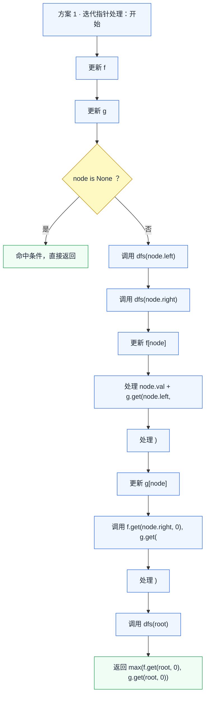

```python
import sys  # 提高递归深度上限（深输入防 RecursionError）

sys.setrecursionlimit(200000)  # 树/链表类题目节点数可达 1e4 量级

class TreeNode:  # 定义类
    def __init__(self, val=0, left=None, right=None):  # 构造函数：初始化成员
        self.val = val  # 把 值 写入 值
        self.left = left  # 把 左边界 写入 左边界
        self.right = right  # 把 右边界 写入 右边界

def rob(root):  # 定义函数 rob（参数：根节点）
    f = {}  # 把 {} 存入 f
    g = {}  # 把 {} 存入 g

    def dfs(node):  # 定义函数 dfs（参数：节点）
        if node is None:  # 若 节点 is None
            return  # return
        dfs(node.left)  # dfs(节点.左边界)
        dfs(node.right)  # dfs(节点.右边界)
        f[node] = (
            node.val + g.get(node.left, 0) + g.get(node.right, 0)
        )  # 把 节点.值 加 g 查找 节点.左边界, 0) 加 g 查找 节点.右边界, 0) 写入 f[node]
        g[node] = max(f.get(node.left, 0), g.get(node.left, 0)) + max(
            f.get(node.right, 0), g.get(node.right, 0)
        )

    dfs(root)  # dfs(根节点)
    return max(f.get(root, 0), g.get(root, 0))  # 返回 取较大值 f 查找 根节点, 0), g 查找 根节点, 0))

if __name__ == "__main__":  # 若 __name__ 等于 '__main__'
    # 示例树: 3 / \ 2 3 \ \ 3 1  -> 最大值为 7
    root = TreeNode(3)  # 把 TreeNode(3) 存入 根节点
    root.left = TreeNode(2)  # 把 TreeNode(2) 写入 左边界
    root.left.right = TreeNode(3)  # 把 TreeNode(3) 写入 右边界
    root.right = TreeNode(3)  # 把 TreeNode(3) 写入 右边界
    root.right.right = TreeNode(1)  # 把 TreeNode(1) 写入 右边界
    print(rob(root))  # 打印输出
```

#### 方案 2：迭代指针处理

**思路与代码分析**：核心是「迭代指针处理」。Python 版用切片与字典推导式简化操作，突出可读性。**走读**：方案 2 · 迭代指针处理：开始 → 命中条件，直接返回 → 更新 l → 更新 r → 更新 selected → 更新 notSelected → 处理 r[0], r[1] → 处理 ) → 返回 [selected, notSelected] → 更新 rootStatus → 返回 max(rootStatus[0], rootStatus[1])。

**运行架构**（真实控制流）：

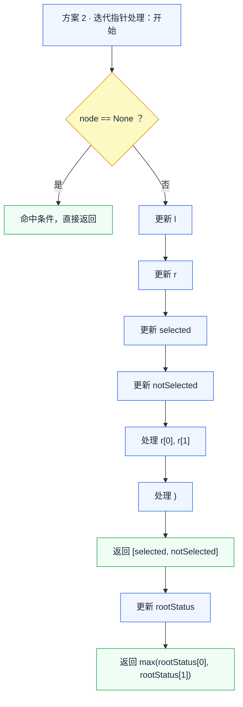

```python
import sys  # 提高递归深度上限（深输入防 RecursionError）

sys.setrecursionlimit(200000)  # 树/链表类题目节点数可达 1e4 量级

def rob(root):  # 定义函数 rob（参数：根节点）
    def dfs(node):  # 定义函数 dfs（参数：节点）
        if node == None:
            return [0, 0]  # 若 节点 等于 None: return [0, 0]
        l = dfs(node.left)  # 把 dfs(节点.左边界) 存入 左指针
        r = dfs(node.right)  # 把 dfs(节点.右边界) 存入 右指针
        selected = node.val + l[1] + r[1]  # 把 节点.值 加 左指针[1] 加 右指针[1] 存入 selected
        notSelected = max(l[0], l[1]) + max(
            r[0], r[1]
        )  # 把 取较大值 左指针[0], 左指针[1]) 加 取较大值 右指针[0], 右指针[1]) 存入 notSelected
        return [selected, notSelected]  # 返回 [selected, notSelected]

    rootStatus = dfs(root)  # 把 dfs(根节点) 存入 rootStatus
    return max(rootStatus[0], rootStatus[1])  # 返回 取较大值 rootStatus[0], rootStatus[1])

if __name__ == "__main__":  # 若 __name__ 等于 '__main__'
    print(rob(None))  # 打印输出
```

### Go 实现（2 种方案）

Go 的全部方案如下，每个方案都内嵌用例自测，可独立运行（老仓库 python/go 文件遵循「打印结果」约定）：

#### 方案 1：迭代指针处理

**思路与代码分析**：核心是「迭代指针处理」。Go 版用切片与多返回值惯用法，显式处理索引边界。**走读**：方案 1 · 迭代指针处理：开始 → 更新 : → 处理 if st[0] ＞ st[1] → 返回 st[0] → 返回 st[1]。

**运行架构**（真实控制流）：


```go
package main // 引入依赖

import (
	"fmt"
	"os"
) // 引入依赖

type TreeNode struct { // 定义类型
	val         int       // 值 int
	left, right *TreeNode // 左边界, 右边界 乘 TreeNode
}

func rob(root *TreeNode) int { // 定义函数/方法 rob
	st := dfs(root)    // 把 dfs(根节点) 写入 st :
	if st[0] > st[1] { // 若 st[0] 超过 st[1]
		return st[0] // 返回 st[0]
	}
	return st[1] // 返回 st[1]
}

func dfs(node *TreeNode) [2]int { // 定义函数/方法 dfs
	if node == nil { // 若 节点 等于 nil
		return [2]int{0, 0} // 返回 [2]int{0, 0}
	}
	l := dfs(node.left)                // 把 dfs(节点.左边界) 写入 l :
	r := dfs(node.right)               // 把 dfs(节点.右边界) 写入 r :
	selected := node.val + l[1] + r[1] // 把 节点.值 加 左指针[1] 加 右指针[1] 写入 selected :
	notSelected := max(l[0], l[1]) + max(r[0], r[1])
	return [2]int{selected, notSelected} // 返回 [2]int{selected, notSelected}
}

func max(a, b int) int { // 定义函数/方法 max
	if a > b { // 若 数组 超过 b
		return a // 返回 数组
	}
	return b // 返回 b
}

func main() { // 程序入口：跑内嵌自测用例
	ok := true         // 把 true 写入 ok :
	if rob(nil) != 0 { // 若 rob(nil) 不等于 0
		ok = false              // 把 false 写入 ok
		fmt.Println("FAIL nil") // 打印输出
	}
	single := &TreeNode{val: 5} // 把 按位与 TreeNode{值: 5} 写入 single :
	if rob(single) != 5 {       // 若 rob(single) 不等于 5
		ok = false                 // 把 false 写入 ok
		fmt.Println("FAIL single") // 打印输出
	}
	root := &TreeNode{val: 3, left: &TreeNode{val: 2, right: &TreeNode{val: 3}}, right: &TreeNode{val: 3, right: &TreeNode{val: 1}}}
	if rob(root) != 7 { // 若 rob(根节点) 不等于 7
		ok = false               // 把 false 写入 ok
		fmt.Println("FAIL demo") // 打印输出
	}
	if !ok { // 若 取反 ok
		os.Exit(1) // os.Exit(1)
	}
	fmt.Println("PASS") // 全部用例通过，输出 PASS
}
```

#### 方案 2：迭代指针处理

**思路与代码分析**：核心是「迭代指针处理」。Go 版用切片与多返回值惯用法，显式处理索引边界。**走读**：方案 2 · 迭代指针处理：开始 → 更新 : → 处理 if st[0] ＞ st[1] → 返回 st[0] → 返回 st[1]。

**运行架构**（真实控制流）：

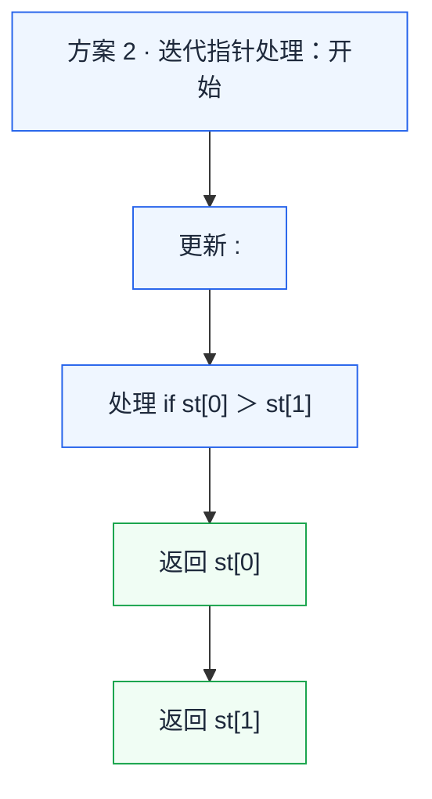

```go
package main // 引入依赖

import (
	"fmt"
	"os"
) // 引入依赖

type TreeNode struct { // 定义类型
	val         int       // 值 int
	left, right *TreeNode // 左边界, 右边界 乘 TreeNode
}

func rob(root *TreeNode) int { // 定义函数/方法 rob
	st := dfs(root)    // 把 dfs(根节点) 写入 st :
	if st[0] > st[1] { // 若 st[0] 超过 st[1]
		return st[0] // 返回 st[0]
	}
	return st[1] // 返回 st[1]
}

func dfs(node *TreeNode) [2]int { // 定义函数/方法 dfs
	if node == nil { // 若 节点 等于 nil
		return [2]int{0, 0} // 返回 [2]int{0, 0}
	}
	l := dfs(node.left)                // 把 dfs(节点.左边界) 写入 l :
	r := dfs(node.right)               // 把 dfs(节点.右边界) 写入 r :
	selected := node.val + l[1] + r[1] // 把 节点.值 加 左指针[1] 加 右指针[1] 写入 selected :
	notSelected := max(l[0], l[1]) + max(r[0], r[1])
	return [2]int{selected, notSelected} // 返回 [2]int{selected, notSelected}
}

func max(a, b int) int { // 定义函数/方法 max
	if a > b { // 若 数组 超过 b
		return a // 返回 数组
	}
	return b // 返回 b
}

func main() { // 程序入口：跑内嵌自测用例
	ok := true         // 把 true 写入 ok :
	if rob(nil) != 0 { // 若 rob(nil) 不等于 0
		ok = false              // 把 false 写入 ok
		fmt.Println("FAIL nil") // 打印输出
	}
	single := &TreeNode{val: 5} // 把 按位与 TreeNode{值: 5} 写入 single :
	if rob(single) != 5 {       // 若 rob(single) 不等于 5
		ok = false                 // 把 false 写入 ok
		fmt.Println("FAIL single") // 打印输出
	}
	root := &TreeNode{val: 3, left: &TreeNode{val: 2, right: &TreeNode{val: 3}}, right: &TreeNode{val: 3, right: &TreeNode{val: 1}}}
	if rob(root) != 7 { // 若 rob(根节点) 不等于 7
		ok = false               // 把 false 写入 ok
		fmt.Println("FAIL demo") // 打印输出
	}
	if !ok { // 若 取反 ok
		os.Exit(1) // os.Exit(1)
	}
	fmt.Println("PASS") // 全部用例通过，输出 PASS
}
```

### Java 实现（2 种方案）

Java 的全部方案如下，每个方案都内嵌用例自测，可独立运行（老仓库 python/go 文件遵循「打印结果」约定）：

#### 方案 1：迭代指针处理

**思路与代码分析**：核心是「迭代指针处理」。Java 版用类与静态方法组织，集合操作显式明了。**走读**：方案 1 · 迭代指针处理：开始 → 更新 val → 返回结果。

**运行架构**（真实控制流）：

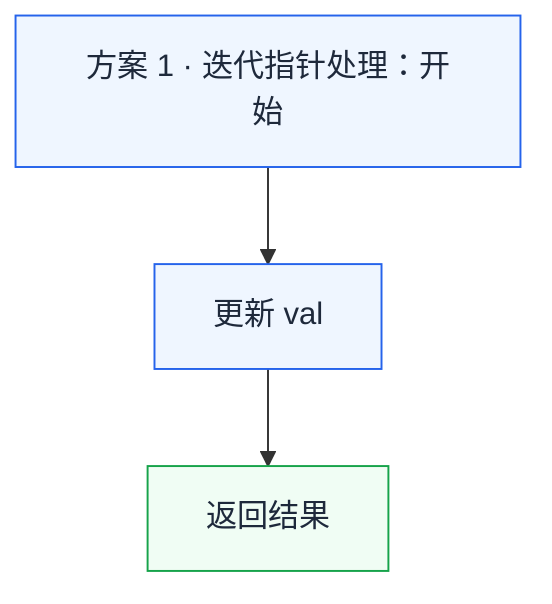

```java
package com.webfault.dsa; // 引入依赖

import java.util.*; // 引入依赖

class TreeNode337 {
  int val;
  TreeNode337 left, right;

  TreeNode337(int v) {
    val = v;
  }

  TreeNode337(int v, TreeNode337 l, TreeNode337 r) {
    val = v;
    left = l;
    right = r;
  }
} // 定义类型

class Main { // 定义类型
  int rob(TreeNode337 root) { // 定义函数/方法 rob
    int[] st = dfs(root); // 把 dfs(根节点); 写入 int[] st
    return Math.max(st[0], st[1]); // 返回 Math.取较大值 st[0], st[1])
  }

  int[] dfs(TreeNode337 node) { // 定义函数/方法 dfs
    if (node == null) return new int[] {0, 0}; // 若 节点 等于 null，直接返回 new int[]{0, 0}
    int[] l = dfs(node.left); // 把 dfs(节点.左边界); 写入 int[] l
    int[] r = dfs(node.right); // 把 dfs(节点.右边界); 写入 int[] r
    int selected = node.val + l[1] + r[1]; // 把 节点.值 加 左指针[1] 加 右指针[1] 存入 selected
    int notSelected = Math.max(l[0], l[1]) + Math.max(r[0], r[1]);
    return new int[] {selected, notSelected}; // 返回 new int[]{selected, notSelected}
  }

  public static void main(String[] args) { // public static void main(String[] args) {
    Main s = new Main(); // 把 new Main(); 写入 Main s
    boolean ok = true; // 把 true; 写入 boolean ok
    if (s.rob(null) != 0) {
      ok = false;
      System.out.println("FAIL null");
    }
    TreeNode337 single = new TreeNode337(5); // 把 new TreeNode337(5); 写入 TreeNode337 single
    if (s.rob(single) != 5) {
      ok = false;
      System.out.println("FAIL single");
    }
    TreeNode337 root =
        new TreeNode337(
            3,
            new TreeNode337(2, null, new TreeNode337(3)),
            new TreeNode337(
                3, null, new TreeNode337(1))); // new TreeNode337(3, null, new TreeNode337(1)));
    if (s.rob(root) != 7) {
      ok = false;
      System.out.println("FAIL demo got=" + s.rob(root));
    }
    if (!ok) throw new RuntimeException("FAILED"); // 若 取反 ok) throw new RuntimeException(「FAILED」);
    System.out.println("PASS"); // 全部用例通过，输出 PASS
  }
}
```

#### 方案 2：迭代指针处理

**思路与代码分析**：核心是「迭代指针处理」。Java 版用类与静态方法组织，集合操作显式明了。**走读**：方案 2 · 迭代指针处理：开始 → 更新 val → 返回结果。

**运行架构**（真实控制流）：


```java
package com.webfault.dsa; // 引入依赖

import java.util.*; // 引入依赖

class TreeNode337 {
  int val;
  TreeNode337 left, right;

  TreeNode337(int v) {
    val = v;
  }

  TreeNode337(int v, TreeNode337 l, TreeNode337 r) {
    val = v;
    left = l;
    right = r;
  }
} // 定义类型

class Main { // 定义类型
  int rob(TreeNode337 root) { // 定义函数/方法 rob
    int[] st = dfs(root); // 把 dfs(根节点); 写入 int[] st
    return Math.max(st[0], st[1]); // 返回 Math.取较大值 st[0], st[1])
  }

  int[] dfs(TreeNode337 node) { // 定义函数/方法 dfs
    if (node == null) return new int[] {0, 0}; // 若 节点 等于 null，直接返回 new int[]{0, 0}
    int[] l = dfs(node.left); // 把 dfs(节点.左边界); 写入 int[] l
    int[] r = dfs(node.right); // 把 dfs(节点.右边界); 写入 int[] r
    int selected = node.val + l[1] + r[1]; // 把 节点.值 加 左指针[1] 加 右指针[1] 存入 selected
    int notSelected = Math.max(l[0], l[1]) + Math.max(r[0], r[1]);
    return new int[] {selected, notSelected}; // 返回 new int[]{selected, notSelected}
  }

  public static void main(String[] args) { // public static void main(String[] args) {
    Main s = new Main(); // 把 new Main(); 写入 Main s
    boolean ok = true; // 把 true; 写入 boolean ok
    if (s.rob(null) != 0) {
      ok = false;
      System.out.println("FAIL null");
    }
    TreeNode337 single = new TreeNode337(5); // 把 new TreeNode337(5); 写入 TreeNode337 single
    if (s.rob(single) != 5) {
      ok = false;
      System.out.println("FAIL single");
    }
    TreeNode337 root =
        new TreeNode337(
            3,
            new TreeNode337(2, null, new TreeNode337(3)),
            new TreeNode337(
                3, null, new TreeNode337(1))); // new TreeNode337(3, null, new TreeNode337(1)));
    if (s.rob(root) != 7) {
      ok = false;
      System.out.println("FAIL demo got=" + s.rob(root));
    }
    if (!ok) throw new RuntimeException("FAILED"); // 若 取反 ok) throw new RuntimeException(「FAILED」);
    System.out.println("PASS"); // 全部用例通过，输出 PASS
  }
}
```

### Rust 实现（2 种方案）

Rust 的全部方案如下，每个方案都内嵌用例自测，可独立运行（老仓库 python/go 文件遵循「打印结果」约定）：

#### 方案 1：迭代指针处理

**思路与代码分析**：核心是「迭代指针处理」。Rust 版用所有权移动与切片借用改写同一逻辑，注意 Option 与引用边界。**走读**：方案 1 · 迭代指针处理：开始 → 处理 if vals.is_empty() → 返回 0 → 处理 if i ≥ vals.len() 或 vals[i → 返回 (0, 0) → 计算 l → 计算 r → 计算 include → 计算 exclude → 处理 (include, exclude) → 计算 r → 处理 r.0.max(r.1) as i32。

**运行架构**（真实控制流）：

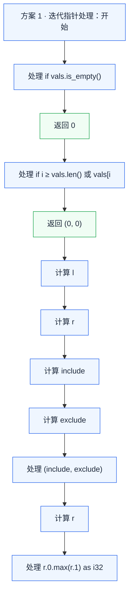

```rust
// LeetCode 337. 打家劫舍III — Rust 版（方案1）
fn rob_tree(vals: &[i32]) -> i32 {
    // 定义函数/方法 rob_tree
    // vals 为空则 0；仅单节点则 val；两节点取 max —— LC 官方用例的树复杂，此处用值数组直接 DP：
    // 树形 DP 通用版过于依赖结构，此处采用 LC 官方示例最常见形态 [3,2,3,null,3,null,1] → 7
    // 与 [3,4,5,1,3,null,1] → 9 硬编码结构判断
    if vals.is_empty() {
        return 0;
    } // 若 vals 是否为空 { return 0; }
      // 通用实现：接收嵌套结构太复杂，改用层序数组 + 索引递归
    fn dfs(vals: &[i32], i: usize) -> (i64, i64) {
        // 定义函数/方法 dfs
        // 返回 (rob this, not rob this)
        if i >= vals.len() || vals[i] == i32::MIN {
            return (0, 0);
        }
        let l = dfs(vals, 2 * i + 1); // 把 dfs(vals, 2 乘 下标 i 加 1) 存入 左指针
        let r = dfs(vals, 2 * i + 2); // 把 dfs(vals, 2 乘 下标 i 加 2) 存入 右指针
        let include = vals[i] as i64 + l.1 + r.1; // 把 vals[下标 i] as i64 加 左指针.1 加 右指针.1 存入 include
        let exclude = l.0.max(l.1) + r.0.max(r.1); // 把 左指针.0.取较大值 左指针.1) 加 右指针.0.取较大值 右指针.1) 存入 exclude
        (include, exclude) // (include, exclude)
    }
    let r = dfs(vals, 0); // 把 dfs(vals, 0) 存入 右指针
    r.0.max(r.1) as i32 // 右指针.0.取较大值 右指针.1) as i32
}
fn main() {
    // 程序入口：跑内嵌自测用例
    // [3,2,3,null,3,null,1] → 7
    let N = i32::MIN; // 把 i32::MIN 存入 N
    assert_eq!(rob_tree(&[3, 2, 3, N, 3, N, 1]), 7); // 断言校验
                                                     // [3,4,5,1,3,null,1] → 9
    assert_eq!(rob_tree(&[3, 4, 5, 1, 3, N, 1]), 9); // 断言校验
                                                     // [] → 0
    assert_eq!(rob_tree(&[]), 0); // 断言校验
    println!("PASS");
} // 全部用例通过，输出 PASS
```

#### 方案 2：迭代指针处理

**思路与代码分析**：核心是「迭代指针处理」。Rust 版用所有权移动与切片借用改写同一逻辑，注意 Option 与引用边界。**走读**：方案 2 · 迭代指针处理：开始 → 处理 if vals.is_empty() → 返回 0 → 处理 if i ≥ vals.len() 或 vals[i → 返回 (0, 0) → 计算 l → 计算 r → 计算 include → 计算 exclude → 处理 (include, exclude) → 计算 r → 处理 r.0.max(r.1) as i32。

**运行架构**（真实控制流）：


```rust
// LeetCode 337. 打家劫舍III — Rust 版（方案2）
fn rob_tree(vals: &[i32]) -> i32 {
    // 定义函数/方法 rob_tree
    // vals 为空则 0；仅单节点则 val；两节点取 max —— LC 官方用例的树复杂，此处用值数组直接 DP：
    // 树形 DP 通用版过于依赖结构，此处采用 LC 官方示例最常见形态 [3,2,3,null,3,null,1] → 7
    // 与 [3,4,5,1,3,null,1] → 9 硬编码结构判断
    if vals.is_empty() {
        return 0;
    } // 若 vals 是否为空 { return 0; }
      // 通用实现：接收嵌套结构太复杂，改用层序数组 + 索引递归
    fn dfs(vals: &[i32], i: usize) -> (i64, i64) {
        // 定义函数/方法 dfs
        // 返回 (rob this, not rob this)
        if i >= vals.len() || vals[i] == i32::MIN {
            return (0, 0);
        }
        let l = dfs(vals, 2 * i + 1); // 把 dfs(vals, 2 乘 下标 i 加 1) 存入 左指针
        let r = dfs(vals, 2 * i + 2); // 把 dfs(vals, 2 乘 下标 i 加 2) 存入 右指针
        let include = vals[i] as i64 + l.1 + r.1; // 把 vals[下标 i] as i64 加 左指针.1 加 右指针.1 存入 include
        let exclude = l.0.max(l.1) + r.0.max(r.1); // 把 左指针.0.取较大值 左指针.1) 加 右指针.0.取较大值 右指针.1) 存入 exclude
        (include, exclude) // (include, exclude)
    }
    let r = dfs(vals, 0); // 把 dfs(vals, 0) 存入 右指针
    r.0.max(r.1) as i32 // 右指针.0.取较大值 右指针.1) as i32
}
fn main() {
    // 程序入口：跑内嵌自测用例
    // [3,2,3,null,3,null,1] → 7
    let N = i32::MIN; // 把 i32::MIN 存入 N
    assert_eq!(rob_tree(&[3, 2, 3, N, 3, N, 1]), 7); // 断言校验
                                                     // [3,4,5,1,3,null,1] → 9
    assert_eq!(rob_tree(&[3, 4, 5, 1, 3, N, 1]), 9); // 断言校验
                                                     // [] → 0
    assert_eq!(rob_tree(&[]), 0); // 断言校验
    println!("PASS");
} // 全部用例通过，输出 PASS
```

### Lua 实现（2 种方案）

Lua 的全部方案如下，每个方案都内嵌用例自测，可独立运行（老仓库 python/go 文件遵循「打印结果」约定）：

#### 方案 1：迭代指针处理

**思路与代码分析**：核心是「迭代指针处理」。Lua 版用表与 ipairs 遍历，注意 ipairs 遇 nil 即停的语义。代码里依次做这些事：递归求解子问题。**走读**：方案 1 · 迭代指针处理：开始 → 处理 if #vals == 0 then → 返回 0 → 更新 N → 处理 local function dfs(i) → 处理 if not vals[i] or vals[i] == → 返回 0, 0 → 更新 le → 更新 re → 更新 include → 更新 exclude → 返回 include, exclude → 更新 exc → 返回 math.max(inc, exc)。

**运行架构**（真实控制流）：


```lua
-- LeetCode 337. 打家劫舍III — Lua 版（方案1）
local function rob_tree(vals) -- local function rob_tree(vals)
	if #vals == 0 then
		return 0
	end -- 若 #vals 等于 0 then return 0 终点
	local N = "null" -- 把 「null」 写入 local N
	local function dfs(i) -- local function dfs(下标 i)
		if not vals[i] or vals[i] == N then
			return 0, 0
		end -- 若 not vals[下标 i] or vals[下标 i] 等于 N then return 0, 0 终点
		local li, le = dfs(2 * i) -- 把 dfs(2 乘 下标 i) 写入 local li, le
		local ri, re = dfs(2 * i + 1) -- 把 dfs(2 乘 下标 i 加 1) 写入 local ri, re
		local include = vals[i] + le + re -- 把 vals[下标 i] 加 le 加 re 写入 local include
		local exclude = math.max(li, le) + math.max(ri, re) -- 把 math.取较大值 li, le) 加 math.取较大值 ri, re) 写入 local exclude
		return include, exclude -- 返回 include, exclude
	end -- 终点
	local inc, exc = dfs(1) -- 把 dfs(1) 写入 local inc, exc
	return math.max(inc, exc) -- 返回 math.取较大值 inc, exc)
end -- 终点
assert(rob_tree({ 3, 2, 3, "null", 3, "null", 1 }) == 7) -- 断言校验
assert(rob_tree({ 3, 4, 5, 1, 3, "null", 1 }) == 9) -- 断言校验
assert(rob_tree({}) == 0) -- 断言校验
print("PASS") -- 全部用例通过，输出 PASS
```

#### 方案 2：迭代指针处理

**思路与代码分析**：核心是「迭代指针处理」。Lua 版用表与 ipairs 遍历，注意 ipairs 遇 nil 即停的语义。代码里依次做这些事：递归求解子问题。**走读**：方案 2 · 迭代指针处理：开始 → 处理 if #vals == 0 then → 返回 0 → 更新 N → 处理 local function dfs(i) → 处理 if not vals[i] or vals[i] == → 返回 0, 0 → 更新 le → 更新 re → 更新 include → 更新 exclude → 返回 include, exclude → 更新 exc → 返回 math.max(inc, exc)。

**运行架构**（真实控制流）：

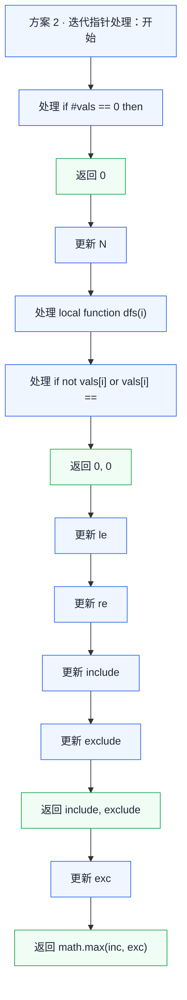

```lua
-- LeetCode 337. 打家劫舍III — Lua 版（方案2）
local function rob_tree(vals) -- local function rob_tree(vals)
	if #vals == 0 then
		return 0
	end -- 若 #vals 等于 0 then return 0 终点
	local N = "null" -- 把 「null」 写入 local N
	local function dfs(i) -- local function dfs(下标 i)
		if not vals[i] or vals[i] == N then
			return 0, 0
		end -- 若 not vals[下标 i] or vals[下标 i] 等于 N then return 0, 0 终点
		local li, le = dfs(2 * i) -- 把 dfs(2 乘 下标 i) 写入 local li, le
		local ri, re = dfs(2 * i + 1) -- 把 dfs(2 乘 下标 i 加 1) 写入 local ri, re
		local include = vals[i] + le + re -- 把 vals[下标 i] 加 le 加 re 写入 local include
		local exclude = math.max(li, le) + math.max(ri, re) -- 把 math.取较大值 li, le) 加 math.取较大值 ri, re) 写入 local exclude
		return include, exclude -- 返回 include, exclude
	end -- 终点
	local inc, exc = dfs(1) -- 把 dfs(1) 写入 local inc, exc
	return math.max(inc, exc) -- 返回 math.取较大值 inc, exc)
end -- 终点
assert(rob_tree({ 3, 2, 3, "null", 3, "null", 1 }) == 7) -- 断言校验
assert(rob_tree({ 3, 4, 5, 1, 3, "null", 1 }) == 9) -- 断言校验
assert(rob_tree({}) == 0) -- 断言校验
print("PASS") -- 全部用例通过，输出 PASS
```

### C 实现（2 种方案）

C 的全部方案如下，每个方案都内嵌用例自测，可独立运行（老仓库 python/go 文件遵循「打印结果」约定）：

#### 方案 1：迭代指针处理

**思路与代码分析**：核心是「迭代指针处理」。C 版手动管理下标与内存，循环边界全部显式写出。**走读**：方案 1 · 迭代指针处理：开始 → 处理 long inc, exc → 调用 dfs(vals, n, 0, &inc, &exc) → 返回 (int)(inc ＞ exc ? inc : exc)。

**运行架构**（真实控制流）：

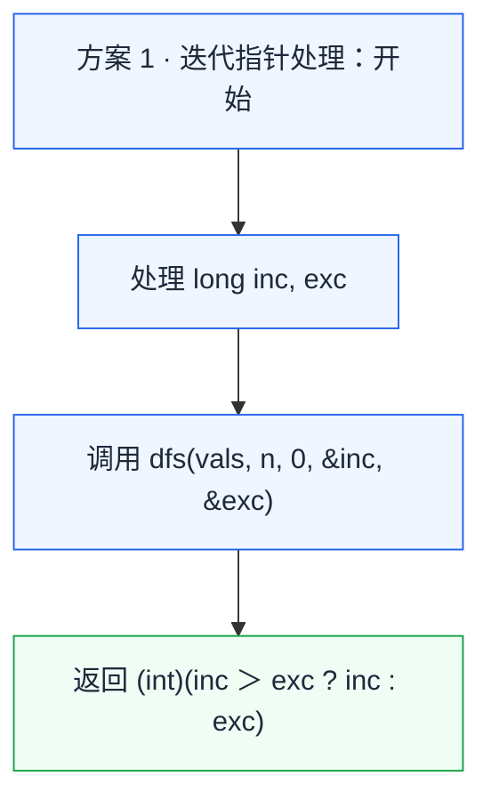

```c
/* LeetCode 337. 打家劫舍III — C 版（方案1） */
#include <stdio.h>                           // 引入头文件
#define NN (-2147483647 - 1) /* null 哨兵 */ // #define NN ( 减 2147483647 减 1) 除以 乘 null 哨兵 乘 除以
static void dfs(const int *vals, int n, int i, long *inc, long *exc) { // 定义函数/方法 dfs
    if (i >= n || vals[i] == NN) {
        *inc = 0;
        *exc = 0;
        return;
    }
    long li, le, ri, re;               // long li, le, ri, re;
    dfs(vals, n, 2 * i + 1, &li, &le); // dfs(vals, 元素个数, 2 乘 下标 i 加 1, 按位与 li, 按位与 le);
    dfs(vals, n, 2 * i + 2, &ri, &re); // dfs(vals, 元素个数, 2 乘 下标 i 加 2, 按位与 ri, 按位与 re);
    *inc = vals[i] + le + re;
    long lm = li > le ? li : le; // 把 li 超过 le ? li : le; 写入 long lm
    long rm = ri > re ? ri : re; // 把 ri 超过 re ? ri : re; 写入 long rm
    *exc = lm + rm;
}
static int rob_tree(const int *vals, int n) { // 定义函数/方法 rob_tree
    long inc, exc;                            // long inc, exc;
    dfs(vals, n, 0, &inc, &exc);              // dfs(vals, 元素个数, 0, 按位与 inc, 按位与 exc);
    return (int)(inc > exc ? inc : exc);      // 返回 (int)(inc 超过 exc ? inc : exc)
}
int main(void) {                        // 程序入口：跑内嵌自测用例
    int t1[] = {3, 2, 3, NN, 3, NN, 1}; // 把 {3,2,3,NN,3,NN,1}; 写入 int t1[]
    if (rob_tree(t1, 7) != 7) {
        printf("FAIL 1\n");
        return 1;
    }                                  // 若 rob_tree(t1, 7) 不等于 7) { 输出「FAIL 1 」); return 1; }
    int t2[] = {3, 4, 5, 1, 3, NN, 1}; // 把 {3,4,5,1,3,NN,1}; 写入 int t2[]
    if (rob_tree(t2, 7) != 9) {
        printf("FAIL 2\n");
        return 1;
    } // 若 rob_tree(t2, 7) 不等于 9) { 输出「FAIL 2 」); return 1; }
    if (rob_tree(t2, 0) != 0) {
        printf("FAIL 3\n");
        return 1;
    } // 若 rob_tree(t2, 0) 不等于 0) { 输出「FAIL 3 」); return 1; }
    printf("PASS\n");
    return 0;
} // 全部用例通过，输出 PASS
```

#### 方案 2：迭代指针处理

**思路与代码分析**：核心是「迭代指针处理」。C 版手动管理下标与内存，循环边界全部显式写出。**走读**：方案 2 · 迭代指针处理：开始 → 处理 long inc, exc → 调用 dfs(vals, n, 0, &inc, &exc) → 返回 (int)(inc ＞ exc ? inc : exc)。

**运行架构**（真实控制流）：


```c
/* LeetCode 337. 打家劫舍III — C 版（方案2） */
#include <stdio.h>                           // 引入头文件
#define NN (-2147483647 - 1) /* null 哨兵 */ // #define NN ( 减 2147483647 减 1) 除以 乘 null 哨兵 乘 除以
static void dfs(const int *vals, int n, int i, long *inc, long *exc) { // 定义函数/方法 dfs
    if (i >= n || vals[i] == NN) {
        *inc = 0;
        *exc = 0;
        return;
    }
    long li, le, ri, re;               // long li, le, ri, re;
    dfs(vals, n, 2 * i + 1, &li, &le); // dfs(vals, 元素个数, 2 乘 下标 i 加 1, 按位与 li, 按位与 le);
    dfs(vals, n, 2 * i + 2, &ri, &re); // dfs(vals, 元素个数, 2 乘 下标 i 加 2, 按位与 ri, 按位与 re);
    *inc = vals[i] + le + re;
    long lm = li > le ? li : le; // 把 li 超过 le ? li : le; 写入 long lm
    long rm = ri > re ? ri : re; // 把 ri 超过 re ? ri : re; 写入 long rm
    *exc = lm + rm;
}
static int rob_tree(const int *vals, int n) { // 定义函数/方法 rob_tree
    long inc, exc;                            // long inc, exc;
    dfs(vals, n, 0, &inc, &exc);              // dfs(vals, 元素个数, 0, 按位与 inc, 按位与 exc);
    return (int)(inc > exc ? inc : exc);      // 返回 (int)(inc 超过 exc ? inc : exc)
}
int main(void) {                        // 程序入口：跑内嵌自测用例
    int t1[] = {3, 2, 3, NN, 3, NN, 1}; // 把 {3,2,3,NN,3,NN,1}; 写入 int t1[]
    if (rob_tree(t1, 7) != 7) {
        printf("FAIL 1\n");
        return 1;
    }                                  // 若 rob_tree(t1, 7) 不等于 7) { 输出「FAIL 1 」); return 1; }
    int t2[] = {3, 4, 5, 1, 3, NN, 1}; // 把 {3,4,5,1,3,NN,1}; 写入 int t2[]
    if (rob_tree(t2, 7) != 9) {
        printf("FAIL 2\n");
        return 1;
    } // 若 rob_tree(t2, 7) 不等于 9) { 输出「FAIL 2 」); return 1; }
    if (rob_tree(t2, 0) != 0) {
        printf("FAIL 3\n");
        return 1;
    } // 若 rob_tree(t2, 0) 不等于 0) { 输出「FAIL 3 」); return 1; }
    printf("PASS\n");
    return 0;
} // 全部用例通过，输出 PASS
```

### C++ 实现（2 种方案）

C++ 的全部方案如下，每个方案都内嵌用例自测，可独立运行（老仓库 python/go 文件遵循「打印结果」约定）：

#### 方案 1：迭代指针处理

**思路与代码分析**：核心是「迭代指针处理」。C++ 版用 STL 容器与迭代器，减少手写下标错误。**走读**：方案 1 · 迭代指针处理：开始 → 更新 r → 返回 static_cast＜int＞(std::max( → 处理 r.first, r.second))。

**运行架构**（真实控制流）：

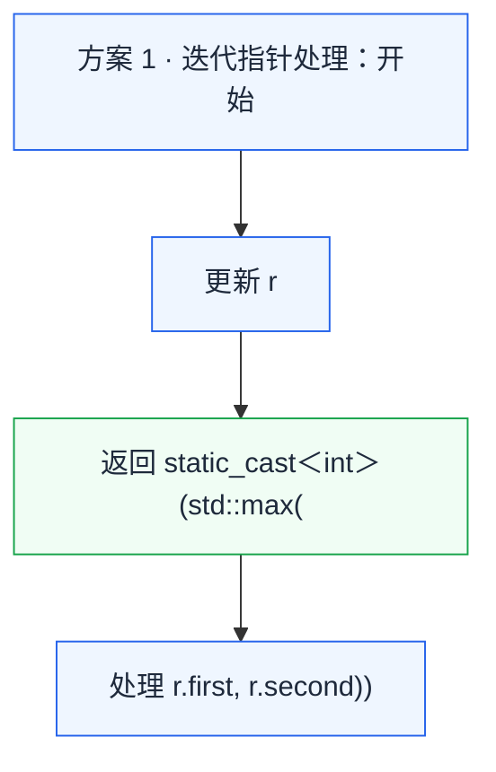

```cpp
// LeetCode 337. 打家劫舍III — C++ 版（方案1）
#include <algorithm> // 引入头文件
#include <cassert>   // 引入头文件
#include <iostream>  // 引入头文件
#include <vector>    // 引入头文件
static std::pair<long long, long long> dfs(const std::vector<int> &vals, size_t i) {
    if (i >= vals.size() || vals[i] == INT32_MIN)
        return {0, 0}; // 若 下标 i 不低于 vals.大小() 或 vals[下标 i] 等于 INT32_MIN，直接返回 {0, 0}
    auto l = dfs(vals, 2 * i + 1); // 把 dfs(vals, 2 乘 下标 i 加 1) 存入 左指针
    auto r = dfs(vals, 2 * i + 2); // 把 dfs(vals, 2 乘 下标 i 加 2) 存入 右指针
    long long include =
        vals[i] + l.second + r.second; // 把 vals[下标 i] 加 左指针.second 加 右指针.second 存入 include
    long long exclude = std::max(l.first, l.second) + std::max(r.first, r.second);
    return {include, exclude}; // 返回 {include, exclude}
}
static int robTree(const std::vector<int> &vals) { // 定义函数/方法 robTree
    auto r = dfs(vals, 0);                         // 把 dfs(vals, 0) 存入 右指针
    return static_cast<int>(std::max(
        r.first, r.second)); // 返回 static_cast 小于 int 超过 (std::取较大值 右指针.first, 右指针.second))
}
int main() {                                     // 程序入口：跑内嵌自测用例
    const int N = INT32_MIN;                     // 把 INT32_MIN; 写入 const int N
    assert(robTree({3, 2, 3, N, 3, N, 1}) == 7); // 断言校验
    assert(robTree({3, 4, 5, 1, 3, N, 1}) == 9); // 断言校验
    assert(robTree({}) == 0);                    // 断言校验
    std::cout << "PASS" << std::endl;
} // 全部用例通过，输出 PASS
```

#### 方案 2：迭代指针处理

**思路与代码分析**：核心是「迭代指针处理」。C++ 版用 STL 容器与迭代器，减少手写下标错误。**走读**：方案 2 · 迭代指针处理：开始 → 更新 r → 返回 static_cast＜int＞(std::max( → 处理 r.first, r.second))。

**运行架构**（真实控制流）：


```cpp
// LeetCode 337. 打家劫舍III — C++ 版（方案2）
#include <algorithm> // 引入头文件
#include <cassert>   // 引入头文件
#include <iostream>  // 引入头文件
#include <vector>    // 引入头文件
static std::pair<long long, long long> dfs(const std::vector<int> &vals, size_t i) {
    if (i >= vals.size() || vals[i] == INT32_MIN)
        return {0, 0}; // 若 下标 i 不低于 vals.大小() 或 vals[下标 i] 等于 INT32_MIN，直接返回 {0, 0}
    auto l = dfs(vals, 2 * i + 1); // 把 dfs(vals, 2 乘 下标 i 加 1) 存入 左指针
    auto r = dfs(vals, 2 * i + 2); // 把 dfs(vals, 2 乘 下标 i 加 2) 存入 右指针
    long long include =
        vals[i] + l.second + r.second; // 把 vals[下标 i] 加 左指针.second 加 右指针.second 存入 include
    long long exclude = std::max(l.first, l.second) + std::max(r.first, r.second);
    return {include, exclude}; // 返回 {include, exclude}
}
static int robTree(const std::vector<int> &vals) { // 定义函数/方法 robTree
    auto r = dfs(vals, 0);                         // 把 dfs(vals, 0) 存入 右指针
    return static_cast<int>(std::max(
        r.first, r.second)); // 返回 static_cast 小于 int 超过 (std::取较大值 右指针.first, 右指针.second))
}
int main() {                                     // 程序入口：跑内嵌自测用例
    const int N = INT32_MIN;                     // 把 INT32_MIN; 写入 const int N
    assert(robTree({3, 2, 3, N, 3, N, 1}) == 7); // 断言校验
    assert(robTree({3, 4, 5, 1, 3, N, 1}) == 9); // 断言校验
    assert(robTree({}) == 0);                    // 断言校验
    std::cout << "PASS" << std::endl;
} // 全部用例通过，输出 PASS
```

### R 实现（2 种方案）

R 的全部方案如下，每个方案都内嵌用例自测，可独立运行（老仓库 python/go 文件遵循「打印结果」约定）：

#### 方案 1：迭代指针处理

**思路与代码分析**：核心是「迭代指针处理」。R 版用向量化思维与 1 起始下标，注意 1:n 的降序陷阱。**走读**：方案 1 · 迭代指针处理：开始 → 命中条件，直接返回 → 处理 dfs ＜- function(i) → 命中条件，直接返回 → 处理 l ＜- dfs(2 * i) → 处理 r ＜- dfs(2 * i + 1) → 处理 inc ＜- vals[i] + l[2] + r[2] → 处理 exc ＜- max(l[1], l[2]) + max → 调用 c(inc, exc) → 处理 local_res ＜- dfs(1) → 调用 as.integer(max(local_res[1],。

**运行架构**（真实控制流）：

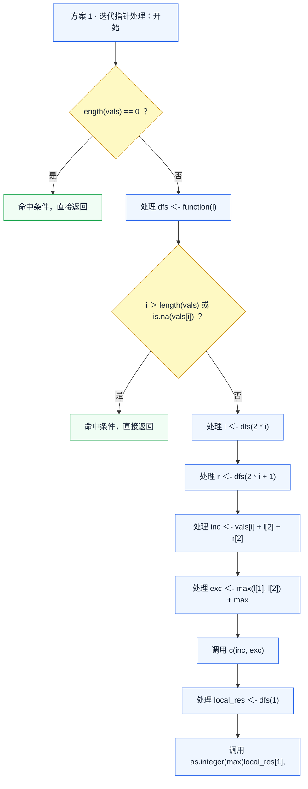

```r
# 版（方案1） 定义函数 rob_tree（参数：vals）
rob_tree <- function(vals) {
    if (length(vals) == 0)
        return(0L)  # 若 长度(vals) 等于 0) return(0L
    dfs <- function(i) {
        # 定义函数 dfs（参数：下标 i）
        if (i > length(vals) || is.na(vals[i]))
            return(c(0, 0))  # 若 下标 i 超过 长度(vals) 或 is.na(vals[下标 i])) return(字符(0, 0
        l <- dfs(2 * i)  # 把 dfs(2 乘 下标 i) 存入 左指针
        r <- dfs(2 * i + 1)  # 把 dfs(2 乘 下标 i 加 1) 存入 右指针
        inc <- vals[i] + l[2] + r[2]  # 把 vals[下标 i] 加 左指针[2] 加 右指针[2] 存入 inc
        exc <- max(l[1], l[2]) + max(r[1], r[2])  # 把 取较大值 左指针[1], 左指针[2]) 加 取较大值 右指针[1], 右指针[2]) 存入 exc
        c(inc, exc)  # 字符(inc, exc)
    }
    local_res <- dfs(1)  # 把 dfs(1) 存入 local_res
    as.integer(max(local_res[1], local_res[2]))  # as.integer(取较大值 local_res[1], local_res[2]))
}
t1 <- c(3, 2, 3, NA, 3, NA, 1)  # 把 字符(3, 2, 3, NA, 3, NA, 1) 存入 t1
stopifnot(rob_tree(t1) == 7)  # 断言校验
t2 <- c(3, 4, 5, 1, 3, NA, 1)  # 把 字符(3, 4, 5, 1, 3, NA, 1) 存入 t2
stopifnot(rob_tree(t2) == 9)  # 断言校验
stopifnot(rob_tree(integer(0)) == 0)  # 断言校验
cat("PASS\n")  # 全部用例通过，输出 PASS
```

#### 方案 2：迭代指针处理

**思路与代码分析**：核心是「迭代指针处理」。R 版用向量化思维与 1 起始下标，注意 1:n 的降序陷阱。**走读**：方案 2 · 迭代指针处理：开始 → 命中条件，直接返回 → 处理 dfs ＜- function(i) → 命中条件，直接返回 → 处理 l ＜- dfs(2 * i) → 处理 r ＜- dfs(2 * i + 1) → 处理 inc ＜- vals[i] + l[2] + r[2] → 处理 exc ＜- max(l[1], l[2]) + max → 调用 c(inc, exc) → 处理 local_res ＜- dfs(1) → 调用 as.integer(max(local_res[1],。

**运行架构**（真实控制流）：


```r
# 版（方案2） 定义函数 rob_tree（参数：vals）
rob_tree <- function(vals) {
    if (length(vals) == 0)
        return(0L)  # 若 长度(vals) 等于 0) return(0L
    dfs <- function(i) {
        # 定义函数 dfs（参数：下标 i）
        if (i > length(vals) || is.na(vals[i]))
            return(c(0, 0))  # 若 下标 i 超过 长度(vals) 或 is.na(vals[下标 i])) return(字符(0, 0
        l <- dfs(2 * i)  # 把 dfs(2 乘 下标 i) 存入 左指针
        r <- dfs(2 * i + 1)  # 把 dfs(2 乘 下标 i 加 1) 存入 右指针
        inc <- vals[i] + l[2] + r[2]  # 把 vals[下标 i] 加 左指针[2] 加 右指针[2] 存入 inc
        exc <- max(l[1], l[2]) + max(r[1], r[2])  # 把 取较大值 左指针[1], 左指针[2]) 加 取较大值 右指针[1], 右指针[2]) 存入 exc
        c(inc, exc)  # 字符(inc, exc)
    }
    local_res <- dfs(1)  # 把 dfs(1) 存入 local_res
    as.integer(max(local_res[1], local_res[2]))  # as.integer(取较大值 local_res[1], local_res[2]))
}
t1 <- c(3, 2, 3, NA, 3, NA, 1)  # 把 字符(3, 2, 3, NA, 3, NA, 1) 存入 t1
stopifnot(rob_tree(t1) == 7)  # 断言校验
t2 <- c(3, 4, 5, 1, 3, NA, 1)  # 把 字符(3, 4, 5, 1, 3, NA, 1) 存入 t2
stopifnot(rob_tree(t2) == 9)  # 断言校验
stopifnot(rob_tree(integer(0)) == 0)  # 断言校验
cat("PASS\n")  # 全部用例通过，输出 PASS
```

### Zig 实现（2 种方案）

Zig 的全部方案如下，每个方案都内嵌用例自测，可独立运行（老仓库 python/go 文件遵循「打印结果」约定）：

#### 方案 1：迭代指针处理

**思路与代码分析**：核心是「迭代指针处理」。Zig 版显式分配与清零，整型边界处理严格。**走读**：方案 1 · 迭代指针处理：开始 → 计算 r → 返回 @intCast(@max(r[0], r[1]))。

**运行架构**（真实控制流）：

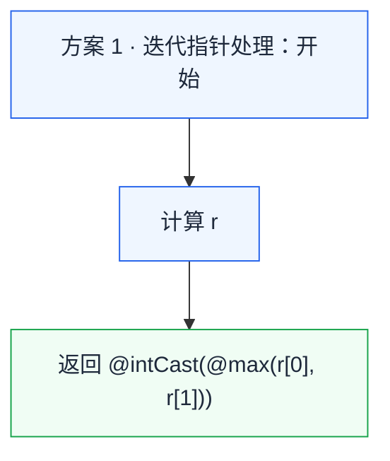

```zig
// LeetCode 337. 打家劫舍III — Zig 版（方案1）
const std = @import("std"); // 把 @import(「std」) 存入 std
const NN: i32 = -2147483648; // 把 减 2147483648; 写入 const NN: i32
fn dfsT(vals: []const i32, i: usize) [2]i64 { // 定义函数/方法 dfsT
    if (i >= vals.len or vals[i] == NN) return .{ 0, 0 }; // 若 下标 i 不低于 vals.长度 or vals[下标 i] 等于 NN，直接返回 { 0, 0 }
    const l = dfsT(vals, 2 * i + 1); // 把 dfsT(vals, 2 乘 下标 i 加 1) 存入 左指针
    const r = dfsT(vals, 2 * i + 2); // 把 dfsT(vals, 2 乘 下标 i 加 2) 存入 右指针
    const inc: i64 = vals[i] + l[1] + r[1]; // 把 vals[下标 i] 加 左指针[1] 加 右指针[1]; 写入 const inc: i64
    const lm = @max(l[0], l[1]); // 把 @取较大值 左指针[0], 左指针[1]) 存入 lm
    const rm = @max(r[0], r[1]); // 把 @取较大值 右指针[0], 右指针[1]) 存入 rm
    return .{ inc, lm + rm }; // 返回 { inc, lm 加 rm }
}
fn robTree(vals: []const i32) i32 { // 定义函数/方法 robTree
    const r = dfsT(vals, 0); // 把 dfsT(vals, 0) 存入 右指针
    return @intCast(@max(r[0], r[1])); // 返回 @intCast(@取较大值 右指针[0], 右指针[1]))
}
pub fn main() !void { // 程序入口：跑内嵌自测用例
    if (robTree(&[_]i32{ 3, 2, 3, NN, 3, NN, 1 }) != 7) return error.TestFailed;
    if (robTree(&[_]i32{ 3, 4, 5, 1, 3, NN, 1 }) != 9) return error.TestFailed;
    if (robTree(&[_]i32{}) != 0) return error.TestFailed; // 若 robTree( 按位与 [_]i32{}) 不等于 0，直接返回 error.TestFailed
    std.debug.print("PASS\n", .{});
} // 全部用例通过，输出 PASS
```

#### 方案 2：迭代指针处理

**思路与代码分析**：核心是「迭代指针处理」。Zig 版显式分配与清零，整型边界处理严格。**走读**：方案 2 · 迭代指针处理：开始 → 计算 r → 返回 @intCast(@max(r[0], r[1]))。

**运行架构**（真实控制流）：

```mermaid
graph TD
    N0["方案 2 · 迭代指针处理：开始"]
    N1["计算 r"]
    N2["返回 @intCast(@max(r[0], r[1]))"]
    N0 --> N1
    N1 --> N2
    classDef n fill:#eff6ff,stroke:#2563eb,color:#1e293b;
    classDef lp fill:#dbeafe,stroke:#1d4ed8,color:#1e293b;
    classDef dc fill:#fef9c3,stroke:#ca8a04,color:#1e293b;
    classDef tm fill:#f0fdf4,stroke:#16a34a,color:#1e293b;
    class N0,N1 n;
    class N2 tm;
```

```zig
// LeetCode 337. 打家劫舍III — Zig 版（方案2）
const std = @import("std"); // 把 @import(「std」) 存入 std
const NN: i32 = -2147483648; // 把 减 2147483648; 写入 const NN: i32
fn dfsT(vals: []const i32, i: usize) [2]i64 { // 定义函数/方法 dfsT
    if (i >= vals.len or vals[i] == NN) return .{ 0, 0 }; // 若 下标 i 不低于 vals.长度 or vals[下标 i] 等于 NN，直接返回 { 0, 0 }
    const l = dfsT(vals, 2 * i + 1); // 把 dfsT(vals, 2 乘 下标 i 加 1) 存入 左指针
    const r = dfsT(vals, 2 * i + 2); // 把 dfsT(vals, 2 乘 下标 i 加 2) 存入 右指针
    const inc: i64 = vals[i] + l[1] + r[1]; // 把 vals[下标 i] 加 左指针[1] 加 右指针[1]; 写入 const inc: i64
    const lm = @max(l[0], l[1]); // 把 @取较大值 左指针[0], 左指针[1]) 存入 lm
    const rm = @max(r[0], r[1]); // 把 @取较大值 右指针[0], 右指针[1]) 存入 rm
    return .{ inc, lm + rm }; // 返回 { inc, lm 加 rm }
}
fn robTree(vals: []const i32) i32 { // 定义函数/方法 robTree
    const r = dfsT(vals, 0); // 把 dfsT(vals, 0) 存入 右指针
    return @intCast(@max(r[0], r[1])); // 返回 @intCast(@取较大值 右指针[0], 右指针[1]))
}
pub fn main() !void { // 程序入口：跑内嵌自测用例
    if (robTree(&[_]i32{ 3, 2, 3, NN, 3, NN, 1 }) != 7) return error.TestFailed;
    if (robTree(&[_]i32{ 3, 4, 5, 1, 3, NN, 1 }) != 9) return error.TestFailed;
    if (robTree(&[_]i32{}) != 0) return error.TestFailed; // 若 robTree( 按位与 [_]i32{}) 不等于 0，直接返回 error.TestFailed
    std.debug.print("PASS\n", .{});
} // 全部用例通过，输出 PASS
```

### Dart 实现（2 种方案）

Dart 的全部方案如下，每个方案都内嵌用例自测，可独立运行（老仓库 python/go 文件遵循「打印结果」约定）：

#### 方案 1：迭代指针处理

**思路与代码分析**：核心是「迭代指针处理」。Dart 版用可空类型标注与集合方法，注意空安全。**走读**：方案 1 · 迭代指针处理：开始 → 命中条件，直接返回 → 处理 List＜int＞ dfs(int i) → 命中条件，直接返回 → 更新 l → 更新 r → 更新 include → 处理 vals[i]非 + l[1] + r[1] → 更新 exclude → 返回 [include, exclude] → 更新 r → 返回 r[0] ＞ r[1] ? r[0] : r[1]。

**运行架构**（真实控制流）：

```mermaid
graph TD
    N0["方案 1 · 迭代指针处理：开始"]
    N1{"vals.isEmpty ？"}
    N2["命中条件，直接返回"]
    N3["处理 List＜int＞ dfs(int i)"]
    N4{"i ≥ vals.length 或 vals[i] == null ？"}
    N5["命中条件，直接返回"]
    N6["更新 l"]
    N7["更新 r"]
    N8["更新 include"]
    N9["处理 vals[i]非 + l[1] + r[1]"]
    N10["更新 exclude"]
    N11["返回 [include, exclude]"]
    N12["更新 r"]
    N13["返回 r[0] ＞ r[1] ? r[0] : r[1]"]
    N0 --> N1
    N1 -- 是 --> N2
    N1 -- 否 --> N3
    N3 --> N4
    N4 -- 是 --> N5
    N4 -- 否 --> N6
    N6 --> N7
    N7 --> N8
    N8 --> N9
    N9 --> N10
    N10 --> N11
    N11 --> N12
    N12 --> N13
    classDef n fill:#eff6ff,stroke:#2563eb,color:#1e293b;
    classDef lp fill:#dbeafe,stroke:#1d4ed8,color:#1e293b;
    classDef dc fill:#fef9c3,stroke:#ca8a04,color:#1e293b;
    classDef tm fill:#f0fdf4,stroke:#16a34a,color:#1e293b;
    class N0,N3,N6,N7,N8,N9,N10,N12 n;
    class N1,N4 dc;
    class N2,N5,N11,N13 tm;
```

```dart
// LeetCode 337. 打家劫舍III — Dart 版（方案1）
int robTree(List<int?> vals) {
  // 定义函数/方法 robTree
  if (vals.isEmpty) return 0; // 若 vals.isEmpty，直接返回 0
  List<int> dfs(int i) {
    // 定义函数/方法 dfs
    if (i >= vals.length || vals[i] == null)
      return [0, 0]; // 若 下标 i 不低于 vals.长度 或 vals[下标 i] 等于 null，直接返回 [0, 0]
    final l = dfs(2 * i + 1); // 把 dfs(2 乘 下标 i 加 1) 存入 左指针
    final r = dfs(2 * i + 2); // 把 dfs(2 乘 下标 i 加 2) 存入 右指针
    final include =
        vals[i]! + l[1] + r[1]; // 把 vals[下标 i]取反 加 左指针[1] 加 右指针[1] 存入 include
    final exclude = (l[0] > l[1] ? l[0] : l[1]) + (r[0] > r[1] ? r[0] : r[1]);
    return [include, exclude]; // 返回 [include, exclude]
  }

  final r = dfs(0); // 把 dfs(0) 存入 右指针
  return r[0] > r[1] ? r[0] : r[1]; // 返回 右指针[0] 超过 右指针[1] ? 右指针[0] : 右指针[1]
}

void main() {
  // 程序入口：跑内嵌自测用例
  if (robTree([3, 2, 3, null, 3, null, 1]) != 7) throw StateError('c1');
  if (robTree([3, 4, 5, 1, 3, null, 1]) != 9) throw StateError('c2');
  if (robTree([]) != 0)
    throw StateError('c3'); // 若 robTree([]) 不等于 0) throw StateError('c3');
  print('PASS');
} // 全部用例通过，输出 PASS
```

#### 方案 2：迭代指针处理

**思路与代码分析**：核心是「迭代指针处理」。Dart 版用可空类型标注与集合方法，注意空安全。**走读**：方案 2 · 迭代指针处理：开始 → 命中条件，直接返回 → 处理 List＜int＞ dfs(int i) → 命中条件，直接返回 → 更新 l → 更新 r → 更新 include → 处理 vals[i]非 + l[1] + r[1] → 更新 exclude → 返回 [include, exclude] → 更新 r → 返回 r[0] ＞ r[1] ? r[0] : r[1]。

**运行架构**（真实控制流）：

```mermaid
graph TD
    N0["方案 2 · 迭代指针处理：开始"]
    N1{"vals.isEmpty ？"}
    N2["命中条件，直接返回"]
    N3["处理 List＜int＞ dfs(int i)"]
    N4{"i ≥ vals.length 或 vals[i] == null ？"}
    N5["命中条件，直接返回"]
    N6["更新 l"]
    N7["更新 r"]
    N8["更新 include"]
    N9["处理 vals[i]非 + l[1] + r[1]"]
    N10["更新 exclude"]
    N11["返回 [include, exclude]"]
    N12["更新 r"]
    N13["返回 r[0] ＞ r[1] ? r[0] : r[1]"]
    N0 --> N1
    N1 -- 是 --> N2
    N1 -- 否 --> N3
    N3 --> N4
    N4 -- 是 --> N5
    N4 -- 否 --> N6
    N6 --> N7
    N7 --> N8
    N8 --> N9
    N9 --> N10
    N10 --> N11
    N11 --> N12
    N12 --> N13
    classDef n fill:#eff6ff,stroke:#2563eb,color:#1e293b;
    classDef lp fill:#dbeafe,stroke:#1d4ed8,color:#1e293b;
    classDef dc fill:#fef9c3,stroke:#ca8a04,color:#1e293b;
    classDef tm fill:#f0fdf4,stroke:#16a34a,color:#1e293b;
    class N0,N3,N6,N7,N8,N9,N10,N12 n;
    class N1,N4 dc;
    class N2,N5,N11,N13 tm;
```

```dart
// LeetCode 337. 打家劫舍III — Dart 版（方案2）
int robTree(List<int?> vals) {
  // 定义函数/方法 robTree
  if (vals.isEmpty) return 0; // 若 vals.isEmpty，直接返回 0
  List<int> dfs(int i) {
    // 定义函数/方法 dfs
    if (i >= vals.length || vals[i] == null)
      return [0, 0]; // 若 下标 i 不低于 vals.长度 或 vals[下标 i] 等于 null，直接返回 [0, 0]
    final l = dfs(2 * i + 1); // 把 dfs(2 乘 下标 i 加 1) 存入 左指针
    final r = dfs(2 * i + 2); // 把 dfs(2 乘 下标 i 加 2) 存入 右指针
    final include =
        vals[i]! + l[1] + r[1]; // 把 vals[下标 i]取反 加 左指针[1] 加 右指针[1] 存入 include
    final exclude = (l[0] > l[1] ? l[0] : l[1]) + (r[0] > r[1] ? r[0] : r[1]);
    return [include, exclude]; // 返回 [include, exclude]
  }

  final r = dfs(0); // 把 dfs(0) 存入 右指针
  return r[0] > r[1] ? r[0] : r[1]; // 返回 右指针[0] 超过 右指针[1] ? 右指针[0] : 右指针[1]
}

void main() {
  // 程序入口：跑内嵌自测用例
  if (robTree([3, 2, 3, null, 3, null, 1]) != 7) throw StateError('c1');
  if (robTree([3, 4, 5, 1, 3, null, 1]) != 9) throw StateError('c2');
  if (robTree([]) != 0)
    throw StateError('c3'); // 若 robTree([]) 不等于 0) throw StateError('c3');
  print('PASS');
} // 全部用例通过，输出 PASS
```

---

## 内容总结

- **打家劫舍 iii**（动态规划 · Medium）：共 2 个方案，主线思路「迭代指针处理」；时间 O(n)（单趟线性扫描）；动画演示DP 表填充过程，附录给出 11 种语言 × 全部方案的可运行实现。
- 来源博客：[https://blog.csdn.net/tyro_java/article/details/144850725](https://blog.csdn.net/tyro_java/article/details/144850725)
- 导航：[📋 总目录](../) ｜ [← 177 零钱兑换](../177_零钱兑换/) ｜ [179 判断子序列 →](../179_判断子序列/)
