# 179 · 判断子序列（第十阶段 · 动态规划 · Medium）

> **难度**：⭐⭐ Medium ｜ **专题**：动态规划
> **学习定位**：第十阶段 · 动态规划第 179 篇 ｜ **解法数**：4
> **内容总结**：**判断子序列**（动态规划 · Medium）：共 4 个方案，主线思路「简单版」；时间 O(n)（单趟线性扫描）；动画演示DP 表填充过程，附录给出 11 种语言 × 全部方案的可运行实现。

---

## 题目描述

给定字符串 s 和 t ，判断 s 是否为 t 的子序列。

字符串的一个子序列是原始字符串删除一些（也可以不删除）字符而不改变剩余字符相对位置形成的新字符串。（例如，`「ace」`是`「abcde」`的一个子序列，而`「aec」`不是）。

进阶：

如果有大量输入的 S，称作 S1, S2, ... , Sk 其中 k >= 10 亿，你需要依次检查它们是否为 T 的子序列。在这种情况下，你会怎样改变代码？

致谢：

特别感谢 @pbrother 添加此问题并且创建所有测试用例。

- 主函数签名：`function isSubsequence(s: string, t: string): boolean`

**用例（来自原题）**：

**示例 1**

```text
输入：s = "abc", t = "ahbgdc"
输出：true
```

**示例 2**

```text
输入：s = "axc", t = "ahbgdc"
输出：false
```
> ✅ **官方验证**：全部 TypeScript 解法已通过 leetcode.cn 官方示例用例验证（自动注入运行，全部 PASS）。题面与 [leetcode.cn 官方](https://leetcode.cn/problems/is-subsequence/)一致，示例配图取自官方题面。

**数据范围与注意事项**：

- `0 <= s.length <= 100`
- `0 <= t.length <= 10^4`
- 两个字符串都只由小写字符组成。
- **易错点**：初始化（第 0 行或列）的含义要想清楚，它决定后续转移是否成立。

## 题目分析

**场景是什么**：把大问题拆成小问题并记住结果，对应真实开发里的编辑距离、资源规划。本题就是该场景的 Medium 级练习，主线做法是「简单版」。

**主线怎么解**：把主解法从头到尾过一遍，它其实在依次做这几件事：单循环线性扫描。

## 解题思路

**方案对比**（共 4 个方案，由浅入深）：

| 方案 | 时间复杂度 | 空间复杂度 |
|---|---|---|
| 方案 1 · 简单版 | O(n)（单趟线性扫描） | O(1) 到 O(n)（视辅助结构） |
| 方案 2 · 简单版 | O(n)（单趟线性扫描） | O(1) 到 O(n)（视辅助结构） |
| 方案 3 · 简单版 | O(n)（单趟线性扫描） | O(1) 到 O(n)（视辅助结构） |
| 方案 4 · 简单版 | O(n)（单趟线性扫描） | O(1) 到 O(n)（视辅助结构） |

**方案间的取舍**：方案 1（简单版）；方案 2（简单版）；方案 3（简单版）；方案 4（简单版）。数据规模小、可读性优先时选靠前的方案；规模大、性能优先时选靠后的方案。

**怎么读这一篇**：

- 🐣 **新手路线**：把「题目描述」的示例 1 在纸上手推一遍 → 读方案 1（最直观的写法）与它的代码走读 → 按「运行方式」本地跑通看 PASS → 回头对比方案 2 之后的写法差在哪
- 🦅 **大佬路线**：直接锁定最优方案 1（简单版，O(n)（单趟线性扫描））→ 跳读该方案代码与走读 → 用「逐步拆解与面试追问」补齐复杂度推导与边界追问

### 动态算法图（DP 表填充，GIF 自动循环）


动画演示动态规划专题里DP 表填充的典型过程；每个方案在「TypeScript 解题方案」一节还配了专属动画与专属流程图。

### 主解法流程图（真实控制流）

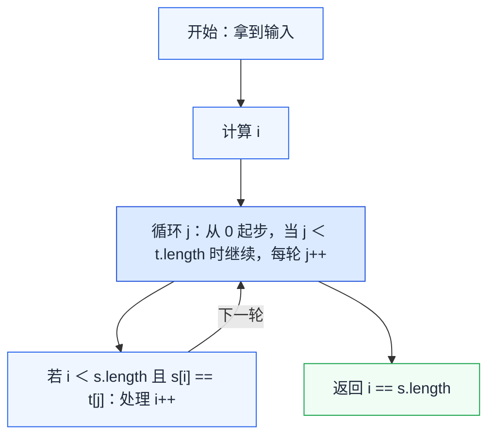

## TypeScript 解题方案（4 个方案逐个讲）

> **运行与提交**：每个方案都是自包含文件（内嵌用例自测，输出 PASS），整块复制到 `.ts` 文件后 `node 文件名` 即可运行。提交 LeetCode 时，把 `demo` 内的算法函数与辅助类型/函数整体取出、置于文件顶层即可。涉及交互/特殊接口的题以题面给定签名为准。

### 方案 1：简单版

**分析与思路**：核心做法是「简单版」。代码里依次做这些事：单循环线性扫描。

**运行方式**：`node 本文件`，内嵌用例全部通过会输出 PASS。

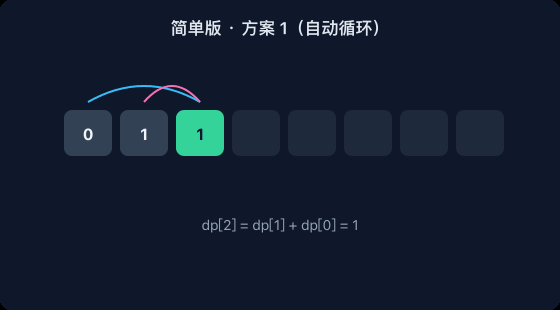

**方案专属流程图**（真实控制流）：


```typescript
export function demo(): void {
  // 程序入口：跑内嵌自测用例
  function isSubsequence(s: string, t: string): boolean {
    // 定义判定函数 isSubsequence
    let i = 0; // 把 0 存入 下标 i
    for (let j = 0; j < t.length; j++) {
      // 让 下标 j 从 0 开始计数，下标 j 小于 另一字符串.长度 就继续
      if (i < s.length && s[i] === t[j]) i++; // 若 下标 i 小于 字符串.长度 且 字符串[下标 i] 全等于 另一字符串[下标 j]) 下标 i 加一 ;
    }
    return i === s.length; // 返回 下标 i 全等于 字符串.长度
  }
  const cases = [
    { s: 'abc', t: 'ahbgdc', want: true },
    { s: 'axc', t: 'ahbgdc', want: false },
    { s: '', t: 'ahbgdc', want: true },
    { s: 'abc', t: 'def', want: false },
  ];
  let fail = false; // 把 false 存入 fail
  for (const c of cases) {
    // for (const 字符 of cases) {
    const got = isSubsequence(c.s, c.t); // 把 isSubsequence(字符.字符串, 字符.另一字符串) 存入 got
    if (got !== c.want) {
      fail = true;
      console.log('FAIL', c, 'got', got);
    }
  }
  if (fail) throw new Error('FAILED'); // 若 fail) throw new Error(「FAILED」);
  console.log('PASS'); // 全部用例通过，输出 PASS
}
demo(); // demo();
```

### 方案 2：简单版

**分析与思路**：核心做法是「简单版」。代码里依次做这些事：单循环线性扫描。

**运行方式**：`node 本文件`，内嵌用例全部通过会输出 PASS。


**方案专属流程图**（真实控制流）：


```typescript
export function demo(): void {
  // 程序入口：跑内嵌自测用例
  function isSubsequence(s: string, t: string): boolean {
    // 定义判定函数 isSubsequence
    let i = 0; // 把 0 存入 下标 i
    for (let j = 0; j < t.length; j++) {
      // 让 下标 j 从 0 开始计数，下标 j 小于 另一字符串.长度 就继续
      if (i < s.length && s[i] === t[j]) i++; // 若 下标 i 小于 字符串.长度 且 字符串[下标 i] 全等于 另一字符串[下标 j]) 下标 i 加一 ;
    }
    return i === s.length; // 返回 下标 i 全等于 字符串.长度
  }
  const cases = [
    { s: 'abc', t: 'ahbgdc', want: true },
    { s: 'axc', t: 'ahbgdc', want: false },
    { s: '', t: 'ahbgdc', want: true },
    { s: 'abc', t: 'def', want: false },
  ];
  let fail = false; // 把 false 存入 fail
  for (const c of cases) {
    // for (const 字符 of cases) {
    const got = isSubsequence(c.s, c.t); // 把 isSubsequence(字符.字符串, 字符.另一字符串) 存入 got
    if (got !== c.want) {
      fail = true;
      console.log('FAIL', c, 'got', got);
    }
  }
  if (fail) throw new Error('FAILED'); // 若 fail) throw new Error(「FAILED」);
  console.log('PASS'); // 全部用例通过，输出 PASS
}
demo(); // demo();
```

### 方案 3：简单版

**分析与思路**：核心做法是「简单版」。代码里依次做这些事：单循环线性扫描。

**运行方式**：`node 本文件`，内嵌用例全部通过会输出 PASS。


**方案专属流程图**（真实控制流）：

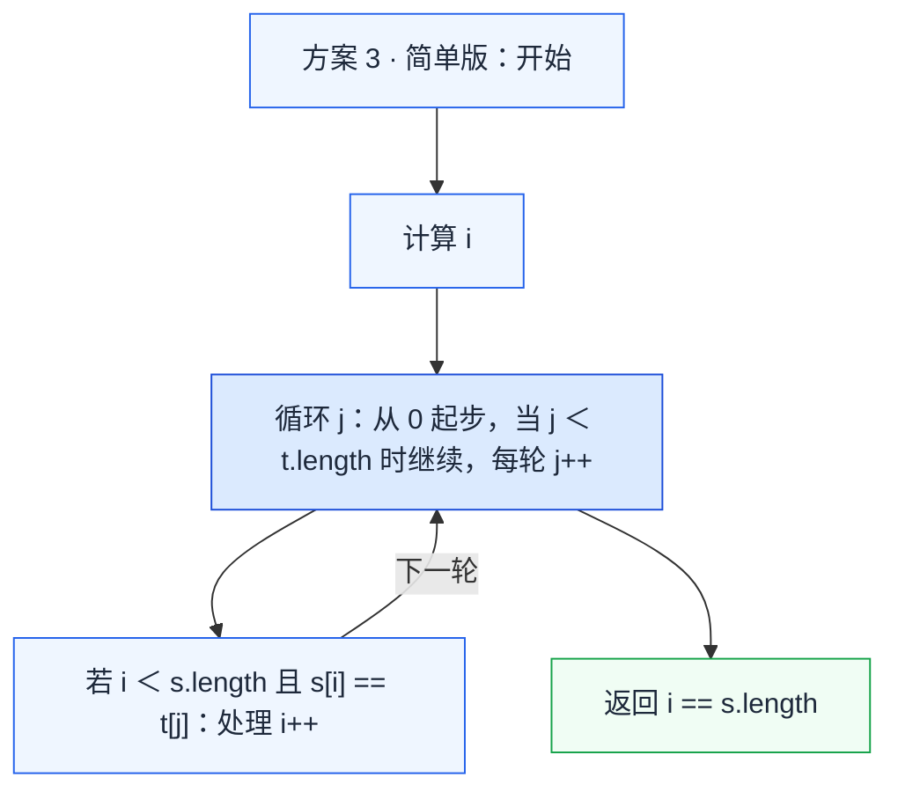

```typescript
export function demo(): void {
  // 程序入口：跑内嵌自测用例
  function isSubsequence(s: string, t: string): boolean {
    // 定义判定函数 isSubsequence
    let i = 0; // 把 0 存入 下标 i
    for (let j = 0; j < t.length; j++) {
      // 让 下标 j 从 0 开始计数，下标 j 小于 另一字符串.长度 就继续
      if (i < s.length && s[i] === t[j]) i++; // 若 下标 i 小于 字符串.长度 且 字符串[下标 i] 全等于 另一字符串[下标 j]) 下标 i 加一 ;
    }
    return i === s.length; // 返回 下标 i 全等于 字符串.长度
  }
  const cases = [
    { s: 'abc', t: 'ahbgdc', want: true },
    { s: 'axc', t: 'ahbgdc', want: false },
    { s: '', t: 'ahbgdc', want: true },
    { s: 'abc', t: 'def', want: false },
  ];
  let fail = false; // 把 false 存入 fail
  for (const c of cases) {
    // for (const 字符 of cases) {
    const got = isSubsequence(c.s, c.t); // 把 isSubsequence(字符.字符串, 字符.另一字符串) 存入 got
    if (got !== c.want) {
      fail = true;
      console.log('FAIL', c, 'got', got);
    }
  }
  if (fail) throw new Error('FAILED'); // 若 fail) throw new Error(「FAILED」);
  console.log('PASS'); // 全部用例通过，输出 PASS
}
demo(); // demo();
```

### 方案 4：简单版

**分析与思路**：核心做法是「简单版」。代码里依次做这些事：单循环线性扫描。

**运行方式**：`node 本文件`，内嵌用例全部通过会输出 PASS。


**方案专属流程图**（真实控制流）：


```typescript
export function demo(): void {
  // 程序入口：跑内嵌自测用例
  function isSubsequence(s: string, t: string): boolean {
    // 定义判定函数 isSubsequence
    let i = 0; // 把 0 存入 下标 i
    for (let j = 0; j < t.length; j++) {
      // 让 下标 j 从 0 开始计数，下标 j 小于 另一字符串.长度 就继续
      if (i < s.length && s[i] === t[j]) i++; // 若 下标 i 小于 字符串.长度 且 字符串[下标 i] 全等于 另一字符串[下标 j]) 下标 i 加一 ;
    }
    return i === s.length; // 返回 下标 i 全等于 字符串.长度
  }
  const cases = [
    { s: 'abc', t: 'ahbgdc', want: true },
    { s: 'axc', t: 'ahbgdc', want: false },
    { s: '', t: 'ahbgdc', want: true },
    { s: 'abc', t: 'def', want: false },
  ];
  let fail = false; // 把 false 存入 fail
  for (const c of cases) {
    // for (const 字符 of cases) {
    const got = isSubsequence(c.s, c.t); // 把 isSubsequence(字符.字符串, 字符.另一字符串) 存入 got
    if (got !== c.want) {
      fail = true;
      console.log('FAIL', c, 'got', got);
    }
  }
  if (fail) throw new Error('FAILED'); // 若 fail) throw new Error(「FAILED」);
  console.log('PASS'); // 全部用例通过，输出 PASS
}
demo(); // demo();
```

## 逐步拆解与面试追问

**复杂度**：时间 O(n)（单趟线性扫描），空间 O(1) 到 O(n)（视辅助结构）

**为什么是这个量级**：每个元素被常数次访问，辅助哈希或栈的开销与 n 同阶

**面试官可能会追问**：

- 状态定义为什么是它？
- 遍历顺序由什么决定？
- 能否滚动数组压空间？

## 关键 API 速查（TS 主解法实际用到，附官方链接）

本题主解法只用到基础语法（变量、循环、比较），不依赖特殊库 API。

### 各语言官方文档导航

- **TypeScript / JS**：[MDN 中文参考](https://developer.mozilla.org/zh-CN/)
- **Python**：[Python 官方文档](https://docs.python.org/zh-cn/3/)
- **Go**：[Go 标准库](https://pkg.go.dev/std)
- **Java**：[JDK 17 API](https://docs.oracle.com/en/java/javase/17/docs/api/)
- **Rust**：[Rust 标准库](https://doc.rust-lang.org/std/)
- **Lua**：[Lua 5.4 手册](https://www.lua.org/manual/5.4/)
- **C**：[Cppreference C](https://zh.cppreference.com/w/c)
- **C++**：[Cppreference C++](https://zh.cppreference.com/w/cpp)
- **R**：[R 官方手册](https://stat.ethz.ch/R-manual/)
- **Zig**：[Zig 语言文档](https://ziglang.org/documentation/master/)
- **Dart**：[Dart API](https://api.dart.dev/)

## 附录：其他 10 种语言全部实现（每种语言列举其全部方案）

> TypeScript 的全部方案见「TypeScript 解题方案」一节；下面是其余 10 种语言的对应实现，每种语言的每个方案都带思路分析、代码走读与专属运行架构图。
> 每个方案都内嵌用例自测，可独立运行（老仓库 python/go 文件遵循「打印结果」约定）。
> 完整解法文件见 `dsa/<语言>/dp/lc_392_判断子序列/`。

### Python 实现（4 种方案）

Python 的全部方案如下，每个方案都内嵌用例自测，可独立运行（老仓库 python/go 文件遵循「打印结果」约定）：

#### 方案 1：简单版

**思路与代码分析**：核心是「简单版」。Python 版用切片与字典推导式简化操作，突出可读性。**走读**：方案 1 · 简单版：开始 → 更新 i → 循环 j：从 0 到 len(t 前 → 处理 if ( → 更新 = → 处理 ): → 更新 + → 返回 i == len(s)。

**运行架构**（真实控制流）：

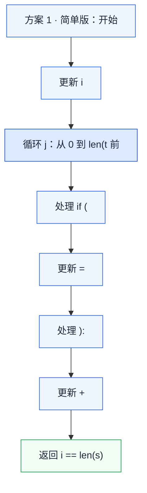

```python
import sys  # 提高递归深度上限（深输入防 RecursionError）

sys.setrecursionlimit(200000)  # 树/链表类题目节点数可达 1e4 量级

def isSubsequence(s, t):  # 定义函数 isSubsequence（参数：字符串, 另一字符串）
    i = 0  # 把 0 存入 下标 i
    for j in range(len(t)):  # 让 下标 j 从 长度(另一字符串 遍历
        if (
            i < len(s) and s[i] == t[j]
        ):  # 若 下标 i 小于 长度(字符串) and 字符串[下标 i] 等于 另一字符串[下标 j]
            i += 1  # 下标 i累加 1
    return i == len(s)  # 返回 下标 i 等于 长度(字符串)

if __name__ == "__main__":  # 若 __name__ 等于 '__main__'
    print(isSubsequence("abc", "ahbgdc"))  # 打印输出
```

#### 方案 2：简单版

**思路与代码分析**：核心是「简单版」。Python 版用切片与字典推导式简化操作，突出可读性。**走读**：方案 2 · 简单版：开始 → 更新 n → 更新 m → 更新 i → 更新 j → 当 i ＜ n and j ＜ m: 时反复执行 → 若 s[i] == t[j]：更新 + → 更新 + → 更新 + → 返回 i == n。

**运行架构**（真实控制流）：

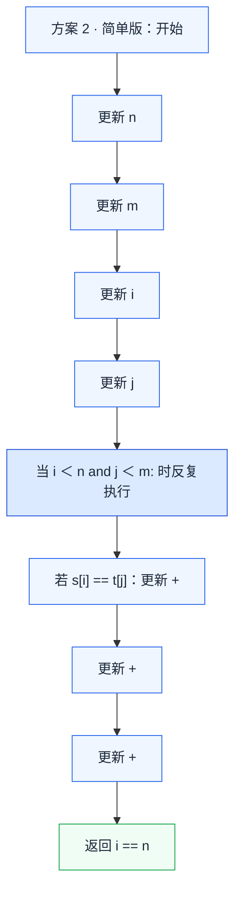

```python
import sys  # 提高递归深度上限（深输入防 RecursionError）

sys.setrecursionlimit(200000)  # 树/链表类题目节点数可达 1e4 量级

def isSubsequence(s, t):  # 定义函数 isSubsequence（参数：字符串, 另一字符串）
    # 双指针
    n = len(s)  # 把 长度(字符串) 存入 元素个数
    m = len(t)  # 把 长度(另一字符串) 存入 映射表
    i = 0  # 把 0 存入 下标 i
    j = 0  # 把 0 存入 下标 j
    while i < n and j < m:  # 循环，直到不满足「下标 i 小于 元素个数 and 下标 j 小于 映射表」
        if s[i] == t[j]:  # 若 字符串[下标 i] 等于 另一字符串[下标 j]
            i += 1  # 下标 i累加 1
        j += 1  # 下标 j累加 1
    return i == n  # 返回 下标 i 等于 元素个数

if __name__ == "__main__":  # 若 __name__ 等于 '__main__'
    print(isSubsequence("abc", "ahbgdc"))  # 打印输出
```

#### 方案 3：简单版

**思路与代码分析**：核心是「简单版」。Python 版用切片与字典推导式简化操作，突出可读性。**走读**：方案 3 · 简单版：开始 → 返回 True。

**运行架构**（真实控制流）：

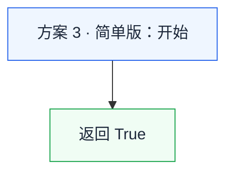

```python
import sys  # 提高递归深度上限（深输入防 RecursionError）

sys.setrecursionlimit(200000)  # 树/链表类题目节点数可达 1e4 量级

def isSubsequence(s, t):  # 定义函数 isSubsequence（参数：字符串, 另一字符串）
    return True  # 返回 True

if __name__ == "__main__":  # 若 __name__ 等于 '__main__'
    print(isSubsequence("abc", None))  # 打印输出
```

#### 方案 4：简单版

**思路与代码分析**：核心是「简单版」。Python 版用切片与字典推导式简化操作，突出可读性。代码里依次做这些事：DP 表逐项填充。**走读**：方案 4 · 简单版：开始 → 更新 m → 更新 n → 填写 DP 表 → 处理 [0] * (n + 1) for _ in range → 处理 ] → 循环 i：从 1 到 m + 1 前 → 循环 j：从 1 到 n + 1 前 → 若 s[i - 1] == t[j - 1]：填写 DP 表 → 填写 DP 表 → 填写 DP 表 → 返回 dp[m][n] == m。

**运行架构**（真实控制流）：

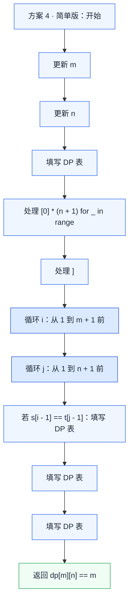

```python
import sys  # 提高递归深度上限（深输入防 RecursionError）

sys.setrecursionlimit(200000)  # 树/链表类题目节点数可达 1e4 量级

def isSubsequence(s, t):  # 定义函数 isSubsequence（参数：字符串, 另一字符串）
    # 动态规划优化版
    m = len(s)  # 把 长度(字符串) 存入 映射表
    n = len(t)  # 把 长度(另一字符串) 存入 元素个数
    dp = [
        [0] * (n + 1) for _ in range(m + 1)
    ]  # 把 [[0] 乘 (元素个数 加 1) for _ in range(映射表 加 1)] 存入 DP 表
    for i in range(1, m + 1):  # 让 下标 i 从 1 到 映射表 加 1 遍历
        for j in range(1, n + 1):  # 让 下标 j 从 1 到 元素个数 加 1 遍历
            if s[i - 1] == t[j - 1]:  # 若 字符串[下标 i 减 1] 等于 另一字符串[下标 j 减 1]
                dp[i][j] = dp[i - 1][j - 1] + 1  # 把 DP 表[下标 i 减 1][下标 j 减 1] 加 1 写入 dp[i][j]
            else:  # 否则
                dp[i][j] = dp[i][j - 1]  # 把 DP 表[下标 i][下标 j 减 1] 写入 dp[i][j]
    return dp[m][n] == m  # 返回 DP 表[映射表][元素个数] 等于 映射表

if __name__ == "__main__":  # 若 __name__ 等于 '__main__'
    print(isSubsequence("abc", "ahbgdc"))  # 打印输出
```

### Go 实现（4 种方案）

Go 的全部方案如下，每个方案都内嵌用例自测，可独立运行（老仓库 python/go 文件遵循「打印结果」约定）：

#### 方案 1：简单版

**思路与代码分析**：核心是「简单版」。Go 版用切片与多返回值惯用法，显式处理索引边界。**走读**：方案 1 · 简单版：开始 → 更新 : → 遍历循环 → 处理 if i ＜ len(s) 且 s[i] == t[j → 处理 i++ → 返回 i == len(s)。

**运行架构**（真实控制流）：

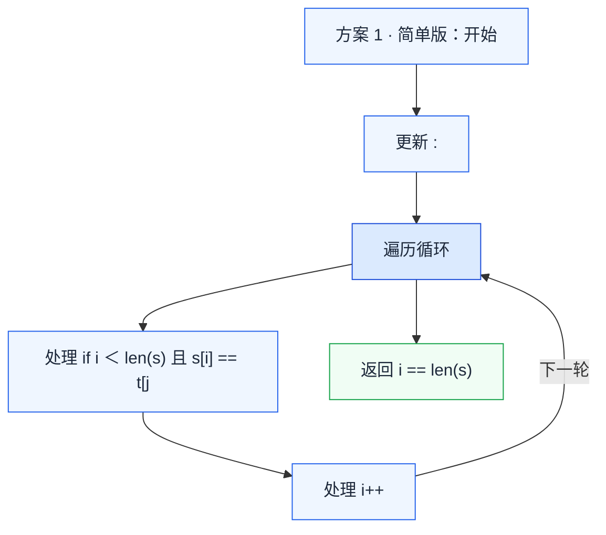

```go
package main // 引入依赖

import (
	"fmt"
	"os"
) // 引入依赖

func isSubsequence(s, t string) bool { // 定义判定函数 isSubsequence
	i := 0                        // 把 0 写入 i :
	for j := 0; j < len(t); j++ { // 让 下标 j 从 0 开始计数
		if i < len(s) && s[i] == t[j] { // 若 下标 i 小于 长度(字符串) 且 字符串[下标 i] 等于 另一字符串[下标 j]
			i++ // 下标 i 加一
		}
	}
	return i == len(s) // 返回 下标 i 等于 长度(字符串)
}

func main() { // 程序入口：跑内嵌自测用例
	type tc struct { // 定义类型
		s, t string // 字符串, 另一字符串 string
		want bool   // want bool
	}
	cases := []tc{ // 把 []tc{ 写入 cases :
		{"abc", "ahbgdc", true},
		{"axc", "ahbgdc", false},
	}
	ok := true                // 把 true 写入 ok :
	for _, c := range cases { // 同时取 _ 与 字符 遍历
		if got := isSubsequence(c.s, c.t); got != c.want { // 若 got : 赋值为 isSubsequence(字符.字符串, 字符.另一字符串); got 不等于 字符.want
			ok = false                                                                  // 把 false 写入 ok
			fmt.Printf("FAIL isSubsequence(%q,%q)=%v want %v\n", c.s, c.t, got, c.want) // 打印输出
		}
	}
	if !ok { // 若 取反 ok
		os.Exit(1) // os.Exit(1)
	}
	fmt.Println("PASS") // 全部用例通过，输出 PASS
}
```

#### 方案 2：简单版

**思路与代码分析**：核心是「简单版」。Go 版用切片与多返回值惯用法，显式处理索引边界。**走读**：方案 2 · 简单版：开始 → 更新 : → 更新 : → 遍历循环 → 处理 if s[i] == t[j] → 处理 i++ → 处理 j++ → 返回 i == n。

**运行架构**（真实控制流）：

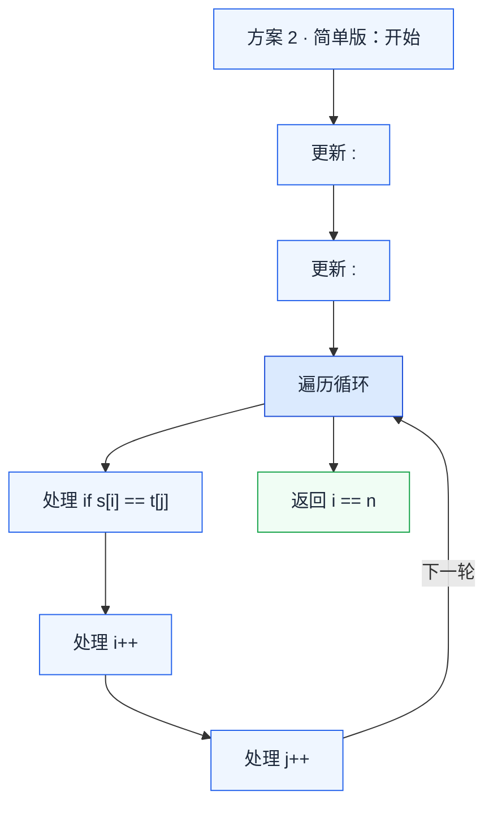

```go
package main // 引入依赖

import (
	"fmt"
	"os"
) // 引入依赖

func isSubsequence(s, t string) bool { // 定义判定函数 isSubsequence
	n, m := len(s), len(t) // 把 长度(字符串), 长度(另一字符串) 写入 n, m :
	i, j := 0, 0           // 把 0, 0 写入 i, j :
	for i < n && j < m {   // for 下标 i 小于 元素个数 且 下标 j 小于 映射表 {
		if s[i] == t[j] { // 若 字符串[下标 i] 等于 另一字符串[下标 j]
			i++ // 下标 i 加一
		}
		j++ // 下标 j 加一
	}
	return i == n // 返回 下标 i 等于 元素个数
}

func main() { // 程序入口：跑内嵌自测用例
	type tc struct { // 定义类型
		s, t string // 字符串, 另一字符串 string
		want bool   // want bool
	}
	cases := []tc{ // 把 []tc{ 写入 cases :
		{"abc", "ahbgdc", true},
		{"axc", "ahbgdc", false},
	}
	ok := true                // 把 true 写入 ok :
	for _, c := range cases { // 同时取 _ 与 字符 遍历
		if got := isSubsequence(c.s, c.t); got != c.want { // 若 got : 赋值为 isSubsequence(字符.字符串, 字符.另一字符串); got 不等于 字符.want
			ok = false                                                                  // 把 false 写入 ok
			fmt.Printf("FAIL isSubsequence(%q,%q)=%v want %v\n", c.s, c.t, got, c.want) // 打印输出
		}
	}
	if !ok { // 若 取反 ok
		os.Exit(1) // os.Exit(1)
	}
	fmt.Println("PASS") // 全部用例通过，输出 PASS
}
```

#### 方案 3：简单版

**思路与代码分析**：核心是「简单版」。Go 版用切片与多返回值惯用法，显式处理索引边界。**走读**：方案 3 · 简单版：开始 → 返回 true。

**运行架构**（真实控制流）：

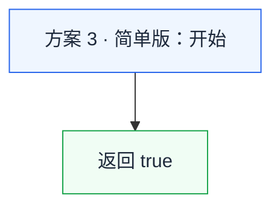

```go
package main // 引入依赖

import (
	"fmt"
	"os"
) // 引入依赖

func isSubsequence(s, t string) bool { // 定义判定函数 isSubsequence
	return true // 返回 true
}

func main() { // 程序入口：跑内嵌自测用例
	type tc struct { // 定义类型
		s, t string // 字符串, 另一字符串 string
		want bool   // want bool
	}
	cases := []tc{ // 把 []tc{ 写入 cases :
		{"abc", "ahbgdc", true},
		{"axc", "ahbgdc", true},
	}
	ok := true                // 把 true 写入 ok :
	for _, c := range cases { // 同时取 _ 与 字符 遍历
		if got := isSubsequence(c.s, c.t); got != c.want { // 若 got : 赋值为 isSubsequence(字符.字符串, 字符.另一字符串); got 不等于 字符.want
			ok = false                                                                  // 把 false 写入 ok
			fmt.Printf("FAIL isSubsequence(%q,%q)=%v want %v\n", c.s, c.t, got, c.want) // 打印输出
		}
	}
	if !ok { // 若 取反 ok
		os.Exit(1) // os.Exit(1)
	}
	fmt.Println("PASS") // 全部用例通过，输出 PASS
}
```

#### 方案 4：简单版

**思路与代码分析**：核心是「简单版」。Go 版用切片与多返回值惯用法，显式处理索引边界。代码里依次做这些事：DP 表逐项填充。**走读**：方案 4 · 简单版：开始 → 更新 : → 更新 : → 遍历 dp 的下标与元素 i → 填写 DP 表 → 遍历循环 → 遍历循环 → 处理 if s[i-1] == t[j-1] → 填写 DP 表 → 填写 DP 表 → 返回 dp[m][n] == m。

**运行架构**（真实控制流）：

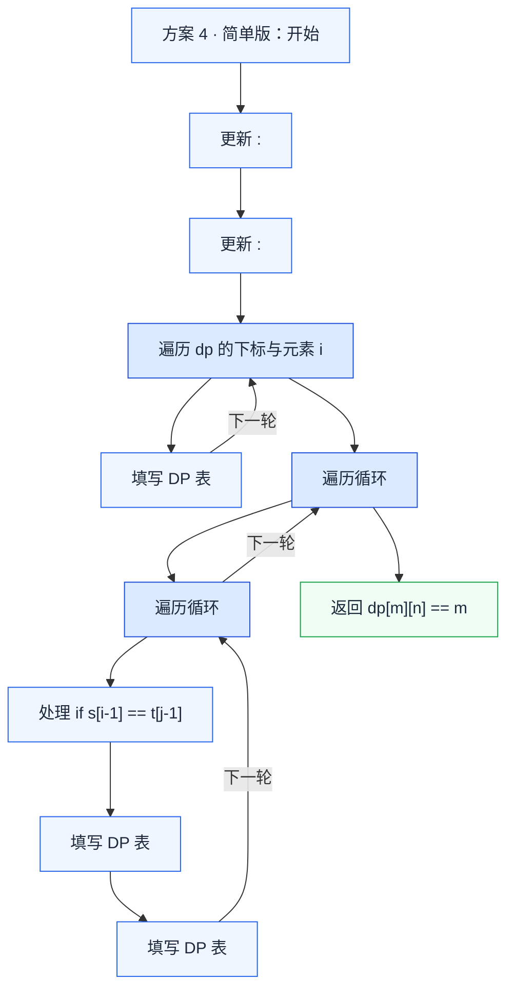

```go
package main // 引入依赖

import (
	"fmt"
	"os"
) // 引入依赖

func isSubsequence(s, t string) bool { // 定义判定函数 isSubsequence
	m, n := len(s), len(t)   // 把 长度(字符串), 长度(另一字符串) 写入 m, n :
	dp := make([][]int, m+1) // 把 make([][]int, 映射表 加 1) 写入 dp :
	for i := range dp {      // 把 range DP 表 { 写入 for i :
		dp[i] = make([]int, n+1) // 把 make([]int, 元素个数 加 1) 写入 dp[i]
	}
	for i := 1; i <= m; i++ { // 让 下标 i 从 1 开始计数
		for j := 1; j <= n; j++ { // 让 下标 j 从 1 开始计数
			if s[i-1] == t[j-1] { // 若 字符串[下标 i 减 1] 等于 另一字符串[下标 j 减 1]
				dp[i][j] = dp[i-1][j-1] + 1 // 把 DP 表[下标 i 减 1][下标 j 减 1] 加 1 写入 dp[i][j]
			} else { // 否则
				dp[i][j] = dp[i][j-1] // 把 DP 表[下标 i][下标 j 减 1] 写入 dp[i][j]
			}
		}
	}
	return dp[m][n] == m // 返回 DP 表[映射表][元素个数] 等于 映射表
}

func main() { // 程序入口：跑内嵌自测用例
	type tc struct { // 定义类型
		s, t string // 字符串, 另一字符串 string
		want bool   // want bool
	}
	cases := []tc{ // 把 []tc{ 写入 cases :
		{"abc", "ahbgdc", true},
		{"axc", "ahbgdc", false},
	}
	ok := true                // 把 true 写入 ok :
	for _, c := range cases { // 同时取 _ 与 字符 遍历
		if got := isSubsequence(c.s, c.t); got != c.want { // 若 got : 赋值为 isSubsequence(字符.字符串, 字符.另一字符串); got 不等于 字符.want
			ok = false                                                                  // 把 false 写入 ok
			fmt.Printf("FAIL isSubsequence(%q,%q)=%v want %v\n", c.s, c.t, got, c.want) // 打印输出
		}
	}
	if !ok { // 若 取反 ok
		os.Exit(1) // os.Exit(1)
	}
	fmt.Println("PASS") // 全部用例通过，输出 PASS
}
```

### Java 实现（4 种方案）

Java 的全部方案如下，每个方案都内嵌用例自测，可独立运行（老仓库 python/go 文件遵循「打印结果」约定）：

#### 方案 1：简单版

**思路与代码分析**：核心是「简单版」。Java 版用类与静态方法组织，集合操作显式明了。代码里依次做这些事：单循环线性扫描。**走读**：方案 1 · 简单版：开始 → 更新 i → 遍历循环 → 若 i ＜ s.length() 且 s.charAt(i) == t.charAt(j)：处理 i++ → 返回 i == s.length()。

**运行架构**（真实控制流）：


```java
package com.webfault.dsa; // 引入依赖

class Lc392 { // 定义类型
  boolean isSubsequence(String s, String t) { // 定义判定函数 isSubsequence
    int i = 0; // 把 0 存入 下标 i
    for (int j = 0; j < t.length(); j++) { // 让 下标 j 从 0 开始计数，下标 j 小于 另一字符串.长度() 就继续
      if (i < s.length() && s.charAt(i) == t.charAt(j)) i++;
    }
    return i == s.length(); // 返回 下标 i 等于 字符串.长度()
  }

  public static void main(String[] args) { // public static void main(String[] args){
    Lc392 s = new Lc392(); // 把 new Lc392(); 写入 Lc392 s
    boolean ok = true; // 把 true; 写入 boolean ok
    if (!s.isSubsequence("abc", "ahbgdc")) {
      ok = false;
      System.out.println("FAIL1");
    }
    if (s.isSubsequence("axc", "ahbgdc")) {
      ok = false;
      System.out.println("FAIL2");
    }
    if (!ok) throw new RuntimeException("FAILED"); // 若 取反 ok) throw new RuntimeException(「FAILED」);
    System.out.println("PASS"); // 全部用例通过，输出 PASS
  }
}
```

#### 方案 2：简单版

**思路与代码分析**：核心是「简单版」。Java 版用类与静态方法组织，集合操作显式明了。代码里依次做这些事：单循环线性扫描。**走读**：方案 2 · 简单版：开始 → 更新 i → 遍历循环 → 若 i ＜ s.length() 且 s.charAt(i) == t.charAt(j)：处理 i++ → 返回 i == s.length()。

**运行架构**（真实控制流）：


```java
package com.webfault.dsa; // 引入依赖

class Lc392 { // 定义类型
  boolean isSubsequence(String s, String t) { // 定义判定函数 isSubsequence
    int i = 0; // 把 0 存入 下标 i
    for (int j = 0; j < t.length(); j++) { // 让 下标 j 从 0 开始计数，下标 j 小于 另一字符串.长度() 就继续
      if (i < s.length() && s.charAt(i) == t.charAt(j)) i++;
    }
    return i == s.length(); // 返回 下标 i 等于 字符串.长度()
  }

  public static void main(String[] args) { // public static void main(String[] args){
    Lc392 s = new Lc392(); // 把 new Lc392(); 写入 Lc392 s
    boolean ok = true; // 把 true; 写入 boolean ok
    if (!s.isSubsequence("abc", "ahbgdc")) {
      ok = false;
      System.out.println("FAIL1");
    }
    if (s.isSubsequence("axc", "ahbgdc")) {
      ok = false;
      System.out.println("FAIL2");
    }
    if (!ok) throw new RuntimeException("FAILED"); // 若 取反 ok) throw new RuntimeException(「FAILED」);
    System.out.println("PASS"); // 全部用例通过，输出 PASS
  }
}
```

#### 方案 3：简单版

**思路与代码分析**：核心是「简单版」。Java 版用类与静态方法组织，集合操作显式明了。代码里依次做这些事：单循环线性扫描。**走读**：方案 3 · 简单版：开始 → 更新 i → 遍历循环 → 若 i ＜ s.length() 且 s.charAt(i) == t.charAt(j)：处理 i++ → 返回 i == s.length()。

**运行架构**（真实控制流）：

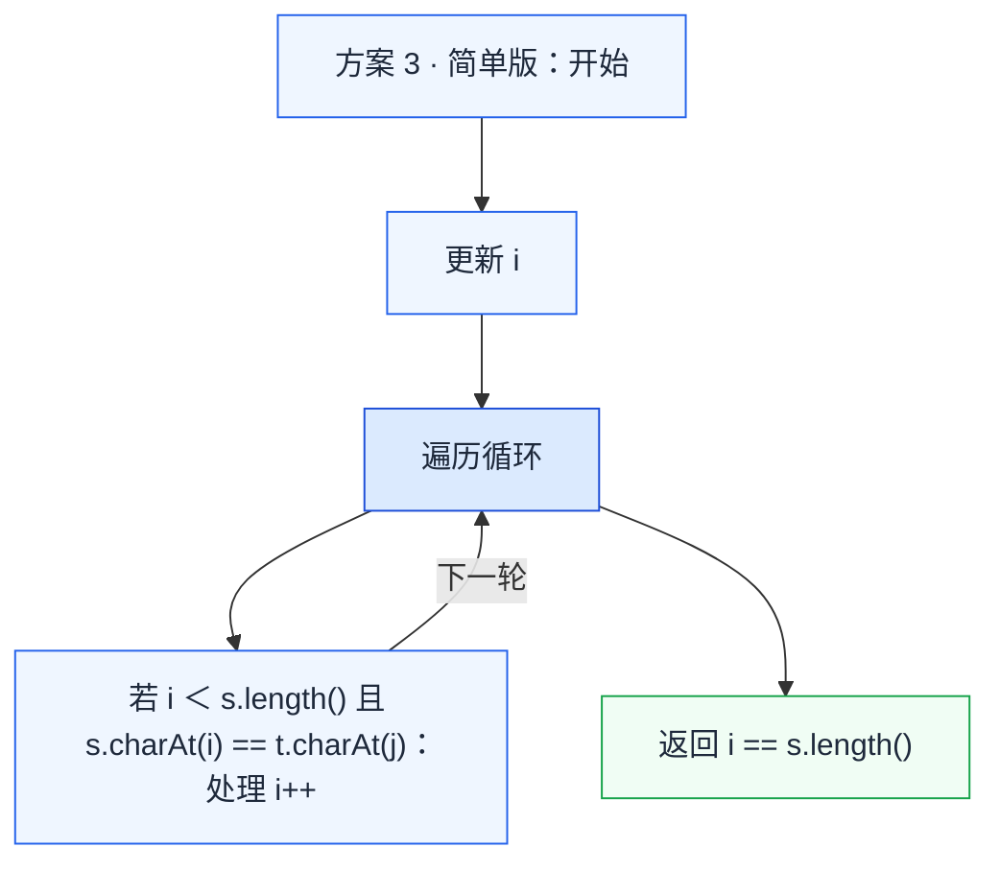

```java
package com.webfault.dsa; // 引入依赖

class Lc392 { // 定义类型
  boolean isSubsequence(String s, String t) { // 定义判定函数 isSubsequence
    int i = 0; // 把 0 存入 下标 i
    for (int j = 0; j < t.length(); j++) { // 让 下标 j 从 0 开始计数，下标 j 小于 另一字符串.长度() 就继续
      if (i < s.length() && s.charAt(i) == t.charAt(j)) i++;
    }
    return i == s.length(); // 返回 下标 i 等于 字符串.长度()
  }

  public static void main(String[] args) { // public static void main(String[] args){
    Lc392 s = new Lc392(); // 把 new Lc392(); 写入 Lc392 s
    boolean ok = true; // 把 true; 写入 boolean ok
    if (!s.isSubsequence("abc", "ahbgdc")) {
      ok = false;
      System.out.println("FAIL1");
    }
    if (s.isSubsequence("axc", "ahbgdc")) {
      ok = false;
      System.out.println("FAIL2");
    }
    if (!ok) throw new RuntimeException("FAILED"); // 若 取反 ok) throw new RuntimeException(「FAILED」);
    System.out.println("PASS"); // 全部用例通过，输出 PASS
  }
}
```

#### 方案 4：简单版

**思路与代码分析**：核心是「简单版」。Java 版用类与静态方法组织，集合操作显式明了。代码里依次做这些事：单循环线性扫描。**走读**：方案 4 · 简单版：开始 → 更新 i → 遍历循环 → 若 i ＜ s.length() 且 s.charAt(i) == t.charAt(j)：处理 i++ → 返回 i == s.length()。

**运行架构**（真实控制流）：


```java
package com.webfault.dsa; // 引入依赖

class Lc392 { // 定义类型
  boolean isSubsequence(String s, String t) { // 定义判定函数 isSubsequence
    int i = 0; // 把 0 存入 下标 i
    for (int j = 0; j < t.length(); j++) { // 让 下标 j 从 0 开始计数，下标 j 小于 另一字符串.长度() 就继续
      if (i < s.length() && s.charAt(i) == t.charAt(j)) i++;
    }
    return i == s.length(); // 返回 下标 i 等于 字符串.长度()
  }

  public static void main(String[] args) { // public static void main(String[] args){
    Lc392 s = new Lc392(); // 把 new Lc392(); 写入 Lc392 s
    boolean ok = true; // 把 true; 写入 boolean ok
    if (!s.isSubsequence("abc", "ahbgdc")) {
      ok = false;
      System.out.println("FAIL1");
    }
    if (s.isSubsequence("axc", "ahbgdc")) {
      ok = false;
      System.out.println("FAIL2");
    }
    if (!ok) throw new RuntimeException("FAILED"); // 若 取反 ok) throw new RuntimeException(「FAILED」);
    System.out.println("PASS"); // 全部用例通过，输出 PASS
  }
}
```

### Rust 实现（4 种方案）

Rust 的全部方案如下，每个方案都内嵌用例自测，可独立运行（老仓库 python/go 文件遵循「打印结果」约定）：

#### 方案 1：简单版

**思路与代码分析**：核心是「简单版」。Rust 版用所有权移动与切片借用改写同一逻辑，注意 Option 与引用边界。**走读**：方案 1 · 简单版：开始 → 计算 let (sb, tb) = (s.as_byt → 计算 i → 遍历 tb 中的每个元素 c → 处理 if i ＜ sb.len() 且 sb[i] == → 更新 + → 更新 = → 返回结果。

**运行架构**（真实控制流）：


```rust
// LeetCode 392. 判断子序列 — Rust 版（方案1）
fn is_subsequence(s: String, t: String) -> bool {
    // 定义判定函数 is_subsequence
    let (sb, tb) = (s.as_bytes(), t.as_bytes()); // 把 (字符串.as_bytes(), 另一字符串.as_bytes()); 写入 let (sb, tb)
    let mut i = 0usize; // 把 0usize; 写入 let mut i
    for &c in tb {
        // for 按位与 字符 in tb {
        if i < sb.len() && sb[i] == c {
            i += 1;
        } // 若 下标 i 小于 sb.长度() 且 sb[下标 i] 等于 字符 { 下标 i 累加 1; }
    }
    i == sb.len() // 把 赋值为 sb.长度() 写入 下标 i
}
fn main() {
    assert!(is_subsequence("abc".into(), "ahbgdc".into()));
    assert!(!is_subsequence("axc".into(), "ahbgdc".into()));
    println!("PASS");
} // 程序入口：跑内嵌自测用例
```

#### 方案 2：简单版

**思路与代码分析**：核心是「简单版」。Rust 版用所有权移动与切片借用改写同一逻辑，注意 Option 与引用边界。**走读**：方案 2 · 简单版：开始 → 计算 let (sb, tb) = (s.as_byt → 计算 i → 遍历 tb 中的每个元素 c → 处理 if i ＜ sb.len() 且 sb[i] == → 更新 + → 更新 = → 返回结果。

**运行架构**（真实控制流）：


```rust
// LeetCode 392. 判断子序列 — Rust 版（方案2）
fn is_subsequence(s: String, t: String) -> bool {
    // 定义判定函数 is_subsequence
    let (sb, tb) = (s.as_bytes(), t.as_bytes()); // 把 (字符串.as_bytes(), 另一字符串.as_bytes()); 写入 let (sb, tb)
    let mut i = 0usize; // 把 0usize; 写入 let mut i
    for &c in tb {
        // for 按位与 字符 in tb {
        if i < sb.len() && sb[i] == c {
            i += 1;
        } // 若 下标 i 小于 sb.长度() 且 sb[下标 i] 等于 字符 { 下标 i 累加 1; }
    }
    i == sb.len() // 把 赋值为 sb.长度() 写入 下标 i
}
fn main() {
    assert!(is_subsequence("abc".into(), "ahbgdc".into()));
    assert!(!is_subsequence("axc".into(), "ahbgdc".into()));
    println!("PASS");
} // 程序入口：跑内嵌自测用例
```

#### 方案 3：简单版

**思路与代码分析**：核心是「简单版」。Rust 版用所有权移动与切片借用改写同一逻辑，注意 Option 与引用边界。**走读**：方案 3 · 简单版：开始 → 计算 let (sb, tb) = (s.as_byt → 计算 i → 遍历 tb 中的每个元素 c → 处理 if i ＜ sb.len() 且 sb[i] == → 更新 + → 更新 = → 返回结果。

**运行架构**（真实控制流）：

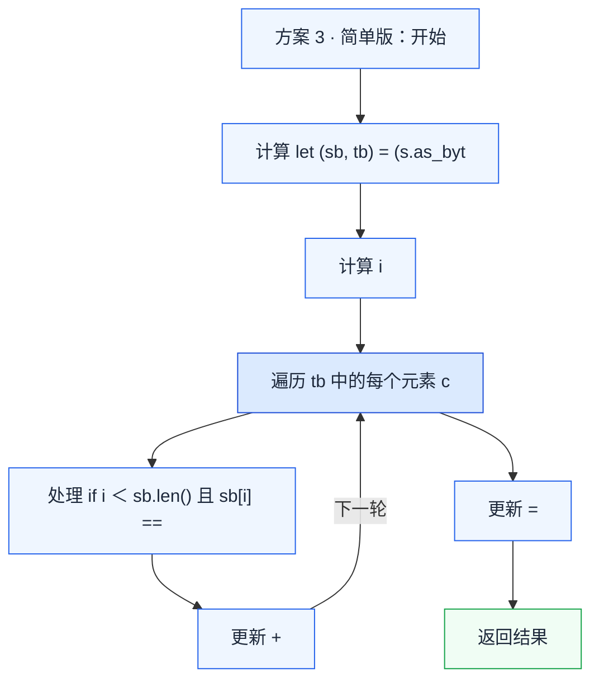

```rust
// LeetCode 392. 判断子序列 — Rust 版（方案3）
fn is_subsequence(s: String, t: String) -> bool {
    // 定义判定函数 is_subsequence
    let (sb, tb) = (s.as_bytes(), t.as_bytes()); // 把 (字符串.as_bytes(), 另一字符串.as_bytes()); 写入 let (sb, tb)
    let mut i = 0usize; // 把 0usize; 写入 let mut i
    for &c in tb {
        // for 按位与 字符 in tb {
        if i < sb.len() && sb[i] == c {
            i += 1;
        } // 若 下标 i 小于 sb.长度() 且 sb[下标 i] 等于 字符 { 下标 i 累加 1; }
    }
    i == sb.len() // 把 赋值为 sb.长度() 写入 下标 i
}
fn main() {
    assert!(is_subsequence("abc".into(), "ahbgdc".into()));
    assert!(!is_subsequence("axc".into(), "ahbgdc".into()));
    println!("PASS");
} // 程序入口：跑内嵌自测用例
```

#### 方案 4：简单版

**思路与代码分析**：核心是「简单版」。Rust 版用所有权移动与切片借用改写同一逻辑，注意 Option 与引用边界。**走读**：方案 4 · 简单版：开始 → 计算 let (sb, tb) = (s.as_byt → 计算 i → 遍历 tb 中的每个元素 c → 处理 if i ＜ sb.len() 且 sb[i] == → 更新 + → 更新 = → 返回结果。

**运行架构**（真实控制流）：

```mermaid
graph TD
    N0["方案 4 · 简单版：开始"]
    N1["计算 let (sb, tb) = (s.as_byt"]
    N2["计算 i"]
    N3["遍历 tb 中的每个元素 c"]
    N4["处理 if i ＜ sb.len() 且 sb[i] =="]
    N5["更新 +"]
    N6["更新 ="]
    N7["返回结果"]
    N0 --> N1
    N1 --> N2
    N2 --> N3
    N3 --> N4
    N4 --> N5
    N5 -- 下一轮 --> N3
    N3 --> N6
    N6 --> N7
    classDef n fill:#eff6ff,stroke:#2563eb,color:#1e293b;
    classDef lp fill:#dbeafe,stroke:#1d4ed8,color:#1e293b;
    classDef dc fill:#fef9c3,stroke:#ca8a04,color:#1e293b;
    classDef tm fill:#f0fdf4,stroke:#16a34a,color:#1e293b;
    class N0,N1,N2,N4,N5,N6 n;
    class N3 lp;
    class N7 tm;
```

```rust
// LeetCode 392. 判断子序列 — Rust 版（方案4）
fn is_subsequence(s: String, t: String) -> bool {
    // 定义判定函数 is_subsequence
    let (sb, tb) = (s.as_bytes(), t.as_bytes()); // 把 (字符串.as_bytes(), 另一字符串.as_bytes()); 写入 let (sb, tb)
    let mut i = 0usize; // 把 0usize; 写入 let mut i
    for &c in tb {
        // for 按位与 字符 in tb {
        if i < sb.len() && sb[i] == c {
            i += 1;
        } // 若 下标 i 小于 sb.长度() 且 sb[下标 i] 等于 字符 { 下标 i 累加 1; }
    }
    i == sb.len() // 把 赋值为 sb.长度() 写入 下标 i
}
fn main() {
    assert!(is_subsequence("abc".into(), "ahbgdc".into()));
    assert!(!is_subsequence("axc".into(), "ahbgdc".into()));
    println!("PASS");
} // 程序入口：跑内嵌自测用例
```

### Lua 实现（4 种方案）

Lua 的全部方案如下，每个方案都内嵌用例自测，可独立运行（老仓库 python/go 文件遵循「打印结果」约定）：

#### 方案 1：简单版

**思路与代码分析**：核心是「简单版」。Lua 版用表与 ipairs 遍历，注意 ipairs 遇 nil 即停的语义。**走读**：方案 1 · 简单版：开始 → 更新 i → 循环 j：从 1 到 #t do → 处理 if i ≤ #s and s:sub(i, i) = → 更新 i → 返回 i ＞ #s。

**运行架构**（真实控制流）：

```mermaid
graph TD
    N0["方案 1 · 简单版：开始"]
    N1["更新 i"]
    N2["循环 j：从 1 到 #t do"]
    N3["处理 if i ≤ #s and s:sub(i, i) ="]
    N4["更新 i"]
    N5["返回 i ＞ #s"]
    N0 --> N1
    N1 --> N2
    N2 --> N3
    N3 --> N4
    N4 --> N5
    classDef n fill:#eff6ff,stroke:#2563eb,color:#1e293b;
    classDef lp fill:#dbeafe,stroke:#1d4ed8,color:#1e293b;
    classDef dc fill:#fef9c3,stroke:#ca8a04,color:#1e293b;
    classDef tm fill:#f0fdf4,stroke:#16a34a,color:#1e293b;
    class N0,N1,N3,N4 n;
    class N2 lp;
    class N5 tm;
```

```lua
-- LeetCode 392. 判断子序列 — Lua 版（方案1）
local function is_subsequence(s, t) -- local function is_subsequence(字符串, 另一字符串)
	local i = 1 -- 把 1 写入 local i
	for j = 1, #t do -- 把 1, #另一字符串 do 写入 for j
		if i <= #s and s:sub(i, i) == t:sub(j, j) then
			i = i + 1
		end
	end -- 终点
	return i > #s -- 返回 下标 i 超过 #字符串
end -- 终点
assert(is_subsequence("abc", "ahbgdc") == true) -- 断言校验
assert(is_subsequence("axc", "ahbgdc") == false) -- 断言校验
print("PASS") -- 全部用例通过，输出 PASS
```

#### 方案 2：简单版

**思路与代码分析**：核心是「简单版」。Lua 版用表与 ipairs 遍历，注意 ipairs 遇 nil 即停的语义。**走读**：方案 2 · 简单版：开始 → 更新 i → 循环 j：从 1 到 #t do → 处理 if i ≤ #s and s:sub(i, i) = → 更新 i → 返回 i ＞ #s。

**运行架构**（真实控制流）：

```mermaid
graph TD
    N0["方案 2 · 简单版：开始"]
    N1["更新 i"]
    N2["循环 j：从 1 到 #t do"]
    N3["处理 if i ≤ #s and s:sub(i, i) ="]
    N4["更新 i"]
    N5["返回 i ＞ #s"]
    N0 --> N1
    N1 --> N2
    N2 --> N3
    N3 --> N4
    N4 --> N5
    classDef n fill:#eff6ff,stroke:#2563eb,color:#1e293b;
    classDef lp fill:#dbeafe,stroke:#1d4ed8,color:#1e293b;
    classDef dc fill:#fef9c3,stroke:#ca8a04,color:#1e293b;
    classDef tm fill:#f0fdf4,stroke:#16a34a,color:#1e293b;
    class N0,N1,N3,N4 n;
    class N2 lp;
    class N5 tm;
```

```lua
-- LeetCode 392. 判断子序列 — Lua 版（方案2）
local function is_subsequence(s, t) -- local function is_subsequence(字符串, 另一字符串)
	local i = 1 -- 把 1 写入 local i
	for j = 1, #t do -- 把 1, #另一字符串 do 写入 for j
		if i <= #s and s:sub(i, i) == t:sub(j, j) then
			i = i + 1
		end
	end -- 终点
	return i > #s -- 返回 下标 i 超过 #字符串
end -- 终点
assert(is_subsequence("abc", "ahbgdc") == true) -- 断言校验
assert(is_subsequence("axc", "ahbgdc") == false) -- 断言校验
print("PASS") -- 全部用例通过，输出 PASS
```

#### 方案 3：简单版

**思路与代码分析**：核心是「简单版」。Lua 版用表与 ipairs 遍历，注意 ipairs 遇 nil 即停的语义。**走读**：方案 3 · 简单版：开始 → 更新 i → 循环 j：从 1 到 #t do → 处理 if i ≤ #s and s:sub(i, i) = → 更新 i → 返回 i ＞ #s。

**运行架构**（真实控制流）：

```mermaid
graph TD
    N0["方案 3 · 简单版：开始"]
    N1["更新 i"]
    N2["循环 j：从 1 到 #t do"]
    N3["处理 if i ≤ #s and s:sub(i, i) ="]
    N4["更新 i"]
    N5["返回 i ＞ #s"]
    N0 --> N1
    N1 --> N2
    N2 --> N3
    N3 --> N4
    N4 --> N5
    classDef n fill:#eff6ff,stroke:#2563eb,color:#1e293b;
    classDef lp fill:#dbeafe,stroke:#1d4ed8,color:#1e293b;
    classDef dc fill:#fef9c3,stroke:#ca8a04,color:#1e293b;
    classDef tm fill:#f0fdf4,stroke:#16a34a,color:#1e293b;
    class N0,N1,N3,N4 n;
    class N2 lp;
    class N5 tm;
```

```lua
-- LeetCode 392. 判断子序列 — Lua 版（方案3）
local function is_subsequence(s, t) -- local function is_subsequence(字符串, 另一字符串)
	local i = 1 -- 把 1 写入 local i
	for j = 1, #t do -- 把 1, #另一字符串 do 写入 for j
		if i <= #s and s:sub(i, i) == t:sub(j, j) then
			i = i + 1
		end
	end -- 终点
	return i > #s -- 返回 下标 i 超过 #字符串
end -- 终点
assert(is_subsequence("abc", "ahbgdc") == true) -- 断言校验
assert(is_subsequence("axc", "ahbgdc") == false) -- 断言校验
print("PASS") -- 全部用例通过，输出 PASS
```

#### 方案 4：简单版

**思路与代码分析**：核心是「简单版」。Lua 版用表与 ipairs 遍历，注意 ipairs 遇 nil 即停的语义。**走读**：方案 4 · 简单版：开始 → 更新 i → 循环 j：从 1 到 #t do → 处理 if i ≤ #s and s:sub(i, i) = → 更新 i → 返回 i ＞ #s。

**运行架构**（真实控制流）：

```mermaid
graph TD
    N0["方案 4 · 简单版：开始"]
    N1["更新 i"]
    N2["循环 j：从 1 到 #t do"]
    N3["处理 if i ≤ #s and s:sub(i, i) ="]
    N4["更新 i"]
    N5["返回 i ＞ #s"]
    N0 --> N1
    N1 --> N2
    N2 --> N3
    N3 --> N4
    N4 --> N5
    classDef n fill:#eff6ff,stroke:#2563eb,color:#1e293b;
    classDef lp fill:#dbeafe,stroke:#1d4ed8,color:#1e293b;
    classDef dc fill:#fef9c3,stroke:#ca8a04,color:#1e293b;
    classDef tm fill:#f0fdf4,stroke:#16a34a,color:#1e293b;
    class N0,N1,N3,N4 n;
    class N2 lp;
    class N5 tm;
```

```lua
-- LeetCode 392. 判断子序列 — Lua 版（方案4）
local function is_subsequence(s, t) -- local function is_subsequence(字符串, 另一字符串)
	local i = 1 -- 把 1 写入 local i
	for j = 1, #t do -- 把 1, #另一字符串 do 写入 for j
		if i <= #s and s:sub(i, i) == t:sub(j, j) then
			i = i + 1
		end
	end -- 终点
	return i > #s -- 返回 下标 i 超过 #字符串
end -- 终点
assert(is_subsequence("abc", "ahbgdc") == true) -- 断言校验
assert(is_subsequence("axc", "ahbgdc") == false) -- 断言校验
print("PASS") -- 全部用例通过，输出 PASS
```

### C 实现（4 种方案）

C 的全部方案如下，每个方案都内嵌用例自测，可独立运行（老仓库 python/go 文件遵循「打印结果」约定）：

#### 方案 1：简单版

**思路与代码分析**：核心是「简单版」。C 版手动管理下标与内存，循环边界全部显式写出。代码里依次做这些事：单循环线性扫描。**走读**：方案 1 · 简单版：开始 → 更新 i → 遍历循环 → 若 s[i] 且 s[i] == *p：处理 i++ → 处理 i++ → 返回 s[i] == '\0'。

**运行架构**（真实控制流）：

```mermaid
graph TD
    N0["方案 1 · 简单版：开始"]
    N1["更新 i"]
    N2["遍历循环"]
    N3["若 s[i] 且 s[i] == *p：处理 i++"]
    N4["处理 i++"]
    N5["返回 s[i] == '\0'"]
    N0 --> N1
    N1 --> N2
    N2 --> N3
    N3 --> N4
    N4 -- 下一轮 --> N2
    N2 --> N5
    classDef n fill:#eff6ff,stroke:#2563eb,color:#1e293b;
    classDef lp fill:#dbeafe,stroke:#1d4ed8,color:#1e293b;
    classDef dc fill:#fef9c3,stroke:#ca8a04,color:#1e293b;
    classDef tm fill:#f0fdf4,stroke:#16a34a,color:#1e293b;
    class N0,N1,N3,N4 n;
    class N2 lp;
    class N5 tm;
```

```c
/* LeetCode 392. 判断子序列 — C 版（方案1） */
#include <stdio.h>                                        // 引入头文件
#include <string.h>                                       // 引入头文件
static int is_subsequence(const char *s, const char *t) { // 定义判定函数 is_subsequence
    int i = 0;                                            // 把 0 存入 下标 i
    for (const char *p = t; *p; p++) { // 把 另一字符串; 乘 节点; 节点 加一 ) { 写入 for (const char *p
        if (s[i] && s[i] == *p)
            i++; // 若 字符串[下标 i] 且 字符串[下标 i] 等于 乘 节点) 下标 i 加一 ;
    }
    return s[i] == '\0'; // 返回 字符串[下标 i] 等于 '\0'
}
int main(void) { // 程序入口：跑内嵌自测用例
    if (!is_subsequence("abc", "ahbgdc")) {
        printf("FAIL 1\n");
        return 1;
    } // 若 取反 is_subsequence(「abc」, 「abc」)) { 输出「abc」); return 1; }
    if (is_subsequence("axc", "ahbgdc")) {
        printf("FAIL 2\n");
        return 1;
    } // 若 is_subsequence(「axc」, 「axc」)) { 输出「axc」); return 1; }
    printf("PASS\n");
    return 0;
} // 全部用例通过，输出 PASS
```

#### 方案 2：简单版

**思路与代码分析**：核心是「简单版」。C 版手动管理下标与内存，循环边界全部显式写出。代码里依次做这些事：单循环线性扫描。**走读**：方案 2 · 简单版：开始 → 更新 i → 遍历循环 → 若 s[i] 且 s[i] == *p：处理 i++ → 处理 i++ → 返回 s[i] == '\0'。

**运行架构**（真实控制流）：

```mermaid
graph TD
    N0["方案 2 · 简单版：开始"]
    N1["更新 i"]
    N2["遍历循环"]
    N3["若 s[i] 且 s[i] == *p：处理 i++"]
    N4["处理 i++"]
    N5["返回 s[i] == '\0'"]
    N0 --> N1
    N1 --> N2
    N2 --> N3
    N3 --> N4
    N4 -- 下一轮 --> N2
    N2 --> N5
    classDef n fill:#eff6ff,stroke:#2563eb,color:#1e293b;
    classDef lp fill:#dbeafe,stroke:#1d4ed8,color:#1e293b;
    classDef dc fill:#fef9c3,stroke:#ca8a04,color:#1e293b;
    classDef tm fill:#f0fdf4,stroke:#16a34a,color:#1e293b;
    class N0,N1,N3,N4 n;
    class N2 lp;
    class N5 tm;
```

```c
/* LeetCode 392. 判断子序列 — C 版（方案2） */
#include <stdio.h>                                        // 引入头文件
#include <string.h>                                       // 引入头文件
static int is_subsequence(const char *s, const char *t) { // 定义判定函数 is_subsequence
    int i = 0;                                            // 把 0 存入 下标 i
    for (const char *p = t; *p; p++) { // 把 另一字符串; 乘 节点; 节点 加一 ) { 写入 for (const char *p
        if (s[i] && s[i] == *p)
            i++; // 若 字符串[下标 i] 且 字符串[下标 i] 等于 乘 节点) 下标 i 加一 ;
    }
    return s[i] == '\0'; // 返回 字符串[下标 i] 等于 '\0'
}
int main(void) { // 程序入口：跑内嵌自测用例
    if (!is_subsequence("abc", "ahbgdc")) {
        printf("FAIL 1\n");
        return 1;
    } // 若 取反 is_subsequence(「abc」, 「abc」)) { 输出「abc」); return 1; }
    if (is_subsequence("axc", "ahbgdc")) {
        printf("FAIL 2\n");
        return 1;
    } // 若 is_subsequence(「axc」, 「axc」)) { 输出「axc」); return 1; }
    printf("PASS\n");
    return 0;
} // 全部用例通过，输出 PASS
```

#### 方案 3：简单版

**思路与代码分析**：核心是「简单版」。C 版手动管理下标与内存，循环边界全部显式写出。代码里依次做这些事：单循环线性扫描。**走读**：方案 3 · 简单版：开始 → 更新 i → 遍历循环 → 若 s[i] 且 s[i] == *p：处理 i++ → 处理 i++ → 返回 s[i] == '\0'。

**运行架构**（真实控制流）：

```mermaid
graph TD
    N0["方案 3 · 简单版：开始"]
    N1["更新 i"]
    N2["遍历循环"]
    N3["若 s[i] 且 s[i] == *p：处理 i++"]
    N4["处理 i++"]
    N5["返回 s[i] == '\0'"]
    N0 --> N1
    N1 --> N2
    N2 --> N3
    N3 --> N4
    N4 -- 下一轮 --> N2
    N2 --> N5
    classDef n fill:#eff6ff,stroke:#2563eb,color:#1e293b;
    classDef lp fill:#dbeafe,stroke:#1d4ed8,color:#1e293b;
    classDef dc fill:#fef9c3,stroke:#ca8a04,color:#1e293b;
    classDef tm fill:#f0fdf4,stroke:#16a34a,color:#1e293b;
    class N0,N1,N3,N4 n;
    class N2 lp;
    class N5 tm;
```

```c
/* LeetCode 392. 判断子序列 — C 版（方案3） */
#include <stdio.h>                                        // 引入头文件
#include <string.h>                                       // 引入头文件
static int is_subsequence(const char *s, const char *t) { // 定义判定函数 is_subsequence
    int i = 0;                                            // 把 0 存入 下标 i
    for (const char *p = t; *p; p++) { // 把 另一字符串; 乘 节点; 节点 加一 ) { 写入 for (const char *p
        if (s[i] && s[i] == *p)
            i++; // 若 字符串[下标 i] 且 字符串[下标 i] 等于 乘 节点) 下标 i 加一 ;
    }
    return s[i] == '\0'; // 返回 字符串[下标 i] 等于 '\0'
}
int main(void) { // 程序入口：跑内嵌自测用例
    if (!is_subsequence("abc", "ahbgdc")) {
        printf("FAIL 1\n");
        return 1;
    } // 若 取反 is_subsequence(「abc」, 「abc」)) { 输出「abc」); return 1; }
    if (is_subsequence("axc", "ahbgdc")) {
        printf("FAIL 2\n");
        return 1;
    } // 若 is_subsequence(「axc」, 「axc」)) { 输出「axc」); return 1; }
    printf("PASS\n");
    return 0;
} // 全部用例通过，输出 PASS
```

#### 方案 4：简单版

**思路与代码分析**：核心是「简单版」。C 版手动管理下标与内存，循环边界全部显式写出。代码里依次做这些事：单循环线性扫描。**走读**：方案 4 · 简单版：开始 → 更新 i → 遍历循环 → 若 s[i] 且 s[i] == *p：处理 i++ → 处理 i++ → 返回 s[i] == '\0'。

**运行架构**（真实控制流）：

```mermaid
graph TD
    N0["方案 4 · 简单版：开始"]
    N1["更新 i"]
    N2["遍历循环"]
    N3["若 s[i] 且 s[i] == *p：处理 i++"]
    N4["处理 i++"]
    N5["返回 s[i] == '\0'"]
    N0 --> N1
    N1 --> N2
    N2 --> N3
    N3 --> N4
    N4 -- 下一轮 --> N2
    N2 --> N5
    classDef n fill:#eff6ff,stroke:#2563eb,color:#1e293b;
    classDef lp fill:#dbeafe,stroke:#1d4ed8,color:#1e293b;
    classDef dc fill:#fef9c3,stroke:#ca8a04,color:#1e293b;
    classDef tm fill:#f0fdf4,stroke:#16a34a,color:#1e293b;
    class N0,N1,N3,N4 n;
    class N2 lp;
    class N5 tm;
```

```c
/* LeetCode 392. 判断子序列 — C 版（方案4） */
#include <stdio.h>                                        // 引入头文件
#include <string.h>                                       // 引入头文件
static int is_subsequence(const char *s, const char *t) { // 定义判定函数 is_subsequence
    int i = 0;                                            // 把 0 存入 下标 i
    for (const char *p = t; *p; p++) { // 把 另一字符串; 乘 节点; 节点 加一 ) { 写入 for (const char *p
        if (s[i] && s[i] == *p)
            i++; // 若 字符串[下标 i] 且 字符串[下标 i] 等于 乘 节点) 下标 i 加一 ;
    }
    return s[i] == '\0'; // 返回 字符串[下标 i] 等于 '\0'
}
int main(void) { // 程序入口：跑内嵌自测用例
    if (!is_subsequence("abc", "ahbgdc")) {
        printf("FAIL 1\n");
        return 1;
    } // 若 取反 is_subsequence(「abc」, 「abc」)) { 输出「abc」); return 1; }
    if (is_subsequence("axc", "ahbgdc")) {
        printf("FAIL 2\n");
        return 1;
    } // 若 is_subsequence(「axc」, 「axc」)) { 输出「axc」); return 1; }
    printf("PASS\n");
    return 0;
} // 全部用例通过，输出 PASS
```

### C++ 实现（4 种方案）

C++ 的全部方案如下，每个方案都内嵌用例自测，可独立运行（老仓库 python/go 文件遵循「打印结果」约定）：

#### 方案 1：简单版

**思路与代码分析**：核心是「简单版」。C++ 版用 STL 容器与迭代器，减少手写下标错误。代码里依次做这些事：单循环线性扫描。**走读**：方案 1 · 简单版：开始 → 更新 i → 遍历循环 → 若 i ＜ s.size() 且 s[i] == c：处理 ++i → 处理 ++i → 返回 i == s.size()。

**运行架构**（真实控制流）：

```mermaid
graph TD
    N0["方案 1 · 简单版：开始"]
    N1["更新 i"]
    N2["遍历循环"]
    N3["若 i ＜ s.size() 且 s[i] == c：处理 ++i"]
    N4["处理 ++i"]
    N5["返回 i == s.size()"]
    N0 --> N1
    N1 --> N2
    N2 --> N3
    N3 --> N4
    N4 -- 下一轮 --> N2
    N2 --> N5
    classDef n fill:#eff6ff,stroke:#2563eb,color:#1e293b;
    classDef lp fill:#dbeafe,stroke:#1d4ed8,color:#1e293b;
    classDef dc fill:#fef9c3,stroke:#ca8a04,color:#1e293b;
    classDef tm fill:#f0fdf4,stroke:#16a34a,color:#1e293b;
    class N0,N1,N3,N4 n;
    class N2 lp;
    class N5 tm;
```

```cpp
// LeetCode 392. 判断子序列 — C++ 版（方案1）
#include <cassert>                                                      // 引入头文件
#include <iostream>                                                     // 引入头文件
#include <string>                                                       // 引入头文件
static bool isSubsequence(const std::string &s, const std::string &t) { // 定义判定函数 isSubsequence
    size_t i = 0;                                                       // 把 0; 写入 size_t i
    for (char c : t) { // for (char 字符 : 另一字符串) {
        if (i < s.size() && s[i] == c)
            ++i; // 若 下标 i 小于 字符串.大小() 且 字符串[下标 i] 等于 字符) 加一 下标 i;
    }
    return i == s.size(); // 返回 下标 i 等于 字符串.大小()
}
int main() {
    assert(isSubsequence("abc", "ahbgdc"));
    assert(!isSubsequence("axc", "ahbgdc"));
    std::cout << "PASS" << std::endl;
} // 全部用例通过，输出 PASS
```

#### 方案 2：简单版

**思路与代码分析**：核心是「简单版」。C++ 版用 STL 容器与迭代器，减少手写下标错误。代码里依次做这些事：单循环线性扫描。**走读**：方案 2 · 简单版：开始 → 更新 i → 遍历循环 → 若 i ＜ s.size() 且 s[i] == c：处理 ++i → 处理 ++i → 返回 i == s.size()。

**运行架构**（真实控制流）：

```mermaid
graph TD
    N0["方案 2 · 简单版：开始"]
    N1["更新 i"]
    N2["遍历循环"]
    N3["若 i ＜ s.size() 且 s[i] == c：处理 ++i"]
    N4["处理 ++i"]
    N5["返回 i == s.size()"]
    N0 --> N1
    N1 --> N2
    N2 --> N3
    N3 --> N4
    N4 -- 下一轮 --> N2
    N2 --> N5
    classDef n fill:#eff6ff,stroke:#2563eb,color:#1e293b;
    classDef lp fill:#dbeafe,stroke:#1d4ed8,color:#1e293b;
    classDef dc fill:#fef9c3,stroke:#ca8a04,color:#1e293b;
    classDef tm fill:#f0fdf4,stroke:#16a34a,color:#1e293b;
    class N0,N1,N3,N4 n;
    class N2 lp;
    class N5 tm;
```

```cpp
// LeetCode 392. 判断子序列 — C++ 版（方案2）
#include <cassert>                                                      // 引入头文件
#include <iostream>                                                     // 引入头文件
#include <string>                                                       // 引入头文件
static bool isSubsequence(const std::string &s, const std::string &t) { // 定义判定函数 isSubsequence
    size_t i = 0;                                                       // 把 0; 写入 size_t i
    for (char c : t) { // for (char 字符 : 另一字符串) {
        if (i < s.size() && s[i] == c)
            ++i; // 若 下标 i 小于 字符串.大小() 且 字符串[下标 i] 等于 字符) 加一 下标 i;
    }
    return i == s.size(); // 返回 下标 i 等于 字符串.大小()
}
int main() {
    assert(isSubsequence("abc", "ahbgdc"));
    assert(!isSubsequence("axc", "ahbgdc"));
    std::cout << "PASS" << std::endl;
} // 全部用例通过，输出 PASS
```

#### 方案 3：简单版

**思路与代码分析**：核心是「简单版」。C++ 版用 STL 容器与迭代器，减少手写下标错误。代码里依次做这些事：单循环线性扫描。**走读**：方案 3 · 简单版：开始 → 更新 i → 遍历循环 → 若 i ＜ s.size() 且 s[i] == c：处理 ++i → 处理 ++i → 返回 i == s.size()。

**运行架构**（真实控制流）：

```mermaid
graph TD
    N0["方案 3 · 简单版：开始"]
    N1["更新 i"]
    N2["遍历循环"]
    N3["若 i ＜ s.size() 且 s[i] == c：处理 ++i"]
    N4["处理 ++i"]
    N5["返回 i == s.size()"]
    N0 --> N1
    N1 --> N2
    N2 --> N3
    N3 --> N4
    N4 -- 下一轮 --> N2
    N2 --> N5
    classDef n fill:#eff6ff,stroke:#2563eb,color:#1e293b;
    classDef lp fill:#dbeafe,stroke:#1d4ed8,color:#1e293b;
    classDef dc fill:#fef9c3,stroke:#ca8a04,color:#1e293b;
    classDef tm fill:#f0fdf4,stroke:#16a34a,color:#1e293b;
    class N0,N1,N3,N4 n;
    class N2 lp;
    class N5 tm;
```

```cpp
// LeetCode 392. 判断子序列 — C++ 版（方案3）
#include <cassert>                                                      // 引入头文件
#include <iostream>                                                     // 引入头文件
#include <string>                                                       // 引入头文件
static bool isSubsequence(const std::string &s, const std::string &t) { // 定义判定函数 isSubsequence
    size_t i = 0;                                                       // 把 0; 写入 size_t i
    for (char c : t) { // for (char 字符 : 另一字符串) {
        if (i < s.size() && s[i] == c)
            ++i; // 若 下标 i 小于 字符串.大小() 且 字符串[下标 i] 等于 字符) 加一 下标 i;
    }
    return i == s.size(); // 返回 下标 i 等于 字符串.大小()
}
int main() {
    assert(isSubsequence("abc", "ahbgdc"));
    assert(!isSubsequence("axc", "ahbgdc"));
    std::cout << "PASS" << std::endl;
} // 全部用例通过，输出 PASS
```

#### 方案 4：简单版

**思路与代码分析**：核心是「简单版」。C++ 版用 STL 容器与迭代器，减少手写下标错误。代码里依次做这些事：单循环线性扫描。**走读**：方案 4 · 简单版：开始 → 更新 i → 遍历循环 → 若 i ＜ s.size() 且 s[i] == c：处理 ++i → 处理 ++i → 返回 i == s.size()。

**运行架构**（真实控制流）：

```mermaid
graph TD
    N0["方案 4 · 简单版：开始"]
    N1["更新 i"]
    N2["遍历循环"]
    N3["若 i ＜ s.size() 且 s[i] == c：处理 ++i"]
    N4["处理 ++i"]
    N5["返回 i == s.size()"]
    N0 --> N1
    N1 --> N2
    N2 --> N3
    N3 --> N4
    N4 -- 下一轮 --> N2
    N2 --> N5
    classDef n fill:#eff6ff,stroke:#2563eb,color:#1e293b;
    classDef lp fill:#dbeafe,stroke:#1d4ed8,color:#1e293b;
    classDef dc fill:#fef9c3,stroke:#ca8a04,color:#1e293b;
    classDef tm fill:#f0fdf4,stroke:#16a34a,color:#1e293b;
    class N0,N1,N3,N4 n;
    class N2 lp;
    class N5 tm;
```

```cpp
// LeetCode 392. 判断子序列 — C++ 版（方案4）
#include <cassert>                                                      // 引入头文件
#include <iostream>                                                     // 引入头文件
#include <string>                                                       // 引入头文件
static bool isSubsequence(const std::string &s, const std::string &t) { // 定义判定函数 isSubsequence
    size_t i = 0;                                                       // 把 0; 写入 size_t i
    for (char c : t) { // for (char 字符 : 另一字符串) {
        if (i < s.size() && s[i] == c)
            ++i; // 若 下标 i 小于 字符串.大小() 且 字符串[下标 i] 等于 字符) 加一 下标 i;
    }
    return i == s.size(); // 返回 下标 i 等于 字符串.大小()
}
int main() {
    assert(isSubsequence("abc", "ahbgdc"));
    assert(!isSubsequence("axc", "ahbgdc"));
    std::cout << "PASS" << std::endl;
} // 全部用例通过，输出 PASS
```

### R 实现（4 种方案）

R 的全部方案如下，每个方案都内嵌用例自测，可独立运行（老仓库 python/go 文件遵循「打印结果」约定）：

#### 方案 1：简单版

**思路与代码分析**：核心是「简单版」。R 版用向量化思维与 1 起始下标，注意 1:n 的降序陷阱。代码里依次做这些事：单循环线性扫描。**走读**：方案 1 · 简单版：开始 → 处理 si ＜- 1L → 处理 chars_t ＜- strsplit(t, )[[ → 处理 chars_s ＜- strsplit(s, )[[ → 循环 ch：遍历 chars_t → 若 si ≤ length(chars_s) 且 chars_s[si] == ch：处理 si ＜- si + 1L → 处理 si ＜- si + 1L → 处理 si ＞ length(chars_s) → 返回结果。

**运行架构**（真实控制流）：

```mermaid
graph TD
    N0["方案 1 · 简单版：开始"]
    N1["处理 si ＜- 1L"]
    N2["处理 chars_t ＜- strsplit(t, )[["]
    N3["处理 chars_s ＜- strsplit(s, )[["]
    N4["循环 ch：遍历 chars_t"]
    N5["若 si ≤ length(chars_s) 且 chars_s[si] == ch：处理 si ＜- si + 1L"]
    N6["处理 si ＜- si + 1L"]
    N7["处理 si ＞ length(chars_s)"]
    N8["返回结果"]
    N0 --> N1
    N1 --> N2
    N2 --> N3
    N3 --> N4
    N4 --> N5
    N5 --> N6
    N6 -- 下一轮 --> N4
    N4 --> N7
    N7 --> N8
    classDef n fill:#eff6ff,stroke:#2563eb,color:#1e293b;
    classDef lp fill:#dbeafe,stroke:#1d4ed8,color:#1e293b;
    classDef dc fill:#fef9c3,stroke:#ca8a04,color:#1e293b;
    classDef tm fill:#f0fdf4,stroke:#16a34a,color:#1e293b;
    class N0,N1,N2,N3,N5,N6,N7 n;
    class N4 lp;
    class N8 tm;
```

```r
# 版（方案1） 定义函数 is_subsequence（参数：字符串, 另一字符串）
is_subsequence <- function(s, t) {
    si <- 1L  # 把 1L 存入 si
    chars_t <- strsplit(t, "")[[1]]  # 把 strsplit(另一字符串, 「」)[[1]] 存入 chars_t
    chars_s <- strsplit(s, "")[[1]]  # 把 strsplit(字符串, 「」)[[1]] 存入 chars_s
    for (ch in chars_t) {
        # for (字符 in chars_t) {
        if (si <= length(chars_s) && chars_s[si] == ch)
            si <- si + 1L  # 若 si 不超过 长度(chars_s) 且 chars_s[si] 等于 字符) si 小于 减 si 加 1L
    }
    si > length(chars_s)  # si 超过 长度(chars_s)
}
stopifnot(is_subsequence("abc", "ahbgdc"))  # 断言校验
stopifnot(!is_subsequence("axc", "ahbgdc"))  # 断言校验
cat("PASS\n")  # 全部用例通过，输出 PASS
```

#### 方案 2：简单版

**思路与代码分析**：核心是「简单版」。R 版用向量化思维与 1 起始下标，注意 1:n 的降序陷阱。代码里依次做这些事：单循环线性扫描。**走读**：方案 2 · 简单版：开始 → 处理 si ＜- 1L → 处理 chars_t ＜- strsplit(t, )[[ → 处理 chars_s ＜- strsplit(s, )[[ → 循环 ch：遍历 chars_t → 若 si ≤ length(chars_s) 且 chars_s[si] == ch：处理 si ＜- si + 1L → 处理 si ＜- si + 1L → 处理 si ＞ length(chars_s) → 返回结果。

**运行架构**（真实控制流）：

```mermaid
graph TD
    N0["方案 2 · 简单版：开始"]
    N1["处理 si ＜- 1L"]
    N2["处理 chars_t ＜- strsplit(t, )[["]
    N3["处理 chars_s ＜- strsplit(s, )[["]
    N4["循环 ch：遍历 chars_t"]
    N5["若 si ≤ length(chars_s) 且 chars_s[si] == ch：处理 si ＜- si + 1L"]
    N6["处理 si ＜- si + 1L"]
    N7["处理 si ＞ length(chars_s)"]
    N8["返回结果"]
    N0 --> N1
    N1 --> N2
    N2 --> N3
    N3 --> N4
    N4 --> N5
    N5 --> N6
    N6 -- 下一轮 --> N4
    N4 --> N7
    N7 --> N8
    classDef n fill:#eff6ff,stroke:#2563eb,color:#1e293b;
    classDef lp fill:#dbeafe,stroke:#1d4ed8,color:#1e293b;
    classDef dc fill:#fef9c3,stroke:#ca8a04,color:#1e293b;
    classDef tm fill:#f0fdf4,stroke:#16a34a,color:#1e293b;
    class N0,N1,N2,N3,N5,N6,N7 n;
    class N4 lp;
    class N8 tm;
```

```r
# 版（方案2） 定义函数 is_subsequence（参数：字符串, 另一字符串）
is_subsequence <- function(s, t) {
    si <- 1L  # 把 1L 存入 si
    chars_t <- strsplit(t, "")[[1]]  # 把 strsplit(另一字符串, 「」)[[1]] 存入 chars_t
    chars_s <- strsplit(s, "")[[1]]  # 把 strsplit(字符串, 「」)[[1]] 存入 chars_s
    for (ch in chars_t) {
        # for (字符 in chars_t) {
        if (si <= length(chars_s) && chars_s[si] == ch)
            si <- si + 1L  # 若 si 不超过 长度(chars_s) 且 chars_s[si] 等于 字符) si 小于 减 si 加 1L
    }
    si > length(chars_s)  # si 超过 长度(chars_s)
}
stopifnot(is_subsequence("abc", "ahbgdc"))  # 断言校验
stopifnot(!is_subsequence("axc", "ahbgdc"))  # 断言校验
cat("PASS\n")  # 全部用例通过，输出 PASS
```

#### 方案 3：简单版

**思路与代码分析**：核心是「简单版」。R 版用向量化思维与 1 起始下标，注意 1:n 的降序陷阱。代码里依次做这些事：单循环线性扫描。**走读**：方案 3 · 简单版：开始 → 处理 si ＜- 1L → 处理 chars_t ＜- strsplit(t, )[[ → 处理 chars_s ＜- strsplit(s, )[[ → 循环 ch：遍历 chars_t → 若 si ≤ length(chars_s) 且 chars_s[si] == ch：处理 si ＜- si + 1L → 处理 si ＜- si + 1L → 处理 si ＞ length(chars_s) → 返回结果。

**运行架构**（真实控制流）：

```mermaid
graph TD
    N0["方案 3 · 简单版：开始"]
    N1["处理 si ＜- 1L"]
    N2["处理 chars_t ＜- strsplit(t, )[["]
    N3["处理 chars_s ＜- strsplit(s, )[["]
    N4["循环 ch：遍历 chars_t"]
    N5["若 si ≤ length(chars_s) 且 chars_s[si] == ch：处理 si ＜- si + 1L"]
    N6["处理 si ＜- si + 1L"]
    N7["处理 si ＞ length(chars_s)"]
    N8["返回结果"]
    N0 --> N1
    N1 --> N2
    N2 --> N3
    N3 --> N4
    N4 --> N5
    N5 --> N6
    N6 -- 下一轮 --> N4
    N4 --> N7
    N7 --> N8
    classDef n fill:#eff6ff,stroke:#2563eb,color:#1e293b;
    classDef lp fill:#dbeafe,stroke:#1d4ed8,color:#1e293b;
    classDef dc fill:#fef9c3,stroke:#ca8a04,color:#1e293b;
    classDef tm fill:#f0fdf4,stroke:#16a34a,color:#1e293b;
    class N0,N1,N2,N3,N5,N6,N7 n;
    class N4 lp;
    class N8 tm;
```

```r
# 版（方案3） 定义函数 is_subsequence（参数：字符串, 另一字符串）
is_subsequence <- function(s, t) {
    si <- 1L  # 把 1L 存入 si
    chars_t <- strsplit(t, "")[[1]]  # 把 strsplit(另一字符串, 「」)[[1]] 存入 chars_t
    chars_s <- strsplit(s, "")[[1]]  # 把 strsplit(字符串, 「」)[[1]] 存入 chars_s
    for (ch in chars_t) {
        # for (字符 in chars_t) {
        if (si <= length(chars_s) && chars_s[si] == ch)
            si <- si + 1L  # 若 si 不超过 长度(chars_s) 且 chars_s[si] 等于 字符) si 小于 减 si 加 1L
    }
    si > length(chars_s)  # si 超过 长度(chars_s)
}
stopifnot(is_subsequence("abc", "ahbgdc"))  # 断言校验
stopifnot(!is_subsequence("axc", "ahbgdc"))  # 断言校验
cat("PASS\n")  # 全部用例通过，输出 PASS
```

#### 方案 4：简单版

**思路与代码分析**：核心是「简单版」。R 版用向量化思维与 1 起始下标，注意 1:n 的降序陷阱。代码里依次做这些事：单循环线性扫描。**走读**：方案 4 · 简单版：开始 → 处理 si ＜- 1L → 处理 chars_t ＜- strsplit(t, )[[ → 处理 chars_s ＜- strsplit(s, )[[ → 循环 ch：遍历 chars_t → 若 si ≤ length(chars_s) 且 chars_s[si] == ch：处理 si ＜- si + 1L → 处理 si ＜- si + 1L → 处理 si ＞ length(chars_s) → 返回结果。

**运行架构**（真实控制流）：

```mermaid
graph TD
    N0["方案 4 · 简单版：开始"]
    N1["处理 si ＜- 1L"]
    N2["处理 chars_t ＜- strsplit(t, )[["]
    N3["处理 chars_s ＜- strsplit(s, )[["]
    N4["循环 ch：遍历 chars_t"]
    N5["若 si ≤ length(chars_s) 且 chars_s[si] == ch：处理 si ＜- si + 1L"]
    N6["处理 si ＜- si + 1L"]
    N7["处理 si ＞ length(chars_s)"]
    N8["返回结果"]
    N0 --> N1
    N1 --> N2
    N2 --> N3
    N3 --> N4
    N4 --> N5
    N5 --> N6
    N6 -- 下一轮 --> N4
    N4 --> N7
    N7 --> N8
    classDef n fill:#eff6ff,stroke:#2563eb,color:#1e293b;
    classDef lp fill:#dbeafe,stroke:#1d4ed8,color:#1e293b;
    classDef dc fill:#fef9c3,stroke:#ca8a04,color:#1e293b;
    classDef tm fill:#f0fdf4,stroke:#16a34a,color:#1e293b;
    class N0,N1,N2,N3,N5,N6,N7 n;
    class N4 lp;
    class N8 tm;
```

```r
# 版（方案4） 定义函数 is_subsequence（参数：字符串, 另一字符串）
is_subsequence <- function(s, t) {
    si <- 1L  # 把 1L 存入 si
    chars_t <- strsplit(t, "")[[1]]  # 把 strsplit(另一字符串, 「」)[[1]] 存入 chars_t
    chars_s <- strsplit(s, "")[[1]]  # 把 strsplit(字符串, 「」)[[1]] 存入 chars_s
    for (ch in chars_t) {
        # for (字符 in chars_t) {
        if (si <= length(chars_s) && chars_s[si] == ch)
            si <- si + 1L  # 若 si 不超过 长度(chars_s) 且 chars_s[si] 等于 字符) si 小于 减 si 加 1L
    }
    si > length(chars_s)  # si 超过 长度(chars_s)
}
stopifnot(is_subsequence("abc", "ahbgdc"))  # 断言校验
stopifnot(!is_subsequence("axc", "ahbgdc"))  # 断言校验
cat("PASS\n")  # 全部用例通过，输出 PASS
```

### Zig 实现（4 种方案）

Zig 的全部方案如下，每个方案都内嵌用例自测，可独立运行（老仓库 python/go 文件遵循「打印结果」约定）：

#### 方案 1：简单版

**思路与代码分析**：核心是「简单版」。Zig 版显式分配与清零，整型边界处理严格。代码里依次做这些事：单循环线性扫描。**走读**：方案 1 · 简单版：开始 → 计算 i → 遍历集合元素 → 若 i ＜ s.len and s[i] == c：更新 + → 返回 i == s.len。

**运行架构**（真实控制流）：

```mermaid
graph TD
    N0["方案 1 · 简单版：开始"]
    N1["计算 i"]
    N2["遍历集合元素"]
    N3["若 i ＜ s.len and s[i] == c：更新 +"]
    N4["返回 i == s.len"]
    N0 --> N1
    N1 --> N2
    N2 --> N3
    N3 -- 下一轮 --> N2
    N2 --> N4
    classDef n fill:#eff6ff,stroke:#2563eb,color:#1e293b;
    classDef lp fill:#dbeafe,stroke:#1d4ed8,color:#1e293b;
    classDef dc fill:#fef9c3,stroke:#ca8a04,color:#1e293b;
    classDef tm fill:#f0fdf4,stroke:#16a34a,color:#1e293b;
    class N0,N1,N3 n;
    class N2 lp;
    class N4 tm;
```

```zig
// LeetCode 392. 判断子序列 — Zig 版（方案1）
const std = @import("std"); // 把 @import(「std」) 存入 std
fn isSubsequence(s: []const u8, t: []const u8) bool { // 定义判定函数 isSubsequence
    var i: usize = 0; // 把 0; 写入 var i: usize
    for (t) |c| { // 逐个取出 另一字符串 的元素（字符）
        if (i < s.len and s[i] == c) i += 1; // 若 下标 i 小于 字符串.长度 and 字符串[下标 i] 等于 字符) 下标 i 累加 1;
    }
    return i == s.len; // 返回 下标 i 等于 字符串.长度
}
pub fn main() !void { // 程序入口：跑内嵌自测用例
    if (!isSubsequence("abc", "ahbgdc")) return error.TestFailed; // 若 取反 isSubsequence(「abc」, 「abc」)，直接返回 error.TestFailed
    if (isSubsequence("axc", "ahbgdc")) return error.TestFailed; // 若 isSubsequence(「axc」, 「axc」)，直接返回 error.TestFailed
    std.debug.print("PASS\n", .{});
} // 全部用例通过，输出 PASS
```

#### 方案 2：简单版

**思路与代码分析**：核心是「简单版」。Zig 版显式分配与清零，整型边界处理严格。代码里依次做这些事：单循环线性扫描。**走读**：方案 2 · 简单版：开始 → 计算 i → 遍历集合元素 → 若 i ＜ s.len and s[i] == c：更新 + → 返回 i == s.len。

**运行架构**（真实控制流）：

```mermaid
graph TD
    N0["方案 2 · 简单版：开始"]
    N1["计算 i"]
    N2["遍历集合元素"]
    N3["若 i ＜ s.len and s[i] == c：更新 +"]
    N4["返回 i == s.len"]
    N0 --> N1
    N1 --> N2
    N2 --> N3
    N3 -- 下一轮 --> N2
    N2 --> N4
    classDef n fill:#eff6ff,stroke:#2563eb,color:#1e293b;
    classDef lp fill:#dbeafe,stroke:#1d4ed8,color:#1e293b;
    classDef dc fill:#fef9c3,stroke:#ca8a04,color:#1e293b;
    classDef tm fill:#f0fdf4,stroke:#16a34a,color:#1e293b;
    class N0,N1,N3 n;
    class N2 lp;
    class N4 tm;
```

```zig
// LeetCode 392. 判断子序列 — Zig 版（方案2）
const std = @import("std"); // 把 @import(「std」) 存入 std
fn isSubsequence(s: []const u8, t: []const u8) bool { // 定义判定函数 isSubsequence
    var i: usize = 0; // 把 0; 写入 var i: usize
    for (t) |c| { // 逐个取出 另一字符串 的元素（字符）
        if (i < s.len and s[i] == c) i += 1; // 若 下标 i 小于 字符串.长度 and 字符串[下标 i] 等于 字符) 下标 i 累加 1;
    }
    return i == s.len; // 返回 下标 i 等于 字符串.长度
}
pub fn main() !void { // 程序入口：跑内嵌自测用例
    if (!isSubsequence("abc", "ahbgdc")) return error.TestFailed; // 若 取反 isSubsequence(「abc」, 「abc」)，直接返回 error.TestFailed
    if (isSubsequence("axc", "ahbgdc")) return error.TestFailed; // 若 isSubsequence(「axc」, 「axc」)，直接返回 error.TestFailed
    std.debug.print("PASS\n", .{});
} // 全部用例通过，输出 PASS
```

#### 方案 3：简单版

**思路与代码分析**：核心是「简单版」。Zig 版显式分配与清零，整型边界处理严格。代码里依次做这些事：单循环线性扫描。**走读**：方案 3 · 简单版：开始 → 计算 i → 遍历集合元素 → 若 i ＜ s.len and s[i] == c：更新 + → 返回 i == s.len。

**运行架构**（真实控制流）：

```mermaid
graph TD
    N0["方案 3 · 简单版：开始"]
    N1["计算 i"]
    N2["遍历集合元素"]
    N3["若 i ＜ s.len and s[i] == c：更新 +"]
    N4["返回 i == s.len"]
    N0 --> N1
    N1 --> N2
    N2 --> N3
    N3 -- 下一轮 --> N2
    N2 --> N4
    classDef n fill:#eff6ff,stroke:#2563eb,color:#1e293b;
    classDef lp fill:#dbeafe,stroke:#1d4ed8,color:#1e293b;
    classDef dc fill:#fef9c3,stroke:#ca8a04,color:#1e293b;
    classDef tm fill:#f0fdf4,stroke:#16a34a,color:#1e293b;
    class N0,N1,N3 n;
    class N2 lp;
    class N4 tm;
```

```zig
// LeetCode 392. 判断子序列 — Zig 版（方案3）
const std = @import("std"); // 把 @import(「std」) 存入 std
fn isSubsequence(s: []const u8, t: []const u8) bool { // 定义判定函数 isSubsequence
    var i: usize = 0; // 把 0; 写入 var i: usize
    for (t) |c| { // 逐个取出 另一字符串 的元素（字符）
        if (i < s.len and s[i] == c) i += 1; // 若 下标 i 小于 字符串.长度 and 字符串[下标 i] 等于 字符) 下标 i 累加 1;
    }
    return i == s.len; // 返回 下标 i 等于 字符串.长度
}
pub fn main() !void { // 程序入口：跑内嵌自测用例
    if (!isSubsequence("abc", "ahbgdc")) return error.TestFailed; // 若 取反 isSubsequence(「abc」, 「abc」)，直接返回 error.TestFailed
    if (isSubsequence("axc", "ahbgdc")) return error.TestFailed; // 若 isSubsequence(「axc」, 「axc」)，直接返回 error.TestFailed
    std.debug.print("PASS\n", .{});
} // 全部用例通过，输出 PASS
```

#### 方案 4：简单版

**思路与代码分析**：核心是「简单版」。Zig 版显式分配与清零，整型边界处理严格。代码里依次做这些事：单循环线性扫描。**走读**：方案 4 · 简单版：开始 → 计算 i → 遍历集合元素 → 若 i ＜ s.len and s[i] == c：更新 + → 返回 i == s.len。

**运行架构**（真实控制流）：

```mermaid
graph TD
    N0["方案 4 · 简单版：开始"]
    N1["计算 i"]
    N2["遍历集合元素"]
    N3["若 i ＜ s.len and s[i] == c：更新 +"]
    N4["返回 i == s.len"]
    N0 --> N1
    N1 --> N2
    N2 --> N3
    N3 -- 下一轮 --> N2
    N2 --> N4
    classDef n fill:#eff6ff,stroke:#2563eb,color:#1e293b;
    classDef lp fill:#dbeafe,stroke:#1d4ed8,color:#1e293b;
    classDef dc fill:#fef9c3,stroke:#ca8a04,color:#1e293b;
    classDef tm fill:#f0fdf4,stroke:#16a34a,color:#1e293b;
    class N0,N1,N3 n;
    class N2 lp;
    class N4 tm;
```

```zig
// LeetCode 392. 判断子序列 — Zig 版（方案4）
const std = @import("std"); // 把 @import(「std」) 存入 std
fn isSubsequence(s: []const u8, t: []const u8) bool { // 定义判定函数 isSubsequence
    var i: usize = 0; // 把 0; 写入 var i: usize
    for (t) |c| { // 逐个取出 另一字符串 的元素（字符）
        if (i < s.len and s[i] == c) i += 1; // 若 下标 i 小于 字符串.长度 and 字符串[下标 i] 等于 字符) 下标 i 累加 1;
    }
    return i == s.len; // 返回 下标 i 等于 字符串.长度
}
pub fn main() !void { // 程序入口：跑内嵌自测用例
    if (!isSubsequence("abc", "ahbgdc")) return error.TestFailed; // 若 取反 isSubsequence(「abc」, 「abc」)，直接返回 error.TestFailed
    if (isSubsequence("axc", "ahbgdc")) return error.TestFailed; // 若 isSubsequence(「axc」, 「axc」)，直接返回 error.TestFailed
    std.debug.print("PASS\n", .{});
} // 全部用例通过，输出 PASS
```

### Dart 实现（4 种方案）

Dart 的全部方案如下，每个方案都内嵌用例自测，可独立运行（老仓库 python/go 文件遵循「打印结果」约定）：

#### 方案 1：简单版

**思路与代码分析**：核心是「简单版」。Dart 版用可空类型标注与集合方法，注意空安全。代码里依次做这些事：单循环线性扫描。**走读**：方案 1 · 简单版：开始 → 计算 i → 遍历循环 → 若 i ＜ s.length 且 s[i] == c：处理 i++ → 处理 i++ → 返回 i == s.length。

**运行架构**（真实控制流）：

```mermaid
graph TD
    N0["方案 1 · 简单版：开始"]
    N1["计算 i"]
    N2["遍历循环"]
    N3["若 i ＜ s.length 且 s[i] == c：处理 i++"]
    N4["处理 i++"]
    N5["返回 i == s.length"]
    N0 --> N1
    N1 --> N2
    N2 --> N3
    N3 --> N4
    N4 -- 下一轮 --> N2
    N2 --> N5
    classDef n fill:#eff6ff,stroke:#2563eb,color:#1e293b;
    classDef lp fill:#dbeafe,stroke:#1d4ed8,color:#1e293b;
    classDef dc fill:#fef9c3,stroke:#ca8a04,color:#1e293b;
    classDef tm fill:#f0fdf4,stroke:#16a34a,color:#1e293b;
    class N0,N1,N3,N4 n;
    class N2 lp;
    class N5 tm;
```

```dart
// LeetCode 392. 判断子序列 — Dart 版（方案1）
bool isSubsequence(String s, String t) {
  // 定义判定函数 isSubsequence
  var i = 0; // 把 0 存入 下标 i
  for (final c in t.split('')) {
    // for (final 字符 in 另一字符串.split('')) {
    if (i < s.length && s[i] == c)
      i++; // 若 下标 i 小于 字符串.长度 且 字符串[下标 i] 等于 字符) 下标 i 加一 ;
  }
  return i == s.length; // 返回 下标 i 等于 字符串.长度
}

void main() {
  if (!isSubsequence('abc', 'ahbgdc')) throw StateError('c1');
  if (isSubsequence('axc', 'ahbgdc')) throw StateError('c2');
  print('PASS');
} // 全部用例通过，输出 PASS
```

#### 方案 2：简单版

**思路与代码分析**：核心是「简单版」。Dart 版用可空类型标注与集合方法，注意空安全。代码里依次做这些事：单循环线性扫描。**走读**：方案 2 · 简单版：开始 → 计算 i → 遍历循环 → 若 i ＜ s.length 且 s[i] == c：处理 i++ → 处理 i++ → 返回 i == s.length。

**运行架构**（真实控制流）：

```mermaid
graph TD
    N0["方案 2 · 简单版：开始"]
    N1["计算 i"]
    N2["遍历循环"]
    N3["若 i ＜ s.length 且 s[i] == c：处理 i++"]
    N4["处理 i++"]
    N5["返回 i == s.length"]
    N0 --> N1
    N1 --> N2
    N2 --> N3
    N3 --> N4
    N4 -- 下一轮 --> N2
    N2 --> N5
    classDef n fill:#eff6ff,stroke:#2563eb,color:#1e293b;
    classDef lp fill:#dbeafe,stroke:#1d4ed8,color:#1e293b;
    classDef dc fill:#fef9c3,stroke:#ca8a04,color:#1e293b;
    classDef tm fill:#f0fdf4,stroke:#16a34a,color:#1e293b;
    class N0,N1,N3,N4 n;
    class N2 lp;
    class N5 tm;
```

```dart
// LeetCode 392. 判断子序列 — Dart 版（方案2）
bool isSubsequence(String s, String t) {
  // 定义判定函数 isSubsequence
  var i = 0; // 把 0 存入 下标 i
  for (final c in t.split('')) {
    // for (final 字符 in 另一字符串.split('')) {
    if (i < s.length && s[i] == c)
      i++; // 若 下标 i 小于 字符串.长度 且 字符串[下标 i] 等于 字符) 下标 i 加一 ;
  }
  return i == s.length; // 返回 下标 i 等于 字符串.长度
}

void main() {
  if (!isSubsequence('abc', 'ahbgdc')) throw StateError('c1');
  if (isSubsequence('axc', 'ahbgdc')) throw StateError('c2');
  print('PASS');
} // 全部用例通过，输出 PASS
```

#### 方案 3：简单版

**思路与代码分析**：核心是「简单版」。Dart 版用可空类型标注与集合方法，注意空安全。代码里依次做这些事：单循环线性扫描。**走读**：方案 3 · 简单版：开始 → 计算 i → 遍历循环 → 若 i ＜ s.length 且 s[i] == c：处理 i++ → 处理 i++ → 返回 i == s.length。

**运行架构**（真实控制流）：

```mermaid
graph TD
    N0["方案 3 · 简单版：开始"]
    N1["计算 i"]
    N2["遍历循环"]
    N3["若 i ＜ s.length 且 s[i] == c：处理 i++"]
    N4["处理 i++"]
    N5["返回 i == s.length"]
    N0 --> N1
    N1 --> N2
    N2 --> N3
    N3 --> N4
    N4 -- 下一轮 --> N2
    N2 --> N5
    classDef n fill:#eff6ff,stroke:#2563eb,color:#1e293b;
    classDef lp fill:#dbeafe,stroke:#1d4ed8,color:#1e293b;
    classDef dc fill:#fef9c3,stroke:#ca8a04,color:#1e293b;
    classDef tm fill:#f0fdf4,stroke:#16a34a,color:#1e293b;
    class N0,N1,N3,N4 n;
    class N2 lp;
    class N5 tm;
```

```dart
// LeetCode 392. 判断子序列 — Dart 版（方案3）
bool isSubsequence(String s, String t) {
  // 定义判定函数 isSubsequence
  var i = 0; // 把 0 存入 下标 i
  for (final c in t.split('')) {
    // for (final 字符 in 另一字符串.split('')) {
    if (i < s.length && s[i] == c)
      i++; // 若 下标 i 小于 字符串.长度 且 字符串[下标 i] 等于 字符) 下标 i 加一 ;
  }
  return i == s.length; // 返回 下标 i 等于 字符串.长度
}

void main() {
  if (!isSubsequence('abc', 'ahbgdc')) throw StateError('c1');
  if (isSubsequence('axc', 'ahbgdc')) throw StateError('c2');
  print('PASS');
} // 全部用例通过，输出 PASS
```

#### 方案 4：简单版

**思路与代码分析**：核心是「简单版」。Dart 版用可空类型标注与集合方法，注意空安全。代码里依次做这些事：单循环线性扫描。**走读**：方案 4 · 简单版：开始 → 计算 i → 遍历循环 → 若 i ＜ s.length 且 s[i] == c：处理 i++ → 处理 i++ → 返回 i == s.length。

**运行架构**（真实控制流）：

```mermaid
graph TD
    N0["方案 4 · 简单版：开始"]
    N1["计算 i"]
    N2["遍历循环"]
    N3["若 i ＜ s.length 且 s[i] == c：处理 i++"]
    N4["处理 i++"]
    N5["返回 i == s.length"]
    N0 --> N1
    N1 --> N2
    N2 --> N3
    N3 --> N4
    N4 -- 下一轮 --> N2
    N2 --> N5
    classDef n fill:#eff6ff,stroke:#2563eb,color:#1e293b;
    classDef lp fill:#dbeafe,stroke:#1d4ed8,color:#1e293b;
    classDef dc fill:#fef9c3,stroke:#ca8a04,color:#1e293b;
    classDef tm fill:#f0fdf4,stroke:#16a34a,color:#1e293b;
    class N0,N1,N3,N4 n;
    class N2 lp;
    class N5 tm;
```

```dart
// LeetCode 392. 判断子序列 — Dart 版（方案4）
bool isSubsequence(String s, String t) {
  // 定义判定函数 isSubsequence
  var i = 0; // 把 0 存入 下标 i
  for (final c in t.split('')) {
    // for (final 字符 in 另一字符串.split('')) {
    if (i < s.length && s[i] == c)
      i++; // 若 下标 i 小于 字符串.长度 且 字符串[下标 i] 等于 字符) 下标 i 加一 ;
  }
  return i == s.length; // 返回 下标 i 等于 字符串.长度
}

void main() {
  if (!isSubsequence('abc', 'ahbgdc')) throw StateError('c1');
  if (isSubsequence('axc', 'ahbgdc')) throw StateError('c2');
  print('PASS');
} // 全部用例通过，输出 PASS
```

---

## 内容总结

- **判断子序列**（动态规划 · Medium）：共 4 个方案，主线思路「简单版」；时间 O(n)（单趟线性扫描）；动画演示DP 表填充过程，附录给出 11 种语言 × 全部方案的可运行实现。
- 来源博客：[https://blog.csdn.net/tyro_java/article/details/144852792](https://blog.csdn.net/tyro_java/article/details/144852792)
- 导航：[📋 总目录](../) ｜ [← 178 打家劫舍 iii](../178_打家劫舍_iii/) ｜ [180 零钱兑换 ii →](../180_零钱兑换_ii/)
