# 180 · 零钱兑换 ii（第十阶段 · 动态规划 · Medium）

> **难度**：⭐⭐ Medium ｜ **专题**：动态规划
> **学习定位**：第十阶段 · 动态规划第 180 篇 ｜ **解法数**：4
> **内容总结**：**零钱兑换 ii**（动态规划 · Medium）：共 4 个方案，主线思路「递归搜索 + 保存计算结果 = 记忆化搜索」；时间 O(n) 量级；动画演示DP 表填充过程，附录给出 11 种语言 × 全部方案的可运行实现。

---

## 题目描述

给你一个整数数组 `coins` 表示不同面额的硬币，另给一个整数 `amount` 表示总金额。

请你计算并返回可以凑成总金额的硬币组合数。如果任何硬币组合都无法凑出总金额，返回 `0` 。

假设每一种面额的硬币有无限个。 

题目数据 保证 最终 结果符合 32 位 带符号整数。

- 主函数签名：`function change(amount: number, coins: number[]): number`

**用例（来自原题）**：

**示例 1**

```text
输入：amount = 5, coins = [1, 2, 5]
输出：4
```

解释：有四种方式可以凑成总金额： 5=5 5=2+2+1 5=2+1+1+1 5=1+1+1+1+1

**示例 2**

```text
输入：amount = 3, coins = [2]
输出：0
```

解释：只用面额 2 的硬币不能凑成总金额 3 。

**示例 3**

```text
输入：amount = 10, coins = [10] 
输出：1
```
> ✅ **官方验证**：全部 TypeScript 解法已通过 leetcode.cn 官方示例用例验证（自动注入运行，全部 PASS）。题面与 [leetcode.cn 官方](https://leetcode.cn/problems/coin-change-ii/)一致，示例配图取自官方题面。

**数据范围与注意事项**：

- `1 <= coins.length <= 300`
- `1 <= coins[i] <= 5000`
- `coins` 中的所有值 互不相同
- `0 <= amount <= 5000`
- **易错点**：初始化（第 0 行或列）的含义要想清楚，它决定后续转移是否成立。

## 题目分析

**场景是什么**：把大问题拆成小问题并记住结果，对应真实开发里的编辑距离、资源规划。本题就是该场景的 Medium 级练习，主线做法是「递归搜索 + 保存计算结果 = 记忆化搜索」。

**主线怎么解**：主解法结构简单：读入、处理、返回。

## 解题思路

**方案对比**（共 4 个方案，由浅入深）：

| 方案 | 时间复杂度 | 空间复杂度 |
|---|---|---|
| 方案 1 · 递归搜索 + 保存计算结果 = 记忆化搜索 | O(n) 量级 | O(n) |
| 方案 2 · 动态规划 | O(n) 到 O(m·n)（取决于状态维度） | 即 DP 表大小 |
| 方案 3 · 动态规划优化版 | O(n²)（两层嵌套扫描） | O(1) 到 O(n) |
| 方案 4 · 动态规划再优化 | O(n²)（两层嵌套扫描） | O(1) 到 O(n) |

**由浅入深的路径**：递归搜索 + 保存计算结果 = 记忆化搜索 → 动态规划 → 动态规划优化版 → 动态规划再优化；每往右一步，都在补上一步的短板。

**方案间的取舍**：方案 1（递归搜索 + 保存计算结果 = 记忆化搜索）；方案 2（动态规划）；方案 3（动态规划优化版）；方案 4（动态规划再优化）。数据规模小、可读性优先时选靠前的方案；规模大、性能优先时选靠后的方案。

**怎么读这一篇**：

- 🐣 **新手路线**：把「题目描述」的示例 1 在纸上手推一遍 → 读方案 1（最直观的写法）与它的代码走读 → 按「运行方式」本地跑通看 PASS → 回头对比方案 2 之后的写法差在哪
- 🦅 **大佬路线**：直接锁定最优方案 1（递归搜索 + 保存计算结果 = 记忆化搜索，O(n) 量级）→ 跳读该方案代码与走读 → 用「逐步拆解与面试追问」补齐复杂度推导与边界追问

### 动态算法图（DP 表填充，GIF 自动循环）


动画演示动态规划专题里DP 表填充的典型过程；每个方案在「TypeScript 解题方案」一节还配了专属动画与专属流程图。

### 主解法流程图（真实控制流）

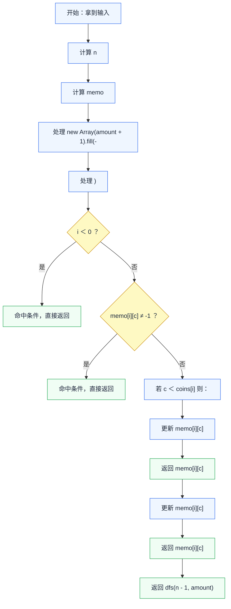

## TypeScript 解题方案（4 个方案逐个讲）

> **运行与提交**：每个方案都是自包含文件（内嵌用例自测，输出 PASS），整块复制到 `.ts` 文件后 `node 文件名` 即可运行。提交 LeetCode 时，把 `demo` 内的算法函数与辅助类型/函数整体取出、置于文件顶层即可。涉及交互/特殊接口的题以题面给定签名为准。

### 方案 1：递归搜索 + 保存计算结果 = 记忆化搜索

**分析与思路**：核心做法是「递归搜索 + 保存计算结果 = 记忆化搜索」。

**运行方式**：`node 本文件`，内嵌用例全部通过会输出 PASS。


**方案专属流程图**（真实控制流）：

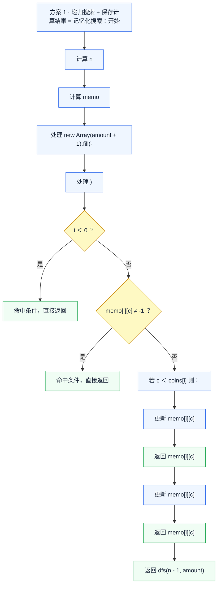

```typescript
/**
 * LeetCode 518. 零钱兑换 II
 * 方案：1 ) 方案1: 递归搜索 + 保存计算结果 = 记忆化搜索
 * 来源：https://blog.csdn.net/tyro_java/article/details/144852221
 * 忠实翻译 python/dp/lc_518_零钱兑换_ii/solution_1_1_____1_______________________.py
 */

export function demo(): void {
  // 程序入口：跑内嵌自测用例
  function change(amount: number, coins: number[]): number {
    // 定义函数/方法 change
    const n = coins.length; // 把 硬币面额.长度 存入 元素个数
    const memo: number[][] = Array.from({ length: n }, () =>
      new Array(amount + 1).fill(-1),
    );

    function dfs(i: number, c: number): number {
      // 定义函数/方法 dfs
      if (i < 0) {
        // 若 下标 i 小于 0
        return c === 0 ? 1 : 0; // 返回 字符 全等于 0 ? 1 : 0
      }
      if (memo[i][c] !== -1) {
        // 若 记忆化表[下标 i][字符] 不等于 减 1
        return memo[i][c]; // 返回 记忆化表[下标 i][字符]
      }
      if (c < coins[i]) {
        // 若 字符 小于 硬币面额[下标 i]
        memo[i][c] = dfs(i - 1, c); // 把 dfs(下标 i 减 1, 字符); 写入 memo[i][c]
        return memo[i][c]; // 返回 记忆化表[下标 i][字符]
      }
      memo[i][c] = dfs(i - 1, c) + dfs(i, c - coins[i]);
      return memo[i][c]; // 返回 记忆化表[下标 i][字符]
    }

    return dfs(n - 1, amount); // 返回 dfs(元素个数 减 1, 目标金额)
  }

  const cases: { amount: number; coins: number[]; want: number }[] = [
    { amount: 5, coins: [1, 2, 5], want: 4 },
    { amount: 3, coins: [2], want: 0 },
    { amount: 10, coins: [1, 2, 5], want: 10 },
    { amount: 0, coins: [1, 2], want: 1 },
    { amount: 5, coins: [], want: 0 },
    { amount: 4, coins: [1, 1, 2, 2], want: 14 },
  ];
  let fail = false; // 把 false 存入 fail
  for (const c of cases) {
    // for (const 字符 of cases) {
    const got = change(c.amount, c.coins); // 把 change(字符.目标金额, 字符.硬币面额) 存入 got
    if (got !== c.want) {
      // 若 got 不等于 字符.want
      fail = true; // 把 true 存入 fail
      console.log(
        'FAIL change(%d, %o)=%d want %d',
        c.amount,
        c.coins,
        got,
        c.want,
      ); // 打印输出
    }
  }
  if (fail) {
    // 若 fail
    throw new Error('FAILED'); // throw new Error(「FAILED」);
  }
  console.log('PASS'); // 全部用例通过，输出 PASS
}
demo(); // demo();
```

### 方案 2：动态规划

**分析与思路**：核心做法是「动态规划」。代码里依次做这些事：DP 表逐项填充；双重循环遍历。

**运行方式**：`node 本文件`，内嵌用例全部通过会输出 PASS。

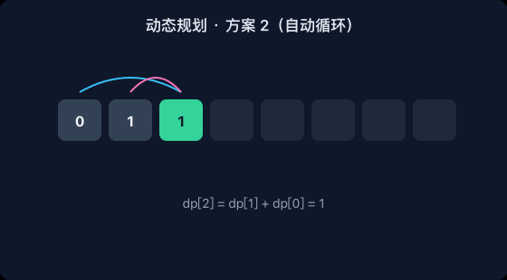

**方案专属流程图**（真实控制流）：

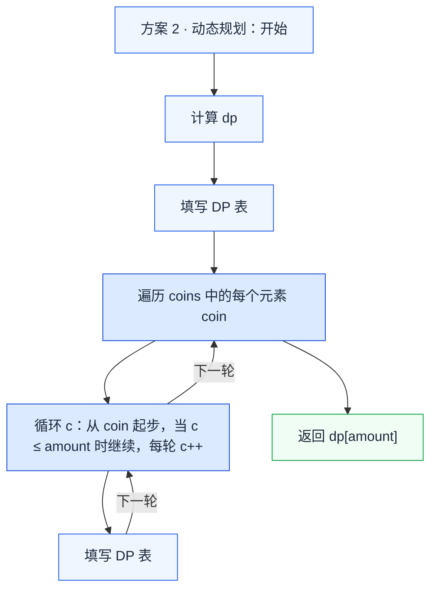

```typescript
/**
 * LeetCode 518. 零钱兑换 II
 * 方案：2 ) 方案2: 动态规划
 * 来源：https://blog.csdn.net/tyro_java/article/details/144852221
 * 忠实翻译 python/dp/lc_518_零钱兑换_ii/solution_2_2_____2______.py
 */

export function demo(): void {
  // 程序入口：跑内嵌自测用例
  function change(amount: number, coins: number[]): number {
    // 定义函数/方法 change
    const dp: number[] = new Array(amount + 1).fill(0); // 把 new Array(目标金额 加 1).fill(0); 写入 const dp: number[]
    dp[0] = 1; // 把 1; 写入 dp[0]
    for (const coin of coins) {
      // for (const coin of 硬币面额) {
      for (let c = coin; c <= amount; c++) {
        // 让 字符 从 coin 开始计数，字符 不超过 目标金额 就继续
        dp[c] += dp[c - coin]; // dp[c]累加 DP 表[字符 减 coin]
      }
    }
    return dp[amount]; // 返回 DP 表[目标金额]
  }

  const cases: { amount: number; coins: number[]; want: number }[] = [
    { amount: 5, coins: [1, 2, 5], want: 4 },
    { amount: 3, coins: [2], want: 0 },
    { amount: 10, coins: [1, 2, 5], want: 10 },
    { amount: 0, coins: [1, 2], want: 1 },
    { amount: 5, coins: [], want: 0 },
    { amount: 4, coins: [1, 1, 2, 2], want: 14 },
  ];
  let fail = false; // 把 false 存入 fail
  for (const c of cases) {
    // for (const 字符 of cases) {
    const got = change(c.amount, c.coins); // 把 change(字符.目标金额, 字符.硬币面额) 存入 got
    if (got !== c.want) {
      // 若 got 不等于 字符.want
      fail = true; // 把 true 存入 fail
      console.log(
        'FAIL change(%d, %o)=%d want %d',
        c.amount,
        c.coins,
        got,
        c.want,
      ); // 打印输出
    }
  }
  if (fail) {
    // 若 fail
    throw new Error('FAILED'); // throw new Error(「FAILED」);
  }
  console.log('PASS'); // 全部用例通过，输出 PASS
}
demo(); // demo();
```

### 方案 3：动态规划优化版

**分析与思路**：核心做法是「动态规划优化版」。代码里依次做这些事：双重循环遍历。

**运行方式**：`node 本文件`，内嵌用例全部通过会输出 PASS。

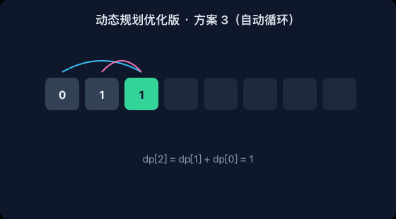

**方案专属流程图**（真实控制流）：

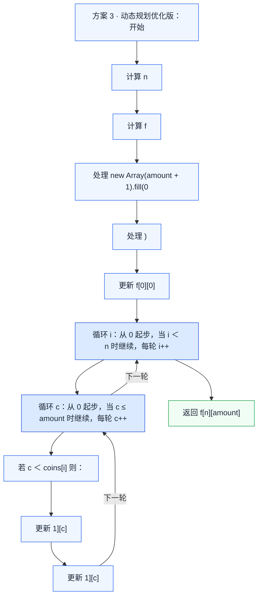

```typescript
/**
 * LeetCode 518. 零钱兑换 II
 * 方案：3 ) 方案3: 动态规划优化版
 * 来源：https://blog.csdn.net/tyro_java/article/details/144852221
 * 忠实翻译 python/dp/lc_518_零钱兑换_ii/solution_3_3_____3_________.py
 */

export function demo(): void {
  // 程序入口：跑内嵌自测用例
  function change(amount: number, coins: number[]): number {
    // 定义函数/方法 change
    const n = coins.length; // 把 硬币面额.长度 存入 元素个数
    const f: number[][] = Array.from({ length: n + 1 }, () =>
      new Array(amount + 1).fill(0),
    );
    f[0][0] = 1; // 把 1; 写入 f[0][0]
    for (let i = 0; i < n; i++) {
      // 让 下标 i 从 0 开始计数，下标 i 小于 元素个数 就继续
      for (let c = 0; c <= amount; c++) {
        // 让 字符 从 0 开始计数，字符 不超过 目标金额 就继续
        if (c < coins[i]) {
          // 若 字符 小于 硬币面额[下标 i]
          f[i + 1][c] = f[i][c]; // 把 f[下标 i][字符]; 写入 f[i + 1][c]
        } else {
          // 否则
          f[i + 1][c] = f[i][c] + f[i + 1][c - coins[i]]; // 把 f[下标 i][字符] 加 f[下标 i 加 1][字符 减 硬币面额[下标 i]]; 写入 f[i + 1][c]
        }
      }
    }
    return f[n][amount]; // 返回 f[元素个数][目标金额]
  }

  const cases: { amount: number; coins: number[]; want: number }[] = [
    { amount: 5, coins: [1, 2, 5], want: 4 },
    { amount: 3, coins: [2], want: 0 },
    { amount: 10, coins: [1, 2, 5], want: 10 },
    { amount: 0, coins: [1, 2], want: 1 },
    { amount: 5, coins: [], want: 0 },
    { amount: 4, coins: [1, 1, 2, 2], want: 14 },
  ];
  let fail = false; // 把 false 存入 fail
  for (const c of cases) {
    // for (const 字符 of cases) {
    const got = change(c.amount, c.coins); // 把 change(字符.目标金额, 字符.硬币面额) 存入 got
    if (got !== c.want) {
      // 若 got 不等于 字符.want
      fail = true; // 把 true 存入 fail
      console.log(
        'FAIL change(%d, %o)=%d want %d',
        c.amount,
        c.coins,
        got,
        c.want,
      ); // 打印输出
    }
  }
  if (fail) {
    // 若 fail
    throw new Error('FAILED'); // throw new Error(「FAILED」);
  }
  console.log('PASS'); // 全部用例通过，输出 PASS
}
demo(); // demo();
```

### 方案 4：动态规划再优化

**分析与思路**：核心做法是「动态规划再优化」。代码里依次做这些事：双重循环遍历。

**运行方式**：`node 本文件`，内嵌用例全部通过会输出 PASS。


**方案专属流程图**（真实控制流）：

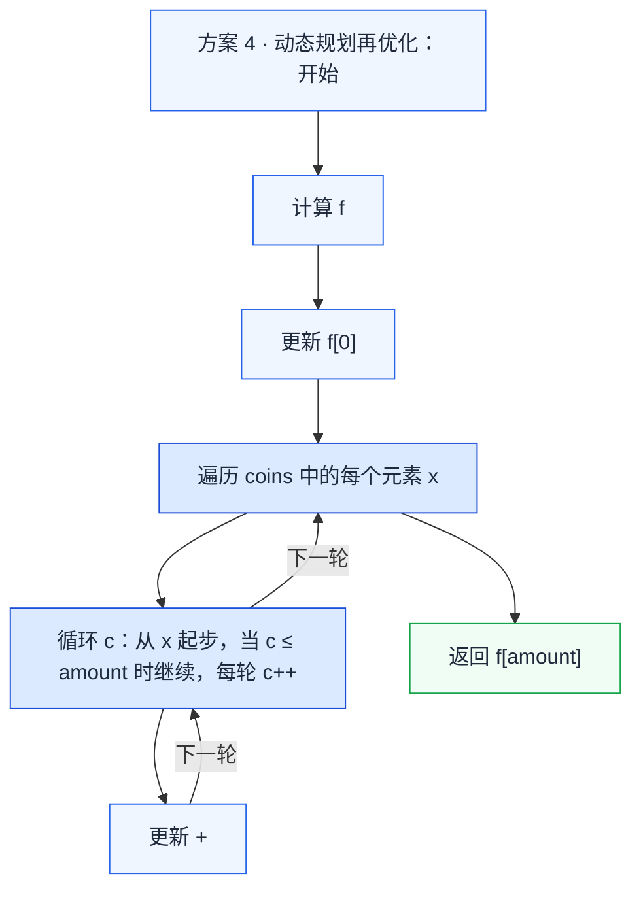

```typescript
/**
 * LeetCode 518. 零钱兑换 II
 * 方案：4 ) 方案4: 动态规划再优化
 * 来源：https://blog.csdn.net/tyro_java/article/details/144852221
 * 忠实翻译 python/dp/lc_518_零钱兑换_ii/solution_4_4_____4_________.py
 */

export function demo(): void {
  // 程序入口：跑内嵌自测用例
  function change(amount: number, coins: number[]): number {
    // 定义函数/方法 change
    const f: number[] = new Array(amount + 1).fill(0); // 把 new Array(目标金额 加 1).fill(0); 写入 const f: number[]
    f[0] = 1; // 把 1; 写入 f[0]
    for (const x of coins) {
      // for (const x of 硬币面额) {
      for (let c = x; c <= amount; c++) {
        // 让 字符 从 x 开始计数，字符 不超过 目标金额 就继续
        f[c] += f[c - x]; // f[c]累加 f[字符 减 x]
      }
    }
    return f[amount]; // 返回 f[目标金额]
  }

  const cases: { amount: number; coins: number[]; want: number }[] = [
    { amount: 5, coins: [1, 2, 5], want: 4 },
    { amount: 3, coins: [2], want: 0 },
    { amount: 10, coins: [1, 2, 5], want: 10 },
    { amount: 0, coins: [1, 2], want: 1 },
    { amount: 5, coins: [], want: 0 },
    { amount: 4, coins: [1, 1, 2, 2], want: 14 },
  ];
  let fail = false; // 把 false 存入 fail
  for (const c of cases) {
    // for (const 字符 of cases) {
    const got = change(c.amount, c.coins); // 把 change(字符.目标金额, 字符.硬币面额) 存入 got
    if (got !== c.want) {
      // 若 got 不等于 字符.want
      fail = true; // 把 true 存入 fail
      console.log(
        'FAIL change(%d, %o)=%d want %d',
        c.amount,
        c.coins,
        got,
        c.want,
      ); // 打印输出
    }
  }
  if (fail) {
    // 若 fail
    throw new Error('FAILED'); // throw new Error(「FAILED」);
  }
  console.log('PASS'); // 全部用例通过，输出 PASS
}
demo(); // demo();
```

## 逐步拆解与面试追问

**复杂度**：时间 O(n) 量级，空间 O(n)

**为什么是这个量级**：整体只对数据做有限趟处理

**面试官可能会追问**：

- 状态定义为什么是它？
- 遍历顺序由什么决定？
- 能否滚动数组压空间？

## 关键 API 速查（TS 主解法实际用到，附官方链接）

| API | 作用 | 使用要点 | 官方文档 |
|---|---|---|---|
| `Array.from()` | 类数组/可迭代对象转数组 | Array.from(iterable, mapFn) 可同时映射；对 Set 去重、对字符串按码元拆分；稀疏位会被 undefined 填充 | [官方文档](https://developer.mozilla.org/zh-CN/docs/Web/JavaScript/Reference/Global_Objects/Array/from) |

### 各语言官方文档导航

- **TypeScript / JS**：[MDN 中文参考](https://developer.mozilla.org/zh-CN/)
- **Python**：[Python 官方文档](https://docs.python.org/zh-cn/3/)
- **Go**：[Go 标准库](https://pkg.go.dev/std)
- **Java**：[JDK 17 API](https://docs.oracle.com/en/java/javase/17/docs/api/)
- **Rust**：[Rust 标准库](https://doc.rust-lang.org/std/)
- **Lua**：[Lua 5.4 手册](https://www.lua.org/manual/5.4/)
- **C**：[Cppreference C](https://zh.cppreference.com/w/c)
- **C++**：[Cppreference C++](https://zh.cppreference.com/w/cpp)
- **R**：[R 官方手册](https://stat.ethz.ch/R-manual/)
- **Zig**：[Zig 语言文档](https://ziglang.org/documentation/master/)
- **Dart**：[Dart API](https://api.dart.dev/)

## 附录：其他 10 种语言全部实现（每种语言列举其全部方案）

> TypeScript 的全部方案见「TypeScript 解题方案」一节；下面是其余 10 种语言的对应实现，每种语言的每个方案都带思路分析、代码走读与专属运行架构图。
> 每个方案都内嵌用例自测，可独立运行（老仓库 python/go 文件遵循「打印结果」约定）。
> 完整解法文件见 `dsa/<语言>/dp/lc_518_零钱兑换_ii/`。

### Python 实现（4 种方案）

Python 的全部方案如下，每个方案都内嵌用例自测，可独立运行（老仓库 python/go 文件遵循「打印结果」约定）：

#### 方案 1：递归搜索 + 保存计算结果 = 记忆化搜索

**思路与代码分析**：核心是「递归搜索 + 保存计算结果 = 记忆化搜索」。Python 版用切片与字典推导式简化操作，突出可读性。**走读**：方案 1 · 递归搜索 + 保存计算结果 = 记忆化搜索：开始 → 更新 n → 处理 @functools.lru_cache(None) → 命中条件，直接返回 → 命中条件，直接返回 → 返回 dfs(i - 1, c) + dfs( → 处理 i, c - coins[i] → 处理 ) → 返回 dfs(n - 1, amount)。

**运行架构**（真实控制流）：

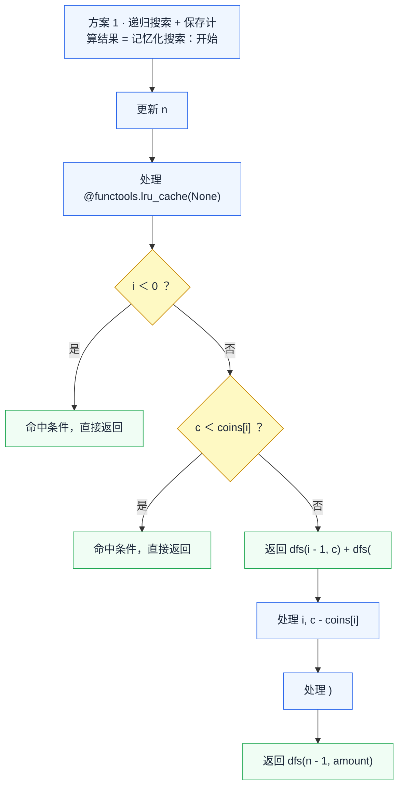

```python
import sys  # 提高递归深度上限（深输入防 RecursionError）

sys.setrecursionlimit(200000)  # 树/链表类题目节点数可达 1e4 量级

def change(amount, coins):  # 定义函数 change（参数：目标金额, 硬币面额）
    import functools  # 引入依赖

    n = len(coins)  # 把 长度(硬币面额) 存入 元素个数

    @functools.lru_cache(None)  # @functools.lru_cache(None)
    def dfs(i, c):  # 定义函数 dfs（参数：下标 i, 字符）
        if i < 0:  # 若 下标 i 小于 0
            return 1 if c == 0 else 0  # 返回 1 if 字符 等于 0 else 0
        if c < coins[i]:  # 若 字符 小于 硬币面额[下标 i]
            return dfs(i - 1, c)  # 返回 dfs(下标 i 减 1, 字符)
        return dfs(i - 1, c) + dfs(
            i, c - coins[i]
        )  # 返回 dfs(下标 i 减 1, 字符) 加 dfs(下标 i, 字符 减 硬币面额[下标 i])

    return dfs(n - 1, amount)  # 返回 dfs(元素个数 减 1, 目标金额)

if __name__ == "__main__":  # 若 __name__ 等于 '__main__'
    print(change(5, [1, 2, 5]))  # 打印输出
```

#### 方案 2：动态规划

**思路与代码分析**：核心是「动态规划」。Python 版用切片与字典推导式简化操作，突出可读性。代码里依次做这些事：DP 表逐项填充。**走读**：方案 2 · 动态规划：开始 → 填写 DP 表 → 填写 DP 表 → 遍历 coins: 中的每个元素 coin → 循环 c：从 coin 到 amount + 1 前 → 填写 DP 表 → 返回 dp[amount]。

**运行架构**（真实控制流）：

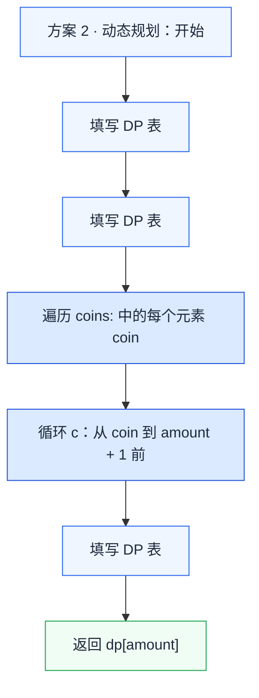

```python
import sys  # 提高递归深度上限（深输入防 RecursionError）

sys.setrecursionlimit(200000)  # 树/链表类题目节点数可达 1e4 量级

def change(amount, coins):  # 定义函数 change（参数：目标金额, 硬币面额）
    dp = [0] * (amount + 1)  # 把 [0] 乘 (目标金额 加 1) 存入 DP 表
    dp[0] = 1  # 把 1 写入 dp[0]
    for coin in coins:  # 逐个取出 硬币面额 的元素（coin）
        for c in range(coin, amount + 1):  # 让 字符 从 coin 到 目标金额 加 1 遍历
            dp[c] += dp[c - coin]  # dp[c]累加 DP 表[字符 减 coin]
    return dp[amount]  # 返回 DP 表[目标金额]

if __name__ == "__main__":  # 若 __name__ 等于 '__main__'
    print(change(5, [1, 2, 5]))  # 打印输出
```

#### 方案 3：动态规划优化版

**思路与代码分析**：核心是「动态规划优化版」。Python 版用切片与字典推导式简化操作，突出可读性。**走读**：方案 3 · 动态规划优化版：开始 → 更新 n → 更新 f → 处理 [0] * (amount + 1) for _ in → 处理 ] → 更新 f[0][0] → 循环 i：从 0 到 n 前 → 循环 c：从 0 到 amount + 1 前 → 若 c ＜ coins[i]：更新 1][c] → 更新 1][c] → 更新 1][c] → 处理 f[i][c] + f[i + 1][c - coins → 处理 ) → 返回 f[n][amount]。

**运行架构**（真实控制流）：

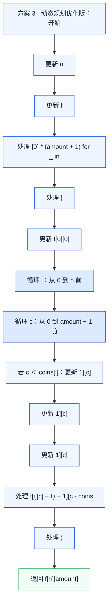

```python
import sys  # 提高递归深度上限（深输入防 RecursionError）

sys.setrecursionlimit(200000)  # 树/链表类题目节点数可达 1e4 量级

def change(amount, coins):  # 定义函数 change（参数：目标金额, 硬币面额）
    n = len(coins)  # 把 长度(硬币面额) 存入 元素个数
    f = [
        [0] * (amount + 1) for _ in range(n + 1)
    ]  # 把 [[0] 乘 (目标金额 加 1) for _ in range(元素个数 加 1)] 存入 f
    f[0][0] = 1  # 把 1 写入 f[0][0]
    for i in range(n):  # 让 下标 i 从 元素个数 遍历
        for c in range(amount + 1):  # 让 字符 从 目标金额 加 1 遍历
            if c < coins[i]:  # 若 字符 小于 硬币面额[下标 i]
                f[i + 1][c] = f[i][c]  # 把 f[下标 i][字符] 写入 f[i + 1][c]
            else:  # 否则
                f[i + 1][c] = (
                    f[i][c] + f[i + 1][c - coins[i]]
                )  # 把 f[下标 i][字符] 加 f[下标 i 加 1][字符 减 硬币面额[下标 i]] 写入 f[i + 1][c]
    return f[n][amount]  # 返回 f[元素个数][目标金额]

if __name__ == "__main__":  # 若 __name__ 等于 '__main__'
    print(change(5, [1, 2, 5]))  # 打印输出
```

#### 方案 4：动态规划再优化

**思路与代码分析**：核心是「动态规划再优化」。Python 版用切片与字典推导式简化操作，突出可读性。**走读**：方案 4 · 动态规划再优化：开始 → 更新 f → 更新 f[0] → 遍历 coins: 中的每个元素 x → 循环 c：从 x 到 amount + 1 前 → 更新 + → 返回 f[amount]。

**运行架构**（真实控制流）：

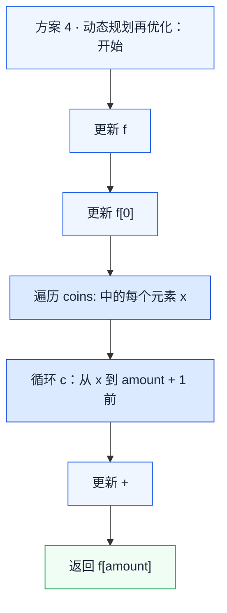

```python
import sys  # 提高递归深度上限（深输入防 RecursionError）

sys.setrecursionlimit(200000)  # 树/链表类题目节点数可达 1e4 量级

def change(amount, coins):  # 定义函数 change（参数：目标金额, 硬币面额）
    f = [0] * (amount + 1)  # 把 [0] 乘 (目标金额 加 1) 存入 f
    f[0] = 1  # 把 1 写入 f[0]
    for x in coins:  # 逐个取出 硬币面额 的元素（x）
        for c in range(x, amount + 1):  # 让 字符 从 x 到 目标金额 加 1 遍历
            f[c] += f[c - x]  # f[c]累加 f[字符 减 x]
    return f[amount]  # 返回 f[目标金额]

if __name__ == "__main__":  # 若 __name__ 等于 '__main__'
    print(change(5, [1, 2, 5]))  # 打印输出
```

### Go 实现（4 种方案）

Go 的全部方案如下，每个方案都内嵌用例自测，可独立运行（老仓库 python/go 文件遵循「打印结果」约定）：

#### 方案 1：递归搜索 + 保存计算结果 = 记忆化搜索

**思路与代码分析**：核心是「递归搜索 + 保存计算结果 = 记忆化搜索」。Go 版用切片与多返回值惯用法，显式处理索引边界。代码里依次做这些事：哈希结构做计数或查重。**走读**：方案 1 · 递归搜索 + 保存计算结果 = 记忆化搜索：开始 → 更新 : → 返回 1 → 返回 0 → 返回 v → 返回 r → 返回 dfs(n-1, amount)。

**运行架构**（真实控制流）：

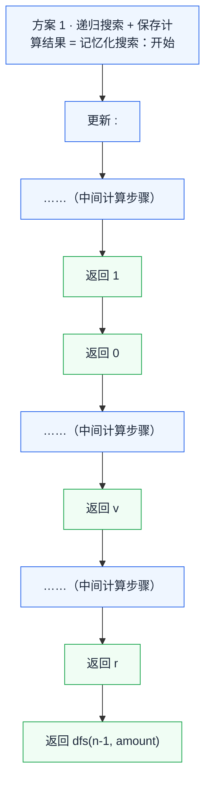

```go
package main // 引入依赖

import (
	"fmt" // 「fmt」
	"os"  // 「os」
)

// 忠实翻译 python solution_1：带记忆化的递归 dfs(i, c)
// i 为当前考虑的硬币下标；i < 0 时若剩余金额为 0 则计 1 种方案，否则 0 种。
func change(amount int, coins []int) int { // 定义函数/方法 change
	n := len(coins)              // 把 长度(硬币面额) 写入 n :
	memo := make(map[[2]int]int) // 把 make(映射表[[2]int]int) 写入 memo :
	var dfs func(i, c int) int   // var dfs func(下标 i, 字符 int) int
	dfs = func(i, c int) int {   // 把 func(下标 i, 字符 int) int { 写入 dfs
		if i < 0 { // 若 下标 i 小于 0
			if c == 0 { // 若 字符 等于 0
				return 1 // 返回 1
			}
			return 0 // 返回 0
		}
		k := [2]int{i, c}         // 把 [2]int{下标 i, 字符} 写入 k :
		if v, ok := memo[k]; ok { // 若 值, ok : 赋值为 记忆化表[下标 k]; ok
			return v // 返回 值
		}
		var r int         // var 右指针 int
		if c < coins[i] { // 若 字符 小于 硬币面额[下标 i]
			r = dfs(i-1, c) // 把 dfs(下标 i 减 1, 字符) 写入 右指针
		} else { // 否则
			r = dfs(i-1, c) + dfs(i, c-coins[i]) // 把 dfs(下标 i 减 1, 字符) 加 dfs(下标 i, 字符 减 硬币面额[下标 i]) 写入 右指针
		}
		memo[k] = r // 把 右指针 写入 memo[k]
		return r    // 返回 右指针
	}
	return dfs(n-1, amount) // 定义函数/方法 dfs
}

func main() { // 程序入口：跑内嵌自测用例
	cases := []struct { // 把 []struct { 写入 cases :
		amount int   // 目标金额 int
		coins  []int // 硬币面额 []int
		want   int   // want int
	}{ // }{
		{5, []int{1, 2, 5}, 4},
		{11, []int{1, 2, 5}, 11},
		{3, []int{2}, 0},
		{0, []int{1, 2, 5}, 1},
		{7, []int{2, 3}, 1},
		{10, []int{}, 0},
	}
	ok := true                // 把 true 写入 ok :
	for _, c := range cases { // 同时取 _ 与 字符 遍历
		if got := change(c.amount, c.coins); got != c.want { // 若 got : 赋值为 change(字符.目标金额, 字符.硬币面额); got 不等于 字符.want
			ok = false                                                                     // 把 false 写入 ok
			fmt.Printf("FAIL change(%d, %v)=%d want %d\n", c.amount, c.coins, got, c.want) // 打印输出
		}
	}
	if !ok { // 若 取反 ok
		os.Exit(1) // os.Exit(1)
	}
	fmt.Println("PASS") // 全部用例通过，输出 PASS
}
```

#### 方案 2：动态规划

**思路与代码分析**：核心是「动态规划」。Go 版用切片与多返回值惯用法，显式处理索引边界。代码里依次做这些事：DP 表逐项填充。**走读**：方案 2 · 动态规划：开始 → 更新 : → 填写 DP 表 → 遍历 coins 的下标与元素 coin → 遍历循环 → 填写 DP 表 → 返回 dp[amount]。

**运行架构**（真实控制流）：

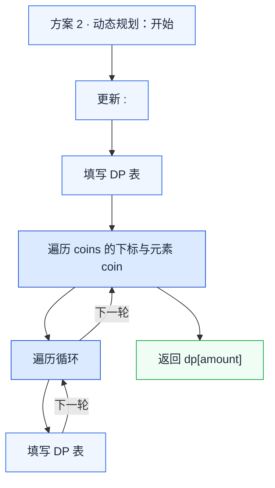

```go
package main // 引入依赖

import (
	"fmt" // 「fmt」
	"os"  // 「os」
)

// 忠实翻译 python solution_2：一维完全背包，正序遍历金额，dp[0]=1
func change(amount int, coins []int) int { // 定义函数/方法 change
	dp := make([]int, amount+1)  // 把 make([]int, 目标金额 加 1) 写入 dp :
	dp[0] = 1                    // 把 1 写入 dp[0]
	for _, coin := range coins { // 同时取 _ 与 coin 遍历
		for c := coin; c <= amount; c++ { // 把 coin; 字符 不超过 目标金额; 字符 加一 { 写入 for c :
			dp[c] += dp[c-coin] // dp[c]累加 DP 表[字符 减 coin]
		}
	}
	return dp[amount] // 返回 DP 表[目标金额]
}

func main() { // 程序入口：跑内嵌自测用例
	cases := []struct { // 把 []struct { 写入 cases :
		amount int   // 目标金额 int
		coins  []int // 硬币面额 []int
		want   int   // want int
	}{ // }{
		{5, []int{1, 2, 5}, 4},
		{11, []int{1, 2, 5}, 11},
		{3, []int{2}, 0},
		{0, []int{1, 2, 5}, 1},
		{7, []int{2, 3}, 1},
		{10, []int{}, 0},
	}
	ok := true                // 把 true 写入 ok :
	for _, c := range cases { // 同时取 _ 与 字符 遍历
		if got := change(c.amount, c.coins); got != c.want { // 若 got : 赋值为 change(字符.目标金额, 字符.硬币面额); got 不等于 字符.want
			ok = false                                                                     // 把 false 写入 ok
			fmt.Printf("FAIL change(%d, %v)=%d want %d\n", c.amount, c.coins, got, c.want) // 打印输出
		}
	}
	if !ok { // 若 取反 ok
		os.Exit(1) // os.Exit(1)
	}
	fmt.Println("PASS") // 全部用例通过，输出 PASS
}
```

#### 方案 3：动态规划优化版

**思路与代码分析**：核心是「动态规划优化版」。Go 版用切片与多返回值惯用法，显式处理索引边界。**走读**：方案 3 · 动态规划优化版：开始 → 更新 : → 更新 : → 遍历循环 → 更新 f[i] → 更新 f[0][0] → 遍历循环 → 遍历循环 → 处理 if c ＜ coins[i] → 更新 f[i+1][c] → 更新 f[i+1][c] → 返回 f[n][amount]。

**运行架构**（真实控制流）：

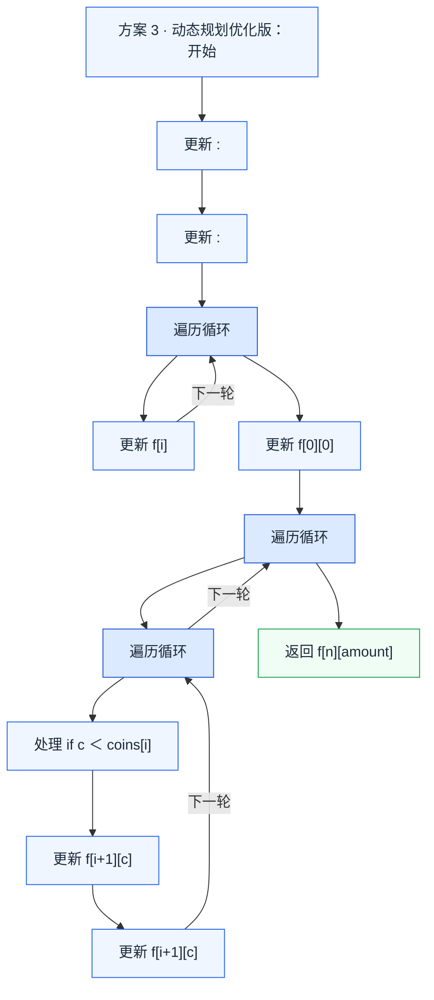

```go
package main // 引入依赖

import (
	"fmt" // 「fmt」
	"os"  // 「os」
)

// 忠实翻译 python solution_3：二维表 f[i][c]，f[0][0]=1
func change(amount int, coins []int) int { // 定义函数/方法 change
	n := len(coins)           // 把 长度(硬币面额) 写入 n :
	f := make([][]int, n+1)   // 把 make([][]int, 元素个数 加 1) 写入 f :
	for i := 0; i <= n; i++ { // 让 下标 i 从 0 开始计数
		f[i] = make([]int, amount+1) // 把 make([]int, 目标金额 加 1) 写入 f[i]
	}
	f[0][0] = 1              // 把 1 写入 f[0][0]
	for i := 0; i < n; i++ { // 让 下标 i 从 0 开始计数
		for c := 0; c <= amount; c++ { // 让 字符 从 0 开始计数
			if c < coins[i] { // 若 字符 小于 硬币面额[下标 i]
				f[i+1][c] = f[i][c] // 把 f[下标 i][字符] 写入 f[i+1][c]
			} else { // 否则
				f[i+1][c] = f[i][c] + f[i+1][c-coins[i]] // 把 f[下标 i][字符] 加 f[下标 i 加 1][字符 减 硬币面额[下标 i]] 写入 f[i+1][c]
			}
		}
	}
	return f[n][amount] // 返回 f[元素个数][目标金额]
}

func main() { // 程序入口：跑内嵌自测用例
	cases := []struct { // 把 []struct { 写入 cases :
		amount int   // 目标金额 int
		coins  []int // 硬币面额 []int
		want   int   // want int
	}{ // }{
		{5, []int{1, 2, 5}, 4},
		{11, []int{1, 2, 5}, 11},
		{3, []int{2}, 0},
		{0, []int{1, 2, 5}, 1},
		{7, []int{2, 3}, 1},
		{10, []int{}, 0},
	}
	ok := true                // 把 true 写入 ok :
	for _, c := range cases { // 同时取 _ 与 字符 遍历
		if got := change(c.amount, c.coins); got != c.want { // 若 got : 赋值为 change(字符.目标金额, 字符.硬币面额); got 不等于 字符.want
			ok = false                                                                     // 把 false 写入 ok
			fmt.Printf("FAIL change(%d, %v)=%d want %d\n", c.amount, c.coins, got, c.want) // 打印输出
		}
	}
	if !ok { // 若 取反 ok
		os.Exit(1) // os.Exit(1)
	}
	fmt.Println("PASS") // 全部用例通过，输出 PASS
}
```

#### 方案 4：动态规划再优化

**思路与代码分析**：核心是「动态规划再优化」。Go 版用切片与多返回值惯用法，显式处理索引边界。**走读**：方案 4 · 动态规划再优化：开始 → 更新 : → 更新 f[0] → 遍历 coins 的下标与元素 x → 遍历循环 → 更新 + → 返回 f[amount]。

**运行架构**（真实控制流）：

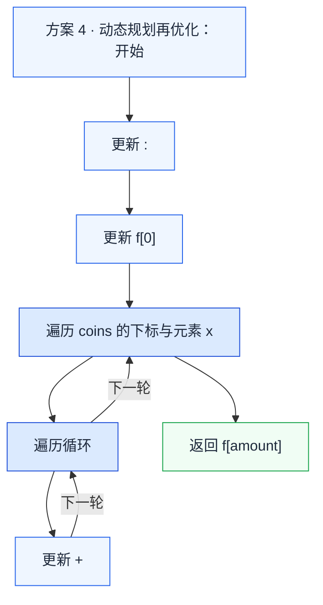

```go
package main // 引入依赖

import (
	"fmt" // 「fmt」
	"os"  // 「os」
)

// 忠实翻译 python solution_4：一维 dp 数组 f，f[0]=1，按硬币正序累加
func change(amount int, coins []int) int { // 定义函数/方法 change
	f := make([]int, amount+1) // 把 make([]int, 目标金额 加 1) 写入 f :
	f[0] = 1                   // 把 1 写入 f[0]
	for _, x := range coins {  // 同时取 _ 与 x 遍历
		for c := x; c <= amount; c++ { // 把 x; 字符 不超过 目标金额; 字符 加一 { 写入 for c :
			f[c] += f[c-x] // f[c]累加 f[字符 减 x]
		}
	}
	return f[amount] // 返回 f[目标金额]
}

func main() { // 程序入口：跑内嵌自测用例
	cases := []struct { // 把 []struct { 写入 cases :
		amount int   // 目标金额 int
		coins  []int // 硬币面额 []int
		want   int   // want int
	}{ // }{
		{5, []int{1, 2, 5}, 4},
		{11, []int{1, 2, 5}, 11},
		{3, []int{2}, 0},
		{0, []int{1, 2, 5}, 1},
		{7, []int{2, 3}, 1},
		{10, []int{}, 0},
	}
	ok := true                // 把 true 写入 ok :
	for _, c := range cases { // 同时取 _ 与 字符 遍历
		if got := change(c.amount, c.coins); got != c.want { // 若 got : 赋值为 change(字符.目标金额, 字符.硬币面额); got 不等于 字符.want
			ok = false                                                                     // 把 false 写入 ok
			fmt.Printf("FAIL change(%d, %v)=%d want %d\n", c.amount, c.coins, got, c.want) // 打印输出
		}
	}
	if !ok { // 若 取反 ok
		os.Exit(1) // os.Exit(1)
	}
	fmt.Println("PASS") // 全部用例通过，输出 PASS
}
```

### Java 实现（4 种方案）

Java 的全部方案如下，每个方案都内嵌用例自测，可独立运行（老仓库 python/go 文件遵循「打印结果」约定）：

#### 方案 1：递归搜索 + 保存计算结果 = 记忆化搜索

**思路与代码分析**：核心是「递归搜索 + 保存计算结果 = 记忆化搜索」。Java 版用类与静态方法组织，集合操作显式明了。代码里依次做这些事：DP 表逐项填充；双重循环遍历。**走读**：方案 1 · 递归搜索 + 保存计算结果 = 记忆化搜索：开始 → 填写 DP 表 → 填写 DP 表 → 遍历循环 → 遍历循环 → 返回 dp[amount]。

**运行架构**（真实控制流）：

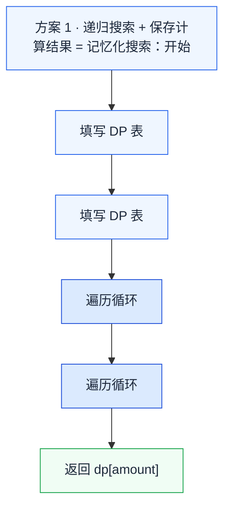

```java
package com.webfault.dsa; // 引入依赖

class lc518_solution111 { // 定义类型
  static int change(int amount, int[] coins) { // 定义函数/方法 change
    int[] dp = new int[amount + 1]; // 把 new int[目标金额 加 1]; 写入 int[] dp
    dp[0] = 1; // 把 1; 写入 dp[0]
    for (int coin : coins) // for (int coin : 硬币面额)
    for (int a = coin; a <= amount; a++) dp[a] += dp[a - coin]; // 让 数组 从 coin 开始计数，数组 不超过 目标金额 就继续
    return dp[amount]; // 返回 DP 表[目标金额]
  }

  public static void main(String[] args) { // public static void main(String[] args) {
    int got = change(5, new int[] {1, 2, 5}); // 把 change(5, new int[]{1, 2, 5}) 存入 got
    if (got != 4) {
      System.out.println("FAIL got " + got);
      throw new RuntimeException("FAILED");
    }
    System.out.println("PASS"); // 全部用例通过，输出 PASS
  }
}
```

#### 方案 2：动态规划

**思路与代码分析**：核心是「动态规划」。Java 版用类与静态方法组织，集合操作显式明了。代码里依次做这些事：DP 表逐项填充；双重循环遍历。**走读**：方案 2 · 动态规划：开始 → 填写 DP 表 → 更新 valid → 填写 DP 表 → 更新 valid[0] → 遍历循环 → 遍历循环 → 更新 | → 命中条件，直接返回 → 遍历循环 → 遍历循环 → 填写 DP 表 → 返回 dp[amount]。

**运行架构**（真实控制流）：

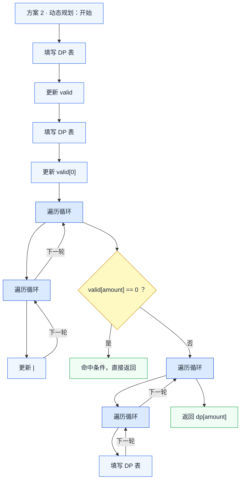

```java
package com.webfault.dsa; // 引入依赖

import java.util.*; // 引入依赖

class lc518_solution222 { // 定义类型
  public int change(int amount, int[] coins) { // 定义函数/方法 change
    int[] dp = new int[amount + 1]; // 把 new int[目标金额 加 1]; 写入 int[] dp
    int[] valid = new int[amount + 1]; // 把 new int[目标金额 加 1]; 写入 int[] valid
    dp[0] = 1; // 把 1; 写入 dp[0]
    valid[0] = 1; // 把 1; 写入 valid[0]
    for (int coin : coins) { // for (int coin : 硬币面额) {
      for (int i = coin; i <= amount; i++) { // 让 下标 i 从 coin 开始计数，下标 i 不超过 目标金额 就继续
        valid[i] |= valid[i - coin]; // 把 valid[下标 i 减 coin]; 写入 valid[i] |
      }
    }
    if (valid[amount] == 0) { // 若 valid[目标金额] 等于 0
      return 0; // 返回 0
    }
    for (int coin : coins) { // for (int coin : 硬币面额) {
      for (int i = coin; i <= amount; i++) { // 让 下标 i 从 coin 开始计数，下标 i 不超过 目标金额 就继续
        dp[i] += dp[i - coin]; // dp[i]累加 DP 表[下标 i 减 coin]
      }
    }
    return dp[amount]; // 返回 DP 表[目标金额]
  }

  public static void main(String[] args) { // public static void main(String[] args) {
    lc518_solution222 s =
        new lc518_solution222(); // 把 new lc518_solution222(); 写入 lc518_solution222 s
    int got = s.change(5, new int[] {1, 2, 5}); // 把 字符串.change(5, new int[]{1, 2, 5}) 存入 got
    if (got != 4) {
      System.out.println("FAIL got " + got);
      throw new RuntimeException("FAILED");
    }
    System.out.println("PASS"); // 全部用例通过，输出 PASS
  }
}
```

#### 方案 3：动态规划优化版

**思路与代码分析**：核心是「动态规划优化版」。Java 版用类与静态方法组织，集合操作显式明了。代码里依次做这些事：双重循环遍历。**走读**：方案 3 · 动态规划优化版：开始 → 更新 n → 更新 f → 更新 f[0][0] → 遍历循环 → 遍历循环 → 若 c ＜ coins[i] 则： → 更新 1][c] → 更新 1][c] → 处理 f[i][c] → 处理 + f[i + 1][ → 处理 c - coins[i]] → 返回 f[n][amount]。

**运行架构**（真实控制流）：

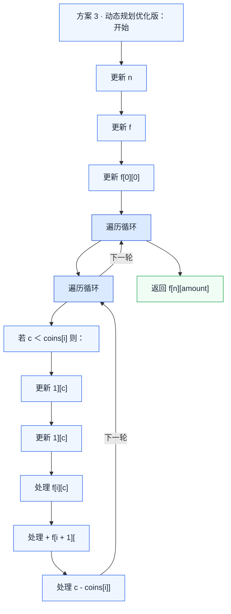

```java
package com.webfault.dsa; // 引入依赖

import java.util.*; // 引入依赖

class lc518_solution333 { // 定义类型
  public int change(int amount, int[] coins) { // 定义函数/方法 change
    int n = coins.length; // 把 硬币面额.长度 存入 元素个数
    int[][] f = new int[n + 1][amount + 1]; // 把 new int[元素个数 加 1][目标金额 加 1]; 写入 int[][] f
    f[0][0] = 1; // 把 1; 写入 f[0][0]
    for (int i = 0; i < n; i++) { // 让 下标 i 从 0 开始计数，下标 i 小于 元素个数 就继续
      for (int c = 0; c <= amount; c++) { // 让 字符 从 0 开始计数，字符 不超过 目标金额 就继续
        if (c < coins[i]) { // 若 字符 小于 硬币面额[下标 i]
          f[i + 1][c] = f[i][c]; // 把 f[下标 i][字符]; 写入 f[i + 1][c]
        } else { // 否则
          f[i + 1][c] =
              f[i][c]
                  + f[i + 1][
                      c - coins[i]]; // 把 f[下标 i][字符] 加 f[下标 i 加 1][字符 减 硬币面额[下标 i]]; 写入 f[i + 1][c]
        }
      }
    }
    return f[n][amount]; // 返回 f[元素个数][目标金额]
  }

  public static void main(String[] args) { // public static void main(String[] args) {
    lc518_solution333 s =
        new lc518_solution333(); // 把 new lc518_solution333(); 写入 lc518_solution333 s
    int got = s.change(5, new int[] {1, 2, 5}); // 把 字符串.change(5, new int[]{1, 2, 5}) 存入 got
    if (got != 4) {
      System.out.println("FAIL got " + got);
      throw new RuntimeException("FAILED");
    }
    System.out.println("PASS"); // 全部用例通过，输出 PASS
  }
}
```

#### 方案 4：动态规划再优化

**思路与代码分析**：核心是「动态规划再优化」。Java 版用类与静态方法组织，集合操作显式明了。代码里依次做这些事：双重循环遍历。**走读**：方案 4 · 动态规划再优化：开始 → 更新 f → 更新 f[0] → 遍历循环 → 遍历循环 → 更新 + → 返回 f[amount]。

**运行架构**（真实控制流）：

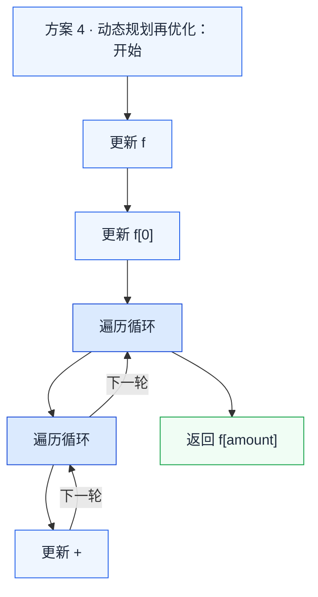

```java
package com.webfault.dsa; // 引入依赖

import java.util.*; // 引入依赖

class lc518_solution444 { // 定义类型
  public int change(int amount, int[] coins) { // 定义函数/方法 change
    int[] f = new int[amount + 1]; // 把 new int[目标金额 加 1]; 写入 int[] f
    f[0] = 1; // 把 1; 写入 f[0]
    for (int x : coins) { // for (int x : 硬币面额) {
      for (int c = x; c <= amount; c++) { // 让 字符 从 x 开始计数，字符 不超过 目标金额 就继续
        f[c] += f[c - x]; // f[c]累加 f[字符 减 x]
      }
    }
    return f[amount]; // 返回 f[目标金额]
  }

  public static void main(String[] args) { // public static void main(String[] args) {
    lc518_solution444 s =
        new lc518_solution444(); // 把 new lc518_solution444(); 写入 lc518_solution444 s
    int got = s.change(5, new int[] {1, 2, 5}); // 把 字符串.change(5, new int[]{1, 2, 5}) 存入 got
    if (got != 4) {
      System.out.println("FAIL got " + got);
      throw new RuntimeException("FAILED");
    }
    System.out.println("PASS"); // 全部用例通过，输出 PASS
  }
}
```

### Rust 实现（4 种方案）

Rust 的全部方案如下，每个方案都内嵌用例自测，可独立运行（老仓库 python/go 文件遵循「打印结果」约定）：

#### 方案 1：递归搜索 + 保存计算结果 = 记忆化搜索

**思路与代码分析**：核心是「递归搜索 + 保存计算结果 = 记忆化搜索」。Rust 版用所有权移动与切片借用改写同一逻辑，注意 Option 与引用边界。代码里依次做这些事：DP 表逐项填充。**走读**：方案 1 · 递归搜索 + 保存计算结果 = 记忆化搜索：开始 → 填写 DP 表 → 填写 DP 表 → 遍历 &coins 中的每个元素 c → 遍历 c as usize..=amount as usize 中的每个元素 a → 填写 DP 表 → 填写 DP 表 → 返回结果。

**运行架构**（真实控制流）：

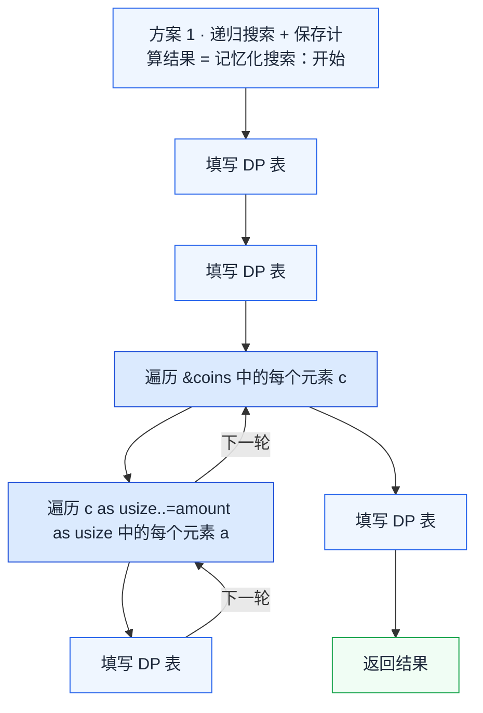

```rust
// LeetCode 518. 零钱兑换II — Rust 版（方案1）
fn change(amount: i32, coins: Vec<i32>) -> i32 {
    // 定义函数/方法 change
    let mut dp = vec![0i64; amount as usize + 1]; // 把 vec取反 [0i64; 目标金额 as usize 加 1]; 写入 let mut dp
    dp[0] = 1; // 把 1; 写入 dp[0]
    for &c in &coins {
        // for 按位与 字符 in 按位与 硬币面额 {
        for a in c as usize..=amount as usize {
            // 逐个取出 字符 的元素（数组）
            dp[a] += dp[a - c as usize]; // dp[a]累加 DP 表[数组 减 字符 as usize]
        }
    }
    dp[amount as usize] as i32 // DP 表[目标金额 as usize] as i32
}
fn main() {
    assert_eq!(change(5, vec![1, 2, 5]), 4);
    assert_eq!(change(3, vec![2]), 0);
    assert_eq!(change(10, vec![1, 2, 5]), 10);
    assert_eq!(change(0, vec![1, 2]), 1);
    println!("PASS");
} // 程序入口：跑内嵌自测用例
```

#### 方案 2：动态规划

**思路与代码分析**：核心是「动态规划」。Rust 版用所有权移动与切片借用改写同一逻辑，注意 Option 与引用边界。代码里依次做这些事：DP 表逐项填充。**走读**：方案 2 · 动态规划：开始 → 填写 DP 表 → 填写 DP 表 → 遍历 &coins 中的每个元素 c → 遍历 c as usize..=amount as usize 中的每个元素 a → 填写 DP 表 → 填写 DP 表 → 返回结果。

**运行架构**（真实控制流）：

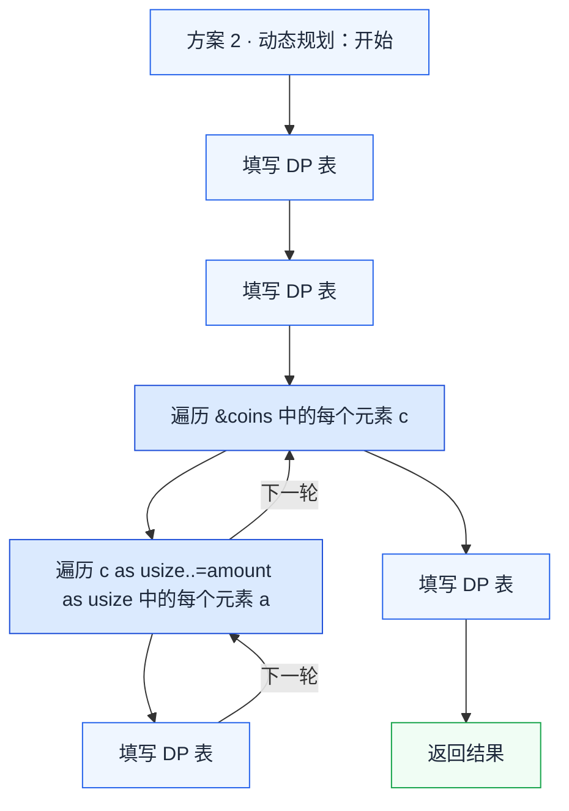

```rust
// LeetCode 518. 零钱兑换II — Rust 版（方案2）
fn change(amount: i32, coins: Vec<i32>) -> i32 {
    // 定义函数/方法 change
    let mut dp = vec![0i64; amount as usize + 1]; // 把 vec取反 [0i64; 目标金额 as usize 加 1]; 写入 let mut dp
    dp[0] = 1; // 把 1; 写入 dp[0]
    for &c in &coins {
        // for 按位与 字符 in 按位与 硬币面额 {
        for a in c as usize..=amount as usize {
            // 逐个取出 字符 的元素（数组）
            dp[a] += dp[a - c as usize]; // dp[a]累加 DP 表[数组 减 字符 as usize]
        }
    }
    dp[amount as usize] as i32 // DP 表[目标金额 as usize] as i32
}
fn main() {
    assert_eq!(change(5, vec![1, 2, 5]), 4);
    assert_eq!(change(3, vec![2]), 0);
    assert_eq!(change(10, vec![1, 2, 5]), 10);
    assert_eq!(change(0, vec![1, 2]), 1);
    println!("PASS");
} // 程序入口：跑内嵌自测用例
```

#### 方案 3：动态规划优化版

**思路与代码分析**：核心是「动态规划优化版」。Rust 版用所有权移动与切片借用改写同一逻辑，注意 Option 与引用边界。代码里依次做这些事：DP 表逐项填充。**走读**：方案 3 · 动态规划优化版：开始 → 填写 DP 表 → 填写 DP 表 → 遍历 &coins 中的每个元素 c → 遍历 c as usize..=amount as usize 中的每个元素 a → 填写 DP 表 → 填写 DP 表 → 返回结果。

**运行架构**（真实控制流）：

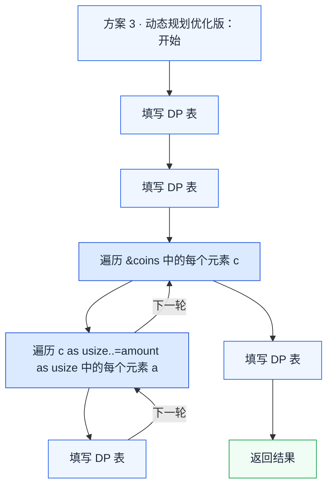

```rust
// LeetCode 518. 零钱兑换II — Rust 版（方案3）
fn change(amount: i32, coins: Vec<i32>) -> i32 {
    // 定义函数/方法 change
    let mut dp = vec![0i64; amount as usize + 1]; // 把 vec取反 [0i64; 目标金额 as usize 加 1]; 写入 let mut dp
    dp[0] = 1; // 把 1; 写入 dp[0]
    for &c in &coins {
        // for 按位与 字符 in 按位与 硬币面额 {
        for a in c as usize..=amount as usize {
            // 逐个取出 字符 的元素（数组）
            dp[a] += dp[a - c as usize]; // dp[a]累加 DP 表[数组 减 字符 as usize]
        }
    }
    dp[amount as usize] as i32 // DP 表[目标金额 as usize] as i32
}
fn main() {
    assert_eq!(change(5, vec![1, 2, 5]), 4);
    assert_eq!(change(3, vec![2]), 0);
    assert_eq!(change(10, vec![1, 2, 5]), 10);
    assert_eq!(change(0, vec![1, 2]), 1);
    println!("PASS");
} // 程序入口：跑内嵌自测用例
```

#### 方案 4：动态规划再优化

**思路与代码分析**：核心是「动态规划再优化」。Rust 版用所有权移动与切片借用改写同一逻辑，注意 Option 与引用边界。代码里依次做这些事：DP 表逐项填充。**走读**：方案 4 · 动态规划再优化：开始 → 填写 DP 表 → 填写 DP 表 → 遍历 &coins 中的每个元素 c → 遍历 c as usize..=amount as usize 中的每个元素 a → 填写 DP 表 → 填写 DP 表 → 返回结果。

**运行架构**（真实控制流）：

```mermaid
graph TD
    N0["方案 4 · 动态规划再优化：开始"]
    N1["填写 DP 表"]
    N2["填写 DP 表"]
    N3["遍历 &coins 中的每个元素 c"]
    N4["遍历 c as usize..=amount as usize 中的每个元素 a"]
    N5["填写 DP 表"]
    N6["填写 DP 表"]
    N7["返回结果"]
    N0 --> N1
    N1 --> N2
    N2 --> N3
    N3 --> N4
    N4 --> N5
    N5 -- 下一轮 --> N4
    N4 -- 下一轮 --> N3
    N3 --> N6
    N6 --> N7
    classDef n fill:#eff6ff,stroke:#2563eb,color:#1e293b;
    classDef lp fill:#dbeafe,stroke:#1d4ed8,color:#1e293b;
    classDef dc fill:#fef9c3,stroke:#ca8a04,color:#1e293b;
    classDef tm fill:#f0fdf4,stroke:#16a34a,color:#1e293b;
    class N0,N1,N2,N5,N6 n;
    class N3,N4 lp;
    class N7 tm;
```

```rust
// LeetCode 518. 零钱兑换II — Rust 版（方案4）
fn change(amount: i32, coins: Vec<i32>) -> i32 {
    // 定义函数/方法 change
    let mut dp = vec![0i64; amount as usize + 1]; // 把 vec取反 [0i64; 目标金额 as usize 加 1]; 写入 let mut dp
    dp[0] = 1; // 把 1; 写入 dp[0]
    for &c in &coins {
        // for 按位与 字符 in 按位与 硬币面额 {
        for a in c as usize..=amount as usize {
            // 逐个取出 字符 的元素（数组）
            dp[a] += dp[a - c as usize]; // dp[a]累加 DP 表[数组 减 字符 as usize]
        }
    }
    dp[amount as usize] as i32 // DP 表[目标金额 as usize] as i32
}
fn main() {
    assert_eq!(change(5, vec![1, 2, 5]), 4);
    assert_eq!(change(3, vec![2]), 0);
    assert_eq!(change(10, vec![1, 2, 5]), 10);
    assert_eq!(change(0, vec![1, 2]), 1);
    println!("PASS");
} // 程序入口：跑内嵌自测用例
```

### Lua 实现（4 种方案）

Lua 的全部方案如下，每个方案都内嵌用例自测，可独立运行（老仓库 python/go 文件遵循「打印结果」约定）：

#### 方案 1：递归搜索 + 保存计算结果 = 记忆化搜索

**思路与代码分析**：核心是「递归搜索 + 保存计算结果 = 记忆化搜索」。Lua 版用表与 ipairs 遍历，注意 ipairs 遇 nil 即停的语义。代码里依次做这些事：DP 表逐项填充。**走读**：方案 1 · 递归搜索 + 保存计算结果 = 记忆化搜索：开始 → 填写 DP 表 → 循环 i：从 0 到 amount do → 填写 DP 表 → 填写 DP 表 → 遍历 ipairs(coins) do 中的每个元素 c → 循环 a：从 c 到 amount do → 填写 DP 表 → 返回 dp[amount]。

**运行架构**（真实控制流）：

```mermaid
graph TD
    N0["方案 1 · 递归搜索 + 保存计算结果 = 记忆化搜索：开始"]
    N1["填写 DP 表"]
    N2["循环 i：从 0 到 amount do"]
    N3["填写 DP 表"]
    N4["填写 DP 表"]
    N5["遍历 ipairs(coins) do 中的每个元素 c"]
    N6["循环 a：从 c 到 amount do"]
    N7["填写 DP 表"]
    N8["返回 dp[amount]"]
    N0 --> N1
    N1 --> N2
    N2 --> N3
    N3 --> N4
    N4 --> N5
    N5 --> N6
    N6 --> N7
    N7 --> N8
    classDef n fill:#eff6ff,stroke:#2563eb,color:#1e293b;
    classDef lp fill:#dbeafe,stroke:#1d4ed8,color:#1e293b;
    classDef dc fill:#fef9c3,stroke:#ca8a04,color:#1e293b;
    classDef tm fill:#f0fdf4,stroke:#16a34a,color:#1e293b;
    class N0,N1,N3,N4,N7 n;
    class N2,N5,N6 lp;
    class N8 tm;
```

```lua
-- LeetCode 518. 零钱兑换II — Lua 版（方案1）
local function change(amount, coins) -- local function change(目标金额, 硬币面额)
	local dp = {} -- 把 {} 写入 local dp
	for i = 0, amount do
		dp[i] = 0
	end -- 让 下标 i 从 0 走到 目标金额（Lua 1 基）
	dp[0] = 1 -- 把 1 写入 dp[0]
	for _, c in ipairs(coins) do -- 遍历取 字符
		for a = c, amount do -- 把 字符, 目标金额 do 写入 for a
			dp[a] = dp[a] + dp[a - c] -- 把 DP 表[数组] 加 DP 表[数组 减 字符] 写入 dp[a]
		end -- 终点
	end -- 终点
	return dp[amount] -- 返回 DP 表[目标金额]
end -- 终点
assert(change(5, { 1, 2, 5 }) == 4) -- 断言校验
assert(change(3, { 2 }) == 0) -- 断言校验
assert(change(10, { 1, 2, 5 }) == 10) -- 断言校验
assert(change(0, { 1, 2 }) == 1) -- 断言校验
print("PASS") -- 全部用例通过，输出 PASS
```

#### 方案 2：动态规划

**思路与代码分析**：核心是「动态规划」。Lua 版用表与 ipairs 遍历，注意 ipairs 遇 nil 即停的语义。代码里依次做这些事：DP 表逐项填充。**走读**：方案 2 · 动态规划：开始 → 填写 DP 表 → 循环 i：从 0 到 amount do → 填写 DP 表 → 填写 DP 表 → 遍历 ipairs(coins) do 中的每个元素 c → 循环 a：从 c 到 amount do → 填写 DP 表 → 返回 dp[amount]。

**运行架构**（真实控制流）：

```mermaid
graph TD
    N0["方案 2 · 动态规划：开始"]
    N1["填写 DP 表"]
    N2["循环 i：从 0 到 amount do"]
    N3["填写 DP 表"]
    N4["填写 DP 表"]
    N5["遍历 ipairs(coins) do 中的每个元素 c"]
    N6["循环 a：从 c 到 amount do"]
    N7["填写 DP 表"]
    N8["返回 dp[amount]"]
    N0 --> N1
    N1 --> N2
    N2 --> N3
    N3 --> N4
    N4 --> N5
    N5 --> N6
    N6 --> N7
    N7 --> N8
    classDef n fill:#eff6ff,stroke:#2563eb,color:#1e293b;
    classDef lp fill:#dbeafe,stroke:#1d4ed8,color:#1e293b;
    classDef dc fill:#fef9c3,stroke:#ca8a04,color:#1e293b;
    classDef tm fill:#f0fdf4,stroke:#16a34a,color:#1e293b;
    class N0,N1,N3,N4,N7 n;
    class N2,N5,N6 lp;
    class N8 tm;
```

```lua
-- LeetCode 518. 零钱兑换II — Lua 版（方案2）
local function change(amount, coins) -- local function change(目标金额, 硬币面额)
	local dp = {} -- 把 {} 写入 local dp
	for i = 0, amount do
		dp[i] = 0
	end -- 让 下标 i 从 0 走到 目标金额（Lua 1 基）
	dp[0] = 1 -- 把 1 写入 dp[0]
	for _, c in ipairs(coins) do -- 遍历取 字符
		for a = c, amount do -- 把 字符, 目标金额 do 写入 for a
			dp[a] = dp[a] + dp[a - c] -- 把 DP 表[数组] 加 DP 表[数组 减 字符] 写入 dp[a]
		end -- 终点
	end -- 终点
	return dp[amount] -- 返回 DP 表[目标金额]
end -- 终点
assert(change(5, { 1, 2, 5 }) == 4) -- 断言校验
assert(change(3, { 2 }) == 0) -- 断言校验
assert(change(10, { 1, 2, 5 }) == 10) -- 断言校验
assert(change(0, { 1, 2 }) == 1) -- 断言校验
print("PASS") -- 全部用例通过，输出 PASS
```

#### 方案 3：动态规划优化版

**思路与代码分析**：核心是「动态规划优化版」。Lua 版用表与 ipairs 遍历，注意 ipairs 遇 nil 即停的语义。代码里依次做这些事：DP 表逐项填充。**走读**：方案 3 · 动态规划优化版：开始 → 填写 DP 表 → 循环 i：从 0 到 amount do → 填写 DP 表 → 填写 DP 表 → 遍历 ipairs(coins) do 中的每个元素 c → 循环 a：从 c 到 amount do → 填写 DP 表 → 返回 dp[amount]。

**运行架构**（真实控制流）：

```mermaid
graph TD
    N0["方案 3 · 动态规划优化版：开始"]
    N1["填写 DP 表"]
    N2["循环 i：从 0 到 amount do"]
    N3["填写 DP 表"]
    N4["填写 DP 表"]
    N5["遍历 ipairs(coins) do 中的每个元素 c"]
    N6["循环 a：从 c 到 amount do"]
    N7["填写 DP 表"]
    N8["返回 dp[amount]"]
    N0 --> N1
    N1 --> N2
    N2 --> N3
    N3 --> N4
    N4 --> N5
    N5 --> N6
    N6 --> N7
    N7 --> N8
    classDef n fill:#eff6ff,stroke:#2563eb,color:#1e293b;
    classDef lp fill:#dbeafe,stroke:#1d4ed8,color:#1e293b;
    classDef dc fill:#fef9c3,stroke:#ca8a04,color:#1e293b;
    classDef tm fill:#f0fdf4,stroke:#16a34a,color:#1e293b;
    class N0,N1,N3,N4,N7 n;
    class N2,N5,N6 lp;
    class N8 tm;
```

```lua
-- LeetCode 518. 零钱兑换II — Lua 版（方案3）
local function change(amount, coins) -- local function change(目标金额, 硬币面额)
	local dp = {} -- 把 {} 写入 local dp
	for i = 0, amount do
		dp[i] = 0
	end -- 让 下标 i 从 0 走到 目标金额（Lua 1 基）
	dp[0] = 1 -- 把 1 写入 dp[0]
	for _, c in ipairs(coins) do -- 遍历取 字符
		for a = c, amount do -- 把 字符, 目标金额 do 写入 for a
			dp[a] = dp[a] + dp[a - c] -- 把 DP 表[数组] 加 DP 表[数组 减 字符] 写入 dp[a]
		end -- 终点
	end -- 终点
	return dp[amount] -- 返回 DP 表[目标金额]
end -- 终点
assert(change(5, { 1, 2, 5 }) == 4) -- 断言校验
assert(change(3, { 2 }) == 0) -- 断言校验
assert(change(10, { 1, 2, 5 }) == 10) -- 断言校验
assert(change(0, { 1, 2 }) == 1) -- 断言校验
print("PASS") -- 全部用例通过，输出 PASS
```

#### 方案 4：动态规划再优化

**思路与代码分析**：核心是「动态规划再优化」。Lua 版用表与 ipairs 遍历，注意 ipairs 遇 nil 即停的语义。代码里依次做这些事：DP 表逐项填充。**走读**：方案 4 · 动态规划再优化：开始 → 填写 DP 表 → 循环 i：从 0 到 amount do → 填写 DP 表 → 填写 DP 表 → 遍历 ipairs(coins) do 中的每个元素 c → 循环 a：从 c 到 amount do → 填写 DP 表 → 返回 dp[amount]。

**运行架构**（真实控制流）：

```mermaid
graph TD
    N0["方案 4 · 动态规划再优化：开始"]
    N1["填写 DP 表"]
    N2["循环 i：从 0 到 amount do"]
    N3["填写 DP 表"]
    N4["填写 DP 表"]
    N5["遍历 ipairs(coins) do 中的每个元素 c"]
    N6["循环 a：从 c 到 amount do"]
    N7["填写 DP 表"]
    N8["返回 dp[amount]"]
    N0 --> N1
    N1 --> N2
    N2 --> N3
    N3 --> N4
    N4 --> N5
    N5 --> N6
    N6 --> N7
    N7 --> N8
    classDef n fill:#eff6ff,stroke:#2563eb,color:#1e293b;
    classDef lp fill:#dbeafe,stroke:#1d4ed8,color:#1e293b;
    classDef dc fill:#fef9c3,stroke:#ca8a04,color:#1e293b;
    classDef tm fill:#f0fdf4,stroke:#16a34a,color:#1e293b;
    class N0,N1,N3,N4,N7 n;
    class N2,N5,N6 lp;
    class N8 tm;
```

```lua
-- LeetCode 518. 零钱兑换II — Lua 版（方案4）
local function change(amount, coins) -- local function change(目标金额, 硬币面额)
	local dp = {} -- 把 {} 写入 local dp
	for i = 0, amount do
		dp[i] = 0
	end -- 让 下标 i 从 0 走到 目标金额（Lua 1 基）
	dp[0] = 1 -- 把 1 写入 dp[0]
	for _, c in ipairs(coins) do -- 遍历取 字符
		for a = c, amount do -- 把 字符, 目标金额 do 写入 for a
			dp[a] = dp[a] + dp[a - c] -- 把 DP 表[数组] 加 DP 表[数组 减 字符] 写入 dp[a]
		end -- 终点
	end -- 终点
	return dp[amount] -- 返回 DP 表[目标金额]
end -- 终点
assert(change(5, { 1, 2, 5 }) == 4) -- 断言校验
assert(change(3, { 2 }) == 0) -- 断言校验
assert(change(10, { 1, 2, 5 }) == 10) -- 断言校验
assert(change(0, { 1, 2 }) == 1) -- 断言校验
print("PASS") -- 全部用例通过，输出 PASS
```

### C 实现（4 种方案）

C 的全部方案如下，每个方案都内嵌用例自测，可独立运行（老仓库 python/go 文件遵循「打印结果」约定）：

#### 方案 1：递归搜索 + 保存计算结果 = 记忆化搜索

**思路与代码分析**：核心是「递归搜索 + 保存计算结果 = 记忆化搜索」。C 版手动管理下标与内存，循环边界全部显式写出。代码里依次做这些事：DP 表逐项填充；双重循环遍历。**走读**：方案 1 · 递归搜索 + 保存计算结果 = 记忆化搜索：开始 → 填写 DP 表 → 填写 DP 表 → 遍历循环 → 遍历循环 → 填写 DP 表 → 返回 dp[amount]。

**运行架构**（真实控制流）：

```mermaid
graph TD
    N0["方案 1 · 递归搜索 + 保存计算结果 = 记忆化搜索：开始"]
    N1["填写 DP 表"]
    N2["填写 DP 表"]
    N3["遍历循环"]
    N4["遍历循环"]
    N5["填写 DP 表"]
    N6["返回 dp[amount]"]
    N0 --> N1
    N1 --> N2
    N2 --> N3
    N3 --> N4
    N4 --> N5
    N5 -- 下一轮 --> N3
    N3 --> N6
    classDef n fill:#eff6ff,stroke:#2563eb,color:#1e293b;
    classDef lp fill:#dbeafe,stroke:#1d4ed8,color:#1e293b;
    classDef dc fill:#fef9c3,stroke:#ca8a04,color:#1e293b;
    classDef tm fill:#f0fdf4,stroke:#16a34a,color:#1e293b;
    class N0,N1,N2,N5 n;
    class N3,N4 lp;
    class N6 tm;
```

```c
/* LeetCode 518. 零钱兑换II — C 版（方案1） */
#include <stdio.h>                                         // 引入头文件
static long change(int amount, const int *coins, int nc) { // 定义函数/方法 change
    long dp[10001] = {0};                                  // 把 {0}; 写入 long dp[10001]
    dp[0] = 1;                                             // 把 1; 写入 dp[0]
    for (int i = 0; i < nc; i++) { // 让 下标 i 从 0 开始计数，下标 i 小于 nc 就继续
        for (int a = coins[i]; a <= amount; a++)
            dp[a] += dp[a - coins[i]]; // 让 数组 从 硬币面额[下标 i] 开始计数，数组 不超过 目标金额 就继续
    }
    return dp[amount]; // 返回 DP 表[目标金额]
}
int main(void) { // 程序入口：跑内嵌自测用例
    if (change(5, (int[]){1, 2, 5}, 3) != 4) {
        printf("FAIL 1\n");
        return 1;
    }
    if (change(3, (int[]){2}, 1) != 0) {
        printf("FAIL 2\n");
        return 1;
    }
    if (change(10, (int[]){1, 2, 5}, 3) != 10) {
        printf("FAIL 3\n");
        return 1;
    }
    if (change(0, (int[]){1, 2}, 2) != 1) {
        printf("FAIL 4\n");
        return 1;
    }
    printf("PASS\n");
    return 0;
} // 全部用例通过，输出 PASS
```

#### 方案 2：动态规划

**思路与代码分析**：核心是「动态规划」。C 版手动管理下标与内存，循环边界全部显式写出。代码里依次做这些事：DP 表逐项填充；双重循环遍历。**走读**：方案 2 · 动态规划：开始 → 填写 DP 表 → 填写 DP 表 → 遍历循环 → 遍历循环 → 填写 DP 表 → 返回 dp[amount]。

**运行架构**（真实控制流）：

```mermaid
graph TD
    N0["方案 2 · 动态规划：开始"]
    N1["填写 DP 表"]
    N2["填写 DP 表"]
    N3["遍历循环"]
    N4["遍历循环"]
    N5["填写 DP 表"]
    N6["返回 dp[amount]"]
    N0 --> N1
    N1 --> N2
    N2 --> N3
    N3 --> N4
    N4 --> N5
    N5 -- 下一轮 --> N3
    N3 --> N6
    classDef n fill:#eff6ff,stroke:#2563eb,color:#1e293b;
    classDef lp fill:#dbeafe,stroke:#1d4ed8,color:#1e293b;
    classDef dc fill:#fef9c3,stroke:#ca8a04,color:#1e293b;
    classDef tm fill:#f0fdf4,stroke:#16a34a,color:#1e293b;
    class N0,N1,N2,N5 n;
    class N3,N4 lp;
    class N6 tm;
```

```c
/* LeetCode 518. 零钱兑换II — C 版（方案2） */
#include <stdio.h>                                         // 引入头文件
static long change(int amount, const int *coins, int nc) { // 定义函数/方法 change
    long dp[10001] = {0};                                  // 把 {0}; 写入 long dp[10001]
    dp[0] = 1;                                             // 把 1; 写入 dp[0]
    for (int i = 0; i < nc; i++) { // 让 下标 i 从 0 开始计数，下标 i 小于 nc 就继续
        for (int a = coins[i]; a <= amount; a++)
            dp[a] += dp[a - coins[i]]; // 让 数组 从 硬币面额[下标 i] 开始计数，数组 不超过 目标金额 就继续
    }
    return dp[amount]; // 返回 DP 表[目标金额]
}
int main(void) { // 程序入口：跑内嵌自测用例
    if (change(5, (int[]){1, 2, 5}, 3) != 4) {
        printf("FAIL 1\n");
        return 1;
    }
    if (change(3, (int[]){2}, 1) != 0) {
        printf("FAIL 2\n");
        return 1;
    }
    if (change(10, (int[]){1, 2, 5}, 3) != 10) {
        printf("FAIL 3\n");
        return 1;
    }
    if (change(0, (int[]){1, 2}, 2) != 1) {
        printf("FAIL 4\n");
        return 1;
    }
    printf("PASS\n");
    return 0;
} // 全部用例通过，输出 PASS
```

#### 方案 3：动态规划优化版

**思路与代码分析**：核心是「动态规划优化版」。C 版手动管理下标与内存，循环边界全部显式写出。代码里依次做这些事：DP 表逐项填充；双重循环遍历。**走读**：方案 3 · 动态规划优化版：开始 → 填写 DP 表 → 填写 DP 表 → 遍历循环 → 遍历循环 → 填写 DP 表 → 返回 dp[amount]。

**运行架构**（真实控制流）：

```mermaid
graph TD
    N0["方案 3 · 动态规划优化版：开始"]
    N1["填写 DP 表"]
    N2["填写 DP 表"]
    N3["遍历循环"]
    N4["遍历循环"]
    N5["填写 DP 表"]
    N6["返回 dp[amount]"]
    N0 --> N1
    N1 --> N2
    N2 --> N3
    N3 --> N4
    N4 --> N5
    N5 -- 下一轮 --> N3
    N3 --> N6
    classDef n fill:#eff6ff,stroke:#2563eb,color:#1e293b;
    classDef lp fill:#dbeafe,stroke:#1d4ed8,color:#1e293b;
    classDef dc fill:#fef9c3,stroke:#ca8a04,color:#1e293b;
    classDef tm fill:#f0fdf4,stroke:#16a34a,color:#1e293b;
    class N0,N1,N2,N5 n;
    class N3,N4 lp;
    class N6 tm;
```

```c
/* LeetCode 518. 零钱兑换II — C 版（方案3） */
#include <stdio.h>                                         // 引入头文件
static long change(int amount, const int *coins, int nc) { // 定义函数/方法 change
    long dp[10001] = {0};                                  // 把 {0}; 写入 long dp[10001]
    dp[0] = 1;                                             // 把 1; 写入 dp[0]
    for (int i = 0; i < nc; i++) { // 让 下标 i 从 0 开始计数，下标 i 小于 nc 就继续
        for (int a = coins[i]; a <= amount; a++)
            dp[a] += dp[a - coins[i]]; // 让 数组 从 硬币面额[下标 i] 开始计数，数组 不超过 目标金额 就继续
    }
    return dp[amount]; // 返回 DP 表[目标金额]
}
int main(void) { // 程序入口：跑内嵌自测用例
    if (change(5, (int[]){1, 2, 5}, 3) != 4) {
        printf("FAIL 1\n");
        return 1;
    }
    if (change(3, (int[]){2}, 1) != 0) {
        printf("FAIL 2\n");
        return 1;
    }
    if (change(10, (int[]){1, 2, 5}, 3) != 10) {
        printf("FAIL 3\n");
        return 1;
    }
    if (change(0, (int[]){1, 2}, 2) != 1) {
        printf("FAIL 4\n");
        return 1;
    }
    printf("PASS\n");
    return 0;
} // 全部用例通过，输出 PASS
```

#### 方案 4：动态规划再优化

**思路与代码分析**：核心是「动态规划再优化」。C 版手动管理下标与内存，循环边界全部显式写出。代码里依次做这些事：DP 表逐项填充；双重循环遍历。**走读**：方案 4 · 动态规划再优化：开始 → 填写 DP 表 → 填写 DP 表 → 遍历循环 → 遍历循环 → 填写 DP 表 → 返回 dp[amount]。

**运行架构**（真实控制流）：

```mermaid
graph TD
    N0["方案 4 · 动态规划再优化：开始"]
    N1["填写 DP 表"]
    N2["填写 DP 表"]
    N3["遍历循环"]
    N4["遍历循环"]
    N5["填写 DP 表"]
    N6["返回 dp[amount]"]
    N0 --> N1
    N1 --> N2
    N2 --> N3
    N3 --> N4
    N4 --> N5
    N5 -- 下一轮 --> N3
    N3 --> N6
    classDef n fill:#eff6ff,stroke:#2563eb,color:#1e293b;
    classDef lp fill:#dbeafe,stroke:#1d4ed8,color:#1e293b;
    classDef dc fill:#fef9c3,stroke:#ca8a04,color:#1e293b;
    classDef tm fill:#f0fdf4,stroke:#16a34a,color:#1e293b;
    class N0,N1,N2,N5 n;
    class N3,N4 lp;
    class N6 tm;
```

```c
/* LeetCode 518. 零钱兑换II — C 版（方案4） */
#include <stdio.h>                                         // 引入头文件
static long change(int amount, const int *coins, int nc) { // 定义函数/方法 change
    long dp[10001] = {0};                                  // 把 {0}; 写入 long dp[10001]
    dp[0] = 1;                                             // 把 1; 写入 dp[0]
    for (int i = 0; i < nc; i++) { // 让 下标 i 从 0 开始计数，下标 i 小于 nc 就继续
        for (int a = coins[i]; a <= amount; a++)
            dp[a] += dp[a - coins[i]]; // 让 数组 从 硬币面额[下标 i] 开始计数，数组 不超过 目标金额 就继续
    }
    return dp[amount]; // 返回 DP 表[目标金额]
}
int main(void) { // 程序入口：跑内嵌自测用例
    if (change(5, (int[]){1, 2, 5}, 3) != 4) {
        printf("FAIL 1\n");
        return 1;
    }
    if (change(3, (int[]){2}, 1) != 0) {
        printf("FAIL 2\n");
        return 1;
    }
    if (change(10, (int[]){1, 2, 5}, 3) != 10) {
        printf("FAIL 3\n");
        return 1;
    }
    if (change(0, (int[]){1, 2}, 2) != 1) {
        printf("FAIL 4\n");
        return 1;
    }
    printf("PASS\n");
    return 0;
} // 全部用例通过，输出 PASS
```

### C++ 实现（4 种方案）

C++ 的全部方案如下，每个方案都内嵌用例自测，可独立运行（老仓库 python/go 文件遵循「打印结果」约定）：

#### 方案 1：递归搜索 + 保存计算结果 = 记忆化搜索

**思路与代码分析**：核心是「递归搜索 + 保存计算结果 = 记忆化搜索」。C++ 版用 STL 容器与迭代器，减少手写下标错误。代码里依次做这些事：DP 表逐项填充；双重循环遍历。**走读**：方案 1 · 递归搜索 + 保存计算结果 = 记忆化搜索：开始 → 处理 std::vector＜long long＞ dp(am → 填写 DP 表 → 遍历循环 → 遍历循环 → 填写 DP 表 → 返回 static_cast＜int＞(dp[amount])。

**运行架构**（真实控制流）：

```mermaid
graph TD
    N0["方案 1 · 递归搜索 + 保存计算结果 = 记忆化搜索：开始"]
    N1["处理 std::vector＜long long＞ dp(am"]
    N2["填写 DP 表"]
    N3["遍历循环"]
    N4["遍历循环"]
    N5["填写 DP 表"]
    N6["返回 static_cast＜int＞(dp[amount])"]
    N0 --> N1
    N1 --> N2
    N2 --> N3
    N3 --> N4
    N4 --> N5
    N5 -- 下一轮 --> N3
    N3 --> N6
    classDef n fill:#eff6ff,stroke:#2563eb,color:#1e293b;
    classDef lp fill:#dbeafe,stroke:#1d4ed8,color:#1e293b;
    classDef dc fill:#fef9c3,stroke:#ca8a04,color:#1e293b;
    classDef tm fill:#f0fdf4,stroke:#16a34a,color:#1e293b;
    class N0,N1,N2,N5 n;
    class N3,N4 lp;
    class N6 tm;
```

```cpp
// LeetCode 518. 零钱兑换II — C++ 版（方案1）
#include <cassert>                                             // 引入头文件
#include <iostream>                                            // 引入头文件
#include <vector>                                              // 引入头文件
static int change(int amount, const std::vector<int> &coins) { // 定义函数/方法 change
    std::vector<long long> dp(amount + 1, 0); // std::vector 小于 long long 超过 DP 表(目标金额 加 1, 0);
    dp[0] = 1;                                // 把 1; 写入 dp[0]
    for (int c : coins) {                     // for (int 字符 : 硬币面额) {
        for (int a = c; a <= amount; ++a)
            dp[a] += dp[a - c]; // 让 数组 从 字符 开始计数，数组 不超过 目标金额 就继续
    }
    return static_cast<int>(dp[amount]); // 返回 static_cast 小于 int 超过 (DP 表[目标金额])
}
int main() {
    assert(change(5, {1, 2, 5}) == 4);
    assert(change(3, {2}) == 0);
    assert(change(10, {1, 2, 5}) == 10);
    assert(change(0, {1, 2}) == 1);
    std::cout << "PASS" << std::endl;
} // 全部用例通过，输出 PASS
```

#### 方案 2：动态规划

**思路与代码分析**：核心是「动态规划」。C++ 版用 STL 容器与迭代器，减少手写下标错误。代码里依次做这些事：DP 表逐项填充；双重循环遍历。**走读**：方案 2 · 动态规划：开始 → 处理 std::vector＜long long＞ dp(am → 填写 DP 表 → 遍历循环 → 遍历循环 → 填写 DP 表 → 返回 static_cast＜int＞(dp[amount])。

**运行架构**（真实控制流）：

```mermaid
graph TD
    N0["方案 2 · 动态规划：开始"]
    N1["处理 std::vector＜long long＞ dp(am"]
    N2["填写 DP 表"]
    N3["遍历循环"]
    N4["遍历循环"]
    N5["填写 DP 表"]
    N6["返回 static_cast＜int＞(dp[amount])"]
    N0 --> N1
    N1 --> N2
    N2 --> N3
    N3 --> N4
    N4 --> N5
    N5 -- 下一轮 --> N3
    N3 --> N6
    classDef n fill:#eff6ff,stroke:#2563eb,color:#1e293b;
    classDef lp fill:#dbeafe,stroke:#1d4ed8,color:#1e293b;
    classDef dc fill:#fef9c3,stroke:#ca8a04,color:#1e293b;
    classDef tm fill:#f0fdf4,stroke:#16a34a,color:#1e293b;
    class N0,N1,N2,N5 n;
    class N3,N4 lp;
    class N6 tm;
```

```cpp
// LeetCode 518. 零钱兑换II — C++ 版（方案2）
#include <cassert>                                             // 引入头文件
#include <iostream>                                            // 引入头文件
#include <vector>                                              // 引入头文件
static int change(int amount, const std::vector<int> &coins) { // 定义函数/方法 change
    std::vector<long long> dp(amount + 1, 0); // std::vector 小于 long long 超过 DP 表(目标金额 加 1, 0);
    dp[0] = 1;                                // 把 1; 写入 dp[0]
    for (int c : coins) {                     // for (int 字符 : 硬币面额) {
        for (int a = c; a <= amount; ++a)
            dp[a] += dp[a - c]; // 让 数组 从 字符 开始计数，数组 不超过 目标金额 就继续
    }
    return static_cast<int>(dp[amount]); // 返回 static_cast 小于 int 超过 (DP 表[目标金额])
}
int main() {
    assert(change(5, {1, 2, 5}) == 4);
    assert(change(3, {2}) == 0);
    assert(change(10, {1, 2, 5}) == 10);
    assert(change(0, {1, 2}) == 1);
    std::cout << "PASS" << std::endl;
} // 全部用例通过，输出 PASS
```

#### 方案 3：动态规划优化版

**思路与代码分析**：核心是「动态规划优化版」。C++ 版用 STL 容器与迭代器，减少手写下标错误。代码里依次做这些事：DP 表逐项填充；双重循环遍历。**走读**：方案 3 · 动态规划优化版：开始 → 处理 std::vector＜long long＞ dp(am → 填写 DP 表 → 遍历循环 → 遍历循环 → 填写 DP 表 → 返回 static_cast＜int＞(dp[amount])。

**运行架构**（真实控制流）：

```mermaid
graph TD
    N0["方案 3 · 动态规划优化版：开始"]
    N1["处理 std::vector＜long long＞ dp(am"]
    N2["填写 DP 表"]
    N3["遍历循环"]
    N4["遍历循环"]
    N5["填写 DP 表"]
    N6["返回 static_cast＜int＞(dp[amount])"]
    N0 --> N1
    N1 --> N2
    N2 --> N3
    N3 --> N4
    N4 --> N5
    N5 -- 下一轮 --> N3
    N3 --> N6
    classDef n fill:#eff6ff,stroke:#2563eb,color:#1e293b;
    classDef lp fill:#dbeafe,stroke:#1d4ed8,color:#1e293b;
    classDef dc fill:#fef9c3,stroke:#ca8a04,color:#1e293b;
    classDef tm fill:#f0fdf4,stroke:#16a34a,color:#1e293b;
    class N0,N1,N2,N5 n;
    class N3,N4 lp;
    class N6 tm;
```

```cpp
// LeetCode 518. 零钱兑换II — C++ 版（方案3）
#include <cassert>                                             // 引入头文件
#include <iostream>                                            // 引入头文件
#include <vector>                                              // 引入头文件
static int change(int amount, const std::vector<int> &coins) { // 定义函数/方法 change
    std::vector<long long> dp(amount + 1, 0); // std::vector 小于 long long 超过 DP 表(目标金额 加 1, 0);
    dp[0] = 1;                                // 把 1; 写入 dp[0]
    for (int c : coins) {                     // for (int 字符 : 硬币面额) {
        for (int a = c; a <= amount; ++a)
            dp[a] += dp[a - c]; // 让 数组 从 字符 开始计数，数组 不超过 目标金额 就继续
    }
    return static_cast<int>(dp[amount]); // 返回 static_cast 小于 int 超过 (DP 表[目标金额])
}
int main() {
    assert(change(5, {1, 2, 5}) == 4);
    assert(change(3, {2}) == 0);
    assert(change(10, {1, 2, 5}) == 10);
    assert(change(0, {1, 2}) == 1);
    std::cout << "PASS" << std::endl;
} // 全部用例通过，输出 PASS
```

#### 方案 4：动态规划再优化

**思路与代码分析**：核心是「动态规划再优化」。C++ 版用 STL 容器与迭代器，减少手写下标错误。代码里依次做这些事：DP 表逐项填充；双重循环遍历。**走读**：方案 4 · 动态规划再优化：开始 → 处理 std::vector＜long long＞ dp(am → 填写 DP 表 → 遍历循环 → 遍历循环 → 填写 DP 表 → 返回 static_cast＜int＞(dp[amount])。

**运行架构**（真实控制流）：

```mermaid
graph TD
    N0["方案 4 · 动态规划再优化：开始"]
    N1["处理 std::vector＜long long＞ dp(am"]
    N2["填写 DP 表"]
    N3["遍历循环"]
    N4["遍历循环"]
    N5["填写 DP 表"]
    N6["返回 static_cast＜int＞(dp[amount])"]
    N0 --> N1
    N1 --> N2
    N2 --> N3
    N3 --> N4
    N4 --> N5
    N5 -- 下一轮 --> N3
    N3 --> N6
    classDef n fill:#eff6ff,stroke:#2563eb,color:#1e293b;
    classDef lp fill:#dbeafe,stroke:#1d4ed8,color:#1e293b;
    classDef dc fill:#fef9c3,stroke:#ca8a04,color:#1e293b;
    classDef tm fill:#f0fdf4,stroke:#16a34a,color:#1e293b;
    class N0,N1,N2,N5 n;
    class N3,N4 lp;
    class N6 tm;
```

```cpp
// LeetCode 518. 零钱兑换II — C++ 版（方案4）
#include <cassert>                                             // 引入头文件
#include <iostream>                                            // 引入头文件
#include <vector>                                              // 引入头文件
static int change(int amount, const std::vector<int> &coins) { // 定义函数/方法 change
    std::vector<long long> dp(amount + 1, 0); // std::vector 小于 long long 超过 DP 表(目标金额 加 1, 0);
    dp[0] = 1;                                // 把 1; 写入 dp[0]
    for (int c : coins) {                     // for (int 字符 : 硬币面额) {
        for (int a = c; a <= amount; ++a)
            dp[a] += dp[a - c]; // 让 数组 从 字符 开始计数，数组 不超过 目标金额 就继续
    }
    return static_cast<int>(dp[amount]); // 返回 static_cast 小于 int 超过 (DP 表[目标金额])
}
int main() {
    assert(change(5, {1, 2, 5}) == 4);
    assert(change(3, {2}) == 0);
    assert(change(10, {1, 2, 5}) == 10);
    assert(change(0, {1, 2}) == 1);
    std::cout << "PASS" << std::endl;
} // 全部用例通过，输出 PASS
```

### R 实现（4 种方案）

R 的全部方案如下，每个方案都内嵌用例自测，可独立运行（老仓库 python/go 文件遵循「打印结果」约定）：

#### 方案 1：递归搜索 + 保存计算结果 = 记忆化搜索

**思路与代码分析**：核心是「递归搜索 + 保存计算结果 = 记忆化搜索」。R 版用向量化思维与 1 起始下标，注意 1:n 的降序陷阱。代码里依次做这些事：DP 表逐项填充；双重循环遍历。**走读**：方案 1 · 递归搜索 + 保存计算结果 = 记忆化搜索：开始 → 处理 dp ＜- rep(0L, amount + 1) → 填写 DP 表 → 循环 c：遍历 coins → 若 c ≤ amount 则： → 循环 a：遍历 c:amount → 填写 DP 表 → 返回结果。

**运行架构**（真实控制流）：

```mermaid
graph TD
    N0["方案 1 · 递归搜索 + 保存计算结果 = 记忆化搜索：开始"]
    N1["处理 dp ＜- rep(0L, amount + 1)"]
    N2["填写 DP 表"]
    N3["循环 c：遍历 coins"]
    N4["若 c ≤ amount 则："]
    N5["循环 a：遍历 c:amount"]
    N6["填写 DP 表"]
    N7["返回结果"]
    N0 --> N1
    N1 --> N2
    N2 --> N3
    N3 --> N4
    N4 --> N5
    N5 -- 下一轮 --> N3
    N3 --> N6
    N6 --> N7
    classDef n fill:#eff6ff,stroke:#2563eb,color:#1e293b;
    classDef lp fill:#dbeafe,stroke:#1d4ed8,color:#1e293b;
    classDef dc fill:#fef9c3,stroke:#ca8a04,color:#1e293b;
    classDef tm fill:#f0fdf4,stroke:#16a34a,color:#1e293b;
    class N0,N1,N2,N4,N6 n;
    class N3,N5 lp;
    class N7 tm;
```

```r
# 版（方案1） 定义函数 change_ways（参数：目标金额, 硬币面额）
change_ways <- function(amount, coins) {
    dp <- rep(0L, amount + 1)  # 把 rep(0L, 目标金额 加 1) 存入 DP 表
    dp[1] <- 1L  # 把 1L 存入 dp[1]
    for (c in coins) {
        # for (字符 in 硬币面额) { 若 字符 不超过 目标金额
        if (c <= amount) {
            for (a in c:amount) dp[a + 1] <- dp[a + 1] + dp[a - c + 1]
        }
    }
    dp[amount + 1]  # DP 表[目标金额 加 1]
}
stopifnot(change_ways(5, c(1, 2, 5)) == 4)  # 断言校验
stopifnot(change_ways(3, c(2)) == 0)  # 断言校验
stopifnot(change_ways(10, c(1, 2, 5)) == 10)  # 断言校验
stopifnot(change_ways(0, c(1, 2)) == 1)  # 断言校验
cat("PASS\n")  # 全部用例通过，输出 PASS
```

#### 方案 2：动态规划

**思路与代码分析**：核心是「动态规划」。R 版用向量化思维与 1 起始下标，注意 1:n 的降序陷阱。代码里依次做这些事：DP 表逐项填充；双重循环遍历。**走读**：方案 2 · 动态规划：开始 → 处理 dp ＜- rep(0L, amount + 1) → 填写 DP 表 → 循环 c：遍历 coins → 若 c ≤ amount 则： → 循环 a：遍历 c:amount → 填写 DP 表 → 返回结果。

**运行架构**（真实控制流）：

```mermaid
graph TD
    N0["方案 2 · 动态规划：开始"]
    N1["处理 dp ＜- rep(0L, amount + 1)"]
    N2["填写 DP 表"]
    N3["循环 c：遍历 coins"]
    N4["若 c ≤ amount 则："]
    N5["循环 a：遍历 c:amount"]
    N6["填写 DP 表"]
    N7["返回结果"]
    N0 --> N1
    N1 --> N2
    N2 --> N3
    N3 --> N4
    N4 --> N5
    N5 -- 下一轮 --> N3
    N3 --> N6
    N6 --> N7
    classDef n fill:#eff6ff,stroke:#2563eb,color:#1e293b;
    classDef lp fill:#dbeafe,stroke:#1d4ed8,color:#1e293b;
    classDef dc fill:#fef9c3,stroke:#ca8a04,color:#1e293b;
    classDef tm fill:#f0fdf4,stroke:#16a34a,color:#1e293b;
    class N0,N1,N2,N4,N6 n;
    class N3,N5 lp;
    class N7 tm;
```

```r
# 版（方案2） 定义函数 change_ways（参数：目标金额, 硬币面额）
change_ways <- function(amount, coins) {
    dp <- rep(0L, amount + 1)  # 把 rep(0L, 目标金额 加 1) 存入 DP 表
    dp[1] <- 1L  # 把 1L 存入 dp[1]
    for (c in coins) {
        # for (字符 in 硬币面额) { 若 字符 不超过 目标金额
        if (c <= amount) {
            for (a in c:amount) dp[a + 1] <- dp[a + 1] + dp[a - c + 1]
        }
    }
    dp[amount + 1]  # DP 表[目标金额 加 1]
}
stopifnot(change_ways(5, c(1, 2, 5)) == 4)  # 断言校验
stopifnot(change_ways(3, c(2)) == 0)  # 断言校验
stopifnot(change_ways(10, c(1, 2, 5)) == 10)  # 断言校验
stopifnot(change_ways(0, c(1, 2)) == 1)  # 断言校验
cat("PASS\n")  # 全部用例通过，输出 PASS
```

#### 方案 3：动态规划优化版

**思路与代码分析**：核心是「动态规划优化版」。R 版用向量化思维与 1 起始下标，注意 1:n 的降序陷阱。代码里依次做这些事：DP 表逐项填充；双重循环遍历。**走读**：方案 3 · 动态规划优化版：开始 → 处理 dp ＜- rep(0L, amount + 1) → 填写 DP 表 → 循环 c：遍历 coins → 若 c ≤ amount 则： → 循环 a：遍历 c:amount → 填写 DP 表 → 返回结果。

**运行架构**（真实控制流）：

```mermaid
graph TD
    N0["方案 3 · 动态规划优化版：开始"]
    N1["处理 dp ＜- rep(0L, amount + 1)"]
    N2["填写 DP 表"]
    N3["循环 c：遍历 coins"]
    N4["若 c ≤ amount 则："]
    N5["循环 a：遍历 c:amount"]
    N6["填写 DP 表"]
    N7["返回结果"]
    N0 --> N1
    N1 --> N2
    N2 --> N3
    N3 --> N4
    N4 --> N5
    N5 -- 下一轮 --> N3
    N3 --> N6
    N6 --> N7
    classDef n fill:#eff6ff,stroke:#2563eb,color:#1e293b;
    classDef lp fill:#dbeafe,stroke:#1d4ed8,color:#1e293b;
    classDef dc fill:#fef9c3,stroke:#ca8a04,color:#1e293b;
    classDef tm fill:#f0fdf4,stroke:#16a34a,color:#1e293b;
    class N0,N1,N2,N4,N6 n;
    class N3,N5 lp;
    class N7 tm;
```

```r
# 版（方案3） 定义函数 change_ways（参数：目标金额, 硬币面额）
change_ways <- function(amount, coins) {
    dp <- rep(0L, amount + 1)  # 把 rep(0L, 目标金额 加 1) 存入 DP 表
    dp[1] <- 1L  # 把 1L 存入 dp[1]
    for (c in coins) {
        # for (字符 in 硬币面额) { 若 字符 不超过 目标金额
        if (c <= amount) {
            for (a in c:amount) dp[a + 1] <- dp[a + 1] + dp[a - c + 1]
        }
    }
    dp[amount + 1]  # DP 表[目标金额 加 1]
}
stopifnot(change_ways(5, c(1, 2, 5)) == 4)  # 断言校验
stopifnot(change_ways(3, c(2)) == 0)  # 断言校验
stopifnot(change_ways(10, c(1, 2, 5)) == 10)  # 断言校验
stopifnot(change_ways(0, c(1, 2)) == 1)  # 断言校验
cat("PASS\n")  # 全部用例通过，输出 PASS
```

#### 方案 4：动态规划再优化

**思路与代码分析**：核心是「动态规划再优化」。R 版用向量化思维与 1 起始下标，注意 1:n 的降序陷阱。代码里依次做这些事：DP 表逐项填充；双重循环遍历。**走读**：方案 4 · 动态规划再优化：开始 → 处理 dp ＜- rep(0L, amount + 1) → 填写 DP 表 → 循环 c：遍历 coins → 若 c ≤ amount 则： → 循环 a：遍历 c:amount → 填写 DP 表 → 返回结果。

**运行架构**（真实控制流）：

```mermaid
graph TD
    N0["方案 4 · 动态规划再优化：开始"]
    N1["处理 dp ＜- rep(0L, amount + 1)"]
    N2["填写 DP 表"]
    N3["循环 c：遍历 coins"]
    N4["若 c ≤ amount 则："]
    N5["循环 a：遍历 c:amount"]
    N6["填写 DP 表"]
    N7["返回结果"]
    N0 --> N1
    N1 --> N2
    N2 --> N3
    N3 --> N4
    N4 --> N5
    N5 -- 下一轮 --> N3
    N3 --> N6
    N6 --> N7
    classDef n fill:#eff6ff,stroke:#2563eb,color:#1e293b;
    classDef lp fill:#dbeafe,stroke:#1d4ed8,color:#1e293b;
    classDef dc fill:#fef9c3,stroke:#ca8a04,color:#1e293b;
    classDef tm fill:#f0fdf4,stroke:#16a34a,color:#1e293b;
    class N0,N1,N2,N4,N6 n;
    class N3,N5 lp;
    class N7 tm;
```

```r
# 版（方案4） 定义函数 change_ways（参数：目标金额, 硬币面额）
change_ways <- function(amount, coins) {
    dp <- rep(0L, amount + 1)  # 把 rep(0L, 目标金额 加 1) 存入 DP 表
    dp[1] <- 1L  # 把 1L 存入 dp[1]
    for (c in coins) {
        # for (字符 in 硬币面额) { 若 字符 不超过 目标金额
        if (c <= amount) {
            for (a in c:amount) dp[a + 1] <- dp[a + 1] + dp[a - c + 1]
        }
    }
    dp[amount + 1]  # DP 表[目标金额 加 1]
}
stopifnot(change_ways(5, c(1, 2, 5)) == 4)  # 断言校验
stopifnot(change_ways(3, c(2)) == 0)  # 断言校验
stopifnot(change_ways(10, c(1, 2, 5)) == 10)  # 断言校验
stopifnot(change_ways(0, c(1, 2)) == 1)  # 断言校验
cat("PASS\n")  # 全部用例通过，输出 PASS
```

### Zig 实现（4 种方案）

Zig 的全部方案如下，每个方案都内嵌用例自测，可独立运行（老仓库 python/go 文件遵循「打印结果」约定）：

#### 方案 1：递归搜索 + 保存计算结果 = 记忆化搜索

**思路与代码分析**：核心是「递归搜索 + 保存计算结果 = 记忆化搜索」。Zig 版显式分配与清零，整型边界处理严格。代码里依次做这些事：DP 表逐项填充；双重循环遍历。**走读**：方案 1 · 递归搜索 + 保存计算结果 = 记忆化搜索：开始 → 计算 dp → 填写 DP 表 → 遍历集合元素 → 遍历集合元素 → 计算 ci → 计算 a → 当 (a ≤ @as(usize, @intCast(amount))) : (a += 1) dp[a] += dp[a - ci] 时反复执行 → 返回 @intCast(dp[@intCast(amount)])。

**运行架构**（真实控制流）：

```mermaid
graph TD
    N0["方案 1 · 递归搜索 + 保存计算结果 = 记忆化搜索：开始"]
    N1["计算 dp"]
    N2["填写 DP 表"]
    N3["遍历集合元素"]
    N4["遍历集合元素"]
    N5["计算 ci"]
    N6["计算 a"]
    N7["当 (a ≤ @as(usize, @intCast(amount))) : (a += 1) dp[a] += dp[a - ci] 时反复执行"]
    N8["返回 @intCast(dp[@intCast(amount)])"]
    N0 --> N1
    N1 --> N2
    N2 --> N3
    N3 --> N4
    N4 --> N5
    N5 --> N6
    N6 --> N7
    N7 -- 下一轮 --> N4
    N4 --> N8
    classDef n fill:#eff6ff,stroke:#2563eb,color:#1e293b;
    classDef lp fill:#dbeafe,stroke:#1d4ed8,color:#1e293b;
    classDef dc fill:#fef9c3,stroke:#ca8a04,color:#1e293b;
    classDef tm fill:#f0fdf4,stroke:#16a34a,color:#1e293b;
    class N0,N1,N2,N5,N6 n;
    class N3,N4,N7 lp;
    class N8 tm;
```

```zig
// LeetCode 518. 零钱兑换II — Zig 版（方案1）
const std = @import("std"); // 把 @import(「std」) 存入 std
fn change(amount: i32, coins: []const i32) i32 { // 定义函数/方法 change
    var dp: [10001]i64 = undefined; // 把 undefined; 写入 var dp: [10001]i64
    dp[0] = 1; // 把 1; 写入 dp[0]
    for (1..@intCast(amount + 1)) |a| dp[a] = 0; // 把 0; 写入 for (1..@intCast(amount + 1)) |a| dp[a]
    for (coins) |c| { // 逐个取出 硬币面额 的元素（字符）
        const ci: usize = @intCast(c); // 把 @intCast(字符); 写入 const ci: usize
        var a = ci; // 把 ci 存入 数组
        while (a <= @as(usize, @intCast(amount))) : (a += 1) dp[a] += dp[a - ci];
    }
    return @intCast(dp[@intCast(amount)]); // 返回 @intCast(DP 表[@intCast(目标金额)])
}
pub fn main() !void { // 程序入口：跑内嵌自测用例
    if (change(5, &[_]i32{ 1, 2, 5 }) != 4) return error.TestFailed;
    if (change(3, &[_]i32{2}) != 0) return error.TestFailed; // 若 change(3, 按位与 [_]i32{2}) 不等于 0，直接返回 error.TestFailed
    if (change(10, &[_]i32{ 1, 2, 5 }) != 10) return error.TestFailed;
    if (change(0, &[_]i32{ 1, 2 }) != 1) return error.TestFailed; // 若 change(0, 按位与 [_]i32{ 1, 2 }) 不等于 1，直接返回 error.TestFailed
    std.debug.print("PASS\n", .{});
} // 全部用例通过，输出 PASS
```

#### 方案 2：动态规划

**思路与代码分析**：核心是「动态规划」。Zig 版显式分配与清零，整型边界处理严格。代码里依次做这些事：DP 表逐项填充；双重循环遍历。**走读**：方案 2 · 动态规划：开始 → 计算 dp → 填写 DP 表 → 遍历集合元素 → 遍历集合元素 → 计算 ci → 计算 a → 当 (a ≤ @as(usize, @intCast(amount))) : (a += 1) dp[a] += dp[a - ci] 时反复执行 → 返回 @intCast(dp[@intCast(amount)])。

**运行架构**（真实控制流）：

```mermaid
graph TD
    N0["方案 2 · 动态规划：开始"]
    N1["计算 dp"]
    N2["填写 DP 表"]
    N3["遍历集合元素"]
    N4["遍历集合元素"]
    N5["计算 ci"]
    N6["计算 a"]
    N7["当 (a ≤ @as(usize, @intCast(amount))) : (a += 1) dp[a] += dp[a - ci] 时反复执行"]
    N8["返回 @intCast(dp[@intCast(amount)])"]
    N0 --> N1
    N1 --> N2
    N2 --> N3
    N3 --> N4
    N4 --> N5
    N5 --> N6
    N6 --> N7
    N7 -- 下一轮 --> N4
    N4 --> N8
    classDef n fill:#eff6ff,stroke:#2563eb,color:#1e293b;
    classDef lp fill:#dbeafe,stroke:#1d4ed8,color:#1e293b;
    classDef dc fill:#fef9c3,stroke:#ca8a04,color:#1e293b;
    classDef tm fill:#f0fdf4,stroke:#16a34a,color:#1e293b;
    class N0,N1,N2,N5,N6 n;
    class N3,N4,N7 lp;
    class N8 tm;
```

```zig
// LeetCode 518. 零钱兑换II — Zig 版（方案2）
const std = @import("std"); // 把 @import(「std」) 存入 std
fn change(amount: i32, coins: []const i32) i32 { // 定义函数/方法 change
    var dp: [10001]i64 = undefined; // 把 undefined; 写入 var dp: [10001]i64
    dp[0] = 1; // 把 1; 写入 dp[0]
    for (1..@intCast(amount + 1)) |a| dp[a] = 0; // 把 0; 写入 for (1..@intCast(amount + 1)) |a| dp[a]
    for (coins) |c| { // 逐个取出 硬币面额 的元素（字符）
        const ci: usize = @intCast(c); // 把 @intCast(字符); 写入 const ci: usize
        var a = ci; // 把 ci 存入 数组
        while (a <= @as(usize, @intCast(amount))) : (a += 1) dp[a] += dp[a - ci];
    }
    return @intCast(dp[@intCast(amount)]); // 返回 @intCast(DP 表[@intCast(目标金额)])
}
pub fn main() !void { // 程序入口：跑内嵌自测用例
    if (change(5, &[_]i32{ 1, 2, 5 }) != 4) return error.TestFailed;
    if (change(3, &[_]i32{2}) != 0) return error.TestFailed; // 若 change(3, 按位与 [_]i32{2}) 不等于 0，直接返回 error.TestFailed
    if (change(10, &[_]i32{ 1, 2, 5 }) != 10) return error.TestFailed;
    if (change(0, &[_]i32{ 1, 2 }) != 1) return error.TestFailed; // 若 change(0, 按位与 [_]i32{ 1, 2 }) 不等于 1，直接返回 error.TestFailed
    std.debug.print("PASS\n", .{});
} // 全部用例通过，输出 PASS
```

#### 方案 3：动态规划优化版

**思路与代码分析**：核心是「动态规划优化版」。Zig 版显式分配与清零，整型边界处理严格。代码里依次做这些事：DP 表逐项填充；双重循环遍历。**走读**：方案 3 · 动态规划优化版：开始 → 计算 dp → 填写 DP 表 → 遍历集合元素 → 遍历集合元素 → 计算 ci → 计算 a → 当 (a ≤ @as(usize, @intCast(amount))) : (a += 1) dp[a] += dp[a - ci] 时反复执行 → 返回 @intCast(dp[@intCast(amount)])。

**运行架构**（真实控制流）：

```mermaid
graph TD
    N0["方案 3 · 动态规划优化版：开始"]
    N1["计算 dp"]
    N2["填写 DP 表"]
    N3["遍历集合元素"]
    N4["遍历集合元素"]
    N5["计算 ci"]
    N6["计算 a"]
    N7["当 (a ≤ @as(usize, @intCast(amount))) : (a += 1) dp[a] += dp[a - ci] 时反复执行"]
    N8["返回 @intCast(dp[@intCast(amount)])"]
    N0 --> N1
    N1 --> N2
    N2 --> N3
    N3 --> N4
    N4 --> N5
    N5 --> N6
    N6 --> N7
    N7 -- 下一轮 --> N4
    N4 --> N8
    classDef n fill:#eff6ff,stroke:#2563eb,color:#1e293b;
    classDef lp fill:#dbeafe,stroke:#1d4ed8,color:#1e293b;
    classDef dc fill:#fef9c3,stroke:#ca8a04,color:#1e293b;
    classDef tm fill:#f0fdf4,stroke:#16a34a,color:#1e293b;
    class N0,N1,N2,N5,N6 n;
    class N3,N4,N7 lp;
    class N8 tm;
```

```zig
// LeetCode 518. 零钱兑换II — Zig 版（方案3）
const std = @import("std"); // 把 @import(「std」) 存入 std
fn change(amount: i32, coins: []const i32) i32 { // 定义函数/方法 change
    var dp: [10001]i64 = undefined; // 把 undefined; 写入 var dp: [10001]i64
    dp[0] = 1; // 把 1; 写入 dp[0]
    for (1..@intCast(amount + 1)) |a| dp[a] = 0; // 把 0; 写入 for (1..@intCast(amount + 1)) |a| dp[a]
    for (coins) |c| { // 逐个取出 硬币面额 的元素（字符）
        const ci: usize = @intCast(c); // 把 @intCast(字符); 写入 const ci: usize
        var a = ci; // 把 ci 存入 数组
        while (a <= @as(usize, @intCast(amount))) : (a += 1) dp[a] += dp[a - ci];
    }
    return @intCast(dp[@intCast(amount)]); // 返回 @intCast(DP 表[@intCast(目标金额)])
}
pub fn main() !void { // 程序入口：跑内嵌自测用例
    if (change(5, &[_]i32{ 1, 2, 5 }) != 4) return error.TestFailed;
    if (change(3, &[_]i32{2}) != 0) return error.TestFailed; // 若 change(3, 按位与 [_]i32{2}) 不等于 0，直接返回 error.TestFailed
    if (change(10, &[_]i32{ 1, 2, 5 }) != 10) return error.TestFailed;
    if (change(0, &[_]i32{ 1, 2 }) != 1) return error.TestFailed; // 若 change(0, 按位与 [_]i32{ 1, 2 }) 不等于 1，直接返回 error.TestFailed
    std.debug.print("PASS\n", .{});
} // 全部用例通过，输出 PASS
```

#### 方案 4：动态规划再优化

**思路与代码分析**：核心是「动态规划再优化」。Zig 版显式分配与清零，整型边界处理严格。代码里依次做这些事：DP 表逐项填充；双重循环遍历。**走读**：方案 4 · 动态规划再优化：开始 → 计算 dp → 填写 DP 表 → 遍历集合元素 → 遍历集合元素 → 计算 ci → 计算 a → 当 (a ≤ @as(usize, @intCast(amount))) : (a += 1) dp[a] += dp[a - ci] 时反复执行 → 返回 @intCast(dp[@intCast(amount)])。

**运行架构**（真实控制流）：

```mermaid
graph TD
    N0["方案 4 · 动态规划再优化：开始"]
    N1["计算 dp"]
    N2["填写 DP 表"]
    N3["遍历集合元素"]
    N4["遍历集合元素"]
    N5["计算 ci"]
    N6["计算 a"]
    N7["当 (a ≤ @as(usize, @intCast(amount))) : (a += 1) dp[a] += dp[a - ci] 时反复执行"]
    N8["返回 @intCast(dp[@intCast(amount)])"]
    N0 --> N1
    N1 --> N2
    N2 --> N3
    N3 --> N4
    N4 --> N5
    N5 --> N6
    N6 --> N7
    N7 -- 下一轮 --> N4
    N4 --> N8
    classDef n fill:#eff6ff,stroke:#2563eb,color:#1e293b;
    classDef lp fill:#dbeafe,stroke:#1d4ed8,color:#1e293b;
    classDef dc fill:#fef9c3,stroke:#ca8a04,color:#1e293b;
    classDef tm fill:#f0fdf4,stroke:#16a34a,color:#1e293b;
    class N0,N1,N2,N5,N6 n;
    class N3,N4,N7 lp;
    class N8 tm;
```

```zig
// LeetCode 518. 零钱兑换II — Zig 版（方案4）
const std = @import("std"); // 把 @import(「std」) 存入 std
fn change(amount: i32, coins: []const i32) i32 { // 定义函数/方法 change
    var dp: [10001]i64 = undefined; // 把 undefined; 写入 var dp: [10001]i64
    dp[0] = 1; // 把 1; 写入 dp[0]
    for (1..@intCast(amount + 1)) |a| dp[a] = 0; // 把 0; 写入 for (1..@intCast(amount + 1)) |a| dp[a]
    for (coins) |c| { // 逐个取出 硬币面额 的元素（字符）
        const ci: usize = @intCast(c); // 把 @intCast(字符); 写入 const ci: usize
        var a = ci; // 把 ci 存入 数组
        while (a <= @as(usize, @intCast(amount))) : (a += 1) dp[a] += dp[a - ci];
    }
    return @intCast(dp[@intCast(amount)]); // 返回 @intCast(DP 表[@intCast(目标金额)])
}
pub fn main() !void { // 程序入口：跑内嵌自测用例
    if (change(5, &[_]i32{ 1, 2, 5 }) != 4) return error.TestFailed;
    if (change(3, &[_]i32{2}) != 0) return error.TestFailed; // 若 change(3, 按位与 [_]i32{2}) 不等于 0，直接返回 error.TestFailed
    if (change(10, &[_]i32{ 1, 2, 5 }) != 10) return error.TestFailed;
    if (change(0, &[_]i32{ 1, 2 }) != 1) return error.TestFailed; // 若 change(0, 按位与 [_]i32{ 1, 2 }) 不等于 1，直接返回 error.TestFailed
    std.debug.print("PASS\n", .{});
} // 全部用例通过，输出 PASS
```

### Dart 实现（4 种方案）

Dart 的全部方案如下，每个方案都内嵌用例自测，可独立运行（老仓库 python/go 文件遵循「打印结果」约定）：

#### 方案 1：递归搜索 + 保存计算结果 = 记忆化搜索

**思路与代码分析**：核心是「递归搜索 + 保存计算结果 = 记忆化搜索」。Dart 版用可空类型标注与集合方法，注意空安全。代码里依次做这些事：DP 表逐项填充；双重循环遍历。**走读**：方案 1 · 递归搜索 + 保存计算结果 = 记忆化搜索：开始 → 填写 DP 表 → 处理 amount + 1, → 处理 0, → 处理 ) → 填写 DP 表 → 遍历循环 → 遍历循环 → 填写 DP 表 → 返回 dp[amount]。

**运行架构**（真实控制流）：

```mermaid
graph TD
    N0["方案 1 · 递归搜索 + 保存计算结果 = 记忆化搜索：开始"]
    N1["填写 DP 表"]
    N2["处理 amount + 1,"]
    N3["处理 0,"]
    N4["处理 )"]
    N5["填写 DP 表"]
    N6["遍历循环"]
    N7["遍历循环"]
    N8["填写 DP 表"]
    N9["返回 dp[amount]"]
    N0 --> N1
    N1 --> N2
    N2 --> N3
    N3 --> N4
    N4 --> N5
    N5 --> N6
    N6 --> N7
    N7 --> N8
    N8 -- 下一轮 --> N6
    N6 --> N9
    classDef n fill:#eff6ff,stroke:#2563eb,color:#1e293b;
    classDef lp fill:#dbeafe,stroke:#1d4ed8,color:#1e293b;
    classDef dc fill:#fef9c3,stroke:#ca8a04,color:#1e293b;
    classDef tm fill:#f0fdf4,stroke:#16a34a,color:#1e293b;
    class N0,N1,N2,N3,N4,N5,N8 n;
    class N6,N7 lp;
    class N9 tm;
```

```dart
// LeetCode 518. 零钱兑换II — Dart 版（方案1）
int change(int amount, List<int> coins) {
  // 定义函数/方法 change
  final dp = List<int>.filled(
    amount + 1,
    0,
  ); // 把 List 小于 int 超过 .filled(目标金额 加 1, 0) 存入 DP 表
  dp[0] = 1; // 把 1; 写入 dp[0]
  for (final c in coins) {
    // for (final 字符 in 硬币面额) {
    for (var a = c; a <= amount; a++)
      dp[a] += dp[a - c]; // 让 数组 从 字符 开始计数，数组 不超过 目标金额 就继续
  }
  return dp[amount]; // 返回 DP 表[目标金额]
}

void main() {
  if (change(5, [1, 2, 5]) != 4) throw StateError('c1');
  if (change(3, [2]) != 0) throw StateError('c2');
  if (change(10, [1, 2, 5]) != 10) throw StateError('c3');
  if (change(0, [1, 2]) != 1) throw StateError('c4');
  print('PASS');
} // 全部用例通过，输出 PASS
```

#### 方案 2：动态规划

**思路与代码分析**：核心是「动态规划」。Dart 版用可空类型标注与集合方法，注意空安全。代码里依次做这些事：DP 表逐项填充；双重循环遍历。**走读**：方案 2 · 动态规划：开始 → 填写 DP 表 → 处理 amount + 1, → 处理 0, → 处理 ) → 填写 DP 表 → 遍历循环 → 遍历循环 → 填写 DP 表 → 返回 dp[amount]。

**运行架构**（真实控制流）：

```mermaid
graph TD
    N0["方案 2 · 动态规划：开始"]
    N1["填写 DP 表"]
    N2["处理 amount + 1,"]
    N3["处理 0,"]
    N4["处理 )"]
    N5["填写 DP 表"]
    N6["遍历循环"]
    N7["遍历循环"]
    N8["填写 DP 表"]
    N9["返回 dp[amount]"]
    N0 --> N1
    N1 --> N2
    N2 --> N3
    N3 --> N4
    N4 --> N5
    N5 --> N6
    N6 --> N7
    N7 --> N8
    N8 -- 下一轮 --> N6
    N6 --> N9
    classDef n fill:#eff6ff,stroke:#2563eb,color:#1e293b;
    classDef lp fill:#dbeafe,stroke:#1d4ed8,color:#1e293b;
    classDef dc fill:#fef9c3,stroke:#ca8a04,color:#1e293b;
    classDef tm fill:#f0fdf4,stroke:#16a34a,color:#1e293b;
    class N0,N1,N2,N3,N4,N5,N8 n;
    class N6,N7 lp;
    class N9 tm;
```

```dart
// LeetCode 518. 零钱兑换II — Dart 版（方案2）
int change(int amount, List<int> coins) {
  // 定义函数/方法 change
  final dp = List<int>.filled(
    amount + 1,
    0,
  ); // 把 List 小于 int 超过 .filled(目标金额 加 1, 0) 存入 DP 表
  dp[0] = 1; // 把 1; 写入 dp[0]
  for (final c in coins) {
    // for (final 字符 in 硬币面额) {
    for (var a = c; a <= amount; a++)
      dp[a] += dp[a - c]; // 让 数组 从 字符 开始计数，数组 不超过 目标金额 就继续
  }
  return dp[amount]; // 返回 DP 表[目标金额]
}

void main() {
  if (change(5, [1, 2, 5]) != 4) throw StateError('c1');
  if (change(3, [2]) != 0) throw StateError('c2');
  if (change(10, [1, 2, 5]) != 10) throw StateError('c3');
  if (change(0, [1, 2]) != 1) throw StateError('c4');
  print('PASS');
} // 全部用例通过，输出 PASS
```

#### 方案 3：动态规划优化版

**思路与代码分析**：核心是「动态规划优化版」。Dart 版用可空类型标注与集合方法，注意空安全。代码里依次做这些事：DP 表逐项填充；双重循环遍历。**走读**：方案 3 · 动态规划优化版：开始 → 填写 DP 表 → 处理 amount + 1, → 处理 0, → 处理 ) → 填写 DP 表 → 遍历循环 → 遍历循环 → 填写 DP 表 → 返回 dp[amount]。

**运行架构**（真实控制流）：

```mermaid
graph TD
    N0["方案 3 · 动态规划优化版：开始"]
    N1["填写 DP 表"]
    N2["处理 amount + 1,"]
    N3["处理 0,"]
    N4["处理 )"]
    N5["填写 DP 表"]
    N6["遍历循环"]
    N7["遍历循环"]
    N8["填写 DP 表"]
    N9["返回 dp[amount]"]
    N0 --> N1
    N1 --> N2
    N2 --> N3
    N3 --> N4
    N4 --> N5
    N5 --> N6
    N6 --> N7
    N7 --> N8
    N8 -- 下一轮 --> N6
    N6 --> N9
    classDef n fill:#eff6ff,stroke:#2563eb,color:#1e293b;
    classDef lp fill:#dbeafe,stroke:#1d4ed8,color:#1e293b;
    classDef dc fill:#fef9c3,stroke:#ca8a04,color:#1e293b;
    classDef tm fill:#f0fdf4,stroke:#16a34a,color:#1e293b;
    class N0,N1,N2,N3,N4,N5,N8 n;
    class N6,N7 lp;
    class N9 tm;
```

```dart
// LeetCode 518. 零钱兑换II — Dart 版（方案3）
int change(int amount, List<int> coins) {
  // 定义函数/方法 change
  final dp = List<int>.filled(
    amount + 1,
    0,
  ); // 把 List 小于 int 超过 .filled(目标金额 加 1, 0) 存入 DP 表
  dp[0] = 1; // 把 1; 写入 dp[0]
  for (final c in coins) {
    // for (final 字符 in 硬币面额) {
    for (var a = c; a <= amount; a++)
      dp[a] += dp[a - c]; // 让 数组 从 字符 开始计数，数组 不超过 目标金额 就继续
  }
  return dp[amount]; // 返回 DP 表[目标金额]
}

void main() {
  if (change(5, [1, 2, 5]) != 4) throw StateError('c1');
  if (change(3, [2]) != 0) throw StateError('c2');
  if (change(10, [1, 2, 5]) != 10) throw StateError('c3');
  if (change(0, [1, 2]) != 1) throw StateError('c4');
  print('PASS');
} // 全部用例通过，输出 PASS
```

#### 方案 4：动态规划再优化

**思路与代码分析**：核心是「动态规划再优化」。Dart 版用可空类型标注与集合方法，注意空安全。代码里依次做这些事：DP 表逐项填充；双重循环遍历。**走读**：方案 4 · 动态规划再优化：开始 → 填写 DP 表 → 处理 amount + 1, → 处理 0, → 处理 ) → 填写 DP 表 → 遍历循环 → 遍历循环 → 填写 DP 表 → 返回 dp[amount]。

**运行架构**（真实控制流）：

```mermaid
graph TD
    N0["方案 4 · 动态规划再优化：开始"]
    N1["填写 DP 表"]
    N2["处理 amount + 1,"]
    N3["处理 0,"]
    N4["处理 )"]
    N5["填写 DP 表"]
    N6["遍历循环"]
    N7["遍历循环"]
    N8["填写 DP 表"]
    N9["返回 dp[amount]"]
    N0 --> N1
    N1 --> N2
    N2 --> N3
    N3 --> N4
    N4 --> N5
    N5 --> N6
    N6 --> N7
    N7 --> N8
    N8 -- 下一轮 --> N6
    N6 --> N9
    classDef n fill:#eff6ff,stroke:#2563eb,color:#1e293b;
    classDef lp fill:#dbeafe,stroke:#1d4ed8,color:#1e293b;
    classDef dc fill:#fef9c3,stroke:#ca8a04,color:#1e293b;
    classDef tm fill:#f0fdf4,stroke:#16a34a,color:#1e293b;
    class N0,N1,N2,N3,N4,N5,N8 n;
    class N6,N7 lp;
    class N9 tm;
```

```dart
// LeetCode 518. 零钱兑换II — Dart 版（方案4）
int change(int amount, List<int> coins) {
  // 定义函数/方法 change
  final dp = List<int>.filled(
    amount + 1,
    0,
  ); // 把 List 小于 int 超过 .filled(目标金额 加 1, 0) 存入 DP 表
  dp[0] = 1; // 把 1; 写入 dp[0]
  for (final c in coins) {
    // for (final 字符 in 硬币面额) {
    for (var a = c; a <= amount; a++)
      dp[a] += dp[a - c]; // 让 数组 从 字符 开始计数，数组 不超过 目标金额 就继续
  }
  return dp[amount]; // 返回 DP 表[目标金额]
}

void main() {
  if (change(5, [1, 2, 5]) != 4) throw StateError('c1');
  if (change(3, [2]) != 0) throw StateError('c2');
  if (change(10, [1, 2, 5]) != 10) throw StateError('c3');
  if (change(0, [1, 2]) != 1) throw StateError('c4');
  print('PASS');
} // 全部用例通过，输出 PASS
```

---

## 内容总结

- **零钱兑换 ii**（动态规划 · Medium）：共 4 个方案，主线思路「递归搜索 + 保存计算结果 = 记忆化搜索」；时间 O(n) 量级；动画演示DP 表填充过程，附录给出 11 种语言 × 全部方案的可运行实现。
- 来源博客：[https://blog.csdn.net/tyro_java/article/details/144852221](https://blog.csdn.net/tyro_java/article/details/144852221)
- 导航：[📋 总目录](../) ｜ [← 179 判断子序列](../179_判断子序列/) ｜ [181 两个字符串的删除操作 →](../181_两个字符串的删除操作/)
