# 181 · 两个字符串的删除操作（第十阶段 · 动态规划 · Medium）

> **难度**：⭐⭐ Medium ｜ **专题**：动态规划
> **学习定位**：第十阶段 · 动态规划第 181 篇 ｜ **解法数**：2
> **内容总结**：**两个字符串的删除操作**（动态规划 · Medium）：共 2 个方案，主线思路「动态规划」；时间 O(n) 到 O(m·n)（取决于状态维度）；动画演示DP 表填充过程，附录给出 11 种语言 × 全部方案的可运行实现。

---

## 题目描述

给定两个单词 `word1` 和 `word2` ，返回使得 `word1` 和 `word2` 相同所需的最小步数。

每步 可以删除任意一个字符串中的一个字符。

- 主函数签名：`function minDistance(word1: string, word2: string): number`

**用例（来自原题）**：

**示例 1**

```text
输入: word1 = "sea", word2 = "eat"
输出: 2
```

解释：第一步将 「sea」 变为 「ea」 ，第二步将 「eat 」变为 「ea」
> ✅ **官方验证**：全部 TypeScript 解法已通过 leetcode.cn 官方示例用例验证（自动注入运行，全部 PASS）。题面与 [leetcode.cn 官方](https://leetcode.cn/problems/delete-operation-for-two-strings/)一致，示例配图取自官方题面。

**数据范围与注意事项**：

- `1 <= word1.length, word2.length <= 500`
- `word1` 和 `word2` 只包含小写英文字母
- **易错点**：初始化（第 0 行或列）的含义要想清楚，它决定后续转移是否成立。

## 题目分析

**场景是什么**：把大问题拆成小问题并记住结果，对应真实开发里的编辑距离、资源规划。本题就是该场景的 Medium 级练习，主线做法是「动态规划」。

**主线怎么解**：把主解法从头到尾过一遍，它其实在依次做这几件事：DP 表逐项填充 → 双重循环遍历。

## 解题思路

**方案对比**（共 2 个方案，由浅入深）：

| 方案 | 时间复杂度 | 空间复杂度 |
|---|---|---|
| 方案 1 · 动态规划 | O(n) 到 O(m·n)（取决于状态维度） | 即 DP 表大小 |
| 方案 2 · 直接实现 | O(n) 量级 | O(n) |

**由浅入深的路径**：动态规划 → 直接实现；每往右一步，都在补上一步的短板。

**方案间的取舍**：方案 1（动态规划）；方案 2（直接实现）。数据规模小、可读性优先时选靠前的方案；规模大、性能优先时选靠后的方案。

**怎么读这一篇**：

- 🐣 **新手路线**：把「题目描述」的示例 1 在纸上手推一遍 → 读方案 1（最直观的写法）与它的代码走读 → 按「运行方式」本地跑通看 PASS → 回头对比方案 2 之后的写法差在哪
- 🦅 **大佬路线**：直接锁定最优方案 1（动态规划，O(n) 到 O(m·n)（取决于状态维度））→ 跳读该方案代码与走读 → 用「逐步拆解与面试追问」补齐复杂度推导与边界追问

### 动态算法图（DP 表填充，GIF 自动循环）


动画演示动态规划专题里DP 表填充的典型过程；每个方案在「TypeScript 解题方案」一节还配了专属动画与专属流程图。

### 主解法流程图（真实控制流）

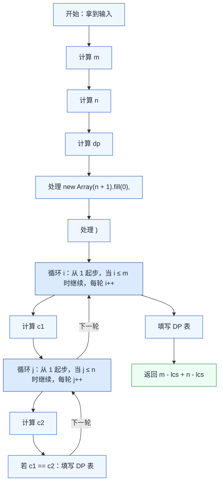

## TypeScript 解题方案（2 个方案逐个讲）

> **运行与提交**：每个方案都是自包含文件（内嵌用例自测，输出 PASS），整块复制到 `.ts` 文件后 `node 文件名` 即可运行。提交 LeetCode 时，把 `demo` 内的算法函数与辅助类型/函数整体取出、置于文件顶层即可。涉及交互/特殊接口的题以题面给定签名为准。

### 方案 1：动态规划

**分析与思路**：核心做法是「动态规划」。代码里依次做这些事：DP 表逐项填充；双重循环遍历。

**运行方式**：`node 本文件`，内嵌用例全部通过会输出 PASS。


**方案专属流程图**（真实控制流）：

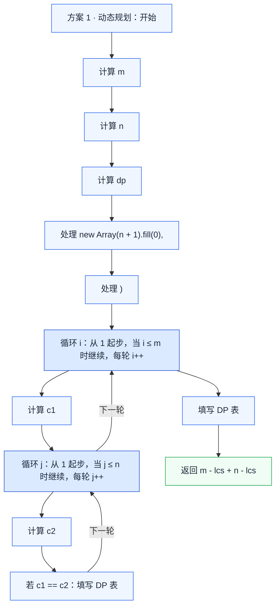

```typescript
/**
 ** LeetCode 583. 两个字符串的删除操作
 ** 方案：方案1（最长公共子序列 LCS -> m + n - 2*lcs）
 ** 来源：python 参考忠实移植
 */

function minDistance(word1: string, word2: string): number {
  // 定义函数/方法 minDistance
  const m = word1.length; // 把 word1.长度 存入 映射表
  const n = word2.length; // 把 word2.长度 存入 元素个数
  const dp: number[][] = Array.from({ length: m + 1 }, () =>
    new Array(n + 1).fill(0),
  );
  for (let i = 1; i <= m; i++) {
    // 让 下标 i 从 1 开始计数，下标 i 不超过 映射表 就继续
    const c1 = word1[i - 1]; // 把 word1[下标 i 减 1] 存入 c1
    for (let j = 1; j <= n; j++) {
      // 让 下标 j 从 1 开始计数，下标 j 不超过 元素个数 就继续
      const c2 = word2[j - 1]; // 把 word2[下标 j 减 1] 存入 c2
      if (c1 === c2) dp[i][j] = dp[i - 1][j - 1] + 1;
      else dp[i][j] = Math.max(dp[i - 1][j], dp[i][j - 1]); // 否则
    }
  }
  const lcs = dp[m][n]; // 把 DP 表[映射表][元素个数] 存入 lcs
  return m - lcs + n - lcs; // 返回 映射表 减 lcs 加 元素个数 减 lcs
}

export function demo(): void {
  // 程序入口：跑内嵌自测用例
  const cases: { in: [string, string]; want: number }[] = [
    { in: ['sea', 'eat'], want: 2 },
    { in: ['', 'abc'], want: 3 },
    { in: ['a', 'b'], want: 2 },
  ];
  let fail = false; // 把 false 存入 fail
  for (const c of cases) {
    // for (const 字符 of cases) {
    const got = minDistance(c.in[0], c.in[1]); // 把 minDistance(字符.in[0], 字符.in[1]) 存入 got
    if (got !== c.want) {
      // 若 got 不等于 字符.want
      fail = true; // 把 true 存入 fail
      console.log('FAIL', JSON.stringify(c.in), 'want', c.want, 'got', got); // 打印输出
    }
  }
  if (fail) throw new Error('FAILED'); // 若 fail) throw new Error(「FAILED」);
  console.log('PASS'); // 全部用例通过，输出 PASS
}
demo(); // demo();
```

### 方案 2：直接实现

**分析与思路**：核心做法是「直接实现」。

**运行方式**：`node 本文件`，内嵌用例全部通过会输出 PASS。

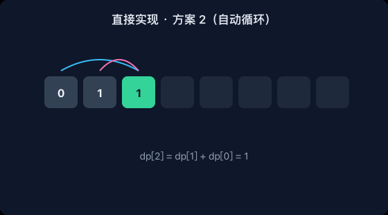

**方案专属流程图**（真实控制流）：

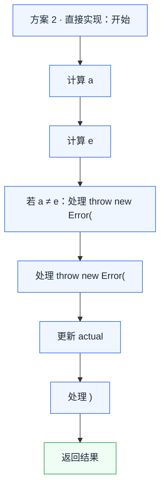

```typescript
function assertEq(actual: any, expected: any, msg: string = ''): void {
  // 定义函数/方法 assertEq
  const a = JSON.stringify(actual);
  const e = JSON.stringify(expected);
  if (a !== e)
    throw new Error(
      'ASSERT FAILED ' + msg + ' :: actual=' + a + ' expected=' + e,
    );
}

function minDistance(word1: string, word2: string): number {
  // 定义函数/方法 minDistance
  const m = word1.length,
    n = word2.length; // 把 word1.长度, 元素个数 赋值为 word2.长度 存入 映射表
  const dp: number[][] = Array.from({ length: m + 1 }, () =>
    new Array(n + 1).fill(0),
  );
  for (let i = 1; i <= m; i++) dp[i][0] = i; // 让 下标 i 从 1 开始计数，下标 i 不超过 映射表 就继续
  for (let j = 1; j <= n; j++) dp[0][j] = j; // 让 下标 j 从 1 开始计数，下标 j 不超过 元素个数 就继续
  for (let i = 1; i <= m; i++) {
    // 让 下标 i 从 1 开始计数，下标 i 不超过 映射表 就继续
    const c1 = word1[i - 1]; // 把 word1[下标 i 减 1] 存入 c1
    for (let j = 1; j <= n; j++) {
      // 让 下标 j 从 1 开始计数，下标 j 不超过 元素个数 就继续
      const c2 = word2[j - 1]; // 把 word2[下标 j 减 1] 存入 c2
      if (c1 === c2)
        dp[i][j] = dp[i - 1][j - 1]; // 若 c1 全等于 c2) DP 表[下标 i][下标 j] 赋值为 DP 表[下标 i 减 1][下标 j 减 1];
      else dp[i][j] = Math.min(dp[i - 1][j], dp[i][j - 1]) + 1; // 否则
    }
  }
  return dp[m][n]; // 返回 DP 表[映射表][元素个数]
}
export function demo(): void {
  // 程序入口：跑内嵌自测用例
  assertEq(minDistance('sea', 'eat'), 2, 'md1'); // 断言校验
  assertEq(minDistance('', 'abc'), 3, 'md2'); // 断言校验
  assertEq(minDistance('a', 'b'), 2, 'md3'); // 断言校验
  console.log('PASS'); // 全部用例通过，输出 PASS
}
demo(); // demo();
```

## 逐步拆解与面试追问

**复杂度**：时间 O(n) 到 O(m·n)（取决于状态维度），空间即 DP 表大小

**为什么是这个量级**：动态规划把指数级枚举压成表，每格只算一次，复杂度等于「状态数 × 转移代价」

**面试官可能会追问**：

- 状态定义为什么是它？
- 遍历顺序由什么决定？
- 能否滚动数组压空间？

## 关键 API 速查（TS 主解法实际用到，附官方链接）

| API | 作用 | 使用要点 | 官方文档 |
|---|---|---|---|
| `Array.from()` | 类数组/可迭代对象转数组 | Array.from(iterable, mapFn) 可同时映射；对 Set 去重、对字符串按码元拆分；稀疏位会被 undefined 填充 | [官方文档](https://developer.mozilla.org/zh-CN/docs/Web/JavaScript/Reference/Global_Objects/Array/from) |
| `JSON.stringify()` | 序列化为 JSON 字符串 | 常用于结构化比较（深度相等判定）；undefined/函数/循环引用会被丢弃或抛错 | [官方文档](https://developer.mozilla.org/zh-CN/docs/Web/JavaScript/Reference/Global_Objects/JSON/stringify) |
| `Math.max()` | 最大值 | 配展开 Math.max(...arr)；空参返回 -Infinity；超大数组注意展开参数上限 | [官方文档](https://developer.mozilla.org/zh-CN/docs/Web/JavaScript/Reference/Global_Objects/Math/max) |

### 各语言官方文档导航

- **TypeScript / JS**：[MDN 中文参考](https://developer.mozilla.org/zh-CN/)
- **Python**：[Python 官方文档](https://docs.python.org/zh-cn/3/)
- **Go**：[Go 标准库](https://pkg.go.dev/std)
- **Java**：[JDK 17 API](https://docs.oracle.com/en/java/javase/17/docs/api/)
- **Rust**：[Rust 标准库](https://doc.rust-lang.org/std/)
- **Lua**：[Lua 5.4 手册](https://www.lua.org/manual/5.4/)
- **C**：[Cppreference C](https://zh.cppreference.com/w/c)
- **C++**：[Cppreference C++](https://zh.cppreference.com/w/cpp)
- **R**：[R 官方手册](https://stat.ethz.ch/R-manual/)
- **Zig**：[Zig 语言文档](https://ziglang.org/documentation/master/)
- **Dart**：[Dart API](https://api.dart.dev/)

## 附录：其他 10 种语言全部实现（每种语言列举其全部方案）

> TypeScript 的全部方案见「TypeScript 解题方案」一节；下面是其余 10 种语言的对应实现，每种语言的每个方案都带思路分析、代码走读与专属运行架构图。
> 每个方案都内嵌用例自测，可独立运行（老仓库 python/go 文件遵循「打印结果」约定）。
> 完整解法文件见 `dsa/<语言>/dp/lc_583_两个字符串的删除操作/`。

### Python 实现（2 种方案）

Python 的全部方案如下，每个方案都内嵌用例自测，可独立运行（老仓库 python/go 文件遵循「打印结果」约定）：

#### 方案 1：动态规划

**思路与代码分析**：核心是「动态规划」。Python 版用切片与字典推导式简化操作，突出可读性。代码里依次做这些事：DP 表逐项填充。**走读**：方案 1 · 动态规划：开始 → 更新 m → 更新 n → 填写 DP 表 → 处理 [0] * (n + 1) for _ in range → 处理 ] → 循环 i：从 1 到 m + 1 前 → 更新 c1 → 循环 j：从 1 到 n + 1 前 → 更新 c2 → 若 c1 == c2：填写 DP 表 → 填写 DP 表 → 填写 DP 表 → 填写 DP 表 → 返回 m - lcs + n - lcs。

**运行架构**（真实控制流）：

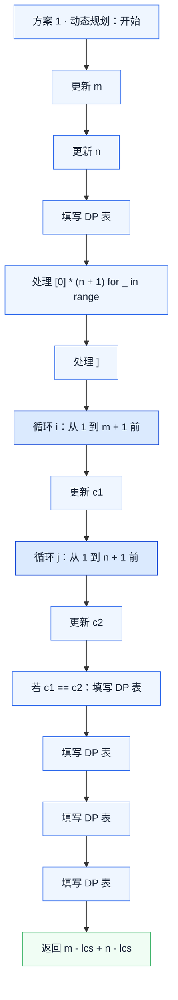

```python
import sys  # 提高递归深度上限（深输入防 RecursionError）

sys.setrecursionlimit(200000)  # 树/链表类题目节点数可达 1e4 量级

def minDistance(word1, word2):  # 定义函数 minDistance（参数：word1, word2）
    m = len(word1)  # 把 长度(word1) 存入 映射表
    n = len(word2)  # 把 长度(word2) 存入 元素个数
    dp = [
        [0] * (n + 1) for _ in range(m + 1)
    ]  # 把 [[0] 乘 (元素个数 加 1) for _ in range(映射表 加 1)] 存入 DP 表
    for i in range(1, m + 1):  # 让 下标 i 从 1 到 映射表 加 1 遍历
        c1 = word1[i - 1]  # 把 word1[下标 i 减 1] 存入 c1
        for j in range(1, n + 1):  # 让 下标 j 从 1 到 元素个数 加 1 遍历
            c2 = word2[j - 1]  # 把 word2[下标 j 减 1] 存入 c2
            if c1 == c2:  # 若 c1 等于 c2
                dp[i][j] = dp[i - 1][j - 1] + 1  # 把 DP 表[下标 i 减 1][下标 j 减 1] 加 1 写入 dp[i][j]
            else:  # 否则
                dp[i][j] = max(dp[i - 1][j], dp[i][j - 1])
    lcs = dp[m][n]  # 把 DP 表[映射表][元素个数] 存入 lcs
    return m - lcs + n - lcs  # 返回 映射表 减 lcs 加 元素个数 减 lcs

if __name__ == "__main__":  # 若 __name__ 等于 '__main__'
    print(minDistance("sea", "eat"))  # 打印输出
```

#### 方案 2：直接实现

**思路与代码分析**：核心是「直接实现」。Python 版用切片与字典推导式简化操作，突出可读性。代码里依次做这些事：DP 表逐项填充。**走读**：方案 2 · 直接实现：开始 → 更新 m → 循环 i：从 1 到 m + 1 前 → 循环 j：从 1 到 n + 1 前 → 循环 i：从 1 到 m + 1 前 → 循环 j：从 1 到 n + 1 前 → 返回 dp[m][n]。

**运行架构**（真实控制流）：

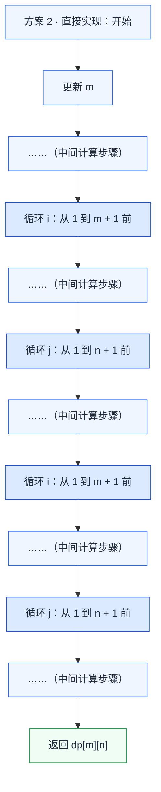

```python
import sys  # 提高递归深度上限（深输入防 RecursionError）

sys.setrecursionlimit(200000)  # 树/链表类题目节点数可达 1e4 量级

def minDistance(word1, word2):  # 定义函数 minDistance（参数：word1, word2）
    m = len(word1)  # 把 长度(word1) 存入 映射表
    n = len(word2)  # 把 长度(word2) 存入 元素个数
    dp = [
        [0] * (n + 1) for _ in range(m + 1)
    ]  # 把 [[0] 乘 (元素个数 加 1) for _ in range(映射表 加 1)] 存入 DP 表
    for i in range(1, m + 1):  # 让 下标 i 从 1 到 映射表 加 1 遍历
        dp[i][0] = i  # 把 下标 i 写入 dp[i][0]
    for j in range(1, n + 1):  # 让 下标 j 从 1 到 元素个数 加 1 遍历
        dp[0][j] = j  # 把 下标 j 写入 dp[0][j]
    for i in range(1, m + 1):  # 让 下标 i 从 1 到 映射表 加 1 遍历
        c1 = word1[i - 1]  # 把 word1[下标 i 减 1] 存入 c1
        for j in range(1, n + 1):  # 让 下标 j 从 1 到 元素个数 加 1 遍历
            c2 = word2[j - 1]  # 把 word2[下标 j 减 1] 存入 c2
            if c1 == c2:  # 若 c1 等于 c2
                dp[i][j] = dp[i - 1][j - 1]  # 把 DP 表[下标 i 减 1][下标 j 减 1] 写入 dp[i][j]
            else:  # 否则
                dp[i][j] = min(dp[i - 1][j], dp[i][j - 1]) + 1
    return dp[m][n]  # 返回 DP 表[映射表][元素个数]

if __name__ == "__main__":  # 若 __name__ 等于 '__main__'
    print(minDistance("sea", "eat"))  # 打印输出
```

### Go 实现（2 种方案）

Go 的全部方案如下，每个方案都内嵌用例自测，可独立运行（老仓库 python/go 文件遵循「打印结果」约定）：

#### 方案 1：动态规划

**思路与代码分析**：核心是「动态规划」。Go 版用切片与多返回值惯用法，显式处理索引边界。代码里依次做这些事：DP 表逐项填充。**走读**：方案 1 · 动态规划：开始 → 更新 : → 遍历 dp 的下标与元素 i → 遍历循环 → 遍历循环 → 返回 m - lcs + n - lcs。

**运行架构**（真实控制流）：

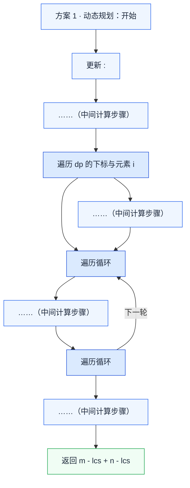

```go
package main // 引入依赖

import (
	"fmt"
	"os"
) // 引入依赖

func minDistance(word1, word2 string) int { // 定义函数/方法 minDistance
	m, n := len(word1), len(word2) // 把 长度(word1), 长度(word2) 写入 m, n :
	dp := make([][]int, m+1)       // 把 make([][]int, 映射表 加 1) 写入 dp :
	for i := range dp {            // 把 range DP 表 { 写入 for i :
		dp[i] = make([]int, n+1) // 把 make([]int, 元素个数 加 1) 写入 dp[i]
	}
	for i := 1; i <= m; i++ { // 让 下标 i 从 1 开始计数
		c1 := word1[i-1]          // 把 word1[下标 i 减 1] 写入 c1 :
		for j := 1; j <= n; j++ { // 让 下标 j 从 1 开始计数
			c2 := word2[j-1] // 把 word2[下标 j 减 1] 写入 c2 :
			if c1 == c2 {    // 若 c1 等于 c2
				dp[i][j] = dp[i-1][j-1] + 1 // 把 DP 表[下标 i 减 1][下标 j 减 1] 加 1 写入 dp[i][j]
			} else { // 否则
				v := dp[i-1][j]     // 把 DP 表[下标 i 减 1][下标 j] 写入 v :
				if dp[i][j-1] > v { // 若 DP 表[下标 i][下标 j 减 1] 超过 值
					v = dp[i][j-1] // 把 DP 表[下标 i][下标 j 减 1] 写入 值
				}
				dp[i][j] = v // 把 值 写入 dp[i][j]
			}
		}
	}
	lcs := dp[m][n]          // 把 DP 表[映射表][元素个数] 写入 lcs :
	return m - lcs + n - lcs // 返回 映射表 减 lcs 加 元素个数 减 lcs
}

func main() { // 程序入口：跑内嵌自测用例
	type tc struct { // 定义类型
		a, b string // 数组, b string
		want int    // want int
	}
	cases := []tc{ // 把 []tc{ 写入 cases :
		{"sea", "eat", 2},
		{"", "", 0},
	}
	ok := true                // 把 true 写入 ok :
	for _, c := range cases { // 同时取 _ 与 字符 遍历
		if got := minDistance(c.a, c.b); got != c.want { // 若 got : 赋值为 minDistance(字符.数组, 字符.b); got 不等于 字符.want
			ok = false                                                                // 把 false 写入 ok
			fmt.Printf("FAIL minDistance(%q,%q)=%v want %v\n", c.a, c.b, got, c.want) // 打印输出
		}
	}
	if !ok { // 若 取反 ok
		os.Exit(1) // os.Exit(1)
	}
	fmt.Println("PASS") // 全部用例通过，输出 PASS
}
```

#### 方案 2：直接实现

**思路与代码分析**：核心是「直接实现」。Go 版用切片与多返回值惯用法，显式处理索引边界。代码里依次做这些事：DP 表逐项填充。**走读**：方案 2 · 直接实现：开始 → 更新 : → 遍历 dp 的下标与元素 i → 遍历循环 → 遍历循环 → 遍历循环 → 遍历循环 → 返回 dp[m][n]。

**运行架构**（真实控制流）：

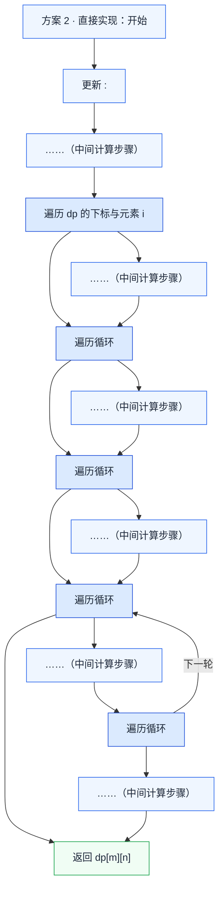

```go
package main // 引入依赖

import (
	"fmt"
	"os"
) // 引入依赖

func minDistance(word1, word2 string) int { // 定义函数/方法 minDistance
	m, n := len(word1), len(word2) // 把 长度(word1), 长度(word2) 写入 m, n :
	dp := make([][]int, m+1)       // 把 make([][]int, 映射表 加 1) 写入 dp :
	for i := range dp {            // 把 range DP 表 { 写入 for i :
		dp[i] = make([]int, n+1) // 把 make([]int, 元素个数 加 1) 写入 dp[i]
	}
	for i := 1; i <= m; i++ { // 让 下标 i 从 1 开始计数
		dp[i][0] = i // 把 下标 i 写入 dp[i][0]
	}
	for j := 1; j <= n; j++ { // 让 下标 j 从 1 开始计数
		dp[0][j] = j // 把 下标 j 写入 dp[0][j]
	}
	for i := 1; i <= m; i++ { // 让 下标 i 从 1 开始计数
		c1 := word1[i-1]          // 把 word1[下标 i 减 1] 写入 c1 :
		for j := 1; j <= n; j++ { // 让 下标 j 从 1 开始计数
			c2 := word2[j-1] // 把 word2[下标 j 减 1] 写入 c2 :
			if c1 == c2 {    // 若 c1 等于 c2
				dp[i][j] = dp[i-1][j-1] // 把 DP 表[下标 i 减 1][下标 j 减 1] 写入 dp[i][j]
			} else { // 否则
				v := dp[i-1][j]     // 把 DP 表[下标 i 减 1][下标 j] 写入 v :
				if dp[i][j-1] < v { // 若 DP 表[下标 i][下标 j 减 1] 小于 值
					v = dp[i][j-1] // 把 DP 表[下标 i][下标 j 减 1] 写入 值
				}
				dp[i][j] = v + 1 // 把 值 加 1 写入 dp[i][j]
			}
		}
	}
	return dp[m][n] // 返回 DP 表[映射表][元素个数]
}

func main() { // 程序入口：跑内嵌自测用例
	type tc struct { // 定义类型
		a, b string // 数组, b string
		want int    // want int
	}
	cases := []tc{ // 把 []tc{ 写入 cases :
		{"sea", "eat", 2},
		{"", "", 0},
	}
	ok := true                // 把 true 写入 ok :
	for _, c := range cases { // 同时取 _ 与 字符 遍历
		if got := minDistance(c.a, c.b); got != c.want { // 若 got : 赋值为 minDistance(字符.数组, 字符.b); got 不等于 字符.want
			ok = false                                                                // 把 false 写入 ok
			fmt.Printf("FAIL minDistance(%q,%q)=%v want %v\n", c.a, c.b, got, c.want) // 打印输出
		}
	}
	if !ok { // 若 取反 ok
		os.Exit(1) // os.Exit(1)
	}
	fmt.Println("PASS") // 全部用例通过，输出 PASS
}
```

### Java 实现（2 种方案）

Java 的全部方案如下，每个方案都内嵌用例自测，可独立运行（老仓库 python/go 文件遵循「打印结果」约定）：

#### 方案 1：动态规划

**思路与代码分析**：核心是「动态规划」。Java 版用类与静态方法组织，集合操作显式明了。代码里依次做这些事：DP 表逐项填充；双重循环遍历。**走读**：方案 1 · 动态规划：开始 → 更新 m → 填写 DP 表 → 遍历循环 → 更新 c1 → 遍历循环 → 更新 c2 → 若 c1 == c2：填写 DP 表 → 填写 DP 表 → 返回 m - lcs + n - lcs。

**运行架构**（真实控制流）：

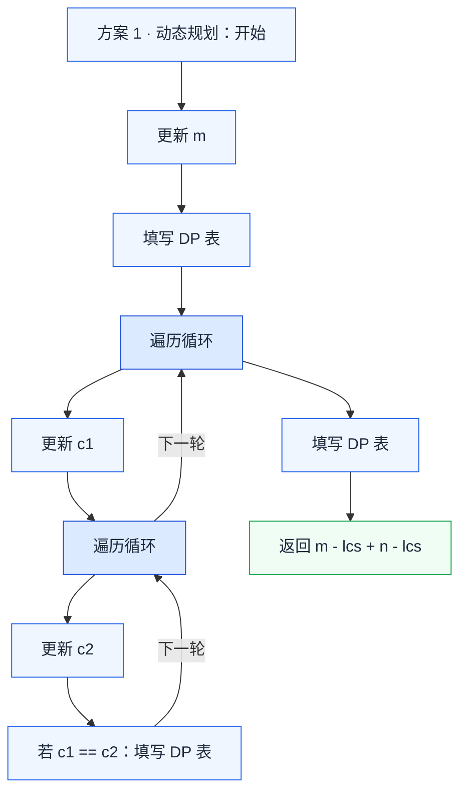

```java
package com.webfault.dsa; // 引入依赖

class Lc583 { // 定义类型
  int minDistance(String word1, String word2) { // 定义函数/方法 minDistance
    int m = word1.length(), n = word2.length(); // 把 word1.长度(), 元素个数 赋值为 word2.长度() 存入 映射表
    int[][] dp = new int[m + 1][n + 1]; // 把 new int[映射表 加 1][元素个数 加 1]; 写入 int[][] dp
    for (int i = 1; i <= m; i++) { // 让 下标 i 从 1 开始计数，下标 i 不超过 映射表 就继续
      char c1 = word1.charAt(i - 1); // 逐字符处理
      for (int j = 1; j <= n; j++) { // 让 下标 j 从 1 开始计数，下标 j 不超过 元素个数 就继续
        char c2 = word2.charAt(j - 1); // 逐字符处理
        if (c1 == c2) dp[i][j] = dp[i - 1][j - 1] + 1;
        else dp[i][j] = Math.max(dp[i - 1][j], dp[i][j - 1]); // 否则
      }
    }
    int lcs = dp[m][n]; // 把 DP 表[映射表][元素个数] 存入 lcs
    return m - lcs + n - lcs; // 返回 映射表 减 lcs 加 元素个数 减 lcs
  }

  public static void main(String[] args) { // public static void main(String[] args){
    Lc583 s = new Lc583(); // 把 new Lc583(); 写入 Lc583 s
    boolean ok = true; // 把 true; 写入 boolean ok
    if (s.minDistance("sea", "eat") != 2) {
      ok = false;
      System.out.println("FAIL1");
    }
    if (s.minDistance("", "") != 0) {
      ok = false;
      System.out.println("FAIL2");
    }
    if (!ok) throw new RuntimeException("FAILED"); // 若 取反 ok) throw new RuntimeException(「FAILED」);
    System.out.println("PASS"); // 全部用例通过，输出 PASS
  }
}
```

#### 方案 2：直接实现

**思路与代码分析**：核心是「直接实现」。Java 版用类与静态方法组织，集合操作显式明了。代码里依次做这些事：DP 表逐项填充；双重循环遍历。**走读**：方案 2 · 直接实现：开始 → 更新 m → 填写 DP 表 → 遍历循环 → 更新 c1 → 遍历循环 → 更新 c2 → 若 c1 == c2：填写 DP 表 → 填写 DP 表 → 返回 m - lcs + n - lcs。

**运行架构**（真实控制流）：


```java
package com.webfault.dsa; // 引入依赖

class Lc583 { // 定义类型
  int minDistance(String word1, String word2) { // 定义函数/方法 minDistance
    int m = word1.length(), n = word2.length(); // 把 word1.长度(), 元素个数 赋值为 word2.长度() 存入 映射表
    int[][] dp = new int[m + 1][n + 1]; // 把 new int[映射表 加 1][元素个数 加 1]; 写入 int[][] dp
    for (int i = 1; i <= m; i++) { // 让 下标 i 从 1 开始计数，下标 i 不超过 映射表 就继续
      char c1 = word1.charAt(i - 1); // 逐字符处理
      for (int j = 1; j <= n; j++) { // 让 下标 j 从 1 开始计数，下标 j 不超过 元素个数 就继续
        char c2 = word2.charAt(j - 1); // 逐字符处理
        if (c1 == c2) dp[i][j] = dp[i - 1][j - 1] + 1;
        else dp[i][j] = Math.max(dp[i - 1][j], dp[i][j - 1]); // 否则
      }
    }
    int lcs = dp[m][n]; // 把 DP 表[映射表][元素个数] 存入 lcs
    return m - lcs + n - lcs; // 返回 映射表 减 lcs 加 元素个数 减 lcs
  }

  public static void main(String[] args) { // public static void main(String[] args){
    Lc583 s = new Lc583(); // 把 new Lc583(); 写入 Lc583 s
    boolean ok = true; // 把 true; 写入 boolean ok
    if (s.minDistance("sea", "eat") != 2) {
      ok = false;
      System.out.println("FAIL1");
    }
    if (s.minDistance("", "") != 0) {
      ok = false;
      System.out.println("FAIL2");
    }
    if (!ok) throw new RuntimeException("FAILED"); // 若 取反 ok) throw new RuntimeException(「FAILED」);
    System.out.println("PASS"); // 全部用例通过，输出 PASS
  }
}
```

### Rust 实现（2 种方案）

Rust 的全部方案如下，每个方案都内嵌用例自测，可独立运行（老仓库 python/go 文件遵循「打印结果」约定）：

#### 方案 1：动态规划

**思路与代码分析**：核心是「动态规划」。Rust 版用所有权移动与切片借用改写同一逻辑，注意 Option 与引用边界。代码里依次做这些事：DP 表逐项填充。**走读**：方案 1 · 动态规划：开始 → 计算 a → 计算 b → 计算 let (m, n) = (a.len(), b → 填写 DP 表 → 遍历 1..=m 中的每个元素 i → 计算 prev_diag → 遍历 1..=n 中的每个元素 j → 填写 DP 表 → 填写 DP 表 → 处理 prev_diag + 1 → 填写 DP 表 → 更新 prev_diag → 填写 DP 表 → 返回结果。

**运行架构**（真实控制流）：

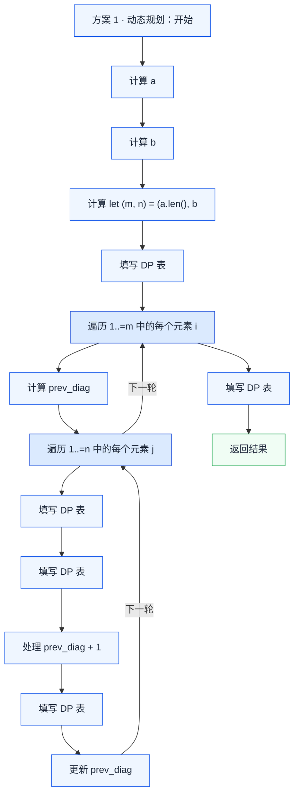

```rust
// LeetCode 583. 两个字符串的删除操作 — Rust 版（方案1）
fn min_distance(w1: String, w2: String) -> i32 {
    // 定义函数/方法 min_distance
    // 删除操作 = m + n - 2 * LCS
    let a: Vec<char> = w1.chars().collect(); // 把 w1.chars().collect(); 写入 let a: Vec<char>
    let b: Vec<char> = w2.chars().collect(); // 把 w2.chars().collect(); 写入 let b: Vec<char>
    let (m, n) = (a.len(), b.len()); // 把 (数组.长度(), b.长度()); 写入 let (m, n)
    let mut dp = vec![0i32; n + 1]; // 把 vec取反 [0i32; 元素个数 加 1]; 写入 let mut dp
    for i in 1..=m {
        // 逐个取出 1 的元素（下标 i）
        let mut prev_diag = 0; // 把 0; 写入 let mut prev_diag
        for j in 1..=n {
            // 逐个取出 1 的元素（下标 j）
            let tmp = dp[j]; // 把 DP 表[下标 j] 存入 临时变量
            dp[j] = if a[i - 1] == b[j - 1] {
                prev_diag + 1
            } else {
                dp[j].max(dp[j - 1])
            };
            prev_diag = tmp; // 把 临时变量; 写入 prev_diag
        }
    }
    (m + n - 2 * dp[n] as usize) as i32 // (映射表 加 元素个数 减 2 乘 DP 表[元素个数] as usize) as i32
}
fn main() {
    assert_eq!(min_distance("sea".into(), "eat".into()), 2);
    assert_eq!(min_distance("leetcode".into(), "etco".into()), 4);
    println!("PASS");
} // 程序入口：跑内嵌自测用例
```

#### 方案 2：直接实现

**思路与代码分析**：核心是「直接实现」。Rust 版用所有权移动与切片借用改写同一逻辑，注意 Option 与引用边界。代码里依次做这些事：DP 表逐项填充。**走读**：方案 2 · 直接实现：开始 → 计算 a → 计算 b → 计算 let (m, n) = (a.len(), b → 填写 DP 表 → 遍历 1..=m 中的每个元素 i → 计算 prev_diag → 遍历 1..=n 中的每个元素 j → 填写 DP 表 → 填写 DP 表 → 处理 prev_diag + 1 → 填写 DP 表 → 更新 prev_diag → 填写 DP 表 → 返回结果。

**运行架构**（真实控制流）：


```rust
// LeetCode 583. 两个字符串的删除操作 — Rust 版（方案2）
fn min_distance(w1: String, w2: String) -> i32 {
    // 定义函数/方法 min_distance
    // 删除操作 = m + n - 2 * LCS
    let a: Vec<char> = w1.chars().collect(); // 把 w1.chars().collect(); 写入 let a: Vec<char>
    let b: Vec<char> = w2.chars().collect(); // 把 w2.chars().collect(); 写入 let b: Vec<char>
    let (m, n) = (a.len(), b.len()); // 把 (数组.长度(), b.长度()); 写入 let (m, n)
    let mut dp = vec![0i32; n + 1]; // 把 vec取反 [0i32; 元素个数 加 1]; 写入 let mut dp
    for i in 1..=m {
        // 逐个取出 1 的元素（下标 i）
        let mut prev_diag = 0; // 把 0; 写入 let mut prev_diag
        for j in 1..=n {
            // 逐个取出 1 的元素（下标 j）
            let tmp = dp[j]; // 把 DP 表[下标 j] 存入 临时变量
            dp[j] = if a[i - 1] == b[j - 1] {
                prev_diag + 1
            } else {
                dp[j].max(dp[j - 1])
            };
            prev_diag = tmp; // 把 临时变量; 写入 prev_diag
        }
    }
    (m + n - 2 * dp[n] as usize) as i32 // (映射表 加 元素个数 减 2 乘 DP 表[元素个数] as usize) as i32
}
fn main() {
    assert_eq!(min_distance("sea".into(), "eat".into()), 2);
    assert_eq!(min_distance("leetcode".into(), "etco".into()), 4);
    println!("PASS");
} // 程序入口：跑内嵌自测用例
```

### Lua 实现（2 种方案）

Lua 的全部方案如下，每个方案都内嵌用例自测，可独立运行（老仓库 python/go 文件遵循「打印结果」约定）：

#### 方案 1：动态规划

**思路与代码分析**：核心是「动态规划」。Lua 版用表与 ipairs 遍历，注意 ipairs 遇 nil 即停的语义。代码里依次做这些事：DP 表逐项填充。**走读**：方案 1 · 动态规划：开始 → 更新 n → 填写 DP 表 → 循环 j：从 0 到 n do → 填写 DP 表 → 循环 i：从 1 到 m do → 填写 DP 表 → 填写 DP 表 → 循环 j：从 1 到 n do → 填写 DP 表 → 处理 if w1:sub(i, i) == w2:sub(j, → 填写 DP 表 → 填写 DP 表 → 更新 prev_diag → 返回 dp[n]。

**运行架构**（真实控制流）：

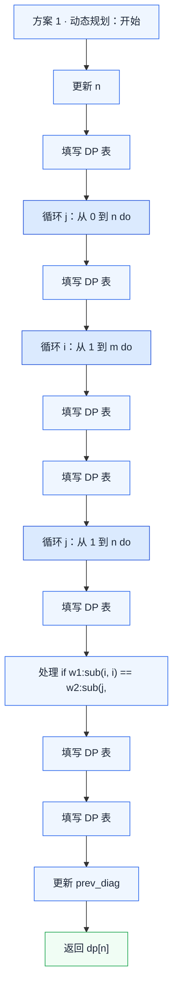

```lua
-- LeetCode 583. 两个字符串的删除操作 — Lua 版（方案1）
local function min_distance(w1, w2) -- local function min_distance(w1, w2)
	local m, n = #w1, #w2 -- 把 #w1, #w2 写入 local m, n
	local dp = {} -- 把 {} 写入 local dp
	for j = 0, n do
		dp[j] = j
	end -- 让 下标 j 从 0 走到 元素个数（Lua 1 基）
	for i = 1, m do -- 让 下标 i 从 1 走到 映射表（Lua 1 基）
		local prev_diag = dp[0] -- 把 DP 表[0] 写入 local prev_diag
		dp[0] = i -- 把 下标 i 写入 dp[0]
		for j = 1, n do -- 让 下标 j 从 1 走到 元素个数（Lua 1 基）
			local tmp = dp[j] -- 把 DP 表[下标 j] 写入 local tmp
			if w1:sub(i, i) == w2:sub(j, j) then
				dp[j] = prev_diag
			else
				dp[j] = 1 + math.min(prev_diag, dp[j], dp[j - 1]) - 1 + 1
			end -- 否则
			-- 583: 删除 = 编辑距离-替换（每次只删一端），等价于 1+min(prev_diag, dp[j], dp[j-1]) 但不含替换
			prev_diag = tmp -- 把 临时变量 存入 prev_diag
		end -- 终点
	end -- 终点
	return dp[n] -- 返回 DP 表[元素个数]
end -- 终点
assert(min_distance("sea", "eat") == 2) -- 断言校验
print("PASS") -- 全部用例通过，输出 PASS
```

#### 方案 2：直接实现

**思路与代码分析**：核心是「直接实现」。Lua 版用表与 ipairs 遍历，注意 ipairs 遇 nil 即停的语义。代码里依次做这些事：DP 表逐项填充。**走读**：方案 2 · 直接实现：开始 → 更新 n → 填写 DP 表 → 循环 j：从 0 到 n do → 填写 DP 表 → 循环 i：从 1 到 m do → 填写 DP 表 → 填写 DP 表 → 循环 j：从 1 到 n do → 填写 DP 表 → 处理 if w1:sub(i, i) == w2:sub(j, → 填写 DP 表 → 填写 DP 表 → 更新 prev_diag → 返回 dp[n]。

**运行架构**（真实控制流）：

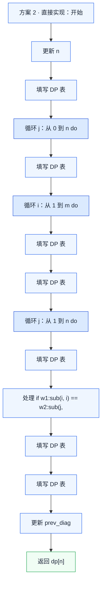

```lua
-- LeetCode 583. 两个字符串的删除操作 — Lua 版（方案2）
local function min_distance(w1, w2) -- local function min_distance(w1, w2)
	local m, n = #w1, #w2 -- 把 #w1, #w2 写入 local m, n
	local dp = {} -- 把 {} 写入 local dp
	for j = 0, n do
		dp[j] = j
	end -- 让 下标 j 从 0 走到 元素个数（Lua 1 基）
	for i = 1, m do -- 让 下标 i 从 1 走到 映射表（Lua 1 基）
		local prev_diag = dp[0] -- 把 DP 表[0] 写入 local prev_diag
		dp[0] = i -- 把 下标 i 写入 dp[0]
		for j = 1, n do -- 让 下标 j 从 1 走到 元素个数（Lua 1 基）
			local tmp = dp[j] -- 把 DP 表[下标 j] 写入 local tmp
			if w1:sub(i, i) == w2:sub(j, j) then
				dp[j] = prev_diag
			else
				dp[j] = 1 + math.min(prev_diag, dp[j], dp[j - 1]) - 1 + 1
			end -- 否则
			-- 583: 删除 = 编辑距离-替换（每次只删一端），等价于 1+min(prev_diag, dp[j], dp[j-1]) 但不含替换
			prev_diag = tmp -- 把 临时变量 存入 prev_diag
		end -- 终点
	end -- 终点
	return dp[n] -- 返回 DP 表[元素个数]
end -- 终点
assert(min_distance("sea", "eat") == 2) -- 断言校验
print("PASS") -- 全部用例通过，输出 PASS
```

### C 实现（2 种方案）

C 的全部方案如下，每个方案都内嵌用例自测，可独立运行（老仓库 python/go 文件遵循「打印结果」约定）：

#### 方案 1：动态规划

**思路与代码分析**：核心是「动态规划」。C 版手动管理下标与内存，循环边界全部显式写出。代码里依次做这些事：DP 表逐项填充；双重循环遍历。**走读**：方案 1 · 动态规划：开始 → 更新 m → 更新 n → 填写 DP 表 → 遍历循环 → 填写 DP 表 → 遍历循环 → 填写 DP 表 → 填写 DP 表 → 遍历循环 → 填写 DP 表 → 若 w1[i - 1] == w2[j - 1]：填写 DP 表 → 填写 DP 表 → 填写 DP 表 → 更新 prev_diag → 返回 dp[n]。

**运行架构**（真实控制流）：

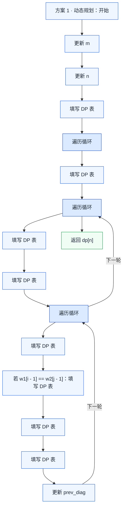

```c
/* LeetCode 583. 两个字符串的删除操作 — C 版（方案1） */
#include <stdio.h>  // 引入头文件
#include <string.h> // 引入头文件
static int min2(int a, int b) {
    return a < b ? a : b;
} // static int min2(int 数组, int b) { return 数组 小于 b ? 数组 : b; }
static int min_distance_del(const char *w1, const char *w2) { // 定义函数/方法 min_distance_del
    int m = (int)strlen(w1),
        n = (int)strlen(w2); // 把 (int)strlen(w1), 元素个数 赋值为 (int)strlen(w2) 存入 映射表
    int dp[1001];            // int DP 表[1001];
    for (int j = 0; j <= n; j++)
        dp[j] = j; // 让 下标 j 从 0 开始计数，下标 j 不超过 元素个数 就继续
    for (int i = 1; i <= m; i++) { // 让 下标 i 从 1 开始计数，下标 i 不超过 映射表 就继续
        int prev_diag = dp[0];     // 把 DP 表[0] 存入 prev_diag
        dp[0] = i;                 // 把 下标 i; 写入 dp[0]
        for (int j = 1; j <= n; j++) { // 让 下标 j 从 1 开始计数，下标 j 不超过 元素个数 就继续
            int tmp = dp[j];           // 把 DP 表[下标 j] 存入 临时变量
            if (w1[i - 1] == w2[j - 1])
                dp[j] = prev_diag; // 若 w1[下标 i 减 1] 等于 w2[下标 j 减 1]) DP 表[下标 j] 赋值为 prev_diag;
            else
                dp[j] = 1 + min2(prev_diag, min2(dp[j], dp[j - 1])); // 否则
            prev_diag = tmp;                                         // 把 临时变量; 写入 prev_diag
        }
    }
    return dp[n]; // 返回 DP 表[元素个数]
}
int main(void) { // 程序入口：跑内嵌自测用例
    if (min_distance_del("sea", "eat") != 2) {
        printf("FAIL 1\n");
        return 1;
    }
    if (min_distance_del("leetcode", "etco") != 4) {
        printf("FAIL 2\n");
        return 1;
    }
    printf("PASS\n");
    return 0;
} // 全部用例通过，输出 PASS
```

#### 方案 2：直接实现

**思路与代码分析**：核心是「直接实现」。C 版手动管理下标与内存，循环边界全部显式写出。代码里依次做这些事：DP 表逐项填充；双重循环遍历。**走读**：方案 2 · 直接实现：开始 → 更新 m → 更新 n → 填写 DP 表 → 遍历循环 → 填写 DP 表 → 遍历循环 → 填写 DP 表 → 填写 DP 表 → 遍历循环 → 填写 DP 表 → 若 w1[i - 1] == w2[j - 1]：填写 DP 表 → 填写 DP 表 → 填写 DP 表 → 更新 prev_diag → 返回 dp[n]。

**运行架构**（真实控制流）：

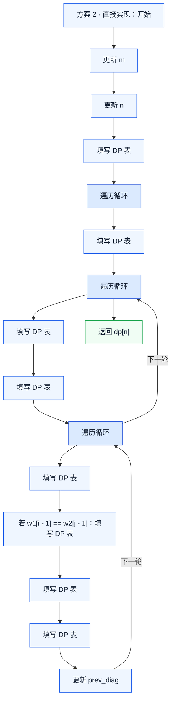

```c
/* LeetCode 583. 两个字符串的删除操作 — C 版（方案2） */
#include <stdio.h>  // 引入头文件
#include <string.h> // 引入头文件
static int min2(int a, int b) {
    return a < b ? a : b;
} // static int min2(int 数组, int b) { return 数组 小于 b ? 数组 : b; }
static int min_distance_del(const char *w1, const char *w2) { // 定义函数/方法 min_distance_del
    int m = (int)strlen(w1),
        n = (int)strlen(w2); // 把 (int)strlen(w1), 元素个数 赋值为 (int)strlen(w2) 存入 映射表
    int dp[1001];            // int DP 表[1001];
    for (int j = 0; j <= n; j++)
        dp[j] = j; // 让 下标 j 从 0 开始计数，下标 j 不超过 元素个数 就继续
    for (int i = 1; i <= m; i++) { // 让 下标 i 从 1 开始计数，下标 i 不超过 映射表 就继续
        int prev_diag = dp[0];     // 把 DP 表[0] 存入 prev_diag
        dp[0] = i;                 // 把 下标 i; 写入 dp[0]
        for (int j = 1; j <= n; j++) { // 让 下标 j 从 1 开始计数，下标 j 不超过 元素个数 就继续
            int tmp = dp[j];           // 把 DP 表[下标 j] 存入 临时变量
            if (w1[i - 1] == w2[j - 1])
                dp[j] = prev_diag; // 若 w1[下标 i 减 1] 等于 w2[下标 j 减 1]) DP 表[下标 j] 赋值为 prev_diag;
            else
                dp[j] = 1 + min2(prev_diag, min2(dp[j], dp[j - 1])); // 否则
            prev_diag = tmp;                                         // 把 临时变量; 写入 prev_diag
        }
    }
    return dp[n]; // 返回 DP 表[元素个数]
}
int main(void) { // 程序入口：跑内嵌自测用例
    if (min_distance_del("sea", "eat") != 2) {
        printf("FAIL 1\n");
        return 1;
    }
    if (min_distance_del("leetcode", "etco") != 4) {
        printf("FAIL 2\n");
        return 1;
    }
    printf("PASS\n");
    return 0;
} // 全部用例通过，输出 PASS
```

### C++ 实现（2 种方案）

C++ 的全部方案如下，每个方案都内嵌用例自测，可独立运行（老仓库 python/go 文件遵循「打印结果」约定）：

#### 方案 1：动态规划

**思路与代码分析**：核心是「动态规划」。C++ 版用 STL 容器与迭代器，减少手写下标错误。代码里依次做这些事：DP 表逐项填充；双重循环遍历。**走读**：方案 1 · 动态规划：开始 → 更新 m → 处理 std::vector＜int＞ dp(n + 1) → 遍历循环 → 填写 DP 表 → 遍历循环 → 填写 DP 表 → 填写 DP 表 → 遍历循环 → 填写 DP 表 → 填写 DP 表 → 更新 prevDiag → 返回 dp[n]。

**运行架构**（真实控制流）：

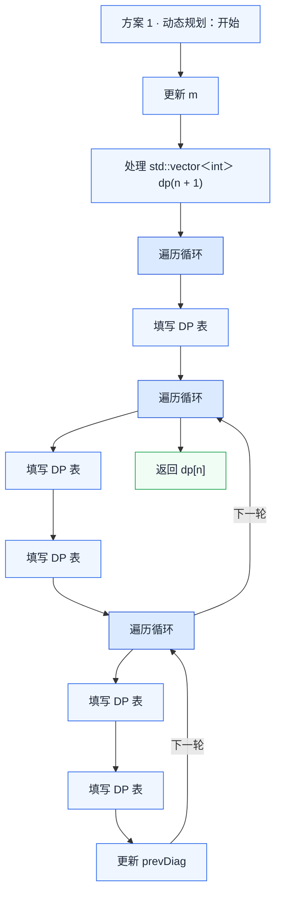

```cpp
// LeetCode 583. 两个字符串的删除操作 — C++ 版（方案1）
#include <algorithm> // 引入头文件
#include <cassert>   // 引入头文件
#include <iostream>  // 引入头文件
#include <string>    // 引入头文件
#include <vector>    // 引入头文件
static int minDeleteDistance(const std::string &w1,
                             const std::string &w2) { // 定义函数/方法 minDeleteDistance
    int m = static_cast<int>(w1.size()), n = static_cast<int>(w2.size());
    std::vector<int> dp(n + 1); // std::vector 小于 int 超过 DP 表(元素个数 加 1);
    for (int j = 0; j <= n; ++j)
        dp[j] = j; // 让 下标 j 从 0 开始计数，下标 j 不超过 元素个数 就继续
    for (int i = 1; i <= m; ++i) { // 让 下标 i 从 1 开始计数，下标 i 不超过 映射表 就继续
        int prevDiag = dp[0];      // 把 DP 表[0] 存入 prevDiag
        dp[0] = i;                 // 把 下标 i; 写入 dp[0]
        for (int j = 1; j <= n; ++j) { // 让 下标 j 从 1 开始计数，下标 j 不超过 元素个数 就继续
            int tmp = dp[j];           // 把 DP 表[下标 j] 存入 临时变量
            dp[j] = (w1[i - 1] == w2[j - 1]) ? prevDiag : 1 + std::min({prevDiag, dp[j], dp[j - 1]});
            prevDiag = tmp; // 把 临时变量; 写入 prevDiag
        }
    }
    return dp[n]; // 返回 DP 表[元素个数]
}
int main() {
    assert(minDeleteDistance("sea", "eat") == 2);
    assert(minDeleteDistance("leetcode", "etco") == 4);
    std::cout << "PASS" << std::endl;
} // 全部用例通过，输出 PASS
```

#### 方案 2：直接实现

**思路与代码分析**：核心是「直接实现」。C++ 版用 STL 容器与迭代器，减少手写下标错误。代码里依次做这些事：DP 表逐项填充；双重循环遍历。**走读**：方案 2 · 直接实现：开始 → 更新 m → 处理 std::vector＜int＞ dp(n + 1) → 遍历循环 → 填写 DP 表 → 遍历循环 → 填写 DP 表 → 填写 DP 表 → 遍历循环 → 填写 DP 表 → 填写 DP 表 → 更新 prevDiag → 返回 dp[n]。

**运行架构**（真实控制流）：


```cpp
// LeetCode 583. 两个字符串的删除操作 — C++ 版（方案2）
#include <algorithm> // 引入头文件
#include <cassert>   // 引入头文件
#include <iostream>  // 引入头文件
#include <string>    // 引入头文件
#include <vector>    // 引入头文件
static int minDeleteDistance(const std::string &w1,
                             const std::string &w2) { // 定义函数/方法 minDeleteDistance
    int m = static_cast<int>(w1.size()), n = static_cast<int>(w2.size());
    std::vector<int> dp(n + 1); // std::vector 小于 int 超过 DP 表(元素个数 加 1);
    for (int j = 0; j <= n; ++j)
        dp[j] = j; // 让 下标 j 从 0 开始计数，下标 j 不超过 元素个数 就继续
    for (int i = 1; i <= m; ++i) { // 让 下标 i 从 1 开始计数，下标 i 不超过 映射表 就继续
        int prevDiag = dp[0];      // 把 DP 表[0] 存入 prevDiag
        dp[0] = i;                 // 把 下标 i; 写入 dp[0]
        for (int j = 1; j <= n; ++j) { // 让 下标 j 从 1 开始计数，下标 j 不超过 元素个数 就继续
            int tmp = dp[j];           // 把 DP 表[下标 j] 存入 临时变量
            dp[j] = (w1[i - 1] == w2[j - 1]) ? prevDiag : 1 + std::min({prevDiag, dp[j], dp[j - 1]});
            prevDiag = tmp; // 把 临时变量; 写入 prevDiag
        }
    }
    return dp[n]; // 返回 DP 表[元素个数]
}
int main() {
    assert(minDeleteDistance("sea", "eat") == 2);
    assert(minDeleteDistance("leetcode", "etco") == 4);
    std::cout << "PASS" << std::endl;
} // 全部用例通过，输出 PASS
```

### R 实现（2 种方案）

R 的全部方案如下，每个方案都内嵌用例自测，可独立运行（老仓库 python/go 文件遵循「打印结果」约定）：

#### 方案 1：动态规划

**思路与代码分析**：核心是「动态规划」。R 版用向量化思维与 1 起始下标，注意 1:n 的降序陷阱。代码里依次做这些事：DP 表逐项填充；双重循环遍历。**走读**：方案 1 · 动态规划：开始 → 处理 chars1 ＜- strsplit(w1, )[[ → 处理 chars2 ＜- strsplit(w2, )[[ → 处理 m ＜- length(chars1) → 处理 n ＜- length(chars2) → 处理 dp ＜- 0:n → 循环 i：遍历 1:m → 填写 DP 表 → 填写 DP 表 → 循环 j：遍历 1:n → 填写 DP 表 → 填写 DP 表 → 填写 DP 表 → 处理 prev_diag ＜- tmp → 填写 DP 表 → 返回结果。

**运行架构**（真实控制流）：


```r
# — R 版（方案1） 定义函数 min_distance_del（参数：w1, w2）
min_distance_del <- function(w1, w2) {
    chars1 <- strsplit(w1, "")[[1]]  # 把 strsplit(w1, 「」)[[1]] 存入 chars1
    chars2 <- strsplit(w2, "")[[1]]  # 把 strsplit(w2, 「」)[[1]] 存入 chars2
    m <- length(chars1)
    n <- length(chars2)  # 把 长度(chars1); 元素个数 小于 减 长度(chars2) 存入 映射表
    dp <- 0:n  # 把 0:元素个数 存入 DP 表
    for (i in 1:m) {
        # for (下标 i in 1:映射表) {
        prev_diag <- dp[1]  # 把 DP 表[1] 存入 prev_diag
        dp[1] <- i  # 把 下标 i 存入 dp[1]
        for (j in 1:n) {
            # for (下标 j in 1:元素个数) {
            tmp <- dp[j + 1]  # 把 DP 表[下标 j 加 1] 存入 临时变量
            dp[j + 1] <- if (chars1[i] == chars2[j])
                prev_diag else 1 + min(prev_diag, dp[j + 1], dp[j])
            prev_diag <- tmp  # 把 临时变量 存入 prev_diag
        }
    }
    dp[n + 1]  # DP 表[元素个数 加 1]
}
stopifnot(min_distance_del("sea", "eat") == 2)  # 断言校验
stopifnot(min_distance_del("leetcode", "etco") == 4)  # 断言校验
cat("PASS\n")  # 全部用例通过，输出 PASS
```

#### 方案 2：直接实现

**思路与代码分析**：核心是「直接实现」。R 版用向量化思维与 1 起始下标，注意 1:n 的降序陷阱。代码里依次做这些事：DP 表逐项填充；双重循环遍历。**走读**：方案 2 · 直接实现：开始 → 处理 chars1 ＜- strsplit(w1, )[[ → 处理 chars2 ＜- strsplit(w2, )[[ → 处理 m ＜- length(chars1) → 处理 n ＜- length(chars2) → 处理 dp ＜- 0:n → 循环 i：遍历 1:m → 填写 DP 表 → 填写 DP 表 → 循环 j：遍历 1:n → 填写 DP 表 → 填写 DP 表 → 填写 DP 表 → 处理 prev_diag ＜- tmp → 填写 DP 表 → 返回结果。

**运行架构**（真实控制流）：

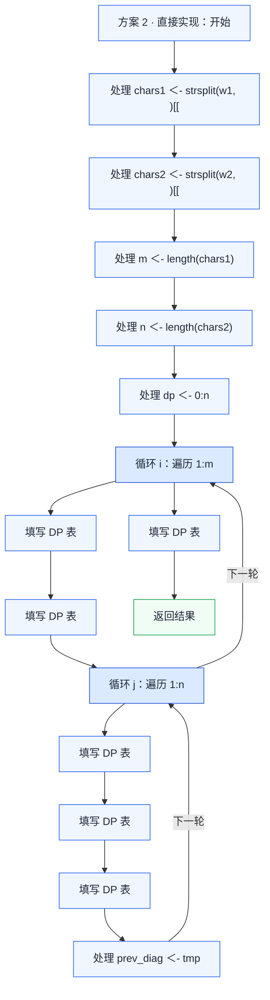

```r
# — R 版（方案2） 定义函数 min_distance_del（参数：w1, w2）
min_distance_del <- function(w1, w2) {
    chars1 <- strsplit(w1, "")[[1]]  # 把 strsplit(w1, 「」)[[1]] 存入 chars1
    chars2 <- strsplit(w2, "")[[1]]  # 把 strsplit(w2, 「」)[[1]] 存入 chars2
    m <- length(chars1)
    n <- length(chars2)  # 把 长度(chars1); 元素个数 小于 减 长度(chars2) 存入 映射表
    dp <- 0:n  # 把 0:元素个数 存入 DP 表
    for (i in 1:m) {
        # for (下标 i in 1:映射表) {
        prev_diag <- dp[1]  # 把 DP 表[1] 存入 prev_diag
        dp[1] <- i  # 把 下标 i 存入 dp[1]
        for (j in 1:n) {
            # for (下标 j in 1:元素个数) {
            tmp <- dp[j + 1]  # 把 DP 表[下标 j 加 1] 存入 临时变量
            dp[j + 1] <- if (chars1[i] == chars2[j])
                prev_diag else 1 + min(prev_diag, dp[j + 1], dp[j])
            prev_diag <- tmp  # 把 临时变量 存入 prev_diag
        }
    }
    dp[n + 1]  # DP 表[元素个数 加 1]
}
stopifnot(min_distance_del("sea", "eat") == 2)  # 断言校验
stopifnot(min_distance_del("leetcode", "etco") == 4)  # 断言校验
cat("PASS\n")  # 全部用例通过，输出 PASS
```

### Zig 实现（2 种方案）

Zig 的全部方案如下，每个方案都内嵌用例自测，可独立运行（老仓库 python/go 文件遵循「打印结果」约定）：

#### 方案 1：动态规划

**思路与代码分析**：核心是「动态规划」。Zig 版显式分配与清零，整型边界处理严格。代码里依次做这些事：DP 表逐项填充；双重循环遍历。**走读**：方案 1 · 动态规划：开始 → 计算 m → 计算 n → 计算 dp → 遍历集合元素 → 遍历集合元素 → 填写 DP 表 → 填写 DP 表 → 遍历集合元素 → 填写 DP 表 → 填写 DP 表 → 更新 prev_diag → 返回 dp[n]。

**运行架构**（真实控制流）：

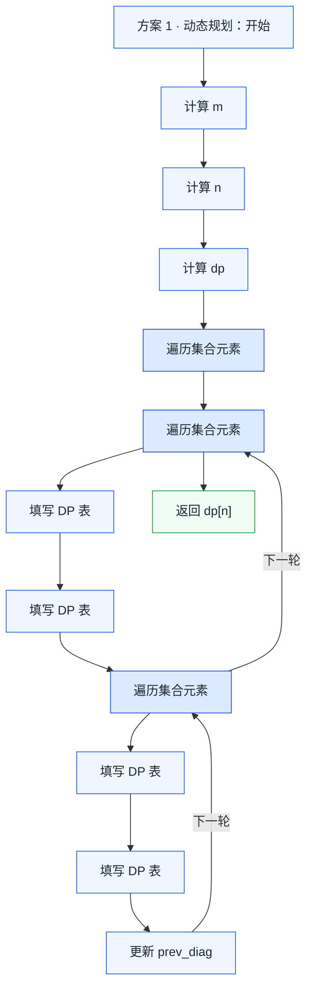

```zig
// LeetCode 583. 两个字符串的删除操作 — Zig 版（方案1）
const std = @import("std"); // 把 @import(「std」) 存入 std
fn minDistanceDel(w1: []const u8, w2: []const u8) i32 { // 定义函数/方法 minDistanceDel
    const m = w1.len; // 把 w1.长度 存入 映射表
    const n = w2.len; // 把 w2.长度 存入 元素个数
    var dp: [1001]i32 = undefined; // 把 undefined; 写入 var dp: [1001]i32
    for (0..n + 1) |j| dp[j] = @intCast(j); // 把 @intCast(下标 j); 写入 for (0..n + 1) |j| dp[j]
    for (1..m + 1) |i| { // for (1..映射表 加 1) 按位或 下标 i 按位或 {
        var prev_diag = dp[0]; // 把 DP 表[0] 存入 prev_diag
        dp[0] = @intCast(i); // 把 @intCast(下标 i); 写入 dp[0]
        for (1..n + 1) |j| { // for (1..元素个数 加 1) 按位或 下标 j 按位或 {
            const tmp = dp[j]; // 把 DP 表[下标 j] 存入 临时变量
            dp[j] = if (w1[i - 1] == w2[j - 1]) prev_diag else 1 + @min(prev_diag, @min(dp[j], dp[j - 1]));
            prev_diag = tmp; // 把 临时变量; 写入 prev_diag
        }
    }
    return dp[n]; // 返回 DP 表[元素个数]
}
pub fn main() !void { // 程序入口：跑内嵌自测用例
    if (minDistanceDel("sea", "eat") != 2) return error.TestFailed; // 若 minDistanceDel(「sea」, 「sea」) 不等于 2，直接返回 error.TestFailed
    if (minDistanceDel("leetcode", "etco") != 4) return error.TestFailed;
    std.debug.print("PASS\n", .{});
} // 全部用例通过，输出 PASS
```

#### 方案 2：直接实现

**思路与代码分析**：核心是「直接实现」。Zig 版显式分配与清零，整型边界处理严格。代码里依次做这些事：DP 表逐项填充；双重循环遍历。**走读**：方案 2 · 直接实现：开始 → 计算 m → 计算 n → 计算 dp → 遍历集合元素 → 遍历集合元素 → 填写 DP 表 → 填写 DP 表 → 遍历集合元素 → 填写 DP 表 → 填写 DP 表 → 更新 prev_diag → 返回 dp[n]。

**运行架构**（真实控制流）：

```mermaid
graph TD
    N0["方案 2 · 直接实现：开始"]
    N1["计算 m"]
    N2["计算 n"]
    N3["计算 dp"]
    N4["遍历集合元素"]
    N5["遍历集合元素"]
    N6["填写 DP 表"]
    N7["填写 DP 表"]
    N8["遍历集合元素"]
    N9["填写 DP 表"]
    N10["填写 DP 表"]
    N11["更新 prev_diag"]
    N12["返回 dp[n]"]
    N0 --> N1
    N1 --> N2
    N2 --> N3
    N3 --> N4
    N4 --> N5
    N5 --> N6
    N6 --> N7
    N7 --> N8
    N8 --> N9
    N9 --> N10
    N10 --> N11
    N11 -- 下一轮 --> N8
    N8 -- 下一轮 --> N5
    N5 --> N12
    classDef n fill:#eff6ff,stroke:#2563eb,color:#1e293b;
    classDef lp fill:#dbeafe,stroke:#1d4ed8,color:#1e293b;
    classDef dc fill:#fef9c3,stroke:#ca8a04,color:#1e293b;
    classDef tm fill:#f0fdf4,stroke:#16a34a,color:#1e293b;
    class N0,N1,N2,N3,N6,N7,N9,N10,N11 n;
    class N4,N5,N8 lp;
    class N12 tm;
```

```zig
// LeetCode 583. 两个字符串的删除操作 — Zig 版（方案2）
const std = @import("std"); // 把 @import(「std」) 存入 std
fn minDistanceDel(w1: []const u8, w2: []const u8) i32 { // 定义函数/方法 minDistanceDel
    const m = w1.len; // 把 w1.长度 存入 映射表
    const n = w2.len; // 把 w2.长度 存入 元素个数
    var dp: [1001]i32 = undefined; // 把 undefined; 写入 var dp: [1001]i32
    for (0..n + 1) |j| dp[j] = @intCast(j); // 把 @intCast(下标 j); 写入 for (0..n + 1) |j| dp[j]
    for (1..m + 1) |i| { // for (1..映射表 加 1) 按位或 下标 i 按位或 {
        var prev_diag = dp[0]; // 把 DP 表[0] 存入 prev_diag
        dp[0] = @intCast(i); // 把 @intCast(下标 i); 写入 dp[0]
        for (1..n + 1) |j| { // for (1..元素个数 加 1) 按位或 下标 j 按位或 {
            const tmp = dp[j]; // 把 DP 表[下标 j] 存入 临时变量
            dp[j] = if (w1[i - 1] == w2[j - 1]) prev_diag else 1 + @min(prev_diag, @min(dp[j], dp[j - 1]));
            prev_diag = tmp; // 把 临时变量; 写入 prev_diag
        }
    }
    return dp[n]; // 返回 DP 表[元素个数]
}
pub fn main() !void { // 程序入口：跑内嵌自测用例
    if (minDistanceDel("sea", "eat") != 2) return error.TestFailed; // 若 minDistanceDel(「sea」, 「sea」) 不等于 2，直接返回 error.TestFailed
    if (minDistanceDel("leetcode", "etco") != 4) return error.TestFailed;
    std.debug.print("PASS\n", .{});
} // 全部用例通过，输出 PASS
```

### Dart 实现（2 种方案）

Dart 的全部方案如下，每个方案都内嵌用例自测，可独立运行（老仓库 python/go 文件遵循「打印结果」约定）：

#### 方案 1：动态规划

**思路与代码分析**：核心是「动态规划」。Dart 版用可空类型标注与集合方法，注意空安全。代码里依次做这些事：DP 表逐项填充；双重循环遍历。**走读**：方案 1 · 动态规划：开始 → 更新 m → 填写 DP 表 → 遍历循环 → 填写 DP 表 → 填写 DP 表 → 遍历循环 → 填写 DP 表 → 填写 DP 表 → 处理 ? prevDiag → 填写 DP 表 → 更新 prevDiag → 返回 dp[n]。

**运行架构**（真实控制流）：

```mermaid
graph TD
    N0["方案 1 · 动态规划：开始"]
    N1["更新 m"]
    N2["填写 DP 表"]
    N3["遍历循环"]
    N4["填写 DP 表"]
    N5["填写 DP 表"]
    N6["遍历循环"]
    N7["填写 DP 表"]
    N8["填写 DP 表"]
    N9["处理 ? prevDiag"]
    N10["填写 DP 表"]
    N11["更新 prevDiag"]
    N12["返回 dp[n]"]
    N0 --> N1
    N1 --> N2
    N2 --> N3
    N3 --> N4
    N4 --> N5
    N5 --> N6
    N6 --> N7
    N7 --> N8
    N8 --> N9
    N9 --> N10
    N10 --> N11
    N11 -- 下一轮 --> N6
    N6 -- 下一轮 --> N3
    N3 --> N12
    classDef n fill:#eff6ff,stroke:#2563eb,color:#1e293b;
    classDef lp fill:#dbeafe,stroke:#1d4ed8,color:#1e293b;
    classDef dc fill:#fef9c3,stroke:#ca8a04,color:#1e293b;
    classDef tm fill:#f0fdf4,stroke:#16a34a,color:#1e293b;
    class N0,N1,N2,N4,N5,N7,N8,N9,N10,N11 n;
    class N3,N6 lp;
    class N12 tm;
```

```dart
// LeetCode 583. 两个字符串的删除操作 — Dart 版（方案1）
int minDeleteDistance(String w1, String w2) {
  // 定义函数/方法 minDeleteDistance
  final m = w1.length, n = w2.length; // 把 w1.长度, 元素个数 赋值为 w2.长度 存入 映射表
  final dp = List<int>.generate(n + 1, (j) => j);
  for (var i = 1; i <= m; i++) {
    // 让 下标 i 从 1 开始计数，下标 i 不超过 映射表 就继续
    var prevDiag = dp[0]; // 把 DP 表[0] 存入 prevDiag
    dp[0] = i; // 把 下标 i; 写入 dp[0]
    for (var j = 1; j <= n; j++) {
      // 让 下标 j 从 1 开始计数，下标 j 不超过 元素个数 就继续
      final tmp = dp[j]; // 把 DP 表[下标 j] 存入 临时变量
      dp[j] = w1[i - 1] == w2[j - 1]
          ? prevDiag
          : 1 + [prevDiag, dp[j], dp[j - 1]].reduce((a, b) => a < b ? a : b);
      prevDiag = tmp; // 把 临时变量 存入 prevDiag
    }
  }
  return dp[n]; // 返回 DP 表[元素个数]
}

void main() {
  if (minDeleteDistance('sea', 'eat') != 2) throw StateError('c1');
  if (minDeleteDistance('leetcode', 'etco') != 4) throw StateError('c2');
  print('PASS');
} // 全部用例通过，输出 PASS
```

#### 方案 2：直接实现

**思路与代码分析**：核心是「直接实现」。Dart 版用可空类型标注与集合方法，注意空安全。代码里依次做这些事：DP 表逐项填充；双重循环遍历。**走读**：方案 2 · 直接实现：开始 → 更新 m → 填写 DP 表 → 遍历循环 → 填写 DP 表 → 填写 DP 表 → 遍历循环 → 填写 DP 表 → 填写 DP 表 → 处理 ? prevDiag → 填写 DP 表 → 更新 prevDiag → 返回 dp[n]。

**运行架构**（真实控制流）：

```mermaid
graph TD
    N0["方案 2 · 直接实现：开始"]
    N1["更新 m"]
    N2["填写 DP 表"]
    N3["遍历循环"]
    N4["填写 DP 表"]
    N5["填写 DP 表"]
    N6["遍历循环"]
    N7["填写 DP 表"]
    N8["填写 DP 表"]
    N9["处理 ? prevDiag"]
    N10["填写 DP 表"]
    N11["更新 prevDiag"]
    N12["返回 dp[n]"]
    N0 --> N1
    N1 --> N2
    N2 --> N3
    N3 --> N4
    N4 --> N5
    N5 --> N6
    N6 --> N7
    N7 --> N8
    N8 --> N9
    N9 --> N10
    N10 --> N11
    N11 -- 下一轮 --> N6
    N6 -- 下一轮 --> N3
    N3 --> N12
    classDef n fill:#eff6ff,stroke:#2563eb,color:#1e293b;
    classDef lp fill:#dbeafe,stroke:#1d4ed8,color:#1e293b;
    classDef dc fill:#fef9c3,stroke:#ca8a04,color:#1e293b;
    classDef tm fill:#f0fdf4,stroke:#16a34a,color:#1e293b;
    class N0,N1,N2,N4,N5,N7,N8,N9,N10,N11 n;
    class N3,N6 lp;
    class N12 tm;
```

```dart
// LeetCode 583. 两个字符串的删除操作 — Dart 版（方案2）
int minDeleteDistance(String w1, String w2) {
  // 定义函数/方法 minDeleteDistance
  final m = w1.length, n = w2.length; // 把 w1.长度, 元素个数 赋值为 w2.长度 存入 映射表
  final dp = List<int>.generate(n + 1, (j) => j);
  for (var i = 1; i <= m; i++) {
    // 让 下标 i 从 1 开始计数，下标 i 不超过 映射表 就继续
    var prevDiag = dp[0]; // 把 DP 表[0] 存入 prevDiag
    dp[0] = i; // 把 下标 i; 写入 dp[0]
    for (var j = 1; j <= n; j++) {
      // 让 下标 j 从 1 开始计数，下标 j 不超过 元素个数 就继续
      final tmp = dp[j]; // 把 DP 表[下标 j] 存入 临时变量
      dp[j] = w1[i - 1] == w2[j - 1]
          ? prevDiag
          : 1 + [prevDiag, dp[j], dp[j - 1]].reduce((a, b) => a < b ? a : b);
      prevDiag = tmp; // 把 临时变量 存入 prevDiag
    }
  }
  return dp[n]; // 返回 DP 表[元素个数]
}

void main() {
  if (minDeleteDistance('sea', 'eat') != 2) throw StateError('c1');
  if (minDeleteDistance('leetcode', 'etco') != 4) throw StateError('c2');
  print('PASS');
} // 全部用例通过，输出 PASS
```

---

## 内容总结

- **两个字符串的删除操作**（动态规划 · Medium）：共 2 个方案，主线思路「动态规划」；时间 O(n) 到 O(m·n)（取决于状态维度）；动画演示DP 表填充过程，附录给出 11 种语言 × 全部方案的可运行实现。
- 来源博客：[https://blog.csdn.net/tyro_java/article/details/144853278](https://blog.csdn.net/tyro_java/article/details/144853278)
- 导航：[📋 总目录](../) ｜ [← 180 零钱兑换 ii](../180_零钱兑换_ii/) ｜ [182 不同路径 →](../182_不同路径/)
