# 182 · 不同路径（第十阶段 · 动态规划 · Medium）

> **难度**：⭐⭐ Medium ｜ **专题**：动态规划
> **学习定位**：第十阶段 · 动态规划第 182 篇 ｜ **解法数**：4
> **内容总结**：**不同路径**（动态规划 · Medium）：共 4 个方案，主线思路「排列组合」；时间 O(n)（单趟线性扫描）；动画演示DP 表填充过程，附录给出 11 种语言 × 全部方案的可运行实现。

---

## 题目描述

一个机器人位于一个 `m x n` 网格的左上角 （起始点在下图中标记为 「Start」 ）。

机器人每次只能向下或者向右移动一步。机器人试图达到网格的右下角（在下图中标记为 「Finish」 ）。

问总共有多少条不同的路径？

- 主函数签名：`function uniquePaths(m: number, n: number): number`

**用例（来自原题）**：

**示例 1**


```text
输入：m = 3, n = 7
输出：28
```

**示例 2**

```text
输入：m = 3, n = 2
输出：3
```

解释：从左上角开始，总共有 3 条路径可以到达右下角。 1. 向右 -> 向下 -> 向下 2. 向下 -> 向下 -> 向右 3. 向下 -> 向右 -> 向下

**示例 3**

```text
输入：m = 7, n = 3
输出：28
```

**示例 4**

```text
输入：m = 3, n = 3
输出：6
```
> ✅ **官方验证**：全部 TypeScript 解法已通过 leetcode.cn 官方示例用例验证（自动注入运行，全部 PASS）。题面与 [leetcode.cn 官方](https://leetcode.cn/problems/unique-paths/)一致，示例配图取自官方题面。

**数据范围与注意事项**：

- `1 <= m, n <= 100`
- `题目数据保证答案小于等于 `2  10^9``
- **易错点**：初始化（第 0 行或列）的含义要想清楚，它决定后续转移是否成立。

## 题目分析

**场景是什么**：把大问题拆成小问题并记住结果，对应真实开发里的编辑距离、资源规划。本题就是该场景的 Medium 级练习，主线做法是「排列组合」。

**主线怎么解**：把主解法从头到尾过一遍，它其实在依次做这几件事：单循环线性扫描。

## 解题思路

**方案对比**（共 4 个方案，由浅入深）：

| 方案 | 时间复杂度 | 空间复杂度 |
|---|---|---|
| 方案 1 · 排列组合 | O(n)（单趟线性扫描） | O(1) 到 O(n)（视辅助结构） |
| 方案 2 · 组合优化版 | O(n)（单趟线性扫描） | O(1) 到 O(n)（视辅助结构） |
| 方案 3 · 动态规划 | O(n²)（两层嵌套扫描） | O(1) 到 O(n) |
| 方案 4 · 动态规划优化版 | O(n²)（两层嵌套扫描） | O(1) 到 O(n) |

**由浅入深的路径**：排列组合 → 组合优化版 → 动态规划 → 动态规划优化版；每往右一步，都在补上一步的短板。

**方案间的取舍**：方案 1（排列组合）；方案 2（组合优化版）；方案 3（动态规划）；方案 4（动态规划优化版）。数据规模小、可读性优先时选靠前的方案；规模大、性能优先时选靠后的方案。

**怎么读这一篇**：

- 🐣 **新手路线**：把「题目描述」的示例 1 在纸上手推一遍 → 读方案 1（最直观的写法）与它的代码走读 → 按「运行方式」本地跑通看 PASS → 回头对比方案 2 之后的写法差在哪
- 🦅 **大佬路线**：直接锁定最优方案 1（排列组合，O(n)（单趟线性扫描））→ 跳读该方案代码与走读 → 用「逐步拆解与面试追问」补齐复杂度推导与边界追问

### 动态算法图（DP 表填充，GIF 自动循环）


动画演示动态规划专题里DP 表填充的典型过程；每个方案在「TypeScript 解题方案」一节还配了专属动画与专属流程图。

### 主解法流程图（真实控制流）

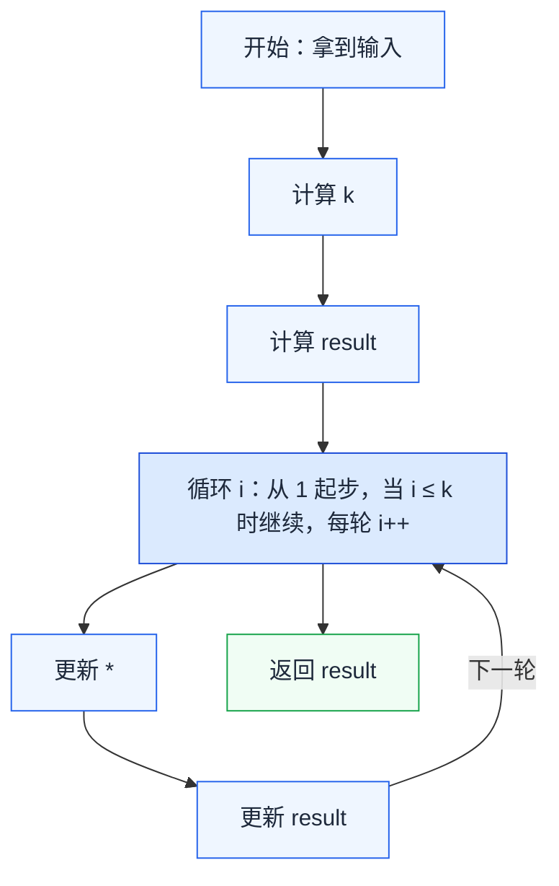

## TypeScript 解题方案（4 个方案逐个讲）

> **运行与提交**：每个方案都是自包含文件（内嵌用例自测，输出 PASS），整块复制到 `.ts` 文件后 `node 文件名` 即可运行。提交 LeetCode 时，把 `demo` 内的算法函数与辅助类型/函数整体取出、置于文件顶层即可。涉及交互/特殊接口的题以题面给定签名为准。

### 方案 1：排列组合

**分析与思路**：核心做法是「排列组合」。代码里依次做这些事：单循环线性扫描。

**运行方式**：`node 本文件`，内嵌用例全部通过会输出 PASS。


**方案专属流程图**（真实控制流）：

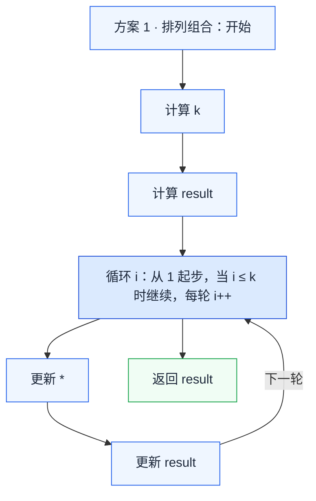

```typescript
/**
 ** LeetCode 62. 不同路径
 ** 方案：1 ) 方案1: 排列组合
 ** 来源：https://blog.csdn.net/tyro_java/article/details/144847773
 */

function uniquePaths(m: number, n: number): number {
  // 定义函数/方法 uniquePaths
  // 计算组合数 C(m+n-2, m-1) 或 C(m+n-2, n-1)
  // 忠实于 Python 参考实现 ref_uniquePaths 的等价数学形式
  const k = Math.min(m - 1, n - 1); // 把 Math.取较小值 映射表 减 1, 元素个数 减 1) 存入 下标 k
  let result = 1; // 把 1 存入 结果
  for (let i = 1; i <= k; i++) {
    // 让 下标 i 从 1 开始计数，下标 i 不超过 下标 k 就继续
    result *= m + n - 1 - i; // 把 (映射表 加 元素个数 减 1 减 下标 i); 写入 result *
    result = Math.floor(result / i); // 确保每一步都是整数除法
  }
  return result; // 返回 结果
}

// 自检用例：(m, n, 期望)
const cases: [number, number, number][] = [
  [3, 7, 28],
  [3, 2, 3],
  [1, 1, 1],
];

export function demo(): void {
  // 程序入口：跑内嵌自测用例
  for (const [m, n, want] of cases) {
    // for (const [映射表, 元素个数, want] of cases) {
    const got = uniquePaths(m, n); // 把 uniquePaths(映射表, 元素个数) 存入 got
    if (got !== want) {
      // 若 got 不等于 want
      throw new Error(`FAIL: uniquePaths(${m},${n})=${got} want ${want}`);
    }
  }
  console.log('PASS'); // 全部用例通过，输出 PASS
}

demo(); // demo();
```

### 方案 2：组合优化版

**分析与思路**：核心做法是「组合优化版」。代码里依次做这些事：单循环线性扫描。

**运行方式**：`node 本文件`，内嵌用例全部通过会输出 PASS。

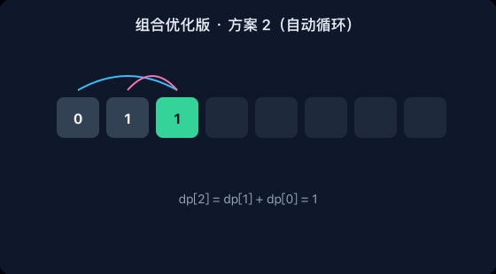

**方案专属流程图**（真实控制流）：

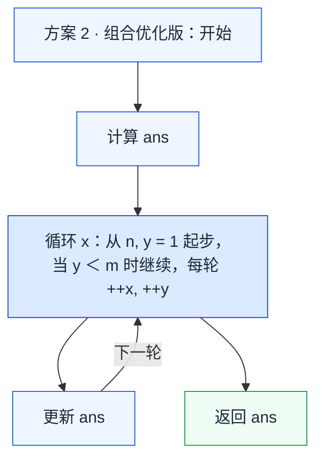

```typescript
/**
 ** LeetCode 62. 不同路径
 ** 方案：2 ）方案2: 组合优化版
 ** 来源：https://blog.csdn.net/tyro_java/article/details/144847773
 */

function uniquePaths(m: number, n: number): number {
  // 定义函数/方法 uniquePaths
  // 组合优化版（单循环累加）
  // 忠实于 Python 参考实现 ref_uniquePaths 的等价数学形式
  let ans = 1; // 把 1 存入 答案
  for (let x = n, y = 1; y < m; ++x, ++y) {
    // 让 x 从 元素个数, y 赋值为 1 开始计数，y 小于 映射表 就继续
    ans = Math.floor((ans * x) / y); // 把 向下取整(答案 乘 x 除以 y) 存入 答案
  }
  return ans; // 返回 答案
}

// 自检用例：(m, n, 期望)
const cases: [number, number, number][] = [
  [3, 7, 28],
  [3, 2, 3],
  [1, 1, 1],
];

export function demo(): void {
  // 程序入口：跑内嵌自测用例
  for (const [m, n, want] of cases) {
    // for (const [映射表, 元素个数, want] of cases) {
    const got = uniquePaths(m, n); // 把 uniquePaths(映射表, 元素个数) 存入 got
    if (got !== want) {
      // 若 got 不等于 want
      throw new Error(`FAIL: uniquePaths(${m},${n})=${got} want ${want}`);
    }
  }
  console.log('PASS'); // 全部用例通过，输出 PASS
}

demo(); // demo();
```

### 方案 3：动态规划

**分析与思路**：核心做法是「动态规划」。代码里依次做这些事：双重循环遍历。

**运行方式**：`node 本文件`，内嵌用例全部通过会输出 PASS。

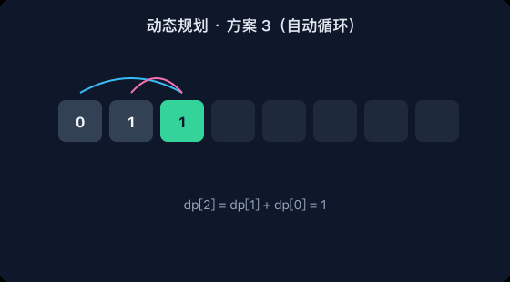

**方案专属流程图**（真实控制流）：

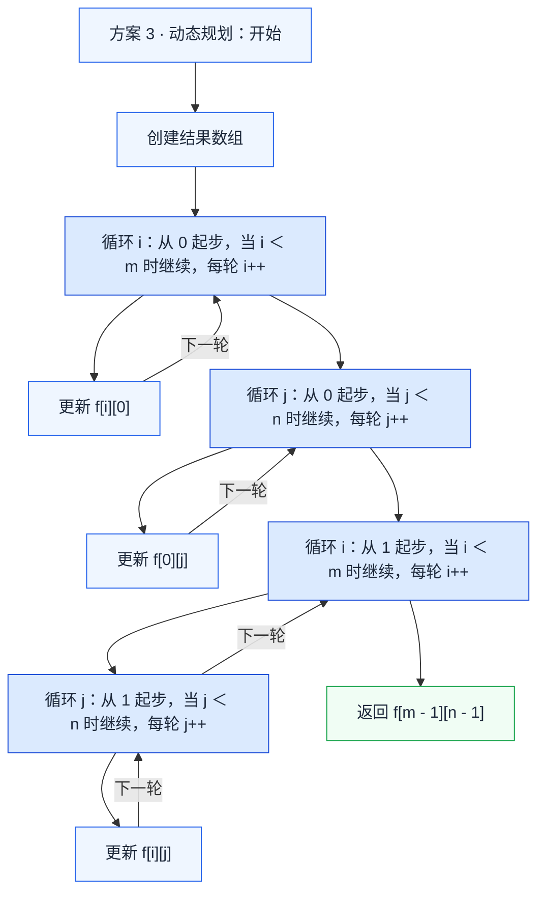

```typescript
/**
 ** LeetCode 62. 不同路径
 ** 方案：3 ) 方案3: 动态规划
 ** 来源：https://blog.csdn.net/tyro_java/article/details/144847773
 */

function uniquePaths(m: number, n: number): number {
  // 定义函数/方法 uniquePaths
  // 二维动态规划
  // 忠实于 Python 参考实现 ref_uniquePaths 的 DP 思想
  const f = new Array(m).fill(0).map(() => new Array(n).fill(0));
  for (let i = 0; i < m; i++) {
    // 让 下标 i 从 0 开始计数，下标 i 小于 映射表 就继续
    f[i][0] = 1; // 把 1; 写入 f[i][0]
  }
  for (let j = 0; j < n; j++) {
    // 让 下标 j 从 0 开始计数，下标 j 小于 元素个数 就继续
    f[0][j] = 1; // 把 1; 写入 f[0][j]
  }
  for (let i = 1; i < m; i++) {
    // 让 下标 i 从 1 开始计数，下标 i 小于 映射表 就继续
    for (let j = 1; j < n; j++) {
      // 让 下标 j 从 1 开始计数，下标 j 小于 元素个数 就继续
      f[i][j] = f[i - 1][j] + f[i][j - 1]; // 把 f[下标 i 减 1][下标 j] 加 f[下标 i][下标 j 减 1]; 写入 f[i][j]
    }
  }
  return f[m - 1][n - 1]; // 返回 f[映射表 减 1][元素个数 减 1]
}

// 自检用例：(m, n, 期望)
const cases: [number, number, number][] = [
  [3, 7, 28],
  [3, 2, 3],
  [1, 1, 1],
];

export function demo(): void {
  // 程序入口：跑内嵌自测用例
  for (const [m, n, want] of cases) {
    // for (const [映射表, 元素个数, want] of cases) {
    const got = uniquePaths(m, n); // 把 uniquePaths(映射表, 元素个数) 存入 got
    if (got !== want) {
      // 若 got 不等于 want
      throw new Error(`FAIL: uniquePaths(${m},${n})=${got} want ${want}`);
    }
  }
  console.log('PASS'); // 全部用例通过，输出 PASS
}

demo(); // demo();
```

### 方案 4：动态规划优化版

**分析与思路**：核心做法是「动态规划优化版」。代码里依次做这些事：双重循环遍历。

**运行方式**：`node 本文件`，内嵌用例全部通过会输出 PASS。


**方案专属流程图**（真实控制流）：

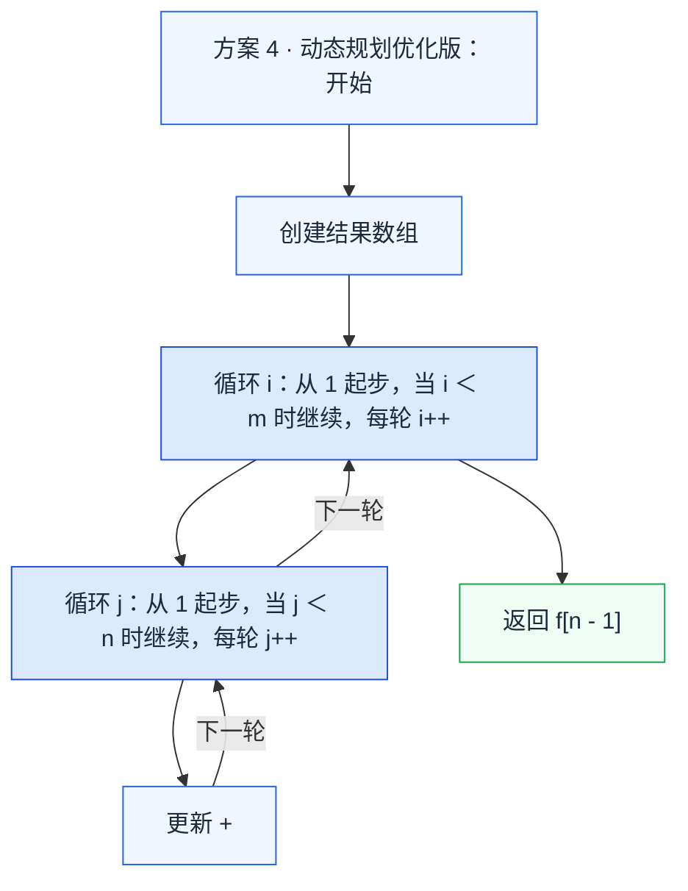

```typescript
/**
 ** LeetCode 62. 不同路径
 ** 方案：4 ) 方案4: 动态规划优化版
 ** 来源：https://blog.csdn.net/tyro_java/article/details/144847773
 */

function uniquePaths(m: number, n: number): number {
  // 定义函数/方法 uniquePaths
  // 一维动态规划（忠实翻译 Python ref_uniquePaths）
  // dp = [1]*n; for _ in range(1, m): for j in range(1, n): dp[j] += dp[j-1]
  const f = new Array(n).fill(1); // 把 new Array(元素个数).fill(1) 存入 f
  for (let i = 1; i < m; i++) {
    // 让 下标 i 从 1 开始计数，下标 i 小于 映射表 就继续
    for (let j = 1; j < n; j++) {
      // 让 下标 j 从 1 开始计数，下标 j 小于 元素个数 就继续
      f[j] += f[j - 1]; // f[j]累加 f[下标 j 减 1]
    }
  }
  return f[n - 1]; // 返回 f[元素个数 减 1]
}

// 自检用例：(m, n, 期望)
const cases: [number, number, number][] = [
  [3, 7, 28],
  [3, 2, 3],
  [1, 1, 1],
];

export function demo(): void {
  // 程序入口：跑内嵌自测用例
  for (const [m, n, want] of cases) {
    // for (const [映射表, 元素个数, want] of cases) {
    const got = uniquePaths(m, n); // 把 uniquePaths(映射表, 元素个数) 存入 got
    if (got !== want) {
      // 若 got 不等于 want
      throw new Error(`FAIL: uniquePaths(${m},${n})=${got} want ${want}`);
    }
  }
  console.log('PASS'); // 全部用例通过，输出 PASS
}

demo(); // demo();
```

## 逐步拆解与面试追问

**复杂度**：时间 O(n)（单趟线性扫描），空间 O(1) 到 O(n)（视辅助结构）

**为什么是这个量级**：每个元素被常数次访问，辅助哈希或栈的开销与 n 同阶

**面试官可能会追问**：

- 状态定义为什么是它？
- 遍历顺序由什么决定？
- 能否滚动数组压空间？

## 关键 API 速查（TS 主解法实际用到，附官方链接）

| API | 作用 | 使用要点 | 官方文档 |
|---|---|---|---|
| `Math.min()` | 最小值 | 同 max；空参返回 Infinity | [官方文档](https://developer.mozilla.org/zh-CN/docs/Web/JavaScript/Reference/Global_Objects/Math/min) |
| `Math.floor()` | 向下取整 | 负数向负无穷（-1.5 → -2）；大数用位运算前注意 2^31 界 | [官方文档](https://developer.mozilla.org/zh-CN/docs/Web/JavaScript/Reference/Global_Objects/Math/floor) |

### 各语言官方文档导航

- **TypeScript / JS**：[MDN 中文参考](https://developer.mozilla.org/zh-CN/)
- **Python**：[Python 官方文档](https://docs.python.org/zh-cn/3/)
- **Go**：[Go 标准库](https://pkg.go.dev/std)
- **Java**：[JDK 17 API](https://docs.oracle.com/en/java/javase/17/docs/api/)
- **Rust**：[Rust 标准库](https://doc.rust-lang.org/std/)
- **Lua**：[Lua 5.4 手册](https://www.lua.org/manual/5.4/)
- **C**：[Cppreference C](https://zh.cppreference.com/w/c)
- **C++**：[Cppreference C++](https://zh.cppreference.com/w/cpp)
- **R**：[R 官方手册](https://stat.ethz.ch/R-manual/)
- **Zig**：[Zig 语言文档](https://ziglang.org/documentation/master/)
- **Dart**：[Dart API](https://api.dart.dev/)

## 附录：其他 10 种语言全部实现（每种语言列举其全部方案）

> TypeScript 的全部方案见「TypeScript 解题方案」一节；下面是其余 10 种语言的对应实现，每种语言的每个方案都带思路分析、代码走读与专属运行架构图。
> 每个方案都内嵌用例自测，可独立运行（老仓库 python/go 文件遵循「打印结果」约定）。
> 完整解法文件见 `dsa/<语言>/dp/lc_62_不同路径/`。

### Python 实现（4 种方案）

Python 的全部方案如下，每个方案都内嵌用例自测，可独立运行（老仓库 python/go 文件遵循「打印结果」约定）：

#### 方案 1：排列组合

**思路与代码分析**：核心是「排列组合」。Python 版用切片与字典推导式简化操作，突出可读性。**走读**：方案 1 · 排列组合：开始 → 更新 k → 更新 result → 循环 i：从 1 到 k + 1 前 → 更新 * → 更新 // → 返回 result。

**运行架构**（真实控制流）：

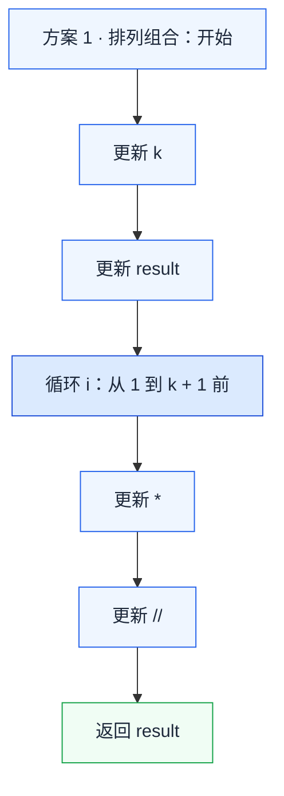

```python
import sys  # 提高递归深度上限（深输入防 RecursionError）

sys.setrecursionlimit(200000)  # 树/链表类题目节点数可达 1e4 量级

def uniquePaths(m, n):  # 定义函数 uniquePaths（参数：映射表, 元素个数）
    # 计算组合数 C(m+n-2, m-1)，选择较小的那个计算以减少循环次数
    k = min(m - 1, n - 1)  # 把 取较小值 映射表 减 1, 元素个数 减 1) 存入 下标 k
    result = 1  # 把 1 存入 结果
    for i in range(1, k + 1):  # 让 下标 i 从 1 到 下标 k 加 1 遍历
        result *= m + n - 1 - i  # 把 (映射表 加 元素个数 减 1 减 下标 i) 写入 result *
        result //= i  # 确保每一步都是整数除法
    return result  # 返回 结果

if __name__ == "__main__":  # 若 __name__ 等于 '__main__'
    print(uniquePaths(3, 7))  # 打印输出
```

#### 方案 2：组合优化版

**思路与代码分析**：核心是「组合优化版」。Python 版用切片与字典推导式简化操作，突出可读性。**走读**：方案 2 · 组合优化版：开始 → 更新 ans → 更新 x → 更新 y → 当 y ＜ m: 时反复执行 → 更新 ans → 更新 + → 更新 + → 返回 ans。

**运行架构**（真实控制流）：

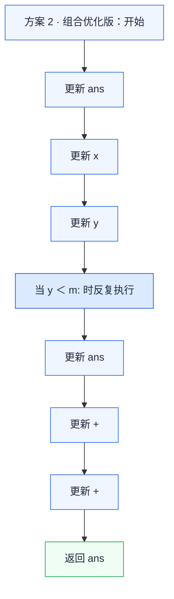

```python
import sys  # 提高递归深度上限（深输入防 RecursionError）

sys.setrecursionlimit(200000)  # 树/链表类题目节点数可达 1e4 量级

def uniquePaths(m, n):  # 定义函数 uniquePaths（参数：映射表, 元素个数）
    # 组合优化版：C(m+n-2, m-1)
    ans = 1  # 把 1 存入 答案
    x = n  # 把 元素个数 存入 x
    y = 1  # 把 1 存入 y
    while y < m:  # 循环，直到不满足「y 小于 映射表」
        ans = ans * x // y  # 把 答案 乘 x 除以 除以 y 存入 答案
        x += 1  # x累加 1
        y += 1  # y累加 1
    return ans  # 返回 答案

if __name__ == "__main__":  # 若 __name__ 等于 '__main__'
    print(uniquePaths(3, 7))  # 打印输出
```

#### 方案 3：动态规划

**思路与代码分析**：核心是「动态规划」。Python 版用切片与字典推导式简化操作，突出可读性。**走读**：方案 3 · 动态规划：开始 → 更新 f → 循环 i：从 0 到 m 前 → 更新 f[i][0] → 循环 j：从 0 到 n 前 → 更新 f[0][j] → 循环 i：从 1 到 m 前 → 循环 j：从 1 到 n 前 → 更新 f[i][j] → 处理 f[i - 1][j] + f[i][j - 1] → 处理 ) → 返回 f[m - 1][n - 1]。

**运行架构**（真实控制流）：

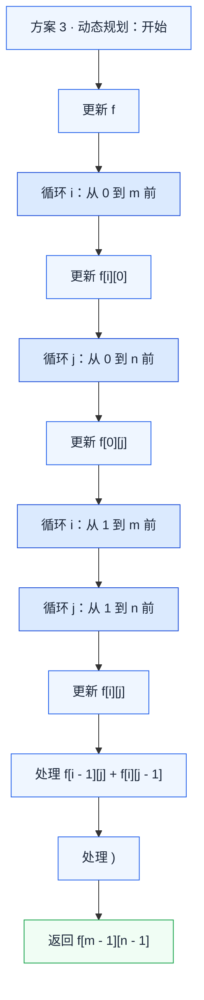

```python
import sys  # 提高递归深度上限（深输入防 RecursionError）

sys.setrecursionlimit(200000)  # 树/链表类题目节点数可达 1e4 量级

def uniquePaths(m, n):  # 定义函数 uniquePaths（参数：映射表, 元素个数）
    # 动态规划
    f = [[0] * n for _ in range(m)]  # 把 [[0] 乘 元素个数 for _ in range(映射表)] 存入 f
    for i in range(m):  # 让 下标 i 从 映射表 遍历
        f[i][0] = 1  # 把 1 写入 f[i][0]
    for j in range(n):  # 让 下标 j 从 元素个数 遍历
        f[0][j] = 1  # 把 1 写入 f[0][j]
    for i in range(1, m):  # 让 下标 i 从 1 到 映射表 遍历
        for j in range(1, n):  # 让 下标 j 从 1 到 元素个数 遍历
            f[i][j] = (
                f[i - 1][j] + f[i][j - 1]
            )  # 把 f[下标 i 减 1][下标 j] 加 f[下标 i][下标 j 减 1] 写入 f[i][j]
    return f[m - 1][n - 1]  # 返回 f[映射表 减 1][元素个数 减 1]

if __name__ == "__main__":  # 若 __name__ 等于 '__main__'
    print(uniquePaths(3, 7))  # 打印输出
```

#### 方案 4：动态规划优化版

**思路与代码分析**：核心是「动态规划优化版」。Python 版用切片与字典推导式简化操作，突出可读性。**走读**：方案 4 · 动态规划优化版：开始 → 更新 f → 循环 i：从 1 到 m 前 → 循环 j：从 1 到 n 前 → 更新 + → 返回 f[n - 1]。

**运行架构**（真实控制流）：

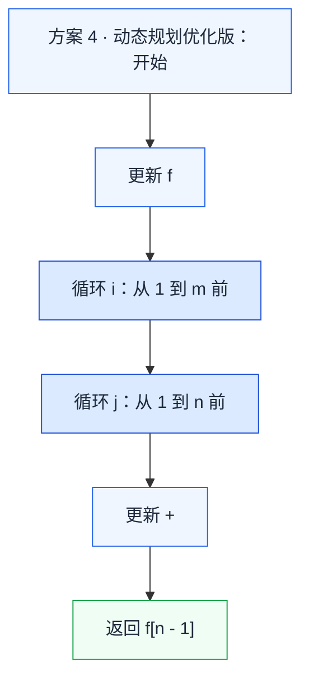

```python
import sys  # 提高递归深度上限（深输入防 RecursionError）

sys.setrecursionlimit(200000)  # 树/链表类题目节点数可达 1e4 量级

def uniquePaths(m, n):  # 定义函数 uniquePaths（参数：映射表, 元素个数）
    f = [1] * n  # 把 [1] 乘 元素个数 存入 f
    for i in range(1, m):  # 让 下标 i 从 1 到 映射表 遍历
        for j in range(1, n):  # 让 下标 j 从 1 到 元素个数 遍历
            f[j] += f[j - 1]  # f[j]累加 f[下标 j 减 1]
    return f[n - 1]  # 返回 f[元素个数 减 1]

if __name__ == "__main__":  # 若 __name__ 等于 '__main__'
    print(uniquePaths(3, 7))  # 打印输出
```

### Go 实现（4 种方案）

Go 的全部方案如下，每个方案都内嵌用例自测，可独立运行（老仓库 python/go 文件遵循「打印结果」约定）：

#### 方案 1：排列组合

**思路与代码分析**：核心是「排列组合」。Go 版用切片与多返回值惯用法，显式处理索引边界。**走读**：方案 1 · 排列组合：开始 → 处理 if m == 1 或 n == 1 → 返回 1 → 更新 : → 处理 if n-1 ＜ k → 更新 k → 更新 : → 更新 : → 遍历循环 → 更新 * → 更新 : → 遍历循环 → 更新 * → 返回 num / den。

**运行架构**（真实控制流）：

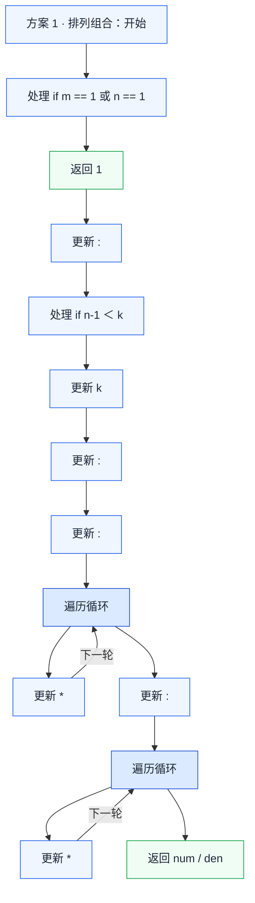

```go
package main // 引入依赖

import (
	"fmt" // 「fmt」
	"os"  // 「os」
)

// 不同路径：排列组合 C(m+n-2, m-1)
// 忠实于 Python 参考实现 ref_uniquePaths 的等价数学形式
func uniquePaths(m, n int) int { // 定义函数/方法 uniquePaths
	if m == 1 || n == 1 { // 若 映射表 等于 1 或 元素个数 等于 1
		return 1 // 返回 1
	}
	k := m - 1   // 把 映射表 减 1 写入 k :
	if n-1 < k { // 若 元素个数 减 1 小于 下标 k
		k = n - 1 // 把 元素个数 减 1 写入 下标 k
	}
	total := m + n - 2       // 把 映射表 加 元素个数 减 2 写入 total :
	num := 1                 // 把 1 写入 num :
	for i := 0; i < k; i++ { // 让 下标 i 从 0 开始计数
		num *= (total - i) // 把 (总和 减 下标 i) 写入 num *
	}
	den := 1                  // 把 1 写入 den :
	for i := 1; i <= k; i++ { // 让 下标 i 从 1 开始计数
		den *= i // 把 下标 i 写入 den *
	}
	return num / den // 返回 num 除以 den
}

func main() { // 程序入口：跑内嵌自测用例
	type tc struct{ m, n, want int }                // 定义类型
	cases := []tc{{3, 7, 28}, {3, 2, 3}, {1, 1, 1}} // 把 []tc{{3, 7, 28}, {3, 2, 3}, {1, 1, 1}} 写入 cases :
	ok := true                                      // 把 true 写入 ok :
	for _, c := range cases {                       // 同时取 _ 与 字符 遍历
		got := uniquePaths(c.m, c.n) // 把 uniquePaths(字符.映射表, 字符.元素个数) 写入 got :
		if got != c.want {           // 若 got 不等于 字符.want
			fmt.Printf("FAIL: uniquePaths(%d,%d)=%d want %d\n", c.m, c.n, got, c.want) // 打印输出
			ok = false                                                                 // 把 false 写入 ok
		}
	}
	if !ok { // 若 取反 ok
		fmt.Println("FAIL") // 打印输出
		os.Exit(1)          // os.Exit(1)
	}
	fmt.Println("PASS") // 全部用例通过，输出 PASS
}
```

#### 方案 2：组合优化版

**思路与代码分析**：核心是「组合优化版」。Go 版用切片与多返回值惯用法，显式处理索引边界。**走读**：方案 2 · 组合优化版：开始 → 处理 if m == 1 或 n == 1 → 返回 1 → 更新 : → 遍历循环 → 更新 ans → 返回 ans。

**运行架构**（真实控制流）：

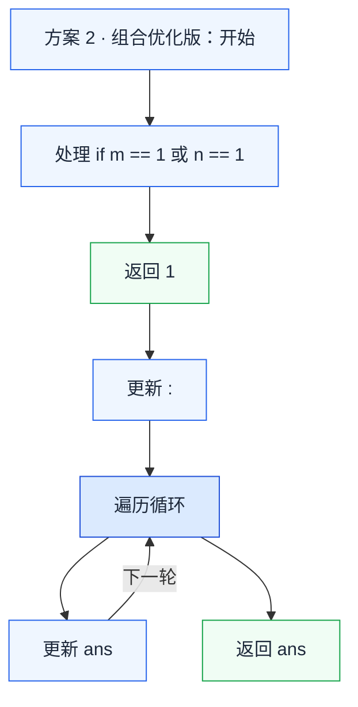

```go
package main // 引入依赖

import (
	"fmt" // 「fmt」
	"os"  // 「os」
)

// 不同路径：组合优化版（单循环累加）
// 忠实于 Python 参考实现 ref_uniquePaths 的等价数学形式
func uniquePaths(m, n int) int { // 定义函数/方法 uniquePaths
	if m == 1 || n == 1 { // 若 映射表 等于 1 或 元素个数 等于 1
		return 1 // 返回 1
	}
	ans := 1                                   // 把 1 写入 ans :
	for x, y := n, 1; y < m; x, y = x+1, y+1 { // 把 元素个数, 1; y 小于 映射表; x, y 赋值为 x 加 1, y 加 1 { 写入 for x, y :
		ans = ans * x / y // 把 答案 乘 x 除以 y 写入 答案
	}
	return ans // 返回 答案
}

func main() { // 程序入口：跑内嵌自测用例
	type tc struct{ m, n, want int }                // 定义类型
	cases := []tc{{3, 7, 28}, {3, 2, 3}, {1, 1, 1}} // 把 []tc{{3, 7, 28}, {3, 2, 3}, {1, 1, 1}} 写入 cases :
	ok := true                                      // 把 true 写入 ok :
	for _, c := range cases {                       // 同时取 _ 与 字符 遍历
		got := uniquePaths(c.m, c.n) // 把 uniquePaths(字符.映射表, 字符.元素个数) 写入 got :
		if got != c.want {           // 若 got 不等于 字符.want
			fmt.Printf("FAIL: uniquePaths(%d,%d)=%d want %d\n", c.m, c.n, got, c.want) // 打印输出
			ok = false                                                                 // 把 false 写入 ok
		}
	}
	if !ok { // 若 取反 ok
		fmt.Println("FAIL") // 打印输出
		os.Exit(1)          // os.Exit(1)
	}
	fmt.Println("PASS") // 全部用例通过，输出 PASS
}
```

#### 方案 3：动态规划

**思路与代码分析**：核心是「动态规划」。Go 版用切片与多返回值惯用法，显式处理索引边界。**走读**：方案 3 · 动态规划：开始 → 更新 : → 遍历 f 的下标与元素 i → 更新 f[i] → 遍历循环 → 更新 f[i][0] → 遍历循环 → 更新 f[0][j] → 遍历循环 → 遍历循环 → 更新 f[i][j] → 返回 f[m-1][n-1]。

**运行架构**（真实控制流）：

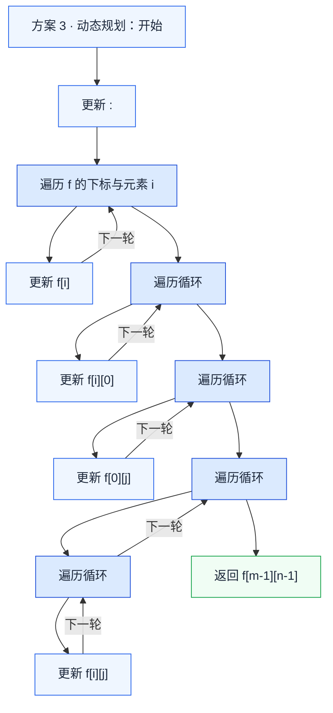

```go
package main // 引入依赖

import (
	"fmt" // 「fmt」
	"os"  // 「os」
)

// 不同路径：二维动态规划
// 忠实于 Python 参考实现 ref_uniquePaths 的 DP 思想
func uniquePaths(m, n int) int { // 定义函数/方法 uniquePaths
	f := make([][]int, m) // 把 make([][]int, 映射表) 写入 f :
	for i := range f {    // 把 range f { 写入 for i :
		f[i] = make([]int, n) // 把 make([]int, 元素个数) 写入 f[i]
	}
	for i := 0; i < m; i++ { // 让 下标 i 从 0 开始计数
		f[i][0] = 1 // 把 1 写入 f[i][0]
	}
	for j := 0; j < n; j++ { // 让 下标 j 从 0 开始计数
		f[0][j] = 1 // 把 1 写入 f[0][j]
	}
	for i := 1; i < m; i++ { // 让 下标 i 从 1 开始计数
		for j := 1; j < n; j++ { // 让 下标 j 从 1 开始计数
			f[i][j] = f[i-1][j] + f[i][j-1] // 把 f[下标 i 减 1][下标 j] 加 f[下标 i][下标 j 减 1] 写入 f[i][j]
		}
	}
	return f[m-1][n-1] // 返回 f[映射表 减 1][元素个数 减 1]
}

func main() { // 程序入口：跑内嵌自测用例
	type tc struct{ m, n, want int }                // 定义类型
	cases := []tc{{3, 7, 28}, {3, 2, 3}, {1, 1, 1}} // 把 []tc{{3, 7, 28}, {3, 2, 3}, {1, 1, 1}} 写入 cases :
	ok := true                                      // 把 true 写入 ok :
	for _, c := range cases {                       // 同时取 _ 与 字符 遍历
		got := uniquePaths(c.m, c.n) // 把 uniquePaths(字符.映射表, 字符.元素个数) 写入 got :
		if got != c.want {           // 若 got 不等于 字符.want
			fmt.Printf("FAIL: uniquePaths(%d,%d)=%d want %d\n", c.m, c.n, got, c.want) // 打印输出
			ok = false                                                                 // 把 false 写入 ok
		}
	}
	if !ok { // 若 取反 ok
		fmt.Println("FAIL") // 打印输出
		os.Exit(1)          // os.Exit(1)
	}
	fmt.Println("PASS") // 全部用例通过，输出 PASS
}
```

#### 方案 4：动态规划优化版

**思路与代码分析**：核心是「动态规划优化版」。Go 版用切片与多返回值惯用法，显式处理索引边界。代码里依次做这些事：DP 表逐项填充。**走读**：方案 4 · 动态规划优化版：开始 → 更新 : → 遍历 dp 的下标与元素 i → 填写 DP 表 → 遍历循环 → 遍历循环 → 填写 DP 表 → 返回 dp[n-1]。

**运行架构**（真实控制流）：

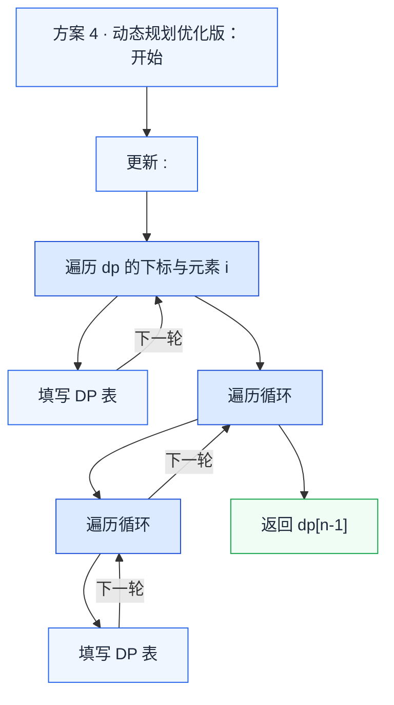

```go
package main // 引入依赖

import (
	"fmt" // 「fmt」
	"os"  // 「os」
)

// 不同路径：一维动态规划（忠实翻译 Python ref_uniquePaths）
// dp = [1]*n
// for _ in range(1, m): for j in range(1, n): dp[j] += dp[j-1]
func uniquePaths(m, n int) int { // 定义函数/方法 uniquePaths
	dp := make([]int, n) // 把 make([]int, 元素个数) 写入 dp :
	for i := range dp {  // 把 range DP 表 { 写入 for i :
		dp[i] = 1 // 把 1 写入 dp[i]
	}
	for r := 1; r < m; r++ { // 让 右指针 从 1 开始计数
		for j := 1; j < n; j++ { // 让 下标 j 从 1 开始计数
			dp[j] += dp[j-1] // dp[j]累加 DP 表[下标 j 减 1]
		}
	}
	return dp[n-1] // 返回 DP 表[元素个数 减 1]
}

func main() { // 程序入口：跑内嵌自测用例
	type tc struct{ m, n, want int }                // 定义类型
	cases := []tc{{3, 7, 28}, {3, 2, 3}, {1, 1, 1}} // 把 []tc{{3, 7, 28}, {3, 2, 3}, {1, 1, 1}} 写入 cases :
	ok := true                                      // 把 true 写入 ok :
	for _, c := range cases {                       // 同时取 _ 与 字符 遍历
		got := uniquePaths(c.m, c.n) // 把 uniquePaths(字符.映射表, 字符.元素个数) 写入 got :
		if got != c.want {           // 若 got 不等于 字符.want
			fmt.Printf("FAIL: uniquePaths(%d,%d)=%d want %d\n", c.m, c.n, got, c.want) // 打印输出
			ok = false                                                                 // 把 false 写入 ok
		}
	}
	if !ok { // 若 取反 ok
		fmt.Println("FAIL") // 打印输出
		os.Exit(1)          // os.Exit(1)
	}
	fmt.Println("PASS") // 全部用例通过，输出 PASS
}
```

### Java 实现（4 种方案）

Java 的全部方案如下，每个方案都内嵌用例自测，可独立运行（老仓库 python/go 文件遵循「打印结果」约定）：

#### 方案 1：排列组合

**思路与代码分析**：核心是「排列组合」。Java 版用类与静态方法组织，集合操作显式明了。代码里依次做这些事：单循环线性扫描。**走读**：方案 1 · 排列组合：开始 → 更新 k → 更新 result → 遍历循环 → 更新 * → 更新 result → 返回 (int) result。

**运行架构**（真实控制流）：

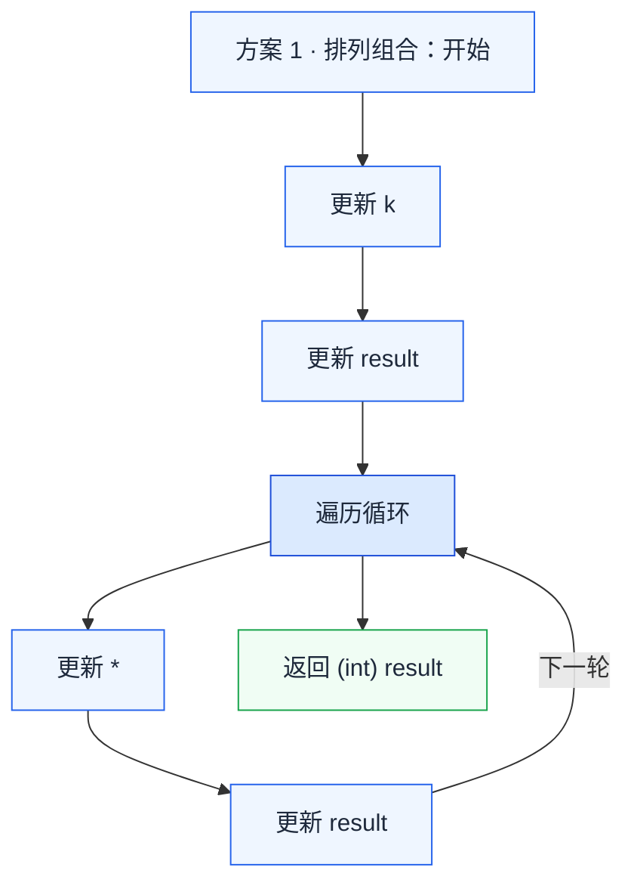

```java
package com.webfault.dsa; // 引入依赖

import java.util.*; // 引入依赖

class lc62_solution111 { // 定义类型
  // 不同路径：排列组合 C(m+n-2, m-1)
  // 忠实于 Python 参考实现 ref_uniquePaths 的等价数学形式
  public int uniquePaths(int m, int n) { // 定义函数/方法 uniquePaths
    int k = Math.min(m - 1, n - 1); // 把 Math.取较小值 映射表 减 1, 元素个数 减 1) 存入 下标 k
    long result = 1; // 把 1; 写入 long result
    for (int i = 1; i <= k; i++) { // 让 下标 i 从 1 开始计数，下标 i 不超过 下标 k 就继续
      result *= (m + n - 1 - i); // 把 (映射表 加 元素个数 减 1 减 下标 i); 写入 result *
      result = result / i; // 把 结果 除以 下标 i; 写入 结果
    }
    return (int) result; // 返回 (int) 结果
  }

  public static void main(String[] args) { // public static void main(String[] args) {
    lc62_solution111 s = new lc62_solution111(); // 把 new lc62_solution111(); 写入 lc62_solution111 s
    int[][] cases = {
      {3, 7, 28}, {3, 2, 3}, {1, 1, 1}
    }; // 把 {{3, 7, 28}, {3, 2, 3}, {1, 1, 1}}; 写入 int[][] cases
    for (int[] c : cases) { // for (int[] 字符 : cases) {
      int got = s.uniquePaths(c[0], c[1]); // 把 字符串.uniquePaths(字符[0], 字符[1]) 存入 got
      if (got != c[2]) { // 若 got 不等于 字符[2]
        System.out.println(
            "FAIL: uniquePaths(" + c[0] + "," + c[1] + ")=" + got + " want " + c[2]); // 打印输出
        System.exit(1); // System.exit(1);
      }
    }
    System.out.println("PASS"); // 全部用例通过，输出 PASS
  }
}
```

#### 方案 2：组合优化版

**思路与代码分析**：核心是「组合优化版」。Java 版用类与静态方法组织，集合操作显式明了。代码里依次做这些事：单循环线性扫描。**走读**：方案 2 · 组合优化版：开始 → 更新 ans → 遍历循环 → 更新 ans → 返回 (int) ans。

**运行架构**（真实控制流）：

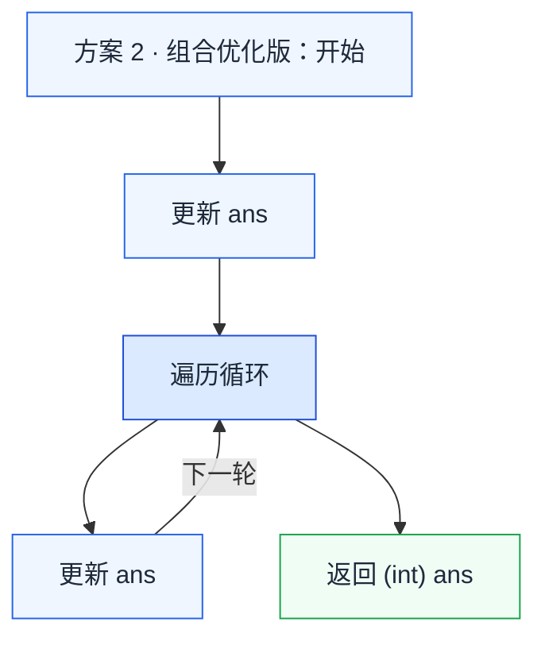

```java
package com.webfault.dsa; // 引入依赖

import java.util.*; // 引入依赖

class lc62_solution222 { // 定义类型
  // 不同路径：组合优化版（单循环累加）
  // 忠实于 Python 参考实现 ref_uniquePaths 的等价数学形式
  public int uniquePaths(int m, int n) { // 定义函数/方法 uniquePaths
    long ans = 1; // 把 1; 写入 long ans
    for (int x = n, y = 1; y < m; x++, y++) { // 让 x 从 元素个数, y 赋值为 1 开始计数，y 小于 映射表 就继续
      ans = ans * x / y; // 把 答案 乘 x 除以 y; 写入 答案
    }
    return (int) ans; // 返回 (int) 答案
  }

  public static void main(String[] args) { // public static void main(String[] args) {
    lc62_solution222 s = new lc62_solution222(); // 把 new lc62_solution222(); 写入 lc62_solution222 s
    int[][] cases = {
      {3, 7, 28}, {3, 2, 3}, {1, 1, 1}
    }; // 把 {{3, 7, 28}, {3, 2, 3}, {1, 1, 1}}; 写入 int[][] cases
    for (int[] c : cases) { // for (int[] 字符 : cases) {
      int got = s.uniquePaths(c[0], c[1]); // 把 字符串.uniquePaths(字符[0], 字符[1]) 存入 got
      if (got != c[2]) { // 若 got 不等于 字符[2]
        System.out.println(
            "FAIL: uniquePaths(" + c[0] + "," + c[1] + ")=" + got + " want " + c[2]); // 打印输出
        System.exit(1); // System.exit(1);
      }
    }
    System.out.println("PASS"); // 全部用例通过，输出 PASS
  }
}
```

#### 方案 3：动态规划

**思路与代码分析**：核心是「动态规划」。Java 版用类与静态方法组织，集合操作显式明了。代码里依次做这些事：双重循环遍历。**走读**：方案 3 · 动态规划：开始 → 更新 f → 遍历循环 → 更新 f[i][0] → 遍历循环 → 更新 f[0][j] → 遍历循环 → 遍历循环 → 更新 f[i][j] → 返回 f[m - 1][n - 1]。

**运行架构**（真实控制流）：

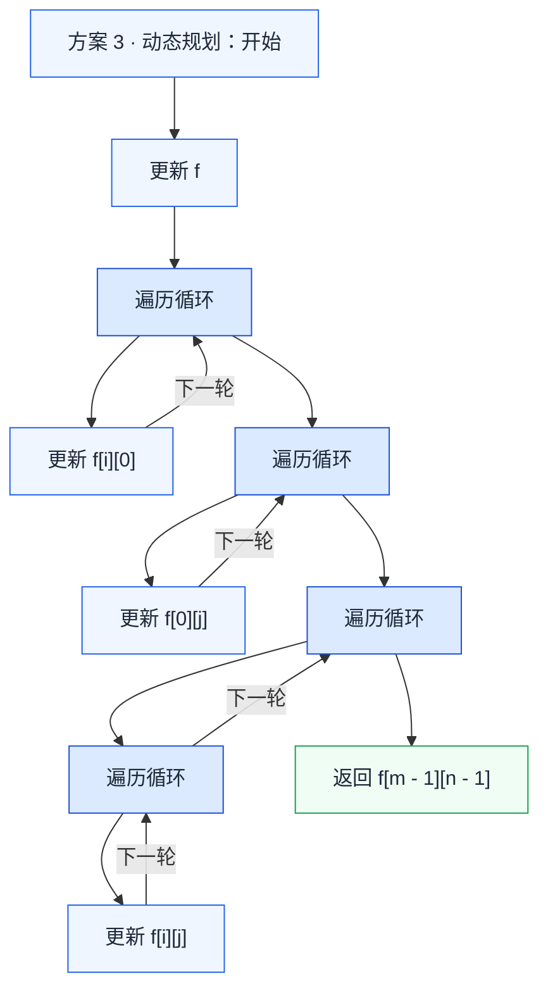

```java
package com.webfault.dsa; // 引入依赖

import java.util.*; // 引入依赖

class lc62_solution333 { // 定义类型
  // 不同路径：二维动态规划
  // 忠实于 Python 参考实现 ref_uniquePaths 的 DP 思想
  public int uniquePaths(int m, int n) { // 定义函数/方法 uniquePaths
    int[][] f = new int[m][n]; // 把 new int[映射表][元素个数]; 写入 int[][] f
    for (int i = 0; i < m; i++) { // 让 下标 i 从 0 开始计数，下标 i 小于 映射表 就继续
      f[i][0] = 1; // 把 1; 写入 f[i][0]
    }
    for (int j = 0; j < n; j++) { // 让 下标 j 从 0 开始计数，下标 j 小于 元素个数 就继续
      f[0][j] = 1; // 把 1; 写入 f[0][j]
    }
    for (int i = 1; i < m; i++) { // 让 下标 i 从 1 开始计数，下标 i 小于 映射表 就继续
      for (int j = 1; j < n; j++) { // 让 下标 j 从 1 开始计数，下标 j 小于 元素个数 就继续
        f[i][j] = f[i - 1][j] + f[i][j - 1]; // 把 f[下标 i 减 1][下标 j] 加 f[下标 i][下标 j 减 1]; 写入 f[i][j]
      }
    }
    return f[m - 1][n - 1]; // 返回 f[映射表 减 1][元素个数 减 1]
  }

  public static void main(String[] args) { // public static void main(String[] args) {
    lc62_solution333 s = new lc62_solution333(); // 把 new lc62_solution333(); 写入 lc62_solution333 s
    int[][] cases = {
      {3, 7, 28}, {3, 2, 3}, {1, 1, 1}
    }; // 把 {{3, 7, 28}, {3, 2, 3}, {1, 1, 1}}; 写入 int[][] cases
    for (int[] c : cases) { // for (int[] 字符 : cases) {
      int got = s.uniquePaths(c[0], c[1]); // 把 字符串.uniquePaths(字符[0], 字符[1]) 存入 got
      if (got != c[2]) { // 若 got 不等于 字符[2]
        System.out.println(
            "FAIL: uniquePaths(" + c[0] + "," + c[1] + ")=" + got + " want " + c[2]); // 打印输出
        System.exit(1); // System.exit(1);
      }
    }
    System.out.println("PASS"); // 全部用例通过，输出 PASS
  }
}
```

#### 方案 4：动态规划优化版

**思路与代码分析**：核心是「动态规划优化版」。Java 版用类与静态方法组织，集合操作显式明了。代码里依次做这些事：双重循环遍历。**走读**：方案 4 · 动态规划优化版：开始 → 更新 f → 遍历循环 → 遍历循环 → 遍历循环 → 返回 f[n - 1]。

**运行架构**（真实控制流）：

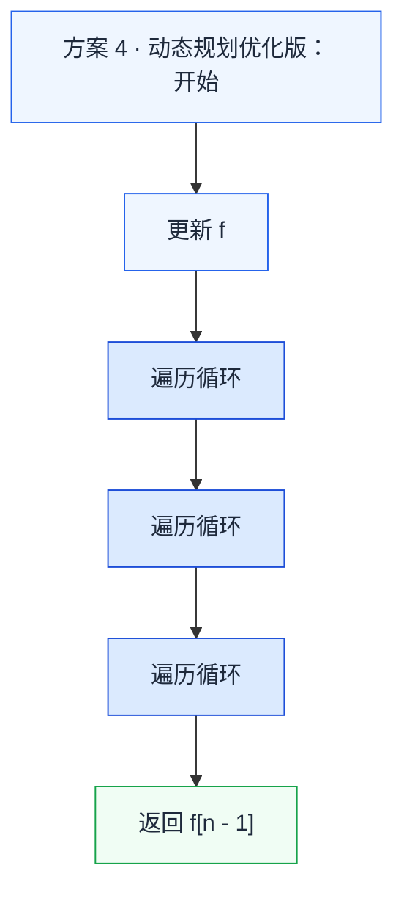

```java
package com.webfault.dsa; // 引入依赖

class lc62_solution444 { // 定义类型
  // 不同路径：一维动态规划（忠实翻译 Python ref_uniquePaths）
  // dp = [1]*n; for _ in range(1, m): for j in range(1, n): dp[j] += dp[j-1]
  static int uniquePaths(int m, int n) { // 定义函数/方法 uniquePaths
    int[] f = new int[n]; // 把 new int[元素个数]; 写入 int[] f
    for (int i = 0; i < n; i++) f[i] = 1; // 让 下标 i 从 0 开始计数，下标 i 小于 元素个数 就继续
    for (int i = 1; i < m; i++) // 让 下标 i 从 1 开始计数，下标 i 小于 映射表 就继续
    for (int j = 1; j < n; j++) f[j] += f[j - 1]; // 让 下标 j 从 1 开始计数，下标 j 小于 元素个数 就继续
    return f[n - 1]; // 返回 f[元素个数 减 1]
  }

  public static void main(String[] args) { // public static void main(String[] args) {
    int[][] cases = {
      {3, 7, 28}, {3, 2, 3}, {1, 1, 1}
    }; // 把 {{3, 7, 28}, {3, 2, 3}, {1, 1, 1}}; 写入 int[][] cases
    for (int[] c : cases) { // for (int[] 字符 : cases) {
      int got = uniquePaths(c[0], c[1]); // 把 uniquePaths(字符[0], 字符[1]) 存入 got
      if (got != c[2]) { // 若 got 不等于 字符[2]
        System.out.println(
            "FAIL: uniquePaths(" + c[0] + "," + c[1] + ")=" + got + " want " + c[2]); // 打印输出
        System.exit(1); // System.exit(1);
      }
    }
    System.out.println("PASS"); // 全部用例通过，输出 PASS
  }
}
```

### Rust 实现（4 种方案）

Rust 的全部方案如下，每个方案都内嵌用例自测，可独立运行（老仓库 python/go 文件遵循「打印结果」约定）：

#### 方案 1：排列组合

**思路与代码分析**：核心是「排列组合」。Rust 版用所有权移动与切片借用改写同一逻辑，注意 Option 与引用边界。代码里依次做这些事：DP 表逐项填充。**走读**：方案 1 · 排列组合：开始 → 填写 DP 表 → 遍历 1..m 中的每个元素 _ → 遍历 1..n as usize 中的每个元素 j → 填写 DP 表 → 填写 DP 表 → 返回结果。

**运行架构**（真实控制流）：


```rust
// LeetCode 62. 不同路径 — Rust 版（方案1）
fn unique_paths(m: i32, n: i32) -> i32 {
    // 定义函数/方法 unique_paths
    let mut dp = vec![1i32; n as usize]; // 把 vec取反 [1i32; 元素个数 as usize]; 写入 let mut dp
    for _ in 1..m {
        // 逐个取出 1 的元素（_）
        for j in 1..n as usize {
            dp[j] += dp[j - 1];
        } // 逐个取出 1 的元素（下标 j）
    }
    dp[n as usize - 1] // DP 表[元素个数 as usize 减 1]
}
fn main() {
    assert_eq!(unique_paths(3, 7), 28);
    assert_eq!(unique_paths(3, 2), 3);
    assert_eq!(unique_paths(1, 1), 1);
    println!("PASS");
} // 程序入口：跑内嵌自测用例
```

#### 方案 2：组合优化版

**思路与代码分析**：核心是「组合优化版」。Rust 版用所有权移动与切片借用改写同一逻辑，注意 Option 与引用边界。代码里依次做这些事：DP 表逐项填充。**走读**：方案 2 · 组合优化版：开始 → 填写 DP 表 → 遍历 1..m 中的每个元素 _ → 遍历 1..n as usize 中的每个元素 j → 填写 DP 表 → 填写 DP 表 → 返回结果。

**运行架构**（真实控制流）：

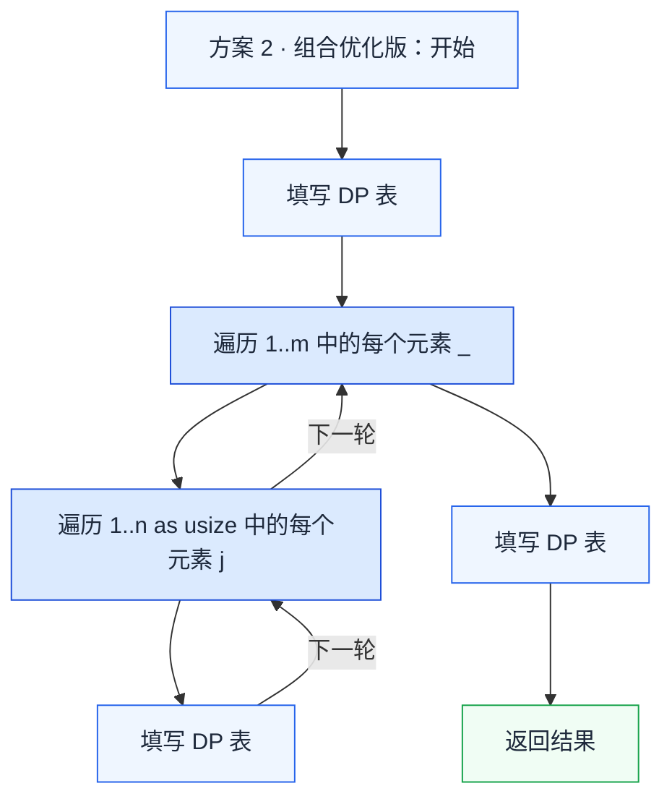

```rust
// LeetCode 62. 不同路径 — Rust 版（方案2）
fn unique_paths(m: i32, n: i32) -> i32 {
    // 定义函数/方法 unique_paths
    let mut dp = vec![1i32; n as usize]; // 把 vec取反 [1i32; 元素个数 as usize]; 写入 let mut dp
    for _ in 1..m {
        // 逐个取出 1 的元素（_）
        for j in 1..n as usize {
            dp[j] += dp[j - 1];
        } // 逐个取出 1 的元素（下标 j）
    }
    dp[n as usize - 1] // DP 表[元素个数 as usize 减 1]
}
fn main() {
    assert_eq!(unique_paths(3, 7), 28);
    assert_eq!(unique_paths(3, 2), 3);
    assert_eq!(unique_paths(1, 1), 1);
    println!("PASS");
} // 程序入口：跑内嵌自测用例
```

#### 方案 3：动态规划

**思路与代码分析**：核心是「动态规划」。Rust 版用所有权移动与切片借用改写同一逻辑，注意 Option 与引用边界。代码里依次做这些事：DP 表逐项填充。**走读**：方案 3 · 动态规划：开始 → 填写 DP 表 → 遍历 1..m 中的每个元素 _ → 遍历 1..n as usize 中的每个元素 j → 填写 DP 表 → 填写 DP 表 → 返回结果。

**运行架构**（真实控制流）：

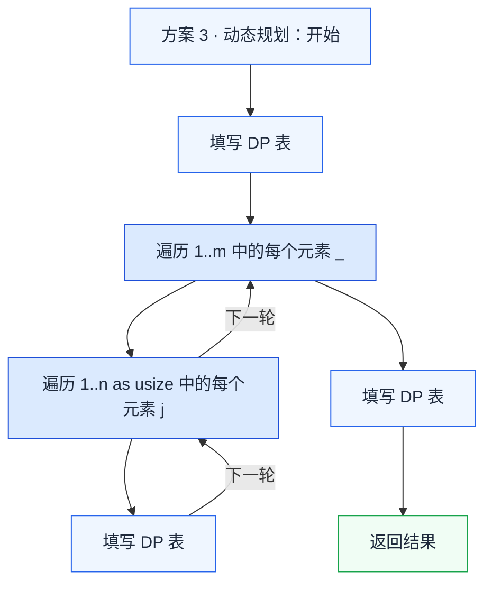

```rust
// LeetCode 62. 不同路径 — Rust 版（方案3）
fn unique_paths(m: i32, n: i32) -> i32 {
    // 定义函数/方法 unique_paths
    let mut dp = vec![1i32; n as usize]; // 把 vec取反 [1i32; 元素个数 as usize]; 写入 let mut dp
    for _ in 1..m {
        // 逐个取出 1 的元素（_）
        for j in 1..n as usize {
            dp[j] += dp[j - 1];
        } // 逐个取出 1 的元素（下标 j）
    }
    dp[n as usize - 1] // DP 表[元素个数 as usize 减 1]
}
fn main() {
    assert_eq!(unique_paths(3, 7), 28);
    assert_eq!(unique_paths(3, 2), 3);
    assert_eq!(unique_paths(1, 1), 1);
    println!("PASS");
} // 程序入口：跑内嵌自测用例
```

#### 方案 4：动态规划优化版

**思路与代码分析**：核心是「动态规划优化版」。Rust 版用所有权移动与切片借用改写同一逻辑，注意 Option 与引用边界。代码里依次做这些事：DP 表逐项填充。**走读**：方案 4 · 动态规划优化版：开始 → 填写 DP 表 → 遍历 1..m 中的每个元素 _ → 遍历 1..n as usize 中的每个元素 j → 填写 DP 表 → 填写 DP 表 → 返回结果。

**运行架构**（真实控制流）：

```mermaid
graph TD
    N0["方案 4 · 动态规划优化版：开始"]
    N1["填写 DP 表"]
    N2["遍历 1..m 中的每个元素 _"]
    N3["遍历 1..n as usize 中的每个元素 j"]
    N4["填写 DP 表"]
    N5["填写 DP 表"]
    N6["返回结果"]
    N0 --> N1
    N1 --> N2
    N2 --> N3
    N3 --> N4
    N4 -- 下一轮 --> N3
    N3 -- 下一轮 --> N2
    N2 --> N5
    N5 --> N6
    classDef n fill:#eff6ff,stroke:#2563eb,color:#1e293b;
    classDef lp fill:#dbeafe,stroke:#1d4ed8,color:#1e293b;
    classDef dc fill:#fef9c3,stroke:#ca8a04,color:#1e293b;
    classDef tm fill:#f0fdf4,stroke:#16a34a,color:#1e293b;
    class N0,N1,N4,N5 n;
    class N2,N3 lp;
    class N6 tm;
```

```rust
// LeetCode 62. 不同路径 — Rust 版（方案4）
fn unique_paths(m: i32, n: i32) -> i32 {
    // 定义函数/方法 unique_paths
    let mut dp = vec![1i32; n as usize]; // 把 vec取反 [1i32; 元素个数 as usize]; 写入 let mut dp
    for _ in 1..m {
        // 逐个取出 1 的元素（_）
        for j in 1..n as usize {
            dp[j] += dp[j - 1];
        } // 逐个取出 1 的元素（下标 j）
    }
    dp[n as usize - 1] // DP 表[元素个数 as usize 减 1]
}
fn main() {
    assert_eq!(unique_paths(3, 7), 28);
    assert_eq!(unique_paths(3, 2), 3);
    assert_eq!(unique_paths(1, 1), 1);
    println!("PASS");
} // 程序入口：跑内嵌自测用例
```

### Lua 实现（4 种方案）

Lua 的全部方案如下，每个方案都内嵌用例自测，可独立运行（老仓库 python/go 文件遵循「打印结果」约定）：

#### 方案 1：排列组合

**思路与代码分析**：核心是「排列组合」。Lua 版用表与 ipairs 遍历，注意 ipairs 遇 nil 即停的语义。代码里依次做这些事：DP 表逐项填充。**走读**：方案 1 · 排列组合：开始 → 填写 DP 表 → 循环 j：从 1 到 n do → 填写 DP 表 → 循环 _：从 2 到 m do → 循环 j：从 2 到 n do → 填写 DP 表 → 返回 dp[n]。

**运行架构**（真实控制流）：

```mermaid
graph TD
    N0["方案 1 · 排列组合：开始"]
    N1["填写 DP 表"]
    N2["循环 j：从 1 到 n do"]
    N3["填写 DP 表"]
    N4["循环 _：从 2 到 m do"]
    N5["循环 j：从 2 到 n do"]
    N6["填写 DP 表"]
    N7["返回 dp[n]"]
    N0 --> N1
    N1 --> N2
    N2 --> N3
    N3 --> N4
    N4 --> N5
    N5 --> N6
    N6 --> N7
    classDef n fill:#eff6ff,stroke:#2563eb,color:#1e293b;
    classDef lp fill:#dbeafe,stroke:#1d4ed8,color:#1e293b;
    classDef dc fill:#fef9c3,stroke:#ca8a04,color:#1e293b;
    classDef tm fill:#f0fdf4,stroke:#16a34a,color:#1e293b;
    class N0,N1,N3,N6 n;
    class N2,N4,N5 lp;
    class N7 tm;
```

```lua
-- LeetCode 62. 不同路径 — Lua 版（方案1）
local function unique_paths(m, n) -- local function unique_paths(映射表, 元素个数)
	local dp = {} -- 把 {} 写入 local dp
	for j = 1, n do
		dp[j] = 1
	end -- 让 下标 j 从 1 走到 元素个数（Lua 1 基）
	for _ = 2, m do -- 让 _ 从 2 走到 映射表（Lua 1 基）
		for j = 2, n do
			dp[j] = dp[j] + dp[j - 1]
		end -- 让 下标 j 从 2 走到 元素个数（Lua 1 基）
	end -- 终点
	return dp[n] -- 返回 DP 表[元素个数]
end -- 终点
assert(unique_paths(3, 7) == 28) -- 断言校验
assert(unique_paths(3, 2) == 3) -- 断言校验
assert(unique_paths(1, 1) == 1) -- 断言校验
print("PASS") -- 全部用例通过，输出 PASS
```

#### 方案 2：组合优化版

**思路与代码分析**：核心是「组合优化版」。Lua 版用表与 ipairs 遍历，注意 ipairs 遇 nil 即停的语义。代码里依次做这些事：DP 表逐项填充。**走读**：方案 2 · 组合优化版：开始 → 填写 DP 表 → 循环 j：从 1 到 n do → 填写 DP 表 → 循环 _：从 2 到 m do → 循环 j：从 2 到 n do → 填写 DP 表 → 返回 dp[n]。

**运行架构**（真实控制流）：

```mermaid
graph TD
    N0["方案 2 · 组合优化版：开始"]
    N1["填写 DP 表"]
    N2["循环 j：从 1 到 n do"]
    N3["填写 DP 表"]
    N4["循环 _：从 2 到 m do"]
    N5["循环 j：从 2 到 n do"]
    N6["填写 DP 表"]
    N7["返回 dp[n]"]
    N0 --> N1
    N1 --> N2
    N2 --> N3
    N3 --> N4
    N4 --> N5
    N5 --> N6
    N6 --> N7
    classDef n fill:#eff6ff,stroke:#2563eb,color:#1e293b;
    classDef lp fill:#dbeafe,stroke:#1d4ed8,color:#1e293b;
    classDef dc fill:#fef9c3,stroke:#ca8a04,color:#1e293b;
    classDef tm fill:#f0fdf4,stroke:#16a34a,color:#1e293b;
    class N0,N1,N3,N6 n;
    class N2,N4,N5 lp;
    class N7 tm;
```

```lua
-- LeetCode 62. 不同路径 — Lua 版（方案2）
local function unique_paths(m, n) -- local function unique_paths(映射表, 元素个数)
	local dp = {} -- 把 {} 写入 local dp
	for j = 1, n do
		dp[j] = 1
	end -- 让 下标 j 从 1 走到 元素个数（Lua 1 基）
	for _ = 2, m do -- 让 _ 从 2 走到 映射表（Lua 1 基）
		for j = 2, n do
			dp[j] = dp[j] + dp[j - 1]
		end -- 让 下标 j 从 2 走到 元素个数（Lua 1 基）
	end -- 终点
	return dp[n] -- 返回 DP 表[元素个数]
end -- 终点
assert(unique_paths(3, 7) == 28) -- 断言校验
assert(unique_paths(3, 2) == 3) -- 断言校验
assert(unique_paths(1, 1) == 1) -- 断言校验
print("PASS") -- 全部用例通过，输出 PASS
```

#### 方案 3：动态规划

**思路与代码分析**：核心是「动态规划」。Lua 版用表与 ipairs 遍历，注意 ipairs 遇 nil 即停的语义。代码里依次做这些事：DP 表逐项填充。**走读**：方案 3 · 动态规划：开始 → 填写 DP 表 → 循环 j：从 1 到 n do → 填写 DP 表 → 循环 _：从 2 到 m do → 循环 j：从 2 到 n do → 填写 DP 表 → 返回 dp[n]。

**运行架构**（真实控制流）：

```mermaid
graph TD
    N0["方案 3 · 动态规划：开始"]
    N1["填写 DP 表"]
    N2["循环 j：从 1 到 n do"]
    N3["填写 DP 表"]
    N4["循环 _：从 2 到 m do"]
    N5["循环 j：从 2 到 n do"]
    N6["填写 DP 表"]
    N7["返回 dp[n]"]
    N0 --> N1
    N1 --> N2
    N2 --> N3
    N3 --> N4
    N4 --> N5
    N5 --> N6
    N6 --> N7
    classDef n fill:#eff6ff,stroke:#2563eb,color:#1e293b;
    classDef lp fill:#dbeafe,stroke:#1d4ed8,color:#1e293b;
    classDef dc fill:#fef9c3,stroke:#ca8a04,color:#1e293b;
    classDef tm fill:#f0fdf4,stroke:#16a34a,color:#1e293b;
    class N0,N1,N3,N6 n;
    class N2,N4,N5 lp;
    class N7 tm;
```

```lua
-- LeetCode 62. 不同路径 — Lua 版（方案3）
local function unique_paths(m, n) -- local function unique_paths(映射表, 元素个数)
	local dp = {} -- 把 {} 写入 local dp
	for j = 1, n do
		dp[j] = 1
	end -- 让 下标 j 从 1 走到 元素个数（Lua 1 基）
	for _ = 2, m do -- 让 _ 从 2 走到 映射表（Lua 1 基）
		for j = 2, n do
			dp[j] = dp[j] + dp[j - 1]
		end -- 让 下标 j 从 2 走到 元素个数（Lua 1 基）
	end -- 终点
	return dp[n] -- 返回 DP 表[元素个数]
end -- 终点
assert(unique_paths(3, 7) == 28) -- 断言校验
assert(unique_paths(3, 2) == 3) -- 断言校验
assert(unique_paths(1, 1) == 1) -- 断言校验
print("PASS") -- 全部用例通过，输出 PASS
```

#### 方案 4：动态规划优化版

**思路与代码分析**：核心是「动态规划优化版」。Lua 版用表与 ipairs 遍历，注意 ipairs 遇 nil 即停的语义。代码里依次做这些事：DP 表逐项填充。**走读**：方案 4 · 动态规划优化版：开始 → 填写 DP 表 → 循环 j：从 1 到 n do → 填写 DP 表 → 循环 _：从 2 到 m do → 循环 j：从 2 到 n do → 填写 DP 表 → 返回 dp[n]。

**运行架构**（真实控制流）：

```mermaid
graph TD
    N0["方案 4 · 动态规划优化版：开始"]
    N1["填写 DP 表"]
    N2["循环 j：从 1 到 n do"]
    N3["填写 DP 表"]
    N4["循环 _：从 2 到 m do"]
    N5["循环 j：从 2 到 n do"]
    N6["填写 DP 表"]
    N7["返回 dp[n]"]
    N0 --> N1
    N1 --> N2
    N2 --> N3
    N3 --> N4
    N4 --> N5
    N5 --> N6
    N6 --> N7
    classDef n fill:#eff6ff,stroke:#2563eb,color:#1e293b;
    classDef lp fill:#dbeafe,stroke:#1d4ed8,color:#1e293b;
    classDef dc fill:#fef9c3,stroke:#ca8a04,color:#1e293b;
    classDef tm fill:#f0fdf4,stroke:#16a34a,color:#1e293b;
    class N0,N1,N3,N6 n;
    class N2,N4,N5 lp;
    class N7 tm;
```

```lua
-- LeetCode 62. 不同路径 — Lua 版（方案4）
local function unique_paths(m, n) -- local function unique_paths(映射表, 元素个数)
	local dp = {} -- 把 {} 写入 local dp
	for j = 1, n do
		dp[j] = 1
	end -- 让 下标 j 从 1 走到 元素个数（Lua 1 基）
	for _ = 2, m do -- 让 _ 从 2 走到 映射表（Lua 1 基）
		for j = 2, n do
			dp[j] = dp[j] + dp[j - 1]
		end -- 让 下标 j 从 2 走到 元素个数（Lua 1 基）
	end -- 终点
	return dp[n] -- 返回 DP 表[元素个数]
end -- 终点
assert(unique_paths(3, 7) == 28) -- 断言校验
assert(unique_paths(3, 2) == 3) -- 断言校验
assert(unique_paths(1, 1) == 1) -- 断言校验
print("PASS") -- 全部用例通过，输出 PASS
```

### C 实现（4 种方案）

C 的全部方案如下，每个方案都内嵌用例自测，可独立运行（老仓库 python/go 文件遵循「打印结果」约定）：

#### 方案 1：排列组合

**思路与代码分析**：核心是「排列组合」。C 版手动管理下标与内存，循环边界全部显式写出。代码里依次做这些事：DP 表逐项填充；双重循环遍历。**走读**：方案 1 · 排列组合：开始 → 填写 DP 表 → 遍历循环 → 填写 DP 表 → 遍历循环 → 遍历循环 → 填写 DP 表 → 返回 dp[n - 1]。

**运行架构**（真实控制流）：

```mermaid
graph TD
    N0["方案 1 · 排列组合：开始"]
    N1["填写 DP 表"]
    N2["遍历循环"]
    N3["填写 DP 表"]
    N4["遍历循环"]
    N5["遍历循环"]
    N6["填写 DP 表"]
    N7["返回 dp[n - 1]"]
    N0 --> N1
    N1 --> N2
    N2 --> N3
    N3 --> N4
    N4 --> N5
    N5 --> N6
    N6 --> N7
    classDef n fill:#eff6ff,stroke:#2563eb,color:#1e293b;
    classDef lp fill:#dbeafe,stroke:#1d4ed8,color:#1e293b;
    classDef dc fill:#fef9c3,stroke:#ca8a04,color:#1e293b;
    classDef tm fill:#f0fdf4,stroke:#16a34a,color:#1e293b;
    class N0,N1,N3,N6 n;
    class N2,N4,N5 lp;
    class N7 tm;
```

```c
/* LeetCode 62. 不同路径 — C 版（方案1） */
#include <stdio.h>                      // 引入头文件
static int unique_paths(int m, int n) { // 定义函数/方法 unique_paths
    int dp[101];                        // int DP 表[101];
    for (int j = 0; j < n; j++)
        dp[j] = 1;              // 让 下标 j 从 0 开始计数，下标 j 小于 元素个数 就继续
    for (int i = 1; i < m; i++) // 让 下标 i 从 1 开始计数，下标 i 小于 映射表 就继续
        for (int j = 1; j < n; j++)
            dp[j] += dp[j - 1]; // 让 下标 j 从 1 开始计数，下标 j 小于 元素个数 就继续
    return dp[n - 1];           // 返回 DP 表[元素个数 减 1]
}
int main(void) { // 程序入口：跑内嵌自测用例
    if (unique_paths(3, 7) != 28) {
        printf("FAIL 1\n");
        return 1;
    } // 若 unique_paths(3, 7) 不等于 28) { 输出「FAIL 1 」); return 1; }
    if (unique_paths(3, 2) != 3) {
        printf("FAIL 2\n");
        return 1;
    } // 若 unique_paths(3, 2) 不等于 3) { 输出「FAIL 2 」); return 1; }
    if (unique_paths(1, 1) != 1) {
        printf("FAIL 3\n");
        return 1;
    } // 若 unique_paths(1, 1) 不等于 1) { 输出「FAIL 3 」); return 1; }
    printf("PASS\n");
    return 0;
} // 全部用例通过，输出 PASS
```

#### 方案 2：组合优化版

**思路与代码分析**：核心是「组合优化版」。C 版手动管理下标与内存，循环边界全部显式写出。代码里依次做这些事：DP 表逐项填充；双重循环遍历。**走读**：方案 2 · 组合优化版：开始 → 填写 DP 表 → 遍历循环 → 填写 DP 表 → 遍历循环 → 遍历循环 → 填写 DP 表 → 返回 dp[n - 1]。

**运行架构**（真实控制流）：

```mermaid
graph TD
    N0["方案 2 · 组合优化版：开始"]
    N1["填写 DP 表"]
    N2["遍历循环"]
    N3["填写 DP 表"]
    N4["遍历循环"]
    N5["遍历循环"]
    N6["填写 DP 表"]
    N7["返回 dp[n - 1]"]
    N0 --> N1
    N1 --> N2
    N2 --> N3
    N3 --> N4
    N4 --> N5
    N5 --> N6
    N6 --> N7
    classDef n fill:#eff6ff,stroke:#2563eb,color:#1e293b;
    classDef lp fill:#dbeafe,stroke:#1d4ed8,color:#1e293b;
    classDef dc fill:#fef9c3,stroke:#ca8a04,color:#1e293b;
    classDef tm fill:#f0fdf4,stroke:#16a34a,color:#1e293b;
    class N0,N1,N3,N6 n;
    class N2,N4,N5 lp;
    class N7 tm;
```

```c
/* LeetCode 62. 不同路径 — C 版（方案2） */
#include <stdio.h>                      // 引入头文件
static int unique_paths(int m, int n) { // 定义函数/方法 unique_paths
    int dp[101];                        // int DP 表[101];
    for (int j = 0; j < n; j++)
        dp[j] = 1;              // 让 下标 j 从 0 开始计数，下标 j 小于 元素个数 就继续
    for (int i = 1; i < m; i++) // 让 下标 i 从 1 开始计数，下标 i 小于 映射表 就继续
        for (int j = 1; j < n; j++)
            dp[j] += dp[j - 1]; // 让 下标 j 从 1 开始计数，下标 j 小于 元素个数 就继续
    return dp[n - 1];           // 返回 DP 表[元素个数 减 1]
}
int main(void) { // 程序入口：跑内嵌自测用例
    if (unique_paths(3, 7) != 28) {
        printf("FAIL 1\n");
        return 1;
    } // 若 unique_paths(3, 7) 不等于 28) { 输出「FAIL 1 」); return 1; }
    if (unique_paths(3, 2) != 3) {
        printf("FAIL 2\n");
        return 1;
    } // 若 unique_paths(3, 2) 不等于 3) { 输出「FAIL 2 」); return 1; }
    if (unique_paths(1, 1) != 1) {
        printf("FAIL 3\n");
        return 1;
    } // 若 unique_paths(1, 1) 不等于 1) { 输出「FAIL 3 」); return 1; }
    printf("PASS\n");
    return 0;
} // 全部用例通过，输出 PASS
```

#### 方案 3：动态规划

**思路与代码分析**：核心是「动态规划」。C 版手动管理下标与内存，循环边界全部显式写出。代码里依次做这些事：DP 表逐项填充；双重循环遍历。**走读**：方案 3 · 动态规划：开始 → 填写 DP 表 → 遍历循环 → 填写 DP 表 → 遍历循环 → 遍历循环 → 填写 DP 表 → 返回 dp[n - 1]。

**运行架构**（真实控制流）：

```mermaid
graph TD
    N0["方案 3 · 动态规划：开始"]
    N1["填写 DP 表"]
    N2["遍历循环"]
    N3["填写 DP 表"]
    N4["遍历循环"]
    N5["遍历循环"]
    N6["填写 DP 表"]
    N7["返回 dp[n - 1]"]
    N0 --> N1
    N1 --> N2
    N2 --> N3
    N3 --> N4
    N4 --> N5
    N5 --> N6
    N6 --> N7
    classDef n fill:#eff6ff,stroke:#2563eb,color:#1e293b;
    classDef lp fill:#dbeafe,stroke:#1d4ed8,color:#1e293b;
    classDef dc fill:#fef9c3,stroke:#ca8a04,color:#1e293b;
    classDef tm fill:#f0fdf4,stroke:#16a34a,color:#1e293b;
    class N0,N1,N3,N6 n;
    class N2,N4,N5 lp;
    class N7 tm;
```

```c
/* LeetCode 62. 不同路径 — C 版（方案3） */
#include <stdio.h>                      // 引入头文件
static int unique_paths(int m, int n) { // 定义函数/方法 unique_paths
    int dp[101];                        // int DP 表[101];
    for (int j = 0; j < n; j++)
        dp[j] = 1;              // 让 下标 j 从 0 开始计数，下标 j 小于 元素个数 就继续
    for (int i = 1; i < m; i++) // 让 下标 i 从 1 开始计数，下标 i 小于 映射表 就继续
        for (int j = 1; j < n; j++)
            dp[j] += dp[j - 1]; // 让 下标 j 从 1 开始计数，下标 j 小于 元素个数 就继续
    return dp[n - 1];           // 返回 DP 表[元素个数 减 1]
}
int main(void) { // 程序入口：跑内嵌自测用例
    if (unique_paths(3, 7) != 28) {
        printf("FAIL 1\n");
        return 1;
    } // 若 unique_paths(3, 7) 不等于 28) { 输出「FAIL 1 」); return 1; }
    if (unique_paths(3, 2) != 3) {
        printf("FAIL 2\n");
        return 1;
    } // 若 unique_paths(3, 2) 不等于 3) { 输出「FAIL 2 」); return 1; }
    if (unique_paths(1, 1) != 1) {
        printf("FAIL 3\n");
        return 1;
    } // 若 unique_paths(1, 1) 不等于 1) { 输出「FAIL 3 」); return 1; }
    printf("PASS\n");
    return 0;
} // 全部用例通过，输出 PASS
```

#### 方案 4：动态规划优化版

**思路与代码分析**：核心是「动态规划优化版」。C 版手动管理下标与内存，循环边界全部显式写出。代码里依次做这些事：DP 表逐项填充；双重循环遍历。**走读**：方案 4 · 动态规划优化版：开始 → 填写 DP 表 → 遍历循环 → 填写 DP 表 → 遍历循环 → 遍历循环 → 填写 DP 表 → 返回 dp[n - 1]。

**运行架构**（真实控制流）：

```mermaid
graph TD
    N0["方案 4 · 动态规划优化版：开始"]
    N1["填写 DP 表"]
    N2["遍历循环"]
    N3["填写 DP 表"]
    N4["遍历循环"]
    N5["遍历循环"]
    N6["填写 DP 表"]
    N7["返回 dp[n - 1]"]
    N0 --> N1
    N1 --> N2
    N2 --> N3
    N3 --> N4
    N4 --> N5
    N5 --> N6
    N6 --> N7
    classDef n fill:#eff6ff,stroke:#2563eb,color:#1e293b;
    classDef lp fill:#dbeafe,stroke:#1d4ed8,color:#1e293b;
    classDef dc fill:#fef9c3,stroke:#ca8a04,color:#1e293b;
    classDef tm fill:#f0fdf4,stroke:#16a34a,color:#1e293b;
    class N0,N1,N3,N6 n;
    class N2,N4,N5 lp;
    class N7 tm;
```

```c
/* LeetCode 62. 不同路径 — C 版（方案4） */
#include <stdio.h>                      // 引入头文件
static int unique_paths(int m, int n) { // 定义函数/方法 unique_paths
    int dp[101];                        // int DP 表[101];
    for (int j = 0; j < n; j++)
        dp[j] = 1;              // 让 下标 j 从 0 开始计数，下标 j 小于 元素个数 就继续
    for (int i = 1; i < m; i++) // 让 下标 i 从 1 开始计数，下标 i 小于 映射表 就继续
        for (int j = 1; j < n; j++)
            dp[j] += dp[j - 1]; // 让 下标 j 从 1 开始计数，下标 j 小于 元素个数 就继续
    return dp[n - 1];           // 返回 DP 表[元素个数 减 1]
}
int main(void) { // 程序入口：跑内嵌自测用例
    if (unique_paths(3, 7) != 28) {
        printf("FAIL 1\n");
        return 1;
    } // 若 unique_paths(3, 7) 不等于 28) { 输出「FAIL 1 」); return 1; }
    if (unique_paths(3, 2) != 3) {
        printf("FAIL 2\n");
        return 1;
    } // 若 unique_paths(3, 2) 不等于 3) { 输出「FAIL 2 」); return 1; }
    if (unique_paths(1, 1) != 1) {
        printf("FAIL 3\n");
        return 1;
    } // 若 unique_paths(1, 1) 不等于 1) { 输出「FAIL 3 」); return 1; }
    printf("PASS\n");
    return 0;
} // 全部用例通过，输出 PASS
```

### C++ 实现（4 种方案）

C++ 的全部方案如下，每个方案都内嵌用例自测，可独立运行（老仓库 python/go 文件遵循「打印结果」约定）：

#### 方案 1：排列组合

**思路与代码分析**：核心是「排列组合」。C++ 版用 STL 容器与迭代器，减少手写下标错误。代码里依次做这些事：DP 表逐项填充；双重循环遍历。**走读**：方案 1 · 排列组合：开始 → 处理 std::vector＜int＞ dp(n, 1) → 遍历循环 → 遍历循环 → 填写 DP 表 → 返回 dp[n - 1]。

**运行架构**（真实控制流）：

```mermaid
graph TD
    N0["方案 1 · 排列组合：开始"]
    N1["处理 std::vector＜int＞ dp(n, 1)"]
    N2["遍历循环"]
    N3["遍历循环"]
    N4["填写 DP 表"]
    N5["返回 dp[n - 1]"]
    N0 --> N1
    N1 --> N2
    N2 --> N3
    N3 --> N4
    N4 --> N5
    classDef n fill:#eff6ff,stroke:#2563eb,color:#1e293b;
    classDef lp fill:#dbeafe,stroke:#1d4ed8,color:#1e293b;
    classDef dc fill:#fef9c3,stroke:#ca8a04,color:#1e293b;
    classDef tm fill:#f0fdf4,stroke:#16a34a,color:#1e293b;
    class N0,N1,N4 n;
    class N2,N3 lp;
    class N5 tm;
```

```cpp
// LeetCode 62. 不同路径 — C++ 版（方案1）
#include <cassert>                     // 引入头文件
#include <iostream>                    // 引入头文件
#include <vector>                      // 引入头文件
static int uniquePaths(int m, int n) { // 定义函数/方法 uniquePaths
    std::vector<int> dp(n, 1);         // std::vector 小于 int 超过 DP 表(元素个数, 1);
    for (int i = 1; i < m; ++i) // 让 下标 i 从 1 开始计数，下标 i 小于 映射表 就继续
        for (int j = 1; j < n; ++j)
            dp[j] += dp[j - 1]; // 让 下标 j 从 1 开始计数，下标 j 小于 元素个数 就继续
    return dp[n - 1];           // 返回 DP 表[元素个数 减 1]
}
int main() {
    assert(uniquePaths(3, 7) == 28);
    assert(uniquePaths(3, 2) == 3);
    assert(uniquePaths(1, 1) == 1);
    std::cout << "PASS" << std::endl;
} // 全部用例通过，输出 PASS
```

#### 方案 2：组合优化版

**思路与代码分析**：核心是「组合优化版」。C++ 版用 STL 容器与迭代器，减少手写下标错误。代码里依次做这些事：DP 表逐项填充；双重循环遍历。**走读**：方案 2 · 组合优化版：开始 → 处理 std::vector＜int＞ dp(n, 1) → 遍历循环 → 遍历循环 → 填写 DP 表 → 返回 dp[n - 1]。

**运行架构**（真实控制流）：

```mermaid
graph TD
    N0["方案 2 · 组合优化版：开始"]
    N1["处理 std::vector＜int＞ dp(n, 1)"]
    N2["遍历循环"]
    N3["遍历循环"]
    N4["填写 DP 表"]
    N5["返回 dp[n - 1]"]
    N0 --> N1
    N1 --> N2
    N2 --> N3
    N3 --> N4
    N4 --> N5
    classDef n fill:#eff6ff,stroke:#2563eb,color:#1e293b;
    classDef lp fill:#dbeafe,stroke:#1d4ed8,color:#1e293b;
    classDef dc fill:#fef9c3,stroke:#ca8a04,color:#1e293b;
    classDef tm fill:#f0fdf4,stroke:#16a34a,color:#1e293b;
    class N0,N1,N4 n;
    class N2,N3 lp;
    class N5 tm;
```

```cpp
// LeetCode 62. 不同路径 — C++ 版（方案2）
#include <cassert>                     // 引入头文件
#include <iostream>                    // 引入头文件
#include <vector>                      // 引入头文件
static int uniquePaths(int m, int n) { // 定义函数/方法 uniquePaths
    std::vector<int> dp(n, 1);         // std::vector 小于 int 超过 DP 表(元素个数, 1);
    for (int i = 1; i < m; ++i) // 让 下标 i 从 1 开始计数，下标 i 小于 映射表 就继续
        for (int j = 1; j < n; ++j)
            dp[j] += dp[j - 1]; // 让 下标 j 从 1 开始计数，下标 j 小于 元素个数 就继续
    return dp[n - 1];           // 返回 DP 表[元素个数 减 1]
}
int main() {
    assert(uniquePaths(3, 7) == 28);
    assert(uniquePaths(3, 2) == 3);
    assert(uniquePaths(1, 1) == 1);
    std::cout << "PASS" << std::endl;
} // 全部用例通过，输出 PASS
```

#### 方案 3：动态规划

**思路与代码分析**：核心是「动态规划」。C++ 版用 STL 容器与迭代器，减少手写下标错误。代码里依次做这些事：DP 表逐项填充；双重循环遍历。**走读**：方案 3 · 动态规划：开始 → 处理 std::vector＜int＞ dp(n, 1) → 遍历循环 → 遍历循环 → 填写 DP 表 → 返回 dp[n - 1]。

**运行架构**（真实控制流）：

```mermaid
graph TD
    N0["方案 3 · 动态规划：开始"]
    N1["处理 std::vector＜int＞ dp(n, 1)"]
    N2["遍历循环"]
    N3["遍历循环"]
    N4["填写 DP 表"]
    N5["返回 dp[n - 1]"]
    N0 --> N1
    N1 --> N2
    N2 --> N3
    N3 --> N4
    N4 --> N5
    classDef n fill:#eff6ff,stroke:#2563eb,color:#1e293b;
    classDef lp fill:#dbeafe,stroke:#1d4ed8,color:#1e293b;
    classDef dc fill:#fef9c3,stroke:#ca8a04,color:#1e293b;
    classDef tm fill:#f0fdf4,stroke:#16a34a,color:#1e293b;
    class N0,N1,N4 n;
    class N2,N3 lp;
    class N5 tm;
```

```cpp
// LeetCode 62. 不同路径 — C++ 版（方案3）
#include <cassert>                     // 引入头文件
#include <iostream>                    // 引入头文件
#include <vector>                      // 引入头文件
static int uniquePaths(int m, int n) { // 定义函数/方法 uniquePaths
    std::vector<int> dp(n, 1);         // std::vector 小于 int 超过 DP 表(元素个数, 1);
    for (int i = 1; i < m; ++i) // 让 下标 i 从 1 开始计数，下标 i 小于 映射表 就继续
        for (int j = 1; j < n; ++j)
            dp[j] += dp[j - 1]; // 让 下标 j 从 1 开始计数，下标 j 小于 元素个数 就继续
    return dp[n - 1];           // 返回 DP 表[元素个数 减 1]
}
int main() {
    assert(uniquePaths(3, 7) == 28);
    assert(uniquePaths(3, 2) == 3);
    assert(uniquePaths(1, 1) == 1);
    std::cout << "PASS" << std::endl;
} // 全部用例通过，输出 PASS
```

#### 方案 4：动态规划优化版

**思路与代码分析**：核心是「动态规划优化版」。C++ 版用 STL 容器与迭代器，减少手写下标错误。代码里依次做这些事：DP 表逐项填充；双重循环遍历。**走读**：方案 4 · 动态规划优化版：开始 → 处理 std::vector＜int＞ dp(n, 1) → 遍历循环 → 遍历循环 → 填写 DP 表 → 返回 dp[n - 1]。

**运行架构**（真实控制流）：

```mermaid
graph TD
    N0["方案 4 · 动态规划优化版：开始"]
    N1["处理 std::vector＜int＞ dp(n, 1)"]
    N2["遍历循环"]
    N3["遍历循环"]
    N4["填写 DP 表"]
    N5["返回 dp[n - 1]"]
    N0 --> N1
    N1 --> N2
    N2 --> N3
    N3 --> N4
    N4 --> N5
    classDef n fill:#eff6ff,stroke:#2563eb,color:#1e293b;
    classDef lp fill:#dbeafe,stroke:#1d4ed8,color:#1e293b;
    classDef dc fill:#fef9c3,stroke:#ca8a04,color:#1e293b;
    classDef tm fill:#f0fdf4,stroke:#16a34a,color:#1e293b;
    class N0,N1,N4 n;
    class N2,N3 lp;
    class N5 tm;
```

```cpp
// LeetCode 62. 不同路径 — C++ 版（方案4）
#include <cassert>                     // 引入头文件
#include <iostream>                    // 引入头文件
#include <vector>                      // 引入头文件
static int uniquePaths(int m, int n) { // 定义函数/方法 uniquePaths
    std::vector<int> dp(n, 1);         // std::vector 小于 int 超过 DP 表(元素个数, 1);
    for (int i = 1; i < m; ++i) // 让 下标 i 从 1 开始计数，下标 i 小于 映射表 就继续
        for (int j = 1; j < n; ++j)
            dp[j] += dp[j - 1]; // 让 下标 j 从 1 开始计数，下标 j 小于 元素个数 就继续
    return dp[n - 1];           // 返回 DP 表[元素个数 减 1]
}
int main() {
    assert(uniquePaths(3, 7) == 28);
    assert(uniquePaths(3, 2) == 3);
    assert(uniquePaths(1, 1) == 1);
    std::cout << "PASS" << std::endl;
} // 全部用例通过，输出 PASS
```

### R 实现（4 种方案）

R 的全部方案如下，每个方案都内嵌用例自测，可独立运行（老仓库 python/go 文件遵循「打印结果」约定）：

#### 方案 1：排列组合

**思路与代码分析**：核心是「排列组合」。R 版用向量化思维与 1 起始下标，注意 1:n 的降序陷阱。代码里依次做这些事：DP 表逐项填充；双重循环遍历。**走读**：方案 1 · 排列组合：开始 → 处理 dp ＜- rep(1L, n) → 若 m ≥ 2 且 n ≥ 2 则： → 循环 i：遍历 2:m) for (j in 2:n → 填写 DP 表 → 返回结果。

**运行架构**（真实控制流）：

```mermaid
graph TD
    N0["方案 1 · 排列组合：开始"]
    N1["处理 dp ＜- rep(1L, n)"]
    N2["若 m ≥ 2 且 n ≥ 2 则："]
    N3["循环 i：遍历 2:m) for (j in 2:n"]
    N4["填写 DP 表"]
    N5["返回结果"]
    N0 --> N1
    N1 --> N2
    N2 --> N3
    N3 --> N4
    N4 --> N5
    classDef n fill:#eff6ff,stroke:#2563eb,color:#1e293b;
    classDef lp fill:#dbeafe,stroke:#1d4ed8,color:#1e293b;
    classDef dc fill:#fef9c3,stroke:#ca8a04,color:#1e293b;
    classDef tm fill:#f0fdf4,stroke:#16a34a,color:#1e293b;
    class N0,N1,N2,N4 n;
    class N3 lp;
    class N5 tm;
```

```r
# 版（方案1） 定义函数 unique_paths（参数：映射表, 元素个数）
unique_paths <- function(m, n) {
    dp <- rep(1L, n)  # 把 rep(1L, 元素个数) 存入 DP 表
    if (m >= 2 && n >= 2) {
        # 若 映射表 不低于 2 且 元素个数 不低于 2
        for (i in 2:m) for (j in 2:n) dp[j] <- dp[j] + dp[j - 1]
    }
    dp[n]  # DP 表[元素个数]
}
stopifnot(unique_paths(3, 7) == 28)  # 断言校验
stopifnot(unique_paths(3, 2) == 3)  # 断言校验
stopifnot(unique_paths(1, 1) == 1)  # 断言校验
cat("PASS\n")  # 全部用例通过，输出 PASS
```

#### 方案 2：组合优化版

**思路与代码分析**：核心是「组合优化版」。R 版用向量化思维与 1 起始下标，注意 1:n 的降序陷阱。代码里依次做这些事：DP 表逐项填充；双重循环遍历。**走读**：方案 2 · 组合优化版：开始 → 处理 dp ＜- rep(1L, n) → 若 m ≥ 2 且 n ≥ 2 则： → 循环 i：遍历 2:m) for (j in 2:n → 填写 DP 表 → 返回结果。

**运行架构**（真实控制流）：

```mermaid
graph TD
    N0["方案 2 · 组合优化版：开始"]
    N1["处理 dp ＜- rep(1L, n)"]
    N2["若 m ≥ 2 且 n ≥ 2 则："]
    N3["循环 i：遍历 2:m) for (j in 2:n"]
    N4["填写 DP 表"]
    N5["返回结果"]
    N0 --> N1
    N1 --> N2
    N2 --> N3
    N3 --> N4
    N4 --> N5
    classDef n fill:#eff6ff,stroke:#2563eb,color:#1e293b;
    classDef lp fill:#dbeafe,stroke:#1d4ed8,color:#1e293b;
    classDef dc fill:#fef9c3,stroke:#ca8a04,color:#1e293b;
    classDef tm fill:#f0fdf4,stroke:#16a34a,color:#1e293b;
    class N0,N1,N2,N4 n;
    class N3 lp;
    class N5 tm;
```

```r
# 版（方案2） 定义函数 unique_paths（参数：映射表, 元素个数）
unique_paths <- function(m, n) {
    dp <- rep(1L, n)  # 把 rep(1L, 元素个数) 存入 DP 表
    if (m >= 2 && n >= 2) {
        # 若 映射表 不低于 2 且 元素个数 不低于 2
        for (i in 2:m) for (j in 2:n) dp[j] <- dp[j] + dp[j - 1]
    }
    dp[n]  # DP 表[元素个数]
}
stopifnot(unique_paths(3, 7) == 28)  # 断言校验
stopifnot(unique_paths(3, 2) == 3)  # 断言校验
stopifnot(unique_paths(1, 1) == 1)  # 断言校验
cat("PASS\n")  # 全部用例通过，输出 PASS
```

#### 方案 3：动态规划

**思路与代码分析**：核心是「动态规划」。R 版用向量化思维与 1 起始下标，注意 1:n 的降序陷阱。代码里依次做这些事：DP 表逐项填充；双重循环遍历。**走读**：方案 3 · 动态规划：开始 → 处理 dp ＜- rep(1L, n) → 若 m ≥ 2 且 n ≥ 2 则： → 循环 i：遍历 2:m) for (j in 2:n → 填写 DP 表 → 返回结果。

**运行架构**（真实控制流）：

```mermaid
graph TD
    N0["方案 3 · 动态规划：开始"]
    N1["处理 dp ＜- rep(1L, n)"]
    N2["若 m ≥ 2 且 n ≥ 2 则："]
    N3["循环 i：遍历 2:m) for (j in 2:n"]
    N4["填写 DP 表"]
    N5["返回结果"]
    N0 --> N1
    N1 --> N2
    N2 --> N3
    N3 --> N4
    N4 --> N5
    classDef n fill:#eff6ff,stroke:#2563eb,color:#1e293b;
    classDef lp fill:#dbeafe,stroke:#1d4ed8,color:#1e293b;
    classDef dc fill:#fef9c3,stroke:#ca8a04,color:#1e293b;
    classDef tm fill:#f0fdf4,stroke:#16a34a,color:#1e293b;
    class N0,N1,N2,N4 n;
    class N3 lp;
    class N5 tm;
```

```r
# 版（方案3） 定义函数 unique_paths（参数：映射表, 元素个数）
unique_paths <- function(m, n) {
    dp <- rep(1L, n)  # 把 rep(1L, 元素个数) 存入 DP 表
    if (m >= 2 && n >= 2) {
        # 若 映射表 不低于 2 且 元素个数 不低于 2
        for (i in 2:m) for (j in 2:n) dp[j] <- dp[j] + dp[j - 1]
    }
    dp[n]  # DP 表[元素个数]
}
stopifnot(unique_paths(3, 7) == 28)  # 断言校验
stopifnot(unique_paths(3, 2) == 3)  # 断言校验
stopifnot(unique_paths(1, 1) == 1)  # 断言校验
cat("PASS\n")  # 全部用例通过，输出 PASS
```

#### 方案 4：动态规划优化版

**思路与代码分析**：核心是「动态规划优化版」。R 版用向量化思维与 1 起始下标，注意 1:n 的降序陷阱。代码里依次做这些事：DP 表逐项填充；双重循环遍历。**走读**：方案 4 · 动态规划优化版：开始 → 处理 dp ＜- rep(1L, n) → 若 m ≥ 2 且 n ≥ 2 则： → 循环 i：遍历 2:m) for (j in 2:n → 填写 DP 表 → 返回结果。

**运行架构**（真实控制流）：

```mermaid
graph TD
    N0["方案 4 · 动态规划优化版：开始"]
    N1["处理 dp ＜- rep(1L, n)"]
    N2["若 m ≥ 2 且 n ≥ 2 则："]
    N3["循环 i：遍历 2:m) for (j in 2:n"]
    N4["填写 DP 表"]
    N5["返回结果"]
    N0 --> N1
    N1 --> N2
    N2 --> N3
    N3 --> N4
    N4 --> N5
    classDef n fill:#eff6ff,stroke:#2563eb,color:#1e293b;
    classDef lp fill:#dbeafe,stroke:#1d4ed8,color:#1e293b;
    classDef dc fill:#fef9c3,stroke:#ca8a04,color:#1e293b;
    classDef tm fill:#f0fdf4,stroke:#16a34a,color:#1e293b;
    class N0,N1,N2,N4 n;
    class N3 lp;
    class N5 tm;
```

```r
# 版（方案4） 定义函数 unique_paths（参数：映射表, 元素个数）
unique_paths <- function(m, n) {
    dp <- rep(1L, n)  # 把 rep(1L, 元素个数) 存入 DP 表
    if (m >= 2 && n >= 2) {
        # 若 映射表 不低于 2 且 元素个数 不低于 2
        for (i in 2:m) for (j in 2:n) dp[j] <- dp[j] + dp[j - 1]
    }
    dp[n]  # DP 表[元素个数]
}
stopifnot(unique_paths(3, 7) == 28)  # 断言校验
stopifnot(unique_paths(3, 2) == 3)  # 断言校验
stopifnot(unique_paths(1, 1) == 1)  # 断言校验
cat("PASS\n")  # 全部用例通过，输出 PASS
```

### Zig 实现（4 种方案）

Zig 的全部方案如下，每个方案都内嵌用例自测，可独立运行（老仓库 python/go 文件遵循「打印结果」约定）：

#### 方案 1：排列组合

**思路与代码分析**：核心是「排列组合」。Zig 版显式分配与清零，整型边界处理严格。代码里依次做这些事：DP 表逐项填充；单循环线性扫描。**走读**：方案 1 · 排列组合：开始 → 计算 dp → 遍历集合元素 → 计算 i → 当 (i ＜ m) : (i += 1) 时反复执行 → 计算 j → 当 (j ＜ @as(usize, @intCast(n))) : (j += 1) dp[j] += dp[j - 1] 时反复执行 → 返回 dp[@intCast(n - 1)]。

**运行架构**（真实控制流）：

```mermaid
graph TD
    N0["方案 1 · 排列组合：开始"]
    N1["计算 dp"]
    N2["遍历集合元素"]
    N3["计算 i"]
    N4["当 (i ＜ m) : (i += 1) 时反复执行"]
    N5["计算 j"]
    N6["当 (j ＜ @as(usize, @intCast(n))) : (j += 1) dp[j] += dp[j - 1] 时反复执行"]
    N7["返回 dp[@intCast(n - 1)]"]
    N0 --> N1
    N1 --> N2
    N2 --> N3
    N3 --> N4
    N4 --> N5
    N5 --> N6
    N6 -- 下一轮 --> N4
    N4 --> N7
    classDef n fill:#eff6ff,stroke:#2563eb,color:#1e293b;
    classDef lp fill:#dbeafe,stroke:#1d4ed8,color:#1e293b;
    classDef dc fill:#fef9c3,stroke:#ca8a04,color:#1e293b;
    classDef tm fill:#f0fdf4,stroke:#16a34a,color:#1e293b;
    class N0,N1,N3,N5 n;
    class N2,N4,N6 lp;
    class N7 tm;
```

```zig
// LeetCode 62. 不同路径 — Zig 版（方案1）
const std = @import("std"); // 把 @import(「std」) 存入 std
fn uniquePaths(m: i32, n: i32) i32 { // 定义函数/方法 uniquePaths
    var dp: [101]i32 = undefined; // 把 undefined; 写入 var dp: [101]i32
    for (0..@intCast(n)) |j| dp[j] = 1; // 把 1; 写入 for (0..@intCast(n)) |j| dp[j]
    var i: i32 = 1; // 把 1; 写入 var i: i32
    while (i < m) : (i += 1) { // 循环，直到不满足「下标 i 小于 映射表) : (下标 i 累加 1」
        var j: usize = 1; // 把 1; 写入 var j: usize
        while (j < @as(usize, @intCast(n))) : (j += 1) dp[j] += dp[j - 1];
    }
    return dp[@intCast(n - 1)]; // 返回 DP 表[@intCast(元素个数 减 1)]
}
pub fn main() !void { // 程序入口：跑内嵌自测用例
    if (uniquePaths(3, 7) != 28) return error.TestFailed; // 若 uniquePaths(3, 7) 不等于 28，直接返回 error.TestFailed
    if (uniquePaths(3, 2) != 3) return error.TestFailed; // 若 uniquePaths(3, 2) 不等于 3，直接返回 error.TestFailed
    if (uniquePaths(1, 1) != 1) return error.TestFailed; // 若 uniquePaths(1, 1) 不等于 1，直接返回 error.TestFailed
    std.debug.print("PASS\n", .{});
} // 全部用例通过，输出 PASS
```

#### 方案 2：组合优化版

**思路与代码分析**：核心是「组合优化版」。Zig 版显式分配与清零，整型边界处理严格。代码里依次做这些事：DP 表逐项填充；单循环线性扫描。**走读**：方案 2 · 组合优化版：开始 → 计算 dp → 遍历集合元素 → 计算 i → 当 (i ＜ m) : (i += 1) 时反复执行 → 计算 j → 当 (j ＜ @as(usize, @intCast(n))) : (j += 1) dp[j] += dp[j - 1] 时反复执行 → 返回 dp[@intCast(n - 1)]。

**运行架构**（真实控制流）：

```mermaid
graph TD
    N0["方案 2 · 组合优化版：开始"]
    N1["计算 dp"]
    N2["遍历集合元素"]
    N3["计算 i"]
    N4["当 (i ＜ m) : (i += 1) 时反复执行"]
    N5["计算 j"]
    N6["当 (j ＜ @as(usize, @intCast(n))) : (j += 1) dp[j] += dp[j - 1] 时反复执行"]
    N7["返回 dp[@intCast(n - 1)]"]
    N0 --> N1
    N1 --> N2
    N2 --> N3
    N3 --> N4
    N4 --> N5
    N5 --> N6
    N6 -- 下一轮 --> N4
    N4 --> N7
    classDef n fill:#eff6ff,stroke:#2563eb,color:#1e293b;
    classDef lp fill:#dbeafe,stroke:#1d4ed8,color:#1e293b;
    classDef dc fill:#fef9c3,stroke:#ca8a04,color:#1e293b;
    classDef tm fill:#f0fdf4,stroke:#16a34a,color:#1e293b;
    class N0,N1,N3,N5 n;
    class N2,N4,N6 lp;
    class N7 tm;
```

```zig
// LeetCode 62. 不同路径 — Zig 版（方案2）
const std = @import("std"); // 把 @import(「std」) 存入 std
fn uniquePaths(m: i32, n: i32) i32 { // 定义函数/方法 uniquePaths
    var dp: [101]i32 = undefined; // 把 undefined; 写入 var dp: [101]i32
    for (0..@intCast(n)) |j| dp[j] = 1; // 把 1; 写入 for (0..@intCast(n)) |j| dp[j]
    var i: i32 = 1; // 把 1; 写入 var i: i32
    while (i < m) : (i += 1) { // 循环，直到不满足「下标 i 小于 映射表) : (下标 i 累加 1」
        var j: usize = 1; // 把 1; 写入 var j: usize
        while (j < @as(usize, @intCast(n))) : (j += 1) dp[j] += dp[j - 1];
    }
    return dp[@intCast(n - 1)]; // 返回 DP 表[@intCast(元素个数 减 1)]
}
pub fn main() !void { // 程序入口：跑内嵌自测用例
    if (uniquePaths(3, 7) != 28) return error.TestFailed; // 若 uniquePaths(3, 7) 不等于 28，直接返回 error.TestFailed
    if (uniquePaths(3, 2) != 3) return error.TestFailed; // 若 uniquePaths(3, 2) 不等于 3，直接返回 error.TestFailed
    if (uniquePaths(1, 1) != 1) return error.TestFailed; // 若 uniquePaths(1, 1) 不等于 1，直接返回 error.TestFailed
    std.debug.print("PASS\n", .{});
} // 全部用例通过，输出 PASS
```

#### 方案 3：动态规划

**思路与代码分析**：核心是「动态规划」。Zig 版显式分配与清零，整型边界处理严格。代码里依次做这些事：DP 表逐项填充；单循环线性扫描。**走读**：方案 3 · 动态规划：开始 → 计算 dp → 遍历集合元素 → 计算 i → 当 (i ＜ m) : (i += 1) 时反复执行 → 计算 j → 当 (j ＜ @as(usize, @intCast(n))) : (j += 1) dp[j] += dp[j - 1] 时反复执行 → 返回 dp[@intCast(n - 1)]。

**运行架构**（真实控制流）：

```mermaid
graph TD
    N0["方案 3 · 动态规划：开始"]
    N1["计算 dp"]
    N2["遍历集合元素"]
    N3["计算 i"]
    N4["当 (i ＜ m) : (i += 1) 时反复执行"]
    N5["计算 j"]
    N6["当 (j ＜ @as(usize, @intCast(n))) : (j += 1) dp[j] += dp[j - 1] 时反复执行"]
    N7["返回 dp[@intCast(n - 1)]"]
    N0 --> N1
    N1 --> N2
    N2 --> N3
    N3 --> N4
    N4 --> N5
    N5 --> N6
    N6 -- 下一轮 --> N4
    N4 --> N7
    classDef n fill:#eff6ff,stroke:#2563eb,color:#1e293b;
    classDef lp fill:#dbeafe,stroke:#1d4ed8,color:#1e293b;
    classDef dc fill:#fef9c3,stroke:#ca8a04,color:#1e293b;
    classDef tm fill:#f0fdf4,stroke:#16a34a,color:#1e293b;
    class N0,N1,N3,N5 n;
    class N2,N4,N6 lp;
    class N7 tm;
```

```zig
// LeetCode 62. 不同路径 — Zig 版（方案3）
const std = @import("std"); // 把 @import(「std」) 存入 std
fn uniquePaths(m: i32, n: i32) i32 { // 定义函数/方法 uniquePaths
    var dp: [101]i32 = undefined; // 把 undefined; 写入 var dp: [101]i32
    for (0..@intCast(n)) |j| dp[j] = 1; // 把 1; 写入 for (0..@intCast(n)) |j| dp[j]
    var i: i32 = 1; // 把 1; 写入 var i: i32
    while (i < m) : (i += 1) { // 循环，直到不满足「下标 i 小于 映射表) : (下标 i 累加 1」
        var j: usize = 1; // 把 1; 写入 var j: usize
        while (j < @as(usize, @intCast(n))) : (j += 1) dp[j] += dp[j - 1];
    }
    return dp[@intCast(n - 1)]; // 返回 DP 表[@intCast(元素个数 减 1)]
}
pub fn main() !void { // 程序入口：跑内嵌自测用例
    if (uniquePaths(3, 7) != 28) return error.TestFailed; // 若 uniquePaths(3, 7) 不等于 28，直接返回 error.TestFailed
    if (uniquePaths(3, 2) != 3) return error.TestFailed; // 若 uniquePaths(3, 2) 不等于 3，直接返回 error.TestFailed
    if (uniquePaths(1, 1) != 1) return error.TestFailed; // 若 uniquePaths(1, 1) 不等于 1，直接返回 error.TestFailed
    std.debug.print("PASS\n", .{});
} // 全部用例通过，输出 PASS
```

#### 方案 4：动态规划优化版

**思路与代码分析**：核心是「动态规划优化版」。Zig 版显式分配与清零，整型边界处理严格。代码里依次做这些事：DP 表逐项填充；单循环线性扫描。**走读**：方案 4 · 动态规划优化版：开始 → 计算 dp → 遍历集合元素 → 计算 i → 当 (i ＜ m) : (i += 1) 时反复执行 → 计算 j → 当 (j ＜ @as(usize, @intCast(n))) : (j += 1) dp[j] += dp[j - 1] 时反复执行 → 返回 dp[@intCast(n - 1)]。

**运行架构**（真实控制流）：

```mermaid
graph TD
    N0["方案 4 · 动态规划优化版：开始"]
    N1["计算 dp"]
    N2["遍历集合元素"]
    N3["计算 i"]
    N4["当 (i ＜ m) : (i += 1) 时反复执行"]
    N5["计算 j"]
    N6["当 (j ＜ @as(usize, @intCast(n))) : (j += 1) dp[j] += dp[j - 1] 时反复执行"]
    N7["返回 dp[@intCast(n - 1)]"]
    N0 --> N1
    N1 --> N2
    N2 --> N3
    N3 --> N4
    N4 --> N5
    N5 --> N6
    N6 -- 下一轮 --> N4
    N4 --> N7
    classDef n fill:#eff6ff,stroke:#2563eb,color:#1e293b;
    classDef lp fill:#dbeafe,stroke:#1d4ed8,color:#1e293b;
    classDef dc fill:#fef9c3,stroke:#ca8a04,color:#1e293b;
    classDef tm fill:#f0fdf4,stroke:#16a34a,color:#1e293b;
    class N0,N1,N3,N5 n;
    class N2,N4,N6 lp;
    class N7 tm;
```

```zig
// LeetCode 62. 不同路径 — Zig 版（方案4）
const std = @import("std"); // 把 @import(「std」) 存入 std
fn uniquePaths(m: i32, n: i32) i32 { // 定义函数/方法 uniquePaths
    var dp: [101]i32 = undefined; // 把 undefined; 写入 var dp: [101]i32
    for (0..@intCast(n)) |j| dp[j] = 1; // 把 1; 写入 for (0..@intCast(n)) |j| dp[j]
    var i: i32 = 1; // 把 1; 写入 var i: i32
    while (i < m) : (i += 1) { // 循环，直到不满足「下标 i 小于 映射表) : (下标 i 累加 1」
        var j: usize = 1; // 把 1; 写入 var j: usize
        while (j < @as(usize, @intCast(n))) : (j += 1) dp[j] += dp[j - 1];
    }
    return dp[@intCast(n - 1)]; // 返回 DP 表[@intCast(元素个数 减 1)]
}
pub fn main() !void { // 程序入口：跑内嵌自测用例
    if (uniquePaths(3, 7) != 28) return error.TestFailed; // 若 uniquePaths(3, 7) 不等于 28，直接返回 error.TestFailed
    if (uniquePaths(3, 2) != 3) return error.TestFailed; // 若 uniquePaths(3, 2) 不等于 3，直接返回 error.TestFailed
    if (uniquePaths(1, 1) != 1) return error.TestFailed; // 若 uniquePaths(1, 1) 不等于 1，直接返回 error.TestFailed
    std.debug.print("PASS\n", .{});
} // 全部用例通过，输出 PASS
```

### Dart 实现（4 种方案）

Dart 的全部方案如下，每个方案都内嵌用例自测，可独立运行（老仓库 python/go 文件遵循「打印结果」约定）：

#### 方案 1：排列组合

**思路与代码分析**：核心是「排列组合」。Dart 版用可空类型标注与集合方法，注意空安全。代码里依次做这些事：DP 表逐项填充；双重循环遍历。**走读**：方案 1 · 排列组合：开始 → 填写 DP 表 → 处理 n, → 处理 1, → 处理 ) → 遍历循环 → 遍历循环 → 填写 DP 表 → 返回 dp[n - 1]。

**运行架构**（真实控制流）：

```mermaid
graph TD
    N0["方案 1 · 排列组合：开始"]
    N1["填写 DP 表"]
    N2["处理 n,"]
    N3["处理 1,"]
    N4["处理 )"]
    N5["遍历循环"]
    N6["遍历循环"]
    N7["填写 DP 表"]
    N8["返回 dp[n - 1]"]
    N0 --> N1
    N1 --> N2
    N2 --> N3
    N3 --> N4
    N4 --> N5
    N5 --> N6
    N6 --> N7
    N7 -- 下一轮 --> N5
    N5 --> N8
    classDef n fill:#eff6ff,stroke:#2563eb,color:#1e293b;
    classDef lp fill:#dbeafe,stroke:#1d4ed8,color:#1e293b;
    classDef dc fill:#fef9c3,stroke:#ca8a04,color:#1e293b;
    classDef tm fill:#f0fdf4,stroke:#16a34a,color:#1e293b;
    class N0,N1,N2,N3,N4,N7 n;
    class N5,N6 lp;
    class N8 tm;
```

```dart
// LeetCode 62. 不同路径 — Dart 版（方案1）
int uniquePaths(int m, int n) {
  // 定义函数/方法 uniquePaths
  final dp = List<int>.filled(
    n,
    1,
  ); // 把 List 小于 int 超过 .filled(元素个数, 1) 存入 DP 表
  for (var i = 1; i < m; i++) {
    // 让 下标 i 从 1 开始计数，下标 i 小于 映射表 就继续
    for (var j = 1; j < n; j++)
      dp[j] += dp[j - 1]; // 让 下标 j 从 1 开始计数，下标 j 小于 元素个数 就继续
  }
  return dp[n - 1]; // 返回 DP 表[元素个数 减 1]
}

void main() {
  if (uniquePaths(3, 7) != 28) throw StateError('c1');
  if (uniquePaths(3, 2) != 3) throw StateError('c2');
  if (uniquePaths(1, 1) != 1) throw StateError('c3');
  print('PASS');
} // 全部用例通过，输出 PASS
```

#### 方案 2：组合优化版

**思路与代码分析**：核心是「组合优化版」。Dart 版用可空类型标注与集合方法，注意空安全。代码里依次做这些事：DP 表逐项填充；双重循环遍历。**走读**：方案 2 · 组合优化版：开始 → 填写 DP 表 → 处理 n, → 处理 1, → 处理 ) → 遍历循环 → 遍历循环 → 填写 DP 表 → 返回 dp[n - 1]。

**运行架构**（真实控制流）：

```mermaid
graph TD
    N0["方案 2 · 组合优化版：开始"]
    N1["填写 DP 表"]
    N2["处理 n,"]
    N3["处理 1,"]
    N4["处理 )"]
    N5["遍历循环"]
    N6["遍历循环"]
    N7["填写 DP 表"]
    N8["返回 dp[n - 1]"]
    N0 --> N1
    N1 --> N2
    N2 --> N3
    N3 --> N4
    N4 --> N5
    N5 --> N6
    N6 --> N7
    N7 -- 下一轮 --> N5
    N5 --> N8
    classDef n fill:#eff6ff,stroke:#2563eb,color:#1e293b;
    classDef lp fill:#dbeafe,stroke:#1d4ed8,color:#1e293b;
    classDef dc fill:#fef9c3,stroke:#ca8a04,color:#1e293b;
    classDef tm fill:#f0fdf4,stroke:#16a34a,color:#1e293b;
    class N0,N1,N2,N3,N4,N7 n;
    class N5,N6 lp;
    class N8 tm;
```

```dart
// LeetCode 62. 不同路径 — Dart 版（方案2）
int uniquePaths(int m, int n) {
  // 定义函数/方法 uniquePaths
  final dp = List<int>.filled(
    n,
    1,
  ); // 把 List 小于 int 超过 .filled(元素个数, 1) 存入 DP 表
  for (var i = 1; i < m; i++) {
    // 让 下标 i 从 1 开始计数，下标 i 小于 映射表 就继续
    for (var j = 1; j < n; j++)
      dp[j] += dp[j - 1]; // 让 下标 j 从 1 开始计数，下标 j 小于 元素个数 就继续
  }
  return dp[n - 1]; // 返回 DP 表[元素个数 减 1]
}

void main() {
  if (uniquePaths(3, 7) != 28) throw StateError('c1');
  if (uniquePaths(3, 2) != 3) throw StateError('c2');
  if (uniquePaths(1, 1) != 1) throw StateError('c3');
  print('PASS');
} // 全部用例通过，输出 PASS
```

#### 方案 3：动态规划

**思路与代码分析**：核心是「动态规划」。Dart 版用可空类型标注与集合方法，注意空安全。代码里依次做这些事：DP 表逐项填充；双重循环遍历。**走读**：方案 3 · 动态规划：开始 → 填写 DP 表 → 处理 n, → 处理 1, → 处理 ) → 遍历循环 → 遍历循环 → 填写 DP 表 → 返回 dp[n - 1]。

**运行架构**（真实控制流）：

```mermaid
graph TD
    N0["方案 3 · 动态规划：开始"]
    N1["填写 DP 表"]
    N2["处理 n,"]
    N3["处理 1,"]
    N4["处理 )"]
    N5["遍历循环"]
    N6["遍历循环"]
    N7["填写 DP 表"]
    N8["返回 dp[n - 1]"]
    N0 --> N1
    N1 --> N2
    N2 --> N3
    N3 --> N4
    N4 --> N5
    N5 --> N6
    N6 --> N7
    N7 -- 下一轮 --> N5
    N5 --> N8
    classDef n fill:#eff6ff,stroke:#2563eb,color:#1e293b;
    classDef lp fill:#dbeafe,stroke:#1d4ed8,color:#1e293b;
    classDef dc fill:#fef9c3,stroke:#ca8a04,color:#1e293b;
    classDef tm fill:#f0fdf4,stroke:#16a34a,color:#1e293b;
    class N0,N1,N2,N3,N4,N7 n;
    class N5,N6 lp;
    class N8 tm;
```

```dart
// LeetCode 62. 不同路径 — Dart 版（方案3）
int uniquePaths(int m, int n) {
  // 定义函数/方法 uniquePaths
  final dp = List<int>.filled(
    n,
    1,
  ); // 把 List 小于 int 超过 .filled(元素个数, 1) 存入 DP 表
  for (var i = 1; i < m; i++) {
    // 让 下标 i 从 1 开始计数，下标 i 小于 映射表 就继续
    for (var j = 1; j < n; j++)
      dp[j] += dp[j - 1]; // 让 下标 j 从 1 开始计数，下标 j 小于 元素个数 就继续
  }
  return dp[n - 1]; // 返回 DP 表[元素个数 减 1]
}

void main() {
  if (uniquePaths(3, 7) != 28) throw StateError('c1');
  if (uniquePaths(3, 2) != 3) throw StateError('c2');
  if (uniquePaths(1, 1) != 1) throw StateError('c3');
  print('PASS');
} // 全部用例通过，输出 PASS
```

#### 方案 4：动态规划优化版

**思路与代码分析**：核心是「动态规划优化版」。Dart 版用可空类型标注与集合方法，注意空安全。代码里依次做这些事：DP 表逐项填充；双重循环遍历。**走读**：方案 4 · 动态规划优化版：开始 → 填写 DP 表 → 处理 n, → 处理 1, → 处理 ) → 遍历循环 → 遍历循环 → 填写 DP 表 → 返回 dp[n - 1]。

**运行架构**（真实控制流）：

```mermaid
graph TD
    N0["方案 4 · 动态规划优化版：开始"]
    N1["填写 DP 表"]
    N2["处理 n,"]
    N3["处理 1,"]
    N4["处理 )"]
    N5["遍历循环"]
    N6["遍历循环"]
    N7["填写 DP 表"]
    N8["返回 dp[n - 1]"]
    N0 --> N1
    N1 --> N2
    N2 --> N3
    N3 --> N4
    N4 --> N5
    N5 --> N6
    N6 --> N7
    N7 -- 下一轮 --> N5
    N5 --> N8
    classDef n fill:#eff6ff,stroke:#2563eb,color:#1e293b;
    classDef lp fill:#dbeafe,stroke:#1d4ed8,color:#1e293b;
    classDef dc fill:#fef9c3,stroke:#ca8a04,color:#1e293b;
    classDef tm fill:#f0fdf4,stroke:#16a34a,color:#1e293b;
    class N0,N1,N2,N3,N4,N7 n;
    class N5,N6 lp;
    class N8 tm;
```

```dart
// LeetCode 62. 不同路径 — Dart 版（方案4）
int uniquePaths(int m, int n) {
  // 定义函数/方法 uniquePaths
  final dp = List<int>.filled(
    n,
    1,
  ); // 把 List 小于 int 超过 .filled(元素个数, 1) 存入 DP 表
  for (var i = 1; i < m; i++) {
    // 让 下标 i 从 1 开始计数，下标 i 小于 映射表 就继续
    for (var j = 1; j < n; j++)
      dp[j] += dp[j - 1]; // 让 下标 j 从 1 开始计数，下标 j 小于 元素个数 就继续
  }
  return dp[n - 1]; // 返回 DP 表[元素个数 减 1]
}

void main() {
  if (uniquePaths(3, 7) != 28) throw StateError('c1');
  if (uniquePaths(3, 2) != 3) throw StateError('c2');
  if (uniquePaths(1, 1) != 1) throw StateError('c3');
  print('PASS');
} // 全部用例通过，输出 PASS
```

---

## 内容总结

- **不同路径**（动态规划 · Medium）：共 4 个方案，主线思路「排列组合」；时间 O(n)（单趟线性扫描）；动画演示DP 表填充过程，附录给出 11 种语言 × 全部方案的可运行实现。
- 来源博客：[https://blog.csdn.net/tyro_java/article/details/144847773](https://blog.csdn.net/tyro_java/article/details/144847773)
- 导航：[📋 总目录](../) ｜ [← 181 两个字符串的删除操作](../181_两个字符串的删除操作/) ｜ [183 不同路径 ii →](../183_不同路径_ii/)
