# 183 · 不同路径 ii（第十阶段 · 动态规划 · Medium）

> **难度**：⭐⭐ Medium ｜ **专题**：动态规划
> **学习定位**：第十阶段 · 动态规划第 183 篇 ｜ **解法数**：6
> **内容总结**：**不同路径 ii**（动态规划 · Medium）：共 6 个方案，主线思路「方案1（二维 DP）」；时间 O(n) 到 O(m·n)（取决于状态维度）；动画演示DP 表填充过程，附录给出 11 种语言 × 全部方案的可运行实现。

---

## 题目描述

给定一个 `m x n` 的整数数组 `grid`。一个机器人初始位于 左上角（即 `grid[0][0]`）。机器人尝试移动到 右下角（即 `grid[m - 1][n - 1]`）。机器人每次只能向下或者向右移动一步。

网格中的障碍物和空位置分别用 `1` 和 `0` 来表示。机器人的移动路径中不能包含 任何 有障碍物的方格。

返回机器人能够到达右下角的不同路径数量。

测试用例保证答案小于等于 `2  10^9`。

- 主函数签名：`function uniquePathsWithObstacles(obstacleGrid: number[][]): number`

**用例（来自原题）**：

**示例 1**

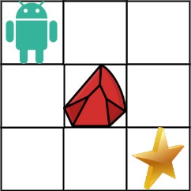

```text
输入：obstacleGrid = [[0,0,0],[0,1,0],[0,0,0]]
输出：2
```

解释：3x3 网格的正中间有一个障碍物。 从左上角到右下角一共有 2 条不同的路径： 1. 向右 -> 向右 -> 向下 -> 向下 2. 向下 -> 向下 -> 向右 -> 向右

**示例 2**


```text
输入：obstacleGrid = [[0,1],[0,0]]
输出：1
```
> ✅ **官方验证**：全部 TypeScript 解法已通过 leetcode.cn 官方示例用例验证（自动注入运行，全部 PASS）。题面与 [leetcode.cn 官方](https://leetcode.cn/problems/unique-paths-ii/)一致，示例配图取自官方题面。

**数据范围与注意事项**：

- `m == obstacleGrid.length`
- `n == obstacleGrid[i].length`
- `1 <= m, n <= 100`
- `obstacleGrid[i][j]` 为 `0` 或 `1`
- **易错点**：初始化（第 0 行或列）的含义要想清楚，它决定后续转移是否成立。

## 题目分析

**场景是什么**：把大问题拆成小问题并记住结果，对应真实开发里的编辑距离、资源规划。本题就是该场景的 Medium 级练习，主线做法是「方案1（二维 DP）」。

**主线怎么解**：把主解法从头到尾过一遍，它其实在依次做这几件事：DP 表逐项填充 → 双重循环遍历。

## 解题思路

**方案对比**（共 6 个方案，由浅入深）：

| 方案 | 时间复杂度 | 空间复杂度 |
|---|---|---|
| 方案 1 · 方案1（二维 DP） | O(n) 到 O(m·n)（取决于状态维度） | 即 DP 表大小 |
| 方案 2 · 方案2（一维 DP 滚动数组） | O(n²)（两层嵌套扫描） | O(1) 到 O(n) |
| 方案 3 · 直接实现 | O(n) 量级 | O(n) |
| 方案 4 · 迭代指针处理 | O(n)（单趟线性扫描） | O(1) 到 O(n)（视辅助结构） |
| 方案 5 · 迭代指针处理 | O(n)（单趟线性扫描） | O(1) 到 O(n)（视辅助结构） |
| 方案 6 · 直接实现 | O(n) 量级 | O(n) |

**由浅入深的路径**：方案1（二维 DP） → 方案2（一维 DP 滚动数组） → 直接实现 → 迭代指针处理；每往右一步，都在补上一步的短板。

**方案间的取舍**：方案 1（方案1（二维 DP））；方案 2（方案2（一维 DP 滚动数组））；方案 3（直接实现）；方案 4（迭代指针处理）；方案 5（迭代指针处理）；方案 6（直接实现）。数据规模小、可读性优先时选靠前的方案；规模大、性能优先时选靠后的方案。

**怎么读这一篇**：

- 🐣 **新手路线**：把「题目描述」的示例 1 在纸上手推一遍 → 读方案 1（最直观的写法）与它的代码走读 → 按「运行方式」本地跑通看 PASS → 回头对比方案 2 之后的写法差在哪
- 🦅 **大佬路线**：直接锁定最优方案 1（方案1（二维 DP），O(n) 到 O(m·n)（取决于状态维度））→ 跳读该方案代码与走读 → 用「逐步拆解与面试追问」补齐复杂度推导与边界追问

### 动态算法图（DP 表填充，GIF 自动循环）


动画演示动态规划专题里DP 表填充的典型过程；每个方案在「TypeScript 解题方案」一节还配了专属动画与专属流程图。

### 主解法流程图（真实控制流）

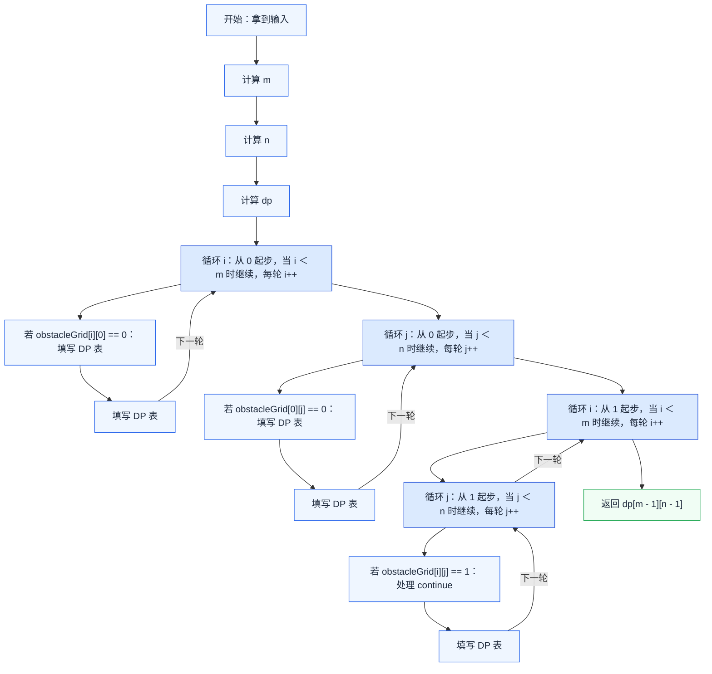

## TypeScript 解题方案（6 个方案逐个讲）

> **运行与提交**：每个方案都是自包含文件（内嵌用例自测，输出 PASS），整块复制到 `.ts` 文件后 `node 文件名` 即可运行。提交 LeetCode 时，把 `demo` 内的算法函数与辅助类型/函数整体取出、置于文件顶层即可。涉及交互/特殊接口的题以题面给定签名为准。

### 方案 1：方案1（二维 DP）

**分析与思路**：核心做法是「方案1（二维 DP）」。代码里依次做这些事：DP 表逐项填充；双重循环遍历。

**作者原文要点**：原文作者强调本题的关键是逆向思维：官方示例中 1 是障碍物、0 是可移动位置；为方便计算，先建一个新矩阵把语义反过来（可移动为 1、障碍为 0），因为可移动位置才参与路径计数。这一「先翻转语义再 DP」的预处理手法能显著降低边界判断成本。

**运行方式**：`node 本文件`，内嵌用例全部通过会输出 PASS。

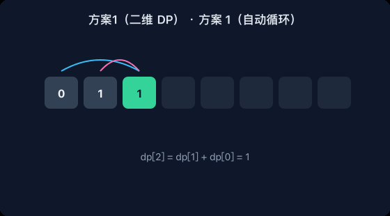

**方案专属流程图**（真实控制流）：

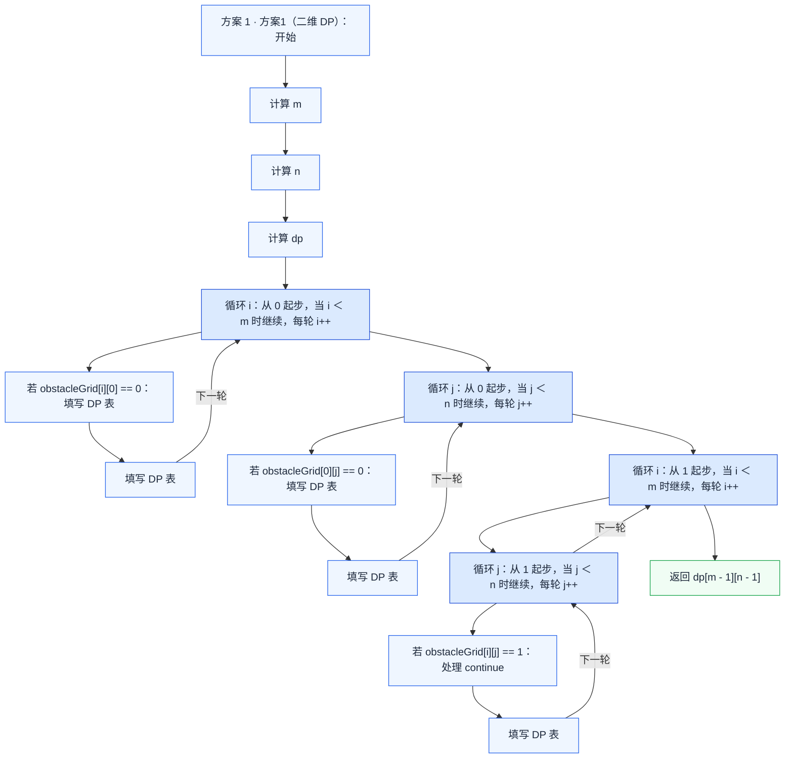

```typescript
/**
 ** LeetCode 63. 不同路径 II
 ** 方案：方案1（二维 DP）
 ** 来源：python 参考忠实移植
 */

function uniquePathsWithObstacles(obstacleGrid: number[][]): number {
  // 定义函数/方法 uniquePathsWithObstacles
  const m = obstacleGrid.length; // 把 obstacleGrid.长度 存入 映射表
  const n = obstacleGrid[0].length; // 把 obstacleGrid[0].长度 存入 元素个数
  const dp: number[][] = Array.from({ length: m }, () => new Array(n).fill(0));
  for (let i = 0; i < m; i++) {
    // 让 下标 i 从 0 开始计数，下标 i 小于 映射表 就继续
    if (obstacleGrid[i][0] === 0)
      dp[i][0] = 1; // 若 obstacleGrid[下标 i][0] 全等于 0) DP 表[下标 i][0] 赋值为 1;
    else break; // 否则
  }
  for (let j = 0; j < n; j++) {
    // 让 下标 j 从 0 开始计数，下标 j 小于 元素个数 就继续
    if (obstacleGrid[0][j] === 0)
      dp[0][j] = 1; // 若 obstacleGrid[0][下标 j] 全等于 0) DP 表[0][下标 j] 赋值为 1;
    else break; // 否则
  }
  for (let i = 1; i < m; i++) {
    // 让 下标 i 从 1 开始计数，下标 i 小于 映射表 就继续
    for (let j = 1; j < n; j++) {
      // 让 下标 j 从 1 开始计数，下标 j 小于 元素个数 就继续
      if (obstacleGrid[i][j] === 1) continue; // 若 obstacleGrid[下标 i][下标 j] 全等于 1) continue;
      dp[i][j] = dp[i - 1][j] + dp[i][j - 1]; // 把 DP 表[下标 i 减 1][下标 j] 加 DP 表[下标 i][下标 j 减 1]; 写入 dp[i][j]
    }
  }
  return dp[m - 1][n - 1]; // 返回 DP 表[映射表 减 1][元素个数 减 1]
}

export function demo(): void {
  // 程序入口：跑内嵌自测用例
  const cases: { in: number[][]; want: number }[] = [
    {
      in: [
        [0, 0, 0],
        [0, 1, 0],
        [0, 0, 0],
      ],
      want: 2,
    },
    {
      in: [
        [0, 0],
        [1, 0],
      ],
      want: 1,
    },
    {
      in: [
        [0, 1],
        [0, 0],
      ],
      want: 1,
    },
  ];
  let fail = false; // 把 false 存入 fail
  for (const c of cases) {
    // for (const 字符 of cases) {
    const got = uniquePathsWithObstacles(c.in); // 把 uniquePathsWithObstacles(字符.in) 存入 got
    if (got !== c.want) {
      // 若 got 不等于 字符.want
      fail = true; // 把 true 存入 fail
      console.log('FAIL', JSON.stringify(c.in), 'want', c.want, 'got', got); // 打印输出
    }
  }
  if (fail) throw new Error('FAILED'); // 若 fail) throw new Error(「FAILED」);
  console.log('PASS'); // 全部用例通过，输出 PASS
}
demo(); // demo();
```

### 方案 2：方案2（一维 DP 滚动数组）

**分析与思路**：核心做法是「方案2（一维 DP 滚动数组）」。代码里依次做这些事：双重循环遍历。

**运行方式**：`node 本文件`，内嵌用例全部通过会输出 PASS。

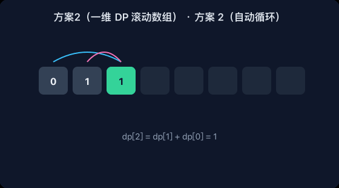

**方案专属流程图**（真实控制流）：

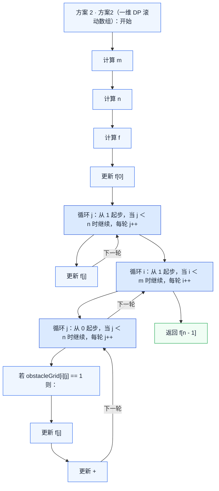

```typescript
/**
 ** LeetCode 63. 不同路径 II
 ** 方案：方案2（一维 DP 滚动数组）
 ** 来源：python 参考忠实移植
 */

function uniquePathsWithObstacles(obstacleGrid: number[][]): number {
  // 定义函数/方法 uniquePathsWithObstacles
  const m = obstacleGrid.length; // 把 obstacleGrid.长度 存入 映射表
  const n = obstacleGrid[0].length; // 把 obstacleGrid[0].长度 存入 元素个数
  const f: number[] = new Array(n).fill(0); // 把 new Array(元素个数).fill(0); 写入 const f: number[]
  f[0] = obstacleGrid[0][0] === 0 ? 1 : 0; // 把 obstacleGrid[0][0] 全等于 0 ? 1 : 0; 写入 f[0]
  for (let j = 1; j < n; j++) {
    // 让 下标 j 从 1 开始计数，下标 j 小于 元素个数 就继续
    f[j] = obstacleGrid[0][j] === 1 || f[j - 1] === 0 ? 0 : f[j - 1];
  }
  for (let i = 1; i < m; i++) {
    // 让 下标 i 从 1 开始计数，下标 i 小于 映射表 就继续
    for (let j = 0; j < n; j++) {
      // 让 下标 j 从 0 开始计数，下标 j 小于 元素个数 就继续
      if (obstacleGrid[i][j] === 1) {
        // 若 obstacleGrid[下标 i][下标 j] 全等于 1
        f[j] = 0; // 把 0; 写入 f[j]
      } else if (j > 0) {
        // 否则，若 下标 j 超过 0
        f[j] += f[j - 1]; // f[j]累加 f[下标 j 减 1]
      }
    }
  }
  return f[n - 1]; // 返回 f[元素个数 减 1]
}

export function demo(): void {
  // 程序入口：跑内嵌自测用例
  const cases: { in: number[][]; want: number }[] = [
    {
      in: [
        [0, 0, 0],
        [0, 1, 0],
        [0, 0, 0],
      ],
      want: 2,
    },
    {
      in: [
        [0, 0],
        [1, 0],
      ],
      want: 1,
    },
    {
      in: [
        [0, 1],
        [0, 0],
      ],
      want: 1,
    },
  ];
  let fail = false; // 把 false 存入 fail
  for (const c of cases) {
    // for (const 字符 of cases) {
    const got = uniquePathsWithObstacles(c.in); // 把 uniquePathsWithObstacles(字符.in) 存入 got
    if (got !== c.want) {
      // 若 got 不等于 字符.want
      fail = true; // 把 true 存入 fail
      console.log('FAIL', JSON.stringify(c.in), 'want', c.want, 'got', got); // 打印输出
    }
  }
  if (fail) throw new Error('FAILED'); // 若 fail) throw new Error(「FAILED」);
  console.log('PASS'); // 全部用例通过，输出 PASS
}
demo(); // demo();
```

### 方案 3：直接实现

**分析与思路**：核心做法是「直接实现」。

**运行方式**：`node 本文件`，内嵌用例全部通过会输出 PASS。


**方案专属流程图**（真实控制流）：


```typescript
function assertEq(actual: any, expected: any, msg: string = ''): void {
  // 定义函数/方法 assertEq
  const a = JSON.stringify(actual);
  const e = JSON.stringify(expected);
  if (a !== e)
    throw new Error(
      'ASSERT FAILED ' + msg + ' :: actual=' + a + ' expected=' + e,
    );
}

function uniquePathsWithObstacles(obstacleGrid: number[][]): number {
  // 定义函数/方法 uniquePathsWithObstacles
  const m = obstacleGrid.length; // 把 obstacleGrid.长度 存入 映射表
  const n = obstacleGrid[0].length; // 把 obstacleGrid[0].长度 存入 元素个数
  const dp: number[][] = Array.from({ length: m }, () => new Array(n).fill(0));
  for (let i = 0; i < m; i++) {
    // 让 下标 i 从 0 开始计数，下标 i 小于 映射表 就继续
    if (obstacleGrid[i][0] === 0) dp[i][0] = 1;
    else break;
  }
  for (let j = 0; j < n; j++) {
    // 让 下标 j 从 0 开始计数，下标 j 小于 元素个数 就继续
    if (obstacleGrid[0][j] === 0) dp[0][j] = 1;
    else break;
  }
  for (let i = 1; i < m; i++) {
    // 让 下标 i 从 1 开始计数，下标 i 小于 映射表 就继续
    for (let j = 1; j < n; j++) {
      // 让 下标 j 从 1 开始计数，下标 j 小于 元素个数 就继续
      if (obstacleGrid[i][j] === 1) continue; // 若 obstacleGrid[下标 i][下标 j] 全等于 1) continue;
      dp[i][j] = dp[i - 1][j] + dp[i][j - 1]; // 把 DP 表[下标 i 减 1][下标 j] 加 DP 表[下标 i][下标 j 减 1]; 写入 dp[i][j]
    }
  }
  return dp[m - 1][n - 1]; // 返回 DP 表[映射表 减 1][元素个数 减 1]
}
export function demo(): void {
  // 程序入口：跑内嵌自测用例
  assertEq(
    uniquePathsWithObstacles([
      [0, 0, 0],
      [0, 1, 0],
      [0, 0, 0],
    ]),
    2,
    'case1',
  ); // 断言校验
  assertEq(
    uniquePathsWithObstacles([
      [0, 0],
      [1, 0],
    ]),
    1,
    'case2',
  ); // 断言校验
  assertEq(
    uniquePathsWithObstacles([
      [1, 0, 0],
      [0, 1, 0],
      [0, 0, 1],
    ]),
    0,
    'case3',
  ); // 断言校验
  console.log('PASS'); // 全部用例通过，输出 PASS
}
demo(); // demo();
```

### 方案 4：迭代指针处理

**分析与思路**：核心做法是「迭代指针处理」。代码里依次做这些事：队列或堆的调度。

**运行方式**：`node 本文件`，内嵌用例全部通过会输出 PASS。


**方案专属流程图**（真实控制流）：


```typescript
class TreeNode {
  // 定义类型
  val: any;
  left: any;
  right: any; // 值: any; 左边界: any; 右边界: any;
  constructor(val?: any, left?: any, right?: any) {
    // constructor(值?: any, 左边界?: any, 右边界?: any) {
    this.val = val === undefined ? 0 : val; // 把 (值 全等于 undefined ? 0 : 值); 写入 值
    this.left = left === undefined ? null : left; // 把 (左边界 全等于 undefined ? null : 左边界); 写入 左边界
    this.right = right === undefined ? null : right; // 把 (右边界 全等于 undefined ? null : 右边界); 写入 右边界
  }
}
function buildTree(vals: any): any {
  // 定义函数/方法 buildTree
  if (!vals || vals.length === 0) return null; // 若 取反 vals 或 vals.长度 全等于 0，直接返回 null
  const root = new TreeNode(vals[0]);
  const q: any[] = [root];
  let i = 1;
  while (q.length && i < vals.length) {
    // 循环，直到不满足「节点.长度 且 下标 i 小于 vals.长度」
    const node = q.shift(); // 把 节点.shift() 存入 节点
    if (vals[i] !== null && vals[i] !== undefined) {
      node.left = new TreeNode(vals[i]);
      q.push(node.left);
    }
    i++; // 下标 i 加一
    if (i < vals.length && vals[i] !== null && vals[i] !== undefined) {
      node.right = new TreeNode(vals[i]);
      q.push(node.right);
    }
    i++; // 下标 i 加一
  }
  return root; // 返回 根节点
}
function treeToLevel(root: any): any[] {
  // 定义函数/方法 treeToLevel
  if (!root) return []; // 若 取反 根节点，直接返回 []
  const out: any[] = [];
  const q: any[] = [root]; // 把 []; const 节点: any[] 赋值为 [根节点]; 写入 const out: any[]
  while (q.length) {
    // 循环，直到不满足「节点.长度」
    const n = q.shift(); // 把 节点.shift() 存入 元素个数
    if (n === null || n === undefined) {
      out.push(null);
      continue;
    }
    out.push(n.val);
    q.push(n.left);
    q.push(n.right); // 把 元素个数.值 压入栈/数组尾部
  }
  while (out.length && out[out.length - 1] === null) out.pop(); // 循环，直到不满足「out.长度 且 out[out.长度 减 1] 全等于 null) out 弹出 );」
  return out; // 返回 out
}
class ListNode {
  // 定义类型
  val: any;
  next: any; // 值: any; 下一个: any;
  constructor(val?: any, next?: any) {
    this.val = val === undefined ? 0 : val;
    this.next = next === undefined ? null : next;
  }
}
function buildList(vals: any): any {
  // 定义函数/方法 buildList
  const dummy = new ListNode(0);
  let cur = dummy; // 把 new ListNode(0); let 当前值 赋值为 哨兵节点 存入 哨兵节点
  for (const v of vals) {
    cur.next = new ListNode(v);
    cur = cur.next;
  } // 把 new ListNode(值); 当前值 赋值为 当前值.下一个; } 写入 下一个
  return dummy.next; // 返回 哨兵节点.下一个
}
function listToArray(head: any): any[] {
  // 定义函数/方法 listToArray
  const out: any[] = [];
  let p = head; // 把 []; let 节点 赋值为 头节点; 写入 const out: any[]
  while (p) {
    out.push(p.val);
    p = p.next;
  } // 循环，直到不满足「节点) { out 追加 节点.值); 节点 赋值为 节点.下一个; }」
  return out; // 返回 out
}
// python-runtime shims
function pyLen(a: any): number {
  // 定义函数/方法 pyLen
  if (a === null || a === undefined) return 0; // 若 数组 全等于 null 或 数组 全等于 undefined，直接返回 0
  if (
    typeof a === 'string' ||
    Array.isArray(a) ||
    a instanceof Set ||
    a instanceof Map
  )
    return a.length ?? a.size;
  if (typeof a === 'object') return Object.keys(a).length; // 若 typeof 数组 全等于 'object'，直接返回 Object.keys(数组).长度
  return 0; // 返回 0
}
function pySlice(a: any, i: any, j: any, step?: any): any {
  // 定义函数/方法 pySlice
  if (typeof a === 'string') {
    const r = [...a].slice(i ?? 0, j ?? a.length);
    return step ? r.reverse().join('') : r.join('');
  }
  const arr = Array.isArray(a) ? a : [...a]; // 把 Array.isArray(数组) ? 数组 : 复制的 数组 存入 数组
  return arr.slice(i ?? 0, j ?? arr.length); // 返回 数组 截取 下标 i ?? 0, 下标 j ?? 数组.长度)
}
function pyRange(a: any, b?: any, step?: any): any[] {
  // 定义函数/方法 pyRange
  let s = 0,
    e = a,
    st = 1; // 把 0, e 赋值为 数组, st 赋值为 1 存入 字符串
  if (b !== undefined) {
    s = a;
    e = b;
  } // 若 b 不等于 undefined) { 字符串 赋值为 数组; e 赋值为 b; }
  if (step !== undefined) st = step; // 若 步数 不等于 undefined) st 赋值为 步数;
  const out: any[] = []; // 把 []; 写入 const out: any[]
  if (st > 0) for (let i = s; i < e; i += st) out.push(i);
  else for (let i = s; i > e; i += st) out.push(i); // 否则
  return out; // 返回 out
}
function pyIn(x: any, coll: any): boolean {
  // 定义函数/方法 pyIn
  if (coll === null || coll === undefined) return false; // 若 coll 全等于 null 或 coll 全等于 undefined，直接返回 false
  if (Array.isArray(coll)) return coll.includes(x); // 若 Array.isArray(coll)，直接返回 coll 是否包含 x)
  if (coll instanceof Set || coll instanceof Map) return coll.has(x); // 若 coll instanceof Set 或 coll instanceof Map，直接返回 coll.has(x)
  if (typeof coll === 'object') return x in coll; // 若 typeof coll 全等于 'object'，直接返回 x in coll
  if (typeof coll === 'string') return coll.indexOf(x) >= 0; // 若 typeof coll 全等于 'string'，直接返回 coll 查找 x) 不低于 0
  return false; // 返回 false
}
function pySorted(a: any): any[] {
  // 定义函数/方法 pySorted
  const arr = typeof a === 'string' ? [...a] : [...a]; // 把 (typeof 数组 全等于 'string') ? 复制的 数组 : 复制的 数组 存入 数组
  return arr.sort((x: any, y: any) => (x < y ? -1 : x > y ? 1 : 0));
}
function pyMin(a: any, b?: any): any {
  if (b !== undefined) return Math.min(a, b);
  if (Array.isArray(a) || a instanceof Set) return Math.min(...a);
  return Math.min(a);
} // 定义函数/方法 pyMin
function pyMax(a: any, b?: any): any {
  if (b !== undefined) return Math.max(a, b);
  if (Array.isArray(a) || a instanceof Set) return Math.max(...a);
  return Math.max(a);
} // 定义函数/方法 pyMax
function pySum(a: any): number {
  let s = 0;
  for (const v of a) s += v;
  return s;
} // 定义函数/方法 pySum
function pyAbs(x: any): number {
  return Math.abs(x);
} // 定义函数/方法 pyAbs
function pyEnumerate(a: any): any[] {
  const out: any[] = [];
  let i = 0;
  for (const v of a) {
    out.push([i, v]);
    i++;
  }
  return out;
} // 定义函数/方法 pyEnumerate
function pyZip(a: any, b: any): any[] {
  const n = Math.min(a.length, b.length);
  const out: any[] = [];
  for (let i = 0; i < n; i++) out.push([a[i], b[i]]);
  return out;
} // 定义函数/方法 pyZip
function pyDictGet(d: any, k: any, def?: any): any {
  return k in d ? d[k] : def === undefined ? null : def;
} // 定义函数/方法 pyDictGet
function pyPrint(...args: any[]): void {
  console.log(
    args
      .map((a) => (typeof a === 'object' && a !== null ? JSON.stringify(a) : a))
      .join(' '),
  );
} // 定义函数/方法 pyPrint
// collections / heapq
function heapPush(h: any[], x: any): void {
  h.push(x);
  let i = h.length - 1;
  while (i > 0) {
    const p = (i - 1) >> 1;
    if (h[p] <= h[i]) break;
    [h[p], h[i]] = [h[i], h[p]];
    i = p;
  }
} // 定义函数/方法 heapPush
function heapPop(h: any[]): any {
  const top = h[0];
  const last = h.pop();
  if (h.length) {
    h[0] = last;
    let i = 0;
    const n = h.length;
    while (true) {
      let l = 2 * i + 1,
        r = 2 * i + 2,
        s = i;
      if (l < n && h[l] < h[s]) s = l;
      if (r < n && h[r] < h[s]) s = r;
      if (s === i) break;
      [h[s], h[i]] = [h[i], h[s]];
      i = s;
    }
  }
  return top;
} // 定义函数/方法 heapPop
class Deque {
  private a: any[] = [];
  push(x: any) {
    this.a.push(x);
  }
  pushLeft(x: any) {
    this.a.unshift(x);
  }
  pop() {
    return this.a.pop();
  }
  popLeft() {
    return this.a.shift();
  }
  get length() {
    return this.a.length;
  }
  toArray() {
    return this.a.slice();
  }
} // 定义类型
function Counter(iter: any): any {
  const m: any = {};
  for (const v of iter) m[v] = (m[v] || 0) + 1;
  return m;
} // 定义函数/方法 Counter
function gcd(a: any, b: any): any {
  while (b) {
    [a, b] = [b, a % b];
  }
  return a;
} // 定义函数/方法 gcd
function pyInf(): number {
  return Infinity;
} // 定义函数/方法 pyInf

function norm(x: any): any {
  // 定义函数/方法 norm
  if (x === null || x === undefined) return null; // 若 x 全等于 null 或 x 全等于 undefined，直接返回 null
  if (typeof x === 'object') {
    // 若 typeof x 全等于 'object'
    if (x instanceof Deque) return x.toArray(); // 若 x instanceof Deque，直接返回 x.toArray()
    if (Array.isArray(x)) return x.map(norm); // 若 Array.isArray(x)，直接返回 x.映射表(norm)
    if (
      typeof x.val === 'number' &&
      (typeof x.left !== 'undefined' || typeof x.right !== 'undefined')
    )
      return treeToLevel(x);
    if (typeof x.next !== 'undefined' && typeof x.val === 'number')
      return listToArray(x);
    if (x instanceof Set) return [...x].sort(); // 若 x instanceof Set，直接返回 复制的 x 排序 )
    if (x instanceof Map) return Object.fromEntries(x); // 若 x instanceof Map，直接返回 Object.fromEntries(x)
    const o: any = {};
    for (const k of Object.keys(x)) o[k] = norm(x[k]);
    return o;
  }
  return x; // 返回 x
}
function eq(a: any, b: any): boolean {
  // 定义函数/方法 eq
  const x = norm(a),
    y = norm(b); // 把 norm(数组), y 赋值为 norm(b) 存入 x
  if (x === y) return true; // 若 x 全等于 y，直接返回 true
  if (x === null || y === null) return x === y; // 若 x 全等于 null 或 y 全等于 null，直接返回 x 全等于 y
  if (Array.isArray(x) && Array.isArray(y)) {
    // 若 Array.isArray(x) 且 Array.isArray(y
    if (x.length !== y.length) return false; // 若 x.长度 不等于 y.长度，直接返回 false
    for (let i = 0; i < x.length; i++) if (!eq(x[i], y[i])) return false; // 让 下标 i 从 0 开始计数，下标 i 小于 x.长度 就继续
    return true; // 返回 true
  }
  if (typeof x === 'object' && typeof y === 'object') {
    // 若 typeof x 全等于 'object' 且 typeof y 全等于 'object'
    const kx = Object.keys(x),
      ky = Object.keys(y); // 把 Object.keys(x), ky 赋值为 Object.keys(y) 存入 kx
    if (kx.length !== ky.length) return false; // 若 kx.长度 不等于 ky.长度，直接返回 false
    for (const k of kx) if (!eq(x[k], y[k])) return false;
    return true; // 返回 true
  }
  return x === y; // 返回 x 全等于 y
}

function uniquePathsWithObstacles(o) {
  // 定义函数/方法 uniquePathsWithObstacles
  const m = o.length,
    n = o[0].length; // 把 o.长度, 元素个数 赋值为 o[0].长度 存入 映射表
  if (o[0][0] === 1) return 0; // 若 o[0][0] 全等于 1，直接返回 0
  const dp = Array.from({ length: m }, () => new Array(n).fill(0));
  dp[0][0] = 1; // 把 1; 写入 dp[0][0]
  for (let i = 0; i < m; i++) {
    // 让 下标 i 从 0 开始计数，下标 i 小于 映射表 就继续
    for (let j = 0; j < n; j++) {
      // 让 下标 j 从 0 开始计数，下标 j 小于 元素个数 就继续
      if (o[i][j] === 1) {
        dp[i][j] = 0;
        continue;
      } // 若 o[下标 i][下标 j] 全等于 1) { DP 表[下标 i][下标 j] 赋值为 0; continue; }
      if (i > 0) dp[i][j] += dp[i - 1][j]; // 若 下标 i 超过 0) DP 表[下标 i][下标 j] 累加 DP 表[下标 i 减 1][下标 j];
      if (j > 0) dp[i][j] += dp[i][j - 1]; // 若 下标 j 超过 0) DP 表[下标 i][下标 j] 累加 DP 表[下标 i][下标 j 减 1];
    }
  }
  return dp[m - 1][n - 1]; // 返回 DP 表[映射表 减 1][元素个数 减 1]
}
export function demo(): void {
  // 程序入口：跑内嵌自测用例
  const cases = [
    {
      in: [
        [
          [0, 0, 0],
          [0, 1, 0],
          [0, 0, 0],
        ],
      ],
      want: 2,
    },
    {
      in: [
        [
          [0, 1],
          [0, 0],
        ],
      ],
      want: 1,
    },
    {
      in: [
        [
          [0, 0],
          [0, 0],
        ],
      ],
      want: 2,
    },
    { in: [[[1, 0]]], want: 0 },
  ];
  let fail = false; // 把 false 存入 fail
  for (const c of cases) {
    // for (const 字符 of cases) {
    const got = uniquePathsWithObstacles(...c.in); // 把 uniquePathsWithObstacles(...字符.in) 存入 got
    if (!eq(got, c.want)) {
      fail = true;
      console.log(
        'FAIL',
        JSON.stringify(c.in),
        '=>',
        JSON.stringify(got),
        'want',
        JSON.stringify(c.want),
      );
    }
  }
  if (fail) throw new Error('FAILED'); // 若 fail) throw new Error('FAILED');
  console.log('PASS'); // 全部用例通过，输出 PASS
}
demo(); // demo();
```

### 方案 5：迭代指针处理

**分析与思路**：核心做法是「迭代指针处理」。代码里依次做这些事：队列或堆的调度。

**运行方式**：`node 本文件`，内嵌用例全部通过会输出 PASS。

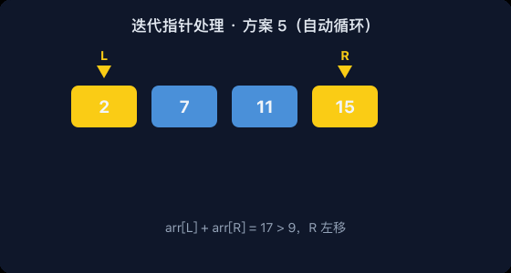

**方案专属流程图**（真实控制流）：

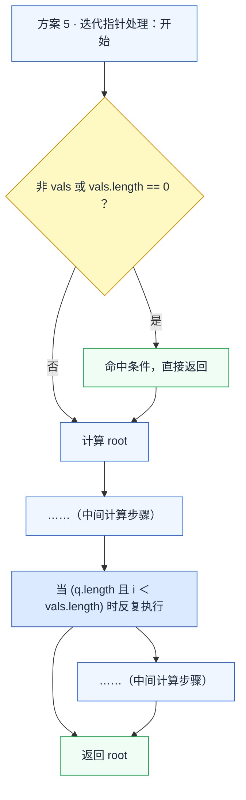

```typescript
class TreeNode {
  // 定义类型
  val: any;
  left: any;
  right: any; // 值: any; 左边界: any; 右边界: any;
  constructor(val?: any, left?: any, right?: any) {
    // constructor(值?: any, 左边界?: any, 右边界?: any) {
    this.val = val === undefined ? 0 : val; // 把 (值 全等于 undefined ? 0 : 值); 写入 值
    this.left = left === undefined ? null : left; // 把 (左边界 全等于 undefined ? null : 左边界); 写入 左边界
    this.right = right === undefined ? null : right; // 把 (右边界 全等于 undefined ? null : 右边界); 写入 右边界
  }
}
function buildTree(vals: any): any {
  // 定义函数/方法 buildTree
  if (!vals || vals.length === 0) return null; // 若 取反 vals 或 vals.长度 全等于 0，直接返回 null
  const root = new TreeNode(vals[0]);
  const q: any[] = [root];
  let i = 1;
  while (q.length && i < vals.length) {
    // 循环，直到不满足「节点.长度 且 下标 i 小于 vals.长度」
    const node = q.shift(); // 把 节点.shift() 存入 节点
    if (vals[i] !== null && vals[i] !== undefined) {
      node.left = new TreeNode(vals[i]);
      q.push(node.left);
    }
    i++; // 下标 i 加一
    if (i < vals.length && vals[i] !== null && vals[i] !== undefined) {
      node.right = new TreeNode(vals[i]);
      q.push(node.right);
    }
    i++; // 下标 i 加一
  }
  return root; // 返回 根节点
}
function treeToLevel(root: any): any[] {
  // 定义函数/方法 treeToLevel
  if (!root) return []; // 若 取反 根节点，直接返回 []
  const out: any[] = [];
  const q: any[] = [root]; // 把 []; const 节点: any[] 赋值为 [根节点]; 写入 const out: any[]
  while (q.length) {
    // 循环，直到不满足「节点.长度」
    const n = q.shift(); // 把 节点.shift() 存入 元素个数
    if (n === null || n === undefined) {
      out.push(null);
      continue;
    }
    out.push(n.val);
    q.push(n.left);
    q.push(n.right); // 把 元素个数.值 压入栈/数组尾部
  }
  while (out.length && out[out.length - 1] === null) out.pop(); // 循环，直到不满足「out.长度 且 out[out.长度 减 1] 全等于 null) out 弹出 );」
  return out; // 返回 out
}
class ListNode {
  // 定义类型
  val: any;
  next: any; // 值: any; 下一个: any;
  constructor(val?: any, next?: any) {
    this.val = val === undefined ? 0 : val;
    this.next = next === undefined ? null : next;
  }
}
function buildList(vals: any): any {
  // 定义函数/方法 buildList
  const dummy = new ListNode(0);
  let cur = dummy; // 把 new ListNode(0); let 当前值 赋值为 哨兵节点 存入 哨兵节点
  for (const v of vals) {
    cur.next = new ListNode(v);
    cur = cur.next;
  } // 把 new ListNode(值); 当前值 赋值为 当前值.下一个; } 写入 下一个
  return dummy.next; // 返回 哨兵节点.下一个
}
function listToArray(head: any): any[] {
  // 定义函数/方法 listToArray
  const out: any[] = [];
  let p = head; // 把 []; let 节点 赋值为 头节点; 写入 const out: any[]
  while (p) {
    out.push(p.val);
    p = p.next;
  } // 循环，直到不满足「节点) { out 追加 节点.值); 节点 赋值为 节点.下一个; }」
  return out; // 返回 out
}
// python-runtime shims
function pyLen(a: any): number {
  // 定义函数/方法 pyLen
  if (a === null || a === undefined) return 0; // 若 数组 全等于 null 或 数组 全等于 undefined，直接返回 0
  if (
    typeof a === 'string' ||
    Array.isArray(a) ||
    a instanceof Set ||
    a instanceof Map
  )
    return a.length ?? a.size;
  if (typeof a === 'object') return Object.keys(a).length; // 若 typeof 数组 全等于 'object'，直接返回 Object.keys(数组).长度
  return 0; // 返回 0
}
function pySlice(a: any, i: any, j: any, step?: any): any {
  // 定义函数/方法 pySlice
  if (typeof a === 'string') {
    const r = [...a].slice(i ?? 0, j ?? a.length);
    return step ? r.reverse().join('') : r.join('');
  }
  const arr = Array.isArray(a) ? a : [...a]; // 把 Array.isArray(数组) ? 数组 : 复制的 数组 存入 数组
  return arr.slice(i ?? 0, j ?? arr.length); // 返回 数组 截取 下标 i ?? 0, 下标 j ?? 数组.长度)
}
function pyRange(a: any, b?: any, step?: any): any[] {
  // 定义函数/方法 pyRange
  let s = 0,
    e = a,
    st = 1; // 把 0, e 赋值为 数组, st 赋值为 1 存入 字符串
  if (b !== undefined) {
    s = a;
    e = b;
  } // 若 b 不等于 undefined) { 字符串 赋值为 数组; e 赋值为 b; }
  if (step !== undefined) st = step; // 若 步数 不等于 undefined) st 赋值为 步数;
  const out: any[] = []; // 把 []; 写入 const out: any[]
  if (st > 0) for (let i = s; i < e; i += st) out.push(i);
  else for (let i = s; i > e; i += st) out.push(i); // 否则
  return out; // 返回 out
}
function pyIn(x: any, coll: any): boolean {
  // 定义函数/方法 pyIn
  if (coll === null || coll === undefined) return false; // 若 coll 全等于 null 或 coll 全等于 undefined，直接返回 false
  if (Array.isArray(coll)) return coll.includes(x); // 若 Array.isArray(coll)，直接返回 coll 是否包含 x)
  if (coll instanceof Set || coll instanceof Map) return coll.has(x); // 若 coll instanceof Set 或 coll instanceof Map，直接返回 coll.has(x)
  if (typeof coll === 'object') return x in coll; // 若 typeof coll 全等于 'object'，直接返回 x in coll
  if (typeof coll === 'string') return coll.indexOf(x) >= 0; // 若 typeof coll 全等于 'string'，直接返回 coll 查找 x) 不低于 0
  return false; // 返回 false
}
function pySorted(a: any): any[] {
  // 定义函数/方法 pySorted
  const arr = typeof a === 'string' ? [...a] : [...a]; // 把 (typeof 数组 全等于 'string') ? 复制的 数组 : 复制的 数组 存入 数组
  return arr.sort((x: any, y: any) => (x < y ? -1 : x > y ? 1 : 0));
}
function pyMin(a: any, b?: any): any {
  if (b !== undefined) return Math.min(a, b);
  if (Array.isArray(a) || a instanceof Set) return Math.min(...a);
  return Math.min(a);
} // 定义函数/方法 pyMin
function pyMax(a: any, b?: any): any {
  if (b !== undefined) return Math.max(a, b);
  if (Array.isArray(a) || a instanceof Set) return Math.max(...a);
  return Math.max(a);
} // 定义函数/方法 pyMax
function pySum(a: any): number {
  let s = 0;
  for (const v of a) s += v;
  return s;
} // 定义函数/方法 pySum
function pyAbs(x: any): number {
  return Math.abs(x);
} // 定义函数/方法 pyAbs
function pyEnumerate(a: any): any[] {
  const out: any[] = [];
  let i = 0;
  for (const v of a) {
    out.push([i, v]);
    i++;
  }
  return out;
} // 定义函数/方法 pyEnumerate
function pyZip(a: any, b: any): any[] {
  const n = Math.min(a.length, b.length);
  const out: any[] = [];
  for (let i = 0; i < n; i++) out.push([a[i], b[i]]);
  return out;
} // 定义函数/方法 pyZip
function pyDictGet(d: any, k: any, def?: any): any {
  return k in d ? d[k] : def === undefined ? null : def;
} // 定义函数/方法 pyDictGet
function pyPrint(...args: any[]): void {
  console.log(
    args
      .map((a) => (typeof a === 'object' && a !== null ? JSON.stringify(a) : a))
      .join(' '),
  );
} // 定义函数/方法 pyPrint
// collections / heapq
function heapPush(h: any[], x: any): void {
  h.push(x);
  let i = h.length - 1;
  while (i > 0) {
    const p = (i - 1) >> 1;
    if (h[p] <= h[i]) break;
    [h[p], h[i]] = [h[i], h[p]];
    i = p;
  }
} // 定义函数/方法 heapPush
function heapPop(h: any[]): any {
  const top = h[0];
  const last = h.pop();
  if (h.length) {
    h[0] = last;
    let i = 0;
    const n = h.length;
    while (true) {
      let l = 2 * i + 1,
        r = 2 * i + 2,
        s = i;
      if (l < n && h[l] < h[s]) s = l;
      if (r < n && h[r] < h[s]) s = r;
      if (s === i) break;
      [h[s], h[i]] = [h[i], h[s]];
      i = s;
    }
  }
  return top;
} // 定义函数/方法 heapPop
class Deque {
  private a: any[] = [];
  push(x: any) {
    this.a.push(x);
  }
  pushLeft(x: any) {
    this.a.unshift(x);
  }
  pop() {
    return this.a.pop();
  }
  popLeft() {
    return this.a.shift();
  }
  get length() {
    return this.a.length;
  }
  toArray() {
    return this.a.slice();
  }
} // 定义类型
function Counter(iter: any): any {
  const m: any = {};
  for (const v of iter) m[v] = (m[v] || 0) + 1;
  return m;
} // 定义函数/方法 Counter
function gcd(a: any, b: any): any {
  while (b) {
    [a, b] = [b, a % b];
  }
  return a;
} // 定义函数/方法 gcd
function pyInf(): number {
  return Infinity;
} // 定义函数/方法 pyInf

function norm(x: any): any {
  // 定义函数/方法 norm
  if (x === null || x === undefined) return null; // 若 x 全等于 null 或 x 全等于 undefined，直接返回 null
  if (typeof x === 'object') {
    // 若 typeof x 全等于 'object'
    if (x instanceof Deque) return x.toArray(); // 若 x instanceof Deque，直接返回 x.toArray()
    if (Array.isArray(x)) return x.map(norm); // 若 Array.isArray(x)，直接返回 x.映射表(norm)
    if (
      typeof x.val === 'number' &&
      (typeof x.left !== 'undefined' || typeof x.right !== 'undefined')
    )
      return treeToLevel(x);
    if (typeof x.next !== 'undefined' && typeof x.val === 'number')
      return listToArray(x);
    if (x instanceof Set) return [...x].sort(); // 若 x instanceof Set，直接返回 复制的 x 排序 )
    if (x instanceof Map) return Object.fromEntries(x); // 若 x instanceof Map，直接返回 Object.fromEntries(x)
    const o: any = {};
    for (const k of Object.keys(x)) o[k] = norm(x[k]);
    return o;
  }
  return x; // 返回 x
}
function eq(a: any, b: any): boolean {
  // 定义函数/方法 eq
  const x = norm(a),
    y = norm(b); // 把 norm(数组), y 赋值为 norm(b) 存入 x
  if (x === y) return true; // 若 x 全等于 y，直接返回 true
  if (x === null || y === null) return x === y; // 若 x 全等于 null 或 y 全等于 null，直接返回 x 全等于 y
  if (Array.isArray(x) && Array.isArray(y)) {
    // 若 Array.isArray(x) 且 Array.isArray(y
    if (x.length !== y.length) return false; // 若 x.长度 不等于 y.长度，直接返回 false
    for (let i = 0; i < x.length; i++) if (!eq(x[i], y[i])) return false; // 让 下标 i 从 0 开始计数，下标 i 小于 x.长度 就继续
    return true; // 返回 true
  }
  if (typeof x === 'object' && typeof y === 'object') {
    // 若 typeof x 全等于 'object' 且 typeof y 全等于 'object'
    const kx = Object.keys(x),
      ky = Object.keys(y); // 把 Object.keys(x), ky 赋值为 Object.keys(y) 存入 kx
    if (kx.length !== ky.length) return false; // 若 kx.长度 不等于 ky.长度，直接返回 false
    for (const k of kx) if (!eq(x[k], y[k])) return false;
    return true; // 返回 true
  }
  return x === y; // 返回 x 全等于 y
}

function uniquePathsWithObstacles(o) {
  // 定义函数/方法 uniquePathsWithObstacles
  const m = o.length,
    n = o[0].length; // 把 o.长度, 元素个数 赋值为 o[0].长度 存入 映射表
  if (o[0][0] === 1) return 0; // 若 o[0][0] 全等于 1，直接返回 0
  const dp = Array.from({ length: m }, () => new Array(n).fill(0));
  dp[0][0] = 1; // 把 1; 写入 dp[0][0]
  for (let i = 0; i < m; i++) {
    // 让 下标 i 从 0 开始计数，下标 i 小于 映射表 就继续
    for (let j = 0; j < n; j++) {
      // 让 下标 j 从 0 开始计数，下标 j 小于 元素个数 就继续
      if (o[i][j] === 1) {
        dp[i][j] = 0;
        continue;
      } // 若 o[下标 i][下标 j] 全等于 1) { DP 表[下标 i][下标 j] 赋值为 0; continue; }
      if (i > 0) dp[i][j] += dp[i - 1][j]; // 若 下标 i 超过 0) DP 表[下标 i][下标 j] 累加 DP 表[下标 i 减 1][下标 j];
      if (j > 0) dp[i][j] += dp[i][j - 1]; // 若 下标 j 超过 0) DP 表[下标 i][下标 j] 累加 DP 表[下标 i][下标 j 减 1];
    }
  }
  return dp[m - 1][n - 1]; // 返回 DP 表[映射表 减 1][元素个数 减 1]
}
export function demo(): void {
  // 程序入口：跑内嵌自测用例
  const cases = [
    {
      in: [
        [
          [0, 0, 0],
          [0, 1, 0],
          [0, 0, 0],
        ],
      ],
      want: 2,
    },
    {
      in: [
        [
          [0, 1],
          [0, 0],
        ],
      ],
      want: 1,
    },
    {
      in: [
        [
          [0, 0],
          [0, 0],
        ],
      ],
      want: 2,
    },
    { in: [[[1, 0]]], want: 0 },
  ];
  let fail = false; // 把 false 存入 fail
  for (const c of cases) {
    // for (const 字符 of cases) {
    const got = uniquePathsWithObstacles(...c.in); // 把 uniquePathsWithObstacles(...字符.in) 存入 got
    if (!eq(got, c.want)) {
      fail = true;
      console.log(
        'FAIL',
        JSON.stringify(c.in),
        '=>',
        JSON.stringify(got),
        'want',
        JSON.stringify(c.want),
      );
    }
  }
  if (fail) throw new Error('FAILED'); // 若 fail) throw new Error('FAILED');
  console.log('PASS'); // 全部用例通过，输出 PASS
}
demo(); // demo();
```

### 方案 6：直接实现

**分析与思路**：核心做法是「直接实现」。

**运行方式**：`node 本文件`，内嵌用例全部通过会输出 PASS。

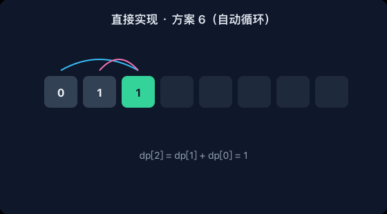

**方案专属流程图**（真实控制流）：

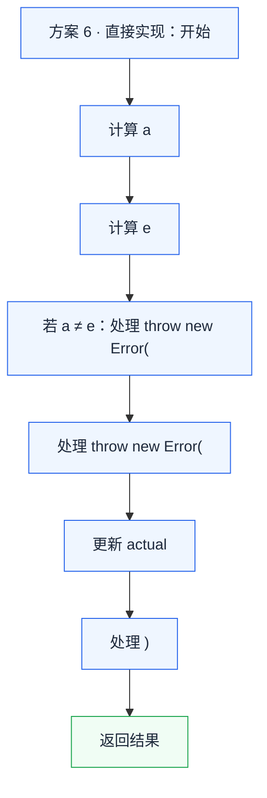

```typescript
function assertEq(actual: any, expected: any, msg: string = ''): void {
  // 定义函数/方法 assertEq
  const a = JSON.stringify(actual);
  const e = JSON.stringify(expected);
  if (a !== e)
    throw new Error(
      'ASSERT FAILED ' + msg + ' :: actual=' + a + ' expected=' + e,
    );
}

function uniquePathsWithObstacles(obstacleGrid: number[][]): number {
  // 定义函数/方法 uniquePathsWithObstacles
  const m = obstacleGrid.length; // 把 obstacleGrid.长度 存入 映射表
  const n = obstacleGrid[0].length; // 把 obstacleGrid[0].长度 存入 元素个数
  const dp: number[][] = Array.from({ length: m }, () => new Array(n).fill(0));
  for (let i = 0; i < m; i++) {
    // 让 下标 i 从 0 开始计数，下标 i 小于 映射表 就继续
    if (obstacleGrid[i][0] === 0) dp[i][0] = 1;
    else break;
  }
  for (let j = 0; j < n; j++) {
    // 让 下标 j 从 0 开始计数，下标 j 小于 元素个数 就继续
    if (obstacleGrid[0][j] === 0) dp[0][j] = 1;
    else break;
  }
  for (let i = 1; i < m; i++) {
    // 让 下标 i 从 1 开始计数，下标 i 小于 映射表 就继续
    for (let j = 1; j < n; j++) {
      // 让 下标 j 从 1 开始计数，下标 j 小于 元素个数 就继续
      if (obstacleGrid[i][j] === 1) continue; // 若 obstacleGrid[下标 i][下标 j] 全等于 1) continue;
      dp[i][j] = dp[i - 1][j] + dp[i][j - 1]; // 把 DP 表[下标 i 减 1][下标 j] 加 DP 表[下标 i][下标 j 减 1]; 写入 dp[i][j]
    }
  }
  return dp[m - 1][n - 1]; // 返回 DP 表[映射表 减 1][元素个数 减 1]
}
export function demo(): void {
  // 程序入口：跑内嵌自测用例
  assertEq(
    uniquePathsWithObstacles([
      [0, 0, 0],
      [0, 1, 0],
      [0, 0, 0],
    ]),
    2,
    'case1',
  ); // 断言校验
  assertEq(
    uniquePathsWithObstacles([
      [0, 0],
      [1, 0],
    ]),
    1,
    'case2',
  ); // 断言校验
  assertEq(
    uniquePathsWithObstacles([
      [1, 0, 0],
      [0, 1, 0],
      [0, 0, 1],
    ]),
    0,
    'case3',
  ); // 断言校验
  console.log('PASS'); // 全部用例通过，输出 PASS
}
demo(); // demo();
```

## 逐步拆解与面试追问

**复杂度**：时间 O(n) 到 O(m·n)（取决于状态维度），空间即 DP 表大小

**为什么是这个量级**：动态规划把指数级枚举压成表，每格只算一次，复杂度等于「状态数 × 转移代价」

**面试官可能会追问**：

- 状态定义为什么是它？
- 遍历顺序由什么决定？
- 能否滚动数组压空间？

## 关键 API 速查（TS 主解法实际用到，附官方链接）

| API | 作用 | 使用要点 | 官方文档 |
|---|---|---|---|
| `Array.from()` | 类数组/可迭代对象转数组 | Array.from(iterable, mapFn) 可同时映射；对 Set 去重、对字符串按码元拆分；稀疏位会被 undefined 填充 | [官方文档](https://developer.mozilla.org/zh-CN/docs/Web/JavaScript/Reference/Global_Objects/Array/from) |
| `JSON.stringify()` | 序列化为 JSON 字符串 | 常用于结构化比较（深度相等判定）；undefined/函数/循环引用会被丢弃或抛错 | [官方文档](https://developer.mozilla.org/zh-CN/docs/Web/JavaScript/Reference/Global_Objects/JSON/stringify) |

### 各语言官方文档导航

- **TypeScript / JS**：[MDN 中文参考](https://developer.mozilla.org/zh-CN/)
- **Python**：[Python 官方文档](https://docs.python.org/zh-cn/3/)
- **Go**：[Go 标准库](https://pkg.go.dev/std)
- **Java**：[JDK 17 API](https://docs.oracle.com/en/java/javase/17/docs/api/)
- **Rust**：[Rust 标准库](https://doc.rust-lang.org/std/)
- **Lua**：[Lua 5.4 手册](https://www.lua.org/manual/5.4/)
- **C**：[Cppreference C](https://zh.cppreference.com/w/c)
- **C++**：[Cppreference C++](https://zh.cppreference.com/w/cpp)
- **R**：[R 官方手册](https://stat.ethz.ch/R-manual/)
- **Zig**：[Zig 语言文档](https://ziglang.org/documentation/master/)
- **Dart**：[Dart API](https://api.dart.dev/)

## 附录：其他 10 种语言全部实现（每种语言列举其全部方案）

> TypeScript 的全部方案见「TypeScript 解题方案」一节；下面是其余 10 种语言的对应实现，每种语言的每个方案都带思路分析、代码走读与专属运行架构图。
> 每个方案都内嵌用例自测，可独立运行（老仓库 python/go 文件遵循「打印结果」约定）。
> 完整解法文件见 `dsa/<语言>/dp/lc_63_不同路径_ii/`。

### Python 实现（6 种方案）

Python 的全部方案如下，每个方案都内嵌用例自测，可独立运行（老仓库 python/go 文件遵循「打印结果」约定）：

#### 方案 1：方案1（二维 DP）

**思路与代码分析**：核心是「方案1（二维 DP）」。Python 版用切片与字典推导式简化操作，突出可读性。代码里依次做这些事：DP 表逐项填充。**走读**：方案 1 · 方案1（二维 DP）：开始 → 更新 m → 循环 i：从 0 到 m 前 → 循环 j：从 0 到 n 前 → 循环 i：从 1 到 m 前 → 循环 j：从 1 到 n 前 → 返回 dp[m - 1][n - 1]。

**运行架构**（真实控制流）：

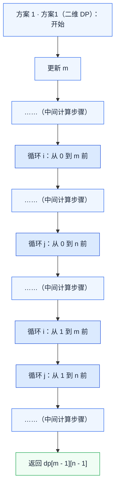

```python
import sys  # 提高递归深度上限（深输入防 RecursionError）

sys.setrecursionlimit(200000)  # 树/链表类题目节点数可达 1e4 量级

def uniquePathsWithObstacles(obstacleGrid):  # 定义函数 uniquePathsWithObstacles（参数：obstacleGrid）
    m = len(obstacleGrid)  # 把 长度(obstacleGrid) 存入 映射表
    n = len(obstacleGrid[0])  # 把 长度(obstacleGrid[0]) 存入 元素个数
    dp = [[0] * n for _ in range(m)]  # 把 [[0] 乘 元素个数 for _ in range(映射表)] 存入 DP 表
    for i in range(m):  # 让 下标 i 从 映射表 遍历
        if obstacleGrid[i][0] == 0:  # 若 obstacleGrid[下标 i][0] 等于 0
            dp[i][0] = 1  # 把 1 写入 dp[i][0]
        else:  # 否则
            break  # 跳出循环
    for j in range(n):  # 让 下标 j 从 元素个数 遍历
        if obstacleGrid[0][j] == 0:  # 若 obstacleGrid[0][下标 j] 等于 0
            dp[0][j] = 1  # 把 1 写入 dp[0][j]
        else:  # 否则
            break  # 跳出循环
    for i in range(1, m):  # 让 下标 i 从 1 到 映射表 遍历
        for j in range(1, n):  # 让 下标 j 从 1 到 元素个数 遍历
            if obstacleGrid[i][j] == 1:  # 若 obstacleGrid[下标 i][下标 j] 等于 1
                continue  # 跳过本轮，进入下一次
            dp[i][j] = (
                dp[i - 1][j] + dp[i][j - 1]
            )  # 把 DP 表[下标 i 减 1][下标 j] 加 DP 表[下标 i][下标 j 减 1] 写入 dp[i][j]
    return dp[m - 1][n - 1]  # 返回 DP 表[映射表 减 1][元素个数 减 1]

if __name__ == "__main__":  # 若 __name__ 等于 '__main__'
    print(uniquePathsWithObstacles([[0, 0, 0], [0, 1, 0], [0, 0, 0]]))  # 打印输出
```

#### 方案 2：方案2（一维 DP 滚动数组）

**思路与代码分析**：核心是「方案2（一维 DP 滚动数组）」。Python 版用切片与字典推导式简化操作，突出可读性。**走读**：方案 2 · 方案2（一维 DP 滚动数组）：开始 → 更新 m → 更新 n → 更新 f → 更新 f[0] → 循环 j：从 1 到 n 前 → 更新 f[j] → 循环 i：从 1 到 m 前 → 循环 j：从 0 到 n 前 → 若 obstacleGrid[i][j] == 1：更新 f[j] → 更新 f[j] → 处理 elif j ＞ 0: → 更新 + → 返回 f[n - 1]。

**运行架构**（真实控制流）：

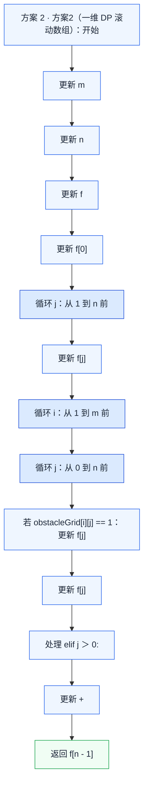

```python
import sys  # 提高递归深度上限（深输入防 RecursionError）

sys.setrecursionlimit(200000)  # 树/链表类题目节点数可达 1e4 量级

def uniquePathsWithObstacles(obstacleGrid):  # 定义函数 uniquePathsWithObstacles（参数：obstacleGrid）
    m = len(obstacleGrid)  # 把 长度(obstacleGrid) 存入 映射表
    n = len(obstacleGrid[0])  # 把 长度(obstacleGrid[0]) 存入 元素个数
    f = [0] * n  # 把 [0] 乘 元素个数 存入 f
    f[0] = 1 if obstacleGrid[0][0] == 0 else 0  # 把 1 if obstacleGrid[0][0] 等于 0 else 0 写入 f[0]
    for j in range(1, n):  # 让 下标 j 从 1 到 元素个数 遍历
        f[j] = 0 if (obstacleGrid[0][j] == 1 or f[j - 1] == 0) else f[j - 1]
    for i in range(1, m):  # 让 下标 i 从 1 到 映射表 遍历
        for j in range(n):  # 让 下标 j 从 元素个数 遍历
            if obstacleGrid[i][j] == 1:  # 若 obstacleGrid[下标 i][下标 j] 等于 1
                f[j] = 0  # 把 0 写入 f[j]
            elif j > 0:  # 否则，若 下标 j 超过 0
                f[j] += f[j - 1]  # f[j]累加 f[下标 j 减 1]
    return f[n - 1]  # 返回 f[元素个数 减 1]

if __name__ == "__main__":  # 若 __name__ 等于 '__main__'
    print(uniquePathsWithObstacles([[0, 0, 0], [0, 1, 0], [0, 0, 0]]))  # 打印输出
```

#### 方案 3：直接实现

**思路与代码分析**：核心是「直接实现」。Python 版用切片与字典推导式简化操作，突出可读性。代码里依次做这些事：DP 表逐项填充。**走读**：方案 3 · 直接实现：开始 → 更新 m → 循环 i：从 0 到 m 前 → 循环 j：从 0 到 n 前 → 循环 i：从 1 到 m 前 → 循环 j：从 1 到 n 前 → 返回 dp[m - 1][n - 1]。

**运行架构**（真实控制流）：

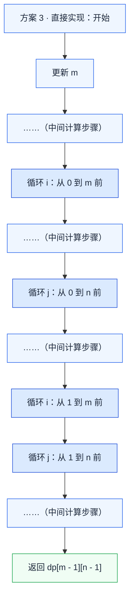

```python
import sys  # 提高递归深度上限（深输入防 RecursionError）

sys.setrecursionlimit(200000)  # 树/链表类题目节点数可达 1e4 量级

def uniquePathsWithObstacles(obstacleGrid):  # 定义函数 uniquePathsWithObstacles（参数：obstacleGrid）
    m = len(obstacleGrid)  # 把 长度(obstacleGrid) 存入 映射表
    n = len(obstacleGrid[0])  # 把 长度(obstacleGrid[0]) 存入 元素个数
    dp = [[0] * n for _ in range(m)]  # 把 [[0] 乘 元素个数 for _ in range(映射表)] 存入 DP 表
    for i in range(m):  # 让 下标 i 从 映射表 遍历
        if obstacleGrid[i][0] == 0:  # 若 obstacleGrid[下标 i][0] 等于 0
            dp[i][0] = 1  # 把 1 写入 dp[i][0]
        else:  # 否则
            break  # 跳出循环
    for j in range(n):  # 让 下标 j 从 元素个数 遍历
        if obstacleGrid[0][j] == 0:  # 若 obstacleGrid[0][下标 j] 等于 0
            dp[0][j] = 1  # 把 1 写入 dp[0][j]
        else:  # 否则
            break  # 跳出循环
    for i in range(1, m):  # 让 下标 i 从 1 到 映射表 遍历
        for j in range(1, n):  # 让 下标 j 从 1 到 元素个数 遍历
            if obstacleGrid[i][j] == 1:  # 若 obstacleGrid[下标 i][下标 j] 等于 1
                continue  # 跳过本轮，进入下一次
            dp[i][j] = (
                dp[i - 1][j] + dp[i][j - 1]
            )  # 把 DP 表[下标 i 减 1][下标 j] 加 DP 表[下标 i][下标 j 减 1] 写入 dp[i][j]
    return dp[m - 1][n - 1]  # 返回 DP 表[映射表 减 1][元素个数 减 1]

if __name__ == "__main__":  # 若 __name__ 等于 '__main__'
    print(uniquePathsWithObstacles([[0, 0, 0], [0, 1, 0], [0, 0, 0]]))  # 打印输出
```

#### 方案 4：迭代指针处理

**思路与代码分析**：核心是「迭代指针处理」。Python 版用切片与字典推导式简化操作，突出可读性。代码里依次做这些事：DP 表逐项填充。**走读**：方案 4 · 迭代指针处理：开始 → 更新 m → 循环 i：从 0 到 m 前 → 循环 j：从 0 到 n 前 → 循环 i：从 1 到 m 前 → 循环 j：从 1 到 n 前 → 返回 dp[m - 1][n - 1]。

**运行架构**（真实控制流）：

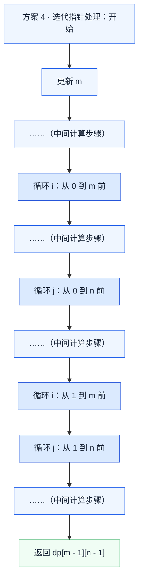

```python
import sys  # 提高递归深度上限（深输入防 RecursionError）

sys.setrecursionlimit(200000)  # 树/链表类题目节点数可达 1e4 量级

def uniquePathsWithObstacles(obstacleGrid):  # 定义函数 uniquePathsWithObstacles（参数：obstacleGrid）
    m = len(obstacleGrid)  # 把 长度(obstacleGrid) 存入 映射表
    n = len(obstacleGrid[0])  # 把 长度(obstacleGrid[0]) 存入 元素个数
    dp = [[0] * n for _ in range(m)]  # 把 [[0] 乘 元素个数 for _ in range(映射表)] 存入 DP 表
    for i in range(m):  # 让 下标 i 从 映射表 遍历
        if obstacleGrid[i][0] == 0:  # 若 obstacleGrid[下标 i][0] 等于 0
            dp[i][0] = 1  # 把 1 写入 dp[i][0]
        else:  # 否则
            break  # 跳出循环
    for j in range(n):  # 让 下标 j 从 元素个数 遍历
        if obstacleGrid[0][j] == 0:  # 若 obstacleGrid[0][下标 j] 等于 0
            dp[0][j] = 1  # 把 1 写入 dp[0][j]
        else:  # 否则
            break  # 跳出循环
    for i in range(1, m):  # 让 下标 i 从 1 到 映射表 遍历
        for j in range(1, n):  # 让 下标 j 从 1 到 元素个数 遍历
            if obstacleGrid[i][j] == 1:  # 若 obstacleGrid[下标 i][下标 j] 等于 1
                continue  # 跳过本轮，进入下一次
            dp[i][j] = (
                dp[i - 1][j] + dp[i][j - 1]
            )  # 把 DP 表[下标 i 减 1][下标 j] 加 DP 表[下标 i][下标 j 减 1] 写入 dp[i][j]
    return dp[m - 1][n - 1]  # 返回 DP 表[映射表 减 1][元素个数 减 1]

if __name__ == "__main__":  # 若 __name__ 等于 '__main__'
    print(uniquePathsWithObstacles([[0, 0, 0], [0, 1, 0], [0, 0, 0]]))  # 打印输出
```

#### 方案 5：迭代指针处理

**思路与代码分析**：核心是「迭代指针处理」。Python 版用切片与字典推导式简化操作，突出可读性。代码里依次做这些事：DP 表逐项填充。**走读**：方案 5 · 迭代指针处理：开始 → 更新 m → 循环 i：从 0 到 m 前 → 循环 j：从 0 到 n 前 → 循环 i：从 1 到 m 前 → 循环 j：从 1 到 n 前 → 返回 dp[m - 1][n - 1]。

**运行架构**（真实控制流）：

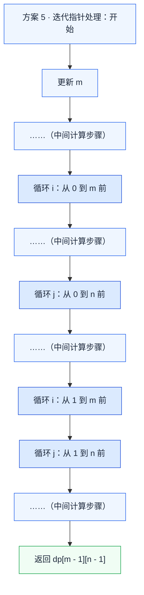

```python
import sys  # 提高递归深度上限（深输入防 RecursionError）

sys.setrecursionlimit(200000)  # 树/链表类题目节点数可达 1e4 量级

def uniquePathsWithObstacles(obstacleGrid):  # 定义函数 uniquePathsWithObstacles（参数：obstacleGrid）
    m = len(obstacleGrid)  # 把 长度(obstacleGrid) 存入 映射表
    n = len(obstacleGrid[0])  # 把 长度(obstacleGrid[0]) 存入 元素个数
    dp = [[0] * n for _ in range(m)]  # 把 [[0] 乘 元素个数 for _ in range(映射表)] 存入 DP 表
    for i in range(m):  # 让 下标 i 从 映射表 遍历
        if obstacleGrid[i][0] == 0:  # 若 obstacleGrid[下标 i][0] 等于 0
            dp[i][0] = 1  # 把 1 写入 dp[i][0]
        else:  # 否则
            break  # 跳出循环
    for j in range(n):  # 让 下标 j 从 元素个数 遍历
        if obstacleGrid[0][j] == 0:  # 若 obstacleGrid[0][下标 j] 等于 0
            dp[0][j] = 1  # 把 1 写入 dp[0][j]
        else:  # 否则
            break  # 跳出循环
    for i in range(1, m):  # 让 下标 i 从 1 到 映射表 遍历
        for j in range(1, n):  # 让 下标 j 从 1 到 元素个数 遍历
            if obstacleGrid[i][j] == 1:  # 若 obstacleGrid[下标 i][下标 j] 等于 1
                continue  # 跳过本轮，进入下一次
            dp[i][j] = (
                dp[i - 1][j] + dp[i][j - 1]
            )  # 把 DP 表[下标 i 减 1][下标 j] 加 DP 表[下标 i][下标 j 减 1] 写入 dp[i][j]
    return dp[m - 1][n - 1]  # 返回 DP 表[映射表 减 1][元素个数 减 1]

if __name__ == "__main__":  # 若 __name__ 等于 '__main__'
    print(uniquePathsWithObstacles([[0, 0, 0], [0, 1, 0], [0, 0, 0]]))  # 打印输出
```

#### 方案 6：直接实现

**思路与代码分析**：核心是「直接实现」。Python 版用切片与字典推导式简化操作，突出可读性。代码里依次做这些事：DP 表逐项填充。**走读**：方案 6 · 直接实现：开始 → 更新 m → 循环 i：从 0 到 m 前 → 循环 j：从 0 到 n 前 → 循环 i：从 1 到 m 前 → 循环 j：从 1 到 n 前 → 返回 dp[m - 1][n - 1]。

**运行架构**（真实控制流）：


```python
import sys  # 提高递归深度上限（深输入防 RecursionError）

sys.setrecursionlimit(200000)  # 树/链表类题目节点数可达 1e4 量级

def uniquePathsWithObstacles(obstacleGrid):  # 定义函数 uniquePathsWithObstacles（参数：obstacleGrid）
    m = len(obstacleGrid)  # 把 长度(obstacleGrid) 存入 映射表
    n = len(obstacleGrid[0])  # 把 长度(obstacleGrid[0]) 存入 元素个数
    dp = [[0] * n for _ in range(m)]  # 把 [[0] 乘 元素个数 for _ in range(映射表)] 存入 DP 表
    for i in range(m):  # 让 下标 i 从 映射表 遍历
        if obstacleGrid[i][0] == 0:  # 若 obstacleGrid[下标 i][0] 等于 0
            dp[i][0] = 1  # 把 1 写入 dp[i][0]
        else:  # 否则
            break  # 跳出循环
    for j in range(n):  # 让 下标 j 从 元素个数 遍历
        if obstacleGrid[0][j] == 0:  # 若 obstacleGrid[0][下标 j] 等于 0
            dp[0][j] = 1  # 把 1 写入 dp[0][j]
        else:  # 否则
            break  # 跳出循环
    for i in range(1, m):  # 让 下标 i 从 1 到 映射表 遍历
        for j in range(1, n):  # 让 下标 j 从 1 到 元素个数 遍历
            if obstacleGrid[i][j] == 1:  # 若 obstacleGrid[下标 i][下标 j] 等于 1
                continue  # 跳过本轮，进入下一次
            dp[i][j] = (
                dp[i - 1][j] + dp[i][j - 1]
            )  # 把 DP 表[下标 i 减 1][下标 j] 加 DP 表[下标 i][下标 j 减 1] 写入 dp[i][j]
    return dp[m - 1][n - 1]  # 返回 DP 表[映射表 减 1][元素个数 减 1]

if __name__ == "__main__":  # 若 __name__ 等于 '__main__'
    print(uniquePathsWithObstacles([[0, 0, 0], [0, 1, 0], [0, 0, 0]]))  # 打印输出
```

### Go 实现（6 种方案）

Go 的全部方案如下，每个方案都内嵌用例自测，可独立运行（老仓库 python/go 文件遵循「打印结果」约定）：

#### 方案 1：方案1（二维 DP）

**思路与代码分析**：核心是「方案1（二维 DP）」。Go 版用切片与多返回值惯用法，显式处理索引边界。代码里依次做这些事：DP 表逐项填充。**走读**：方案 1 · 方案1（二维 DP）：开始 → 更新 : → 遍历 dp 的下标与元素 i → 遍历循环 → 遍历循环 → 遍历循环 → 遍历循环 → 返回 dp[m-1][n-1]。

**运行架构**（真实控制流）：

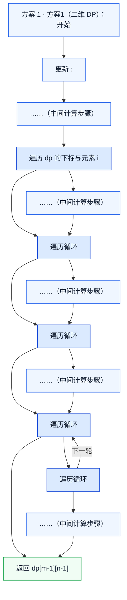

```go
package main // 引入依赖

import (
	"fmt"
	"os"
) // 引入依赖

func uniquePathsWithObstacles(grid [][]int) int { // 定义函数/方法 uniquePathsWithObstacles
	m, n := len(grid), len(grid[0]) // 把 长度(网格), 长度(网格[0]) 写入 m, n :
	dp := make([][]int, m)          // 把 make([][]int, 映射表) 写入 dp :
	for i := range dp {             // 把 range DP 表 { 写入 for i :
		dp[i] = make([]int, n) // 把 make([]int, 元素个数) 写入 dp[i]
	}
	for i := 0; i < m; i++ { // 让 下标 i 从 0 开始计数
		if grid[i][0] == 0 { // 若 网格[下标 i][0] 等于 0
			dp[i][0] = 1 // 把 1 写入 dp[i][0]
		} else { // 否则
			break // 跳出循环
		}
	}
	for j := 0; j < n; j++ { // 让 下标 j 从 0 开始计数
		if grid[0][j] == 0 { // 若 网格[0][下标 j] 等于 0
			dp[0][j] = 1 // 把 1 写入 dp[0][j]
		} else { // 否则
			break // 跳出循环
		}
	}
	for i := 1; i < m; i++ { // 让 下标 i 从 1 开始计数
		for j := 1; j < n; j++ { // 让 下标 j 从 1 开始计数
			if grid[i][j] == 1 { // 若 网格[下标 i][下标 j] 等于 1
				continue // 跳过本轮，进入下一次
			}
			dp[i][j] = dp[i-1][j] + dp[i][j-1] // 把 DP 表[下标 i 减 1][下标 j] 加 DP 表[下标 i][下标 j 减 1] 写入 dp[i][j]
		}
	}
	return dp[m-1][n-1] // 返回 DP 表[映射表 减 1][元素个数 减 1]
}

func main() { // 程序入口：跑内嵌自测用例
	type tc struct { // 定义类型
		in   [][]int // in [][]int
		want int     // want int
	}
	cases := []tc{ // 把 []tc{ 写入 cases :
		{[][]int{{0, 0, 0}, {0, 1, 0}, {0, 0, 0}}, 2},
		{[][]int{{1, 0}}, 0},
	}
	ok := true                // 把 true 写入 ok :
	for _, c := range cases { // 同时取 _ 与 字符 遍历
		if got := uniquePathsWithObstacles(c.in); got != c.want { // 若 got : 赋值为 uniquePathsWithObstacles(字符.in); got 不等于 字符.want
			ok = false                                                                      // 把 false 写入 ok
			fmt.Printf("FAIL uniquePathsWithObstacles(%v)=%v want %v\n", c.in, got, c.want) // 打印输出
		}
	}
	if !ok { // 若 取反 ok
		os.Exit(1) // os.Exit(1)
	}
	fmt.Println("PASS") // 全部用例通过，输出 PASS
}
```

#### 方案 2：方案2（一维 DP 滚动数组）

**思路与代码分析**：核心是「方案2（一维 DP 滚动数组）」。Go 版用切片与多返回值惯用法，显式处理索引边界。**走读**：方案 2 · 方案2（一维 DP 滚动数组）：开始 → 更新 : → 更新 : → 更新 : → 处理 if obstacleGrid[0][0] == 0 → 更新 f[0] → 遍历循环 → 处理 if obstacleGrid[0][j] == 1 ｜ → 更新 f[j] → 更新 f[j] → 遍历循环 → 遍历循环 → 处理 if obstacleGrid[i][j] == 1 → 更新 f[j] → 更新 + → 返回 f[n-1]。

**运行架构**（真实控制流）：

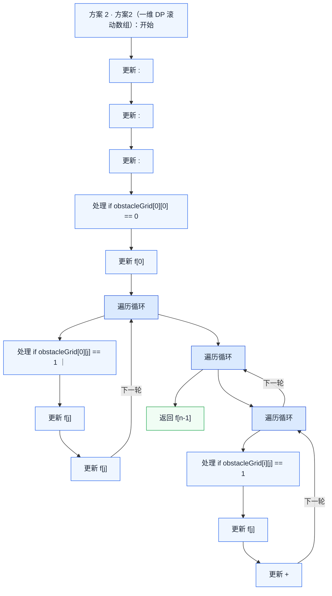

```go
package main // 引入依赖

import (
	"fmt"
	"os"
) // 引入依赖

func uniquePathsWithObstacles(obstacleGrid [][]int) int { // 定义函数/方法 uniquePathsWithObstacles
	m := len(obstacleGrid)       // 把 长度(obstacleGrid) 写入 m :
	n := len(obstacleGrid[0])    // 把 长度(obstacleGrid[0]) 写入 n :
	f := make([]int, n)          // 把 make([]int, 元素个数) 写入 f :
	if obstacleGrid[0][0] == 0 { // 若 obstacleGrid[0][0] 等于 0
		f[0] = 1 // 把 1 写入 f[0]
	}
	for j := 1; j < n; j++ { // 让 下标 j 从 1 开始计数
		if obstacleGrid[0][j] == 1 || f[j-1] == 0 { // 若 obstacleGrid[0][下标 j] 等于 1 或 f[下标 j 减 1] 等于 0
			f[j] = 0 // 把 0 写入 f[j]
		} else { // 否则
			f[j] = f[j-1] // 把 f[下标 j 减 1] 写入 f[j]
		}
	}
	for i := 1; i < m; i++ { // 让 下标 i 从 1 开始计数
		for j := 0; j < n; j++ { // 让 下标 j 从 0 开始计数
			if obstacleGrid[i][j] == 1 { // 若 obstacleGrid[下标 i][下标 j] 等于 1
				f[j] = 0 // 把 0 写入 f[j]
			} else if j > 0 { // 否则，若 下标 j 超过 0
				f[j] += f[j-1] // f[j]累加 f[下标 j 减 1]
			}
		}
	}
	return f[n-1] // 返回 f[元素个数 减 1]
}

func main() { // 程序入口：跑内嵌自测用例
	cases := []struct { // 把 []struct { 写入 cases :
		in   [][]int // in [][]int
		want int     // want int
	}{ // }{
		{[][]int{{0, 0, 0}, {0, 1, 0}, {0, 0, 0}}, 2},
	}
	ok := true                // 把 true 写入 ok :
	for _, c := range cases { // 同时取 _ 与 字符 遍历
		if g := uniquePathsWithObstacles(c.in); g != c.want { // 若 g : 赋值为 uniquePathsWithObstacles(字符.in); g 不等于 字符.want
			ok = false                                          // 把 false 写入 ok
			fmt.Printf("FAIL %v=%v want %v\n", c.in, g, c.want) // 打印输出
		}
	}
	if !ok { // 若 取反 ok
		os.Exit(1) // os.Exit(1)
	}
	fmt.Println("PASS") // 全部用例通过，输出 PASS
}
```

#### 方案 3：直接实现

**思路与代码分析**：核心是「直接实现」。Go 版用切片与多返回值惯用法，显式处理索引边界。代码里依次做这些事：DP 表逐项填充。**走读**：方案 3 · 直接实现：开始 → 更新 : → 遍历 dp 的下标与元素 i → 遍历循环 → 遍历循环 → 遍历循环 → 遍历循环 → 返回 dp[m-1][n-1]。

**运行架构**（真实控制流）：

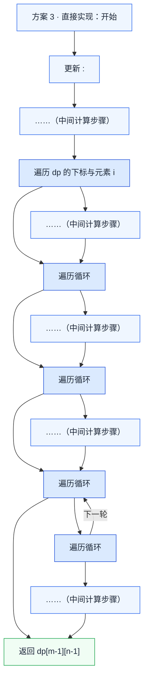

```go
package main // 引入依赖

import (
	"fmt"
	"os"
) // 引入依赖

func uniquePathsWithObstacles(obstacleGrid [][]int) int { // 定义函数/方法 uniquePathsWithObstacles
	m, n := len(obstacleGrid), len(obstacleGrid[0]) // 把 长度(obstacleGrid), 长度(obstacleGrid[0]) 写入 m, n :
	dp := make([][]int, m)                          // 把 make([][]int, 映射表) 写入 dp :
	for i := range dp {                             // 把 range DP 表 { 写入 for i :
		dp[i] = make([]int, n) // 把 make([]int, 元素个数) 写入 dp[i]
	}
	for i := 0; i < m; i++ { // 让 下标 i 从 0 开始计数
		if obstacleGrid[i][0] == 0 { // 若 obstacleGrid[下标 i][0] 等于 0
			dp[i][0] = 1 // 把 1 写入 dp[i][0]
		} else { // 否则
			break // 跳出循环
		}
	}
	for j := 0; j < n; j++ { // 让 下标 j 从 0 开始计数
		if obstacleGrid[0][j] == 0 { // 若 obstacleGrid[0][下标 j] 等于 0
			dp[0][j] = 1 // 把 1 写入 dp[0][j]
		} else { // 否则
			break // 跳出循环
		}
	}
	for i := 1; i < m; i++ { // 让 下标 i 从 1 开始计数
		for j := 1; j < n; j++ { // 让 下标 j 从 1 开始计数
			if obstacleGrid[i][j] == 1 { // 若 obstacleGrid[下标 i][下标 j] 等于 1
				continue // 跳过本轮，进入下一次
			}
			dp[i][j] = dp[i-1][j] + dp[i][j-1] // 把 DP 表[下标 i 减 1][下标 j] 加 DP 表[下标 i][下标 j 减 1] 写入 dp[i][j]
		}
	}
	return dp[m-1][n-1] // 返回 DP 表[映射表 减 1][元素个数 减 1]
}

func main() { // 程序入口：跑内嵌自测用例
	type tc struct { // 定义类型
		in   [][]int // in [][]int
		want int     // want int
	}
	cases := []tc{ // 把 []tc{ 写入 cases :
		{[][]int{{0, 0, 0}, {0, 1, 0}, {0, 0, 0}}, 2},
		{[][]int{{1, 0}}, 0},
	}
	ok := true                // 把 true 写入 ok :
	for _, c := range cases { // 同时取 _ 与 字符 遍历
		if got := uniquePathsWithObstacles(c.in); got != c.want { // 若 got : 赋值为 uniquePathsWithObstacles(字符.in); got 不等于 字符.want
			ok = false                                                                      // 把 false 写入 ok
			fmt.Printf("FAIL uniquePathsWithObstacles(%v)=%v want %v\n", c.in, got, c.want) // 打印输出
		}
	}
	if !ok { // 若 取反 ok
		os.Exit(1) // os.Exit(1)
	}
	fmt.Println("PASS") // 全部用例通过，输出 PASS
}
```

#### 方案 4：迭代指针处理

**思路与代码分析**：核心是「迭代指针处理」。Go 版用切片与多返回值惯用法，显式处理索引边界。代码里依次做这些事：DP 表逐项填充。**走读**：方案 4 · 迭代指针处理：开始 → 更新 : → 遍历 dp 的下标与元素 i → 返回 0 → 遍历循环 → 遍历循环 → 返回 dp[m-1][n-1]。

**运行架构**（真实控制流）：

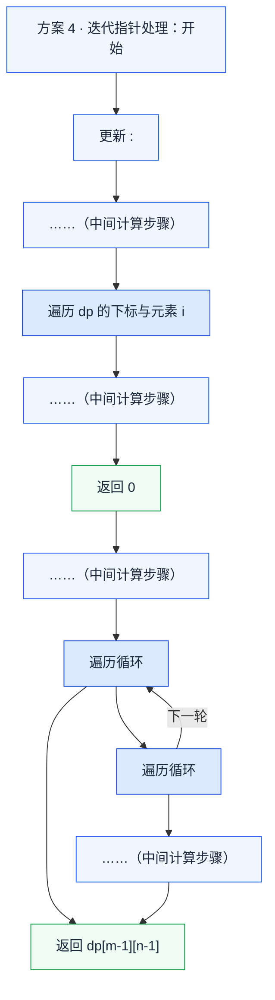

```go
package main // 引入依赖

import (
	"fmt"
	"os"
) // 引入依赖

func uniquePathsWithObstacles(obstacleGrid [][]int) int { // 定义函数/方法 uniquePathsWithObstacles
	m, n := len(obstacleGrid), len(obstacleGrid[0]) // 把 长度(obstacleGrid), 长度(obstacleGrid[0]) 写入 m, n :
	dp := make([][]int, m)                          // 把 make([][]int, 映射表) 写入 dp :
	for i := range dp {                             // 把 range DP 表 { 写入 for i :
		dp[i] = make([]int, n) // 把 make([]int, 元素个数) 写入 dp[i]
	}
	if obstacleGrid[0][0] == 1 { // 若 obstacleGrid[0][0] 等于 1
		return 0 // 返回 0
	}
	dp[0][0] = 1             // 把 1 写入 dp[0][0]
	for i := 0; i < m; i++ { // 让 下标 i 从 0 开始计数
		for j := 0; j < n; j++ { // 让 下标 j 从 0 开始计数
			if obstacleGrid[i][j] == 1 { // 若 obstacleGrid[下标 i][下标 j] 等于 1
				dp[i][j] = 0 // 把 0 写入 dp[i][j]
				continue     // 跳过本轮，进入下一次
			}
			if i > 0 { // 若 下标 i 超过 0
				dp[i][j] += dp[i-1][j] // dp[i][j]累加 DP 表[下标 i 减 1][下标 j]
			}
			if j > 0 { // 若 下标 j 超过 0
				dp[i][j] += dp[i][j-1] // dp[i][j]累加 DP 表[下标 i][下标 j 减 1]
			}
		}
	}
	return dp[m-1][n-1] // 返回 DP 表[映射表 减 1][元素个数 减 1]
}

func main() { // 程序入口：跑内嵌自测用例
	type tc struct { // 定义类型
		in   [][]int // in [][]int
		want int     // want int
	}
	cases := []tc{ // 把 []tc{ 写入 cases :
		{[][]int{{0, 0, 0}, {0, 1, 0}, {0, 0, 0}}, 2},
		{[][]int{{1, 0}}, 0},
	}
	ok := true                // 把 true 写入 ok :
	for _, c := range cases { // 同时取 _ 与 字符 遍历
		if got := uniquePathsWithObstacles(c.in); got != c.want { // 若 got : 赋值为 uniquePathsWithObstacles(字符.in); got 不等于 字符.want
			ok = false                                                                      // 把 false 写入 ok
			fmt.Printf("FAIL uniquePathsWithObstacles(%v)=%v want %v\n", c.in, got, c.want) // 打印输出
		}
	}
	if !ok { // 若 取反 ok
		os.Exit(1) // os.Exit(1)
	}
	fmt.Println("PASS") // 全部用例通过，输出 PASS
}
```

#### 方案 5：迭代指针处理

**思路与代码分析**：核心是「迭代指针处理」。Go 版用切片与多返回值惯用法，显式处理索引边界。代码里依次做这些事：DP 表逐项填充。**走读**：方案 5 · 迭代指针处理：开始 → 更新 : → 遍历 dp 的下标与元素 i → 遍历循环 → 遍历循环 → 遍历循环 → 遍历循环 → 返回 dp[m-1][n-1]。

**运行架构**（真实控制流）：

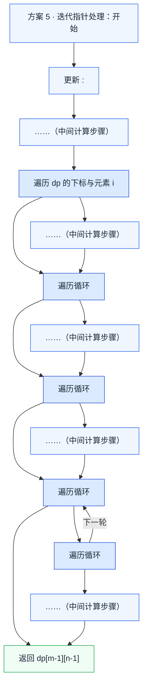

```go
package main // 引入依赖

import (
	"fmt"
	"os"
) // 引入依赖

func uniquePathsWithObstacles(obstacleGrid [][]int) int { // 定义函数/方法 uniquePathsWithObstacles
	m, n := len(obstacleGrid), len(obstacleGrid[0]) // 把 长度(obstacleGrid), 长度(obstacleGrid[0]) 写入 m, n :
	dp := make([][]int, m)                          // 把 make([][]int, 映射表) 写入 dp :
	for i := range dp {                             // 把 range DP 表 { 写入 for i :
		dp[i] = make([]int, n) // 把 make([]int, 元素个数) 写入 dp[i]
	}
	for i := 0; i < m; i++ { // 让 下标 i 从 0 开始计数
		if obstacleGrid[i][0] == 0 { // 若 obstacleGrid[下标 i][0] 等于 0
			dp[i][0] = 1 // 把 1 写入 dp[i][0]
		} else { // 否则
			break // 跳出循环
		}
	}
	for j := 0; j < n; j++ { // 让 下标 j 从 0 开始计数
		if obstacleGrid[0][j] == 0 { // 若 obstacleGrid[0][下标 j] 等于 0
			dp[0][j] = 1 // 把 1 写入 dp[0][j]
		} else { // 否则
			break // 跳出循环
		}
	}
	for i := 1; i < m; i++ { // 让 下标 i 从 1 开始计数
		for j := 1; j < n; j++ { // 让 下标 j 从 1 开始计数
			if obstacleGrid[i][j] == 1 { // 若 obstacleGrid[下标 i][下标 j] 等于 1
				continue // 跳过本轮，进入下一次
			}
			dp[i][j] = dp[i-1][j] + dp[i][j-1] // 把 DP 表[下标 i 减 1][下标 j] 加 DP 表[下标 i][下标 j 减 1] 写入 dp[i][j]
		}
	}
	return dp[m-1][n-1] // 返回 DP 表[映射表 减 1][元素个数 减 1]
}

func main() { // 程序入口：跑内嵌自测用例
	type tc struct { // 定义类型
		in   [][]int // in [][]int
		want int     // want int
	}
	cases := []tc{ // 把 []tc{ 写入 cases :
		{[][]int{{0, 0, 0}, {0, 1, 0}, {0, 0, 0}}, 2},
		{[][]int{{1, 0}}, 0},
	}
	ok := true                // 把 true 写入 ok :
	for _, c := range cases { // 同时取 _ 与 字符 遍历
		if got := uniquePathsWithObstacles(c.in); got != c.want { // 若 got : 赋值为 uniquePathsWithObstacles(字符.in); got 不等于 字符.want
			ok = false                                                                      // 把 false 写入 ok
			fmt.Printf("FAIL uniquePathsWithObstacles(%v)=%v want %v\n", c.in, got, c.want) // 打印输出
		}
	}
	if !ok { // 若 取反 ok
		os.Exit(1) // os.Exit(1)
	}
	fmt.Println("PASS") // 全部用例通过，输出 PASS
}
```

#### 方案 6：直接实现

**思路与代码分析**：核心是「直接实现」。Go 版用切片与多返回值惯用法，显式处理索引边界。代码里依次做这些事：DP 表逐项填充。**走读**：方案 6 · 直接实现：开始 → 更新 : → 遍历 dp 的下标与元素 i → 遍历循环 → 遍历循环 → 遍历循环 → 遍历循环 → 返回 dp[m-1][n-1]。

**运行架构**（真实控制流）：


```go
package main // 引入依赖

import (
	"fmt"
	"os"
) // 引入依赖

func uniquePathsWithObstacles(obstacleGrid [][]int) int { // 定义函数/方法 uniquePathsWithObstacles
	m := len(obstacleGrid)    // 把 长度(obstacleGrid) 写入 m :
	n := len(obstacleGrid[0]) // 把 长度(obstacleGrid[0]) 写入 n :
	dp := make([][]int, m)    // 把 make([][]int, 映射表) 写入 dp :
	for i := range dp {       // 把 range DP 表 { 写入 for i :
		dp[i] = make([]int, n) // 把 make([]int, 元素个数) 写入 dp[i]
	}
	for i := 0; i < m; i++ { // 让 下标 i 从 0 开始计数
		if obstacleGrid[i][0] == 0 { // 若 obstacleGrid[下标 i][0] 等于 0
			dp[i][0] = 1 // 把 1 写入 dp[i][0]
		} else { // 否则
			break // 跳出循环
		}
	}
	for j := 0; j < n; j++ { // 让 下标 j 从 0 开始计数
		if obstacleGrid[0][j] == 0 { // 若 obstacleGrid[0][下标 j] 等于 0
			dp[0][j] = 1 // 把 1 写入 dp[0][j]
		} else { // 否则
			break // 跳出循环
		}
	}
	for i := 1; i < m; i++ { // 让 下标 i 从 1 开始计数
		for j := 1; j < n; j++ { // 让 下标 j 从 1 开始计数
			if obstacleGrid[i][j] == 1 { // 若 obstacleGrid[下标 i][下标 j] 等于 1
				continue // 跳过本轮，进入下一次
			}
			dp[i][j] = dp[i-1][j] + dp[i][j-1] // 把 DP 表[下标 i 减 1][下标 j] 加 DP 表[下标 i][下标 j 减 1] 写入 dp[i][j]
		}
	}
	return dp[m-1][n-1] // 返回 DP 表[映射表 减 1][元素个数 减 1]
}

func main() { // 程序入口：跑内嵌自测用例
	type tc struct { // 定义类型
		in   [][]int // in [][]int
		want int     // want int
	}
	cases := []tc{ // 把 []tc{ 写入 cases :
		{[][]int{{0, 0, 0}, {0, 1, 0}, {0, 0, 0}}, 2},
		{[][]int{{1, 0}}, 0},
	}
	ok := true                // 把 true 写入 ok :
	for _, c := range cases { // 同时取 _ 与 字符 遍历
		if got := uniquePathsWithObstacles(c.in); got != c.want { // 若 got : 赋值为 uniquePathsWithObstacles(字符.in); got 不等于 字符.want
			ok = false                                                                      // 把 false 写入 ok
			fmt.Printf("FAIL uniquePathsWithObstacles(%v)=%v want %v\n", c.in, got, c.want) // 打印输出
		}
	}
	if !ok { // 若 取反 ok
		os.Exit(1) // os.Exit(1)
	}
	fmt.Println("PASS") // 全部用例通过，输出 PASS
}
```

### Java 实现（6 种方案）

Java 的全部方案如下，每个方案都内嵌用例自测，可独立运行（老仓库 python/go 文件遵循「打印结果」约定）：

#### 方案 1：方案1（二维 DP）

**思路与代码分析**：核心是「方案1（二维 DP）」。Java 版用类与静态方法组织，集合操作显式明了。代码里依次做这些事：DP 表逐项填充；双重循环遍历。**走读**：方案 1 · 方案1（二维 DP）：开始 → 更新 m → 遍历循环 → 遍历循环 → 遍历循环 → 遍历循环 → 返回 dp[m - 1][n - 1]。

**运行架构**（真实控制流）：

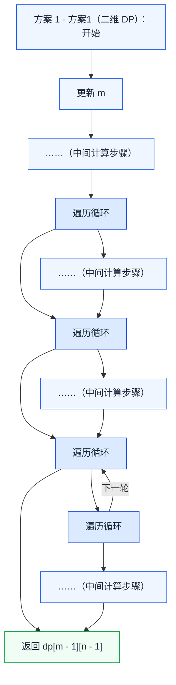

```java
package com.webfault.dsa; // 引入依赖

/**
 * 忠实翻译 python/dp/lc_63_不同路径_ii/solution_1___1.py 方案1：二维 dp。dp[i][j] = dp[i-1][j] +
 * dp[i][j-1]，障碍物处保持 0。
 */
class Main { // 定义类型
  static int uniquePathsWithObstacles(int[][] obstacleGrid) { // 定义函数/方法 uniquePathsWithObstacles
    int m = obstacleGrid.length; // 把 obstacleGrid.长度 存入 映射表
    int n = obstacleGrid[0].length; // 把 obstacleGrid[0].长度 存入 元素个数
    int[][] dp = new int[m][n]; // 把 new int[映射表][元素个数]; 写入 int[][] dp
    for (int i = 0; i < m; i++) { // 让 下标 i 从 0 开始计数，下标 i 小于 映射表 就继续
      if (obstacleGrid[i][0] == 0) { // 若 obstacleGrid[下标 i][0] 等于 0
        dp[i][0] = 1; // 把 1; 写入 dp[i][0]
      } else { // 否则
        break; // 跳出循环
      }
    }
    for (int j = 0; j < n; j++) { // 让 下标 j 从 0 开始计数，下标 j 小于 元素个数 就继续
      if (obstacleGrid[0][j] == 0) { // 若 obstacleGrid[0][下标 j] 等于 0
        dp[0][j] = 1; // 把 1; 写入 dp[0][j]
      } else { // 否则
        break; // 跳出循环
      }
    }
    for (int i = 1; i < m; i++) { // 让 下标 i 从 1 开始计数，下标 i 小于 映射表 就继续
      for (int j = 1; j < n; j++) { // 让 下标 j 从 1 开始计数，下标 j 小于 元素个数 就继续
        if (obstacleGrid[i][j] == 1) { // 若 obstacleGrid[下标 i][下标 j] 等于 1
          continue; // 跳过本轮，进入下一次
        }
        dp[i][j] =
            dp[i - 1][j]
                + dp[i][j - 1]; // 把 DP 表[下标 i 减 1][下标 j] 加 DP 表[下标 i][下标 j 减 1]; 写入 dp[i][j]
      }
    }
    return dp[m - 1][n - 1]; // 返回 DP 表[映射表 减 1][元素个数 减 1]
  }

  public static void main(String[] args) { // public static void main(String[] args) {
    int[][] g1 = {
      {0, 0, 0}, {0, 1, 0}, {0, 0, 0}
    }; // 把 { {0, 0, 0}, {0, 1, 0}, {0, 0, 0} }; 写入 int[][] g1
    int[][] g2 = {{0, 0}, {1, 0}}; // 把 { {0, 0}, {1, 0} }; 写入 int[][] g2
    int[][] g3 = {{0, 0, 0, 0}, {0, 1, 1, 0}, {0, 0, 0, 0}};
    int r1 = uniquePathsWithObstacles(g1); // 把 uniquePathsWithObstacles(g1) 存入 r1
    int r2 = uniquePathsWithObstacles(g2); // 把 uniquePathsWithObstacles(g2) 存入 r2
    int r3 = uniquePathsWithObstacles(g3); // 把 uniquePathsWithObstacles(g3) 存入 r3
    if (!(r1 == 2 && r2 == 1 && r3 == 2)) { // 若 取反 (r1 等于 2 且 r2 等于 1 且 r3 等于 2
      System.out.println("FAIL got " + r1 + " " + r2 + " " + r3 + " want 2 1 2"); // 打印输出
      throw new RuntimeException("FAILED"); // throw new RuntimeException(「FAILED」);
    }
    System.out.println("PASS"); // 全部用例通过，输出 PASS
  }
}
```

#### 方案 2：方案2（一维 DP 滚动数组）

**思路与代码分析**：核心是「方案2（一维 DP 滚动数组）」。Java 版用类与静态方法组织，集合操作显式明了。代码里依次做这些事：双重循环遍历。**走读**：方案 2 · 方案2（一维 DP 滚动数组）：开始 → 更新 m → 更新 n → 更新 f → 更新 f[0] → 遍历循环 → 更新 f[j] → 遍历循环 → 遍历循环 → 若 obstacleGrid[i][j] == 1 则： → 更新 f[j] → 更新 + → 返回 f[n - 1]。

**运行架构**（真实控制流）：

```mermaid
graph TD
    N0["方案 2 · 方案2（一维 DP 滚动数组）：开始"]
    N1["更新 m"]
    N2["更新 n"]
    N3["更新 f"]
    N4["更新 f[0]"]
    N5["遍历循环"]
    N6["更新 f[j]"]
    N7["遍历循环"]
    N8["遍历循环"]
    N9["若 obstacleGrid[i][j] == 1 则："]
    N10["更新 f[j]"]
    N11["更新 +"]
    N12["返回 f[n - 1]"]
    N0 --> N1
    N1 --> N2
    N2 --> N3
    N3 --> N4
    N4 --> N5
    N5 --> N6
    N6 -- 下一轮 --> N5
    N5 --> N7
    N7 --> N8
    N8 --> N9
    N9 --> N10
    N10 --> N11
    N11 -- 下一轮 --> N8
    N8 -- 下一轮 --> N7
    N7 --> N12
    classDef n fill:#eff6ff,stroke:#2563eb,color:#1e293b;
    classDef lp fill:#dbeafe,stroke:#1d4ed8,color:#1e293b;
    classDef dc fill:#fef9c3,stroke:#ca8a04,color:#1e293b;
    classDef tm fill:#f0fdf4,stroke:#16a34a,color:#1e293b;
    class N0,N1,N2,N3,N4,N6,N9,N10,N11 n;
    class N5,N7,N8 lp;
    class N12 tm;
```

```java
package com.webfault.dsa; // 引入依赖

/** 忠实翻译 python/dp/lc_63_不同路径_ii/solution_2___2.py 方案2：一维滚动数组 f[j]。 */
class Main { // 定义类型
  static int uniquePathsWithObstacles(int[][] obstacleGrid) { // 定义函数/方法 uniquePathsWithObstacles
    int m = obstacleGrid.length; // 把 obstacleGrid.长度 存入 映射表
    int n = obstacleGrid[0].length; // 把 obstacleGrid[0].长度 存入 元素个数
    int[] f = new int[n]; // 把 new int[元素个数]; 写入 int[] f
    f[0] = obstacleGrid[0][0] == 0 ? 1 : 0; // 把 obstacleGrid[0][0] 等于 0 ? 1 : 0; 写入 f[0]
    for (int j = 1; j < n; j++) { // 让 下标 j 从 1 开始计数，下标 j 小于 元素个数 就继续
      f[j] = (obstacleGrid[0][j] == 1 || f[j - 1] == 0) ? 0 : f[j - 1];
    }
    for (int i = 1; i < m; i++) { // 让 下标 i 从 1 开始计数，下标 i 小于 映射表 就继续
      for (int j = 0; j < n; j++) { // 让 下标 j 从 0 开始计数，下标 j 小于 元素个数 就继续
        if (obstacleGrid[i][j] == 1) { // 若 obstacleGrid[下标 i][下标 j] 等于 1
          f[j] = 0; // 把 0; 写入 f[j]
        } else if (j > 0) { // 否则，若 下标 j 超过 0
          f[j] += f[j - 1]; // f[j]累加 f[下标 j 减 1]
        }
      }
    }
    return f[n - 1]; // 返回 f[元素个数 减 1]
  }

  public static void main(String[] args) { // public static void main(String[] args) {
    int[][] g1 = {
      {0, 0, 0}, {0, 1, 0}, {0, 0, 0}
    }; // 把 { {0, 0, 0}, {0, 1, 0}, {0, 0, 0} }; 写入 int[][] g1
    int[][] g2 = {{0, 0}, {1, 0}}; // 把 { {0, 0}, {1, 0} }; 写入 int[][] g2
    int[][] g3 = {{0, 0, 0, 0}, {0, 1, 1, 0}, {0, 0, 0, 0}};
    int r1 = uniquePathsWithObstacles(g1); // 把 uniquePathsWithObstacles(g1) 存入 r1
    int r2 = uniquePathsWithObstacles(g2); // 把 uniquePathsWithObstacles(g2) 存入 r2
    int r3 = uniquePathsWithObstacles(g3); // 把 uniquePathsWithObstacles(g3) 存入 r3
    if (!(r1 == 2 && r2 == 1 && r3 == 2)) { // 若 取反 (r1 等于 2 且 r2 等于 1 且 r3 等于 2
      System.out.println("FAIL got " + r1 + " " + r2 + " " + r3 + " want 2 1 2"); // 打印输出
      throw new RuntimeException("FAILED"); // throw new RuntimeException(「FAILED」);
    }
    System.out.println("PASS"); // 全部用例通过，输出 PASS
  }
}
```

#### 方案 3：直接实现

**思路与代码分析**：核心是「直接实现」。Java 版用类与静态方法组织，集合操作显式明了。代码里依次做这些事：DP 表逐项填充；双重循环遍历。**走读**：方案 3 · 直接实现：开始 → 更新 m → 遍历循环 → 遍历循环 → 遍历循环 → 遍历循环 → 返回 dp[m - 1][n - 1]。

**运行架构**（真实控制流）：

```mermaid
graph TD
    N0["方案 3 · 直接实现：开始"]
    N1["更新 m"]
    D1["……（中间计算步骤）"]
    N4["遍历循环"]
    D2["……（中间计算步骤）"]
    N8["遍历循环"]
    D3["……（中间计算步骤）"]
    N12["遍历循环"]
    N13["遍历循环"]
    D4["……（中间计算步骤）"]
    N18["返回 dp[m - 1][n - 1]"]
    N0 --> N1
    N4 --> N8
    N8 --> N12
    N12 --> N13
    N13 -- 下一轮 --> N12
    N12 --> N18
    N1 --> D1
    D1 --> N4
    N4 --> D2
    D2 --> N8
    N8 --> D3
    D3 --> N12
    N13 --> D4
    D4 --> N18
    classDef n fill:#eff6ff,stroke:#2563eb,color:#1e293b;
    classDef lp fill:#dbeafe,stroke:#1d4ed8,color:#1e293b;
    classDef dc fill:#fef9c3,stroke:#ca8a04,color:#1e293b;
    classDef tm fill:#f0fdf4,stroke:#16a34a,color:#1e293b;
    class N0,N1,D1,D2,D3,D4 n;
    class N4,N8,N12,N13 lp;
    class N18 tm;
```

```java
package com.webfault.dsa; // 引入依赖

/** 忠实翻译 python/dp/lc_63_不同路径_ii/solution_3___3.py 方案3：二维 dp（与方案1同一递推写法）。 */
class Lc63S3 { // 定义类型
  static int uniquePathsWithObstacles(int[][] obstacleGrid) { // 定义函数/方法 uniquePathsWithObstacles
    int m = obstacleGrid.length; // 把 obstacleGrid.长度 存入 映射表
    int n = obstacleGrid[0].length; // 把 obstacleGrid[0].长度 存入 元素个数
    int[][] dp = new int[m][n]; // 把 new int[映射表][元素个数]; 写入 int[][] dp
    for (int i = 0; i < m; i++) { // 让 下标 i 从 0 开始计数，下标 i 小于 映射表 就继续
      if (obstacleGrid[i][0] == 0) { // 若 obstacleGrid[下标 i][0] 等于 0
        dp[i][0] = 1; // 把 1; 写入 dp[i][0]
      } else { // 否则
        break; // 跳出循环
      }
    }
    for (int j = 0; j < n; j++) { // 让 下标 j 从 0 开始计数，下标 j 小于 元素个数 就继续
      if (obstacleGrid[0][j] == 0) { // 若 obstacleGrid[0][下标 j] 等于 0
        dp[0][j] = 1; // 把 1; 写入 dp[0][j]
      } else { // 否则
        break; // 跳出循环
      }
    }
    for (int i = 1; i < m; i++) { // 让 下标 i 从 1 开始计数，下标 i 小于 映射表 就继续
      for (int j = 1; j < n; j++) { // 让 下标 j 从 1 开始计数，下标 j 小于 元素个数 就继续
        if (obstacleGrid[i][j] == 1) { // 若 obstacleGrid[下标 i][下标 j] 等于 1
          continue; // 跳过本轮，进入下一次
        }
        dp[i][j] =
            dp[i - 1][j]
                + dp[i][j - 1]; // 把 DP 表[下标 i 减 1][下标 j] 加 DP 表[下标 i][下标 j 减 1]; 写入 dp[i][j]
      }
    }
    return dp[m - 1][n - 1]; // 返回 DP 表[映射表 减 1][元素个数 减 1]
  }

  public static void main(String[] args) { // public static void main(String[] args) {
    int[][] g1 = {
      {0, 0, 0}, {0, 1, 0}, {0, 0, 0}
    }; // 把 { {0, 0, 0}, {0, 1, 0}, {0, 0, 0} }; 写入 int[][] g1
    int[][] g2 = {{0, 0}, {1, 0}}; // 把 { {0, 0}, {1, 0} }; 写入 int[][] g2
    int[][] g3 = {{0, 0, 0, 0}, {0, 1, 1, 0}, {0, 0, 0, 0}};
    int r1 = uniquePathsWithObstacles(g1); // 把 uniquePathsWithObstacles(g1) 存入 r1
    int r2 = uniquePathsWithObstacles(g2); // 把 uniquePathsWithObstacles(g2) 存入 r2
    int r3 = uniquePathsWithObstacles(g3); // 把 uniquePathsWithObstacles(g3) 存入 r3
    if (!(r1 == 2 && r2 == 1 && r3 == 2)) { // 若 取反 (r1 等于 2 且 r2 等于 1 且 r3 等于 2
      System.out.println("FAIL got " + r1 + " " + r2 + " " + r3 + " want 2 1 2"); // 打印输出
      throw new RuntimeException("FAILED"); // throw new RuntimeException(「FAILED」);
    }
    System.out.println("PASS"); // 全部用例通过，输出 PASS
  }
}
```

#### 方案 4：迭代指针处理

**思路与代码分析**：核心是「迭代指针处理」。Java 版用类与静态方法组织，集合操作显式明了。代码里依次做这些事：DP 表逐项填充；双重循环遍历。**走读**：方案 4 · 迭代指针处理：开始 → 更新 m → 遍历循环 → 遍历循环 → 遍历循环 → 遍历循环 → 返回 dp[m - 1][n - 1]。

**运行架构**（真实控制流）：

```mermaid
graph TD
    N0["方案 4 · 迭代指针处理：开始"]
    N1["更新 m"]
    D1["……（中间计算步骤）"]
    N4["遍历循环"]
    D2["……（中间计算步骤）"]
    N8["遍历循环"]
    D3["……（中间计算步骤）"]
    N12["遍历循环"]
    N13["遍历循环"]
    D4["……（中间计算步骤）"]
    N18["返回 dp[m - 1][n - 1]"]
    N0 --> N1
    N4 --> N8
    N8 --> N12
    N12 --> N13
    N13 -- 下一轮 --> N12
    N12 --> N18
    N1 --> D1
    D1 --> N4
    N4 --> D2
    D2 --> N8
    N8 --> D3
    D3 --> N12
    N13 --> D4
    D4 --> N18
    classDef n fill:#eff6ff,stroke:#2563eb,color:#1e293b;
    classDef lp fill:#dbeafe,stroke:#1d4ed8,color:#1e293b;
    classDef dc fill:#fef9c3,stroke:#ca8a04,color:#1e293b;
    classDef tm fill:#f0fdf4,stroke:#16a34a,color:#1e293b;
    class N0,N1,D1,D2,D3,D4 n;
    class N4,N8,N12,N13 lp;
    class N18 tm;
```

```java
package com.webfault.dsa; // 引入依赖

/** 忠实翻译 python/dp/lc_63_不同路径_ii/solution_4___4.py 方案4：二维 dp。 */
class Lc63S4 { // 定义类型
  static int uniquePathsWithObstacles(int[][] obstacleGrid) { // 定义函数/方法 uniquePathsWithObstacles
    int m = obstacleGrid.length; // 把 obstacleGrid.长度 存入 映射表
    int n = obstacleGrid[0].length; // 把 obstacleGrid[0].长度 存入 元素个数
    int[][] dp = new int[m][n]; // 把 new int[映射表][元素个数]; 写入 int[][] dp
    for (int i = 0; i < m; i++) { // 让 下标 i 从 0 开始计数，下标 i 小于 映射表 就继续
      if (obstacleGrid[i][0] == 0) { // 若 obstacleGrid[下标 i][0] 等于 0
        dp[i][0] = 1; // 把 1; 写入 dp[i][0]
      } else { // 否则
        break; // 跳出循环
      }
    }
    for (int j = 0; j < n; j++) { // 让 下标 j 从 0 开始计数，下标 j 小于 元素个数 就继续
      if (obstacleGrid[0][j] == 0) { // 若 obstacleGrid[0][下标 j] 等于 0
        dp[0][j] = 1; // 把 1; 写入 dp[0][j]
      } else { // 否则
        break; // 跳出循环
      }
    }
    for (int i = 1; i < m; i++) { // 让 下标 i 从 1 开始计数，下标 i 小于 映射表 就继续
      for (int j = 1; j < n; j++) { // 让 下标 j 从 1 开始计数，下标 j 小于 元素个数 就继续
        if (obstacleGrid[i][j] == 1) { // 若 obstacleGrid[下标 i][下标 j] 等于 1
          continue; // 跳过本轮，进入下一次
        }
        dp[i][j] =
            dp[i - 1][j]
                + dp[i][j - 1]; // 把 DP 表[下标 i 减 1][下标 j] 加 DP 表[下标 i][下标 j 减 1]; 写入 dp[i][j]
      }
    }
    return dp[m - 1][n - 1]; // 返回 DP 表[映射表 减 1][元素个数 减 1]
  }

  public static void main(String[] args) { // public static void main(String[] args) {
    int[][] g1 = {
      {0, 0, 0}, {0, 1, 0}, {0, 0, 0}
    }; // 把 { {0, 0, 0}, {0, 1, 0}, {0, 0, 0} }; 写入 int[][] g1
    int[][] g2 = {{0, 0}, {1, 0}}; // 把 { {0, 0}, {1, 0} }; 写入 int[][] g2
    int[][] g3 = {{0, 0, 0, 0}, {0, 1, 1, 0}, {0, 0, 0, 0}};
    int r1 = uniquePathsWithObstacles(g1); // 把 uniquePathsWithObstacles(g1) 存入 r1
    int r2 = uniquePathsWithObstacles(g2); // 把 uniquePathsWithObstacles(g2) 存入 r2
    int r3 = uniquePathsWithObstacles(g3); // 把 uniquePathsWithObstacles(g3) 存入 r3
    if (!(r1 == 2 && r2 == 1 && r3 == 2)) { // 若 取反 (r1 等于 2 且 r2 等于 1 且 r3 等于 2
      System.out.println("FAIL got " + r1 + " " + r2 + " " + r3 + " want 2 1 2"); // 打印输出
      throw new RuntimeException("FAILED"); // throw new RuntimeException(「FAILED」);
    }
    System.out.println("PASS"); // 全部用例通过，输出 PASS
  }
}
```

#### 方案 5：迭代指针处理

**思路与代码分析**：核心是「迭代指针处理」。Java 版用类与静态方法组织，集合操作显式明了。代码里依次做这些事：DP 表逐项填充；双重循环遍历。**走读**：方案 5 · 迭代指针处理：开始 → 更新 m → 遍历循环 → 遍历循环 → 遍历循环 → 遍历循环 → 返回 dp[m - 1][n - 1]。

**运行架构**（真实控制流）：

```mermaid
graph TD
    N0["方案 5 · 迭代指针处理：开始"]
    N1["更新 m"]
    D1["……（中间计算步骤）"]
    N4["遍历循环"]
    D2["……（中间计算步骤）"]
    N8["遍历循环"]
    D3["……（中间计算步骤）"]
    N12["遍历循环"]
    N13["遍历循环"]
    D4["……（中间计算步骤）"]
    N18["返回 dp[m - 1][n - 1]"]
    N0 --> N1
    N4 --> N8
    N8 --> N12
    N12 --> N13
    N13 -- 下一轮 --> N12
    N12 --> N18
    N1 --> D1
    D1 --> N4
    N4 --> D2
    D2 --> N8
    N8 --> D3
    D3 --> N12
    N13 --> D4
    D4 --> N18
    classDef n fill:#eff6ff,stroke:#2563eb,color:#1e293b;
    classDef lp fill:#dbeafe,stroke:#1d4ed8,color:#1e293b;
    classDef dc fill:#fef9c3,stroke:#ca8a04,color:#1e293b;
    classDef tm fill:#f0fdf4,stroke:#16a34a,color:#1e293b;
    class N0,N1,D1,D2,D3,D4 n;
    class N4,N8,N12,N13 lp;
    class N18 tm;
```

```java
package com.webfault.dsa; // 引入依赖

/** 忠实翻译 python/dp/lc_63_不同路径_ii/solution_5___5.py 方案5：二维 dp。 */
class Lc63S5 { // 定义类型
  static int uniquePathsWithObstacles(int[][] obstacleGrid) { // 定义函数/方法 uniquePathsWithObstacles
    int m = obstacleGrid.length; // 把 obstacleGrid.长度 存入 映射表
    int n = obstacleGrid[0].length; // 把 obstacleGrid[0].长度 存入 元素个数
    int[][] dp = new int[m][n]; // 把 new int[映射表][元素个数]; 写入 int[][] dp
    for (int i = 0; i < m; i++) { // 让 下标 i 从 0 开始计数，下标 i 小于 映射表 就继续
      if (obstacleGrid[i][0] == 0) { // 若 obstacleGrid[下标 i][0] 等于 0
        dp[i][0] = 1; // 把 1; 写入 dp[i][0]
      } else { // 否则
        break; // 跳出循环
      }
    }
    for (int j = 0; j < n; j++) { // 让 下标 j 从 0 开始计数，下标 j 小于 元素个数 就继续
      if (obstacleGrid[0][j] == 0) { // 若 obstacleGrid[0][下标 j] 等于 0
        dp[0][j] = 1; // 把 1; 写入 dp[0][j]
      } else { // 否则
        break; // 跳出循环
      }
    }
    for (int i = 1; i < m; i++) { // 让 下标 i 从 1 开始计数，下标 i 小于 映射表 就继续
      for (int j = 1; j < n; j++) { // 让 下标 j 从 1 开始计数，下标 j 小于 元素个数 就继续
        if (obstacleGrid[i][j] == 1) { // 若 obstacleGrid[下标 i][下标 j] 等于 1
          continue; // 跳过本轮，进入下一次
        }
        dp[i][j] =
            dp[i - 1][j]
                + dp[i][j - 1]; // 把 DP 表[下标 i 减 1][下标 j] 加 DP 表[下标 i][下标 j 减 1]; 写入 dp[i][j]
      }
    }
    return dp[m - 1][n - 1]; // 返回 DP 表[映射表 减 1][元素个数 减 1]
  }

  public static void main(String[] args) { // public static void main(String[] args) {
    int[][] g1 = {
      {0, 0, 0}, {0, 1, 0}, {0, 0, 0}
    }; // 把 { {0, 0, 0}, {0, 1, 0}, {0, 0, 0} }; 写入 int[][] g1
    int[][] g2 = {{0, 0}, {1, 0}}; // 把 { {0, 0}, {1, 0} }; 写入 int[][] g2
    int[][] g3 = {{0, 0, 0, 0}, {0, 1, 1, 0}, {0, 0, 0, 0}};
    int r1 = uniquePathsWithObstacles(g1); // 把 uniquePathsWithObstacles(g1) 存入 r1
    int r2 = uniquePathsWithObstacles(g2); // 把 uniquePathsWithObstacles(g2) 存入 r2
    int r3 = uniquePathsWithObstacles(g3); // 把 uniquePathsWithObstacles(g3) 存入 r3
    if (!(r1 == 2 && r2 == 1 && r3 == 2)) { // 若 取反 (r1 等于 2 且 r2 等于 1 且 r3 等于 2
      System.out.println("FAIL got " + r1 + " " + r2 + " " + r3 + " want 2 1 2"); // 打印输出
      throw new RuntimeException("FAILED"); // throw new RuntimeException(「FAILED」);
    }
    System.out.println("PASS"); // 全部用例通过，输出 PASS
  }
}
```

#### 方案 6：直接实现

**思路与代码分析**：核心是「直接实现」。Java 版用类与静态方法组织，集合操作显式明了。代码里依次做这些事：DP 表逐项填充；双重循环遍历。**走读**：方案 6 · 直接实现：开始 → 更新 m → 遍历循环 → 遍历循环 → 遍历循环 → 遍历循环 → 返回 dp[m - 1][n - 1]。

**运行架构**（真实控制流）：

```mermaid
graph TD
    N0["方案 6 · 直接实现：开始"]
    N1["更新 m"]
    D1["……（中间计算步骤）"]
    N4["遍历循环"]
    D2["……（中间计算步骤）"]
    N8["遍历循环"]
    D3["……（中间计算步骤）"]
    N12["遍历循环"]
    N13["遍历循环"]
    D4["……（中间计算步骤）"]
    N18["返回 dp[m - 1][n - 1]"]
    N0 --> N1
    N4 --> N8
    N8 --> N12
    N12 --> N13
    N13 -- 下一轮 --> N12
    N12 --> N18
    N1 --> D1
    D1 --> N4
    N4 --> D2
    D2 --> N8
    N8 --> D3
    D3 --> N12
    N13 --> D4
    D4 --> N18
    classDef n fill:#eff6ff,stroke:#2563eb,color:#1e293b;
    classDef lp fill:#dbeafe,stroke:#1d4ed8,color:#1e293b;
    classDef dc fill:#fef9c3,stroke:#ca8a04,color:#1e293b;
    classDef tm fill:#f0fdf4,stroke:#16a34a,color:#1e293b;
    class N0,N1,D1,D2,D3,D4 n;
    class N4,N8,N12,N13 lp;
    class N18 tm;
```

```java
package com.webfault.dsa; // 引入依赖

/** 忠实翻译 python/dp/lc_63_不同路径_ii/solution_6___6.py 方案6：二维 dp。 */
class Lc63S6 { // 定义类型
  static int uniquePathsWithObstacles(int[][] obstacleGrid) { // 定义函数/方法 uniquePathsWithObstacles
    int m = obstacleGrid.length; // 把 obstacleGrid.长度 存入 映射表
    int n = obstacleGrid[0].length; // 把 obstacleGrid[0].长度 存入 元素个数
    int[][] dp = new int[m][n]; // 把 new int[映射表][元素个数]; 写入 int[][] dp
    for (int i = 0; i < m; i++) { // 让 下标 i 从 0 开始计数，下标 i 小于 映射表 就继续
      if (obstacleGrid[i][0] == 0) { // 若 obstacleGrid[下标 i][0] 等于 0
        dp[i][0] = 1; // 把 1; 写入 dp[i][0]
      } else { // 否则
        break; // 跳出循环
      }
    }
    for (int j = 0; j < n; j++) { // 让 下标 j 从 0 开始计数，下标 j 小于 元素个数 就继续
      if (obstacleGrid[0][j] == 0) { // 若 obstacleGrid[0][下标 j] 等于 0
        dp[0][j] = 1; // 把 1; 写入 dp[0][j]
      } else { // 否则
        break; // 跳出循环
      }
    }
    for (int i = 1; i < m; i++) { // 让 下标 i 从 1 开始计数，下标 i 小于 映射表 就继续
      for (int j = 1; j < n; j++) { // 让 下标 j 从 1 开始计数，下标 j 小于 元素个数 就继续
        if (obstacleGrid[i][j] == 1) { // 若 obstacleGrid[下标 i][下标 j] 等于 1
          continue; // 跳过本轮，进入下一次
        }
        dp[i][j] =
            dp[i - 1][j]
                + dp[i][j - 1]; // 把 DP 表[下标 i 减 1][下标 j] 加 DP 表[下标 i][下标 j 减 1]; 写入 dp[i][j]
      }
    }
    return dp[m - 1][n - 1]; // 返回 DP 表[映射表 减 1][元素个数 减 1]
  }

  public static void main(String[] args) { // public static void main(String[] args) {
    int[][] g1 = {
      {0, 0, 0}, {0, 1, 0}, {0, 0, 0}
    }; // 把 { {0, 0, 0}, {0, 1, 0}, {0, 0, 0} }; 写入 int[][] g1
    int[][] g2 = {{0, 0}, {1, 0}}; // 把 { {0, 0}, {1, 0} }; 写入 int[][] g2
    int[][] g3 = {{0, 0, 0, 0}, {0, 1, 1, 0}, {0, 0, 0, 0}};
    int r1 = uniquePathsWithObstacles(g1); // 把 uniquePathsWithObstacles(g1) 存入 r1
    int r2 = uniquePathsWithObstacles(g2); // 把 uniquePathsWithObstacles(g2) 存入 r2
    int r3 = uniquePathsWithObstacles(g3); // 把 uniquePathsWithObstacles(g3) 存入 r3
    if (!(r1 == 2 && r2 == 1 && r3 == 2)) { // 若 取反 (r1 等于 2 且 r2 等于 1 且 r3 等于 2
      System.out.println("FAIL got " + r1 + " " + r2 + " " + r3 + " want 2 1 2"); // 打印输出
      throw new RuntimeException("FAILED"); // throw new RuntimeException(「FAILED」);
    }
    System.out.println("PASS"); // 全部用例通过，输出 PASS
  }
}
```

### Rust 实现（6 种方案）

Rust 的全部方案如下，每个方案都内嵌用例自测，可独立运行（老仓库 python/go 文件遵循「打印结果」约定）：

#### 方案 1：方案1（二维 DP）

**思路与代码分析**：核心是「方案1（二维 DP）」。Rust 版用所有权移动与切片借用改写同一逻辑，注意 Option 与引用边界。代码里依次做这些事：DP 表逐项填充。**走读**：方案 1 · 方案1（二维 DP）：开始 → 计算 m → 计算 n → 填写 DP 表 → 填写 DP 表 → 遍历 0..m 中的每个元素 i → 遍历 0..n 中的每个元素 j → 处理 if grid[i][j] == 1 → 填写 DP 表 → 填写 DP 表 → 填写 DP 表 → 返回结果。

**运行架构**（真实控制流）：

```mermaid
graph TD
    N0["方案 1 · 方案1（二维 DP）：开始"]
    N1["计算 m"]
    N2["计算 n"]
    N3["填写 DP 表"]
    N4["填写 DP 表"]
    N5["遍历 0..m 中的每个元素 i"]
    N6["遍历 0..n 中的每个元素 j"]
    N7["处理 if grid[i][j] == 1"]
    N8["填写 DP 表"]
    N9["填写 DP 表"]
    N10["填写 DP 表"]
    N11["返回结果"]
    N0 --> N1
    N1 --> N2
    N2 --> N3
    N3 --> N4
    N4 --> N5
    N5 --> N6
    N6 --> N7
    N7 --> N8
    N8 --> N9
    N9 -- 下一轮 --> N6
    N6 -- 下一轮 --> N5
    N5 --> N10
    N10 --> N11
    classDef n fill:#eff6ff,stroke:#2563eb,color:#1e293b;
    classDef lp fill:#dbeafe,stroke:#1d4ed8,color:#1e293b;
    classDef dc fill:#fef9c3,stroke:#ca8a04,color:#1e293b;
    classDef tm fill:#f0fdf4,stroke:#16a34a,color:#1e293b;
    class N0,N1,N2,N3,N4,N7,N8,N9,N10 n;
    class N5,N6 lp;
    class N11 tm;
```

```rust
// LeetCode 63. 不同路径II — Rust 版（方案1）
fn unique_paths_with_obstacles(grid: Vec<Vec<i32>>) -> i32 {
    // 定义函数/方法 unique_paths_with_obstacles
    let m = grid.len(); // 把 网格.长度() 存入 映射表
    let n = grid[0].len(); // 把 网格[0].长度() 存入 元素个数
    let mut dp = vec![0i32; n]; // 把 vec取反 [0i32; 元素个数]; 写入 let mut dp
    dp[0] = if grid[0][0] == 1 { 0 } else { 1 }; // 把 if 网格[0][0] 等于 1 { 0 } else { 1 }; 写入 dp[0]
    for i in 0..m {
        // 逐个取出 0 的元素（下标 i）
        for j in 0..n {
            // 逐个取出 0 的元素（下标 j）
            if grid[i][j] == 1 {
                dp[j] = 0;
            }
            // 若 网格[下标 i][下标 j] 等于 1 { DP 表[下标 j] 赋值为 0; }
            else if j > 0 {
                dp[j] += dp[j - 1];
            } // 否则，若 下标 j 超过 0 { DP 表[下标 j] 累加 DP 表[下标 j 减 1]; }
        }
    }
    dp[n - 1] // DP 表[元素个数 减 1]
}
fn main() {
    // 程序入口：跑内嵌自测用例
    let g = vec![vec![0, 0, 0], vec![0, 1, 0], vec![0, 0, 0]]; // 把 vec取反 [vec取反 [0,0,0],vec取反 [0,1,0],vec取反 [0,0,0]] 存入 g
    assert_eq!(unique_paths_with_obstacles(g), 2); // 断言校验
    let g2 = vec![vec![0, 1], vec![0, 0]]; // 把 vec取反 [vec取反 [0,1],vec取反 [0,0]] 存入 g2
    assert_eq!(unique_paths_with_obstacles(g2), 1); // 断言校验
    println!("PASS");
} // 全部用例通过，输出 PASS
```

#### 方案 2：方案2（一维 DP 滚动数组）

**思路与代码分析**：核心是「方案2（一维 DP 滚动数组）」。Rust 版用所有权移动与切片借用改写同一逻辑，注意 Option 与引用边界。代码里依次做这些事：DP 表逐项填充。**走读**：方案 2 · 方案2（一维 DP 滚动数组）：开始 → 计算 m → 计算 n → 填写 DP 表 → 填写 DP 表 → 遍历 0..m 中的每个元素 i → 遍历 0..n 中的每个元素 j → 处理 if grid[i][j] == 1 → 填写 DP 表 → 填写 DP 表 → 填写 DP 表 → 返回结果。

**运行架构**（真实控制流）：

```mermaid
graph TD
    N0["方案 2 · 方案2（一维 DP 滚动数组）：开始"]
    N1["计算 m"]
    N2["计算 n"]
    N3["填写 DP 表"]
    N4["填写 DP 表"]
    N5["遍历 0..m 中的每个元素 i"]
    N6["遍历 0..n 中的每个元素 j"]
    N7["处理 if grid[i][j] == 1"]
    N8["填写 DP 表"]
    N9["填写 DP 表"]
    N10["填写 DP 表"]
    N11["返回结果"]
    N0 --> N1
    N1 --> N2
    N2 --> N3
    N3 --> N4
    N4 --> N5
    N5 --> N6
    N6 --> N7
    N7 --> N8
    N8 --> N9
    N9 -- 下一轮 --> N6
    N6 -- 下一轮 --> N5
    N5 --> N10
    N10 --> N11
    classDef n fill:#eff6ff,stroke:#2563eb,color:#1e293b;
    classDef lp fill:#dbeafe,stroke:#1d4ed8,color:#1e293b;
    classDef dc fill:#fef9c3,stroke:#ca8a04,color:#1e293b;
    classDef tm fill:#f0fdf4,stroke:#16a34a,color:#1e293b;
    class N0,N1,N2,N3,N4,N7,N8,N9,N10 n;
    class N5,N6 lp;
    class N11 tm;
```

```rust
// LeetCode 63. 不同路径II — Rust 版（方案2）
fn unique_paths_with_obstacles(grid: Vec<Vec<i32>>) -> i32 {
    // 定义函数/方法 unique_paths_with_obstacles
    let m = grid.len(); // 把 网格.长度() 存入 映射表
    let n = grid[0].len(); // 把 网格[0].长度() 存入 元素个数
    let mut dp = vec![0i32; n]; // 把 vec取反 [0i32; 元素个数]; 写入 let mut dp
    dp[0] = if grid[0][0] == 1 { 0 } else { 1 }; // 把 if 网格[0][0] 等于 1 { 0 } else { 1 }; 写入 dp[0]
    for i in 0..m {
        // 逐个取出 0 的元素（下标 i）
        for j in 0..n {
            // 逐个取出 0 的元素（下标 j）
            if grid[i][j] == 1 {
                dp[j] = 0;
            }
            // 若 网格[下标 i][下标 j] 等于 1 { DP 表[下标 j] 赋值为 0; }
            else if j > 0 {
                dp[j] += dp[j - 1];
            } // 否则，若 下标 j 超过 0 { DP 表[下标 j] 累加 DP 表[下标 j 减 1]; }
        }
    }
    dp[n - 1] // DP 表[元素个数 减 1]
}
fn main() {
    // 程序入口：跑内嵌自测用例
    let g = vec![vec![0, 0, 0], vec![0, 1, 0], vec![0, 0, 0]]; // 把 vec取反 [vec取反 [0,0,0],vec取反 [0,1,0],vec取反 [0,0,0]] 存入 g
    assert_eq!(unique_paths_with_obstacles(g), 2); // 断言校验
    let g2 = vec![vec![0, 1], vec![0, 0]]; // 把 vec取反 [vec取反 [0,1],vec取反 [0,0]] 存入 g2
    assert_eq!(unique_paths_with_obstacles(g2), 1); // 断言校验
    println!("PASS");
} // 全部用例通过，输出 PASS
```

#### 方案 3：直接实现

**思路与代码分析**：核心是「直接实现」。Rust 版用所有权移动与切片借用改写同一逻辑，注意 Option 与引用边界。代码里依次做这些事：DP 表逐项填充。**走读**：方案 3 · 直接实现：开始 → 计算 m → 计算 n → 填写 DP 表 → 填写 DP 表 → 遍历 0..m 中的每个元素 i → 遍历 0..n 中的每个元素 j → 处理 if grid[i][j] == 1 → 填写 DP 表 → 填写 DP 表 → 填写 DP 表 → 返回结果。

**运行架构**（真实控制流）：

```mermaid
graph TD
    N0["方案 3 · 直接实现：开始"]
    N1["计算 m"]
    N2["计算 n"]
    N3["填写 DP 表"]
    N4["填写 DP 表"]
    N5["遍历 0..m 中的每个元素 i"]
    N6["遍历 0..n 中的每个元素 j"]
    N7["处理 if grid[i][j] == 1"]
    N8["填写 DP 表"]
    N9["填写 DP 表"]
    N10["填写 DP 表"]
    N11["返回结果"]
    N0 --> N1
    N1 --> N2
    N2 --> N3
    N3 --> N4
    N4 --> N5
    N5 --> N6
    N6 --> N7
    N7 --> N8
    N8 --> N9
    N9 -- 下一轮 --> N6
    N6 -- 下一轮 --> N5
    N5 --> N10
    N10 --> N11
    classDef n fill:#eff6ff,stroke:#2563eb,color:#1e293b;
    classDef lp fill:#dbeafe,stroke:#1d4ed8,color:#1e293b;
    classDef dc fill:#fef9c3,stroke:#ca8a04,color:#1e293b;
    classDef tm fill:#f0fdf4,stroke:#16a34a,color:#1e293b;
    class N0,N1,N2,N3,N4,N7,N8,N9,N10 n;
    class N5,N6 lp;
    class N11 tm;
```

```rust
// LeetCode 63. 不同路径II — Rust 版（方案3）
fn unique_paths_with_obstacles(grid: Vec<Vec<i32>>) -> i32 {
    // 定义函数/方法 unique_paths_with_obstacles
    let m = grid.len(); // 把 网格.长度() 存入 映射表
    let n = grid[0].len(); // 把 网格[0].长度() 存入 元素个数
    let mut dp = vec![0i32; n]; // 把 vec取反 [0i32; 元素个数]; 写入 let mut dp
    dp[0] = if grid[0][0] == 1 { 0 } else { 1 }; // 把 if 网格[0][0] 等于 1 { 0 } else { 1 }; 写入 dp[0]
    for i in 0..m {
        // 逐个取出 0 的元素（下标 i）
        for j in 0..n {
            // 逐个取出 0 的元素（下标 j）
            if grid[i][j] == 1 {
                dp[j] = 0;
            }
            // 若 网格[下标 i][下标 j] 等于 1 { DP 表[下标 j] 赋值为 0; }
            else if j > 0 {
                dp[j] += dp[j - 1];
            } // 否则，若 下标 j 超过 0 { DP 表[下标 j] 累加 DP 表[下标 j 减 1]; }
        }
    }
    dp[n - 1] // DP 表[元素个数 减 1]
}
fn main() {
    // 程序入口：跑内嵌自测用例
    let g = vec![vec![0, 0, 0], vec![0, 1, 0], vec![0, 0, 0]]; // 把 vec取反 [vec取反 [0,0,0],vec取反 [0,1,0],vec取反 [0,0,0]] 存入 g
    assert_eq!(unique_paths_with_obstacles(g), 2); // 断言校验
    let g2 = vec![vec![0, 1], vec![0, 0]]; // 把 vec取反 [vec取反 [0,1],vec取反 [0,0]] 存入 g2
    assert_eq!(unique_paths_with_obstacles(g2), 1); // 断言校验
    println!("PASS");
} // 全部用例通过，输出 PASS
```

#### 方案 4：迭代指针处理

**思路与代码分析**：核心是「迭代指针处理」。Rust 版用所有权移动与切片借用改写同一逻辑，注意 Option 与引用边界。代码里依次做这些事：DP 表逐项填充。**走读**：方案 4 · 迭代指针处理：开始 → 计算 m → 计算 n → 填写 DP 表 → 填写 DP 表 → 遍历 0..m 中的每个元素 i → 遍历 0..n 中的每个元素 j → 处理 if grid[i][j] == 1 → 填写 DP 表 → 填写 DP 表 → 填写 DP 表 → 返回结果。

**运行架构**（真实控制流）：

```mermaid
graph TD
    N0["方案 4 · 迭代指针处理：开始"]
    N1["计算 m"]
    N2["计算 n"]
    N3["填写 DP 表"]
    N4["填写 DP 表"]
    N5["遍历 0..m 中的每个元素 i"]
    N6["遍历 0..n 中的每个元素 j"]
    N7["处理 if grid[i][j] == 1"]
    N8["填写 DP 表"]
    N9["填写 DP 表"]
    N10["填写 DP 表"]
    N11["返回结果"]
    N0 --> N1
    N1 --> N2
    N2 --> N3
    N3 --> N4
    N4 --> N5
    N5 --> N6
    N6 --> N7
    N7 --> N8
    N8 --> N9
    N9 -- 下一轮 --> N6
    N6 -- 下一轮 --> N5
    N5 --> N10
    N10 --> N11
    classDef n fill:#eff6ff,stroke:#2563eb,color:#1e293b;
    classDef lp fill:#dbeafe,stroke:#1d4ed8,color:#1e293b;
    classDef dc fill:#fef9c3,stroke:#ca8a04,color:#1e293b;
    classDef tm fill:#f0fdf4,stroke:#16a34a,color:#1e293b;
    class N0,N1,N2,N3,N4,N7,N8,N9,N10 n;
    class N5,N6 lp;
    class N11 tm;
```

```rust
// LeetCode 63. 不同路径II — Rust 版（方案4）
fn unique_paths_with_obstacles(grid: Vec<Vec<i32>>) -> i32 {
    // 定义函数/方法 unique_paths_with_obstacles
    let m = grid.len(); // 把 网格.长度() 存入 映射表
    let n = grid[0].len(); // 把 网格[0].长度() 存入 元素个数
    let mut dp = vec![0i32; n]; // 把 vec取反 [0i32; 元素个数]; 写入 let mut dp
    dp[0] = if grid[0][0] == 1 { 0 } else { 1 }; // 把 if 网格[0][0] 等于 1 { 0 } else { 1 }; 写入 dp[0]
    for i in 0..m {
        // 逐个取出 0 的元素（下标 i）
        for j in 0..n {
            // 逐个取出 0 的元素（下标 j）
            if grid[i][j] == 1 {
                dp[j] = 0;
            }
            // 若 网格[下标 i][下标 j] 等于 1 { DP 表[下标 j] 赋值为 0; }
            else if j > 0 {
                dp[j] += dp[j - 1];
            } // 否则，若 下标 j 超过 0 { DP 表[下标 j] 累加 DP 表[下标 j 减 1]; }
        }
    }
    dp[n - 1] // DP 表[元素个数 减 1]
}
fn main() {
    // 程序入口：跑内嵌自测用例
    let g = vec![vec![0, 0, 0], vec![0, 1, 0], vec![0, 0, 0]]; // 把 vec取反 [vec取反 [0,0,0],vec取反 [0,1,0],vec取反 [0,0,0]] 存入 g
    assert_eq!(unique_paths_with_obstacles(g), 2); // 断言校验
    let g2 = vec![vec![0, 1], vec![0, 0]]; // 把 vec取反 [vec取反 [0,1],vec取反 [0,0]] 存入 g2
    assert_eq!(unique_paths_with_obstacles(g2), 1); // 断言校验
    println!("PASS");
} // 全部用例通过，输出 PASS
```

#### 方案 5：迭代指针处理

**思路与代码分析**：核心是「迭代指针处理」。Rust 版用所有权移动与切片借用改写同一逻辑，注意 Option 与引用边界。代码里依次做这些事：DP 表逐项填充。**走读**：方案 5 · 迭代指针处理：开始 → 计算 m → 计算 n → 填写 DP 表 → 填写 DP 表 → 遍历 0..m 中的每个元素 i → 遍历 0..n 中的每个元素 j → 处理 if grid[i][j] == 1 → 填写 DP 表 → 填写 DP 表 → 填写 DP 表 → 返回结果。

**运行架构**（真实控制流）：

```mermaid
graph TD
    N0["方案 5 · 迭代指针处理：开始"]
    N1["计算 m"]
    N2["计算 n"]
    N3["填写 DP 表"]
    N4["填写 DP 表"]
    N5["遍历 0..m 中的每个元素 i"]
    N6["遍历 0..n 中的每个元素 j"]
    N7["处理 if grid[i][j] == 1"]
    N8["填写 DP 表"]
    N9["填写 DP 表"]
    N10["填写 DP 表"]
    N11["返回结果"]
    N0 --> N1
    N1 --> N2
    N2 --> N3
    N3 --> N4
    N4 --> N5
    N5 --> N6
    N6 --> N7
    N7 --> N8
    N8 --> N9
    N9 -- 下一轮 --> N6
    N6 -- 下一轮 --> N5
    N5 --> N10
    N10 --> N11
    classDef n fill:#eff6ff,stroke:#2563eb,color:#1e293b;
    classDef lp fill:#dbeafe,stroke:#1d4ed8,color:#1e293b;
    classDef dc fill:#fef9c3,stroke:#ca8a04,color:#1e293b;
    classDef tm fill:#f0fdf4,stroke:#16a34a,color:#1e293b;
    class N0,N1,N2,N3,N4,N7,N8,N9,N10 n;
    class N5,N6 lp;
    class N11 tm;
```

```rust
// LeetCode 63. 不同路径II — Rust 版（方案5）
fn unique_paths_with_obstacles(grid: Vec<Vec<i32>>) -> i32 {
    // 定义函数/方法 unique_paths_with_obstacles
    let m = grid.len(); // 把 网格.长度() 存入 映射表
    let n = grid[0].len(); // 把 网格[0].长度() 存入 元素个数
    let mut dp = vec![0i32; n]; // 把 vec取反 [0i32; 元素个数]; 写入 let mut dp
    dp[0] = if grid[0][0] == 1 { 0 } else { 1 }; // 把 if 网格[0][0] 等于 1 { 0 } else { 1 }; 写入 dp[0]
    for i in 0..m {
        // 逐个取出 0 的元素（下标 i）
        for j in 0..n {
            // 逐个取出 0 的元素（下标 j）
            if grid[i][j] == 1 {
                dp[j] = 0;
            }
            // 若 网格[下标 i][下标 j] 等于 1 { DP 表[下标 j] 赋值为 0; }
            else if j > 0 {
                dp[j] += dp[j - 1];
            } // 否则，若 下标 j 超过 0 { DP 表[下标 j] 累加 DP 表[下标 j 减 1]; }
        }
    }
    dp[n - 1] // DP 表[元素个数 减 1]
}
fn main() {
    // 程序入口：跑内嵌自测用例
    let g = vec![vec![0, 0, 0], vec![0, 1, 0], vec![0, 0, 0]]; // 把 vec取反 [vec取反 [0,0,0],vec取反 [0,1,0],vec取反 [0,0,0]] 存入 g
    assert_eq!(unique_paths_with_obstacles(g), 2); // 断言校验
    let g2 = vec![vec![0, 1], vec![0, 0]]; // 把 vec取反 [vec取反 [0,1],vec取反 [0,0]] 存入 g2
    assert_eq!(unique_paths_with_obstacles(g2), 1); // 断言校验
    println!("PASS");
} // 全部用例通过，输出 PASS
```

#### 方案 6：直接实现

**思路与代码分析**：核心是「直接实现」。Rust 版用所有权移动与切片借用改写同一逻辑，注意 Option 与引用边界。代码里依次做这些事：DP 表逐项填充。**走读**：方案 6 · 直接实现：开始 → 计算 m → 计算 n → 填写 DP 表 → 填写 DP 表 → 遍历 0..m 中的每个元素 i → 遍历 0..n 中的每个元素 j → 处理 if grid[i][j] == 1 → 填写 DP 表 → 填写 DP 表 → 填写 DP 表 → 返回结果。

**运行架构**（真实控制流）：

```mermaid
graph TD
    N0["方案 6 · 直接实现：开始"]
    N1["计算 m"]
    N2["计算 n"]
    N3["填写 DP 表"]
    N4["填写 DP 表"]
    N5["遍历 0..m 中的每个元素 i"]
    N6["遍历 0..n 中的每个元素 j"]
    N7["处理 if grid[i][j] == 1"]
    N8["填写 DP 表"]
    N9["填写 DP 表"]
    N10["填写 DP 表"]
    N11["返回结果"]
    N0 --> N1
    N1 --> N2
    N2 --> N3
    N3 --> N4
    N4 --> N5
    N5 --> N6
    N6 --> N7
    N7 --> N8
    N8 --> N9
    N9 -- 下一轮 --> N6
    N6 -- 下一轮 --> N5
    N5 --> N10
    N10 --> N11
    classDef n fill:#eff6ff,stroke:#2563eb,color:#1e293b;
    classDef lp fill:#dbeafe,stroke:#1d4ed8,color:#1e293b;
    classDef dc fill:#fef9c3,stroke:#ca8a04,color:#1e293b;
    classDef tm fill:#f0fdf4,stroke:#16a34a,color:#1e293b;
    class N0,N1,N2,N3,N4,N7,N8,N9,N10 n;
    class N5,N6 lp;
    class N11 tm;
```

```rust
// LeetCode 63. 不同路径II — Rust 版（方案6）
fn unique_paths_with_obstacles(grid: Vec<Vec<i32>>) -> i32 {
    // 定义函数/方法 unique_paths_with_obstacles
    let m = grid.len(); // 把 网格.长度() 存入 映射表
    let n = grid[0].len(); // 把 网格[0].长度() 存入 元素个数
    let mut dp = vec![0i32; n]; // 把 vec取反 [0i32; 元素个数]; 写入 let mut dp
    dp[0] = if grid[0][0] == 1 { 0 } else { 1 }; // 把 if 网格[0][0] 等于 1 { 0 } else { 1 }; 写入 dp[0]
    for i in 0..m {
        // 逐个取出 0 的元素（下标 i）
        for j in 0..n {
            // 逐个取出 0 的元素（下标 j）
            if grid[i][j] == 1 {
                dp[j] = 0;
            }
            // 若 网格[下标 i][下标 j] 等于 1 { DP 表[下标 j] 赋值为 0; }
            else if j > 0 {
                dp[j] += dp[j - 1];
            } // 否则，若 下标 j 超过 0 { DP 表[下标 j] 累加 DP 表[下标 j 减 1]; }
        }
    }
    dp[n - 1] // DP 表[元素个数 减 1]
}
fn main() {
    // 程序入口：跑内嵌自测用例
    let g = vec![vec![0, 0, 0], vec![0, 1, 0], vec![0, 0, 0]]; // 把 vec取反 [vec取反 [0,0,0],vec取反 [0,1,0],vec取反 [0,0,0]] 存入 g
    assert_eq!(unique_paths_with_obstacles(g), 2); // 断言校验
    let g2 = vec![vec![0, 1], vec![0, 0]]; // 把 vec取反 [vec取反 [0,1],vec取反 [0,0]] 存入 g2
    assert_eq!(unique_paths_with_obstacles(g2), 1); // 断言校验
    println!("PASS");
} // 全部用例通过，输出 PASS
```

### Lua 实现（6 种方案）

Lua 的全部方案如下，每个方案都内嵌用例自测，可独立运行（老仓库 python/go 文件遵循「打印结果」约定）：

#### 方案 1：方案1（二维 DP）

**思路与代码分析**：核心是「方案1（二维 DP）」。Lua 版用表与 ipairs 遍历，注意 ipairs 遇 nil 即停的语义。代码里依次做这些事：DP 表逐项填充。**走读**：方案 1 · 方案1（二维 DP）：开始 → 更新 n → 填写 DP 表 → 循环 j：从 1 到 n do → 填写 DP 表 → 填写 DP 表 → 循环 i：从 1 到 m do → 循环 j：从 1 到 n do → 处理 if grid[i][j] == 1 then → 填写 DP 表 → 填写 DP 表 → 返回 dp[n] → 调用 assert(unique_paths_with_obs → 调用 assert(unique_paths_with_obs → 调用 print(PASS)。

**运行架构**（真实控制流）：

```mermaid
graph TD
    N0["方案 1 · 方案1（二维 DP）：开始"]
    N1["更新 n"]
    N2["填写 DP 表"]
    N3["循环 j：从 1 到 n do"]
    N4["填写 DP 表"]
    N5["填写 DP 表"]
    N6["循环 i：从 1 到 m do"]
    N7["循环 j：从 1 到 n do"]
    N8["处理 if grid[i][j] == 1 then"]
    N9["填写 DP 表"]
    N10["填写 DP 表"]
    N11["返回 dp[n]"]
    N12["调用 assert(unique_paths_with_obs"]
    N13["调用 assert(unique_paths_with_obs"]
    N14["调用 print(PASS)"]
    N0 --> N1
    N1 --> N2
    N2 --> N3
    N3 --> N4
    N4 --> N5
    N5 --> N6
    N6 --> N7
    N7 --> N8
    N8 --> N9
    N9 --> N10
    N10 --> N11
    N11 --> N12
    N12 --> N13
    N13 --> N14
    classDef n fill:#eff6ff,stroke:#2563eb,color:#1e293b;
    classDef lp fill:#dbeafe,stroke:#1d4ed8,color:#1e293b;
    classDef dc fill:#fef9c3,stroke:#ca8a04,color:#1e293b;
    classDef tm fill:#f0fdf4,stroke:#16a34a,color:#1e293b;
    class N0,N1,N2,N4,N5,N8,N9,N10,N12,N13,N14 n;
    class N3,N6,N7 lp;
    class N11 tm;
```

```lua
-- LeetCode 63. 不同路径II — Lua 版（方案1）
local function unique_paths_with_obstacles(grid) -- local function unique_paths_with_obstacles(网格)
	local m, n = #grid, #grid[1] -- 把 #网格, #网格[1] 写入 local m, n
	local dp = {} -- 把 {} 写入 local dp
	for j = 1, n do
		dp[j] = 0
	end -- 让 下标 j 从 1 走到 元素个数（Lua 1 基）
	dp[1] = grid[1][1] == 1 and 0 or 1 -- 把 网格[1][1] 等于 1 and 0 or 1 写入 dp[1]
	for i = 1, m do -- 让 下标 i 从 1 走到 映射表（Lua 1 基）
		for j = 1, n do -- 让 下标 j 从 1 走到 元素个数（Lua 1 基）
			if grid[i][j] == 1 then
				dp[j] = 0 -- 若 网格[下标 i][下标 j] 等于 1 then DP 表[下标 j] 赋值为 0
			elseif j > 1 then
				dp[j] = dp[j] + dp[j - 1]
			end -- 把 DP 表[下标 j] 加 DP 表[下标 j 减 1] 终点 写入 elseif j > 1 then dp[j]
		end -- 终点
	end -- 终点
	return dp[n] -- 返回 DP 表[元素个数]
end -- 终点
assert(unique_paths_with_obstacles({ { 0, 0, 0 }, { 0, 1, 0 }, { 0, 0, 0 } }) == 2) -- 断言校验
assert(unique_paths_with_obstacles({ { 0, 1 }, { 0, 0 } }) == 1) -- 断言校验
print("PASS") -- 全部用例通过，输出 PASS
```

#### 方案 2：方案2（一维 DP 滚动数组）

**思路与代码分析**：核心是「方案2（一维 DP 滚动数组）」。Lua 版用表与 ipairs 遍历，注意 ipairs 遇 nil 即停的语义。代码里依次做这些事：DP 表逐项填充。**走读**：方案 2 · 方案2（一维 DP 滚动数组）：开始 → 更新 n → 填写 DP 表 → 循环 j：从 1 到 n do → 填写 DP 表 → 填写 DP 表 → 循环 i：从 1 到 m do → 循环 j：从 1 到 n do → 处理 if grid[i][j] == 1 then → 填写 DP 表 → 填写 DP 表 → 返回 dp[n] → 调用 assert(unique_paths_with_obs → 调用 assert(unique_paths_with_obs → 调用 print(PASS)。

**运行架构**（真实控制流）：

```mermaid
graph TD
    N0["方案 2 · 方案2（一维 DP 滚动数组）：开始"]
    N1["更新 n"]
    N2["填写 DP 表"]
    N3["循环 j：从 1 到 n do"]
    N4["填写 DP 表"]
    N5["填写 DP 表"]
    N6["循环 i：从 1 到 m do"]
    N7["循环 j：从 1 到 n do"]
    N8["处理 if grid[i][j] == 1 then"]
    N9["填写 DP 表"]
    N10["填写 DP 表"]
    N11["返回 dp[n]"]
    N12["调用 assert(unique_paths_with_obs"]
    N13["调用 assert(unique_paths_with_obs"]
    N14["调用 print(PASS)"]
    N0 --> N1
    N1 --> N2
    N2 --> N3
    N3 --> N4
    N4 --> N5
    N5 --> N6
    N6 --> N7
    N7 --> N8
    N8 --> N9
    N9 --> N10
    N10 --> N11
    N11 --> N12
    N12 --> N13
    N13 --> N14
    classDef n fill:#eff6ff,stroke:#2563eb,color:#1e293b;
    classDef lp fill:#dbeafe,stroke:#1d4ed8,color:#1e293b;
    classDef dc fill:#fef9c3,stroke:#ca8a04,color:#1e293b;
    classDef tm fill:#f0fdf4,stroke:#16a34a,color:#1e293b;
    class N0,N1,N2,N4,N5,N8,N9,N10,N12,N13,N14 n;
    class N3,N6,N7 lp;
    class N11 tm;
```

```lua
-- LeetCode 63. 不同路径II — Lua 版（方案2）
local function unique_paths_with_obstacles(grid) -- local function unique_paths_with_obstacles(网格)
	local m, n = #grid, #grid[1] -- 把 #网格, #网格[1] 写入 local m, n
	local dp = {} -- 把 {} 写入 local dp
	for j = 1, n do
		dp[j] = 0
	end -- 让 下标 j 从 1 走到 元素个数（Lua 1 基）
	dp[1] = grid[1][1] == 1 and 0 or 1 -- 把 网格[1][1] 等于 1 and 0 or 1 写入 dp[1]
	for i = 1, m do -- 让 下标 i 从 1 走到 映射表（Lua 1 基）
		for j = 1, n do -- 让 下标 j 从 1 走到 元素个数（Lua 1 基）
			if grid[i][j] == 1 then
				dp[j] = 0 -- 若 网格[下标 i][下标 j] 等于 1 then DP 表[下标 j] 赋值为 0
			elseif j > 1 then
				dp[j] = dp[j] + dp[j - 1]
			end -- 把 DP 表[下标 j] 加 DP 表[下标 j 减 1] 终点 写入 elseif j > 1 then dp[j]
		end -- 终点
	end -- 终点
	return dp[n] -- 返回 DP 表[元素个数]
end -- 终点
assert(unique_paths_with_obstacles({ { 0, 0, 0 }, { 0, 1, 0 }, { 0, 0, 0 } }) == 2) -- 断言校验
assert(unique_paths_with_obstacles({ { 0, 1 }, { 0, 0 } }) == 1) -- 断言校验
print("PASS") -- 全部用例通过，输出 PASS
```

#### 方案 3：直接实现

**思路与代码分析**：核心是「直接实现」。Lua 版用表与 ipairs 遍历，注意 ipairs 遇 nil 即停的语义。代码里依次做这些事：DP 表逐项填充。**走读**：方案 3 · 直接实现：开始 → 更新 n → 填写 DP 表 → 循环 j：从 1 到 n do → 填写 DP 表 → 填写 DP 表 → 循环 i：从 1 到 m do → 循环 j：从 1 到 n do → 处理 if grid[i][j] == 1 then → 填写 DP 表 → 填写 DP 表 → 返回 dp[n] → 调用 assert(unique_paths_with_obs → 调用 assert(unique_paths_with_obs → 调用 print(PASS)。

**运行架构**（真实控制流）：

```mermaid
graph TD
    N0["方案 3 · 直接实现：开始"]
    N1["更新 n"]
    N2["填写 DP 表"]
    N3["循环 j：从 1 到 n do"]
    N4["填写 DP 表"]
    N5["填写 DP 表"]
    N6["循环 i：从 1 到 m do"]
    N7["循环 j：从 1 到 n do"]
    N8["处理 if grid[i][j] == 1 then"]
    N9["填写 DP 表"]
    N10["填写 DP 表"]
    N11["返回 dp[n]"]
    N12["调用 assert(unique_paths_with_obs"]
    N13["调用 assert(unique_paths_with_obs"]
    N14["调用 print(PASS)"]
    N0 --> N1
    N1 --> N2
    N2 --> N3
    N3 --> N4
    N4 --> N5
    N5 --> N6
    N6 --> N7
    N7 --> N8
    N8 --> N9
    N9 --> N10
    N10 --> N11
    N11 --> N12
    N12 --> N13
    N13 --> N14
    classDef n fill:#eff6ff,stroke:#2563eb,color:#1e293b;
    classDef lp fill:#dbeafe,stroke:#1d4ed8,color:#1e293b;
    classDef dc fill:#fef9c3,stroke:#ca8a04,color:#1e293b;
    classDef tm fill:#f0fdf4,stroke:#16a34a,color:#1e293b;
    class N0,N1,N2,N4,N5,N8,N9,N10,N12,N13,N14 n;
    class N3,N6,N7 lp;
    class N11 tm;
```

```lua
-- LeetCode 63. 不同路径II — Lua 版（方案3）
local function unique_paths_with_obstacles(grid) -- local function unique_paths_with_obstacles(网格)
	local m, n = #grid, #grid[1] -- 把 #网格, #网格[1] 写入 local m, n
	local dp = {} -- 把 {} 写入 local dp
	for j = 1, n do
		dp[j] = 0
	end -- 让 下标 j 从 1 走到 元素个数（Lua 1 基）
	dp[1] = grid[1][1] == 1 and 0 or 1 -- 把 网格[1][1] 等于 1 and 0 or 1 写入 dp[1]
	for i = 1, m do -- 让 下标 i 从 1 走到 映射表（Lua 1 基）
		for j = 1, n do -- 让 下标 j 从 1 走到 元素个数（Lua 1 基）
			if grid[i][j] == 1 then
				dp[j] = 0 -- 若 网格[下标 i][下标 j] 等于 1 then DP 表[下标 j] 赋值为 0
			elseif j > 1 then
				dp[j] = dp[j] + dp[j - 1]
			end -- 把 DP 表[下标 j] 加 DP 表[下标 j 减 1] 终点 写入 elseif j > 1 then dp[j]
		end -- 终点
	end -- 终点
	return dp[n] -- 返回 DP 表[元素个数]
end -- 终点
assert(unique_paths_with_obstacles({ { 0, 0, 0 }, { 0, 1, 0 }, { 0, 0, 0 } }) == 2) -- 断言校验
assert(unique_paths_with_obstacles({ { 0, 1 }, { 0, 0 } }) == 1) -- 断言校验
print("PASS") -- 全部用例通过，输出 PASS
```

#### 方案 4：迭代指针处理

**思路与代码分析**：核心是「迭代指针处理」。Lua 版用表与 ipairs 遍历，注意 ipairs 遇 nil 即停的语义。代码里依次做这些事：DP 表逐项填充。**走读**：方案 4 · 迭代指针处理：开始 → 更新 n → 填写 DP 表 → 循环 j：从 1 到 n do → 填写 DP 表 → 填写 DP 表 → 循环 i：从 1 到 m do → 循环 j：从 1 到 n do → 处理 if grid[i][j] == 1 then → 填写 DP 表 → 填写 DP 表 → 返回 dp[n] → 调用 assert(unique_paths_with_obs → 调用 assert(unique_paths_with_obs → 调用 print(PASS)。

**运行架构**（真实控制流）：

```mermaid
graph TD
    N0["方案 4 · 迭代指针处理：开始"]
    N1["更新 n"]
    N2["填写 DP 表"]
    N3["循环 j：从 1 到 n do"]
    N4["填写 DP 表"]
    N5["填写 DP 表"]
    N6["循环 i：从 1 到 m do"]
    N7["循环 j：从 1 到 n do"]
    N8["处理 if grid[i][j] == 1 then"]
    N9["填写 DP 表"]
    N10["填写 DP 表"]
    N11["返回 dp[n]"]
    N12["调用 assert(unique_paths_with_obs"]
    N13["调用 assert(unique_paths_with_obs"]
    N14["调用 print(PASS)"]
    N0 --> N1
    N1 --> N2
    N2 --> N3
    N3 --> N4
    N4 --> N5
    N5 --> N6
    N6 --> N7
    N7 --> N8
    N8 --> N9
    N9 --> N10
    N10 --> N11
    N11 --> N12
    N12 --> N13
    N13 --> N14
    classDef n fill:#eff6ff,stroke:#2563eb,color:#1e293b;
    classDef lp fill:#dbeafe,stroke:#1d4ed8,color:#1e293b;
    classDef dc fill:#fef9c3,stroke:#ca8a04,color:#1e293b;
    classDef tm fill:#f0fdf4,stroke:#16a34a,color:#1e293b;
    class N0,N1,N2,N4,N5,N8,N9,N10,N12,N13,N14 n;
    class N3,N6,N7 lp;
    class N11 tm;
```

```lua
-- LeetCode 63. 不同路径II — Lua 版（方案4）
local function unique_paths_with_obstacles(grid) -- local function unique_paths_with_obstacles(网格)
	local m, n = #grid, #grid[1] -- 把 #网格, #网格[1] 写入 local m, n
	local dp = {} -- 把 {} 写入 local dp
	for j = 1, n do
		dp[j] = 0
	end -- 让 下标 j 从 1 走到 元素个数（Lua 1 基）
	dp[1] = grid[1][1] == 1 and 0 or 1 -- 把 网格[1][1] 等于 1 and 0 or 1 写入 dp[1]
	for i = 1, m do -- 让 下标 i 从 1 走到 映射表（Lua 1 基）
		for j = 1, n do -- 让 下标 j 从 1 走到 元素个数（Lua 1 基）
			if grid[i][j] == 1 then
				dp[j] = 0 -- 若 网格[下标 i][下标 j] 等于 1 then DP 表[下标 j] 赋值为 0
			elseif j > 1 then
				dp[j] = dp[j] + dp[j - 1]
			end -- 把 DP 表[下标 j] 加 DP 表[下标 j 减 1] 终点 写入 elseif j > 1 then dp[j]
		end -- 终点
	end -- 终点
	return dp[n] -- 返回 DP 表[元素个数]
end -- 终点
assert(unique_paths_with_obstacles({ { 0, 0, 0 }, { 0, 1, 0 }, { 0, 0, 0 } }) == 2) -- 断言校验
assert(unique_paths_with_obstacles({ { 0, 1 }, { 0, 0 } }) == 1) -- 断言校验
print("PASS") -- 全部用例通过，输出 PASS
```

#### 方案 5：迭代指针处理

**思路与代码分析**：核心是「迭代指针处理」。Lua 版用表与 ipairs 遍历，注意 ipairs 遇 nil 即停的语义。代码里依次做这些事：DP 表逐项填充。**走读**：方案 5 · 迭代指针处理：开始 → 更新 n → 填写 DP 表 → 循环 j：从 1 到 n do → 填写 DP 表 → 填写 DP 表 → 循环 i：从 1 到 m do → 循环 j：从 1 到 n do → 处理 if grid[i][j] == 1 then → 填写 DP 表 → 填写 DP 表 → 返回 dp[n] → 调用 assert(unique_paths_with_obs → 调用 assert(unique_paths_with_obs → 调用 print(PASS)。

**运行架构**（真实控制流）：

```mermaid
graph TD
    N0["方案 5 · 迭代指针处理：开始"]
    N1["更新 n"]
    N2["填写 DP 表"]
    N3["循环 j：从 1 到 n do"]
    N4["填写 DP 表"]
    N5["填写 DP 表"]
    N6["循环 i：从 1 到 m do"]
    N7["循环 j：从 1 到 n do"]
    N8["处理 if grid[i][j] == 1 then"]
    N9["填写 DP 表"]
    N10["填写 DP 表"]
    N11["返回 dp[n]"]
    N12["调用 assert(unique_paths_with_obs"]
    N13["调用 assert(unique_paths_with_obs"]
    N14["调用 print(PASS)"]
    N0 --> N1
    N1 --> N2
    N2 --> N3
    N3 --> N4
    N4 --> N5
    N5 --> N6
    N6 --> N7
    N7 --> N8
    N8 --> N9
    N9 --> N10
    N10 --> N11
    N11 --> N12
    N12 --> N13
    N13 --> N14
    classDef n fill:#eff6ff,stroke:#2563eb,color:#1e293b;
    classDef lp fill:#dbeafe,stroke:#1d4ed8,color:#1e293b;
    classDef dc fill:#fef9c3,stroke:#ca8a04,color:#1e293b;
    classDef tm fill:#f0fdf4,stroke:#16a34a,color:#1e293b;
    class N0,N1,N2,N4,N5,N8,N9,N10,N12,N13,N14 n;
    class N3,N6,N7 lp;
    class N11 tm;
```

```lua
-- LeetCode 63. 不同路径II — Lua 版（方案5）
local function unique_paths_with_obstacles(grid) -- local function unique_paths_with_obstacles(网格)
	local m, n = #grid, #grid[1] -- 把 #网格, #网格[1] 写入 local m, n
	local dp = {} -- 把 {} 写入 local dp
	for j = 1, n do
		dp[j] = 0
	end -- 让 下标 j 从 1 走到 元素个数（Lua 1 基）
	dp[1] = grid[1][1] == 1 and 0 or 1 -- 把 网格[1][1] 等于 1 and 0 or 1 写入 dp[1]
	for i = 1, m do -- 让 下标 i 从 1 走到 映射表（Lua 1 基）
		for j = 1, n do -- 让 下标 j 从 1 走到 元素个数（Lua 1 基）
			if grid[i][j] == 1 then
				dp[j] = 0 -- 若 网格[下标 i][下标 j] 等于 1 then DP 表[下标 j] 赋值为 0
			elseif j > 1 then
				dp[j] = dp[j] + dp[j - 1]
			end -- 把 DP 表[下标 j] 加 DP 表[下标 j 减 1] 终点 写入 elseif j > 1 then dp[j]
		end -- 终点
	end -- 终点
	return dp[n] -- 返回 DP 表[元素个数]
end -- 终点
assert(unique_paths_with_obstacles({ { 0, 0, 0 }, { 0, 1, 0 }, { 0, 0, 0 } }) == 2) -- 断言校验
assert(unique_paths_with_obstacles({ { 0, 1 }, { 0, 0 } }) == 1) -- 断言校验
print("PASS") -- 全部用例通过，输出 PASS
```

#### 方案 6：直接实现

**思路与代码分析**：核心是「直接实现」。Lua 版用表与 ipairs 遍历，注意 ipairs 遇 nil 即停的语义。代码里依次做这些事：DP 表逐项填充。**走读**：方案 6 · 直接实现：开始 → 更新 n → 填写 DP 表 → 循环 j：从 1 到 n do → 填写 DP 表 → 填写 DP 表 → 循环 i：从 1 到 m do → 循环 j：从 1 到 n do → 处理 if grid[i][j] == 1 then → 填写 DP 表 → 填写 DP 表 → 返回 dp[n] → 调用 assert(unique_paths_with_obs → 调用 assert(unique_paths_with_obs → 调用 print(PASS)。

**运行架构**（真实控制流）：

```mermaid
graph TD
    N0["方案 6 · 直接实现：开始"]
    N1["更新 n"]
    N2["填写 DP 表"]
    N3["循环 j：从 1 到 n do"]
    N4["填写 DP 表"]
    N5["填写 DP 表"]
    N6["循环 i：从 1 到 m do"]
    N7["循环 j：从 1 到 n do"]
    N8["处理 if grid[i][j] == 1 then"]
    N9["填写 DP 表"]
    N10["填写 DP 表"]
    N11["返回 dp[n]"]
    N12["调用 assert(unique_paths_with_obs"]
    N13["调用 assert(unique_paths_with_obs"]
    N14["调用 print(PASS)"]
    N0 --> N1
    N1 --> N2
    N2 --> N3
    N3 --> N4
    N4 --> N5
    N5 --> N6
    N6 --> N7
    N7 --> N8
    N8 --> N9
    N9 --> N10
    N10 --> N11
    N11 --> N12
    N12 --> N13
    N13 --> N14
    classDef n fill:#eff6ff,stroke:#2563eb,color:#1e293b;
    classDef lp fill:#dbeafe,stroke:#1d4ed8,color:#1e293b;
    classDef dc fill:#fef9c3,stroke:#ca8a04,color:#1e293b;
    classDef tm fill:#f0fdf4,stroke:#16a34a,color:#1e293b;
    class N0,N1,N2,N4,N5,N8,N9,N10,N12,N13,N14 n;
    class N3,N6,N7 lp;
    class N11 tm;
```

```lua
-- LeetCode 63. 不同路径II — Lua 版（方案6）
local function unique_paths_with_obstacles(grid) -- local function unique_paths_with_obstacles(网格)
	local m, n = #grid, #grid[1] -- 把 #网格, #网格[1] 写入 local m, n
	local dp = {} -- 把 {} 写入 local dp
	for j = 1, n do
		dp[j] = 0
	end -- 让 下标 j 从 1 走到 元素个数（Lua 1 基）
	dp[1] = grid[1][1] == 1 and 0 or 1 -- 把 网格[1][1] 等于 1 and 0 or 1 写入 dp[1]
	for i = 1, m do -- 让 下标 i 从 1 走到 映射表（Lua 1 基）
		for j = 1, n do -- 让 下标 j 从 1 走到 元素个数（Lua 1 基）
			if grid[i][j] == 1 then
				dp[j] = 0 -- 若 网格[下标 i][下标 j] 等于 1 then DP 表[下标 j] 赋值为 0
			elseif j > 1 then
				dp[j] = dp[j] + dp[j - 1]
			end -- 把 DP 表[下标 j] 加 DP 表[下标 j 减 1] 终点 写入 elseif j > 1 then dp[j]
		end -- 终点
	end -- 终点
	return dp[n] -- 返回 DP 表[元素个数]
end -- 终点
assert(unique_paths_with_obstacles({ { 0, 0, 0 }, { 0, 1, 0 }, { 0, 0, 0 } }) == 2) -- 断言校验
assert(unique_paths_with_obstacles({ { 0, 1 }, { 0, 0 } }) == 1) -- 断言校验
print("PASS") -- 全部用例通过，输出 PASS
```

### C 实现（6 种方案）

C 的全部方案如下，每个方案都内嵌用例自测，可独立运行（老仓库 python/go 文件遵循「打印结果」约定）：

#### 方案 1：方案1（二维 DP）

**思路与代码分析**：核心是「方案1（二维 DP）」。C 版手动管理下标与内存，循环边界全部显式写出。代码里依次做这些事：DP 表逐项填充；双重循环遍历。**走读**：方案 1 · 方案1（二维 DP）：开始 → 填写 DP 表 → 填写 DP 表 → 遍历循环 → 遍历循环 → 若 grid[i][j] == 1：填写 DP 表 → 填写 DP 表 → 填写 DP 表 → 返回 dp[n - 1]。

**运行架构**（真实控制流）：

```mermaid
graph TD
    N0["方案 1 · 方案1（二维 DP）：开始"]
    N1["填写 DP 表"]
    N2["填写 DP 表"]
    N3["遍历循环"]
    N4["遍历循环"]
    N5["若 grid[i][j] == 1：填写 DP 表"]
    N6["填写 DP 表"]
    N7["填写 DP 表"]
    N8["返回 dp[n - 1]"]
    N0 --> N1
    N1 --> N2
    N2 --> N3
    N3 --> N4
    N4 --> N5
    N5 --> N6
    N6 --> N7
    N7 -- 下一轮 --> N4
    N4 --> N8
    classDef n fill:#eff6ff,stroke:#2563eb,color:#1e293b;
    classDef lp fill:#dbeafe,stroke:#1d4ed8,color:#1e293b;
    classDef dc fill:#fef9c3,stroke:#ca8a04,color:#1e293b;
    classDef tm fill:#f0fdf4,stroke:#16a34a,color:#1e293b;
    class N0,N1,N2,N5,N6,N7 n;
    class N3,N4 lp;
    class N8 tm;
```

```c
/* LeetCode 63. 不同路径II — C 版（方案1） */
#include <stdio.h> // 引入头文件
static int unique_paths_with_obstacles(int grid[][3], int m,
                                       int n) { // 定义函数/方法 unique_paths_with_obstacles
    int dp[3] = {0};                            // 把 {0}; 写入 int dp[3]
    dp[0] = grid[0][0] == 1 ? 0 : 1;            // 把 网格[0][0] 等于 1 ? 0 : 1; 写入 dp[0]
    for (int i = 0; i < m; i++)       // 让 下标 i 从 0 开始计数，下标 i 小于 映射表 就继续
        for (int j = 0; j < n; j++) { // 让 下标 j 从 0 开始计数，下标 j 小于 元素个数 就继续
            if (grid[i][j] == 1)
                dp[j] = 0; // 若 网格[下标 i][下标 j] 等于 1) DP 表[下标 j] 赋值为 0;
            else if (j > 0)
                dp[j] += dp[j - 1]; // 否则，若 下标 j 超过 0) DP 表[下标 j] 累加 DP 表[下标 j 减 1];
        }
    return dp[n - 1]; // 返回 DP 表[元素个数 减 1]
}
int main(void) {                                      // 程序入口：跑内嵌自测用例
    int g1[3][3] = {{0, 0, 0}, {0, 1, 0}, {0, 0, 0}}; // 把 {{0,0,0},{0,1,0},{0,0,0}}; 写入 int g1[3][3]
    if (unique_paths_with_obstacles(g1, 3, 3) != 2) {
        printf("FAIL 1\n");
        return 1;
    }
    int g2[2][3] = {{0, 1, 0}, {0, 0, 0}}; // 把 {{0,1,0},{0,0,0}}; 写入 int g2[2][3]
    if (unique_paths_with_obstacles(g2, 2, 3) != 1) {
        printf("FAIL 2\n");
        return 1;
    }
    printf("PASS\n");
    return 0;
} // 全部用例通过，输出 PASS
```

#### 方案 2：方案2（一维 DP 滚动数组）

**思路与代码分析**：核心是「方案2（一维 DP 滚动数组）」。C 版手动管理下标与内存，循环边界全部显式写出。代码里依次做这些事：DP 表逐项填充；双重循环遍历。**走读**：方案 2 · 方案2（一维 DP 滚动数组）：开始 → 填写 DP 表 → 填写 DP 表 → 遍历循环 → 遍历循环 → 若 grid[i][j] == 1：填写 DP 表 → 填写 DP 表 → 填写 DP 表 → 返回 dp[n - 1]。

**运行架构**（真实控制流）：

```mermaid
graph TD
    N0["方案 2 · 方案2（一维 DP 滚动数组）：开始"]
    N1["填写 DP 表"]
    N2["填写 DP 表"]
    N3["遍历循环"]
    N4["遍历循环"]
    N5["若 grid[i][j] == 1：填写 DP 表"]
    N6["填写 DP 表"]
    N7["填写 DP 表"]
    N8["返回 dp[n - 1]"]
    N0 --> N1
    N1 --> N2
    N2 --> N3
    N3 --> N4
    N4 --> N5
    N5 --> N6
    N6 --> N7
    N7 -- 下一轮 --> N4
    N4 --> N8
    classDef n fill:#eff6ff,stroke:#2563eb,color:#1e293b;
    classDef lp fill:#dbeafe,stroke:#1d4ed8,color:#1e293b;
    classDef dc fill:#fef9c3,stroke:#ca8a04,color:#1e293b;
    classDef tm fill:#f0fdf4,stroke:#16a34a,color:#1e293b;
    class N0,N1,N2,N5,N6,N7 n;
    class N3,N4 lp;
    class N8 tm;
```

```c
/* LeetCode 63. 不同路径II — C 版（方案2） */
#include <stdio.h> // 引入头文件
static int unique_paths_with_obstacles(int grid[][3], int m,
                                       int n) { // 定义函数/方法 unique_paths_with_obstacles
    int dp[3] = {0};                            // 把 {0}; 写入 int dp[3]
    dp[0] = grid[0][0] == 1 ? 0 : 1;            // 把 网格[0][0] 等于 1 ? 0 : 1; 写入 dp[0]
    for (int i = 0; i < m; i++)       // 让 下标 i 从 0 开始计数，下标 i 小于 映射表 就继续
        for (int j = 0; j < n; j++) { // 让 下标 j 从 0 开始计数，下标 j 小于 元素个数 就继续
            if (grid[i][j] == 1)
                dp[j] = 0; // 若 网格[下标 i][下标 j] 等于 1) DP 表[下标 j] 赋值为 0;
            else if (j > 0)
                dp[j] += dp[j - 1]; // 否则，若 下标 j 超过 0) DP 表[下标 j] 累加 DP 表[下标 j 减 1];
        }
    return dp[n - 1]; // 返回 DP 表[元素个数 减 1]
}
int main(void) {                                      // 程序入口：跑内嵌自测用例
    int g1[3][3] = {{0, 0, 0}, {0, 1, 0}, {0, 0, 0}}; // 把 {{0,0,0},{0,1,0},{0,0,0}}; 写入 int g1[3][3]
    if (unique_paths_with_obstacles(g1, 3, 3) != 2) {
        printf("FAIL 1\n");
        return 1;
    }
    int g2[2][3] = {{0, 1, 0}, {0, 0, 0}}; // 把 {{0,1,0},{0,0,0}}; 写入 int g2[2][3]
    if (unique_paths_with_obstacles(g2, 2, 3) != 1) {
        printf("FAIL 2\n");
        return 1;
    }
    printf("PASS\n");
    return 0;
} // 全部用例通过，输出 PASS
```

#### 方案 3：直接实现

**思路与代码分析**：核心是「直接实现」。C 版手动管理下标与内存，循环边界全部显式写出。代码里依次做这些事：DP 表逐项填充；双重循环遍历。**走读**：方案 3 · 直接实现：开始 → 填写 DP 表 → 填写 DP 表 → 遍历循环 → 遍历循环 → 若 grid[i][j] == 1：填写 DP 表 → 填写 DP 表 → 填写 DP 表 → 返回 dp[n - 1]。

**运行架构**（真实控制流）：

```mermaid
graph TD
    N0["方案 3 · 直接实现：开始"]
    N1["填写 DP 表"]
    N2["填写 DP 表"]
    N3["遍历循环"]
    N4["遍历循环"]
    N5["若 grid[i][j] == 1：填写 DP 表"]
    N6["填写 DP 表"]
    N7["填写 DP 表"]
    N8["返回 dp[n - 1]"]
    N0 --> N1
    N1 --> N2
    N2 --> N3
    N3 --> N4
    N4 --> N5
    N5 --> N6
    N6 --> N7
    N7 -- 下一轮 --> N4
    N4 --> N8
    classDef n fill:#eff6ff,stroke:#2563eb,color:#1e293b;
    classDef lp fill:#dbeafe,stroke:#1d4ed8,color:#1e293b;
    classDef dc fill:#fef9c3,stroke:#ca8a04,color:#1e293b;
    classDef tm fill:#f0fdf4,stroke:#16a34a,color:#1e293b;
    class N0,N1,N2,N5,N6,N7 n;
    class N3,N4 lp;
    class N8 tm;
```

```c
/* LeetCode 63. 不同路径II — C 版（方案3） */
#include <stdio.h> // 引入头文件
static int unique_paths_with_obstacles(int grid[][3], int m,
                                       int n) { // 定义函数/方法 unique_paths_with_obstacles
    int dp[3] = {0};                            // 把 {0}; 写入 int dp[3]
    dp[0] = grid[0][0] == 1 ? 0 : 1;            // 把 网格[0][0] 等于 1 ? 0 : 1; 写入 dp[0]
    for (int i = 0; i < m; i++)       // 让 下标 i 从 0 开始计数，下标 i 小于 映射表 就继续
        for (int j = 0; j < n; j++) { // 让 下标 j 从 0 开始计数，下标 j 小于 元素个数 就继续
            if (grid[i][j] == 1)
                dp[j] = 0; // 若 网格[下标 i][下标 j] 等于 1) DP 表[下标 j] 赋值为 0;
            else if (j > 0)
                dp[j] += dp[j - 1]; // 否则，若 下标 j 超过 0) DP 表[下标 j] 累加 DP 表[下标 j 减 1];
        }
    return dp[n - 1]; // 返回 DP 表[元素个数 减 1]
}
int main(void) {                                      // 程序入口：跑内嵌自测用例
    int g1[3][3] = {{0, 0, 0}, {0, 1, 0}, {0, 0, 0}}; // 把 {{0,0,0},{0,1,0},{0,0,0}}; 写入 int g1[3][3]
    if (unique_paths_with_obstacles(g1, 3, 3) != 2) {
        printf("FAIL 1\n");
        return 1;
    }
    int g2[2][3] = {{0, 1, 0}, {0, 0, 0}}; // 把 {{0,1,0},{0,0,0}}; 写入 int g2[2][3]
    if (unique_paths_with_obstacles(g2, 2, 3) != 1) {
        printf("FAIL 2\n");
        return 1;
    }
    printf("PASS\n");
    return 0;
} // 全部用例通过，输出 PASS
```

#### 方案 4：迭代指针处理

**思路与代码分析**：核心是「迭代指针处理」。C 版手动管理下标与内存，循环边界全部显式写出。代码里依次做这些事：DP 表逐项填充；双重循环遍历。**走读**：方案 4 · 迭代指针处理：开始 → 填写 DP 表 → 填写 DP 表 → 遍历循环 → 遍历循环 → 若 grid[i][j] == 1：填写 DP 表 → 填写 DP 表 → 填写 DP 表 → 返回 dp[n - 1]。

**运行架构**（真实控制流）：

```mermaid
graph TD
    N0["方案 4 · 迭代指针处理：开始"]
    N1["填写 DP 表"]
    N2["填写 DP 表"]
    N3["遍历循环"]
    N4["遍历循环"]
    N5["若 grid[i][j] == 1：填写 DP 表"]
    N6["填写 DP 表"]
    N7["填写 DP 表"]
    N8["返回 dp[n - 1]"]
    N0 --> N1
    N1 --> N2
    N2 --> N3
    N3 --> N4
    N4 --> N5
    N5 --> N6
    N6 --> N7
    N7 -- 下一轮 --> N4
    N4 --> N8
    classDef n fill:#eff6ff,stroke:#2563eb,color:#1e293b;
    classDef lp fill:#dbeafe,stroke:#1d4ed8,color:#1e293b;
    classDef dc fill:#fef9c3,stroke:#ca8a04,color:#1e293b;
    classDef tm fill:#f0fdf4,stroke:#16a34a,color:#1e293b;
    class N0,N1,N2,N5,N6,N7 n;
    class N3,N4 lp;
    class N8 tm;
```

```c
/* LeetCode 63. 不同路径II — C 版（方案4） */
#include <stdio.h> // 引入头文件
static int unique_paths_with_obstacles(int grid[][3], int m,
                                       int n) { // 定义函数/方法 unique_paths_with_obstacles
    int dp[3] = {0};                            // 把 {0}; 写入 int dp[3]
    dp[0] = grid[0][0] == 1 ? 0 : 1;            // 把 网格[0][0] 等于 1 ? 0 : 1; 写入 dp[0]
    for (int i = 0; i < m; i++)       // 让 下标 i 从 0 开始计数，下标 i 小于 映射表 就继续
        for (int j = 0; j < n; j++) { // 让 下标 j 从 0 开始计数，下标 j 小于 元素个数 就继续
            if (grid[i][j] == 1)
                dp[j] = 0; // 若 网格[下标 i][下标 j] 等于 1) DP 表[下标 j] 赋值为 0;
            else if (j > 0)
                dp[j] += dp[j - 1]; // 否则，若 下标 j 超过 0) DP 表[下标 j] 累加 DP 表[下标 j 减 1];
        }
    return dp[n - 1]; // 返回 DP 表[元素个数 减 1]
}
int main(void) {                                      // 程序入口：跑内嵌自测用例
    int g1[3][3] = {{0, 0, 0}, {0, 1, 0}, {0, 0, 0}}; // 把 {{0,0,0},{0,1,0},{0,0,0}}; 写入 int g1[3][3]
    if (unique_paths_with_obstacles(g1, 3, 3) != 2) {
        printf("FAIL 1\n");
        return 1;
    }
    int g2[2][3] = {{0, 1, 0}, {0, 0, 0}}; // 把 {{0,1,0},{0,0,0}}; 写入 int g2[2][3]
    if (unique_paths_with_obstacles(g2, 2, 3) != 1) {
        printf("FAIL 2\n");
        return 1;
    }
    printf("PASS\n");
    return 0;
} // 全部用例通过，输出 PASS
```

#### 方案 5：迭代指针处理

**思路与代码分析**：核心是「迭代指针处理」。C 版手动管理下标与内存，循环边界全部显式写出。代码里依次做这些事：DP 表逐项填充；双重循环遍历。**走读**：方案 5 · 迭代指针处理：开始 → 填写 DP 表 → 填写 DP 表 → 遍历循环 → 遍历循环 → 若 grid[i][j] == 1：填写 DP 表 → 填写 DP 表 → 填写 DP 表 → 返回 dp[n - 1]。

**运行架构**（真实控制流）：

```mermaid
graph TD
    N0["方案 5 · 迭代指针处理：开始"]
    N1["填写 DP 表"]
    N2["填写 DP 表"]
    N3["遍历循环"]
    N4["遍历循环"]
    N5["若 grid[i][j] == 1：填写 DP 表"]
    N6["填写 DP 表"]
    N7["填写 DP 表"]
    N8["返回 dp[n - 1]"]
    N0 --> N1
    N1 --> N2
    N2 --> N3
    N3 --> N4
    N4 --> N5
    N5 --> N6
    N6 --> N7
    N7 -- 下一轮 --> N4
    N4 --> N8
    classDef n fill:#eff6ff,stroke:#2563eb,color:#1e293b;
    classDef lp fill:#dbeafe,stroke:#1d4ed8,color:#1e293b;
    classDef dc fill:#fef9c3,stroke:#ca8a04,color:#1e293b;
    classDef tm fill:#f0fdf4,stroke:#16a34a,color:#1e293b;
    class N0,N1,N2,N5,N6,N7 n;
    class N3,N4 lp;
    class N8 tm;
```

```c
/* LeetCode 63. 不同路径II — C 版（方案5） */
#include <stdio.h> // 引入头文件
static int unique_paths_with_obstacles(int grid[][3], int m,
                                       int n) { // 定义函数/方法 unique_paths_with_obstacles
    int dp[3] = {0};                            // 把 {0}; 写入 int dp[3]
    dp[0] = grid[0][0] == 1 ? 0 : 1;            // 把 网格[0][0] 等于 1 ? 0 : 1; 写入 dp[0]
    for (int i = 0; i < m; i++)       // 让 下标 i 从 0 开始计数，下标 i 小于 映射表 就继续
        for (int j = 0; j < n; j++) { // 让 下标 j 从 0 开始计数，下标 j 小于 元素个数 就继续
            if (grid[i][j] == 1)
                dp[j] = 0; // 若 网格[下标 i][下标 j] 等于 1) DP 表[下标 j] 赋值为 0;
            else if (j > 0)
                dp[j] += dp[j - 1]; // 否则，若 下标 j 超过 0) DP 表[下标 j] 累加 DP 表[下标 j 减 1];
        }
    return dp[n - 1]; // 返回 DP 表[元素个数 减 1]
}
int main(void) {                                      // 程序入口：跑内嵌自测用例
    int g1[3][3] = {{0, 0, 0}, {0, 1, 0}, {0, 0, 0}}; // 把 {{0,0,0},{0,1,0},{0,0,0}}; 写入 int g1[3][3]
    if (unique_paths_with_obstacles(g1, 3, 3) != 2) {
        printf("FAIL 1\n");
        return 1;
    }
    int g2[2][3] = {{0, 1, 0}, {0, 0, 0}}; // 把 {{0,1,0},{0,0,0}}; 写入 int g2[2][3]
    if (unique_paths_with_obstacles(g2, 2, 3) != 1) {
        printf("FAIL 2\n");
        return 1;
    }
    printf("PASS\n");
    return 0;
} // 全部用例通过，输出 PASS
```

#### 方案 6：直接实现

**思路与代码分析**：核心是「直接实现」。C 版手动管理下标与内存，循环边界全部显式写出。代码里依次做这些事：DP 表逐项填充；双重循环遍历。**走读**：方案 6 · 直接实现：开始 → 填写 DP 表 → 填写 DP 表 → 遍历循环 → 遍历循环 → 若 grid[i][j] == 1：填写 DP 表 → 填写 DP 表 → 填写 DP 表 → 返回 dp[n - 1]。

**运行架构**（真实控制流）：

```mermaid
graph TD
    N0["方案 6 · 直接实现：开始"]
    N1["填写 DP 表"]
    N2["填写 DP 表"]
    N3["遍历循环"]
    N4["遍历循环"]
    N5["若 grid[i][j] == 1：填写 DP 表"]
    N6["填写 DP 表"]
    N7["填写 DP 表"]
    N8["返回 dp[n - 1]"]
    N0 --> N1
    N1 --> N2
    N2 --> N3
    N3 --> N4
    N4 --> N5
    N5 --> N6
    N6 --> N7
    N7 -- 下一轮 --> N4
    N4 --> N8
    classDef n fill:#eff6ff,stroke:#2563eb,color:#1e293b;
    classDef lp fill:#dbeafe,stroke:#1d4ed8,color:#1e293b;
    classDef dc fill:#fef9c3,stroke:#ca8a04,color:#1e293b;
    classDef tm fill:#f0fdf4,stroke:#16a34a,color:#1e293b;
    class N0,N1,N2,N5,N6,N7 n;
    class N3,N4 lp;
    class N8 tm;
```

```c
/* LeetCode 63. 不同路径II — C 版（方案6） */
#include <stdio.h> // 引入头文件
static int unique_paths_with_obstacles(int grid[][3], int m,
                                       int n) { // 定义函数/方法 unique_paths_with_obstacles
    int dp[3] = {0};                            // 把 {0}; 写入 int dp[3]
    dp[0] = grid[0][0] == 1 ? 0 : 1;            // 把 网格[0][0] 等于 1 ? 0 : 1; 写入 dp[0]
    for (int i = 0; i < m; i++)       // 让 下标 i 从 0 开始计数，下标 i 小于 映射表 就继续
        for (int j = 0; j < n; j++) { // 让 下标 j 从 0 开始计数，下标 j 小于 元素个数 就继续
            if (grid[i][j] == 1)
                dp[j] = 0; // 若 网格[下标 i][下标 j] 等于 1) DP 表[下标 j] 赋值为 0;
            else if (j > 0)
                dp[j] += dp[j - 1]; // 否则，若 下标 j 超过 0) DP 表[下标 j] 累加 DP 表[下标 j 减 1];
        }
    return dp[n - 1]; // 返回 DP 表[元素个数 减 1]
}
int main(void) {                                      // 程序入口：跑内嵌自测用例
    int g1[3][3] = {{0, 0, 0}, {0, 1, 0}, {0, 0, 0}}; // 把 {{0,0,0},{0,1,0},{0,0,0}}; 写入 int g1[3][3]
    if (unique_paths_with_obstacles(g1, 3, 3) != 2) {
        printf("FAIL 1\n");
        return 1;
    }
    int g2[2][3] = {{0, 1, 0}, {0, 0, 0}}; // 把 {{0,1,0},{0,0,0}}; 写入 int g2[2][3]
    if (unique_paths_with_obstacles(g2, 2, 3) != 1) {
        printf("FAIL 2\n");
        return 1;
    }
    printf("PASS\n");
    return 0;
} // 全部用例通过，输出 PASS
```

### C++ 实现（6 种方案）

C++ 的全部方案如下，每个方案都内嵌用例自测，可独立运行（老仓库 python/go 文件遵循「打印结果」约定）：

#### 方案 1：方案1（二维 DP）

**思路与代码分析**：核心是「方案1（二维 DP）」。C++ 版用 STL 容器与迭代器，减少手写下标错误。代码里依次做这些事：DP 表逐项填充；双重循环遍历。**走读**：方案 1 · 方案1（二维 DP）：开始 → 更新 m → 更新 n → 处理 std::vector＜int＞ dp(n, 0) → 填写 DP 表 → 遍历循环 → 遍历循环 → 若 grid[i][j] == 1：填写 DP 表 → 填写 DP 表 → 填写 DP 表 → 返回 dp[n - 1]。

**运行架构**（真实控制流）：

```mermaid
graph TD
    N0["方案 1 · 方案1（二维 DP）：开始"]
    N1["更新 m"]
    N2["更新 n"]
    N3["处理 std::vector＜int＞ dp(n, 0)"]
    N4["填写 DP 表"]
    N5["遍历循环"]
    N6["遍历循环"]
    N7["若 grid[i][j] == 1：填写 DP 表"]
    N8["填写 DP 表"]
    N9["填写 DP 表"]
    N10["返回 dp[n - 1]"]
    N0 --> N1
    N1 --> N2
    N2 --> N3
    N3 --> N4
    N4 --> N5
    N5 --> N6
    N6 --> N7
    N7 --> N8
    N8 --> N9
    N9 -- 下一轮 --> N6
    N6 --> N10
    classDef n fill:#eff6ff,stroke:#2563eb,color:#1e293b;
    classDef lp fill:#dbeafe,stroke:#1d4ed8,color:#1e293b;
    classDef dc fill:#fef9c3,stroke:#ca8a04,color:#1e293b;
    classDef tm fill:#f0fdf4,stroke:#16a34a,color:#1e293b;
    class N0,N1,N2,N3,N4,N7,N8,N9 n;
    class N5,N6 lp;
    class N10 tm;
```

```cpp
// LeetCode 63. 不同路径II — C++ 版（方案1）
#include <cassert>  // 引入头文件
#include <iostream> // 引入头文件
#include <vector>   // 引入头文件
static int uniquePathsWithObstacles(
    const std::vector<std::vector<int>> &grid) { // 定义函数/方法 uniquePathsWithObstacles
    size_t m = grid.size(),
           n = grid[0].size(); // 把 网格.大小(), 元素个数 赋值为 网格[0].大小(); 写入 size_t m
    std::vector<int> dp(n, 0);       // std::vector 小于 int 超过 DP 表(元素个数, 0);
    dp[0] = grid[0][0] == 1 ? 0 : 1; // 把 网格[0][0] 等于 1 ? 0 : 1; 写入 dp[0]
    for (size_t i = 0; i < m; ++i)   // 让 下标 i 从 0 开始计数，下标 i 小于 映射表 就继续
        for (size_t j = 0; j < n; ++j) { // 让 下标 j 从 0 开始计数，下标 j 小于 元素个数 就继续
            if (grid[i][j] == 1)
                dp[j] = 0; // 若 网格[下标 i][下标 j] 等于 1) DP 表[下标 j] 赋值为 0;
            else if (j > 0)
                dp[j] += dp[j - 1]; // 否则，若 下标 j 超过 0) DP 表[下标 j] 累加 DP 表[下标 j 减 1];
        }
    return dp[n - 1]; // 返回 DP 表[元素个数 减 1]
}
int main() { // 程序入口：跑内嵌自测用例
    assert(uniquePathsWithObstacles({{0, 0, 0}, {0, 1, 0}, {0, 0, 0}}) == 2); // 断言校验
    assert(uniquePathsWithObstacles({{0, 1}, {0, 0}}) == 1);                  // 断言校验
    std::cout << "PASS" << std::endl;
} // 全部用例通过，输出 PASS
```

#### 方案 2：方案2（一维 DP 滚动数组）

**思路与代码分析**：核心是「方案2（一维 DP 滚动数组）」。C++ 版用 STL 容器与迭代器，减少手写下标错误。代码里依次做这些事：DP 表逐项填充；双重循环遍历。**走读**：方案 2 · 方案2（一维 DP 滚动数组）：开始 → 更新 m → 更新 n → 处理 std::vector＜int＞ dp(n, 0) → 填写 DP 表 → 遍历循环 → 遍历循环 → 若 grid[i][j] == 1：填写 DP 表 → 填写 DP 表 → 填写 DP 表 → 返回 dp[n - 1]。

**运行架构**（真实控制流）：

```mermaid
graph TD
    N0["方案 2 · 方案2（一维 DP 滚动数组）：开始"]
    N1["更新 m"]
    N2["更新 n"]
    N3["处理 std::vector＜int＞ dp(n, 0)"]
    N4["填写 DP 表"]
    N5["遍历循环"]
    N6["遍历循环"]
    N7["若 grid[i][j] == 1：填写 DP 表"]
    N8["填写 DP 表"]
    N9["填写 DP 表"]
    N10["返回 dp[n - 1]"]
    N0 --> N1
    N1 --> N2
    N2 --> N3
    N3 --> N4
    N4 --> N5
    N5 --> N6
    N6 --> N7
    N7 --> N8
    N8 --> N9
    N9 -- 下一轮 --> N6
    N6 --> N10
    classDef n fill:#eff6ff,stroke:#2563eb,color:#1e293b;
    classDef lp fill:#dbeafe,stroke:#1d4ed8,color:#1e293b;
    classDef dc fill:#fef9c3,stroke:#ca8a04,color:#1e293b;
    classDef tm fill:#f0fdf4,stroke:#16a34a,color:#1e293b;
    class N0,N1,N2,N3,N4,N7,N8,N9 n;
    class N5,N6 lp;
    class N10 tm;
```

```cpp
// LeetCode 63. 不同路径II — C++ 版（方案2）
#include <cassert>  // 引入头文件
#include <iostream> // 引入头文件
#include <vector>   // 引入头文件
static int uniquePathsWithObstacles(
    const std::vector<std::vector<int>> &grid) { // 定义函数/方法 uniquePathsWithObstacles
    size_t m = grid.size(),
           n = grid[0].size(); // 把 网格.大小(), 元素个数 赋值为 网格[0].大小(); 写入 size_t m
    std::vector<int> dp(n, 0);       // std::vector 小于 int 超过 DP 表(元素个数, 0);
    dp[0] = grid[0][0] == 1 ? 0 : 1; // 把 网格[0][0] 等于 1 ? 0 : 1; 写入 dp[0]
    for (size_t i = 0; i < m; ++i)   // 让 下标 i 从 0 开始计数，下标 i 小于 映射表 就继续
        for (size_t j = 0; j < n; ++j) { // 让 下标 j 从 0 开始计数，下标 j 小于 元素个数 就继续
            if (grid[i][j] == 1)
                dp[j] = 0; // 若 网格[下标 i][下标 j] 等于 1) DP 表[下标 j] 赋值为 0;
            else if (j > 0)
                dp[j] += dp[j - 1]; // 否则，若 下标 j 超过 0) DP 表[下标 j] 累加 DP 表[下标 j 减 1];
        }
    return dp[n - 1]; // 返回 DP 表[元素个数 减 1]
}
int main() { // 程序入口：跑内嵌自测用例
    assert(uniquePathsWithObstacles({{0, 0, 0}, {0, 1, 0}, {0, 0, 0}}) == 2); // 断言校验
    assert(uniquePathsWithObstacles({{0, 1}, {0, 0}}) == 1);                  // 断言校验
    std::cout << "PASS" << std::endl;
} // 全部用例通过，输出 PASS
```

#### 方案 3：直接实现

**思路与代码分析**：核心是「直接实现」。C++ 版用 STL 容器与迭代器，减少手写下标错误。代码里依次做这些事：DP 表逐项填充；双重循环遍历。**走读**：方案 3 · 直接实现：开始 → 更新 m → 更新 n → 处理 std::vector＜int＞ dp(n, 0) → 填写 DP 表 → 遍历循环 → 遍历循环 → 若 grid[i][j] == 1：填写 DP 表 → 填写 DP 表 → 填写 DP 表 → 返回 dp[n - 1]。

**运行架构**（真实控制流）：

```mermaid
graph TD
    N0["方案 3 · 直接实现：开始"]
    N1["更新 m"]
    N2["更新 n"]
    N3["处理 std::vector＜int＞ dp(n, 0)"]
    N4["填写 DP 表"]
    N5["遍历循环"]
    N6["遍历循环"]
    N7["若 grid[i][j] == 1：填写 DP 表"]
    N8["填写 DP 表"]
    N9["填写 DP 表"]
    N10["返回 dp[n - 1]"]
    N0 --> N1
    N1 --> N2
    N2 --> N3
    N3 --> N4
    N4 --> N5
    N5 --> N6
    N6 --> N7
    N7 --> N8
    N8 --> N9
    N9 -- 下一轮 --> N6
    N6 --> N10
    classDef n fill:#eff6ff,stroke:#2563eb,color:#1e293b;
    classDef lp fill:#dbeafe,stroke:#1d4ed8,color:#1e293b;
    classDef dc fill:#fef9c3,stroke:#ca8a04,color:#1e293b;
    classDef tm fill:#f0fdf4,stroke:#16a34a,color:#1e293b;
    class N0,N1,N2,N3,N4,N7,N8,N9 n;
    class N5,N6 lp;
    class N10 tm;
```

```cpp
// LeetCode 63. 不同路径II — C++ 版（方案3）
#include <cassert>  // 引入头文件
#include <iostream> // 引入头文件
#include <vector>   // 引入头文件
static int uniquePathsWithObstacles(
    const std::vector<std::vector<int>> &grid) { // 定义函数/方法 uniquePathsWithObstacles
    size_t m = grid.size(),
           n = grid[0].size(); // 把 网格.大小(), 元素个数 赋值为 网格[0].大小(); 写入 size_t m
    std::vector<int> dp(n, 0);       // std::vector 小于 int 超过 DP 表(元素个数, 0);
    dp[0] = grid[0][0] == 1 ? 0 : 1; // 把 网格[0][0] 等于 1 ? 0 : 1; 写入 dp[0]
    for (size_t i = 0; i < m; ++i)   // 让 下标 i 从 0 开始计数，下标 i 小于 映射表 就继续
        for (size_t j = 0; j < n; ++j) { // 让 下标 j 从 0 开始计数，下标 j 小于 元素个数 就继续
            if (grid[i][j] == 1)
                dp[j] = 0; // 若 网格[下标 i][下标 j] 等于 1) DP 表[下标 j] 赋值为 0;
            else if (j > 0)
                dp[j] += dp[j - 1]; // 否则，若 下标 j 超过 0) DP 表[下标 j] 累加 DP 表[下标 j 减 1];
        }
    return dp[n - 1]; // 返回 DP 表[元素个数 减 1]
}
int main() { // 程序入口：跑内嵌自测用例
    assert(uniquePathsWithObstacles({{0, 0, 0}, {0, 1, 0}, {0, 0, 0}}) == 2); // 断言校验
    assert(uniquePathsWithObstacles({{0, 1}, {0, 0}}) == 1);                  // 断言校验
    std::cout << "PASS" << std::endl;
} // 全部用例通过，输出 PASS
```

#### 方案 4：迭代指针处理

**思路与代码分析**：核心是「迭代指针处理」。C++ 版用 STL 容器与迭代器，减少手写下标错误。代码里依次做这些事：DP 表逐项填充；双重循环遍历。**走读**：方案 4 · 迭代指针处理：开始 → 更新 m → 更新 n → 处理 std::vector＜int＞ dp(n, 0) → 填写 DP 表 → 遍历循环 → 遍历循环 → 若 grid[i][j] == 1：填写 DP 表 → 填写 DP 表 → 填写 DP 表 → 返回 dp[n - 1]。

**运行架构**（真实控制流）：

```mermaid
graph TD
    N0["方案 4 · 迭代指针处理：开始"]
    N1["更新 m"]
    N2["更新 n"]
    N3["处理 std::vector＜int＞ dp(n, 0)"]
    N4["填写 DP 表"]
    N5["遍历循环"]
    N6["遍历循环"]
    N7["若 grid[i][j] == 1：填写 DP 表"]
    N8["填写 DP 表"]
    N9["填写 DP 表"]
    N10["返回 dp[n - 1]"]
    N0 --> N1
    N1 --> N2
    N2 --> N3
    N3 --> N4
    N4 --> N5
    N5 --> N6
    N6 --> N7
    N7 --> N8
    N8 --> N9
    N9 -- 下一轮 --> N6
    N6 --> N10
    classDef n fill:#eff6ff,stroke:#2563eb,color:#1e293b;
    classDef lp fill:#dbeafe,stroke:#1d4ed8,color:#1e293b;
    classDef dc fill:#fef9c3,stroke:#ca8a04,color:#1e293b;
    classDef tm fill:#f0fdf4,stroke:#16a34a,color:#1e293b;
    class N0,N1,N2,N3,N4,N7,N8,N9 n;
    class N5,N6 lp;
    class N10 tm;
```

```cpp
// LeetCode 63. 不同路径II — C++ 版（方案4）
#include <cassert>  // 引入头文件
#include <iostream> // 引入头文件
#include <vector>   // 引入头文件
static int uniquePathsWithObstacles(
    const std::vector<std::vector<int>> &grid) { // 定义函数/方法 uniquePathsWithObstacles
    size_t m = grid.size(),
           n = grid[0].size(); // 把 网格.大小(), 元素个数 赋值为 网格[0].大小(); 写入 size_t m
    std::vector<int> dp(n, 0);       // std::vector 小于 int 超过 DP 表(元素个数, 0);
    dp[0] = grid[0][0] == 1 ? 0 : 1; // 把 网格[0][0] 等于 1 ? 0 : 1; 写入 dp[0]
    for (size_t i = 0; i < m; ++i)   // 让 下标 i 从 0 开始计数，下标 i 小于 映射表 就继续
        for (size_t j = 0; j < n; ++j) { // 让 下标 j 从 0 开始计数，下标 j 小于 元素个数 就继续
            if (grid[i][j] == 1)
                dp[j] = 0; // 若 网格[下标 i][下标 j] 等于 1) DP 表[下标 j] 赋值为 0;
            else if (j > 0)
                dp[j] += dp[j - 1]; // 否则，若 下标 j 超过 0) DP 表[下标 j] 累加 DP 表[下标 j 减 1];
        }
    return dp[n - 1]; // 返回 DP 表[元素个数 减 1]
}
int main() { // 程序入口：跑内嵌自测用例
    assert(uniquePathsWithObstacles({{0, 0, 0}, {0, 1, 0}, {0, 0, 0}}) == 2); // 断言校验
    assert(uniquePathsWithObstacles({{0, 1}, {0, 0}}) == 1);                  // 断言校验
    std::cout << "PASS" << std::endl;
} // 全部用例通过，输出 PASS
```

#### 方案 5：迭代指针处理

**思路与代码分析**：核心是「迭代指针处理」。C++ 版用 STL 容器与迭代器，减少手写下标错误。代码里依次做这些事：DP 表逐项填充；双重循环遍历。**走读**：方案 5 · 迭代指针处理：开始 → 更新 m → 更新 n → 处理 std::vector＜int＞ dp(n, 0) → 填写 DP 表 → 遍历循环 → 遍历循环 → 若 grid[i][j] == 1：填写 DP 表 → 填写 DP 表 → 填写 DP 表 → 返回 dp[n - 1]。

**运行架构**（真实控制流）：

```mermaid
graph TD
    N0["方案 5 · 迭代指针处理：开始"]
    N1["更新 m"]
    N2["更新 n"]
    N3["处理 std::vector＜int＞ dp(n, 0)"]
    N4["填写 DP 表"]
    N5["遍历循环"]
    N6["遍历循环"]
    N7["若 grid[i][j] == 1：填写 DP 表"]
    N8["填写 DP 表"]
    N9["填写 DP 表"]
    N10["返回 dp[n - 1]"]
    N0 --> N1
    N1 --> N2
    N2 --> N3
    N3 --> N4
    N4 --> N5
    N5 --> N6
    N6 --> N7
    N7 --> N8
    N8 --> N9
    N9 -- 下一轮 --> N6
    N6 --> N10
    classDef n fill:#eff6ff,stroke:#2563eb,color:#1e293b;
    classDef lp fill:#dbeafe,stroke:#1d4ed8,color:#1e293b;
    classDef dc fill:#fef9c3,stroke:#ca8a04,color:#1e293b;
    classDef tm fill:#f0fdf4,stroke:#16a34a,color:#1e293b;
    class N0,N1,N2,N3,N4,N7,N8,N9 n;
    class N5,N6 lp;
    class N10 tm;
```

```cpp
// LeetCode 63. 不同路径II — C++ 版（方案5）
#include <cassert>  // 引入头文件
#include <iostream> // 引入头文件
#include <vector>   // 引入头文件
static int uniquePathsWithObstacles(
    const std::vector<std::vector<int>> &grid) { // 定义函数/方法 uniquePathsWithObstacles
    size_t m = grid.size(),
           n = grid[0].size(); // 把 网格.大小(), 元素个数 赋值为 网格[0].大小(); 写入 size_t m
    std::vector<int> dp(n, 0);       // std::vector 小于 int 超过 DP 表(元素个数, 0);
    dp[0] = grid[0][0] == 1 ? 0 : 1; // 把 网格[0][0] 等于 1 ? 0 : 1; 写入 dp[0]
    for (size_t i = 0; i < m; ++i)   // 让 下标 i 从 0 开始计数，下标 i 小于 映射表 就继续
        for (size_t j = 0; j < n; ++j) { // 让 下标 j 从 0 开始计数，下标 j 小于 元素个数 就继续
            if (grid[i][j] == 1)
                dp[j] = 0; // 若 网格[下标 i][下标 j] 等于 1) DP 表[下标 j] 赋值为 0;
            else if (j > 0)
                dp[j] += dp[j - 1]; // 否则，若 下标 j 超过 0) DP 表[下标 j] 累加 DP 表[下标 j 减 1];
        }
    return dp[n - 1]; // 返回 DP 表[元素个数 减 1]
}
int main() { // 程序入口：跑内嵌自测用例
    assert(uniquePathsWithObstacles({{0, 0, 0}, {0, 1, 0}, {0, 0, 0}}) == 2); // 断言校验
    assert(uniquePathsWithObstacles({{0, 1}, {0, 0}}) == 1);                  // 断言校验
    std::cout << "PASS" << std::endl;
} // 全部用例通过，输出 PASS
```

#### 方案 6：直接实现

**思路与代码分析**：核心是「直接实现」。C++ 版用 STL 容器与迭代器，减少手写下标错误。代码里依次做这些事：DP 表逐项填充；双重循环遍历。**走读**：方案 6 · 直接实现：开始 → 更新 m → 更新 n → 处理 std::vector＜int＞ dp(n, 0) → 填写 DP 表 → 遍历循环 → 遍历循环 → 若 grid[i][j] == 1：填写 DP 表 → 填写 DP 表 → 填写 DP 表 → 返回 dp[n - 1]。

**运行架构**（真实控制流）：

```mermaid
graph TD
    N0["方案 6 · 直接实现：开始"]
    N1["更新 m"]
    N2["更新 n"]
    N3["处理 std::vector＜int＞ dp(n, 0)"]
    N4["填写 DP 表"]
    N5["遍历循环"]
    N6["遍历循环"]
    N7["若 grid[i][j] == 1：填写 DP 表"]
    N8["填写 DP 表"]
    N9["填写 DP 表"]
    N10["返回 dp[n - 1]"]
    N0 --> N1
    N1 --> N2
    N2 --> N3
    N3 --> N4
    N4 --> N5
    N5 --> N6
    N6 --> N7
    N7 --> N8
    N8 --> N9
    N9 -- 下一轮 --> N6
    N6 --> N10
    classDef n fill:#eff6ff,stroke:#2563eb,color:#1e293b;
    classDef lp fill:#dbeafe,stroke:#1d4ed8,color:#1e293b;
    classDef dc fill:#fef9c3,stroke:#ca8a04,color:#1e293b;
    classDef tm fill:#f0fdf4,stroke:#16a34a,color:#1e293b;
    class N0,N1,N2,N3,N4,N7,N8,N9 n;
    class N5,N6 lp;
    class N10 tm;
```

```cpp
// LeetCode 63. 不同路径II — C++ 版（方案6）
#include <cassert>  // 引入头文件
#include <iostream> // 引入头文件
#include <vector>   // 引入头文件
static int uniquePathsWithObstacles(
    const std::vector<std::vector<int>> &grid) { // 定义函数/方法 uniquePathsWithObstacles
    size_t m = grid.size(),
           n = grid[0].size(); // 把 网格.大小(), 元素个数 赋值为 网格[0].大小(); 写入 size_t m
    std::vector<int> dp(n, 0);       // std::vector 小于 int 超过 DP 表(元素个数, 0);
    dp[0] = grid[0][0] == 1 ? 0 : 1; // 把 网格[0][0] 等于 1 ? 0 : 1; 写入 dp[0]
    for (size_t i = 0; i < m; ++i)   // 让 下标 i 从 0 开始计数，下标 i 小于 映射表 就继续
        for (size_t j = 0; j < n; ++j) { // 让 下标 j 从 0 开始计数，下标 j 小于 元素个数 就继续
            if (grid[i][j] == 1)
                dp[j] = 0; // 若 网格[下标 i][下标 j] 等于 1) DP 表[下标 j] 赋值为 0;
            else if (j > 0)
                dp[j] += dp[j - 1]; // 否则，若 下标 j 超过 0) DP 表[下标 j] 累加 DP 表[下标 j 减 1];
        }
    return dp[n - 1]; // 返回 DP 表[元素个数 减 1]
}
int main() { // 程序入口：跑内嵌自测用例
    assert(uniquePathsWithObstacles({{0, 0, 0}, {0, 1, 0}, {0, 0, 0}}) == 2); // 断言校验
    assert(uniquePathsWithObstacles({{0, 1}, {0, 0}}) == 1);                  // 断言校验
    std::cout << "PASS" << std::endl;
} // 全部用例通过，输出 PASS
```

### R 实现（6 种方案）

R 的全部方案如下，每个方案都内嵌用例自测，可独立运行（老仓库 python/go 文件遵循「打印结果」约定）：

#### 方案 1：方案1（二维 DP）

**思路与代码分析**：核心是「方案1（二维 DP）」。R 版用向量化思维与 1 起始下标，注意 1:n 的降序陷阱。代码里依次做这些事：DP 表逐项填充；双重循环遍历。**走读**：方案 1 · 方案1（二维 DP）：开始 → 处理 m ＜- nrow(grid) → 处理 n ＜- ncol(grid) → 处理 dp ＜- rep(0L, n) → 填写 DP 表 → 处理 0L else 1L → 循环 i：遍历 1:m) for (j in 1:n → 若 grid[i, j] == 1：填写 DP 表 → 填写 DP 表 → 填写 DP 表 → 填写 DP 表 → 返回结果。

**运行架构**（真实控制流）：

```mermaid
graph TD
    N0["方案 1 · 方案1（二维 DP）：开始"]
    N1["处理 m ＜- nrow(grid)"]
    N2["处理 n ＜- ncol(grid)"]
    N3["处理 dp ＜- rep(0L, n)"]
    N4["填写 DP 表"]
    N5["处理 0L else 1L"]
    N6["循环 i：遍历 1:m) for (j in 1:n"]
    N7["若 grid[i, j] == 1：填写 DP 表"]
    N8["填写 DP 表"]
    N9["填写 DP 表"]
    N10["填写 DP 表"]
    N11["返回结果"]
    N0 --> N1
    N1 --> N2
    N2 --> N3
    N3 --> N4
    N4 --> N5
    N5 --> N6
    N6 --> N7
    N7 --> N8
    N8 --> N9
    N9 -- 下一轮 --> N6
    N6 --> N10
    N10 --> N11
    classDef n fill:#eff6ff,stroke:#2563eb,color:#1e293b;
    classDef lp fill:#dbeafe,stroke:#1d4ed8,color:#1e293b;
    classDef dc fill:#fef9c3,stroke:#ca8a04,color:#1e293b;
    classDef tm fill:#f0fdf4,stroke:#16a34a,color:#1e293b;
    class N0,N1,N2,N3,N4,N5,N7,N8,N9,N10 n;
    class N6 lp;
    class N11 tm;
```

```r
# 版（方案1） 定义函数 unique_paths_with_obstacles（参数：网格）
unique_paths_with_obstacles <- function(grid) {
    m <- nrow(grid)
    n <- ncol(grid)  # 把 nrow(网格); 元素个数 小于 减 ncol(网格) 存入 映射表
    dp <- rep(0L, n)  # 把 rep(0L, 元素个数) 存入 DP 表
    dp[1] <- if (grid[1, 1] == 1)
        0L else 1L  # 把 if (网格[1, 1] 等于 1) 0L else 1L 存入 dp[1]
    for (i in 1:m) for (j in 1:n) {
        # for (下标 i in 1:映射表) for (下标 j in 1:元素个数) {
        if (grid[i, j] == 1)
            dp[j] <- 0L  # 若 网格[下标 i, 下标 j] 等于 1) DP 表[下标 j] 小于 减 0L
 else if (j > 1)
            dp[j] <- dp[j] + dp[j - 1]  # 否则，若 下标 j 超过 1) DP 表[下标 j] 小于 减 DP 表[下标 j] 加 DP 表[下标 j 减 1]
    }
    dp[n]  # DP 表[元素个数]
}
g1 <- matrix(c(0, 0, 0, 0, 1, 0, 0, 0, 0), nrow = 3, byrow = TRUE)
stopifnot(unique_paths_with_obstacles(g1) == 2)  # 断言校验
g2 <- matrix(c(0, 1, 0, 0), nrow = 2, byrow = TRUE)  # 把 矩阵(字符(0,1,0,0), nrow 赋值为 2, byrow 赋值为 TRUE) 存入 g2
stopifnot(unique_paths_with_obstacles(g2) == 1)  # 断言校验
cat("PASS\n")  # 全部用例通过，输出 PASS
```

#### 方案 2：方案2（一维 DP 滚动数组）

**思路与代码分析**：核心是「方案2（一维 DP 滚动数组）」。R 版用向量化思维与 1 起始下标，注意 1:n 的降序陷阱。代码里依次做这些事：DP 表逐项填充；双重循环遍历。**走读**：方案 2 · 方案2（一维 DP 滚动数组）：开始 → 处理 m ＜- nrow(grid) → 处理 n ＜- ncol(grid) → 处理 dp ＜- rep(0L, n) → 填写 DP 表 → 处理 0L else 1L → 循环 i：遍历 1:m) for (j in 1:n → 若 grid[i, j] == 1：填写 DP 表 → 填写 DP 表 → 填写 DP 表 → 填写 DP 表 → 返回结果。

**运行架构**（真实控制流）：

```mermaid
graph TD
    N0["方案 2 · 方案2（一维 DP 滚动数组）：开始"]
    N1["处理 m ＜- nrow(grid)"]
    N2["处理 n ＜- ncol(grid)"]
    N3["处理 dp ＜- rep(0L, n)"]
    N4["填写 DP 表"]
    N5["处理 0L else 1L"]
    N6["循环 i：遍历 1:m) for (j in 1:n"]
    N7["若 grid[i, j] == 1：填写 DP 表"]
    N8["填写 DP 表"]
    N9["填写 DP 表"]
    N10["填写 DP 表"]
    N11["返回结果"]
    N0 --> N1
    N1 --> N2
    N2 --> N3
    N3 --> N4
    N4 --> N5
    N5 --> N6
    N6 --> N7
    N7 --> N8
    N8 --> N9
    N9 -- 下一轮 --> N6
    N6 --> N10
    N10 --> N11
    classDef n fill:#eff6ff,stroke:#2563eb,color:#1e293b;
    classDef lp fill:#dbeafe,stroke:#1d4ed8,color:#1e293b;
    classDef dc fill:#fef9c3,stroke:#ca8a04,color:#1e293b;
    classDef tm fill:#f0fdf4,stroke:#16a34a,color:#1e293b;
    class N0,N1,N2,N3,N4,N5,N7,N8,N9,N10 n;
    class N6 lp;
    class N11 tm;
```

```r
# 版（方案2） 定义函数 unique_paths_with_obstacles（参数：网格）
unique_paths_with_obstacles <- function(grid) {
    m <- nrow(grid)
    n <- ncol(grid)  # 把 nrow(网格); 元素个数 小于 减 ncol(网格) 存入 映射表
    dp <- rep(0L, n)  # 把 rep(0L, 元素个数) 存入 DP 表
    dp[1] <- if (grid[1, 1] == 1)
        0L else 1L  # 把 if (网格[1, 1] 等于 1) 0L else 1L 存入 dp[1]
    for (i in 1:m) for (j in 1:n) {
        # for (下标 i in 1:映射表) for (下标 j in 1:元素个数) {
        if (grid[i, j] == 1)
            dp[j] <- 0L  # 若 网格[下标 i, 下标 j] 等于 1) DP 表[下标 j] 小于 减 0L
 else if (j > 1)
            dp[j] <- dp[j] + dp[j - 1]  # 否则，若 下标 j 超过 1) DP 表[下标 j] 小于 减 DP 表[下标 j] 加 DP 表[下标 j 减 1]
    }
    dp[n]  # DP 表[元素个数]
}
g1 <- matrix(c(0, 0, 0, 0, 1, 0, 0, 0, 0), nrow = 3, byrow = TRUE)
stopifnot(unique_paths_with_obstacles(g1) == 2)  # 断言校验
g2 <- matrix(c(0, 1, 0, 0), nrow = 2, byrow = TRUE)  # 把 矩阵(字符(0,1,0,0), nrow 赋值为 2, byrow 赋值为 TRUE) 存入 g2
stopifnot(unique_paths_with_obstacles(g2) == 1)  # 断言校验
cat("PASS\n")  # 全部用例通过，输出 PASS
```

#### 方案 3：直接实现

**思路与代码分析**：核心是「直接实现」。R 版用向量化思维与 1 起始下标，注意 1:n 的降序陷阱。代码里依次做这些事：DP 表逐项填充；双重循环遍历。**走读**：方案 3 · 直接实现：开始 → 处理 m ＜- nrow(grid) → 处理 n ＜- ncol(grid) → 处理 dp ＜- rep(0L, n) → 填写 DP 表 → 处理 0L else 1L → 循环 i：遍历 1:m) for (j in 1:n → 若 grid[i, j] == 1：填写 DP 表 → 填写 DP 表 → 填写 DP 表 → 填写 DP 表 → 返回结果。

**运行架构**（真实控制流）：

```mermaid
graph TD
    N0["方案 3 · 直接实现：开始"]
    N1["处理 m ＜- nrow(grid)"]
    N2["处理 n ＜- ncol(grid)"]
    N3["处理 dp ＜- rep(0L, n)"]
    N4["填写 DP 表"]
    N5["处理 0L else 1L"]
    N6["循环 i：遍历 1:m) for (j in 1:n"]
    N7["若 grid[i, j] == 1：填写 DP 表"]
    N8["填写 DP 表"]
    N9["填写 DP 表"]
    N10["填写 DP 表"]
    N11["返回结果"]
    N0 --> N1
    N1 --> N2
    N2 --> N3
    N3 --> N4
    N4 --> N5
    N5 --> N6
    N6 --> N7
    N7 --> N8
    N8 --> N9
    N9 -- 下一轮 --> N6
    N6 --> N10
    N10 --> N11
    classDef n fill:#eff6ff,stroke:#2563eb,color:#1e293b;
    classDef lp fill:#dbeafe,stroke:#1d4ed8,color:#1e293b;
    classDef dc fill:#fef9c3,stroke:#ca8a04,color:#1e293b;
    classDef tm fill:#f0fdf4,stroke:#16a34a,color:#1e293b;
    class N0,N1,N2,N3,N4,N5,N7,N8,N9,N10 n;
    class N6 lp;
    class N11 tm;
```

```r
# 版（方案3） 定义函数 unique_paths_with_obstacles（参数：网格）
unique_paths_with_obstacles <- function(grid) {
    m <- nrow(grid)
    n <- ncol(grid)  # 把 nrow(网格); 元素个数 小于 减 ncol(网格) 存入 映射表
    dp <- rep(0L, n)  # 把 rep(0L, 元素个数) 存入 DP 表
    dp[1] <- if (grid[1, 1] == 1)
        0L else 1L  # 把 if (网格[1, 1] 等于 1) 0L else 1L 存入 dp[1]
    for (i in 1:m) for (j in 1:n) {
        # for (下标 i in 1:映射表) for (下标 j in 1:元素个数) {
        if (grid[i, j] == 1)
            dp[j] <- 0L  # 若 网格[下标 i, 下标 j] 等于 1) DP 表[下标 j] 小于 减 0L
 else if (j > 1)
            dp[j] <- dp[j] + dp[j - 1]  # 否则，若 下标 j 超过 1) DP 表[下标 j] 小于 减 DP 表[下标 j] 加 DP 表[下标 j 减 1]
    }
    dp[n]  # DP 表[元素个数]
}
g1 <- matrix(c(0, 0, 0, 0, 1, 0, 0, 0, 0), nrow = 3, byrow = TRUE)
stopifnot(unique_paths_with_obstacles(g1) == 2)  # 断言校验
g2 <- matrix(c(0, 1, 0, 0), nrow = 2, byrow = TRUE)  # 把 矩阵(字符(0,1,0,0), nrow 赋值为 2, byrow 赋值为 TRUE) 存入 g2
stopifnot(unique_paths_with_obstacles(g2) == 1)  # 断言校验
cat("PASS\n")  # 全部用例通过，输出 PASS
```

#### 方案 4：迭代指针处理

**思路与代码分析**：核心是「迭代指针处理」。R 版用向量化思维与 1 起始下标，注意 1:n 的降序陷阱。代码里依次做这些事：DP 表逐项填充；双重循环遍历。**走读**：方案 4 · 迭代指针处理：开始 → 处理 m ＜- nrow(grid) → 处理 n ＜- ncol(grid) → 处理 dp ＜- rep(0L, n) → 填写 DP 表 → 处理 0L else 1L → 循环 i：遍历 1:m) for (j in 1:n → 若 grid[i, j] == 1：填写 DP 表 → 填写 DP 表 → 填写 DP 表 → 填写 DP 表 → 返回结果。

**运行架构**（真实控制流）：

```mermaid
graph TD
    N0["方案 4 · 迭代指针处理：开始"]
    N1["处理 m ＜- nrow(grid)"]
    N2["处理 n ＜- ncol(grid)"]
    N3["处理 dp ＜- rep(0L, n)"]
    N4["填写 DP 表"]
    N5["处理 0L else 1L"]
    N6["循环 i：遍历 1:m) for (j in 1:n"]
    N7["若 grid[i, j] == 1：填写 DP 表"]
    N8["填写 DP 表"]
    N9["填写 DP 表"]
    N10["填写 DP 表"]
    N11["返回结果"]
    N0 --> N1
    N1 --> N2
    N2 --> N3
    N3 --> N4
    N4 --> N5
    N5 --> N6
    N6 --> N7
    N7 --> N8
    N8 --> N9
    N9 -- 下一轮 --> N6
    N6 --> N10
    N10 --> N11
    classDef n fill:#eff6ff,stroke:#2563eb,color:#1e293b;
    classDef lp fill:#dbeafe,stroke:#1d4ed8,color:#1e293b;
    classDef dc fill:#fef9c3,stroke:#ca8a04,color:#1e293b;
    classDef tm fill:#f0fdf4,stroke:#16a34a,color:#1e293b;
    class N0,N1,N2,N3,N4,N5,N7,N8,N9,N10 n;
    class N6 lp;
    class N11 tm;
```

```r
# 版（方案4） 定义函数 unique_paths_with_obstacles（参数：网格）
unique_paths_with_obstacles <- function(grid) {
    m <- nrow(grid)
    n <- ncol(grid)  # 把 nrow(网格); 元素个数 小于 减 ncol(网格) 存入 映射表
    dp <- rep(0L, n)  # 把 rep(0L, 元素个数) 存入 DP 表
    dp[1] <- if (grid[1, 1] == 1)
        0L else 1L  # 把 if (网格[1, 1] 等于 1) 0L else 1L 存入 dp[1]
    for (i in 1:m) for (j in 1:n) {
        # for (下标 i in 1:映射表) for (下标 j in 1:元素个数) {
        if (grid[i, j] == 1)
            dp[j] <- 0L  # 若 网格[下标 i, 下标 j] 等于 1) DP 表[下标 j] 小于 减 0L
 else if (j > 1)
            dp[j] <- dp[j] + dp[j - 1]  # 否则，若 下标 j 超过 1) DP 表[下标 j] 小于 减 DP 表[下标 j] 加 DP 表[下标 j 减 1]
    }
    dp[n]  # DP 表[元素个数]
}
g1 <- matrix(c(0, 0, 0, 0, 1, 0, 0, 0, 0), nrow = 3, byrow = TRUE)
stopifnot(unique_paths_with_obstacles(g1) == 2)  # 断言校验
g2 <- matrix(c(0, 1, 0, 0), nrow = 2, byrow = TRUE)  # 把 矩阵(字符(0,1,0,0), nrow 赋值为 2, byrow 赋值为 TRUE) 存入 g2
stopifnot(unique_paths_with_obstacles(g2) == 1)  # 断言校验
cat("PASS\n")  # 全部用例通过，输出 PASS
```

#### 方案 5：迭代指针处理

**思路与代码分析**：核心是「迭代指针处理」。R 版用向量化思维与 1 起始下标，注意 1:n 的降序陷阱。代码里依次做这些事：DP 表逐项填充；双重循环遍历。**走读**：方案 5 · 迭代指针处理：开始 → 处理 m ＜- nrow(grid) → 处理 n ＜- ncol(grid) → 处理 dp ＜- rep(0L, n) → 填写 DP 表 → 处理 0L else 1L → 循环 i：遍历 1:m) for (j in 1:n → 若 grid[i, j] == 1：填写 DP 表 → 填写 DP 表 → 填写 DP 表 → 填写 DP 表 → 返回结果。

**运行架构**（真实控制流）：

```mermaid
graph TD
    N0["方案 5 · 迭代指针处理：开始"]
    N1["处理 m ＜- nrow(grid)"]
    N2["处理 n ＜- ncol(grid)"]
    N3["处理 dp ＜- rep(0L, n)"]
    N4["填写 DP 表"]
    N5["处理 0L else 1L"]
    N6["循环 i：遍历 1:m) for (j in 1:n"]
    N7["若 grid[i, j] == 1：填写 DP 表"]
    N8["填写 DP 表"]
    N9["填写 DP 表"]
    N10["填写 DP 表"]
    N11["返回结果"]
    N0 --> N1
    N1 --> N2
    N2 --> N3
    N3 --> N4
    N4 --> N5
    N5 --> N6
    N6 --> N7
    N7 --> N8
    N8 --> N9
    N9 -- 下一轮 --> N6
    N6 --> N10
    N10 --> N11
    classDef n fill:#eff6ff,stroke:#2563eb,color:#1e293b;
    classDef lp fill:#dbeafe,stroke:#1d4ed8,color:#1e293b;
    classDef dc fill:#fef9c3,stroke:#ca8a04,color:#1e293b;
    classDef tm fill:#f0fdf4,stroke:#16a34a,color:#1e293b;
    class N0,N1,N2,N3,N4,N5,N7,N8,N9,N10 n;
    class N6 lp;
    class N11 tm;
```

```r
# 版（方案5） 定义函数 unique_paths_with_obstacles（参数：网格）
unique_paths_with_obstacles <- function(grid) {
    m <- nrow(grid)
    n <- ncol(grid)  # 把 nrow(网格); 元素个数 小于 减 ncol(网格) 存入 映射表
    dp <- rep(0L, n)  # 把 rep(0L, 元素个数) 存入 DP 表
    dp[1] <- if (grid[1, 1] == 1)
        0L else 1L  # 把 if (网格[1, 1] 等于 1) 0L else 1L 存入 dp[1]
    for (i in 1:m) for (j in 1:n) {
        # for (下标 i in 1:映射表) for (下标 j in 1:元素个数) {
        if (grid[i, j] == 1)
            dp[j] <- 0L  # 若 网格[下标 i, 下标 j] 等于 1) DP 表[下标 j] 小于 减 0L
 else if (j > 1)
            dp[j] <- dp[j] + dp[j - 1]  # 否则，若 下标 j 超过 1) DP 表[下标 j] 小于 减 DP 表[下标 j] 加 DP 表[下标 j 减 1]
    }
    dp[n]  # DP 表[元素个数]
}
g1 <- matrix(c(0, 0, 0, 0, 1, 0, 0, 0, 0), nrow = 3, byrow = TRUE)
stopifnot(unique_paths_with_obstacles(g1) == 2)  # 断言校验
g2 <- matrix(c(0, 1, 0, 0), nrow = 2, byrow = TRUE)  # 把 矩阵(字符(0,1,0,0), nrow 赋值为 2, byrow 赋值为 TRUE) 存入 g2
stopifnot(unique_paths_with_obstacles(g2) == 1)  # 断言校验
cat("PASS\n")  # 全部用例通过，输出 PASS
```

#### 方案 6：直接实现

**思路与代码分析**：核心是「直接实现」。R 版用向量化思维与 1 起始下标，注意 1:n 的降序陷阱。代码里依次做这些事：DP 表逐项填充；双重循环遍历。**走读**：方案 6 · 直接实现：开始 → 处理 m ＜- nrow(grid) → 处理 n ＜- ncol(grid) → 处理 dp ＜- rep(0L, n) → 填写 DP 表 → 处理 0L else 1L → 循环 i：遍历 1:m) for (j in 1:n → 若 grid[i, j] == 1：填写 DP 表 → 填写 DP 表 → 填写 DP 表 → 填写 DP 表 → 返回结果。

**运行架构**（真实控制流）：

```mermaid
graph TD
    N0["方案 6 · 直接实现：开始"]
    N1["处理 m ＜- nrow(grid)"]
    N2["处理 n ＜- ncol(grid)"]
    N3["处理 dp ＜- rep(0L, n)"]
    N4["填写 DP 表"]
    N5["处理 0L else 1L"]
    N6["循环 i：遍历 1:m) for (j in 1:n"]
    N7["若 grid[i, j] == 1：填写 DP 表"]
    N8["填写 DP 表"]
    N9["填写 DP 表"]
    N10["填写 DP 表"]
    N11["返回结果"]
    N0 --> N1
    N1 --> N2
    N2 --> N3
    N3 --> N4
    N4 --> N5
    N5 --> N6
    N6 --> N7
    N7 --> N8
    N8 --> N9
    N9 -- 下一轮 --> N6
    N6 --> N10
    N10 --> N11
    classDef n fill:#eff6ff,stroke:#2563eb,color:#1e293b;
    classDef lp fill:#dbeafe,stroke:#1d4ed8,color:#1e293b;
    classDef dc fill:#fef9c3,stroke:#ca8a04,color:#1e293b;
    classDef tm fill:#f0fdf4,stroke:#16a34a,color:#1e293b;
    class N0,N1,N2,N3,N4,N5,N7,N8,N9,N10 n;
    class N6 lp;
    class N11 tm;
```

```r
# 版（方案6） 定义函数 unique_paths_with_obstacles（参数：网格）
unique_paths_with_obstacles <- function(grid) {
    m <- nrow(grid)
    n <- ncol(grid)  # 把 nrow(网格); 元素个数 小于 减 ncol(网格) 存入 映射表
    dp <- rep(0L, n)  # 把 rep(0L, 元素个数) 存入 DP 表
    dp[1] <- if (grid[1, 1] == 1)
        0L else 1L  # 把 if (网格[1, 1] 等于 1) 0L else 1L 存入 dp[1]
    for (i in 1:m) for (j in 1:n) {
        # for (下标 i in 1:映射表) for (下标 j in 1:元素个数) {
        if (grid[i, j] == 1)
            dp[j] <- 0L  # 若 网格[下标 i, 下标 j] 等于 1) DP 表[下标 j] 小于 减 0L
 else if (j > 1)
            dp[j] <- dp[j] + dp[j - 1]  # 否则，若 下标 j 超过 1) DP 表[下标 j] 小于 减 DP 表[下标 j] 加 DP 表[下标 j 减 1]
    }
    dp[n]  # DP 表[元素个数]
}
g1 <- matrix(c(0, 0, 0, 0, 1, 0, 0, 0, 0), nrow = 3, byrow = TRUE)
stopifnot(unique_paths_with_obstacles(g1) == 2)  # 断言校验
g2 <- matrix(c(0, 1, 0, 0), nrow = 2, byrow = TRUE)  # 把 矩阵(字符(0,1,0,0), nrow 赋值为 2, byrow 赋值为 TRUE) 存入 g2
stopifnot(unique_paths_with_obstacles(g2) == 1)  # 断言校验
cat("PASS\n")  # 全部用例通过，输出 PASS
```

### Zig 实现（6 种方案）

Zig 的全部方案如下，每个方案都内嵌用例自测，可独立运行（老仓库 python/go 文件遵循「打印结果」约定）：

#### 方案 1：方案1（二维 DP）

**思路与代码分析**：核心是「方案1（二维 DP）」。Zig 版显式分配与清零，整型边界处理严格。代码里依次做这些事：DP 表逐项填充；双重循环遍历。**走读**：方案 1 · 方案1（二维 DP）：开始 → 计算 m → 计算 n → 计算 dp → 遍历集合元素 → 填写 DP 表 → 遍历集合元素 → 遍历集合元素 → 若 grid[i][j] == 1 则： → 填写 DP 表 → 填写 DP 表 → 返回 dp[n - 1]。

**运行架构**（真实控制流）：

```mermaid
graph TD
    N0["方案 1 · 方案1（二维 DP）：开始"]
    N1["计算 m"]
    N2["计算 n"]
    N3["计算 dp"]
    N4["遍历集合元素"]
    N5["填写 DP 表"]
    N6["遍历集合元素"]
    N7["遍历集合元素"]
    N8["若 grid[i][j] == 1 则："]
    N9["填写 DP 表"]
    N10["填写 DP 表"]
    N11["返回 dp[n - 1]"]
    N0 --> N1
    N1 --> N2
    N2 --> N3
    N3 --> N4
    N4 --> N5
    N5 --> N6
    N6 --> N7
    N7 --> N8
    N8 --> N9
    N9 --> N10
    N10 -- 下一轮 --> N7
    N7 -- 下一轮 --> N6
    N6 --> N11
    classDef n fill:#eff6ff,stroke:#2563eb,color:#1e293b;
    classDef lp fill:#dbeafe,stroke:#1d4ed8,color:#1e293b;
    classDef dc fill:#fef9c3,stroke:#ca8a04,color:#1e293b;
    classDef tm fill:#f0fdf4,stroke:#16a34a,color:#1e293b;
    class N0,N1,N2,N3,N5,N8,N9,N10 n;
    class N4,N6,N7 lp;
    class N11 tm;
```

```zig
// LeetCode 63. 不同路径II — Zig 版（方案1）
const std = @import("std"); // 把 @import(「std」) 存入 std
fn uniquePathsWithObstacles(grid: []const []const i32) i32 { // 定义函数/方法 uniquePathsWithObstacles
    const m = grid.len; // 把 网格.长度 存入 映射表
    const n = grid[0].len; // 把 网格[0].长度 存入 元素个数
    var dp: [101]i32 = undefined; // 把 undefined; 写入 var dp: [101]i32
    for (0..101) |k| dp[k] = 0; // 让 下标 k 从 0 走到 101 减一
    dp[0] = if (grid[0][0] == 1) 0 else 1; // 把 if (网格[0][0] 等于 1) 0 else 1; 写入 dp[0]
    for (0..m) |i| { // 让 下标 i 从 0 走到 映射表 减一
        for (0..n) |j| { // 让 下标 j 从 0 走到 元素个数 减一
            if (grid[i][j] == 1) { // 若 网格[下标 i][下标 j] 等于 1
                dp[j] = 0; // 把 0; 写入 dp[j]
            } else if (j > 0) { // 否则，若 下标 j 超过 0
                dp[j] += dp[j - 1]; // dp[j]累加 DP 表[下标 j 减 1]
            }
        }
    }
    return dp[n - 1]; // 返回 DP 表[元素个数 减 1]
}
pub fn main() !void { // 程序入口：跑内嵌自测用例
    const r1 = [_]i32{ 0, 0, 0 }; // 把 [_]i32{ 0, 0, 0 } 存入 r1
    const r2 = [_]i32{ 0, 1, 0 }; // 把 [_]i32{ 0, 1, 0 } 存入 r2
    const r3 = [_]i32{ 0, 0, 0 }; // 把 [_]i32{ 0, 0, 0 } 存入 r3
    const g1 = [_][]const i32{ &r1, &r2, &r3 }; // 把 [_][]const i32{ 按位与 r1, 按位与 r2, 按位与 r3 } 存入 g1
    if (uniquePathsWithObstacles(&g1) != 2) return error.TestFailed;
    const s1 = [_]i32{ 0, 1 }; // 把 [_]i32{ 0, 1 } 存入 s1
    const s2 = [_]i32{ 0, 0 }; // 把 [_]i32{ 0, 0 } 存入 s2
    const g2 = [_][]const i32{ &s1, &s2 }; // 把 [_][]const i32{ 按位与 s1, 按位与 s2 } 存入 g2
    if (uniquePathsWithObstacles(&g2) != 1) return error.TestFailed;
    std.debug.print("PASS\n", .{});
} // 全部用例通过，输出 PASS
```

#### 方案 2：方案2（一维 DP 滚动数组）

**思路与代码分析**：核心是「方案2（一维 DP 滚动数组）」。Zig 版显式分配与清零，整型边界处理严格。代码里依次做这些事：DP 表逐项填充；双重循环遍历。**走读**：方案 2 · 方案2（一维 DP 滚动数组）：开始 → 计算 m → 计算 n → 计算 dp → 遍历集合元素 → 填写 DP 表 → 遍历集合元素 → 遍历集合元素 → 若 grid[i][j] == 1 则： → 填写 DP 表 → 填写 DP 表 → 返回 dp[n - 1]。

**运行架构**（真实控制流）：

```mermaid
graph TD
    N0["方案 2 · 方案2（一维 DP 滚动数组）：开始"]
    N1["计算 m"]
    N2["计算 n"]
    N3["计算 dp"]
    N4["遍历集合元素"]
    N5["填写 DP 表"]
    N6["遍历集合元素"]
    N7["遍历集合元素"]
    N8["若 grid[i][j] == 1 则："]
    N9["填写 DP 表"]
    N10["填写 DP 表"]
    N11["返回 dp[n - 1]"]
    N0 --> N1
    N1 --> N2
    N2 --> N3
    N3 --> N4
    N4 --> N5
    N5 --> N6
    N6 --> N7
    N7 --> N8
    N8 --> N9
    N9 --> N10
    N10 -- 下一轮 --> N7
    N7 -- 下一轮 --> N6
    N6 --> N11
    classDef n fill:#eff6ff,stroke:#2563eb,color:#1e293b;
    classDef lp fill:#dbeafe,stroke:#1d4ed8,color:#1e293b;
    classDef dc fill:#fef9c3,stroke:#ca8a04,color:#1e293b;
    classDef tm fill:#f0fdf4,stroke:#16a34a,color:#1e293b;
    class N0,N1,N2,N3,N5,N8,N9,N10 n;
    class N4,N6,N7 lp;
    class N11 tm;
```

```zig
// LeetCode 63. 不同路径II — Zig 版（方案2）
const std = @import("std"); // 把 @import(「std」) 存入 std
fn uniquePathsWithObstacles(grid: []const []const i32) i32 { // 定义函数/方法 uniquePathsWithObstacles
    const m = grid.len; // 把 网格.长度 存入 映射表
    const n = grid[0].len; // 把 网格[0].长度 存入 元素个数
    var dp: [101]i32 = undefined; // 把 undefined; 写入 var dp: [101]i32
    for (0..101) |k| dp[k] = 0; // 让 下标 k 从 0 走到 101 减一
    dp[0] = if (grid[0][0] == 1) 0 else 1; // 把 if (网格[0][0] 等于 1) 0 else 1; 写入 dp[0]
    for (0..m) |i| { // 让 下标 i 从 0 走到 映射表 减一
        for (0..n) |j| { // 让 下标 j 从 0 走到 元素个数 减一
            if (grid[i][j] == 1) { // 若 网格[下标 i][下标 j] 等于 1
                dp[j] = 0; // 把 0; 写入 dp[j]
            } else if (j > 0) { // 否则，若 下标 j 超过 0
                dp[j] += dp[j - 1]; // dp[j]累加 DP 表[下标 j 减 1]
            }
        }
    }
    return dp[n - 1]; // 返回 DP 表[元素个数 减 1]
}
pub fn main() !void { // 程序入口：跑内嵌自测用例
    const r1 = [_]i32{ 0, 0, 0 }; // 把 [_]i32{ 0, 0, 0 } 存入 r1
    const r2 = [_]i32{ 0, 1, 0 }; // 把 [_]i32{ 0, 1, 0 } 存入 r2
    const r3 = [_]i32{ 0, 0, 0 }; // 把 [_]i32{ 0, 0, 0 } 存入 r3
    const g1 = [_][]const i32{ &r1, &r2, &r3 }; // 把 [_][]const i32{ 按位与 r1, 按位与 r2, 按位与 r3 } 存入 g1
    if (uniquePathsWithObstacles(&g1) != 2) return error.TestFailed;
    const s1 = [_]i32{ 0, 1 }; // 把 [_]i32{ 0, 1 } 存入 s1
    const s2 = [_]i32{ 0, 0 }; // 把 [_]i32{ 0, 0 } 存入 s2
    const g2 = [_][]const i32{ &s1, &s2 }; // 把 [_][]const i32{ 按位与 s1, 按位与 s2 } 存入 g2
    if (uniquePathsWithObstacles(&g2) != 1) return error.TestFailed;
    std.debug.print("PASS\n", .{});
} // 全部用例通过，输出 PASS
```

#### 方案 3：直接实现

**思路与代码分析**：核心是「直接实现」。Zig 版显式分配与清零，整型边界处理严格。代码里依次做这些事：DP 表逐项填充；双重循环遍历。**走读**：方案 3 · 直接实现：开始 → 计算 m → 计算 n → 计算 dp → 遍历集合元素 → 填写 DP 表 → 遍历集合元素 → 遍历集合元素 → 若 grid[i][j] == 1 则： → 填写 DP 表 → 填写 DP 表 → 返回 dp[n - 1]。

**运行架构**（真实控制流）：

```mermaid
graph TD
    N0["方案 3 · 直接实现：开始"]
    N1["计算 m"]
    N2["计算 n"]
    N3["计算 dp"]
    N4["遍历集合元素"]
    N5["填写 DP 表"]
    N6["遍历集合元素"]
    N7["遍历集合元素"]
    N8["若 grid[i][j] == 1 则："]
    N9["填写 DP 表"]
    N10["填写 DP 表"]
    N11["返回 dp[n - 1]"]
    N0 --> N1
    N1 --> N2
    N2 --> N3
    N3 --> N4
    N4 --> N5
    N5 --> N6
    N6 --> N7
    N7 --> N8
    N8 --> N9
    N9 --> N10
    N10 -- 下一轮 --> N7
    N7 -- 下一轮 --> N6
    N6 --> N11
    classDef n fill:#eff6ff,stroke:#2563eb,color:#1e293b;
    classDef lp fill:#dbeafe,stroke:#1d4ed8,color:#1e293b;
    classDef dc fill:#fef9c3,stroke:#ca8a04,color:#1e293b;
    classDef tm fill:#f0fdf4,stroke:#16a34a,color:#1e293b;
    class N0,N1,N2,N3,N5,N8,N9,N10 n;
    class N4,N6,N7 lp;
    class N11 tm;
```

```zig
// LeetCode 63. 不同路径II — Zig 版（方案3）
const std = @import("std"); // 把 @import(「std」) 存入 std
fn uniquePathsWithObstacles(grid: []const []const i32) i32 { // 定义函数/方法 uniquePathsWithObstacles
    const m = grid.len; // 把 网格.长度 存入 映射表
    const n = grid[0].len; // 把 网格[0].长度 存入 元素个数
    var dp: [101]i32 = undefined; // 把 undefined; 写入 var dp: [101]i32
    for (0..101) |k| dp[k] = 0; // 让 下标 k 从 0 走到 101 减一
    dp[0] = if (grid[0][0] == 1) 0 else 1; // 把 if (网格[0][0] 等于 1) 0 else 1; 写入 dp[0]
    for (0..m) |i| { // 让 下标 i 从 0 走到 映射表 减一
        for (0..n) |j| { // 让 下标 j 从 0 走到 元素个数 减一
            if (grid[i][j] == 1) { // 若 网格[下标 i][下标 j] 等于 1
                dp[j] = 0; // 把 0; 写入 dp[j]
            } else if (j > 0) { // 否则，若 下标 j 超过 0
                dp[j] += dp[j - 1]; // dp[j]累加 DP 表[下标 j 减 1]
            }
        }
    }
    return dp[n - 1]; // 返回 DP 表[元素个数 减 1]
}
pub fn main() !void { // 程序入口：跑内嵌自测用例
    const r1 = [_]i32{ 0, 0, 0 }; // 把 [_]i32{ 0, 0, 0 } 存入 r1
    const r2 = [_]i32{ 0, 1, 0 }; // 把 [_]i32{ 0, 1, 0 } 存入 r2
    const r3 = [_]i32{ 0, 0, 0 }; // 把 [_]i32{ 0, 0, 0 } 存入 r3
    const g1 = [_][]const i32{ &r1, &r2, &r3 }; // 把 [_][]const i32{ 按位与 r1, 按位与 r2, 按位与 r3 } 存入 g1
    if (uniquePathsWithObstacles(&g1) != 2) return error.TestFailed;
    const s1 = [_]i32{ 0, 1 }; // 把 [_]i32{ 0, 1 } 存入 s1
    const s2 = [_]i32{ 0, 0 }; // 把 [_]i32{ 0, 0 } 存入 s2
    const g2 = [_][]const i32{ &s1, &s2 }; // 把 [_][]const i32{ 按位与 s1, 按位与 s2 } 存入 g2
    if (uniquePathsWithObstacles(&g2) != 1) return error.TestFailed;
    std.debug.print("PASS\n", .{});
} // 全部用例通过，输出 PASS
```

#### 方案 4：迭代指针处理

**思路与代码分析**：核心是「迭代指针处理」。Zig 版显式分配与清零，整型边界处理严格。代码里依次做这些事：DP 表逐项填充；双重循环遍历。**走读**：方案 4 · 迭代指针处理：开始 → 计算 m → 计算 n → 计算 dp → 遍历集合元素 → 填写 DP 表 → 遍历集合元素 → 遍历集合元素 → 若 grid[i][j] == 1 则： → 填写 DP 表 → 填写 DP 表 → 返回 dp[n - 1]。

**运行架构**（真实控制流）：

```mermaid
graph TD
    N0["方案 4 · 迭代指针处理：开始"]
    N1["计算 m"]
    N2["计算 n"]
    N3["计算 dp"]
    N4["遍历集合元素"]
    N5["填写 DP 表"]
    N6["遍历集合元素"]
    N7["遍历集合元素"]
    N8["若 grid[i][j] == 1 则："]
    N9["填写 DP 表"]
    N10["填写 DP 表"]
    N11["返回 dp[n - 1]"]
    N0 --> N1
    N1 --> N2
    N2 --> N3
    N3 --> N4
    N4 --> N5
    N5 --> N6
    N6 --> N7
    N7 --> N8
    N8 --> N9
    N9 --> N10
    N10 -- 下一轮 --> N7
    N7 -- 下一轮 --> N6
    N6 --> N11
    classDef n fill:#eff6ff,stroke:#2563eb,color:#1e293b;
    classDef lp fill:#dbeafe,stroke:#1d4ed8,color:#1e293b;
    classDef dc fill:#fef9c3,stroke:#ca8a04,color:#1e293b;
    classDef tm fill:#f0fdf4,stroke:#16a34a,color:#1e293b;
    class N0,N1,N2,N3,N5,N8,N9,N10 n;
    class N4,N6,N7 lp;
    class N11 tm;
```

```zig
// LeetCode 63. 不同路径II — Zig 版（方案4）
const std = @import("std"); // 把 @import(「std」) 存入 std
fn uniquePathsWithObstacles(grid: []const []const i32) i32 { // 定义函数/方法 uniquePathsWithObstacles
    const m = grid.len; // 把 网格.长度 存入 映射表
    const n = grid[0].len; // 把 网格[0].长度 存入 元素个数
    var dp: [101]i32 = undefined; // 把 undefined; 写入 var dp: [101]i32
    for (0..101) |k| dp[k] = 0; // 让 下标 k 从 0 走到 101 减一
    dp[0] = if (grid[0][0] == 1) 0 else 1; // 把 if (网格[0][0] 等于 1) 0 else 1; 写入 dp[0]
    for (0..m) |i| { // 让 下标 i 从 0 走到 映射表 减一
        for (0..n) |j| { // 让 下标 j 从 0 走到 元素个数 减一
            if (grid[i][j] == 1) { // 若 网格[下标 i][下标 j] 等于 1
                dp[j] = 0; // 把 0; 写入 dp[j]
            } else if (j > 0) { // 否则，若 下标 j 超过 0
                dp[j] += dp[j - 1]; // dp[j]累加 DP 表[下标 j 减 1]
            }
        }
    }
    return dp[n - 1]; // 返回 DP 表[元素个数 减 1]
}
pub fn main() !void { // 程序入口：跑内嵌自测用例
    const r1 = [_]i32{ 0, 0, 0 }; // 把 [_]i32{ 0, 0, 0 } 存入 r1
    const r2 = [_]i32{ 0, 1, 0 }; // 把 [_]i32{ 0, 1, 0 } 存入 r2
    const r3 = [_]i32{ 0, 0, 0 }; // 把 [_]i32{ 0, 0, 0 } 存入 r3
    const g1 = [_][]const i32{ &r1, &r2, &r3 }; // 把 [_][]const i32{ 按位与 r1, 按位与 r2, 按位与 r3 } 存入 g1
    if (uniquePathsWithObstacles(&g1) != 2) return error.TestFailed;
    const s1 = [_]i32{ 0, 1 }; // 把 [_]i32{ 0, 1 } 存入 s1
    const s2 = [_]i32{ 0, 0 }; // 把 [_]i32{ 0, 0 } 存入 s2
    const g2 = [_][]const i32{ &s1, &s2 }; // 把 [_][]const i32{ 按位与 s1, 按位与 s2 } 存入 g2
    if (uniquePathsWithObstacles(&g2) != 1) return error.TestFailed;
    std.debug.print("PASS\n", .{});
} // 全部用例通过，输出 PASS
```

#### 方案 5：迭代指针处理

**思路与代码分析**：核心是「迭代指针处理」。Zig 版显式分配与清零，整型边界处理严格。代码里依次做这些事：DP 表逐项填充；双重循环遍历。**走读**：方案 5 · 迭代指针处理：开始 → 计算 m → 计算 n → 计算 dp → 遍历集合元素 → 填写 DP 表 → 遍历集合元素 → 遍历集合元素 → 若 grid[i][j] == 1 则： → 填写 DP 表 → 填写 DP 表 → 返回 dp[n - 1]。

**运行架构**（真实控制流）：

```mermaid
graph TD
    N0["方案 5 · 迭代指针处理：开始"]
    N1["计算 m"]
    N2["计算 n"]
    N3["计算 dp"]
    N4["遍历集合元素"]
    N5["填写 DP 表"]
    N6["遍历集合元素"]
    N7["遍历集合元素"]
    N8["若 grid[i][j] == 1 则："]
    N9["填写 DP 表"]
    N10["填写 DP 表"]
    N11["返回 dp[n - 1]"]
    N0 --> N1
    N1 --> N2
    N2 --> N3
    N3 --> N4
    N4 --> N5
    N5 --> N6
    N6 --> N7
    N7 --> N8
    N8 --> N9
    N9 --> N10
    N10 -- 下一轮 --> N7
    N7 -- 下一轮 --> N6
    N6 --> N11
    classDef n fill:#eff6ff,stroke:#2563eb,color:#1e293b;
    classDef lp fill:#dbeafe,stroke:#1d4ed8,color:#1e293b;
    classDef dc fill:#fef9c3,stroke:#ca8a04,color:#1e293b;
    classDef tm fill:#f0fdf4,stroke:#16a34a,color:#1e293b;
    class N0,N1,N2,N3,N5,N8,N9,N10 n;
    class N4,N6,N7 lp;
    class N11 tm;
```

```zig
// LeetCode 63. 不同路径II — Zig 版（方案5）
const std = @import("std"); // 把 @import(「std」) 存入 std
fn uniquePathsWithObstacles(grid: []const []const i32) i32 { // 定义函数/方法 uniquePathsWithObstacles
    const m = grid.len; // 把 网格.长度 存入 映射表
    const n = grid[0].len; // 把 网格[0].长度 存入 元素个数
    var dp: [101]i32 = undefined; // 把 undefined; 写入 var dp: [101]i32
    for (0..101) |k| dp[k] = 0; // 让 下标 k 从 0 走到 101 减一
    dp[0] = if (grid[0][0] == 1) 0 else 1; // 把 if (网格[0][0] 等于 1) 0 else 1; 写入 dp[0]
    for (0..m) |i| { // 让 下标 i 从 0 走到 映射表 减一
        for (0..n) |j| { // 让 下标 j 从 0 走到 元素个数 减一
            if (grid[i][j] == 1) { // 若 网格[下标 i][下标 j] 等于 1
                dp[j] = 0; // 把 0; 写入 dp[j]
            } else if (j > 0) { // 否则，若 下标 j 超过 0
                dp[j] += dp[j - 1]; // dp[j]累加 DP 表[下标 j 减 1]
            }
        }
    }
    return dp[n - 1]; // 返回 DP 表[元素个数 减 1]
}
pub fn main() !void { // 程序入口：跑内嵌自测用例
    const r1 = [_]i32{ 0, 0, 0 }; // 把 [_]i32{ 0, 0, 0 } 存入 r1
    const r2 = [_]i32{ 0, 1, 0 }; // 把 [_]i32{ 0, 1, 0 } 存入 r2
    const r3 = [_]i32{ 0, 0, 0 }; // 把 [_]i32{ 0, 0, 0 } 存入 r3
    const g1 = [_][]const i32{ &r1, &r2, &r3 }; // 把 [_][]const i32{ 按位与 r1, 按位与 r2, 按位与 r3 } 存入 g1
    if (uniquePathsWithObstacles(&g1) != 2) return error.TestFailed;
    const s1 = [_]i32{ 0, 1 }; // 把 [_]i32{ 0, 1 } 存入 s1
    const s2 = [_]i32{ 0, 0 }; // 把 [_]i32{ 0, 0 } 存入 s2
    const g2 = [_][]const i32{ &s1, &s2 }; // 把 [_][]const i32{ 按位与 s1, 按位与 s2 } 存入 g2
    if (uniquePathsWithObstacles(&g2) != 1) return error.TestFailed;
    std.debug.print("PASS\n", .{});
} // 全部用例通过，输出 PASS
```

#### 方案 6：直接实现

**思路与代码分析**：核心是「直接实现」。Zig 版显式分配与清零，整型边界处理严格。代码里依次做这些事：DP 表逐项填充；双重循环遍历。**走读**：方案 6 · 直接实现：开始 → 计算 m → 计算 n → 计算 dp → 遍历集合元素 → 填写 DP 表 → 遍历集合元素 → 遍历集合元素 → 若 grid[i][j] == 1 则： → 填写 DP 表 → 填写 DP 表 → 返回 dp[n - 1]。

**运行架构**（真实控制流）：

```mermaid
graph TD
    N0["方案 6 · 直接实现：开始"]
    N1["计算 m"]
    N2["计算 n"]
    N3["计算 dp"]
    N4["遍历集合元素"]
    N5["填写 DP 表"]
    N6["遍历集合元素"]
    N7["遍历集合元素"]
    N8["若 grid[i][j] == 1 则："]
    N9["填写 DP 表"]
    N10["填写 DP 表"]
    N11["返回 dp[n - 1]"]
    N0 --> N1
    N1 --> N2
    N2 --> N3
    N3 --> N4
    N4 --> N5
    N5 --> N6
    N6 --> N7
    N7 --> N8
    N8 --> N9
    N9 --> N10
    N10 -- 下一轮 --> N7
    N7 -- 下一轮 --> N6
    N6 --> N11
    classDef n fill:#eff6ff,stroke:#2563eb,color:#1e293b;
    classDef lp fill:#dbeafe,stroke:#1d4ed8,color:#1e293b;
    classDef dc fill:#fef9c3,stroke:#ca8a04,color:#1e293b;
    classDef tm fill:#f0fdf4,stroke:#16a34a,color:#1e293b;
    class N0,N1,N2,N3,N5,N8,N9,N10 n;
    class N4,N6,N7 lp;
    class N11 tm;
```

```zig
// LeetCode 63. 不同路径II — Zig 版（方案6）
const std = @import("std"); // 把 @import(「std」) 存入 std
fn uniquePathsWithObstacles(grid: []const []const i32) i32 { // 定义函数/方法 uniquePathsWithObstacles
    const m = grid.len; // 把 网格.长度 存入 映射表
    const n = grid[0].len; // 把 网格[0].长度 存入 元素个数
    var dp: [101]i32 = undefined; // 把 undefined; 写入 var dp: [101]i32
    for (0..101) |k| dp[k] = 0; // 让 下标 k 从 0 走到 101 减一
    dp[0] = if (grid[0][0] == 1) 0 else 1; // 把 if (网格[0][0] 等于 1) 0 else 1; 写入 dp[0]
    for (0..m) |i| { // 让 下标 i 从 0 走到 映射表 减一
        for (0..n) |j| { // 让 下标 j 从 0 走到 元素个数 减一
            if (grid[i][j] == 1) { // 若 网格[下标 i][下标 j] 等于 1
                dp[j] = 0; // 把 0; 写入 dp[j]
            } else if (j > 0) { // 否则，若 下标 j 超过 0
                dp[j] += dp[j - 1]; // dp[j]累加 DP 表[下标 j 减 1]
            }
        }
    }
    return dp[n - 1]; // 返回 DP 表[元素个数 减 1]
}
pub fn main() !void { // 程序入口：跑内嵌自测用例
    const r1 = [_]i32{ 0, 0, 0 }; // 把 [_]i32{ 0, 0, 0 } 存入 r1
    const r2 = [_]i32{ 0, 1, 0 }; // 把 [_]i32{ 0, 1, 0 } 存入 r2
    const r3 = [_]i32{ 0, 0, 0 }; // 把 [_]i32{ 0, 0, 0 } 存入 r3
    const g1 = [_][]const i32{ &r1, &r2, &r3 }; // 把 [_][]const i32{ 按位与 r1, 按位与 r2, 按位与 r3 } 存入 g1
    if (uniquePathsWithObstacles(&g1) != 2) return error.TestFailed;
    const s1 = [_]i32{ 0, 1 }; // 把 [_]i32{ 0, 1 } 存入 s1
    const s2 = [_]i32{ 0, 0 }; // 把 [_]i32{ 0, 0 } 存入 s2
    const g2 = [_][]const i32{ &s1, &s2 }; // 把 [_][]const i32{ 按位与 s1, 按位与 s2 } 存入 g2
    if (uniquePathsWithObstacles(&g2) != 1) return error.TestFailed;
    std.debug.print("PASS\n", .{});
} // 全部用例通过，输出 PASS
```

### Dart 实现（6 种方案）

Dart 的全部方案如下，每个方案都内嵌用例自测，可独立运行（老仓库 python/go 文件遵循「打印结果」约定）：

#### 方案 1：方案1（二维 DP）

**思路与代码分析**：核心是「方案1（二维 DP）」。Dart 版用可空类型标注与集合方法，注意空安全。代码里依次做这些事：DP 表逐项填充；双重循环遍历。**走读**：方案 1 · 方案1（二维 DP）：开始 → 更新 m → 更新 n → 填写 DP 表 → 处理 n, → 处理 0, → 处理 ) → 填写 DP 表 → 遍历循环 → 遍历循环 → 若 grid[i][j] == 1 则： → 填写 DP 表 → 填写 DP 表 → 返回 dp[n - 1]。

**运行架构**（真实控制流）：

```mermaid
graph TD
    N0["方案 1 · 方案1（二维 DP）：开始"]
    N1["更新 m"]
    N2["更新 n"]
    N3["填写 DP 表"]
    N4["处理 n,"]
    N5["处理 0,"]
    N6["处理 )"]
    N7["填写 DP 表"]
    N8["遍历循环"]
    N9["遍历循环"]
    N10["若 grid[i][j] == 1 则："]
    N11["填写 DP 表"]
    N12["填写 DP 表"]
    N13["返回 dp[n - 1]"]
    N0 --> N1
    N1 --> N2
    N2 --> N3
    N3 --> N4
    N4 --> N5
    N5 --> N6
    N6 --> N7
    N7 --> N8
    N8 --> N9
    N9 --> N10
    N10 --> N11
    N11 --> N12
    N12 -- 下一轮 --> N9
    N9 -- 下一轮 --> N8
    N8 --> N13
    classDef n fill:#eff6ff,stroke:#2563eb,color:#1e293b;
    classDef lp fill:#dbeafe,stroke:#1d4ed8,color:#1e293b;
    classDef dc fill:#fef9c3,stroke:#ca8a04,color:#1e293b;
    classDef tm fill:#f0fdf4,stroke:#16a34a,color:#1e293b;
    class N0,N1,N2,N3,N4,N5,N6,N7,N10,N11,N12 n;
    class N8,N9 lp;
    class N13 tm;
```

```dart
// LeetCode 63. 不同路径II — Dart 版（方案1）
int uniquePathsWithObstacles(List<List<int>> grid) {
  // 定义函数/方法 uniquePathsWithObstacles
  final m = grid.length,
      n = grid[0].length; // 把 网格.长度, 元素个数 赋值为 网格[0].长度 存入 映射表
  final dp = List<int>.filled(
    n,
    0,
  ); // 把 List 小于 int 超过 .filled(元素个数, 0) 存入 DP 表
  dp[0] = grid[0][0] == 1 ? 0 : 1; // 把 网格[0][0] 等于 1 ? 0 : 1; 写入 dp[0]
  for (var i = 0; i < m; i++) {
    // 让 下标 i 从 0 开始计数，下标 i 小于 映射表 就继续
    for (var j = 0; j < n; j++) {
      // 让 下标 j 从 0 开始计数，下标 j 小于 元素个数 就继续
      if (grid[i][j] == 1) {
        dp[j] = 0;
      } // 若 网格[下标 i][下标 j] 等于 1) { DP 表[下标 j] 赋值为 0; }
      else if (j > 0) {
        dp[j] += dp[j - 1];
      } // 否则，若 下标 j 超过 0) { DP 表[下标 j] 累加 DP 表[下标 j 减 1]; }
    }
  }
  return dp[n - 1]; // 返回 DP 表[元素个数 减 1]
}

void main() {
  // 程序入口：跑内嵌自测用例
  if (uniquePathsWithObstacles([
        [0, 0, 0],
        [0, 1, 0],
        [0, 0, 0],
      ]) !=
      2)
    throw StateError('c1');
  if (uniquePathsWithObstacles([
        [0, 1],
        [0, 0],
      ]) !=
      1)
    throw StateError('c2');
  print('PASS');
} // 全部用例通过，输出 PASS
```

#### 方案 2：方案2（一维 DP 滚动数组）

**思路与代码分析**：核心是「方案2（一维 DP 滚动数组）」。Dart 版用可空类型标注与集合方法，注意空安全。代码里依次做这些事：DP 表逐项填充；双重循环遍历。**走读**：方案 2 · 方案2（一维 DP 滚动数组）：开始 → 更新 m → 更新 n → 填写 DP 表 → 处理 n, → 处理 0, → 处理 ) → 填写 DP 表 → 遍历循环 → 遍历循环 → 若 grid[i][j] == 1 则： → 填写 DP 表 → 填写 DP 表 → 返回 dp[n - 1]。

**运行架构**（真实控制流）：

```mermaid
graph TD
    N0["方案 2 · 方案2（一维 DP 滚动数组）：开始"]
    N1["更新 m"]
    N2["更新 n"]
    N3["填写 DP 表"]
    N4["处理 n,"]
    N5["处理 0,"]
    N6["处理 )"]
    N7["填写 DP 表"]
    N8["遍历循环"]
    N9["遍历循环"]
    N10["若 grid[i][j] == 1 则："]
    N11["填写 DP 表"]
    N12["填写 DP 表"]
    N13["返回 dp[n - 1]"]
    N0 --> N1
    N1 --> N2
    N2 --> N3
    N3 --> N4
    N4 --> N5
    N5 --> N6
    N6 --> N7
    N7 --> N8
    N8 --> N9
    N9 --> N10
    N10 --> N11
    N11 --> N12
    N12 -- 下一轮 --> N9
    N9 -- 下一轮 --> N8
    N8 --> N13
    classDef n fill:#eff6ff,stroke:#2563eb,color:#1e293b;
    classDef lp fill:#dbeafe,stroke:#1d4ed8,color:#1e293b;
    classDef dc fill:#fef9c3,stroke:#ca8a04,color:#1e293b;
    classDef tm fill:#f0fdf4,stroke:#16a34a,color:#1e293b;
    class N0,N1,N2,N3,N4,N5,N6,N7,N10,N11,N12 n;
    class N8,N9 lp;
    class N13 tm;
```

```dart
// LeetCode 63. 不同路径II — Dart 版（方案2）
int uniquePathsWithObstacles(List<List<int>> grid) {
  // 定义函数/方法 uniquePathsWithObstacles
  final m = grid.length,
      n = grid[0].length; // 把 网格.长度, 元素个数 赋值为 网格[0].长度 存入 映射表
  final dp = List<int>.filled(
    n,
    0,
  ); // 把 List 小于 int 超过 .filled(元素个数, 0) 存入 DP 表
  dp[0] = grid[0][0] == 1 ? 0 : 1; // 把 网格[0][0] 等于 1 ? 0 : 1; 写入 dp[0]
  for (var i = 0; i < m; i++) {
    // 让 下标 i 从 0 开始计数，下标 i 小于 映射表 就继续
    for (var j = 0; j < n; j++) {
      // 让 下标 j 从 0 开始计数，下标 j 小于 元素个数 就继续
      if (grid[i][j] == 1) {
        dp[j] = 0;
      } // 若 网格[下标 i][下标 j] 等于 1) { DP 表[下标 j] 赋值为 0; }
      else if (j > 0) {
        dp[j] += dp[j - 1];
      } // 否则，若 下标 j 超过 0) { DP 表[下标 j] 累加 DP 表[下标 j 减 1]; }
    }
  }
  return dp[n - 1]; // 返回 DP 表[元素个数 减 1]
}

void main() {
  // 程序入口：跑内嵌自测用例
  if (uniquePathsWithObstacles([
        [0, 0, 0],
        [0, 1, 0],
        [0, 0, 0],
      ]) !=
      2)
    throw StateError('c1');
  if (uniquePathsWithObstacles([
        [0, 1],
        [0, 0],
      ]) !=
      1)
    throw StateError('c2');
  print('PASS');
} // 全部用例通过，输出 PASS
```

#### 方案 3：直接实现

**思路与代码分析**：核心是「直接实现」。Dart 版用可空类型标注与集合方法，注意空安全。代码里依次做这些事：DP 表逐项填充；双重循环遍历。**走读**：方案 3 · 直接实现：开始 → 更新 m → 更新 n → 填写 DP 表 → 处理 n, → 处理 0, → 处理 ) → 填写 DP 表 → 遍历循环 → 遍历循环 → 若 grid[i][j] == 1 则： → 填写 DP 表 → 填写 DP 表 → 返回 dp[n - 1]。

**运行架构**（真实控制流）：

```mermaid
graph TD
    N0["方案 3 · 直接实现：开始"]
    N1["更新 m"]
    N2["更新 n"]
    N3["填写 DP 表"]
    N4["处理 n,"]
    N5["处理 0,"]
    N6["处理 )"]
    N7["填写 DP 表"]
    N8["遍历循环"]
    N9["遍历循环"]
    N10["若 grid[i][j] == 1 则："]
    N11["填写 DP 表"]
    N12["填写 DP 表"]
    N13["返回 dp[n - 1]"]
    N0 --> N1
    N1 --> N2
    N2 --> N3
    N3 --> N4
    N4 --> N5
    N5 --> N6
    N6 --> N7
    N7 --> N8
    N8 --> N9
    N9 --> N10
    N10 --> N11
    N11 --> N12
    N12 -- 下一轮 --> N9
    N9 -- 下一轮 --> N8
    N8 --> N13
    classDef n fill:#eff6ff,stroke:#2563eb,color:#1e293b;
    classDef lp fill:#dbeafe,stroke:#1d4ed8,color:#1e293b;
    classDef dc fill:#fef9c3,stroke:#ca8a04,color:#1e293b;
    classDef tm fill:#f0fdf4,stroke:#16a34a,color:#1e293b;
    class N0,N1,N2,N3,N4,N5,N6,N7,N10,N11,N12 n;
    class N8,N9 lp;
    class N13 tm;
```

```dart
// LeetCode 63. 不同路径II — Dart 版（方案3）
int uniquePathsWithObstacles(List<List<int>> grid) {
  // 定义函数/方法 uniquePathsWithObstacles
  final m = grid.length,
      n = grid[0].length; // 把 网格.长度, 元素个数 赋值为 网格[0].长度 存入 映射表
  final dp = List<int>.filled(
    n,
    0,
  ); // 把 List 小于 int 超过 .filled(元素个数, 0) 存入 DP 表
  dp[0] = grid[0][0] == 1 ? 0 : 1; // 把 网格[0][0] 等于 1 ? 0 : 1; 写入 dp[0]
  for (var i = 0; i < m; i++) {
    // 让 下标 i 从 0 开始计数，下标 i 小于 映射表 就继续
    for (var j = 0; j < n; j++) {
      // 让 下标 j 从 0 开始计数，下标 j 小于 元素个数 就继续
      if (grid[i][j] == 1) {
        dp[j] = 0;
      } // 若 网格[下标 i][下标 j] 等于 1) { DP 表[下标 j] 赋值为 0; }
      else if (j > 0) {
        dp[j] += dp[j - 1];
      } // 否则，若 下标 j 超过 0) { DP 表[下标 j] 累加 DP 表[下标 j 减 1]; }
    }
  }
  return dp[n - 1]; // 返回 DP 表[元素个数 减 1]
}

void main() {
  // 程序入口：跑内嵌自测用例
  if (uniquePathsWithObstacles([
        [0, 0, 0],
        [0, 1, 0],
        [0, 0, 0],
      ]) !=
      2)
    throw StateError('c1');
  if (uniquePathsWithObstacles([
        [0, 1],
        [0, 0],
      ]) !=
      1)
    throw StateError('c2');
  print('PASS');
} // 全部用例通过，输出 PASS
```

#### 方案 4：迭代指针处理

**思路与代码分析**：核心是「迭代指针处理」。Dart 版用可空类型标注与集合方法，注意空安全。代码里依次做这些事：DP 表逐项填充；双重循环遍历。**走读**：方案 4 · 迭代指针处理：开始 → 更新 m → 更新 n → 填写 DP 表 → 处理 n, → 处理 0, → 处理 ) → 填写 DP 表 → 遍历循环 → 遍历循环 → 若 grid[i][j] == 1 则： → 填写 DP 表 → 填写 DP 表 → 返回 dp[n - 1]。

**运行架构**（真实控制流）：

```mermaid
graph TD
    N0["方案 4 · 迭代指针处理：开始"]
    N1["更新 m"]
    N2["更新 n"]
    N3["填写 DP 表"]
    N4["处理 n,"]
    N5["处理 0,"]
    N6["处理 )"]
    N7["填写 DP 表"]
    N8["遍历循环"]
    N9["遍历循环"]
    N10["若 grid[i][j] == 1 则："]
    N11["填写 DP 表"]
    N12["填写 DP 表"]
    N13["返回 dp[n - 1]"]
    N0 --> N1
    N1 --> N2
    N2 --> N3
    N3 --> N4
    N4 --> N5
    N5 --> N6
    N6 --> N7
    N7 --> N8
    N8 --> N9
    N9 --> N10
    N10 --> N11
    N11 --> N12
    N12 -- 下一轮 --> N9
    N9 -- 下一轮 --> N8
    N8 --> N13
    classDef n fill:#eff6ff,stroke:#2563eb,color:#1e293b;
    classDef lp fill:#dbeafe,stroke:#1d4ed8,color:#1e293b;
    classDef dc fill:#fef9c3,stroke:#ca8a04,color:#1e293b;
    classDef tm fill:#f0fdf4,stroke:#16a34a,color:#1e293b;
    class N0,N1,N2,N3,N4,N5,N6,N7,N10,N11,N12 n;
    class N8,N9 lp;
    class N13 tm;
```

```dart
// LeetCode 63. 不同路径II — Dart 版（方案4）
int uniquePathsWithObstacles(List<List<int>> grid) {
  // 定义函数/方法 uniquePathsWithObstacles
  final m = grid.length,
      n = grid[0].length; // 把 网格.长度, 元素个数 赋值为 网格[0].长度 存入 映射表
  final dp = List<int>.filled(
    n,
    0,
  ); // 把 List 小于 int 超过 .filled(元素个数, 0) 存入 DP 表
  dp[0] = grid[0][0] == 1 ? 0 : 1; // 把 网格[0][0] 等于 1 ? 0 : 1; 写入 dp[0]
  for (var i = 0; i < m; i++) {
    // 让 下标 i 从 0 开始计数，下标 i 小于 映射表 就继续
    for (var j = 0; j < n; j++) {
      // 让 下标 j 从 0 开始计数，下标 j 小于 元素个数 就继续
      if (grid[i][j] == 1) {
        dp[j] = 0;
      } // 若 网格[下标 i][下标 j] 等于 1) { DP 表[下标 j] 赋值为 0; }
      else if (j > 0) {
        dp[j] += dp[j - 1];
      } // 否则，若 下标 j 超过 0) { DP 表[下标 j] 累加 DP 表[下标 j 减 1]; }
    }
  }
  return dp[n - 1]; // 返回 DP 表[元素个数 减 1]
}

void main() {
  // 程序入口：跑内嵌自测用例
  if (uniquePathsWithObstacles([
        [0, 0, 0],
        [0, 1, 0],
        [0, 0, 0],
      ]) !=
      2)
    throw StateError('c1');
  if (uniquePathsWithObstacles([
        [0, 1],
        [0, 0],
      ]) !=
      1)
    throw StateError('c2');
  print('PASS');
} // 全部用例通过，输出 PASS
```

#### 方案 5：迭代指针处理

**思路与代码分析**：核心是「迭代指针处理」。Dart 版用可空类型标注与集合方法，注意空安全。代码里依次做这些事：DP 表逐项填充；双重循环遍历。**走读**：方案 5 · 迭代指针处理：开始 → 更新 m → 更新 n → 填写 DP 表 → 处理 n, → 处理 0, → 处理 ) → 填写 DP 表 → 遍历循环 → 遍历循环 → 若 grid[i][j] == 1 则： → 填写 DP 表 → 填写 DP 表 → 返回 dp[n - 1]。

**运行架构**（真实控制流）：

```mermaid
graph TD
    N0["方案 5 · 迭代指针处理：开始"]
    N1["更新 m"]
    N2["更新 n"]
    N3["填写 DP 表"]
    N4["处理 n,"]
    N5["处理 0,"]
    N6["处理 )"]
    N7["填写 DP 表"]
    N8["遍历循环"]
    N9["遍历循环"]
    N10["若 grid[i][j] == 1 则："]
    N11["填写 DP 表"]
    N12["填写 DP 表"]
    N13["返回 dp[n - 1]"]
    N0 --> N1
    N1 --> N2
    N2 --> N3
    N3 --> N4
    N4 --> N5
    N5 --> N6
    N6 --> N7
    N7 --> N8
    N8 --> N9
    N9 --> N10
    N10 --> N11
    N11 --> N12
    N12 -- 下一轮 --> N9
    N9 -- 下一轮 --> N8
    N8 --> N13
    classDef n fill:#eff6ff,stroke:#2563eb,color:#1e293b;
    classDef lp fill:#dbeafe,stroke:#1d4ed8,color:#1e293b;
    classDef dc fill:#fef9c3,stroke:#ca8a04,color:#1e293b;
    classDef tm fill:#f0fdf4,stroke:#16a34a,color:#1e293b;
    class N0,N1,N2,N3,N4,N5,N6,N7,N10,N11,N12 n;
    class N8,N9 lp;
    class N13 tm;
```

```dart
// LeetCode 63. 不同路径II — Dart 版（方案5）
int uniquePathsWithObstacles(List<List<int>> grid) {
  // 定义函数/方法 uniquePathsWithObstacles
  final m = grid.length,
      n = grid[0].length; // 把 网格.长度, 元素个数 赋值为 网格[0].长度 存入 映射表
  final dp = List<int>.filled(
    n,
    0,
  ); // 把 List 小于 int 超过 .filled(元素个数, 0) 存入 DP 表
  dp[0] = grid[0][0] == 1 ? 0 : 1; // 把 网格[0][0] 等于 1 ? 0 : 1; 写入 dp[0]
  for (var i = 0; i < m; i++) {
    // 让 下标 i 从 0 开始计数，下标 i 小于 映射表 就继续
    for (var j = 0; j < n; j++) {
      // 让 下标 j 从 0 开始计数，下标 j 小于 元素个数 就继续
      if (grid[i][j] == 1) {
        dp[j] = 0;
      } // 若 网格[下标 i][下标 j] 等于 1) { DP 表[下标 j] 赋值为 0; }
      else if (j > 0) {
        dp[j] += dp[j - 1];
      } // 否则，若 下标 j 超过 0) { DP 表[下标 j] 累加 DP 表[下标 j 减 1]; }
    }
  }
  return dp[n - 1]; // 返回 DP 表[元素个数 减 1]
}

void main() {
  // 程序入口：跑内嵌自测用例
  if (uniquePathsWithObstacles([
        [0, 0, 0],
        [0, 1, 0],
        [0, 0, 0],
      ]) !=
      2)
    throw StateError('c1');
  if (uniquePathsWithObstacles([
        [0, 1],
        [0, 0],
      ]) !=
      1)
    throw StateError('c2');
  print('PASS');
} // 全部用例通过，输出 PASS
```

#### 方案 6：直接实现

**思路与代码分析**：核心是「直接实现」。Dart 版用可空类型标注与集合方法，注意空安全。代码里依次做这些事：DP 表逐项填充；双重循环遍历。**走读**：方案 6 · 直接实现：开始 → 更新 m → 更新 n → 填写 DP 表 → 处理 n, → 处理 0, → 处理 ) → 填写 DP 表 → 遍历循环 → 遍历循环 → 若 grid[i][j] == 1 则： → 填写 DP 表 → 填写 DP 表 → 返回 dp[n - 1]。

**运行架构**（真实控制流）：

```mermaid
graph TD
    N0["方案 6 · 直接实现：开始"]
    N1["更新 m"]
    N2["更新 n"]
    N3["填写 DP 表"]
    N4["处理 n,"]
    N5["处理 0,"]
    N6["处理 )"]
    N7["填写 DP 表"]
    N8["遍历循环"]
    N9["遍历循环"]
    N10["若 grid[i][j] == 1 则："]
    N11["填写 DP 表"]
    N12["填写 DP 表"]
    N13["返回 dp[n - 1]"]
    N0 --> N1
    N1 --> N2
    N2 --> N3
    N3 --> N4
    N4 --> N5
    N5 --> N6
    N6 --> N7
    N7 --> N8
    N8 --> N9
    N9 --> N10
    N10 --> N11
    N11 --> N12
    N12 -- 下一轮 --> N9
    N9 -- 下一轮 --> N8
    N8 --> N13
    classDef n fill:#eff6ff,stroke:#2563eb,color:#1e293b;
    classDef lp fill:#dbeafe,stroke:#1d4ed8,color:#1e293b;
    classDef dc fill:#fef9c3,stroke:#ca8a04,color:#1e293b;
    classDef tm fill:#f0fdf4,stroke:#16a34a,color:#1e293b;
    class N0,N1,N2,N3,N4,N5,N6,N7,N10,N11,N12 n;
    class N8,N9 lp;
    class N13 tm;
```

```dart
// LeetCode 63. 不同路径II — Dart 版（方案6）
int uniquePathsWithObstacles(List<List<int>> grid) {
  // 定义函数/方法 uniquePathsWithObstacles
  final m = grid.length,
      n = grid[0].length; // 把 网格.长度, 元素个数 赋值为 网格[0].长度 存入 映射表
  final dp = List<int>.filled(
    n,
    0,
  ); // 把 List 小于 int 超过 .filled(元素个数, 0) 存入 DP 表
  dp[0] = grid[0][0] == 1 ? 0 : 1; // 把 网格[0][0] 等于 1 ? 0 : 1; 写入 dp[0]
  for (var i = 0; i < m; i++) {
    // 让 下标 i 从 0 开始计数，下标 i 小于 映射表 就继续
    for (var j = 0; j < n; j++) {
      // 让 下标 j 从 0 开始计数，下标 j 小于 元素个数 就继续
      if (grid[i][j] == 1) {
        dp[j] = 0;
      } // 若 网格[下标 i][下标 j] 等于 1) { DP 表[下标 j] 赋值为 0; }
      else if (j > 0) {
        dp[j] += dp[j - 1];
      } // 否则，若 下标 j 超过 0) { DP 表[下标 j] 累加 DP 表[下标 j 减 1]; }
    }
  }
  return dp[n - 1]; // 返回 DP 表[元素个数 减 1]
}

void main() {
  // 程序入口：跑内嵌自测用例
  if (uniquePathsWithObstacles([
        [0, 0, 0],
        [0, 1, 0],
        [0, 0, 0],
      ]) !=
      2)
    throw StateError('c1');
  if (uniquePathsWithObstacles([
        [0, 1],
        [0, 0],
      ]) !=
      1)
    throw StateError('c2');
  print('PASS');
} // 全部用例通过，输出 PASS
```

---

## 内容总结

- **不同路径 ii**（动态规划 · Medium）：共 6 个方案，主线思路「方案1（二维 DP）」；时间 O(n) 到 O(m·n)（取决于状态维度）；动画演示DP 表填充过程，附录给出 11 种语言 × 全部方案的可运行实现。
- 来源博客：[https://blog.csdn.net/tyro_java/article/details/130713079](https://blog.csdn.net/tyro_java/article/details/130713079)
- 导航：[📋 总目录](../) ｜ [← 182 不同路径](../182_不同路径/) ｜ [184 最长递增子序列的个数 →](../184_最长递增子序列的个数/)
