# 185 · 最长连续递增序列（第十阶段 · 动态规划 · Medium）

> **难度**：⭐⭐ Medium ｜ **专题**：动态规划
> **学习定位**：第十阶段 · 动态规划第 185 篇 ｜ **解法数**：3
> **内容总结**：**最长连续递增序列**（动态规划 · Medium）：共 3 个方案，主线思路「单趟扫描」；时间 O(n)（单趟线性扫描）；动画演示DP 表填充过程，附录给出 11 种语言 × 全部方案的可运行实现。

---

## 题目描述

给定一个未经排序的整数数组，找到最长且 连续递增的子序列，并返回该序列的长度。

连续递增的子序列 可以由两个下标 `l` 和 `r`（`l

- 主函数签名：`function findLengthOfLCIS(nums: number[]): number`

**用例（来自原题）**：

**示例 1**

```text
输入：nums = [1,3,5,4,7]
输出：3
```

解释：最长连续递增序列是 [1,3,5], 长度为 3。 尽管 [1,3,5,7] 也是升序的子序列，但它不是连续的，因为 5 和 7 在原数组里被 4 隔开。

**示例 2**

```text
输入：nums = [2,2,2,2,2]
输出：1
```

解释：最长连续递增序列是 [2], 长度为 1。
> ✅ **官方验证**：全部 TypeScript 解法已通过 leetcode.cn 官方示例用例验证（自动注入运行，全部 PASS）。题面与 [leetcode.cn 官方](https://leetcode.cn/problems/longest-continuous-increasing-subsequence/)一致，示例配图取自官方题面。

**数据范围与注意事项**：

- `1 <= nums.length <= 10^4`
- `-10^9 <= nums[i] <= 10^9`
- **易错点**：初始化（第 0 行或列）的含义要想清楚，它决定后续转移是否成立。

## 题目分析

**场景是什么**：把大问题拆成小问题并记住结果，对应真实开发里的编辑距离、资源规划。本题就是该场景的 Medium 级练习，主线做法是「单趟扫描」。

**主线怎么解**：把主解法从头到尾过一遍，它其实在依次做这几件事：单循环线性扫描。

## 解题思路

**方案对比**（共 3 个方案，由浅入深）：

| 方案 | 时间复杂度 | 空间复杂度 |
|---|---|---|
| 方案 1 · 单趟扫描 | O(n)（单趟线性扫描） | O(1) 到 O(n)（视辅助结构） |
| 方案 2 · 单趟扫描 | O(n)（单趟线性扫描） | O(1) 到 O(n)（视辅助结构） |
| 方案 3 · 单趟扫描 | O(n)（单趟线性扫描） | O(1) 到 O(n)（视辅助结构） |

**方案间的取舍**：方案 1（单趟扫描）；方案 2（单趟扫描）；方案 3（单趟扫描）。数据规模小、可读性优先时选靠前的方案；规模大、性能优先时选靠后的方案。

**怎么读这一篇**：

- 🐣 **新手路线**：把「题目描述」的示例 1 在纸上手推一遍 → 读方案 1（最直观的写法）与它的代码走读 → 按「运行方式」本地跑通看 PASS → 回头对比方案 2 之后的写法差在哪
- 🦅 **大佬路线**：直接锁定最优方案 1（单趟扫描，O(n)（单趟线性扫描））→ 跳读该方案代码与走读 → 用「逐步拆解与面试追问」补齐复杂度推导与边界追问

### 动态算法图（DP 表填充，GIF 自动循环）

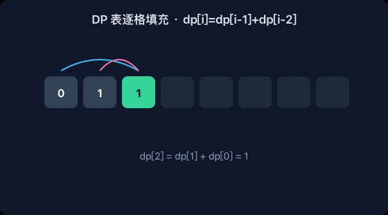

动画演示动态规划专题里DP 表填充的典型过程；每个方案在「TypeScript 解题方案」一节还配了专属动画与专属流程图。

### 主解法流程图（真实控制流）

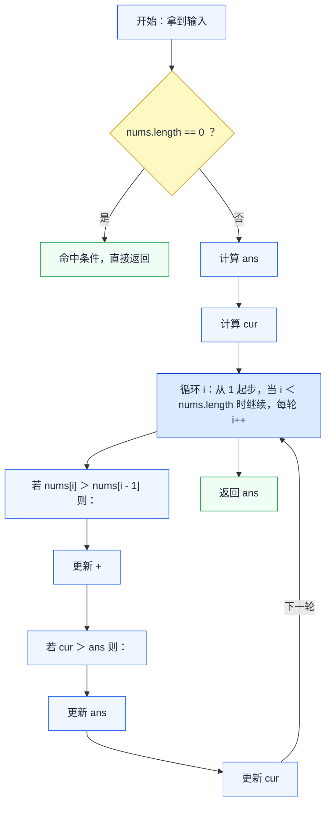

## TypeScript 解题方案（3 个方案逐个讲）

> **运行与提交**：每个方案都是自包含文件（内嵌用例自测，输出 PASS），整块复制到 `.ts` 文件后 `node 文件名` 即可运行。提交 LeetCode 时，把 `demo` 内的算法函数与辅助类型/函数整体取出、置于文件顶层即可。涉及交互/特殊接口的题以题面给定签名为准。

### 方案 1：单趟扫描

**分析与思路**：核心做法是「单趟扫描」。代码里依次做这些事：单循环线性扫描。

**运行方式**：`node 本文件`，内嵌用例全部通过会输出 PASS。


**方案专属流程图**（真实控制流）：

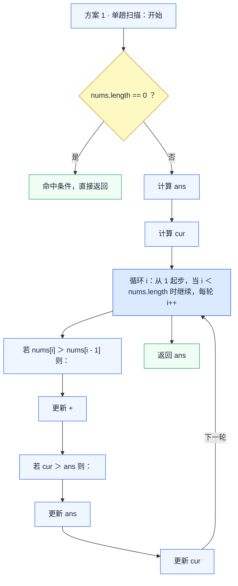

```typescript
export function demo(): void {
  // 程序入口：跑内嵌自测用例
  function findLengthOfLCIS(nums: number[]): number {
    // 定义函数/方法 findLengthOfLCIS
    if (nums.length === 0) {
      // 若 数组.长度 全等于 0
      return 0; // 返回 0
    }
    let ans = 1; // 把 1 存入 答案
    let cur = 1; // 把 1 存入 当前值
    for (let i = 1; i < nums.length; i++) {
      // 让 下标 i 从 1 开始计数，下标 i 小于 数组.长度 就继续
      if (nums[i] > nums[i - 1]) {
        // 若 数组[下标 i] 超过 数组[下标 i 减 1]
        cur += 1; // 当前值累加 1
        if (cur > ans) {
          // 若 当前值 超过 答案
          ans = cur; // 把 当前值 存入 答案
        }
      } else {
        // 否则
        cur = 1; // 把 1 存入 当前值
      }
    }
    return ans; // 返回 答案
  }

  const cases: { in: number[]; want: number }[] = [
    { in: [1, 3, 5, 4, 7], want: 3 },
    { in: [2, 2, 2, 2, 2], want: 1 },
    { in: [], want: 0 },
    { in: [1], want: 1 },
    { in: [1, 2, 3, 4, 5], want: 5 },
  ];
  let fail = false; // 把 false 存入 fail
  for (const c of cases) {
    // for (const 字符 of cases) {
    const got = findLengthOfLCIS(c.in); // 把 findLengthOfLCIS(字符.in) 存入 got
    if (got !== c.want) {
      // 若 got 不等于 字符.want
      fail = true; // 把 true 存入 fail
      console.log('FAIL findLengthOfLCIS(%o)=%d want %d', c.in, got, c.want); // 打印输出
    }
  }
  if (fail) throw new Error('FAILED'); // 若 fail) throw new Error(「FAILED」);
  console.log('PASS'); // 全部用例通过，输出 PASS
}
demo(); // demo();
```

### 方案 2：单趟扫描

**分析与思路**：核心做法是「单趟扫描」。代码里依次做这些事：单循环线性扫描。

**运行方式**：`node 本文件`，内嵌用例全部通过会输出 PASS。


**方案专属流程图**（真实控制流）：

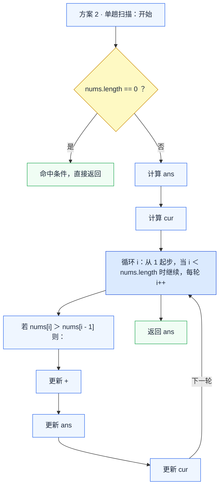

```typescript
export function demo(): void {
  // 程序入口：跑内嵌自测用例
  function findLengthOfLCIS(nums: number[]): number {
    // 定义函数/方法 findLengthOfLCIS
    if (nums.length === 0) {
      // 若 数组.长度 全等于 0
      return 0; // 返回 0
    }
    let ans = 1; // 把 1 存入 答案
    let cur = 1; // 把 1 存入 当前值
    for (let i = 1; i < nums.length; i++) {
      // 让 下标 i 从 1 开始计数，下标 i 小于 数组.长度 就继续
      if (nums[i] > nums[i - 1]) {
        // 若 数组[下标 i] 超过 数组[下标 i 减 1]
        cur += 1; // 当前值累加 1
        ans = Math.max(ans, cur); // 把 Math.取较大值 答案, 当前值) 存入 答案
      } else {
        // 否则
        cur = 1; // 把 1 存入 当前值
      }
    }
    return ans; // 返回 答案
  }

  const cases: { in: number[]; want: number }[] = [
    { in: [2, 2, 2, 2, 2], want: 1 },
    { in: [1, 3, 5, 4, 7], want: 3 },
    { in: [], want: 0 },
    { in: [5], want: 1 },
    { in: [1, 2, 3, 2, 3, 4, 5], want: 4 },
  ];
  let fail = false; // 把 false 存入 fail
  for (const c of cases) {
    // for (const 字符 of cases) {
    const got = findLengthOfLCIS(c.in); // 把 findLengthOfLCIS(字符.in) 存入 got
    if (got !== c.want) {
      // 若 got 不等于 字符.want
      fail = true; // 把 true 存入 fail
      console.log('FAIL findLengthOfLCIS(%o)=%d want %d', c.in, got, c.want); // 打印输出
    }
  }
  if (fail) throw new Error('FAILED'); // 若 fail) throw new Error(「FAILED」);
  console.log('PASS'); // 全部用例通过，输出 PASS
}
demo(); // demo();
```

### 方案 3：单趟扫描

**分析与思路**：核心做法是「单趟扫描」。代码里依次做这些事：单循环线性扫描。

**运行方式**：`node 本文件`，内嵌用例全部通过会输出 PASS。


**方案专属流程图**（真实控制流）：

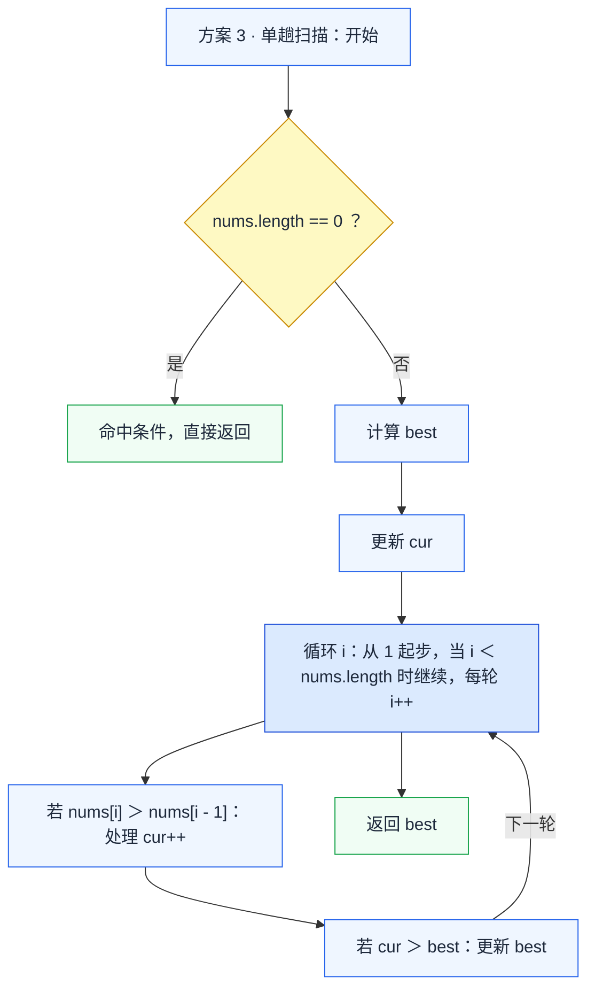

```typescript
export function demo(): void {
  // 程序入口：跑内嵌自测用例
  function findLengthOfLCIS(nums: number[]): number {
    // 定义函数/方法 findLengthOfLCIS
    if (nums.length === 0) return 0; // 若 数组.长度 全等于 0，直接返回 0
    let best = 1,
      cur = 1; // 把 1, 当前值 赋值为 1 存入 当前最优
    for (let i = 1; i < nums.length; i++) {
      // 让 下标 i 从 1 开始计数，下标 i 小于 数组.长度 就继续
      if (nums[i] > nums[i - 1]) cur++;
      else cur = 1; // 若 数组[下标 i] 超过 数组[下标 i 减 1]) 当前值 加一 ; else 当前值 赋值为 1;
      if (cur > best) best = cur; // 若 当前值 超过 当前最优) 当前最优 赋值为 当前值;
    }
    return best; // 返回 当前最优
  }
  const cases = [
    { in: [1, 3, 5, 4, 7], want: 3 },
    { in: [2, 2, 2, 2, 2], want: 1 },
    { in: [1, 3, 5], want: 3 },
  ];
  let fail = false; // 把 false 存入 fail
  for (const c of cases) {
    // for (const 字符 of cases) {
    const got = findLengthOfLCIS(c.in); // 把 findLengthOfLCIS(字符.in) 存入 got
    if (got !== c.want) {
      fail = true;
      console.log('FAIL ' + got + ' want ' + c.want);
    }
  }
  if (fail) throw new Error('FAILED'); // 若 fail) throw new Error(「FAILED」);
  console.log('PASS'); // 全部用例通过，输出 PASS
}
demo(); // demo();
```

## 逐步拆解与面试追问

**复杂度**：时间 O(n)（单趟线性扫描），空间 O(1) 到 O(n)（视辅助结构）

**为什么是这个量级**：每个元素被常数次访问，辅助哈希或栈的开销与 n 同阶

**面试官可能会追问**：

- 状态定义为什么是它？
- 遍历顺序由什么决定？
- 能否滚动数组压空间？

## 关键 API 速查（TS 主解法实际用到，附官方链接）

本题主解法只用到基础语法（变量、循环、比较），不依赖特殊库 API。

### 各语言官方文档导航

- **TypeScript / JS**：[MDN 中文参考](https://developer.mozilla.org/zh-CN/)
- **Python**：[Python 官方文档](https://docs.python.org/zh-cn/3/)
- **Go**：[Go 标准库](https://pkg.go.dev/std)
- **Java**：[JDK 17 API](https://docs.oracle.com/en/java/javase/17/docs/api/)
- **Rust**：[Rust 标准库](https://doc.rust-lang.org/std/)
- **Lua**：[Lua 5.4 手册](https://www.lua.org/manual/5.4/)
- **C**：[Cppreference C](https://zh.cppreference.com/w/c)
- **C++**：[Cppreference C++](https://zh.cppreference.com/w/cpp)
- **R**：[R 官方手册](https://stat.ethz.ch/R-manual/)
- **Zig**：[Zig 语言文档](https://ziglang.org/documentation/master/)
- **Dart**：[Dart API](https://api.dart.dev/)

## 附录：其他 10 种语言全部实现（每种语言列举其全部方案）

> TypeScript 的全部方案见「TypeScript 解题方案」一节；下面是其余 10 种语言的对应实现，每种语言的每个方案都带思路分析、代码走读与专属运行架构图。
> 每个方案都内嵌用例自测，可独立运行（老仓库 python/go 文件遵循「打印结果」约定）。
> 完整解法文件见 `dsa/<语言>/dp/lc_674_最长连续递增序列/`。

### Python 实现（3 种方案）

Python 的全部方案如下，每个方案都内嵌用例自测，可独立运行（老仓库 python/go 文件遵循「打印结果」约定）：

#### 方案 1：单趟扫描

**思路与代码分析**：核心是「单趟扫描」。Python 版用切片与字典推导式简化操作，突出可读性。**走读**：方案 1 · 单趟扫描：开始 → 命中条件，直接返回 → 更新 ans → 更新 cur → 循环 i：从 1 到 len(nums 前 → 若 nums[i] ＞ nums[i - 1]：更新 + → 更新 + → 若 cur ＞ ans：更新 ans → 更新 ans → 更新 cur → 返回 ans。

**运行架构**（真实控制流）：

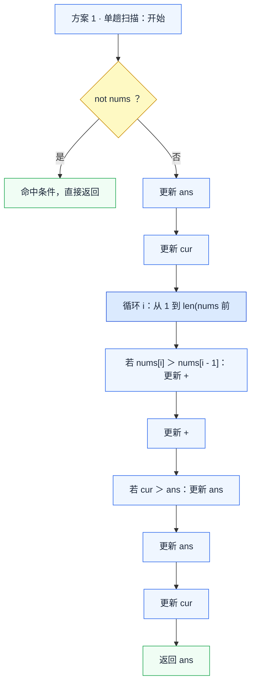

```python
import sys  # 提高递归深度上限（深输入防 RecursionError）

sys.setrecursionlimit(200000)  # 树/链表类题目节点数可达 1e4 量级

def findLengthOfLCIS(nums):  # 定义函数 findLengthOfLCIS（参数：数组）
    if not nums:  # 若 not 数组
        return 0  # 返回 0
    ans = 1  # 把 1 存入 答案
    cur = 1  # 把 1 存入 当前值
    for i in range(1, len(nums)):  # 让 下标 i 从 1 到 长度(数组 遍历
        if nums[i] > nums[i - 1]:  # 若 数组[下标 i] 超过 数组[下标 i 减 1]
            cur += 1  # 当前值累加 1
            if cur > ans:  # 若 当前值 超过 答案
                ans = cur  # 把 当前值 存入 答案
        else:  # 否则
            cur = 1  # 把 1 存入 当前值
    return ans  # 返回 答案

if __name__ == "__main__":  # 若 __name__ 等于 '__main__'
    print(findLengthOfLCIS([1, 3, 5, 4, 7]))  # 打印输出
```

#### 方案 2：单趟扫描

**思路与代码分析**：核心是「单趟扫描」。Python 版用切片与字典推导式简化操作，突出可读性。**走读**：方案 2 · 单趟扫描：开始 → 命中条件，直接返回 → 更新 ans → 更新 cur → 循环 i：从 1 到 len(nums 前 → 若 nums[i] ＞ nums[i - 1]：更新 + → 更新 + → 更新 ans → 更新 cur → 返回 ans。

**运行架构**（真实控制流）：

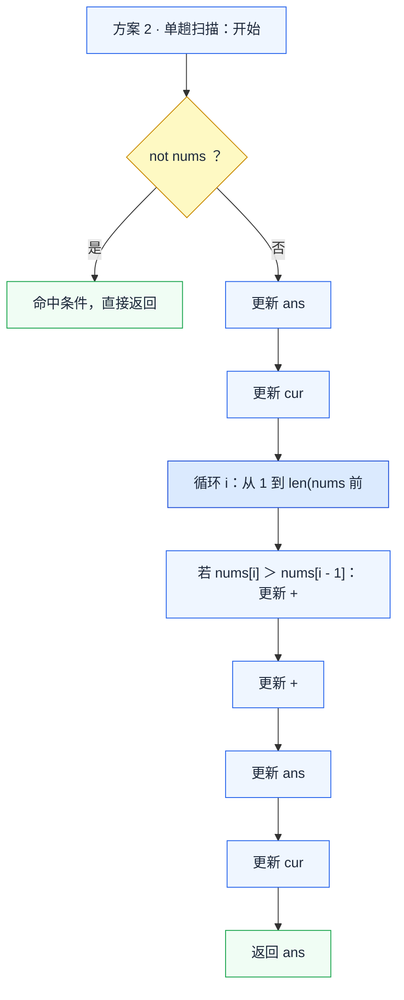

```python
import sys  # 提高递归深度上限（深输入防 RecursionError）

sys.setrecursionlimit(200000)  # 树/链表类题目节点数可达 1e4 量级

def findLengthOfLCIS(nums):  # 定义函数 findLengthOfLCIS（参数：数组）
    if not nums:  # 若 not 数组
        return 0  # 返回 0
    ans = 1  # 把 1 存入 答案
    cur = 1  # 把 1 存入 当前值
    for i in range(1, len(nums)):  # 让 下标 i 从 1 到 长度(数组 遍历
        if nums[i] > nums[i - 1]:  # 若 数组[下标 i] 超过 数组[下标 i 减 1]
            cur += 1  # 当前值累加 1
            ans = max(ans, cur)  # 把 取较大值 答案, 当前值) 存入 答案
        else:  # 否则
            cur = 1  # 把 1 存入 当前值
    return ans  # 返回 答案

if __name__ == "__main__":  # 若 __name__ 等于 '__main__'
    print(findLengthOfLCIS([2, 2, 2, 2, 2]))  # 打印输出
```

#### 方案 3：单趟扫描

**思路与代码分析**：核心是「单趟扫描」。Python 版用切片与字典推导式简化操作，突出可读性。代码里依次做这些事：DP 表逐项填充。**走读**：方案 3 · 单趟扫描：开始 → 更新 n → 命中条件，直接返回 → 更新 count → 填写 DP 表 → 循环 i：从 1 到 n 前 → 若 nums[i - 1] ＜ nums[i]：填写 DP 表 → 填写 DP 表 → 若 count ＜ dp[i]：填写 DP 表 → 填写 DP 表 → 返回 count。

**运行架构**（真实控制流）：

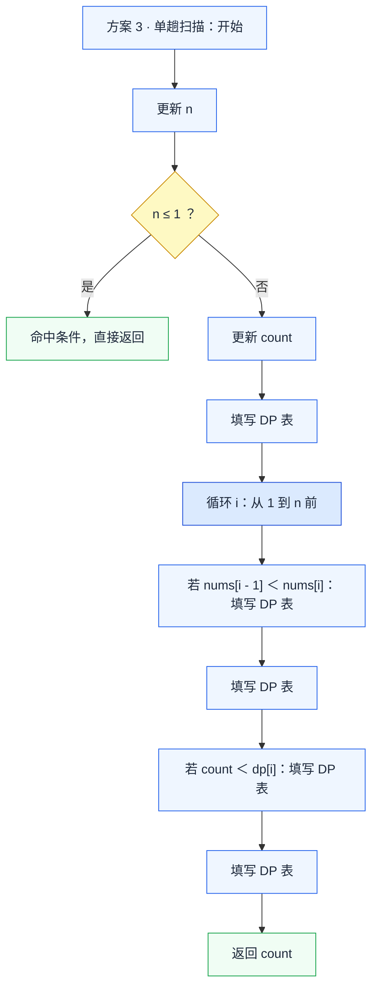

```python
import sys  # 提高递归深度上限（深输入防 RecursionError）

sys.setrecursionlimit(200000)  # 树/链表类题目节点数可达 1e4 量级

def findLengthOfLCIS(nums):  # 定义函数 findLengthOfLCIS（参数：数组）
    n = len(nums)  # 把 长度(数组) 存入 元素个数
    if n <= 1:  # 若 元素个数 不超过 1
        return n  # 返回 元素个数
    count = 1  # 把 1 存入 计数
    dp = [1] * n  # 把 [1] 乘 元素个数 存入 DP 表
    for i in range(1, n):  # 让 下标 i 从 1 到 元素个数 遍历
        if nums[i - 1] < nums[i]:  # 若 数组[下标 i 减 1] 小于 数组[下标 i]
            dp[i] = dp[i - 1] + 1  # 把 DP 表[下标 i 减 1] 加 1 写入 dp[i]
        if count < dp[i]:  # 若 计数 小于 DP 表[下标 i]
            count = dp[i]  # 把 DP 表[下标 i] 存入 计数
    return count  # 返回 计数

if __name__ == "__main__":  # 若 __name__ 等于 '__main__'
    print(findLengthOfLCIS([1, 3, 5, 4, 7]))  # 打印输出
    print(findLengthOfLCIS([2, 2, 2, 2, 2]))  # 打印输出
    print(findLengthOfLCIS([1, 2, 3]))  # 打印输出
```

### Go 实现（3 种方案）

Go 的全部方案如下，每个方案都内嵌用例自测，可独立运行（老仓库 python/go 文件遵循「打印结果」约定）：

#### 方案 1：单趟扫描

**思路与代码分析**：核心是「单趟扫描」。Go 版用切片与多返回值惯用法，显式处理索引边界。**走读**：方案 1 · 单趟扫描：开始 → 处理 if len(nums) == 0 → 返回 0 → 更新 : → 更新 : → 遍历循环 → 处理 if nums[i] ＞ nums[i-1] → 处理 cur++ → 处理 if cur ＞ ans → 更新 ans → 更新 cur → 返回 ans。

**运行架构**（真实控制流）：

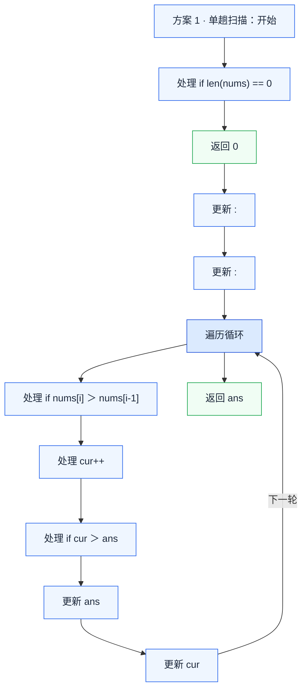

```go
package main // 引入依赖

// 忠实翻译自 python/dp/lc_674_最长连续递增序列/solution_1_1_____1____.py
import (
	"fmt"     // 「fmt」
	"os"      // 「os」
	"reflect" // 「reflect」
)

func findLengthOfLCIS(nums []int) int { // 定义函数/方法 findLengthOfLCIS
	if len(nums) == 0 { // 若 长度(数组) 等于 0
		return 0 // 返回 0
	}
	ans := 1                         // 把 1 写入 ans :
	cur := 1                         // 把 1 写入 cur :
	for i := 1; i < len(nums); i++ { // 让 下标 i 从 1 开始计数
		if nums[i] > nums[i-1] { // 若 数组[下标 i] 超过 数组[下标 i 减 1]
			cur++          // 当前值 加一
			if cur > ans { // 若 当前值 超过 答案
				ans = cur // 把 当前值 写入 答案
			}
		} else { // 否则
			cur = 1 // 把 1 写入 当前值
		}
	}
	return ans // 返回 答案
}

func main() { // 程序入口：跑内嵌自测用例
	cases := []struct { // 把 []struct { 写入 cases :
		in   []int // in []int
		want int   // want int
	}{ // }{
		{[]int{1, 3, 5, 4, 7}, 3}, // normal: 最长连续递增 [1,3,5]
		{[]int{2, 2, 2, 2, 2}, 1}, // boundary: 全部相等
		{[]int{}, 0},              // boundary: 空数组
		{[]int{1}, 1},             // boundary: 单元素
		{[]int{1, 2, 3}, 3},       // normal: 整段递增
		{[]int{5, 4, 3, 2, 1}, 1}, // boundary: 严格递减
	}
	ok := true                // 把 true 写入 ok :
	for _, c := range cases { // 同时取 _ 与 字符 遍历
		if got := findLengthOfLCIS(c.in); !reflect.DeepEqual(got, c.want) {
			ok = false                                                              // 把 false 写入 ok
			fmt.Printf("FAIL findLengthOfLCIS(%v)=%v want %v\n", c.in, got, c.want) // 打印输出
		}
	}
	if !ok { // 若 取反 ok
		os.Exit(1) // os.Exit(1)
	}
	fmt.Println("PASS") // 全部用例通过，输出 PASS
}
```

#### 方案 2：单趟扫描

**思路与代码分析**：核心是「单趟扫描」。Go 版用切片与多返回值惯用法，显式处理索引边界。**走读**：方案 2 · 单趟扫描：开始 → 处理 if len(nums) == 0 → 返回 0 → 更新 : → 更新 : → 遍历循环 → 处理 if nums[i] ＞ nums[i-1] → 处理 cur++ → 处理 if cur ＞ ans → 更新 ans → 更新 cur → 返回 ans。

**运行架构**（真实控制流）：


```go
package main // 引入依赖

// 忠实翻译自 python/dp/lc_674_最长连续递增序列/solution_2_2_____2______.py
import (
	"fmt"     // 「fmt」
	"os"      // 「os」
	"reflect" // 「reflect」
)

func findLengthOfLCIS(nums []int) int { // 定义函数/方法 findLengthOfLCIS
	if len(nums) == 0 { // 若 长度(数组) 等于 0
		return 0 // 返回 0
	}
	ans := 1                         // 把 1 写入 ans :
	cur := 1                         // 把 1 写入 cur :
	for i := 1; i < len(nums); i++ { // 让 下标 i 从 1 开始计数
		if nums[i] > nums[i-1] { // 若 数组[下标 i] 超过 数组[下标 i 减 1]
			cur++          // 当前值 加一
			if cur > ans { // ans = max(ans, cur)
				ans = cur // 把 当前值 写入 答案
			}
		} else { // 否则
			cur = 1 // 把 1 写入 当前值
		}
	}
	return ans // 返回 答案
}

func main() { // 程序入口：跑内嵌自测用例
	cases := []struct { // 把 []struct { 写入 cases :
		in   []int // in []int
		want int   // want int
	}{ // }{
		{[]int{1, 3, 5, 4, 7}, 3}, // normal: 最长连续递增 [1,3,5]
		{[]int{2, 2, 2, 2, 2}, 1}, // boundary: 全部相等
		{[]int{}, 0},              // boundary: 空数组
		{[]int{1}, 1},             // boundary: 单元素
		{[]int{1, 2, 3}, 3},       // normal: 整段递增
		{[]int{5, 4, 3, 2, 1}, 1}, // boundary: 严格递减
	}
	ok := true                // 把 true 写入 ok :
	for _, c := range cases { // 同时取 _ 与 字符 遍历
		if got := findLengthOfLCIS(c.in); !reflect.DeepEqual(got, c.want) {
			ok = false                                                              // 把 false 写入 ok
			fmt.Printf("FAIL findLengthOfLCIS(%v)=%v want %v\n", c.in, got, c.want) // 打印输出
		}
	}
	if !ok { // 若 取反 ok
		os.Exit(1) // os.Exit(1)
	}
	fmt.Println("PASS") // 全部用例通过，输出 PASS
}
```

#### 方案 3：单趟扫描

**思路与代码分析**：核心是「单趟扫描」。Go 版用切片与多返回值惯用法，显式处理索引边界。代码里依次做这些事：DP 表逐项填充。**走读**：方案 3 · 单趟扫描：开始 → 更新 : → 处理 if n ≤ 1 → 返回 n → 更新 : → 更新 : → 遍历 dp 的下标与元素 i → 填写 DP 表 → 遍历循环 → 处理 if nums[i-1] ＜ nums[i] → 填写 DP 表 → 填写 DP 表 → 填写 DP 表 → 返回 count。

**运行架构**（真实控制流）：

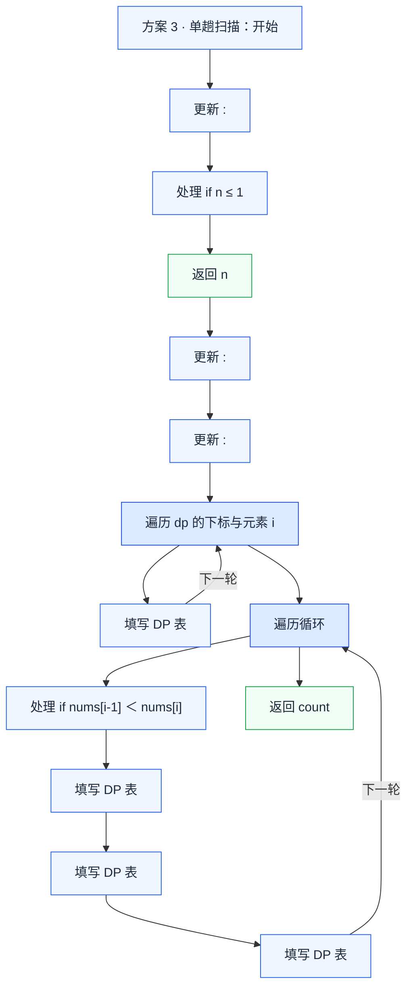

```go
package main // 引入依赖

// 忠实翻译自 python/dp/lc_674_最长连续递增序列/solution_3_3_____3______.py
import (
	"fmt"     // 「fmt」
	"os"      // 「os」
	"reflect" // 「reflect」
)

func findLengthOfLCIS(nums []int) int { // 定义函数/方法 findLengthOfLCIS
	n := len(nums) // 把 长度(数组) 写入 n :
	if n <= 1 {    // 若 元素个数 不超过 1
		return n // 返回 元素个数
	}
	count := 1           // 把 1 写入 count :
	dp := make([]int, n) // 把 make([]int, 元素个数) 写入 dp :
	for i := range dp {  // 把 range DP 表 { 写入 for i :
		dp[i] = 1 // 把 1 写入 dp[i]
	}
	for i := 1; i < n; i++ { // 让 下标 i 从 1 开始计数
		if nums[i-1] < nums[i] { // 若 数组[下标 i 减 1] 小于 数组[下标 i]
			dp[i] = dp[i-1] + 1 // 把 DP 表[下标 i 减 1] 加 1 写入 dp[i]
		}
		if count < dp[i] { // 若 计数 小于 DP 表[下标 i]
			count = dp[i] // 把 DP 表[下标 i] 写入 计数
		}
	}
	return count // 返回 计数
}

func main() { // 程序入口：跑内嵌自测用例
	cases := []struct { // 把 []struct { 写入 cases :
		in   []int // in []int
		want int   // want int
	}{ // }{
		{[]int{1, 3, 5, 4, 7}, 3}, // normal: 最长连续递增 [1,3,5]
		{[]int{2, 2, 2, 2, 2}, 1}, // boundary: 全部相等
		{[]int{}, 0},              // boundary: 空数组
		{[]int{1}, 1},             // boundary: 单元素
		{[]int{1, 2, 3}, 3},       // normal: 整段递增
		{[]int{5, 4, 3, 2, 1}, 1}, // boundary: 严格递减
	}
	ok := true                // 把 true 写入 ok :
	for _, c := range cases { // 同时取 _ 与 字符 遍历
		if got := findLengthOfLCIS(c.in); !reflect.DeepEqual(got, c.want) {
			ok = false                                                              // 把 false 写入 ok
			fmt.Printf("FAIL findLengthOfLCIS(%v)=%v want %v\n", c.in, got, c.want) // 打印输出
		}
	}
	if !ok { // 若 取反 ok
		os.Exit(1) // os.Exit(1)
	}
	fmt.Println("PASS") // 全部用例通过，输出 PASS
}
```

### Java 实现（3 种方案）

Java 的全部方案如下，每个方案都内嵌用例自测，可独立运行（老仓库 python/go 文件遵循「打印结果」约定）：

#### 方案 1：单趟扫描

**思路与代码分析**：核心是「单趟扫描」。Java 版用类与静态方法组织，集合操作显式明了。代码里依次做这些事：单循环线性扫描。**走读**：方案 1 · 单趟扫描：开始 → 命中条件，直接返回 → 更新 ans → 遍历循环 → 若 nums[i] ＞ nums[i - 1] 则： → 处理 cur++ → 若 cur ＞ ans：更新 ans → 更新 cur → 返回 ans。

**运行架构**（真实控制流）：

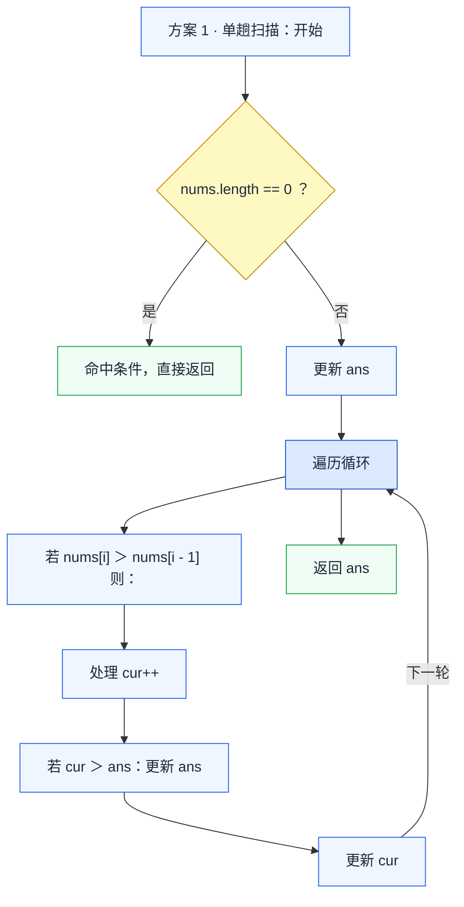

```java
package com.webfault.dsa; // 引入依赖

class lc674_solution111 { // 定义类型
  int findLengthOfLCIS(int[] nums) { // 定义函数/方法 findLengthOfLCIS
    if (nums.length == 0) return 0; // 若 数组.长度 等于 0，直接返回 0
    int ans = 1, cur = 1; // 把 1, 当前值 赋值为 1 存入 答案
    for (int i = 1; i < nums.length; i++) { // 让 下标 i 从 1 开始计数，下标 i 小于 数组.长度 就继续
      if (nums[i] > nums[i - 1]) { // 若 数组[下标 i] 超过 数组[下标 i 减 1]
        cur++; // 当前值 加一
        if (cur > ans) ans = cur; // 若 当前值 超过 答案) 答案 赋值为 当前值;
      } else { // 否则
        cur = 1; // 把 1; 写入 当前值
      }
    }
    return ans; // 返回 答案
  }

  public static void main(String[] args) { // public static void main(String[] args) {
    lc674_solution111 s =
        new lc674_solution111(); // 把 new lc674_solution111(); 写入 lc674_solution111 s
    boolean ok = true; // 把 true; 写入 boolean ok
    if (s.findLengthOfLCIS(new int[] {1, 3, 5, 4, 7}) != 3) {
      ok = false;
      System.out.println("FAIL1");
    }
    if (s.findLengthOfLCIS(new int[] {2, 2, 2, 2, 2}) != 1) {
      ok = false;
      System.out.println("FAIL2");
    }
    if (s.findLengthOfLCIS(new int[] {1, 3, 5, 7}) != 4) {
      ok = false;
      System.out.println("FAIL3");
    }
    if (s.findLengthOfLCIS(new int[] {}) != 0) {
      ok = false;
      System.out.println("FAIL4");
    }
    if (!ok) throw new RuntimeException("FAILED"); // 若 取反 ok) throw new RuntimeException(「FAILED」);
    System.out.println("PASS"); // 全部用例通过，输出 PASS
  }
}
```

#### 方案 2：单趟扫描

**思路与代码分析**：核心是「单趟扫描」。Java 版用类与静态方法组织，集合操作显式明了。代码里依次做这些事：单循环线性扫描。**走读**：方案 2 · 单趟扫描：开始 → 命中条件，直接返回 → 更新 best → 遍历循环 → 若 nums[i] ＞ nums[i - 1]：处理 cur++ → 若 cur ＞ best：更新 best → 返回 best。

**运行架构**（真实控制流）：


```java
package com.webfault.dsa; // 引入依赖

class Main { // 定义类型
  static int findLengthOfLCIS(int[] nums) { // 定义函数/方法 findLengthOfLCIS
    if (nums.length == 0) return 0; // 若 数组.长度 等于 0，直接返回 0
    int best = 1, cur = 1; // 把 1, 当前值 赋值为 1 存入 当前最优
    for (int i = 1; i < nums.length; i++) { // 让 下标 i 从 1 开始计数，下标 i 小于 数组.长度 就继续
      if (nums[i] > nums[i - 1]) cur++;
      else cur = 1; // 若 数组[下标 i] 超过 数组[下标 i 减 1]) 当前值 加一 ; else 当前值 赋值为 1;
      if (cur > best) best = cur; // 若 当前值 超过 当前最优) 当前最优 赋值为 当前值;
    }
    return best; // 返回 当前最优
  }

  public static void main(String[] args) { // public static void main(String[] args) {
    int[][] ins = {{1, 3, 5, 4, 7}, {2, 2, 2, 2, 2}, {1, 3, 5}};
    int[] wants = {3, 1, 3};
    boolean ok = true; // 把 true; 写入 boolean ok
    for (int i = 0; i < ins.length; i++) { // 让 下标 i 从 0 开始计数，下标 i 小于 ins.长度 就继续
      int got = findLengthOfLCIS(ins[i]); // 把 findLengthOfLCIS(ins[下标 i]) 存入 got
      if (got != wants[i]) {
        ok = false;
        System.out.println("FAIL " + got + " want " + wants[i]);
      }
    }
    if (!ok) throw new RuntimeException("FAILED"); // 若 取反 ok) throw new RuntimeException(「FAILED」);
    System.out.println("PASS"); // 全部用例通过，输出 PASS
  }
}
```

#### 方案 3：单趟扫描

**思路与代码分析**：核心是「单趟扫描」。Java 版用类与静态方法组织，集合操作显式明了。代码里依次做这些事：单循环线性扫描。**走读**：方案 3 · 单趟扫描：开始 → 命中条件，直接返回 → 更新 best → 遍历循环 → 若 nums[i] ＞ nums[i - 1]：处理 cur++ → 若 cur ＞ best：更新 best → 返回 best。

**运行架构**（真实控制流）：

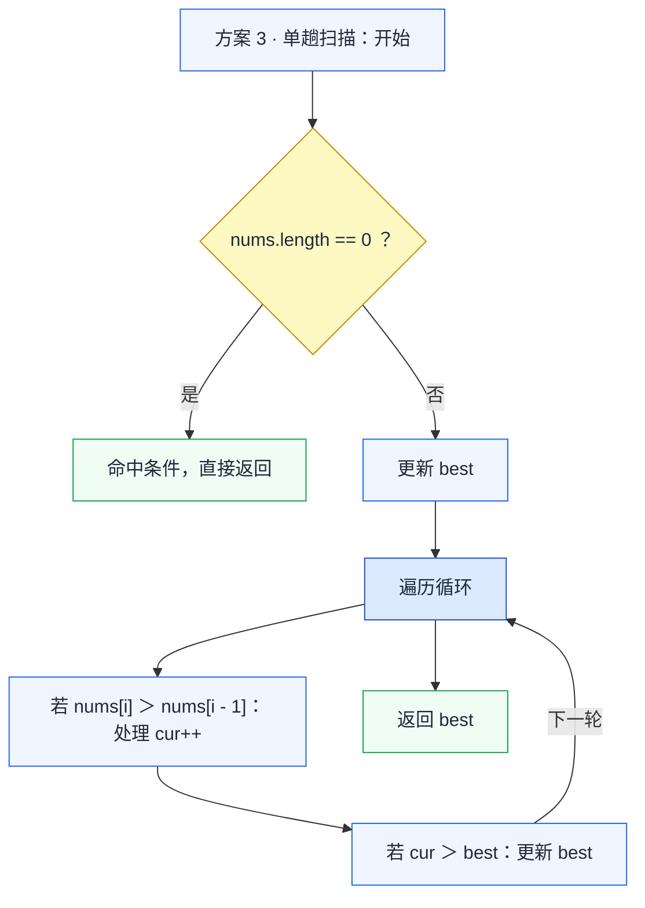

```java
package com.webfault.dsa; // 引入依赖

class Main { // 定义类型
  static int findLengthOfLCIS(int[] nums) { // 定义函数/方法 findLengthOfLCIS
    if (nums.length == 0) return 0; // 若 数组.长度 等于 0，直接返回 0
    int best = 1, cur = 1; // 把 1, 当前值 赋值为 1 存入 当前最优
    for (int i = 1; i < nums.length; i++) { // 让 下标 i 从 1 开始计数，下标 i 小于 数组.长度 就继续
      if (nums[i] > nums[i - 1]) cur++;
      else cur = 1; // 若 数组[下标 i] 超过 数组[下标 i 减 1]) 当前值 加一 ; else 当前值 赋值为 1;
      if (cur > best) best = cur; // 若 当前值 超过 当前最优) 当前最优 赋值为 当前值;
    }
    return best; // 返回 当前最优
  }

  public static void main(String[] args) { // public static void main(String[] args) {
    int[][] ins = {{1, 3, 5, 4, 7}, {2, 2, 2, 2, 2}, {1, 3, 5}};
    int[] wants = {3, 1, 3};
    boolean ok = true; // 把 true; 写入 boolean ok
    for (int i = 0; i < ins.length; i++) { // 让 下标 i 从 0 开始计数，下标 i 小于 ins.长度 就继续
      int got = findLengthOfLCIS(ins[i]); // 把 findLengthOfLCIS(ins[下标 i]) 存入 got
      if (got != wants[i]) {
        ok = false;
        System.out.println("FAIL " + got + " want " + wants[i]);
      }
    }
    if (!ok) throw new RuntimeException("FAILED"); // 若 取反 ok) throw new RuntimeException(「FAILED」);
    System.out.println("PASS"); // 全部用例通过，输出 PASS
  }
}
```

### Rust 实现（3 种方案）

Rust 的全部方案如下，每个方案都内嵌用例自测，可独立运行（老仓库 python/go 文件遵循「打印结果」约定）：

#### 方案 1：单趟扫描

**思路与代码分析**：核心是「单趟扫描」。Rust 版用所有权移动与切片借用改写同一逻辑，注意 Option 与引用边界。**走读**：方案 1 · 单趟扫描：开始 → 计算 let (mut best, mut cur) → 遍历 1..nums.len() 中的每个元素 i → 处理 if nums[i] ＞ nums[i - 1] → 更新 + → 处理 if cur ＞ best → 更新 best → 更新 cur → 处理 if nums.is_empty() → 处理 0 → 处理 best → 返回结果。

**运行架构**（真实控制流）：

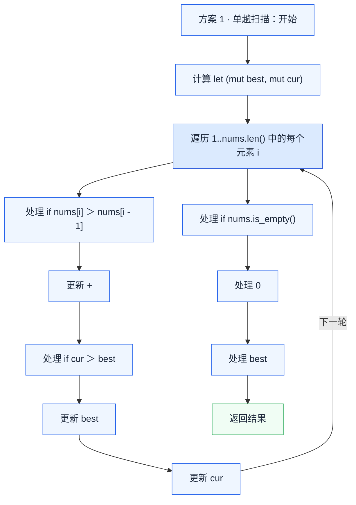

```rust
// LeetCode 674. 最长连续递增序列 — Rust 版（方案1）
fn find_length_of_lcis(nums: Vec<i32>) -> i32 {
    // 定义函数/方法 find_length_of_lcis
    let (mut best, mut cur) = (1, 1); // 把 (1, 1); 写入 let (mut best, mut cur)
    for i in 1..nums.len() {
        // 逐个取出 1 的元素（下标 i）
        if nums[i] > nums[i - 1] {
            cur += 1;
            if cur > best {
                best = cur;
            }
        } else {
            cur = 1;
        }
    }
    if nums.is_empty() {
        0
    } else {
        best
    } // 若 数组 是否为空 { 0 } else { 当前最优 }
}
fn main() {
    assert_eq!(find_length_of_lcis(vec![1, 3, 5, 4, 7]), 3);
    assert_eq!(find_length_of_lcis(vec![2, 2, 2, 2, 2]), 1);
    println!("PASS");
} // 程序入口：跑内嵌自测用例
```

#### 方案 2：单趟扫描

**思路与代码分析**：核心是「单趟扫描」。Rust 版用所有权移动与切片借用改写同一逻辑，注意 Option 与引用边界。**走读**：方案 2 · 单趟扫描：开始 → 计算 let (mut best, mut cur) → 遍历 1..nums.len() 中的每个元素 i → 处理 if nums[i] ＞ nums[i - 1] → 更新 + → 处理 if cur ＞ best → 更新 best → 更新 cur → 处理 if nums.is_empty() → 处理 0 → 处理 best → 返回结果。

**运行架构**（真实控制流）：


```rust
// LeetCode 674. 最长连续递增序列 — Rust 版（方案2）
fn find_length_of_lcis(nums: Vec<i32>) -> i32 {
    // 定义函数/方法 find_length_of_lcis
    let (mut best, mut cur) = (1, 1); // 把 (1, 1); 写入 let (mut best, mut cur)
    for i in 1..nums.len() {
        // 逐个取出 1 的元素（下标 i）
        if nums[i] > nums[i - 1] {
            cur += 1;
            if cur > best {
                best = cur;
            }
        } else {
            cur = 1;
        }
    }
    if nums.is_empty() {
        0
    } else {
        best
    } // 若 数组 是否为空 { 0 } else { 当前最优 }
}
fn main() {
    assert_eq!(find_length_of_lcis(vec![1, 3, 5, 4, 7]), 3);
    assert_eq!(find_length_of_lcis(vec![2, 2, 2, 2, 2]), 1);
    println!("PASS");
} // 程序入口：跑内嵌自测用例
```

#### 方案 3：单趟扫描

**思路与代码分析**：核心是「单趟扫描」。Rust 版用所有权移动与切片借用改写同一逻辑，注意 Option 与引用边界。**走读**：方案 3 · 单趟扫描：开始 → 计算 let (mut best, mut cur) → 遍历 1..nums.len() 中的每个元素 i → 处理 if nums[i] ＞ nums[i - 1] → 更新 + → 处理 if cur ＞ best → 更新 best → 更新 cur → 处理 if nums.is_empty() → 处理 0 → 处理 best → 返回结果。

**运行架构**（真实控制流）：


```rust
// LeetCode 674. 最长连续递增序列 — Rust 版（方案3）
fn find_length_of_lcis(nums: Vec<i32>) -> i32 {
    // 定义函数/方法 find_length_of_lcis
    let (mut best, mut cur) = (1, 1); // 把 (1, 1); 写入 let (mut best, mut cur)
    for i in 1..nums.len() {
        // 逐个取出 1 的元素（下标 i）
        if nums[i] > nums[i - 1] {
            cur += 1;
            if cur > best {
                best = cur;
            }
        } else {
            cur = 1;
        }
    }
    if nums.is_empty() {
        0
    } else {
        best
    } // 若 数组 是否为空 { 0 } else { 当前最优 }
}
fn main() {
    assert_eq!(find_length_of_lcis(vec![1, 3, 5, 4, 7]), 3);
    assert_eq!(find_length_of_lcis(vec![2, 2, 2, 2, 2]), 1);
    println!("PASS");
} // 程序入口：跑内嵌自测用例
```

### Lua 实现（3 种方案）

Lua 的全部方案如下，每个方案都内嵌用例自测，可独立运行（老仓库 python/go 文件遵循「打印结果」约定）：

#### 方案 1：单趟扫描

**思路与代码分析**：核心是「单趟扫描」。Lua 版用表与 ipairs 遍历，注意 ipairs 遇 nil 即停的语义。**走读**：方案 1 · 单趟扫描：开始 → 处理 if #nums == 0 then → 返回 0 → 更新 cur → 循环 i：从 2 到 #nums do → 处理 if nums[i] ＞ nums[i - 1] the → 更新 cur → 处理 if cur ＞ best then → 更新 best → 更新 cur → 返回 best。

**运行架构**（真实控制流）：


```lua
-- LeetCode 674. 最长连续递增序列 — Lua 版（方案1）
local function find_length_of_lcis(nums) -- local function find_length_of_lcis(数组)
	if #nums == 0 then
		return 0
	end -- 若 #数组 等于 0 then return 0 终点
	local best, cur = 1, 1 -- 把 1, 1 写入 local best, cur
	for i = 2, #nums do -- 把 2, #数组 do 写入 for i
		if nums[i] > nums[i - 1] then -- 若 数组[下标 i] 超过 数组[下标 i 减 1] then
			cur = cur + 1 -- 把 当前值 加 1 存入 当前值
			if cur > best then
				best = cur
			end -- 若 当前值 超过 当前最优 then 当前最优 赋值为 当前值 终点
		else -- 否则
			cur = 1 -- 把 1 存入 当前值
		end -- 终点
	end -- 终点
	return best -- 返回 当前最优
end -- 终点
assert(find_length_of_lcis({ 1, 3, 5, 4, 7 }) == 3) -- 断言校验
assert(find_length_of_lcis({ 2, 2, 2, 2, 2 }) == 1) -- 断言校验
print("PASS") -- 全部用例通过，输出 PASS
```

#### 方案 2：单趟扫描

**思路与代码分析**：核心是「单趟扫描」。Lua 版用表与 ipairs 遍历，注意 ipairs 遇 nil 即停的语义。**走读**：方案 2 · 单趟扫描：开始 → 处理 if #nums == 0 then → 返回 0 → 更新 cur → 循环 i：从 2 到 #nums do → 处理 if nums[i] ＞ nums[i - 1] the → 更新 cur → 处理 if cur ＞ best then → 更新 best → 更新 cur → 返回 best。

**运行架构**（真实控制流）：


```lua
-- LeetCode 674. 最长连续递增序列 — Lua 版（方案2）
local function find_length_of_lcis(nums) -- local function find_length_of_lcis(数组)
	if #nums == 0 then
		return 0
	end -- 若 #数组 等于 0 then return 0 终点
	local best, cur = 1, 1 -- 把 1, 1 写入 local best, cur
	for i = 2, #nums do -- 把 2, #数组 do 写入 for i
		if nums[i] > nums[i - 1] then -- 若 数组[下标 i] 超过 数组[下标 i 减 1] then
			cur = cur + 1 -- 把 当前值 加 1 存入 当前值
			if cur > best then
				best = cur
			end -- 若 当前值 超过 当前最优 then 当前最优 赋值为 当前值 终点
		else -- 否则
			cur = 1 -- 把 1 存入 当前值
		end -- 终点
	end -- 终点
	return best -- 返回 当前最优
end -- 终点
assert(find_length_of_lcis({ 1, 3, 5, 4, 7 }) == 3) -- 断言校验
assert(find_length_of_lcis({ 2, 2, 2, 2, 2 }) == 1) -- 断言校验
print("PASS") -- 全部用例通过，输出 PASS
```

#### 方案 3：单趟扫描

**思路与代码分析**：核心是「单趟扫描」。Lua 版用表与 ipairs 遍历，注意 ipairs 遇 nil 即停的语义。**走读**：方案 3 · 单趟扫描：开始 → 处理 if #nums == 0 then → 返回 0 → 更新 cur → 循环 i：从 2 到 #nums do → 处理 if nums[i] ＞ nums[i - 1] the → 更新 cur → 处理 if cur ＞ best then → 更新 best → 更新 cur → 返回 best。

**运行架构**（真实控制流）：

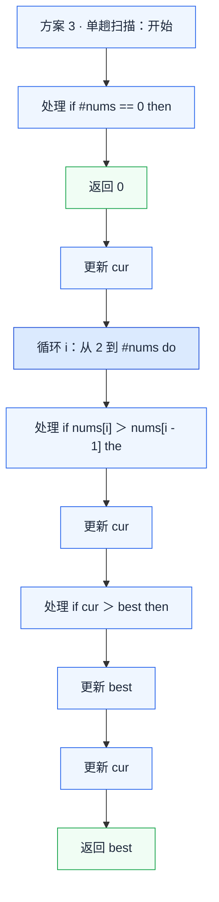

```lua
-- LeetCode 674. 最长连续递增序列 — Lua 版（方案3）
local function find_length_of_lcis(nums) -- local function find_length_of_lcis(数组)
	if #nums == 0 then
		return 0
	end -- 若 #数组 等于 0 then return 0 终点
	local best, cur = 1, 1 -- 把 1, 1 写入 local best, cur
	for i = 2, #nums do -- 把 2, #数组 do 写入 for i
		if nums[i] > nums[i - 1] then -- 若 数组[下标 i] 超过 数组[下标 i 减 1] then
			cur = cur + 1 -- 把 当前值 加 1 存入 当前值
			if cur > best then
				best = cur
			end -- 若 当前值 超过 当前最优 then 当前最优 赋值为 当前值 终点
		else -- 否则
			cur = 1 -- 把 1 存入 当前值
		end -- 终点
	end -- 终点
	return best -- 返回 当前最优
end -- 终点
assert(find_length_of_lcis({ 1, 3, 5, 4, 7 }) == 3) -- 断言校验
assert(find_length_of_lcis({ 2, 2, 2, 2, 2 }) == 1) -- 断言校验
print("PASS") -- 全部用例通过，输出 PASS
```

### C 实现（3 种方案）

C 的全部方案如下，每个方案都内嵌用例自测，可独立运行（老仓库 python/go 文件遵循「打印结果」约定）：

#### 方案 1：单趟扫描

**思路与代码分析**：核心是「单趟扫描」。C 版手动管理下标与内存，循环边界全部显式写出。代码里依次做这些事：单循环线性扫描。**走读**：方案 1 · 单趟扫描：开始 → 命中条件，直接返回 → 更新 best → 遍历循环 → 若 n[i] ＞ n[i - 1] 则： → 处理 cur++ → 若 cur ＞ best：更新 best → 更新 best → 更新 cur → 返回 best。

**运行架构**（真实控制流）：

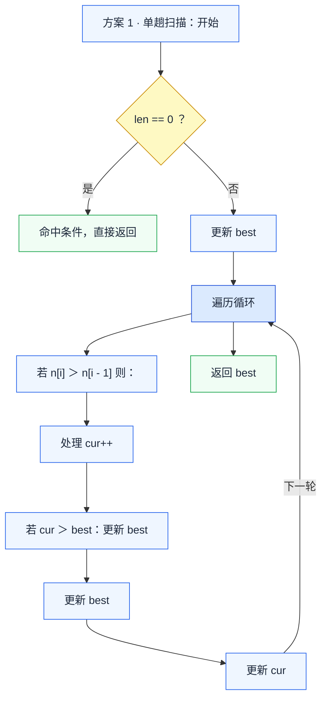

```c
/* LeetCode 674. 最长连续递增序列 — C 版（方案1） */
#include <stdio.h>                                      // 引入头文件
static int find_length_of_lcis(const int *n, int len) { // 定义函数/方法 find_length_of_lcis
    if (len == 0)
        return 0;                   // 若 长度 等于 0，直接返回 0
    int best = 1, cur = 1;          // 把 1, 当前值 赋值为 1 存入 当前最优
    for (int i = 1; i < len; i++) { // 让 下标 i 从 1 开始计数，下标 i 小于 长度 就继续
        if (n[i] > n[i - 1]) {
            cur++;
            if (cur > best)
                best = cur;
        } else
            cur = 1; // 否则
    }
    return best; // 返回 当前最优
}
int main(void) { // 程序入口：跑内嵌自测用例
    if (find_length_of_lcis((int[]){1, 3, 5, 4, 7}, 5) != 3) {
        printf("FAIL 1\n");
        return 1;
    }
    if (find_length_of_lcis((int[]){2, 2, 2, 2, 2}, 5) != 1) {
        printf("FAIL 2\n");
        return 1;
    }
    printf("PASS\n");
    return 0;
} // 全部用例通过，输出 PASS
```

#### 方案 2：单趟扫描

**思路与代码分析**：核心是「单趟扫描」。C 版手动管理下标与内存，循环边界全部显式写出。代码里依次做这些事：单循环线性扫描。**走读**：方案 2 · 单趟扫描：开始 → 命中条件，直接返回 → 更新 best → 遍历循环 → 若 n[i] ＞ n[i - 1] 则： → 处理 cur++ → 若 cur ＞ best：更新 best → 更新 best → 更新 cur → 返回 best。

**运行架构**（真实控制流）：

```mermaid
graph TD
    N0["方案 2 · 单趟扫描：开始"]
    N1{"len == 0 ？"}
    N2["命中条件，直接返回"]
    N3["更新 best"]
    N4["遍历循环"]
    N5["若 n[i] ＞ n[i - 1] 则："]
    N6["处理 cur++"]
    N7["若 cur ＞ best：更新 best"]
    N8["更新 best"]
    N9["更新 cur"]
    N10["返回 best"]
    N0 --> N1
    N1 -- 是 --> N2
    N1 -- 否 --> N3
    N3 --> N4
    N4 --> N5
    N5 --> N6
    N6 --> N7
    N7 --> N8
    N8 --> N9
    N9 -- 下一轮 --> N4
    N4 --> N10
    classDef n fill:#eff6ff,stroke:#2563eb,color:#1e293b;
    classDef lp fill:#dbeafe,stroke:#1d4ed8,color:#1e293b;
    classDef dc fill:#fef9c3,stroke:#ca8a04,color:#1e293b;
    classDef tm fill:#f0fdf4,stroke:#16a34a,color:#1e293b;
    class N0,N3,N5,N6,N7,N8,N9 n;
    class N4 lp;
    class N1 dc;
    class N2,N10 tm;
```

```c
/* LeetCode 674. 最长连续递增序列 — C 版（方案2） */
#include <stdio.h>                                      // 引入头文件
static int find_length_of_lcis(const int *n, int len) { // 定义函数/方法 find_length_of_lcis
    if (len == 0)
        return 0;                   // 若 长度 等于 0，直接返回 0
    int best = 1, cur = 1;          // 把 1, 当前值 赋值为 1 存入 当前最优
    for (int i = 1; i < len; i++) { // 让 下标 i 从 1 开始计数，下标 i 小于 长度 就继续
        if (n[i] > n[i - 1]) {
            cur++;
            if (cur > best)
                best = cur;
        } else
            cur = 1; // 否则
    }
    return best; // 返回 当前最优
}
int main(void) { // 程序入口：跑内嵌自测用例
    if (find_length_of_lcis((int[]){1, 3, 5, 4, 7}, 5) != 3) {
        printf("FAIL 1\n");
        return 1;
    }
    if (find_length_of_lcis((int[]){2, 2, 2, 2, 2}, 5) != 1) {
        printf("FAIL 2\n");
        return 1;
    }
    printf("PASS\n");
    return 0;
} // 全部用例通过，输出 PASS
```

#### 方案 3：单趟扫描

**思路与代码分析**：核心是「单趟扫描」。C 版手动管理下标与内存，循环边界全部显式写出。代码里依次做这些事：单循环线性扫描。**走读**：方案 3 · 单趟扫描：开始 → 命中条件，直接返回 → 更新 best → 遍历循环 → 若 n[i] ＞ n[i - 1] 则： → 处理 cur++ → 若 cur ＞ best：更新 best → 更新 best → 更新 cur → 返回 best。

**运行架构**（真实控制流）：

```mermaid
graph TD
    N0["方案 3 · 单趟扫描：开始"]
    N1{"len == 0 ？"}
    N2["命中条件，直接返回"]
    N3["更新 best"]
    N4["遍历循环"]
    N5["若 n[i] ＞ n[i - 1] 则："]
    N6["处理 cur++"]
    N7["若 cur ＞ best：更新 best"]
    N8["更新 best"]
    N9["更新 cur"]
    N10["返回 best"]
    N0 --> N1
    N1 -- 是 --> N2
    N1 -- 否 --> N3
    N3 --> N4
    N4 --> N5
    N5 --> N6
    N6 --> N7
    N7 --> N8
    N8 --> N9
    N9 -- 下一轮 --> N4
    N4 --> N10
    classDef n fill:#eff6ff,stroke:#2563eb,color:#1e293b;
    classDef lp fill:#dbeafe,stroke:#1d4ed8,color:#1e293b;
    classDef dc fill:#fef9c3,stroke:#ca8a04,color:#1e293b;
    classDef tm fill:#f0fdf4,stroke:#16a34a,color:#1e293b;
    class N0,N3,N5,N6,N7,N8,N9 n;
    class N4 lp;
    class N1 dc;
    class N2,N10 tm;
```

```c
/* LeetCode 674. 最长连续递增序列 — C 版（方案3） */
#include <stdio.h>                                      // 引入头文件
static int find_length_of_lcis(const int *n, int len) { // 定义函数/方法 find_length_of_lcis
    if (len == 0)
        return 0;                   // 若 长度 等于 0，直接返回 0
    int best = 1, cur = 1;          // 把 1, 当前值 赋值为 1 存入 当前最优
    for (int i = 1; i < len; i++) { // 让 下标 i 从 1 开始计数，下标 i 小于 长度 就继续
        if (n[i] > n[i - 1]) {
            cur++;
            if (cur > best)
                best = cur;
        } else
            cur = 1; // 否则
    }
    return best; // 返回 当前最优
}
int main(void) { // 程序入口：跑内嵌自测用例
    if (find_length_of_lcis((int[]){1, 3, 5, 4, 7}, 5) != 3) {
        printf("FAIL 1\n");
        return 1;
    }
    if (find_length_of_lcis((int[]){2, 2, 2, 2, 2}, 5) != 1) {
        printf("FAIL 2\n");
        return 1;
    }
    printf("PASS\n");
    return 0;
} // 全部用例通过，输出 PASS
```

### C++ 实现（3 种方案）

C++ 的全部方案如下，每个方案都内嵌用例自测，可独立运行（老仓库 python/go 文件遵循「打印结果」约定）：

#### 方案 1：单趟扫描

**思路与代码分析**：核心是「单趟扫描」。C++ 版用 STL 容器与迭代器，减少手写下标错误。代码里依次做这些事：单循环线性扫描。**走读**：方案 1 · 单趟扫描：开始 → 命中条件，直接返回 → 更新 best → 遍历循环 → 若 nums[i] ＞ nums[i - 1] 则： → 处理 ++cur → 更新 best → 更新 cur → 返回 best。

**运行架构**（真实控制流）：

```mermaid
graph TD
    N0["方案 1 · 单趟扫描：开始"]
    N1{"nums.empty() ？"}
    N2["命中条件，直接返回"]
    N3["更新 best"]
    N4["遍历循环"]
    N5["若 nums[i] ＞ nums[i - 1] 则："]
    N6["处理 ++cur"]
    N7["更新 best"]
    N8["更新 cur"]
    N9["返回 best"]
    N0 --> N1
    N1 -- 是 --> N2
    N1 -- 否 --> N3
    N3 --> N4
    N4 --> N5
    N5 --> N6
    N6 --> N7
    N7 --> N8
    N8 -- 下一轮 --> N4
    N4 --> N9
    classDef n fill:#eff6ff,stroke:#2563eb,color:#1e293b;
    classDef lp fill:#dbeafe,stroke:#1d4ed8,color:#1e293b;
    classDef dc fill:#fef9c3,stroke:#ca8a04,color:#1e293b;
    classDef tm fill:#f0fdf4,stroke:#16a34a,color:#1e293b;
    class N0,N3,N5,N6,N7,N8 n;
    class N4 lp;
    class N1 dc;
    class N2,N9 tm;
```

```cpp
// LeetCode 674. 最长连续递增序列 — C++ 版（方案1）
#include <algorithm>                                        // 引入头文件
#include <cassert>                                          // 引入头文件
#include <iostream>                                         // 引入头文件
#include <vector>                                           // 引入头文件
static int findLengthOfLCIS(const std::vector<int> &nums) { // 定义函数/方法 findLengthOfLCIS
    if (nums.empty())
        return 0;                              // 若 数组 是否为空，直接返回 0
    int best = 1, cur = 1;                     // 把 1, 当前值 赋值为 1 存入 当前最优
    for (size_t i = 1; i < nums.size(); ++i) { // 让 下标 i 从 1 开始计数，下标 i 小于 数组.大小() 就继续
        if (nums[i] > nums[i - 1]) {
            ++cur;
            best = std::max(best, cur);
        } else
            cur = 1; // 否则
    }
    return best; // 返回 当前最优
}
int main() {
    assert(findLengthOfLCIS({1, 3, 5, 4, 7}) == 3);
    assert(findLengthOfLCIS({2, 2, 2, 2, 2}) == 1);
    std::cout << "PASS" << std::endl;
} // 全部用例通过，输出 PASS
```

#### 方案 2：单趟扫描

**思路与代码分析**：核心是「单趟扫描」。C++ 版用 STL 容器与迭代器，减少手写下标错误。代码里依次做这些事：单循环线性扫描。**走读**：方案 2 · 单趟扫描：开始 → 命中条件，直接返回 → 更新 best → 遍历循环 → 若 nums[i] ＞ nums[i - 1] 则： → 处理 ++cur → 更新 best → 更新 cur → 返回 best。

**运行架构**（真实控制流）：

```mermaid
graph TD
    N0["方案 2 · 单趟扫描：开始"]
    N1{"nums.empty() ？"}
    N2["命中条件，直接返回"]
    N3["更新 best"]
    N4["遍历循环"]
    N5["若 nums[i] ＞ nums[i - 1] 则："]
    N6["处理 ++cur"]
    N7["更新 best"]
    N8["更新 cur"]
    N9["返回 best"]
    N0 --> N1
    N1 -- 是 --> N2
    N1 -- 否 --> N3
    N3 --> N4
    N4 --> N5
    N5 --> N6
    N6 --> N7
    N7 --> N8
    N8 -- 下一轮 --> N4
    N4 --> N9
    classDef n fill:#eff6ff,stroke:#2563eb,color:#1e293b;
    classDef lp fill:#dbeafe,stroke:#1d4ed8,color:#1e293b;
    classDef dc fill:#fef9c3,stroke:#ca8a04,color:#1e293b;
    classDef tm fill:#f0fdf4,stroke:#16a34a,color:#1e293b;
    class N0,N3,N5,N6,N7,N8 n;
    class N4 lp;
    class N1 dc;
    class N2,N9 tm;
```

```cpp
// LeetCode 674. 最长连续递增序列 — C++ 版（方案2）
#include <algorithm>                                        // 引入头文件
#include <cassert>                                          // 引入头文件
#include <iostream>                                         // 引入头文件
#include <vector>                                           // 引入头文件
static int findLengthOfLCIS(const std::vector<int> &nums) { // 定义函数/方法 findLengthOfLCIS
    if (nums.empty())
        return 0;                              // 若 数组 是否为空，直接返回 0
    int best = 1, cur = 1;                     // 把 1, 当前值 赋值为 1 存入 当前最优
    for (size_t i = 1; i < nums.size(); ++i) { // 让 下标 i 从 1 开始计数，下标 i 小于 数组.大小() 就继续
        if (nums[i] > nums[i - 1]) {
            ++cur;
            best = std::max(best, cur);
        } else
            cur = 1; // 否则
    }
    return best; // 返回 当前最优
}
int main() {
    assert(findLengthOfLCIS({1, 3, 5, 4, 7}) == 3);
    assert(findLengthOfLCIS({2, 2, 2, 2, 2}) == 1);
    std::cout << "PASS" << std::endl;
} // 全部用例通过，输出 PASS
```

#### 方案 3：单趟扫描

**思路与代码分析**：核心是「单趟扫描」。C++ 版用 STL 容器与迭代器，减少手写下标错误。代码里依次做这些事：单循环线性扫描。**走读**：方案 3 · 单趟扫描：开始 → 命中条件，直接返回 → 更新 best → 遍历循环 → 若 nums[i] ＞ nums[i - 1] 则： → 处理 ++cur → 更新 best → 更新 cur → 返回 best。

**运行架构**（真实控制流）：

```mermaid
graph TD
    N0["方案 3 · 单趟扫描：开始"]
    N1{"nums.empty() ？"}
    N2["命中条件，直接返回"]
    N3["更新 best"]
    N4["遍历循环"]
    N5["若 nums[i] ＞ nums[i - 1] 则："]
    N6["处理 ++cur"]
    N7["更新 best"]
    N8["更新 cur"]
    N9["返回 best"]
    N0 --> N1
    N1 -- 是 --> N2
    N1 -- 否 --> N3
    N3 --> N4
    N4 --> N5
    N5 --> N6
    N6 --> N7
    N7 --> N8
    N8 -- 下一轮 --> N4
    N4 --> N9
    classDef n fill:#eff6ff,stroke:#2563eb,color:#1e293b;
    classDef lp fill:#dbeafe,stroke:#1d4ed8,color:#1e293b;
    classDef dc fill:#fef9c3,stroke:#ca8a04,color:#1e293b;
    classDef tm fill:#f0fdf4,stroke:#16a34a,color:#1e293b;
    class N0,N3,N5,N6,N7,N8 n;
    class N4 lp;
    class N1 dc;
    class N2,N9 tm;
```

```cpp
// LeetCode 674. 最长连续递增序列 — C++ 版（方案3）
#include <algorithm>                                        // 引入头文件
#include <cassert>                                          // 引入头文件
#include <iostream>                                         // 引入头文件
#include <vector>                                           // 引入头文件
static int findLengthOfLCIS(const std::vector<int> &nums) { // 定义函数/方法 findLengthOfLCIS
    if (nums.empty())
        return 0;                              // 若 数组 是否为空，直接返回 0
    int best = 1, cur = 1;                     // 把 1, 当前值 赋值为 1 存入 当前最优
    for (size_t i = 1; i < nums.size(); ++i) { // 让 下标 i 从 1 开始计数，下标 i 小于 数组.大小() 就继续
        if (nums[i] > nums[i - 1]) {
            ++cur;
            best = std::max(best, cur);
        } else
            cur = 1; // 否则
    }
    return best; // 返回 当前最优
}
int main() {
    assert(findLengthOfLCIS({1, 3, 5, 4, 7}) == 3);
    assert(findLengthOfLCIS({2, 2, 2, 2, 2}) == 1);
    std::cout << "PASS" << std::endl;
} // 全部用例通过，输出 PASS
```

### R 实现（3 种方案）

R 的全部方案如下，每个方案都内嵌用例自测，可独立运行（老仓库 python/go 文件遵循「打印结果」约定）：

#### 方案 1：单趟扫描

**思路与代码分析**：核心是「单趟扫描」。R 版用向量化思维与 1 起始下标，注意 1:n 的降序陷阱。代码里依次做这些事：单循环线性扫描。**走读**：方案 1 · 单趟扫描：开始 → 命中条件，直接返回 → 处理 best ＜- 1L → 处理 cur ＜- 1L → 循环 i：遍历 2:length(nums) → 若 nums[i] ＞ nums[i - 1] 则： → 处理 cur ＜- cur + 1L → 若 cur ＞ best：处理 best ＜- cur → 处理 best ＜- cur → 处理 best。

**运行架构**（真实控制流）：

```mermaid
graph TD
    N0["方案 1 · 单趟扫描：开始"]
    N1{"length(nums) == 0 ？"}
    N2["命中条件，直接返回"]
    N3["处理 best ＜- 1L"]
    N4["处理 cur ＜- 1L"]
    N5["循环 i：遍历 2:length(nums)"]
    N6["若 nums[i] ＞ nums[i - 1] 则："]
    N7["处理 cur ＜- cur + 1L"]
    N8["若 cur ＞ best：处理 best ＜- cur"]
    N9["处理 best ＜- cur"]
    N10["处理 best"]
    N0 --> N1
    N1 -- 是 --> N2
    N1 -- 否 --> N3
    N3 --> N4
    N4 --> N5
    N5 --> N6
    N6 --> N7
    N7 --> N8
    N8 --> N9
    N9 -- 下一轮 --> N5
    N5 --> N10
    classDef n fill:#eff6ff,stroke:#2563eb,color:#1e293b;
    classDef lp fill:#dbeafe,stroke:#1d4ed8,color:#1e293b;
    classDef dc fill:#fef9c3,stroke:#ca8a04,color:#1e293b;
    classDef tm fill:#f0fdf4,stroke:#16a34a,color:#1e293b;
    class N0,N3,N4,N6,N7,N8,N9,N10 n;
    class N5 lp;
    class N1 dc;
    class N2 tm;
```

```r
# 版（方案1） 定义函数 find_length_of_lcis（参数：数组）
find_length_of_lcis <- function(nums) {
    if (length(nums) == 0)
        return(0L)  # 若 长度(数组) 等于 0) return(0L
    best <- 1L
    cur <- 1L  # 把 1L; 当前值 小于 减 1L 存入 当前最优
    for (i in 2:length(nums)) {
        # for (下标 i in 2:长度(数组)) {
        if (nums[i] > nums[i - 1]) {
            cur <- cur + 1L
            if (cur > best)
                best <- cur
        } else cur <- 1L
    }
    best  # 当前最优
}
stopifnot(find_length_of_lcis(c(1, 3, 5, 4, 7)) == 3)  # 断言校验
stopifnot(find_length_of_lcis(c(2, 2, 2, 2, 2)) == 1)  # 断言校验
cat("PASS\n")  # 全部用例通过，输出 PASS
```

#### 方案 2：单趟扫描

**思路与代码分析**：核心是「单趟扫描」。R 版用向量化思维与 1 起始下标，注意 1:n 的降序陷阱。代码里依次做这些事：单循环线性扫描。**走读**：方案 2 · 单趟扫描：开始 → 命中条件，直接返回 → 处理 best ＜- 1L → 处理 cur ＜- 1L → 循环 i：遍历 2:length(nums) → 若 nums[i] ＞ nums[i - 1] 则： → 处理 cur ＜- cur + 1L → 若 cur ＞ best：处理 best ＜- cur → 处理 best ＜- cur → 处理 best。

**运行架构**（真实控制流）：

```mermaid
graph TD
    N0["方案 2 · 单趟扫描：开始"]
    N1{"length(nums) == 0 ？"}
    N2["命中条件，直接返回"]
    N3["处理 best ＜- 1L"]
    N4["处理 cur ＜- 1L"]
    N5["循环 i：遍历 2:length(nums)"]
    N6["若 nums[i] ＞ nums[i - 1] 则："]
    N7["处理 cur ＜- cur + 1L"]
    N8["若 cur ＞ best：处理 best ＜- cur"]
    N9["处理 best ＜- cur"]
    N10["处理 best"]
    N0 --> N1
    N1 -- 是 --> N2
    N1 -- 否 --> N3
    N3 --> N4
    N4 --> N5
    N5 --> N6
    N6 --> N7
    N7 --> N8
    N8 --> N9
    N9 -- 下一轮 --> N5
    N5 --> N10
    classDef n fill:#eff6ff,stroke:#2563eb,color:#1e293b;
    classDef lp fill:#dbeafe,stroke:#1d4ed8,color:#1e293b;
    classDef dc fill:#fef9c3,stroke:#ca8a04,color:#1e293b;
    classDef tm fill:#f0fdf4,stroke:#16a34a,color:#1e293b;
    class N0,N3,N4,N6,N7,N8,N9,N10 n;
    class N5 lp;
    class N1 dc;
    class N2 tm;
```

```r
# 版（方案2） 定义函数 find_length_of_lcis（参数：数组）
find_length_of_lcis <- function(nums) {
    if (length(nums) == 0)
        return(0L)  # 若 长度(数组) 等于 0) return(0L
    best <- 1L
    cur <- 1L  # 把 1L; 当前值 小于 减 1L 存入 当前最优
    for (i in 2:length(nums)) {
        # for (下标 i in 2:长度(数组)) {
        if (nums[i] > nums[i - 1]) {
            cur <- cur + 1L
            if (cur > best)
                best <- cur
        } else cur <- 1L
    }
    best  # 当前最优
}
stopifnot(find_length_of_lcis(c(1, 3, 5, 4, 7)) == 3)  # 断言校验
stopifnot(find_length_of_lcis(c(2, 2, 2, 2, 2)) == 1)  # 断言校验
cat("PASS\n")  # 全部用例通过，输出 PASS
```

#### 方案 3：单趟扫描

**思路与代码分析**：核心是「单趟扫描」。R 版用向量化思维与 1 起始下标，注意 1:n 的降序陷阱。代码里依次做这些事：单循环线性扫描。**走读**：方案 3 · 单趟扫描：开始 → 命中条件，直接返回 → 处理 best ＜- 1L → 处理 cur ＜- 1L → 循环 i：遍历 2:length(nums) → 若 nums[i] ＞ nums[i - 1] 则： → 处理 cur ＜- cur + 1L → 若 cur ＞ best：处理 best ＜- cur → 处理 best ＜- cur → 处理 best。

**运行架构**（真实控制流）：

```mermaid
graph TD
    N0["方案 3 · 单趟扫描：开始"]
    N1{"length(nums) == 0 ？"}
    N2["命中条件，直接返回"]
    N3["处理 best ＜- 1L"]
    N4["处理 cur ＜- 1L"]
    N5["循环 i：遍历 2:length(nums)"]
    N6["若 nums[i] ＞ nums[i - 1] 则："]
    N7["处理 cur ＜- cur + 1L"]
    N8["若 cur ＞ best：处理 best ＜- cur"]
    N9["处理 best ＜- cur"]
    N10["处理 best"]
    N0 --> N1
    N1 -- 是 --> N2
    N1 -- 否 --> N3
    N3 --> N4
    N4 --> N5
    N5 --> N6
    N6 --> N7
    N7 --> N8
    N8 --> N9
    N9 -- 下一轮 --> N5
    N5 --> N10
    classDef n fill:#eff6ff,stroke:#2563eb,color:#1e293b;
    classDef lp fill:#dbeafe,stroke:#1d4ed8,color:#1e293b;
    classDef dc fill:#fef9c3,stroke:#ca8a04,color:#1e293b;
    classDef tm fill:#f0fdf4,stroke:#16a34a,color:#1e293b;
    class N0,N3,N4,N6,N7,N8,N9,N10 n;
    class N5 lp;
    class N1 dc;
    class N2 tm;
```

```r
# 版（方案3） 定义函数 find_length_of_lcis（参数：数组）
find_length_of_lcis <- function(nums) {
    if (length(nums) == 0)
        return(0L)  # 若 长度(数组) 等于 0) return(0L
    best <- 1L
    cur <- 1L  # 把 1L; 当前值 小于 减 1L 存入 当前最优
    for (i in 2:length(nums)) {
        # for (下标 i in 2:长度(数组)) {
        if (nums[i] > nums[i - 1]) {
            cur <- cur + 1L
            if (cur > best)
                best <- cur
        } else cur <- 1L
    }
    best  # 当前最优
}
stopifnot(find_length_of_lcis(c(1, 3, 5, 4, 7)) == 3)  # 断言校验
stopifnot(find_length_of_lcis(c(2, 2, 2, 2, 2)) == 1)  # 断言校验
cat("PASS\n")  # 全部用例通过，输出 PASS
```

### Zig 实现（3 种方案）

Zig 的全部方案如下，每个方案都内嵌用例自测，可独立运行（老仓库 python/go 文件遵循「打印结果」约定）：

#### 方案 1：单趟扫描

**思路与代码分析**：核心是「单趟扫描」。Zig 版显式分配与清零，整型边界处理严格。代码里依次做这些事：单循环线性扫描。**走读**：方案 1 · 单趟扫描：开始 → 命中条件，直接返回 → 计算 best → 计算 cur → 遍历集合元素 → 若 nums[i] ＞ nums[i - 1] 则： → 更新 + → 若 cur ＞ best：更新 best → 返回 best。

**运行架构**（真实控制流）：

```mermaid
graph TD
    N0["方案 1 · 单趟扫描：开始"]
    N1{"nums.len == 0 ？"}
    N2["命中条件，直接返回"]
    N3["计算 best"]
    N4["计算 cur"]
    N5["遍历集合元素"]
    N6["若 nums[i] ＞ nums[i - 1] 则："]
    N7["更新 +"]
    N8["若 cur ＞ best：更新 best"]
    N9["返回 best"]
    N0 --> N1
    N1 -- 是 --> N2
    N1 -- 否 --> N3
    N3 --> N4
    N4 --> N5
    N5 --> N6
    N6 --> N7
    N7 --> N8
    N8 -- 下一轮 --> N5
    N5 --> N9
    classDef n fill:#eff6ff,stroke:#2563eb,color:#1e293b;
    classDef lp fill:#dbeafe,stroke:#1d4ed8,color:#1e293b;
    classDef dc fill:#fef9c3,stroke:#ca8a04,color:#1e293b;
    classDef tm fill:#f0fdf4,stroke:#16a34a,color:#1e293b;
    class N0,N3,N4,N6,N7,N8 n;
    class N5 lp;
    class N1 dc;
    class N2,N9 tm;
```

```zig
// LeetCode 674. 最长连续递增序列 — Zig 版（方案1）
const std = @import("std"); // 把 @import(「std」) 存入 std
fn findLengthOfLCIS(nums: []const i32) i32 { // 定义函数/方法 findLengthOfLCIS
    if (nums.len == 0) return 0; // 若 数组.长度 等于 0，直接返回 0
    var best: i32 = 1; // 把 1; 写入 var best: i32
    var cur: i32 = 1; // 把 1; 写入 var cur: i32
    for (1..nums.len) |i| { // 逐个取出 1..数组.长度 的元素（下标 i）
        if (nums[i] > nums[i - 1]) { // 若 数组[下标 i] 超过 数组[下标 i 减 1]
            cur += 1; // 当前值累加 1
            if (cur > best) best = cur; // 若 当前值 超过 当前最优) 当前最优 赋值为 当前值;
        } else cur = 1; // 否则
    }
    return best; // 返回 当前最优
}
pub fn main() !void { // 程序入口：跑内嵌自测用例
    if (findLengthOfLCIS(&[_]i32{ 1, 3, 5, 4, 7 }) != 3) return error.TestFailed;
    if (findLengthOfLCIS(&[_]i32{ 2, 2, 2, 2, 2 }) != 1) return error.TestFailed;
    std.debug.print("PASS\n", .{});
} // 全部用例通过，输出 PASS
```

#### 方案 2：单趟扫描

**思路与代码分析**：核心是「单趟扫描」。Zig 版显式分配与清零，整型边界处理严格。代码里依次做这些事：单循环线性扫描。**走读**：方案 2 · 单趟扫描：开始 → 命中条件，直接返回 → 计算 best → 计算 cur → 遍历集合元素 → 若 nums[i] ＞ nums[i - 1] 则： → 更新 + → 若 cur ＞ best：更新 best → 返回 best。

**运行架构**（真实控制流）：

```mermaid
graph TD
    N0["方案 2 · 单趟扫描：开始"]
    N1{"nums.len == 0 ？"}
    N2["命中条件，直接返回"]
    N3["计算 best"]
    N4["计算 cur"]
    N5["遍历集合元素"]
    N6["若 nums[i] ＞ nums[i - 1] 则："]
    N7["更新 +"]
    N8["若 cur ＞ best：更新 best"]
    N9["返回 best"]
    N0 --> N1
    N1 -- 是 --> N2
    N1 -- 否 --> N3
    N3 --> N4
    N4 --> N5
    N5 --> N6
    N6 --> N7
    N7 --> N8
    N8 -- 下一轮 --> N5
    N5 --> N9
    classDef n fill:#eff6ff,stroke:#2563eb,color:#1e293b;
    classDef lp fill:#dbeafe,stroke:#1d4ed8,color:#1e293b;
    classDef dc fill:#fef9c3,stroke:#ca8a04,color:#1e293b;
    classDef tm fill:#f0fdf4,stroke:#16a34a,color:#1e293b;
    class N0,N3,N4,N6,N7,N8 n;
    class N5 lp;
    class N1 dc;
    class N2,N9 tm;
```

```zig
// LeetCode 674. 最长连续递增序列 — Zig 版（方案2）
const std = @import("std"); // 把 @import(「std」) 存入 std
fn findLengthOfLCIS(nums: []const i32) i32 { // 定义函数/方法 findLengthOfLCIS
    if (nums.len == 0) return 0; // 若 数组.长度 等于 0，直接返回 0
    var best: i32 = 1; // 把 1; 写入 var best: i32
    var cur: i32 = 1; // 把 1; 写入 var cur: i32
    for (1..nums.len) |i| { // 逐个取出 1..数组.长度 的元素（下标 i）
        if (nums[i] > nums[i - 1]) { // 若 数组[下标 i] 超过 数组[下标 i 减 1]
            cur += 1; // 当前值累加 1
            if (cur > best) best = cur; // 若 当前值 超过 当前最优) 当前最优 赋值为 当前值;
        } else cur = 1; // 否则
    }
    return best; // 返回 当前最优
}
pub fn main() !void { // 程序入口：跑内嵌自测用例
    if (findLengthOfLCIS(&[_]i32{ 1, 3, 5, 4, 7 }) != 3) return error.TestFailed;
    if (findLengthOfLCIS(&[_]i32{ 2, 2, 2, 2, 2 }) != 1) return error.TestFailed;
    std.debug.print("PASS\n", .{});
} // 全部用例通过，输出 PASS
```

#### 方案 3：单趟扫描

**思路与代码分析**：核心是「单趟扫描」。Zig 版显式分配与清零，整型边界处理严格。代码里依次做这些事：单循环线性扫描。**走读**：方案 3 · 单趟扫描：开始 → 命中条件，直接返回 → 计算 best → 计算 cur → 遍历集合元素 → 若 nums[i] ＞ nums[i - 1] 则： → 更新 + → 若 cur ＞ best：更新 best → 返回 best。

**运行架构**（真实控制流）：

```mermaid
graph TD
    N0["方案 3 · 单趟扫描：开始"]
    N1{"nums.len == 0 ？"}
    N2["命中条件，直接返回"]
    N3["计算 best"]
    N4["计算 cur"]
    N5["遍历集合元素"]
    N6["若 nums[i] ＞ nums[i - 1] 则："]
    N7["更新 +"]
    N8["若 cur ＞ best：更新 best"]
    N9["返回 best"]
    N0 --> N1
    N1 -- 是 --> N2
    N1 -- 否 --> N3
    N3 --> N4
    N4 --> N5
    N5 --> N6
    N6 --> N7
    N7 --> N8
    N8 -- 下一轮 --> N5
    N5 --> N9
    classDef n fill:#eff6ff,stroke:#2563eb,color:#1e293b;
    classDef lp fill:#dbeafe,stroke:#1d4ed8,color:#1e293b;
    classDef dc fill:#fef9c3,stroke:#ca8a04,color:#1e293b;
    classDef tm fill:#f0fdf4,stroke:#16a34a,color:#1e293b;
    class N0,N3,N4,N6,N7,N8 n;
    class N5 lp;
    class N1 dc;
    class N2,N9 tm;
```

```zig
// LeetCode 674. 最长连续递增序列 — Zig 版（方案3）
const std = @import("std"); // 把 @import(「std」) 存入 std
fn findLengthOfLCIS(nums: []const i32) i32 { // 定义函数/方法 findLengthOfLCIS
    if (nums.len == 0) return 0; // 若 数组.长度 等于 0，直接返回 0
    var best: i32 = 1; // 把 1; 写入 var best: i32
    var cur: i32 = 1; // 把 1; 写入 var cur: i32
    for (1..nums.len) |i| { // 逐个取出 1..数组.长度 的元素（下标 i）
        if (nums[i] > nums[i - 1]) { // 若 数组[下标 i] 超过 数组[下标 i 减 1]
            cur += 1; // 当前值累加 1
            if (cur > best) best = cur; // 若 当前值 超过 当前最优) 当前最优 赋值为 当前值;
        } else cur = 1; // 否则
    }
    return best; // 返回 当前最优
}
pub fn main() !void { // 程序入口：跑内嵌自测用例
    if (findLengthOfLCIS(&[_]i32{ 1, 3, 5, 4, 7 }) != 3) return error.TestFailed;
    if (findLengthOfLCIS(&[_]i32{ 2, 2, 2, 2, 2 }) != 1) return error.TestFailed;
    std.debug.print("PASS\n", .{});
} // 全部用例通过，输出 PASS
```

### Dart 实现（3 种方案）

Dart 的全部方案如下，每个方案都内嵌用例自测，可独立运行（老仓库 python/go 文件遵循「打印结果」约定）：

#### 方案 1：单趟扫描

**思路与代码分析**：核心是「单趟扫描」。Dart 版用可空类型标注与集合方法，注意空安全。代码里依次做这些事：单循环线性扫描。**走读**：方案 1 · 单趟扫描：开始 → 命中条件，直接返回 → 计算 best → 遍历循环 → 若 nums[i] ＞ nums[i - 1] 则： → 处理 cur++ → 若 cur ＞ best：更新 best → 更新 cur → 返回 best。

**运行架构**（真实控制流）：

```mermaid
graph TD
    N0["方案 1 · 单趟扫描：开始"]
    N1{"nums.isEmpty ？"}
    N2["命中条件，直接返回"]
    N3["计算 best"]
    N4["遍历循环"]
    N5["若 nums[i] ＞ nums[i - 1] 则："]
    N6["处理 cur++"]
    N7["若 cur ＞ best：更新 best"]
    N8["更新 cur"]
    N9["返回 best"]
    N0 --> N1
    N1 -- 是 --> N2
    N1 -- 否 --> N3
    N3 --> N4
    N4 --> N5
    N5 --> N6
    N6 --> N7
    N7 --> N8
    N8 -- 下一轮 --> N4
    N4 --> N9
    classDef n fill:#eff6ff,stroke:#2563eb,color:#1e293b;
    classDef lp fill:#dbeafe,stroke:#1d4ed8,color:#1e293b;
    classDef dc fill:#fef9c3,stroke:#ca8a04,color:#1e293b;
    classDef tm fill:#f0fdf4,stroke:#16a34a,color:#1e293b;
    class N0,N3,N5,N6,N7,N8 n;
    class N4 lp;
    class N1 dc;
    class N2,N9 tm;
```

```dart
// LeetCode 674. 最长连续递增序列 — Dart 版（方案1）
int findLengthOfLCIS(List<int> nums) {
  // 定义函数/方法 findLengthOfLCIS
  if (nums.isEmpty) return 0; // 若 数组.isEmpty，直接返回 0
  var best = 1, cur = 1; // 把 1, 当前值 赋值为 1 存入 当前最优
  for (var i = 1; i < nums.length; i++) {
    // 让 下标 i 从 1 开始计数，下标 i 小于 数组.长度 就继续
    if (nums[i] > nums[i - 1]) {
      cur++;
      if (cur > best) best = cur;
    } else {
      cur = 1;
    }
  }
  return best; // 返回 当前最优
}

void main() {
  if (findLengthOfLCIS([1, 3, 5, 4, 7]) != 3) throw StateError('c1');
  if (findLengthOfLCIS([2, 2, 2, 2, 2]) != 1) throw StateError('c2');
  print('PASS');
} // 全部用例通过，输出 PASS
```

#### 方案 2：单趟扫描

**思路与代码分析**：核心是「单趟扫描」。Dart 版用可空类型标注与集合方法，注意空安全。代码里依次做这些事：单循环线性扫描。**走读**：方案 2 · 单趟扫描：开始 → 命中条件，直接返回 → 计算 best → 遍历循环 → 若 nums[i] ＞ nums[i - 1] 则： → 处理 cur++ → 若 cur ＞ best：更新 best → 更新 cur → 返回 best。

**运行架构**（真实控制流）：

```mermaid
graph TD
    N0["方案 2 · 单趟扫描：开始"]
    N1{"nums.isEmpty ？"}
    N2["命中条件，直接返回"]
    N3["计算 best"]
    N4["遍历循环"]
    N5["若 nums[i] ＞ nums[i - 1] 则："]
    N6["处理 cur++"]
    N7["若 cur ＞ best：更新 best"]
    N8["更新 cur"]
    N9["返回 best"]
    N0 --> N1
    N1 -- 是 --> N2
    N1 -- 否 --> N3
    N3 --> N4
    N4 --> N5
    N5 --> N6
    N6 --> N7
    N7 --> N8
    N8 -- 下一轮 --> N4
    N4 --> N9
    classDef n fill:#eff6ff,stroke:#2563eb,color:#1e293b;
    classDef lp fill:#dbeafe,stroke:#1d4ed8,color:#1e293b;
    classDef dc fill:#fef9c3,stroke:#ca8a04,color:#1e293b;
    classDef tm fill:#f0fdf4,stroke:#16a34a,color:#1e293b;
    class N0,N3,N5,N6,N7,N8 n;
    class N4 lp;
    class N1 dc;
    class N2,N9 tm;
```

```dart
// LeetCode 674. 最长连续递增序列 — Dart 版（方案2）
int findLengthOfLCIS(List<int> nums) {
  // 定义函数/方法 findLengthOfLCIS
  if (nums.isEmpty) return 0; // 若 数组.isEmpty，直接返回 0
  var best = 1, cur = 1; // 把 1, 当前值 赋值为 1 存入 当前最优
  for (var i = 1; i < nums.length; i++) {
    // 让 下标 i 从 1 开始计数，下标 i 小于 数组.长度 就继续
    if (nums[i] > nums[i - 1]) {
      cur++;
      if (cur > best) best = cur;
    } else {
      cur = 1;
    }
  }
  return best; // 返回 当前最优
}

void main() {
  if (findLengthOfLCIS([1, 3, 5, 4, 7]) != 3) throw StateError('c1');
  if (findLengthOfLCIS([2, 2, 2, 2, 2]) != 1) throw StateError('c2');
  print('PASS');
} // 全部用例通过，输出 PASS
```

#### 方案 3：单趟扫描

**思路与代码分析**：核心是「单趟扫描」。Dart 版用可空类型标注与集合方法，注意空安全。代码里依次做这些事：单循环线性扫描。**走读**：方案 3 · 单趟扫描：开始 → 命中条件，直接返回 → 计算 best → 遍历循环 → 若 nums[i] ＞ nums[i - 1] 则： → 处理 cur++ → 若 cur ＞ best：更新 best → 更新 cur → 返回 best。

**运行架构**（真实控制流）：

```mermaid
graph TD
    N0["方案 3 · 单趟扫描：开始"]
    N1{"nums.isEmpty ？"}
    N2["命中条件，直接返回"]
    N3["计算 best"]
    N4["遍历循环"]
    N5["若 nums[i] ＞ nums[i - 1] 则："]
    N6["处理 cur++"]
    N7["若 cur ＞ best：更新 best"]
    N8["更新 cur"]
    N9["返回 best"]
    N0 --> N1
    N1 -- 是 --> N2
    N1 -- 否 --> N3
    N3 --> N4
    N4 --> N5
    N5 --> N6
    N6 --> N7
    N7 --> N8
    N8 -- 下一轮 --> N4
    N4 --> N9
    classDef n fill:#eff6ff,stroke:#2563eb,color:#1e293b;
    classDef lp fill:#dbeafe,stroke:#1d4ed8,color:#1e293b;
    classDef dc fill:#fef9c3,stroke:#ca8a04,color:#1e293b;
    classDef tm fill:#f0fdf4,stroke:#16a34a,color:#1e293b;
    class N0,N3,N5,N6,N7,N8 n;
    class N4 lp;
    class N1 dc;
    class N2,N9 tm;
```

```dart
// LeetCode 674. 最长连续递增序列 — Dart 版（方案3）
int findLengthOfLCIS(List<int> nums) {
  // 定义函数/方法 findLengthOfLCIS
  if (nums.isEmpty) return 0; // 若 数组.isEmpty，直接返回 0
  var best = 1, cur = 1; // 把 1, 当前值 赋值为 1 存入 当前最优
  for (var i = 1; i < nums.length; i++) {
    // 让 下标 i 从 1 开始计数，下标 i 小于 数组.长度 就继续
    if (nums[i] > nums[i - 1]) {
      cur++;
      if (cur > best) best = cur;
    } else {
      cur = 1;
    }
  }
  return best; // 返回 当前最优
}

void main() {
  if (findLengthOfLCIS([1, 3, 5, 4, 7]) != 3) throw StateError('c1');
  if (findLengthOfLCIS([2, 2, 2, 2, 2]) != 1) throw StateError('c2');
  print('PASS');
} // 全部用例通过，输出 PASS
```

---

## 内容总结

- **最长连续递增序列**（动态规划 · Medium）：共 3 个方案，主线思路「单趟扫描」；时间 O(n)（单趟线性扫描）；动画演示DP 表填充过程，附录给出 11 种语言 × 全部方案的可运行实现。
- 来源博客：[https://blog.csdn.net/tyro_java/article/details/144821546](https://blog.csdn.net/tyro_java/article/details/144821546)
- 导航：[📋 总目录](../) ｜ [← 184 最长递增子序列的个数](../184_最长递增子序列的个数/) ｜ [186 买卖股票的最佳时机含手续费 →](../186_买卖股票的最佳时机含手续费/)
