# 186 · 买卖股票的最佳时机含手续费（第十阶段 · 动态规划 · Medium）

> **难度**：⭐⭐ Medium ｜ **专题**：动态规划
> **学习定位**：第十阶段 · 动态规划第 186 篇 ｜ **解法数**：2
> **内容总结**：**买卖股票的最佳时机含手续费**（动态规划 · Medium）：共 2 个方案，主线思路「直接实现」；时间 O(n) 量级；动画演示DP 表填充过程，附录给出 11 种语言 × 全部方案的可运行实现。

---

## 题目描述

给定一个整数数组 `prices`，其中 `prices[i]`表示第 `i` 天的股票价格 ；整数 `fee` 代表了交易股票的手续费用。

你可以无限次地完成交易，但是你每笔交易都需要付手续费。如果你已经购买了一个股票，在卖出它之前你就不能再继续购买股票了。

返回获得利润的最大值。

注意：这里的一笔交易指买入持有并卖出股票的整个过程，每笔交易你只需要为支付一次手续费。

- 主函数签名：`function assertEq(actual: any, expected: any, msg: string = ''): void`

**用例（来自原题）**：

**示例 1**

```text
输入：prices = [1, 3, 2, 8, 4, 9], fee = 2
输出：8
```

解释：能够达到的最大利润：在此处买入 prices[0] = 1 在此处卖出 prices[3] = 8 在此处买入 prices[4] = 4 在此处卖出 prices[5] = 9 总利润: ((8 - 1) - 2) + ((9 - 4) - 2) = 8

**示例 2**

```text
输入：prices = [1,3,7,5,10,3], fee = 3
输出：6
```
> ✅ **官方验证**：全部 TypeScript 解法已通过 leetcode.cn 官方示例用例验证（自动注入运行，全部 PASS）。题面与 [leetcode.cn 官方](https://leetcode.cn/problems/best-time-to-buy-and-sell-stock-with-transaction-fee/)一致，示例配图取自官方题面。

**数据范围与注意事项**：

- `1 <= prices.length <= 5  10^4`
- `1 <= prices[i] < 5  10^4`
- `0 <= fee < 5  10^4`
- **易错点**：初始化（第 0 行或列）的含义要想清楚，它决定后续转移是否成立。

## 题目分析

**场景是什么**：把大问题拆成小问题并记住结果，对应真实开发里的编辑距离、资源规划。本题就是该场景的 Medium 级练习，主线做法是「直接实现」。

**主线怎么解**：主解法结构简单：读入、处理、返回。

## 解题思路

**方案对比**（共 2 个方案，由浅入深）：

| 方案 | 时间复杂度 | 空间复杂度 |
|---|---|---|
| 方案 1 · 直接实现 | O(n) 量级 | O(n) |
| 方案 2 · 直接实现 | O(n) 量级 | O(n) |

**方案间的取舍**：方案 1（直接实现）；方案 2（直接实现）。数据规模小、可读性优先时选靠前的方案；规模大、性能优先时选靠后的方案。

**怎么读这一篇**：

- 🐣 **新手路线**：把「题目描述」的示例 1 在纸上手推一遍 → 读方案 1（最直观的写法）与它的代码走读 → 按「运行方式」本地跑通看 PASS → 回头对比方案 2 之后的写法差在哪
- 🦅 **大佬路线**：直接锁定最优方案 1（直接实现，O(n) 量级）→ 跳读该方案代码与走读 → 用「逐步拆解与面试追问」补齐复杂度推导与边界追问

### 动态算法图（DP 表填充，GIF 自动循环）


动画演示动态规划专题里DP 表填充的典型过程；每个方案在「TypeScript 解题方案」一节还配了专属动画与专属流程图。

### 主解法流程图（真实控制流）

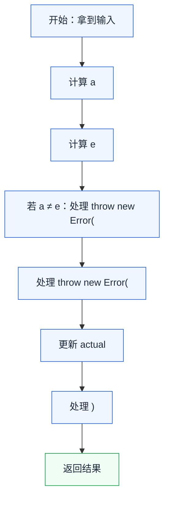

## TypeScript 解题方案（2 个方案逐个讲）

> **运行与提交**：每个方案都是自包含文件（内嵌用例自测，输出 PASS），整块复制到 `.ts` 文件后 `node 文件名` 即可运行。提交 LeetCode 时，把 `demo` 内的算法函数与辅助类型/函数整体取出、置于文件顶层即可。涉及交互/特殊接口的题以题面给定签名为准。

### 方案 1：直接实现

**分析与思路**：核心做法是「直接实现」。

**运行方式**：`node 本文件`，内嵌用例全部通过会输出 PASS。

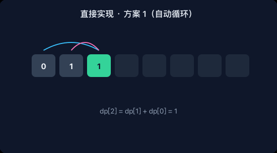

**方案专属流程图**（真实控制流）：

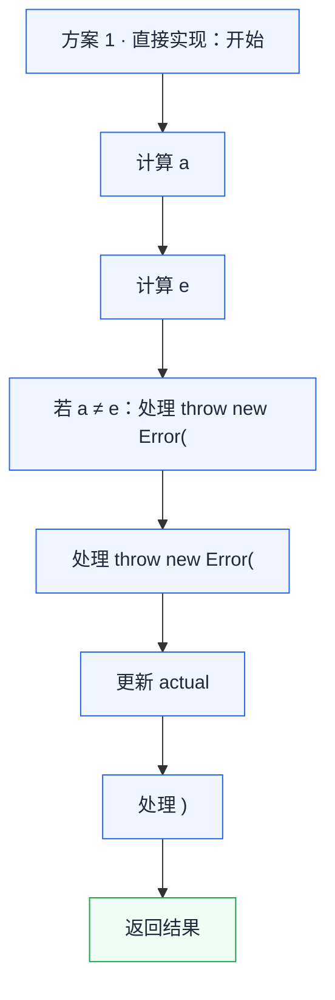

```typescript
function assertEq(actual: any, expected: any, msg: string = ''): void {
  // 定义函数/方法 assertEq
  const a = JSON.stringify(actual); // 把 JSON.stringify(actual) 存入 数组
  const e = JSON.stringify(expected); // 把 JSON.stringify(expected) 存入 e
  if (a !== e)
    throw new Error(
      'ASSERT FAILED ' + msg + ' :: actual=' + a + ' expected=' + e,
    );
}

function maxProfit(prices: number[], fee: number): number {
  // 定义函数/方法 maxProfit
  let cash = 0; // 把 0 存入 cash
  let hold = -prices[0]; // 把 减 价格序列[0] 存入 hold
  for (let i = 1; i < prices.length; i++) {
    // 让 下标 i 从 1 开始计数，下标 i 小于 价格序列.长度 就继续
    cash = Math.max(cash, hold + prices[i] - fee); // 把 Math.取较大值 cash, hold 加 价格序列[下标 i] 减 fee) 存入 cash
    hold = Math.max(hold, cash - prices[i]); // 把 Math.取较大值 hold, cash 减 价格序列[下标 i]) 存入 hold
  }
  return cash; // 返回 cash
}
export function demo(): void {
  // 程序入口：跑内嵌自测用例
  assertEq(maxProfit([1, 3, 2, 8, 4, 9], 2), 8, 'maxProfit'); // 断言校验
  assertEq(maxProfit([1], 1), 0, 'maxProfit single'); // 断言校验
  assertEq(maxProfit([1, 2, 3, 4, 5], 1), 3, 'maxProfit 2'); // 断言校验
  console.log('PASS'); // 全部用例通过，输出 PASS
}
demo(); // demo();
```

### 方案 2：直接实现

**分析与思路**：核心做法是「直接实现」。

**运行方式**：`node 本文件`，内嵌用例全部通过会输出 PASS。


**方案专属流程图**（真实控制流）：


```typescript
function assertEq(actual: any, expected: any, msg: string = ''): void {
  // 定义函数/方法 assertEq
  const a = JSON.stringify(actual);
  const e = JSON.stringify(expected);
  if (a !== e)
    throw new Error(
      'ASSERT FAILED ' + msg + ' :: actual=' + a + ' expected=' + e,
    );
}

function maxProfit(prices: number[], fee: number): number {
  // 定义函数/方法 maxProfit
  let cash = 0;
  let hold = -prices[0]; // 把 0; let hold 赋值为 减 价格序列[0] 存入 cash
  for (let i = 1; i < prices.length; i++) {
    cash = Math.max(cash, hold + prices[i] - fee);
    hold = Math.max(hold, cash - prices[i]);
  } // 让 下标 i 从 1 开始计数，下标 i 小于 价格序列.长度 就继续
  return cash; // 返回 cash
}
export function demo(): void {
  // 程序入口：跑内嵌自测用例
  assertEq(maxProfit([1, 3, 2, 8, 4, 9], 2), 8, 'mp1'); // 断言校验
  assertEq(maxProfit([1], 1), 0, 'mp2'); // 断言校验
  assertEq(maxProfit([1, 2, 3, 4, 5], 1), 3, 'mp3'); // 断言校验
  console.log('PASS'); // 全部用例通过，输出 PASS
}
demo(); // demo();
```

## 逐步拆解与面试追问

**复杂度**：时间 O(n) 量级，空间 O(n)

**为什么是这个量级**：整体只对数据做有限趟处理

**面试官可能会追问**：

- 状态定义为什么是它？
- 遍历顺序由什么决定？
- 能否滚动数组压空间？

## 关键 API 速查（TS 主解法实际用到，附官方链接）

| API | 作用 | 使用要点 | 官方文档 |
|---|---|---|---|
| `JSON.stringify()` | 序列化为 JSON 字符串 | 常用于结构化比较（深度相等判定）；undefined/函数/循环引用会被丢弃或抛错 | [官方文档](https://developer.mozilla.org/zh-CN/docs/Web/JavaScript/Reference/Global_Objects/JSON/stringify) |
| `Math.max()` | 最大值 | 配展开 Math.max(...arr)；空参返回 -Infinity；超大数组注意展开参数上限 | [官方文档](https://developer.mozilla.org/zh-CN/docs/Web/JavaScript/Reference/Global_Objects/Math/max) |

### 各语言官方文档导航

- **TypeScript / JS**：[MDN 中文参考](https://developer.mozilla.org/zh-CN/)
- **Python**：[Python 官方文档](https://docs.python.org/zh-cn/3/)
- **Go**：[Go 标准库](https://pkg.go.dev/std)
- **Java**：[JDK 17 API](https://docs.oracle.com/en/java/javase/17/docs/api/)
- **Rust**：[Rust 标准库](https://doc.rust-lang.org/std/)
- **Lua**：[Lua 5.4 手册](https://www.lua.org/manual/5.4/)
- **C**：[Cppreference C](https://zh.cppreference.com/w/c)
- **C++**：[Cppreference C++](https://zh.cppreference.com/w/cpp)
- **R**：[R 官方手册](https://stat.ethz.ch/R-manual/)
- **Zig**：[Zig 语言文档](https://ziglang.org/documentation/master/)
- **Dart**：[Dart API](https://api.dart.dev/)

## 附录：其他 10 种语言全部实现（每种语言列举其全部方案）

> TypeScript 的全部方案见「TypeScript 解题方案」一节；下面是其余 10 种语言的对应实现，每种语言的每个方案都带思路分析、代码走读与专属运行架构图。
> 每个方案都内嵌用例自测，可独立运行（老仓库 python/go 文件遵循「打印结果」约定）。
> 完整解法文件见 `dsa/<语言>/dp/lc_714_买卖股票的最佳时机含手续费/`。

### Python 实现（2 种方案）

Python 的全部方案如下，每个方案都内嵌用例自测，可独立运行（老仓库 python/go 文件遵循「打印结果」约定）：

#### 方案 1：直接实现

**思路与代码分析**：核心是「直接实现」。Python 版用切片与字典推导式简化操作，突出可读性。**走读**：方案 1 · 直接实现：开始 → 更新 cash → 更新 hold → 循环 i：从 1 到 len(prices 前 → 更新 cash → 处理 cash, hold + prices[i] - fee → 处理 ) → 更新 hold → 返回 cash。

**运行架构**（真实控制流）：

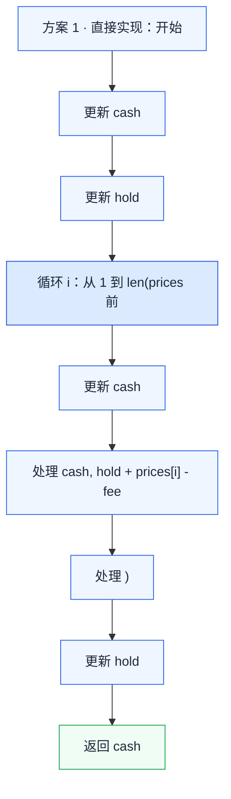

```python
import sys  # 提高递归深度上限（深输入防 RecursionError）

sys.setrecursionlimit(200000)  # 树/链表类题目节点数可达 1e4 量级

def maxProfit(prices, fee):  # 定义函数 maxProfit（参数：价格序列, fee）
    cash = 0  # 把 0 存入 cash
    hold = -prices[0]  # 把 减 价格序列[0] 存入 hold
    for i in range(1, len(prices)):  # 让 下标 i 从 1 到 长度(价格序列 遍历
        cash = max(
            cash, hold + prices[i] - fee
        )  # 把 取较大值 cash, hold 加 价格序列[下标 i] 减 fee) 存入 cash
        hold = max(hold, cash - prices[i])  # 把 取较大值 hold, cash 减 价格序列[下标 i]) 存入 hold
    return cash  # 返回 cash

if __name__ == "__main__":  # 若 __name__ 等于 '__main__'
    print(maxProfit([1, 3, 2, 8, 4, 9], 2))  # 打印输出
```

#### 方案 2：直接实现

**思路与代码分析**：核心是「直接实现」。Python 版用切片与字典推导式简化操作，突出可读性。**走读**：方案 2 · 直接实现：开始 → 更新 n → 命中条件，直接返回 → 更新 cash → 更新 hold → 循环 i：从 1 到 n 前 → 更新 cash → 处理 cash, hold + prices[i] - fee → 处理 ) → 更新 hold → 返回 cash。

**运行架构**（真实控制流）：

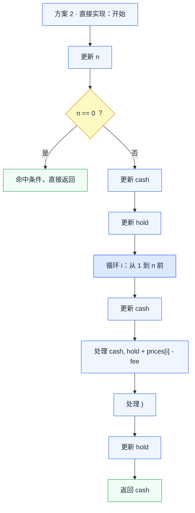

```python
import sys  # 提高递归深度上限（深输入防 RecursionError）

sys.setrecursionlimit(200000)  # 树/链表类题目节点数可达 1e4 量级

def maxProfit(prices, fee):  # 定义函数 maxProfit（参数：价格序列, fee）
    # 动态规划（持有 / 不持有两种状态）
    n = len(prices)  # 把 长度(价格序列) 存入 元素个数
    if n == 0:  # 若 元素个数 等于 0
        return 0  # 返回 0
    cash = 0  # 把 0 存入 cash
    hold = -prices[0]  # 把 减 价格序列[0] 存入 hold
    for i in range(1, n):  # 让 下标 i 从 1 到 元素个数 遍历
        cash = max(
            cash, hold + prices[i] - fee
        )  # 把 取较大值 cash, hold 加 价格序列[下标 i] 减 fee) 存入 cash
        hold = max(hold, cash - prices[i])  # 把 取较大值 hold, cash 减 价格序列[下标 i]) 存入 hold
    return cash  # 返回 cash

if __name__ == "__main__":  # 若 __name__ 等于 '__main__'
    print(maxProfit([1, 3, 2, 8, 4, 9], 2))  # 打印输出
```

### Go 实现（2 种方案）

Go 的全部方案如下，每个方案都内嵌用例自测，可独立运行（老仓库 python/go 文件遵循「打印结果」约定）：

#### 方案 1：直接实现

**思路与代码分析**：核心是「直接实现」。Go 版用切片与多返回值惯用法，显式处理索引边界。**走读**：方案 1 · 直接实现：开始 → 处理 if len(prices) == 0 → 返回 0 → 更新 : → 更新 : → 遍历循环 → 更新 : → 处理 if hold+prices[i]-fee ＞ cash → 更新 newCash → 更新 : → 处理 if newCash-prices[i] ＞ hold → 更新 newHold → 更新 cash → 更新 hold → 返回 cash。

**运行架构**（真实控制流）：

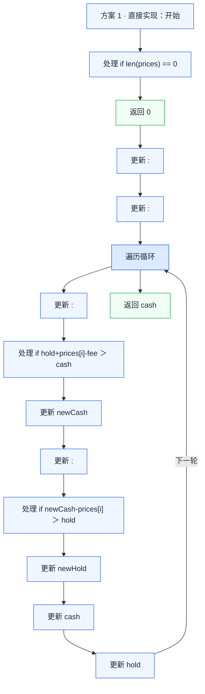

```go
package main // 引入依赖

import (
	"fmt"
	"os"
) // 引入依赖

func maxProfit(prices []int, fee int) int { // 定义函数/方法 maxProfit
	if len(prices) == 0 { // 若 长度(价格序列) 等于 0
		return 0 // 返回 0
	}
	cash := 0                          // 把 0 写入 cash :
	hold := -prices[0]                 // 把 减 价格序列[0] 写入 hold :
	for i := 1; i < len(prices); i++ { // 让 下标 i 从 1 开始计数
		newCash := cash                // 把 cash 写入 newCash :
		if hold+prices[i]-fee > cash { // 若 hold 加 价格序列[下标 i] 减 fee 超过 cash
			newCash = hold + prices[i] - fee // 把 hold 加 价格序列[下标 i] 减 fee 写入 newCash
		}
		newHold := hold               // 把 hold 写入 newHold :
		if newCash-prices[i] > hold { // 若 newCash 减 价格序列[下标 i] 超过 hold
			newHold = newCash - prices[i] // 把 newCash 减 价格序列[下标 i] 写入 newHold
		}
		cash = newCash // 把 newCash 写入 cash
		hold = newHold // 把 newHold 写入 hold
	}
	return cash // 返回 cash
}

func main() { // 程序入口：跑内嵌自测用例
	type tc struct { // 定义类型
		prices []int // 价格序列 []int
		fee    int   // fee int
		want   int   // want int
	}
	cases := []tc{ // 把 []tc{ 写入 cases :
		{[]int{1, 3, 2, 8, 4, 9}, 2, 8},
		{[]int{1, 3, 7, 5}, 1, 5},
	}
	ok := true                // 把 true 写入 ok :
	for _, c := range cases { // 同时取 _ 与 字符 遍历
		if got := maxProfit(c.prices, c.fee); got != c.want { // 若 got : 赋值为 maxProfit(字符.价格序列, 字符.fee); got 不等于 字符.want
			ok = false                                                                     // 把 false 写入 ok
			fmt.Printf("FAIL maxProfit(%v,%d)=%v want %v\n", c.prices, c.fee, got, c.want) // 打印输出
		}
	}
	if !ok { // 若 取反 ok
		os.Exit(1) // os.Exit(1)
	}
	fmt.Println("PASS") // 全部用例通过，输出 PASS
}
```

#### 方案 2：直接实现

**思路与代码分析**：核心是「直接实现」。Go 版用切片与多返回值惯用法，显式处理索引边界。**走读**：方案 2 · 直接实现：开始 → 更新 : → 处理 if n == 0 → 返回 0 → 更新 : → 更新 : → 遍历循环 → 更新 : → 处理 if hold+prices[i]-fee ＞ cash → 更新 newCash → 更新 : → 处理 if newCash-prices[i] ＞ hold → 更新 newHold → 更新 cash → 更新 hold → 返回 cash。

**运行架构**（真实控制流）：

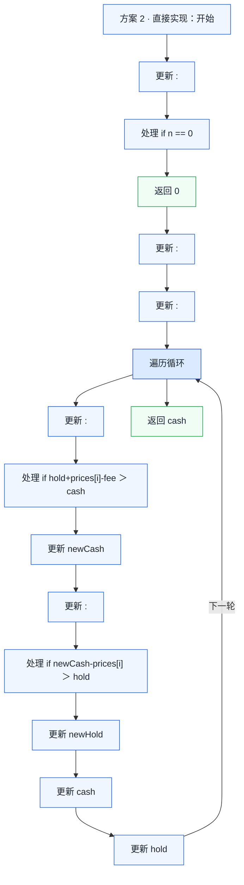

```go
package main // 引入依赖

import (
	"fmt"
	"os"
) // 引入依赖

func maxProfit(prices []int, fee int) int { // 定义函数/方法 maxProfit
	n := len(prices) // 把 长度(价格序列) 写入 n :
	if n == 0 {      // 若 元素个数 等于 0
		return 0 // 返回 0
	}
	cash := 0                // 把 0 写入 cash :
	hold := -prices[0]       // 把 减 价格序列[0] 写入 hold :
	for i := 1; i < n; i++ { // 让 下标 i 从 1 开始计数
		newCash := cash                // 把 cash 写入 newCash :
		if hold+prices[i]-fee > cash { // 若 hold 加 价格序列[下标 i] 减 fee 超过 cash
			newCash = hold + prices[i] - fee // 把 hold 加 价格序列[下标 i] 减 fee 写入 newCash
		}
		newHold := hold               // 把 hold 写入 newHold :
		if newCash-prices[i] > hold { // 若 newCash 减 价格序列[下标 i] 超过 hold
			newHold = newCash - prices[i] // 把 newCash 减 价格序列[下标 i] 写入 newHold
		}
		cash = newCash // 把 newCash 写入 cash
		hold = newHold // 把 newHold 写入 hold
	}
	return cash // 返回 cash
}

func main() { // 程序入口：跑内嵌自测用例
	type tc struct { // 定义类型
		prices []int // 价格序列 []int
		fee    int   // fee int
		want   int   // want int
	}
	cases := []tc{ // 把 []tc{ 写入 cases :
		{[]int{1, 3, 2, 8, 4, 9}, 2, 8},
		{[]int{1, 3, 7, 5}, 1, 5},
	}
	ok := true                // 把 true 写入 ok :
	for _, c := range cases { // 同时取 _ 与 字符 遍历
		if got := maxProfit(c.prices, c.fee); got != c.want { // 若 got : 赋值为 maxProfit(字符.价格序列, 字符.fee); got 不等于 字符.want
			ok = false                                                                     // 把 false 写入 ok
			fmt.Printf("FAIL maxProfit(%v,%d)=%v want %v\n", c.prices, c.fee, got, c.want) // 打印输出
		}
	}
	if !ok { // 若 取反 ok
		os.Exit(1) // os.Exit(1)
	}
	fmt.Println("PASS") // 全部用例通过，输出 PASS
}
```

### Java 实现（2 种方案）

Java 的全部方案如下，每个方案都内嵌用例自测，可独立运行（老仓库 python/go 文件遵循「打印结果」约定）：

#### 方案 1：直接实现

**思路与代码分析**：核心是「直接实现」。Java 版用类与静态方法组织，集合操作显式明了。代码里依次做这些事：单循环线性扫描。**走读**：方案 1 · 直接实现：开始 → 更新 cash → 更新 hold → 遍历循环 → 更新 cash → 调用 Math.max( → 处理 cash, hold + prices[i] - fee → 更新 hold → 返回 cash。

**运行架构**（真实控制流）：

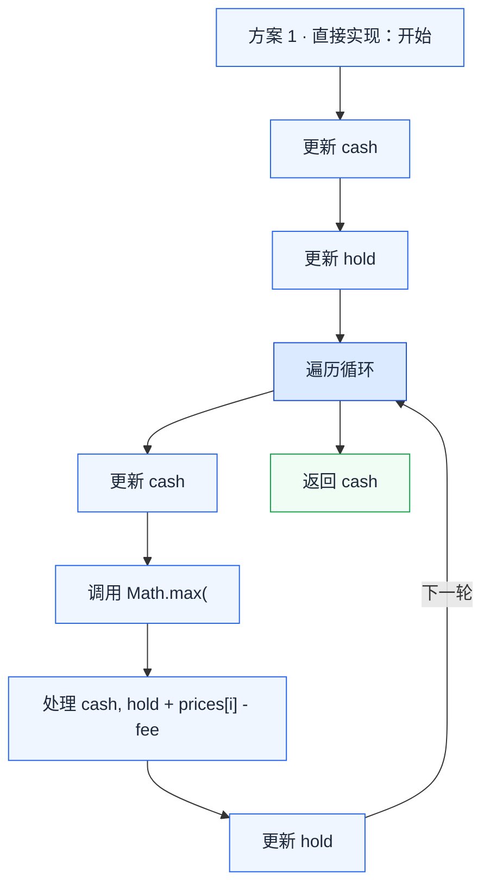

```java
package com.webfault.dsa; // 引入依赖

class Lc714S1 { // 定义类型
  int maxProfit(int[] prices, int fee) { // 定义函数/方法 maxProfit
    int cash = 0; // 把 0 存入 cash
    int hold = -prices[0]; // 把 减 价格序列[0] 存入 hold
    for (int i = 1; i < prices.length; i++) { // 让 下标 i 从 1 开始计数，下标 i 小于 价格序列.长度 就继续
      cash =
          Math.max(
              cash, hold + prices[i] - fee); // 把 Math.取较大值 cash, hold 加 价格序列[下标 i] 减 fee); 写入 cash
      hold = Math.max(hold, cash - prices[i]); // 把 Math.取较大值 hold, cash 减 价格序列[下标 i]); 写入 hold
    }
    return cash; // 返回 cash
  }

  public static void main(String[] args) { // public static void main(String[] args) {
    Lc714S1 s = new Lc714S1(); // 把 new Lc714S1(); 写入 Lc714S1 s
    int[][] cases = { // 把 { 写入 int[][] cases
      {1, 3, 2, 8, 4, 9},
      {1, 2, 3, 4, 5},
      {1, 3, 7, 5, 10, 3},
    };
    int[] fees = {2, 1, 3}; // 把 {2,1,3}; 写入 int[] fees
    int[] wants = {8, 3, 6}; // 把 {8,3,6}; 写入 int[] wants
    boolean ok = true; // 把 true; 写入 boolean ok
    for (int i = 0; i < cases.length; i++) { // 让 下标 i 从 0 开始计数，下标 i 小于 cases.长度 就继续
      int got = s.maxProfit(cases[i], fees[i]); // 把 字符串.maxProfit(cases[下标 i], fees[下标 i]) 存入 got
      if (got != wants[i]) {
        ok = false;
        System.out.println("FAIL case " + i + " got " + got + " want " + wants[i]);
      }
    }
    if (!ok) throw new RuntimeException("FAILED"); // 若 取反 ok) throw new RuntimeException(「FAILED」);
    System.out.println("PASS"); // 全部用例通过，输出 PASS
  }
}
```

#### 方案 2：直接实现

**思路与代码分析**：核心是「直接实现」。Java 版用类与静态方法组织，集合操作显式明了。代码里依次做这些事：单循环线性扫描。**走读**：方案 2 · 直接实现：开始 → 更新 cash → 更新 hold → 遍历循环 → 更新 cash → 调用 Math.max( → 处理 cash, hold + prices[i] - fee → 更新 hold → 返回 cash。

**运行架构**（真实控制流）：

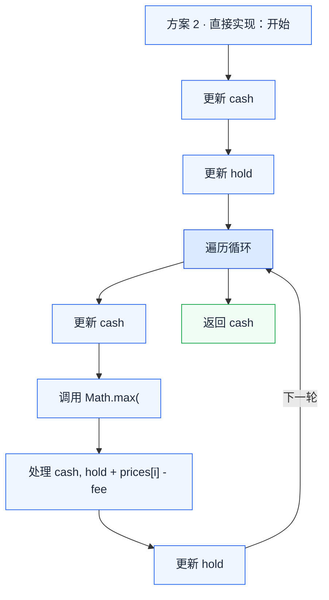

```java
package com.webfault.dsa; // 引入依赖

class Lc714S2 { // 定义类型
  int maxProfit(int[] prices, int fee) { // 定义函数/方法 maxProfit
    int cash = 0; // 把 0 存入 cash
    int hold = -prices[0]; // 把 减 价格序列[0] 存入 hold
    for (int i = 1; i < prices.length; i++) { // 让 下标 i 从 1 开始计数，下标 i 小于 价格序列.长度 就继续
      cash =
          Math.max(
              cash, hold + prices[i] - fee); // 把 Math.取较大值 cash, hold 加 价格序列[下标 i] 减 fee); 写入 cash
      hold = Math.max(hold, cash - prices[i]); // 把 Math.取较大值 hold, cash 减 价格序列[下标 i]); 写入 hold
    }
    return cash; // 返回 cash
  }

  public static void main(String[] args) { // public static void main(String[] args) {
    Lc714S2 s = new Lc714S2(); // 把 new Lc714S2(); 写入 Lc714S2 s
    int[][] cases = { // 把 { 写入 int[][] cases
      {1, 3, 2, 8, 4, 9},
      {1, 2, 3, 4, 5},
      {1, 3, 7, 5, 10, 3},
    };
    int[] fees = {2, 1, 3}; // 把 {2,1,3}; 写入 int[] fees
    int[] wants = {8, 3, 6}; // 把 {8,3,6}; 写入 int[] wants
    boolean ok = true; // 把 true; 写入 boolean ok
    for (int i = 0; i < cases.length; i++) { // 让 下标 i 从 0 开始计数，下标 i 小于 cases.长度 就继续
      int got = s.maxProfit(cases[i], fees[i]); // 把 字符串.maxProfit(cases[下标 i], fees[下标 i]) 存入 got
      if (got != wants[i]) {
        ok = false;
        System.out.println("FAIL case " + i + " got " + got + " want " + wants[i]);
      }
    }
    if (!ok) throw new RuntimeException("FAILED"); // 若 取反 ok) throw new RuntimeException(「FAILED」);
    System.out.println("PASS"); // 全部用例通过，输出 PASS
  }
}
```

### Rust 实现（2 种方案）

Rust 的全部方案如下，每个方案都内嵌用例自测，可独立运行（老仓库 python/go 文件遵循「打印结果」约定）：

#### 方案 1：直接实现

**思路与代码分析**：核心是「直接实现」。Rust 版用所有权移动与切片借用改写同一逻辑，注意 Option 与引用边界。**走读**：方案 1 · 直接实现：开始 → 计算 let (mut hold, mut sold) → 遍历 prices.iter().skip(1) 中的每个元素 p → 更新 hold → 更新 sold → 处理 sold → 返回结果。

**运行架构**（真实控制流）：


```rust
// LeetCode 714. 买卖股票的最佳时机含手续费 — Rust 版（方案1）
fn max_profit_fee(prices: Vec<i32>, fee: i32) -> i32 {
    // 定义函数/方法 max_profit_fee
    let (mut hold, mut sold) = (-prices[0], 0); // 把 ( 减 价格序列[0], 0); 写入 let (mut hold, mut sold)
    for &p in prices.iter().skip(1) {
        // for 按位与 节点 in 价格序列.iter().skip(1) {
        hold = hold.max(sold - p); // 把 hold.取较大值 sold 减 节点); 写入 hold
        sold = sold.max(hold + p - fee); // 把 sold.取较大值 hold 加 节点 减 fee); 写入 sold
    }
    sold // sold
}
fn main() {
    assert_eq!(max_profit_fee(vec![1, 3, 2, 8, 4, 9], 2), 8);
    assert_eq!(max_profit_fee(vec![1], 1), 0);
    println!("PASS");
} // 程序入口：跑内嵌自测用例
```

#### 方案 2：直接实现

**思路与代码分析**：核心是「直接实现」。Rust 版用所有权移动与切片借用改写同一逻辑，注意 Option 与引用边界。**走读**：方案 2 · 直接实现：开始 → 计算 let (mut hold, mut sold) → 遍历 prices.iter().skip(1) 中的每个元素 p → 更新 hold → 更新 sold → 处理 sold → 返回结果。

**运行架构**（真实控制流）：

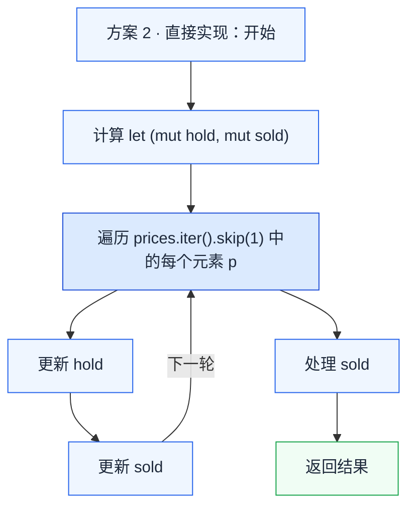

```rust
// LeetCode 714. 买卖股票的最佳时机含手续费 — Rust 版（方案2）
fn max_profit_fee(prices: Vec<i32>, fee: i32) -> i32 {
    // 定义函数/方法 max_profit_fee
    let (mut hold, mut sold) = (-prices[0], 0); // 把 ( 减 价格序列[0], 0); 写入 let (mut hold, mut sold)
    for &p in prices.iter().skip(1) {
        // for 按位与 节点 in 价格序列.iter().skip(1) {
        hold = hold.max(sold - p); // 把 hold.取较大值 sold 减 节点); 写入 hold
        sold = sold.max(hold + p - fee); // 把 sold.取较大值 hold 加 节点 减 fee); 写入 sold
    }
    sold // sold
}
fn main() {
    assert_eq!(max_profit_fee(vec![1, 3, 2, 8, 4, 9], 2), 8);
    assert_eq!(max_profit_fee(vec![1], 1), 0);
    println!("PASS");
} // 程序入口：跑内嵌自测用例
```

### Lua 实现（2 种方案）

Lua 的全部方案如下，每个方案都内嵌用例自测，可独立运行（老仓库 python/go 文件遵循「打印结果」约定）：

#### 方案 1：直接实现

**思路与代码分析**：核心是「直接实现」。Lua 版用表与 ipairs 遍历，注意 ipairs 遇 nil 即停的语义。**走读**：方案 1 · 直接实现：开始 → 更新 sold → 循环 i：从 2 到 #prices do → 更新 p → 更新 nh → 更新 ns → 更新 sold → 返回 sold。

**运行架构**（真实控制流）：


```lua
-- LeetCode 714. 买卖股票的最佳时机含手续费 — Lua 版（方案1）
local function max_profit_fee(prices, fee) -- local function max_profit_fee(价格序列, fee)
	local hold, sold = -prices[1], 0 -- 把 减 价格序列[1], 0 写入 local hold, sold
	for i = 2, #prices do -- 把 2, #价格序列 do 写入 for i
		local p = prices[i] -- 把 价格序列[下标 i] 写入 local p
		local nh = math.max(hold, sold - p) -- 把 math.取较大值 hold, sold 减 节点) 写入 local nh
		local ns = math.max(sold, hold + p - fee) -- 把 math.取较大值 sold, hold 加 节点 减 fee) 写入 local ns
		hold, sold = nh, ns -- 把 nh, ns 写入 hold, sold
	end -- 终点
	return sold -- 返回 sold
end -- 终点
assert(max_profit_fee({ 1, 3, 2, 8, 4, 9 }, 2) == 8) -- 断言校验
assert(max_profit_fee({ 1 }, 1) == 0) -- 断言校验
print("PASS") -- 全部用例通过，输出 PASS
```

#### 方案 2：直接实现

**思路与代码分析**：核心是「直接实现」。Lua 版用表与 ipairs 遍历，注意 ipairs 遇 nil 即停的语义。**走读**：方案 2 · 直接实现：开始 → 更新 sold → 循环 i：从 2 到 #prices do → 更新 p → 更新 nh → 更新 ns → 更新 sold → 返回 sold。

**运行架构**（真实控制流）：

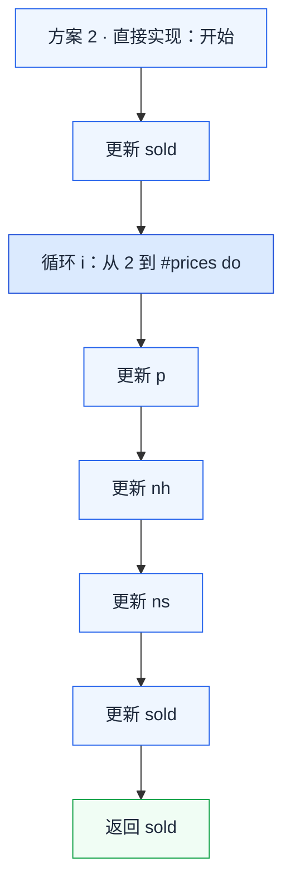

```lua
-- LeetCode 714. 买卖股票的最佳时机含手续费 — Lua 版（方案2）
local function max_profit_fee(prices, fee) -- local function max_profit_fee(价格序列, fee)
	local hold, sold = -prices[1], 0 -- 把 减 价格序列[1], 0 写入 local hold, sold
	for i = 2, #prices do -- 把 2, #价格序列 do 写入 for i
		local p = prices[i] -- 把 价格序列[下标 i] 写入 local p
		local nh = math.max(hold, sold - p) -- 把 math.取较大值 hold, sold 减 节点) 写入 local nh
		local ns = math.max(sold, hold + p - fee) -- 把 math.取较大值 sold, hold 加 节点 减 fee) 写入 local ns
		hold, sold = nh, ns -- 把 nh, ns 写入 hold, sold
	end -- 终点
	return sold -- 返回 sold
end -- 终点
assert(max_profit_fee({ 1, 3, 2, 8, 4, 9 }, 2) == 8) -- 断言校验
assert(max_profit_fee({ 1 }, 1) == 0) -- 断言校验
print("PASS") -- 全部用例通过，输出 PASS
```

### C 实现（2 种方案）

C 的全部方案如下，每个方案都内嵌用例自测，可独立运行（老仓库 python/go 文件遵循「打印结果」约定）：

#### 方案 1：直接实现

**思路与代码分析**：核心是「直接实现」。C 版手动管理下标与内存，循环边界全部显式写出。代码里依次做这些事：单循环线性扫描。**走读**：方案 1 · 直接实现：开始 → 更新 hold → 遍历循环 → 更新 nh → 处理 ? hold → 处理 : sold - p[i] → 更新 ns → 更新 hold → 更新 sold → 返回 sold。

**运行架构**（真实控制流）：

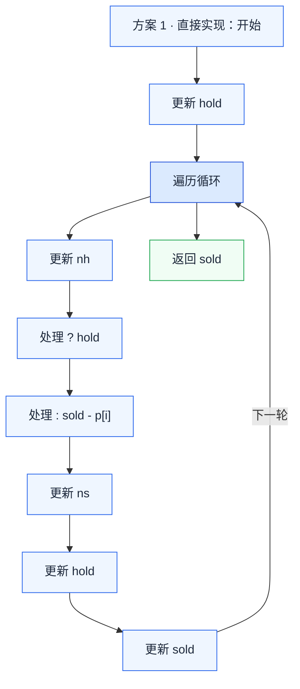

```c
/* LeetCode 714. 买卖股票的最佳时机含手续费 — C 版（方案1） */
#include <stdio.h>                                        // 引入头文件
static int max_profit_fee(const int *p, int n, int fee) { // 定义函数/方法 max_profit_fee
    int hold = -p[0], sold = 0;                           // 把 减 节点[0], sold 赋值为 0 存入 hold
    for (int i = 1; i < n; i++) { // 让 下标 i 从 1 开始计数，下标 i 小于 元素个数 就继续
        int nh = hold > sold - p[i]
                     ? hold
                     : sold - p[i]; // 把 hold 超过 sold 减 节点[下标 i] ? hold : sold 减 节点[下标 i] 存入 nh
        int ns = sold > hold + p[i] - fee ? sold : hold + p[i] - fee;
        hold = nh;
        sold = ns; // 把 nh; sold 赋值为 ns; 写入 hold
    }
    return sold; // 返回 sold
}
int main(void) { // 程序入口：跑内嵌自测用例
    if (max_profit_fee((int[]){1, 3, 2, 8, 4, 9}, 6, 2) != 8) {
        printf("FAIL 1\n");
        return 1;
    }
    if (max_profit_fee((int[]){1}, 1, 1) != 0) {
        printf("FAIL 2\n");
        return 1;
    }
    printf("PASS\n");
    return 0;
} // 全部用例通过，输出 PASS
```

#### 方案 2：直接实现

**思路与代码分析**：核心是「直接实现」。C 版手动管理下标与内存，循环边界全部显式写出。代码里依次做这些事：单循环线性扫描。**走读**：方案 2 · 直接实现：开始 → 更新 hold → 遍历循环 → 更新 nh → 处理 ? hold → 处理 : sold - p[i] → 更新 ns → 更新 hold → 更新 sold → 返回 sold。

**运行架构**（真实控制流）：

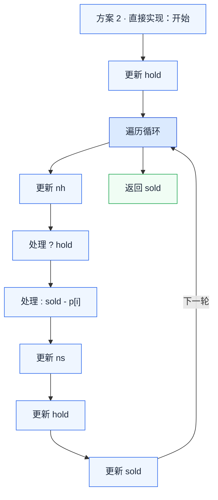

```c
/* LeetCode 714. 买卖股票的最佳时机含手续费 — C 版（方案2） */
#include <stdio.h>                                        // 引入头文件
static int max_profit_fee(const int *p, int n, int fee) { // 定义函数/方法 max_profit_fee
    int hold = -p[0], sold = 0;                           // 把 减 节点[0], sold 赋值为 0 存入 hold
    for (int i = 1; i < n; i++) { // 让 下标 i 从 1 开始计数，下标 i 小于 元素个数 就继续
        int nh = hold > sold - p[i]
                     ? hold
                     : sold - p[i]; // 把 hold 超过 sold 减 节点[下标 i] ? hold : sold 减 节点[下标 i] 存入 nh
        int ns = sold > hold + p[i] - fee ? sold : hold + p[i] - fee;
        hold = nh;
        sold = ns; // 把 nh; sold 赋值为 ns; 写入 hold
    }
    return sold; // 返回 sold
}
int main(void) { // 程序入口：跑内嵌自测用例
    if (max_profit_fee((int[]){1, 3, 2, 8, 4, 9}, 6, 2) != 8) {
        printf("FAIL 1\n");
        return 1;
    }
    if (max_profit_fee((int[]){1}, 1, 1) != 0) {
        printf("FAIL 2\n");
        return 1;
    }
    printf("PASS\n");
    return 0;
} // 全部用例通过，输出 PASS
```

### C++ 实现（2 种方案）

C++ 的全部方案如下，每个方案都内嵌用例自测，可独立运行（老仓库 python/go 文件遵循「打印结果」约定）：

#### 方案 1：直接实现

**思路与代码分析**：核心是「直接实现」。C++ 版用 STL 容器与迭代器，减少手写下标错误。代码里依次做这些事：单循环线性扫描。**走读**：方案 1 · 直接实现：开始 → 更新 hold → 遍历循环 → 处理 ++i) → 更新 nh → 更新 ns → 处理 fee) → 更新 hold → 更新 sold → 返回 sold。

**运行架构**（真实控制流）：

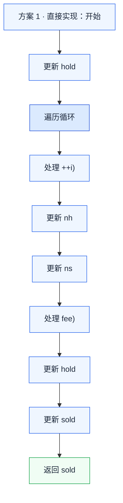

```cpp
// LeetCode 714. 买卖股票的最佳时机含手续费 — C++ 版（方案1）
#include <algorithm>                                               // 引入头文件
#include <cassert>                                                 // 引入头文件
#include <iostream>                                                // 引入头文件
#include <vector>                                                  // 引入头文件
static int maxProfitFee(const std::vector<int> &prices, int fee) { // 定义函数/方法 maxProfitFee
    int hold = -prices[0], sold = 0; // 把 减 价格序列[0], sold 赋值为 0 存入 hold
    for (size_t i = 1; i < prices.size();
         ++i) { // 让 下标 i 从 1 开始计数，下标 i 小于 价格序列.大小() 就继续
        int nh = std::max(hold, sold - prices[i]); // 把 std::取较大值 hold, sold 减 价格序列[下标 i]) 存入 nh
        int ns = std::max(sold, hold + prices[i] -
                                    fee); // 把 std::取较大值 sold, hold 加 价格序列[下标 i] 减 fee) 存入 ns
        hold = nh;                        // 把 nh; 写入 hold
        sold = ns;                        // 把 ns; 写入 sold
    }
    return sold; // 返回 sold
}
int main() {
    assert(maxProfitFee({1, 3, 2, 8, 4, 9}, 2) == 8);
    assert(maxProfitFee({1}, 1) == 0);
    std::cout << "PASS" << std::endl;
} // 全部用例通过，输出 PASS
```

#### 方案 2：直接实现

**思路与代码分析**：核心是「直接实现」。C++ 版用 STL 容器与迭代器，减少手写下标错误。代码里依次做这些事：单循环线性扫描。**走读**：方案 2 · 直接实现：开始 → 更新 hold → 遍历循环 → 处理 ++i) → 更新 nh → 更新 ns → 处理 fee) → 更新 hold → 更新 sold → 返回 sold。

**运行架构**（真实控制流）：


```cpp
// LeetCode 714. 买卖股票的最佳时机含手续费 — C++ 版（方案2）
#include <algorithm>                                               // 引入头文件
#include <cassert>                                                 // 引入头文件
#include <iostream>                                                // 引入头文件
#include <vector>                                                  // 引入头文件
static int maxProfitFee(const std::vector<int> &prices, int fee) { // 定义函数/方法 maxProfitFee
    int hold = -prices[0], sold = 0; // 把 减 价格序列[0], sold 赋值为 0 存入 hold
    for (size_t i = 1; i < prices.size();
         ++i) { // 让 下标 i 从 1 开始计数，下标 i 小于 价格序列.大小() 就继续
        int nh = std::max(hold, sold - prices[i]); // 把 std::取较大值 hold, sold 减 价格序列[下标 i]) 存入 nh
        int ns = std::max(sold, hold + prices[i] -
                                    fee); // 把 std::取较大值 sold, hold 加 价格序列[下标 i] 减 fee) 存入 ns
        hold = nh;                        // 把 nh; 写入 hold
        sold = ns;                        // 把 ns; 写入 sold
    }
    return sold; // 返回 sold
}
int main() {
    assert(maxProfitFee({1, 3, 2, 8, 4, 9}, 2) == 8);
    assert(maxProfitFee({1}, 1) == 0);
    std::cout << "PASS" << std::endl;
} // 全部用例通过，输出 PASS
```

### R 实现（2 种方案）

R 的全部方案如下，每个方案都内嵌用例自测，可独立运行（老仓库 python/go 文件遵循「打印结果」约定）：

#### 方案 1：直接实现

**思路与代码分析**：核心是「直接实现」。R 版用向量化思维与 1 起始下标，注意 1:n 的降序陷阱。代码里依次做这些事：单循环线性扫描。**走读**：方案 1 · 直接实现：开始 → 处理 hold ＜- -prices[1] → 处理 sold ＜- 0L → 循环 p：遍历 prices[-1] → 处理 nh ＜- max(hold, sold - p) → 处理 ns ＜- max(sold, hold + p - f → 处理 hold ＜- nh → 处理 sold ＜- ns → 处理 sold → 返回结果。

**运行架构**（真实控制流）：


```r
# 买卖股票的最佳时机含手续费 — R 版（方案1） 定义函数 max_profit_fee（参数：价格序列, fee）
max_profit_fee <- function(prices, fee) {
    hold <- -prices[1]
    sold <- 0L  # 把 减 价格序列[1]; sold 小于 减 0L 存入 hold
    for (p in prices[-1]) {
        # for (节点 in 价格序列[ 减 1]) {
        nh <- max(hold, sold - p)  # 把 取较大值 hold, sold 减 节点) 存入 nh
        ns <- max(sold, hold + p - fee)  # 把 取较大值 sold, hold 加 节点 减 fee) 存入 ns
        hold <- nh
        sold <- ns  # 把 nh; sold 小于 减 ns 存入 hold
    }
    sold  # sold
}
stopifnot(max_profit_fee(c(1, 3, 2, 8, 4, 9), 2) == 8)  # 断言校验
stopifnot(max_profit_fee(c(1), 1) == 0)  # 断言校验
cat("PASS\n")  # 全部用例通过，输出 PASS
```

#### 方案 2：直接实现

**思路与代码分析**：核心是「直接实现」。R 版用向量化思维与 1 起始下标，注意 1:n 的降序陷阱。代码里依次做这些事：单循环线性扫描。**走读**：方案 2 · 直接实现：开始 → 处理 hold ＜- -prices[1] → 处理 sold ＜- 0L → 循环 p：遍历 prices[-1] → 处理 nh ＜- max(hold, sold - p) → 处理 ns ＜- max(sold, hold + p - f → 处理 hold ＜- nh → 处理 sold ＜- ns → 处理 sold → 返回结果。

**运行架构**（真实控制流）：

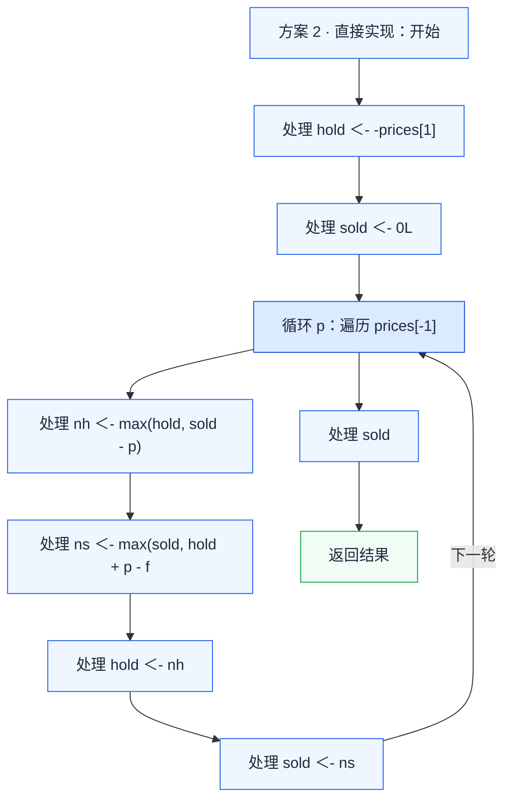

```r
# 买卖股票的最佳时机含手续费 — R 版（方案2） 定义函数 max_profit_fee（参数：价格序列, fee）
max_profit_fee <- function(prices, fee) {
    hold <- -prices[1]
    sold <- 0L  # 把 减 价格序列[1]; sold 小于 减 0L 存入 hold
    for (p in prices[-1]) {
        # for (节点 in 价格序列[ 减 1]) {
        nh <- max(hold, sold - p)  # 把 取较大值 hold, sold 减 节点) 存入 nh
        ns <- max(sold, hold + p - fee)  # 把 取较大值 sold, hold 加 节点 减 fee) 存入 ns
        hold <- nh
        sold <- ns  # 把 nh; sold 小于 减 ns 存入 hold
    }
    sold  # sold
}
stopifnot(max_profit_fee(c(1, 3, 2, 8, 4, 9), 2) == 8)  # 断言校验
stopifnot(max_profit_fee(c(1), 1) == 0)  # 断言校验
cat("PASS\n")  # 全部用例通过，输出 PASS
```

### Zig 实现（2 种方案）

Zig 的全部方案如下，每个方案都内嵌用例自测，可独立运行（老仓库 python/go 文件遵循「打印结果」约定）：

#### 方案 1：直接实现

**思路与代码分析**：核心是「直接实现」。Zig 版显式分配与清零，整型边界处理严格。代码里依次做这些事：单循环线性扫描。**走读**：方案 1 · 直接实现：开始 → 计算 hold → 计算 sold → 遍历集合元素 → 计算 nh → 计算 ns → 更新 hold → 更新 sold → 返回 sold。

**运行架构**（真实控制流）：

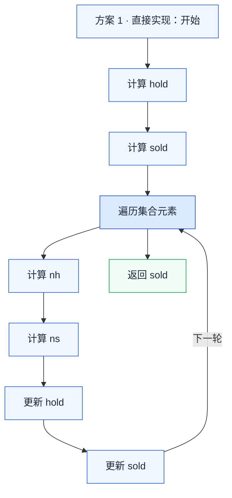

```zig
// LeetCode 714. 买卖股票的最佳时机含手续费 — Zig 版（方案1）
const std = @import("std"); // 把 @import(「std」) 存入 std
fn maxProfitFee(prices: []const i32, fee: i32) i32 { // 定义函数/方法 maxProfitFee
    var hold: i32 = -prices[0]; // 把 减 价格序列[0]; 写入 var hold: i32
    var sold: i32 = 0; // 把 0; 写入 var sold: i32
    for (prices[1..]) |p| { // for (价格序列[1..]) 按位或 节点 按位或 {
        const nh = @max(hold, sold - p); // 把 @取较大值 hold, sold 减 节点) 存入 nh
        const ns = @max(sold, hold + p - fee); // 把 @取较大值 sold, hold 加 节点 减 fee) 存入 ns
        hold = nh; // 把 nh; 写入 hold
        sold = ns; // 把 ns; 写入 sold
    }
    return sold; // 返回 sold
}
pub fn main() !void { // 程序入口：跑内嵌自测用例
    if (maxProfitFee(&[_]i32{ 1, 3, 2, 8, 4, 9 }, 2) != 8) return error.TestFailed;
    if (maxProfitFee(&[_]i32{1}, 1) != 0) return error.TestFailed;
    std.debug.print("PASS\n", .{});
} // 全部用例通过，输出 PASS
```

#### 方案 2：直接实现

**思路与代码分析**：核心是「直接实现」。Zig 版显式分配与清零，整型边界处理严格。代码里依次做这些事：单循环线性扫描。**走读**：方案 2 · 直接实现：开始 → 计算 hold → 计算 sold → 遍历集合元素 → 计算 nh → 计算 ns → 更新 hold → 更新 sold → 返回 sold。

**运行架构**（真实控制流）：

```mermaid
graph TD
    N0["方案 2 · 直接实现：开始"]
    N1["计算 hold"]
    N2["计算 sold"]
    N3["遍历集合元素"]
    N4["计算 nh"]
    N5["计算 ns"]
    N6["更新 hold"]
    N7["更新 sold"]
    N8["返回 sold"]
    N0 --> N1
    N1 --> N2
    N2 --> N3
    N3 --> N4
    N4 --> N5
    N5 --> N6
    N6 --> N7
    N7 -- 下一轮 --> N3
    N3 --> N8
    classDef n fill:#eff6ff,stroke:#2563eb,color:#1e293b;
    classDef lp fill:#dbeafe,stroke:#1d4ed8,color:#1e293b;
    classDef dc fill:#fef9c3,stroke:#ca8a04,color:#1e293b;
    classDef tm fill:#f0fdf4,stroke:#16a34a,color:#1e293b;
    class N0,N1,N2,N4,N5,N6,N7 n;
    class N3 lp;
    class N8 tm;
```

```zig
// LeetCode 714. 买卖股票的最佳时机含手续费 — Zig 版（方案2）
const std = @import("std"); // 把 @import(「std」) 存入 std
fn maxProfitFee(prices: []const i32, fee: i32) i32 { // 定义函数/方法 maxProfitFee
    var hold: i32 = -prices[0]; // 把 减 价格序列[0]; 写入 var hold: i32
    var sold: i32 = 0; // 把 0; 写入 var sold: i32
    for (prices[1..]) |p| { // for (价格序列[1..]) 按位或 节点 按位或 {
        const nh = @max(hold, sold - p); // 把 @取较大值 hold, sold 减 节点) 存入 nh
        const ns = @max(sold, hold + p - fee); // 把 @取较大值 sold, hold 加 节点 减 fee) 存入 ns
        hold = nh; // 把 nh; 写入 hold
        sold = ns; // 把 ns; 写入 sold
    }
    return sold; // 返回 sold
}
pub fn main() !void { // 程序入口：跑内嵌自测用例
    if (maxProfitFee(&[_]i32{ 1, 3, 2, 8, 4, 9 }, 2) != 8) return error.TestFailed;
    if (maxProfitFee(&[_]i32{1}, 1) != 0) return error.TestFailed;
    std.debug.print("PASS\n", .{});
} // 全部用例通过，输出 PASS
```

### Dart 实现（2 种方案）

Dart 的全部方案如下，每个方案都内嵌用例自测，可独立运行（老仓库 python/go 文件遵循「打印结果」约定）：

#### 方案 1：直接实现

**思路与代码分析**：核心是「直接实现」。Dart 版用可空类型标注与集合方法，注意空安全。代码里依次做这些事：单循环线性扫描。**走读**：方案 1 · 直接实现：开始 → 计算 hold → 遍历循环 → 更新 p → 更新 nh → 处理 ? hold → 处理 : sold - p → 更新 ns → 处理 ? sold → 处理 : hold + → 处理 p - → 处理 fee → 更新 hold → 更新 sold → 返回 sold。

**运行架构**（真实控制流）：

```mermaid
graph TD
    N0["方案 1 · 直接实现：开始"]
    N1["计算 hold"]
    N2["遍历循环"]
    N3["更新 p"]
    N4["更新 nh"]
    N5["处理 ? hold"]
    N6["处理 : sold - p"]
    N7["更新 ns"]
    N8["处理 ? sold"]
    N9["处理 : hold +"]
    N10["处理 p -"]
    N11["处理 fee"]
    N12["更新 hold"]
    N13["更新 sold"]
    N14["返回 sold"]
    N0 --> N1
    N1 --> N2
    N2 --> N3
    N3 --> N4
    N4 --> N5
    N5 --> N6
    N6 --> N7
    N7 --> N8
    N8 --> N9
    N9 --> N10
    N10 --> N11
    N11 --> N12
    N12 --> N13
    N13 -- 下一轮 --> N2
    N2 --> N14
    classDef n fill:#eff6ff,stroke:#2563eb,color:#1e293b;
    classDef lp fill:#dbeafe,stroke:#1d4ed8,color:#1e293b;
    classDef dc fill:#fef9c3,stroke:#ca8a04,color:#1e293b;
    classDef tm fill:#f0fdf4,stroke:#16a34a,color:#1e293b;
    class N0,N1,N3,N4,N5,N6,N7,N8,N9,N10,N11,N12,N13 n;
    class N2 lp;
    class N14 tm;
```

```dart
// LeetCode 714. 买卖股票的最佳时机含手续费 — Dart 版（方案1）
int maxProfitFee(List<int> prices, int fee) {
  // 定义函数/方法 maxProfitFee
  var hold = -prices[0], sold = 0; // 把 减 价格序列[0], sold 赋值为 0 存入 hold
  for (var i = 1; i < prices.length; i++) {
    // 让 下标 i 从 1 开始计数，下标 i 小于 价格序列.长度 就继续
    final p = prices[i]; // 把 价格序列[下标 i] 存入 节点
    final nh = hold > sold - p
        ? hold
        : sold - p; // 把 hold 超过 sold 减 节点 ? hold : sold 减 节点 存入 nh
    final ns = sold > hold + p - fee
        ? sold
        : hold +
              p -
              fee; // 把 sold 超过 hold 加 节点 减 fee ? sold : hold 加 节点 减 fee 存入 ns
    hold = nh; // 把 nh 存入 hold
    sold = ns; // 把 ns 存入 sold
  }
  return sold; // 返回 sold
}

void main() {
  if (maxProfitFee([1, 3, 2, 8, 4, 9], 2) != 8) throw StateError('c1');
  if (maxProfitFee([1], 1) != 0) throw StateError('c2');
  print('PASS');
} // 全部用例通过，输出 PASS
```

#### 方案 2：直接实现

**思路与代码分析**：核心是「直接实现」。Dart 版用可空类型标注与集合方法，注意空安全。代码里依次做这些事：单循环线性扫描。**走读**：方案 2 · 直接实现：开始 → 计算 hold → 遍历循环 → 更新 p → 更新 nh → 处理 ? hold → 处理 : sold - p → 更新 ns → 处理 ? sold → 处理 : hold + → 处理 p - → 处理 fee → 更新 hold → 更新 sold → 返回 sold。

**运行架构**（真实控制流）：

```mermaid
graph TD
    N0["方案 2 · 直接实现：开始"]
    N1["计算 hold"]
    N2["遍历循环"]
    N3["更新 p"]
    N4["更新 nh"]
    N5["处理 ? hold"]
    N6["处理 : sold - p"]
    N7["更新 ns"]
    N8["处理 ? sold"]
    N9["处理 : hold +"]
    N10["处理 p -"]
    N11["处理 fee"]
    N12["更新 hold"]
    N13["更新 sold"]
    N14["返回 sold"]
    N0 --> N1
    N1 --> N2
    N2 --> N3
    N3 --> N4
    N4 --> N5
    N5 --> N6
    N6 --> N7
    N7 --> N8
    N8 --> N9
    N9 --> N10
    N10 --> N11
    N11 --> N12
    N12 --> N13
    N13 -- 下一轮 --> N2
    N2 --> N14
    classDef n fill:#eff6ff,stroke:#2563eb,color:#1e293b;
    classDef lp fill:#dbeafe,stroke:#1d4ed8,color:#1e293b;
    classDef dc fill:#fef9c3,stroke:#ca8a04,color:#1e293b;
    classDef tm fill:#f0fdf4,stroke:#16a34a,color:#1e293b;
    class N0,N1,N3,N4,N5,N6,N7,N8,N9,N10,N11,N12,N13 n;
    class N2 lp;
    class N14 tm;
```

```dart
// LeetCode 714. 买卖股票的最佳时机含手续费 — Dart 版（方案2）
int maxProfitFee(List<int> prices, int fee) {
  // 定义函数/方法 maxProfitFee
  var hold = -prices[0], sold = 0; // 把 减 价格序列[0], sold 赋值为 0 存入 hold
  for (var i = 1; i < prices.length; i++) {
    // 让 下标 i 从 1 开始计数，下标 i 小于 价格序列.长度 就继续
    final p = prices[i]; // 把 价格序列[下标 i] 存入 节点
    final nh = hold > sold - p
        ? hold
        : sold - p; // 把 hold 超过 sold 减 节点 ? hold : sold 减 节点 存入 nh
    final ns = sold > hold + p - fee
        ? sold
        : hold +
              p -
              fee; // 把 sold 超过 hold 加 节点 减 fee ? sold : hold 加 节点 减 fee 存入 ns
    hold = nh; // 把 nh 存入 hold
    sold = ns; // 把 ns 存入 sold
  }
  return sold; // 返回 sold
}

void main() {
  if (maxProfitFee([1, 3, 2, 8, 4, 9], 2) != 8) throw StateError('c1');
  if (maxProfitFee([1], 1) != 0) throw StateError('c2');
  print('PASS');
} // 全部用例通过，输出 PASS
```

---

## 内容总结

- **买卖股票的最佳时机含手续费**（动态规划 · Medium）：共 2 个方案，主线思路「直接实现」；时间 O(n) 量级；动画演示DP 表填充过程，附录给出 11 种语言 × 全部方案的可运行实现。
- 来源博客：[https://blog.csdn.net/tyro_java/article/details/144853482](https://blog.csdn.net/tyro_java/article/details/144853482)
- 导航：[📋 总目录](../) ｜ [← 185 最长连续递增序列](../185_最长连续递增序列/) ｜ [187 使用最小花费爬楼梯 →](../187_使用最小花费爬楼梯/)
