# 187 · 使用最小花费爬楼梯（第十阶段 · 动态规划 · Medium）

> **难度**：⭐⭐ Medium ｜ **专题**：动态规划
> **学习定位**：第十阶段 · 动态规划第 187 篇 ｜ **解法数**：5
> **内容总结**：**使用最小花费爬楼梯**（动态规划 · Medium）：共 5 个方案，主线思路「动态规划」；时间 O(n) 到 O(m·n)（取决于状态维度）；动画演示DP 表填充过程，附录给出 11 种语言 × 全部方案的可运行实现。

---

## 题目描述

给你一个整数数组 `cost` ，其中 `cost[i]` 是从楼梯第 `i` 个台阶向上爬需要支付的费用。

一旦你支付此费用，即可选择向上爬 一个 或者 两个 台阶。

你可以选择从下标为 `0` 或下标为 `1` 的台阶开始爬楼梯。

请你计算并返回达到楼梯顶部的 最低 花费，即最后一步之后的那个位置（下标 `cost.length`）。

- 主函数签名：`function minCostClimbingStairs(cost: number[]): number`

**用例（来自原题）**：

**示例 1**

```text
输入：cost = [10,15,20]
输出：15
```

解释：你将从下标为 1 的台阶开始。 - 支付 15 ，向上爬两个台阶，到达楼梯顶部。 总花费为 15 。

**示例 2**

```text
输入：cost = [1,100,1,1,1,100,1,1,100,1]
输出：6
```

解释：你将从下标为 0 的台阶开始。 - 支付 1 ，向上爬两个台阶，到达下标为 2 的台阶。 - 支付 1 ，向上爬两个台阶，到达下标为 4 的台阶。 - 支付 1 ，向上爬两个台阶，到达下标为 6 的台阶。 - 支付 1 ，向上爬一个台阶，到达下标为 7 的台阶。 - 支付 1 ，向上爬两个台阶，到达下标为 9 的台阶。 - 支付 1 ，向上爬一个台阶，到达楼梯顶部。 总花费为 6 。
> ✅ **官方验证**：全部 TypeScript 解法已通过 leetcode.cn 官方示例用例验证（自动注入运行，全部 PASS）。题面与 [leetcode.cn 官方](https://leetcode.cn/problems/min-cost-climbing-stairs/)一致，示例配图取自官方题面。

**数据范围与注意事项**：

- `2 <= cost.length <= 1000`
- `0 <= cost[i] <= 999`
- **易错点**：初始化（第 0 行或列）的含义要想清楚，它决定后续转移是否成立。

## 题目分析

**场景是什么**：把大问题拆成小问题并记住结果，对应真实开发里的编辑距离、资源规划。本题就是该场景的 Medium 级练习，主线做法是「动态规划」。

**主线怎么解**：把主解法从头到尾过一遍，它其实在依次做这几件事：DP 表逐项填充 → 单循环线性扫描。

## 解题思路

**方案对比**（共 5 个方案，由浅入深）：

| 方案 | 时间复杂度 | 空间复杂度 |
|---|---|---|
| 方案 1 · 动态规划 | O(n) 到 O(m·n)（取决于状态维度） | 即 DP 表大小 |
| 方案 2 · 动态规划 | O(n) 到 O(m·n)（取决于状态维度） | 即 DP 表大小 |
| 方案 3 · 动态规划 | O(n)（单趟线性扫描） | O(1) 到 O(n)（视辅助结构） |
| 方案 4 · 动态规划 | O(n) 到 O(m·n)（取决于状态维度） | 即 DP 表大小 |
| 方案 5 · 动态规划 | O(n)（单趟线性扫描） | O(1) 到 O(n)（视辅助结构） |

**方案间的取舍**：方案 1（动态规划）；方案 2（动态规划）；方案 3（动态规划）；方案 4（动态规划）；方案 5（动态规划）。数据规模小、可读性优先时选靠前的方案；规模大、性能优先时选靠后的方案。

**怎么读这一篇**：

- 🐣 **新手路线**：把「题目描述」的示例 1 在纸上手推一遍 → 读方案 1（最直观的写法）与它的代码走读 → 按「运行方式」本地跑通看 PASS → 回头对比方案 2 之后的写法差在哪
- 🦅 **大佬路线**：直接锁定最优方案 1（动态规划，O(n) 到 O(m·n)（取决于状态维度））→ 跳读该方案代码与走读 → 用「逐步拆解与面试追问」补齐复杂度推导与边界追问

### 动态算法图（DP 表填充，GIF 自动循环）


动画演示动态规划专题里DP 表填充的典型过程；每个方案在「TypeScript 解题方案」一节还配了专属动画与专属流程图。

### 主解法流程图（真实控制流）

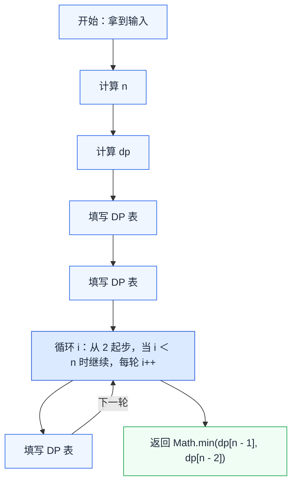

## TypeScript 解题方案（5 个方案逐个讲）

> **运行与提交**：每个方案都是自包含文件（内嵌用例自测，输出 PASS），整块复制到 `.ts` 文件后 `node 文件名` 即可运行。提交 LeetCode 时，把 `demo` 内的算法函数与辅助类型/函数整体取出、置于文件顶层即可。涉及交互/特殊接口的题以题面给定签名为准。

### 方案 1：动态规划

**分析与思路**：核心做法是「动态规划」。代码里依次做这些事：DP 表逐项填充；单循环线性扫描。

**运行方式**：`node 本文件`，内嵌用例全部通过会输出 PASS。


**方案专属流程图**（真实控制流）：


```typescript
/**
 ** LeetCode 746. 使用最小花费爬楼梯
 ** 方案：1 ) 方案1: 动态规划
 ** 来源：https://blog.csdn.net/tyro_java/article/details/144853675
 */

function minCostClimbingStairs(cost: number[]): number {
  // 定义函数/方法 minCostClimbingStairs
  const n = cost.length; // 把 cost.长度 存入 元素个数
  const dp: number[] = new Array(n).fill(0); // 把 new Array(元素个数).fill(0); 写入 const dp: number[]
  dp[0] = cost[0]; // 把 cost[0]; 写入 dp[0]
  dp[1] = cost[1]; // 把 cost[1]; 写入 dp[1]
  for (let i = 2; i < n; i++) {
    // 让 下标 i 从 2 开始计数，下标 i 小于 元素个数 就继续
    dp[i] = Math.min(dp[i - 1], dp[i - 2]) + cost[i];
  }
  return Math.min(dp[n - 1], dp[n - 2]); // 返回 Math.取较小值 DP 表[元素个数 减 1], DP 表[元素个数 减 2])
}

export function demo(): void {
  // 程序入口：跑内嵌自测用例
  const cases: [number[], number][] = [
    [[10, 15, 20], 15],
    [[1, 100, 1, 1, 1, 100, 1, 1, 100, 1], 6],
  ];
  for (const [cost, want] of cases) {
    // for (const [cost, want] of cases) {
    const got = minCostClimbingStairs(cost); // 把 minCostClimbingStairs(cost) 存入 got
    if (got !== want) {
      // 若 got 不等于 want
      throw new Error('FAIL: got ' + got + ' expected ' + want); // throw new Error(「FAIL: got 」 加 got 加 「FAIL: got 」 加 want);
    }
  }
  console.log('PASS'); // 全部用例通过，输出 PASS
}

demo(); // demo();
```

### 方案 2：动态规划

**分析与思路**：核心做法是「动态规划」。代码里依次做这些事：DP 表逐项填充；单循环线性扫描。

**运行方式**：`node 本文件`，内嵌用例全部通过会输出 PASS。


**方案专属流程图**（真实控制流）：


```typescript
/**
 ** LeetCode 746. 使用最小花费爬楼梯
 ** 方案：1 ) 方案1: 动态规划
 ** 来源：https://blog.csdn.net/tyro_java/article/details/144853675
 */

function minCostClimbingStairs(cost: number[]): number {
  // 定义函数/方法 minCostClimbingStairs
  const n = cost.length; // 把 cost.长度 存入 元素个数
  const dp: number[] = new Array(n).fill(0); // 把 new Array(元素个数).fill(0); 写入 const dp: number[]
  dp[0] = cost[0]; // 把 cost[0]; 写入 dp[0]
  dp[1] = cost[1]; // 把 cost[1]; 写入 dp[1]
  for (let i = 2; i < n; i++) {
    // 让 下标 i 从 2 开始计数，下标 i 小于 元素个数 就继续
    dp[i] = Math.min(dp[i - 1], dp[i - 2]) + cost[i];
  }
  return Math.min(dp[n - 1], dp[n - 2]); // 返回 Math.取较小值 DP 表[元素个数 减 1], DP 表[元素个数 减 2])
}

export function demo(): void {
  // 程序入口：跑内嵌自测用例
  const cases: [number[], number][] = [
    [[10, 15, 20], 15],
    [[1, 100, 1, 1, 1, 100, 1, 1, 100, 1], 6],
  ];
  for (const [cost, want] of cases) {
    // for (const [cost, want] of cases) {
    const got = minCostClimbingStairs(cost); // 把 minCostClimbingStairs(cost) 存入 got
    if (got !== want) {
      // 若 got 不等于 want
      throw new Error('FAIL: got ' + got + ' expected ' + want); // throw new Error(「FAIL: got 」 加 got 加 「FAIL: got 」 加 want);
    }
  }
  console.log('PASS'); // 全部用例通过，输出 PASS
}

demo(); // demo();
```

### 方案 3：动态规划

**分析与思路**：核心做法是「动态规划」。代码里依次做这些事：单循环线性扫描。

**运行方式**：`node 本文件`，内嵌用例全部通过会输出 PASS。

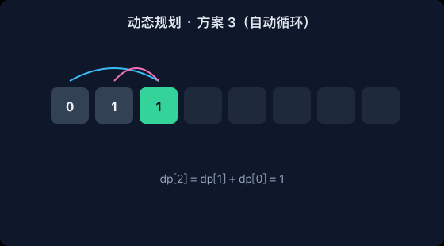

**方案专属流程图**（真实控制流）：

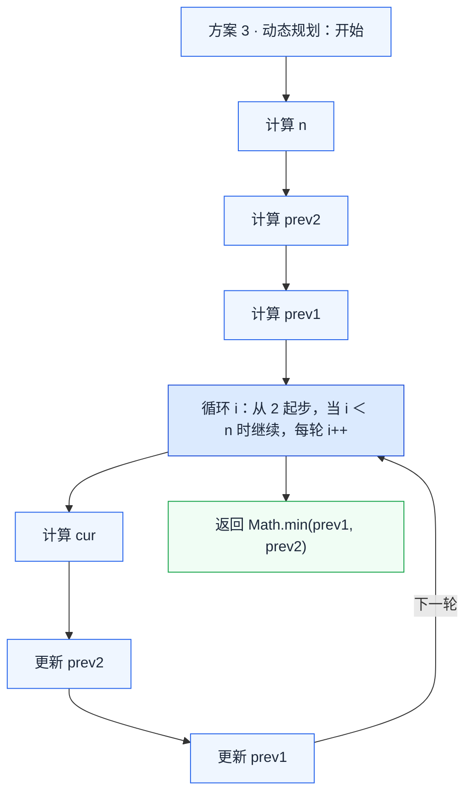

```typescript
/**
 ** LeetCode 746. 使用最小花费爬楼梯
 ** 方案：1 ) 方案1: 动态规划
 ** 来源：https://blog.csdn.net/tyro_java/article/details/144853675
 */

function minCostClimbingStairs(cost: number[]): number {
  // 定义函数/方法 minCostClimbingStairs
  const n = cost.length; // 把 cost.长度 存入 元素个数
  let prev2 = cost[0]; // 把 cost[0] 存入 prev2
  let prev1 = cost[1]; // 把 cost[1] 存入 prev1
  for (let i = 2; i < n; i++) {
    // 让 下标 i 从 2 开始计数，下标 i 小于 元素个数 就继续
    const cur = cost[i] + Math.min(prev1, prev2); // 把 cost[下标 i] 加 Math.取较小值 prev1, prev2) 存入 当前值
    prev2 = prev1; // 把 prev1 存入 prev2
    prev1 = cur; // 把 当前值 存入 prev1
  }
  return Math.min(prev1, prev2); // 返回 Math.取较小值 prev1, prev2)
}

export function demo(): void {
  // 程序入口：跑内嵌自测用例
  const cases: [number[], number][] = [
    [[10, 15, 20], 15],
    [[1, 100, 1, 1, 1, 100, 1, 1, 100, 1], 6],
  ];
  for (const [cost, want] of cases) {
    // for (const [cost, want] of cases) {
    const got = minCostClimbingStairs(cost); // 把 minCostClimbingStairs(cost) 存入 got
    if (got !== want) {
      // 若 got 不等于 want
      throw new Error('FAIL: got ' + got + ' expected ' + want); // throw new Error(「FAIL: got 」 加 got 加 「FAIL: got 」 加 want);
    }
  }
  console.log('PASS'); // 全部用例通过，输出 PASS
}

demo(); // demo();
```

### 方案 4：动态规划

**分析与思路**：核心做法是「动态规划」。代码里依次做这些事：DP 表逐项填充；单循环线性扫描。

**运行方式**：`node 本文件`，内嵌用例全部通过会输出 PASS。


**方案专属流程图**（真实控制流）：

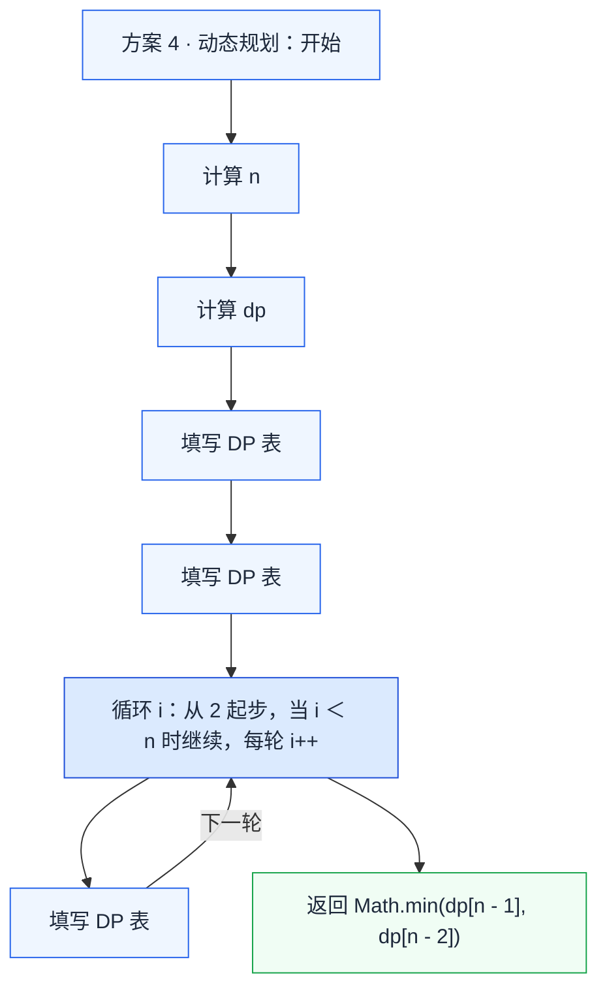

```typescript
/**
 ** LeetCode 746. 使用最小花费爬楼梯
 ** 方案：1 ) 方案1: 动态规划
 ** 来源：https://blog.csdn.net/tyro_java/article/details/144853675
 */

function minCostClimbingStairs(cost: number[]): number {
  // 定义函数/方法 minCostClimbingStairs
  const n = cost.length; // 把 cost.长度 存入 元素个数
  const dp: number[] = new Array(n).fill(0); // 把 new Array(元素个数).fill(0); 写入 const dp: number[]
  dp[0] = cost[0]; // 把 cost[0]; 写入 dp[0]
  dp[1] = cost[1]; // 把 cost[1]; 写入 dp[1]
  for (let i = 2; i < n; i++) {
    // 让 下标 i 从 2 开始计数，下标 i 小于 元素个数 就继续
    dp[i] = Math.min(dp[i - 1], dp[i - 2]) + cost[i];
  }
  return Math.min(dp[n - 1], dp[n - 2]); // 返回 Math.取较小值 DP 表[元素个数 减 1], DP 表[元素个数 减 2])
}

export function demo(): void {
  // 程序入口：跑内嵌自测用例
  const cases: [number[], number][] = [
    [[10, 15, 20], 15],
    [[1, 100, 1, 1, 1, 100, 1, 1, 100, 1], 6],
  ];
  for (const [cost, want] of cases) {
    // for (const [cost, want] of cases) {
    const got = minCostClimbingStairs(cost); // 把 minCostClimbingStairs(cost) 存入 got
    if (got !== want) {
      // 若 got 不等于 want
      throw new Error('FAIL: got ' + got + ' expected ' + want); // throw new Error(「FAIL: got 」 加 got 加 「FAIL: got 」 加 want);
    }
  }
  console.log('PASS'); // 全部用例通过，输出 PASS
}

demo(); // demo();
```

### 方案 5：动态规划

**分析与思路**：核心做法是「动态规划」。代码里依次做这些事：单循环线性扫描。

**运行方式**：`node 本文件`，内嵌用例全部通过会输出 PASS。


**方案专属流程图**（真实控制流）：


```typescript
/**
 ** LeetCode 746. 使用最小花费爬楼梯
 ** 方案：1 ) 方案1: 动态规划
 ** 来源：https://blog.csdn.net/tyro_java/article/details/144853675
 */

function minCostClimbingStairs(cost: number[]): number {
  // 定义函数/方法 minCostClimbingStairs
  const n = cost.length; // 把 cost.长度 存入 元素个数
  let prev2 = cost[0]; // 把 cost[0] 存入 prev2
  let prev1 = cost[1]; // 把 cost[1] 存入 prev1
  for (let i = 2; i < n; i++) {
    // 让 下标 i 从 2 开始计数，下标 i 小于 元素个数 就继续
    const cur = cost[i] + Math.min(prev1, prev2); // 把 cost[下标 i] 加 Math.取较小值 prev1, prev2) 存入 当前值
    prev2 = prev1; // 把 prev1 存入 prev2
    prev1 = cur; // 把 当前值 存入 prev1
  }
  return Math.min(prev1, prev2); // 返回 Math.取较小值 prev1, prev2)
}

export function demo(): void {
  // 程序入口：跑内嵌自测用例
  const cases: [number[], number][] = [
    [[10, 15, 20], 15],
    [[1, 100, 1, 1, 1, 100, 1, 1, 100, 1], 6],
  ];
  for (const [cost, want] of cases) {
    // for (const [cost, want] of cases) {
    const got = minCostClimbingStairs(cost); // 把 minCostClimbingStairs(cost) 存入 got
    if (got !== want) {
      // 若 got 不等于 want
      throw new Error('FAIL: got ' + got + ' expected ' + want); // throw new Error(「FAIL: got 」 加 got 加 「FAIL: got 」 加 want);
    }
  }
  console.log('PASS'); // 全部用例通过，输出 PASS
}

demo(); // demo();
```

## 逐步拆解与面试追问

**复杂度**：时间 O(n) 到 O(m·n)（取决于状态维度），空间即 DP 表大小

**为什么是这个量级**：动态规划把指数级枚举压成表，每格只算一次，复杂度等于「状态数 × 转移代价」

**面试官可能会追问**：

- 状态定义为什么是它？
- 遍历顺序由什么决定？
- 能否滚动数组压空间？

## 关键 API 速查（TS 主解法实际用到，附官方链接）

| API | 作用 | 使用要点 | 官方文档 |
|---|---|---|---|
| `Math.min()` | 最小值 | 同 max；空参返回 Infinity | [官方文档](https://developer.mozilla.org/zh-CN/docs/Web/JavaScript/Reference/Global_Objects/Math/min) |

### 各语言官方文档导航

- **TypeScript / JS**：[MDN 中文参考](https://developer.mozilla.org/zh-CN/)
- **Python**：[Python 官方文档](https://docs.python.org/zh-cn/3/)
- **Go**：[Go 标准库](https://pkg.go.dev/std)
- **Java**：[JDK 17 API](https://docs.oracle.com/en/java/javase/17/docs/api/)
- **Rust**：[Rust 标准库](https://doc.rust-lang.org/std/)
- **Lua**：[Lua 5.4 手册](https://www.lua.org/manual/5.4/)
- **C**：[Cppreference C](https://zh.cppreference.com/w/c)
- **C++**：[Cppreference C++](https://zh.cppreference.com/w/cpp)
- **R**：[R 官方手册](https://stat.ethz.ch/R-manual/)
- **Zig**：[Zig 语言文档](https://ziglang.org/documentation/master/)
- **Dart**：[Dart API](https://api.dart.dev/)

## 附录：其他 10 种语言全部实现（每种语言列举其全部方案）

> TypeScript 的全部方案见「TypeScript 解题方案」一节；下面是其余 10 种语言的对应实现，每种语言的每个方案都带思路分析、代码走读与专属运行架构图。
> 每个方案都内嵌用例自测，可独立运行（老仓库 python/go 文件遵循「打印结果」约定）。
> 完整解法文件见 `dsa/<语言>/dp/lc_746_使用最小花费爬楼梯/`。

### Python 实现（5 种方案）

Python 的全部方案如下，每个方案都内嵌用例自测，可独立运行（老仓库 python/go 文件遵循「打印结果」约定）：

#### 方案 1：动态规划

**思路与代码分析**：核心是「动态规划」。Python 版用切片与字典推导式简化操作，突出可读性。代码里依次做这些事：DP 表逐项填充。**走读**：方案 1 · 动态规划：开始 → 更新 n → 填写 DP 表 → 填写 DP 表 → 填写 DP 表 → 循环 i：从 2 到 n 前 → 填写 DP 表 → 填写 DP 表 → 处理 ) → 返回 min(dp[n - 1], dp[n - 2])。

**运行架构**（真实控制流）：

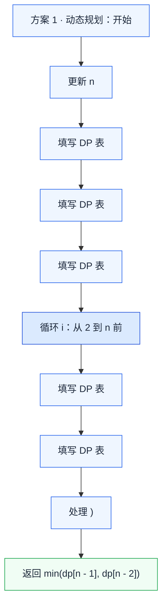

```python
import sys  # 提高递归深度上限（深输入防 RecursionError）

sys.setrecursionlimit(200000)  # 树/链表类题目节点数可达 1e4 量级

def minCostClimbingStairs(cost):  # 定义函数 minCostClimbingStairs（参数：cost）
    n = len(cost)  # 把 长度(cost) 存入 元素个数
    dp = [0] * n  # 把 [0] 乘 元素个数 存入 DP 表
    dp[0] = cost[0]  # 把 cost[0] 写入 dp[0]
    dp[1] = cost[1]  # 把 cost[1] 写入 dp[1]
    for i in range(2, n):  # 让 下标 i 从 2 到 元素个数 遍历
        dp[i] = (
            min(dp[i - 1], dp[i - 2]) + cost[i]
        )  # 把 取较小值 DP 表[下标 i 减 1], DP 表[下标 i 减 2]) 加 cost[下标 i] 写入 dp[i]
    return min(dp[n - 1], dp[n - 2])  # 返回 取较小值 DP 表[元素个数 减 1], DP 表[元素个数 减 2])

if __name__ == "__main__":  # 若 __name__ 等于 '__main__'
    print(minCostClimbingStairs([10, 15, 20]))  # 打印输出
```

#### 方案 2：动态规划

**思路与代码分析**：核心是「动态规划」。Python 版用切片与字典推导式简化操作，突出可读性。代码里依次做这些事：DP 表逐项填充。**走读**：方案 2 · 动态规划：开始 → 更新 n → 填写 DP 表 → 填写 DP 表 → 填写 DP 表 → 循环 i：从 2 到 n 前 → 填写 DP 表 → 填写 DP 表 → 处理 ) → 返回 min(dp[n - 1], dp[n - 2])。

**运行架构**（真实控制流）：

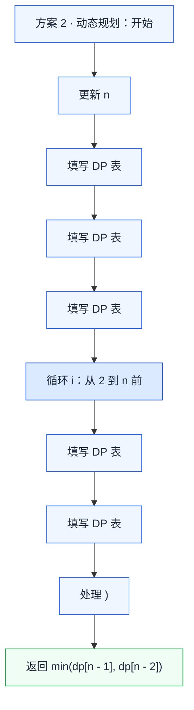

```python
import sys  # 提高递归深度上限（深输入防 RecursionError）

sys.setrecursionlimit(200000)  # 树/链表类题目节点数可达 1e4 量级

def minCostClimbingStairs(cost):  # 定义函数 minCostClimbingStairs（参数：cost）
    n = len(cost)  # 把 长度(cost) 存入 元素个数
    dp = [0] * n  # 把 [0] 乘 元素个数 存入 DP 表
    dp[0] = cost[0]  # 把 cost[0] 写入 dp[0]
    dp[1] = cost[1]  # 把 cost[1] 写入 dp[1]
    for i in range(2, n):  # 让 下标 i 从 2 到 元素个数 遍历
        dp[i] = (
            min(dp[i - 1], dp[i - 2]) + cost[i]
        )  # 把 取较小值 DP 表[下标 i 减 1], DP 表[下标 i 减 2]) 加 cost[下标 i] 写入 dp[i]
    return min(dp[n - 1], dp[n - 2])  # 返回 取较小值 DP 表[元素个数 减 1], DP 表[元素个数 减 2])

if __name__ == "__main__":  # 若 __name__ 等于 '__main__'
    print(minCostClimbingStairs([10, 15, 20]))  # 打印输出
```

#### 方案 3：动态规划

**思路与代码分析**：核心是「动态规划」。Python 版用切片与字典推导式简化操作，突出可读性。**走读**：方案 3 · 动态规划：开始 → 更新 n → 更新 prev2 → 更新 prev1 → 循环 i：从 2 到 n 前 → 更新 cur → 更新 prev2 → 更新 prev1 → 返回 min(prev1, prev2)。

**运行架构**（真实控制流）：

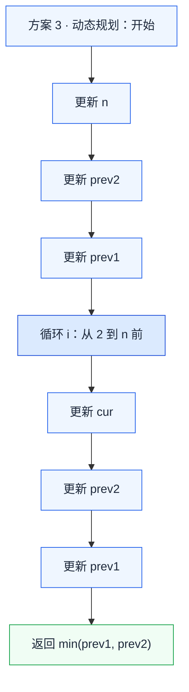

```python
import sys  # 提高递归深度上限（深输入防 RecursionError）

sys.setrecursionlimit(200000)  # 树/链表类题目节点数可达 1e4 量级

def minCostClimbingStairs(cost):  # 定义函数 minCostClimbingStairs（参数：cost）
    n = len(cost)  # 把 长度(cost) 存入 元素个数
    prev2 = cost[0]  # 把 cost[0] 存入 prev2
    prev1 = cost[1]  # 把 cost[1] 存入 prev1
    for i in range(2, n):  # 让 下标 i 从 2 到 元素个数 遍历
        cur = min(prev1, prev2) + cost[i]  # 把 取较小值 prev1, prev2) 加 cost[下标 i] 存入 当前值
        prev2 = prev1  # 把 prev1 存入 prev2
        prev1 = cur  # 把 当前值 存入 prev1
    return min(prev1, prev2)  # 返回 取较小值 prev1, prev2)

if __name__ == "__main__":  # 若 __name__ 等于 '__main__'
    print(minCostClimbingStairs([10, 15, 20]))  # 打印输出
```

#### 方案 4：动态规划

**思路与代码分析**：核心是「动态规划」。Python 版用切片与字典推导式简化操作，突出可读性。**走读**：方案 4 · 动态规划：开始 → 更新 size → 命中条件，直接返回 → 命中条件，直接返回 → 更新 minCost → 更新 minCost[0] → 更新 minCost[1] → 循环 i：从 2 到 size 前 → 更新 minCost[i] → 返回 min(minCost[size - 1], minCost[size - 2])。

**运行架构**（真实控制流）：

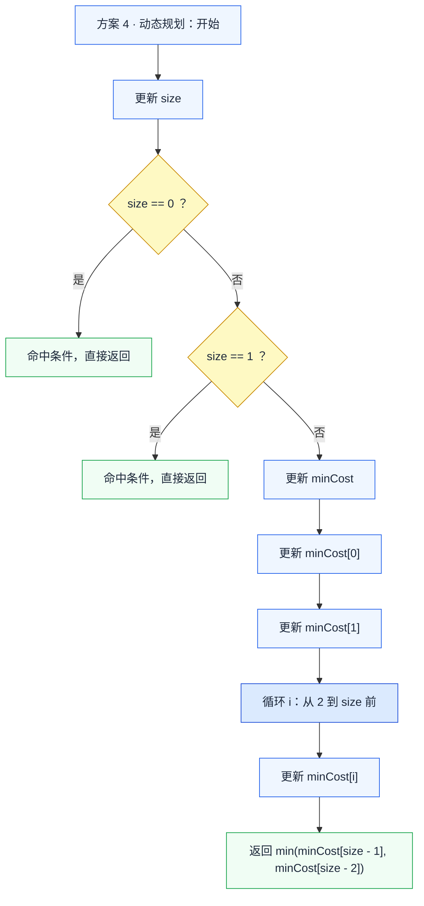

```python
import sys  # 提高递归深度上限（深输入防 RecursionError）

sys.setrecursionlimit(200000)  # 树/链表类题目节点数可达 1e4 量级

def minCostClimbingStairs(cost):  # 定义函数 minCostClimbingStairs（参数：cost）
    size = len(cost)  # 把 长度(cost) 存入 大小
    if size == 0:
        return 0  # 若 大小 等于 0: return 0
    if size == 1:
        return cost[0]  # 若 大小 等于 1: return cost[0]
    minCost = [0] * size  # 把 [0] 乘 大小 存入 minCost
    minCost[0] = cost[0]  # 把 cost[0] 写入 minCost[0]
    minCost[1] = cost[1]  # 把 cost[1] 写入 minCost[1]
    for i in range(2, size):  # 让 下标 i 从 2 到 大小 遍历
        minCost[i] = min(minCost[i - 1], minCost[i - 2]) + cost[i]
    return min(minCost[size - 1], minCost[size - 2])  # 返回 取较小值 minCost[大小 减 1], minCost[大小 减 2])

if __name__ == "__main__":  # 若 __name__ 等于 '__main__'
    print(minCostClimbingStairs([10, 15, 20]))  # 打印输出
```

#### 方案 5：动态规划

**思路与代码分析**：核心是「动态规划」。Python 版用切片与字典推导式简化操作，突出可读性。**走读**：方案 5 · 动态规划：开始 → 更新 minCost0 → 更新 minCost1 → 循环 i：从 2 到 len(cost 前 → 更新 minCost → 更新 minCost1] → 返回 minCost1。

**运行架构**（真实控制流）：

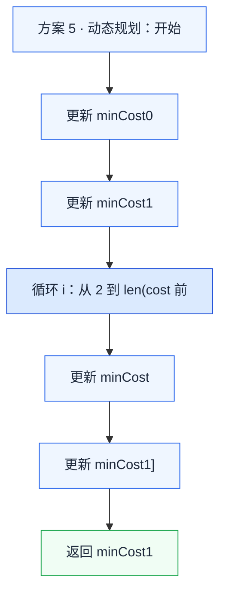

```python
import sys  # 提高递归深度上限（深输入防 RecursionError）

sys.setrecursionlimit(200000)  # 树/链表类题目节点数可达 1e4 量级

def minCostClimbingStairs(cost):  # 定义函数 minCostClimbingStairs（参数：cost）
    minCost0 = 0  # 把 0 存入 minCost0
    minCost1 = min(cost[0], cost[1])  # 把 取较小值 cost[0], cost[1]) 存入 minCost1
    for i in range(2, len(cost)):  # 让 下标 i 从 2 到 长度(cost 遍历
        minCost = min(minCost1 + cost[i], minCost0 + cost[i - 1])
        [minCost0, minCost1] = [minCost1, minCost]  # 把 [minCost1, minCost] 写入 [minCost0, minCost1]
    return minCost1  # 返回 minCost1

if __name__ == "__main__":  # 若 __name__ 等于 '__main__'
    print(minCostClimbingStairs([10, 15, 20]))  # 打印输出
```

### Go 实现（5 种方案）

Go 的全部方案如下，每个方案都内嵌用例自测，可独立运行（老仓库 python/go 文件遵循「打印结果」约定）：

#### 方案 1：动态规划

**思路与代码分析**：核心是「动态规划」。Go 版用切片与多返回值惯用法，显式处理索引边界。代码里依次做这些事：DP 表逐项填充。**走读**：方案 1 · 动态规划：开始 → 更新 : → 更新 : → 填写 DP 表 → 填写 DP 表 → 遍历循环 → 填写 DP 表 → 填写 DP 表 → 填写 DP 表 → 填写 DP 表 → 返回 dp[n-1] → 返回 dp[n-2]。

**运行架构**（真实控制流）：


```go
package main // 引入依赖

import (
	"fmt" // 「fmt」
	"os"  // 「os」
)

func minCostClimbingStairs(cost []int) int { // 定义函数/方法 minCostClimbingStairs
	n := len(cost)           // 把 长度(cost) 写入 n :
	dp := make([]int, n)     // 把 make([]int, 元素个数) 写入 dp :
	dp[0] = cost[0]          // 把 cost[0] 写入 dp[0]
	dp[1] = cost[1]          // 把 cost[1] 写入 dp[1]
	for i := 2; i < n; i++ { // 让 下标 i 从 2 开始计数
		if dp[i-1] < dp[i-2] { // 若 DP 表[下标 i 减 1] 小于 DP 表[下标 i 减 2]
			dp[i] = dp[i-1] + cost[i] // 把 DP 表[下标 i 减 1] 加 cost[下标 i] 写入 dp[i]
		} else { // 否则
			dp[i] = dp[i-2] + cost[i] // 把 DP 表[下标 i 减 2] 加 cost[下标 i] 写入 dp[i]
		}
	}
	if dp[n-1] < dp[n-2] { // 若 DP 表[元素个数 减 1] 小于 DP 表[元素个数 减 2]
		return dp[n-1] // 返回 DP 表[元素个数 减 1]
	}
	return dp[n-2] // 返回 DP 表[元素个数 减 2]
}

func main() { // 程序入口：跑内嵌自测用例
	cases := []struct { // 把 []struct { 写入 cases :
		cost []int // cost []int
		want int   // want int
	}{ // }{
		{[]int{10, 15, 20}, 15},
		{[]int{1, 100, 1, 1, 1, 100, 1, 1, 100, 1}, 6},
	}
	for _, c := range cases { // 同时取 _ 与 字符 遍历
		got := minCostClimbingStairs(c.cost) // 把 minCostClimbingStairs(字符.cost) 写入 got :
		if got != c.want {                   // 若 got 不等于 字符.want
			fmt.Printf("FAIL: got %d expected %d\n", got, c.want) // 打印输出
			os.Exit(1)                                            // os.Exit(1)
		}
	}
	fmt.Println("PASS") // 全部用例通过，输出 PASS
}
```

#### 方案 2：动态规划

**思路与代码分析**：核心是「动态规划」。Go 版用切片与多返回值惯用法，显式处理索引边界。代码里依次做这些事：DP 表逐项填充。**走读**：方案 2 · 动态规划：开始 → 更新 : → 更新 : → 填写 DP 表 → 填写 DP 表 → 遍历循环 → 填写 DP 表 → 填写 DP 表 → 填写 DP 表 → 填写 DP 表 → 返回 dp[n-1] → 返回 dp[n-2]。

**运行架构**（真实控制流）：

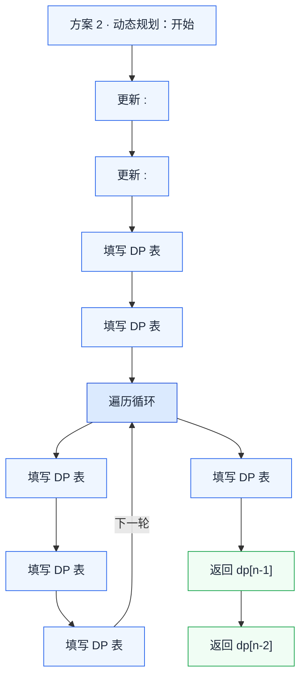

```go
package main // 引入依赖

import (
	"fmt" // 「fmt」
	"os"  // 「os」
)

func minCostClimbingStairs(cost []int) int { // 定义函数/方法 minCostClimbingStairs
	n := len(cost)           // 把 长度(cost) 写入 n :
	dp := make([]int, n)     // 把 make([]int, 元素个数) 写入 dp :
	dp[0] = cost[0]          // 把 cost[0] 写入 dp[0]
	dp[1] = cost[1]          // 把 cost[1] 写入 dp[1]
	for i := 2; i < n; i++ { // 让 下标 i 从 2 开始计数
		if dp[i-1] < dp[i-2] { // 若 DP 表[下标 i 减 1] 小于 DP 表[下标 i 减 2]
			dp[i] = dp[i-1] + cost[i] // 把 DP 表[下标 i 减 1] 加 cost[下标 i] 写入 dp[i]
		} else { // 否则
			dp[i] = dp[i-2] + cost[i] // 把 DP 表[下标 i 减 2] 加 cost[下标 i] 写入 dp[i]
		}
	}
	if dp[n-1] < dp[n-2] { // 若 DP 表[元素个数 减 1] 小于 DP 表[元素个数 减 2]
		return dp[n-1] // 返回 DP 表[元素个数 减 1]
	}
	return dp[n-2] // 返回 DP 表[元素个数 减 2]
}

func main() { // 程序入口：跑内嵌自测用例
	cases := []struct { // 把 []struct { 写入 cases :
		cost []int // cost []int
		want int   // want int
	}{ // }{
		{[]int{10, 15, 20}, 15},
		{[]int{1, 100, 1, 1, 1, 100, 1, 1, 100, 1}, 6},
	}
	for _, c := range cases { // 同时取 _ 与 字符 遍历
		got := minCostClimbingStairs(c.cost) // 把 minCostClimbingStairs(字符.cost) 写入 got :
		if got != c.want {                   // 若 got 不等于 字符.want
			fmt.Printf("FAIL: got %d expected %d\n", got, c.want) // 打印输出
			os.Exit(1)                                            // os.Exit(1)
		}
	}
	fmt.Println("PASS") // 全部用例通过，输出 PASS
}
```

#### 方案 3：动态规划

**思路与代码分析**：核心是「动态规划」。Go 版用切片与多返回值惯用法，显式处理索引边界。**走读**：方案 3 · 动态规划：开始 → 更新 : → 更新 : → 更新 : → 遍历循环 → 更新 : → 处理 if prev1 ＜ prev2 → 更新 + → 更新 + → 更新 prev2 → 更新 prev1 → 处理 if prev1 ＜ prev2 → 返回 prev1 → 返回 prev2。

**运行架构**（真实控制流）：


```go
package main // 引入依赖

import (
	"fmt" // 「fmt」
	"os"  // 「os」
)

func minCostClimbingStairs(cost []int) int { // 定义函数/方法 minCostClimbingStairs
	n := len(cost)           // 把 长度(cost) 写入 n :
	prev2 := cost[0]         // 把 cost[0] 写入 prev2 :
	prev1 := cost[1]         // 把 cost[1] 写入 prev1 :
	for i := 2; i < n; i++ { // 让 下标 i 从 2 开始计数
		cur := cost[i]     // 把 cost[下标 i] 写入 cur :
		if prev1 < prev2 { // 若 prev1 小于 prev2
			cur += prev1 // 当前值累加 prev1
		} else { // 否则
			cur += prev2 // 当前值累加 prev2
		}
		prev2 = prev1 // 把 prev1 写入 prev2
		prev1 = cur   // 把 当前值 写入 prev1
	}
	if prev1 < prev2 { // 若 prev1 小于 prev2
		return prev1 // 返回 prev1
	}
	return prev2 // 返回 prev2
}

func main() { // 程序入口：跑内嵌自测用例
	cases := []struct { // 把 []struct { 写入 cases :
		cost []int // cost []int
		want int   // want int
	}{ // }{
		{[]int{10, 15, 20}, 15},
		{[]int{1, 100, 1, 1, 1, 100, 1, 1, 100, 1}, 6},
	}
	for _, c := range cases { // 同时取 _ 与 字符 遍历
		got := minCostClimbingStairs(c.cost) // 把 minCostClimbingStairs(字符.cost) 写入 got :
		if got != c.want {                   // 若 got 不等于 字符.want
			fmt.Printf("FAIL: got %d expected %d\n", got, c.want) // 打印输出
			os.Exit(1)                                            // os.Exit(1)
		}
	}
	fmt.Println("PASS") // 全部用例通过，输出 PASS
}
```

#### 方案 4：动态规划

**思路与代码分析**：核心是「动态规划」。Go 版用切片与多返回值惯用法，显式处理索引边界。代码里依次做这些事：DP 表逐项填充。**走读**：方案 4 · 动态规划：开始 → 更新 : → 更新 : → 填写 DP 表 → 填写 DP 表 → 遍历循环 → 填写 DP 表 → 填写 DP 表 → 填写 DP 表 → 填写 DP 表 → 返回 dp[n-1] → 返回 dp[n-2]。

**运行架构**（真实控制流）：


```go
package main // 引入依赖

import (
	"fmt" // 「fmt」
	"os"  // 「os」
)

func minCostClimbingStairs(cost []int) int { // 定义函数/方法 minCostClimbingStairs
	n := len(cost)           // 把 长度(cost) 写入 n :
	dp := make([]int, n)     // 把 make([]int, 元素个数) 写入 dp :
	dp[0] = cost[0]          // 把 cost[0] 写入 dp[0]
	dp[1] = cost[1]          // 把 cost[1] 写入 dp[1]
	for i := 2; i < n; i++ { // 让 下标 i 从 2 开始计数
		if dp[i-1] < dp[i-2] { // 若 DP 表[下标 i 减 1] 小于 DP 表[下标 i 减 2]
			dp[i] = dp[i-1] + cost[i] // 把 DP 表[下标 i 减 1] 加 cost[下标 i] 写入 dp[i]
		} else { // 否则
			dp[i] = dp[i-2] + cost[i] // 把 DP 表[下标 i 减 2] 加 cost[下标 i] 写入 dp[i]
		}
	}
	if dp[n-1] < dp[n-2] { // 若 DP 表[元素个数 减 1] 小于 DP 表[元素个数 减 2]
		return dp[n-1] // 返回 DP 表[元素个数 减 1]
	}
	return dp[n-2] // 返回 DP 表[元素个数 减 2]
}

func main() { // 程序入口：跑内嵌自测用例
	cases := []struct { // 把 []struct { 写入 cases :
		cost []int // cost []int
		want int   // want int
	}{ // }{
		{[]int{10, 15, 20}, 15},
		{[]int{1, 100, 1, 1, 1, 100, 1, 1, 100, 1}, 6},
	}
	for _, c := range cases { // 同时取 _ 与 字符 遍历
		got := minCostClimbingStairs(c.cost) // 把 minCostClimbingStairs(字符.cost) 写入 got :
		if got != c.want {                   // 若 got 不等于 字符.want
			fmt.Printf("FAIL: got %d expected %d\n", got, c.want) // 打印输出
			os.Exit(1)                                            // os.Exit(1)
		}
	}
	fmt.Println("PASS") // 全部用例通过，输出 PASS
}
```

#### 方案 5：动态规划

**思路与代码分析**：核心是「动态规划」。Go 版用切片与多返回值惯用法，显式处理索引边界。**走读**：方案 5 · 动态规划：开始 → 更新 : → 更新 : → 更新 : → 遍历循环 → 更新 : → 处理 if prev1 ＜ prev2 → 更新 + → 更新 + → 更新 prev2 → 更新 prev1 → 处理 if prev1 ＜ prev2 → 返回 prev1 → 返回 prev2。

**运行架构**（真实控制流）：

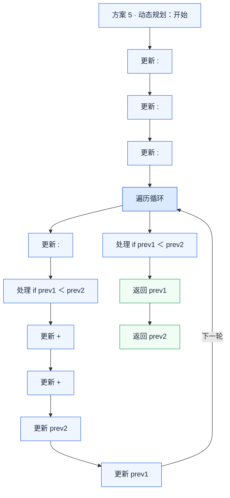

```go
package main // 引入依赖

import (
	"fmt" // 「fmt」
	"os"  // 「os」
)

func minCostClimbingStairs(cost []int) int { // 定义函数/方法 minCostClimbingStairs
	n := len(cost)           // 把 长度(cost) 写入 n :
	prev2 := cost[0]         // 把 cost[0] 写入 prev2 :
	prev1 := cost[1]         // 把 cost[1] 写入 prev1 :
	for i := 2; i < n; i++ { // 让 下标 i 从 2 开始计数
		cur := cost[i]     // 把 cost[下标 i] 写入 cur :
		if prev1 < prev2 { // 若 prev1 小于 prev2
			cur += prev1 // 当前值累加 prev1
		} else { // 否则
			cur += prev2 // 当前值累加 prev2
		}
		prev2 = prev1 // 把 prev1 写入 prev2
		prev1 = cur   // 把 当前值 写入 prev1
	}
	if prev1 < prev2 { // 若 prev1 小于 prev2
		return prev1 // 返回 prev1
	}
	return prev2 // 返回 prev2
}

func main() { // 程序入口：跑内嵌自测用例
	cases := []struct { // 把 []struct { 写入 cases :
		cost []int // cost []int
		want int   // want int
	}{ // }{
		{[]int{10, 15, 20}, 15},
		{[]int{1, 100, 1, 1, 1, 100, 1, 1, 100, 1}, 6},
	}
	for _, c := range cases { // 同时取 _ 与 字符 遍历
		got := minCostClimbingStairs(c.cost) // 把 minCostClimbingStairs(字符.cost) 写入 got :
		if got != c.want {                   // 若 got 不等于 字符.want
			fmt.Printf("FAIL: got %d expected %d\n", got, c.want) // 打印输出
			os.Exit(1)                                            // os.Exit(1)
		}
	}
	fmt.Println("PASS") // 全部用例通过，输出 PASS
}
```

### Java 实现（5 种方案）

Java 的全部方案如下，每个方案都内嵌用例自测，可独立运行（老仓库 python/go 文件遵循「打印结果」约定）：

#### 方案 1：动态规划

**思路与代码分析**：核心是「动态规划」。Java 版用类与静态方法组织，集合操作显式明了。代码里依次做这些事：DP 表逐项填充；单循环线性扫描。**走读**：方案 1 · 动态规划：开始 → 更新 n → 填写 DP 表 → 填写 DP 表 → 填写 DP 表 → 遍历循环 → 填写 DP 表 → 返回 Math.min(dp[n - 1], dp[n - 2])。

**运行架构**（真实控制流）：

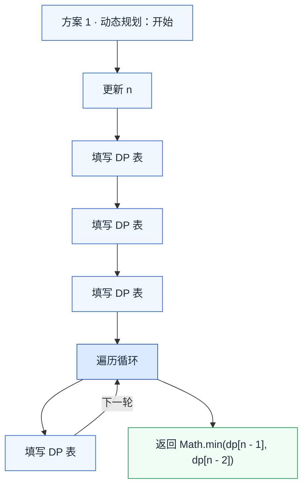

```java
package com.webfault.dsa; // 引入依赖

import java.util.*; // 引入依赖

class Solution { // 定义类型

  static int minCostClimbingStairs(int[] cost) { // 定义函数/方法 minCostClimbingStairs
    int n = cost.length; // 把 cost.长度 存入 元素个数
    int[] dp = new int[n]; // 把 new int[元素个数]; 写入 int[] dp
    dp[0] = cost[0]; // 把 cost[0]; 写入 dp[0]
    dp[1] = cost[1]; // 把 cost[1]; 写入 dp[1]
    for (int i = 2; i < n; i++) { // 让 下标 i 从 2 开始计数，下标 i 小于 元素个数 就继续
      dp[i] = Math.min(dp[i - 1], dp[i - 2]) + cost[i];
    }
    return Math.min(dp[n - 1], dp[n - 2]); // 返回 Math.取较小值 DP 表[元素个数 减 1], DP 表[元素个数 减 2])
  }

  public static void main(String[] args) { // public static void main(String[] args) {
    int[][][] cases = { // 把 { 写入 int[][][] cases
      {{10, 15, 20}, {15}},
      {{1, 100, 1, 1, 1, 100, 1, 1, 100, 1}, {6}},
    };
    for (int k = 0; k < cases.length; k++) { // 让 下标 k 从 0 开始计数，下标 k 小于 cases.长度 就继续
      int[] cost = cases[k][0]; // 把 cases[下标 k][0]; 写入 int[] cost
      int want = cases[k][1][0]; // 把 cases[下标 k][1][0] 存入 want
      int got = minCostClimbingStairs(cost); // 把 minCostClimbingStairs(cost) 存入 got
      if (got != want) { // 若 got 不等于 want
        System.out.println("FAIL: got " + got + " expected " + want); // 打印输出
        throw new RuntimeException(
            "self-check failed"); // throw new RuntimeException(「self 减 check failed」);
      }
    }
    System.out.println("PASS"); // 全部用例通过，输出 PASS
  }
}
```

#### 方案 2：动态规划

**思路与代码分析**：核心是「动态规划」。Java 版用类与静态方法组织，集合操作显式明了。代码里依次做这些事：DP 表逐项填充；单循环线性扫描。**走读**：方案 2 · 动态规划：开始 → 更新 n → 填写 DP 表 → 填写 DP 表 → 填写 DP 表 → 遍历循环 → 填写 DP 表 → 返回 Math.min(dp[n - 1], dp[n - 2])。

**运行架构**（真实控制流）：


```java
package com.webfault.dsa; // 引入依赖

import java.util.*; // 引入依赖

class Solution { // 定义类型

  static int minCostClimbingStairs(int[] cost) { // 定义函数/方法 minCostClimbingStairs
    int n = cost.length; // 把 cost.长度 存入 元素个数
    int[] dp = new int[n]; // 把 new int[元素个数]; 写入 int[] dp
    dp[0] = cost[0]; // 把 cost[0]; 写入 dp[0]
    dp[1] = cost[1]; // 把 cost[1]; 写入 dp[1]
    for (int i = 2; i < n; i++) { // 让 下标 i 从 2 开始计数，下标 i 小于 元素个数 就继续
      dp[i] = Math.min(dp[i - 1], dp[i - 2]) + cost[i];
    }
    return Math.min(dp[n - 1], dp[n - 2]); // 返回 Math.取较小值 DP 表[元素个数 减 1], DP 表[元素个数 减 2])
  }

  public static void main(String[] args) { // public static void main(String[] args) {
    int[][][] cases = { // 把 { 写入 int[][][] cases
      {{10, 15, 20}, {15}},
      {{1, 100, 1, 1, 1, 100, 1, 1, 100, 1}, {6}},
    };
    for (int k = 0; k < cases.length; k++) { // 让 下标 k 从 0 开始计数，下标 k 小于 cases.长度 就继续
      int[] cost = cases[k][0]; // 把 cases[下标 k][0]; 写入 int[] cost
      int want = cases[k][1][0]; // 把 cases[下标 k][1][0] 存入 want
      int got = minCostClimbingStairs(cost); // 把 minCostClimbingStairs(cost) 存入 got
      if (got != want) { // 若 got 不等于 want
        System.out.println("FAIL: got " + got + " expected " + want); // 打印输出
        throw new RuntimeException(
            "self-check failed"); // throw new RuntimeException(「self 减 check failed」);
      }
    }
    System.out.println("PASS"); // 全部用例通过，输出 PASS
  }
}
```

#### 方案 3：动态规划

**思路与代码分析**：核心是「动态规划」。Java 版用类与静态方法组织，集合操作显式明了。代码里依次做这些事：单循环线性扫描。**走读**：方案 3 · 动态规划：开始 → 更新 n → 更新 prev2 → 更新 prev1 → 遍历循环 → 更新 cur → 更新 prev2 → 更新 prev1 → 返回 Math.min(prev1, prev2)。

**运行架构**（真实控制流）：

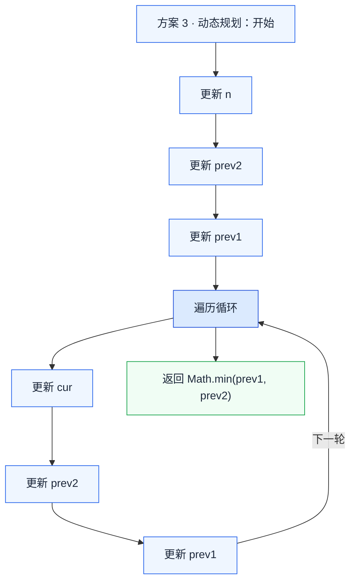

```java
package com.webfault.dsa; // 引入依赖

import java.util.*; // 引入依赖

class Solution { // 定义类型

  static int minCostClimbingStairs(int[] cost) { // 定义函数/方法 minCostClimbingStairs
    int n = cost.length; // 把 cost.长度 存入 元素个数
    int prev2 = cost[0]; // 把 cost[0] 存入 prev2
    int prev1 = cost[1]; // 把 cost[1] 存入 prev1
    for (int i = 2; i < n; i++) { // 让 下标 i 从 2 开始计数，下标 i 小于 元素个数 就继续
      int cur = cost[i] + Math.min(prev1, prev2); // 把 cost[下标 i] 加 Math.取较小值 prev1, prev2) 存入 当前值
      prev2 = prev1; // 把 prev1; 写入 prev2
      prev1 = cur; // 把 当前值; 写入 prev1
    }
    return Math.min(prev1, prev2); // 返回 Math.取较小值 prev1, prev2)
  }

  public static void main(String[] args) { // public static void main(String[] args) {
    int[][][] cases = { // 把 { 写入 int[][][] cases
      {{10, 15, 20}, {15}},
      {{1, 100, 1, 1, 1, 100, 1, 1, 100, 1}, {6}},
    };
    for (int k = 0; k < cases.length; k++) { // 让 下标 k 从 0 开始计数，下标 k 小于 cases.长度 就继续
      int[] cost = cases[k][0]; // 把 cases[下标 k][0]; 写入 int[] cost
      int want = cases[k][1][0]; // 把 cases[下标 k][1][0] 存入 want
      int got = minCostClimbingStairs(cost); // 把 minCostClimbingStairs(cost) 存入 got
      if (got != want) { // 若 got 不等于 want
        System.out.println("FAIL: got " + got + " expected " + want); // 打印输出
        throw new RuntimeException(
            "self-check failed"); // throw new RuntimeException(「self 减 check failed」);
      }
    }
    System.out.println("PASS"); // 全部用例通过，输出 PASS
  }
}
```

#### 方案 4：动态规划

**思路与代码分析**：核心是「动态规划」。Java 版用类与静态方法组织，集合操作显式明了。代码里依次做这些事：DP 表逐项填充；单循环线性扫描。**走读**：方案 4 · 动态规划：开始 → 更新 n → 填写 DP 表 → 填写 DP 表 → 填写 DP 表 → 遍历循环 → 填写 DP 表 → 返回 Math.min(dp[n - 1], dp[n - 2])。

**运行架构**（真实控制流）：


```java
package com.webfault.dsa; // 引入依赖

import java.util.*; // 引入依赖

class Solution { // 定义类型

  static int minCostClimbingStairs(int[] cost) { // 定义函数/方法 minCostClimbingStairs
    int n = cost.length; // 把 cost.长度 存入 元素个数
    int[] dp = new int[n]; // 把 new int[元素个数]; 写入 int[] dp
    dp[0] = cost[0]; // 把 cost[0]; 写入 dp[0]
    dp[1] = cost[1]; // 把 cost[1]; 写入 dp[1]
    for (int i = 2; i < n; i++) { // 让 下标 i 从 2 开始计数，下标 i 小于 元素个数 就继续
      dp[i] = Math.min(dp[i - 1], dp[i - 2]) + cost[i];
    }
    return Math.min(dp[n - 1], dp[n - 2]); // 返回 Math.取较小值 DP 表[元素个数 减 1], DP 表[元素个数 减 2])
  }

  public static void main(String[] args) { // public static void main(String[] args) {
    int[][][] cases = { // 把 { 写入 int[][][] cases
      {{10, 15, 20}, {15}},
      {{1, 100, 1, 1, 1, 100, 1, 1, 100, 1}, {6}},
    };
    for (int k = 0; k < cases.length; k++) { // 让 下标 k 从 0 开始计数，下标 k 小于 cases.长度 就继续
      int[] cost = cases[k][0]; // 把 cases[下标 k][0]; 写入 int[] cost
      int want = cases[k][1][0]; // 把 cases[下标 k][1][0] 存入 want
      int got = minCostClimbingStairs(cost); // 把 minCostClimbingStairs(cost) 存入 got
      if (got != want) { // 若 got 不等于 want
        System.out.println("FAIL: got " + got + " expected " + want); // 打印输出
        throw new RuntimeException(
            "self-check failed"); // throw new RuntimeException(「self 减 check failed」);
      }
    }
    System.out.println("PASS"); // 全部用例通过，输出 PASS
  }
}
```

#### 方案 5：动态规划

**思路与代码分析**：核心是「动态规划」。Java 版用类与静态方法组织，集合操作显式明了。代码里依次做这些事：单循环线性扫描。**走读**：方案 5 · 动态规划：开始 → 更新 n → 更新 prev2 → 更新 prev1 → 遍历循环 → 更新 cur → 更新 prev2 → 更新 prev1 → 返回 Math.min(prev1, prev2)。

**运行架构**（真实控制流）：

```mermaid
graph TD
    N0["方案 5 · 动态规划：开始"]
    N1["更新 n"]
    N2["更新 prev2"]
    N3["更新 prev1"]
    N4["遍历循环"]
    N5["更新 cur"]
    N6["更新 prev2"]
    N7["更新 prev1"]
    N8["返回 Math.min(prev1, prev2)"]
    N0 --> N1
    N1 --> N2
    N2 --> N3
    N3 --> N4
    N4 --> N5
    N5 --> N6
    N6 --> N7
    N7 -- 下一轮 --> N4
    N4 --> N8
    classDef n fill:#eff6ff,stroke:#2563eb,color:#1e293b;
    classDef lp fill:#dbeafe,stroke:#1d4ed8,color:#1e293b;
    classDef dc fill:#fef9c3,stroke:#ca8a04,color:#1e293b;
    classDef tm fill:#f0fdf4,stroke:#16a34a,color:#1e293b;
    class N0,N1,N2,N3,N5,N6,N7 n;
    class N4 lp;
    class N8 tm;
```

```java
package com.webfault.dsa; // 引入依赖

import java.util.*; // 引入依赖

class Solution { // 定义类型

  static int minCostClimbingStairs(int[] cost) { // 定义函数/方法 minCostClimbingStairs
    int n = cost.length; // 把 cost.长度 存入 元素个数
    int prev2 = cost[0]; // 把 cost[0] 存入 prev2
    int prev1 = cost[1]; // 把 cost[1] 存入 prev1
    for (int i = 2; i < n; i++) { // 让 下标 i 从 2 开始计数，下标 i 小于 元素个数 就继续
      int cur = cost[i] + Math.min(prev1, prev2); // 把 cost[下标 i] 加 Math.取较小值 prev1, prev2) 存入 当前值
      prev2 = prev1; // 把 prev1; 写入 prev2
      prev1 = cur; // 把 当前值; 写入 prev1
    }
    return Math.min(prev1, prev2); // 返回 Math.取较小值 prev1, prev2)
  }

  public static void main(String[] args) { // public static void main(String[] args) {
    int[][][] cases = { // 把 { 写入 int[][][] cases
      {{10, 15, 20}, {15}},
      {{1, 100, 1, 1, 1, 100, 1, 1, 100, 1}, {6}},
    };
    for (int k = 0; k < cases.length; k++) { // 让 下标 k 从 0 开始计数，下标 k 小于 cases.长度 就继续
      int[] cost = cases[k][0]; // 把 cases[下标 k][0]; 写入 int[] cost
      int want = cases[k][1][0]; // 把 cases[下标 k][1][0] 存入 want
      int got = minCostClimbingStairs(cost); // 把 minCostClimbingStairs(cost) 存入 got
      if (got != want) { // 若 got 不等于 want
        System.out.println("FAIL: got " + got + " expected " + want); // 打印输出
        throw new RuntimeException(
            "self-check failed"); // throw new RuntimeException(「self 减 check failed」);
      }
    }
    System.out.println("PASS"); // 全部用例通过，输出 PASS
  }
}
```

### Rust 实现（5 种方案）

Rust 的全部方案如下，每个方案都内嵌用例自测，可独立运行（老仓库 python/go 文件遵循「打印结果」约定）：

#### 方案 1：动态规划

**思路与代码分析**：核心是「动态规划」。Rust 版用所有权移动与切片借用改写同一逻辑，注意 Option 与引用边界。**走读**：方案 1 · 动态规划：开始 → 计算 let (mut a, mut b) = (0, → 遍历 2..=cost.len() 中的每个元素 i → 计算 t → 更新 a → 更新 b → 处理 b → 返回结果。

**运行架构**（真实控制流）：

```mermaid
graph TD
    N0["方案 1 · 动态规划：开始"]
    N1["计算 let (mut a, mut b) = (0,"]
    N2["遍历 2..=cost.len() 中的每个元素 i"]
    N3["计算 t"]
    N4["更新 a"]
    N5["更新 b"]
    N6["处理 b"]
    N7["返回结果"]
    N0 --> N1
    N1 --> N2
    N2 --> N3
    N3 --> N4
    N4 --> N5
    N5 -- 下一轮 --> N2
    N2 --> N6
    N6 --> N7
    classDef n fill:#eff6ff,stroke:#2563eb,color:#1e293b;
    classDef lp fill:#dbeafe,stroke:#1d4ed8,color:#1e293b;
    classDef dc fill:#fef9c3,stroke:#ca8a04,color:#1e293b;
    classDef tm fill:#f0fdf4,stroke:#16a34a,color:#1e293b;
    class N0,N1,N3,N4,N5,N6 n;
    class N2 lp;
    class N7 tm;
```

```rust
// LeetCode 746. 使用最小花费爬楼梯 — Rust 版（方案1）
fn min_cost_climbing_stairs(cost: Vec<i32>) -> i32 {
    // 定义函数/方法 min_cost_climbing_stairs
    let (mut a, mut b) = (0, 0); // 把 (0, 0); 写入 let (mut a, mut b)
    for i in 2..=cost.len() {
        // 逐个取出 2 的元素（下标 i）
        let t = (a + cost[i - 2]).min(b + cost[i - 1]); // 把 (数组 加 cost[下标 i 减 2]).取较小值 b 加 cost[下标 i 减 1]) 存入 另一字符串
        a = b;
        b = t; // 把 b; b 赋值为 另一字符串; 写入 数组
    }
    b
}
fn main() {
    assert_eq!(min_cost_climbing_stairs(vec![10, 15, 20]), 15);
    assert_eq!(
        min_cost_climbing_stairs(vec![1, 100, 1, 1, 1, 100, 1, 1, 100, 1]),
        6
    );
    println!("PASS");
} // 程序入口：跑内嵌自测用例
```

#### 方案 2：动态规划

**思路与代码分析**：核心是「动态规划」。Rust 版用所有权移动与切片借用改写同一逻辑，注意 Option 与引用边界。**走读**：方案 2 · 动态规划：开始 → 计算 let (mut a, mut b) = (0, → 遍历 2..=cost.len() 中的每个元素 i → 计算 t → 更新 a → 更新 b → 处理 b → 返回结果。

**运行架构**（真实控制流）：

```mermaid
graph TD
    N0["方案 2 · 动态规划：开始"]
    N1["计算 let (mut a, mut b) = (0,"]
    N2["遍历 2..=cost.len() 中的每个元素 i"]
    N3["计算 t"]
    N4["更新 a"]
    N5["更新 b"]
    N6["处理 b"]
    N7["返回结果"]
    N0 --> N1
    N1 --> N2
    N2 --> N3
    N3 --> N4
    N4 --> N5
    N5 -- 下一轮 --> N2
    N2 --> N6
    N6 --> N7
    classDef n fill:#eff6ff,stroke:#2563eb,color:#1e293b;
    classDef lp fill:#dbeafe,stroke:#1d4ed8,color:#1e293b;
    classDef dc fill:#fef9c3,stroke:#ca8a04,color:#1e293b;
    classDef tm fill:#f0fdf4,stroke:#16a34a,color:#1e293b;
    class N0,N1,N3,N4,N5,N6 n;
    class N2 lp;
    class N7 tm;
```

```rust
// LeetCode 746. 使用最小花费爬楼梯 — Rust 版（方案2）
fn min_cost_climbing_stairs(cost: Vec<i32>) -> i32 {
    // 定义函数/方法 min_cost_climbing_stairs
    let (mut a, mut b) = (0, 0); // 把 (0, 0); 写入 let (mut a, mut b)
    for i in 2..=cost.len() {
        // 逐个取出 2 的元素（下标 i）
        let t = (a + cost[i - 2]).min(b + cost[i - 1]); // 把 (数组 加 cost[下标 i 减 2]).取较小值 b 加 cost[下标 i 减 1]) 存入 另一字符串
        a = b;
        b = t; // 把 b; b 赋值为 另一字符串; 写入 数组
    }
    b
}
fn main() {
    assert_eq!(min_cost_climbing_stairs(vec![10, 15, 20]), 15);
    assert_eq!(
        min_cost_climbing_stairs(vec![1, 100, 1, 1, 1, 100, 1, 1, 100, 1]),
        6
    );
    println!("PASS");
} // 程序入口：跑内嵌自测用例
```

#### 方案 3：动态规划

**思路与代码分析**：核心是「动态规划」。Rust 版用所有权移动与切片借用改写同一逻辑，注意 Option 与引用边界。**走读**：方案 3 · 动态规划：开始 → 计算 let (mut a, mut b) = (0, → 遍历 2..=cost.len() 中的每个元素 i → 计算 t → 更新 a → 更新 b → 处理 b → 返回结果。

**运行架构**（真实控制流）：

```mermaid
graph TD
    N0["方案 3 · 动态规划：开始"]
    N1["计算 let (mut a, mut b) = (0,"]
    N2["遍历 2..=cost.len() 中的每个元素 i"]
    N3["计算 t"]
    N4["更新 a"]
    N5["更新 b"]
    N6["处理 b"]
    N7["返回结果"]
    N0 --> N1
    N1 --> N2
    N2 --> N3
    N3 --> N4
    N4 --> N5
    N5 -- 下一轮 --> N2
    N2 --> N6
    N6 --> N7
    classDef n fill:#eff6ff,stroke:#2563eb,color:#1e293b;
    classDef lp fill:#dbeafe,stroke:#1d4ed8,color:#1e293b;
    classDef dc fill:#fef9c3,stroke:#ca8a04,color:#1e293b;
    classDef tm fill:#f0fdf4,stroke:#16a34a,color:#1e293b;
    class N0,N1,N3,N4,N5,N6 n;
    class N2 lp;
    class N7 tm;
```

```rust
// LeetCode 746. 使用最小花费爬楼梯 — Rust 版（方案3）
fn min_cost_climbing_stairs(cost: Vec<i32>) -> i32 {
    // 定义函数/方法 min_cost_climbing_stairs
    let (mut a, mut b) = (0, 0); // 把 (0, 0); 写入 let (mut a, mut b)
    for i in 2..=cost.len() {
        // 逐个取出 2 的元素（下标 i）
        let t = (a + cost[i - 2]).min(b + cost[i - 1]); // 把 (数组 加 cost[下标 i 减 2]).取较小值 b 加 cost[下标 i 减 1]) 存入 另一字符串
        a = b;
        b = t; // 把 b; b 赋值为 另一字符串; 写入 数组
    }
    b
}
fn main() {
    assert_eq!(min_cost_climbing_stairs(vec![10, 15, 20]), 15);
    assert_eq!(
        min_cost_climbing_stairs(vec![1, 100, 1, 1, 1, 100, 1, 1, 100, 1]),
        6
    );
    println!("PASS");
} // 程序入口：跑内嵌自测用例
```

#### 方案 4：动态规划

**思路与代码分析**：核心是「动态规划」。Rust 版用所有权移动与切片借用改写同一逻辑，注意 Option 与引用边界。**走读**：方案 4 · 动态规划：开始 → 计算 let (mut a, mut b) = (0, → 遍历 2..=cost.len() 中的每个元素 i → 计算 t → 更新 a → 更新 b → 处理 b → 返回结果。

**运行架构**（真实控制流）：

```mermaid
graph TD
    N0["方案 4 · 动态规划：开始"]
    N1["计算 let (mut a, mut b) = (0,"]
    N2["遍历 2..=cost.len() 中的每个元素 i"]
    N3["计算 t"]
    N4["更新 a"]
    N5["更新 b"]
    N6["处理 b"]
    N7["返回结果"]
    N0 --> N1
    N1 --> N2
    N2 --> N3
    N3 --> N4
    N4 --> N5
    N5 -- 下一轮 --> N2
    N2 --> N6
    N6 --> N7
    classDef n fill:#eff6ff,stroke:#2563eb,color:#1e293b;
    classDef lp fill:#dbeafe,stroke:#1d4ed8,color:#1e293b;
    classDef dc fill:#fef9c3,stroke:#ca8a04,color:#1e293b;
    classDef tm fill:#f0fdf4,stroke:#16a34a,color:#1e293b;
    class N0,N1,N3,N4,N5,N6 n;
    class N2 lp;
    class N7 tm;
```

```rust
// LeetCode 746. 使用最小花费爬楼梯 — Rust 版（方案4）
fn min_cost_climbing_stairs(cost: Vec<i32>) -> i32 {
    // 定义函数/方法 min_cost_climbing_stairs
    let (mut a, mut b) = (0, 0); // 把 (0, 0); 写入 let (mut a, mut b)
    for i in 2..=cost.len() {
        // 逐个取出 2 的元素（下标 i）
        let t = (a + cost[i - 2]).min(b + cost[i - 1]); // 把 (数组 加 cost[下标 i 减 2]).取较小值 b 加 cost[下标 i 减 1]) 存入 另一字符串
        a = b;
        b = t; // 把 b; b 赋值为 另一字符串; 写入 数组
    }
    b
}
fn main() {
    assert_eq!(min_cost_climbing_stairs(vec![10, 15, 20]), 15);
    assert_eq!(
        min_cost_climbing_stairs(vec![1, 100, 1, 1, 1, 100, 1, 1, 100, 1]),
        6
    );
    println!("PASS");
} // 程序入口：跑内嵌自测用例
```

#### 方案 5：动态规划

**思路与代码分析**：核心是「动态规划」。Rust 版用所有权移动与切片借用改写同一逻辑，注意 Option 与引用边界。**走读**：方案 5 · 动态规划：开始 → 计算 let (mut a, mut b) = (0, → 遍历 2..=cost.len() 中的每个元素 i → 计算 t → 更新 a → 更新 b → 处理 b → 返回结果。

**运行架构**（真实控制流）：

```mermaid
graph TD
    N0["方案 5 · 动态规划：开始"]
    N1["计算 let (mut a, mut b) = (0,"]
    N2["遍历 2..=cost.len() 中的每个元素 i"]
    N3["计算 t"]
    N4["更新 a"]
    N5["更新 b"]
    N6["处理 b"]
    N7["返回结果"]
    N0 --> N1
    N1 --> N2
    N2 --> N3
    N3 --> N4
    N4 --> N5
    N5 -- 下一轮 --> N2
    N2 --> N6
    N6 --> N7
    classDef n fill:#eff6ff,stroke:#2563eb,color:#1e293b;
    classDef lp fill:#dbeafe,stroke:#1d4ed8,color:#1e293b;
    classDef dc fill:#fef9c3,stroke:#ca8a04,color:#1e293b;
    classDef tm fill:#f0fdf4,stroke:#16a34a,color:#1e293b;
    class N0,N1,N3,N4,N5,N6 n;
    class N2 lp;
    class N7 tm;
```

```rust
// LeetCode 746. 使用最小花费爬楼梯 — Rust 版（方案5）
fn min_cost_climbing_stairs(cost: Vec<i32>) -> i32 {
    // 定义函数/方法 min_cost_climbing_stairs
    let (mut a, mut b) = (0, 0); // 把 (0, 0); 写入 let (mut a, mut b)
    for i in 2..=cost.len() {
        // 逐个取出 2 的元素（下标 i）
        let t = (a + cost[i - 2]).min(b + cost[i - 1]); // 把 (数组 加 cost[下标 i 减 2]).取较小值 b 加 cost[下标 i 减 1]) 存入 另一字符串
        a = b;
        b = t; // 把 b; b 赋值为 另一字符串; 写入 数组
    }
    b
}
fn main() {
    assert_eq!(min_cost_climbing_stairs(vec![10, 15, 20]), 15);
    assert_eq!(
        min_cost_climbing_stairs(vec![1, 100, 1, 1, 1, 100, 1, 1, 100, 1]),
        6
    );
    println!("PASS");
} // 程序入口：跑内嵌自测用例
```

### Lua 实现（5 种方案）

Lua 的全部方案如下，每个方案都内嵌用例自测，可独立运行（老仓库 python/go 文件遵循「打印结果」约定）：

#### 方案 1：动态规划

**思路与代码分析**：核心是「动态规划」。Lua 版用表与 ipairs 遍历，注意 ipairs 遇 nil 即停的语义。**走读**：方案 1 · 动态规划：开始 → 更新 b → 循环 i：从 3 到 #cost + 1 do → 更新 t → 更新 b → 返回 b。

**运行架构**（真实控制流）：

```mermaid
graph TD
    N0["方案 1 · 动态规划：开始"]
    N1["更新 b"]
    N2["循环 i：从 3 到 #cost + 1 do"]
    N3["更新 t"]
    N4["更新 b"]
    N5["返回 b"]
    N0 --> N1
    N1 --> N2
    N2 --> N3
    N3 --> N4
    N4 --> N5
    classDef n fill:#eff6ff,stroke:#2563eb,color:#1e293b;
    classDef lp fill:#dbeafe,stroke:#1d4ed8,color:#1e293b;
    classDef dc fill:#fef9c3,stroke:#ca8a04,color:#1e293b;
    classDef tm fill:#f0fdf4,stroke:#16a34a,color:#1e293b;
    class N0,N1,N3,N4 n;
    class N2 lp;
    class N5 tm;
```

```lua
-- LeetCode 746. 使用最小花费爬楼梯 — Lua 版（方案1）
local function min_cost_climbing_stairs(cost) -- local function min_cost_climbing_stairs(cost)
	local a, b = 0, 0 -- 把 0, 0 写入 local a, b
	for i = 3, #cost + 1 do -- 把 3, #cost 加 1 do 写入 for i
		local t = math.min(a + cost[i - 2], b + cost[i - 1])
		a, b = b, t -- 把 b, 另一字符串 写入 a, b
	end -- 终点
	return b -- 返回 b
end -- 终点
assert(min_cost_climbing_stairs({ 10, 15, 20 }) == 15) -- 断言校验
assert(min_cost_climbing_stairs({ 1, 100, 1, 1, 1, 100, 1, 1, 100, 1 }) == 6) -- 断言校验
print("PASS") -- 全部用例通过，输出 PASS
```

#### 方案 2：动态规划

**思路与代码分析**：核心是「动态规划」。Lua 版用表与 ipairs 遍历，注意 ipairs 遇 nil 即停的语义。**走读**：方案 2 · 动态规划：开始 → 更新 b → 循环 i：从 3 到 #cost + 1 do → 更新 t → 更新 b → 返回 b。

**运行架构**（真实控制流）：

```mermaid
graph TD
    N0["方案 2 · 动态规划：开始"]
    N1["更新 b"]
    N2["循环 i：从 3 到 #cost + 1 do"]
    N3["更新 t"]
    N4["更新 b"]
    N5["返回 b"]
    N0 --> N1
    N1 --> N2
    N2 --> N3
    N3 --> N4
    N4 --> N5
    classDef n fill:#eff6ff,stroke:#2563eb,color:#1e293b;
    classDef lp fill:#dbeafe,stroke:#1d4ed8,color:#1e293b;
    classDef dc fill:#fef9c3,stroke:#ca8a04,color:#1e293b;
    classDef tm fill:#f0fdf4,stroke:#16a34a,color:#1e293b;
    class N0,N1,N3,N4 n;
    class N2 lp;
    class N5 tm;
```

```lua
-- LeetCode 746. 使用最小花费爬楼梯 — Lua 版（方案2）
local function min_cost_climbing_stairs(cost) -- local function min_cost_climbing_stairs(cost)
	local a, b = 0, 0 -- 把 0, 0 写入 local a, b
	for i = 3, #cost + 1 do -- 把 3, #cost 加 1 do 写入 for i
		local t = math.min(a + cost[i - 2], b + cost[i - 1])
		a, b = b, t -- 把 b, 另一字符串 写入 a, b
	end -- 终点
	return b -- 返回 b
end -- 终点
assert(min_cost_climbing_stairs({ 10, 15, 20 }) == 15) -- 断言校验
assert(min_cost_climbing_stairs({ 1, 100, 1, 1, 1, 100, 1, 1, 100, 1 }) == 6) -- 断言校验
print("PASS") -- 全部用例通过，输出 PASS
```

#### 方案 3：动态规划

**思路与代码分析**：核心是「动态规划」。Lua 版用表与 ipairs 遍历，注意 ipairs 遇 nil 即停的语义。**走读**：方案 3 · 动态规划：开始 → 更新 b → 循环 i：从 3 到 #cost + 1 do → 更新 t → 更新 b → 返回 b。

**运行架构**（真实控制流）：

```mermaid
graph TD
    N0["方案 3 · 动态规划：开始"]
    N1["更新 b"]
    N2["循环 i：从 3 到 #cost + 1 do"]
    N3["更新 t"]
    N4["更新 b"]
    N5["返回 b"]
    N0 --> N1
    N1 --> N2
    N2 --> N3
    N3 --> N4
    N4 --> N5
    classDef n fill:#eff6ff,stroke:#2563eb,color:#1e293b;
    classDef lp fill:#dbeafe,stroke:#1d4ed8,color:#1e293b;
    classDef dc fill:#fef9c3,stroke:#ca8a04,color:#1e293b;
    classDef tm fill:#f0fdf4,stroke:#16a34a,color:#1e293b;
    class N0,N1,N3,N4 n;
    class N2 lp;
    class N5 tm;
```

```lua
-- LeetCode 746. 使用最小花费爬楼梯 — Lua 版（方案3）
local function min_cost_climbing_stairs(cost) -- local function min_cost_climbing_stairs(cost)
	local a, b = 0, 0 -- 把 0, 0 写入 local a, b
	for i = 3, #cost + 1 do -- 把 3, #cost 加 1 do 写入 for i
		local t = math.min(a + cost[i - 2], b + cost[i - 1])
		a, b = b, t -- 把 b, 另一字符串 写入 a, b
	end -- 终点
	return b -- 返回 b
end -- 终点
assert(min_cost_climbing_stairs({ 10, 15, 20 }) == 15) -- 断言校验
assert(min_cost_climbing_stairs({ 1, 100, 1, 1, 1, 100, 1, 1, 100, 1 }) == 6) -- 断言校验
print("PASS") -- 全部用例通过，输出 PASS
```

#### 方案 4：动态规划

**思路与代码分析**：核心是「动态规划」。Lua 版用表与 ipairs 遍历，注意 ipairs 遇 nil 即停的语义。**走读**：方案 4 · 动态规划：开始 → 更新 b → 循环 i：从 3 到 #cost + 1 do → 更新 t → 更新 b → 返回 b。

**运行架构**（真实控制流）：

```mermaid
graph TD
    N0["方案 4 · 动态规划：开始"]
    N1["更新 b"]
    N2["循环 i：从 3 到 #cost + 1 do"]
    N3["更新 t"]
    N4["更新 b"]
    N5["返回 b"]
    N0 --> N1
    N1 --> N2
    N2 --> N3
    N3 --> N4
    N4 --> N5
    classDef n fill:#eff6ff,stroke:#2563eb,color:#1e293b;
    classDef lp fill:#dbeafe,stroke:#1d4ed8,color:#1e293b;
    classDef dc fill:#fef9c3,stroke:#ca8a04,color:#1e293b;
    classDef tm fill:#f0fdf4,stroke:#16a34a,color:#1e293b;
    class N0,N1,N3,N4 n;
    class N2 lp;
    class N5 tm;
```

```lua
-- LeetCode 746. 使用最小花费爬楼梯 — Lua 版（方案4）
local function min_cost_climbing_stairs(cost) -- local function min_cost_climbing_stairs(cost)
	local a, b = 0, 0 -- 把 0, 0 写入 local a, b
	for i = 3, #cost + 1 do -- 把 3, #cost 加 1 do 写入 for i
		local t = math.min(a + cost[i - 2], b + cost[i - 1])
		a, b = b, t -- 把 b, 另一字符串 写入 a, b
	end -- 终点
	return b -- 返回 b
end -- 终点
assert(min_cost_climbing_stairs({ 10, 15, 20 }) == 15) -- 断言校验
assert(min_cost_climbing_stairs({ 1, 100, 1, 1, 1, 100, 1, 1, 100, 1 }) == 6) -- 断言校验
print("PASS") -- 全部用例通过，输出 PASS
```

#### 方案 5：动态规划

**思路与代码分析**：核心是「动态规划」。Lua 版用表与 ipairs 遍历，注意 ipairs 遇 nil 即停的语义。**走读**：方案 5 · 动态规划：开始 → 更新 b → 循环 i：从 3 到 #cost + 1 do → 更新 t → 更新 b → 返回 b。

**运行架构**（真实控制流）：

```mermaid
graph TD
    N0["方案 5 · 动态规划：开始"]
    N1["更新 b"]
    N2["循环 i：从 3 到 #cost + 1 do"]
    N3["更新 t"]
    N4["更新 b"]
    N5["返回 b"]
    N0 --> N1
    N1 --> N2
    N2 --> N3
    N3 --> N4
    N4 --> N5
    classDef n fill:#eff6ff,stroke:#2563eb,color:#1e293b;
    classDef lp fill:#dbeafe,stroke:#1d4ed8,color:#1e293b;
    classDef dc fill:#fef9c3,stroke:#ca8a04,color:#1e293b;
    classDef tm fill:#f0fdf4,stroke:#16a34a,color:#1e293b;
    class N0,N1,N3,N4 n;
    class N2 lp;
    class N5 tm;
```

```lua
-- LeetCode 746. 使用最小花费爬楼梯 — Lua 版（方案5）
local function min_cost_climbing_stairs(cost) -- local function min_cost_climbing_stairs(cost)
	local a, b = 0, 0 -- 把 0, 0 写入 local a, b
	for i = 3, #cost + 1 do -- 把 3, #cost 加 1 do 写入 for i
		local t = math.min(a + cost[i - 2], b + cost[i - 1])
		a, b = b, t -- 把 b, 另一字符串 写入 a, b
	end -- 终点
	return b -- 返回 b
end -- 终点
assert(min_cost_climbing_stairs({ 10, 15, 20 }) == 15) -- 断言校验
assert(min_cost_climbing_stairs({ 1, 100, 1, 1, 1, 100, 1, 1, 100, 1 }) == 6) -- 断言校验
print("PASS") -- 全部用例通过，输出 PASS
```

### C 实现（5 种方案）

C 的全部方案如下，每个方案都内嵌用例自测，可独立运行（老仓库 python/go 文件遵循「打印结果」约定）：

#### 方案 1：动态规划

**思路与代码分析**：核心是「动态规划」。C 版手动管理下标与内存，循环边界全部显式写出。代码里依次做这些事：单循环线性扫描。**走读**：方案 1 · 动态规划：开始 → 更新 a → 遍历循环 → 更新 x → 更新 y → 更新 t → 更新 a → 更新 b → 返回 b。

**运行架构**（真实控制流）：

```mermaid
graph TD
    N0["方案 1 · 动态规划：开始"]
    N1["更新 a"]
    N2["遍历循环"]
    N3["更新 x"]
    N4["更新 y"]
    N5["更新 t"]
    N6["更新 a"]
    N7["更新 b"]
    N8["返回 b"]
    N0 --> N1
    N1 --> N2
    N2 --> N3
    N3 --> N4
    N4 --> N5
    N5 --> N6
    N6 --> N7
    N7 -- 下一轮 --> N2
    N2 --> N8
    classDef n fill:#eff6ff,stroke:#2563eb,color:#1e293b;
    classDef lp fill:#dbeafe,stroke:#1d4ed8,color:#1e293b;
    classDef dc fill:#fef9c3,stroke:#ca8a04,color:#1e293b;
    classDef tm fill:#f0fdf4,stroke:#16a34a,color:#1e293b;
    class N0,N1,N3,N4,N5,N6,N7 n;
    class N2 lp;
    class N8 tm;
```

```c
/* LeetCode 746. 使用最小花费爬楼梯 — C 版（方案1） */
#include <stdio.h>                                            // 引入头文件
static int min_cost_climbing_stairs(const int *cost, int n) { // 定义函数/方法 min_cost_climbing_stairs
    int a = 0, b = 0;                                         // 把 0, b 赋值为 0 存入 数组
    for (int i = 2; i <= n; i++) { // 让 下标 i 从 2 开始计数，下标 i 不超过 元素个数 就继续
        int x = a + cost[i - 2],
            y = b + cost[i - 1]; // 把 数组 加 cost[下标 i 减 2], y 赋值为 b 加 cost[下标 i 减 1] 存入 x
        int t = x < y ? x : y; // 把 x 小于 y ? x : y 存入 另一字符串
        a = b;
        b = t; // 把 b; b 赋值为 另一字符串; 写入 数组
    }
    return b; // 返回 b
}
int main(void) { // 程序入口：跑内嵌自测用例
    if (min_cost_climbing_stairs((int[]){10, 15, 20}, 3) != 15) {
        printf("FAIL 1\n");
        return 1;
    }
    if (min_cost_climbing_stairs((int[]){1, 100, 1, 1, 1, 100, 1, 1, 100, 1}, 10) != 6) {
        printf("FAIL 2\n");
        return 1;
    }
    printf("PASS\n");
    return 0;
} // 全部用例通过，输出 PASS
```

#### 方案 2：动态规划

**思路与代码分析**：核心是「动态规划」。C 版手动管理下标与内存，循环边界全部显式写出。代码里依次做这些事：单循环线性扫描。**走读**：方案 2 · 动态规划：开始 → 更新 a → 遍历循环 → 更新 x → 更新 y → 更新 t → 更新 a → 更新 b → 返回 b。

**运行架构**（真实控制流）：

```mermaid
graph TD
    N0["方案 2 · 动态规划：开始"]
    N1["更新 a"]
    N2["遍历循环"]
    N3["更新 x"]
    N4["更新 y"]
    N5["更新 t"]
    N6["更新 a"]
    N7["更新 b"]
    N8["返回 b"]
    N0 --> N1
    N1 --> N2
    N2 --> N3
    N3 --> N4
    N4 --> N5
    N5 --> N6
    N6 --> N7
    N7 -- 下一轮 --> N2
    N2 --> N8
    classDef n fill:#eff6ff,stroke:#2563eb,color:#1e293b;
    classDef lp fill:#dbeafe,stroke:#1d4ed8,color:#1e293b;
    classDef dc fill:#fef9c3,stroke:#ca8a04,color:#1e293b;
    classDef tm fill:#f0fdf4,stroke:#16a34a,color:#1e293b;
    class N0,N1,N3,N4,N5,N6,N7 n;
    class N2 lp;
    class N8 tm;
```

```c
/* LeetCode 746. 使用最小花费爬楼梯 — C 版（方案2） */
#include <stdio.h>                                            // 引入头文件
static int min_cost_climbing_stairs(const int *cost, int n) { // 定义函数/方法 min_cost_climbing_stairs
    int a = 0, b = 0;                                         // 把 0, b 赋值为 0 存入 数组
    for (int i = 2; i <= n; i++) { // 让 下标 i 从 2 开始计数，下标 i 不超过 元素个数 就继续
        int x = a + cost[i - 2],
            y = b + cost[i - 1]; // 把 数组 加 cost[下标 i 减 2], y 赋值为 b 加 cost[下标 i 减 1] 存入 x
        int t = x < y ? x : y; // 把 x 小于 y ? x : y 存入 另一字符串
        a = b;
        b = t; // 把 b; b 赋值为 另一字符串; 写入 数组
    }
    return b; // 返回 b
}
int main(void) { // 程序入口：跑内嵌自测用例
    if (min_cost_climbing_stairs((int[]){10, 15, 20}, 3) != 15) {
        printf("FAIL 1\n");
        return 1;
    }
    if (min_cost_climbing_stairs((int[]){1, 100, 1, 1, 1, 100, 1, 1, 100, 1}, 10) != 6) {
        printf("FAIL 2\n");
        return 1;
    }
    printf("PASS\n");
    return 0;
} // 全部用例通过，输出 PASS
```

#### 方案 3：动态规划

**思路与代码分析**：核心是「动态规划」。C 版手动管理下标与内存，循环边界全部显式写出。代码里依次做这些事：单循环线性扫描。**走读**：方案 3 · 动态规划：开始 → 更新 a → 遍历循环 → 更新 x → 更新 y → 更新 t → 更新 a → 更新 b → 返回 b。

**运行架构**（真实控制流）：

```mermaid
graph TD
    N0["方案 3 · 动态规划：开始"]
    N1["更新 a"]
    N2["遍历循环"]
    N3["更新 x"]
    N4["更新 y"]
    N5["更新 t"]
    N6["更新 a"]
    N7["更新 b"]
    N8["返回 b"]
    N0 --> N1
    N1 --> N2
    N2 --> N3
    N3 --> N4
    N4 --> N5
    N5 --> N6
    N6 --> N7
    N7 -- 下一轮 --> N2
    N2 --> N8
    classDef n fill:#eff6ff,stroke:#2563eb,color:#1e293b;
    classDef lp fill:#dbeafe,stroke:#1d4ed8,color:#1e293b;
    classDef dc fill:#fef9c3,stroke:#ca8a04,color:#1e293b;
    classDef tm fill:#f0fdf4,stroke:#16a34a,color:#1e293b;
    class N0,N1,N3,N4,N5,N6,N7 n;
    class N2 lp;
    class N8 tm;
```

```c
/* LeetCode 746. 使用最小花费爬楼梯 — C 版（方案3） */
#include <stdio.h>                                            // 引入头文件
static int min_cost_climbing_stairs(const int *cost, int n) { // 定义函数/方法 min_cost_climbing_stairs
    int a = 0, b = 0;                                         // 把 0, b 赋值为 0 存入 数组
    for (int i = 2; i <= n; i++) { // 让 下标 i 从 2 开始计数，下标 i 不超过 元素个数 就继续
        int x = a + cost[i - 2],
            y = b + cost[i - 1]; // 把 数组 加 cost[下标 i 减 2], y 赋值为 b 加 cost[下标 i 减 1] 存入 x
        int t = x < y ? x : y; // 把 x 小于 y ? x : y 存入 另一字符串
        a = b;
        b = t; // 把 b; b 赋值为 另一字符串; 写入 数组
    }
    return b; // 返回 b
}
int main(void) { // 程序入口：跑内嵌自测用例
    if (min_cost_climbing_stairs((int[]){10, 15, 20}, 3) != 15) {
        printf("FAIL 1\n");
        return 1;
    }
    if (min_cost_climbing_stairs((int[]){1, 100, 1, 1, 1, 100, 1, 1, 100, 1}, 10) != 6) {
        printf("FAIL 2\n");
        return 1;
    }
    printf("PASS\n");
    return 0;
} // 全部用例通过，输出 PASS
```

#### 方案 4：动态规划

**思路与代码分析**：核心是「动态规划」。C 版手动管理下标与内存，循环边界全部显式写出。代码里依次做这些事：单循环线性扫描。**走读**：方案 4 · 动态规划：开始 → 更新 a → 遍历循环 → 更新 x → 更新 y → 更新 t → 更新 a → 更新 b → 返回 b。

**运行架构**（真实控制流）：

```mermaid
graph TD
    N0["方案 4 · 动态规划：开始"]
    N1["更新 a"]
    N2["遍历循环"]
    N3["更新 x"]
    N4["更新 y"]
    N5["更新 t"]
    N6["更新 a"]
    N7["更新 b"]
    N8["返回 b"]
    N0 --> N1
    N1 --> N2
    N2 --> N3
    N3 --> N4
    N4 --> N5
    N5 --> N6
    N6 --> N7
    N7 -- 下一轮 --> N2
    N2 --> N8
    classDef n fill:#eff6ff,stroke:#2563eb,color:#1e293b;
    classDef lp fill:#dbeafe,stroke:#1d4ed8,color:#1e293b;
    classDef dc fill:#fef9c3,stroke:#ca8a04,color:#1e293b;
    classDef tm fill:#f0fdf4,stroke:#16a34a,color:#1e293b;
    class N0,N1,N3,N4,N5,N6,N7 n;
    class N2 lp;
    class N8 tm;
```

```c
/* LeetCode 746. 使用最小花费爬楼梯 — C 版（方案4） */
#include <stdio.h>                                            // 引入头文件
static int min_cost_climbing_stairs(const int *cost, int n) { // 定义函数/方法 min_cost_climbing_stairs
    int a = 0, b = 0;                                         // 把 0, b 赋值为 0 存入 数组
    for (int i = 2; i <= n; i++) { // 让 下标 i 从 2 开始计数，下标 i 不超过 元素个数 就继续
        int x = a + cost[i - 2],
            y = b + cost[i - 1]; // 把 数组 加 cost[下标 i 减 2], y 赋值为 b 加 cost[下标 i 减 1] 存入 x
        int t = x < y ? x : y; // 把 x 小于 y ? x : y 存入 另一字符串
        a = b;
        b = t; // 把 b; b 赋值为 另一字符串; 写入 数组
    }
    return b; // 返回 b
}
int main(void) { // 程序入口：跑内嵌自测用例
    if (min_cost_climbing_stairs((int[]){10, 15, 20}, 3) != 15) {
        printf("FAIL 1\n");
        return 1;
    }
    if (min_cost_climbing_stairs((int[]){1, 100, 1, 1, 1, 100, 1, 1, 100, 1}, 10) != 6) {
        printf("FAIL 2\n");
        return 1;
    }
    printf("PASS\n");
    return 0;
} // 全部用例通过，输出 PASS
```

#### 方案 5：动态规划

**思路与代码分析**：核心是「动态规划」。C 版手动管理下标与内存，循环边界全部显式写出。代码里依次做这些事：单循环线性扫描。**走读**：方案 5 · 动态规划：开始 → 更新 a → 遍历循环 → 更新 x → 更新 y → 更新 t → 更新 a → 更新 b → 返回 b。

**运行架构**（真实控制流）：

```mermaid
graph TD
    N0["方案 5 · 动态规划：开始"]
    N1["更新 a"]
    N2["遍历循环"]
    N3["更新 x"]
    N4["更新 y"]
    N5["更新 t"]
    N6["更新 a"]
    N7["更新 b"]
    N8["返回 b"]
    N0 --> N1
    N1 --> N2
    N2 --> N3
    N3 --> N4
    N4 --> N5
    N5 --> N6
    N6 --> N7
    N7 -- 下一轮 --> N2
    N2 --> N8
    classDef n fill:#eff6ff,stroke:#2563eb,color:#1e293b;
    classDef lp fill:#dbeafe,stroke:#1d4ed8,color:#1e293b;
    classDef dc fill:#fef9c3,stroke:#ca8a04,color:#1e293b;
    classDef tm fill:#f0fdf4,stroke:#16a34a,color:#1e293b;
    class N0,N1,N3,N4,N5,N6,N7 n;
    class N2 lp;
    class N8 tm;
```

```c
/* LeetCode 746. 使用最小花费爬楼梯 — C 版（方案5） */
#include <stdio.h>                                            // 引入头文件
static int min_cost_climbing_stairs(const int *cost, int n) { // 定义函数/方法 min_cost_climbing_stairs
    int a = 0, b = 0;                                         // 把 0, b 赋值为 0 存入 数组
    for (int i = 2; i <= n; i++) { // 让 下标 i 从 2 开始计数，下标 i 不超过 元素个数 就继续
        int x = a + cost[i - 2],
            y = b + cost[i - 1]; // 把 数组 加 cost[下标 i 减 2], y 赋值为 b 加 cost[下标 i 减 1] 存入 x
        int t = x < y ? x : y; // 把 x 小于 y ? x : y 存入 另一字符串
        a = b;
        b = t; // 把 b; b 赋值为 另一字符串; 写入 数组
    }
    return b; // 返回 b
}
int main(void) { // 程序入口：跑内嵌自测用例
    if (min_cost_climbing_stairs((int[]){10, 15, 20}, 3) != 15) {
        printf("FAIL 1\n");
        return 1;
    }
    if (min_cost_climbing_stairs((int[]){1, 100, 1, 1, 1, 100, 1, 1, 100, 1}, 10) != 6) {
        printf("FAIL 2\n");
        return 1;
    }
    printf("PASS\n");
    return 0;
} // 全部用例通过，输出 PASS
```

### C++ 实现（5 种方案）

C++ 的全部方案如下，每个方案都内嵌用例自测，可独立运行（老仓库 python/go 文件遵循「打印结果」约定）：

#### 方案 1：动态规划

**思路与代码分析**：核心是「动态规划」。C++ 版用 STL 容器与迭代器，减少手写下标错误。代码里依次做这些事：单循环线性扫描。**走读**：方案 1 · 动态规划：开始 → 更新 a → 遍历循环 → 更新 t → 更新 a → 更新 b → 返回 b。

**运行架构**（真实控制流）：

```mermaid
graph TD
    N0["方案 1 · 动态规划：开始"]
    N1["更新 a"]
    N2["遍历循环"]
    N3["更新 t"]
    N4["更新 a"]
    N5["更新 b"]
    N6["返回 b"]
    N0 --> N1
    N1 --> N2
    N2 --> N3
    N3 --> N4
    N4 --> N5
    N5 -- 下一轮 --> N2
    N2 --> N6
    classDef n fill:#eff6ff,stroke:#2563eb,color:#1e293b;
    classDef lp fill:#dbeafe,stroke:#1d4ed8,color:#1e293b;
    classDef dc fill:#fef9c3,stroke:#ca8a04,color:#1e293b;
    classDef tm fill:#f0fdf4,stroke:#16a34a,color:#1e293b;
    class N0,N1,N3,N4,N5 n;
    class N2 lp;
    class N6 tm;
```

```cpp
// LeetCode 746. 使用最小花费爬楼梯 — C++ 版（方案1）
#include <algorithm>                                             // 引入头文件
#include <cassert>                                               // 引入头文件
#include <iostream>                                              // 引入头文件
#include <vector>                                                // 引入头文件
static int minCostClimbingStairs(const std::vector<int> &cost) { // 定义函数/方法 minCostClimbingStairs
    int a = 0, b = 0;                                            // 把 0, b 赋值为 0 存入 数组
    for (size_t i = 2; i <= cost.size(); ++i) { // 让 下标 i 从 2 开始计数，下标 i 不超过 cost.大小() 就继续
        int t = std::min(a + cost[i - 2], b + cost[i - 1]);
        a = b;
        b = t; // 把 b; b 赋值为 另一字符串; 写入 数组
    }
    return b; // 返回 b
}
int main() {
    assert(minCostClimbingStairs({10, 15, 20}) == 15);
    assert(minCostClimbingStairs({1, 100, 1, 1, 1, 100, 1, 1, 100, 1}) == 6);
    std::cout << "PASS" << std::endl;
} // 全部用例通过，输出 PASS
```

#### 方案 2：动态规划

**思路与代码分析**：核心是「动态规划」。C++ 版用 STL 容器与迭代器，减少手写下标错误。代码里依次做这些事：单循环线性扫描。**走读**：方案 2 · 动态规划：开始 → 更新 a → 遍历循环 → 更新 t → 更新 a → 更新 b → 返回 b。

**运行架构**（真实控制流）：

```mermaid
graph TD
    N0["方案 2 · 动态规划：开始"]
    N1["更新 a"]
    N2["遍历循环"]
    N3["更新 t"]
    N4["更新 a"]
    N5["更新 b"]
    N6["返回 b"]
    N0 --> N1
    N1 --> N2
    N2 --> N3
    N3 --> N4
    N4 --> N5
    N5 -- 下一轮 --> N2
    N2 --> N6
    classDef n fill:#eff6ff,stroke:#2563eb,color:#1e293b;
    classDef lp fill:#dbeafe,stroke:#1d4ed8,color:#1e293b;
    classDef dc fill:#fef9c3,stroke:#ca8a04,color:#1e293b;
    classDef tm fill:#f0fdf4,stroke:#16a34a,color:#1e293b;
    class N0,N1,N3,N4,N5 n;
    class N2 lp;
    class N6 tm;
```

```cpp
// LeetCode 746. 使用最小花费爬楼梯 — C++ 版（方案2）
#include <algorithm>                                             // 引入头文件
#include <cassert>                                               // 引入头文件
#include <iostream>                                              // 引入头文件
#include <vector>                                                // 引入头文件
static int minCostClimbingStairs(const std::vector<int> &cost) { // 定义函数/方法 minCostClimbingStairs
    int a = 0, b = 0;                                            // 把 0, b 赋值为 0 存入 数组
    for (size_t i = 2; i <= cost.size(); ++i) { // 让 下标 i 从 2 开始计数，下标 i 不超过 cost.大小() 就继续
        int t = std::min(a + cost[i - 2], b + cost[i - 1]);
        a = b;
        b = t; // 把 b; b 赋值为 另一字符串; 写入 数组
    }
    return b; // 返回 b
}
int main() {
    assert(minCostClimbingStairs({10, 15, 20}) == 15);
    assert(minCostClimbingStairs({1, 100, 1, 1, 1, 100, 1, 1, 100, 1}) == 6);
    std::cout << "PASS" << std::endl;
} // 全部用例通过，输出 PASS
```

#### 方案 3：动态规划

**思路与代码分析**：核心是「动态规划」。C++ 版用 STL 容器与迭代器，减少手写下标错误。代码里依次做这些事：单循环线性扫描。**走读**：方案 3 · 动态规划：开始 → 更新 a → 遍历循环 → 更新 t → 更新 a → 更新 b → 返回 b。

**运行架构**（真实控制流）：

```mermaid
graph TD
    N0["方案 3 · 动态规划：开始"]
    N1["更新 a"]
    N2["遍历循环"]
    N3["更新 t"]
    N4["更新 a"]
    N5["更新 b"]
    N6["返回 b"]
    N0 --> N1
    N1 --> N2
    N2 --> N3
    N3 --> N4
    N4 --> N5
    N5 -- 下一轮 --> N2
    N2 --> N6
    classDef n fill:#eff6ff,stroke:#2563eb,color:#1e293b;
    classDef lp fill:#dbeafe,stroke:#1d4ed8,color:#1e293b;
    classDef dc fill:#fef9c3,stroke:#ca8a04,color:#1e293b;
    classDef tm fill:#f0fdf4,stroke:#16a34a,color:#1e293b;
    class N0,N1,N3,N4,N5 n;
    class N2 lp;
    class N6 tm;
```

```cpp
// LeetCode 746. 使用最小花费爬楼梯 — C++ 版（方案3）
#include <algorithm>                                             // 引入头文件
#include <cassert>                                               // 引入头文件
#include <iostream>                                              // 引入头文件
#include <vector>                                                // 引入头文件
static int minCostClimbingStairs(const std::vector<int> &cost) { // 定义函数/方法 minCostClimbingStairs
    int a = 0, b = 0;                                            // 把 0, b 赋值为 0 存入 数组
    for (size_t i = 2; i <= cost.size(); ++i) { // 让 下标 i 从 2 开始计数，下标 i 不超过 cost.大小() 就继续
        int t = std::min(a + cost[i - 2], b + cost[i - 1]);
        a = b;
        b = t; // 把 b; b 赋值为 另一字符串; 写入 数组
    }
    return b; // 返回 b
}
int main() {
    assert(minCostClimbingStairs({10, 15, 20}) == 15);
    assert(minCostClimbingStairs({1, 100, 1, 1, 1, 100, 1, 1, 100, 1}) == 6);
    std::cout << "PASS" << std::endl;
} // 全部用例通过，输出 PASS
```

#### 方案 4：动态规划

**思路与代码分析**：核心是「动态规划」。C++ 版用 STL 容器与迭代器，减少手写下标错误。代码里依次做这些事：单循环线性扫描。**走读**：方案 4 · 动态规划：开始 → 更新 a → 遍历循环 → 更新 t → 更新 a → 更新 b → 返回 b。

**运行架构**（真实控制流）：

```mermaid
graph TD
    N0["方案 4 · 动态规划：开始"]
    N1["更新 a"]
    N2["遍历循环"]
    N3["更新 t"]
    N4["更新 a"]
    N5["更新 b"]
    N6["返回 b"]
    N0 --> N1
    N1 --> N2
    N2 --> N3
    N3 --> N4
    N4 --> N5
    N5 -- 下一轮 --> N2
    N2 --> N6
    classDef n fill:#eff6ff,stroke:#2563eb,color:#1e293b;
    classDef lp fill:#dbeafe,stroke:#1d4ed8,color:#1e293b;
    classDef dc fill:#fef9c3,stroke:#ca8a04,color:#1e293b;
    classDef tm fill:#f0fdf4,stroke:#16a34a,color:#1e293b;
    class N0,N1,N3,N4,N5 n;
    class N2 lp;
    class N6 tm;
```

```cpp
// LeetCode 746. 使用最小花费爬楼梯 — C++ 版（方案4）
#include <algorithm>                                             // 引入头文件
#include <cassert>                                               // 引入头文件
#include <iostream>                                              // 引入头文件
#include <vector>                                                // 引入头文件
static int minCostClimbingStairs(const std::vector<int> &cost) { // 定义函数/方法 minCostClimbingStairs
    int a = 0, b = 0;                                            // 把 0, b 赋值为 0 存入 数组
    for (size_t i = 2; i <= cost.size(); ++i) { // 让 下标 i 从 2 开始计数，下标 i 不超过 cost.大小() 就继续
        int t = std::min(a + cost[i - 2], b + cost[i - 1]);
        a = b;
        b = t; // 把 b; b 赋值为 另一字符串; 写入 数组
    }
    return b; // 返回 b
}
int main() {
    assert(minCostClimbingStairs({10, 15, 20}) == 15);
    assert(minCostClimbingStairs({1, 100, 1, 1, 1, 100, 1, 1, 100, 1}) == 6);
    std::cout << "PASS" << std::endl;
} // 全部用例通过，输出 PASS
```

#### 方案 5：动态规划

**思路与代码分析**：核心是「动态规划」。C++ 版用 STL 容器与迭代器，减少手写下标错误。代码里依次做这些事：单循环线性扫描。**走读**：方案 5 · 动态规划：开始 → 更新 a → 遍历循环 → 更新 t → 更新 a → 更新 b → 返回 b。

**运行架构**（真实控制流）：

```mermaid
graph TD
    N0["方案 5 · 动态规划：开始"]
    N1["更新 a"]
    N2["遍历循环"]
    N3["更新 t"]
    N4["更新 a"]
    N5["更新 b"]
    N6["返回 b"]
    N0 --> N1
    N1 --> N2
    N2 --> N3
    N3 --> N4
    N4 --> N5
    N5 -- 下一轮 --> N2
    N2 --> N6
    classDef n fill:#eff6ff,stroke:#2563eb,color:#1e293b;
    classDef lp fill:#dbeafe,stroke:#1d4ed8,color:#1e293b;
    classDef dc fill:#fef9c3,stroke:#ca8a04,color:#1e293b;
    classDef tm fill:#f0fdf4,stroke:#16a34a,color:#1e293b;
    class N0,N1,N3,N4,N5 n;
    class N2 lp;
    class N6 tm;
```

```cpp
// LeetCode 746. 使用最小花费爬楼梯 — C++ 版（方案5）
#include <algorithm>                                             // 引入头文件
#include <cassert>                                               // 引入头文件
#include <iostream>                                              // 引入头文件
#include <vector>                                                // 引入头文件
static int minCostClimbingStairs(const std::vector<int> &cost) { // 定义函数/方法 minCostClimbingStairs
    int a = 0, b = 0;                                            // 把 0, b 赋值为 0 存入 数组
    for (size_t i = 2; i <= cost.size(); ++i) { // 让 下标 i 从 2 开始计数，下标 i 不超过 cost.大小() 就继续
        int t = std::min(a + cost[i - 2], b + cost[i - 1]);
        a = b;
        b = t; // 把 b; b 赋值为 另一字符串; 写入 数组
    }
    return b; // 返回 b
}
int main() {
    assert(minCostClimbingStairs({10, 15, 20}) == 15);
    assert(minCostClimbingStairs({1, 100, 1, 1, 1, 100, 1, 1, 100, 1}) == 6);
    std::cout << "PASS" << std::endl;
} // 全部用例通过，输出 PASS
```

### R 实现（5 种方案）

R 的全部方案如下，每个方案都内嵌用例自测，可独立运行（老仓库 python/go 文件遵循「打印结果」约定）：

#### 方案 1：动态规划

**思路与代码分析**：核心是「动态规划」。R 版用向量化思维与 1 起始下标，注意 1:n 的降序陷阱。代码里依次做这些事：单循环线性扫描。**走读**：方案 1 · 动态规划：开始 → 处理 a ＜- 0 → 处理 b ＜- 0 → 循环 i：遍历 3:(length(cost) + 1) → 处理 t ＜- min(a + cost[i - 2], b → 处理 a ＜- b → 处理 b ＜- t → 处理 b → 返回结果。

**运行架构**（真实控制流）：

```mermaid
graph TD
    N0["方案 1 · 动态规划：开始"]
    N1["处理 a ＜- 0"]
    N2["处理 b ＜- 0"]
    N3["循环 i：遍历 3:(length(cost) + 1)"]
    N4["处理 t ＜- min(a + cost[i - 2], b"]
    N5["处理 a ＜- b"]
    N6["处理 b ＜- t"]
    N7["处理 b"]
    N8["返回结果"]
    N0 --> N1
    N1 --> N2
    N2 --> N3
    N3 --> N4
    N4 --> N5
    N5 --> N6
    N6 -- 下一轮 --> N3
    N3 --> N7
    N7 --> N8
    classDef n fill:#eff6ff,stroke:#2563eb,color:#1e293b;
    classDef lp fill:#dbeafe,stroke:#1d4ed8,color:#1e293b;
    classDef dc fill:#fef9c3,stroke:#ca8a04,color:#1e293b;
    classDef tm fill:#f0fdf4,stroke:#16a34a,color:#1e293b;
    class N0,N1,N2,N4,N5,N6,N7 n;
    class N3 lp;
    class N8 tm;
```

```r
# R 版（方案1） 定义函数 min_cost_climbing_stairs（参数：cost）
min_cost_climbing_stairs <- function(cost) {
    a <- 0
    b <- 0  # 把 0; b 小于 减 0 存入 数组
    for (i in 3:(length(cost) + 1)) {
        # for (下标 i in 3:(长度(cost) 加 1)) {
        t <- min(a + cost[i - 2], b + cost[i - 1])  # 把 取较小值 数组 加 cost[下标 i 减 2], b 加 cost[下标 i 减 1]) 存入 另一字符串
        a <- b
        b <- t  # 把 b; b 小于 减 另一字符串 存入 数组
    }
    b
}
stopifnot(min_cost_climbing_stairs(c(10, 15, 20)) == 15)  # 断言校验
stopifnot(min_cost_climbing_stairs(c(1, 100, 1, 1, 1, 100, 1, 1, 100, 1)) == 6)  # 断言校验
cat("PASS\n")  # 全部用例通过，输出 PASS
```

#### 方案 2：动态规划

**思路与代码分析**：核心是「动态规划」。R 版用向量化思维与 1 起始下标，注意 1:n 的降序陷阱。代码里依次做这些事：单循环线性扫描。**走读**：方案 2 · 动态规划：开始 → 处理 a ＜- 0 → 处理 b ＜- 0 → 循环 i：遍历 3:(length(cost) + 1) → 处理 t ＜- min(a + cost[i - 2], b → 处理 a ＜- b → 处理 b ＜- t → 处理 b → 返回结果。

**运行架构**（真实控制流）：

```mermaid
graph TD
    N0["方案 2 · 动态规划：开始"]
    N1["处理 a ＜- 0"]
    N2["处理 b ＜- 0"]
    N3["循环 i：遍历 3:(length(cost) + 1)"]
    N4["处理 t ＜- min(a + cost[i - 2], b"]
    N5["处理 a ＜- b"]
    N6["处理 b ＜- t"]
    N7["处理 b"]
    N8["返回结果"]
    N0 --> N1
    N1 --> N2
    N2 --> N3
    N3 --> N4
    N4 --> N5
    N5 --> N6
    N6 -- 下一轮 --> N3
    N3 --> N7
    N7 --> N8
    classDef n fill:#eff6ff,stroke:#2563eb,color:#1e293b;
    classDef lp fill:#dbeafe,stroke:#1d4ed8,color:#1e293b;
    classDef dc fill:#fef9c3,stroke:#ca8a04,color:#1e293b;
    classDef tm fill:#f0fdf4,stroke:#16a34a,color:#1e293b;
    class N0,N1,N2,N4,N5,N6,N7 n;
    class N3 lp;
    class N8 tm;
```

```r
# R 版（方案2） 定义函数 min_cost_climbing_stairs（参数：cost）
min_cost_climbing_stairs <- function(cost) {
    a <- 0
    b <- 0  # 把 0; b 小于 减 0 存入 数组
    for (i in 3:(length(cost) + 1)) {
        # for (下标 i in 3:(长度(cost) 加 1)) {
        t <- min(a + cost[i - 2], b + cost[i - 1])  # 把 取较小值 数组 加 cost[下标 i 减 2], b 加 cost[下标 i 减 1]) 存入 另一字符串
        a <- b
        b <- t  # 把 b; b 小于 减 另一字符串 存入 数组
    }
    b
}
stopifnot(min_cost_climbing_stairs(c(10, 15, 20)) == 15)  # 断言校验
stopifnot(min_cost_climbing_stairs(c(1, 100, 1, 1, 1, 100, 1, 1, 100, 1)) == 6)  # 断言校验
cat("PASS\n")  # 全部用例通过，输出 PASS
```

#### 方案 3：动态规划

**思路与代码分析**：核心是「动态规划」。R 版用向量化思维与 1 起始下标，注意 1:n 的降序陷阱。代码里依次做这些事：单循环线性扫描。**走读**：方案 3 · 动态规划：开始 → 处理 a ＜- 0 → 处理 b ＜- 0 → 循环 i：遍历 3:(length(cost) + 1) → 处理 t ＜- min(a + cost[i - 2], b → 处理 a ＜- b → 处理 b ＜- t → 处理 b → 返回结果。

**运行架构**（真实控制流）：

```mermaid
graph TD
    N0["方案 3 · 动态规划：开始"]
    N1["处理 a ＜- 0"]
    N2["处理 b ＜- 0"]
    N3["循环 i：遍历 3:(length(cost) + 1)"]
    N4["处理 t ＜- min(a + cost[i - 2], b"]
    N5["处理 a ＜- b"]
    N6["处理 b ＜- t"]
    N7["处理 b"]
    N8["返回结果"]
    N0 --> N1
    N1 --> N2
    N2 --> N3
    N3 --> N4
    N4 --> N5
    N5 --> N6
    N6 -- 下一轮 --> N3
    N3 --> N7
    N7 --> N8
    classDef n fill:#eff6ff,stroke:#2563eb,color:#1e293b;
    classDef lp fill:#dbeafe,stroke:#1d4ed8,color:#1e293b;
    classDef dc fill:#fef9c3,stroke:#ca8a04,color:#1e293b;
    classDef tm fill:#f0fdf4,stroke:#16a34a,color:#1e293b;
    class N0,N1,N2,N4,N5,N6,N7 n;
    class N3 lp;
    class N8 tm;
```

```r
# R 版（方案3） 定义函数 min_cost_climbing_stairs（参数：cost）
min_cost_climbing_stairs <- function(cost) {
    a <- 0
    b <- 0  # 把 0; b 小于 减 0 存入 数组
    for (i in 3:(length(cost) + 1)) {
        # for (下标 i in 3:(长度(cost) 加 1)) {
        t <- min(a + cost[i - 2], b + cost[i - 1])  # 把 取较小值 数组 加 cost[下标 i 减 2], b 加 cost[下标 i 减 1]) 存入 另一字符串
        a <- b
        b <- t  # 把 b; b 小于 减 另一字符串 存入 数组
    }
    b
}
stopifnot(min_cost_climbing_stairs(c(10, 15, 20)) == 15)  # 断言校验
stopifnot(min_cost_climbing_stairs(c(1, 100, 1, 1, 1, 100, 1, 1, 100, 1)) == 6)  # 断言校验
cat("PASS\n")  # 全部用例通过，输出 PASS
```

#### 方案 4：动态规划

**思路与代码分析**：核心是「动态规划」。R 版用向量化思维与 1 起始下标，注意 1:n 的降序陷阱。代码里依次做这些事：单循环线性扫描。**走读**：方案 4 · 动态规划：开始 → 处理 a ＜- 0 → 处理 b ＜- 0 → 循环 i：遍历 3:(length(cost) + 1) → 处理 t ＜- min(a + cost[i - 2], b → 处理 a ＜- b → 处理 b ＜- t → 处理 b → 返回结果。

**运行架构**（真实控制流）：

```mermaid
graph TD
    N0["方案 4 · 动态规划：开始"]
    N1["处理 a ＜- 0"]
    N2["处理 b ＜- 0"]
    N3["循环 i：遍历 3:(length(cost) + 1)"]
    N4["处理 t ＜- min(a + cost[i - 2], b"]
    N5["处理 a ＜- b"]
    N6["处理 b ＜- t"]
    N7["处理 b"]
    N8["返回结果"]
    N0 --> N1
    N1 --> N2
    N2 --> N3
    N3 --> N4
    N4 --> N5
    N5 --> N6
    N6 -- 下一轮 --> N3
    N3 --> N7
    N7 --> N8
    classDef n fill:#eff6ff,stroke:#2563eb,color:#1e293b;
    classDef lp fill:#dbeafe,stroke:#1d4ed8,color:#1e293b;
    classDef dc fill:#fef9c3,stroke:#ca8a04,color:#1e293b;
    classDef tm fill:#f0fdf4,stroke:#16a34a,color:#1e293b;
    class N0,N1,N2,N4,N5,N6,N7 n;
    class N3 lp;
    class N8 tm;
```

```r
# R 版（方案4） 定义函数 min_cost_climbing_stairs（参数：cost）
min_cost_climbing_stairs <- function(cost) {
    a <- 0
    b <- 0  # 把 0; b 小于 减 0 存入 数组
    for (i in 3:(length(cost) + 1)) {
        # for (下标 i in 3:(长度(cost) 加 1)) {
        t <- min(a + cost[i - 2], b + cost[i - 1])  # 把 取较小值 数组 加 cost[下标 i 减 2], b 加 cost[下标 i 减 1]) 存入 另一字符串
        a <- b
        b <- t  # 把 b; b 小于 减 另一字符串 存入 数组
    }
    b
}
stopifnot(min_cost_climbing_stairs(c(10, 15, 20)) == 15)  # 断言校验
stopifnot(min_cost_climbing_stairs(c(1, 100, 1, 1, 1, 100, 1, 1, 100, 1)) == 6)  # 断言校验
cat("PASS\n")  # 全部用例通过，输出 PASS
```

#### 方案 5：动态规划

**思路与代码分析**：核心是「动态规划」。R 版用向量化思维与 1 起始下标，注意 1:n 的降序陷阱。代码里依次做这些事：单循环线性扫描。**走读**：方案 5 · 动态规划：开始 → 处理 a ＜- 0 → 处理 b ＜- 0 → 循环 i：遍历 3:(length(cost) + 1) → 处理 t ＜- min(a + cost[i - 2], b → 处理 a ＜- b → 处理 b ＜- t → 处理 b → 返回结果。

**运行架构**（真实控制流）：

```mermaid
graph TD
    N0["方案 5 · 动态规划：开始"]
    N1["处理 a ＜- 0"]
    N2["处理 b ＜- 0"]
    N3["循环 i：遍历 3:(length(cost) + 1)"]
    N4["处理 t ＜- min(a + cost[i - 2], b"]
    N5["处理 a ＜- b"]
    N6["处理 b ＜- t"]
    N7["处理 b"]
    N8["返回结果"]
    N0 --> N1
    N1 --> N2
    N2 --> N3
    N3 --> N4
    N4 --> N5
    N5 --> N6
    N6 -- 下一轮 --> N3
    N3 --> N7
    N7 --> N8
    classDef n fill:#eff6ff,stroke:#2563eb,color:#1e293b;
    classDef lp fill:#dbeafe,stroke:#1d4ed8,color:#1e293b;
    classDef dc fill:#fef9c3,stroke:#ca8a04,color:#1e293b;
    classDef tm fill:#f0fdf4,stroke:#16a34a,color:#1e293b;
    class N0,N1,N2,N4,N5,N6,N7 n;
    class N3 lp;
    class N8 tm;
```

```r
# R 版（方案5） 定义函数 min_cost_climbing_stairs（参数：cost）
min_cost_climbing_stairs <- function(cost) {
    a <- 0
    b <- 0  # 把 0; b 小于 减 0 存入 数组
    for (i in 3:(length(cost) + 1)) {
        # for (下标 i in 3:(长度(cost) 加 1)) {
        t <- min(a + cost[i - 2], b + cost[i - 1])  # 把 取较小值 数组 加 cost[下标 i 减 2], b 加 cost[下标 i 减 1]) 存入 另一字符串
        a <- b
        b <- t  # 把 b; b 小于 减 另一字符串 存入 数组
    }
    b
}
stopifnot(min_cost_climbing_stairs(c(10, 15, 20)) == 15)  # 断言校验
stopifnot(min_cost_climbing_stairs(c(1, 100, 1, 1, 1, 100, 1, 1, 100, 1)) == 6)  # 断言校验
cat("PASS\n")  # 全部用例通过，输出 PASS
```

### Zig 实现（5 种方案）

Zig 的全部方案如下，每个方案都内嵌用例自测，可独立运行（老仓库 python/go 文件遵循「打印结果」约定）：

#### 方案 1：动态规划

**思路与代码分析**：核心是「动态规划」。Zig 版显式分配与清零，整型边界处理严格。代码里依次做这些事：单循环线性扫描。**走读**：方案 1 · 动态规划：开始 → 计算 a → 计算 b → 遍历集合元素 → 计算 x → 计算 y → 计算 t → 更新 a → 更新 b → 返回 b。

**运行架构**（真实控制流）：

```mermaid
graph TD
    N0["方案 1 · 动态规划：开始"]
    N1["计算 a"]
    N2["计算 b"]
    N3["遍历集合元素"]
    N4["计算 x"]
    N5["计算 y"]
    N6["计算 t"]
    N7["更新 a"]
    N8["更新 b"]
    N9["返回 b"]
    N0 --> N1
    N1 --> N2
    N2 --> N3
    N3 --> N4
    N4 --> N5
    N5 --> N6
    N6 --> N7
    N7 --> N8
    N8 -- 下一轮 --> N3
    N3 --> N9
    classDef n fill:#eff6ff,stroke:#2563eb,color:#1e293b;
    classDef lp fill:#dbeafe,stroke:#1d4ed8,color:#1e293b;
    classDef dc fill:#fef9c3,stroke:#ca8a04,color:#1e293b;
    classDef tm fill:#f0fdf4,stroke:#16a34a,color:#1e293b;
    class N0,N1,N2,N4,N5,N6,N7,N8 n;
    class N3 lp;
    class N9 tm;
```

```zig
// LeetCode 746. 使用最小花费爬楼梯 — Zig 版（方案1）
const std = @import("std"); // 把 @import(「std」) 存入 std
fn minCostClimbingStairs(cost: []const i32) i32 { // 定义函数/方法 minCostClimbingStairs
    var a: i32 = 0; // 把 0; 写入 var a: i32
    var b: i32 = 0; // 把 0; 写入 var b: i32
    for (2..cost.len + 1) |i| { // for (2..cost.长度 加 1) 按位或 下标 i 按位或 {
        const x = a + cost[i - 2]; // 把 数组 加 cost[下标 i 减 2] 存入 x
        const y = b + cost[i - 1]; // 把 b 加 cost[下标 i 减 1] 存入 y
        const t = if (x < y) x else y; // 把 if (x 小于 y) x else y 存入 另一字符串
        a = b; // 把 b; 写入 数组
        b = t; // 把 另一字符串; 写入 b
    }
    return b; // 返回 b
}
pub fn main() !void { // 程序入口：跑内嵌自测用例
    if (minCostClimbingStairs(&[_]i32{ 10, 15, 20 }) != 15) return error.TestFailed;
    if (minCostClimbingStairs(&[_]i32{ 1, 100, 1, 1, 1, 100, 1, 1, 100, 1 }) != 6) return error.TestFailed;
    std.debug.print("PASS\n", .{});
} // 全部用例通过，输出 PASS
```

#### 方案 2：动态规划

**思路与代码分析**：核心是「动态规划」。Zig 版显式分配与清零，整型边界处理严格。代码里依次做这些事：单循环线性扫描。**走读**：方案 2 · 动态规划：开始 → 计算 a → 计算 b → 遍历集合元素 → 计算 x → 计算 y → 计算 t → 更新 a → 更新 b → 返回 b。

**运行架构**（真实控制流）：

```mermaid
graph TD
    N0["方案 2 · 动态规划：开始"]
    N1["计算 a"]
    N2["计算 b"]
    N3["遍历集合元素"]
    N4["计算 x"]
    N5["计算 y"]
    N6["计算 t"]
    N7["更新 a"]
    N8["更新 b"]
    N9["返回 b"]
    N0 --> N1
    N1 --> N2
    N2 --> N3
    N3 --> N4
    N4 --> N5
    N5 --> N6
    N6 --> N7
    N7 --> N8
    N8 -- 下一轮 --> N3
    N3 --> N9
    classDef n fill:#eff6ff,stroke:#2563eb,color:#1e293b;
    classDef lp fill:#dbeafe,stroke:#1d4ed8,color:#1e293b;
    classDef dc fill:#fef9c3,stroke:#ca8a04,color:#1e293b;
    classDef tm fill:#f0fdf4,stroke:#16a34a,color:#1e293b;
    class N0,N1,N2,N4,N5,N6,N7,N8 n;
    class N3 lp;
    class N9 tm;
```

```zig
// LeetCode 746. 使用最小花费爬楼梯 — Zig 版（方案2）
const std = @import("std"); // 把 @import(「std」) 存入 std
fn minCostClimbingStairs(cost: []const i32) i32 { // 定义函数/方法 minCostClimbingStairs
    var a: i32 = 0; // 把 0; 写入 var a: i32
    var b: i32 = 0; // 把 0; 写入 var b: i32
    for (2..cost.len + 1) |i| { // for (2..cost.长度 加 1) 按位或 下标 i 按位或 {
        const x = a + cost[i - 2]; // 把 数组 加 cost[下标 i 减 2] 存入 x
        const y = b + cost[i - 1]; // 把 b 加 cost[下标 i 减 1] 存入 y
        const t = if (x < y) x else y; // 把 if (x 小于 y) x else y 存入 另一字符串
        a = b; // 把 b; 写入 数组
        b = t; // 把 另一字符串; 写入 b
    }
    return b; // 返回 b
}
pub fn main() !void { // 程序入口：跑内嵌自测用例
    if (minCostClimbingStairs(&[_]i32{ 10, 15, 20 }) != 15) return error.TestFailed;
    if (minCostClimbingStairs(&[_]i32{ 1, 100, 1, 1, 1, 100, 1, 1, 100, 1 }) != 6) return error.TestFailed;
    std.debug.print("PASS\n", .{});
} // 全部用例通过，输出 PASS
```

#### 方案 3：动态规划

**思路与代码分析**：核心是「动态规划」。Zig 版显式分配与清零，整型边界处理严格。代码里依次做这些事：单循环线性扫描。**走读**：方案 3 · 动态规划：开始 → 计算 a → 计算 b → 遍历集合元素 → 计算 x → 计算 y → 计算 t → 更新 a → 更新 b → 返回 b。

**运行架构**（真实控制流）：

```mermaid
graph TD
    N0["方案 3 · 动态规划：开始"]
    N1["计算 a"]
    N2["计算 b"]
    N3["遍历集合元素"]
    N4["计算 x"]
    N5["计算 y"]
    N6["计算 t"]
    N7["更新 a"]
    N8["更新 b"]
    N9["返回 b"]
    N0 --> N1
    N1 --> N2
    N2 --> N3
    N3 --> N4
    N4 --> N5
    N5 --> N6
    N6 --> N7
    N7 --> N8
    N8 -- 下一轮 --> N3
    N3 --> N9
    classDef n fill:#eff6ff,stroke:#2563eb,color:#1e293b;
    classDef lp fill:#dbeafe,stroke:#1d4ed8,color:#1e293b;
    classDef dc fill:#fef9c3,stroke:#ca8a04,color:#1e293b;
    classDef tm fill:#f0fdf4,stroke:#16a34a,color:#1e293b;
    class N0,N1,N2,N4,N5,N6,N7,N8 n;
    class N3 lp;
    class N9 tm;
```

```zig
// LeetCode 746. 使用最小花费爬楼梯 — Zig 版（方案3）
const std = @import("std"); // 把 @import(「std」) 存入 std
fn minCostClimbingStairs(cost: []const i32) i32 { // 定义函数/方法 minCostClimbingStairs
    var a: i32 = 0; // 把 0; 写入 var a: i32
    var b: i32 = 0; // 把 0; 写入 var b: i32
    for (2..cost.len + 1) |i| { // for (2..cost.长度 加 1) 按位或 下标 i 按位或 {
        const x = a + cost[i - 2]; // 把 数组 加 cost[下标 i 减 2] 存入 x
        const y = b + cost[i - 1]; // 把 b 加 cost[下标 i 减 1] 存入 y
        const t = if (x < y) x else y; // 把 if (x 小于 y) x else y 存入 另一字符串
        a = b; // 把 b; 写入 数组
        b = t; // 把 另一字符串; 写入 b
    }
    return b; // 返回 b
}
pub fn main() !void { // 程序入口：跑内嵌自测用例
    if (minCostClimbingStairs(&[_]i32{ 10, 15, 20 }) != 15) return error.TestFailed;
    if (minCostClimbingStairs(&[_]i32{ 1, 100, 1, 1, 1, 100, 1, 1, 100, 1 }) != 6) return error.TestFailed;
    std.debug.print("PASS\n", .{});
} // 全部用例通过，输出 PASS
```

#### 方案 4：动态规划

**思路与代码分析**：核心是「动态规划」。Zig 版显式分配与清零，整型边界处理严格。代码里依次做这些事：单循环线性扫描。**走读**：方案 4 · 动态规划：开始 → 计算 a → 计算 b → 遍历集合元素 → 计算 x → 计算 y → 计算 t → 更新 a → 更新 b → 返回 b。

**运行架构**（真实控制流）：

```mermaid
graph TD
    N0["方案 4 · 动态规划：开始"]
    N1["计算 a"]
    N2["计算 b"]
    N3["遍历集合元素"]
    N4["计算 x"]
    N5["计算 y"]
    N6["计算 t"]
    N7["更新 a"]
    N8["更新 b"]
    N9["返回 b"]
    N0 --> N1
    N1 --> N2
    N2 --> N3
    N3 --> N4
    N4 --> N5
    N5 --> N6
    N6 --> N7
    N7 --> N8
    N8 -- 下一轮 --> N3
    N3 --> N9
    classDef n fill:#eff6ff,stroke:#2563eb,color:#1e293b;
    classDef lp fill:#dbeafe,stroke:#1d4ed8,color:#1e293b;
    classDef dc fill:#fef9c3,stroke:#ca8a04,color:#1e293b;
    classDef tm fill:#f0fdf4,stroke:#16a34a,color:#1e293b;
    class N0,N1,N2,N4,N5,N6,N7,N8 n;
    class N3 lp;
    class N9 tm;
```

```zig
// LeetCode 746. 使用最小花费爬楼梯 — Zig 版（方案4）
const std = @import("std"); // 把 @import(「std」) 存入 std
fn minCostClimbingStairs(cost: []const i32) i32 { // 定义函数/方法 minCostClimbingStairs
    var a: i32 = 0; // 把 0; 写入 var a: i32
    var b: i32 = 0; // 把 0; 写入 var b: i32
    for (2..cost.len + 1) |i| { // for (2..cost.长度 加 1) 按位或 下标 i 按位或 {
        const x = a + cost[i - 2]; // 把 数组 加 cost[下标 i 减 2] 存入 x
        const y = b + cost[i - 1]; // 把 b 加 cost[下标 i 减 1] 存入 y
        const t = if (x < y) x else y; // 把 if (x 小于 y) x else y 存入 另一字符串
        a = b; // 把 b; 写入 数组
        b = t; // 把 另一字符串; 写入 b
    }
    return b; // 返回 b
}
pub fn main() !void { // 程序入口：跑内嵌自测用例
    if (minCostClimbingStairs(&[_]i32{ 10, 15, 20 }) != 15) return error.TestFailed;
    if (minCostClimbingStairs(&[_]i32{ 1, 100, 1, 1, 1, 100, 1, 1, 100, 1 }) != 6) return error.TestFailed;
    std.debug.print("PASS\n", .{});
} // 全部用例通过，输出 PASS
```

#### 方案 5：动态规划

**思路与代码分析**：核心是「动态规划」。Zig 版显式分配与清零，整型边界处理严格。代码里依次做这些事：单循环线性扫描。**走读**：方案 5 · 动态规划：开始 → 计算 a → 计算 b → 遍历集合元素 → 计算 x → 计算 y → 计算 t → 更新 a → 更新 b → 返回 b。

**运行架构**（真实控制流）：

```mermaid
graph TD
    N0["方案 5 · 动态规划：开始"]
    N1["计算 a"]
    N2["计算 b"]
    N3["遍历集合元素"]
    N4["计算 x"]
    N5["计算 y"]
    N6["计算 t"]
    N7["更新 a"]
    N8["更新 b"]
    N9["返回 b"]
    N0 --> N1
    N1 --> N2
    N2 --> N3
    N3 --> N4
    N4 --> N5
    N5 --> N6
    N6 --> N7
    N7 --> N8
    N8 -- 下一轮 --> N3
    N3 --> N9
    classDef n fill:#eff6ff,stroke:#2563eb,color:#1e293b;
    classDef lp fill:#dbeafe,stroke:#1d4ed8,color:#1e293b;
    classDef dc fill:#fef9c3,stroke:#ca8a04,color:#1e293b;
    classDef tm fill:#f0fdf4,stroke:#16a34a,color:#1e293b;
    class N0,N1,N2,N4,N5,N6,N7,N8 n;
    class N3 lp;
    class N9 tm;
```

```zig
// LeetCode 746. 使用最小花费爬楼梯 — Zig 版（方案5）
const std = @import("std"); // 把 @import(「std」) 存入 std
fn minCostClimbingStairs(cost: []const i32) i32 { // 定义函数/方法 minCostClimbingStairs
    var a: i32 = 0; // 把 0; 写入 var a: i32
    var b: i32 = 0; // 把 0; 写入 var b: i32
    for (2..cost.len + 1) |i| { // for (2..cost.长度 加 1) 按位或 下标 i 按位或 {
        const x = a + cost[i - 2]; // 把 数组 加 cost[下标 i 减 2] 存入 x
        const y = b + cost[i - 1]; // 把 b 加 cost[下标 i 减 1] 存入 y
        const t = if (x < y) x else y; // 把 if (x 小于 y) x else y 存入 另一字符串
        a = b; // 把 b; 写入 数组
        b = t; // 把 另一字符串; 写入 b
    }
    return b; // 返回 b
}
pub fn main() !void { // 程序入口：跑内嵌自测用例
    if (minCostClimbingStairs(&[_]i32{ 10, 15, 20 }) != 15) return error.TestFailed;
    if (minCostClimbingStairs(&[_]i32{ 1, 100, 1, 1, 1, 100, 1, 1, 100, 1 }) != 6) return error.TestFailed;
    std.debug.print("PASS\n", .{});
} // 全部用例通过，输出 PASS
```

### Dart 实现（5 种方案）

Dart 的全部方案如下，每个方案都内嵌用例自测，可独立运行（老仓库 python/go 文件遵循「打印结果」约定）：

#### 方案 1：动态规划

**思路与代码分析**：核心是「动态规划」。Dart 版用可空类型标注与集合方法，注意空安全。代码里依次做这些事：单循环线性扫描。**走读**：方案 1 · 动态规划：开始 → 计算 a → 遍历循环 → 更新 t → 处理 ? (a + cost[i - 2]) → 处理 : (b + cost[i - 1]) → 更新 a → 更新 b → 返回 b。

**运行架构**（真实控制流）：

```mermaid
graph TD
    N0["方案 1 · 动态规划：开始"]
    N1["计算 a"]
    N2["遍历循环"]
    N3["更新 t"]
    N4["处理 ? (a + cost[i - 2])"]
    N5["处理 : (b + cost[i - 1])"]
    N6["更新 a"]
    N7["更新 b"]
    N8["返回 b"]
    N0 --> N1
    N1 --> N2
    N2 --> N3
    N3 --> N4
    N4 --> N5
    N5 --> N6
    N6 --> N7
    N7 -- 下一轮 --> N2
    N2 --> N8
    classDef n fill:#eff6ff,stroke:#2563eb,color:#1e293b;
    classDef lp fill:#dbeafe,stroke:#1d4ed8,color:#1e293b;
    classDef dc fill:#fef9c3,stroke:#ca8a04,color:#1e293b;
    classDef tm fill:#f0fdf4,stroke:#16a34a,color:#1e293b;
    class N0,N1,N3,N4,N5,N6,N7 n;
    class N2 lp;
    class N8 tm;
```

```dart
// LeetCode 746. 使用最小花费爬楼梯 — Dart 版（方案1）
int minCostClimbingStairs(List<int> cost) {
  // 定义函数/方法 minCostClimbingStairs
  var a = 0, b = 0; // 把 0, b 赋值为 0 存入 数组
  for (var i = 2; i <= cost.length; i++) {
    // 让 下标 i 从 2 开始计数，下标 i 不超过 cost.长度 就继续
    final t = (a + cost[i - 2]) < (b + cost[i - 1])
        ? (a + cost[i - 2])
        : (b + cost[i - 1]);
    a = b;
    b = t; // 把 b; b 赋值为 另一字符串 存入 数组
  }
  return b; // 返回 b
}

void main() {
  if (minCostClimbingStairs([10, 15, 20]) != 15) throw StateError('c1');
  if (minCostClimbingStairs([1, 100, 1, 1, 1, 100, 1, 1, 100, 1]) != 6)
    throw StateError('c2');
  print('PASS');
} // 全部用例通过，输出 PASS
```

#### 方案 2：动态规划

**思路与代码分析**：核心是「动态规划」。Dart 版用可空类型标注与集合方法，注意空安全。代码里依次做这些事：单循环线性扫描。**走读**：方案 2 · 动态规划：开始 → 计算 a → 遍历循环 → 更新 t → 处理 ? (a + cost[i - 2]) → 处理 : (b + cost[i - 1]) → 更新 a → 更新 b → 返回 b。

**运行架构**（真实控制流）：

```mermaid
graph TD
    N0["方案 2 · 动态规划：开始"]
    N1["计算 a"]
    N2["遍历循环"]
    N3["更新 t"]
    N4["处理 ? (a + cost[i - 2])"]
    N5["处理 : (b + cost[i - 1])"]
    N6["更新 a"]
    N7["更新 b"]
    N8["返回 b"]
    N0 --> N1
    N1 --> N2
    N2 --> N3
    N3 --> N4
    N4 --> N5
    N5 --> N6
    N6 --> N7
    N7 -- 下一轮 --> N2
    N2 --> N8
    classDef n fill:#eff6ff,stroke:#2563eb,color:#1e293b;
    classDef lp fill:#dbeafe,stroke:#1d4ed8,color:#1e293b;
    classDef dc fill:#fef9c3,stroke:#ca8a04,color:#1e293b;
    classDef tm fill:#f0fdf4,stroke:#16a34a,color:#1e293b;
    class N0,N1,N3,N4,N5,N6,N7 n;
    class N2 lp;
    class N8 tm;
```

```dart
// LeetCode 746. 使用最小花费爬楼梯 — Dart 版（方案2）
int minCostClimbingStairs(List<int> cost) {
  // 定义函数/方法 minCostClimbingStairs
  var a = 0, b = 0; // 把 0, b 赋值为 0 存入 数组
  for (var i = 2; i <= cost.length; i++) {
    // 让 下标 i 从 2 开始计数，下标 i 不超过 cost.长度 就继续
    final t = (a + cost[i - 2]) < (b + cost[i - 1])
        ? (a + cost[i - 2])
        : (b + cost[i - 1]);
    a = b;
    b = t; // 把 b; b 赋值为 另一字符串 存入 数组
  }
  return b; // 返回 b
}

void main() {
  if (minCostClimbingStairs([10, 15, 20]) != 15) throw StateError('c1');
  if (minCostClimbingStairs([1, 100, 1, 1, 1, 100, 1, 1, 100, 1]) != 6)
    throw StateError('c2');
  print('PASS');
} // 全部用例通过，输出 PASS
```

#### 方案 3：动态规划

**思路与代码分析**：核心是「动态规划」。Dart 版用可空类型标注与集合方法，注意空安全。代码里依次做这些事：单循环线性扫描。**走读**：方案 3 · 动态规划：开始 → 计算 a → 遍历循环 → 更新 t → 处理 ? (a + cost[i - 2]) → 处理 : (b + cost[i - 1]) → 更新 a → 更新 b → 返回 b。

**运行架构**（真实控制流）：

```mermaid
graph TD
    N0["方案 3 · 动态规划：开始"]
    N1["计算 a"]
    N2["遍历循环"]
    N3["更新 t"]
    N4["处理 ? (a + cost[i - 2])"]
    N5["处理 : (b + cost[i - 1])"]
    N6["更新 a"]
    N7["更新 b"]
    N8["返回 b"]
    N0 --> N1
    N1 --> N2
    N2 --> N3
    N3 --> N4
    N4 --> N5
    N5 --> N6
    N6 --> N7
    N7 -- 下一轮 --> N2
    N2 --> N8
    classDef n fill:#eff6ff,stroke:#2563eb,color:#1e293b;
    classDef lp fill:#dbeafe,stroke:#1d4ed8,color:#1e293b;
    classDef dc fill:#fef9c3,stroke:#ca8a04,color:#1e293b;
    classDef tm fill:#f0fdf4,stroke:#16a34a,color:#1e293b;
    class N0,N1,N3,N4,N5,N6,N7 n;
    class N2 lp;
    class N8 tm;
```

```dart
// LeetCode 746. 使用最小花费爬楼梯 — Dart 版（方案3）
int minCostClimbingStairs(List<int> cost) {
  // 定义函数/方法 minCostClimbingStairs
  var a = 0, b = 0; // 把 0, b 赋值为 0 存入 数组
  for (var i = 2; i <= cost.length; i++) {
    // 让 下标 i 从 2 开始计数，下标 i 不超过 cost.长度 就继续
    final t = (a + cost[i - 2]) < (b + cost[i - 1])
        ? (a + cost[i - 2])
        : (b + cost[i - 1]);
    a = b;
    b = t; // 把 b; b 赋值为 另一字符串 存入 数组
  }
  return b; // 返回 b
}

void main() {
  if (minCostClimbingStairs([10, 15, 20]) != 15) throw StateError('c1');
  if (minCostClimbingStairs([1, 100, 1, 1, 1, 100, 1, 1, 100, 1]) != 6)
    throw StateError('c2');
  print('PASS');
} // 全部用例通过，输出 PASS
```

#### 方案 4：动态规划

**思路与代码分析**：核心是「动态规划」。Dart 版用可空类型标注与集合方法，注意空安全。代码里依次做这些事：单循环线性扫描。**走读**：方案 4 · 动态规划：开始 → 计算 a → 遍历循环 → 更新 t → 处理 ? (a + cost[i - 2]) → 处理 : (b + cost[i - 1]) → 更新 a → 更新 b → 返回 b。

**运行架构**（真实控制流）：

```mermaid
graph TD
    N0["方案 4 · 动态规划：开始"]
    N1["计算 a"]
    N2["遍历循环"]
    N3["更新 t"]
    N4["处理 ? (a + cost[i - 2])"]
    N5["处理 : (b + cost[i - 1])"]
    N6["更新 a"]
    N7["更新 b"]
    N8["返回 b"]
    N0 --> N1
    N1 --> N2
    N2 --> N3
    N3 --> N4
    N4 --> N5
    N5 --> N6
    N6 --> N7
    N7 -- 下一轮 --> N2
    N2 --> N8
    classDef n fill:#eff6ff,stroke:#2563eb,color:#1e293b;
    classDef lp fill:#dbeafe,stroke:#1d4ed8,color:#1e293b;
    classDef dc fill:#fef9c3,stroke:#ca8a04,color:#1e293b;
    classDef tm fill:#f0fdf4,stroke:#16a34a,color:#1e293b;
    class N0,N1,N3,N4,N5,N6,N7 n;
    class N2 lp;
    class N8 tm;
```

```dart
// LeetCode 746. 使用最小花费爬楼梯 — Dart 版（方案4）
int minCostClimbingStairs(List<int> cost) {
  // 定义函数/方法 minCostClimbingStairs
  var a = 0, b = 0; // 把 0, b 赋值为 0 存入 数组
  for (var i = 2; i <= cost.length; i++) {
    // 让 下标 i 从 2 开始计数，下标 i 不超过 cost.长度 就继续
    final t = (a + cost[i - 2]) < (b + cost[i - 1])
        ? (a + cost[i - 2])
        : (b + cost[i - 1]);
    a = b;
    b = t; // 把 b; b 赋值为 另一字符串 存入 数组
  }
  return b; // 返回 b
}

void main() {
  if (minCostClimbingStairs([10, 15, 20]) != 15) throw StateError('c1');
  if (minCostClimbingStairs([1, 100, 1, 1, 1, 100, 1, 1, 100, 1]) != 6)
    throw StateError('c2');
  print('PASS');
} // 全部用例通过，输出 PASS
```

#### 方案 5：动态规划

**思路与代码分析**：核心是「动态规划」。Dart 版用可空类型标注与集合方法，注意空安全。代码里依次做这些事：单循环线性扫描。**走读**：方案 5 · 动态规划：开始 → 计算 a → 遍历循环 → 更新 t → 处理 ? (a + cost[i - 2]) → 处理 : (b + cost[i - 1]) → 更新 a → 更新 b → 返回 b。

**运行架构**（真实控制流）：

```mermaid
graph TD
    N0["方案 5 · 动态规划：开始"]
    N1["计算 a"]
    N2["遍历循环"]
    N3["更新 t"]
    N4["处理 ? (a + cost[i - 2])"]
    N5["处理 : (b + cost[i - 1])"]
    N6["更新 a"]
    N7["更新 b"]
    N8["返回 b"]
    N0 --> N1
    N1 --> N2
    N2 --> N3
    N3 --> N4
    N4 --> N5
    N5 --> N6
    N6 --> N7
    N7 -- 下一轮 --> N2
    N2 --> N8
    classDef n fill:#eff6ff,stroke:#2563eb,color:#1e293b;
    classDef lp fill:#dbeafe,stroke:#1d4ed8,color:#1e293b;
    classDef dc fill:#fef9c3,stroke:#ca8a04,color:#1e293b;
    classDef tm fill:#f0fdf4,stroke:#16a34a,color:#1e293b;
    class N0,N1,N3,N4,N5,N6,N7 n;
    class N2 lp;
    class N8 tm;
```

```dart
// LeetCode 746. 使用最小花费爬楼梯 — Dart 版（方案5）
int minCostClimbingStairs(List<int> cost) {
  // 定义函数/方法 minCostClimbingStairs
  var a = 0, b = 0; // 把 0, b 赋值为 0 存入 数组
  for (var i = 2; i <= cost.length; i++) {
    // 让 下标 i 从 2 开始计数，下标 i 不超过 cost.长度 就继续
    final t = (a + cost[i - 2]) < (b + cost[i - 1])
        ? (a + cost[i - 2])
        : (b + cost[i - 1]);
    a = b;
    b = t; // 把 b; b 赋值为 另一字符串 存入 数组
  }
  return b; // 返回 b
}

void main() {
  if (minCostClimbingStairs([10, 15, 20]) != 15) throw StateError('c1');
  if (minCostClimbingStairs([1, 100, 1, 1, 1, 100, 1, 1, 100, 1]) != 6)
    throw StateError('c2');
  print('PASS');
} // 全部用例通过，输出 PASS
```

---

## 内容总结

- **使用最小花费爬楼梯**（动态规划 · Medium）：共 5 个方案，主线思路「动态规划」；时间 O(n) 到 O(m·n)（取决于状态维度）；动画演示DP 表填充过程，附录给出 11 种语言 × 全部方案的可运行实现。
- 来源博客：[https://blog.csdn.net/tyro_java/article/details/144853675](https://blog.csdn.net/tyro_java/article/details/144853675)
- 导航：[📋 总目录](../) ｜ [← 186 买卖股票的最佳时机含手续费](../186_买卖股票的最佳时机含手续费/) ｜ [188 k 站中转内最便宜的航班 →](../188_k_站中转内最便宜的航班/)
