# 188 · k 站中转内最便宜的航班（第十阶段 · 动态规划 · Medium）

> **难度**：⭐⭐ Medium ｜ **专题**：动态规划
> **学习定位**：第十阶段 · 动态规划第 188 篇 ｜ **解法数**：11
> **内容总结**：**k 站中转内最便宜的航班**（动态规划 · Medium）：共 11 个方案，主线思路「动态规划」；时间 O(n) 到 O(m·n)（取决于状态维度）；动画演示DP 表填充过程，附录给出 11 种语言 × 全部方案的可运行实现。

---

## 题目描述

有 `n` 个城市通过一些航班连接。给你一个数组 `flights` ，其中 `flights[i] = [from_i, to_i, price_i]` ，表示该航班都从城市 `from_i` 开始，以价格 `price_i` 抵达 `to_i`。

现在给定所有的城市和航班，以及出发城市 `src` 和目的地 `dst`，你的任务是找到出一条最多经过 `k` 站中转的路线，使得从 `src` 到 `dst` 的 价格最便宜 ，并返回该价格。 如果不存在这样的路线，则输出 `-1`。

**用例（来自原题）**：

**示例 1**

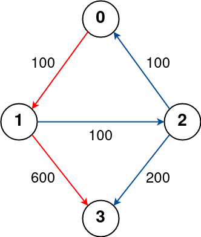

```text
输入: 
n = 4, flights = [[0,1,100],[1,2,100],[2,0,100],[1,3,600],[2,3,200]], src = 0, dst = 3, k = 1
输出: 700
```

解释：城市航班图如上 从城市 0 到城市 3 经过最多 1 站的最佳路径用红色标记，费用为 100 + 600 = 700。 请注意，通过城市 [0, 1, 2, 3] 的路径更便宜，但无效，因为它经过了 2 站。

**示例 2**

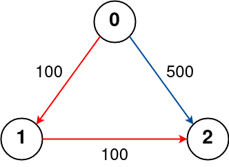

```text
输入: 
n = 3, edges = [[0,1,100],[1,2,100],[0,2,500]], src = 0, dst = 2, k = 1
输出: 200
```

解释：城市航班图如上 从城市 0 到城市 2 经过最多 1 站的最佳路径标记为红色，费用为 100 + 100 = 200。

**示例 3**

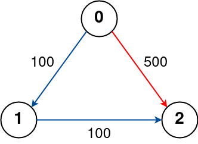

```text
输入：n = 3, flights = [[0,1,100],[1,2,100],[0,2,500]], src = 0, dst = 2, k = 0
输出：500
```

解释：城市航班图如上 从城市 0 到城市 2 不经过站点的最佳路径标记为红色，费用为 500。
> 题面与 [leetcode.cn 官方](https://leetcode.cn/problems/cheapest-flights-within-k-stops/)一致，示例配图取自官方题面。

**数据范围与注意事项**：

- `2 <= n <= 100`
- `0 <= flights.length <= (n  (n - 1) / 2)`
- `flights[i].length == 3`
- `0 <= from_i, to_i < n`
- `from_i != to_i`
- `1 <= price_i <= 10^4`
- 航班没有重复，且不存在自环
- `0 <= src, dst, k < n`
- **易错点**：初始化（第 0 行或列）的含义要想清楚，它决定后续转移是否成立。

## 题目分析

**场景是什么**：把大问题拆成小问题并记住结果，对应真实开发里的编辑距离、资源规划。本题就是该场景的 Medium 级练习，主线做法是「动态规划」。

**主线怎么解**：把主解法从头到尾过一遍，它其实在依次做这几件事：DP 表逐项填充 → 双重循环遍历。

## 解题思路

**方案对比**（共 11 个方案，由浅入深）：

| 方案 | 时间复杂度 | 空间复杂度 |
|---|---|---|
| 方案 1 · 动态规划 | O(n) 到 O(m·n)（取决于状态维度） | 即 DP 表大小 |
| 方案 2 · 双重循环枚举 | O(n²)（两层嵌套扫描） | O(1) 到 O(n) |
| 方案 3 · 双重循环枚举 | O(n)（单趟线性扫描） | O(1) 到 O(n)（视辅助结构） |
| 方案 4 · 双重循环枚举 | O(n²)（两层嵌套扫描） | O(1) 到 O(n) |
| 方案 5 · 双重循环枚举 | O(n²)（两层嵌套扫描） | O(1) 到 O(n) |
| 方案 6 · 双重循环枚举 | O(n²)（两层嵌套扫描） | O(1) 到 O(n) |
| 方案 7 · 双重循环枚举 | O(n²)（两层嵌套扫描） | O(1) 到 O(n) |
| 方案 8 · 双重循环枚举 | O(n²)（两层嵌套扫描） | O(1) 到 O(n) |
| 方案 9 · 双重循环枚举 | O(n²)（两层嵌套扫描） | O(1) 到 O(n) |
| 方案 10 · 双重循环枚举 | O(n²)（两层嵌套扫描） | O(1) 到 O(n) |
| 方案 11 · 双重循环枚举 | O(n²)（两层嵌套扫描） | O(1) 到 O(n) |

**由浅入深的路径**：动态规划 → 双重循环枚举；每往右一步，都在补上一步的短板。

**方案间的取舍**：方案 1（动态规划）；方案 2（双重循环枚举）；方案 3（双重循环枚举）；方案 4（双重循环枚举）；方案 5（双重循环枚举）；方案 6（双重循环枚举）；方案 7（双重循环枚举）；方案 8（双重循环枚举）；方案 9（双重循环枚举）；方案 10（双重循环枚举）；方案 11（双重循环枚举）。数据规模小、可读性优先时选靠前的方案；规模大、性能优先时选靠后的方案。

**怎么读这一篇**：

- 🐣 **新手路线**：把「题目描述」的示例 1 在纸上手推一遍 → 读方案 1（最直观的写法）与它的代码走读 → 按「运行方式」本地跑通看 PASS → 回头对比方案 2 之后的写法差在哪
- 🦅 **大佬路线**：直接锁定最优方案 1（动态规划，O(n) 到 O(m·n)（取决于状态维度））→ 跳读该方案代码与走读 → 用「逐步拆解与面试追问」补齐复杂度推导与边界追问

### 动态算法图（DP 表填充，GIF 自动循环）


动画演示动态规划专题里DP 表填充的典型过程；每个方案在「TypeScript 解题方案」一节还配了专属动画与专属流程图。

### 主解法流程图（真实控制流）

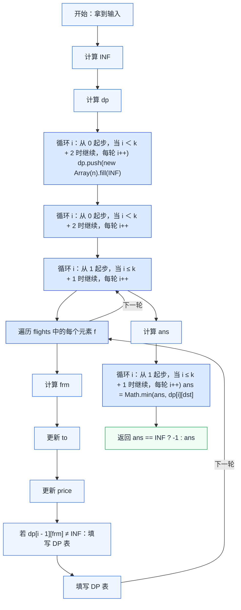

## TypeScript 解题方案（11 个方案逐个讲）

> **运行与提交**：每个方案都是自包含文件（内嵌用例自测，输出 PASS），整块复制到 `.ts` 文件后 `node 文件名` 即可运行。提交 LeetCode 时，把 `demo` 内的算法函数与辅助类型/函数整体取出、置于文件顶层即可。涉及交互/特殊接口的题以题面给定签名为准。

### 方案 1：动态规划

**分析与思路**：核心做法是「动态规划」。代码里依次做这些事：DP 表逐项填充；双重循环遍历。

**作者原文要点**：原文作者给出了自顶向下的分解公式：F(src, dst, k) = Min(F(src, dst - 1, k - 1) + F(dst - 1, dst, 1))，即「到 dst - 1 且剩 k - 1 站的最优花费 + 最后一跳直达 dst 的价格」，并指出其实现比官方签名少一个参数 n 也能运行，这与正文的递推方向（从 src 出发向外扩 k 轮）互为镜像，建议对照理解。

**运行方式**：`node 本文件`，内嵌用例全部通过会输出 PASS。


**方案专属流程图**（真实控制流）：

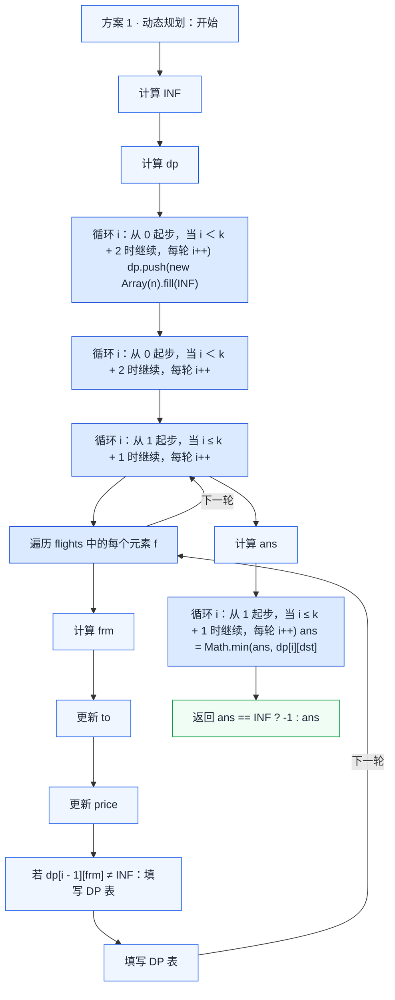

```typescript
export function demo(): void {
  // 程序入口：跑内嵌自测用例
  function findCheapestPrice(
    n: number,
    flights: number[][],
    src: number,
    dst: number,
    k: number,
  ): number {
    // 定义函数/方法 findCheapestPrice
    const INF = Infinity; // 把 Infinity 存入 INF
    const dp: number[][] = []; // 把 []; 写入 const dp: number[][]
    for (let i = 0; i < k + 2; i++) dp.push(new Array(n).fill(INF)); // 让 下标 i 从 0 开始计数，下标 i 小于 下标 k 加 2 就继续
    for (let i = 0; i < k + 2; i++) dp[i][src] = 0; // 让 下标 i 从 0 开始计数，下标 i 小于 下标 k 加 2 就继续
    for (let i = 1; i <= k + 1; i++) {
      // 让 下标 i 从 1 开始计数，下标 i 不超过 下标 k 加 1 就继续
      for (const f of flights) {
        // for (const f of flights) {
        const frm = f[0],
          to = f[1],
          price = f[2]; // 把 f[0], to 赋值为 f[1], price 赋值为 f[2] 存入 frm
        if (dp[i - 1][frm] !== INF)
          dp[i][to] = Math.min(dp[i][to], dp[i - 1][frm] + price);
      }
    }
    let ans = INF; // 把 INF 存入 答案
    for (let i = 1; i <= k + 1; i++) ans = Math.min(ans, dp[i][dst]); // 让 下标 i 从 1 开始计数，下标 i 不超过 下标 k 加 1 就继续
    return ans === INF ? -1 : ans; // 返回 答案 全等于 INF ? 减 1 : 答案
  }
  const cases = [
    {
      n: 4,
      flights: [
        [0, 1, 100],
        [1, 2, 100],
        [2, 0, 100],
        [1, 3, 600],
        [2, 3, 200],
      ],
      src: 0,
      dst: 3,
      k: 1,
      want: 700,
    },
    {
      n: 4,
      flights: [
        [0, 1, 100],
        [1, 2, 100],
        [2, 0, 100],
        [1, 3, 600],
        [2, 3, 200],
      ],
      src: 0,
      dst: 0,
      k: 1,
      want: 0,
    },
    {
      n: 3,
      flights: [
        [0, 1, 1],
        [1, 2, 1],
      ],
      src: 0,
      dst: 2,
      k: 1,
      want: 2,
    },
    { n: 3, flights: [[0, 1, 1]], src: 0, dst: 2, k: 1, want: -1 },
  ];
  let fail = false; // 把 false 存入 fail
  for (const c of cases) {
    // for (const 字符 of cases) {
    const got = findCheapestPrice(c.n, c.flights, c.src, c.dst, c.k);
    if (got !== c.want) {
      fail = true;
      console.log(
        'FAIL findCheapestPrice n=' + c.n + ' want ' + c.want + ' got ' + got,
      );
    }
  }
  if (fail) throw new Error('FAILED'); // 若 fail) throw new Error(「FAILED」);
  console.log('PASS'); // 全部用例通过，输出 PASS
}
demo(); // demo();
```

### 方案 2：双重循环枚举

**分析与思路**：核心做法是「双重循环枚举」。代码里依次做这些事：双重循环遍历。

**运行方式**：`node 本文件`，内嵌用例全部通过会输出 PASS。


**方案专属流程图**（真实控制流）：


```typescript
export function demo(): void {
  // 程序入口：跑内嵌自测用例
  function findCheapestPrice(
    n: number,
    flights: number[][],
    src: number,
    dst: number,
    k: number,
  ): number {
    // 定义函数/方法 findCheapestPrice
    const INF = Infinity; // 把 Infinity 存入 INF
    const dist: number[] = new Array(n).fill(INF); // 把 new Array(元素个数).fill(INF); 写入 const dist: number[]
    dist[src] = 0; // 把 0; 写入 dist[src]
    for (let pass = 0; pass < k + 1; pass++) {
      // 让 pass 从 0 开始计数，pass 小于 下标 k 加 1 就继续
      const prev = dist.slice(); // 把 dist 截取 ) 存入 前一个
      for (const f of flights) {
        // for (const f of flights) {
        const frm = f[0],
          to = f[1],
          price = f[2]; // 把 f[0], to 赋值为 f[1], price 赋值为 f[2] 存入 frm
        if (prev[frm] !== INF) dist[to] = Math.min(dist[to], prev[frm] + price);
      }
    }
    return dist[dst] === INF ? -1 : dist[dst]; // 返回 dist[dst] 全等于 INF ? 减 1 : dist[dst]
  }
  const cases = [
    {
      n: 4,
      flights: [
        [0, 1, 100],
        [1, 2, 100],
        [2, 0, 100],
        [1, 3, 600],
        [2, 3, 200],
      ],
      src: 0,
      dst: 3,
      k: 1,
      want: 700,
    },
    {
      n: 4,
      flights: [
        [0, 1, 100],
        [1, 2, 100],
        [2, 0, 100],
        [1, 3, 600],
        [2, 3, 200],
      ],
      src: 0,
      dst: 0,
      k: 1,
      want: 0,
    },
    {
      n: 3,
      flights: [
        [0, 1, 1],
        [1, 2, 1],
      ],
      src: 0,
      dst: 2,
      k: 1,
      want: 2,
    },
    { n: 3, flights: [[0, 1, 1]], src: 0, dst: 2, k: 1, want: -1 },
  ];
  let fail = false; // 把 false 存入 fail
  for (const c of cases) {
    // for (const 字符 of cases) {
    const got = findCheapestPrice(c.n, c.flights, c.src, c.dst, c.k);
    if (got !== c.want) {
      fail = true;
      console.log(
        'FAIL findCheapestPrice n=' + c.n + ' want ' + c.want + ' got ' + got,
      );
    }
  }
  if (fail) throw new Error('FAILED'); // 若 fail) throw new Error(「FAILED」);
  console.log('PASS'); // 全部用例通过，输出 PASS
}
demo(); // demo();
```

### 方案 3：双重循环枚举

**分析与思路**：核心做法是「双重循环枚举」。代码里依次做这些事：双重循环遍历。

**运行方式**：`node 本文件`，内嵌用例全部通过会输出 PASS。


**方案专属流程图**（真实控制流）：

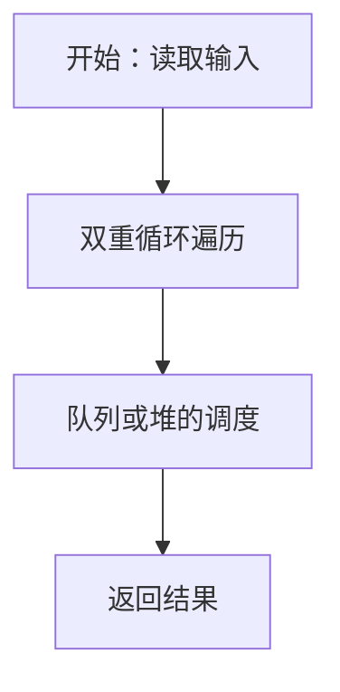

```typescript
export function demo(): void {
  // 程序入口：跑内嵌自测用例
  function findCheapestPrice(
    n: number,
    flights: number[][],
    src: number,
    dst: number,
    k: number,
  ): number {
    // 定义函数/方法 findCheapestPrice
    const INF = Infinity; // 把 Infinity 存入 INF
    const graph: { [k: number]: number[][] } = {}; // 把 {}; 写入 const graph: { [k: number]: number[][] }
    for (const f of flights) {
      // for (const f of flights) {
      const frm = f[0],
        to = f[1],
        price = f[2]; // 把 f[0], to 赋值为 f[1], price 赋值为 f[2] 存入 frm
      if (!graph[frm]) graph[frm] = []; // 若 取反 graph[frm]) graph[frm] 赋值为 [];
      graph[frm].push([to, price]); // 把 [to, price] 压入栈/数组尾部
    }
    const memo: { [k: string]: number } = {}; // 把 {}; 写入 const memo: { [k: string]: number }
    function dfs(city: number, rem: number): number {
      // 定义函数/方法 dfs
      if (city === dst) return 0; // 若 city 全等于 dst，直接返回 0
      if (rem === 0) return INF; // 若 rem 全等于 0，直接返回 INF
      const key = city + ',' + rem; // 把 city 加 「,」 加 rem 存入 key
      if (memo[key] !== undefined) return memo[key]; // 若 记忆化表[key] 不等于 undefined，直接返回 记忆化表[key]
      let best = INF; // 把 INF 存入 当前最优
      const edges = graph[city] || []; // 把 graph[city] 或 [] 存入 边集
      for (const e of edges) {
        // for (const e of 边集) {
        const to = e[0],
          price = e[1]; // 把 e[0], price 赋值为 e[1] 存入 to
        const nxt = dfs(to, rem - 1); // 把 dfs(to, rem 减 1) 存入 nxt
        if (nxt !== INF) best = Math.min(best, price + nxt); // 若 nxt 不等于 INF) 当前最优 赋值为 Math.取较小值 当前最优, price 加 nxt);
      }
      memo[key] = best; // 把 当前最优; 写入 memo[key]
      return best; // 返回 当前最优
    }
    const res = dfs(src, k + 1); // 把 dfs(src, 下标 k 加 1) 存入 结果
    return res === INF ? -1 : res; // 返回 结果 全等于 INF ? 减 1 : 结果
  }
  const cases = [
    {
      n: 4,
      flights: [
        [0, 1, 100],
        [1, 2, 100],
        [2, 0, 100],
        [1, 3, 600],
        [2, 3, 200],
      ],
      src: 0,
      dst: 3,
      k: 1,
      want: 700,
    },
    {
      n: 4,
      flights: [
        [0, 1, 100],
        [1, 2, 100],
        [2, 0, 100],
        [1, 3, 600],
        [2, 3, 200],
      ],
      src: 0,
      dst: 0,
      k: 1,
      want: 0,
    },
    {
      n: 3,
      flights: [
        [0, 1, 1],
        [1, 2, 1],
      ],
      src: 0,
      dst: 2,
      k: 1,
      want: 2,
    },
    { n: 3, flights: [[0, 1, 1]], src: 0, dst: 2, k: 1, want: -1 },
  ];
  let fail = false; // 把 false 存入 fail
  for (const c of cases) {
    // for (const 字符 of cases) {
    const got = findCheapestPrice(c.n, c.flights, c.src, c.dst, c.k);
    if (got !== c.want) {
      fail = true;
      console.log(
        'FAIL findCheapestPrice n=' + c.n + ' want ' + c.want + ' got ' + got,
      );
    }
  }
  if (fail) throw new Error('FAILED'); // 若 fail) throw new Error(「FAILED」);
  console.log('PASS'); // 全部用例通过，输出 PASS
}
demo(); // demo();
```

### 方案 4：双重循环枚举

**分析与思路**：核心做法是「双重循环枚举」。代码里依次做这些事：双重循环遍历。

**运行方式**：`node 本文件`，内嵌用例全部通过会输出 PASS。


**方案专属流程图**（真实控制流）：


```typescript
export function demo(): void {
  // 程序入口：跑内嵌自测用例
  function findCheapestPrice(
    n: number,
    flights: number[][],
    src: number,
    dst: number,
    k: number,
  ): number {
    // 定义函数/方法 findCheapestPrice
    const INF = Infinity; // 把 Infinity 存入 INF
    const dist: number[] = new Array(n).fill(INF); // 把 new Array(元素个数).fill(INF); 写入 const dist: number[]
    dist[src] = 0; // 把 0; 写入 dist[src]
    for (let pass = 0; pass < k + 1; pass++) {
      // 让 pass 从 0 开始计数，pass 小于 下标 k 加 1 就继续
      const prev = dist.slice(); // 把 dist 截取 ) 存入 前一个
      for (const f of flights) {
        // for (const f of flights) {
        const frm = f[0],
          to = f[1],
          price = f[2]; // 把 f[0], to 赋值为 f[1], price 赋值为 f[2] 存入 frm
        if (prev[frm] !== INF) dist[to] = Math.min(dist[to], prev[frm] + price);
      }
    }
    return dist[dst] === INF ? -1 : dist[dst]; // 返回 dist[dst] 全等于 INF ? 减 1 : dist[dst]
  }
  const cases = [
    {
      n: 4,
      flights: [
        [0, 1, 100],
        [1, 2, 100],
        [2, 0, 100],
        [1, 3, 600],
        [2, 3, 200],
      ],
      src: 0,
      dst: 3,
      k: 1,
      want: 700,
    },
    {
      n: 4,
      flights: [
        [0, 1, 100],
        [1, 2, 100],
        [2, 0, 100],
        [1, 3, 600],
        [2, 3, 200],
      ],
      src: 0,
      dst: 0,
      k: 1,
      want: 0,
    },
    {
      n: 3,
      flights: [
        [0, 1, 1],
        [1, 2, 1],
      ],
      src: 0,
      dst: 2,
      k: 1,
      want: 2,
    },
    { n: 3, flights: [[0, 1, 1]], src: 0, dst: 2, k: 1, want: -1 },
  ];
  let fail = false; // 把 false 存入 fail
  for (const c of cases) {
    // for (const 字符 of cases) {
    const got = findCheapestPrice(c.n, c.flights, c.src, c.dst, c.k);
    if (got !== c.want) {
      fail = true;
      console.log(
        'FAIL findCheapestPrice n=' + c.n + ' want ' + c.want + ' got ' + got,
      );
    }
  }
  if (fail) throw new Error('FAILED'); // 若 fail) throw new Error(「FAILED」);
  console.log('PASS'); // 全部用例通过，输出 PASS
}
demo(); // demo();
```

### 方案 5：双重循环枚举

**分析与思路**：核心做法是「双重循环枚举」。代码里依次做这些事：双重循环遍历。

**运行方式**：`node 本文件`，内嵌用例全部通过会输出 PASS。


**方案专属流程图**（真实控制流）：

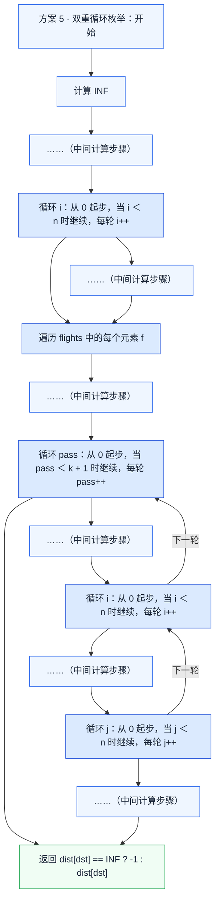

```typescript
export function demo(): void {
  // 程序入口：跑内嵌自测用例
  function findCheapestPrice(
    n: number,
    flights: number[][],
    src: number,
    dst: number,
    k: number,
  ): number {
    // 定义函数/方法 findCheapestPrice
    const INF = Infinity; // 把 Infinity 存入 INF
    const w: number[][] = []; // 把 []; 写入 const w: number[][]
    for (let i = 0; i < n; i++) {
      w.push(new Array(n).fill(INF));
      w[i][i] = 0;
    } // 让 下标 i 从 0 开始计数，下标 i 小于 元素个数 就继续
    for (const f of flights) {
      w[f[0]][f[1]] = f[2];
    } // 把 f[2]; } 写入 for (const f of flights) { w[f[0]][f[1]]
    const dist: number[] = new Array(n).fill(INF); // 把 new Array(元素个数).fill(INF); 写入 const dist: number[]
    dist[src] = 0; // 把 0; 写入 dist[src]
    for (let pass = 0; pass < k + 1; pass++) {
      // 让 pass 从 0 开始计数，pass 小于 下标 k 加 1 就继续
      const prev = dist.slice(); // 把 dist 截取 ) 存入 前一个
      for (let i = 0; i < n; i++) {
        // 让 下标 i 从 0 开始计数，下标 i 小于 元素个数 就继续
        if (prev[i] === INF) continue; // 若 前一个[下标 i] 全等于 INF) continue;
        for (let j = 0; j < n; j++) {
          // 让 下标 j 从 0 开始计数，下标 j 小于 元素个数 就继续
          if (prev[i] + w[i][j] < dist[j]) dist[j] = prev[i] + w[i][j];
        }
      }
    }
    return dist[dst] === INF ? -1 : dist[dst]; // 返回 dist[dst] 全等于 INF ? 减 1 : dist[dst]
  }
  const cases = [
    {
      n: 4,
      flights: [
        [0, 1, 100],
        [1, 2, 100],
        [2, 0, 100],
        [1, 3, 600],
        [2, 3, 200],
      ],
      src: 0,
      dst: 3,
      k: 1,
      want: 700,
    },
    {
      n: 4,
      flights: [
        [0, 1, 100],
        [1, 2, 100],
        [2, 0, 100],
        [1, 3, 600],
        [2, 3, 200],
      ],
      src: 0,
      dst: 0,
      k: 1,
      want: 0,
    },
    {
      n: 3,
      flights: [
        [0, 1, 1],
        [1, 2, 1],
      ],
      src: 0,
      dst: 2,
      k: 1,
      want: 2,
    },
    { n: 3, flights: [[0, 1, 1]], src: 0, dst: 2, k: 1, want: -1 },
  ];
  let fail = false; // 把 false 存入 fail
  for (const c of cases) {
    // for (const 字符 of cases) {
    const got = findCheapestPrice(c.n, c.flights, c.src, c.dst, c.k);
    if (got !== c.want) {
      fail = true;
      console.log(
        'FAIL findCheapestPrice n=' + c.n + ' want ' + c.want + ' got ' + got,
      );
    }
  }
  if (fail) throw new Error('FAILED'); // 若 fail) throw new Error(「FAILED」);
  console.log('PASS'); // 全部用例通过，输出 PASS
}
demo(); // demo();
```

### 方案 6：双重循环枚举

**分析与思路**：核心做法是「双重循环枚举」。代码里依次做这些事：双重循环遍历。

**运行方式**：`node 本文件`，内嵌用例全部通过会输出 PASS。


**方案专属流程图**（真实控制流）：


```typescript
export function demo(): void {
  // 程序入口：跑内嵌自测用例
  function findCheapestPrice(
    n: number,
    flights: number[][],
    src: number,
    dst: number,
    k: number,
  ): number {
    // 定义函数/方法 findCheapestPrice
    const INF = Infinity; // 把 Infinity 存入 INF
    const dist: number[] = new Array(n).fill(INF); // 把 new Array(元素个数).fill(INF); 写入 const dist: number[]
    dist[src] = 0; // 把 0; 写入 dist[src]
    for (let pass = 0; pass < k + 1; pass++) {
      // 让 pass 从 0 开始计数，pass 小于 下标 k 加 1 就继续
      const prev = dist.slice(); // 把 dist 截取 ) 存入 前一个
      for (const f of flights) {
        // for (const f of flights) {
        const frm = f[0],
          to = f[1],
          price = f[2]; // 把 f[0], to 赋值为 f[1], price 赋值为 f[2] 存入 frm
        if (prev[frm] !== INF) dist[to] = Math.min(dist[to], prev[frm] + price);
      }
    }
    return dist[dst] === INF ? -1 : dist[dst]; // 返回 dist[dst] 全等于 INF ? 减 1 : dist[dst]
  }
  const cases = [
    {
      n: 4,
      flights: [
        [0, 1, 100],
        [1, 2, 100],
        [2, 0, 100],
        [1, 3, 600],
        [2, 3, 200],
      ],
      src: 0,
      dst: 3,
      k: 1,
      want: 700,
    },
    {
      n: 4,
      flights: [
        [0, 1, 100],
        [1, 2, 100],
        [2, 0, 100],
        [1, 3, 600],
        [2, 3, 200],
      ],
      src: 0,
      dst: 0,
      k: 1,
      want: 0,
    },
    {
      n: 3,
      flights: [
        [0, 1, 1],
        [1, 2, 1],
      ],
      src: 0,
      dst: 2,
      k: 1,
      want: 2,
    },
    { n: 3, flights: [[0, 1, 1]], src: 0, dst: 2, k: 1, want: -1 },
  ];
  let fail = false; // 把 false 存入 fail
  for (const c of cases) {
    // for (const 字符 of cases) {
    const got = findCheapestPrice(c.n, c.flights, c.src, c.dst, c.k);
    if (got !== c.want) {
      fail = true;
      console.log(
        'FAIL findCheapestPrice n=' + c.n + ' want ' + c.want + ' got ' + got,
      );
    }
  }
  if (fail) throw new Error('FAILED'); // 若 fail) throw new Error(「FAILED」);
  console.log('PASS'); // 全部用例通过，输出 PASS
}
demo(); // demo();
```

### 方案 7：双重循环枚举

**分析与思路**：核心做法是「双重循环枚举」。代码里依次做这些事：双重循环遍历。

**运行方式**：`node 本文件`，内嵌用例全部通过会输出 PASS。


**方案专属流程图**（真实控制流）：


```typescript
export function demo(): void {
  // 程序入口：跑内嵌自测用例
  function findCheapestPrice(
    n: number,
    flights: number[][],
    src: number,
    dst: number,
    k: number,
  ): number {
    // 定义函数/方法 findCheapestPrice
    const INF = Infinity; // 把 Infinity 存入 INF
    const dist: number[] = new Array(n).fill(INF); // 把 new Array(元素个数).fill(INF); 写入 const dist: number[]
    dist[src] = 0; // 把 0; 写入 dist[src]
    for (let pass = 0; pass < k + 1; pass++) {
      // 让 pass 从 0 开始计数，pass 小于 下标 k 加 1 就继续
      const prev = dist.slice(); // 把 dist 截取 ) 存入 前一个
      for (const f of flights) {
        // for (const f of flights) {
        const frm = f[0],
          to = f[1],
          price = f[2]; // 把 f[0], to 赋值为 f[1], price 赋值为 f[2] 存入 frm
        if (prev[frm] !== INF) dist[to] = Math.min(dist[to], prev[frm] + price);
      }
    }
    return dist[dst] === INF ? -1 : dist[dst]; // 返回 dist[dst] 全等于 INF ? 减 1 : dist[dst]
  }
  const cases = [
    {
      n: 4,
      flights: [
        [0, 1, 100],
        [1, 2, 100],
        [2, 0, 100],
        [1, 3, 600],
        [2, 3, 200],
      ],
      src: 0,
      dst: 3,
      k: 1,
      want: 700,
    },
    {
      n: 4,
      flights: [
        [0, 1, 100],
        [1, 2, 100],
        [2, 0, 100],
        [1, 3, 600],
        [2, 3, 200],
      ],
      src: 0,
      dst: 0,
      k: 1,
      want: 0,
    },
    {
      n: 3,
      flights: [
        [0, 1, 1],
        [1, 2, 1],
      ],
      src: 0,
      dst: 2,
      k: 1,
      want: 2,
    },
    { n: 3, flights: [[0, 1, 1]], src: 0, dst: 2, k: 1, want: -1 },
  ];
  let fail = false; // 把 false 存入 fail
  for (const c of cases) {
    // for (const 字符 of cases) {
    const got = findCheapestPrice(c.n, c.flights, c.src, c.dst, c.k);
    if (got !== c.want) {
      fail = true;
      console.log(
        'FAIL findCheapestPrice n=' + c.n + ' want ' + c.want + ' got ' + got,
      );
    }
  }
  if (fail) throw new Error('FAILED'); // 若 fail) throw new Error(「FAILED」);
  console.log('PASS'); // 全部用例通过，输出 PASS
}
demo(); // demo();
```

### 方案 8：双重循环枚举

**分析与思路**：核心做法是「双重循环枚举」。代码里依次做这些事：双重循环遍历。

**运行方式**：`node 本文件`，内嵌用例全部通过会输出 PASS。


**方案专属流程图**（真实控制流）：


```typescript
export function demo(): void {
  // 程序入口：跑内嵌自测用例
  function findCheapestPrice(
    n: number,
    flights: number[][],
    src: number,
    dst: number,
    k: number,
  ): number {
    // 定义函数/方法 findCheapestPrice
    const INF = Infinity; // 把 Infinity 存入 INF
    const dist: number[] = new Array(n).fill(INF); // 把 new Array(元素个数).fill(INF); 写入 const dist: number[]
    dist[src] = 0; // 把 0; 写入 dist[src]
    for (let pass = 0; pass < k + 1; pass++) {
      // 让 pass 从 0 开始计数，pass 小于 下标 k 加 1 就继续
      const prev = dist.slice(); // 把 dist 截取 ) 存入 前一个
      for (const f of flights) {
        // for (const f of flights) {
        const frm = f[0],
          to = f[1],
          price = f[2]; // 把 f[0], to 赋值为 f[1], price 赋值为 f[2] 存入 frm
        if (prev[frm] !== INF) dist[to] = Math.min(dist[to], prev[frm] + price);
      }
    }
    return dist[dst] === INF ? -1 : dist[dst]; // 返回 dist[dst] 全等于 INF ? 减 1 : dist[dst]
  }
  const cases = [
    {
      n: 4,
      flights: [
        [0, 1, 100],
        [1, 2, 100],
        [2, 0, 100],
        [1, 3, 600],
        [2, 3, 200],
      ],
      src: 0,
      dst: 3,
      k: 1,
      want: 700,
    },
    {
      n: 4,
      flights: [
        [0, 1, 100],
        [1, 2, 100],
        [2, 0, 100],
        [1, 3, 600],
        [2, 3, 200],
      ],
      src: 0,
      dst: 0,
      k: 1,
      want: 0,
    },
    {
      n: 3,
      flights: [
        [0, 1, 1],
        [1, 2, 1],
      ],
      src: 0,
      dst: 2,
      k: 1,
      want: 2,
    },
    { n: 3, flights: [[0, 1, 1]], src: 0, dst: 2, k: 1, want: -1 },
  ];
  let fail = false; // 把 false 存入 fail
  for (const c of cases) {
    // for (const 字符 of cases) {
    const got = findCheapestPrice(c.n, c.flights, c.src, c.dst, c.k);
    if (got !== c.want) {
      fail = true;
      console.log(
        'FAIL findCheapestPrice n=' + c.n + ' want ' + c.want + ' got ' + got,
      );
    }
  }
  if (fail) throw new Error('FAILED'); // 若 fail) throw new Error(「FAILED」);
  console.log('PASS'); // 全部用例通过，输出 PASS
}
demo(); // demo();
```

### 方案 9：双重循环枚举

**分析与思路**：核心做法是「双重循环枚举」。代码里依次做这些事：双重循环遍历。

**运行方式**：`node 本文件`，内嵌用例全部通过会输出 PASS。

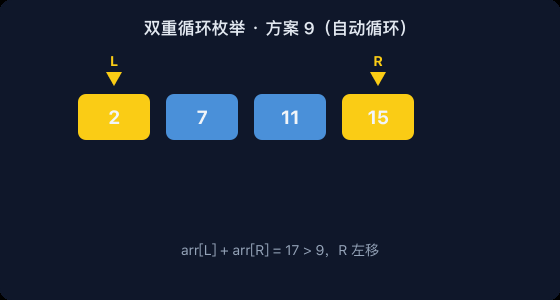

**方案专属流程图**（真实控制流）：

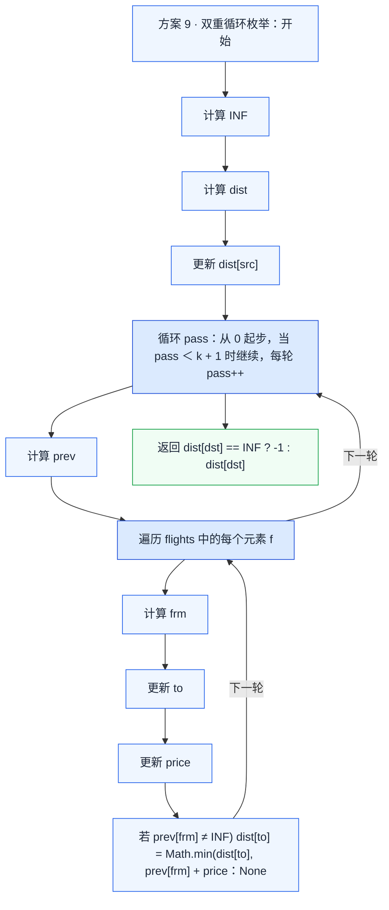

```typescript
export function demo(): void {
  // 程序入口：跑内嵌自测用例
  function findCheapestPrice(
    n: number,
    flights: number[][],
    src: number,
    dst: number,
    k: number,
  ): number {
    // 定义函数/方法 findCheapestPrice
    const INF = Infinity; // 把 Infinity 存入 INF
    const dist: number[] = new Array(n).fill(INF); // 把 new Array(元素个数).fill(INF); 写入 const dist: number[]
    dist[src] = 0; // 把 0; 写入 dist[src]
    for (let pass = 0; pass < k + 1; pass++) {
      // 让 pass 从 0 开始计数，pass 小于 下标 k 加 1 就继续
      const prev = dist.slice(); // 把 dist 截取 ) 存入 前一个
      for (const f of flights) {
        // for (const f of flights) {
        const frm = f[0],
          to = f[1],
          price = f[2]; // 把 f[0], to 赋值为 f[1], price 赋值为 f[2] 存入 frm
        if (prev[frm] !== INF) dist[to] = Math.min(dist[to], prev[frm] + price);
      }
    }
    return dist[dst] === INF ? -1 : dist[dst]; // 返回 dist[dst] 全等于 INF ? 减 1 : dist[dst]
  }
  const cases = [
    {
      n: 4,
      flights: [
        [0, 1, 100],
        [1, 2, 100],
        [2, 0, 100],
        [1, 3, 600],
        [2, 3, 200],
      ],
      src: 0,
      dst: 3,
      k: 1,
      want: 700,
    },
    {
      n: 4,
      flights: [
        [0, 1, 100],
        [1, 2, 100],
        [2, 0, 100],
        [1, 3, 600],
        [2, 3, 200],
      ],
      src: 0,
      dst: 0,
      k: 1,
      want: 0,
    },
    {
      n: 3,
      flights: [
        [0, 1, 1],
        [1, 2, 1],
      ],
      src: 0,
      dst: 2,
      k: 1,
      want: 2,
    },
    { n: 3, flights: [[0, 1, 1]], src: 0, dst: 2, k: 1, want: -1 },
  ];
  let fail = false; // 把 false 存入 fail
  for (const c of cases) {
    // for (const 字符 of cases) {
    const got = findCheapestPrice(c.n, c.flights, c.src, c.dst, c.k);
    if (got !== c.want) {
      fail = true;
      console.log(
        'FAIL findCheapestPrice n=' + c.n + ' want ' + c.want + ' got ' + got,
      );
    }
  }
  if (fail) throw new Error('FAILED'); // 若 fail) throw new Error(「FAILED」);
  console.log('PASS'); // 全部用例通过，输出 PASS
}
demo(); // demo();
```

### 方案 10：双重循环枚举

**分析与思路**：核心做法是「双重循环枚举」。代码里依次做这些事：双重循环遍历。

**运行方式**：`node 本文件`，内嵌用例全部通过会输出 PASS。


**方案专属流程图**（真实控制流）：


```typescript
export function demo(): void {
  // 程序入口：跑内嵌自测用例
  function findCheapestPrice(
    n: number,
    flights: number[][],
    src: number,
    dst: number,
    k: number,
  ): number {
    // 定义函数/方法 findCheapestPrice
    const INF = Infinity; // 把 Infinity 存入 INF
    const dist: number[] = new Array(n).fill(INF); // 把 new Array(元素个数).fill(INF); 写入 const dist: number[]
    dist[src] = 0; // 把 0; 写入 dist[src]
    for (let pass = 0; pass < k + 1; pass++) {
      // 让 pass 从 0 开始计数，pass 小于 下标 k 加 1 就继续
      const prev = dist.slice(); // 把 dist 截取 ) 存入 前一个
      for (const f of flights) {
        // for (const f of flights) {
        const frm = f[0],
          to = f[1],
          price = f[2]; // 把 f[0], to 赋值为 f[1], price 赋值为 f[2] 存入 frm
        if (prev[frm] !== INF) dist[to] = Math.min(dist[to], prev[frm] + price);
      }
    }
    return dist[dst] === INF ? -1 : dist[dst]; // 返回 dist[dst] 全等于 INF ? 减 1 : dist[dst]
  }
  const cases = [
    {
      n: 4,
      flights: [
        [0, 1, 100],
        [1, 2, 100],
        [2, 0, 100],
        [1, 3, 600],
        [2, 3, 200],
      ],
      src: 0,
      dst: 3,
      k: 1,
      want: 700,
    },
    {
      n: 4,
      flights: [
        [0, 1, 100],
        [1, 2, 100],
        [2, 0, 100],
        [1, 3, 600],
        [2, 3, 200],
      ],
      src: 0,
      dst: 0,
      k: 1,
      want: 0,
    },
    {
      n: 3,
      flights: [
        [0, 1, 1],
        [1, 2, 1],
      ],
      src: 0,
      dst: 2,
      k: 1,
      want: 2,
    },
    { n: 3, flights: [[0, 1, 1]], src: 0, dst: 2, k: 1, want: -1 },
  ];
  let fail = false; // 把 false 存入 fail
  for (const c of cases) {
    // for (const 字符 of cases) {
    const got = findCheapestPrice(c.n, c.flights, c.src, c.dst, c.k);
    if (got !== c.want) {
      fail = true;
      console.log(
        'FAIL findCheapestPrice n=' + c.n + ' want ' + c.want + ' got ' + got,
      );
    }
  }
  if (fail) throw new Error('FAILED'); // 若 fail) throw new Error(「FAILED」);
  console.log('PASS'); // 全部用例通过，输出 PASS
}
demo(); // demo();
```

### 方案 11：双重循环枚举

**分析与思路**：核心做法是「双重循环枚举」。代码里依次做这些事：双重循环遍历。

**运行方式**：`node 本文件`，内嵌用例全部通过会输出 PASS。


**方案专属流程图**（真实控制流）：

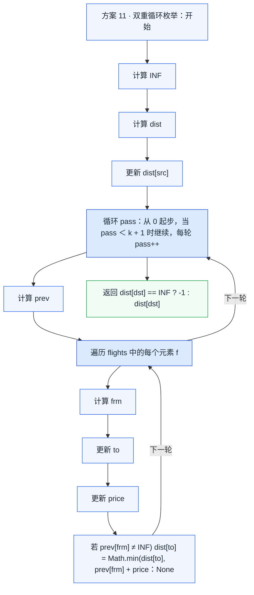

```typescript
export function demo(): void {
  // 程序入口：跑内嵌自测用例
  function findCheapestPrice(
    n: number,
    flights: number[][],
    src: number,
    dst: number,
    k: number,
  ): number {
    // 定义函数/方法 findCheapestPrice
    const INF = Infinity; // 把 Infinity 存入 INF
    const dist: number[] = new Array(n).fill(INF); // 把 new Array(元素个数).fill(INF); 写入 const dist: number[]
    dist[src] = 0; // 把 0; 写入 dist[src]
    for (let pass = 0; pass < k + 1; pass++) {
      // 让 pass 从 0 开始计数，pass 小于 下标 k 加 1 就继续
      const prev = dist.slice(); // 把 dist 截取 ) 存入 前一个
      for (const f of flights) {
        // for (const f of flights) {
        const frm = f[0],
          to = f[1],
          price = f[2]; // 把 f[0], to 赋值为 f[1], price 赋值为 f[2] 存入 frm
        if (prev[frm] !== INF) dist[to] = Math.min(dist[to], prev[frm] + price);
      }
    }
    return dist[dst] === INF ? -1 : dist[dst]; // 返回 dist[dst] 全等于 INF ? 减 1 : dist[dst]
  }
  const cases = [
    {
      n: 4,
      flights: [
        [0, 1, 100],
        [1, 2, 100],
        [2, 0, 100],
        [1, 3, 600],
        [2, 3, 200],
      ],
      src: 0,
      dst: 3,
      k: 1,
      want: 700,
    },
    {
      n: 4,
      flights: [
        [0, 1, 100],
        [1, 2, 100],
        [2, 0, 100],
        [1, 3, 600],
        [2, 3, 200],
      ],
      src: 0,
      dst: 0,
      k: 1,
      want: 0,
    },
    {
      n: 3,
      flights: [
        [0, 1, 1],
        [1, 2, 1],
      ],
      src: 0,
      dst: 2,
      k: 1,
      want: 2,
    },
    { n: 3, flights: [[0, 1, 1]], src: 0, dst: 2, k: 1, want: -1 },
  ];
  let fail = false; // 把 false 存入 fail
  for (const c of cases) {
    // for (const 字符 of cases) {
    const got = findCheapestPrice(c.n, c.flights, c.src, c.dst, c.k);
    if (got !== c.want) {
      fail = true;
      console.log(
        'FAIL findCheapestPrice n=' + c.n + ' want ' + c.want + ' got ' + got,
      );
    }
  }
  if (fail) throw new Error('FAILED'); // 若 fail) throw new Error(「FAILED」);
  console.log('PASS'); // 全部用例通过，输出 PASS
}
demo(); // demo();
```

## 逐步拆解与面试追问

**复杂度**：时间 O(n) 到 O(m·n)（取决于状态维度），空间即 DP 表大小

**为什么是这个量级**：动态规划把指数级枚举压成表，每格只算一次，复杂度等于「状态数 × 转移代价」

**面试官可能会追问**：

- 状态定义为什么是它？
- 遍历顺序由什么决定？
- 能否滚动数组压空间？

## 关键 API 速查（TS 主解法实际用到，附官方链接）

| API | 作用 | 使用要点 | 官方文档 |
|---|---|---|---|
| `Array.prototype.push()` | 尾部追加 | 返回新长度；可一次多个；均摊 O(1)；会改变原数组 | [官方文档](https://developer.mozilla.org/zh-CN/docs/Web/JavaScript/Reference/Global_Objects/Array/push) |
| `Math.min()` | 最小值 | 同 max；空参返回 Infinity | [官方文档](https://developer.mozilla.org/zh-CN/docs/Web/JavaScript/Reference/Global_Objects/Math/min) |

### 各语言官方文档导航

- **TypeScript / JS**：[MDN 中文参考](https://developer.mozilla.org/zh-CN/)
- **Python**：[Python 官方文档](https://docs.python.org/zh-cn/3/)
- **Go**：[Go 标准库](https://pkg.go.dev/std)
- **Java**：[JDK 17 API](https://docs.oracle.com/en/java/javase/17/docs/api/)
- **Rust**：[Rust 标准库](https://doc.rust-lang.org/std/)
- **Lua**：[Lua 5.4 手册](https://www.lua.org/manual/5.4/)
- **C**：[Cppreference C](https://zh.cppreference.com/w/c)
- **C++**：[Cppreference C++](https://zh.cppreference.com/w/cpp)
- **R**：[R 官方手册](https://stat.ethz.ch/R-manual/)
- **Zig**：[Zig 语言文档](https://ziglang.org/documentation/master/)
- **Dart**：[Dart API](https://api.dart.dev/)

## 附录：其他 10 种语言全部实现（每种语言列举其全部方案）

> TypeScript 的全部方案见「TypeScript 解题方案」一节；下面是其余 10 种语言的对应实现，每种语言的每个方案都带思路分析、代码走读与专属运行架构图。
> 每个方案都内嵌用例自测，可独立运行（老仓库 python/go 文件遵循「打印结果」约定）。
> 完整解法文件见 `dsa/<语言>/dp/lc_787_k_站中转内最便宜的航班/`。

### Python 实现（11 种方案）

Python 的全部方案如下，每个方案都内嵌用例自测，可独立运行（老仓库 python/go 文件遵循「打印结果」约定）：

#### 方案 1：动态规划

**思路与代码分析**：核心是「动态规划」。Python 版用切片与字典推导式简化操作，突出可读性。代码里依次做这些事：DP 表逐项填充。**走读**：方案 1 · 动态规划：开始 → 更新 INF → 填写 DP 表 → 循环 i：从 0 到 k + 2 前 → 填写 DP 表 → 循环 i：从 1 到 k + 2 前 → 遍历 flights: 中的每个元素 price → 若 dp[i - 1][frm] ≠ INF：填写 DP 表 → 填写 DP 表 → 更新 ans → 填写 DP 表 → 处理 ) → 返回 ans if ans ≠ INF else -1。

**运行架构**（真实控制流）：

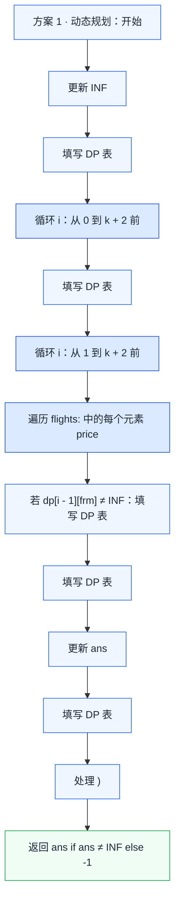

```python
import sys  # 提高递归深度上限（深输入防 RecursionError）

sys.setrecursionlimit(200000)  # 树/链表类题目节点数可达 1e4 量级

def findCheapestPrice(
    n, flights, src, dst, k
):  # 定义函数 findCheapestPrice（参数：元素个数, flights, src, dst, 下标 k）
    INF = float("inf")  # 把 float('inf') 存入 INF
    # dp[i][j]: 恰好经过 i 条边（i-1 次中转）到达城市 j 的最低价格
    dp = [[INF] * n for _ in range(k + 2)]  # 把 [[INF] 乘 元素个数 for _ in range(下标 k 加 2)] 存入 DP 表
    for i in range(k + 2):  # 让 下标 i 从 下标 k 加 2 遍历
        dp[i][src] = 0  # 把 0 写入 dp[i][src]
    for i in range(1, k + 2):  # 让 下标 i 从 1 到 下标 k 加 2 遍历
        for frm, to, price in flights:  # for frm, to, price in flights:
            if dp[i - 1][frm] != INF:  # 若 DP 表[下标 i 减 1][frm] 不等于 INF
                dp[i][to] = min(dp[i][to], dp[i - 1][frm] + price)
    ans = min(
        dp[i][dst] for i in range(1, k + 2)
    )  # 把 取较小值 DP 表[下标 i][dst] for 下标 i in range(1, 下标 k 加 2)) 存入 答案
    return ans if ans != INF else -1  # 返回 答案 if 答案 不等于 INF else 减 1

if __name__ == "__main__":  # 若 __name__ 等于 '__main__'
    print(
        findCheapestPrice(4, [[0, 1, 100], [1, 2, 100], [2, 0, 100], [1, 3, 600], [2, 3, 200]], 0, 3, 1)
    )  # 打印输出
```

#### 方案 2：双重循环枚举

**思路与代码分析**：核心是「双重循环枚举」。Python 版用切片与字典推导式简化操作，突出可读性。**走读**：方案 2 · 双重循环枚举：开始 → 更新 INF → 更新 dist → 更新 dist[src] → 循环 _：从 0 到 k + 1 前 → 更新 prev → 更新 updated → 遍历 flights: 中的每个元素 price → 处理 if ( → 更新 ! → 处理 ): → 更新 dist[to] → 更新 updated → 若 not updated：处理 break → 跳出循环（break） → 返回 dist[dst] if dist[dst] ≠ INF else -1。

**运行架构**（真实控制流）：

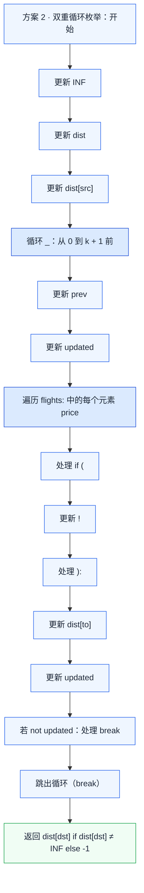

```python
import sys  # 提高递归深度上限（深输入防 RecursionError）

sys.setrecursionlimit(200000)  # 树/链表类题目节点数可达 1e4 量级

def findCheapestPrice(
    n, flights, src, dst, k
):  # 定义函数 findCheapestPrice（参数：元素个数, flights, src, dst, 下标 k）
    INF = float("inf")  # 把 float('inf') 存入 INF
    dist = [INF] * n  # 把 [INF] 乘 元素个数 存入 dist
    dist[src] = 0  # 把 0 写入 dist[src]
    # 最多经过 k 站中转 => 最多经过 k+1 条边，每轮用上一轮的快照松弛
    for _ in range(k + 1):  # 让 _ 从 下标 k 加 1 遍历
        prev = dist[:]  # 把 复制 dist 存入 前一个
        updated = False  # 把 False 存入 updated
        for frm, to, price in flights:  # for frm, to, price in flights:
            if (
                prev[frm] != INF and prev[frm] + price < dist[to]
            ):  # 若 前一个[frm] 不等于 INF and 前一个[frm] 加 price 小于 dist[to]
                dist[to] = prev[frm] + price  # 把 前一个[frm] 加 price 写入 dist[to]
                updated = True  # 把 True 存入 updated
        if not updated:  # 若 not updated
            break  # 跳出循环
    return dist[dst] if dist[dst] != INF else -1  # 返回 dist[dst] if dist[dst] 不等于 INF else 减 1

if __name__ == "__main__":  # 若 __name__ 等于 '__main__'
    print(
        findCheapestPrice(4, [[0, 1, 100], [1, 2, 100], [2, 0, 100], [1, 3, 600], [2, 3, 200]], 0, 3, 1)
    )  # 打印输出
```

#### 方案 3：双重循环枚举

**思路与代码分析**：核心是「双重循环枚举」。Python 版用切片与字典推导式简化操作，突出可读性。代码里依次做这些事：哈希结构做计数或查重。**走读**：方案 3 · 双重循环枚举：开始 → 处理 from collections import defa → 遍历 flights: 中的每个元素 price → 命中条件，直接返回 → 命中条件，直接返回 → 遍历 graph[city]: 中的每个元素 price → 返回 best → 返回 -1 if res == float(inf) else res。

**运行架构**（真实控制流）：

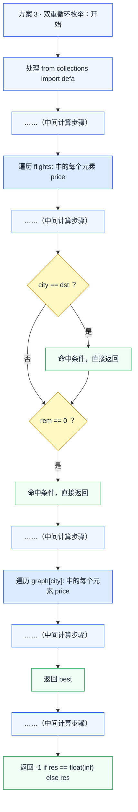

```python
import sys  # 提高递归深度上限（深输入防 RecursionError）

sys.setrecursionlimit(200000)  # 树/链表类题目节点数可达 1e4 量级

def findCheapestPrice(
    n, flights, src, dst, k
):  # 定义函数 findCheapestPrice（参数：元素个数, flights, src, dst, 下标 k）
    from collections import defaultdict  # from collections import defaultdict
    import functools  # 引入依赖

    graph = defaultdict(list)  # 把 defaultdict(列表) 存入 graph
    for frm, to, price in flights:  # for frm, to, price in flights:
        graph[frm].append((to, price))  # 把 (to, price 追加到列表尾部

    @functools.lru_cache(None)  # @functools.lru_cache(None)
    def dfs(city, rem):  # 定义函数 dfs（参数：city, rem）
        # rem: 还能乘坐的航班（边数）数量
        if city == dst:  # 若 city 等于 dst
            return 0  # 返回 0
        if rem == 0:  # 若 rem 等于 0
            return float("inf")  # 返回 float('inf')
        best = float("inf")  # 把 float('inf') 存入 当前最优
        for to, price in graph[city]:  # for to, price in graph[city]:
            nxt = dfs(to, rem - 1)  # 把 dfs(to, rem 减 1) 存入 nxt
            if nxt != float("inf"):  # 若 nxt 不等于 float('inf'
                best = min(best, price + nxt)  # 把 取较小值 当前最优, price 加 nxt) 存入 当前最优
        return best  # 返回 当前最优

    res = dfs(src, k + 1)  # 把 dfs(src, 下标 k 加 1) 存入 结果
    return -1 if res == float("inf") else res  # 返回 减 1 if 结果 等于 float('inf') else 结果

if __name__ == "__main__":  # 若 __name__ 等于 '__main__'
    print(
        findCheapestPrice(4, [[0, 1, 100], [1, 2, 100], [2, 0, 100], [1, 3, 600], [2, 3, 200]], 0, 3, 1)
    )  # 打印输出
```

#### 方案 4：双重循环枚举

**思路与代码分析**：核心是「双重循环枚举」。Python 版用切片与字典推导式简化操作，突出可读性。**走读**：方案 4 · 双重循环枚举：开始 → 更新 INF → 更新 dist → 更新 dist[src] → 循环 _：从 0 到 k + 1 前 → 更新 prev → 遍历 flights: 中的每个元素 price → 若 prev[frm] ≠ INF：更新 dist[to] → 更新 dist[to] → 处理 dist[to], prev[frm] + price → 处理 ) → 返回 dist[dst] if dist[dst] ≠ INF else -1。

**运行架构**（真实控制流）：

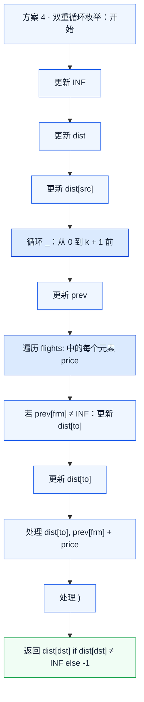

```python
import sys  # 提高递归深度上限（深输入防 RecursionError）

sys.setrecursionlimit(200000)  # 树/链表类题目节点数可达 1e4 量级

def findCheapestPrice(
    n, flights, src, dst, k
):  # 定义函数 findCheapestPrice（参数：元素个数, flights, src, dst, 下标 k）
    INF = float("inf")  # 把 float('inf') 存入 INF
    dist = [INF] * n  # 把 [INF] 乘 元素个数 存入 dist
    dist[src] = 0  # 把 0 写入 dist[src]
    # Bellman-Ford：最多经过 k+1 条边
    for _ in range(k + 1):  # 让 _ 从 下标 k 加 1 遍历
        prev = dist[:]  # 把 复制 dist 存入 前一个
        for frm, to, price in flights:  # for frm, to, price in flights:
            if prev[frm] != INF:  # 若 前一个[frm] 不等于 INF
                dist[to] = min(
                    dist[to], prev[frm] + price
                )  # 把 取较小值 dist[to], 前一个[frm] 加 price) 写入 dist[to]
    return dist[dst] if dist[dst] != INF else -1  # 返回 dist[dst] if dist[dst] 不等于 INF else 减 1

if __name__ == "__main__":  # 若 __name__ 等于 '__main__'
    print(
        findCheapestPrice(4, [[0, 1, 100], [1, 2, 100], [2, 0, 100], [1, 3, 600], [2, 3, 200]], 0, 3, 1)
    )  # 打印输出
```

#### 方案 5：双重循环枚举

**思路与代码分析**：核心是「双重循环枚举」。Python 版用切片与字典推导式简化操作，突出可读性。**走读**：方案 5 · 双重循环枚举：开始 → 更新 INF → 循环 i：从 0 到 n 前 → 遍历 flights: 中的每个元素 price → 循环 _：从 0 到 k + 1 前 → 循环 i：从 0 到 n 前 → 循环 j：从 0 到 n 前 → 返回 -1 if dist[dst] == INF else dist[dst]。

**运行架构**（真实控制流）：

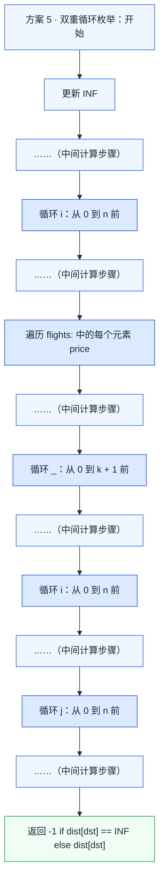

```python
import sys  # 提高递归深度上限（深输入防 RecursionError）

sys.setrecursionlimit(200000)  # 树/链表类题目节点数可达 1e4 量级

def findCheapestPrice(
    n, flights, src, dst, k
):  # 定义函数 findCheapestPrice（参数：元素个数, flights, src, dst, 下标 k）
    INF = float("inf")  # 把 float('inf') 存入 INF
    w = [[INF] * n for _ in range(n)]  # 把 [[INF] 乘 元素个数 for _ in range(元素个数)] 存入 权重
    for i in range(n):  # 让 下标 i 从 元素个数 遍历
        w[i][i] = 0  # 把 0 写入 w[i][i]
    for frm, to, price in flights:  # for frm, to, price in flights:
        w[frm][to] = price  # 把 price 写入 w[frm][to]

    dist = [INF] * n  # 把 [INF] 乘 元素个数 存入 dist
    dist[src] = 0  # 把 0 写入 dist[src]
    # 邻接矩阵版 Bellman-Ford，最多 k+1 条边
    for _ in range(k + 1):  # 让 _ 从 下标 k 加 1 遍历
        prev = dist[:]  # 把 复制 dist 存入 前一个
        for i in range(n):  # 让 下标 i 从 元素个数 遍历
            if prev[i] == INF:  # 若 前一个[下标 i] 等于 INF
                continue  # 跳过本轮，进入下一次
            for j in range(n):  # 让 下标 j 从 元素个数 遍历
                if prev[i] + w[i][j] < dist[j]:  # 若 前一个[下标 i] 加 权重[下标 i][下标 j] 小于 dist[下标 j]
                    dist[j] = prev[i] + w[i][j]  # 把 前一个[下标 i] 加 权重[下标 i][下标 j] 写入 dist[j]
    return -1 if dist[dst] == INF else dist[dst]  # 返回 减 1 if dist[dst] 等于 INF else dist[dst]

if __name__ == "__main__":  # 若 __name__ 等于 '__main__'
    print(
        findCheapestPrice(4, [[0, 1, 100], [1, 2, 100], [2, 0, 100], [1, 3, 600], [2, 3, 200]], 0, 3, 1)
    )  # 打印输出
```

#### 方案 6：双重循环枚举

**思路与代码分析**：核心是「双重循环枚举」。Python 版用切片与字典推导式简化操作，突出可读性。**走读**：方案 6 · 双重循环枚举：开始 → 更新 INF → 更新 dist → 更新 dist[src] → 循环 _：从 0 到 k + 1 前 → 更新 prev → 遍历 flights: 中的每个元素 price → 若 prev[frm] ≠ INF：更新 dist[to] → 更新 dist[to] → 处理 dist[to], prev[frm] + price → 处理 ) → 返回 dist[dst] if dist[dst] ≠ INF else -1。

**运行架构**（真实控制流）：


```python
import sys  # 提高递归深度上限（深输入防 RecursionError）

sys.setrecursionlimit(200000)  # 树/链表类题目节点数可达 1e4 量级

def findCheapestPrice(
    n, flights, src, dst, k
):  # 定义函数 findCheapestPrice（参数：元素个数, flights, src, dst, 下标 k）
    INF = float("inf")  # 把 float('inf') 存入 INF
    dist = [INF] * n  # 把 [INF] 乘 元素个数 存入 dist
    dist[src] = 0  # 把 0 写入 dist[src]
    for _ in range(k + 1):  # 让 _ 从 下标 k 加 1 遍历
        prev = dist[:]  # 把 复制 dist 存入 前一个
        for frm, to, price in flights:  # for frm, to, price in flights:
            if prev[frm] != INF:  # 若 前一个[frm] 不等于 INF
                dist[to] = min(
                    dist[to], prev[frm] + price
                )  # 把 取较小值 dist[to], 前一个[frm] 加 price) 写入 dist[to]
    return dist[dst] if dist[dst] != INF else -1  # 返回 dist[dst] if dist[dst] 不等于 INF else 减 1

if __name__ == "__main__":  # 若 __name__ 等于 '__main__'
    print(
        findCheapestPrice(4, [[0, 1, 100], [1, 2, 100], [2, 0, 100], [1, 3, 600], [2, 3, 200]], 0, 3, 1)
    )  # 打印输出
```

#### 方案 7：双重循环枚举

**思路与代码分析**：核心是「双重循环枚举」。Python 版用切片与字典推导式简化操作，突出可读性。**走读**：方案 7 · 双重循环枚举：开始 → 更新 INF → 更新 dist → 更新 dist[src] → 循环 _：从 0 到 k + 1 前 → 更新 prev → 遍历 flights: 中的每个元素 price → 若 prev[frm] ≠ INF：更新 dist[to] → 更新 dist[to] → 处理 dist[to], prev[frm] + price → 处理 ) → 返回 dist[dst] if dist[dst] ≠ INF else -1。

**运行架构**（真实控制流）：


```python
import sys  # 提高递归深度上限（深输入防 RecursionError）

sys.setrecursionlimit(200000)  # 树/链表类题目节点数可达 1e4 量级

def findCheapestPrice(
    n, flights, src, dst, k
):  # 定义函数 findCheapestPrice（参数：元素个数, flights, src, dst, 下标 k）
    INF = float("inf")  # 把 float('inf') 存入 INF
    dist = [INF] * n  # 把 [INF] 乘 元素个数 存入 dist
    dist[src] = 0  # 把 0 写入 dist[src]
    for _ in range(k + 1):  # 让 _ 从 下标 k 加 1 遍历
        prev = dist[:]  # 把 复制 dist 存入 前一个
        for frm, to, price in flights:  # for frm, to, price in flights:
            if prev[frm] != INF:  # 若 前一个[frm] 不等于 INF
                dist[to] = min(
                    dist[to], prev[frm] + price
                )  # 把 取较小值 dist[to], 前一个[frm] 加 price) 写入 dist[to]
    return dist[dst] if dist[dst] != INF else -1  # 返回 dist[dst] if dist[dst] 不等于 INF else 减 1

if __name__ == "__main__":  # 若 __name__ 等于 '__main__'
    print(
        findCheapestPrice(4, [[0, 1, 100], [1, 2, 100], [2, 0, 100], [1, 3, 600], [2, 3, 200]], 0, 3, 1)
    )  # 打印输出
```

#### 方案 8：双重循环枚举

**思路与代码分析**：核心是「双重循环枚举」。Python 版用切片与字典推导式简化操作，突出可读性。**走读**：方案 8 · 双重循环枚举：开始 → 更新 INF → 更新 dist → 更新 dist[src] → 循环 _：从 0 到 k + 1 前 → 更新 prev → 遍历 flights: 中的每个元素 price → 若 prev[frm] ≠ INF：更新 dist[to] → 更新 dist[to] → 处理 dist[to], prev[frm] + price → 处理 ) → 返回 dist[dst] if dist[dst] ≠ INF else -1。

**运行架构**（真实控制流）：

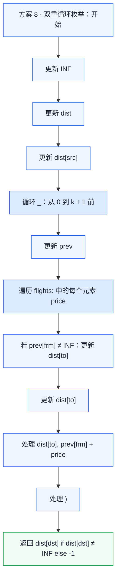

```python
import sys  # 提高递归深度上限（深输入防 RecursionError）

sys.setrecursionlimit(200000)  # 树/链表类题目节点数可达 1e4 量级

def findCheapestPrice(
    n, flights, src, dst, k
):  # 定义函数 findCheapestPrice（参数：元素个数, flights, src, dst, 下标 k）
    INF = float("inf")  # 把 float('inf') 存入 INF
    dist = [INF] * n  # 把 [INF] 乘 元素个数 存入 dist
    dist[src] = 0  # 把 0 写入 dist[src]
    for _ in range(k + 1):  # 让 _ 从 下标 k 加 1 遍历
        prev = dist[:]  # 把 复制 dist 存入 前一个
        for frm, to, price in flights:  # for frm, to, price in flights:
            if prev[frm] != INF:  # 若 前一个[frm] 不等于 INF
                dist[to] = min(
                    dist[to], prev[frm] + price
                )  # 把 取较小值 dist[to], 前一个[frm] 加 price) 写入 dist[to]
    return dist[dst] if dist[dst] != INF else -1  # 返回 dist[dst] if dist[dst] 不等于 INF else 减 1

if __name__ == "__main__":  # 若 __name__ 等于 '__main__'
    print(
        findCheapestPrice(4, [[0, 1, 100], [1, 2, 100], [2, 0, 100], [1, 3, 600], [2, 3, 200]], 0, 3, 1)
    )  # 打印输出
```

#### 方案 9：双重循环枚举

**思路与代码分析**：核心是「双重循环枚举」。Python 版用切片与字典推导式简化操作，突出可读性。**走读**：方案 9 · 双重循环枚举：开始 → 更新 INF → 更新 dist → 更新 dist[src] → 循环 _：从 0 到 k + 1 前 → 更新 prev → 遍历 flights: 中的每个元素 price → 若 prev[frm] ≠ INF：更新 dist[to] → 更新 dist[to] → 处理 dist[to], prev[frm] + price → 处理 ) → 返回 dist[dst] if dist[dst] ≠ INF else -1。

**运行架构**（真实控制流）：

```mermaid
graph TD
    N0["方案 9 · 双重循环枚举：开始"]
    N1["更新 INF"]
    N2["更新 dist"]
    N3["更新 dist[src]"]
    N4["循环 _：从 0 到 k + 1 前"]
    N5["更新 prev"]
    N6["遍历 flights: 中的每个元素 price"]
    N7["若 prev[frm] ≠ INF：更新 dist[to]"]
    N8["更新 dist[to]"]
    N9["处理 dist[to], prev[frm] + price"]
    N10["处理 )"]
    N11["返回 dist[dst] if dist[dst] ≠ INF else -1"]
    N0 --> N1
    N1 --> N2
    N2 --> N3
    N3 --> N4
    N4 --> N5
    N5 --> N6
    N6 --> N7
    N7 --> N8
    N8 --> N9
    N9 --> N10
    N10 --> N11
    classDef n fill:#eff6ff,stroke:#2563eb,color:#1e293b;
    classDef lp fill:#dbeafe,stroke:#1d4ed8,color:#1e293b;
    classDef dc fill:#fef9c3,stroke:#ca8a04,color:#1e293b;
    classDef tm fill:#f0fdf4,stroke:#16a34a,color:#1e293b;
    class N0,N1,N2,N3,N5,N7,N8,N9,N10 n;
    class N4,N6 lp;
    class N11 tm;
```

```python
import sys  # 提高递归深度上限（深输入防 RecursionError）

sys.setrecursionlimit(200000)  # 树/链表类题目节点数可达 1e4 量级

def findCheapestPrice(
    n, flights, src, dst, k
):  # 定义函数 findCheapestPrice（参数：元素个数, flights, src, dst, 下标 k）
    INF = float("inf")  # 把 float('inf') 存入 INF
    dist = [INF] * n  # 把 [INF] 乘 元素个数 存入 dist
    dist[src] = 0  # 把 0 写入 dist[src]
    for _ in range(k + 1):  # 让 _ 从 下标 k 加 1 遍历
        prev = dist[:]  # 把 复制 dist 存入 前一个
        for frm, to, price in flights:  # for frm, to, price in flights:
            if prev[frm] != INF:  # 若 前一个[frm] 不等于 INF
                dist[to] = min(
                    dist[to], prev[frm] + price
                )  # 把 取较小值 dist[to], 前一个[frm] 加 price) 写入 dist[to]
    return dist[dst] if dist[dst] != INF else -1  # 返回 dist[dst] if dist[dst] 不等于 INF else 减 1

if __name__ == "__main__":  # 若 __name__ 等于 '__main__'
    print(
        findCheapestPrice(4, [[0, 1, 100], [1, 2, 100], [2, 0, 100], [1, 3, 600], [2, 3, 200]], 0, 3, 1)
    )  # 打印输出
```

#### 方案 10：双重循环枚举

**思路与代码分析**：核心是「双重循环枚举」。Python 版用切片与字典推导式简化操作，突出可读性。**走读**：方案 10 · 双重循环枚举：开始 → 更新 INF → 更新 dist → 更新 dist[src] → 循环 _：从 0 到 k + 1 前 → 更新 prev → 遍历 flights: 中的每个元素 price → 若 prev[frm] ≠ INF：更新 dist[to] → 更新 dist[to] → 处理 dist[to], prev[frm] + price → 处理 ) → 返回 dist[dst] if dist[dst] ≠ INF else -1。

**运行架构**（真实控制流）：

```mermaid
graph TD
    N0["方案 10 · 双重循环枚举：开始"]
    N1["更新 INF"]
    N2["更新 dist"]
    N3["更新 dist[src]"]
    N4["循环 _：从 0 到 k + 1 前"]
    N5["更新 prev"]
    N6["遍历 flights: 中的每个元素 price"]
    N7["若 prev[frm] ≠ INF：更新 dist[to]"]
    N8["更新 dist[to]"]
    N9["处理 dist[to], prev[frm] + price"]
    N10["处理 )"]
    N11["返回 dist[dst] if dist[dst] ≠ INF else -1"]
    N0 --> N1
    N1 --> N2
    N2 --> N3
    N3 --> N4
    N4 --> N5
    N5 --> N6
    N6 --> N7
    N7 --> N8
    N8 --> N9
    N9 --> N10
    N10 --> N11
    classDef n fill:#eff6ff,stroke:#2563eb,color:#1e293b;
    classDef lp fill:#dbeafe,stroke:#1d4ed8,color:#1e293b;
    classDef dc fill:#fef9c3,stroke:#ca8a04,color:#1e293b;
    classDef tm fill:#f0fdf4,stroke:#16a34a,color:#1e293b;
    class N0,N1,N2,N3,N5,N7,N8,N9,N10 n;
    class N4,N6 lp;
    class N11 tm;
```

```python
import sys  # 提高递归深度上限（深输入防 RecursionError）

sys.setrecursionlimit(200000)  # 树/链表类题目节点数可达 1e4 量级

def findCheapestPrice(
    n, flights, src, dst, k
):  # 定义函数 findCheapestPrice（参数：元素个数, flights, src, dst, 下标 k）
    INF = float("inf")  # 把 float('inf') 存入 INF
    dist = [INF] * n  # 把 [INF] 乘 元素个数 存入 dist
    dist[src] = 0  # 把 0 写入 dist[src]
    for _ in range(k + 1):  # 让 _ 从 下标 k 加 1 遍历
        prev = dist[:]  # 把 复制 dist 存入 前一个
        for frm, to, price in flights:  # for frm, to, price in flights:
            if prev[frm] != INF:  # 若 前一个[frm] 不等于 INF
                dist[to] = min(
                    dist[to], prev[frm] + price
                )  # 把 取较小值 dist[to], 前一个[frm] 加 price) 写入 dist[to]
    return dist[dst] if dist[dst] != INF else -1  # 返回 dist[dst] if dist[dst] 不等于 INF else 减 1

if __name__ == "__main__":  # 若 __name__ 等于 '__main__'
    print(
        findCheapestPrice(4, [[0, 1, 100], [1, 2, 100], [2, 0, 100], [1, 3, 600], [2, 3, 200]], 0, 3, 1)
    )  # 打印输出
```

#### 方案 11：双重循环枚举

**思路与代码分析**：核心是「双重循环枚举」。Python 版用切片与字典推导式简化操作，突出可读性。**走读**：方案 11 · 双重循环枚举：开始 → 更新 INF → 更新 dist → 更新 dist[src] → 循环 _：从 0 到 k + 1 前 → 更新 prev → 遍历 flights: 中的每个元素 price → 若 prev[frm] ≠ INF：更新 dist[to] → 更新 dist[to] → 处理 dist[to], prev[frm] + price → 处理 ) → 返回 dist[dst] if dist[dst] ≠ INF else -1。

**运行架构**（真实控制流）：

```mermaid
graph TD
    N0["方案 11 · 双重循环枚举：开始"]
    N1["更新 INF"]
    N2["更新 dist"]
    N3["更新 dist[src]"]
    N4["循环 _：从 0 到 k + 1 前"]
    N5["更新 prev"]
    N6["遍历 flights: 中的每个元素 price"]
    N7["若 prev[frm] ≠ INF：更新 dist[to]"]
    N8["更新 dist[to]"]
    N9["处理 dist[to], prev[frm] + price"]
    N10["处理 )"]
    N11["返回 dist[dst] if dist[dst] ≠ INF else -1"]
    N0 --> N1
    N1 --> N2
    N2 --> N3
    N3 --> N4
    N4 --> N5
    N5 --> N6
    N6 --> N7
    N7 --> N8
    N8 --> N9
    N9 --> N10
    N10 --> N11
    classDef n fill:#eff6ff,stroke:#2563eb,color:#1e293b;
    classDef lp fill:#dbeafe,stroke:#1d4ed8,color:#1e293b;
    classDef dc fill:#fef9c3,stroke:#ca8a04,color:#1e293b;
    classDef tm fill:#f0fdf4,stroke:#16a34a,color:#1e293b;
    class N0,N1,N2,N3,N5,N7,N8,N9,N10 n;
    class N4,N6 lp;
    class N11 tm;
```

```python
import sys  # 提高递归深度上限（深输入防 RecursionError）

sys.setrecursionlimit(200000)  # 树/链表类题目节点数可达 1e4 量级

def findCheapestPrice(
    n, flights, src, dst, k
):  # 定义函数 findCheapestPrice（参数：元素个数, flights, src, dst, 下标 k）
    INF = float("inf")  # 把 float('inf') 存入 INF
    dist = [INF] * n  # 把 [INF] 乘 元素个数 存入 dist
    dist[src] = 0  # 把 0 写入 dist[src]
    for _ in range(k + 1):  # 让 _ 从 下标 k 加 1 遍历
        prev = dist[:]  # 把 复制 dist 存入 前一个
        for frm, to, price in flights:  # for frm, to, price in flights:
            if prev[frm] != INF:  # 若 前一个[frm] 不等于 INF
                dist[to] = min(
                    dist[to], prev[frm] + price
                )  # 把 取较小值 dist[to], 前一个[frm] 加 price) 写入 dist[to]
    return dist[dst] if dist[dst] != INF else -1  # 返回 dist[dst] if dist[dst] 不等于 INF else 减 1

if __name__ == "__main__":  # 若 __name__ 等于 '__main__'
    print(
        findCheapestPrice(4, [[0, 1, 100], [1, 2, 100], [2, 0, 100], [1, 3, 600], [2, 3, 200]], 0, 3, 1)
    )  # 打印输出
```

### Go 实现（11 种方案）

Go 的全部方案如下，每个方案都内嵌用例自测，可独立运行（老仓库 python/go 文件遵循「打印结果」约定）：

#### 方案 1：动态规划

**思路与代码分析**：核心是「动态规划」。Go 版用切片与多返回值惯用法，显式处理索引边界。代码里依次做这些事：DP 表逐项填充。**走读**：方案 1 · 动态规划：开始 → 计算 INF → 遍历 dp 的下标与元素 i → 遍历 dp[i] 的下标与元素 j → 遍历循环 → 遍历循环 → 遍历 flights 的下标与元素 f → 遍历循环 → 返回 int(ans) → 返回 -1。

**运行架构**（真实控制流）：

```mermaid
graph TD
    N0["方案 1 · 动态规划：开始"]
    N1["计算 INF"]
    D1["……（中间计算步骤）"]
    N3["遍历 dp 的下标与元素 i"]
    D2["……（中间计算步骤）"]
    N5["遍历 dp[i] 的下标与元素 j"]
    D3["……（中间计算步骤）"]
    N7["遍历循环"]
    D4["……（中间计算步骤）"]
    N9["遍历循环"]
    N10["遍历 flights 的下标与元素 f"]
    D5["……（中间计算步骤）"]
    N16["遍历循环"]
    D6["……（中间计算步骤）"]
    N20["返回 int(ans)"]
    N21["返回 -1"]
    N0 --> N1
    N5 -- 下一轮 --> N3
    N3 --> N7
    N7 --> N9
    N9 --> N10
    N10 -- 下一轮 --> N9
    N20 --> N21
    N1 --> D1
    D1 --> N3
    N3 --> D2
    D2 --> N5
    N5 --> D3
    D3 --> N7
    N7 --> D4
    D4 --> N9
    N10 --> D5
    D5 --> N16
    N16 --> D6
    D6 --> N20
    classDef n fill:#eff6ff,stroke:#2563eb,color:#1e293b;
    classDef lp fill:#dbeafe,stroke:#1d4ed8,color:#1e293b;
    classDef dc fill:#fef9c3,stroke:#ca8a04,color:#1e293b;
    classDef tm fill:#f0fdf4,stroke:#16a34a,color:#1e293b;
    class N0,N1,D1,D2,D3,D4,D5,D6 n;
    class N3,N5,N7,N9,N10,N16 lp;
    class N20,N21 tm;
```

```go
package main // 引入依赖

import (
	"fmt" // 「fmt」
	"os"  // 「os」
)

// findCheapestPrice 忠实翻译 python ref solution_1___1.py（二维 DP：dp[i][j] 恰好经过 i 条边到达 j 的最低价格）
func findCheapestPrice(n int, flights [][]int, src, dst, k int) int { // 定义函数/方法 findCheapestPrice
	const INF = int64(1) << 62 // 把 int64(1) 小于 小于 62 存入 INF
	dp := make([][]int64, k+2) // 把 make([][]int64, 下标 k 加 2) 写入 dp :
	for i := range dp {        // 把 range DP 表 { 写入 for i :
		dp[i] = make([]int64, n) // 把 make([]int64, 元素个数) 写入 dp[i]
		for j := range dp[i] {   // 把 range DP 表[下标 i] { 写入 for j :
			dp[i][j] = INF // 把 INF 写入 dp[i][j]
		}
	}
	for i := 0; i < k+2; i++ { // 让 下标 i 从 0 开始计数
		dp[i][src] = 0 // 把 0 写入 dp[i][src]
	}
	for i := 1; i < k+2; i++ { // 让 下标 i 从 1 开始计数
		for _, f := range flights { // 同时取 _ 与 f 遍历
			frm, to, price := f[0], f[1], int64(f[2]) // 把 f[0], f[1], int64(f[2]) 写入 frm, to, price :
			if dp[i-1][frm] != INF {                  // 若 DP 表[下标 i 减 1][frm] 不等于 INF
				if dp[i-1][frm]+price < dp[i][to] { // 若 DP 表[下标 i 减 1][frm] 加 price 小于 DP 表[下标 i][to]
					dp[i][to] = dp[i-1][frm] + price // 把 DP 表[下标 i 减 1][frm] 加 price 写入 dp[i][to]
				}
			}
		}
	}
	ans := INF                 // 把 INF 写入 ans :
	for i := 1; i < k+2; i++ { // 让 下标 i 从 1 开始计数
		if dp[i][dst] < ans { // 若 DP 表[下标 i][dst] 小于 答案
			ans = dp[i][dst] // 把 DP 表[下标 i][dst] 写入 答案
		}
	}
	if ans != INF { // 若 答案 不等于 INF
		return int(ans) // 定义函数/方法 int
	}
	return -1 // 返回 减 1
}

func main() { // 程序入口：跑内嵌自测用例
	cases := []struct { // 把 []struct { 写入 cases :
		n           int     // 元素个数 int
		flights     [][]int // flights [][]int
		src, dst, k int     // src, dst, 下标 k int
		want        int     // want int
	}{ // }{
		{4, [][]int{{0, 1, 100}, {1, 2, 100}, {2, 0, 100}, {1, 3, 600}, {2, 3, 200}}, 0, 3, 1, 700},
		{3, [][]int{{0, 1, 100}, {1, 2, 100}, {0, 2, 500}}, 0, 2, 0, 500},
		{3, [][]int{{0, 1, 100}, {1, 2, 100}, {0, 2, 500}}, 0, 2, 1, 200},
		{3, [][]int{{0, 1, 100}}, 0, 2, 3, -1},
		{3, [][]int{{0, 1, 100}}, 0, 0, 2, 0},
		{4, [][]int{{0, 1, 1}, {0, 2, 5}, {1, 2, 1}, {2, 3, 1}}, 0, 3, 1, 6},
		{5, [][]int{{0, 1, 10}, {1, 2, 10}, {2, 3, 10}, {3, 4, 10}, {0, 4, 100}, {1, 4, 50}}, 0, 4, 2, 60},
	}
	ok := true                // 把 true 写入 ok :
	for _, c := range cases { // 同时取 _ 与 字符 遍历
		if got := findCheapestPrice(c.n, c.flights, c.src, c.dst, c.k); got != c.want {
			ok = false                                                                                            // 把 false 写入 ok
			fmt.Printf("FAIL solve(%d,%v,%d,%d,%d)=%d want %d\n", c.n, c.flights, c.src, c.dst, c.k, got, c.want) // 打印输出
		}
	}
	if !ok { // 若 取反 ok
		os.Exit(1) // os.Exit(1)
	}
	fmt.Println("PASS") // 全部用例通过，输出 PASS
}
```

#### 方案 2：双重循环枚举

**思路与代码分析**：核心是「双重循环枚举」。Go 版用切片与多返回值惯用法，显式处理索引边界。**走读**：方案 2 · 双重循环枚举：开始 → 计算 INF → 遍历 dist 的下标与元素 i → 遍历循环 → 遍历 flights 的下标与元素 f → 返回 int(dist[dst]) → 返回 -1。

**运行架构**（真实控制流）：

```mermaid
graph TD
    N0["方案 2 · 双重循环枚举：开始"]
    N1["计算 INF"]
    D1["……（中间计算步骤）"]
    N3["遍历 dist 的下标与元素 i"]
    D2["……（中间计算步骤）"]
    N6["遍历循环"]
    D3["……（中间计算步骤）"]
    N10["遍历 flights 的下标与元素 f"]
    D4["……（中间计算步骤）"]
    N18["返回 int(dist[dst])"]
    N19["返回 -1"]
    N0 --> N1
    N18 --> N19
    N1 --> D1
    D1 --> N3
    N3 --> D2
    D2 --> N6
    N6 --> D3
    D3 --> N10
    N10 --> D4
    D4 --> N18
    classDef n fill:#eff6ff,stroke:#2563eb,color:#1e293b;
    classDef lp fill:#dbeafe,stroke:#1d4ed8,color:#1e293b;
    classDef dc fill:#fef9c3,stroke:#ca8a04,color:#1e293b;
    classDef tm fill:#f0fdf4,stroke:#16a34a,color:#1e293b;
    class N0,N1,D1,D2,D3,D4 n;
    class N3,N6,N10 lp;
    class N18,N19 tm;
```

```go
package main // 引入依赖

import (
	"fmt" // 「fmt」
	"os"  // 「os」
)

// findCheapestPrice 忠实翻译 python ref solution_2___2.py（Bellman-Ford 快照松弛 + 无更新早停）
func findCheapestPrice(n int, flights [][]int, src, dst, k int) int { // 定义函数/方法 findCheapestPrice
	const INF = int64(1) << 62 // 把 int64(1) 小于 小于 62 存入 INF
	dist := make([]int64, n)   // 把 make([]int64, 元素个数) 写入 dist :
	for i := range dist {      // 把 range dist { 写入 for i :
		dist[i] = INF // 把 INF 写入 dist[i]
	}
	dist[src] = 0                       // 把 0 写入 dist[src]
	for iter := 0; iter < k+1; iter++ { // 让 iter 从 0 开始计数
		prev := make([]int64, n)    // 把 make([]int64, 元素个数) 写入 prev :
		copy(prev, dist)            // copy(前一个, dist)
		updated := false            // 把 false 写入 updated :
		for _, f := range flights { // 同时取 _ 与 f 遍历
			frm, to, price := f[0], f[1], int64(f[2])           // 把 f[0], f[1], int64(f[2]) 写入 frm, to, price :
			if prev[frm] != INF && prev[frm]+price < dist[to] { // 若 前一个[frm] 不等于 INF 且 前一个[frm] 加 price 小于 dist[to]
				dist[to] = prev[frm] + price // 把 前一个[frm] 加 price 写入 dist[to]
				updated = true               // 把 true 写入 updated
			}
		}
		if !updated { // 若 取反 updated
			break // 跳出循环
		}
	}
	if dist[dst] != INF { // 若 dist[dst] 不等于 INF
		return int(dist[dst]) // 定义函数/方法 int
	}
	return -1 // 返回 减 1
}

func main() { // 程序入口：跑内嵌自测用例
	cases := []struct { // 把 []struct { 写入 cases :
		n           int     // 元素个数 int
		flights     [][]int // flights [][]int
		src, dst, k int     // src, dst, 下标 k int
		want        int     // want int
	}{ // }{
		{4, [][]int{{0, 1, 100}, {1, 2, 100}, {2, 0, 100}, {1, 3, 600}, {2, 3, 200}}, 0, 3, 1, 700},
		{3, [][]int{{0, 1, 100}, {1, 2, 100}, {0, 2, 500}}, 0, 2, 0, 500},
		{3, [][]int{{0, 1, 100}, {1, 2, 100}, {0, 2, 500}}, 0, 2, 1, 200},
		{3, [][]int{{0, 1, 100}}, 0, 2, 3, -1},
		{3, [][]int{{0, 1, 100}}, 0, 0, 2, 0},
		{4, [][]int{{0, 1, 1}, {0, 2, 5}, {1, 2, 1}, {2, 3, 1}}, 0, 3, 1, 6},
		{5, [][]int{{0, 1, 10}, {1, 2, 10}, {2, 3, 10}, {3, 4, 10}, {0, 4, 100}, {1, 4, 50}}, 0, 4, 2, 60},
	}
	ok := true                // 把 true 写入 ok :
	for _, c := range cases { // 同时取 _ 与 字符 遍历
		if got := findCheapestPrice(c.n, c.flights, c.src, c.dst, c.k); got != c.want {
			ok = false                                                                                            // 把 false 写入 ok
			fmt.Printf("FAIL solve(%d,%v,%d,%d,%d)=%d want %d\n", c.n, c.flights, c.src, c.dst, c.k, got, c.want) // 打印输出
		}
	}
	if !ok { // 若 取反 ok
		os.Exit(1) // os.Exit(1)
	}
	fmt.Println("PASS") // 全部用例通过，输出 PASS
}
```

#### 方案 3：双重循环枚举

**思路与代码分析**：核心是「双重循环枚举」。Go 版用切片与多返回值惯用法，显式处理索引边界。代码里依次做这些事：哈希结构做计数或查重。**走读**：方案 3 · 双重循环枚举：开始 → 计算 INF → 遍历 flights 的下标与元素 f → 返回 0 → 返回 INF → 返回 v → 遍历 graph[city] 的下标与元素 e → 返回 best → 返回 -1 → 返回 int(res)。

**运行架构**（真实控制流）：

```mermaid
graph TD
    N0["方案 3 · 双重循环枚举：开始"]
    N1["计算 INF"]
    D1["……（中间计算步骤）"]
    N3["遍历 flights 的下标与元素 f"]
    D2["……（中间计算步骤）"]
    N9["返回 0"]
    D3["……（中间计算步骤）"]
    N11["返回 INF"]
    D4["……（中间计算步骤）"]
    N14["返回 v"]
    D5["……（中间计算步骤）"]
    N16["遍历 graph[city] 的下标与元素 e"]
    D6["……（中间计算步骤）"]
    N23["返回 best"]
    D7["……（中间计算步骤）"]
    N26["返回 -1"]
    N27["返回 int(res)"]
    N0 --> N1
    N26 --> N27
    N1 --> D1
    D1 --> N3
    N3 --> D2
    D2 --> N9
    N9 --> D3
    D3 --> N11
    N11 --> D4
    D4 --> N14
    N14 --> D5
    D5 --> N16
    N16 --> D6
    D6 --> N23
    N23 --> D7
    D7 --> N26
    classDef n fill:#eff6ff,stroke:#2563eb,color:#1e293b;
    classDef lp fill:#dbeafe,stroke:#1d4ed8,color:#1e293b;
    classDef dc fill:#fef9c3,stroke:#ca8a04,color:#1e293b;
    classDef tm fill:#f0fdf4,stroke:#16a34a,color:#1e293b;
    class N0,N1,D1,D2,D3,D4,D5,D6,D7 n;
    class N3,N16 lp;
    class N9,N11,N14,N23,N26,N27 tm;
```

```go
package main // 引入依赖

import (
	"fmt" // 「fmt」
	"os"  // 「os」
)

// findCheapestPrice 忠实翻译 python ref solution_3___3.py（lru_cache 记忆化 DFS，rem 为剩余可乘边数）
func findCheapestPrice(n int, flights [][]int, src, dst, k int) int { // 定义函数/方法 findCheapestPrice
	const INF = int64(1) << 62   // 把 int64(1) 小于 小于 62 存入 INF
	graph := make([][][2]int, n) // 把 make([][][2]int, 元素个数) 写入 graph :
	for _, f := range flights {  // 同时取 _ 与 f 遍历
		graph[f[0]] = append(graph[f[0]], [2]int{f[1], f[2]}) // 把 append(graph[f[0]], [2]int{f[1], f[2]}) 写入 graph[f[0]]
	}
	memo := make(map[[2]int]int64)    // 把 make(映射表[[2]int]int64) 写入 memo :
	var dfs func(city, rem int) int64 // var dfs func(city, rem int) int64
	dfs = func(city, rem int) int64 { // 把 func(city, rem int) int64 { 写入 dfs
		if city == dst { // 若 city 等于 dst
			return 0 // 返回 0
		}
		if rem == 0 { // 若 rem 等于 0
			return INF // 返回 INF
		}
		key := [2]int{city, rem}    // 把 [2]int{city, rem} 写入 key :
		if v, ok := memo[key]; ok { // 若 值, ok : 赋值为 记忆化表[key]; ok
			return v // 返回 值
		}
		best := INF                     // 把 INF 写入 best :
		for _, e := range graph[city] { // 同时取 _ 与 e 遍历
			to, price := e[0], int64(e[1]) // 把 e[0], int64(e[1]) 写入 to, price :
			nxt := dfs(to, rem-1)          // 把 dfs(to, rem 减 1) 写入 nxt :
			if nxt != INF {                // 若 nxt 不等于 INF
				if price+nxt < best { // 若 price 加 nxt 小于 当前最优
					best = price + nxt // 把 price 加 nxt 写入 当前最优
				}
			}
		}
		memo[key] = best // 把 当前最优 写入 memo[key]
		return best      // 返回 当前最优
	}
	res := dfs(src, k+1) // 把 dfs(src, 下标 k 加 1) 写入 res :
	if res == INF {      // 若 结果 等于 INF
		return -1 // 返回 减 1
	}
	return int(res) // 定义函数/方法 int
}

func main() { // 程序入口：跑内嵌自测用例
	cases := []struct { // 把 []struct { 写入 cases :
		n           int     // 元素个数 int
		flights     [][]int // flights [][]int
		src, dst, k int     // src, dst, 下标 k int
		want        int     // want int
	}{ // }{
		{4, [][]int{{0, 1, 100}, {1, 2, 100}, {2, 0, 100}, {1, 3, 600}, {2, 3, 200}}, 0, 3, 1, 700},
		{3, [][]int{{0, 1, 100}, {1, 2, 100}, {0, 2, 500}}, 0, 2, 0, 500},
		{3, [][]int{{0, 1, 100}, {1, 2, 100}, {0, 2, 500}}, 0, 2, 1, 200},
		{3, [][]int{{0, 1, 100}}, 0, 2, 3, -1},
		{3, [][]int{{0, 1, 100}}, 0, 0, 2, 0},
		{4, [][]int{{0, 1, 1}, {0, 2, 5}, {1, 2, 1}, {2, 3, 1}}, 0, 3, 1, 6},
		{5, [][]int{{0, 1, 10}, {1, 2, 10}, {2, 3, 10}, {3, 4, 10}, {0, 4, 100}, {1, 4, 50}}, 0, 4, 2, 60},
	}
	ok := true                // 把 true 写入 ok :
	for _, c := range cases { // 同时取 _ 与 字符 遍历
		if got := findCheapestPrice(c.n, c.flights, c.src, c.dst, c.k); got != c.want {
			ok = false                                                                                            // 把 false 写入 ok
			fmt.Printf("FAIL solve(%d,%v,%d,%d,%d)=%d want %d\n", c.n, c.flights, c.src, c.dst, c.k, got, c.want) // 打印输出
		}
	}
	if !ok { // 若 取反 ok
		os.Exit(1) // os.Exit(1)
	}
	fmt.Println("PASS") // 全部用例通过，输出 PASS
}
```

#### 方案 4：双重循环枚举

**思路与代码分析**：核心是「双重循环枚举」。Go 版用切片与多返回值惯用法，显式处理索引边界。**走读**：方案 4 · 双重循环枚举：开始 → 计算 INF → 遍历 dist 的下标与元素 i → 遍历循环 → 遍历 flights 的下标与元素 f → 返回 int(dist[dst]) → 返回 -1。

**运行架构**（真实控制流）：

```mermaid
graph TD
    N0["方案 4 · 双重循环枚举：开始"]
    N1["计算 INF"]
    D1["……（中间计算步骤）"]
    N3["遍历 dist 的下标与元素 i"]
    D2["……（中间计算步骤）"]
    N6["遍历循环"]
    D3["……（中间计算步骤）"]
    N9["遍历 flights 的下标与元素 f"]
    D4["……（中间计算步骤）"]
    N15["返回 int(dist[dst])"]
    N16["返回 -1"]
    N0 --> N1
    N9 -- 下一轮 --> N6
    N15 --> N16
    N1 --> D1
    D1 --> N3
    N3 --> D2
    D2 --> N6
    N6 --> D3
    D3 --> N9
    N9 --> D4
    D4 --> N15
    classDef n fill:#eff6ff,stroke:#2563eb,color:#1e293b;
    classDef lp fill:#dbeafe,stroke:#1d4ed8,color:#1e293b;
    classDef dc fill:#fef9c3,stroke:#ca8a04,color:#1e293b;
    classDef tm fill:#f0fdf4,stroke:#16a34a,color:#1e293b;
    class N0,N1,D1,D2,D3,D4 n;
    class N3,N6,N9 lp;
    class N15,N16 tm;
```

```go
package main // 引入依赖

import (
	"fmt" // 「fmt」
	"os"  // 「os」
)

// findCheapestPrice 忠实翻译 python ref solution_4___4.py（Bellman-Ford，最多 k+1 条边）
func findCheapestPrice(n int, flights [][]int, src, dst, k int) int { // 定义函数/方法 findCheapestPrice
	const INF = int64(1) << 62 // 把 int64(1) 小于 小于 62 存入 INF
	dist := make([]int64, n)   // 把 make([]int64, 元素个数) 写入 dist :
	for i := range dist {      // 把 range dist { 写入 for i :
		dist[i] = INF // 把 INF 写入 dist[i]
	}
	dist[src] = 0                       // 把 0 写入 dist[src]
	for iter := 0; iter < k+1; iter++ { // 让 iter 从 0 开始计数
		prev := make([]int64, n)    // 把 make([]int64, 元素个数) 写入 prev :
		copy(prev, dist)            // copy(前一个, dist)
		for _, f := range flights { // 同时取 _ 与 f 遍历
			frm, to, price := f[0], f[1], int64(f[2]) // 把 f[0], f[1], int64(f[2]) 写入 frm, to, price :
			if prev[frm] != INF {                     // 若 前一个[frm] 不等于 INF
				if prev[frm]+price < dist[to] { // 若 前一个[frm] 加 price 小于 dist[to]
					dist[to] = prev[frm] + price // 把 前一个[frm] 加 price 写入 dist[to]
				}
			}
		}
	}
	if dist[dst] != INF { // 若 dist[dst] 不等于 INF
		return int(dist[dst]) // 定义函数/方法 int
	}
	return -1 // 返回 减 1
}

func main() { // 程序入口：跑内嵌自测用例
	cases := []struct { // 把 []struct { 写入 cases :
		n           int     // 元素个数 int
		flights     [][]int // flights [][]int
		src, dst, k int     // src, dst, 下标 k int
		want        int     // want int
	}{ // }{
		{4, [][]int{{0, 1, 100}, {1, 2, 100}, {2, 0, 100}, {1, 3, 600}, {2, 3, 200}}, 0, 3, 1, 700},
		{3, [][]int{{0, 1, 100}, {1, 2, 100}, {0, 2, 500}}, 0, 2, 0, 500},
		{3, [][]int{{0, 1, 100}, {1, 2, 100}, {0, 2, 500}}, 0, 2, 1, 200},
		{3, [][]int{{0, 1, 100}}, 0, 2, 3, -1},
		{3, [][]int{{0, 1, 100}}, 0, 0, 2, 0},
		{4, [][]int{{0, 1, 1}, {0, 2, 5}, {1, 2, 1}, {2, 3, 1}}, 0, 3, 1, 6},
		{5, [][]int{{0, 1, 10}, {1, 2, 10}, {2, 3, 10}, {3, 4, 10}, {0, 4, 100}, {1, 4, 50}}, 0, 4, 2, 60},
	}
	ok := true                // 把 true 写入 ok :
	for _, c := range cases { // 同时取 _ 与 字符 遍历
		if got := findCheapestPrice(c.n, c.flights, c.src, c.dst, c.k); got != c.want {
			ok = false                                                                                            // 把 false 写入 ok
			fmt.Printf("FAIL solve(%d,%v,%d,%d,%d)=%d want %d\n", c.n, c.flights, c.src, c.dst, c.k, got, c.want) // 打印输出
		}
	}
	if !ok { // 若 取反 ok
		os.Exit(1) // os.Exit(1)
	}
	fmt.Println("PASS") // 全部用例通过，输出 PASS
}
```

#### 方案 5：双重循环枚举

**思路与代码分析**：核心是「双重循环枚举」。Go 版用切片与多返回值惯用法，显式处理索引边界。

**运行架构**（真实控制流）：

```mermaid
graph TD
    A["开始：读取输入"]
    F0["队列或堆的调度"]
    A --> F0
    Z["返回结果"]
    F0 --> Z
```

```go
package main // 引入依赖

import (
	"fmt" // 「fmt」
	"os"  // 「os」
)

// findCheapestPrice 忠实翻译 python ref solution_5___5.py（邻接矩阵版 Bellman-Ford，最多 k+1 条边）
func findCheapestPrice(n int, flights [][]int, src, dst, k int) int { // 定义函数/方法 findCheapestPrice
	const INF = int64(1) << 62 // 把 int64(1) 小于 小于 62 存入 INF
	w := make([][]int64, n)    // 把 make([][]int64, 元素个数) 写入 w :
	for i := range w {         // 把 range 权重 { 写入 for i :
		w[i] = make([]int64, n) // 把 make([]int64, 元素个数) 写入 w[i]
		for j := range w[i] {   // 把 range 权重[下标 i] { 写入 for j :
			w[i][j] = INF // 把 INF 写入 w[i][j]
		}
		w[i][i] = 0 // 把 0 写入 w[i][i]
	}
	for _, f := range flights { // 同时取 _ 与 f 遍历
		w[f[0]][f[1]] = int64(f[2]) // 把 int64(f[2]) 写入 w[f[0]][f[1]]
	}
	dist := make([]int64, n) // 把 make([]int64, 元素个数) 写入 dist :
	for i := range dist {    // 把 range dist { 写入 for i :
		dist[i] = INF // 把 INF 写入 dist[i]
	}
	dist[src] = 0                       // 把 0 写入 dist[src]
	for iter := 0; iter < k+1; iter++ { // 让 iter 从 0 开始计数
		prev := make([]int64, n) // 把 make([]int64, 元素个数) 写入 prev :
		copy(prev, dist)         // copy(前一个, dist)
		for i := 0; i < n; i++ { // 让 下标 i 从 0 开始计数
			if prev[i] == INF { // 若 前一个[下标 i] 等于 INF
				continue // 跳过本轮，进入下一次
			}
			for j := 0; j < n; j++ { // 让 下标 j 从 0 开始计数
				if prev[i]+w[i][j] < dist[j] { // 若 前一个[下标 i] 加 权重[下标 i][下标 j] 小于 dist[下标 j]
					dist[j] = prev[i] + w[i][j] // 把 前一个[下标 i] 加 权重[下标 i][下标 j] 写入 dist[j]
				}
			}
		}
	}
	if dist[dst] == INF { // 若 dist[dst] 等于 INF
		return -1 // 返回 减 1
	}
	return int(dist[dst]) // 定义函数/方法 int
}

func main() { // 程序入口：跑内嵌自测用例
	cases := []struct { // 把 []struct { 写入 cases :
		n           int     // 元素个数 int
		flights     [][]int // flights [][]int
		src, dst, k int     // src, dst, 下标 k int
		want        int     // want int
	}{ // }{
		{4, [][]int{{0, 1, 100}, {1, 2, 100}, {2, 0, 100}, {1, 3, 600}, {2, 3, 200}}, 0, 3, 1, 700},
		{3, [][]int{{0, 1, 100}, {1, 2, 100}, {0, 2, 500}}, 0, 2, 0, 500},
		{3, [][]int{{0, 1, 100}, {1, 2, 100}, {0, 2, 500}}, 0, 2, 1, 200},
		{3, [][]int{{0, 1, 100}}, 0, 2, 3, -1},
		{3, [][]int{{0, 1, 100}}, 0, 0, 2, 0},
		{4, [][]int{{0, 1, 1}, {0, 2, 5}, {1, 2, 1}, {2, 3, 1}}, 0, 3, 1, 6},
		{5, [][]int{{0, 1, 10}, {1, 2, 10}, {2, 3, 10}, {3, 4, 10}, {0, 4, 100}, {1, 4, 50}}, 0, 4, 2, 60},
	}
	ok := true                // 把 true 写入 ok :
	for _, c := range cases { // 同时取 _ 与 字符 遍历
		if got := findCheapestPrice(c.n, c.flights, c.src, c.dst, c.k); got != c.want {
			ok = false                                                                                            // 把 false 写入 ok
			fmt.Printf("FAIL solve(%d,%v,%d,%d,%d)=%d want %d\n", c.n, c.flights, c.src, c.dst, c.k, got, c.want) // 打印输出
		}
	}
	if !ok { // 若 取反 ok
		os.Exit(1) // os.Exit(1)
	}
	fmt.Println("PASS") // 全部用例通过，输出 PASS
}
```

#### 方案 6：双重循环枚举

**思路与代码分析**：核心是「双重循环枚举」。Go 版用切片与多返回值惯用法，显式处理索引边界。**走读**：方案 6 · 双重循环枚举：开始 → 计算 INF → 遍历 dist 的下标与元素 i → 遍历循环 → 遍历 flights 的下标与元素 f → 返回 int(dist[dst]) → 返回 -1。

**运行架构**（真实控制流）：

```mermaid
graph TD
    N0["方案 6 · 双重循环枚举：开始"]
    N1["计算 INF"]
    D1["……（中间计算步骤）"]
    N3["遍历 dist 的下标与元素 i"]
    D2["……（中间计算步骤）"]
    N6["遍历循环"]
    D3["……（中间计算步骤）"]
    N9["遍历 flights 的下标与元素 f"]
    D4["……（中间计算步骤）"]
    N15["返回 int(dist[dst])"]
    N16["返回 -1"]
    N0 --> N1
    N9 -- 下一轮 --> N6
    N15 --> N16
    N1 --> D1
    D1 --> N3
    N3 --> D2
    D2 --> N6
    N6 --> D3
    D3 --> N9
    N9 --> D4
    D4 --> N15
    classDef n fill:#eff6ff,stroke:#2563eb,color:#1e293b;
    classDef lp fill:#dbeafe,stroke:#1d4ed8,color:#1e293b;
    classDef dc fill:#fef9c3,stroke:#ca8a04,color:#1e293b;
    classDef tm fill:#f0fdf4,stroke:#16a34a,color:#1e293b;
    class N0,N1,D1,D2,D3,D4 n;
    class N3,N6,N9 lp;
    class N15,N16 tm;
```

```go
package main // 引入依赖

import (
	"fmt" // 「fmt」
	"os"  // 「os」
)

// findCheapestPrice 忠实翻译 python ref solution_6___6.py（Bellman-Ford，最多 k+1 条边）
func findCheapestPrice(n int, flights [][]int, src, dst, k int) int { // 定义函数/方法 findCheapestPrice
	const INF = int64(1) << 62 // 把 int64(1) 小于 小于 62 存入 INF
	dist := make([]int64, n)   // 把 make([]int64, 元素个数) 写入 dist :
	for i := range dist {      // 把 range dist { 写入 for i :
		dist[i] = INF // 把 INF 写入 dist[i]
	}
	dist[src] = 0                       // 把 0 写入 dist[src]
	for iter := 0; iter < k+1; iter++ { // 让 iter 从 0 开始计数
		prev := make([]int64, n)    // 把 make([]int64, 元素个数) 写入 prev :
		copy(prev, dist)            // copy(前一个, dist)
		for _, f := range flights { // 同时取 _ 与 f 遍历
			frm, to, price := f[0], f[1], int64(f[2]) // 把 f[0], f[1], int64(f[2]) 写入 frm, to, price :
			if prev[frm] != INF {                     // 若 前一个[frm] 不等于 INF
				if prev[frm]+price < dist[to] { // 若 前一个[frm] 加 price 小于 dist[to]
					dist[to] = prev[frm] + price // 把 前一个[frm] 加 price 写入 dist[to]
				}
			}
		}
	}
	if dist[dst] != INF { // 若 dist[dst] 不等于 INF
		return int(dist[dst]) // 定义函数/方法 int
	}
	return -1 // 返回 减 1
}

func main() { // 程序入口：跑内嵌自测用例
	cases := []struct { // 把 []struct { 写入 cases :
		n           int     // 元素个数 int
		flights     [][]int // flights [][]int
		src, dst, k int     // src, dst, 下标 k int
		want        int     // want int
	}{ // }{
		{4, [][]int{{0, 1, 100}, {1, 2, 100}, {2, 0, 100}, {1, 3, 600}, {2, 3, 200}}, 0, 3, 1, 700},
		{3, [][]int{{0, 1, 100}, {1, 2, 100}, {0, 2, 500}}, 0, 2, 0, 500},
		{3, [][]int{{0, 1, 100}, {1, 2, 100}, {0, 2, 500}}, 0, 2, 1, 200},
		{3, [][]int{{0, 1, 100}}, 0, 2, 3, -1},
		{3, [][]int{{0, 1, 100}}, 0, 0, 2, 0},
		{4, [][]int{{0, 1, 1}, {0, 2, 5}, {1, 2, 1}, {2, 3, 1}}, 0, 3, 1, 6},
		{5, [][]int{{0, 1, 10}, {1, 2, 10}, {2, 3, 10}, {3, 4, 10}, {0, 4, 100}, {1, 4, 50}}, 0, 4, 2, 60},
	}
	ok := true                // 把 true 写入 ok :
	for _, c := range cases { // 同时取 _ 与 字符 遍历
		if got := findCheapestPrice(c.n, c.flights, c.src, c.dst, c.k); got != c.want {
			ok = false                                                                                            // 把 false 写入 ok
			fmt.Printf("FAIL solve(%d,%v,%d,%d,%d)=%d want %d\n", c.n, c.flights, c.src, c.dst, c.k, got, c.want) // 打印输出
		}
	}
	if !ok { // 若 取反 ok
		os.Exit(1) // os.Exit(1)
	}
	fmt.Println("PASS") // 全部用例通过，输出 PASS
}
```

#### 方案 7：双重循环枚举

**思路与代码分析**：核心是「双重循环枚举」。Go 版用切片与多返回值惯用法，显式处理索引边界。**走读**：方案 7 · 双重循环枚举：开始 → 计算 INF → 遍历 dist 的下标与元素 i → 遍历循环 → 遍历 flights 的下标与元素 f → 返回 int(dist[dst]) → 返回 -1。

**运行架构**（真实控制流）：

```mermaid
graph TD
    N0["方案 7 · 双重循环枚举：开始"]
    N1["计算 INF"]
    D1["……（中间计算步骤）"]
    N3["遍历 dist 的下标与元素 i"]
    D2["……（中间计算步骤）"]
    N6["遍历循环"]
    D3["……（中间计算步骤）"]
    N9["遍历 flights 的下标与元素 f"]
    D4["……（中间计算步骤）"]
    N15["返回 int(dist[dst])"]
    N16["返回 -1"]
    N0 --> N1
    N9 -- 下一轮 --> N6
    N15 --> N16
    N1 --> D1
    D1 --> N3
    N3 --> D2
    D2 --> N6
    N6 --> D3
    D3 --> N9
    N9 --> D4
    D4 --> N15
    classDef n fill:#eff6ff,stroke:#2563eb,color:#1e293b;
    classDef lp fill:#dbeafe,stroke:#1d4ed8,color:#1e293b;
    classDef dc fill:#fef9c3,stroke:#ca8a04,color:#1e293b;
    classDef tm fill:#f0fdf4,stroke:#16a34a,color:#1e293b;
    class N0,N1,D1,D2,D3,D4 n;
    class N3,N6,N9 lp;
    class N15,N16 tm;
```

```go
package main // 引入依赖

import (
	"fmt" // 「fmt」
	"os"  // 「os」
)

// findCheapestPrice 忠实翻译 python ref solution_7___7.py（Bellman-Ford，最多 k+1 条边）
func findCheapestPrice(n int, flights [][]int, src, dst, k int) int { // 定义函数/方法 findCheapestPrice
	const INF = int64(1) << 62 // 把 int64(1) 小于 小于 62 存入 INF
	dist := make([]int64, n)   // 把 make([]int64, 元素个数) 写入 dist :
	for i := range dist {      // 把 range dist { 写入 for i :
		dist[i] = INF // 把 INF 写入 dist[i]
	}
	dist[src] = 0                       // 把 0 写入 dist[src]
	for iter := 0; iter < k+1; iter++ { // 让 iter 从 0 开始计数
		prev := make([]int64, n)    // 把 make([]int64, 元素个数) 写入 prev :
		copy(prev, dist)            // copy(前一个, dist)
		for _, f := range flights { // 同时取 _ 与 f 遍历
			frm, to, price := f[0], f[1], int64(f[2]) // 把 f[0], f[1], int64(f[2]) 写入 frm, to, price :
			if prev[frm] != INF {                     // 若 前一个[frm] 不等于 INF
				if prev[frm]+price < dist[to] { // 若 前一个[frm] 加 price 小于 dist[to]
					dist[to] = prev[frm] + price // 把 前一个[frm] 加 price 写入 dist[to]
				}
			}
		}
	}
	if dist[dst] != INF { // 若 dist[dst] 不等于 INF
		return int(dist[dst]) // 定义函数/方法 int
	}
	return -1 // 返回 减 1
}

func main() { // 程序入口：跑内嵌自测用例
	cases := []struct { // 把 []struct { 写入 cases :
		n           int     // 元素个数 int
		flights     [][]int // flights [][]int
		src, dst, k int     // src, dst, 下标 k int
		want        int     // want int
	}{ // }{
		{4, [][]int{{0, 1, 100}, {1, 2, 100}, {2, 0, 100}, {1, 3, 600}, {2, 3, 200}}, 0, 3, 1, 700},
		{3, [][]int{{0, 1, 100}, {1, 2, 100}, {0, 2, 500}}, 0, 2, 0, 500},
		{3, [][]int{{0, 1, 100}, {1, 2, 100}, {0, 2, 500}}, 0, 2, 1, 200},
		{3, [][]int{{0, 1, 100}}, 0, 2, 3, -1},
		{3, [][]int{{0, 1, 100}}, 0, 0, 2, 0},
		{4, [][]int{{0, 1, 1}, {0, 2, 5}, {1, 2, 1}, {2, 3, 1}}, 0, 3, 1, 6},
		{5, [][]int{{0, 1, 10}, {1, 2, 10}, {2, 3, 10}, {3, 4, 10}, {0, 4, 100}, {1, 4, 50}}, 0, 4, 2, 60},
	}
	ok := true                // 把 true 写入 ok :
	for _, c := range cases { // 同时取 _ 与 字符 遍历
		if got := findCheapestPrice(c.n, c.flights, c.src, c.dst, c.k); got != c.want {
			ok = false                                                                                            // 把 false 写入 ok
			fmt.Printf("FAIL solve(%d,%v,%d,%d,%d)=%d want %d\n", c.n, c.flights, c.src, c.dst, c.k, got, c.want) // 打印输出
		}
	}
	if !ok { // 若 取反 ok
		os.Exit(1) // os.Exit(1)
	}
	fmt.Println("PASS") // 全部用例通过，输出 PASS
}
```

#### 方案 8：双重循环枚举

**思路与代码分析**：核心是「双重循环枚举」。Go 版用切片与多返回值惯用法，显式处理索引边界。**走读**：方案 8 · 双重循环枚举：开始 → 计算 INF → 遍历 dist 的下标与元素 i → 遍历循环 → 遍历 flights 的下标与元素 f → 返回 int(dist[dst]) → 返回 -1。

**运行架构**（真实控制流）：

```mermaid
graph TD
    N0["方案 8 · 双重循环枚举：开始"]
    N1["计算 INF"]
    D1["……（中间计算步骤）"]
    N3["遍历 dist 的下标与元素 i"]
    D2["……（中间计算步骤）"]
    N6["遍历循环"]
    D3["……（中间计算步骤）"]
    N9["遍历 flights 的下标与元素 f"]
    D4["……（中间计算步骤）"]
    N15["返回 int(dist[dst])"]
    N16["返回 -1"]
    N0 --> N1
    N9 -- 下一轮 --> N6
    N15 --> N16
    N1 --> D1
    D1 --> N3
    N3 --> D2
    D2 --> N6
    N6 --> D3
    D3 --> N9
    N9 --> D4
    D4 --> N15
    classDef n fill:#eff6ff,stroke:#2563eb,color:#1e293b;
    classDef lp fill:#dbeafe,stroke:#1d4ed8,color:#1e293b;
    classDef dc fill:#fef9c3,stroke:#ca8a04,color:#1e293b;
    classDef tm fill:#f0fdf4,stroke:#16a34a,color:#1e293b;
    class N0,N1,D1,D2,D3,D4 n;
    class N3,N6,N9 lp;
    class N15,N16 tm;
```

```go
package main // 引入依赖

import (
	"fmt" // 「fmt」
	"os"  // 「os」
)

// findCheapestPrice 忠实翻译 python ref solution_8___8.py（Bellman-Ford，最多 k+1 条边）
func findCheapestPrice(n int, flights [][]int, src, dst, k int) int { // 定义函数/方法 findCheapestPrice
	const INF = int64(1) << 62 // 把 int64(1) 小于 小于 62 存入 INF
	dist := make([]int64, n)   // 把 make([]int64, 元素个数) 写入 dist :
	for i := range dist {      // 把 range dist { 写入 for i :
		dist[i] = INF // 把 INF 写入 dist[i]
	}
	dist[src] = 0                       // 把 0 写入 dist[src]
	for iter := 0; iter < k+1; iter++ { // 让 iter 从 0 开始计数
		prev := make([]int64, n)    // 把 make([]int64, 元素个数) 写入 prev :
		copy(prev, dist)            // copy(前一个, dist)
		for _, f := range flights { // 同时取 _ 与 f 遍历
			frm, to, price := f[0], f[1], int64(f[2]) // 把 f[0], f[1], int64(f[2]) 写入 frm, to, price :
			if prev[frm] != INF {                     // 若 前一个[frm] 不等于 INF
				if prev[frm]+price < dist[to] { // 若 前一个[frm] 加 price 小于 dist[to]
					dist[to] = prev[frm] + price // 把 前一个[frm] 加 price 写入 dist[to]
				}
			}
		}
	}
	if dist[dst] != INF { // 若 dist[dst] 不等于 INF
		return int(dist[dst]) // 定义函数/方法 int
	}
	return -1 // 返回 减 1
}

func main() { // 程序入口：跑内嵌自测用例
	cases := []struct { // 把 []struct { 写入 cases :
		n           int     // 元素个数 int
		flights     [][]int // flights [][]int
		src, dst, k int     // src, dst, 下标 k int
		want        int     // want int
	}{ // }{
		{4, [][]int{{0, 1, 100}, {1, 2, 100}, {2, 0, 100}, {1, 3, 600}, {2, 3, 200}}, 0, 3, 1, 700},
		{3, [][]int{{0, 1, 100}, {1, 2, 100}, {0, 2, 500}}, 0, 2, 0, 500},
		{3, [][]int{{0, 1, 100}, {1, 2, 100}, {0, 2, 500}}, 0, 2, 1, 200},
		{3, [][]int{{0, 1, 100}}, 0, 2, 3, -1},
		{3, [][]int{{0, 1, 100}}, 0, 0, 2, 0},
		{4, [][]int{{0, 1, 1}, {0, 2, 5}, {1, 2, 1}, {2, 3, 1}}, 0, 3, 1, 6},
		{5, [][]int{{0, 1, 10}, {1, 2, 10}, {2, 3, 10}, {3, 4, 10}, {0, 4, 100}, {1, 4, 50}}, 0, 4, 2, 60},
	}
	ok := true                // 把 true 写入 ok :
	for _, c := range cases { // 同时取 _ 与 字符 遍历
		if got := findCheapestPrice(c.n, c.flights, c.src, c.dst, c.k); got != c.want {
			ok = false                                                                                            // 把 false 写入 ok
			fmt.Printf("FAIL solve(%d,%v,%d,%d,%d)=%d want %d\n", c.n, c.flights, c.src, c.dst, c.k, got, c.want) // 打印输出
		}
	}
	if !ok { // 若 取反 ok
		os.Exit(1) // os.Exit(1)
	}
	fmt.Println("PASS") // 全部用例通过，输出 PASS
}
```

#### 方案 9：双重循环枚举

**思路与代码分析**：核心是「双重循环枚举」。Go 版用切片与多返回值惯用法，显式处理索引边界。**走读**：方案 9 · 双重循环枚举：开始 → 计算 INF → 遍历 dist 的下标与元素 i → 遍历循环 → 遍历 flights 的下标与元素 f → 返回 int(dist[dst]) → 返回 -1。

**运行架构**（真实控制流）：

```mermaid
graph TD
    N0["方案 9 · 双重循环枚举：开始"]
    N1["计算 INF"]
    D1["……（中间计算步骤）"]
    N3["遍历 dist 的下标与元素 i"]
    D2["……（中间计算步骤）"]
    N6["遍历循环"]
    D3["……（中间计算步骤）"]
    N9["遍历 flights 的下标与元素 f"]
    D4["……（中间计算步骤）"]
    N15["返回 int(dist[dst])"]
    N16["返回 -1"]
    N0 --> N1
    N9 -- 下一轮 --> N6
    N15 --> N16
    N1 --> D1
    D1 --> N3
    N3 --> D2
    D2 --> N6
    N6 --> D3
    D3 --> N9
    N9 --> D4
    D4 --> N15
    classDef n fill:#eff6ff,stroke:#2563eb,color:#1e293b;
    classDef lp fill:#dbeafe,stroke:#1d4ed8,color:#1e293b;
    classDef dc fill:#fef9c3,stroke:#ca8a04,color:#1e293b;
    classDef tm fill:#f0fdf4,stroke:#16a34a,color:#1e293b;
    class N0,N1,D1,D2,D3,D4 n;
    class N3,N6,N9 lp;
    class N15,N16 tm;
```

```go
package main // 引入依赖

import (
	"fmt" // 「fmt」
	"os"  // 「os」
)

// findCheapestPrice 忠实翻译 python ref solution_9___9.py（Bellman-Ford，最多 k+1 条边）
func findCheapestPrice(n int, flights [][]int, src, dst, k int) int { // 定义函数/方法 findCheapestPrice
	const INF = int64(1) << 62 // 把 int64(1) 小于 小于 62 存入 INF
	dist := make([]int64, n)   // 把 make([]int64, 元素个数) 写入 dist :
	for i := range dist {      // 把 range dist { 写入 for i :
		dist[i] = INF // 把 INF 写入 dist[i]
	}
	dist[src] = 0                       // 把 0 写入 dist[src]
	for iter := 0; iter < k+1; iter++ { // 让 iter 从 0 开始计数
		prev := make([]int64, n)    // 把 make([]int64, 元素个数) 写入 prev :
		copy(prev, dist)            // copy(前一个, dist)
		for _, f := range flights { // 同时取 _ 与 f 遍历
			frm, to, price := f[0], f[1], int64(f[2]) // 把 f[0], f[1], int64(f[2]) 写入 frm, to, price :
			if prev[frm] != INF {                     // 若 前一个[frm] 不等于 INF
				if prev[frm]+price < dist[to] { // 若 前一个[frm] 加 price 小于 dist[to]
					dist[to] = prev[frm] + price // 把 前一个[frm] 加 price 写入 dist[to]
				}
			}
		}
	}
	if dist[dst] != INF { // 若 dist[dst] 不等于 INF
		return int(dist[dst]) // 定义函数/方法 int
	}
	return -1 // 返回 减 1
}

func main() { // 程序入口：跑内嵌自测用例
	cases := []struct { // 把 []struct { 写入 cases :
		n           int     // 元素个数 int
		flights     [][]int // flights [][]int
		src, dst, k int     // src, dst, 下标 k int
		want        int     // want int
	}{ // }{
		{4, [][]int{{0, 1, 100}, {1, 2, 100}, {2, 0, 100}, {1, 3, 600}, {2, 3, 200}}, 0, 3, 1, 700},
		{3, [][]int{{0, 1, 100}, {1, 2, 100}, {0, 2, 500}}, 0, 2, 0, 500},
		{3, [][]int{{0, 1, 100}, {1, 2, 100}, {0, 2, 500}}, 0, 2, 1, 200},
		{3, [][]int{{0, 1, 100}}, 0, 2, 3, -1},
		{3, [][]int{{0, 1, 100}}, 0, 0, 2, 0},
		{4, [][]int{{0, 1, 1}, {0, 2, 5}, {1, 2, 1}, {2, 3, 1}}, 0, 3, 1, 6},
		{5, [][]int{{0, 1, 10}, {1, 2, 10}, {2, 3, 10}, {3, 4, 10}, {0, 4, 100}, {1, 4, 50}}, 0, 4, 2, 60},
	}
	ok := true                // 把 true 写入 ok :
	for _, c := range cases { // 同时取 _ 与 字符 遍历
		if got := findCheapestPrice(c.n, c.flights, c.src, c.dst, c.k); got != c.want {
			ok = false                                                                                            // 把 false 写入 ok
			fmt.Printf("FAIL solve(%d,%v,%d,%d,%d)=%d want %d\n", c.n, c.flights, c.src, c.dst, c.k, got, c.want) // 打印输出
		}
	}
	if !ok { // 若 取反 ok
		os.Exit(1) // os.Exit(1)
	}
	fmt.Println("PASS") // 全部用例通过，输出 PASS
}
```

#### 方案 10：双重循环枚举

**思路与代码分析**：核心是「双重循环枚举」。Go 版用切片与多返回值惯用法，显式处理索引边界。**走读**：方案 10 · 双重循环枚举：开始 → 计算 INF → 遍历 dist 的下标与元素 i → 遍历循环 → 遍历 flights 的下标与元素 f → 返回 int(dist[dst]) → 返回 -1。

**运行架构**（真实控制流）：

```mermaid
graph TD
    N0["方案 10 · 双重循环枚举：开始"]
    N1["计算 INF"]
    D1["……（中间计算步骤）"]
    N3["遍历 dist 的下标与元素 i"]
    D2["……（中间计算步骤）"]
    N6["遍历循环"]
    D3["……（中间计算步骤）"]
    N9["遍历 flights 的下标与元素 f"]
    D4["……（中间计算步骤）"]
    N15["返回 int(dist[dst])"]
    N16["返回 -1"]
    N0 --> N1
    N9 -- 下一轮 --> N6
    N15 --> N16
    N1 --> D1
    D1 --> N3
    N3 --> D2
    D2 --> N6
    N6 --> D3
    D3 --> N9
    N9 --> D4
    D4 --> N15
    classDef n fill:#eff6ff,stroke:#2563eb,color:#1e293b;
    classDef lp fill:#dbeafe,stroke:#1d4ed8,color:#1e293b;
    classDef dc fill:#fef9c3,stroke:#ca8a04,color:#1e293b;
    classDef tm fill:#f0fdf4,stroke:#16a34a,color:#1e293b;
    class N0,N1,D1,D2,D3,D4 n;
    class N3,N6,N9 lp;
    class N15,N16 tm;
```

```go
package main // 引入依赖

import (
	"fmt" // 「fmt」
	"os"  // 「os」
)

// findCheapestPrice 忠实翻译 python ref solution_10___10.py（Bellman-Ford，最多 k+1 条边）
func findCheapestPrice(n int, flights [][]int, src, dst, k int) int { // 定义函数/方法 findCheapestPrice
	const INF = int64(1) << 62 // 把 int64(1) 小于 小于 62 存入 INF
	dist := make([]int64, n)   // 把 make([]int64, 元素个数) 写入 dist :
	for i := range dist {      // 把 range dist { 写入 for i :
		dist[i] = INF // 把 INF 写入 dist[i]
	}
	dist[src] = 0                       // 把 0 写入 dist[src]
	for iter := 0; iter < k+1; iter++ { // 让 iter 从 0 开始计数
		prev := make([]int64, n)    // 把 make([]int64, 元素个数) 写入 prev :
		copy(prev, dist)            // copy(前一个, dist)
		for _, f := range flights { // 同时取 _ 与 f 遍历
			frm, to, price := f[0], f[1], int64(f[2]) // 把 f[0], f[1], int64(f[2]) 写入 frm, to, price :
			if prev[frm] != INF {                     // 若 前一个[frm] 不等于 INF
				if prev[frm]+price < dist[to] { // 若 前一个[frm] 加 price 小于 dist[to]
					dist[to] = prev[frm] + price // 把 前一个[frm] 加 price 写入 dist[to]
				}
			}
		}
	}
	if dist[dst] != INF { // 若 dist[dst] 不等于 INF
		return int(dist[dst]) // 定义函数/方法 int
	}
	return -1 // 返回 减 1
}

func main() { // 程序入口：跑内嵌自测用例
	cases := []struct { // 把 []struct { 写入 cases :
		n           int     // 元素个数 int
		flights     [][]int // flights [][]int
		src, dst, k int     // src, dst, 下标 k int
		want        int     // want int
	}{ // }{
		{4, [][]int{{0, 1, 100}, {1, 2, 100}, {2, 0, 100}, {1, 3, 600}, {2, 3, 200}}, 0, 3, 1, 700},
		{3, [][]int{{0, 1, 100}, {1, 2, 100}, {0, 2, 500}}, 0, 2, 0, 500},
		{3, [][]int{{0, 1, 100}, {1, 2, 100}, {0, 2, 500}}, 0, 2, 1, 200},
		{3, [][]int{{0, 1, 100}}, 0, 2, 3, -1},
		{3, [][]int{{0, 1, 100}}, 0, 0, 2, 0},
		{4, [][]int{{0, 1, 1}, {0, 2, 5}, {1, 2, 1}, {2, 3, 1}}, 0, 3, 1, 6},
		{5, [][]int{{0, 1, 10}, {1, 2, 10}, {2, 3, 10}, {3, 4, 10}, {0, 4, 100}, {1, 4, 50}}, 0, 4, 2, 60},
	}
	ok := true                // 把 true 写入 ok :
	for _, c := range cases { // 同时取 _ 与 字符 遍历
		if got := findCheapestPrice(c.n, c.flights, c.src, c.dst, c.k); got != c.want {
			ok = false                                                                                            // 把 false 写入 ok
			fmt.Printf("FAIL solve(%d,%v,%d,%d,%d)=%d want %d\n", c.n, c.flights, c.src, c.dst, c.k, got, c.want) // 打印输出
		}
	}
	if !ok { // 若 取反 ok
		os.Exit(1) // os.Exit(1)
	}
	fmt.Println("PASS") // 全部用例通过，输出 PASS
}
```

#### 方案 11：双重循环枚举

**思路与代码分析**：核心是「双重循环枚举」。Go 版用切片与多返回值惯用法，显式处理索引边界。**走读**：方案 11 · 双重循环枚举：开始 → 计算 INF → 遍历 dist 的下标与元素 i → 遍历循环 → 遍历 flights 的下标与元素 f → 返回 int(dist[dst]) → 返回 -1。

**运行架构**（真实控制流）：

```mermaid
graph TD
    N0["方案 11 · 双重循环枚举：开始"]
    N1["计算 INF"]
    D1["……（中间计算步骤）"]
    N3["遍历 dist 的下标与元素 i"]
    D2["……（中间计算步骤）"]
    N6["遍历循环"]
    D3["……（中间计算步骤）"]
    N9["遍历 flights 的下标与元素 f"]
    D4["……（中间计算步骤）"]
    N15["返回 int(dist[dst])"]
    N16["返回 -1"]
    N0 --> N1
    N9 -- 下一轮 --> N6
    N15 --> N16
    N1 --> D1
    D1 --> N3
    N3 --> D2
    D2 --> N6
    N6 --> D3
    D3 --> N9
    N9 --> D4
    D4 --> N15
    classDef n fill:#eff6ff,stroke:#2563eb,color:#1e293b;
    classDef lp fill:#dbeafe,stroke:#1d4ed8,color:#1e293b;
    classDef dc fill:#fef9c3,stroke:#ca8a04,color:#1e293b;
    classDef tm fill:#f0fdf4,stroke:#16a34a,color:#1e293b;
    class N0,N1,D1,D2,D3,D4 n;
    class N3,N6,N9 lp;
    class N15,N16 tm;
```

```go
package main // 引入依赖

import (
	"fmt" // 「fmt」
	"os"  // 「os」
)

// findCheapestPrice 忠实翻译 python ref solution_11___11.py（Bellman-Ford，最多 k+1 条边）
func findCheapestPrice(n int, flights [][]int, src, dst, k int) int { // 定义函数/方法 findCheapestPrice
	const INF = int64(1) << 62 // 把 int64(1) 小于 小于 62 存入 INF
	dist := make([]int64, n)   // 把 make([]int64, 元素个数) 写入 dist :
	for i := range dist {      // 把 range dist { 写入 for i :
		dist[i] = INF // 把 INF 写入 dist[i]
	}
	dist[src] = 0                       // 把 0 写入 dist[src]
	for iter := 0; iter < k+1; iter++ { // 让 iter 从 0 开始计数
		prev := make([]int64, n)    // 把 make([]int64, 元素个数) 写入 prev :
		copy(prev, dist)            // copy(前一个, dist)
		for _, f := range flights { // 同时取 _ 与 f 遍历
			frm, to, price := f[0], f[1], int64(f[2]) // 把 f[0], f[1], int64(f[2]) 写入 frm, to, price :
			if prev[frm] != INF {                     // 若 前一个[frm] 不等于 INF
				if prev[frm]+price < dist[to] { // 若 前一个[frm] 加 price 小于 dist[to]
					dist[to] = prev[frm] + price // 把 前一个[frm] 加 price 写入 dist[to]
				}
			}
		}
	}
	if dist[dst] != INF { // 若 dist[dst] 不等于 INF
		return int(dist[dst]) // 定义函数/方法 int
	}
	return -1 // 返回 减 1
}

func main() { // 程序入口：跑内嵌自测用例
	cases := []struct { // 把 []struct { 写入 cases :
		n           int     // 元素个数 int
		flights     [][]int // flights [][]int
		src, dst, k int     // src, dst, 下标 k int
		want        int     // want int
	}{ // }{
		{4, [][]int{{0, 1, 100}, {1, 2, 100}, {2, 0, 100}, {1, 3, 600}, {2, 3, 200}}, 0, 3, 1, 700},
		{3, [][]int{{0, 1, 100}, {1, 2, 100}, {0, 2, 500}}, 0, 2, 0, 500},
		{3, [][]int{{0, 1, 100}, {1, 2, 100}, {0, 2, 500}}, 0, 2, 1, 200},
		{3, [][]int{{0, 1, 100}}, 0, 2, 3, -1},
		{3, [][]int{{0, 1, 100}}, 0, 0, 2, 0},
		{4, [][]int{{0, 1, 1}, {0, 2, 5}, {1, 2, 1}, {2, 3, 1}}, 0, 3, 1, 6},
		{5, [][]int{{0, 1, 10}, {1, 2, 10}, {2, 3, 10}, {3, 4, 10}, {0, 4, 100}, {1, 4, 50}}, 0, 4, 2, 60},
	}
	ok := true                // 把 true 写入 ok :
	for _, c := range cases { // 同时取 _ 与 字符 遍历
		if got := findCheapestPrice(c.n, c.flights, c.src, c.dst, c.k); got != c.want {
			ok = false                                                                                            // 把 false 写入 ok
			fmt.Printf("FAIL solve(%d,%v,%d,%d,%d)=%d want %d\n", c.n, c.flights, c.src, c.dst, c.k, got, c.want) // 打印输出
		}
	}
	if !ok { // 若 取反 ok
		os.Exit(1) // os.Exit(1)
	}
	fmt.Println("PASS") // 全部用例通过，输出 PASS
}
```

### Java 实现（11 种方案）

Java 的全部方案如下，每个方案都内嵌用例自测，可独立运行（老仓库 python/go 文件遵循「打印结果」约定）：

#### 方案 1：动态规划

**思路与代码分析**：核心是「动态规划」。Java 版用类与静态方法组织，集合操作显式明了。代码里依次做这些事：双重循环遍历。**走读**：方案 1 · 动态规划：开始 → 更新 INF → 更新 dist → 调用 Arrays.fill(dist, INF) → 更新 dist[src] → 遍历循环 → 更新 prev → 遍历循环 → 更新 frm → 处理 if (prev[frm] ≠ INF → 处理 且 prev[frm] + price ＜ dist[ → 更新 dist[to] → 返回 dist[dst] == INF ? -1 : dist[dst]。

**运行架构**（真实控制流）：

```mermaid
graph TD
    N0["方案 1 · 动态规划：开始"]
    N1["更新 INF"]
    N2["更新 dist"]
    N3["调用 Arrays.fill(dist, INF)"]
    N4["更新 dist[src]"]
    N5["遍历循环"]
    N6["更新 prev"]
    N7["遍历循环"]
    N8["更新 frm"]
    N9["处理 if (prev[frm] ≠ INF"]
    N10["处理 且 prev[frm] + price ＜ dist["]
    N11["更新 dist[to]"]
    N12["返回 dist[dst] == INF ? -1 : dist[dst]"]
    N0 --> N1
    N1 --> N2
    N2 --> N3
    N3 --> N4
    N4 --> N5
    N5 --> N6
    N6 --> N7
    N7 --> N8
    N8 --> N9
    N9 --> N10
    N10 --> N11
    N11 -- 下一轮 --> N7
    N7 -- 下一轮 --> N5
    N5 --> N12
    classDef n fill:#eff6ff,stroke:#2563eb,color:#1e293b;
    classDef lp fill:#dbeafe,stroke:#1d4ed8,color:#1e293b;
    classDef dc fill:#fef9c3,stroke:#ca8a04,color:#1e293b;
    classDef tm fill:#f0fdf4,stroke:#16a34a,color:#1e293b;
    class N0,N1,N2,N3,N4,N6,N8,N9,N10,N11 n;
    class N5,N7 lp;
    class N12 tm;
```

```java
package com.webfault.dsa; // 引入依赖

import java.util.*; // 引入依赖

class lc787_solution { // 定义类型
  int findCheapestPrice(
      int n, int[][] flights, int src, int dst, int k) { // 定义函数/方法 findCheapestPrice
    int INF = 1 << 29; // 把 1 小于 小于 29 存入 INF
    int[] dist = new int[n]; // 把 new int[元素个数]; 写入 int[] dist
    Arrays.fill(dist, INF); // Arrays.fill(dist, INF);
    dist[src] = 0; // 把 0; 写入 dist[src]
    for (int iter = 0; iter < k + 1; iter++) { // 让 iter 从 0 开始计数，iter 小于 下标 k 加 1 就继续
      int[] prev = dist.clone(); // 把 dist.clone(); 写入 int[] prev
      for (int[] f : flights) { // for (int[] f : flights) {
        int frm = f[0], to = f[1], price = f[2]; // 把 f[0], to 赋值为 f[1], price 赋值为 f[2] 存入 frm
        if (prev[frm] != INF
            && prev[frm] + price < dist[to]) { // 若 前一个[frm] 不等于 INF 且 前一个[frm] 加 price 小于 dist[to]
          dist[to] = prev[frm] + price; // 把 前一个[frm] 加 price; 写入 dist[to]
        }
      }
    }
    return dist[dst] == INF ? -1 : dist[dst]; // 返回 dist[dst] 等于 INF ? 减 1 : dist[dst]
  }

  public static void main(String[] args) { // public static void main(String[] args) {
    lc787_solution s = new lc787_solution(); // 把 new lc787_solution(); 写入 lc787_solution s
    int[][][] flightsCases = { // 把 { 写入 int[][][] flightsCases
      {{0, 1, 100}, {1, 2, 100}, {2, 0, 100}, {1, 3, 600}, {2, 3, 200}},
      {{0, 1, 100}, {1, 2, 100}, {2, 0, 100}, {1, 3, 600}, {2, 3, 200}},
      {{0, 1, 100}} // {{0,1,100}}
    };
    int[][] params = { // 把 { 写入 int[][] params
      {4, 0, 3, 1},
      {4, 0, 1, 0},
      {3, 0, 2, 1} // {3, 0, 2, 1}
    };
    int[] wants = {700, 100, -1}; // 把 {700, 100, 减 1}; 写入 int[] wants
    boolean ok = true; // 把 true; 写入 boolean ok
    for (int i = 0; i < wants.length; i++) { // 让 下标 i 从 0 开始计数，下标 i 小于 wants.长度 就继续
      int got =
          s.findCheapestPrice(
              params[i][0], flightsCases[i], params[i][1], params[i][2], params[i][3]);
      if (got != wants[i]) {
        ok = false;
        System.out.println("FAIL case " + i + " got " + got + " want " + wants[i]);
      }
    }
    if (!ok) throw new RuntimeException("FAILED"); // 若 取反 ok) throw new RuntimeException(「FAILED」);
    System.out.println("PASS"); // 全部用例通过，输出 PASS
  }
}
```

#### 方案 2：双重循环枚举

**思路与代码分析**：核心是「双重循环枚举」。Java 版用类与静态方法组织，集合操作显式明了。代码里依次做这些事：双重循环遍历。**走读**：方案 2 · 双重循环枚举：开始 → 更新 INF → 更新 dist → 调用 Arrays.fill(dist, INF) → 更新 dist[src] → 遍历循环 → 更新 prev → 遍历循环 → 更新 frm → 处理 if (prev[frm] ≠ INF → 处理 且 prev[frm] + price ＜ dist[ → 更新 dist[to] → 返回 dist[dst] == INF ? -1 : dist[dst]。

**运行架构**（真实控制流）：

```mermaid
graph TD
    N0["方案 2 · 双重循环枚举：开始"]
    N1["更新 INF"]
    N2["更新 dist"]
    N3["调用 Arrays.fill(dist, INF)"]
    N4["更新 dist[src]"]
    N5["遍历循环"]
    N6["更新 prev"]
    N7["遍历循环"]
    N8["更新 frm"]
    N9["处理 if (prev[frm] ≠ INF"]
    N10["处理 且 prev[frm] + price ＜ dist["]
    N11["更新 dist[to]"]
    N12["返回 dist[dst] == INF ? -1 : dist[dst]"]
    N0 --> N1
    N1 --> N2
    N2 --> N3
    N3 --> N4
    N4 --> N5
    N5 --> N6
    N6 --> N7
    N7 --> N8
    N8 --> N9
    N9 --> N10
    N10 --> N11
    N11 -- 下一轮 --> N7
    N7 -- 下一轮 --> N5
    N5 --> N12
    classDef n fill:#eff6ff,stroke:#2563eb,color:#1e293b;
    classDef lp fill:#dbeafe,stroke:#1d4ed8,color:#1e293b;
    classDef dc fill:#fef9c3,stroke:#ca8a04,color:#1e293b;
    classDef tm fill:#f0fdf4,stroke:#16a34a,color:#1e293b;
    class N0,N1,N2,N3,N4,N6,N8,N9,N10,N11 n;
    class N5,N7 lp;
    class N12 tm;
```

```java
package com.webfault.dsa; // 引入依赖

import java.util.*; // 引入依赖

class lc787_solution { // 定义类型
  int findCheapestPrice(
      int n, int[][] flights, int src, int dst, int k) { // 定义函数/方法 findCheapestPrice
    int INF = 1 << 29; // 把 1 小于 小于 29 存入 INF
    int[] dist = new int[n]; // 把 new int[元素个数]; 写入 int[] dist
    Arrays.fill(dist, INF); // Arrays.fill(dist, INF);
    dist[src] = 0; // 把 0; 写入 dist[src]
    for (int iter = 0; iter < k + 1; iter++) { // 让 iter 从 0 开始计数，iter 小于 下标 k 加 1 就继续
      int[] prev = dist.clone(); // 把 dist.clone(); 写入 int[] prev
      for (int[] f : flights) { // for (int[] f : flights) {
        int frm = f[0], to = f[1], price = f[2]; // 把 f[0], to 赋值为 f[1], price 赋值为 f[2] 存入 frm
        if (prev[frm] != INF
            && prev[frm] + price < dist[to]) { // 若 前一个[frm] 不等于 INF 且 前一个[frm] 加 price 小于 dist[to]
          dist[to] = prev[frm] + price; // 把 前一个[frm] 加 price; 写入 dist[to]
        }
      }
    }
    return dist[dst] == INF ? -1 : dist[dst]; // 返回 dist[dst] 等于 INF ? 减 1 : dist[dst]
  }

  public static void main(String[] args) { // public static void main(String[] args) {
    lc787_solution s = new lc787_solution(); // 把 new lc787_solution(); 写入 lc787_solution s
    int[][][] flightsCases = { // 把 { 写入 int[][][] flightsCases
      {{0, 1, 100}, {1, 2, 100}, {2, 0, 100}, {1, 3, 600}, {2, 3, 200}},
      {{0, 1, 100}, {1, 2, 100}, {2, 0, 100}, {1, 3, 600}, {2, 3, 200}},
      {{0, 1, 100}} // {{0,1,100}}
    };
    int[][] params = { // 把 { 写入 int[][] params
      {4, 0, 3, 1},
      {4, 0, 1, 0},
      {3, 0, 2, 1} // {3, 0, 2, 1}
    };
    int[] wants = {700, 100, -1}; // 把 {700, 100, 减 1}; 写入 int[] wants
    boolean ok = true; // 把 true; 写入 boolean ok
    for (int i = 0; i < wants.length; i++) { // 让 下标 i 从 0 开始计数，下标 i 小于 wants.长度 就继续
      int got =
          s.findCheapestPrice(
              params[i][0], flightsCases[i], params[i][1], params[i][2], params[i][3]);
      if (got != wants[i]) {
        ok = false;
        System.out.println("FAIL case " + i + " got " + got + " want " + wants[i]);
      }
    }
    if (!ok) throw new RuntimeException("FAILED"); // 若 取反 ok) throw new RuntimeException(「FAILED」);
    System.out.println("PASS"); // 全部用例通过，输出 PASS
  }
}
```

#### 方案 3：双重循环枚举

**思路与代码分析**：核心是「双重循环枚举」。Java 版用类与静态方法组织，集合操作显式明了。代码里依次做这些事：双重循环遍历。**走读**：方案 3 · 双重循环枚举：开始 → 更新 INF → 更新 dist → 调用 Arrays.fill(dist, INF) → 更新 dist[src] → 遍历循环 → 更新 prev → 遍历循环 → 更新 frm → 处理 if (prev[frm] ≠ INF → 处理 且 prev[frm] + price ＜ dist[ → 更新 dist[to] → 返回 dist[dst] == INF ? -1 : dist[dst]。

**运行架构**（真实控制流）：

```mermaid
graph TD
    N0["方案 3 · 双重循环枚举：开始"]
    N1["更新 INF"]
    N2["更新 dist"]
    N3["调用 Arrays.fill(dist, INF)"]
    N4["更新 dist[src]"]
    N5["遍历循环"]
    N6["更新 prev"]
    N7["遍历循环"]
    N8["更新 frm"]
    N9["处理 if (prev[frm] ≠ INF"]
    N10["处理 且 prev[frm] + price ＜ dist["]
    N11["更新 dist[to]"]
    N12["返回 dist[dst] == INF ? -1 : dist[dst]"]
    N0 --> N1
    N1 --> N2
    N2 --> N3
    N3 --> N4
    N4 --> N5
    N5 --> N6
    N6 --> N7
    N7 --> N8
    N8 --> N9
    N9 --> N10
    N10 --> N11
    N11 -- 下一轮 --> N7
    N7 -- 下一轮 --> N5
    N5 --> N12
    classDef n fill:#eff6ff,stroke:#2563eb,color:#1e293b;
    classDef lp fill:#dbeafe,stroke:#1d4ed8,color:#1e293b;
    classDef dc fill:#fef9c3,stroke:#ca8a04,color:#1e293b;
    classDef tm fill:#f0fdf4,stroke:#16a34a,color:#1e293b;
    class N0,N1,N2,N3,N4,N6,N8,N9,N10,N11 n;
    class N5,N7 lp;
    class N12 tm;
```

```java
package com.webfault.dsa; // 引入依赖

import java.util.*; // 引入依赖

class lc787_solution { // 定义类型
  int findCheapestPrice(
      int n, int[][] flights, int src, int dst, int k) { // 定义函数/方法 findCheapestPrice
    int INF = 1 << 29; // 把 1 小于 小于 29 存入 INF
    int[] dist = new int[n]; // 把 new int[元素个数]; 写入 int[] dist
    Arrays.fill(dist, INF); // Arrays.fill(dist, INF);
    dist[src] = 0; // 把 0; 写入 dist[src]
    for (int iter = 0; iter < k + 1; iter++) { // 让 iter 从 0 开始计数，iter 小于 下标 k 加 1 就继续
      int[] prev = dist.clone(); // 把 dist.clone(); 写入 int[] prev
      for (int[] f : flights) { // for (int[] f : flights) {
        int frm = f[0], to = f[1], price = f[2]; // 把 f[0], to 赋值为 f[1], price 赋值为 f[2] 存入 frm
        if (prev[frm] != INF
            && prev[frm] + price < dist[to]) { // 若 前一个[frm] 不等于 INF 且 前一个[frm] 加 price 小于 dist[to]
          dist[to] = prev[frm] + price; // 把 前一个[frm] 加 price; 写入 dist[to]
        }
      }
    }
    return dist[dst] == INF ? -1 : dist[dst]; // 返回 dist[dst] 等于 INF ? 减 1 : dist[dst]
  }

  public static void main(String[] args) { // public static void main(String[] args) {
    lc787_solution s = new lc787_solution(); // 把 new lc787_solution(); 写入 lc787_solution s
    int[][][] flightsCases = { // 把 { 写入 int[][][] flightsCases
      {{0, 1, 100}, {1, 2, 100}, {2, 0, 100}, {1, 3, 600}, {2, 3, 200}},
      {{0, 1, 100}, {1, 2, 100}, {2, 0, 100}, {1, 3, 600}, {2, 3, 200}},
      {{0, 1, 100}} // {{0,1,100}}
    };
    int[][] params = { // 把 { 写入 int[][] params
      {4, 0, 3, 1},
      {4, 0, 1, 0},
      {3, 0, 2, 1} // {3, 0, 2, 1}
    };
    int[] wants = {700, 100, -1}; // 把 {700, 100, 减 1}; 写入 int[] wants
    boolean ok = true; // 把 true; 写入 boolean ok
    for (int i = 0; i < wants.length; i++) { // 让 下标 i 从 0 开始计数，下标 i 小于 wants.长度 就继续
      int got =
          s.findCheapestPrice(
              params[i][0], flightsCases[i], params[i][1], params[i][2], params[i][3]);
      if (got != wants[i]) {
        ok = false;
        System.out.println("FAIL case " + i + " got " + got + " want " + wants[i]);
      }
    }
    if (!ok) throw new RuntimeException("FAILED"); // 若 取反 ok) throw new RuntimeException(「FAILED」);
    System.out.println("PASS"); // 全部用例通过，输出 PASS
  }
}
```

#### 方案 4：双重循环枚举

**思路与代码分析**：核心是「双重循环枚举」。Java 版用类与静态方法组织，集合操作显式明了。代码里依次做这些事：双重循环遍历。**走读**：方案 4 · 双重循环枚举：开始 → 更新 INF → 更新 dist → 调用 Arrays.fill(dist, INF) → 更新 dist[src] → 遍历循环 → 更新 prev → 遍历循环 → 更新 frm → 处理 if (prev[frm] ≠ INF → 处理 且 prev[frm] + price ＜ dist[ → 更新 dist[to] → 返回 dist[dst] == INF ? -1 : dist[dst]。

**运行架构**（真实控制流）：

```mermaid
graph TD
    N0["方案 4 · 双重循环枚举：开始"]
    N1["更新 INF"]
    N2["更新 dist"]
    N3["调用 Arrays.fill(dist, INF)"]
    N4["更新 dist[src]"]
    N5["遍历循环"]
    N6["更新 prev"]
    N7["遍历循环"]
    N8["更新 frm"]
    N9["处理 if (prev[frm] ≠ INF"]
    N10["处理 且 prev[frm] + price ＜ dist["]
    N11["更新 dist[to]"]
    N12["返回 dist[dst] == INF ? -1 : dist[dst]"]
    N0 --> N1
    N1 --> N2
    N2 --> N3
    N3 --> N4
    N4 --> N5
    N5 --> N6
    N6 --> N7
    N7 --> N8
    N8 --> N9
    N9 --> N10
    N10 --> N11
    N11 -- 下一轮 --> N7
    N7 -- 下一轮 --> N5
    N5 --> N12
    classDef n fill:#eff6ff,stroke:#2563eb,color:#1e293b;
    classDef lp fill:#dbeafe,stroke:#1d4ed8,color:#1e293b;
    classDef dc fill:#fef9c3,stroke:#ca8a04,color:#1e293b;
    classDef tm fill:#f0fdf4,stroke:#16a34a,color:#1e293b;
    class N0,N1,N2,N3,N4,N6,N8,N9,N10,N11 n;
    class N5,N7 lp;
    class N12 tm;
```

```java
package com.webfault.dsa; // 引入依赖

import java.util.*; // 引入依赖

class lc787_solution { // 定义类型
  int findCheapestPrice(
      int n, int[][] flights, int src, int dst, int k) { // 定义函数/方法 findCheapestPrice
    int INF = 1 << 29; // 把 1 小于 小于 29 存入 INF
    int[] dist = new int[n]; // 把 new int[元素个数]; 写入 int[] dist
    Arrays.fill(dist, INF); // Arrays.fill(dist, INF);
    dist[src] = 0; // 把 0; 写入 dist[src]
    for (int iter = 0; iter < k + 1; iter++) { // 让 iter 从 0 开始计数，iter 小于 下标 k 加 1 就继续
      int[] prev = dist.clone(); // 把 dist.clone(); 写入 int[] prev
      for (int[] f : flights) { // for (int[] f : flights) {
        int frm = f[0], to = f[1], price = f[2]; // 把 f[0], to 赋值为 f[1], price 赋值为 f[2] 存入 frm
        if (prev[frm] != INF
            && prev[frm] + price < dist[to]) { // 若 前一个[frm] 不等于 INF 且 前一个[frm] 加 price 小于 dist[to]
          dist[to] = prev[frm] + price; // 把 前一个[frm] 加 price; 写入 dist[to]
        }
      }
    }
    return dist[dst] == INF ? -1 : dist[dst]; // 返回 dist[dst] 等于 INF ? 减 1 : dist[dst]
  }

  public static void main(String[] args) { // public static void main(String[] args) {
    lc787_solution s = new lc787_solution(); // 把 new lc787_solution(); 写入 lc787_solution s
    int[][][] flightsCases = { // 把 { 写入 int[][][] flightsCases
      {{0, 1, 100}, {1, 2, 100}, {2, 0, 100}, {1, 3, 600}, {2, 3, 200}},
      {{0, 1, 100}, {1, 2, 100}, {2, 0, 100}, {1, 3, 600}, {2, 3, 200}},
      {{0, 1, 100}} // {{0,1,100}}
    };
    int[][] params = { // 把 { 写入 int[][] params
      {4, 0, 3, 1},
      {4, 0, 1, 0},
      {3, 0, 2, 1} // {3, 0, 2, 1}
    };
    int[] wants = {700, 100, -1}; // 把 {700, 100, 减 1}; 写入 int[] wants
    boolean ok = true; // 把 true; 写入 boolean ok
    for (int i = 0; i < wants.length; i++) { // 让 下标 i 从 0 开始计数，下标 i 小于 wants.长度 就继续
      int got =
          s.findCheapestPrice(
              params[i][0], flightsCases[i], params[i][1], params[i][2], params[i][3]);
      if (got != wants[i]) {
        ok = false;
        System.out.println("FAIL case " + i + " got " + got + " want " + wants[i]);
      }
    }
    if (!ok) throw new RuntimeException("FAILED"); // 若 取反 ok) throw new RuntimeException(「FAILED」);
    System.out.println("PASS"); // 全部用例通过，输出 PASS
  }
}
```

#### 方案 5：双重循环枚举

**思路与代码分析**：核心是「双重循环枚举」。Java 版用类与静态方法组织，集合操作显式明了。代码里依次做这些事：双重循环遍历。**走读**：方案 5 · 双重循环枚举：开始 → 更新 INF → 更新 dist → 调用 Arrays.fill(dist, INF) → 更新 dist[src] → 遍历循环 → 更新 prev → 遍历循环 → 更新 frm → 处理 if (prev[frm] ≠ INF → 处理 且 prev[frm] + price ＜ dist[ → 更新 dist[to] → 返回 dist[dst] == INF ? -1 : dist[dst]。

**运行架构**（真实控制流）：

```mermaid
graph TD
    N0["方案 5 · 双重循环枚举：开始"]
    N1["更新 INF"]
    N2["更新 dist"]
    N3["调用 Arrays.fill(dist, INF)"]
    N4["更新 dist[src]"]
    N5["遍历循环"]
    N6["更新 prev"]
    N7["遍历循环"]
    N8["更新 frm"]
    N9["处理 if (prev[frm] ≠ INF"]
    N10["处理 且 prev[frm] + price ＜ dist["]
    N11["更新 dist[to]"]
    N12["返回 dist[dst] == INF ? -1 : dist[dst]"]
    N0 --> N1
    N1 --> N2
    N2 --> N3
    N3 --> N4
    N4 --> N5
    N5 --> N6
    N6 --> N7
    N7 --> N8
    N8 --> N9
    N9 --> N10
    N10 --> N11
    N11 -- 下一轮 --> N7
    N7 -- 下一轮 --> N5
    N5 --> N12
    classDef n fill:#eff6ff,stroke:#2563eb,color:#1e293b;
    classDef lp fill:#dbeafe,stroke:#1d4ed8,color:#1e293b;
    classDef dc fill:#fef9c3,stroke:#ca8a04,color:#1e293b;
    classDef tm fill:#f0fdf4,stroke:#16a34a,color:#1e293b;
    class N0,N1,N2,N3,N4,N6,N8,N9,N10,N11 n;
    class N5,N7 lp;
    class N12 tm;
```

```java
package com.webfault.dsa; // 引入依赖

import java.util.*; // 引入依赖

class lc787_solution { // 定义类型
  int findCheapestPrice(
      int n, int[][] flights, int src, int dst, int k) { // 定义函数/方法 findCheapestPrice
    int INF = 1 << 29; // 把 1 小于 小于 29 存入 INF
    int[] dist = new int[n]; // 把 new int[元素个数]; 写入 int[] dist
    Arrays.fill(dist, INF); // Arrays.fill(dist, INF);
    dist[src] = 0; // 把 0; 写入 dist[src]
    for (int iter = 0; iter < k + 1; iter++) { // 让 iter 从 0 开始计数，iter 小于 下标 k 加 1 就继续
      int[] prev = dist.clone(); // 把 dist.clone(); 写入 int[] prev
      for (int[] f : flights) { // for (int[] f : flights) {
        int frm = f[0], to = f[1], price = f[2]; // 把 f[0], to 赋值为 f[1], price 赋值为 f[2] 存入 frm
        if (prev[frm] != INF
            && prev[frm] + price < dist[to]) { // 若 前一个[frm] 不等于 INF 且 前一个[frm] 加 price 小于 dist[to]
          dist[to] = prev[frm] + price; // 把 前一个[frm] 加 price; 写入 dist[to]
        }
      }
    }
    return dist[dst] == INF ? -1 : dist[dst]; // 返回 dist[dst] 等于 INF ? 减 1 : dist[dst]
  }

  public static void main(String[] args) { // public static void main(String[] args) {
    lc787_solution s = new lc787_solution(); // 把 new lc787_solution(); 写入 lc787_solution s
    int[][][] flightsCases = { // 把 { 写入 int[][][] flightsCases
      {{0, 1, 100}, {1, 2, 100}, {2, 0, 100}, {1, 3, 600}, {2, 3, 200}},
      {{0, 1, 100}, {1, 2, 100}, {2, 0, 100}, {1, 3, 600}, {2, 3, 200}},
      {{0, 1, 100}} // {{0,1,100}}
    };
    int[][] params = { // 把 { 写入 int[][] params
      {4, 0, 3, 1},
      {4, 0, 1, 0},
      {3, 0, 2, 1} // {3, 0, 2, 1}
    };
    int[] wants = {700, 100, -1}; // 把 {700, 100, 减 1}; 写入 int[] wants
    boolean ok = true; // 把 true; 写入 boolean ok
    for (int i = 0; i < wants.length; i++) { // 让 下标 i 从 0 开始计数，下标 i 小于 wants.长度 就继续
      int got =
          s.findCheapestPrice(
              params[i][0], flightsCases[i], params[i][1], params[i][2], params[i][3]);
      if (got != wants[i]) {
        ok = false;
        System.out.println("FAIL case " + i + " got " + got + " want " + wants[i]);
      }
    }
    if (!ok) throw new RuntimeException("FAILED"); // 若 取反 ok) throw new RuntimeException(「FAILED」);
    System.out.println("PASS"); // 全部用例通过，输出 PASS
  }
}
```

#### 方案 6：双重循环枚举

**思路与代码分析**：核心是「双重循环枚举」。Java 版用类与静态方法组织，集合操作显式明了。代码里依次做这些事：双重循环遍历。**走读**：方案 6 · 双重循环枚举：开始 → 更新 INF → 更新 dist → 调用 Arrays.fill(dist, INF) → 更新 dist[src] → 遍历循环 → 更新 prev → 遍历循环 → 更新 frm → 处理 if (prev[frm] ≠ INF → 处理 且 prev[frm] + price ＜ dist[ → 更新 dist[to] → 返回 dist[dst] == INF ? -1 : dist[dst]。

**运行架构**（真实控制流）：

```mermaid
graph TD
    N0["方案 6 · 双重循环枚举：开始"]
    N1["更新 INF"]
    N2["更新 dist"]
    N3["调用 Arrays.fill(dist, INF)"]
    N4["更新 dist[src]"]
    N5["遍历循环"]
    N6["更新 prev"]
    N7["遍历循环"]
    N8["更新 frm"]
    N9["处理 if (prev[frm] ≠ INF"]
    N10["处理 且 prev[frm] + price ＜ dist["]
    N11["更新 dist[to]"]
    N12["返回 dist[dst] == INF ? -1 : dist[dst]"]
    N0 --> N1
    N1 --> N2
    N2 --> N3
    N3 --> N4
    N4 --> N5
    N5 --> N6
    N6 --> N7
    N7 --> N8
    N8 --> N9
    N9 --> N10
    N10 --> N11
    N11 -- 下一轮 --> N7
    N7 -- 下一轮 --> N5
    N5 --> N12
    classDef n fill:#eff6ff,stroke:#2563eb,color:#1e293b;
    classDef lp fill:#dbeafe,stroke:#1d4ed8,color:#1e293b;
    classDef dc fill:#fef9c3,stroke:#ca8a04,color:#1e293b;
    classDef tm fill:#f0fdf4,stroke:#16a34a,color:#1e293b;
    class N0,N1,N2,N3,N4,N6,N8,N9,N10,N11 n;
    class N5,N7 lp;
    class N12 tm;
```

```java
package com.webfault.dsa; // 引入依赖

import java.util.*; // 引入依赖

class lc787_solution { // 定义类型
  int findCheapestPrice(
      int n, int[][] flights, int src, int dst, int k) { // 定义函数/方法 findCheapestPrice
    int INF = 1 << 29; // 把 1 小于 小于 29 存入 INF
    int[] dist = new int[n]; // 把 new int[元素个数]; 写入 int[] dist
    Arrays.fill(dist, INF); // Arrays.fill(dist, INF);
    dist[src] = 0; // 把 0; 写入 dist[src]
    for (int iter = 0; iter < k + 1; iter++) { // 让 iter 从 0 开始计数，iter 小于 下标 k 加 1 就继续
      int[] prev = dist.clone(); // 把 dist.clone(); 写入 int[] prev
      for (int[] f : flights) { // for (int[] f : flights) {
        int frm = f[0], to = f[1], price = f[2]; // 把 f[0], to 赋值为 f[1], price 赋值为 f[2] 存入 frm
        if (prev[frm] != INF
            && prev[frm] + price < dist[to]) { // 若 前一个[frm] 不等于 INF 且 前一个[frm] 加 price 小于 dist[to]
          dist[to] = prev[frm] + price; // 把 前一个[frm] 加 price; 写入 dist[to]
        }
      }
    }
    return dist[dst] == INF ? -1 : dist[dst]; // 返回 dist[dst] 等于 INF ? 减 1 : dist[dst]
  }

  public static void main(String[] args) { // public static void main(String[] args) {
    lc787_solution s = new lc787_solution(); // 把 new lc787_solution(); 写入 lc787_solution s
    int[][][] flightsCases = { // 把 { 写入 int[][][] flightsCases
      {{0, 1, 100}, {1, 2, 100}, {2, 0, 100}, {1, 3, 600}, {2, 3, 200}},
      {{0, 1, 100}, {1, 2, 100}, {2, 0, 100}, {1, 3, 600}, {2, 3, 200}},
      {{0, 1, 100}} // {{0,1,100}}
    };
    int[][] params = { // 把 { 写入 int[][] params
      {4, 0, 3, 1},
      {4, 0, 1, 0},
      {3, 0, 2, 1} // {3, 0, 2, 1}
    };
    int[] wants = {700, 100, -1}; // 把 {700, 100, 减 1}; 写入 int[] wants
    boolean ok = true; // 把 true; 写入 boolean ok
    for (int i = 0; i < wants.length; i++) { // 让 下标 i 从 0 开始计数，下标 i 小于 wants.长度 就继续
      int got =
          s.findCheapestPrice(
              params[i][0], flightsCases[i], params[i][1], params[i][2], params[i][3]);
      if (got != wants[i]) {
        ok = false;
        System.out.println("FAIL case " + i + " got " + got + " want " + wants[i]);
      }
    }
    if (!ok) throw new RuntimeException("FAILED"); // 若 取反 ok) throw new RuntimeException(「FAILED」);
    System.out.println("PASS"); // 全部用例通过，输出 PASS
  }
}
```

#### 方案 7：双重循环枚举

**思路与代码分析**：核心是「双重循环枚举」。Java 版用类与静态方法组织，集合操作显式明了。代码里依次做这些事：双重循环遍历。**走读**：方案 7 · 双重循环枚举：开始 → 更新 INF → 更新 dist → 调用 Arrays.fill(dist, INF) → 更新 dist[src] → 遍历循环 → 更新 prev → 遍历循环 → 更新 frm → 处理 if (prev[frm] ≠ INF → 处理 且 prev[frm] + price ＜ dist[ → 更新 dist[to] → 返回 dist[dst] == INF ? -1 : dist[dst]。

**运行架构**（真实控制流）：

```mermaid
graph TD
    N0["方案 7 · 双重循环枚举：开始"]
    N1["更新 INF"]
    N2["更新 dist"]
    N3["调用 Arrays.fill(dist, INF)"]
    N4["更新 dist[src]"]
    N5["遍历循环"]
    N6["更新 prev"]
    N7["遍历循环"]
    N8["更新 frm"]
    N9["处理 if (prev[frm] ≠ INF"]
    N10["处理 且 prev[frm] + price ＜ dist["]
    N11["更新 dist[to]"]
    N12["返回 dist[dst] == INF ? -1 : dist[dst]"]
    N0 --> N1
    N1 --> N2
    N2 --> N3
    N3 --> N4
    N4 --> N5
    N5 --> N6
    N6 --> N7
    N7 --> N8
    N8 --> N9
    N9 --> N10
    N10 --> N11
    N11 -- 下一轮 --> N7
    N7 -- 下一轮 --> N5
    N5 --> N12
    classDef n fill:#eff6ff,stroke:#2563eb,color:#1e293b;
    classDef lp fill:#dbeafe,stroke:#1d4ed8,color:#1e293b;
    classDef dc fill:#fef9c3,stroke:#ca8a04,color:#1e293b;
    classDef tm fill:#f0fdf4,stroke:#16a34a,color:#1e293b;
    class N0,N1,N2,N3,N4,N6,N8,N9,N10,N11 n;
    class N5,N7 lp;
    class N12 tm;
```

```java
package com.webfault.dsa; // 引入依赖

import java.util.*; // 引入依赖

class lc787_solution { // 定义类型
  int findCheapestPrice(
      int n, int[][] flights, int src, int dst, int k) { // 定义函数/方法 findCheapestPrice
    int INF = 1 << 29; // 把 1 小于 小于 29 存入 INF
    int[] dist = new int[n]; // 把 new int[元素个数]; 写入 int[] dist
    Arrays.fill(dist, INF); // Arrays.fill(dist, INF);
    dist[src] = 0; // 把 0; 写入 dist[src]
    for (int iter = 0; iter < k + 1; iter++) { // 让 iter 从 0 开始计数，iter 小于 下标 k 加 1 就继续
      int[] prev = dist.clone(); // 把 dist.clone(); 写入 int[] prev
      for (int[] f : flights) { // for (int[] f : flights) {
        int frm = f[0], to = f[1], price = f[2]; // 把 f[0], to 赋值为 f[1], price 赋值为 f[2] 存入 frm
        if (prev[frm] != INF
            && prev[frm] + price < dist[to]) { // 若 前一个[frm] 不等于 INF 且 前一个[frm] 加 price 小于 dist[to]
          dist[to] = prev[frm] + price; // 把 前一个[frm] 加 price; 写入 dist[to]
        }
      }
    }
    return dist[dst] == INF ? -1 : dist[dst]; // 返回 dist[dst] 等于 INF ? 减 1 : dist[dst]
  }

  public static void main(String[] args) { // public static void main(String[] args) {
    lc787_solution s = new lc787_solution(); // 把 new lc787_solution(); 写入 lc787_solution s
    int[][][] flightsCases = { // 把 { 写入 int[][][] flightsCases
      {{0, 1, 100}, {1, 2, 100}, {2, 0, 100}, {1, 3, 600}, {2, 3, 200}},
      {{0, 1, 100}, {1, 2, 100}, {2, 0, 100}, {1, 3, 600}, {2, 3, 200}},
      {{0, 1, 100}} // {{0,1,100}}
    };
    int[][] params = { // 把 { 写入 int[][] params
      {4, 0, 3, 1},
      {4, 0, 1, 0},
      {3, 0, 2, 1} // {3, 0, 2, 1}
    };
    int[] wants = {700, 100, -1}; // 把 {700, 100, 减 1}; 写入 int[] wants
    boolean ok = true; // 把 true; 写入 boolean ok
    for (int i = 0; i < wants.length; i++) { // 让 下标 i 从 0 开始计数，下标 i 小于 wants.长度 就继续
      int got =
          s.findCheapestPrice(
              params[i][0], flightsCases[i], params[i][1], params[i][2], params[i][3]);
      if (got != wants[i]) {
        ok = false;
        System.out.println("FAIL case " + i + " got " + got + " want " + wants[i]);
      }
    }
    if (!ok) throw new RuntimeException("FAILED"); // 若 取反 ok) throw new RuntimeException(「FAILED」);
    System.out.println("PASS"); // 全部用例通过，输出 PASS
  }
}
```

#### 方案 8：双重循环枚举

**思路与代码分析**：核心是「双重循环枚举」。Java 版用类与静态方法组织，集合操作显式明了。代码里依次做这些事：双重循环遍历。**走读**：方案 8 · 双重循环枚举：开始 → 更新 INF → 更新 dist → 调用 Arrays.fill(dist, INF) → 更新 dist[src] → 遍历循环 → 更新 prev → 遍历循环 → 更新 frm → 处理 if (prev[frm] ≠ INF → 处理 且 prev[frm] + price ＜ dist[ → 更新 dist[to] → 返回 dist[dst] == INF ? -1 : dist[dst]。

**运行架构**（真实控制流）：

```mermaid
graph TD
    N0["方案 8 · 双重循环枚举：开始"]
    N1["更新 INF"]
    N2["更新 dist"]
    N3["调用 Arrays.fill(dist, INF)"]
    N4["更新 dist[src]"]
    N5["遍历循环"]
    N6["更新 prev"]
    N7["遍历循环"]
    N8["更新 frm"]
    N9["处理 if (prev[frm] ≠ INF"]
    N10["处理 且 prev[frm] + price ＜ dist["]
    N11["更新 dist[to]"]
    N12["返回 dist[dst] == INF ? -1 : dist[dst]"]
    N0 --> N1
    N1 --> N2
    N2 --> N3
    N3 --> N4
    N4 --> N5
    N5 --> N6
    N6 --> N7
    N7 --> N8
    N8 --> N9
    N9 --> N10
    N10 --> N11
    N11 -- 下一轮 --> N7
    N7 -- 下一轮 --> N5
    N5 --> N12
    classDef n fill:#eff6ff,stroke:#2563eb,color:#1e293b;
    classDef lp fill:#dbeafe,stroke:#1d4ed8,color:#1e293b;
    classDef dc fill:#fef9c3,stroke:#ca8a04,color:#1e293b;
    classDef tm fill:#f0fdf4,stroke:#16a34a,color:#1e293b;
    class N0,N1,N2,N3,N4,N6,N8,N9,N10,N11 n;
    class N5,N7 lp;
    class N12 tm;
```

```java
package com.webfault.dsa; // 引入依赖

import java.util.*; // 引入依赖

class lc787_solution { // 定义类型
  int findCheapestPrice(
      int n, int[][] flights, int src, int dst, int k) { // 定义函数/方法 findCheapestPrice
    int INF = 1 << 29; // 把 1 小于 小于 29 存入 INF
    int[] dist = new int[n]; // 把 new int[元素个数]; 写入 int[] dist
    Arrays.fill(dist, INF); // Arrays.fill(dist, INF);
    dist[src] = 0; // 把 0; 写入 dist[src]
    for (int iter = 0; iter < k + 1; iter++) { // 让 iter 从 0 开始计数，iter 小于 下标 k 加 1 就继续
      int[] prev = dist.clone(); // 把 dist.clone(); 写入 int[] prev
      for (int[] f : flights) { // for (int[] f : flights) {
        int frm = f[0], to = f[1], price = f[2]; // 把 f[0], to 赋值为 f[1], price 赋值为 f[2] 存入 frm
        if (prev[frm] != INF
            && prev[frm] + price < dist[to]) { // 若 前一个[frm] 不等于 INF 且 前一个[frm] 加 price 小于 dist[to]
          dist[to] = prev[frm] + price; // 把 前一个[frm] 加 price; 写入 dist[to]
        }
      }
    }
    return dist[dst] == INF ? -1 : dist[dst]; // 返回 dist[dst] 等于 INF ? 减 1 : dist[dst]
  }

  public static void main(String[] args) { // public static void main(String[] args) {
    lc787_solution s = new lc787_solution(); // 把 new lc787_solution(); 写入 lc787_solution s
    int[][][] flightsCases = { // 把 { 写入 int[][][] flightsCases
      {{0, 1, 100}, {1, 2, 100}, {2, 0, 100}, {1, 3, 600}, {2, 3, 200}},
      {{0, 1, 100}, {1, 2, 100}, {2, 0, 100}, {1, 3, 600}, {2, 3, 200}},
      {{0, 1, 100}} // {{0,1,100}}
    };
    int[][] params = { // 把 { 写入 int[][] params
      {4, 0, 3, 1},
      {4, 0, 1, 0},
      {3, 0, 2, 1} // {3, 0, 2, 1}
    };
    int[] wants = {700, 100, -1}; // 把 {700, 100, 减 1}; 写入 int[] wants
    boolean ok = true; // 把 true; 写入 boolean ok
    for (int i = 0; i < wants.length; i++) { // 让 下标 i 从 0 开始计数，下标 i 小于 wants.长度 就继续
      int got =
          s.findCheapestPrice(
              params[i][0], flightsCases[i], params[i][1], params[i][2], params[i][3]);
      if (got != wants[i]) {
        ok = false;
        System.out.println("FAIL case " + i + " got " + got + " want " + wants[i]);
      }
    }
    if (!ok) throw new RuntimeException("FAILED"); // 若 取反 ok) throw new RuntimeException(「FAILED」);
    System.out.println("PASS"); // 全部用例通过，输出 PASS
  }
}
```

#### 方案 9：双重循环枚举

**思路与代码分析**：核心是「双重循环枚举」。Java 版用类与静态方法组织，集合操作显式明了。代码里依次做这些事：双重循环遍历。**走读**：方案 9 · 双重循环枚举：开始 → 更新 INF → 更新 dist → 调用 Arrays.fill(dist, INF) → 更新 dist[src] → 遍历循环 → 更新 prev → 遍历循环 → 更新 frm → 处理 if (prev[frm] ≠ INF → 处理 且 prev[frm] + price ＜ dist[ → 更新 dist[to] → 返回 dist[dst] == INF ? -1 : dist[dst]。

**运行架构**（真实控制流）：

```mermaid
graph TD
    N0["方案 9 · 双重循环枚举：开始"]
    N1["更新 INF"]
    N2["更新 dist"]
    N3["调用 Arrays.fill(dist, INF)"]
    N4["更新 dist[src]"]
    N5["遍历循环"]
    N6["更新 prev"]
    N7["遍历循环"]
    N8["更新 frm"]
    N9["处理 if (prev[frm] ≠ INF"]
    N10["处理 且 prev[frm] + price ＜ dist["]
    N11["更新 dist[to]"]
    N12["返回 dist[dst] == INF ? -1 : dist[dst]"]
    N0 --> N1
    N1 --> N2
    N2 --> N3
    N3 --> N4
    N4 --> N5
    N5 --> N6
    N6 --> N7
    N7 --> N8
    N8 --> N9
    N9 --> N10
    N10 --> N11
    N11 -- 下一轮 --> N7
    N7 -- 下一轮 --> N5
    N5 --> N12
    classDef n fill:#eff6ff,stroke:#2563eb,color:#1e293b;
    classDef lp fill:#dbeafe,stroke:#1d4ed8,color:#1e293b;
    classDef dc fill:#fef9c3,stroke:#ca8a04,color:#1e293b;
    classDef tm fill:#f0fdf4,stroke:#16a34a,color:#1e293b;
    class N0,N1,N2,N3,N4,N6,N8,N9,N10,N11 n;
    class N5,N7 lp;
    class N12 tm;
```

```java
package com.webfault.dsa; // 引入依赖

import java.util.*; // 引入依赖

class lc787_solution { // 定义类型
  int findCheapestPrice(
      int n, int[][] flights, int src, int dst, int k) { // 定义函数/方法 findCheapestPrice
    int INF = 1 << 29; // 把 1 小于 小于 29 存入 INF
    int[] dist = new int[n]; // 把 new int[元素个数]; 写入 int[] dist
    Arrays.fill(dist, INF); // Arrays.fill(dist, INF);
    dist[src] = 0; // 把 0; 写入 dist[src]
    for (int iter = 0; iter < k + 1; iter++) { // 让 iter 从 0 开始计数，iter 小于 下标 k 加 1 就继续
      int[] prev = dist.clone(); // 把 dist.clone(); 写入 int[] prev
      for (int[] f : flights) { // for (int[] f : flights) {
        int frm = f[0], to = f[1], price = f[2]; // 把 f[0], to 赋值为 f[1], price 赋值为 f[2] 存入 frm
        if (prev[frm] != INF
            && prev[frm] + price < dist[to]) { // 若 前一个[frm] 不等于 INF 且 前一个[frm] 加 price 小于 dist[to]
          dist[to] = prev[frm] + price; // 把 前一个[frm] 加 price; 写入 dist[to]
        }
      }
    }
    return dist[dst] == INF ? -1 : dist[dst]; // 返回 dist[dst] 等于 INF ? 减 1 : dist[dst]
  }

  public static void main(String[] args) { // public static void main(String[] args) {
    lc787_solution s = new lc787_solution(); // 把 new lc787_solution(); 写入 lc787_solution s
    int[][][] flightsCases = { // 把 { 写入 int[][][] flightsCases
      {{0, 1, 100}, {1, 2, 100}, {2, 0, 100}, {1, 3, 600}, {2, 3, 200}},
      {{0, 1, 100}, {1, 2, 100}, {2, 0, 100}, {1, 3, 600}, {2, 3, 200}},
      {{0, 1, 100}} // {{0,1,100}}
    };
    int[][] params = { // 把 { 写入 int[][] params
      {4, 0, 3, 1},
      {4, 0, 1, 0},
      {3, 0, 2, 1} // {3, 0, 2, 1}
    };
    int[] wants = {700, 100, -1}; // 把 {700, 100, 减 1}; 写入 int[] wants
    boolean ok = true; // 把 true; 写入 boolean ok
    for (int i = 0; i < wants.length; i++) { // 让 下标 i 从 0 开始计数，下标 i 小于 wants.长度 就继续
      int got =
          s.findCheapestPrice(
              params[i][0], flightsCases[i], params[i][1], params[i][2], params[i][3]);
      if (got != wants[i]) {
        ok = false;
        System.out.println("FAIL case " + i + " got " + got + " want " + wants[i]);
      }
    }
    if (!ok) throw new RuntimeException("FAILED"); // 若 取反 ok) throw new RuntimeException(「FAILED」);
    System.out.println("PASS"); // 全部用例通过，输出 PASS
  }
}
```

#### 方案 10：双重循环枚举

**思路与代码分析**：核心是「双重循环枚举」。Java 版用类与静态方法组织，集合操作显式明了。代码里依次做这些事：双重循环遍历。**走读**：方案 10 · 双重循环枚举：开始 → 更新 INF → 更新 dist → 调用 Arrays.fill(dist, INF) → 更新 dist[src] → 遍历循环 → 更新 prev → 遍历循环 → 更新 frm → 处理 if (prev[frm] ≠ INF → 处理 且 prev[frm] + price ＜ dist[ → 更新 dist[to] → 返回 dist[dst] == INF ? -1 : dist[dst]。

**运行架构**（真实控制流）：

```mermaid
graph TD
    N0["方案 10 · 双重循环枚举：开始"]
    N1["更新 INF"]
    N2["更新 dist"]
    N3["调用 Arrays.fill(dist, INF)"]
    N4["更新 dist[src]"]
    N5["遍历循环"]
    N6["更新 prev"]
    N7["遍历循环"]
    N8["更新 frm"]
    N9["处理 if (prev[frm] ≠ INF"]
    N10["处理 且 prev[frm] + price ＜ dist["]
    N11["更新 dist[to]"]
    N12["返回 dist[dst] == INF ? -1 : dist[dst]"]
    N0 --> N1
    N1 --> N2
    N2 --> N3
    N3 --> N4
    N4 --> N5
    N5 --> N6
    N6 --> N7
    N7 --> N8
    N8 --> N9
    N9 --> N10
    N10 --> N11
    N11 -- 下一轮 --> N7
    N7 -- 下一轮 --> N5
    N5 --> N12
    classDef n fill:#eff6ff,stroke:#2563eb,color:#1e293b;
    classDef lp fill:#dbeafe,stroke:#1d4ed8,color:#1e293b;
    classDef dc fill:#fef9c3,stroke:#ca8a04,color:#1e293b;
    classDef tm fill:#f0fdf4,stroke:#16a34a,color:#1e293b;
    class N0,N1,N2,N3,N4,N6,N8,N9,N10,N11 n;
    class N5,N7 lp;
    class N12 tm;
```

```java
package com.webfault.dsa; // 引入依赖

import java.util.*; // 引入依赖

class lc787_solution { // 定义类型
  int findCheapestPrice(
      int n, int[][] flights, int src, int dst, int k) { // 定义函数/方法 findCheapestPrice
    int INF = 1 << 29; // 把 1 小于 小于 29 存入 INF
    int[] dist = new int[n]; // 把 new int[元素个数]; 写入 int[] dist
    Arrays.fill(dist, INF); // Arrays.fill(dist, INF);
    dist[src] = 0; // 把 0; 写入 dist[src]
    for (int iter = 0; iter < k + 1; iter++) { // 让 iter 从 0 开始计数，iter 小于 下标 k 加 1 就继续
      int[] prev = dist.clone(); // 把 dist.clone(); 写入 int[] prev
      for (int[] f : flights) { // for (int[] f : flights) {
        int frm = f[0], to = f[1], price = f[2]; // 把 f[0], to 赋值为 f[1], price 赋值为 f[2] 存入 frm
        if (prev[frm] != INF
            && prev[frm] + price < dist[to]) { // 若 前一个[frm] 不等于 INF 且 前一个[frm] 加 price 小于 dist[to]
          dist[to] = prev[frm] + price; // 把 前一个[frm] 加 price; 写入 dist[to]
        }
      }
    }
    return dist[dst] == INF ? -1 : dist[dst]; // 返回 dist[dst] 等于 INF ? 减 1 : dist[dst]
  }

  public static void main(String[] args) { // public static void main(String[] args) {
    lc787_solution s = new lc787_solution(); // 把 new lc787_solution(); 写入 lc787_solution s
    int[][][] flightsCases = { // 把 { 写入 int[][][] flightsCases
      {{0, 1, 100}, {1, 2, 100}, {2, 0, 100}, {1, 3, 600}, {2, 3, 200}},
      {{0, 1, 100}, {1, 2, 100}, {2, 0, 100}, {1, 3, 600}, {2, 3, 200}},
      {{0, 1, 100}} // {{0,1,100}}
    };
    int[][] params = { // 把 { 写入 int[][] params
      {4, 0, 3, 1},
      {4, 0, 1, 0},
      {3, 0, 2, 1} // {3, 0, 2, 1}
    };
    int[] wants = {700, 100, -1}; // 把 {700, 100, 减 1}; 写入 int[] wants
    boolean ok = true; // 把 true; 写入 boolean ok
    for (int i = 0; i < wants.length; i++) { // 让 下标 i 从 0 开始计数，下标 i 小于 wants.长度 就继续
      int got =
          s.findCheapestPrice(
              params[i][0], flightsCases[i], params[i][1], params[i][2], params[i][3]);
      if (got != wants[i]) {
        ok = false;
        System.out.println("FAIL case " + i + " got " + got + " want " + wants[i]);
      }
    }
    if (!ok) throw new RuntimeException("FAILED"); // 若 取反 ok) throw new RuntimeException(「FAILED」);
    System.out.println("PASS"); // 全部用例通过，输出 PASS
  }
}
```

#### 方案 11：双重循环枚举

**思路与代码分析**：核心是「双重循环枚举」。Java 版用类与静态方法组织，集合操作显式明了。代码里依次做这些事：双重循环遍历。**走读**：方案 11 · 双重循环枚举：开始 → 更新 INF → 更新 dist → 调用 Arrays.fill(dist, INF) → 更新 dist[src] → 遍历循环 → 更新 prev → 遍历循环 → 更新 frm → 处理 if (prev[frm] ≠ INF → 处理 且 prev[frm] + price ＜ dist[ → 更新 dist[to] → 返回 dist[dst] == INF ? -1 : dist[dst]。

**运行架构**（真实控制流）：

```mermaid
graph TD
    N0["方案 11 · 双重循环枚举：开始"]
    N1["更新 INF"]
    N2["更新 dist"]
    N3["调用 Arrays.fill(dist, INF)"]
    N4["更新 dist[src]"]
    N5["遍历循环"]
    N6["更新 prev"]
    N7["遍历循环"]
    N8["更新 frm"]
    N9["处理 if (prev[frm] ≠ INF"]
    N10["处理 且 prev[frm] + price ＜ dist["]
    N11["更新 dist[to]"]
    N12["返回 dist[dst] == INF ? -1 : dist[dst]"]
    N0 --> N1
    N1 --> N2
    N2 --> N3
    N3 --> N4
    N4 --> N5
    N5 --> N6
    N6 --> N7
    N7 --> N8
    N8 --> N9
    N9 --> N10
    N10 --> N11
    N11 -- 下一轮 --> N7
    N7 -- 下一轮 --> N5
    N5 --> N12
    classDef n fill:#eff6ff,stroke:#2563eb,color:#1e293b;
    classDef lp fill:#dbeafe,stroke:#1d4ed8,color:#1e293b;
    classDef dc fill:#fef9c3,stroke:#ca8a04,color:#1e293b;
    classDef tm fill:#f0fdf4,stroke:#16a34a,color:#1e293b;
    class N0,N1,N2,N3,N4,N6,N8,N9,N10,N11 n;
    class N5,N7 lp;
    class N12 tm;
```

```java
package com.webfault.dsa; // 引入依赖

import java.util.*; // 引入依赖

class lc787_solution { // 定义类型
  int findCheapestPrice(
      int n, int[][] flights, int src, int dst, int k) { // 定义函数/方法 findCheapestPrice
    int INF = 1 << 29; // 把 1 小于 小于 29 存入 INF
    int[] dist = new int[n]; // 把 new int[元素个数]; 写入 int[] dist
    Arrays.fill(dist, INF); // Arrays.fill(dist, INF);
    dist[src] = 0; // 把 0; 写入 dist[src]
    for (int iter = 0; iter < k + 1; iter++) { // 让 iter 从 0 开始计数，iter 小于 下标 k 加 1 就继续
      int[] prev = dist.clone(); // 把 dist.clone(); 写入 int[] prev
      for (int[] f : flights) { // for (int[] f : flights) {
        int frm = f[0], to = f[1], price = f[2]; // 把 f[0], to 赋值为 f[1], price 赋值为 f[2] 存入 frm
        if (prev[frm] != INF
            && prev[frm] + price < dist[to]) { // 若 前一个[frm] 不等于 INF 且 前一个[frm] 加 price 小于 dist[to]
          dist[to] = prev[frm] + price; // 把 前一个[frm] 加 price; 写入 dist[to]
        }
      }
    }
    return dist[dst] == INF ? -1 : dist[dst]; // 返回 dist[dst] 等于 INF ? 减 1 : dist[dst]
  }

  public static void main(String[] args) { // public static void main(String[] args) {
    lc787_solution s = new lc787_solution(); // 把 new lc787_solution(); 写入 lc787_solution s
    int[][][] flightsCases = { // 把 { 写入 int[][][] flightsCases
      {{0, 1, 100}, {1, 2, 100}, {2, 0, 100}, {1, 3, 600}, {2, 3, 200}},
      {{0, 1, 100}, {1, 2, 100}, {2, 0, 100}, {1, 3, 600}, {2, 3, 200}},
      {{0, 1, 100}} // {{0,1,100}}
    };
    int[][] params = { // 把 { 写入 int[][] params
      {4, 0, 3, 1},
      {4, 0, 1, 0},
      {3, 0, 2, 1} // {3, 0, 2, 1}
    };
    int[] wants = {700, 100, -1}; // 把 {700, 100, 减 1}; 写入 int[] wants
    boolean ok = true; // 把 true; 写入 boolean ok
    for (int i = 0; i < wants.length; i++) { // 让 下标 i 从 0 开始计数，下标 i 小于 wants.长度 就继续
      int got =
          s.findCheapestPrice(
              params[i][0], flightsCases[i], params[i][1], params[i][2], params[i][3]);
      if (got != wants[i]) {
        ok = false;
        System.out.println("FAIL case " + i + " got " + got + " want " + wants[i]);
      }
    }
    if (!ok) throw new RuntimeException("FAILED"); // 若 取反 ok) throw new RuntimeException(「FAILED」);
    System.out.println("PASS"); // 全部用例通过，输出 PASS
  }
}
```

### Rust 实现（11 种方案）

Rust 的全部方案如下，每个方案都内嵌用例自测，可独立运行（老仓库 python/go 文件遵循「打印结果」约定）：

#### 方案 1：动态规划

**思路与代码分析**：核心是「动态规划」。Rust 版用所有权移动与切片借用改写同一逻辑，注意 Option 与引用边界。**走读**：方案 1 · 动态规划：开始 → 计算 dist → 更新 usize] → 遍历 0..=k 中的每个元素 _ → 计算 nd → 遍历 &flights 中的每个元素 f → 计算 let (u, v, w) = (f[0] as → 处理 if dist[u] ≠ i32::MAX 且 di → 更新 nd[v] → 更新 dist → 处理 if dist[dst as usize] == i32 → 处理 -1 → 处理 dist[dst as usize] → 返回结果。

**运行架构**（真实控制流）：

```mermaid
graph TD
    N0["方案 1 · 动态规划：开始"]
    N1["计算 dist"]
    N2["更新 usize]"]
    N3["遍历 0..=k 中的每个元素 _"]
    N4["计算 nd"]
    N5["遍历 &flights 中的每个元素 f"]
    N6["计算 let (u, v, w) = (f[0] as"]
    N7["处理 if dist[u] ≠ i32::MAX 且 di"]
    N8["更新 nd[v]"]
    N9["更新 dist"]
    N10["处理 if dist[dst as usize] == i32"]
    N11["处理 -1"]
    N12["处理 dist[dst as usize]"]
    N13["返回结果"]
    N0 --> N1
    N1 --> N2
    N2 --> N3
    N3 --> N4
    N4 --> N5
    N5 --> N6
    N6 --> N7
    N7 --> N8
    N8 -- 下一轮 --> N5
    N5 --> N9
    N9 -- 下一轮 --> N3
    N3 --> N10
    N10 --> N11
    N11 --> N12
    N12 --> N13
    classDef n fill:#eff6ff,stroke:#2563eb,color:#1e293b;
    classDef lp fill:#dbeafe,stroke:#1d4ed8,color:#1e293b;
    classDef dc fill:#fef9c3,stroke:#ca8a04,color:#1e293b;
    classDef tm fill:#f0fdf4,stroke:#16a34a,color:#1e293b;
    class N0,N1,N2,N4,N6,N7,N8,N9,N10,N11,N12 n;
    class N3,N5 lp;
    class N13 tm;
```

```rust
// LeetCode 787. K站中转内最便宜的航班 — Rust 版（方案1）
fn find_cheapest_price(n: i32, flights: Vec<Vec<i32>>, src: i32, dst: i32, k: i32) -> i32 {
    // 定义函数/方法 find_cheapest_price
    let mut dist = vec![i32::MAX; n as usize]; // 把 vec取反 [i32::MAX; 元素个数 as usize]; 写入 let mut dist
    dist[src as usize] = 0; // 把 0; 写入 dist[src as usize]
    for _ in 0..=k {
        // 逐个取出 0 的元素（_）
        let mut nd = dist.clone(); // 把 dist.clone(); 写入 let mut nd
        for f in &flights {
            // 逐个取出 flights 的元素（f）
            let (u, v, w) = (f[0] as usize, f[1] as usize, f[2]); // 把 (f[0] as usize, f[1] as usize, f[2]); 写入 let (u, v, w)
            if dist[u] != i32::MAX && dist[u] + w < nd[v] {
                // 若 dist[节点 u] 不等于 i32::MAX 且 dist[节点 u] 加 权重 小于 nd[值]
                nd[v] = dist[u] + w; // 把 dist[节点 u] 加 权重; 写入 nd[v]
            }
        }
        dist = nd; // 把 nd; 写入 dist
    }
    if dist[dst as usize] == i32::MAX {
        -1
    } else {
        dist[dst as usize]
    }
}
fn main() {
    // 程序入口：跑内嵌自测用例
    let f = vec![
        vec![0, 1, 100],
        vec![1, 2, 100],
        vec![2, 0, 100],
        vec![1, 3, 600],
        vec![2, 3, 200],
    ];
    assert_eq!(find_cheapest_price(4, f.clone(), 0, 3, 1), 700); // 断言校验
    assert_eq!(find_cheapest_price(4, f.clone(), 0, 0, 1), 0); // 断言校验
    let f2 = vec![
        vec![0, 1, 100],
        vec![1, 2, 100],
        vec![2, 0, 100],
        vec![1, 3, 600],
        vec![2, 3, 200],
    ];
    assert_eq!(find_cheapest_price(4, f2, 0, 3, 2), 400); // 断言校验
    println!("PASS");
} // 全部用例通过，输出 PASS
```

#### 方案 2：双重循环枚举

**思路与代码分析**：核心是「双重循环枚举」。Rust 版用所有权移动与切片借用改写同一逻辑，注意 Option 与引用边界。**走读**：方案 2 · 双重循环枚举：开始 → 计算 dist → 更新 usize] → 遍历 0..=k 中的每个元素 _ → 计算 nd → 遍历 &flights 中的每个元素 f → 计算 let (u, v, w) = (f[0] as → 处理 if dist[u] ≠ i32::MAX 且 di → 更新 nd[v] → 更新 dist → 处理 if dist[dst as usize] == i32 → 处理 -1 → 处理 dist[dst as usize] → 返回结果。

**运行架构**（真实控制流）：

```mermaid
graph TD
    N0["方案 2 · 双重循环枚举：开始"]
    N1["计算 dist"]
    N2["更新 usize]"]
    N3["遍历 0..=k 中的每个元素 _"]
    N4["计算 nd"]
    N5["遍历 &flights 中的每个元素 f"]
    N6["计算 let (u, v, w) = (f[0] as"]
    N7["处理 if dist[u] ≠ i32::MAX 且 di"]
    N8["更新 nd[v]"]
    N9["更新 dist"]
    N10["处理 if dist[dst as usize] == i32"]
    N11["处理 -1"]
    N12["处理 dist[dst as usize]"]
    N13["返回结果"]
    N0 --> N1
    N1 --> N2
    N2 --> N3
    N3 --> N4
    N4 --> N5
    N5 --> N6
    N6 --> N7
    N7 --> N8
    N8 -- 下一轮 --> N5
    N5 --> N9
    N9 -- 下一轮 --> N3
    N3 --> N10
    N10 --> N11
    N11 --> N12
    N12 --> N13
    classDef n fill:#eff6ff,stroke:#2563eb,color:#1e293b;
    classDef lp fill:#dbeafe,stroke:#1d4ed8,color:#1e293b;
    classDef dc fill:#fef9c3,stroke:#ca8a04,color:#1e293b;
    classDef tm fill:#f0fdf4,stroke:#16a34a,color:#1e293b;
    class N0,N1,N2,N4,N6,N7,N8,N9,N10,N11,N12 n;
    class N3,N5 lp;
    class N13 tm;
```

```rust
// LeetCode 787. K站中转内最便宜的航班 — Rust 版（方案2）
fn find_cheapest_price(n: i32, flights: Vec<Vec<i32>>, src: i32, dst: i32, k: i32) -> i32 {
    // 定义函数/方法 find_cheapest_price
    let mut dist = vec![i32::MAX; n as usize]; // 把 vec取反 [i32::MAX; 元素个数 as usize]; 写入 let mut dist
    dist[src as usize] = 0; // 把 0; 写入 dist[src as usize]
    for _ in 0..=k {
        // 逐个取出 0 的元素（_）
        let mut nd = dist.clone(); // 把 dist.clone(); 写入 let mut nd
        for f in &flights {
            // 逐个取出 flights 的元素（f）
            let (u, v, w) = (f[0] as usize, f[1] as usize, f[2]); // 把 (f[0] as usize, f[1] as usize, f[2]); 写入 let (u, v, w)
            if dist[u] != i32::MAX && dist[u] + w < nd[v] {
                // 若 dist[节点 u] 不等于 i32::MAX 且 dist[节点 u] 加 权重 小于 nd[值]
                nd[v] = dist[u] + w; // 把 dist[节点 u] 加 权重; 写入 nd[v]
            }
        }
        dist = nd; // 把 nd; 写入 dist
    }
    if dist[dst as usize] == i32::MAX {
        -1
    } else {
        dist[dst as usize]
    }
}
fn main() {
    // 程序入口：跑内嵌自测用例
    let f = vec![
        vec![0, 1, 100],
        vec![1, 2, 100],
        vec![2, 0, 100],
        vec![1, 3, 600],
        vec![2, 3, 200],
    ];
    assert_eq!(find_cheapest_price(4, f.clone(), 0, 3, 1), 700); // 断言校验
    assert_eq!(find_cheapest_price(4, f.clone(), 0, 0, 1), 0); // 断言校验
    let f2 = vec![
        vec![0, 1, 100],
        vec![1, 2, 100],
        vec![2, 0, 100],
        vec![1, 3, 600],
        vec![2, 3, 200],
    ];
    assert_eq!(find_cheapest_price(4, f2, 0, 3, 2), 400); // 断言校验
    println!("PASS");
} // 全部用例通过，输出 PASS
```

#### 方案 3：双重循环枚举

**思路与代码分析**：核心是「双重循环枚举」。Rust 版用所有权移动与切片借用改写同一逻辑，注意 Option 与引用边界。**走读**：方案 3 · 双重循环枚举：开始 → 计算 dist → 更新 usize] → 遍历 0..=k 中的每个元素 _ → 计算 nd → 遍历 &flights 中的每个元素 f → 计算 let (u, v, w) = (f[0] as → 处理 if dist[u] ≠ i32::MAX 且 di → 更新 nd[v] → 更新 dist → 处理 if dist[dst as usize] == i32 → 处理 -1 → 处理 dist[dst as usize] → 返回结果。

**运行架构**（真实控制流）：

```mermaid
graph TD
    N0["方案 3 · 双重循环枚举：开始"]
    N1["计算 dist"]
    N2["更新 usize]"]
    N3["遍历 0..=k 中的每个元素 _"]
    N4["计算 nd"]
    N5["遍历 &flights 中的每个元素 f"]
    N6["计算 let (u, v, w) = (f[0] as"]
    N7["处理 if dist[u] ≠ i32::MAX 且 di"]
    N8["更新 nd[v]"]
    N9["更新 dist"]
    N10["处理 if dist[dst as usize] == i32"]
    N11["处理 -1"]
    N12["处理 dist[dst as usize]"]
    N13["返回结果"]
    N0 --> N1
    N1 --> N2
    N2 --> N3
    N3 --> N4
    N4 --> N5
    N5 --> N6
    N6 --> N7
    N7 --> N8
    N8 -- 下一轮 --> N5
    N5 --> N9
    N9 -- 下一轮 --> N3
    N3 --> N10
    N10 --> N11
    N11 --> N12
    N12 --> N13
    classDef n fill:#eff6ff,stroke:#2563eb,color:#1e293b;
    classDef lp fill:#dbeafe,stroke:#1d4ed8,color:#1e293b;
    classDef dc fill:#fef9c3,stroke:#ca8a04,color:#1e293b;
    classDef tm fill:#f0fdf4,stroke:#16a34a,color:#1e293b;
    class N0,N1,N2,N4,N6,N7,N8,N9,N10,N11,N12 n;
    class N3,N5 lp;
    class N13 tm;
```

```rust
// LeetCode 787. K站中转内最便宜的航班 — Rust 版（方案3）
fn find_cheapest_price(n: i32, flights: Vec<Vec<i32>>, src: i32, dst: i32, k: i32) -> i32 {
    // 定义函数/方法 find_cheapest_price
    let mut dist = vec![i32::MAX; n as usize]; // 把 vec取反 [i32::MAX; 元素个数 as usize]; 写入 let mut dist
    dist[src as usize] = 0; // 把 0; 写入 dist[src as usize]
    for _ in 0..=k {
        // 逐个取出 0 的元素（_）
        let mut nd = dist.clone(); // 把 dist.clone(); 写入 let mut nd
        for f in &flights {
            // 逐个取出 flights 的元素（f）
            let (u, v, w) = (f[0] as usize, f[1] as usize, f[2]); // 把 (f[0] as usize, f[1] as usize, f[2]); 写入 let (u, v, w)
            if dist[u] != i32::MAX && dist[u] + w < nd[v] {
                // 若 dist[节点 u] 不等于 i32::MAX 且 dist[节点 u] 加 权重 小于 nd[值]
                nd[v] = dist[u] + w; // 把 dist[节点 u] 加 权重; 写入 nd[v]
            }
        }
        dist = nd; // 把 nd; 写入 dist
    }
    if dist[dst as usize] == i32::MAX {
        -1
    } else {
        dist[dst as usize]
    }
}
fn main() {
    // 程序入口：跑内嵌自测用例
    let f = vec![
        vec![0, 1, 100],
        vec![1, 2, 100],
        vec![2, 0, 100],
        vec![1, 3, 600],
        vec![2, 3, 200],
    ];
    assert_eq!(find_cheapest_price(4, f.clone(), 0, 3, 1), 700); // 断言校验
    assert_eq!(find_cheapest_price(4, f.clone(), 0, 0, 1), 0); // 断言校验
    let f2 = vec![
        vec![0, 1, 100],
        vec![1, 2, 100],
        vec![2, 0, 100],
        vec![1, 3, 600],
        vec![2, 3, 200],
    ];
    assert_eq!(find_cheapest_price(4, f2, 0, 3, 2), 400); // 断言校验
    println!("PASS");
} // 全部用例通过，输出 PASS
```

#### 方案 4：双重循环枚举

**思路与代码分析**：核心是「双重循环枚举」。Rust 版用所有权移动与切片借用改写同一逻辑，注意 Option 与引用边界。**走读**：方案 4 · 双重循环枚举：开始 → 计算 dist → 更新 usize] → 遍历 0..=k 中的每个元素 _ → 计算 nd → 遍历 &flights 中的每个元素 f → 计算 let (u, v, w) = (f[0] as → 处理 if dist[u] ≠ i32::MAX 且 di → 更新 nd[v] → 更新 dist → 处理 if dist[dst as usize] == i32 → 处理 -1 → 处理 dist[dst as usize] → 返回结果。

**运行架构**（真实控制流）：

```mermaid
graph TD
    N0["方案 4 · 双重循环枚举：开始"]
    N1["计算 dist"]
    N2["更新 usize]"]
    N3["遍历 0..=k 中的每个元素 _"]
    N4["计算 nd"]
    N5["遍历 &flights 中的每个元素 f"]
    N6["计算 let (u, v, w) = (f[0] as"]
    N7["处理 if dist[u] ≠ i32::MAX 且 di"]
    N8["更新 nd[v]"]
    N9["更新 dist"]
    N10["处理 if dist[dst as usize] == i32"]
    N11["处理 -1"]
    N12["处理 dist[dst as usize]"]
    N13["返回结果"]
    N0 --> N1
    N1 --> N2
    N2 --> N3
    N3 --> N4
    N4 --> N5
    N5 --> N6
    N6 --> N7
    N7 --> N8
    N8 -- 下一轮 --> N5
    N5 --> N9
    N9 -- 下一轮 --> N3
    N3 --> N10
    N10 --> N11
    N11 --> N12
    N12 --> N13
    classDef n fill:#eff6ff,stroke:#2563eb,color:#1e293b;
    classDef lp fill:#dbeafe,stroke:#1d4ed8,color:#1e293b;
    classDef dc fill:#fef9c3,stroke:#ca8a04,color:#1e293b;
    classDef tm fill:#f0fdf4,stroke:#16a34a,color:#1e293b;
    class N0,N1,N2,N4,N6,N7,N8,N9,N10,N11,N12 n;
    class N3,N5 lp;
    class N13 tm;
```

```rust
// LeetCode 787. K站中转内最便宜的航班 — Rust 版（方案4）
fn find_cheapest_price(n: i32, flights: Vec<Vec<i32>>, src: i32, dst: i32, k: i32) -> i32 {
    // 定义函数/方法 find_cheapest_price
    let mut dist = vec![i32::MAX; n as usize]; // 把 vec取反 [i32::MAX; 元素个数 as usize]; 写入 let mut dist
    dist[src as usize] = 0; // 把 0; 写入 dist[src as usize]
    for _ in 0..=k {
        // 逐个取出 0 的元素（_）
        let mut nd = dist.clone(); // 把 dist.clone(); 写入 let mut nd
        for f in &flights {
            // 逐个取出 flights 的元素（f）
            let (u, v, w) = (f[0] as usize, f[1] as usize, f[2]); // 把 (f[0] as usize, f[1] as usize, f[2]); 写入 let (u, v, w)
            if dist[u] != i32::MAX && dist[u] + w < nd[v] {
                // 若 dist[节点 u] 不等于 i32::MAX 且 dist[节点 u] 加 权重 小于 nd[值]
                nd[v] = dist[u] + w; // 把 dist[节点 u] 加 权重; 写入 nd[v]
            }
        }
        dist = nd; // 把 nd; 写入 dist
    }
    if dist[dst as usize] == i32::MAX {
        -1
    } else {
        dist[dst as usize]
    }
}
fn main() {
    // 程序入口：跑内嵌自测用例
    let f = vec![
        vec![0, 1, 100],
        vec![1, 2, 100],
        vec![2, 0, 100],
        vec![1, 3, 600],
        vec![2, 3, 200],
    ];
    assert_eq!(find_cheapest_price(4, f.clone(), 0, 3, 1), 700); // 断言校验
    assert_eq!(find_cheapest_price(4, f.clone(), 0, 0, 1), 0); // 断言校验
    let f2 = vec![
        vec![0, 1, 100],
        vec![1, 2, 100],
        vec![2, 0, 100],
        vec![1, 3, 600],
        vec![2, 3, 200],
    ];
    assert_eq!(find_cheapest_price(4, f2, 0, 3, 2), 400); // 断言校验
    println!("PASS");
} // 全部用例通过，输出 PASS
```

#### 方案 5：双重循环枚举

**思路与代码分析**：核心是「双重循环枚举」。Rust 版用所有权移动与切片借用改写同一逻辑，注意 Option 与引用边界。**走读**：方案 5 · 双重循环枚举：开始 → 计算 dist → 更新 usize] → 遍历 0..=k 中的每个元素 _ → 计算 nd → 遍历 &flights 中的每个元素 f → 计算 let (u, v, w) = (f[0] as → 处理 if dist[u] ≠ i32::MAX 且 di → 更新 nd[v] → 更新 dist → 处理 if dist[dst as usize] == i32 → 处理 -1 → 处理 dist[dst as usize] → 返回结果。

**运行架构**（真实控制流）：

```mermaid
graph TD
    N0["方案 5 · 双重循环枚举：开始"]
    N1["计算 dist"]
    N2["更新 usize]"]
    N3["遍历 0..=k 中的每个元素 _"]
    N4["计算 nd"]
    N5["遍历 &flights 中的每个元素 f"]
    N6["计算 let (u, v, w) = (f[0] as"]
    N7["处理 if dist[u] ≠ i32::MAX 且 di"]
    N8["更新 nd[v]"]
    N9["更新 dist"]
    N10["处理 if dist[dst as usize] == i32"]
    N11["处理 -1"]
    N12["处理 dist[dst as usize]"]
    N13["返回结果"]
    N0 --> N1
    N1 --> N2
    N2 --> N3
    N3 --> N4
    N4 --> N5
    N5 --> N6
    N6 --> N7
    N7 --> N8
    N8 -- 下一轮 --> N5
    N5 --> N9
    N9 -- 下一轮 --> N3
    N3 --> N10
    N10 --> N11
    N11 --> N12
    N12 --> N13
    classDef n fill:#eff6ff,stroke:#2563eb,color:#1e293b;
    classDef lp fill:#dbeafe,stroke:#1d4ed8,color:#1e293b;
    classDef dc fill:#fef9c3,stroke:#ca8a04,color:#1e293b;
    classDef tm fill:#f0fdf4,stroke:#16a34a,color:#1e293b;
    class N0,N1,N2,N4,N6,N7,N8,N9,N10,N11,N12 n;
    class N3,N5 lp;
    class N13 tm;
```

```rust
// LeetCode 787. K站中转内最便宜的航班 — Rust 版（方案5）
fn find_cheapest_price(n: i32, flights: Vec<Vec<i32>>, src: i32, dst: i32, k: i32) -> i32 {
    // 定义函数/方法 find_cheapest_price
    let mut dist = vec![i32::MAX; n as usize]; // 把 vec取反 [i32::MAX; 元素个数 as usize]; 写入 let mut dist
    dist[src as usize] = 0; // 把 0; 写入 dist[src as usize]
    for _ in 0..=k {
        // 逐个取出 0 的元素（_）
        let mut nd = dist.clone(); // 把 dist.clone(); 写入 let mut nd
        for f in &flights {
            // 逐个取出 flights 的元素（f）
            let (u, v, w) = (f[0] as usize, f[1] as usize, f[2]); // 把 (f[0] as usize, f[1] as usize, f[2]); 写入 let (u, v, w)
            if dist[u] != i32::MAX && dist[u] + w < nd[v] {
                // 若 dist[节点 u] 不等于 i32::MAX 且 dist[节点 u] 加 权重 小于 nd[值]
                nd[v] = dist[u] + w; // 把 dist[节点 u] 加 权重; 写入 nd[v]
            }
        }
        dist = nd; // 把 nd; 写入 dist
    }
    if dist[dst as usize] == i32::MAX {
        -1
    } else {
        dist[dst as usize]
    }
}
fn main() {
    // 程序入口：跑内嵌自测用例
    let f = vec![
        vec![0, 1, 100],
        vec![1, 2, 100],
        vec![2, 0, 100],
        vec![1, 3, 600],
        vec![2, 3, 200],
    ];
    assert_eq!(find_cheapest_price(4, f.clone(), 0, 3, 1), 700); // 断言校验
    assert_eq!(find_cheapest_price(4, f.clone(), 0, 0, 1), 0); // 断言校验
    let f2 = vec![
        vec![0, 1, 100],
        vec![1, 2, 100],
        vec![2, 0, 100],
        vec![1, 3, 600],
        vec![2, 3, 200],
    ];
    assert_eq!(find_cheapest_price(4, f2, 0, 3, 2), 400); // 断言校验
    println!("PASS");
} // 全部用例通过，输出 PASS
```

#### 方案 6：双重循环枚举

**思路与代码分析**：核心是「双重循环枚举」。Rust 版用所有权移动与切片借用改写同一逻辑，注意 Option 与引用边界。**走读**：方案 6 · 双重循环枚举：开始 → 计算 dist → 更新 usize] → 遍历 0..=k 中的每个元素 _ → 计算 nd → 遍历 &flights 中的每个元素 f → 计算 let (u, v, w) = (f[0] as → 处理 if dist[u] ≠ i32::MAX 且 di → 更新 nd[v] → 更新 dist → 处理 if dist[dst as usize] == i32 → 处理 -1 → 处理 dist[dst as usize] → 返回结果。

**运行架构**（真实控制流）：

```mermaid
graph TD
    N0["方案 6 · 双重循环枚举：开始"]
    N1["计算 dist"]
    N2["更新 usize]"]
    N3["遍历 0..=k 中的每个元素 _"]
    N4["计算 nd"]
    N5["遍历 &flights 中的每个元素 f"]
    N6["计算 let (u, v, w) = (f[0] as"]
    N7["处理 if dist[u] ≠ i32::MAX 且 di"]
    N8["更新 nd[v]"]
    N9["更新 dist"]
    N10["处理 if dist[dst as usize] == i32"]
    N11["处理 -1"]
    N12["处理 dist[dst as usize]"]
    N13["返回结果"]
    N0 --> N1
    N1 --> N2
    N2 --> N3
    N3 --> N4
    N4 --> N5
    N5 --> N6
    N6 --> N7
    N7 --> N8
    N8 -- 下一轮 --> N5
    N5 --> N9
    N9 -- 下一轮 --> N3
    N3 --> N10
    N10 --> N11
    N11 --> N12
    N12 --> N13
    classDef n fill:#eff6ff,stroke:#2563eb,color:#1e293b;
    classDef lp fill:#dbeafe,stroke:#1d4ed8,color:#1e293b;
    classDef dc fill:#fef9c3,stroke:#ca8a04,color:#1e293b;
    classDef tm fill:#f0fdf4,stroke:#16a34a,color:#1e293b;
    class N0,N1,N2,N4,N6,N7,N8,N9,N10,N11,N12 n;
    class N3,N5 lp;
    class N13 tm;
```

```rust
// LeetCode 787. K站中转内最便宜的航班 — Rust 版（方案6）
fn find_cheapest_price(n: i32, flights: Vec<Vec<i32>>, src: i32, dst: i32, k: i32) -> i32 {
    // 定义函数/方法 find_cheapest_price
    let mut dist = vec![i32::MAX; n as usize]; // 把 vec取反 [i32::MAX; 元素个数 as usize]; 写入 let mut dist
    dist[src as usize] = 0; // 把 0; 写入 dist[src as usize]
    for _ in 0..=k {
        // 逐个取出 0 的元素（_）
        let mut nd = dist.clone(); // 把 dist.clone(); 写入 let mut nd
        for f in &flights {
            // 逐个取出 flights 的元素（f）
            let (u, v, w) = (f[0] as usize, f[1] as usize, f[2]); // 把 (f[0] as usize, f[1] as usize, f[2]); 写入 let (u, v, w)
            if dist[u] != i32::MAX && dist[u] + w < nd[v] {
                // 若 dist[节点 u] 不等于 i32::MAX 且 dist[节点 u] 加 权重 小于 nd[值]
                nd[v] = dist[u] + w; // 把 dist[节点 u] 加 权重; 写入 nd[v]
            }
        }
        dist = nd; // 把 nd; 写入 dist
    }
    if dist[dst as usize] == i32::MAX {
        -1
    } else {
        dist[dst as usize]
    }
}
fn main() {
    // 程序入口：跑内嵌自测用例
    let f = vec![
        vec![0, 1, 100],
        vec![1, 2, 100],
        vec![2, 0, 100],
        vec![1, 3, 600],
        vec![2, 3, 200],
    ];
    assert_eq!(find_cheapest_price(4, f.clone(), 0, 3, 1), 700); // 断言校验
    assert_eq!(find_cheapest_price(4, f.clone(), 0, 0, 1), 0); // 断言校验
    let f2 = vec![
        vec![0, 1, 100],
        vec![1, 2, 100],
        vec![2, 0, 100],
        vec![1, 3, 600],
        vec![2, 3, 200],
    ];
    assert_eq!(find_cheapest_price(4, f2, 0, 3, 2), 400); // 断言校验
    println!("PASS");
} // 全部用例通过，输出 PASS
```

#### 方案 7：双重循环枚举

**思路与代码分析**：核心是「双重循环枚举」。Rust 版用所有权移动与切片借用改写同一逻辑，注意 Option 与引用边界。**走读**：方案 7 · 双重循环枚举：开始 → 计算 dist → 更新 usize] → 遍历 0..=k 中的每个元素 _ → 计算 nd → 遍历 &flights 中的每个元素 f → 计算 let (u, v, w) = (f[0] as → 处理 if dist[u] ≠ i32::MAX 且 di → 更新 nd[v] → 更新 dist → 处理 if dist[dst as usize] == i32 → 处理 -1 → 处理 dist[dst as usize] → 返回结果。

**运行架构**（真实控制流）：

```mermaid
graph TD
    N0["方案 7 · 双重循环枚举：开始"]
    N1["计算 dist"]
    N2["更新 usize]"]
    N3["遍历 0..=k 中的每个元素 _"]
    N4["计算 nd"]
    N5["遍历 &flights 中的每个元素 f"]
    N6["计算 let (u, v, w) = (f[0] as"]
    N7["处理 if dist[u] ≠ i32::MAX 且 di"]
    N8["更新 nd[v]"]
    N9["更新 dist"]
    N10["处理 if dist[dst as usize] == i32"]
    N11["处理 -1"]
    N12["处理 dist[dst as usize]"]
    N13["返回结果"]
    N0 --> N1
    N1 --> N2
    N2 --> N3
    N3 --> N4
    N4 --> N5
    N5 --> N6
    N6 --> N7
    N7 --> N8
    N8 -- 下一轮 --> N5
    N5 --> N9
    N9 -- 下一轮 --> N3
    N3 --> N10
    N10 --> N11
    N11 --> N12
    N12 --> N13
    classDef n fill:#eff6ff,stroke:#2563eb,color:#1e293b;
    classDef lp fill:#dbeafe,stroke:#1d4ed8,color:#1e293b;
    classDef dc fill:#fef9c3,stroke:#ca8a04,color:#1e293b;
    classDef tm fill:#f0fdf4,stroke:#16a34a,color:#1e293b;
    class N0,N1,N2,N4,N6,N7,N8,N9,N10,N11,N12 n;
    class N3,N5 lp;
    class N13 tm;
```

```rust
// LeetCode 787. K站中转内最便宜的航班 — Rust 版（方案7）
fn find_cheapest_price(n: i32, flights: Vec<Vec<i32>>, src: i32, dst: i32, k: i32) -> i32 {
    // 定义函数/方法 find_cheapest_price
    let mut dist = vec![i32::MAX; n as usize]; // 把 vec取反 [i32::MAX; 元素个数 as usize]; 写入 let mut dist
    dist[src as usize] = 0; // 把 0; 写入 dist[src as usize]
    for _ in 0..=k {
        // 逐个取出 0 的元素（_）
        let mut nd = dist.clone(); // 把 dist.clone(); 写入 let mut nd
        for f in &flights {
            // 逐个取出 flights 的元素（f）
            let (u, v, w) = (f[0] as usize, f[1] as usize, f[2]); // 把 (f[0] as usize, f[1] as usize, f[2]); 写入 let (u, v, w)
            if dist[u] != i32::MAX && dist[u] + w < nd[v] {
                // 若 dist[节点 u] 不等于 i32::MAX 且 dist[节点 u] 加 权重 小于 nd[值]
                nd[v] = dist[u] + w; // 把 dist[节点 u] 加 权重; 写入 nd[v]
            }
        }
        dist = nd; // 把 nd; 写入 dist
    }
    if dist[dst as usize] == i32::MAX {
        -1
    } else {
        dist[dst as usize]
    }
}
fn main() {
    // 程序入口：跑内嵌自测用例
    let f = vec![
        vec![0, 1, 100],
        vec![1, 2, 100],
        vec![2, 0, 100],
        vec![1, 3, 600],
        vec![2, 3, 200],
    ];
    assert_eq!(find_cheapest_price(4, f.clone(), 0, 3, 1), 700); // 断言校验
    assert_eq!(find_cheapest_price(4, f.clone(), 0, 0, 1), 0); // 断言校验
    let f2 = vec![
        vec![0, 1, 100],
        vec![1, 2, 100],
        vec![2, 0, 100],
        vec![1, 3, 600],
        vec![2, 3, 200],
    ];
    assert_eq!(find_cheapest_price(4, f2, 0, 3, 2), 400); // 断言校验
    println!("PASS");
} // 全部用例通过，输出 PASS
```

#### 方案 8：双重循环枚举

**思路与代码分析**：核心是「双重循环枚举」。Rust 版用所有权移动与切片借用改写同一逻辑，注意 Option 与引用边界。**走读**：方案 8 · 双重循环枚举：开始 → 计算 dist → 更新 usize] → 遍历 0..=k 中的每个元素 _ → 计算 nd → 遍历 &flights 中的每个元素 f → 计算 let (u, v, w) = (f[0] as → 处理 if dist[u] ≠ i32::MAX 且 di → 更新 nd[v] → 更新 dist → 处理 if dist[dst as usize] == i32 → 处理 -1 → 处理 dist[dst as usize] → 返回结果。

**运行架构**（真实控制流）：

```mermaid
graph TD
    N0["方案 8 · 双重循环枚举：开始"]
    N1["计算 dist"]
    N2["更新 usize]"]
    N3["遍历 0..=k 中的每个元素 _"]
    N4["计算 nd"]
    N5["遍历 &flights 中的每个元素 f"]
    N6["计算 let (u, v, w) = (f[0] as"]
    N7["处理 if dist[u] ≠ i32::MAX 且 di"]
    N8["更新 nd[v]"]
    N9["更新 dist"]
    N10["处理 if dist[dst as usize] == i32"]
    N11["处理 -1"]
    N12["处理 dist[dst as usize]"]
    N13["返回结果"]
    N0 --> N1
    N1 --> N2
    N2 --> N3
    N3 --> N4
    N4 --> N5
    N5 --> N6
    N6 --> N7
    N7 --> N8
    N8 -- 下一轮 --> N5
    N5 --> N9
    N9 -- 下一轮 --> N3
    N3 --> N10
    N10 --> N11
    N11 --> N12
    N12 --> N13
    classDef n fill:#eff6ff,stroke:#2563eb,color:#1e293b;
    classDef lp fill:#dbeafe,stroke:#1d4ed8,color:#1e293b;
    classDef dc fill:#fef9c3,stroke:#ca8a04,color:#1e293b;
    classDef tm fill:#f0fdf4,stroke:#16a34a,color:#1e293b;
    class N0,N1,N2,N4,N6,N7,N8,N9,N10,N11,N12 n;
    class N3,N5 lp;
    class N13 tm;
```

```rust
// LeetCode 787. K站中转内最便宜的航班 — Rust 版（方案8）
fn find_cheapest_price(n: i32, flights: Vec<Vec<i32>>, src: i32, dst: i32, k: i32) -> i32 {
    // 定义函数/方法 find_cheapest_price
    let mut dist = vec![i32::MAX; n as usize]; // 把 vec取反 [i32::MAX; 元素个数 as usize]; 写入 let mut dist
    dist[src as usize] = 0; // 把 0; 写入 dist[src as usize]
    for _ in 0..=k {
        // 逐个取出 0 的元素（_）
        let mut nd = dist.clone(); // 把 dist.clone(); 写入 let mut nd
        for f in &flights {
            // 逐个取出 flights 的元素（f）
            let (u, v, w) = (f[0] as usize, f[1] as usize, f[2]); // 把 (f[0] as usize, f[1] as usize, f[2]); 写入 let (u, v, w)
            if dist[u] != i32::MAX && dist[u] + w < nd[v] {
                // 若 dist[节点 u] 不等于 i32::MAX 且 dist[节点 u] 加 权重 小于 nd[值]
                nd[v] = dist[u] + w; // 把 dist[节点 u] 加 权重; 写入 nd[v]
            }
        }
        dist = nd; // 把 nd; 写入 dist
    }
    if dist[dst as usize] == i32::MAX {
        -1
    } else {
        dist[dst as usize]
    }
}
fn main() {
    // 程序入口：跑内嵌自测用例
    let f = vec![
        vec![0, 1, 100],
        vec![1, 2, 100],
        vec![2, 0, 100],
        vec![1, 3, 600],
        vec![2, 3, 200],
    ];
    assert_eq!(find_cheapest_price(4, f.clone(), 0, 3, 1), 700); // 断言校验
    assert_eq!(find_cheapest_price(4, f.clone(), 0, 0, 1), 0); // 断言校验
    let f2 = vec![
        vec![0, 1, 100],
        vec![1, 2, 100],
        vec![2, 0, 100],
        vec![1, 3, 600],
        vec![2, 3, 200],
    ];
    assert_eq!(find_cheapest_price(4, f2, 0, 3, 2), 400); // 断言校验
    println!("PASS");
} // 全部用例通过，输出 PASS
```

#### 方案 9：双重循环枚举

**思路与代码分析**：核心是「双重循环枚举」。Rust 版用所有权移动与切片借用改写同一逻辑，注意 Option 与引用边界。**走读**：方案 9 · 双重循环枚举：开始 → 计算 dist → 更新 usize] → 遍历 0..=k 中的每个元素 _ → 计算 nd → 遍历 &flights 中的每个元素 f → 计算 let (u, v, w) = (f[0] as → 处理 if dist[u] ≠ i32::MAX 且 di → 更新 nd[v] → 更新 dist → 处理 if dist[dst as usize] == i32 → 处理 -1 → 处理 dist[dst as usize] → 返回结果。

**运行架构**（真实控制流）：

```mermaid
graph TD
    N0["方案 9 · 双重循环枚举：开始"]
    N1["计算 dist"]
    N2["更新 usize]"]
    N3["遍历 0..=k 中的每个元素 _"]
    N4["计算 nd"]
    N5["遍历 &flights 中的每个元素 f"]
    N6["计算 let (u, v, w) = (f[0] as"]
    N7["处理 if dist[u] ≠ i32::MAX 且 di"]
    N8["更新 nd[v]"]
    N9["更新 dist"]
    N10["处理 if dist[dst as usize] == i32"]
    N11["处理 -1"]
    N12["处理 dist[dst as usize]"]
    N13["返回结果"]
    N0 --> N1
    N1 --> N2
    N2 --> N3
    N3 --> N4
    N4 --> N5
    N5 --> N6
    N6 --> N7
    N7 --> N8
    N8 -- 下一轮 --> N5
    N5 --> N9
    N9 -- 下一轮 --> N3
    N3 --> N10
    N10 --> N11
    N11 --> N12
    N12 --> N13
    classDef n fill:#eff6ff,stroke:#2563eb,color:#1e293b;
    classDef lp fill:#dbeafe,stroke:#1d4ed8,color:#1e293b;
    classDef dc fill:#fef9c3,stroke:#ca8a04,color:#1e293b;
    classDef tm fill:#f0fdf4,stroke:#16a34a,color:#1e293b;
    class N0,N1,N2,N4,N6,N7,N8,N9,N10,N11,N12 n;
    class N3,N5 lp;
    class N13 tm;
```

```rust
// LeetCode 787. K站中转内最便宜的航班 — Rust 版（方案9）
fn find_cheapest_price(n: i32, flights: Vec<Vec<i32>>, src: i32, dst: i32, k: i32) -> i32 {
    // 定义函数/方法 find_cheapest_price
    let mut dist = vec![i32::MAX; n as usize]; // 把 vec取反 [i32::MAX; 元素个数 as usize]; 写入 let mut dist
    dist[src as usize] = 0; // 把 0; 写入 dist[src as usize]
    for _ in 0..=k {
        // 逐个取出 0 的元素（_）
        let mut nd = dist.clone(); // 把 dist.clone(); 写入 let mut nd
        for f in &flights {
            // 逐个取出 flights 的元素（f）
            let (u, v, w) = (f[0] as usize, f[1] as usize, f[2]); // 把 (f[0] as usize, f[1] as usize, f[2]); 写入 let (u, v, w)
            if dist[u] != i32::MAX && dist[u] + w < nd[v] {
                // 若 dist[节点 u] 不等于 i32::MAX 且 dist[节点 u] 加 权重 小于 nd[值]
                nd[v] = dist[u] + w; // 把 dist[节点 u] 加 权重; 写入 nd[v]
            }
        }
        dist = nd; // 把 nd; 写入 dist
    }
    if dist[dst as usize] == i32::MAX {
        -1
    } else {
        dist[dst as usize]
    }
}
fn main() {
    // 程序入口：跑内嵌自测用例
    let f = vec![
        vec![0, 1, 100],
        vec![1, 2, 100],
        vec![2, 0, 100],
        vec![1, 3, 600],
        vec![2, 3, 200],
    ];
    assert_eq!(find_cheapest_price(4, f.clone(), 0, 3, 1), 700); // 断言校验
    assert_eq!(find_cheapest_price(4, f.clone(), 0, 0, 1), 0); // 断言校验
    let f2 = vec![
        vec![0, 1, 100],
        vec![1, 2, 100],
        vec![2, 0, 100],
        vec![1, 3, 600],
        vec![2, 3, 200],
    ];
    assert_eq!(find_cheapest_price(4, f2, 0, 3, 2), 400); // 断言校验
    println!("PASS");
} // 全部用例通过，输出 PASS
```

#### 方案 10：双重循环枚举

**思路与代码分析**：核心是「双重循环枚举」。Rust 版用所有权移动与切片借用改写同一逻辑，注意 Option 与引用边界。**走读**：方案 10 · 双重循环枚举：开始 → 计算 dist → 更新 usize] → 遍历 0..=k 中的每个元素 _ → 计算 nd → 遍历 &flights 中的每个元素 f → 计算 let (u, v, w) = (f[0] as → 处理 if dist[u] ≠ i32::MAX 且 di → 更新 nd[v] → 更新 dist → 处理 if dist[dst as usize] == i32 → 处理 -1 → 处理 dist[dst as usize] → 返回结果。

**运行架构**（真实控制流）：

```mermaid
graph TD
    N0["方案 10 · 双重循环枚举：开始"]
    N1["计算 dist"]
    N2["更新 usize]"]
    N3["遍历 0..=k 中的每个元素 _"]
    N4["计算 nd"]
    N5["遍历 &flights 中的每个元素 f"]
    N6["计算 let (u, v, w) = (f[0] as"]
    N7["处理 if dist[u] ≠ i32::MAX 且 di"]
    N8["更新 nd[v]"]
    N9["更新 dist"]
    N10["处理 if dist[dst as usize] == i32"]
    N11["处理 -1"]
    N12["处理 dist[dst as usize]"]
    N13["返回结果"]
    N0 --> N1
    N1 --> N2
    N2 --> N3
    N3 --> N4
    N4 --> N5
    N5 --> N6
    N6 --> N7
    N7 --> N8
    N8 -- 下一轮 --> N5
    N5 --> N9
    N9 -- 下一轮 --> N3
    N3 --> N10
    N10 --> N11
    N11 --> N12
    N12 --> N13
    classDef n fill:#eff6ff,stroke:#2563eb,color:#1e293b;
    classDef lp fill:#dbeafe,stroke:#1d4ed8,color:#1e293b;
    classDef dc fill:#fef9c3,stroke:#ca8a04,color:#1e293b;
    classDef tm fill:#f0fdf4,stroke:#16a34a,color:#1e293b;
    class N0,N1,N2,N4,N6,N7,N8,N9,N10,N11,N12 n;
    class N3,N5 lp;
    class N13 tm;
```

```rust
// LeetCode 787. K站中转内最便宜的航班 — Rust 版（方案10）
fn find_cheapest_price(n: i32, flights: Vec<Vec<i32>>, src: i32, dst: i32, k: i32) -> i32 {
    // 定义函数/方法 find_cheapest_price
    let mut dist = vec![i32::MAX; n as usize]; // 把 vec取反 [i32::MAX; 元素个数 as usize]; 写入 let mut dist
    dist[src as usize] = 0; // 把 0; 写入 dist[src as usize]
    for _ in 0..=k {
        // 逐个取出 0 的元素（_）
        let mut nd = dist.clone(); // 把 dist.clone(); 写入 let mut nd
        for f in &flights {
            // 逐个取出 flights 的元素（f）
            let (u, v, w) = (f[0] as usize, f[1] as usize, f[2]); // 把 (f[0] as usize, f[1] as usize, f[2]); 写入 let (u, v, w)
            if dist[u] != i32::MAX && dist[u] + w < nd[v] {
                // 若 dist[节点 u] 不等于 i32::MAX 且 dist[节点 u] 加 权重 小于 nd[值]
                nd[v] = dist[u] + w; // 把 dist[节点 u] 加 权重; 写入 nd[v]
            }
        }
        dist = nd; // 把 nd; 写入 dist
    }
    if dist[dst as usize] == i32::MAX {
        -1
    } else {
        dist[dst as usize]
    }
}
fn main() {
    // 程序入口：跑内嵌自测用例
    let f = vec![
        vec![0, 1, 100],
        vec![1, 2, 100],
        vec![2, 0, 100],
        vec![1, 3, 600],
        vec![2, 3, 200],
    ];
    assert_eq!(find_cheapest_price(4, f.clone(), 0, 3, 1), 700); // 断言校验
    assert_eq!(find_cheapest_price(4, f.clone(), 0, 0, 1), 0); // 断言校验
    let f2 = vec![
        vec![0, 1, 100],
        vec![1, 2, 100],
        vec![2, 0, 100],
        vec![1, 3, 600],
        vec![2, 3, 200],
    ];
    assert_eq!(find_cheapest_price(4, f2, 0, 3, 2), 400); // 断言校验
    println!("PASS");
} // 全部用例通过，输出 PASS
```

#### 方案 11：双重循环枚举

**思路与代码分析**：核心是「双重循环枚举」。Rust 版用所有权移动与切片借用改写同一逻辑，注意 Option 与引用边界。**走读**：方案 11 · 双重循环枚举：开始 → 计算 dist → 更新 usize] → 遍历 0..=k 中的每个元素 _ → 计算 nd → 遍历 &flights 中的每个元素 f → 计算 let (u, v, w) = (f[0] as → 处理 if dist[u] ≠ i32::MAX 且 di → 更新 nd[v] → 更新 dist → 处理 if dist[dst as usize] == i32 → 处理 -1 → 处理 dist[dst as usize] → 返回结果。

**运行架构**（真实控制流）：

```mermaid
graph TD
    N0["方案 11 · 双重循环枚举：开始"]
    N1["计算 dist"]
    N2["更新 usize]"]
    N3["遍历 0..=k 中的每个元素 _"]
    N4["计算 nd"]
    N5["遍历 &flights 中的每个元素 f"]
    N6["计算 let (u, v, w) = (f[0] as"]
    N7["处理 if dist[u] ≠ i32::MAX 且 di"]
    N8["更新 nd[v]"]
    N9["更新 dist"]
    N10["处理 if dist[dst as usize] == i32"]
    N11["处理 -1"]
    N12["处理 dist[dst as usize]"]
    N13["返回结果"]
    N0 --> N1
    N1 --> N2
    N2 --> N3
    N3 --> N4
    N4 --> N5
    N5 --> N6
    N6 --> N7
    N7 --> N8
    N8 -- 下一轮 --> N5
    N5 --> N9
    N9 -- 下一轮 --> N3
    N3 --> N10
    N10 --> N11
    N11 --> N12
    N12 --> N13
    classDef n fill:#eff6ff,stroke:#2563eb,color:#1e293b;
    classDef lp fill:#dbeafe,stroke:#1d4ed8,color:#1e293b;
    classDef dc fill:#fef9c3,stroke:#ca8a04,color:#1e293b;
    classDef tm fill:#f0fdf4,stroke:#16a34a,color:#1e293b;
    class N0,N1,N2,N4,N6,N7,N8,N9,N10,N11,N12 n;
    class N3,N5 lp;
    class N13 tm;
```

```rust
// LeetCode 787. K站中转内最便宜的航班 — Rust 版（方案11）
fn find_cheapest_price(n: i32, flights: Vec<Vec<i32>>, src: i32, dst: i32, k: i32) -> i32 {
    // 定义函数/方法 find_cheapest_price
    let mut dist = vec![i32::MAX; n as usize]; // 把 vec取反 [i32::MAX; 元素个数 as usize]; 写入 let mut dist
    dist[src as usize] = 0; // 把 0; 写入 dist[src as usize]
    for _ in 0..=k {
        // 逐个取出 0 的元素（_）
        let mut nd = dist.clone(); // 把 dist.clone(); 写入 let mut nd
        for f in &flights {
            // 逐个取出 flights 的元素（f）
            let (u, v, w) = (f[0] as usize, f[1] as usize, f[2]); // 把 (f[0] as usize, f[1] as usize, f[2]); 写入 let (u, v, w)
            if dist[u] != i32::MAX && dist[u] + w < nd[v] {
                // 若 dist[节点 u] 不等于 i32::MAX 且 dist[节点 u] 加 权重 小于 nd[值]
                nd[v] = dist[u] + w; // 把 dist[节点 u] 加 权重; 写入 nd[v]
            }
        }
        dist = nd; // 把 nd; 写入 dist
    }
    if dist[dst as usize] == i32::MAX {
        -1
    } else {
        dist[dst as usize]
    }
}
fn main() {
    // 程序入口：跑内嵌自测用例
    let f = vec![
        vec![0, 1, 100],
        vec![1, 2, 100],
        vec![2, 0, 100],
        vec![1, 3, 600],
        vec![2, 3, 200],
    ];
    assert_eq!(find_cheapest_price(4, f.clone(), 0, 3, 1), 700); // 断言校验
    assert_eq!(find_cheapest_price(4, f.clone(), 0, 0, 1), 0); // 断言校验
    let f2 = vec![
        vec![0, 1, 100],
        vec![1, 2, 100],
        vec![2, 0, 100],
        vec![1, 3, 600],
        vec![2, 3, 200],
    ];
    assert_eq!(find_cheapest_price(4, f2, 0, 3, 2), 400); // 断言校验
    println!("PASS");
} // 全部用例通过，输出 PASS
```

### Lua 实现（11 种方案）

Lua 的全部方案如下，每个方案都内嵌用例自测，可独立运行（老仓库 python/go 文件遵循「打印结果」约定）：

#### 方案 1：动态规划

**思路与代码分析**：核心是「动态规划」。Lua 版用表与 ipairs 遍历，注意 ipairs 遇 nil 即停的语义。**走读**：方案 1 · 动态规划：开始 → 更新 dist → 循环 i：从 0 到 n - 1 do → 循环 _：从 0 到 k do → 循环 i：从 0 到 n - 1 do → 遍历 ipairs(flights) do 中的每个元素 f → 返回 -1 → 返回 dist[dst]。

**运行架构**（真实控制流）：

```mermaid
graph TD
    N0["方案 1 · 动态规划：开始"]
    N1["更新 dist"]
    N2["循环 i：从 0 到 n - 1 do"]
    D1["……（中间计算步骤）"]
    N5["循环 _：从 0 到 k do"]
    D2["……（中间计算步骤）"]
    N7["循环 i：从 0 到 n - 1 do"]
    D3["……（中间计算步骤）"]
    N9["遍历 ipairs(flights) do 中的每个元素 f"]
    D4["……（中间计算步骤）"]
    N15["返回 -1"]
    N16["返回 dist[dst]"]
    N0 --> N1
    N1 --> N2
    N15 --> N16
    N2 --> D1
    D1 --> N5
    N5 --> D2
    D2 --> N7
    N7 --> D3
    D3 --> N9
    N9 --> D4
    D4 --> N15
    classDef n fill:#eff6ff,stroke:#2563eb,color:#1e293b;
    classDef lp fill:#dbeafe,stroke:#1d4ed8,color:#1e293b;
    classDef dc fill:#fef9c3,stroke:#ca8a04,color:#1e293b;
    classDef tm fill:#f0fdf4,stroke:#16a34a,color:#1e293b;
    class N0,N1,D1,D2,D3,D4 n;
    class N2,N5,N7,N9 lp;
    class N15,N16 tm;
```

```lua
-- LeetCode 787. K站中转内最便宜的航班 — Lua 版（方案1）
local function find_cheapest_price(n, flights, src, dst, k)
	local dist = {} -- 把 {} 写入 local dist
	for i = 0, n - 1 do
		dist[i] = math.huge
	end -- 让 下标 i 从 0 走到 元素个数（Lua 1 基）
	dist[src] = 0 -- 把 0 写入 dist[src]
	for _ = 0, k do -- 让 _ 从 0 走到 下标 k（Lua 1 基）
		local nd = {} -- 把 {} 写入 local nd
		for i = 0, n - 1 do
			nd[i] = dist[i]
		end -- 让 下标 i 从 0 走到 元素个数（Lua 1 基）
		for _, f in ipairs(flights) do -- 遍历取 f
			local u, v, w = f[1], f[2], f[3] -- 把 f[1], f[2], f[3] 写入 local u, v, w
			if dist[u] ~= math.huge and dist[u] + w < nd[v] then
				nd[v] = dist[u] + w -- 把 dist[节点 u] 加 权重 写入 nd[v]
			end -- 终点
		end -- 终点
		dist = nd -- 把 nd 存入 dist
	end -- 终点
	if dist[dst] == math.huge then
		return -1
	end -- 若 dist[dst] 等于 math.huge then return 减 1 终点
	return dist[dst] -- 返回 dist[dst]
end -- 终点
assert(
	find_cheapest_price(4, { { 0, 1, 100 }, { 1, 2, 100 }, { 2, 0, 100 }, { 1, 3, 600 }, { 2, 3, 200 } }, 0, 3, 1)
		== 700
) -- 断言校验
assert(
	find_cheapest_price(4, { { 0, 1, 100 }, { 1, 2, 100 }, { 2, 0, 100 }, { 1, 3, 600 }, { 2, 3, 200 } }, 0, 0, 1) == 0
) -- 断言校验
assert(
	find_cheapest_price(4, { { 0, 1, 100 }, { 1, 2, 100 }, { 2, 0, 100 }, { 1, 3, 600 }, { 2, 3, 200 } }, 0, 3, 2)
		== 400
) -- 断言校验
print("PASS") -- 全部用例通过，输出 PASS
```

#### 方案 2：双重循环枚举

**思路与代码分析**：核心是「双重循环枚举」。Lua 版用表与 ipairs 遍历，注意 ipairs 遇 nil 即停的语义。**走读**：方案 2 · 双重循环枚举：开始 → 更新 dist → 循环 i：从 0 到 n - 1 do → 循环 _：从 0 到 k do → 循环 i：从 0 到 n - 1 do → 遍历 ipairs(flights) do 中的每个元素 f → 返回 -1 → 返回 dist[dst]。

**运行架构**（真实控制流）：

```mermaid
graph TD
    N0["方案 2 · 双重循环枚举：开始"]
    N1["更新 dist"]
    N2["循环 i：从 0 到 n - 1 do"]
    D1["……（中间计算步骤）"]
    N5["循环 _：从 0 到 k do"]
    D2["……（中间计算步骤）"]
    N7["循环 i：从 0 到 n - 1 do"]
    D3["……（中间计算步骤）"]
    N9["遍历 ipairs(flights) do 中的每个元素 f"]
    D4["……（中间计算步骤）"]
    N15["返回 -1"]
    N16["返回 dist[dst]"]
    N0 --> N1
    N1 --> N2
    N15 --> N16
    N2 --> D1
    D1 --> N5
    N5 --> D2
    D2 --> N7
    N7 --> D3
    D3 --> N9
    N9 --> D4
    D4 --> N15
    classDef n fill:#eff6ff,stroke:#2563eb,color:#1e293b;
    classDef lp fill:#dbeafe,stroke:#1d4ed8,color:#1e293b;
    classDef dc fill:#fef9c3,stroke:#ca8a04,color:#1e293b;
    classDef tm fill:#f0fdf4,stroke:#16a34a,color:#1e293b;
    class N0,N1,D1,D2,D3,D4 n;
    class N2,N5,N7,N9 lp;
    class N15,N16 tm;
```

```lua
-- LeetCode 787. K站中转内最便宜的航班 — Lua 版（方案2）
local function find_cheapest_price(n, flights, src, dst, k)
	local dist = {} -- 把 {} 写入 local dist
	for i = 0, n - 1 do
		dist[i] = math.huge
	end -- 让 下标 i 从 0 走到 元素个数（Lua 1 基）
	dist[src] = 0 -- 把 0 写入 dist[src]
	for _ = 0, k do -- 让 _ 从 0 走到 下标 k（Lua 1 基）
		local nd = {} -- 把 {} 写入 local nd
		for i = 0, n - 1 do
			nd[i] = dist[i]
		end -- 让 下标 i 从 0 走到 元素个数（Lua 1 基）
		for _, f in ipairs(flights) do -- 遍历取 f
			local u, v, w = f[1], f[2], f[3] -- 把 f[1], f[2], f[3] 写入 local u, v, w
			if dist[u] ~= math.huge and dist[u] + w < nd[v] then
				nd[v] = dist[u] + w -- 把 dist[节点 u] 加 权重 写入 nd[v]
			end -- 终点
		end -- 终点
		dist = nd -- 把 nd 存入 dist
	end -- 终点
	if dist[dst] == math.huge then
		return -1
	end -- 若 dist[dst] 等于 math.huge then return 减 1 终点
	return dist[dst] -- 返回 dist[dst]
end -- 终点
assert(
	find_cheapest_price(4, { { 0, 1, 100 }, { 1, 2, 100 }, { 2, 0, 100 }, { 1, 3, 600 }, { 2, 3, 200 } }, 0, 3, 1)
		== 700
) -- 断言校验
assert(
	find_cheapest_price(4, { { 0, 1, 100 }, { 1, 2, 100 }, { 2, 0, 100 }, { 1, 3, 600 }, { 2, 3, 200 } }, 0, 0, 1) == 0
) -- 断言校验
assert(
	find_cheapest_price(4, { { 0, 1, 100 }, { 1, 2, 100 }, { 2, 0, 100 }, { 1, 3, 600 }, { 2, 3, 200 } }, 0, 3, 2)
		== 400
) -- 断言校验
print("PASS") -- 全部用例通过，输出 PASS
```

#### 方案 3：双重循环枚举

**思路与代码分析**：核心是「双重循环枚举」。Lua 版用表与 ipairs 遍历，注意 ipairs 遇 nil 即停的语义。**走读**：方案 3 · 双重循环枚举：开始 → 更新 dist → 循环 i：从 0 到 n - 1 do → 循环 _：从 0 到 k do → 循环 i：从 0 到 n - 1 do → 遍历 ipairs(flights) do 中的每个元素 f → 返回 -1 → 返回 dist[dst]。

**运行架构**（真实控制流）：

```mermaid
graph TD
    N0["方案 3 · 双重循环枚举：开始"]
    N1["更新 dist"]
    N2["循环 i：从 0 到 n - 1 do"]
    D1["……（中间计算步骤）"]
    N5["循环 _：从 0 到 k do"]
    D2["……（中间计算步骤）"]
    N7["循环 i：从 0 到 n - 1 do"]
    D3["……（中间计算步骤）"]
    N9["遍历 ipairs(flights) do 中的每个元素 f"]
    D4["……（中间计算步骤）"]
    N15["返回 -1"]
    N16["返回 dist[dst]"]
    N0 --> N1
    N1 --> N2
    N15 --> N16
    N2 --> D1
    D1 --> N5
    N5 --> D2
    D2 --> N7
    N7 --> D3
    D3 --> N9
    N9 --> D4
    D4 --> N15
    classDef n fill:#eff6ff,stroke:#2563eb,color:#1e293b;
    classDef lp fill:#dbeafe,stroke:#1d4ed8,color:#1e293b;
    classDef dc fill:#fef9c3,stroke:#ca8a04,color:#1e293b;
    classDef tm fill:#f0fdf4,stroke:#16a34a,color:#1e293b;
    class N0,N1,D1,D2,D3,D4 n;
    class N2,N5,N7,N9 lp;
    class N15,N16 tm;
```

```lua
-- LeetCode 787. K站中转内最便宜的航班 — Lua 版（方案3）
local function find_cheapest_price(n, flights, src, dst, k)
	local dist = {} -- 把 {} 写入 local dist
	for i = 0, n - 1 do
		dist[i] = math.huge
	end -- 让 下标 i 从 0 走到 元素个数（Lua 1 基）
	dist[src] = 0 -- 把 0 写入 dist[src]
	for _ = 0, k do -- 让 _ 从 0 走到 下标 k（Lua 1 基）
		local nd = {} -- 把 {} 写入 local nd
		for i = 0, n - 1 do
			nd[i] = dist[i]
		end -- 让 下标 i 从 0 走到 元素个数（Lua 1 基）
		for _, f in ipairs(flights) do -- 遍历取 f
			local u, v, w = f[1], f[2], f[3] -- 把 f[1], f[2], f[3] 写入 local u, v, w
			if dist[u] ~= math.huge and dist[u] + w < nd[v] then
				nd[v] = dist[u] + w -- 把 dist[节点 u] 加 权重 写入 nd[v]
			end -- 终点
		end -- 终点
		dist = nd -- 把 nd 存入 dist
	end -- 终点
	if dist[dst] == math.huge then
		return -1
	end -- 若 dist[dst] 等于 math.huge then return 减 1 终点
	return dist[dst] -- 返回 dist[dst]
end -- 终点
assert(
	find_cheapest_price(4, { { 0, 1, 100 }, { 1, 2, 100 }, { 2, 0, 100 }, { 1, 3, 600 }, { 2, 3, 200 } }, 0, 3, 1)
		== 700
) -- 断言校验
assert(
	find_cheapest_price(4, { { 0, 1, 100 }, { 1, 2, 100 }, { 2, 0, 100 }, { 1, 3, 600 }, { 2, 3, 200 } }, 0, 0, 1) == 0
) -- 断言校验
assert(
	find_cheapest_price(4, { { 0, 1, 100 }, { 1, 2, 100 }, { 2, 0, 100 }, { 1, 3, 600 }, { 2, 3, 200 } }, 0, 3, 2)
		== 400
) -- 断言校验
print("PASS") -- 全部用例通过，输出 PASS
```

#### 方案 4：双重循环枚举

**思路与代码分析**：核心是「双重循环枚举」。Lua 版用表与 ipairs 遍历，注意 ipairs 遇 nil 即停的语义。**走读**：方案 4 · 双重循环枚举：开始 → 更新 dist → 循环 i：从 0 到 n - 1 do → 循环 _：从 0 到 k do → 循环 i：从 0 到 n - 1 do → 遍历 ipairs(flights) do 中的每个元素 f → 返回 -1 → 返回 dist[dst]。

**运行架构**（真实控制流）：

```mermaid
graph TD
    N0["方案 4 · 双重循环枚举：开始"]
    N1["更新 dist"]
    N2["循环 i：从 0 到 n - 1 do"]
    D1["……（中间计算步骤）"]
    N5["循环 _：从 0 到 k do"]
    D2["……（中间计算步骤）"]
    N7["循环 i：从 0 到 n - 1 do"]
    D3["……（中间计算步骤）"]
    N9["遍历 ipairs(flights) do 中的每个元素 f"]
    D4["……（中间计算步骤）"]
    N15["返回 -1"]
    N16["返回 dist[dst]"]
    N0 --> N1
    N1 --> N2
    N15 --> N16
    N2 --> D1
    D1 --> N5
    N5 --> D2
    D2 --> N7
    N7 --> D3
    D3 --> N9
    N9 --> D4
    D4 --> N15
    classDef n fill:#eff6ff,stroke:#2563eb,color:#1e293b;
    classDef lp fill:#dbeafe,stroke:#1d4ed8,color:#1e293b;
    classDef dc fill:#fef9c3,stroke:#ca8a04,color:#1e293b;
    classDef tm fill:#f0fdf4,stroke:#16a34a,color:#1e293b;
    class N0,N1,D1,D2,D3,D4 n;
    class N2,N5,N7,N9 lp;
    class N15,N16 tm;
```

```lua
-- LeetCode 787. K站中转内最便宜的航班 — Lua 版（方案4）
local function find_cheapest_price(n, flights, src, dst, k)
	local dist = {} -- 把 {} 写入 local dist
	for i = 0, n - 1 do
		dist[i] = math.huge
	end -- 让 下标 i 从 0 走到 元素个数（Lua 1 基）
	dist[src] = 0 -- 把 0 写入 dist[src]
	for _ = 0, k do -- 让 _ 从 0 走到 下标 k（Lua 1 基）
		local nd = {} -- 把 {} 写入 local nd
		for i = 0, n - 1 do
			nd[i] = dist[i]
		end -- 让 下标 i 从 0 走到 元素个数（Lua 1 基）
		for _, f in ipairs(flights) do -- 遍历取 f
			local u, v, w = f[1], f[2], f[3] -- 把 f[1], f[2], f[3] 写入 local u, v, w
			if dist[u] ~= math.huge and dist[u] + w < nd[v] then
				nd[v] = dist[u] + w -- 把 dist[节点 u] 加 权重 写入 nd[v]
			end -- 终点
		end -- 终点
		dist = nd -- 把 nd 存入 dist
	end -- 终点
	if dist[dst] == math.huge then
		return -1
	end -- 若 dist[dst] 等于 math.huge then return 减 1 终点
	return dist[dst] -- 返回 dist[dst]
end -- 终点
assert(
	find_cheapest_price(4, { { 0, 1, 100 }, { 1, 2, 100 }, { 2, 0, 100 }, { 1, 3, 600 }, { 2, 3, 200 } }, 0, 3, 1)
		== 700
) -- 断言校验
assert(
	find_cheapest_price(4, { { 0, 1, 100 }, { 1, 2, 100 }, { 2, 0, 100 }, { 1, 3, 600 }, { 2, 3, 200 } }, 0, 0, 1) == 0
) -- 断言校验
assert(
	find_cheapest_price(4, { { 0, 1, 100 }, { 1, 2, 100 }, { 2, 0, 100 }, { 1, 3, 600 }, { 2, 3, 200 } }, 0, 3, 2)
		== 400
) -- 断言校验
print("PASS") -- 全部用例通过，输出 PASS
```

#### 方案 5：双重循环枚举

**思路与代码分析**：核心是「双重循环枚举」。Lua 版用表与 ipairs 遍历，注意 ipairs 遇 nil 即停的语义。**走读**：方案 5 · 双重循环枚举：开始 → 更新 dist → 循环 i：从 0 到 n - 1 do → 循环 _：从 0 到 k do → 循环 i：从 0 到 n - 1 do → 遍历 ipairs(flights) do 中的每个元素 f → 返回 -1 → 返回 dist[dst]。

**运行架构**（真实控制流）：

```mermaid
graph TD
    N0["方案 5 · 双重循环枚举：开始"]
    N1["更新 dist"]
    N2["循环 i：从 0 到 n - 1 do"]
    D1["……（中间计算步骤）"]
    N5["循环 _：从 0 到 k do"]
    D2["……（中间计算步骤）"]
    N7["循环 i：从 0 到 n - 1 do"]
    D3["……（中间计算步骤）"]
    N9["遍历 ipairs(flights) do 中的每个元素 f"]
    D4["……（中间计算步骤）"]
    N15["返回 -1"]
    N16["返回 dist[dst]"]
    N0 --> N1
    N1 --> N2
    N15 --> N16
    N2 --> D1
    D1 --> N5
    N5 --> D2
    D2 --> N7
    N7 --> D3
    D3 --> N9
    N9 --> D4
    D4 --> N15
    classDef n fill:#eff6ff,stroke:#2563eb,color:#1e293b;
    classDef lp fill:#dbeafe,stroke:#1d4ed8,color:#1e293b;
    classDef dc fill:#fef9c3,stroke:#ca8a04,color:#1e293b;
    classDef tm fill:#f0fdf4,stroke:#16a34a,color:#1e293b;
    class N0,N1,D1,D2,D3,D4 n;
    class N2,N5,N7,N9 lp;
    class N15,N16 tm;
```

```lua
-- LeetCode 787. K站中转内最便宜的航班 — Lua 版（方案5）
local function find_cheapest_price(n, flights, src, dst, k)
	local dist = {} -- 把 {} 写入 local dist
	for i = 0, n - 1 do
		dist[i] = math.huge
	end -- 让 下标 i 从 0 走到 元素个数（Lua 1 基）
	dist[src] = 0 -- 把 0 写入 dist[src]
	for _ = 0, k do -- 让 _ 从 0 走到 下标 k（Lua 1 基）
		local nd = {} -- 把 {} 写入 local nd
		for i = 0, n - 1 do
			nd[i] = dist[i]
		end -- 让 下标 i 从 0 走到 元素个数（Lua 1 基）
		for _, f in ipairs(flights) do -- 遍历取 f
			local u, v, w = f[1], f[2], f[3] -- 把 f[1], f[2], f[3] 写入 local u, v, w
			if dist[u] ~= math.huge and dist[u] + w < nd[v] then
				nd[v] = dist[u] + w -- 把 dist[节点 u] 加 权重 写入 nd[v]
			end -- 终点
		end -- 终点
		dist = nd -- 把 nd 存入 dist
	end -- 终点
	if dist[dst] == math.huge then
		return -1
	end -- 若 dist[dst] 等于 math.huge then return 减 1 终点
	return dist[dst] -- 返回 dist[dst]
end -- 终点
assert(
	find_cheapest_price(4, { { 0, 1, 100 }, { 1, 2, 100 }, { 2, 0, 100 }, { 1, 3, 600 }, { 2, 3, 200 } }, 0, 3, 1)
		== 700
) -- 断言校验
assert(
	find_cheapest_price(4, { { 0, 1, 100 }, { 1, 2, 100 }, { 2, 0, 100 }, { 1, 3, 600 }, { 2, 3, 200 } }, 0, 0, 1) == 0
) -- 断言校验
assert(
	find_cheapest_price(4, { { 0, 1, 100 }, { 1, 2, 100 }, { 2, 0, 100 }, { 1, 3, 600 }, { 2, 3, 200 } }, 0, 3, 2)
		== 400
) -- 断言校验
print("PASS") -- 全部用例通过，输出 PASS
```

#### 方案 6：双重循环枚举

**思路与代码分析**：核心是「双重循环枚举」。Lua 版用表与 ipairs 遍历，注意 ipairs 遇 nil 即停的语义。**走读**：方案 6 · 双重循环枚举：开始 → 更新 dist → 循环 i：从 0 到 n - 1 do → 循环 _：从 0 到 k do → 循环 i：从 0 到 n - 1 do → 遍历 ipairs(flights) do 中的每个元素 f → 返回 -1 → 返回 dist[dst]。

**运行架构**（真实控制流）：

```mermaid
graph TD
    N0["方案 6 · 双重循环枚举：开始"]
    N1["更新 dist"]
    N2["循环 i：从 0 到 n - 1 do"]
    D1["……（中间计算步骤）"]
    N5["循环 _：从 0 到 k do"]
    D2["……（中间计算步骤）"]
    N7["循环 i：从 0 到 n - 1 do"]
    D3["……（中间计算步骤）"]
    N9["遍历 ipairs(flights) do 中的每个元素 f"]
    D4["……（中间计算步骤）"]
    N15["返回 -1"]
    N16["返回 dist[dst]"]
    N0 --> N1
    N1 --> N2
    N15 --> N16
    N2 --> D1
    D1 --> N5
    N5 --> D2
    D2 --> N7
    N7 --> D3
    D3 --> N9
    N9 --> D4
    D4 --> N15
    classDef n fill:#eff6ff,stroke:#2563eb,color:#1e293b;
    classDef lp fill:#dbeafe,stroke:#1d4ed8,color:#1e293b;
    classDef dc fill:#fef9c3,stroke:#ca8a04,color:#1e293b;
    classDef tm fill:#f0fdf4,stroke:#16a34a,color:#1e293b;
    class N0,N1,D1,D2,D3,D4 n;
    class N2,N5,N7,N9 lp;
    class N15,N16 tm;
```

```lua
-- LeetCode 787. K站中转内最便宜的航班 — Lua 版（方案6）
local function find_cheapest_price(n, flights, src, dst, k)
	local dist = {} -- 把 {} 写入 local dist
	for i = 0, n - 1 do
		dist[i] = math.huge
	end -- 让 下标 i 从 0 走到 元素个数（Lua 1 基）
	dist[src] = 0 -- 把 0 写入 dist[src]
	for _ = 0, k do -- 让 _ 从 0 走到 下标 k（Lua 1 基）
		local nd = {} -- 把 {} 写入 local nd
		for i = 0, n - 1 do
			nd[i] = dist[i]
		end -- 让 下标 i 从 0 走到 元素个数（Lua 1 基）
		for _, f in ipairs(flights) do -- 遍历取 f
			local u, v, w = f[1], f[2], f[3] -- 把 f[1], f[2], f[3] 写入 local u, v, w
			if dist[u] ~= math.huge and dist[u] + w < nd[v] then
				nd[v] = dist[u] + w -- 把 dist[节点 u] 加 权重 写入 nd[v]
			end -- 终点
		end -- 终点
		dist = nd -- 把 nd 存入 dist
	end -- 终点
	if dist[dst] == math.huge then
		return -1
	end -- 若 dist[dst] 等于 math.huge then return 减 1 终点
	return dist[dst] -- 返回 dist[dst]
end -- 终点
assert(
	find_cheapest_price(4, { { 0, 1, 100 }, { 1, 2, 100 }, { 2, 0, 100 }, { 1, 3, 600 }, { 2, 3, 200 } }, 0, 3, 1)
		== 700
) -- 断言校验
assert(
	find_cheapest_price(4, { { 0, 1, 100 }, { 1, 2, 100 }, { 2, 0, 100 }, { 1, 3, 600 }, { 2, 3, 200 } }, 0, 0, 1) == 0
) -- 断言校验
assert(
	find_cheapest_price(4, { { 0, 1, 100 }, { 1, 2, 100 }, { 2, 0, 100 }, { 1, 3, 600 }, { 2, 3, 200 } }, 0, 3, 2)
		== 400
) -- 断言校验
print("PASS") -- 全部用例通过，输出 PASS
```

#### 方案 7：双重循环枚举

**思路与代码分析**：核心是「双重循环枚举」。Lua 版用表与 ipairs 遍历，注意 ipairs 遇 nil 即停的语义。**走读**：方案 7 · 双重循环枚举：开始 → 更新 dist → 循环 i：从 0 到 n - 1 do → 循环 _：从 0 到 k do → 循环 i：从 0 到 n - 1 do → 遍历 ipairs(flights) do 中的每个元素 f → 返回 -1 → 返回 dist[dst]。

**运行架构**（真实控制流）：

```mermaid
graph TD
    N0["方案 7 · 双重循环枚举：开始"]
    N1["更新 dist"]
    N2["循环 i：从 0 到 n - 1 do"]
    D1["……（中间计算步骤）"]
    N5["循环 _：从 0 到 k do"]
    D2["……（中间计算步骤）"]
    N7["循环 i：从 0 到 n - 1 do"]
    D3["……（中间计算步骤）"]
    N9["遍历 ipairs(flights) do 中的每个元素 f"]
    D4["……（中间计算步骤）"]
    N15["返回 -1"]
    N16["返回 dist[dst]"]
    N0 --> N1
    N1 --> N2
    N15 --> N16
    N2 --> D1
    D1 --> N5
    N5 --> D2
    D2 --> N7
    N7 --> D3
    D3 --> N9
    N9 --> D4
    D4 --> N15
    classDef n fill:#eff6ff,stroke:#2563eb,color:#1e293b;
    classDef lp fill:#dbeafe,stroke:#1d4ed8,color:#1e293b;
    classDef dc fill:#fef9c3,stroke:#ca8a04,color:#1e293b;
    classDef tm fill:#f0fdf4,stroke:#16a34a,color:#1e293b;
    class N0,N1,D1,D2,D3,D4 n;
    class N2,N5,N7,N9 lp;
    class N15,N16 tm;
```

```lua
-- LeetCode 787. K站中转内最便宜的航班 — Lua 版（方案7）
local function find_cheapest_price(n, flights, src, dst, k)
	local dist = {} -- 把 {} 写入 local dist
	for i = 0, n - 1 do
		dist[i] = math.huge
	end -- 让 下标 i 从 0 走到 元素个数（Lua 1 基）
	dist[src] = 0 -- 把 0 写入 dist[src]
	for _ = 0, k do -- 让 _ 从 0 走到 下标 k（Lua 1 基）
		local nd = {} -- 把 {} 写入 local nd
		for i = 0, n - 1 do
			nd[i] = dist[i]
		end -- 让 下标 i 从 0 走到 元素个数（Lua 1 基）
		for _, f in ipairs(flights) do -- 遍历取 f
			local u, v, w = f[1], f[2], f[3] -- 把 f[1], f[2], f[3] 写入 local u, v, w
			if dist[u] ~= math.huge and dist[u] + w < nd[v] then
				nd[v] = dist[u] + w -- 把 dist[节点 u] 加 权重 写入 nd[v]
			end -- 终点
		end -- 终点
		dist = nd -- 把 nd 存入 dist
	end -- 终点
	if dist[dst] == math.huge then
		return -1
	end -- 若 dist[dst] 等于 math.huge then return 减 1 终点
	return dist[dst] -- 返回 dist[dst]
end -- 终点
assert(
	find_cheapest_price(4, { { 0, 1, 100 }, { 1, 2, 100 }, { 2, 0, 100 }, { 1, 3, 600 }, { 2, 3, 200 } }, 0, 3, 1)
		== 700
) -- 断言校验
assert(
	find_cheapest_price(4, { { 0, 1, 100 }, { 1, 2, 100 }, { 2, 0, 100 }, { 1, 3, 600 }, { 2, 3, 200 } }, 0, 0, 1) == 0
) -- 断言校验
assert(
	find_cheapest_price(4, { { 0, 1, 100 }, { 1, 2, 100 }, { 2, 0, 100 }, { 1, 3, 600 }, { 2, 3, 200 } }, 0, 3, 2)
		== 400
) -- 断言校验
print("PASS") -- 全部用例通过，输出 PASS
```

#### 方案 8：双重循环枚举

**思路与代码分析**：核心是「双重循环枚举」。Lua 版用表与 ipairs 遍历，注意 ipairs 遇 nil 即停的语义。**走读**：方案 8 · 双重循环枚举：开始 → 更新 dist → 循环 i：从 0 到 n - 1 do → 循环 _：从 0 到 k do → 循环 i：从 0 到 n - 1 do → 遍历 ipairs(flights) do 中的每个元素 f → 返回 -1 → 返回 dist[dst]。

**运行架构**（真实控制流）：

```mermaid
graph TD
    N0["方案 8 · 双重循环枚举：开始"]
    N1["更新 dist"]
    N2["循环 i：从 0 到 n - 1 do"]
    D1["……（中间计算步骤）"]
    N5["循环 _：从 0 到 k do"]
    D2["……（中间计算步骤）"]
    N7["循环 i：从 0 到 n - 1 do"]
    D3["……（中间计算步骤）"]
    N9["遍历 ipairs(flights) do 中的每个元素 f"]
    D4["……（中间计算步骤）"]
    N15["返回 -1"]
    N16["返回 dist[dst]"]
    N0 --> N1
    N1 --> N2
    N15 --> N16
    N2 --> D1
    D1 --> N5
    N5 --> D2
    D2 --> N7
    N7 --> D3
    D3 --> N9
    N9 --> D4
    D4 --> N15
    classDef n fill:#eff6ff,stroke:#2563eb,color:#1e293b;
    classDef lp fill:#dbeafe,stroke:#1d4ed8,color:#1e293b;
    classDef dc fill:#fef9c3,stroke:#ca8a04,color:#1e293b;
    classDef tm fill:#f0fdf4,stroke:#16a34a,color:#1e293b;
    class N0,N1,D1,D2,D3,D4 n;
    class N2,N5,N7,N9 lp;
    class N15,N16 tm;
```

```lua
-- LeetCode 787. K站中转内最便宜的航班 — Lua 版（方案8）
local function find_cheapest_price(n, flights, src, dst, k)
	local dist = {} -- 把 {} 写入 local dist
	for i = 0, n - 1 do
		dist[i] = math.huge
	end -- 让 下标 i 从 0 走到 元素个数（Lua 1 基）
	dist[src] = 0 -- 把 0 写入 dist[src]
	for _ = 0, k do -- 让 _ 从 0 走到 下标 k（Lua 1 基）
		local nd = {} -- 把 {} 写入 local nd
		for i = 0, n - 1 do
			nd[i] = dist[i]
		end -- 让 下标 i 从 0 走到 元素个数（Lua 1 基）
		for _, f in ipairs(flights) do -- 遍历取 f
			local u, v, w = f[1], f[2], f[3] -- 把 f[1], f[2], f[3] 写入 local u, v, w
			if dist[u] ~= math.huge and dist[u] + w < nd[v] then
				nd[v] = dist[u] + w -- 把 dist[节点 u] 加 权重 写入 nd[v]
			end -- 终点
		end -- 终点
		dist = nd -- 把 nd 存入 dist
	end -- 终点
	if dist[dst] == math.huge then
		return -1
	end -- 若 dist[dst] 等于 math.huge then return 减 1 终点
	return dist[dst] -- 返回 dist[dst]
end -- 终点
assert(
	find_cheapest_price(4, { { 0, 1, 100 }, { 1, 2, 100 }, { 2, 0, 100 }, { 1, 3, 600 }, { 2, 3, 200 } }, 0, 3, 1)
		== 700
) -- 断言校验
assert(
	find_cheapest_price(4, { { 0, 1, 100 }, { 1, 2, 100 }, { 2, 0, 100 }, { 1, 3, 600 }, { 2, 3, 200 } }, 0, 0, 1) == 0
) -- 断言校验
assert(
	find_cheapest_price(4, { { 0, 1, 100 }, { 1, 2, 100 }, { 2, 0, 100 }, { 1, 3, 600 }, { 2, 3, 200 } }, 0, 3, 2)
		== 400
) -- 断言校验
print("PASS") -- 全部用例通过，输出 PASS
```

#### 方案 9：双重循环枚举

**思路与代码分析**：核心是「双重循环枚举」。Lua 版用表与 ipairs 遍历，注意 ipairs 遇 nil 即停的语义。**走读**：方案 9 · 双重循环枚举：开始 → 更新 dist → 循环 i：从 0 到 n - 1 do → 循环 _：从 0 到 k do → 循环 i：从 0 到 n - 1 do → 遍历 ipairs(flights) do 中的每个元素 f → 返回 -1 → 返回 dist[dst]。

**运行架构**（真实控制流）：

```mermaid
graph TD
    N0["方案 9 · 双重循环枚举：开始"]
    N1["更新 dist"]
    N2["循环 i：从 0 到 n - 1 do"]
    D1["……（中间计算步骤）"]
    N5["循环 _：从 0 到 k do"]
    D2["……（中间计算步骤）"]
    N7["循环 i：从 0 到 n - 1 do"]
    D3["……（中间计算步骤）"]
    N9["遍历 ipairs(flights) do 中的每个元素 f"]
    D4["……（中间计算步骤）"]
    N15["返回 -1"]
    N16["返回 dist[dst]"]
    N0 --> N1
    N1 --> N2
    N15 --> N16
    N2 --> D1
    D1 --> N5
    N5 --> D2
    D2 --> N7
    N7 --> D3
    D3 --> N9
    N9 --> D4
    D4 --> N15
    classDef n fill:#eff6ff,stroke:#2563eb,color:#1e293b;
    classDef lp fill:#dbeafe,stroke:#1d4ed8,color:#1e293b;
    classDef dc fill:#fef9c3,stroke:#ca8a04,color:#1e293b;
    classDef tm fill:#f0fdf4,stroke:#16a34a,color:#1e293b;
    class N0,N1,D1,D2,D3,D4 n;
    class N2,N5,N7,N9 lp;
    class N15,N16 tm;
```

```lua
-- LeetCode 787. K站中转内最便宜的航班 — Lua 版（方案9）
local function find_cheapest_price(n, flights, src, dst, k)
	local dist = {} -- 把 {} 写入 local dist
	for i = 0, n - 1 do
		dist[i] = math.huge
	end -- 让 下标 i 从 0 走到 元素个数（Lua 1 基）
	dist[src] = 0 -- 把 0 写入 dist[src]
	for _ = 0, k do -- 让 _ 从 0 走到 下标 k（Lua 1 基）
		local nd = {} -- 把 {} 写入 local nd
		for i = 0, n - 1 do
			nd[i] = dist[i]
		end -- 让 下标 i 从 0 走到 元素个数（Lua 1 基）
		for _, f in ipairs(flights) do -- 遍历取 f
			local u, v, w = f[1], f[2], f[3] -- 把 f[1], f[2], f[3] 写入 local u, v, w
			if dist[u] ~= math.huge and dist[u] + w < nd[v] then
				nd[v] = dist[u] + w -- 把 dist[节点 u] 加 权重 写入 nd[v]
			end -- 终点
		end -- 终点
		dist = nd -- 把 nd 存入 dist
	end -- 终点
	if dist[dst] == math.huge then
		return -1
	end -- 若 dist[dst] 等于 math.huge then return 减 1 终点
	return dist[dst] -- 返回 dist[dst]
end -- 终点
assert(
	find_cheapest_price(4, { { 0, 1, 100 }, { 1, 2, 100 }, { 2, 0, 100 }, { 1, 3, 600 }, { 2, 3, 200 } }, 0, 3, 1)
		== 700
) -- 断言校验
assert(
	find_cheapest_price(4, { { 0, 1, 100 }, { 1, 2, 100 }, { 2, 0, 100 }, { 1, 3, 600 }, { 2, 3, 200 } }, 0, 0, 1) == 0
) -- 断言校验
assert(
	find_cheapest_price(4, { { 0, 1, 100 }, { 1, 2, 100 }, { 2, 0, 100 }, { 1, 3, 600 }, { 2, 3, 200 } }, 0, 3, 2)
		== 400
) -- 断言校验
print("PASS") -- 全部用例通过，输出 PASS
```

#### 方案 10：双重循环枚举

**思路与代码分析**：核心是「双重循环枚举」。Lua 版用表与 ipairs 遍历，注意 ipairs 遇 nil 即停的语义。**走读**：方案 10 · 双重循环枚举：开始 → 更新 dist → 循环 i：从 0 到 n - 1 do → 循环 _：从 0 到 k do → 循环 i：从 0 到 n - 1 do → 遍历 ipairs(flights) do 中的每个元素 f → 返回 -1 → 返回 dist[dst]。

**运行架构**（真实控制流）：

```mermaid
graph TD
    N0["方案 10 · 双重循环枚举：开始"]
    N1["更新 dist"]
    N2["循环 i：从 0 到 n - 1 do"]
    D1["……（中间计算步骤）"]
    N5["循环 _：从 0 到 k do"]
    D2["……（中间计算步骤）"]
    N7["循环 i：从 0 到 n - 1 do"]
    D3["……（中间计算步骤）"]
    N9["遍历 ipairs(flights) do 中的每个元素 f"]
    D4["……（中间计算步骤）"]
    N15["返回 -1"]
    N16["返回 dist[dst]"]
    N0 --> N1
    N1 --> N2
    N15 --> N16
    N2 --> D1
    D1 --> N5
    N5 --> D2
    D2 --> N7
    N7 --> D3
    D3 --> N9
    N9 --> D4
    D4 --> N15
    classDef n fill:#eff6ff,stroke:#2563eb,color:#1e293b;
    classDef lp fill:#dbeafe,stroke:#1d4ed8,color:#1e293b;
    classDef dc fill:#fef9c3,stroke:#ca8a04,color:#1e293b;
    classDef tm fill:#f0fdf4,stroke:#16a34a,color:#1e293b;
    class N0,N1,D1,D2,D3,D4 n;
    class N2,N5,N7,N9 lp;
    class N15,N16 tm;
```

```lua
-- LeetCode 787. K站中转内最便宜的航班 — Lua 版（方案10）
local function find_cheapest_price(n, flights, src, dst, k)
	local dist = {} -- 把 {} 写入 local dist
	for i = 0, n - 1 do
		dist[i] = math.huge
	end -- 让 下标 i 从 0 走到 元素个数（Lua 1 基）
	dist[src] = 0 -- 把 0 写入 dist[src]
	for _ = 0, k do -- 让 _ 从 0 走到 下标 k（Lua 1 基）
		local nd = {} -- 把 {} 写入 local nd
		for i = 0, n - 1 do
			nd[i] = dist[i]
		end -- 让 下标 i 从 0 走到 元素个数（Lua 1 基）
		for _, f in ipairs(flights) do -- 遍历取 f
			local u, v, w = f[1], f[2], f[3] -- 把 f[1], f[2], f[3] 写入 local u, v, w
			if dist[u] ~= math.huge and dist[u] + w < nd[v] then
				nd[v] = dist[u] + w -- 把 dist[节点 u] 加 权重 写入 nd[v]
			end -- 终点
		end -- 终点
		dist = nd -- 把 nd 存入 dist
	end -- 终点
	if dist[dst] == math.huge then
		return -1
	end -- 若 dist[dst] 等于 math.huge then return 减 1 终点
	return dist[dst] -- 返回 dist[dst]
end -- 终点
assert(
	find_cheapest_price(4, { { 0, 1, 100 }, { 1, 2, 100 }, { 2, 0, 100 }, { 1, 3, 600 }, { 2, 3, 200 } }, 0, 3, 1)
		== 700
) -- 断言校验
assert(
	find_cheapest_price(4, { { 0, 1, 100 }, { 1, 2, 100 }, { 2, 0, 100 }, { 1, 3, 600 }, { 2, 3, 200 } }, 0, 0, 1) == 0
) -- 断言校验
assert(
	find_cheapest_price(4, { { 0, 1, 100 }, { 1, 2, 100 }, { 2, 0, 100 }, { 1, 3, 600 }, { 2, 3, 200 } }, 0, 3, 2)
		== 400
) -- 断言校验
print("PASS") -- 全部用例通过，输出 PASS
```

#### 方案 11：双重循环枚举

**思路与代码分析**：核心是「双重循环枚举」。Lua 版用表与 ipairs 遍历，注意 ipairs 遇 nil 即停的语义。**走读**：方案 11 · 双重循环枚举：开始 → 更新 dist → 循环 i：从 0 到 n - 1 do → 循环 _：从 0 到 k do → 循环 i：从 0 到 n - 1 do → 遍历 ipairs(flights) do 中的每个元素 f → 返回 -1 → 返回 dist[dst]。

**运行架构**（真实控制流）：

```mermaid
graph TD
    N0["方案 11 · 双重循环枚举：开始"]
    N1["更新 dist"]
    N2["循环 i：从 0 到 n - 1 do"]
    D1["……（中间计算步骤）"]
    N5["循环 _：从 0 到 k do"]
    D2["……（中间计算步骤）"]
    N7["循环 i：从 0 到 n - 1 do"]
    D3["……（中间计算步骤）"]
    N9["遍历 ipairs(flights) do 中的每个元素 f"]
    D4["……（中间计算步骤）"]
    N15["返回 -1"]
    N16["返回 dist[dst]"]
    N0 --> N1
    N1 --> N2
    N15 --> N16
    N2 --> D1
    D1 --> N5
    N5 --> D2
    D2 --> N7
    N7 --> D3
    D3 --> N9
    N9 --> D4
    D4 --> N15
    classDef n fill:#eff6ff,stroke:#2563eb,color:#1e293b;
    classDef lp fill:#dbeafe,stroke:#1d4ed8,color:#1e293b;
    classDef dc fill:#fef9c3,stroke:#ca8a04,color:#1e293b;
    classDef tm fill:#f0fdf4,stroke:#16a34a,color:#1e293b;
    class N0,N1,D1,D2,D3,D4 n;
    class N2,N5,N7,N9 lp;
    class N15,N16 tm;
```

```lua
-- LeetCode 787. K站中转内最便宜的航班 — Lua 版（方案11）
local function find_cheapest_price(n, flights, src, dst, k)
	local dist = {} -- 把 {} 写入 local dist
	for i = 0, n - 1 do
		dist[i] = math.huge
	end -- 让 下标 i 从 0 走到 元素个数（Lua 1 基）
	dist[src] = 0 -- 把 0 写入 dist[src]
	for _ = 0, k do -- 让 _ 从 0 走到 下标 k（Lua 1 基）
		local nd = {} -- 把 {} 写入 local nd
		for i = 0, n - 1 do
			nd[i] = dist[i]
		end -- 让 下标 i 从 0 走到 元素个数（Lua 1 基）
		for _, f in ipairs(flights) do -- 遍历取 f
			local u, v, w = f[1], f[2], f[3] -- 把 f[1], f[2], f[3] 写入 local u, v, w
			if dist[u] ~= math.huge and dist[u] + w < nd[v] then
				nd[v] = dist[u] + w -- 把 dist[节点 u] 加 权重 写入 nd[v]
			end -- 终点
		end -- 终点
		dist = nd -- 把 nd 存入 dist
	end -- 终点
	if dist[dst] == math.huge then
		return -1
	end -- 若 dist[dst] 等于 math.huge then return 减 1 终点
	return dist[dst] -- 返回 dist[dst]
end -- 终点
assert(
	find_cheapest_price(4, { { 0, 1, 100 }, { 1, 2, 100 }, { 2, 0, 100 }, { 1, 3, 600 }, { 2, 3, 200 } }, 0, 3, 1)
		== 700
) -- 断言校验
assert(
	find_cheapest_price(4, { { 0, 1, 100 }, { 1, 2, 100 }, { 2, 0, 100 }, { 1, 3, 600 }, { 2, 3, 200 } }, 0, 0, 1) == 0
) -- 断言校验
assert(
	find_cheapest_price(4, { { 0, 1, 100 }, { 1, 2, 100 }, { 2, 0, 100 }, { 1, 3, 600 }, { 2, 3, 200 } }, 0, 3, 2)
		== 400
) -- 断言校验
print("PASS") -- 全部用例通过，输出 PASS
```

### C 实现（11 种方案）

C 的全部方案如下，每个方案都内嵌用例自测，可独立运行（老仓库 python/go 文件遵循「打印结果」约定）：

#### 方案 1：动态规划

**思路与代码分析**：核心是「动态规划」。C 版手动管理下标与内存，循环边界全部显式写出。代码里依次做这些事：双重循环遍历。**走读**：方案 1 · 动态规划：开始 → 处理 int dist[128] → 遍历循环 → 更新 dist[i] → 更新 dist[src] → 遍历循环 → 处理 int nd[128] → 遍历循环 → 更新 nd[i] → 遍历循环 → 更新 u → 若 dist[u] ≠ INF 且 dist[u] + w ＜ nd[v]：更新 nd[v] → 更新 nd[v] → 遍历循环 → 更新 dist[i] → 返回 dist[dst] == INF ? -1 : dist[dst]。

**运行架构**（真实控制流）：

```mermaid
graph TD
    N0["方案 1 · 动态规划：开始"]
    N1["处理 int dist[128]"]
    N2["遍历循环"]
    N3["更新 dist[i]"]
    N4["更新 dist[src]"]
    N5["遍历循环"]
    N6["处理 int nd[128]"]
    N7["遍历循环"]
    N8["更新 nd[i]"]
    N9["遍历循环"]
    N10["更新 u"]
    N11["若 dist[u] ≠ INF 且 dist[u] + w ＜ nd[v]：更新 nd[v]"]
    N12["更新 nd[v]"]
    N13["遍历循环"]
    N14["更新 dist[i]"]
    N15["返回 dist[dst] == INF ? -1 : dist[dst]"]
    N0 --> N1
    N1 --> N2
    N2 --> N3
    N3 --> N4
    N4 --> N5
    N5 --> N6
    N6 --> N7
    N7 --> N8
    N8 --> N9
    N9 --> N10
    N10 --> N11
    N11 --> N12
    N12 -- 下一轮 --> N9
    N9 --> N13
    N13 --> N14
    N14 -- 下一轮 --> N5
    N5 --> N15
    classDef n fill:#eff6ff,stroke:#2563eb,color:#1e293b;
    classDef lp fill:#dbeafe,stroke:#1d4ed8,color:#1e293b;
    classDef dc fill:#fef9c3,stroke:#ca8a04,color:#1e293b;
    classDef tm fill:#f0fdf4,stroke:#16a34a,color:#1e293b;
    class N0,N1,N3,N4,N6,N8,N10,N11,N12,N14 n;
    class N2,N5,N7,N9,N13 lp;
    class N15 tm;
```

```c
/* LeetCode 787. K站中转内最便宜的航班 — C 版（方案1） */
#include <stdio.h>     // 引入头文件
#define INF 0x3f3f3f3f // #define INF 0x3f3f3f3f
static int find_cheapest_price(int n, int flights[][3], int nf, int src, int dst,
                               int k) { // 定义函数/方法 find_cheapest_price
    int dist[128];                      // int dist[128];
    for (int i = 0; i < n; i++)
        dist[i] = INF; // 让 下标 i 从 0 开始计数，下标 i 小于 元素个数 就继续
    dist[src] = 0;     // 把 0; 写入 dist[src]
    for (int t = 0; t <= k; t++) { // 让 另一字符串 从 0 开始计数，另一字符串 不超过 下标 k 就继续
        int nd[128];               // int nd[128];
        for (int i = 0; i < n; i++)
            nd[i] = dist[i]; // 让 下标 i 从 0 开始计数，下标 i 小于 元素个数 就继续
        for (int i = 0; i < nf; i++) { // 让 下标 i 从 0 开始计数，下标 i 小于 nf 就继续
            int u = flights[i][0], v = flights[i][1], w = flights[i][2];
            if (dist[u] != INF && dist[u] + w < nd[v])
                nd[v] = dist[u] + w;
        }
        for (int i = 0; i < n; i++)
            dist[i] = nd[i]; // 让 下标 i 从 0 开始计数，下标 i 小于 元素个数 就继续
    }
    return dist[dst] == INF ? -1 : dist[dst]; // 返回 dist[dst] 等于 INF ? 减 1 : dist[dst]
}
int main(void) { // 程序入口：跑内嵌自测用例
    int f[][3] = {{0, 1, 100}, {1, 2, 100}, {2, 0, 100}, {1, 3, 600}, {2, 3, 200}};
    if (find_cheapest_price(4, f, 5, 0, 3, 1) != 700) {
        printf("FAIL 1\n");
        return 1;
    }
    if (find_cheapest_price(4, f, 5, 0, 0, 1) != 0) {
        printf("FAIL 2\n");
        return 1;
    }
    if (find_cheapest_price(4, f, 5, 0, 3, 2) != 400) {
        printf("FAIL 3\n");
        return 1;
    }
    printf("PASS\n");
    return 0;
} // 全部用例通过，输出 PASS
```

#### 方案 2：双重循环枚举

**思路与代码分析**：核心是「双重循环枚举」。C 版手动管理下标与内存，循环边界全部显式写出。代码里依次做这些事：双重循环遍历。**走读**：方案 2 · 双重循环枚举：开始 → 处理 int dist[128] → 遍历循环 → 更新 dist[i] → 更新 dist[src] → 遍历循环 → 处理 int nd[128] → 遍历循环 → 更新 nd[i] → 遍历循环 → 更新 u → 若 dist[u] ≠ INF 且 dist[u] + w ＜ nd[v]：更新 nd[v] → 更新 nd[v] → 遍历循环 → 更新 dist[i] → 返回 dist[dst] == INF ? -1 : dist[dst]。

**运行架构**（真实控制流）：

```mermaid
graph TD
    N0["方案 2 · 双重循环枚举：开始"]
    N1["处理 int dist[128]"]
    N2["遍历循环"]
    N3["更新 dist[i]"]
    N4["更新 dist[src]"]
    N5["遍历循环"]
    N6["处理 int nd[128]"]
    N7["遍历循环"]
    N8["更新 nd[i]"]
    N9["遍历循环"]
    N10["更新 u"]
    N11["若 dist[u] ≠ INF 且 dist[u] + w ＜ nd[v]：更新 nd[v]"]
    N12["更新 nd[v]"]
    N13["遍历循环"]
    N14["更新 dist[i]"]
    N15["返回 dist[dst] == INF ? -1 : dist[dst]"]
    N0 --> N1
    N1 --> N2
    N2 --> N3
    N3 --> N4
    N4 --> N5
    N5 --> N6
    N6 --> N7
    N7 --> N8
    N8 --> N9
    N9 --> N10
    N10 --> N11
    N11 --> N12
    N12 -- 下一轮 --> N9
    N9 --> N13
    N13 --> N14
    N14 -- 下一轮 --> N5
    N5 --> N15
    classDef n fill:#eff6ff,stroke:#2563eb,color:#1e293b;
    classDef lp fill:#dbeafe,stroke:#1d4ed8,color:#1e293b;
    classDef dc fill:#fef9c3,stroke:#ca8a04,color:#1e293b;
    classDef tm fill:#f0fdf4,stroke:#16a34a,color:#1e293b;
    class N0,N1,N3,N4,N6,N8,N10,N11,N12,N14 n;
    class N2,N5,N7,N9,N13 lp;
    class N15 tm;
```

```c
/* LeetCode 787. K站中转内最便宜的航班 — C 版（方案2） */
#include <stdio.h>     // 引入头文件
#define INF 0x3f3f3f3f // #define INF 0x3f3f3f3f
static int find_cheapest_price(int n, int flights[][3], int nf, int src, int dst,
                               int k) { // 定义函数/方法 find_cheapest_price
    int dist[128];                      // int dist[128];
    for (int i = 0; i < n; i++)
        dist[i] = INF; // 让 下标 i 从 0 开始计数，下标 i 小于 元素个数 就继续
    dist[src] = 0;     // 把 0; 写入 dist[src]
    for (int t = 0; t <= k; t++) { // 让 另一字符串 从 0 开始计数，另一字符串 不超过 下标 k 就继续
        int nd[128];               // int nd[128];
        for (int i = 0; i < n; i++)
            nd[i] = dist[i]; // 让 下标 i 从 0 开始计数，下标 i 小于 元素个数 就继续
        for (int i = 0; i < nf; i++) { // 让 下标 i 从 0 开始计数，下标 i 小于 nf 就继续
            int u = flights[i][0], v = flights[i][1], w = flights[i][2];
            if (dist[u] != INF && dist[u] + w < nd[v])
                nd[v] = dist[u] + w;
        }
        for (int i = 0; i < n; i++)
            dist[i] = nd[i]; // 让 下标 i 从 0 开始计数，下标 i 小于 元素个数 就继续
    }
    return dist[dst] == INF ? -1 : dist[dst]; // 返回 dist[dst] 等于 INF ? 减 1 : dist[dst]
}
int main(void) { // 程序入口：跑内嵌自测用例
    int f[][3] = {{0, 1, 100}, {1, 2, 100}, {2, 0, 100}, {1, 3, 600}, {2, 3, 200}};
    if (find_cheapest_price(4, f, 5, 0, 3, 1) != 700) {
        printf("FAIL 1\n");
        return 1;
    }
    if (find_cheapest_price(4, f, 5, 0, 0, 1) != 0) {
        printf("FAIL 2\n");
        return 1;
    }
    if (find_cheapest_price(4, f, 5, 0, 3, 2) != 400) {
        printf("FAIL 3\n");
        return 1;
    }
    printf("PASS\n");
    return 0;
} // 全部用例通过，输出 PASS
```

#### 方案 3：双重循环枚举

**思路与代码分析**：核心是「双重循环枚举」。C 版手动管理下标与内存，循环边界全部显式写出。代码里依次做这些事：双重循环遍历。**走读**：方案 3 · 双重循环枚举：开始 → 处理 int dist[128] → 遍历循环 → 更新 dist[i] → 更新 dist[src] → 遍历循环 → 处理 int nd[128] → 遍历循环 → 更新 nd[i] → 遍历循环 → 更新 u → 若 dist[u] ≠ INF 且 dist[u] + w ＜ nd[v]：更新 nd[v] → 更新 nd[v] → 遍历循环 → 更新 dist[i] → 返回 dist[dst] == INF ? -1 : dist[dst]。

**运行架构**（真实控制流）：

```mermaid
graph TD
    N0["方案 3 · 双重循环枚举：开始"]
    N1["处理 int dist[128]"]
    N2["遍历循环"]
    N3["更新 dist[i]"]
    N4["更新 dist[src]"]
    N5["遍历循环"]
    N6["处理 int nd[128]"]
    N7["遍历循环"]
    N8["更新 nd[i]"]
    N9["遍历循环"]
    N10["更新 u"]
    N11["若 dist[u] ≠ INF 且 dist[u] + w ＜ nd[v]：更新 nd[v]"]
    N12["更新 nd[v]"]
    N13["遍历循环"]
    N14["更新 dist[i]"]
    N15["返回 dist[dst] == INF ? -1 : dist[dst]"]
    N0 --> N1
    N1 --> N2
    N2 --> N3
    N3 --> N4
    N4 --> N5
    N5 --> N6
    N6 --> N7
    N7 --> N8
    N8 --> N9
    N9 --> N10
    N10 --> N11
    N11 --> N12
    N12 -- 下一轮 --> N9
    N9 --> N13
    N13 --> N14
    N14 -- 下一轮 --> N5
    N5 --> N15
    classDef n fill:#eff6ff,stroke:#2563eb,color:#1e293b;
    classDef lp fill:#dbeafe,stroke:#1d4ed8,color:#1e293b;
    classDef dc fill:#fef9c3,stroke:#ca8a04,color:#1e293b;
    classDef tm fill:#f0fdf4,stroke:#16a34a,color:#1e293b;
    class N0,N1,N3,N4,N6,N8,N10,N11,N12,N14 n;
    class N2,N5,N7,N9,N13 lp;
    class N15 tm;
```

```c
/* LeetCode 787. K站中转内最便宜的航班 — C 版（方案3） */
#include <stdio.h>     // 引入头文件
#define INF 0x3f3f3f3f // #define INF 0x3f3f3f3f
static int find_cheapest_price(int n, int flights[][3], int nf, int src, int dst,
                               int k) { // 定义函数/方法 find_cheapest_price
    int dist[128];                      // int dist[128];
    for (int i = 0; i < n; i++)
        dist[i] = INF; // 让 下标 i 从 0 开始计数，下标 i 小于 元素个数 就继续
    dist[src] = 0;     // 把 0; 写入 dist[src]
    for (int t = 0; t <= k; t++) { // 让 另一字符串 从 0 开始计数，另一字符串 不超过 下标 k 就继续
        int nd[128];               // int nd[128];
        for (int i = 0; i < n; i++)
            nd[i] = dist[i]; // 让 下标 i 从 0 开始计数，下标 i 小于 元素个数 就继续
        for (int i = 0; i < nf; i++) { // 让 下标 i 从 0 开始计数，下标 i 小于 nf 就继续
            int u = flights[i][0], v = flights[i][1], w = flights[i][2];
            if (dist[u] != INF && dist[u] + w < nd[v])
                nd[v] = dist[u] + w;
        }
        for (int i = 0; i < n; i++)
            dist[i] = nd[i]; // 让 下标 i 从 0 开始计数，下标 i 小于 元素个数 就继续
    }
    return dist[dst] == INF ? -1 : dist[dst]; // 返回 dist[dst] 等于 INF ? 减 1 : dist[dst]
}
int main(void) { // 程序入口：跑内嵌自测用例
    int f[][3] = {{0, 1, 100}, {1, 2, 100}, {2, 0, 100}, {1, 3, 600}, {2, 3, 200}};
    if (find_cheapest_price(4, f, 5, 0, 3, 1) != 700) {
        printf("FAIL 1\n");
        return 1;
    }
    if (find_cheapest_price(4, f, 5, 0, 0, 1) != 0) {
        printf("FAIL 2\n");
        return 1;
    }
    if (find_cheapest_price(4, f, 5, 0, 3, 2) != 400) {
        printf("FAIL 3\n");
        return 1;
    }
    printf("PASS\n");
    return 0;
} // 全部用例通过，输出 PASS
```

#### 方案 4：双重循环枚举

**思路与代码分析**：核心是「双重循环枚举」。C 版手动管理下标与内存，循环边界全部显式写出。代码里依次做这些事：双重循环遍历。**走读**：方案 4 · 双重循环枚举：开始 → 处理 int dist[128] → 遍历循环 → 更新 dist[i] → 更新 dist[src] → 遍历循环 → 处理 int nd[128] → 遍历循环 → 更新 nd[i] → 遍历循环 → 更新 u → 若 dist[u] ≠ INF 且 dist[u] + w ＜ nd[v]：更新 nd[v] → 更新 nd[v] → 遍历循环 → 更新 dist[i] → 返回 dist[dst] == INF ? -1 : dist[dst]。

**运行架构**（真实控制流）：

```mermaid
graph TD
    N0["方案 4 · 双重循环枚举：开始"]
    N1["处理 int dist[128]"]
    N2["遍历循环"]
    N3["更新 dist[i]"]
    N4["更新 dist[src]"]
    N5["遍历循环"]
    N6["处理 int nd[128]"]
    N7["遍历循环"]
    N8["更新 nd[i]"]
    N9["遍历循环"]
    N10["更新 u"]
    N11["若 dist[u] ≠ INF 且 dist[u] + w ＜ nd[v]：更新 nd[v]"]
    N12["更新 nd[v]"]
    N13["遍历循环"]
    N14["更新 dist[i]"]
    N15["返回 dist[dst] == INF ? -1 : dist[dst]"]
    N0 --> N1
    N1 --> N2
    N2 --> N3
    N3 --> N4
    N4 --> N5
    N5 --> N6
    N6 --> N7
    N7 --> N8
    N8 --> N9
    N9 --> N10
    N10 --> N11
    N11 --> N12
    N12 -- 下一轮 --> N9
    N9 --> N13
    N13 --> N14
    N14 -- 下一轮 --> N5
    N5 --> N15
    classDef n fill:#eff6ff,stroke:#2563eb,color:#1e293b;
    classDef lp fill:#dbeafe,stroke:#1d4ed8,color:#1e293b;
    classDef dc fill:#fef9c3,stroke:#ca8a04,color:#1e293b;
    classDef tm fill:#f0fdf4,stroke:#16a34a,color:#1e293b;
    class N0,N1,N3,N4,N6,N8,N10,N11,N12,N14 n;
    class N2,N5,N7,N9,N13 lp;
    class N15 tm;
```

```c
/* LeetCode 787. K站中转内最便宜的航班 — C 版（方案4） */
#include <stdio.h>     // 引入头文件
#define INF 0x3f3f3f3f // #define INF 0x3f3f3f3f
static int find_cheapest_price(int n, int flights[][3], int nf, int src, int dst,
                               int k) { // 定义函数/方法 find_cheapest_price
    int dist[128];                      // int dist[128];
    for (int i = 0; i < n; i++)
        dist[i] = INF; // 让 下标 i 从 0 开始计数，下标 i 小于 元素个数 就继续
    dist[src] = 0;     // 把 0; 写入 dist[src]
    for (int t = 0; t <= k; t++) { // 让 另一字符串 从 0 开始计数，另一字符串 不超过 下标 k 就继续
        int nd[128];               // int nd[128];
        for (int i = 0; i < n; i++)
            nd[i] = dist[i]; // 让 下标 i 从 0 开始计数，下标 i 小于 元素个数 就继续
        for (int i = 0; i < nf; i++) { // 让 下标 i 从 0 开始计数，下标 i 小于 nf 就继续
            int u = flights[i][0], v = flights[i][1], w = flights[i][2];
            if (dist[u] != INF && dist[u] + w < nd[v])
                nd[v] = dist[u] + w;
        }
        for (int i = 0; i < n; i++)
            dist[i] = nd[i]; // 让 下标 i 从 0 开始计数，下标 i 小于 元素个数 就继续
    }
    return dist[dst] == INF ? -1 : dist[dst]; // 返回 dist[dst] 等于 INF ? 减 1 : dist[dst]
}
int main(void) { // 程序入口：跑内嵌自测用例
    int f[][3] = {{0, 1, 100}, {1, 2, 100}, {2, 0, 100}, {1, 3, 600}, {2, 3, 200}};
    if (find_cheapest_price(4, f, 5, 0, 3, 1) != 700) {
        printf("FAIL 1\n");
        return 1;
    }
    if (find_cheapest_price(4, f, 5, 0, 0, 1) != 0) {
        printf("FAIL 2\n");
        return 1;
    }
    if (find_cheapest_price(4, f, 5, 0, 3, 2) != 400) {
        printf("FAIL 3\n");
        return 1;
    }
    printf("PASS\n");
    return 0;
} // 全部用例通过，输出 PASS
```

#### 方案 5：双重循环枚举

**思路与代码分析**：核心是「双重循环枚举」。C 版手动管理下标与内存，循环边界全部显式写出。代码里依次做这些事：双重循环遍历。**走读**：方案 5 · 双重循环枚举：开始 → 处理 int dist[128] → 遍历循环 → 更新 dist[i] → 更新 dist[src] → 遍历循环 → 处理 int nd[128] → 遍历循环 → 更新 nd[i] → 遍历循环 → 更新 u → 若 dist[u] ≠ INF 且 dist[u] + w ＜ nd[v]：更新 nd[v] → 更新 nd[v] → 遍历循环 → 更新 dist[i] → 返回 dist[dst] == INF ? -1 : dist[dst]。

**运行架构**（真实控制流）：

```mermaid
graph TD
    N0["方案 5 · 双重循环枚举：开始"]
    N1["处理 int dist[128]"]
    N2["遍历循环"]
    N3["更新 dist[i]"]
    N4["更新 dist[src]"]
    N5["遍历循环"]
    N6["处理 int nd[128]"]
    N7["遍历循环"]
    N8["更新 nd[i]"]
    N9["遍历循环"]
    N10["更新 u"]
    N11["若 dist[u] ≠ INF 且 dist[u] + w ＜ nd[v]：更新 nd[v]"]
    N12["更新 nd[v]"]
    N13["遍历循环"]
    N14["更新 dist[i]"]
    N15["返回 dist[dst] == INF ? -1 : dist[dst]"]
    N0 --> N1
    N1 --> N2
    N2 --> N3
    N3 --> N4
    N4 --> N5
    N5 --> N6
    N6 --> N7
    N7 --> N8
    N8 --> N9
    N9 --> N10
    N10 --> N11
    N11 --> N12
    N12 -- 下一轮 --> N9
    N9 --> N13
    N13 --> N14
    N14 -- 下一轮 --> N5
    N5 --> N15
    classDef n fill:#eff6ff,stroke:#2563eb,color:#1e293b;
    classDef lp fill:#dbeafe,stroke:#1d4ed8,color:#1e293b;
    classDef dc fill:#fef9c3,stroke:#ca8a04,color:#1e293b;
    classDef tm fill:#f0fdf4,stroke:#16a34a,color:#1e293b;
    class N0,N1,N3,N4,N6,N8,N10,N11,N12,N14 n;
    class N2,N5,N7,N9,N13 lp;
    class N15 tm;
```

```c
/* LeetCode 787. K站中转内最便宜的航班 — C 版（方案5） */
#include <stdio.h>     // 引入头文件
#define INF 0x3f3f3f3f // #define INF 0x3f3f3f3f
static int find_cheapest_price(int n, int flights[][3], int nf, int src, int dst,
                               int k) { // 定义函数/方法 find_cheapest_price
    int dist[128];                      // int dist[128];
    for (int i = 0; i < n; i++)
        dist[i] = INF; // 让 下标 i 从 0 开始计数，下标 i 小于 元素个数 就继续
    dist[src] = 0;     // 把 0; 写入 dist[src]
    for (int t = 0; t <= k; t++) { // 让 另一字符串 从 0 开始计数，另一字符串 不超过 下标 k 就继续
        int nd[128];               // int nd[128];
        for (int i = 0; i < n; i++)
            nd[i] = dist[i]; // 让 下标 i 从 0 开始计数，下标 i 小于 元素个数 就继续
        for (int i = 0; i < nf; i++) { // 让 下标 i 从 0 开始计数，下标 i 小于 nf 就继续
            int u = flights[i][0], v = flights[i][1], w = flights[i][2];
            if (dist[u] != INF && dist[u] + w < nd[v])
                nd[v] = dist[u] + w;
        }
        for (int i = 0; i < n; i++)
            dist[i] = nd[i]; // 让 下标 i 从 0 开始计数，下标 i 小于 元素个数 就继续
    }
    return dist[dst] == INF ? -1 : dist[dst]; // 返回 dist[dst] 等于 INF ? 减 1 : dist[dst]
}
int main(void) { // 程序入口：跑内嵌自测用例
    int f[][3] = {{0, 1, 100}, {1, 2, 100}, {2, 0, 100}, {1, 3, 600}, {2, 3, 200}};
    if (find_cheapest_price(4, f, 5, 0, 3, 1) != 700) {
        printf("FAIL 1\n");
        return 1;
    }
    if (find_cheapest_price(4, f, 5, 0, 0, 1) != 0) {
        printf("FAIL 2\n");
        return 1;
    }
    if (find_cheapest_price(4, f, 5, 0, 3, 2) != 400) {
        printf("FAIL 3\n");
        return 1;
    }
    printf("PASS\n");
    return 0;
} // 全部用例通过，输出 PASS
```

#### 方案 6：双重循环枚举

**思路与代码分析**：核心是「双重循环枚举」。C 版手动管理下标与内存，循环边界全部显式写出。代码里依次做这些事：双重循环遍历。**走读**：方案 6 · 双重循环枚举：开始 → 处理 int dist[128] → 遍历循环 → 更新 dist[i] → 更新 dist[src] → 遍历循环 → 处理 int nd[128] → 遍历循环 → 更新 nd[i] → 遍历循环 → 更新 u → 若 dist[u] ≠ INF 且 dist[u] + w ＜ nd[v]：更新 nd[v] → 更新 nd[v] → 遍历循环 → 更新 dist[i] → 返回 dist[dst] == INF ? -1 : dist[dst]。

**运行架构**（真实控制流）：

```mermaid
graph TD
    N0["方案 6 · 双重循环枚举：开始"]
    N1["处理 int dist[128]"]
    N2["遍历循环"]
    N3["更新 dist[i]"]
    N4["更新 dist[src]"]
    N5["遍历循环"]
    N6["处理 int nd[128]"]
    N7["遍历循环"]
    N8["更新 nd[i]"]
    N9["遍历循环"]
    N10["更新 u"]
    N11["若 dist[u] ≠ INF 且 dist[u] + w ＜ nd[v]：更新 nd[v]"]
    N12["更新 nd[v]"]
    N13["遍历循环"]
    N14["更新 dist[i]"]
    N15["返回 dist[dst] == INF ? -1 : dist[dst]"]
    N0 --> N1
    N1 --> N2
    N2 --> N3
    N3 --> N4
    N4 --> N5
    N5 --> N6
    N6 --> N7
    N7 --> N8
    N8 --> N9
    N9 --> N10
    N10 --> N11
    N11 --> N12
    N12 -- 下一轮 --> N9
    N9 --> N13
    N13 --> N14
    N14 -- 下一轮 --> N5
    N5 --> N15
    classDef n fill:#eff6ff,stroke:#2563eb,color:#1e293b;
    classDef lp fill:#dbeafe,stroke:#1d4ed8,color:#1e293b;
    classDef dc fill:#fef9c3,stroke:#ca8a04,color:#1e293b;
    classDef tm fill:#f0fdf4,stroke:#16a34a,color:#1e293b;
    class N0,N1,N3,N4,N6,N8,N10,N11,N12,N14 n;
    class N2,N5,N7,N9,N13 lp;
    class N15 tm;
```

```c
/* LeetCode 787. K站中转内最便宜的航班 — C 版（方案6） */
#include <stdio.h>     // 引入头文件
#define INF 0x3f3f3f3f // #define INF 0x3f3f3f3f
static int find_cheapest_price(int n, int flights[][3], int nf, int src, int dst,
                               int k) { // 定义函数/方法 find_cheapest_price
    int dist[128];                      // int dist[128];
    for (int i = 0; i < n; i++)
        dist[i] = INF; // 让 下标 i 从 0 开始计数，下标 i 小于 元素个数 就继续
    dist[src] = 0;     // 把 0; 写入 dist[src]
    for (int t = 0; t <= k; t++) { // 让 另一字符串 从 0 开始计数，另一字符串 不超过 下标 k 就继续
        int nd[128];               // int nd[128];
        for (int i = 0; i < n; i++)
            nd[i] = dist[i]; // 让 下标 i 从 0 开始计数，下标 i 小于 元素个数 就继续
        for (int i = 0; i < nf; i++) { // 让 下标 i 从 0 开始计数，下标 i 小于 nf 就继续
            int u = flights[i][0], v = flights[i][1], w = flights[i][2];
            if (dist[u] != INF && dist[u] + w < nd[v])
                nd[v] = dist[u] + w;
        }
        for (int i = 0; i < n; i++)
            dist[i] = nd[i]; // 让 下标 i 从 0 开始计数，下标 i 小于 元素个数 就继续
    }
    return dist[dst] == INF ? -1 : dist[dst]; // 返回 dist[dst] 等于 INF ? 减 1 : dist[dst]
}
int main(void) { // 程序入口：跑内嵌自测用例
    int f[][3] = {{0, 1, 100}, {1, 2, 100}, {2, 0, 100}, {1, 3, 600}, {2, 3, 200}};
    if (find_cheapest_price(4, f, 5, 0, 3, 1) != 700) {
        printf("FAIL 1\n");
        return 1;
    }
    if (find_cheapest_price(4, f, 5, 0, 0, 1) != 0) {
        printf("FAIL 2\n");
        return 1;
    }
    if (find_cheapest_price(4, f, 5, 0, 3, 2) != 400) {
        printf("FAIL 3\n");
        return 1;
    }
    printf("PASS\n");
    return 0;
} // 全部用例通过，输出 PASS
```

#### 方案 7：双重循环枚举

**思路与代码分析**：核心是「双重循环枚举」。C 版手动管理下标与内存，循环边界全部显式写出。代码里依次做这些事：双重循环遍历。**走读**：方案 7 · 双重循环枚举：开始 → 处理 int dist[128] → 遍历循环 → 更新 dist[i] → 更新 dist[src] → 遍历循环 → 处理 int nd[128] → 遍历循环 → 更新 nd[i] → 遍历循环 → 更新 u → 若 dist[u] ≠ INF 且 dist[u] + w ＜ nd[v]：更新 nd[v] → 更新 nd[v] → 遍历循环 → 更新 dist[i] → 返回 dist[dst] == INF ? -1 : dist[dst]。

**运行架构**（真实控制流）：

```mermaid
graph TD
    N0["方案 7 · 双重循环枚举：开始"]
    N1["处理 int dist[128]"]
    N2["遍历循环"]
    N3["更新 dist[i]"]
    N4["更新 dist[src]"]
    N5["遍历循环"]
    N6["处理 int nd[128]"]
    N7["遍历循环"]
    N8["更新 nd[i]"]
    N9["遍历循环"]
    N10["更新 u"]
    N11["若 dist[u] ≠ INF 且 dist[u] + w ＜ nd[v]：更新 nd[v]"]
    N12["更新 nd[v]"]
    N13["遍历循环"]
    N14["更新 dist[i]"]
    N15["返回 dist[dst] == INF ? -1 : dist[dst]"]
    N0 --> N1
    N1 --> N2
    N2 --> N3
    N3 --> N4
    N4 --> N5
    N5 --> N6
    N6 --> N7
    N7 --> N8
    N8 --> N9
    N9 --> N10
    N10 --> N11
    N11 --> N12
    N12 -- 下一轮 --> N9
    N9 --> N13
    N13 --> N14
    N14 -- 下一轮 --> N5
    N5 --> N15
    classDef n fill:#eff6ff,stroke:#2563eb,color:#1e293b;
    classDef lp fill:#dbeafe,stroke:#1d4ed8,color:#1e293b;
    classDef dc fill:#fef9c3,stroke:#ca8a04,color:#1e293b;
    classDef tm fill:#f0fdf4,stroke:#16a34a,color:#1e293b;
    class N0,N1,N3,N4,N6,N8,N10,N11,N12,N14 n;
    class N2,N5,N7,N9,N13 lp;
    class N15 tm;
```

```c
/* LeetCode 787. K站中转内最便宜的航班 — C 版（方案7） */
#include <stdio.h>     // 引入头文件
#define INF 0x3f3f3f3f // #define INF 0x3f3f3f3f
static int find_cheapest_price(int n, int flights[][3], int nf, int src, int dst,
                               int k) { // 定义函数/方法 find_cheapest_price
    int dist[128];                      // int dist[128];
    for (int i = 0; i < n; i++)
        dist[i] = INF; // 让 下标 i 从 0 开始计数，下标 i 小于 元素个数 就继续
    dist[src] = 0;     // 把 0; 写入 dist[src]
    for (int t = 0; t <= k; t++) { // 让 另一字符串 从 0 开始计数，另一字符串 不超过 下标 k 就继续
        int nd[128];               // int nd[128];
        for (int i = 0; i < n; i++)
            nd[i] = dist[i]; // 让 下标 i 从 0 开始计数，下标 i 小于 元素个数 就继续
        for (int i = 0; i < nf; i++) { // 让 下标 i 从 0 开始计数，下标 i 小于 nf 就继续
            int u = flights[i][0], v = flights[i][1], w = flights[i][2];
            if (dist[u] != INF && dist[u] + w < nd[v])
                nd[v] = dist[u] + w;
        }
        for (int i = 0; i < n; i++)
            dist[i] = nd[i]; // 让 下标 i 从 0 开始计数，下标 i 小于 元素个数 就继续
    }
    return dist[dst] == INF ? -1 : dist[dst]; // 返回 dist[dst] 等于 INF ? 减 1 : dist[dst]
}
int main(void) { // 程序入口：跑内嵌自测用例
    int f[][3] = {{0, 1, 100}, {1, 2, 100}, {2, 0, 100}, {1, 3, 600}, {2, 3, 200}};
    if (find_cheapest_price(4, f, 5, 0, 3, 1) != 700) {
        printf("FAIL 1\n");
        return 1;
    }
    if (find_cheapest_price(4, f, 5, 0, 0, 1) != 0) {
        printf("FAIL 2\n");
        return 1;
    }
    if (find_cheapest_price(4, f, 5, 0, 3, 2) != 400) {
        printf("FAIL 3\n");
        return 1;
    }
    printf("PASS\n");
    return 0;
} // 全部用例通过，输出 PASS
```

#### 方案 8：双重循环枚举

**思路与代码分析**：核心是「双重循环枚举」。C 版手动管理下标与内存，循环边界全部显式写出。代码里依次做这些事：双重循环遍历。**走读**：方案 8 · 双重循环枚举：开始 → 处理 int dist[128] → 遍历循环 → 更新 dist[i] → 更新 dist[src] → 遍历循环 → 处理 int nd[128] → 遍历循环 → 更新 nd[i] → 遍历循环 → 更新 u → 若 dist[u] ≠ INF 且 dist[u] + w ＜ nd[v]：更新 nd[v] → 更新 nd[v] → 遍历循环 → 更新 dist[i] → 返回 dist[dst] == INF ? -1 : dist[dst]。

**运行架构**（真实控制流）：

```mermaid
graph TD
    N0["方案 8 · 双重循环枚举：开始"]
    N1["处理 int dist[128]"]
    N2["遍历循环"]
    N3["更新 dist[i]"]
    N4["更新 dist[src]"]
    N5["遍历循环"]
    N6["处理 int nd[128]"]
    N7["遍历循环"]
    N8["更新 nd[i]"]
    N9["遍历循环"]
    N10["更新 u"]
    N11["若 dist[u] ≠ INF 且 dist[u] + w ＜ nd[v]：更新 nd[v]"]
    N12["更新 nd[v]"]
    N13["遍历循环"]
    N14["更新 dist[i]"]
    N15["返回 dist[dst] == INF ? -1 : dist[dst]"]
    N0 --> N1
    N1 --> N2
    N2 --> N3
    N3 --> N4
    N4 --> N5
    N5 --> N6
    N6 --> N7
    N7 --> N8
    N8 --> N9
    N9 --> N10
    N10 --> N11
    N11 --> N12
    N12 -- 下一轮 --> N9
    N9 --> N13
    N13 --> N14
    N14 -- 下一轮 --> N5
    N5 --> N15
    classDef n fill:#eff6ff,stroke:#2563eb,color:#1e293b;
    classDef lp fill:#dbeafe,stroke:#1d4ed8,color:#1e293b;
    classDef dc fill:#fef9c3,stroke:#ca8a04,color:#1e293b;
    classDef tm fill:#f0fdf4,stroke:#16a34a,color:#1e293b;
    class N0,N1,N3,N4,N6,N8,N10,N11,N12,N14 n;
    class N2,N5,N7,N9,N13 lp;
    class N15 tm;
```

```c
/* LeetCode 787. K站中转内最便宜的航班 — C 版（方案8） */
#include <stdio.h>     // 引入头文件
#define INF 0x3f3f3f3f // #define INF 0x3f3f3f3f
static int find_cheapest_price(int n, int flights[][3], int nf, int src, int dst,
                               int k) { // 定义函数/方法 find_cheapest_price
    int dist[128];                      // int dist[128];
    for (int i = 0; i < n; i++)
        dist[i] = INF; // 让 下标 i 从 0 开始计数，下标 i 小于 元素个数 就继续
    dist[src] = 0;     // 把 0; 写入 dist[src]
    for (int t = 0; t <= k; t++) { // 让 另一字符串 从 0 开始计数，另一字符串 不超过 下标 k 就继续
        int nd[128];               // int nd[128];
        for (int i = 0; i < n; i++)
            nd[i] = dist[i]; // 让 下标 i 从 0 开始计数，下标 i 小于 元素个数 就继续
        for (int i = 0; i < nf; i++) { // 让 下标 i 从 0 开始计数，下标 i 小于 nf 就继续
            int u = flights[i][0], v = flights[i][1], w = flights[i][2];
            if (dist[u] != INF && dist[u] + w < nd[v])
                nd[v] = dist[u] + w;
        }
        for (int i = 0; i < n; i++)
            dist[i] = nd[i]; // 让 下标 i 从 0 开始计数，下标 i 小于 元素个数 就继续
    }
    return dist[dst] == INF ? -1 : dist[dst]; // 返回 dist[dst] 等于 INF ? 减 1 : dist[dst]
}
int main(void) { // 程序入口：跑内嵌自测用例
    int f[][3] = {{0, 1, 100}, {1, 2, 100}, {2, 0, 100}, {1, 3, 600}, {2, 3, 200}};
    if (find_cheapest_price(4, f, 5, 0, 3, 1) != 700) {
        printf("FAIL 1\n");
        return 1;
    }
    if (find_cheapest_price(4, f, 5, 0, 0, 1) != 0) {
        printf("FAIL 2\n");
        return 1;
    }
    if (find_cheapest_price(4, f, 5, 0, 3, 2) != 400) {
        printf("FAIL 3\n");
        return 1;
    }
    printf("PASS\n");
    return 0;
} // 全部用例通过，输出 PASS
```

#### 方案 9：双重循环枚举

**思路与代码分析**：核心是「双重循环枚举」。C 版手动管理下标与内存，循环边界全部显式写出。代码里依次做这些事：双重循环遍历。**走读**：方案 9 · 双重循环枚举：开始 → 处理 int dist[128] → 遍历循环 → 更新 dist[i] → 更新 dist[src] → 遍历循环 → 处理 int nd[128] → 遍历循环 → 更新 nd[i] → 遍历循环 → 更新 u → 若 dist[u] ≠ INF 且 dist[u] + w ＜ nd[v]：更新 nd[v] → 更新 nd[v] → 遍历循环 → 更新 dist[i] → 返回 dist[dst] == INF ? -1 : dist[dst]。

**运行架构**（真实控制流）：

```mermaid
graph TD
    N0["方案 9 · 双重循环枚举：开始"]
    N1["处理 int dist[128]"]
    N2["遍历循环"]
    N3["更新 dist[i]"]
    N4["更新 dist[src]"]
    N5["遍历循环"]
    N6["处理 int nd[128]"]
    N7["遍历循环"]
    N8["更新 nd[i]"]
    N9["遍历循环"]
    N10["更新 u"]
    N11["若 dist[u] ≠ INF 且 dist[u] + w ＜ nd[v]：更新 nd[v]"]
    N12["更新 nd[v]"]
    N13["遍历循环"]
    N14["更新 dist[i]"]
    N15["返回 dist[dst] == INF ? -1 : dist[dst]"]
    N0 --> N1
    N1 --> N2
    N2 --> N3
    N3 --> N4
    N4 --> N5
    N5 --> N6
    N6 --> N7
    N7 --> N8
    N8 --> N9
    N9 --> N10
    N10 --> N11
    N11 --> N12
    N12 -- 下一轮 --> N9
    N9 --> N13
    N13 --> N14
    N14 -- 下一轮 --> N5
    N5 --> N15
    classDef n fill:#eff6ff,stroke:#2563eb,color:#1e293b;
    classDef lp fill:#dbeafe,stroke:#1d4ed8,color:#1e293b;
    classDef dc fill:#fef9c3,stroke:#ca8a04,color:#1e293b;
    classDef tm fill:#f0fdf4,stroke:#16a34a,color:#1e293b;
    class N0,N1,N3,N4,N6,N8,N10,N11,N12,N14 n;
    class N2,N5,N7,N9,N13 lp;
    class N15 tm;
```

```c
/* LeetCode 787. K站中转内最便宜的航班 — C 版（方案9） */
#include <stdio.h>     // 引入头文件
#define INF 0x3f3f3f3f // #define INF 0x3f3f3f3f
static int find_cheapest_price(int n, int flights[][3], int nf, int src, int dst,
                               int k) { // 定义函数/方法 find_cheapest_price
    int dist[128];                      // int dist[128];
    for (int i = 0; i < n; i++)
        dist[i] = INF; // 让 下标 i 从 0 开始计数，下标 i 小于 元素个数 就继续
    dist[src] = 0;     // 把 0; 写入 dist[src]
    for (int t = 0; t <= k; t++) { // 让 另一字符串 从 0 开始计数，另一字符串 不超过 下标 k 就继续
        int nd[128];               // int nd[128];
        for (int i = 0; i < n; i++)
            nd[i] = dist[i]; // 让 下标 i 从 0 开始计数，下标 i 小于 元素个数 就继续
        for (int i = 0; i < nf; i++) { // 让 下标 i 从 0 开始计数，下标 i 小于 nf 就继续
            int u = flights[i][0], v = flights[i][1], w = flights[i][2];
            if (dist[u] != INF && dist[u] + w < nd[v])
                nd[v] = dist[u] + w;
        }
        for (int i = 0; i < n; i++)
            dist[i] = nd[i]; // 让 下标 i 从 0 开始计数，下标 i 小于 元素个数 就继续
    }
    return dist[dst] == INF ? -1 : dist[dst]; // 返回 dist[dst] 等于 INF ? 减 1 : dist[dst]
}
int main(void) { // 程序入口：跑内嵌自测用例
    int f[][3] = {{0, 1, 100}, {1, 2, 100}, {2, 0, 100}, {1, 3, 600}, {2, 3, 200}};
    if (find_cheapest_price(4, f, 5, 0, 3, 1) != 700) {
        printf("FAIL 1\n");
        return 1;
    }
    if (find_cheapest_price(4, f, 5, 0, 0, 1) != 0) {
        printf("FAIL 2\n");
        return 1;
    }
    if (find_cheapest_price(4, f, 5, 0, 3, 2) != 400) {
        printf("FAIL 3\n");
        return 1;
    }
    printf("PASS\n");
    return 0;
} // 全部用例通过，输出 PASS
```

#### 方案 10：双重循环枚举

**思路与代码分析**：核心是「双重循环枚举」。C 版手动管理下标与内存，循环边界全部显式写出。代码里依次做这些事：双重循环遍历。**走读**：方案 10 · 双重循环枚举：开始 → 处理 int dist[128] → 遍历循环 → 更新 dist[i] → 更新 dist[src] → 遍历循环 → 处理 int nd[128] → 遍历循环 → 更新 nd[i] → 遍历循环 → 更新 u → 若 dist[u] ≠ INF 且 dist[u] + w ＜ nd[v]：更新 nd[v] → 更新 nd[v] → 遍历循环 → 更新 dist[i] → 返回 dist[dst] == INF ? -1 : dist[dst]。

**运行架构**（真实控制流）：

```mermaid
graph TD
    N0["方案 10 · 双重循环枚举：开始"]
    N1["处理 int dist[128]"]
    N2["遍历循环"]
    N3["更新 dist[i]"]
    N4["更新 dist[src]"]
    N5["遍历循环"]
    N6["处理 int nd[128]"]
    N7["遍历循环"]
    N8["更新 nd[i]"]
    N9["遍历循环"]
    N10["更新 u"]
    N11["若 dist[u] ≠ INF 且 dist[u] + w ＜ nd[v]：更新 nd[v]"]
    N12["更新 nd[v]"]
    N13["遍历循环"]
    N14["更新 dist[i]"]
    N15["返回 dist[dst] == INF ? -1 : dist[dst]"]
    N0 --> N1
    N1 --> N2
    N2 --> N3
    N3 --> N4
    N4 --> N5
    N5 --> N6
    N6 --> N7
    N7 --> N8
    N8 --> N9
    N9 --> N10
    N10 --> N11
    N11 --> N12
    N12 -- 下一轮 --> N9
    N9 --> N13
    N13 --> N14
    N14 -- 下一轮 --> N5
    N5 --> N15
    classDef n fill:#eff6ff,stroke:#2563eb,color:#1e293b;
    classDef lp fill:#dbeafe,stroke:#1d4ed8,color:#1e293b;
    classDef dc fill:#fef9c3,stroke:#ca8a04,color:#1e293b;
    classDef tm fill:#f0fdf4,stroke:#16a34a,color:#1e293b;
    class N0,N1,N3,N4,N6,N8,N10,N11,N12,N14 n;
    class N2,N5,N7,N9,N13 lp;
    class N15 tm;
```

```c
/* LeetCode 787. K站中转内最便宜的航班 — C 版（方案10） */
#include <stdio.h>     // 引入头文件
#define INF 0x3f3f3f3f // #define INF 0x3f3f3f3f
static int find_cheapest_price(int n, int flights[][3], int nf, int src, int dst,
                               int k) { // 定义函数/方法 find_cheapest_price
    int dist[128];                      // int dist[128];
    for (int i = 0; i < n; i++)
        dist[i] = INF; // 让 下标 i 从 0 开始计数，下标 i 小于 元素个数 就继续
    dist[src] = 0;     // 把 0; 写入 dist[src]
    for (int t = 0; t <= k; t++) { // 让 另一字符串 从 0 开始计数，另一字符串 不超过 下标 k 就继续
        int nd[128];               // int nd[128];
        for (int i = 0; i < n; i++)
            nd[i] = dist[i]; // 让 下标 i 从 0 开始计数，下标 i 小于 元素个数 就继续
        for (int i = 0; i < nf; i++) { // 让 下标 i 从 0 开始计数，下标 i 小于 nf 就继续
            int u = flights[i][0], v = flights[i][1], w = flights[i][2];
            if (dist[u] != INF && dist[u] + w < nd[v])
                nd[v] = dist[u] + w;
        }
        for (int i = 0; i < n; i++)
            dist[i] = nd[i]; // 让 下标 i 从 0 开始计数，下标 i 小于 元素个数 就继续
    }
    return dist[dst] == INF ? -1 : dist[dst]; // 返回 dist[dst] 等于 INF ? 减 1 : dist[dst]
}
int main(void) { // 程序入口：跑内嵌自测用例
    int f[][3] = {{0, 1, 100}, {1, 2, 100}, {2, 0, 100}, {1, 3, 600}, {2, 3, 200}};
    if (find_cheapest_price(4, f, 5, 0, 3, 1) != 700) {
        printf("FAIL 1\n");
        return 1;
    }
    if (find_cheapest_price(4, f, 5, 0, 0, 1) != 0) {
        printf("FAIL 2\n");
        return 1;
    }
    if (find_cheapest_price(4, f, 5, 0, 3, 2) != 400) {
        printf("FAIL 3\n");
        return 1;
    }
    printf("PASS\n");
    return 0;
} // 全部用例通过，输出 PASS
```

#### 方案 11：双重循环枚举

**思路与代码分析**：核心是「双重循环枚举」。C 版手动管理下标与内存，循环边界全部显式写出。代码里依次做这些事：双重循环遍历。**走读**：方案 11 · 双重循环枚举：开始 → 处理 int dist[128] → 遍历循环 → 更新 dist[i] → 更新 dist[src] → 遍历循环 → 处理 int nd[128] → 遍历循环 → 更新 nd[i] → 遍历循环 → 更新 u → 若 dist[u] ≠ INF 且 dist[u] + w ＜ nd[v]：更新 nd[v] → 更新 nd[v] → 遍历循环 → 更新 dist[i] → 返回 dist[dst] == INF ? -1 : dist[dst]。

**运行架构**（真实控制流）：

```mermaid
graph TD
    N0["方案 11 · 双重循环枚举：开始"]
    N1["处理 int dist[128]"]
    N2["遍历循环"]
    N3["更新 dist[i]"]
    N4["更新 dist[src]"]
    N5["遍历循环"]
    N6["处理 int nd[128]"]
    N7["遍历循环"]
    N8["更新 nd[i]"]
    N9["遍历循环"]
    N10["更新 u"]
    N11["若 dist[u] ≠ INF 且 dist[u] + w ＜ nd[v]：更新 nd[v]"]
    N12["更新 nd[v]"]
    N13["遍历循环"]
    N14["更新 dist[i]"]
    N15["返回 dist[dst] == INF ? -1 : dist[dst]"]
    N0 --> N1
    N1 --> N2
    N2 --> N3
    N3 --> N4
    N4 --> N5
    N5 --> N6
    N6 --> N7
    N7 --> N8
    N8 --> N9
    N9 --> N10
    N10 --> N11
    N11 --> N12
    N12 -- 下一轮 --> N9
    N9 --> N13
    N13 --> N14
    N14 -- 下一轮 --> N5
    N5 --> N15
    classDef n fill:#eff6ff,stroke:#2563eb,color:#1e293b;
    classDef lp fill:#dbeafe,stroke:#1d4ed8,color:#1e293b;
    classDef dc fill:#fef9c3,stroke:#ca8a04,color:#1e293b;
    classDef tm fill:#f0fdf4,stroke:#16a34a,color:#1e293b;
    class N0,N1,N3,N4,N6,N8,N10,N11,N12,N14 n;
    class N2,N5,N7,N9,N13 lp;
    class N15 tm;
```

```c
/* LeetCode 787. K站中转内最便宜的航班 — C 版（方案11） */
#include <stdio.h>     // 引入头文件
#define INF 0x3f3f3f3f // #define INF 0x3f3f3f3f
static int find_cheapest_price(int n, int flights[][3], int nf, int src, int dst,
                               int k) { // 定义函数/方法 find_cheapest_price
    int dist[128];                      // int dist[128];
    for (int i = 0; i < n; i++)
        dist[i] = INF; // 让 下标 i 从 0 开始计数，下标 i 小于 元素个数 就继续
    dist[src] = 0;     // 把 0; 写入 dist[src]
    for (int t = 0; t <= k; t++) { // 让 另一字符串 从 0 开始计数，另一字符串 不超过 下标 k 就继续
        int nd[128];               // int nd[128];
        for (int i = 0; i < n; i++)
            nd[i] = dist[i]; // 让 下标 i 从 0 开始计数，下标 i 小于 元素个数 就继续
        for (int i = 0; i < nf; i++) { // 让 下标 i 从 0 开始计数，下标 i 小于 nf 就继续
            int u = flights[i][0], v = flights[i][1], w = flights[i][2];
            if (dist[u] != INF && dist[u] + w < nd[v])
                nd[v] = dist[u] + w;
        }
        for (int i = 0; i < n; i++)
            dist[i] = nd[i]; // 让 下标 i 从 0 开始计数，下标 i 小于 元素个数 就继续
    }
    return dist[dst] == INF ? -1 : dist[dst]; // 返回 dist[dst] 等于 INF ? 减 1 : dist[dst]
}
int main(void) { // 程序入口：跑内嵌自测用例
    int f[][3] = {{0, 1, 100}, {1, 2, 100}, {2, 0, 100}, {1, 3, 600}, {2, 3, 200}};
    if (find_cheapest_price(4, f, 5, 0, 3, 1) != 700) {
        printf("FAIL 1\n");
        return 1;
    }
    if (find_cheapest_price(4, f, 5, 0, 0, 1) != 0) {
        printf("FAIL 2\n");
        return 1;
    }
    if (find_cheapest_price(4, f, 5, 0, 3, 2) != 400) {
        printf("FAIL 3\n");
        return 1;
    }
    printf("PASS\n");
    return 0;
} // 全部用例通过，输出 PASS
```

### C++ 实现（11 种方案）

C++ 的全部方案如下，每个方案都内嵌用例自测，可独立运行（老仓库 python/go 文件遵循「打印结果」约定）：

#### 方案 1：动态规划

**思路与代码分析**：核心是「动态规划」。C++ 版用 STL 容器与迭代器，减少手写下标错误。代码里依次做这些事：双重循环遍历。**走读**：方案 1 · 动态规划：开始 → 计算 int → 处理 std::vector＜int＞ dist(n, INF → 更新 dist[src] → 遍历循环 → 更新 nd → 遍历循环 → 更新 u → 若 dist[u] ≠ INF 且 dist[u] + w ＜ nd[v]：更新 nd[v] → 更新 nd[v] → 更新 dist → 返回 dist[dst] == INF ? -1 : dist[dst]。

**运行架构**（真实控制流）：

```mermaid
graph TD
    N0["方案 1 · 动态规划：开始"]
    N1["计算 int"]
    N2["处理 std::vector＜int＞ dist(n, INF"]
    N3["更新 dist[src]"]
    N4["遍历循环"]
    N5["更新 nd"]
    N6["遍历循环"]
    N7["更新 u"]
    N8["若 dist[u] ≠ INF 且 dist[u] + w ＜ nd[v]：更新 nd[v]"]
    N9["更新 nd[v]"]
    N10["更新 dist"]
    N11["返回 dist[dst] == INF ? -1 : dist[dst]"]
    N0 --> N1
    N1 --> N2
    N2 --> N3
    N3 --> N4
    N4 --> N5
    N5 --> N6
    N6 --> N7
    N7 --> N8
    N8 --> N9
    N9 -- 下一轮 --> N6
    N6 --> N10
    N10 -- 下一轮 --> N4
    N4 --> N11
    classDef n fill:#eff6ff,stroke:#2563eb,color:#1e293b;
    classDef lp fill:#dbeafe,stroke:#1d4ed8,color:#1e293b;
    classDef dc fill:#fef9c3,stroke:#ca8a04,color:#1e293b;
    classDef tm fill:#f0fdf4,stroke:#16a34a,color:#1e293b;
    class N0,N1,N2,N3,N5,N7,N8,N9,N10 n;
    class N4,N6 lp;
    class N11 tm;
```

```cpp
// LeetCode 787. K站中转内最便宜的航班 — C++ 版（方案1）
#include <algorithm> // 引入头文件
#include <cassert>   // 引入头文件
#include <iostream>  // 引入头文件
#include <vector>    // 引入头文件
static int findCheapestPrice(int n, const std::vector<std::vector<int>> &flights, int src, int dst,
                             int k) { // 定义函数/方法 findCheapestPrice
    const int INF = 0x3f3f3f3f;       // 把 0x3f3f3f3f; 写入 const int INF
    std::vector<int> dist(n, INF);    // std::vector 小于 int 超过 dist(元素个数, INF);
    dist[src] = 0;                    // 把 0; 写入 dist[src]
    for (int t = 0; t <= k; ++t) { // 让 另一字符串 从 0 开始计数，另一字符串 不超过 下标 k 就继续
        std::vector<int> nd = dist;           // 把 dist; 写入 std::vector<int> nd
        for (const auto &f : flights) {       // 逐个取出 flights 的元素（f）
            int u = f[0], v = f[1], w = f[2]; // 把 f[0], 值 赋值为 f[1], 权重 赋值为 f[2] 存入 节点 u
            if (dist[u] != INF && dist[u] + w < nd[v])
                nd[v] = dist[u] + w;
        }
        dist = nd; // 把 nd; 写入 dist
    }
    return dist[dst] == INF ? -1 : dist[dst]; // 返回 dist[dst] 等于 INF ? 减 1 : dist[dst]
}
int main() { // 程序入口：跑内嵌自测用例
    std::vector<std::vector<int>> f = {{0, 1, 100}, {1, 2, 100}, {2, 0, 100}, {1, 3, 600}, {2, 3, 200}};
    assert(findCheapestPrice(4, f, 0, 3, 1) == 700); // 断言校验
    assert(findCheapestPrice(4, f, 0, 0, 1) == 0);   // 断言校验
    assert(findCheapestPrice(4, f, 0, 3, 2) == 400); // 断言校验
    std::cout << "PASS" << std::endl;
} // 全部用例通过，输出 PASS
```

#### 方案 2：双重循环枚举

**思路与代码分析**：核心是「双重循环枚举」。C++ 版用 STL 容器与迭代器，减少手写下标错误。代码里依次做这些事：双重循环遍历。**走读**：方案 2 · 双重循环枚举：开始 → 计算 int → 处理 std::vector＜int＞ dist(n, INF → 更新 dist[src] → 遍历循环 → 更新 nd → 遍历循环 → 更新 u → 若 dist[u] ≠ INF 且 dist[u] + w ＜ nd[v]：更新 nd[v] → 更新 nd[v] → 更新 dist → 返回 dist[dst] == INF ? -1 : dist[dst]。

**运行架构**（真实控制流）：

```mermaid
graph TD
    N0["方案 2 · 双重循环枚举：开始"]
    N1["计算 int"]
    N2["处理 std::vector＜int＞ dist(n, INF"]
    N3["更新 dist[src]"]
    N4["遍历循环"]
    N5["更新 nd"]
    N6["遍历循环"]
    N7["更新 u"]
    N8["若 dist[u] ≠ INF 且 dist[u] + w ＜ nd[v]：更新 nd[v]"]
    N9["更新 nd[v]"]
    N10["更新 dist"]
    N11["返回 dist[dst] == INF ? -1 : dist[dst]"]
    N0 --> N1
    N1 --> N2
    N2 --> N3
    N3 --> N4
    N4 --> N5
    N5 --> N6
    N6 --> N7
    N7 --> N8
    N8 --> N9
    N9 -- 下一轮 --> N6
    N6 --> N10
    N10 -- 下一轮 --> N4
    N4 --> N11
    classDef n fill:#eff6ff,stroke:#2563eb,color:#1e293b;
    classDef lp fill:#dbeafe,stroke:#1d4ed8,color:#1e293b;
    classDef dc fill:#fef9c3,stroke:#ca8a04,color:#1e293b;
    classDef tm fill:#f0fdf4,stroke:#16a34a,color:#1e293b;
    class N0,N1,N2,N3,N5,N7,N8,N9,N10 n;
    class N4,N6 lp;
    class N11 tm;
```

```cpp
// LeetCode 787. K站中转内最便宜的航班 — C++ 版（方案2）
#include <algorithm> // 引入头文件
#include <cassert>   // 引入头文件
#include <iostream>  // 引入头文件
#include <vector>    // 引入头文件
static int findCheapestPrice(int n, const std::vector<std::vector<int>> &flights, int src, int dst,
                             int k) { // 定义函数/方法 findCheapestPrice
    const int INF = 0x3f3f3f3f;       // 把 0x3f3f3f3f; 写入 const int INF
    std::vector<int> dist(n, INF);    // std::vector 小于 int 超过 dist(元素个数, INF);
    dist[src] = 0;                    // 把 0; 写入 dist[src]
    for (int t = 0; t <= k; ++t) { // 让 另一字符串 从 0 开始计数，另一字符串 不超过 下标 k 就继续
        std::vector<int> nd = dist;           // 把 dist; 写入 std::vector<int> nd
        for (const auto &f : flights) {       // 逐个取出 flights 的元素（f）
            int u = f[0], v = f[1], w = f[2]; // 把 f[0], 值 赋值为 f[1], 权重 赋值为 f[2] 存入 节点 u
            if (dist[u] != INF && dist[u] + w < nd[v])
                nd[v] = dist[u] + w;
        }
        dist = nd; // 把 nd; 写入 dist
    }
    return dist[dst] == INF ? -1 : dist[dst]; // 返回 dist[dst] 等于 INF ? 减 1 : dist[dst]
}
int main() { // 程序入口：跑内嵌自测用例
    std::vector<std::vector<int>> f = {{0, 1, 100}, {1, 2, 100}, {2, 0, 100}, {1, 3, 600}, {2, 3, 200}};
    assert(findCheapestPrice(4, f, 0, 3, 1) == 700); // 断言校验
    assert(findCheapestPrice(4, f, 0, 0, 1) == 0);   // 断言校验
    assert(findCheapestPrice(4, f, 0, 3, 2) == 400); // 断言校验
    std::cout << "PASS" << std::endl;
} // 全部用例通过，输出 PASS
```

#### 方案 3：双重循环枚举

**思路与代码分析**：核心是「双重循环枚举」。C++ 版用 STL 容器与迭代器，减少手写下标错误。代码里依次做这些事：双重循环遍历。**走读**：方案 3 · 双重循环枚举：开始 → 计算 int → 处理 std::vector＜int＞ dist(n, INF → 更新 dist[src] → 遍历循环 → 更新 nd → 遍历循环 → 更新 u → 若 dist[u] ≠ INF 且 dist[u] + w ＜ nd[v]：更新 nd[v] → 更新 nd[v] → 更新 dist → 返回 dist[dst] == INF ? -1 : dist[dst]。

**运行架构**（真实控制流）：

```mermaid
graph TD
    N0["方案 3 · 双重循环枚举：开始"]
    N1["计算 int"]
    N2["处理 std::vector＜int＞ dist(n, INF"]
    N3["更新 dist[src]"]
    N4["遍历循环"]
    N5["更新 nd"]
    N6["遍历循环"]
    N7["更新 u"]
    N8["若 dist[u] ≠ INF 且 dist[u] + w ＜ nd[v]：更新 nd[v]"]
    N9["更新 nd[v]"]
    N10["更新 dist"]
    N11["返回 dist[dst] == INF ? -1 : dist[dst]"]
    N0 --> N1
    N1 --> N2
    N2 --> N3
    N3 --> N4
    N4 --> N5
    N5 --> N6
    N6 --> N7
    N7 --> N8
    N8 --> N9
    N9 -- 下一轮 --> N6
    N6 --> N10
    N10 -- 下一轮 --> N4
    N4 --> N11
    classDef n fill:#eff6ff,stroke:#2563eb,color:#1e293b;
    classDef lp fill:#dbeafe,stroke:#1d4ed8,color:#1e293b;
    classDef dc fill:#fef9c3,stroke:#ca8a04,color:#1e293b;
    classDef tm fill:#f0fdf4,stroke:#16a34a,color:#1e293b;
    class N0,N1,N2,N3,N5,N7,N8,N9,N10 n;
    class N4,N6 lp;
    class N11 tm;
```

```cpp
// LeetCode 787. K站中转内最便宜的航班 — C++ 版（方案3）
#include <algorithm> // 引入头文件
#include <cassert>   // 引入头文件
#include <iostream>  // 引入头文件
#include <vector>    // 引入头文件
static int findCheapestPrice(int n, const std::vector<std::vector<int>> &flights, int src, int dst,
                             int k) { // 定义函数/方法 findCheapestPrice
    const int INF = 0x3f3f3f3f;       // 把 0x3f3f3f3f; 写入 const int INF
    std::vector<int> dist(n, INF);    // std::vector 小于 int 超过 dist(元素个数, INF);
    dist[src] = 0;                    // 把 0; 写入 dist[src]
    for (int t = 0; t <= k; ++t) { // 让 另一字符串 从 0 开始计数，另一字符串 不超过 下标 k 就继续
        std::vector<int> nd = dist;           // 把 dist; 写入 std::vector<int> nd
        for (const auto &f : flights) {       // 逐个取出 flights 的元素（f）
            int u = f[0], v = f[1], w = f[2]; // 把 f[0], 值 赋值为 f[1], 权重 赋值为 f[2] 存入 节点 u
            if (dist[u] != INF && dist[u] + w < nd[v])
                nd[v] = dist[u] + w;
        }
        dist = nd; // 把 nd; 写入 dist
    }
    return dist[dst] == INF ? -1 : dist[dst]; // 返回 dist[dst] 等于 INF ? 减 1 : dist[dst]
}
int main() { // 程序入口：跑内嵌自测用例
    std::vector<std::vector<int>> f = {{0, 1, 100}, {1, 2, 100}, {2, 0, 100}, {1, 3, 600}, {2, 3, 200}};
    assert(findCheapestPrice(4, f, 0, 3, 1) == 700); // 断言校验
    assert(findCheapestPrice(4, f, 0, 0, 1) == 0);   // 断言校验
    assert(findCheapestPrice(4, f, 0, 3, 2) == 400); // 断言校验
    std::cout << "PASS" << std::endl;
} // 全部用例通过，输出 PASS
```

#### 方案 4：双重循环枚举

**思路与代码分析**：核心是「双重循环枚举」。C++ 版用 STL 容器与迭代器，减少手写下标错误。代码里依次做这些事：双重循环遍历。**走读**：方案 4 · 双重循环枚举：开始 → 计算 int → 处理 std::vector＜int＞ dist(n, INF → 更新 dist[src] → 遍历循环 → 更新 nd → 遍历循环 → 更新 u → 若 dist[u] ≠ INF 且 dist[u] + w ＜ nd[v]：更新 nd[v] → 更新 nd[v] → 更新 dist → 返回 dist[dst] == INF ? -1 : dist[dst]。

**运行架构**（真实控制流）：

```mermaid
graph TD
    N0["方案 4 · 双重循环枚举：开始"]
    N1["计算 int"]
    N2["处理 std::vector＜int＞ dist(n, INF"]
    N3["更新 dist[src]"]
    N4["遍历循环"]
    N5["更新 nd"]
    N6["遍历循环"]
    N7["更新 u"]
    N8["若 dist[u] ≠ INF 且 dist[u] + w ＜ nd[v]：更新 nd[v]"]
    N9["更新 nd[v]"]
    N10["更新 dist"]
    N11["返回 dist[dst] == INF ? -1 : dist[dst]"]
    N0 --> N1
    N1 --> N2
    N2 --> N3
    N3 --> N4
    N4 --> N5
    N5 --> N6
    N6 --> N7
    N7 --> N8
    N8 --> N9
    N9 -- 下一轮 --> N6
    N6 --> N10
    N10 -- 下一轮 --> N4
    N4 --> N11
    classDef n fill:#eff6ff,stroke:#2563eb,color:#1e293b;
    classDef lp fill:#dbeafe,stroke:#1d4ed8,color:#1e293b;
    classDef dc fill:#fef9c3,stroke:#ca8a04,color:#1e293b;
    classDef tm fill:#f0fdf4,stroke:#16a34a,color:#1e293b;
    class N0,N1,N2,N3,N5,N7,N8,N9,N10 n;
    class N4,N6 lp;
    class N11 tm;
```

```cpp
// LeetCode 787. K站中转内最便宜的航班 — C++ 版（方案4）
#include <algorithm> // 引入头文件
#include <cassert>   // 引入头文件
#include <iostream>  // 引入头文件
#include <vector>    // 引入头文件
static int findCheapestPrice(int n, const std::vector<std::vector<int>> &flights, int src, int dst,
                             int k) { // 定义函数/方法 findCheapestPrice
    const int INF = 0x3f3f3f3f;       // 把 0x3f3f3f3f; 写入 const int INF
    std::vector<int> dist(n, INF);    // std::vector 小于 int 超过 dist(元素个数, INF);
    dist[src] = 0;                    // 把 0; 写入 dist[src]
    for (int t = 0; t <= k; ++t) { // 让 另一字符串 从 0 开始计数，另一字符串 不超过 下标 k 就继续
        std::vector<int> nd = dist;           // 把 dist; 写入 std::vector<int> nd
        for (const auto &f : flights) {       // 逐个取出 flights 的元素（f）
            int u = f[0], v = f[1], w = f[2]; // 把 f[0], 值 赋值为 f[1], 权重 赋值为 f[2] 存入 节点 u
            if (dist[u] != INF && dist[u] + w < nd[v])
                nd[v] = dist[u] + w;
        }
        dist = nd; // 把 nd; 写入 dist
    }
    return dist[dst] == INF ? -1 : dist[dst]; // 返回 dist[dst] 等于 INF ? 减 1 : dist[dst]
}
int main() { // 程序入口：跑内嵌自测用例
    std::vector<std::vector<int>> f = {{0, 1, 100}, {1, 2, 100}, {2, 0, 100}, {1, 3, 600}, {2, 3, 200}};
    assert(findCheapestPrice(4, f, 0, 3, 1) == 700); // 断言校验
    assert(findCheapestPrice(4, f, 0, 0, 1) == 0);   // 断言校验
    assert(findCheapestPrice(4, f, 0, 3, 2) == 400); // 断言校验
    std::cout << "PASS" << std::endl;
} // 全部用例通过，输出 PASS
```

#### 方案 5：双重循环枚举

**思路与代码分析**：核心是「双重循环枚举」。C++ 版用 STL 容器与迭代器，减少手写下标错误。代码里依次做这些事：双重循环遍历。**走读**：方案 5 · 双重循环枚举：开始 → 计算 int → 处理 std::vector＜int＞ dist(n, INF → 更新 dist[src] → 遍历循环 → 更新 nd → 遍历循环 → 更新 u → 若 dist[u] ≠ INF 且 dist[u] + w ＜ nd[v]：更新 nd[v] → 更新 nd[v] → 更新 dist → 返回 dist[dst] == INF ? -1 : dist[dst]。

**运行架构**（真实控制流）：

```mermaid
graph TD
    N0["方案 5 · 双重循环枚举：开始"]
    N1["计算 int"]
    N2["处理 std::vector＜int＞ dist(n, INF"]
    N3["更新 dist[src]"]
    N4["遍历循环"]
    N5["更新 nd"]
    N6["遍历循环"]
    N7["更新 u"]
    N8["若 dist[u] ≠ INF 且 dist[u] + w ＜ nd[v]：更新 nd[v]"]
    N9["更新 nd[v]"]
    N10["更新 dist"]
    N11["返回 dist[dst] == INF ? -1 : dist[dst]"]
    N0 --> N1
    N1 --> N2
    N2 --> N3
    N3 --> N4
    N4 --> N5
    N5 --> N6
    N6 --> N7
    N7 --> N8
    N8 --> N9
    N9 -- 下一轮 --> N6
    N6 --> N10
    N10 -- 下一轮 --> N4
    N4 --> N11
    classDef n fill:#eff6ff,stroke:#2563eb,color:#1e293b;
    classDef lp fill:#dbeafe,stroke:#1d4ed8,color:#1e293b;
    classDef dc fill:#fef9c3,stroke:#ca8a04,color:#1e293b;
    classDef tm fill:#f0fdf4,stroke:#16a34a,color:#1e293b;
    class N0,N1,N2,N3,N5,N7,N8,N9,N10 n;
    class N4,N6 lp;
    class N11 tm;
```

```cpp
// LeetCode 787. K站中转内最便宜的航班 — C++ 版（方案5）
#include <algorithm> // 引入头文件
#include <cassert>   // 引入头文件
#include <iostream>  // 引入头文件
#include <vector>    // 引入头文件
static int findCheapestPrice(int n, const std::vector<std::vector<int>> &flights, int src, int dst,
                             int k) { // 定义函数/方法 findCheapestPrice
    const int INF = 0x3f3f3f3f;       // 把 0x3f3f3f3f; 写入 const int INF
    std::vector<int> dist(n, INF);    // std::vector 小于 int 超过 dist(元素个数, INF);
    dist[src] = 0;                    // 把 0; 写入 dist[src]
    for (int t = 0; t <= k; ++t) { // 让 另一字符串 从 0 开始计数，另一字符串 不超过 下标 k 就继续
        std::vector<int> nd = dist;           // 把 dist; 写入 std::vector<int> nd
        for (const auto &f : flights) {       // 逐个取出 flights 的元素（f）
            int u = f[0], v = f[1], w = f[2]; // 把 f[0], 值 赋值为 f[1], 权重 赋值为 f[2] 存入 节点 u
            if (dist[u] != INF && dist[u] + w < nd[v])
                nd[v] = dist[u] + w;
        }
        dist = nd; // 把 nd; 写入 dist
    }
    return dist[dst] == INF ? -1 : dist[dst]; // 返回 dist[dst] 等于 INF ? 减 1 : dist[dst]
}
int main() { // 程序入口：跑内嵌自测用例
    std::vector<std::vector<int>> f = {{0, 1, 100}, {1, 2, 100}, {2, 0, 100}, {1, 3, 600}, {2, 3, 200}};
    assert(findCheapestPrice(4, f, 0, 3, 1) == 700); // 断言校验
    assert(findCheapestPrice(4, f, 0, 0, 1) == 0);   // 断言校验
    assert(findCheapestPrice(4, f, 0, 3, 2) == 400); // 断言校验
    std::cout << "PASS" << std::endl;
} // 全部用例通过，输出 PASS
```

#### 方案 6：双重循环枚举

**思路与代码分析**：核心是「双重循环枚举」。C++ 版用 STL 容器与迭代器，减少手写下标错误。代码里依次做这些事：双重循环遍历。**走读**：方案 6 · 双重循环枚举：开始 → 计算 int → 处理 std::vector＜int＞ dist(n, INF → 更新 dist[src] → 遍历循环 → 更新 nd → 遍历循环 → 更新 u → 若 dist[u] ≠ INF 且 dist[u] + w ＜ nd[v]：更新 nd[v] → 更新 nd[v] → 更新 dist → 返回 dist[dst] == INF ? -1 : dist[dst]。

**运行架构**（真实控制流）：

```mermaid
graph TD
    N0["方案 6 · 双重循环枚举：开始"]
    N1["计算 int"]
    N2["处理 std::vector＜int＞ dist(n, INF"]
    N3["更新 dist[src]"]
    N4["遍历循环"]
    N5["更新 nd"]
    N6["遍历循环"]
    N7["更新 u"]
    N8["若 dist[u] ≠ INF 且 dist[u] + w ＜ nd[v]：更新 nd[v]"]
    N9["更新 nd[v]"]
    N10["更新 dist"]
    N11["返回 dist[dst] == INF ? -1 : dist[dst]"]
    N0 --> N1
    N1 --> N2
    N2 --> N3
    N3 --> N4
    N4 --> N5
    N5 --> N6
    N6 --> N7
    N7 --> N8
    N8 --> N9
    N9 -- 下一轮 --> N6
    N6 --> N10
    N10 -- 下一轮 --> N4
    N4 --> N11
    classDef n fill:#eff6ff,stroke:#2563eb,color:#1e293b;
    classDef lp fill:#dbeafe,stroke:#1d4ed8,color:#1e293b;
    classDef dc fill:#fef9c3,stroke:#ca8a04,color:#1e293b;
    classDef tm fill:#f0fdf4,stroke:#16a34a,color:#1e293b;
    class N0,N1,N2,N3,N5,N7,N8,N9,N10 n;
    class N4,N6 lp;
    class N11 tm;
```

```cpp
// LeetCode 787. K站中转内最便宜的航班 — C++ 版（方案6）
#include <algorithm> // 引入头文件
#include <cassert>   // 引入头文件
#include <iostream>  // 引入头文件
#include <vector>    // 引入头文件
static int findCheapestPrice(int n, const std::vector<std::vector<int>> &flights, int src, int dst,
                             int k) { // 定义函数/方法 findCheapestPrice
    const int INF = 0x3f3f3f3f;       // 把 0x3f3f3f3f; 写入 const int INF
    std::vector<int> dist(n, INF);    // std::vector 小于 int 超过 dist(元素个数, INF);
    dist[src] = 0;                    // 把 0; 写入 dist[src]
    for (int t = 0; t <= k; ++t) { // 让 另一字符串 从 0 开始计数，另一字符串 不超过 下标 k 就继续
        std::vector<int> nd = dist;           // 把 dist; 写入 std::vector<int> nd
        for (const auto &f : flights) {       // 逐个取出 flights 的元素（f）
            int u = f[0], v = f[1], w = f[2]; // 把 f[0], 值 赋值为 f[1], 权重 赋值为 f[2] 存入 节点 u
            if (dist[u] != INF && dist[u] + w < nd[v])
                nd[v] = dist[u] + w;
        }
        dist = nd; // 把 nd; 写入 dist
    }
    return dist[dst] == INF ? -1 : dist[dst]; // 返回 dist[dst] 等于 INF ? 减 1 : dist[dst]
}
int main() { // 程序入口：跑内嵌自测用例
    std::vector<std::vector<int>> f = {{0, 1, 100}, {1, 2, 100}, {2, 0, 100}, {1, 3, 600}, {2, 3, 200}};
    assert(findCheapestPrice(4, f, 0, 3, 1) == 700); // 断言校验
    assert(findCheapestPrice(4, f, 0, 0, 1) == 0);   // 断言校验
    assert(findCheapestPrice(4, f, 0, 3, 2) == 400); // 断言校验
    std::cout << "PASS" << std::endl;
} // 全部用例通过，输出 PASS
```

#### 方案 7：双重循环枚举

**思路与代码分析**：核心是「双重循环枚举」。C++ 版用 STL 容器与迭代器，减少手写下标错误。代码里依次做这些事：双重循环遍历。**走读**：方案 7 · 双重循环枚举：开始 → 计算 int → 处理 std::vector＜int＞ dist(n, INF → 更新 dist[src] → 遍历循环 → 更新 nd → 遍历循环 → 更新 u → 若 dist[u] ≠ INF 且 dist[u] + w ＜ nd[v]：更新 nd[v] → 更新 nd[v] → 更新 dist → 返回 dist[dst] == INF ? -1 : dist[dst]。

**运行架构**（真实控制流）：

```mermaid
graph TD
    N0["方案 7 · 双重循环枚举：开始"]
    N1["计算 int"]
    N2["处理 std::vector＜int＞ dist(n, INF"]
    N3["更新 dist[src]"]
    N4["遍历循环"]
    N5["更新 nd"]
    N6["遍历循环"]
    N7["更新 u"]
    N8["若 dist[u] ≠ INF 且 dist[u] + w ＜ nd[v]：更新 nd[v]"]
    N9["更新 nd[v]"]
    N10["更新 dist"]
    N11["返回 dist[dst] == INF ? -1 : dist[dst]"]
    N0 --> N1
    N1 --> N2
    N2 --> N3
    N3 --> N4
    N4 --> N5
    N5 --> N6
    N6 --> N7
    N7 --> N8
    N8 --> N9
    N9 -- 下一轮 --> N6
    N6 --> N10
    N10 -- 下一轮 --> N4
    N4 --> N11
    classDef n fill:#eff6ff,stroke:#2563eb,color:#1e293b;
    classDef lp fill:#dbeafe,stroke:#1d4ed8,color:#1e293b;
    classDef dc fill:#fef9c3,stroke:#ca8a04,color:#1e293b;
    classDef tm fill:#f0fdf4,stroke:#16a34a,color:#1e293b;
    class N0,N1,N2,N3,N5,N7,N8,N9,N10 n;
    class N4,N6 lp;
    class N11 tm;
```

```cpp
// LeetCode 787. K站中转内最便宜的航班 — C++ 版（方案7）
#include <algorithm> // 引入头文件
#include <cassert>   // 引入头文件
#include <iostream>  // 引入头文件
#include <vector>    // 引入头文件
static int findCheapestPrice(int n, const std::vector<std::vector<int>> &flights, int src, int dst,
                             int k) { // 定义函数/方法 findCheapestPrice
    const int INF = 0x3f3f3f3f;       // 把 0x3f3f3f3f; 写入 const int INF
    std::vector<int> dist(n, INF);    // std::vector 小于 int 超过 dist(元素个数, INF);
    dist[src] = 0;                    // 把 0; 写入 dist[src]
    for (int t = 0; t <= k; ++t) { // 让 另一字符串 从 0 开始计数，另一字符串 不超过 下标 k 就继续
        std::vector<int> nd = dist;           // 把 dist; 写入 std::vector<int> nd
        for (const auto &f : flights) {       // 逐个取出 flights 的元素（f）
            int u = f[0], v = f[1], w = f[2]; // 把 f[0], 值 赋值为 f[1], 权重 赋值为 f[2] 存入 节点 u
            if (dist[u] != INF && dist[u] + w < nd[v])
                nd[v] = dist[u] + w;
        }
        dist = nd; // 把 nd; 写入 dist
    }
    return dist[dst] == INF ? -1 : dist[dst]; // 返回 dist[dst] 等于 INF ? 减 1 : dist[dst]
}
int main() { // 程序入口：跑内嵌自测用例
    std::vector<std::vector<int>> f = {{0, 1, 100}, {1, 2, 100}, {2, 0, 100}, {1, 3, 600}, {2, 3, 200}};
    assert(findCheapestPrice(4, f, 0, 3, 1) == 700); // 断言校验
    assert(findCheapestPrice(4, f, 0, 0, 1) == 0);   // 断言校验
    assert(findCheapestPrice(4, f, 0, 3, 2) == 400); // 断言校验
    std::cout << "PASS" << std::endl;
} // 全部用例通过，输出 PASS
```

#### 方案 8：双重循环枚举

**思路与代码分析**：核心是「双重循环枚举」。C++ 版用 STL 容器与迭代器，减少手写下标错误。代码里依次做这些事：双重循环遍历。**走读**：方案 8 · 双重循环枚举：开始 → 计算 int → 处理 std::vector＜int＞ dist(n, INF → 更新 dist[src] → 遍历循环 → 更新 nd → 遍历循环 → 更新 u → 若 dist[u] ≠ INF 且 dist[u] + w ＜ nd[v]：更新 nd[v] → 更新 nd[v] → 更新 dist → 返回 dist[dst] == INF ? -1 : dist[dst]。

**运行架构**（真实控制流）：

```mermaid
graph TD
    N0["方案 8 · 双重循环枚举：开始"]
    N1["计算 int"]
    N2["处理 std::vector＜int＞ dist(n, INF"]
    N3["更新 dist[src]"]
    N4["遍历循环"]
    N5["更新 nd"]
    N6["遍历循环"]
    N7["更新 u"]
    N8["若 dist[u] ≠ INF 且 dist[u] + w ＜ nd[v]：更新 nd[v]"]
    N9["更新 nd[v]"]
    N10["更新 dist"]
    N11["返回 dist[dst] == INF ? -1 : dist[dst]"]
    N0 --> N1
    N1 --> N2
    N2 --> N3
    N3 --> N4
    N4 --> N5
    N5 --> N6
    N6 --> N7
    N7 --> N8
    N8 --> N9
    N9 -- 下一轮 --> N6
    N6 --> N10
    N10 -- 下一轮 --> N4
    N4 --> N11
    classDef n fill:#eff6ff,stroke:#2563eb,color:#1e293b;
    classDef lp fill:#dbeafe,stroke:#1d4ed8,color:#1e293b;
    classDef dc fill:#fef9c3,stroke:#ca8a04,color:#1e293b;
    classDef tm fill:#f0fdf4,stroke:#16a34a,color:#1e293b;
    class N0,N1,N2,N3,N5,N7,N8,N9,N10 n;
    class N4,N6 lp;
    class N11 tm;
```

```cpp
// LeetCode 787. K站中转内最便宜的航班 — C++ 版（方案8）
#include <algorithm> // 引入头文件
#include <cassert>   // 引入头文件
#include <iostream>  // 引入头文件
#include <vector>    // 引入头文件
static int findCheapestPrice(int n, const std::vector<std::vector<int>> &flights, int src, int dst,
                             int k) { // 定义函数/方法 findCheapestPrice
    const int INF = 0x3f3f3f3f;       // 把 0x3f3f3f3f; 写入 const int INF
    std::vector<int> dist(n, INF);    // std::vector 小于 int 超过 dist(元素个数, INF);
    dist[src] = 0;                    // 把 0; 写入 dist[src]
    for (int t = 0; t <= k; ++t) { // 让 另一字符串 从 0 开始计数，另一字符串 不超过 下标 k 就继续
        std::vector<int> nd = dist;           // 把 dist; 写入 std::vector<int> nd
        for (const auto &f : flights) {       // 逐个取出 flights 的元素（f）
            int u = f[0], v = f[1], w = f[2]; // 把 f[0], 值 赋值为 f[1], 权重 赋值为 f[2] 存入 节点 u
            if (dist[u] != INF && dist[u] + w < nd[v])
                nd[v] = dist[u] + w;
        }
        dist = nd; // 把 nd; 写入 dist
    }
    return dist[dst] == INF ? -1 : dist[dst]; // 返回 dist[dst] 等于 INF ? 减 1 : dist[dst]
}
int main() { // 程序入口：跑内嵌自测用例
    std::vector<std::vector<int>> f = {{0, 1, 100}, {1, 2, 100}, {2, 0, 100}, {1, 3, 600}, {2, 3, 200}};
    assert(findCheapestPrice(4, f, 0, 3, 1) == 700); // 断言校验
    assert(findCheapestPrice(4, f, 0, 0, 1) == 0);   // 断言校验
    assert(findCheapestPrice(4, f, 0, 3, 2) == 400); // 断言校验
    std::cout << "PASS" << std::endl;
} // 全部用例通过，输出 PASS
```

#### 方案 9：双重循环枚举

**思路与代码分析**：核心是「双重循环枚举」。C++ 版用 STL 容器与迭代器，减少手写下标错误。代码里依次做这些事：双重循环遍历。**走读**：方案 9 · 双重循环枚举：开始 → 计算 int → 处理 std::vector＜int＞ dist(n, INF → 更新 dist[src] → 遍历循环 → 更新 nd → 遍历循环 → 更新 u → 若 dist[u] ≠ INF 且 dist[u] + w ＜ nd[v]：更新 nd[v] → 更新 nd[v] → 更新 dist → 返回 dist[dst] == INF ? -1 : dist[dst]。

**运行架构**（真实控制流）：

```mermaid
graph TD
    N0["方案 9 · 双重循环枚举：开始"]
    N1["计算 int"]
    N2["处理 std::vector＜int＞ dist(n, INF"]
    N3["更新 dist[src]"]
    N4["遍历循环"]
    N5["更新 nd"]
    N6["遍历循环"]
    N7["更新 u"]
    N8["若 dist[u] ≠ INF 且 dist[u] + w ＜ nd[v]：更新 nd[v]"]
    N9["更新 nd[v]"]
    N10["更新 dist"]
    N11["返回 dist[dst] == INF ? -1 : dist[dst]"]
    N0 --> N1
    N1 --> N2
    N2 --> N3
    N3 --> N4
    N4 --> N5
    N5 --> N6
    N6 --> N7
    N7 --> N8
    N8 --> N9
    N9 -- 下一轮 --> N6
    N6 --> N10
    N10 -- 下一轮 --> N4
    N4 --> N11
    classDef n fill:#eff6ff,stroke:#2563eb,color:#1e293b;
    classDef lp fill:#dbeafe,stroke:#1d4ed8,color:#1e293b;
    classDef dc fill:#fef9c3,stroke:#ca8a04,color:#1e293b;
    classDef tm fill:#f0fdf4,stroke:#16a34a,color:#1e293b;
    class N0,N1,N2,N3,N5,N7,N8,N9,N10 n;
    class N4,N6 lp;
    class N11 tm;
```

```cpp
// LeetCode 787. K站中转内最便宜的航班 — C++ 版（方案9）
#include <algorithm> // 引入头文件
#include <cassert>   // 引入头文件
#include <iostream>  // 引入头文件
#include <vector>    // 引入头文件
static int findCheapestPrice(int n, const std::vector<std::vector<int>> &flights, int src, int dst,
                             int k) { // 定义函数/方法 findCheapestPrice
    const int INF = 0x3f3f3f3f;       // 把 0x3f3f3f3f; 写入 const int INF
    std::vector<int> dist(n, INF);    // std::vector 小于 int 超过 dist(元素个数, INF);
    dist[src] = 0;                    // 把 0; 写入 dist[src]
    for (int t = 0; t <= k; ++t) { // 让 另一字符串 从 0 开始计数，另一字符串 不超过 下标 k 就继续
        std::vector<int> nd = dist;           // 把 dist; 写入 std::vector<int> nd
        for (const auto &f : flights) {       // 逐个取出 flights 的元素（f）
            int u = f[0], v = f[1], w = f[2]; // 把 f[0], 值 赋值为 f[1], 权重 赋值为 f[2] 存入 节点 u
            if (dist[u] != INF && dist[u] + w < nd[v])
                nd[v] = dist[u] + w;
        }
        dist = nd; // 把 nd; 写入 dist
    }
    return dist[dst] == INF ? -1 : dist[dst]; // 返回 dist[dst] 等于 INF ? 减 1 : dist[dst]
}
int main() { // 程序入口：跑内嵌自测用例
    std::vector<std::vector<int>> f = {{0, 1, 100}, {1, 2, 100}, {2, 0, 100}, {1, 3, 600}, {2, 3, 200}};
    assert(findCheapestPrice(4, f, 0, 3, 1) == 700); // 断言校验
    assert(findCheapestPrice(4, f, 0, 0, 1) == 0);   // 断言校验
    assert(findCheapestPrice(4, f, 0, 3, 2) == 400); // 断言校验
    std::cout << "PASS" << std::endl;
} // 全部用例通过，输出 PASS
```

#### 方案 10：双重循环枚举

**思路与代码分析**：核心是「双重循环枚举」。C++ 版用 STL 容器与迭代器，减少手写下标错误。代码里依次做这些事：双重循环遍历。**走读**：方案 10 · 双重循环枚举：开始 → 计算 int → 处理 std::vector＜int＞ dist(n, INF → 更新 dist[src] → 遍历循环 → 更新 nd → 遍历循环 → 更新 u → 若 dist[u] ≠ INF 且 dist[u] + w ＜ nd[v]：更新 nd[v] → 更新 nd[v] → 更新 dist → 返回 dist[dst] == INF ? -1 : dist[dst]。

**运行架构**（真实控制流）：

```mermaid
graph TD
    N0["方案 10 · 双重循环枚举：开始"]
    N1["计算 int"]
    N2["处理 std::vector＜int＞ dist(n, INF"]
    N3["更新 dist[src]"]
    N4["遍历循环"]
    N5["更新 nd"]
    N6["遍历循环"]
    N7["更新 u"]
    N8["若 dist[u] ≠ INF 且 dist[u] + w ＜ nd[v]：更新 nd[v]"]
    N9["更新 nd[v]"]
    N10["更新 dist"]
    N11["返回 dist[dst] == INF ? -1 : dist[dst]"]
    N0 --> N1
    N1 --> N2
    N2 --> N3
    N3 --> N4
    N4 --> N5
    N5 --> N6
    N6 --> N7
    N7 --> N8
    N8 --> N9
    N9 -- 下一轮 --> N6
    N6 --> N10
    N10 -- 下一轮 --> N4
    N4 --> N11
    classDef n fill:#eff6ff,stroke:#2563eb,color:#1e293b;
    classDef lp fill:#dbeafe,stroke:#1d4ed8,color:#1e293b;
    classDef dc fill:#fef9c3,stroke:#ca8a04,color:#1e293b;
    classDef tm fill:#f0fdf4,stroke:#16a34a,color:#1e293b;
    class N0,N1,N2,N3,N5,N7,N8,N9,N10 n;
    class N4,N6 lp;
    class N11 tm;
```

```cpp
// LeetCode 787. K站中转内最便宜的航班 — C++ 版（方案10）
#include <algorithm> // 引入头文件
#include <cassert>   // 引入头文件
#include <iostream>  // 引入头文件
#include <vector>    // 引入头文件
static int findCheapestPrice(int n, const std::vector<std::vector<int>> &flights, int src, int dst,
                             int k) { // 定义函数/方法 findCheapestPrice
    const int INF = 0x3f3f3f3f;       // 把 0x3f3f3f3f; 写入 const int INF
    std::vector<int> dist(n, INF);    // std::vector 小于 int 超过 dist(元素个数, INF);
    dist[src] = 0;                    // 把 0; 写入 dist[src]
    for (int t = 0; t <= k; ++t) { // 让 另一字符串 从 0 开始计数，另一字符串 不超过 下标 k 就继续
        std::vector<int> nd = dist;           // 把 dist; 写入 std::vector<int> nd
        for (const auto &f : flights) {       // 逐个取出 flights 的元素（f）
            int u = f[0], v = f[1], w = f[2]; // 把 f[0], 值 赋值为 f[1], 权重 赋值为 f[2] 存入 节点 u
            if (dist[u] != INF && dist[u] + w < nd[v])
                nd[v] = dist[u] + w;
        }
        dist = nd; // 把 nd; 写入 dist
    }
    return dist[dst] == INF ? -1 : dist[dst]; // 返回 dist[dst] 等于 INF ? 减 1 : dist[dst]
}
int main() { // 程序入口：跑内嵌自测用例
    std::vector<std::vector<int>> f = {{0, 1, 100}, {1, 2, 100}, {2, 0, 100}, {1, 3, 600}, {2, 3, 200}};
    assert(findCheapestPrice(4, f, 0, 3, 1) == 700); // 断言校验
    assert(findCheapestPrice(4, f, 0, 0, 1) == 0);   // 断言校验
    assert(findCheapestPrice(4, f, 0, 3, 2) == 400); // 断言校验
    std::cout << "PASS" << std::endl;
} // 全部用例通过，输出 PASS
```

#### 方案 11：双重循环枚举

**思路与代码分析**：核心是「双重循环枚举」。C++ 版用 STL 容器与迭代器，减少手写下标错误。代码里依次做这些事：双重循环遍历。**走读**：方案 11 · 双重循环枚举：开始 → 计算 int → 处理 std::vector＜int＞ dist(n, INF → 更新 dist[src] → 遍历循环 → 更新 nd → 遍历循环 → 更新 u → 若 dist[u] ≠ INF 且 dist[u] + w ＜ nd[v]：更新 nd[v] → 更新 nd[v] → 更新 dist → 返回 dist[dst] == INF ? -1 : dist[dst]。

**运行架构**（真实控制流）：

```mermaid
graph TD
    N0["方案 11 · 双重循环枚举：开始"]
    N1["计算 int"]
    N2["处理 std::vector＜int＞ dist(n, INF"]
    N3["更新 dist[src]"]
    N4["遍历循环"]
    N5["更新 nd"]
    N6["遍历循环"]
    N7["更新 u"]
    N8["若 dist[u] ≠ INF 且 dist[u] + w ＜ nd[v]：更新 nd[v]"]
    N9["更新 nd[v]"]
    N10["更新 dist"]
    N11["返回 dist[dst] == INF ? -1 : dist[dst]"]
    N0 --> N1
    N1 --> N2
    N2 --> N3
    N3 --> N4
    N4 --> N5
    N5 --> N6
    N6 --> N7
    N7 --> N8
    N8 --> N9
    N9 -- 下一轮 --> N6
    N6 --> N10
    N10 -- 下一轮 --> N4
    N4 --> N11
    classDef n fill:#eff6ff,stroke:#2563eb,color:#1e293b;
    classDef lp fill:#dbeafe,stroke:#1d4ed8,color:#1e293b;
    classDef dc fill:#fef9c3,stroke:#ca8a04,color:#1e293b;
    classDef tm fill:#f0fdf4,stroke:#16a34a,color:#1e293b;
    class N0,N1,N2,N3,N5,N7,N8,N9,N10 n;
    class N4,N6 lp;
    class N11 tm;
```

```cpp
// LeetCode 787. K站中转内最便宜的航班 — C++ 版（方案11）
#include <algorithm> // 引入头文件
#include <cassert>   // 引入头文件
#include <iostream>  // 引入头文件
#include <vector>    // 引入头文件
static int findCheapestPrice(int n, const std::vector<std::vector<int>> &flights, int src, int dst,
                             int k) { // 定义函数/方法 findCheapestPrice
    const int INF = 0x3f3f3f3f;       // 把 0x3f3f3f3f; 写入 const int INF
    std::vector<int> dist(n, INF);    // std::vector 小于 int 超过 dist(元素个数, INF);
    dist[src] = 0;                    // 把 0; 写入 dist[src]
    for (int t = 0; t <= k; ++t) { // 让 另一字符串 从 0 开始计数，另一字符串 不超过 下标 k 就继续
        std::vector<int> nd = dist;           // 把 dist; 写入 std::vector<int> nd
        for (const auto &f : flights) {       // 逐个取出 flights 的元素（f）
            int u = f[0], v = f[1], w = f[2]; // 把 f[0], 值 赋值为 f[1], 权重 赋值为 f[2] 存入 节点 u
            if (dist[u] != INF && dist[u] + w < nd[v])
                nd[v] = dist[u] + w;
        }
        dist = nd; // 把 nd; 写入 dist
    }
    return dist[dst] == INF ? -1 : dist[dst]; // 返回 dist[dst] 等于 INF ? 减 1 : dist[dst]
}
int main() { // 程序入口：跑内嵌自测用例
    std::vector<std::vector<int>> f = {{0, 1, 100}, {1, 2, 100}, {2, 0, 100}, {1, 3, 600}, {2, 3, 200}};
    assert(findCheapestPrice(4, f, 0, 3, 1) == 700); // 断言校验
    assert(findCheapestPrice(4, f, 0, 0, 1) == 0);   // 断言校验
    assert(findCheapestPrice(4, f, 0, 3, 2) == 400); // 断言校验
    std::cout << "PASS" << std::endl;
} // 全部用例通过，输出 PASS
```

### R 实现（11 种方案）

R 的全部方案如下，每个方案都内嵌用例自测，可独立运行（老仓库 python/go 文件遵循「打印结果」约定）：

#### 方案 1：动态规划

**思路与代码分析**：核心是「动态规划」。R 版用向量化思维与 1 起始下标，注意 1:n 的降序陷阱。代码里依次做这些事：双重循环遍历。**走读**：方案 1 · 动态规划：开始 → 处理 INF ＜- .Machine$integer.max → 处理 dist ＜- rep(INF, n) → 处理 dist[src + 1] ＜- 0L → 循环 t：遍历 0:k → 处理 nd ＜- dist → 循环 f：遍历 seq_len(nrow(flights)) → 处理 u ＜- flights[f, 1] + 1 → 处理 v ＜- flights[f, 2] + 1 → 处理 w ＜- flights[f, 3] → 若 dist[u] ≠ INF 且 as.numeric(dist[u]) + w ＜ nd[v]：处理 nd[v] ＜- as.integer(dist[u] → 处理 nd[v] ＜- as.integer(dist[u] → 处理 dist ＜- nd → 若 dist[dst + 1] == INF：处理 -1L else dist[dst + 1] → 处理 -1L else dist[dst + 1] → 返回结果。

**运行架构**（真实控制流）：

```mermaid
graph TD
    N0["方案 1 · 动态规划：开始"]
    N1["处理 INF ＜- .Machine$integer.max"]
    N2["处理 dist ＜- rep(INF, n)"]
    N3["处理 dist[src + 1] ＜- 0L"]
    N4["循环 t：遍历 0:k"]
    N5["处理 nd ＜- dist"]
    N6["循环 f：遍历 seq_len(nrow(flights))"]
    N7["处理 u ＜- flights[f, 1] + 1"]
    N8["处理 v ＜- flights[f, 2] + 1"]
    N9["处理 w ＜- flights[f, 3]"]
    N10["若 dist[u] ≠ INF 且 as.numeric(dist[u]) + w ＜ nd[v]：处理 nd[v] ＜- as.integer(dist[u]"]
    N11["处理 nd[v] ＜- as.integer(dist[u]"]
    N12["处理 dist ＜- nd"]
    N13["若 dist[dst + 1] == INF：处理 -1L else dist[dst + 1]"]
    N14["处理 -1L else dist[dst + 1]"]
    N15["返回结果"]
    N0 --> N1
    N1 --> N2
    N2 --> N3
    N3 --> N4
    N4 --> N5
    N5 --> N6
    N6 --> N7
    N7 --> N8
    N8 --> N9
    N9 --> N10
    N10 --> N11
    N11 -- 下一轮 --> N6
    N6 --> N12
    N12 -- 下一轮 --> N4
    N4 --> N13
    N13 --> N14
    N14 --> N15
    classDef n fill:#eff6ff,stroke:#2563eb,color:#1e293b;
    classDef lp fill:#dbeafe,stroke:#1d4ed8,color:#1e293b;
    classDef dc fill:#fef9c3,stroke:#ca8a04,color:#1e293b;
    classDef tm fill:#f0fdf4,stroke:#16a34a,color:#1e293b;
    class N0,N1,N2,N3,N5,N7,N8,N9,N10,N11,N12,N13,N14 n;
    class N4,N6 lp;
    class N15 tm;
```

```r
# — R 版（方案1） 定义函数 find_cheapest_price（参数：元素个数, flights, src, dst, 下标 k）
find_cheapest_price <- function(n, flights, src, dst, k) {
    INF <- .Machine$integer.max  # 把 Machine$integer.max 存入 INF
    dist <- rep(INF, n)  # 把 rep(INF, 元素个数) 存入 dist
    dist[src + 1] <- 0L  # dist[src 加 1] 小于 减 0L
    for (t in 0:k) {
        # for (另一字符串 in 0:下标 k) {
        nd <- dist  # 把 dist 存入 nd
        for (f in seq_len(nrow(flights))) {
            # for (f in seq_len(nrow(flights))) {
            u <- flights[f, 1] + 1  # 把 flights[f, 1] 加 1 存入 节点 u
            v <- flights[f, 2] + 1  # 把 flights[f, 2] 加 1 存入 值
            w <- flights[f, 3]  # 把 flights[f, 3] 存入 权重
            if (dist[u] != INF && as.numeric(dist[u]) + w < nd[v])
                nd[v] <- as.integer(dist[u] + w)
        }
        dist <- nd  # 把 nd 存入 dist
    }
    if (dist[dst + 1] == INF)
        -1L else dist[dst + 1]  # 若 dist[dst 加 1] 等于 INF) 减 1L else dist[dst 加 1]
}
f <- matrix(c(0, 1, 100, 1, 2, 100, 2, 0, 100, 1, 3, 600, 2, 3, 200), ncol = 3, byrow = TRUE)
stopifnot(find_cheapest_price(4, f, 0, 3, 1) == 700)  # 断言校验
stopifnot(find_cheapest_price(4, f, 0, 0, 1) == 0)  # 断言校验
stopifnot(find_cheapest_price(4, f, 0, 3, 2) == 400)  # 断言校验
cat("PASS\n")  # 全部用例通过，输出 PASS
```

#### 方案 2：双重循环枚举

**思路与代码分析**：核心是「双重循环枚举」。R 版用向量化思维与 1 起始下标，注意 1:n 的降序陷阱。代码里依次做这些事：双重循环遍历。**走读**：方案 2 · 双重循环枚举：开始 → 处理 INF ＜- .Machine$integer.max → 处理 dist ＜- rep(INF, n) → 处理 dist[src + 1] ＜- 0L → 循环 t：遍历 0:k → 处理 nd ＜- dist → 循环 f：遍历 seq_len(nrow(flights)) → 处理 u ＜- flights[f, 1] + 1 → 处理 v ＜- flights[f, 2] + 1 → 处理 w ＜- flights[f, 3] → 若 dist[u] ≠ INF 且 as.numeric(dist[u]) + w ＜ nd[v]：处理 nd[v] ＜- as.integer(dist[u] → 处理 nd[v] ＜- as.integer(dist[u] → 处理 dist ＜- nd → 若 dist[dst + 1] == INF：处理 -1L else dist[dst + 1] → 处理 -1L else dist[dst + 1] → 返回结果。

**运行架构**（真实控制流）：

```mermaid
graph TD
    N0["方案 2 · 双重循环枚举：开始"]
    N1["处理 INF ＜- .Machine$integer.max"]
    N2["处理 dist ＜- rep(INF, n)"]
    N3["处理 dist[src + 1] ＜- 0L"]
    N4["循环 t：遍历 0:k"]
    N5["处理 nd ＜- dist"]
    N6["循环 f：遍历 seq_len(nrow(flights))"]
    N7["处理 u ＜- flights[f, 1] + 1"]
    N8["处理 v ＜- flights[f, 2] + 1"]
    N9["处理 w ＜- flights[f, 3]"]
    N10["若 dist[u] ≠ INF 且 as.numeric(dist[u]) + w ＜ nd[v]：处理 nd[v] ＜- as.integer(dist[u]"]
    N11["处理 nd[v] ＜- as.integer(dist[u]"]
    N12["处理 dist ＜- nd"]
    N13["若 dist[dst + 1] == INF：处理 -1L else dist[dst + 1]"]
    N14["处理 -1L else dist[dst + 1]"]
    N15["返回结果"]
    N0 --> N1
    N1 --> N2
    N2 --> N3
    N3 --> N4
    N4 --> N5
    N5 --> N6
    N6 --> N7
    N7 --> N8
    N8 --> N9
    N9 --> N10
    N10 --> N11
    N11 -- 下一轮 --> N6
    N6 --> N12
    N12 -- 下一轮 --> N4
    N4 --> N13
    N13 --> N14
    N14 --> N15
    classDef n fill:#eff6ff,stroke:#2563eb,color:#1e293b;
    classDef lp fill:#dbeafe,stroke:#1d4ed8,color:#1e293b;
    classDef dc fill:#fef9c3,stroke:#ca8a04,color:#1e293b;
    classDef tm fill:#f0fdf4,stroke:#16a34a,color:#1e293b;
    class N0,N1,N2,N3,N5,N7,N8,N9,N10,N11,N12,N13,N14 n;
    class N4,N6 lp;
    class N15 tm;
```

```r
# — R 版（方案2） 定义函数 find_cheapest_price（参数：元素个数, flights, src, dst, 下标 k）
find_cheapest_price <- function(n, flights, src, dst, k) {
    INF <- .Machine$integer.max  # 把 Machine$integer.max 存入 INF
    dist <- rep(INF, n)  # 把 rep(INF, 元素个数) 存入 dist
    dist[src + 1] <- 0L  # dist[src 加 1] 小于 减 0L
    for (t in 0:k) {
        # for (另一字符串 in 0:下标 k) {
        nd <- dist  # 把 dist 存入 nd
        for (f in seq_len(nrow(flights))) {
            # for (f in seq_len(nrow(flights))) {
            u <- flights[f, 1] + 1  # 把 flights[f, 1] 加 1 存入 节点 u
            v <- flights[f, 2] + 1  # 把 flights[f, 2] 加 1 存入 值
            w <- flights[f, 3]  # 把 flights[f, 3] 存入 权重
            if (dist[u] != INF && as.numeric(dist[u]) + w < nd[v])
                nd[v] <- as.integer(dist[u] + w)
        }
        dist <- nd  # 把 nd 存入 dist
    }
    if (dist[dst + 1] == INF)
        -1L else dist[dst + 1]  # 若 dist[dst 加 1] 等于 INF) 减 1L else dist[dst 加 1]
}
f <- matrix(c(0, 1, 100, 1, 2, 100, 2, 0, 100, 1, 3, 600, 2, 3, 200), ncol = 3, byrow = TRUE)
stopifnot(find_cheapest_price(4, f, 0, 3, 1) == 700)  # 断言校验
stopifnot(find_cheapest_price(4, f, 0, 0, 1) == 0)  # 断言校验
stopifnot(find_cheapest_price(4, f, 0, 3, 2) == 400)  # 断言校验
cat("PASS\n")  # 全部用例通过，输出 PASS
```

#### 方案 3：双重循环枚举

**思路与代码分析**：核心是「双重循环枚举」。R 版用向量化思维与 1 起始下标，注意 1:n 的降序陷阱。代码里依次做这些事：双重循环遍历。**走读**：方案 3 · 双重循环枚举：开始 → 处理 INF ＜- .Machine$integer.max → 处理 dist ＜- rep(INF, n) → 处理 dist[src + 1] ＜- 0L → 循环 t：遍历 0:k → 处理 nd ＜- dist → 循环 f：遍历 seq_len(nrow(flights)) → 处理 u ＜- flights[f, 1] + 1 → 处理 v ＜- flights[f, 2] + 1 → 处理 w ＜- flights[f, 3] → 若 dist[u] ≠ INF 且 as.numeric(dist[u]) + w ＜ nd[v]：处理 nd[v] ＜- as.integer(dist[u] → 处理 nd[v] ＜- as.integer(dist[u] → 处理 dist ＜- nd → 若 dist[dst + 1] == INF：处理 -1L else dist[dst + 1] → 处理 -1L else dist[dst + 1] → 返回结果。

**运行架构**（真实控制流）：

```mermaid
graph TD
    N0["方案 3 · 双重循环枚举：开始"]
    N1["处理 INF ＜- .Machine$integer.max"]
    N2["处理 dist ＜- rep(INF, n)"]
    N3["处理 dist[src + 1] ＜- 0L"]
    N4["循环 t：遍历 0:k"]
    N5["处理 nd ＜- dist"]
    N6["循环 f：遍历 seq_len(nrow(flights))"]
    N7["处理 u ＜- flights[f, 1] + 1"]
    N8["处理 v ＜- flights[f, 2] + 1"]
    N9["处理 w ＜- flights[f, 3]"]
    N10["若 dist[u] ≠ INF 且 as.numeric(dist[u]) + w ＜ nd[v]：处理 nd[v] ＜- as.integer(dist[u]"]
    N11["处理 nd[v] ＜- as.integer(dist[u]"]
    N12["处理 dist ＜- nd"]
    N13["若 dist[dst + 1] == INF：处理 -1L else dist[dst + 1]"]
    N14["处理 -1L else dist[dst + 1]"]
    N15["返回结果"]
    N0 --> N1
    N1 --> N2
    N2 --> N3
    N3 --> N4
    N4 --> N5
    N5 --> N6
    N6 --> N7
    N7 --> N8
    N8 --> N9
    N9 --> N10
    N10 --> N11
    N11 -- 下一轮 --> N6
    N6 --> N12
    N12 -- 下一轮 --> N4
    N4 --> N13
    N13 --> N14
    N14 --> N15
    classDef n fill:#eff6ff,stroke:#2563eb,color:#1e293b;
    classDef lp fill:#dbeafe,stroke:#1d4ed8,color:#1e293b;
    classDef dc fill:#fef9c3,stroke:#ca8a04,color:#1e293b;
    classDef tm fill:#f0fdf4,stroke:#16a34a,color:#1e293b;
    class N0,N1,N2,N3,N5,N7,N8,N9,N10,N11,N12,N13,N14 n;
    class N4,N6 lp;
    class N15 tm;
```

```r
# — R 版（方案3） 定义函数 find_cheapest_price（参数：元素个数, flights, src, dst, 下标 k）
find_cheapest_price <- function(n, flights, src, dst, k) {
    INF <- .Machine$integer.max  # 把 Machine$integer.max 存入 INF
    dist <- rep(INF, n)  # 把 rep(INF, 元素个数) 存入 dist
    dist[src + 1] <- 0L  # dist[src 加 1] 小于 减 0L
    for (t in 0:k) {
        # for (另一字符串 in 0:下标 k) {
        nd <- dist  # 把 dist 存入 nd
        for (f in seq_len(nrow(flights))) {
            # for (f in seq_len(nrow(flights))) {
            u <- flights[f, 1] + 1  # 把 flights[f, 1] 加 1 存入 节点 u
            v <- flights[f, 2] + 1  # 把 flights[f, 2] 加 1 存入 值
            w <- flights[f, 3]  # 把 flights[f, 3] 存入 权重
            if (dist[u] != INF && as.numeric(dist[u]) + w < nd[v])
                nd[v] <- as.integer(dist[u] + w)
        }
        dist <- nd  # 把 nd 存入 dist
    }
    if (dist[dst + 1] == INF)
        -1L else dist[dst + 1]  # 若 dist[dst 加 1] 等于 INF) 减 1L else dist[dst 加 1]
}
f <- matrix(c(0, 1, 100, 1, 2, 100, 2, 0, 100, 1, 3, 600, 2, 3, 200), ncol = 3, byrow = TRUE)
stopifnot(find_cheapest_price(4, f, 0, 3, 1) == 700)  # 断言校验
stopifnot(find_cheapest_price(4, f, 0, 0, 1) == 0)  # 断言校验
stopifnot(find_cheapest_price(4, f, 0, 3, 2) == 400)  # 断言校验
cat("PASS\n")  # 全部用例通过，输出 PASS
```

#### 方案 4：双重循环枚举

**思路与代码分析**：核心是「双重循环枚举」。R 版用向量化思维与 1 起始下标，注意 1:n 的降序陷阱。代码里依次做这些事：双重循环遍历。**走读**：方案 4 · 双重循环枚举：开始 → 处理 INF ＜- .Machine$integer.max → 处理 dist ＜- rep(INF, n) → 处理 dist[src + 1] ＜- 0L → 循环 t：遍历 0:k → 处理 nd ＜- dist → 循环 f：遍历 seq_len(nrow(flights)) → 处理 u ＜- flights[f, 1] + 1 → 处理 v ＜- flights[f, 2] + 1 → 处理 w ＜- flights[f, 3] → 若 dist[u] ≠ INF 且 as.numeric(dist[u]) + w ＜ nd[v]：处理 nd[v] ＜- as.integer(dist[u] → 处理 nd[v] ＜- as.integer(dist[u] → 处理 dist ＜- nd → 若 dist[dst + 1] == INF：处理 -1L else dist[dst + 1] → 处理 -1L else dist[dst + 1] → 返回结果。

**运行架构**（真实控制流）：

```mermaid
graph TD
    N0["方案 4 · 双重循环枚举：开始"]
    N1["处理 INF ＜- .Machine$integer.max"]
    N2["处理 dist ＜- rep(INF, n)"]
    N3["处理 dist[src + 1] ＜- 0L"]
    N4["循环 t：遍历 0:k"]
    N5["处理 nd ＜- dist"]
    N6["循环 f：遍历 seq_len(nrow(flights))"]
    N7["处理 u ＜- flights[f, 1] + 1"]
    N8["处理 v ＜- flights[f, 2] + 1"]
    N9["处理 w ＜- flights[f, 3]"]
    N10["若 dist[u] ≠ INF 且 as.numeric(dist[u]) + w ＜ nd[v]：处理 nd[v] ＜- as.integer(dist[u]"]
    N11["处理 nd[v] ＜- as.integer(dist[u]"]
    N12["处理 dist ＜- nd"]
    N13["若 dist[dst + 1] == INF：处理 -1L else dist[dst + 1]"]
    N14["处理 -1L else dist[dst + 1]"]
    N15["返回结果"]
    N0 --> N1
    N1 --> N2
    N2 --> N3
    N3 --> N4
    N4 --> N5
    N5 --> N6
    N6 --> N7
    N7 --> N8
    N8 --> N9
    N9 --> N10
    N10 --> N11
    N11 -- 下一轮 --> N6
    N6 --> N12
    N12 -- 下一轮 --> N4
    N4 --> N13
    N13 --> N14
    N14 --> N15
    classDef n fill:#eff6ff,stroke:#2563eb,color:#1e293b;
    classDef lp fill:#dbeafe,stroke:#1d4ed8,color:#1e293b;
    classDef dc fill:#fef9c3,stroke:#ca8a04,color:#1e293b;
    classDef tm fill:#f0fdf4,stroke:#16a34a,color:#1e293b;
    class N0,N1,N2,N3,N5,N7,N8,N9,N10,N11,N12,N13,N14 n;
    class N4,N6 lp;
    class N15 tm;
```

```r
# — R 版（方案4） 定义函数 find_cheapest_price（参数：元素个数, flights, src, dst, 下标 k）
find_cheapest_price <- function(n, flights, src, dst, k) {
    INF <- .Machine$integer.max  # 把 Machine$integer.max 存入 INF
    dist <- rep(INF, n)  # 把 rep(INF, 元素个数) 存入 dist
    dist[src + 1] <- 0L  # dist[src 加 1] 小于 减 0L
    for (t in 0:k) {
        # for (另一字符串 in 0:下标 k) {
        nd <- dist  # 把 dist 存入 nd
        for (f in seq_len(nrow(flights))) {
            # for (f in seq_len(nrow(flights))) {
            u <- flights[f, 1] + 1  # 把 flights[f, 1] 加 1 存入 节点 u
            v <- flights[f, 2] + 1  # 把 flights[f, 2] 加 1 存入 值
            w <- flights[f, 3]  # 把 flights[f, 3] 存入 权重
            if (dist[u] != INF && as.numeric(dist[u]) + w < nd[v])
                nd[v] <- as.integer(dist[u] + w)
        }
        dist <- nd  # 把 nd 存入 dist
    }
    if (dist[dst + 1] == INF)
        -1L else dist[dst + 1]  # 若 dist[dst 加 1] 等于 INF) 减 1L else dist[dst 加 1]
}
f <- matrix(c(0, 1, 100, 1, 2, 100, 2, 0, 100, 1, 3, 600, 2, 3, 200), ncol = 3, byrow = TRUE)
stopifnot(find_cheapest_price(4, f, 0, 3, 1) == 700)  # 断言校验
stopifnot(find_cheapest_price(4, f, 0, 0, 1) == 0)  # 断言校验
stopifnot(find_cheapest_price(4, f, 0, 3, 2) == 400)  # 断言校验
cat("PASS\n")  # 全部用例通过，输出 PASS
```

#### 方案 5：双重循环枚举

**思路与代码分析**：核心是「双重循环枚举」。R 版用向量化思维与 1 起始下标，注意 1:n 的降序陷阱。代码里依次做这些事：双重循环遍历。**走读**：方案 5 · 双重循环枚举：开始 → 处理 INF ＜- .Machine$integer.max → 处理 dist ＜- rep(INF, n) → 处理 dist[src + 1] ＜- 0L → 循环 t：遍历 0:k → 处理 nd ＜- dist → 循环 f：遍历 seq_len(nrow(flights)) → 处理 u ＜- flights[f, 1] + 1 → 处理 v ＜- flights[f, 2] + 1 → 处理 w ＜- flights[f, 3] → 若 dist[u] ≠ INF 且 as.numeric(dist[u]) + w ＜ nd[v]：处理 nd[v] ＜- as.integer(dist[u] → 处理 nd[v] ＜- as.integer(dist[u] → 处理 dist ＜- nd → 若 dist[dst + 1] == INF：处理 -1L else dist[dst + 1] → 处理 -1L else dist[dst + 1] → 返回结果。

**运行架构**（真实控制流）：

```mermaid
graph TD
    N0["方案 5 · 双重循环枚举：开始"]
    N1["处理 INF ＜- .Machine$integer.max"]
    N2["处理 dist ＜- rep(INF, n)"]
    N3["处理 dist[src + 1] ＜- 0L"]
    N4["循环 t：遍历 0:k"]
    N5["处理 nd ＜- dist"]
    N6["循环 f：遍历 seq_len(nrow(flights))"]
    N7["处理 u ＜- flights[f, 1] + 1"]
    N8["处理 v ＜- flights[f, 2] + 1"]
    N9["处理 w ＜- flights[f, 3]"]
    N10["若 dist[u] ≠ INF 且 as.numeric(dist[u]) + w ＜ nd[v]：处理 nd[v] ＜- as.integer(dist[u]"]
    N11["处理 nd[v] ＜- as.integer(dist[u]"]
    N12["处理 dist ＜- nd"]
    N13["若 dist[dst + 1] == INF：处理 -1L else dist[dst + 1]"]
    N14["处理 -1L else dist[dst + 1]"]
    N15["返回结果"]
    N0 --> N1
    N1 --> N2
    N2 --> N3
    N3 --> N4
    N4 --> N5
    N5 --> N6
    N6 --> N7
    N7 --> N8
    N8 --> N9
    N9 --> N10
    N10 --> N11
    N11 -- 下一轮 --> N6
    N6 --> N12
    N12 -- 下一轮 --> N4
    N4 --> N13
    N13 --> N14
    N14 --> N15
    classDef n fill:#eff6ff,stroke:#2563eb,color:#1e293b;
    classDef lp fill:#dbeafe,stroke:#1d4ed8,color:#1e293b;
    classDef dc fill:#fef9c3,stroke:#ca8a04,color:#1e293b;
    classDef tm fill:#f0fdf4,stroke:#16a34a,color:#1e293b;
    class N0,N1,N2,N3,N5,N7,N8,N9,N10,N11,N12,N13,N14 n;
    class N4,N6 lp;
    class N15 tm;
```

```r
# — R 版（方案5） 定义函数 find_cheapest_price（参数：元素个数, flights, src, dst, 下标 k）
find_cheapest_price <- function(n, flights, src, dst, k) {
    INF <- .Machine$integer.max  # 把 Machine$integer.max 存入 INF
    dist <- rep(INF, n)  # 把 rep(INF, 元素个数) 存入 dist
    dist[src + 1] <- 0L  # dist[src 加 1] 小于 减 0L
    for (t in 0:k) {
        # for (另一字符串 in 0:下标 k) {
        nd <- dist  # 把 dist 存入 nd
        for (f in seq_len(nrow(flights))) {
            # for (f in seq_len(nrow(flights))) {
            u <- flights[f, 1] + 1  # 把 flights[f, 1] 加 1 存入 节点 u
            v <- flights[f, 2] + 1  # 把 flights[f, 2] 加 1 存入 值
            w <- flights[f, 3]  # 把 flights[f, 3] 存入 权重
            if (dist[u] != INF && as.numeric(dist[u]) + w < nd[v])
                nd[v] <- as.integer(dist[u] + w)
        }
        dist <- nd  # 把 nd 存入 dist
    }
    if (dist[dst + 1] == INF)
        -1L else dist[dst + 1]  # 若 dist[dst 加 1] 等于 INF) 减 1L else dist[dst 加 1]
}
f <- matrix(c(0, 1, 100, 1, 2, 100, 2, 0, 100, 1, 3, 600, 2, 3, 200), ncol = 3, byrow = TRUE)
stopifnot(find_cheapest_price(4, f, 0, 3, 1) == 700)  # 断言校验
stopifnot(find_cheapest_price(4, f, 0, 0, 1) == 0)  # 断言校验
stopifnot(find_cheapest_price(4, f, 0, 3, 2) == 400)  # 断言校验
cat("PASS\n")  # 全部用例通过，输出 PASS
```

#### 方案 6：双重循环枚举

**思路与代码分析**：核心是「双重循环枚举」。R 版用向量化思维与 1 起始下标，注意 1:n 的降序陷阱。代码里依次做这些事：双重循环遍历。**走读**：方案 6 · 双重循环枚举：开始 → 处理 INF ＜- .Machine$integer.max → 处理 dist ＜- rep(INF, n) → 处理 dist[src + 1] ＜- 0L → 循环 t：遍历 0:k → 处理 nd ＜- dist → 循环 f：遍历 seq_len(nrow(flights)) → 处理 u ＜- flights[f, 1] + 1 → 处理 v ＜- flights[f, 2] + 1 → 处理 w ＜- flights[f, 3] → 若 dist[u] ≠ INF 且 as.numeric(dist[u]) + w ＜ nd[v]：处理 nd[v] ＜- as.integer(dist[u] → 处理 nd[v] ＜- as.integer(dist[u] → 处理 dist ＜- nd → 若 dist[dst + 1] == INF：处理 -1L else dist[dst + 1] → 处理 -1L else dist[dst + 1] → 返回结果。

**运行架构**（真实控制流）：

```mermaid
graph TD
    N0["方案 6 · 双重循环枚举：开始"]
    N1["处理 INF ＜- .Machine$integer.max"]
    N2["处理 dist ＜- rep(INF, n)"]
    N3["处理 dist[src + 1] ＜- 0L"]
    N4["循环 t：遍历 0:k"]
    N5["处理 nd ＜- dist"]
    N6["循环 f：遍历 seq_len(nrow(flights))"]
    N7["处理 u ＜- flights[f, 1] + 1"]
    N8["处理 v ＜- flights[f, 2] + 1"]
    N9["处理 w ＜- flights[f, 3]"]
    N10["若 dist[u] ≠ INF 且 as.numeric(dist[u]) + w ＜ nd[v]：处理 nd[v] ＜- as.integer(dist[u]"]
    N11["处理 nd[v] ＜- as.integer(dist[u]"]
    N12["处理 dist ＜- nd"]
    N13["若 dist[dst + 1] == INF：处理 -1L else dist[dst + 1]"]
    N14["处理 -1L else dist[dst + 1]"]
    N15["返回结果"]
    N0 --> N1
    N1 --> N2
    N2 --> N3
    N3 --> N4
    N4 --> N5
    N5 --> N6
    N6 --> N7
    N7 --> N8
    N8 --> N9
    N9 --> N10
    N10 --> N11
    N11 -- 下一轮 --> N6
    N6 --> N12
    N12 -- 下一轮 --> N4
    N4 --> N13
    N13 --> N14
    N14 --> N15
    classDef n fill:#eff6ff,stroke:#2563eb,color:#1e293b;
    classDef lp fill:#dbeafe,stroke:#1d4ed8,color:#1e293b;
    classDef dc fill:#fef9c3,stroke:#ca8a04,color:#1e293b;
    classDef tm fill:#f0fdf4,stroke:#16a34a,color:#1e293b;
    class N0,N1,N2,N3,N5,N7,N8,N9,N10,N11,N12,N13,N14 n;
    class N4,N6 lp;
    class N15 tm;
```

```r
# — R 版（方案6） 定义函数 find_cheapest_price（参数：元素个数, flights, src, dst, 下标 k）
find_cheapest_price <- function(n, flights, src, dst, k) {
    INF <- .Machine$integer.max  # 把 Machine$integer.max 存入 INF
    dist <- rep(INF, n)  # 把 rep(INF, 元素个数) 存入 dist
    dist[src + 1] <- 0L  # dist[src 加 1] 小于 减 0L
    for (t in 0:k) {
        # for (另一字符串 in 0:下标 k) {
        nd <- dist  # 把 dist 存入 nd
        for (f in seq_len(nrow(flights))) {
            # for (f in seq_len(nrow(flights))) {
            u <- flights[f, 1] + 1  # 把 flights[f, 1] 加 1 存入 节点 u
            v <- flights[f, 2] + 1  # 把 flights[f, 2] 加 1 存入 值
            w <- flights[f, 3]  # 把 flights[f, 3] 存入 权重
            if (dist[u] != INF && as.numeric(dist[u]) + w < nd[v])
                nd[v] <- as.integer(dist[u] + w)
        }
        dist <- nd  # 把 nd 存入 dist
    }
    if (dist[dst + 1] == INF)
        -1L else dist[dst + 1]  # 若 dist[dst 加 1] 等于 INF) 减 1L else dist[dst 加 1]
}
f <- matrix(c(0, 1, 100, 1, 2, 100, 2, 0, 100, 1, 3, 600, 2, 3, 200), ncol = 3, byrow = TRUE)
stopifnot(find_cheapest_price(4, f, 0, 3, 1) == 700)  # 断言校验
stopifnot(find_cheapest_price(4, f, 0, 0, 1) == 0)  # 断言校验
stopifnot(find_cheapest_price(4, f, 0, 3, 2) == 400)  # 断言校验
cat("PASS\n")  # 全部用例通过，输出 PASS
```

#### 方案 7：双重循环枚举

**思路与代码分析**：核心是「双重循环枚举」。R 版用向量化思维与 1 起始下标，注意 1:n 的降序陷阱。代码里依次做这些事：双重循环遍历。**走读**：方案 7 · 双重循环枚举：开始 → 处理 INF ＜- .Machine$integer.max → 处理 dist ＜- rep(INF, n) → 处理 dist[src + 1] ＜- 0L → 循环 t：遍历 0:k → 处理 nd ＜- dist → 循环 f：遍历 seq_len(nrow(flights)) → 处理 u ＜- flights[f, 1] + 1 → 处理 v ＜- flights[f, 2] + 1 → 处理 w ＜- flights[f, 3] → 若 dist[u] ≠ INF 且 as.numeric(dist[u]) + w ＜ nd[v]：处理 nd[v] ＜- as.integer(dist[u] → 处理 nd[v] ＜- as.integer(dist[u] → 处理 dist ＜- nd → 若 dist[dst + 1] == INF：处理 -1L else dist[dst + 1] → 处理 -1L else dist[dst + 1] → 返回结果。

**运行架构**（真实控制流）：

```mermaid
graph TD
    N0["方案 7 · 双重循环枚举：开始"]
    N1["处理 INF ＜- .Machine$integer.max"]
    N2["处理 dist ＜- rep(INF, n)"]
    N3["处理 dist[src + 1] ＜- 0L"]
    N4["循环 t：遍历 0:k"]
    N5["处理 nd ＜- dist"]
    N6["循环 f：遍历 seq_len(nrow(flights))"]
    N7["处理 u ＜- flights[f, 1] + 1"]
    N8["处理 v ＜- flights[f, 2] + 1"]
    N9["处理 w ＜- flights[f, 3]"]
    N10["若 dist[u] ≠ INF 且 as.numeric(dist[u]) + w ＜ nd[v]：处理 nd[v] ＜- as.integer(dist[u]"]
    N11["处理 nd[v] ＜- as.integer(dist[u]"]
    N12["处理 dist ＜- nd"]
    N13["若 dist[dst + 1] == INF：处理 -1L else dist[dst + 1]"]
    N14["处理 -1L else dist[dst + 1]"]
    N15["返回结果"]
    N0 --> N1
    N1 --> N2
    N2 --> N3
    N3 --> N4
    N4 --> N5
    N5 --> N6
    N6 --> N7
    N7 --> N8
    N8 --> N9
    N9 --> N10
    N10 --> N11
    N11 -- 下一轮 --> N6
    N6 --> N12
    N12 -- 下一轮 --> N4
    N4 --> N13
    N13 --> N14
    N14 --> N15
    classDef n fill:#eff6ff,stroke:#2563eb,color:#1e293b;
    classDef lp fill:#dbeafe,stroke:#1d4ed8,color:#1e293b;
    classDef dc fill:#fef9c3,stroke:#ca8a04,color:#1e293b;
    classDef tm fill:#f0fdf4,stroke:#16a34a,color:#1e293b;
    class N0,N1,N2,N3,N5,N7,N8,N9,N10,N11,N12,N13,N14 n;
    class N4,N6 lp;
    class N15 tm;
```

```r
# — R 版（方案7） 定义函数 find_cheapest_price（参数：元素个数, flights, src, dst, 下标 k）
find_cheapest_price <- function(n, flights, src, dst, k) {
    INF <- .Machine$integer.max  # 把 Machine$integer.max 存入 INF
    dist <- rep(INF, n)  # 把 rep(INF, 元素个数) 存入 dist
    dist[src + 1] <- 0L  # dist[src 加 1] 小于 减 0L
    for (t in 0:k) {
        # for (另一字符串 in 0:下标 k) {
        nd <- dist  # 把 dist 存入 nd
        for (f in seq_len(nrow(flights))) {
            # for (f in seq_len(nrow(flights))) {
            u <- flights[f, 1] + 1  # 把 flights[f, 1] 加 1 存入 节点 u
            v <- flights[f, 2] + 1  # 把 flights[f, 2] 加 1 存入 值
            w <- flights[f, 3]  # 把 flights[f, 3] 存入 权重
            if (dist[u] != INF && as.numeric(dist[u]) + w < nd[v])
                nd[v] <- as.integer(dist[u] + w)
        }
        dist <- nd  # 把 nd 存入 dist
    }
    if (dist[dst + 1] == INF)
        -1L else dist[dst + 1]  # 若 dist[dst 加 1] 等于 INF) 减 1L else dist[dst 加 1]
}
f <- matrix(c(0, 1, 100, 1, 2, 100, 2, 0, 100, 1, 3, 600, 2, 3, 200), ncol = 3, byrow = TRUE)
stopifnot(find_cheapest_price(4, f, 0, 3, 1) == 700)  # 断言校验
stopifnot(find_cheapest_price(4, f, 0, 0, 1) == 0)  # 断言校验
stopifnot(find_cheapest_price(4, f, 0, 3, 2) == 400)  # 断言校验
cat("PASS\n")  # 全部用例通过，输出 PASS
```

#### 方案 8：双重循环枚举

**思路与代码分析**：核心是「双重循环枚举」。R 版用向量化思维与 1 起始下标，注意 1:n 的降序陷阱。代码里依次做这些事：双重循环遍历。**走读**：方案 8 · 双重循环枚举：开始 → 处理 INF ＜- .Machine$integer.max → 处理 dist ＜- rep(INF, n) → 处理 dist[src + 1] ＜- 0L → 循环 t：遍历 0:k → 处理 nd ＜- dist → 循环 f：遍历 seq_len(nrow(flights)) → 处理 u ＜- flights[f, 1] + 1 → 处理 v ＜- flights[f, 2] + 1 → 处理 w ＜- flights[f, 3] → 若 dist[u] ≠ INF 且 as.numeric(dist[u]) + w ＜ nd[v]：处理 nd[v] ＜- as.integer(dist[u] → 处理 nd[v] ＜- as.integer(dist[u] → 处理 dist ＜- nd → 若 dist[dst + 1] == INF：处理 -1L else dist[dst + 1] → 处理 -1L else dist[dst + 1] → 返回结果。

**运行架构**（真实控制流）：

```mermaid
graph TD
    N0["方案 8 · 双重循环枚举：开始"]
    N1["处理 INF ＜- .Machine$integer.max"]
    N2["处理 dist ＜- rep(INF, n)"]
    N3["处理 dist[src + 1] ＜- 0L"]
    N4["循环 t：遍历 0:k"]
    N5["处理 nd ＜- dist"]
    N6["循环 f：遍历 seq_len(nrow(flights))"]
    N7["处理 u ＜- flights[f, 1] + 1"]
    N8["处理 v ＜- flights[f, 2] + 1"]
    N9["处理 w ＜- flights[f, 3]"]
    N10["若 dist[u] ≠ INF 且 as.numeric(dist[u]) + w ＜ nd[v]：处理 nd[v] ＜- as.integer(dist[u]"]
    N11["处理 nd[v] ＜- as.integer(dist[u]"]
    N12["处理 dist ＜- nd"]
    N13["若 dist[dst + 1] == INF：处理 -1L else dist[dst + 1]"]
    N14["处理 -1L else dist[dst + 1]"]
    N15["返回结果"]
    N0 --> N1
    N1 --> N2
    N2 --> N3
    N3 --> N4
    N4 --> N5
    N5 --> N6
    N6 --> N7
    N7 --> N8
    N8 --> N9
    N9 --> N10
    N10 --> N11
    N11 -- 下一轮 --> N6
    N6 --> N12
    N12 -- 下一轮 --> N4
    N4 --> N13
    N13 --> N14
    N14 --> N15
    classDef n fill:#eff6ff,stroke:#2563eb,color:#1e293b;
    classDef lp fill:#dbeafe,stroke:#1d4ed8,color:#1e293b;
    classDef dc fill:#fef9c3,stroke:#ca8a04,color:#1e293b;
    classDef tm fill:#f0fdf4,stroke:#16a34a,color:#1e293b;
    class N0,N1,N2,N3,N5,N7,N8,N9,N10,N11,N12,N13,N14 n;
    class N4,N6 lp;
    class N15 tm;
```

```r
# — R 版（方案8） 定义函数 find_cheapest_price（参数：元素个数, flights, src, dst, 下标 k）
find_cheapest_price <- function(n, flights, src, dst, k) {
    INF <- .Machine$integer.max  # 把 Machine$integer.max 存入 INF
    dist <- rep(INF, n)  # 把 rep(INF, 元素个数) 存入 dist
    dist[src + 1] <- 0L  # dist[src 加 1] 小于 减 0L
    for (t in 0:k) {
        # for (另一字符串 in 0:下标 k) {
        nd <- dist  # 把 dist 存入 nd
        for (f in seq_len(nrow(flights))) {
            # for (f in seq_len(nrow(flights))) {
            u <- flights[f, 1] + 1  # 把 flights[f, 1] 加 1 存入 节点 u
            v <- flights[f, 2] + 1  # 把 flights[f, 2] 加 1 存入 值
            w <- flights[f, 3]  # 把 flights[f, 3] 存入 权重
            if (dist[u] != INF && as.numeric(dist[u]) + w < nd[v])
                nd[v] <- as.integer(dist[u] + w)
        }
        dist <- nd  # 把 nd 存入 dist
    }
    if (dist[dst + 1] == INF)
        -1L else dist[dst + 1]  # 若 dist[dst 加 1] 等于 INF) 减 1L else dist[dst 加 1]
}
f <- matrix(c(0, 1, 100, 1, 2, 100, 2, 0, 100, 1, 3, 600, 2, 3, 200), ncol = 3, byrow = TRUE)
stopifnot(find_cheapest_price(4, f, 0, 3, 1) == 700)  # 断言校验
stopifnot(find_cheapest_price(4, f, 0, 0, 1) == 0)  # 断言校验
stopifnot(find_cheapest_price(4, f, 0, 3, 2) == 400)  # 断言校验
cat("PASS\n")  # 全部用例通过，输出 PASS
```

#### 方案 9：双重循环枚举

**思路与代码分析**：核心是「双重循环枚举」。R 版用向量化思维与 1 起始下标，注意 1:n 的降序陷阱。代码里依次做这些事：双重循环遍历。**走读**：方案 9 · 双重循环枚举：开始 → 处理 INF ＜- .Machine$integer.max → 处理 dist ＜- rep(INF, n) → 处理 dist[src + 1] ＜- 0L → 循环 t：遍历 0:k → 处理 nd ＜- dist → 循环 f：遍历 seq_len(nrow(flights)) → 处理 u ＜- flights[f, 1] + 1 → 处理 v ＜- flights[f, 2] + 1 → 处理 w ＜- flights[f, 3] → 若 dist[u] ≠ INF 且 as.numeric(dist[u]) + w ＜ nd[v]：处理 nd[v] ＜- as.integer(dist[u] → 处理 nd[v] ＜- as.integer(dist[u] → 处理 dist ＜- nd → 若 dist[dst + 1] == INF：处理 -1L else dist[dst + 1] → 处理 -1L else dist[dst + 1] → 返回结果。

**运行架构**（真实控制流）：

```mermaid
graph TD
    N0["方案 9 · 双重循环枚举：开始"]
    N1["处理 INF ＜- .Machine$integer.max"]
    N2["处理 dist ＜- rep(INF, n)"]
    N3["处理 dist[src + 1] ＜- 0L"]
    N4["循环 t：遍历 0:k"]
    N5["处理 nd ＜- dist"]
    N6["循环 f：遍历 seq_len(nrow(flights))"]
    N7["处理 u ＜- flights[f, 1] + 1"]
    N8["处理 v ＜- flights[f, 2] + 1"]
    N9["处理 w ＜- flights[f, 3]"]
    N10["若 dist[u] ≠ INF 且 as.numeric(dist[u]) + w ＜ nd[v]：处理 nd[v] ＜- as.integer(dist[u]"]
    N11["处理 nd[v] ＜- as.integer(dist[u]"]
    N12["处理 dist ＜- nd"]
    N13["若 dist[dst + 1] == INF：处理 -1L else dist[dst + 1]"]
    N14["处理 -1L else dist[dst + 1]"]
    N15["返回结果"]
    N0 --> N1
    N1 --> N2
    N2 --> N3
    N3 --> N4
    N4 --> N5
    N5 --> N6
    N6 --> N7
    N7 --> N8
    N8 --> N9
    N9 --> N10
    N10 --> N11
    N11 -- 下一轮 --> N6
    N6 --> N12
    N12 -- 下一轮 --> N4
    N4 --> N13
    N13 --> N14
    N14 --> N15
    classDef n fill:#eff6ff,stroke:#2563eb,color:#1e293b;
    classDef lp fill:#dbeafe,stroke:#1d4ed8,color:#1e293b;
    classDef dc fill:#fef9c3,stroke:#ca8a04,color:#1e293b;
    classDef tm fill:#f0fdf4,stroke:#16a34a,color:#1e293b;
    class N0,N1,N2,N3,N5,N7,N8,N9,N10,N11,N12,N13,N14 n;
    class N4,N6 lp;
    class N15 tm;
```

```r
# — R 版（方案9） 定义函数 find_cheapest_price（参数：元素个数, flights, src, dst, 下标 k）
find_cheapest_price <- function(n, flights, src, dst, k) {
    INF <- .Machine$integer.max  # 把 Machine$integer.max 存入 INF
    dist <- rep(INF, n)  # 把 rep(INF, 元素个数) 存入 dist
    dist[src + 1] <- 0L  # dist[src 加 1] 小于 减 0L
    for (t in 0:k) {
        # for (另一字符串 in 0:下标 k) {
        nd <- dist  # 把 dist 存入 nd
        for (f in seq_len(nrow(flights))) {
            # for (f in seq_len(nrow(flights))) {
            u <- flights[f, 1] + 1  # 把 flights[f, 1] 加 1 存入 节点 u
            v <- flights[f, 2] + 1  # 把 flights[f, 2] 加 1 存入 值
            w <- flights[f, 3]  # 把 flights[f, 3] 存入 权重
            if (dist[u] != INF && as.numeric(dist[u]) + w < nd[v])
                nd[v] <- as.integer(dist[u] + w)
        }
        dist <- nd  # 把 nd 存入 dist
    }
    if (dist[dst + 1] == INF)
        -1L else dist[dst + 1]  # 若 dist[dst 加 1] 等于 INF) 减 1L else dist[dst 加 1]
}
f <- matrix(c(0, 1, 100, 1, 2, 100, 2, 0, 100, 1, 3, 600, 2, 3, 200), ncol = 3, byrow = TRUE)
stopifnot(find_cheapest_price(4, f, 0, 3, 1) == 700)  # 断言校验
stopifnot(find_cheapest_price(4, f, 0, 0, 1) == 0)  # 断言校验
stopifnot(find_cheapest_price(4, f, 0, 3, 2) == 400)  # 断言校验
cat("PASS\n")  # 全部用例通过，输出 PASS
```

#### 方案 10：双重循环枚举

**思路与代码分析**：核心是「双重循环枚举」。R 版用向量化思维与 1 起始下标，注意 1:n 的降序陷阱。代码里依次做这些事：双重循环遍历。**走读**：方案 10 · 双重循环枚举：开始 → 处理 INF ＜- .Machine$integer.max → 处理 dist ＜- rep(INF, n) → 处理 dist[src + 1] ＜- 0L → 循环 t：遍历 0:k → 处理 nd ＜- dist → 循环 f：遍历 seq_len(nrow(flights)) → 处理 u ＜- flights[f, 1] + 1 → 处理 v ＜- flights[f, 2] + 1 → 处理 w ＜- flights[f, 3] → 若 dist[u] ≠ INF 且 as.numeric(dist[u]) + w ＜ nd[v]：处理 nd[v] ＜- as.integer(dist[u] → 处理 nd[v] ＜- as.integer(dist[u] → 处理 dist ＜- nd → 若 dist[dst + 1] == INF：处理 -1L else dist[dst + 1] → 处理 -1L else dist[dst + 1] → 返回结果。

**运行架构**（真实控制流）：

```mermaid
graph TD
    N0["方案 10 · 双重循环枚举：开始"]
    N1["处理 INF ＜- .Machine$integer.max"]
    N2["处理 dist ＜- rep(INF, n)"]
    N3["处理 dist[src + 1] ＜- 0L"]
    N4["循环 t：遍历 0:k"]
    N5["处理 nd ＜- dist"]
    N6["循环 f：遍历 seq_len(nrow(flights))"]
    N7["处理 u ＜- flights[f, 1] + 1"]
    N8["处理 v ＜- flights[f, 2] + 1"]
    N9["处理 w ＜- flights[f, 3]"]
    N10["若 dist[u] ≠ INF 且 as.numeric(dist[u]) + w ＜ nd[v]：处理 nd[v] ＜- as.integer(dist[u]"]
    N11["处理 nd[v] ＜- as.integer(dist[u]"]
    N12["处理 dist ＜- nd"]
    N13["若 dist[dst + 1] == INF：处理 -1L else dist[dst + 1]"]
    N14["处理 -1L else dist[dst + 1]"]
    N15["返回结果"]
    N0 --> N1
    N1 --> N2
    N2 --> N3
    N3 --> N4
    N4 --> N5
    N5 --> N6
    N6 --> N7
    N7 --> N8
    N8 --> N9
    N9 --> N10
    N10 --> N11
    N11 -- 下一轮 --> N6
    N6 --> N12
    N12 -- 下一轮 --> N4
    N4 --> N13
    N13 --> N14
    N14 --> N15
    classDef n fill:#eff6ff,stroke:#2563eb,color:#1e293b;
    classDef lp fill:#dbeafe,stroke:#1d4ed8,color:#1e293b;
    classDef dc fill:#fef9c3,stroke:#ca8a04,color:#1e293b;
    classDef tm fill:#f0fdf4,stroke:#16a34a,color:#1e293b;
    class N0,N1,N2,N3,N5,N7,N8,N9,N10,N11,N12,N13,N14 n;
    class N4,N6 lp;
    class N15 tm;
```

```r
# — R 版（方案10） 定义函数 find_cheapest_price（参数：元素个数, flights, src, dst, 下标 k）
find_cheapest_price <- function(n, flights, src, dst, k) {
    INF <- .Machine$integer.max  # 把 Machine$integer.max 存入 INF
    dist <- rep(INF, n)  # 把 rep(INF, 元素个数) 存入 dist
    dist[src + 1] <- 0L  # dist[src 加 1] 小于 减 0L
    for (t in 0:k) {
        # for (另一字符串 in 0:下标 k) {
        nd <- dist  # 把 dist 存入 nd
        for (f in seq_len(nrow(flights))) {
            # for (f in seq_len(nrow(flights))) {
            u <- flights[f, 1] + 1  # 把 flights[f, 1] 加 1 存入 节点 u
            v <- flights[f, 2] + 1  # 把 flights[f, 2] 加 1 存入 值
            w <- flights[f, 3]  # 把 flights[f, 3] 存入 权重
            if (dist[u] != INF && as.numeric(dist[u]) + w < nd[v])
                nd[v] <- as.integer(dist[u] + w)
        }
        dist <- nd  # 把 nd 存入 dist
    }
    if (dist[dst + 1] == INF)
        -1L else dist[dst + 1]  # 若 dist[dst 加 1] 等于 INF) 减 1L else dist[dst 加 1]
}
f <- matrix(c(0, 1, 100, 1, 2, 100, 2, 0, 100, 1, 3, 600, 2, 3, 200), ncol = 3, byrow = TRUE)
stopifnot(find_cheapest_price(4, f, 0, 3, 1) == 700)  # 断言校验
stopifnot(find_cheapest_price(4, f, 0, 0, 1) == 0)  # 断言校验
stopifnot(find_cheapest_price(4, f, 0, 3, 2) == 400)  # 断言校验
cat("PASS\n")  # 全部用例通过，输出 PASS
```

#### 方案 11：双重循环枚举

**思路与代码分析**：核心是「双重循环枚举」。R 版用向量化思维与 1 起始下标，注意 1:n 的降序陷阱。代码里依次做这些事：双重循环遍历。**走读**：方案 11 · 双重循环枚举：开始 → 处理 INF ＜- .Machine$integer.max → 处理 dist ＜- rep(INF, n) → 处理 dist[src + 1] ＜- 0L → 循环 t：遍历 0:k → 处理 nd ＜- dist → 循环 f：遍历 seq_len(nrow(flights)) → 处理 u ＜- flights[f, 1] + 1 → 处理 v ＜- flights[f, 2] + 1 → 处理 w ＜- flights[f, 3] → 若 dist[u] ≠ INF 且 as.numeric(dist[u]) + w ＜ nd[v]：处理 nd[v] ＜- as.integer(dist[u] → 处理 nd[v] ＜- as.integer(dist[u] → 处理 dist ＜- nd → 若 dist[dst + 1] == INF：处理 -1L else dist[dst + 1] → 处理 -1L else dist[dst + 1] → 返回结果。

**运行架构**（真实控制流）：

```mermaid
graph TD
    N0["方案 11 · 双重循环枚举：开始"]
    N1["处理 INF ＜- .Machine$integer.max"]
    N2["处理 dist ＜- rep(INF, n)"]
    N3["处理 dist[src + 1] ＜- 0L"]
    N4["循环 t：遍历 0:k"]
    N5["处理 nd ＜- dist"]
    N6["循环 f：遍历 seq_len(nrow(flights))"]
    N7["处理 u ＜- flights[f, 1] + 1"]
    N8["处理 v ＜- flights[f, 2] + 1"]
    N9["处理 w ＜- flights[f, 3]"]
    N10["若 dist[u] ≠ INF 且 as.numeric(dist[u]) + w ＜ nd[v]：处理 nd[v] ＜- as.integer(dist[u]"]
    N11["处理 nd[v] ＜- as.integer(dist[u]"]
    N12["处理 dist ＜- nd"]
    N13["若 dist[dst + 1] == INF：处理 -1L else dist[dst + 1]"]
    N14["处理 -1L else dist[dst + 1]"]
    N15["返回结果"]
    N0 --> N1
    N1 --> N2
    N2 --> N3
    N3 --> N4
    N4 --> N5
    N5 --> N6
    N6 --> N7
    N7 --> N8
    N8 --> N9
    N9 --> N10
    N10 --> N11
    N11 -- 下一轮 --> N6
    N6 --> N12
    N12 -- 下一轮 --> N4
    N4 --> N13
    N13 --> N14
    N14 --> N15
    classDef n fill:#eff6ff,stroke:#2563eb,color:#1e293b;
    classDef lp fill:#dbeafe,stroke:#1d4ed8,color:#1e293b;
    classDef dc fill:#fef9c3,stroke:#ca8a04,color:#1e293b;
    classDef tm fill:#f0fdf4,stroke:#16a34a,color:#1e293b;
    class N0,N1,N2,N3,N5,N7,N8,N9,N10,N11,N12,N13,N14 n;
    class N4,N6 lp;
    class N15 tm;
```

```r
# — R 版（方案11） 定义函数 find_cheapest_price（参数：元素个数, flights, src, dst, 下标 k）
find_cheapest_price <- function(n, flights, src, dst, k) {
    INF <- .Machine$integer.max  # 把 Machine$integer.max 存入 INF
    dist <- rep(INF, n)  # 把 rep(INF, 元素个数) 存入 dist
    dist[src + 1] <- 0L  # dist[src 加 1] 小于 减 0L
    for (t in 0:k) {
        # for (另一字符串 in 0:下标 k) {
        nd <- dist  # 把 dist 存入 nd
        for (f in seq_len(nrow(flights))) {
            # for (f in seq_len(nrow(flights))) {
            u <- flights[f, 1] + 1  # 把 flights[f, 1] 加 1 存入 节点 u
            v <- flights[f, 2] + 1  # 把 flights[f, 2] 加 1 存入 值
            w <- flights[f, 3]  # 把 flights[f, 3] 存入 权重
            if (dist[u] != INF && as.numeric(dist[u]) + w < nd[v])
                nd[v] <- as.integer(dist[u] + w)
        }
        dist <- nd  # 把 nd 存入 dist
    }
    if (dist[dst + 1] == INF)
        -1L else dist[dst + 1]  # 若 dist[dst 加 1] 等于 INF) 减 1L else dist[dst 加 1]
}
f <- matrix(c(0, 1, 100, 1, 2, 100, 2, 0, 100, 1, 3, 600, 2, 3, 200), ncol = 3, byrow = TRUE)
stopifnot(find_cheapest_price(4, f, 0, 3, 1) == 700)  # 断言校验
stopifnot(find_cheapest_price(4, f, 0, 0, 1) == 0)  # 断言校验
stopifnot(find_cheapest_price(4, f, 0, 3, 2) == 400)  # 断言校验
cat("PASS\n")  # 全部用例通过，输出 PASS
```

### Zig 实现（11 种方案）

Zig 的全部方案如下，每个方案都内嵌用例自测，可独立运行（老仓库 python/go 文件遵循「打印结果」约定）：

#### 方案 1：动态规划

**思路与代码分析**：核心是「动态规划」。Zig 版显式分配与清零，整型边界处理严格。代码里依次做这些事：双重循环遍历。**走读**：方案 1 · 动态规划：开始 → 计算 dist → 遍历集合元素 → 更新 dist[src] → 遍历集合元素 → 计算 nd → 遍历集合元素 → 遍历集合元素 → 计算 u → 计算 v → 若 dist[u] ≠ INF and dist[u] + f[2] ＜ nd[v]：更新 nd[v] → 遍历集合元素 → 返回 if (dist[dst] == INF) -1 else dist[dst]。

**运行架构**（真实控制流）：

```mermaid
graph TD
    N0["方案 1 · 动态规划：开始"]
    N1["计算 dist"]
    N2["遍历集合元素"]
    N3["更新 dist[src]"]
    N4["遍历集合元素"]
    N5["计算 nd"]
    N6["遍历集合元素"]
    N7["遍历集合元素"]
    N8["计算 u"]
    N9["计算 v"]
    N10["若 dist[u] ≠ INF and dist[u] + f[2] ＜ nd[v]：更新 nd[v]"]
    N11["遍历集合元素"]
    N12["返回 if (dist[dst] == INF) -1 else dist[dst]"]
    N0 --> N1
    N1 --> N2
    N2 --> N3
    N3 --> N4
    N4 --> N5
    N5 --> N6
    N6 --> N7
    N7 --> N8
    N8 --> N9
    N9 --> N10
    N10 -- 下一轮 --> N7
    N7 --> N11
    N11 -- 下一轮 --> N4
    N4 --> N12
    classDef n fill:#eff6ff,stroke:#2563eb,color:#1e293b;
    classDef lp fill:#dbeafe,stroke:#1d4ed8,color:#1e293b;
    classDef dc fill:#fef9c3,stroke:#ca8a04,color:#1e293b;
    classDef tm fill:#f0fdf4,stroke:#16a34a,color:#1e293b;
    class N0,N1,N3,N5,N8,N9,N10 n;
    class N2,N4,N6,N7,N11 lp;
    class N12 tm;
```

```zig
// LeetCode 787. K站中转内最便宜的航班 — Zig 版（方案1）
const std = @import("std"); // 把 @import(「std」) 存入 std
const INF: i32 = 0x3f3f3f3f; // 把 0x3f3f3f3f; 写入 const INF: i32
fn findCheapestPrice(n: usize, flights: []const [3]i32, src: usize, dst: usize, k: usize) i32 { // 定义函数/方法 findCheapestPrice
    var dist: [128]i32 = undefined; // 把 undefined; 写入 var dist: [128]i32
    for (0..n) |i| dist[i] = INF; // 让 下标 i 从 0 走到 元素个数 减一
    dist[src] = 0; // 把 0; 写入 dist[src]
    for (0..k + 1) |_| { // for (0..下标 k 加 1) 按位或 _ 按位或 {
        var nd: [128]i32 = undefined; // 把 undefined; 写入 var nd: [128]i32
        for (0..n) |i| nd[i] = dist[i]; // 让 下标 i 从 0 走到 元素个数 减一
        for (flights) |f| { // 逐个取出 flights 的元素（f）
            const u: usize = @intCast(f[0]); // 把 @intCast(f[0]); 写入 const u: usize
            const v: usize = @intCast(f[1]); // 把 @intCast(f[1]); 写入 const v: usize
            if (dist[u] != INF and dist[u] + f[2] < nd[v]) nd[v] = dist[u] + f[2];
        }
        for (0..n) |i| dist[i] = nd[i]; // 让 下标 i 从 0 走到 元素个数 减一
    }
    return if (dist[dst] == INF) -1 else dist[dst]; // 返回 if (dist[dst] 等于 INF) 减 1 else dist[dst]
}
pub fn main() !void { // 程序入口：跑内嵌自测用例
    const f = [_][3]i32{ .{ 0, 1, 100 }, .{ 1, 2, 100 }, .{ 2, 0, 100 }, .{ 1, 3, 600 }, .{ 2, 3, 200 } };
    if (findCheapestPrice(4, &f, 0, 3, 1) != 700) return error.TestFailed;
    if (findCheapestPrice(4, &f, 0, 0, 1) != 0) return error.TestFailed;
    if (findCheapestPrice(4, &f, 0, 3, 2) != 400) return error.TestFailed;
    std.debug.print("PASS\n", .{});
} // 全部用例通过，输出 PASS
```

#### 方案 2：双重循环枚举

**思路与代码分析**：核心是「双重循环枚举」。Zig 版显式分配与清零，整型边界处理严格。代码里依次做这些事：双重循环遍历。**走读**：方案 2 · 双重循环枚举：开始 → 计算 dist → 遍历集合元素 → 更新 dist[src] → 遍历集合元素 → 计算 nd → 遍历集合元素 → 遍历集合元素 → 计算 u → 计算 v → 若 dist[u] ≠ INF and dist[u] + f[2] ＜ nd[v]：更新 nd[v] → 遍历集合元素 → 返回 if (dist[dst] == INF) -1 else dist[dst]。

**运行架构**（真实控制流）：

```mermaid
graph TD
    N0["方案 2 · 双重循环枚举：开始"]
    N1["计算 dist"]
    N2["遍历集合元素"]
    N3["更新 dist[src]"]
    N4["遍历集合元素"]
    N5["计算 nd"]
    N6["遍历集合元素"]
    N7["遍历集合元素"]
    N8["计算 u"]
    N9["计算 v"]
    N10["若 dist[u] ≠ INF and dist[u] + f[2] ＜ nd[v]：更新 nd[v]"]
    N11["遍历集合元素"]
    N12["返回 if (dist[dst] == INF) -1 else dist[dst]"]
    N0 --> N1
    N1 --> N2
    N2 --> N3
    N3 --> N4
    N4 --> N5
    N5 --> N6
    N6 --> N7
    N7 --> N8
    N8 --> N9
    N9 --> N10
    N10 -- 下一轮 --> N7
    N7 --> N11
    N11 -- 下一轮 --> N4
    N4 --> N12
    classDef n fill:#eff6ff,stroke:#2563eb,color:#1e293b;
    classDef lp fill:#dbeafe,stroke:#1d4ed8,color:#1e293b;
    classDef dc fill:#fef9c3,stroke:#ca8a04,color:#1e293b;
    classDef tm fill:#f0fdf4,stroke:#16a34a,color:#1e293b;
    class N0,N1,N3,N5,N8,N9,N10 n;
    class N2,N4,N6,N7,N11 lp;
    class N12 tm;
```

```zig
// LeetCode 787. K站中转内最便宜的航班 — Zig 版（方案2）
const std = @import("std"); // 把 @import(「std」) 存入 std
const INF: i32 = 0x3f3f3f3f; // 把 0x3f3f3f3f; 写入 const INF: i32
fn findCheapestPrice(n: usize, flights: []const [3]i32, src: usize, dst: usize, k: usize) i32 { // 定义函数/方法 findCheapestPrice
    var dist: [128]i32 = undefined; // 把 undefined; 写入 var dist: [128]i32
    for (0..n) |i| dist[i] = INF; // 让 下标 i 从 0 走到 元素个数 减一
    dist[src] = 0; // 把 0; 写入 dist[src]
    for (0..k + 1) |_| { // for (0..下标 k 加 1) 按位或 _ 按位或 {
        var nd: [128]i32 = undefined; // 把 undefined; 写入 var nd: [128]i32
        for (0..n) |i| nd[i] = dist[i]; // 让 下标 i 从 0 走到 元素个数 减一
        for (flights) |f| { // 逐个取出 flights 的元素（f）
            const u: usize = @intCast(f[0]); // 把 @intCast(f[0]); 写入 const u: usize
            const v: usize = @intCast(f[1]); // 把 @intCast(f[1]); 写入 const v: usize
            if (dist[u] != INF and dist[u] + f[2] < nd[v]) nd[v] = dist[u] + f[2];
        }
        for (0..n) |i| dist[i] = nd[i]; // 让 下标 i 从 0 走到 元素个数 减一
    }
    return if (dist[dst] == INF) -1 else dist[dst]; // 返回 if (dist[dst] 等于 INF) 减 1 else dist[dst]
}
pub fn main() !void { // 程序入口：跑内嵌自测用例
    const f = [_][3]i32{ .{ 0, 1, 100 }, .{ 1, 2, 100 }, .{ 2, 0, 100 }, .{ 1, 3, 600 }, .{ 2, 3, 200 } };
    if (findCheapestPrice(4, &f, 0, 3, 1) != 700) return error.TestFailed;
    if (findCheapestPrice(4, &f, 0, 0, 1) != 0) return error.TestFailed;
    if (findCheapestPrice(4, &f, 0, 3, 2) != 400) return error.TestFailed;
    std.debug.print("PASS\n", .{});
} // 全部用例通过，输出 PASS
```

#### 方案 3：双重循环枚举

**思路与代码分析**：核心是「双重循环枚举」。Zig 版显式分配与清零，整型边界处理严格。代码里依次做这些事：双重循环遍历。**走读**：方案 3 · 双重循环枚举：开始 → 计算 dist → 遍历集合元素 → 更新 dist[src] → 遍历集合元素 → 计算 nd → 遍历集合元素 → 遍历集合元素 → 计算 u → 计算 v → 若 dist[u] ≠ INF and dist[u] + f[2] ＜ nd[v]：更新 nd[v] → 遍历集合元素 → 返回 if (dist[dst] == INF) -1 else dist[dst]。

**运行架构**（真实控制流）：

```mermaid
graph TD
    N0["方案 3 · 双重循环枚举：开始"]
    N1["计算 dist"]
    N2["遍历集合元素"]
    N3["更新 dist[src]"]
    N4["遍历集合元素"]
    N5["计算 nd"]
    N6["遍历集合元素"]
    N7["遍历集合元素"]
    N8["计算 u"]
    N9["计算 v"]
    N10["若 dist[u] ≠ INF and dist[u] + f[2] ＜ nd[v]：更新 nd[v]"]
    N11["遍历集合元素"]
    N12["返回 if (dist[dst] == INF) -1 else dist[dst]"]
    N0 --> N1
    N1 --> N2
    N2 --> N3
    N3 --> N4
    N4 --> N5
    N5 --> N6
    N6 --> N7
    N7 --> N8
    N8 --> N9
    N9 --> N10
    N10 -- 下一轮 --> N7
    N7 --> N11
    N11 -- 下一轮 --> N4
    N4 --> N12
    classDef n fill:#eff6ff,stroke:#2563eb,color:#1e293b;
    classDef lp fill:#dbeafe,stroke:#1d4ed8,color:#1e293b;
    classDef dc fill:#fef9c3,stroke:#ca8a04,color:#1e293b;
    classDef tm fill:#f0fdf4,stroke:#16a34a,color:#1e293b;
    class N0,N1,N3,N5,N8,N9,N10 n;
    class N2,N4,N6,N7,N11 lp;
    class N12 tm;
```

```zig
// LeetCode 787. K站中转内最便宜的航班 — Zig 版（方案3）
const std = @import("std"); // 把 @import(「std」) 存入 std
const INF: i32 = 0x3f3f3f3f; // 把 0x3f3f3f3f; 写入 const INF: i32
fn findCheapestPrice(n: usize, flights: []const [3]i32, src: usize, dst: usize, k: usize) i32 { // 定义函数/方法 findCheapestPrice
    var dist: [128]i32 = undefined; // 把 undefined; 写入 var dist: [128]i32
    for (0..n) |i| dist[i] = INF; // 让 下标 i 从 0 走到 元素个数 减一
    dist[src] = 0; // 把 0; 写入 dist[src]
    for (0..k + 1) |_| { // for (0..下标 k 加 1) 按位或 _ 按位或 {
        var nd: [128]i32 = undefined; // 把 undefined; 写入 var nd: [128]i32
        for (0..n) |i| nd[i] = dist[i]; // 让 下标 i 从 0 走到 元素个数 减一
        for (flights) |f| { // 逐个取出 flights 的元素（f）
            const u: usize = @intCast(f[0]); // 把 @intCast(f[0]); 写入 const u: usize
            const v: usize = @intCast(f[1]); // 把 @intCast(f[1]); 写入 const v: usize
            if (dist[u] != INF and dist[u] + f[2] < nd[v]) nd[v] = dist[u] + f[2];
        }
        for (0..n) |i| dist[i] = nd[i]; // 让 下标 i 从 0 走到 元素个数 减一
    }
    return if (dist[dst] == INF) -1 else dist[dst]; // 返回 if (dist[dst] 等于 INF) 减 1 else dist[dst]
}
pub fn main() !void { // 程序入口：跑内嵌自测用例
    const f = [_][3]i32{ .{ 0, 1, 100 }, .{ 1, 2, 100 }, .{ 2, 0, 100 }, .{ 1, 3, 600 }, .{ 2, 3, 200 } };
    if (findCheapestPrice(4, &f, 0, 3, 1) != 700) return error.TestFailed;
    if (findCheapestPrice(4, &f, 0, 0, 1) != 0) return error.TestFailed;
    if (findCheapestPrice(4, &f, 0, 3, 2) != 400) return error.TestFailed;
    std.debug.print("PASS\n", .{});
} // 全部用例通过，输出 PASS
```

#### 方案 4：双重循环枚举

**思路与代码分析**：核心是「双重循环枚举」。Zig 版显式分配与清零，整型边界处理严格。代码里依次做这些事：双重循环遍历。**走读**：方案 4 · 双重循环枚举：开始 → 计算 dist → 遍历集合元素 → 更新 dist[src] → 遍历集合元素 → 计算 nd → 遍历集合元素 → 遍历集合元素 → 计算 u → 计算 v → 若 dist[u] ≠ INF and dist[u] + f[2] ＜ nd[v]：更新 nd[v] → 遍历集合元素 → 返回 if (dist[dst] == INF) -1 else dist[dst]。

**运行架构**（真实控制流）：

```mermaid
graph TD
    N0["方案 4 · 双重循环枚举：开始"]
    N1["计算 dist"]
    N2["遍历集合元素"]
    N3["更新 dist[src]"]
    N4["遍历集合元素"]
    N5["计算 nd"]
    N6["遍历集合元素"]
    N7["遍历集合元素"]
    N8["计算 u"]
    N9["计算 v"]
    N10["若 dist[u] ≠ INF and dist[u] + f[2] ＜ nd[v]：更新 nd[v]"]
    N11["遍历集合元素"]
    N12["返回 if (dist[dst] == INF) -1 else dist[dst]"]
    N0 --> N1
    N1 --> N2
    N2 --> N3
    N3 --> N4
    N4 --> N5
    N5 --> N6
    N6 --> N7
    N7 --> N8
    N8 --> N9
    N9 --> N10
    N10 -- 下一轮 --> N7
    N7 --> N11
    N11 -- 下一轮 --> N4
    N4 --> N12
    classDef n fill:#eff6ff,stroke:#2563eb,color:#1e293b;
    classDef lp fill:#dbeafe,stroke:#1d4ed8,color:#1e293b;
    classDef dc fill:#fef9c3,stroke:#ca8a04,color:#1e293b;
    classDef tm fill:#f0fdf4,stroke:#16a34a,color:#1e293b;
    class N0,N1,N3,N5,N8,N9,N10 n;
    class N2,N4,N6,N7,N11 lp;
    class N12 tm;
```

```zig
// LeetCode 787. K站中转内最便宜的航班 — Zig 版（方案4）
const std = @import("std"); // 把 @import(「std」) 存入 std
const INF: i32 = 0x3f3f3f3f; // 把 0x3f3f3f3f; 写入 const INF: i32
fn findCheapestPrice(n: usize, flights: []const [3]i32, src: usize, dst: usize, k: usize) i32 { // 定义函数/方法 findCheapestPrice
    var dist: [128]i32 = undefined; // 把 undefined; 写入 var dist: [128]i32
    for (0..n) |i| dist[i] = INF; // 让 下标 i 从 0 走到 元素个数 减一
    dist[src] = 0; // 把 0; 写入 dist[src]
    for (0..k + 1) |_| { // for (0..下标 k 加 1) 按位或 _ 按位或 {
        var nd: [128]i32 = undefined; // 把 undefined; 写入 var nd: [128]i32
        for (0..n) |i| nd[i] = dist[i]; // 让 下标 i 从 0 走到 元素个数 减一
        for (flights) |f| { // 逐个取出 flights 的元素（f）
            const u: usize = @intCast(f[0]); // 把 @intCast(f[0]); 写入 const u: usize
            const v: usize = @intCast(f[1]); // 把 @intCast(f[1]); 写入 const v: usize
            if (dist[u] != INF and dist[u] + f[2] < nd[v]) nd[v] = dist[u] + f[2];
        }
        for (0..n) |i| dist[i] = nd[i]; // 让 下标 i 从 0 走到 元素个数 减一
    }
    return if (dist[dst] == INF) -1 else dist[dst]; // 返回 if (dist[dst] 等于 INF) 减 1 else dist[dst]
}
pub fn main() !void { // 程序入口：跑内嵌自测用例
    const f = [_][3]i32{ .{ 0, 1, 100 }, .{ 1, 2, 100 }, .{ 2, 0, 100 }, .{ 1, 3, 600 }, .{ 2, 3, 200 } };
    if (findCheapestPrice(4, &f, 0, 3, 1) != 700) return error.TestFailed;
    if (findCheapestPrice(4, &f, 0, 0, 1) != 0) return error.TestFailed;
    if (findCheapestPrice(4, &f, 0, 3, 2) != 400) return error.TestFailed;
    std.debug.print("PASS\n", .{});
} // 全部用例通过，输出 PASS
```

#### 方案 5：双重循环枚举

**思路与代码分析**：核心是「双重循环枚举」。Zig 版显式分配与清零，整型边界处理严格。代码里依次做这些事：双重循环遍历。**走读**：方案 5 · 双重循环枚举：开始 → 计算 dist → 遍历集合元素 → 更新 dist[src] → 遍历集合元素 → 计算 nd → 遍历集合元素 → 遍历集合元素 → 计算 u → 计算 v → 若 dist[u] ≠ INF and dist[u] + f[2] ＜ nd[v]：更新 nd[v] → 遍历集合元素 → 返回 if (dist[dst] == INF) -1 else dist[dst]。

**运行架构**（真实控制流）：

```mermaid
graph TD
    N0["方案 5 · 双重循环枚举：开始"]
    N1["计算 dist"]
    N2["遍历集合元素"]
    N3["更新 dist[src]"]
    N4["遍历集合元素"]
    N5["计算 nd"]
    N6["遍历集合元素"]
    N7["遍历集合元素"]
    N8["计算 u"]
    N9["计算 v"]
    N10["若 dist[u] ≠ INF and dist[u] + f[2] ＜ nd[v]：更新 nd[v]"]
    N11["遍历集合元素"]
    N12["返回 if (dist[dst] == INF) -1 else dist[dst]"]
    N0 --> N1
    N1 --> N2
    N2 --> N3
    N3 --> N4
    N4 --> N5
    N5 --> N6
    N6 --> N7
    N7 --> N8
    N8 --> N9
    N9 --> N10
    N10 -- 下一轮 --> N7
    N7 --> N11
    N11 -- 下一轮 --> N4
    N4 --> N12
    classDef n fill:#eff6ff,stroke:#2563eb,color:#1e293b;
    classDef lp fill:#dbeafe,stroke:#1d4ed8,color:#1e293b;
    classDef dc fill:#fef9c3,stroke:#ca8a04,color:#1e293b;
    classDef tm fill:#f0fdf4,stroke:#16a34a,color:#1e293b;
    class N0,N1,N3,N5,N8,N9,N10 n;
    class N2,N4,N6,N7,N11 lp;
    class N12 tm;
```

```zig
// LeetCode 787. K站中转内最便宜的航班 — Zig 版（方案5）
const std = @import("std"); // 把 @import(「std」) 存入 std
const INF: i32 = 0x3f3f3f3f; // 把 0x3f3f3f3f; 写入 const INF: i32
fn findCheapestPrice(n: usize, flights: []const [3]i32, src: usize, dst: usize, k: usize) i32 { // 定义函数/方法 findCheapestPrice
    var dist: [128]i32 = undefined; // 把 undefined; 写入 var dist: [128]i32
    for (0..n) |i| dist[i] = INF; // 让 下标 i 从 0 走到 元素个数 减一
    dist[src] = 0; // 把 0; 写入 dist[src]
    for (0..k + 1) |_| { // for (0..下标 k 加 1) 按位或 _ 按位或 {
        var nd: [128]i32 = undefined; // 把 undefined; 写入 var nd: [128]i32
        for (0..n) |i| nd[i] = dist[i]; // 让 下标 i 从 0 走到 元素个数 减一
        for (flights) |f| { // 逐个取出 flights 的元素（f）
            const u: usize = @intCast(f[0]); // 把 @intCast(f[0]); 写入 const u: usize
            const v: usize = @intCast(f[1]); // 把 @intCast(f[1]); 写入 const v: usize
            if (dist[u] != INF and dist[u] + f[2] < nd[v]) nd[v] = dist[u] + f[2];
        }
        for (0..n) |i| dist[i] = nd[i]; // 让 下标 i 从 0 走到 元素个数 减一
    }
    return if (dist[dst] == INF) -1 else dist[dst]; // 返回 if (dist[dst] 等于 INF) 减 1 else dist[dst]
}
pub fn main() !void { // 程序入口：跑内嵌自测用例
    const f = [_][3]i32{ .{ 0, 1, 100 }, .{ 1, 2, 100 }, .{ 2, 0, 100 }, .{ 1, 3, 600 }, .{ 2, 3, 200 } };
    if (findCheapestPrice(4, &f, 0, 3, 1) != 700) return error.TestFailed;
    if (findCheapestPrice(4, &f, 0, 0, 1) != 0) return error.TestFailed;
    if (findCheapestPrice(4, &f, 0, 3, 2) != 400) return error.TestFailed;
    std.debug.print("PASS\n", .{});
} // 全部用例通过，输出 PASS
```

#### 方案 6：双重循环枚举

**思路与代码分析**：核心是「双重循环枚举」。Zig 版显式分配与清零，整型边界处理严格。代码里依次做这些事：双重循环遍历。**走读**：方案 6 · 双重循环枚举：开始 → 计算 dist → 遍历集合元素 → 更新 dist[src] → 遍历集合元素 → 计算 nd → 遍历集合元素 → 遍历集合元素 → 计算 u → 计算 v → 若 dist[u] ≠ INF and dist[u] + f[2] ＜ nd[v]：更新 nd[v] → 遍历集合元素 → 返回 if (dist[dst] == INF) -1 else dist[dst]。

**运行架构**（真实控制流）：

```mermaid
graph TD
    N0["方案 6 · 双重循环枚举：开始"]
    N1["计算 dist"]
    N2["遍历集合元素"]
    N3["更新 dist[src]"]
    N4["遍历集合元素"]
    N5["计算 nd"]
    N6["遍历集合元素"]
    N7["遍历集合元素"]
    N8["计算 u"]
    N9["计算 v"]
    N10["若 dist[u] ≠ INF and dist[u] + f[2] ＜ nd[v]：更新 nd[v]"]
    N11["遍历集合元素"]
    N12["返回 if (dist[dst] == INF) -1 else dist[dst]"]
    N0 --> N1
    N1 --> N2
    N2 --> N3
    N3 --> N4
    N4 --> N5
    N5 --> N6
    N6 --> N7
    N7 --> N8
    N8 --> N9
    N9 --> N10
    N10 -- 下一轮 --> N7
    N7 --> N11
    N11 -- 下一轮 --> N4
    N4 --> N12
    classDef n fill:#eff6ff,stroke:#2563eb,color:#1e293b;
    classDef lp fill:#dbeafe,stroke:#1d4ed8,color:#1e293b;
    classDef dc fill:#fef9c3,stroke:#ca8a04,color:#1e293b;
    classDef tm fill:#f0fdf4,stroke:#16a34a,color:#1e293b;
    class N0,N1,N3,N5,N8,N9,N10 n;
    class N2,N4,N6,N7,N11 lp;
    class N12 tm;
```

```zig
// LeetCode 787. K站中转内最便宜的航班 — Zig 版（方案6）
const std = @import("std"); // 把 @import(「std」) 存入 std
const INF: i32 = 0x3f3f3f3f; // 把 0x3f3f3f3f; 写入 const INF: i32
fn findCheapestPrice(n: usize, flights: []const [3]i32, src: usize, dst: usize, k: usize) i32 { // 定义函数/方法 findCheapestPrice
    var dist: [128]i32 = undefined; // 把 undefined; 写入 var dist: [128]i32
    for (0..n) |i| dist[i] = INF; // 让 下标 i 从 0 走到 元素个数 减一
    dist[src] = 0; // 把 0; 写入 dist[src]
    for (0..k + 1) |_| { // for (0..下标 k 加 1) 按位或 _ 按位或 {
        var nd: [128]i32 = undefined; // 把 undefined; 写入 var nd: [128]i32
        for (0..n) |i| nd[i] = dist[i]; // 让 下标 i 从 0 走到 元素个数 减一
        for (flights) |f| { // 逐个取出 flights 的元素（f）
            const u: usize = @intCast(f[0]); // 把 @intCast(f[0]); 写入 const u: usize
            const v: usize = @intCast(f[1]); // 把 @intCast(f[1]); 写入 const v: usize
            if (dist[u] != INF and dist[u] + f[2] < nd[v]) nd[v] = dist[u] + f[2];
        }
        for (0..n) |i| dist[i] = nd[i]; // 让 下标 i 从 0 走到 元素个数 减一
    }
    return if (dist[dst] == INF) -1 else dist[dst]; // 返回 if (dist[dst] 等于 INF) 减 1 else dist[dst]
}
pub fn main() !void { // 程序入口：跑内嵌自测用例
    const f = [_][3]i32{ .{ 0, 1, 100 }, .{ 1, 2, 100 }, .{ 2, 0, 100 }, .{ 1, 3, 600 }, .{ 2, 3, 200 } };
    if (findCheapestPrice(4, &f, 0, 3, 1) != 700) return error.TestFailed;
    if (findCheapestPrice(4, &f, 0, 0, 1) != 0) return error.TestFailed;
    if (findCheapestPrice(4, &f, 0, 3, 2) != 400) return error.TestFailed;
    std.debug.print("PASS\n", .{});
} // 全部用例通过，输出 PASS
```

#### 方案 7：双重循环枚举

**思路与代码分析**：核心是「双重循环枚举」。Zig 版显式分配与清零，整型边界处理严格。代码里依次做这些事：双重循环遍历。**走读**：方案 7 · 双重循环枚举：开始 → 计算 dist → 遍历集合元素 → 更新 dist[src] → 遍历集合元素 → 计算 nd → 遍历集合元素 → 遍历集合元素 → 计算 u → 计算 v → 若 dist[u] ≠ INF and dist[u] + f[2] ＜ nd[v]：更新 nd[v] → 遍历集合元素 → 返回 if (dist[dst] == INF) -1 else dist[dst]。

**运行架构**（真实控制流）：

```mermaid
graph TD
    N0["方案 7 · 双重循环枚举：开始"]
    N1["计算 dist"]
    N2["遍历集合元素"]
    N3["更新 dist[src]"]
    N4["遍历集合元素"]
    N5["计算 nd"]
    N6["遍历集合元素"]
    N7["遍历集合元素"]
    N8["计算 u"]
    N9["计算 v"]
    N10["若 dist[u] ≠ INF and dist[u] + f[2] ＜ nd[v]：更新 nd[v]"]
    N11["遍历集合元素"]
    N12["返回 if (dist[dst] == INF) -1 else dist[dst]"]
    N0 --> N1
    N1 --> N2
    N2 --> N3
    N3 --> N4
    N4 --> N5
    N5 --> N6
    N6 --> N7
    N7 --> N8
    N8 --> N9
    N9 --> N10
    N10 -- 下一轮 --> N7
    N7 --> N11
    N11 -- 下一轮 --> N4
    N4 --> N12
    classDef n fill:#eff6ff,stroke:#2563eb,color:#1e293b;
    classDef lp fill:#dbeafe,stroke:#1d4ed8,color:#1e293b;
    classDef dc fill:#fef9c3,stroke:#ca8a04,color:#1e293b;
    classDef tm fill:#f0fdf4,stroke:#16a34a,color:#1e293b;
    class N0,N1,N3,N5,N8,N9,N10 n;
    class N2,N4,N6,N7,N11 lp;
    class N12 tm;
```

```zig
// LeetCode 787. K站中转内最便宜的航班 — Zig 版（方案7）
const std = @import("std"); // 把 @import(「std」) 存入 std
const INF: i32 = 0x3f3f3f3f; // 把 0x3f3f3f3f; 写入 const INF: i32
fn findCheapestPrice(n: usize, flights: []const [3]i32, src: usize, dst: usize, k: usize) i32 { // 定义函数/方法 findCheapestPrice
    var dist: [128]i32 = undefined; // 把 undefined; 写入 var dist: [128]i32
    for (0..n) |i| dist[i] = INF; // 让 下标 i 从 0 走到 元素个数 减一
    dist[src] = 0; // 把 0; 写入 dist[src]
    for (0..k + 1) |_| { // for (0..下标 k 加 1) 按位或 _ 按位或 {
        var nd: [128]i32 = undefined; // 把 undefined; 写入 var nd: [128]i32
        for (0..n) |i| nd[i] = dist[i]; // 让 下标 i 从 0 走到 元素个数 减一
        for (flights) |f| { // 逐个取出 flights 的元素（f）
            const u: usize = @intCast(f[0]); // 把 @intCast(f[0]); 写入 const u: usize
            const v: usize = @intCast(f[1]); // 把 @intCast(f[1]); 写入 const v: usize
            if (dist[u] != INF and dist[u] + f[2] < nd[v]) nd[v] = dist[u] + f[2];
        }
        for (0..n) |i| dist[i] = nd[i]; // 让 下标 i 从 0 走到 元素个数 减一
    }
    return if (dist[dst] == INF) -1 else dist[dst]; // 返回 if (dist[dst] 等于 INF) 减 1 else dist[dst]
}
pub fn main() !void { // 程序入口：跑内嵌自测用例
    const f = [_][3]i32{ .{ 0, 1, 100 }, .{ 1, 2, 100 }, .{ 2, 0, 100 }, .{ 1, 3, 600 }, .{ 2, 3, 200 } };
    if (findCheapestPrice(4, &f, 0, 3, 1) != 700) return error.TestFailed;
    if (findCheapestPrice(4, &f, 0, 0, 1) != 0) return error.TestFailed;
    if (findCheapestPrice(4, &f, 0, 3, 2) != 400) return error.TestFailed;
    std.debug.print("PASS\n", .{});
} // 全部用例通过，输出 PASS
```

#### 方案 8：双重循环枚举

**思路与代码分析**：核心是「双重循环枚举」。Zig 版显式分配与清零，整型边界处理严格。代码里依次做这些事：双重循环遍历。**走读**：方案 8 · 双重循环枚举：开始 → 计算 dist → 遍历集合元素 → 更新 dist[src] → 遍历集合元素 → 计算 nd → 遍历集合元素 → 遍历集合元素 → 计算 u → 计算 v → 若 dist[u] ≠ INF and dist[u] + f[2] ＜ nd[v]：更新 nd[v] → 遍历集合元素 → 返回 if (dist[dst] == INF) -1 else dist[dst]。

**运行架构**（真实控制流）：

```mermaid
graph TD
    N0["方案 8 · 双重循环枚举：开始"]
    N1["计算 dist"]
    N2["遍历集合元素"]
    N3["更新 dist[src]"]
    N4["遍历集合元素"]
    N5["计算 nd"]
    N6["遍历集合元素"]
    N7["遍历集合元素"]
    N8["计算 u"]
    N9["计算 v"]
    N10["若 dist[u] ≠ INF and dist[u] + f[2] ＜ nd[v]：更新 nd[v]"]
    N11["遍历集合元素"]
    N12["返回 if (dist[dst] == INF) -1 else dist[dst]"]
    N0 --> N1
    N1 --> N2
    N2 --> N3
    N3 --> N4
    N4 --> N5
    N5 --> N6
    N6 --> N7
    N7 --> N8
    N8 --> N9
    N9 --> N10
    N10 -- 下一轮 --> N7
    N7 --> N11
    N11 -- 下一轮 --> N4
    N4 --> N12
    classDef n fill:#eff6ff,stroke:#2563eb,color:#1e293b;
    classDef lp fill:#dbeafe,stroke:#1d4ed8,color:#1e293b;
    classDef dc fill:#fef9c3,stroke:#ca8a04,color:#1e293b;
    classDef tm fill:#f0fdf4,stroke:#16a34a,color:#1e293b;
    class N0,N1,N3,N5,N8,N9,N10 n;
    class N2,N4,N6,N7,N11 lp;
    class N12 tm;
```

```zig
// LeetCode 787. K站中转内最便宜的航班 — Zig 版（方案8）
const std = @import("std"); // 把 @import(「std」) 存入 std
const INF: i32 = 0x3f3f3f3f; // 把 0x3f3f3f3f; 写入 const INF: i32
fn findCheapestPrice(n: usize, flights: []const [3]i32, src: usize, dst: usize, k: usize) i32 { // 定义函数/方法 findCheapestPrice
    var dist: [128]i32 = undefined; // 把 undefined; 写入 var dist: [128]i32
    for (0..n) |i| dist[i] = INF; // 让 下标 i 从 0 走到 元素个数 减一
    dist[src] = 0; // 把 0; 写入 dist[src]
    for (0..k + 1) |_| { // for (0..下标 k 加 1) 按位或 _ 按位或 {
        var nd: [128]i32 = undefined; // 把 undefined; 写入 var nd: [128]i32
        for (0..n) |i| nd[i] = dist[i]; // 让 下标 i 从 0 走到 元素个数 减一
        for (flights) |f| { // 逐个取出 flights 的元素（f）
            const u: usize = @intCast(f[0]); // 把 @intCast(f[0]); 写入 const u: usize
            const v: usize = @intCast(f[1]); // 把 @intCast(f[1]); 写入 const v: usize
            if (dist[u] != INF and dist[u] + f[2] < nd[v]) nd[v] = dist[u] + f[2];
        }
        for (0..n) |i| dist[i] = nd[i]; // 让 下标 i 从 0 走到 元素个数 减一
    }
    return if (dist[dst] == INF) -1 else dist[dst]; // 返回 if (dist[dst] 等于 INF) 减 1 else dist[dst]
}
pub fn main() !void { // 程序入口：跑内嵌自测用例
    const f = [_][3]i32{ .{ 0, 1, 100 }, .{ 1, 2, 100 }, .{ 2, 0, 100 }, .{ 1, 3, 600 }, .{ 2, 3, 200 } };
    if (findCheapestPrice(4, &f, 0, 3, 1) != 700) return error.TestFailed;
    if (findCheapestPrice(4, &f, 0, 0, 1) != 0) return error.TestFailed;
    if (findCheapestPrice(4, &f, 0, 3, 2) != 400) return error.TestFailed;
    std.debug.print("PASS\n", .{});
} // 全部用例通过，输出 PASS
```

#### 方案 9：双重循环枚举

**思路与代码分析**：核心是「双重循环枚举」。Zig 版显式分配与清零，整型边界处理严格。代码里依次做这些事：双重循环遍历。**走读**：方案 9 · 双重循环枚举：开始 → 计算 dist → 遍历集合元素 → 更新 dist[src] → 遍历集合元素 → 计算 nd → 遍历集合元素 → 遍历集合元素 → 计算 u → 计算 v → 若 dist[u] ≠ INF and dist[u] + f[2] ＜ nd[v]：更新 nd[v] → 遍历集合元素 → 返回 if (dist[dst] == INF) -1 else dist[dst]。

**运行架构**（真实控制流）：

```mermaid
graph TD
    N0["方案 9 · 双重循环枚举：开始"]
    N1["计算 dist"]
    N2["遍历集合元素"]
    N3["更新 dist[src]"]
    N4["遍历集合元素"]
    N5["计算 nd"]
    N6["遍历集合元素"]
    N7["遍历集合元素"]
    N8["计算 u"]
    N9["计算 v"]
    N10["若 dist[u] ≠ INF and dist[u] + f[2] ＜ nd[v]：更新 nd[v]"]
    N11["遍历集合元素"]
    N12["返回 if (dist[dst] == INF) -1 else dist[dst]"]
    N0 --> N1
    N1 --> N2
    N2 --> N3
    N3 --> N4
    N4 --> N5
    N5 --> N6
    N6 --> N7
    N7 --> N8
    N8 --> N9
    N9 --> N10
    N10 -- 下一轮 --> N7
    N7 --> N11
    N11 -- 下一轮 --> N4
    N4 --> N12
    classDef n fill:#eff6ff,stroke:#2563eb,color:#1e293b;
    classDef lp fill:#dbeafe,stroke:#1d4ed8,color:#1e293b;
    classDef dc fill:#fef9c3,stroke:#ca8a04,color:#1e293b;
    classDef tm fill:#f0fdf4,stroke:#16a34a,color:#1e293b;
    class N0,N1,N3,N5,N8,N9,N10 n;
    class N2,N4,N6,N7,N11 lp;
    class N12 tm;
```

```zig
// LeetCode 787. K站中转内最便宜的航班 — Zig 版（方案9）
const std = @import("std"); // 把 @import(「std」) 存入 std
const INF: i32 = 0x3f3f3f3f; // 把 0x3f3f3f3f; 写入 const INF: i32
fn findCheapestPrice(n: usize, flights: []const [3]i32, src: usize, dst: usize, k: usize) i32 { // 定义函数/方法 findCheapestPrice
    var dist: [128]i32 = undefined; // 把 undefined; 写入 var dist: [128]i32
    for (0..n) |i| dist[i] = INF; // 让 下标 i 从 0 走到 元素个数 减一
    dist[src] = 0; // 把 0; 写入 dist[src]
    for (0..k + 1) |_| { // for (0..下标 k 加 1) 按位或 _ 按位或 {
        var nd: [128]i32 = undefined; // 把 undefined; 写入 var nd: [128]i32
        for (0..n) |i| nd[i] = dist[i]; // 让 下标 i 从 0 走到 元素个数 减一
        for (flights) |f| { // 逐个取出 flights 的元素（f）
            const u: usize = @intCast(f[0]); // 把 @intCast(f[0]); 写入 const u: usize
            const v: usize = @intCast(f[1]); // 把 @intCast(f[1]); 写入 const v: usize
            if (dist[u] != INF and dist[u] + f[2] < nd[v]) nd[v] = dist[u] + f[2];
        }
        for (0..n) |i| dist[i] = nd[i]; // 让 下标 i 从 0 走到 元素个数 减一
    }
    return if (dist[dst] == INF) -1 else dist[dst]; // 返回 if (dist[dst] 等于 INF) 减 1 else dist[dst]
}
pub fn main() !void { // 程序入口：跑内嵌自测用例
    const f = [_][3]i32{ .{ 0, 1, 100 }, .{ 1, 2, 100 }, .{ 2, 0, 100 }, .{ 1, 3, 600 }, .{ 2, 3, 200 } };
    if (findCheapestPrice(4, &f, 0, 3, 1) != 700) return error.TestFailed;
    if (findCheapestPrice(4, &f, 0, 0, 1) != 0) return error.TestFailed;
    if (findCheapestPrice(4, &f, 0, 3, 2) != 400) return error.TestFailed;
    std.debug.print("PASS\n", .{});
} // 全部用例通过，输出 PASS
```

#### 方案 10：双重循环枚举

**思路与代码分析**：核心是「双重循环枚举」。Zig 版显式分配与清零，整型边界处理严格。代码里依次做这些事：双重循环遍历。**走读**：方案 10 · 双重循环枚举：开始 → 计算 dist → 遍历集合元素 → 更新 dist[src] → 遍历集合元素 → 计算 nd → 遍历集合元素 → 遍历集合元素 → 计算 u → 计算 v → 若 dist[u] ≠ INF and dist[u] + f[2] ＜ nd[v]：更新 nd[v] → 遍历集合元素 → 返回 if (dist[dst] == INF) -1 else dist[dst]。

**运行架构**（真实控制流）：

```mermaid
graph TD
    N0["方案 10 · 双重循环枚举：开始"]
    N1["计算 dist"]
    N2["遍历集合元素"]
    N3["更新 dist[src]"]
    N4["遍历集合元素"]
    N5["计算 nd"]
    N6["遍历集合元素"]
    N7["遍历集合元素"]
    N8["计算 u"]
    N9["计算 v"]
    N10["若 dist[u] ≠ INF and dist[u] + f[2] ＜ nd[v]：更新 nd[v]"]
    N11["遍历集合元素"]
    N12["返回 if (dist[dst] == INF) -1 else dist[dst]"]
    N0 --> N1
    N1 --> N2
    N2 --> N3
    N3 --> N4
    N4 --> N5
    N5 --> N6
    N6 --> N7
    N7 --> N8
    N8 --> N9
    N9 --> N10
    N10 -- 下一轮 --> N7
    N7 --> N11
    N11 -- 下一轮 --> N4
    N4 --> N12
    classDef n fill:#eff6ff,stroke:#2563eb,color:#1e293b;
    classDef lp fill:#dbeafe,stroke:#1d4ed8,color:#1e293b;
    classDef dc fill:#fef9c3,stroke:#ca8a04,color:#1e293b;
    classDef tm fill:#f0fdf4,stroke:#16a34a,color:#1e293b;
    class N0,N1,N3,N5,N8,N9,N10 n;
    class N2,N4,N6,N7,N11 lp;
    class N12 tm;
```

```zig
// LeetCode 787. K站中转内最便宜的航班 — Zig 版（方案10）
const std = @import("std"); // 把 @import(「std」) 存入 std
const INF: i32 = 0x3f3f3f3f; // 把 0x3f3f3f3f; 写入 const INF: i32
fn findCheapestPrice(n: usize, flights: []const [3]i32, src: usize, dst: usize, k: usize) i32 { // 定义函数/方法 findCheapestPrice
    var dist: [128]i32 = undefined; // 把 undefined; 写入 var dist: [128]i32
    for (0..n) |i| dist[i] = INF; // 让 下标 i 从 0 走到 元素个数 减一
    dist[src] = 0; // 把 0; 写入 dist[src]
    for (0..k + 1) |_| { // for (0..下标 k 加 1) 按位或 _ 按位或 {
        var nd: [128]i32 = undefined; // 把 undefined; 写入 var nd: [128]i32
        for (0..n) |i| nd[i] = dist[i]; // 让 下标 i 从 0 走到 元素个数 减一
        for (flights) |f| { // 逐个取出 flights 的元素（f）
            const u: usize = @intCast(f[0]); // 把 @intCast(f[0]); 写入 const u: usize
            const v: usize = @intCast(f[1]); // 把 @intCast(f[1]); 写入 const v: usize
            if (dist[u] != INF and dist[u] + f[2] < nd[v]) nd[v] = dist[u] + f[2];
        }
        for (0..n) |i| dist[i] = nd[i]; // 让 下标 i 从 0 走到 元素个数 减一
    }
    return if (dist[dst] == INF) -1 else dist[dst]; // 返回 if (dist[dst] 等于 INF) 减 1 else dist[dst]
}
pub fn main() !void { // 程序入口：跑内嵌自测用例
    const f = [_][3]i32{ .{ 0, 1, 100 }, .{ 1, 2, 100 }, .{ 2, 0, 100 }, .{ 1, 3, 600 }, .{ 2, 3, 200 } };
    if (findCheapestPrice(4, &f, 0, 3, 1) != 700) return error.TestFailed;
    if (findCheapestPrice(4, &f, 0, 0, 1) != 0) return error.TestFailed;
    if (findCheapestPrice(4, &f, 0, 3, 2) != 400) return error.TestFailed;
    std.debug.print("PASS\n", .{});
} // 全部用例通过，输出 PASS
```

#### 方案 11：双重循环枚举

**思路与代码分析**：核心是「双重循环枚举」。Zig 版显式分配与清零，整型边界处理严格。代码里依次做这些事：双重循环遍历。**走读**：方案 11 · 双重循环枚举：开始 → 计算 dist → 遍历集合元素 → 更新 dist[src] → 遍历集合元素 → 计算 nd → 遍历集合元素 → 遍历集合元素 → 计算 u → 计算 v → 若 dist[u] ≠ INF and dist[u] + f[2] ＜ nd[v]：更新 nd[v] → 遍历集合元素 → 返回 if (dist[dst] == INF) -1 else dist[dst]。

**运行架构**（真实控制流）：

```mermaid
graph TD
    N0["方案 11 · 双重循环枚举：开始"]
    N1["计算 dist"]
    N2["遍历集合元素"]
    N3["更新 dist[src]"]
    N4["遍历集合元素"]
    N5["计算 nd"]
    N6["遍历集合元素"]
    N7["遍历集合元素"]
    N8["计算 u"]
    N9["计算 v"]
    N10["若 dist[u] ≠ INF and dist[u] + f[2] ＜ nd[v]：更新 nd[v]"]
    N11["遍历集合元素"]
    N12["返回 if (dist[dst] == INF) -1 else dist[dst]"]
    N0 --> N1
    N1 --> N2
    N2 --> N3
    N3 --> N4
    N4 --> N5
    N5 --> N6
    N6 --> N7
    N7 --> N8
    N8 --> N9
    N9 --> N10
    N10 -- 下一轮 --> N7
    N7 --> N11
    N11 -- 下一轮 --> N4
    N4 --> N12
    classDef n fill:#eff6ff,stroke:#2563eb,color:#1e293b;
    classDef lp fill:#dbeafe,stroke:#1d4ed8,color:#1e293b;
    classDef dc fill:#fef9c3,stroke:#ca8a04,color:#1e293b;
    classDef tm fill:#f0fdf4,stroke:#16a34a,color:#1e293b;
    class N0,N1,N3,N5,N8,N9,N10 n;
    class N2,N4,N6,N7,N11 lp;
    class N12 tm;
```

```zig
// LeetCode 787. K站中转内最便宜的航班 — Zig 版（方案11）
const std = @import("std"); // 把 @import(「std」) 存入 std
const INF: i32 = 0x3f3f3f3f; // 把 0x3f3f3f3f; 写入 const INF: i32
fn findCheapestPrice(n: usize, flights: []const [3]i32, src: usize, dst: usize, k: usize) i32 { // 定义函数/方法 findCheapestPrice
    var dist: [128]i32 = undefined; // 把 undefined; 写入 var dist: [128]i32
    for (0..n) |i| dist[i] = INF; // 让 下标 i 从 0 走到 元素个数 减一
    dist[src] = 0; // 把 0; 写入 dist[src]
    for (0..k + 1) |_| { // for (0..下标 k 加 1) 按位或 _ 按位或 {
        var nd: [128]i32 = undefined; // 把 undefined; 写入 var nd: [128]i32
        for (0..n) |i| nd[i] = dist[i]; // 让 下标 i 从 0 走到 元素个数 减一
        for (flights) |f| { // 逐个取出 flights 的元素（f）
            const u: usize = @intCast(f[0]); // 把 @intCast(f[0]); 写入 const u: usize
            const v: usize = @intCast(f[1]); // 把 @intCast(f[1]); 写入 const v: usize
            if (dist[u] != INF and dist[u] + f[2] < nd[v]) nd[v] = dist[u] + f[2];
        }
        for (0..n) |i| dist[i] = nd[i]; // 让 下标 i 从 0 走到 元素个数 减一
    }
    return if (dist[dst] == INF) -1 else dist[dst]; // 返回 if (dist[dst] 等于 INF) 减 1 else dist[dst]
}
pub fn main() !void { // 程序入口：跑内嵌自测用例
    const f = [_][3]i32{ .{ 0, 1, 100 }, .{ 1, 2, 100 }, .{ 2, 0, 100 }, .{ 1, 3, 600 }, .{ 2, 3, 200 } };
    if (findCheapestPrice(4, &f, 0, 3, 1) != 700) return error.TestFailed;
    if (findCheapestPrice(4, &f, 0, 0, 1) != 0) return error.TestFailed;
    if (findCheapestPrice(4, &f, 0, 3, 2) != 400) return error.TestFailed;
    std.debug.print("PASS\n", .{});
} // 全部用例通过，输出 PASS
```

### Dart 实现（11 种方案）

Dart 的全部方案如下，每个方案都内嵌用例自测，可独立运行（老仓库 python/go 文件遵循「打印结果」约定）：

#### 方案 1：动态规划

**思路与代码分析**：核心是「动态规划」。Dart 版用可空类型标注与集合方法，注意空安全。代码里依次做这些事：双重循环遍历。**走读**：方案 1 · 动态规划：开始 → 更新 INF → 遍历循环 → 遍历循环 → 遍历循环 → 返回 dist[dst] == INF。

**运行架构**（真实控制流）：

```mermaid
graph TD
    N0["方案 1 · 动态规划：开始"]
    N1["更新 INF"]
    D1["……（中间计算步骤）"]
    N7["遍历循环"]
    D2["……（中间计算步骤）"]
    N9["遍历循环"]
    D3["……（中间计算步骤）"]
    N14["遍历循环"]
    D4["……（中间计算步骤）"]
    N16["返回 dist[dst] == INF"]
    Dend["……（中间计算步骤）"]
    N0 --> N1
    N9 --> N14
    N7 --> N16
    N1 --> D1
    D1 --> N7
    N7 --> D2
    D2 --> N9
    N9 --> D3
    D3 --> N14
    N14 --> D4
    D4 --> N16
    N16 --> Dend
    classDef n fill:#eff6ff,stroke:#2563eb,color:#1e293b;
    classDef lp fill:#dbeafe,stroke:#1d4ed8,color:#1e293b;
    classDef dc fill:#fef9c3,stroke:#ca8a04,color:#1e293b;
    classDef tm fill:#f0fdf4,stroke:#16a34a,color:#1e293b;
    class N0,N1,D1,D2,D3,D4,Dend n;
    class N7,N9,N14 lp;
    class N16 tm;
```

```dart
// LeetCode 787. K站中转内最便宜的航班 — Dart 版（方案1）
int findCheapestPrice(int n, List<List<int>> flights, int src, int dst, int k) {
  // 定义函数/方法 findCheapestPrice
  final INF = 0x3f3f3f3f; // 把 0x3f3f3f3f 存入 INF
  final dist = List<int>.filled(
    n,
    INF,
  ); // 把 List 小于 int 超过 .filled(元素个数, INF) 存入 dist
  dist[src] = 0; // 把 0; 写入 dist[src]
  for (var t = 0; t <= k; t++) {
    // 让 另一字符串 从 0 开始计数，另一字符串 不超过 下标 k 就继续
    final nd = List<int>.from(dist); // 把 List 小于 int 超过 .from(dist) 存入 nd
    for (final f in flights) {
      // for (final f in flights) {
      final u = f[0],
          v = f[1],
          w = f[2]; // 把 f[0], 值 赋值为 f[1], 权重 赋值为 f[2] 存入 节点 u
      if (dist[u] != INF && dist[u] + w < nd[v]) nd[v] = dist[u] + w;
    }
    for (var i = 0; i < n; i++)
      dist[i] = nd[i]; // 让 下标 i 从 0 开始计数，下标 i 小于 元素个数 就继续
  }
  return dist[dst] == INF
      ? -1
      : dist[dst]; // 返回 dist[dst] 等于 INF ? 减 1 : dist[dst]
}

void main() {
  // 程序入口：跑内嵌自测用例
  final f = [
    [0, 1, 100],
    [1, 2, 100],
    [2, 0, 100],
    [1, 3, 600],
    [2, 3, 200],
  ]; // 把 [[0,1,100],[1,2,100],[2,0,100],[1,3,600],[2,3,200]] 存入 f
  if (findCheapestPrice(4, f, 0, 3, 1) != 700) throw StateError('c1');
  if (findCheapestPrice(4, f, 0, 0, 1) != 0) throw StateError('c2');
  if (findCheapestPrice(4, f, 0, 3, 2) != 400) throw StateError('c3');
  print('PASS');
} // 全部用例通过，输出 PASS
```

#### 方案 2：双重循环枚举

**思路与代码分析**：核心是「双重循环枚举」。Dart 版用可空类型标注与集合方法，注意空安全。代码里依次做这些事：双重循环遍历。**走读**：方案 2 · 双重循环枚举：开始 → 更新 INF → 遍历循环 → 遍历循环 → 遍历循环 → 返回 dist[dst] == INF。

**运行架构**（真实控制流）：

```mermaid
graph TD
    N0["方案 2 · 双重循环枚举：开始"]
    N1["更新 INF"]
    D1["……（中间计算步骤）"]
    N7["遍历循环"]
    D2["……（中间计算步骤）"]
    N9["遍历循环"]
    D3["……（中间计算步骤）"]
    N14["遍历循环"]
    D4["……（中间计算步骤）"]
    N16["返回 dist[dst] == INF"]
    Dend["……（中间计算步骤）"]
    N0 --> N1
    N9 --> N14
    N7 --> N16
    N1 --> D1
    D1 --> N7
    N7 --> D2
    D2 --> N9
    N9 --> D3
    D3 --> N14
    N14 --> D4
    D4 --> N16
    N16 --> Dend
    classDef n fill:#eff6ff,stroke:#2563eb,color:#1e293b;
    classDef lp fill:#dbeafe,stroke:#1d4ed8,color:#1e293b;
    classDef dc fill:#fef9c3,stroke:#ca8a04,color:#1e293b;
    classDef tm fill:#f0fdf4,stroke:#16a34a,color:#1e293b;
    class N0,N1,D1,D2,D3,D4,Dend n;
    class N7,N9,N14 lp;
    class N16 tm;
```

```dart
// LeetCode 787. K站中转内最便宜的航班 — Dart 版（方案2）
int findCheapestPrice(int n, List<List<int>> flights, int src, int dst, int k) {
  // 定义函数/方法 findCheapestPrice
  final INF = 0x3f3f3f3f; // 把 0x3f3f3f3f 存入 INF
  final dist = List<int>.filled(
    n,
    INF,
  ); // 把 List 小于 int 超过 .filled(元素个数, INF) 存入 dist
  dist[src] = 0; // 把 0; 写入 dist[src]
  for (var t = 0; t <= k; t++) {
    // 让 另一字符串 从 0 开始计数，另一字符串 不超过 下标 k 就继续
    final nd = List<int>.from(dist); // 把 List 小于 int 超过 .from(dist) 存入 nd
    for (final f in flights) {
      // for (final f in flights) {
      final u = f[0],
          v = f[1],
          w = f[2]; // 把 f[0], 值 赋值为 f[1], 权重 赋值为 f[2] 存入 节点 u
      if (dist[u] != INF && dist[u] + w < nd[v]) nd[v] = dist[u] + w;
    }
    for (var i = 0; i < n; i++)
      dist[i] = nd[i]; // 让 下标 i 从 0 开始计数，下标 i 小于 元素个数 就继续
  }
  return dist[dst] == INF
      ? -1
      : dist[dst]; // 返回 dist[dst] 等于 INF ? 减 1 : dist[dst]
}

void main() {
  // 程序入口：跑内嵌自测用例
  final f = [
    [0, 1, 100],
    [1, 2, 100],
    [2, 0, 100],
    [1, 3, 600],
    [2, 3, 200],
  ]; // 把 [[0,1,100],[1,2,100],[2,0,100],[1,3,600],[2,3,200]] 存入 f
  if (findCheapestPrice(4, f, 0, 3, 1) != 700) throw StateError('c1');
  if (findCheapestPrice(4, f, 0, 0, 1) != 0) throw StateError('c2');
  if (findCheapestPrice(4, f, 0, 3, 2) != 400) throw StateError('c3');
  print('PASS');
} // 全部用例通过，输出 PASS
```

#### 方案 3：双重循环枚举

**思路与代码分析**：核心是「双重循环枚举」。Dart 版用可空类型标注与集合方法，注意空安全。代码里依次做这些事：双重循环遍历。**走读**：方案 3 · 双重循环枚举：开始 → 更新 INF → 遍历循环 → 遍历循环 → 遍历循环 → 返回 dist[dst] == INF。

**运行架构**（真实控制流）：

```mermaid
graph TD
    N0["方案 3 · 双重循环枚举：开始"]
    N1["更新 INF"]
    D1["……（中间计算步骤）"]
    N7["遍历循环"]
    D2["……（中间计算步骤）"]
    N9["遍历循环"]
    D3["……（中间计算步骤）"]
    N14["遍历循环"]
    D4["……（中间计算步骤）"]
    N16["返回 dist[dst] == INF"]
    Dend["……（中间计算步骤）"]
    N0 --> N1
    N9 --> N14
    N7 --> N16
    N1 --> D1
    D1 --> N7
    N7 --> D2
    D2 --> N9
    N9 --> D3
    D3 --> N14
    N14 --> D4
    D4 --> N16
    N16 --> Dend
    classDef n fill:#eff6ff,stroke:#2563eb,color:#1e293b;
    classDef lp fill:#dbeafe,stroke:#1d4ed8,color:#1e293b;
    classDef dc fill:#fef9c3,stroke:#ca8a04,color:#1e293b;
    classDef tm fill:#f0fdf4,stroke:#16a34a,color:#1e293b;
    class N0,N1,D1,D2,D3,D4,Dend n;
    class N7,N9,N14 lp;
    class N16 tm;
```

```dart
// LeetCode 787. K站中转内最便宜的航班 — Dart 版（方案3）
int findCheapestPrice(int n, List<List<int>> flights, int src, int dst, int k) {
  // 定义函数/方法 findCheapestPrice
  final INF = 0x3f3f3f3f; // 把 0x3f3f3f3f 存入 INF
  final dist = List<int>.filled(
    n,
    INF,
  ); // 把 List 小于 int 超过 .filled(元素个数, INF) 存入 dist
  dist[src] = 0; // 把 0; 写入 dist[src]
  for (var t = 0; t <= k; t++) {
    // 让 另一字符串 从 0 开始计数，另一字符串 不超过 下标 k 就继续
    final nd = List<int>.from(dist); // 把 List 小于 int 超过 .from(dist) 存入 nd
    for (final f in flights) {
      // for (final f in flights) {
      final u = f[0],
          v = f[1],
          w = f[2]; // 把 f[0], 值 赋值为 f[1], 权重 赋值为 f[2] 存入 节点 u
      if (dist[u] != INF && dist[u] + w < nd[v]) nd[v] = dist[u] + w;
    }
    for (var i = 0; i < n; i++)
      dist[i] = nd[i]; // 让 下标 i 从 0 开始计数，下标 i 小于 元素个数 就继续
  }
  return dist[dst] == INF
      ? -1
      : dist[dst]; // 返回 dist[dst] 等于 INF ? 减 1 : dist[dst]
}

void main() {
  // 程序入口：跑内嵌自测用例
  final f = [
    [0, 1, 100],
    [1, 2, 100],
    [2, 0, 100],
    [1, 3, 600],
    [2, 3, 200],
  ]; // 把 [[0,1,100],[1,2,100],[2,0,100],[1,3,600],[2,3,200]] 存入 f
  if (findCheapestPrice(4, f, 0, 3, 1) != 700) throw StateError('c1');
  if (findCheapestPrice(4, f, 0, 0, 1) != 0) throw StateError('c2');
  if (findCheapestPrice(4, f, 0, 3, 2) != 400) throw StateError('c3');
  print('PASS');
} // 全部用例通过，输出 PASS
```

#### 方案 4：双重循环枚举

**思路与代码分析**：核心是「双重循环枚举」。Dart 版用可空类型标注与集合方法，注意空安全。代码里依次做这些事：双重循环遍历。**走读**：方案 4 · 双重循环枚举：开始 → 更新 INF → 遍历循环 → 遍历循环 → 遍历循环 → 返回 dist[dst] == INF。

**运行架构**（真实控制流）：

```mermaid
graph TD
    N0["方案 4 · 双重循环枚举：开始"]
    N1["更新 INF"]
    D1["……（中间计算步骤）"]
    N7["遍历循环"]
    D2["……（中间计算步骤）"]
    N9["遍历循环"]
    D3["……（中间计算步骤）"]
    N14["遍历循环"]
    D4["……（中间计算步骤）"]
    N16["返回 dist[dst] == INF"]
    Dend["……（中间计算步骤）"]
    N0 --> N1
    N9 --> N14
    N7 --> N16
    N1 --> D1
    D1 --> N7
    N7 --> D2
    D2 --> N9
    N9 --> D3
    D3 --> N14
    N14 --> D4
    D4 --> N16
    N16 --> Dend
    classDef n fill:#eff6ff,stroke:#2563eb,color:#1e293b;
    classDef lp fill:#dbeafe,stroke:#1d4ed8,color:#1e293b;
    classDef dc fill:#fef9c3,stroke:#ca8a04,color:#1e293b;
    classDef tm fill:#f0fdf4,stroke:#16a34a,color:#1e293b;
    class N0,N1,D1,D2,D3,D4,Dend n;
    class N7,N9,N14 lp;
    class N16 tm;
```

```dart
// LeetCode 787. K站中转内最便宜的航班 — Dart 版（方案4）
int findCheapestPrice(int n, List<List<int>> flights, int src, int dst, int k) {
  // 定义函数/方法 findCheapestPrice
  final INF = 0x3f3f3f3f; // 把 0x3f3f3f3f 存入 INF
  final dist = List<int>.filled(
    n,
    INF,
  ); // 把 List 小于 int 超过 .filled(元素个数, INF) 存入 dist
  dist[src] = 0; // 把 0; 写入 dist[src]
  for (var t = 0; t <= k; t++) {
    // 让 另一字符串 从 0 开始计数，另一字符串 不超过 下标 k 就继续
    final nd = List<int>.from(dist); // 把 List 小于 int 超过 .from(dist) 存入 nd
    for (final f in flights) {
      // for (final f in flights) {
      final u = f[0],
          v = f[1],
          w = f[2]; // 把 f[0], 值 赋值为 f[1], 权重 赋值为 f[2] 存入 节点 u
      if (dist[u] != INF && dist[u] + w < nd[v]) nd[v] = dist[u] + w;
    }
    for (var i = 0; i < n; i++)
      dist[i] = nd[i]; // 让 下标 i 从 0 开始计数，下标 i 小于 元素个数 就继续
  }
  return dist[dst] == INF
      ? -1
      : dist[dst]; // 返回 dist[dst] 等于 INF ? 减 1 : dist[dst]
}

void main() {
  // 程序入口：跑内嵌自测用例
  final f = [
    [0, 1, 100],
    [1, 2, 100],
    [2, 0, 100],
    [1, 3, 600],
    [2, 3, 200],
  ]; // 把 [[0,1,100],[1,2,100],[2,0,100],[1,3,600],[2,3,200]] 存入 f
  if (findCheapestPrice(4, f, 0, 3, 1) != 700) throw StateError('c1');
  if (findCheapestPrice(4, f, 0, 0, 1) != 0) throw StateError('c2');
  if (findCheapestPrice(4, f, 0, 3, 2) != 400) throw StateError('c3');
  print('PASS');
} // 全部用例通过，输出 PASS
```

#### 方案 5：双重循环枚举

**思路与代码分析**：核心是「双重循环枚举」。Dart 版用可空类型标注与集合方法，注意空安全。代码里依次做这些事：双重循环遍历。**走读**：方案 5 · 双重循环枚举：开始 → 更新 INF → 遍历循环 → 遍历循环 → 遍历循环 → 返回 dist[dst] == INF。

**运行架构**（真实控制流）：

```mermaid
graph TD
    N0["方案 5 · 双重循环枚举：开始"]
    N1["更新 INF"]
    D1["……（中间计算步骤）"]
    N7["遍历循环"]
    D2["……（中间计算步骤）"]
    N9["遍历循环"]
    D3["……（中间计算步骤）"]
    N14["遍历循环"]
    D4["……（中间计算步骤）"]
    N16["返回 dist[dst] == INF"]
    Dend["……（中间计算步骤）"]
    N0 --> N1
    N9 --> N14
    N7 --> N16
    N1 --> D1
    D1 --> N7
    N7 --> D2
    D2 --> N9
    N9 --> D3
    D3 --> N14
    N14 --> D4
    D4 --> N16
    N16 --> Dend
    classDef n fill:#eff6ff,stroke:#2563eb,color:#1e293b;
    classDef lp fill:#dbeafe,stroke:#1d4ed8,color:#1e293b;
    classDef dc fill:#fef9c3,stroke:#ca8a04,color:#1e293b;
    classDef tm fill:#f0fdf4,stroke:#16a34a,color:#1e293b;
    class N0,N1,D1,D2,D3,D4,Dend n;
    class N7,N9,N14 lp;
    class N16 tm;
```

```dart
// LeetCode 787. K站中转内最便宜的航班 — Dart 版（方案5）
int findCheapestPrice(int n, List<List<int>> flights, int src, int dst, int k) {
  // 定义函数/方法 findCheapestPrice
  final INF = 0x3f3f3f3f; // 把 0x3f3f3f3f 存入 INF
  final dist = List<int>.filled(
    n,
    INF,
  ); // 把 List 小于 int 超过 .filled(元素个数, INF) 存入 dist
  dist[src] = 0; // 把 0; 写入 dist[src]
  for (var t = 0; t <= k; t++) {
    // 让 另一字符串 从 0 开始计数，另一字符串 不超过 下标 k 就继续
    final nd = List<int>.from(dist); // 把 List 小于 int 超过 .from(dist) 存入 nd
    for (final f in flights) {
      // for (final f in flights) {
      final u = f[0],
          v = f[1],
          w = f[2]; // 把 f[0], 值 赋值为 f[1], 权重 赋值为 f[2] 存入 节点 u
      if (dist[u] != INF && dist[u] + w < nd[v]) nd[v] = dist[u] + w;
    }
    for (var i = 0; i < n; i++)
      dist[i] = nd[i]; // 让 下标 i 从 0 开始计数，下标 i 小于 元素个数 就继续
  }
  return dist[dst] == INF
      ? -1
      : dist[dst]; // 返回 dist[dst] 等于 INF ? 减 1 : dist[dst]
}

void main() {
  // 程序入口：跑内嵌自测用例
  final f = [
    [0, 1, 100],
    [1, 2, 100],
    [2, 0, 100],
    [1, 3, 600],
    [2, 3, 200],
  ]; // 把 [[0,1,100],[1,2,100],[2,0,100],[1,3,600],[2,3,200]] 存入 f
  if (findCheapestPrice(4, f, 0, 3, 1) != 700) throw StateError('c1');
  if (findCheapestPrice(4, f, 0, 0, 1) != 0) throw StateError('c2');
  if (findCheapestPrice(4, f, 0, 3, 2) != 400) throw StateError('c3');
  print('PASS');
} // 全部用例通过，输出 PASS
```

#### 方案 6：双重循环枚举

**思路与代码分析**：核心是「双重循环枚举」。Dart 版用可空类型标注与集合方法，注意空安全。代码里依次做这些事：双重循环遍历。**走读**：方案 6 · 双重循环枚举：开始 → 更新 INF → 遍历循环 → 遍历循环 → 遍历循环 → 返回 dist[dst] == INF。

**运行架构**（真实控制流）：

```mermaid
graph TD
    N0["方案 6 · 双重循环枚举：开始"]
    N1["更新 INF"]
    D1["……（中间计算步骤）"]
    N7["遍历循环"]
    D2["……（中间计算步骤）"]
    N9["遍历循环"]
    D3["……（中间计算步骤）"]
    N14["遍历循环"]
    D4["……（中间计算步骤）"]
    N16["返回 dist[dst] == INF"]
    Dend["……（中间计算步骤）"]
    N0 --> N1
    N9 --> N14
    N7 --> N16
    N1 --> D1
    D1 --> N7
    N7 --> D2
    D2 --> N9
    N9 --> D3
    D3 --> N14
    N14 --> D4
    D4 --> N16
    N16 --> Dend
    classDef n fill:#eff6ff,stroke:#2563eb,color:#1e293b;
    classDef lp fill:#dbeafe,stroke:#1d4ed8,color:#1e293b;
    classDef dc fill:#fef9c3,stroke:#ca8a04,color:#1e293b;
    classDef tm fill:#f0fdf4,stroke:#16a34a,color:#1e293b;
    class N0,N1,D1,D2,D3,D4,Dend n;
    class N7,N9,N14 lp;
    class N16 tm;
```

```dart
// LeetCode 787. K站中转内最便宜的航班 — Dart 版（方案6）
int findCheapestPrice(int n, List<List<int>> flights, int src, int dst, int k) {
  // 定义函数/方法 findCheapestPrice
  final INF = 0x3f3f3f3f; // 把 0x3f3f3f3f 存入 INF
  final dist = List<int>.filled(
    n,
    INF,
  ); // 把 List 小于 int 超过 .filled(元素个数, INF) 存入 dist
  dist[src] = 0; // 把 0; 写入 dist[src]
  for (var t = 0; t <= k; t++) {
    // 让 另一字符串 从 0 开始计数，另一字符串 不超过 下标 k 就继续
    final nd = List<int>.from(dist); // 把 List 小于 int 超过 .from(dist) 存入 nd
    for (final f in flights) {
      // for (final f in flights) {
      final u = f[0],
          v = f[1],
          w = f[2]; // 把 f[0], 值 赋值为 f[1], 权重 赋值为 f[2] 存入 节点 u
      if (dist[u] != INF && dist[u] + w < nd[v]) nd[v] = dist[u] + w;
    }
    for (var i = 0; i < n; i++)
      dist[i] = nd[i]; // 让 下标 i 从 0 开始计数，下标 i 小于 元素个数 就继续
  }
  return dist[dst] == INF
      ? -1
      : dist[dst]; // 返回 dist[dst] 等于 INF ? 减 1 : dist[dst]
}

void main() {
  // 程序入口：跑内嵌自测用例
  final f = [
    [0, 1, 100],
    [1, 2, 100],
    [2, 0, 100],
    [1, 3, 600],
    [2, 3, 200],
  ]; // 把 [[0,1,100],[1,2,100],[2,0,100],[1,3,600],[2,3,200]] 存入 f
  if (findCheapestPrice(4, f, 0, 3, 1) != 700) throw StateError('c1');
  if (findCheapestPrice(4, f, 0, 0, 1) != 0) throw StateError('c2');
  if (findCheapestPrice(4, f, 0, 3, 2) != 400) throw StateError('c3');
  print('PASS');
} // 全部用例通过，输出 PASS
```

#### 方案 7：双重循环枚举

**思路与代码分析**：核心是「双重循环枚举」。Dart 版用可空类型标注与集合方法，注意空安全。代码里依次做这些事：双重循环遍历。**走读**：方案 7 · 双重循环枚举：开始 → 更新 INF → 遍历循环 → 遍历循环 → 遍历循环 → 返回 dist[dst] == INF。

**运行架构**（真实控制流）：

```mermaid
graph TD
    N0["方案 7 · 双重循环枚举：开始"]
    N1["更新 INF"]
    D1["……（中间计算步骤）"]
    N7["遍历循环"]
    D2["……（中间计算步骤）"]
    N9["遍历循环"]
    D3["……（中间计算步骤）"]
    N14["遍历循环"]
    D4["……（中间计算步骤）"]
    N16["返回 dist[dst] == INF"]
    Dend["……（中间计算步骤）"]
    N0 --> N1
    N9 --> N14
    N7 --> N16
    N1 --> D1
    D1 --> N7
    N7 --> D2
    D2 --> N9
    N9 --> D3
    D3 --> N14
    N14 --> D4
    D4 --> N16
    N16 --> Dend
    classDef n fill:#eff6ff,stroke:#2563eb,color:#1e293b;
    classDef lp fill:#dbeafe,stroke:#1d4ed8,color:#1e293b;
    classDef dc fill:#fef9c3,stroke:#ca8a04,color:#1e293b;
    classDef tm fill:#f0fdf4,stroke:#16a34a,color:#1e293b;
    class N0,N1,D1,D2,D3,D4,Dend n;
    class N7,N9,N14 lp;
    class N16 tm;
```

```dart
// LeetCode 787. K站中转内最便宜的航班 — Dart 版（方案7）
int findCheapestPrice(int n, List<List<int>> flights, int src, int dst, int k) {
  // 定义函数/方法 findCheapestPrice
  final INF = 0x3f3f3f3f; // 把 0x3f3f3f3f 存入 INF
  final dist = List<int>.filled(
    n,
    INF,
  ); // 把 List 小于 int 超过 .filled(元素个数, INF) 存入 dist
  dist[src] = 0; // 把 0; 写入 dist[src]
  for (var t = 0; t <= k; t++) {
    // 让 另一字符串 从 0 开始计数，另一字符串 不超过 下标 k 就继续
    final nd = List<int>.from(dist); // 把 List 小于 int 超过 .from(dist) 存入 nd
    for (final f in flights) {
      // for (final f in flights) {
      final u = f[0],
          v = f[1],
          w = f[2]; // 把 f[0], 值 赋值为 f[1], 权重 赋值为 f[2] 存入 节点 u
      if (dist[u] != INF && dist[u] + w < nd[v]) nd[v] = dist[u] + w;
    }
    for (var i = 0; i < n; i++)
      dist[i] = nd[i]; // 让 下标 i 从 0 开始计数，下标 i 小于 元素个数 就继续
  }
  return dist[dst] == INF
      ? -1
      : dist[dst]; // 返回 dist[dst] 等于 INF ? 减 1 : dist[dst]
}

void main() {
  // 程序入口：跑内嵌自测用例
  final f = [
    [0, 1, 100],
    [1, 2, 100],
    [2, 0, 100],
    [1, 3, 600],
    [2, 3, 200],
  ]; // 把 [[0,1,100],[1,2,100],[2,0,100],[1,3,600],[2,3,200]] 存入 f
  if (findCheapestPrice(4, f, 0, 3, 1) != 700) throw StateError('c1');
  if (findCheapestPrice(4, f, 0, 0, 1) != 0) throw StateError('c2');
  if (findCheapestPrice(4, f, 0, 3, 2) != 400) throw StateError('c3');
  print('PASS');
} // 全部用例通过，输出 PASS
```

#### 方案 8：双重循环枚举

**思路与代码分析**：核心是「双重循环枚举」。Dart 版用可空类型标注与集合方法，注意空安全。代码里依次做这些事：双重循环遍历。**走读**：方案 8 · 双重循环枚举：开始 → 更新 INF → 遍历循环 → 遍历循环 → 遍历循环 → 返回 dist[dst] == INF。

**运行架构**（真实控制流）：

```mermaid
graph TD
    N0["方案 8 · 双重循环枚举：开始"]
    N1["更新 INF"]
    D1["……（中间计算步骤）"]
    N7["遍历循环"]
    D2["……（中间计算步骤）"]
    N9["遍历循环"]
    D3["……（中间计算步骤）"]
    N14["遍历循环"]
    D4["……（中间计算步骤）"]
    N16["返回 dist[dst] == INF"]
    Dend["……（中间计算步骤）"]
    N0 --> N1
    N9 --> N14
    N7 --> N16
    N1 --> D1
    D1 --> N7
    N7 --> D2
    D2 --> N9
    N9 --> D3
    D3 --> N14
    N14 --> D4
    D4 --> N16
    N16 --> Dend
    classDef n fill:#eff6ff,stroke:#2563eb,color:#1e293b;
    classDef lp fill:#dbeafe,stroke:#1d4ed8,color:#1e293b;
    classDef dc fill:#fef9c3,stroke:#ca8a04,color:#1e293b;
    classDef tm fill:#f0fdf4,stroke:#16a34a,color:#1e293b;
    class N0,N1,D1,D2,D3,D4,Dend n;
    class N7,N9,N14 lp;
    class N16 tm;
```

```dart
// LeetCode 787. K站中转内最便宜的航班 — Dart 版（方案8）
int findCheapestPrice(int n, List<List<int>> flights, int src, int dst, int k) {
  // 定义函数/方法 findCheapestPrice
  final INF = 0x3f3f3f3f; // 把 0x3f3f3f3f 存入 INF
  final dist = List<int>.filled(
    n,
    INF,
  ); // 把 List 小于 int 超过 .filled(元素个数, INF) 存入 dist
  dist[src] = 0; // 把 0; 写入 dist[src]
  for (var t = 0; t <= k; t++) {
    // 让 另一字符串 从 0 开始计数，另一字符串 不超过 下标 k 就继续
    final nd = List<int>.from(dist); // 把 List 小于 int 超过 .from(dist) 存入 nd
    for (final f in flights) {
      // for (final f in flights) {
      final u = f[0],
          v = f[1],
          w = f[2]; // 把 f[0], 值 赋值为 f[1], 权重 赋值为 f[2] 存入 节点 u
      if (dist[u] != INF && dist[u] + w < nd[v]) nd[v] = dist[u] + w;
    }
    for (var i = 0; i < n; i++)
      dist[i] = nd[i]; // 让 下标 i 从 0 开始计数，下标 i 小于 元素个数 就继续
  }
  return dist[dst] == INF
      ? -1
      : dist[dst]; // 返回 dist[dst] 等于 INF ? 减 1 : dist[dst]
}

void main() {
  // 程序入口：跑内嵌自测用例
  final f = [
    [0, 1, 100],
    [1, 2, 100],
    [2, 0, 100],
    [1, 3, 600],
    [2, 3, 200],
  ]; // 把 [[0,1,100],[1,2,100],[2,0,100],[1,3,600],[2,3,200]] 存入 f
  if (findCheapestPrice(4, f, 0, 3, 1) != 700) throw StateError('c1');
  if (findCheapestPrice(4, f, 0, 0, 1) != 0) throw StateError('c2');
  if (findCheapestPrice(4, f, 0, 3, 2) != 400) throw StateError('c3');
  print('PASS');
} // 全部用例通过，输出 PASS
```

#### 方案 9：双重循环枚举

**思路与代码分析**：核心是「双重循环枚举」。Dart 版用可空类型标注与集合方法，注意空安全。代码里依次做这些事：双重循环遍历。**走读**：方案 9 · 双重循环枚举：开始 → 更新 INF → 遍历循环 → 遍历循环 → 遍历循环 → 返回 dist[dst] == INF。

**运行架构**（真实控制流）：

```mermaid
graph TD
    N0["方案 9 · 双重循环枚举：开始"]
    N1["更新 INF"]
    D1["……（中间计算步骤）"]
    N7["遍历循环"]
    D2["……（中间计算步骤）"]
    N9["遍历循环"]
    D3["……（中间计算步骤）"]
    N14["遍历循环"]
    D4["……（中间计算步骤）"]
    N16["返回 dist[dst] == INF"]
    Dend["……（中间计算步骤）"]
    N0 --> N1
    N9 --> N14
    N7 --> N16
    N1 --> D1
    D1 --> N7
    N7 --> D2
    D2 --> N9
    N9 --> D3
    D3 --> N14
    N14 --> D4
    D4 --> N16
    N16 --> Dend
    classDef n fill:#eff6ff,stroke:#2563eb,color:#1e293b;
    classDef lp fill:#dbeafe,stroke:#1d4ed8,color:#1e293b;
    classDef dc fill:#fef9c3,stroke:#ca8a04,color:#1e293b;
    classDef tm fill:#f0fdf4,stroke:#16a34a,color:#1e293b;
    class N0,N1,D1,D2,D3,D4,Dend n;
    class N7,N9,N14 lp;
    class N16 tm;
```

```dart
// LeetCode 787. K站中转内最便宜的航班 — Dart 版（方案9）
int findCheapestPrice(int n, List<List<int>> flights, int src, int dst, int k) {
  // 定义函数/方法 findCheapestPrice
  final INF = 0x3f3f3f3f; // 把 0x3f3f3f3f 存入 INF
  final dist = List<int>.filled(
    n,
    INF,
  ); // 把 List 小于 int 超过 .filled(元素个数, INF) 存入 dist
  dist[src] = 0; // 把 0; 写入 dist[src]
  for (var t = 0; t <= k; t++) {
    // 让 另一字符串 从 0 开始计数，另一字符串 不超过 下标 k 就继续
    final nd = List<int>.from(dist); // 把 List 小于 int 超过 .from(dist) 存入 nd
    for (final f in flights) {
      // for (final f in flights) {
      final u = f[0],
          v = f[1],
          w = f[2]; // 把 f[0], 值 赋值为 f[1], 权重 赋值为 f[2] 存入 节点 u
      if (dist[u] != INF && dist[u] + w < nd[v]) nd[v] = dist[u] + w;
    }
    for (var i = 0; i < n; i++)
      dist[i] = nd[i]; // 让 下标 i 从 0 开始计数，下标 i 小于 元素个数 就继续
  }
  return dist[dst] == INF
      ? -1
      : dist[dst]; // 返回 dist[dst] 等于 INF ? 减 1 : dist[dst]
}

void main() {
  // 程序入口：跑内嵌自测用例
  final f = [
    [0, 1, 100],
    [1, 2, 100],
    [2, 0, 100],
    [1, 3, 600],
    [2, 3, 200],
  ]; // 把 [[0,1,100],[1,2,100],[2,0,100],[1,3,600],[2,3,200]] 存入 f
  if (findCheapestPrice(4, f, 0, 3, 1) != 700) throw StateError('c1');
  if (findCheapestPrice(4, f, 0, 0, 1) != 0) throw StateError('c2');
  if (findCheapestPrice(4, f, 0, 3, 2) != 400) throw StateError('c3');
  print('PASS');
} // 全部用例通过，输出 PASS
```

#### 方案 10：双重循环枚举

**思路与代码分析**：核心是「双重循环枚举」。Dart 版用可空类型标注与集合方法，注意空安全。代码里依次做这些事：双重循环遍历。**走读**：方案 10 · 双重循环枚举：开始 → 更新 INF → 遍历循环 → 遍历循环 → 遍历循环 → 返回 dist[dst] == INF。

**运行架构**（真实控制流）：

```mermaid
graph TD
    N0["方案 10 · 双重循环枚举：开始"]
    N1["更新 INF"]
    D1["……（中间计算步骤）"]
    N7["遍历循环"]
    D2["……（中间计算步骤）"]
    N9["遍历循环"]
    D3["……（中间计算步骤）"]
    N14["遍历循环"]
    D4["……（中间计算步骤）"]
    N16["返回 dist[dst] == INF"]
    Dend["……（中间计算步骤）"]
    N0 --> N1
    N9 --> N14
    N7 --> N16
    N1 --> D1
    D1 --> N7
    N7 --> D2
    D2 --> N9
    N9 --> D3
    D3 --> N14
    N14 --> D4
    D4 --> N16
    N16 --> Dend
    classDef n fill:#eff6ff,stroke:#2563eb,color:#1e293b;
    classDef lp fill:#dbeafe,stroke:#1d4ed8,color:#1e293b;
    classDef dc fill:#fef9c3,stroke:#ca8a04,color:#1e293b;
    classDef tm fill:#f0fdf4,stroke:#16a34a,color:#1e293b;
    class N0,N1,D1,D2,D3,D4,Dend n;
    class N7,N9,N14 lp;
    class N16 tm;
```

```dart
// LeetCode 787. K站中转内最便宜的航班 — Dart 版（方案10）
int findCheapestPrice(int n, List<List<int>> flights, int src, int dst, int k) {
  // 定义函数/方法 findCheapestPrice
  final INF = 0x3f3f3f3f; // 把 0x3f3f3f3f 存入 INF
  final dist = List<int>.filled(
    n,
    INF,
  ); // 把 List 小于 int 超过 .filled(元素个数, INF) 存入 dist
  dist[src] = 0; // 把 0; 写入 dist[src]
  for (var t = 0; t <= k; t++) {
    // 让 另一字符串 从 0 开始计数，另一字符串 不超过 下标 k 就继续
    final nd = List<int>.from(dist); // 把 List 小于 int 超过 .from(dist) 存入 nd
    for (final f in flights) {
      // for (final f in flights) {
      final u = f[0],
          v = f[1],
          w = f[2]; // 把 f[0], 值 赋值为 f[1], 权重 赋值为 f[2] 存入 节点 u
      if (dist[u] != INF && dist[u] + w < nd[v]) nd[v] = dist[u] + w;
    }
    for (var i = 0; i < n; i++)
      dist[i] = nd[i]; // 让 下标 i 从 0 开始计数，下标 i 小于 元素个数 就继续
  }
  return dist[dst] == INF
      ? -1
      : dist[dst]; // 返回 dist[dst] 等于 INF ? 减 1 : dist[dst]
}

void main() {
  // 程序入口：跑内嵌自测用例
  final f = [
    [0, 1, 100],
    [1, 2, 100],
    [2, 0, 100],
    [1, 3, 600],
    [2, 3, 200],
  ]; // 把 [[0,1,100],[1,2,100],[2,0,100],[1,3,600],[2,3,200]] 存入 f
  if (findCheapestPrice(4, f, 0, 3, 1) != 700) throw StateError('c1');
  if (findCheapestPrice(4, f, 0, 0, 1) != 0) throw StateError('c2');
  if (findCheapestPrice(4, f, 0, 3, 2) != 400) throw StateError('c3');
  print('PASS');
} // 全部用例通过，输出 PASS
```

#### 方案 11：双重循环枚举

**思路与代码分析**：核心是「双重循环枚举」。Dart 版用可空类型标注与集合方法，注意空安全。代码里依次做这些事：双重循环遍历。**走读**：方案 11 · 双重循环枚举：开始 → 更新 INF → 遍历循环 → 遍历循环 → 遍历循环 → 返回 dist[dst] == INF。

**运行架构**（真实控制流）：

```mermaid
graph TD
    N0["方案 11 · 双重循环枚举：开始"]
    N1["更新 INF"]
    D1["……（中间计算步骤）"]
    N7["遍历循环"]
    D2["……（中间计算步骤）"]
    N9["遍历循环"]
    D3["……（中间计算步骤）"]
    N14["遍历循环"]
    D4["……（中间计算步骤）"]
    N16["返回 dist[dst] == INF"]
    Dend["……（中间计算步骤）"]
    N0 --> N1
    N9 --> N14
    N7 --> N16
    N1 --> D1
    D1 --> N7
    N7 --> D2
    D2 --> N9
    N9 --> D3
    D3 --> N14
    N14 --> D4
    D4 --> N16
    N16 --> Dend
    classDef n fill:#eff6ff,stroke:#2563eb,color:#1e293b;
    classDef lp fill:#dbeafe,stroke:#1d4ed8,color:#1e293b;
    classDef dc fill:#fef9c3,stroke:#ca8a04,color:#1e293b;
    classDef tm fill:#f0fdf4,stroke:#16a34a,color:#1e293b;
    class N0,N1,D1,D2,D3,D4,Dend n;
    class N7,N9,N14 lp;
    class N16 tm;
```

```dart
// LeetCode 787. K站中转内最便宜的航班 — Dart 版（方案11）
int findCheapestPrice(int n, List<List<int>> flights, int src, int dst, int k) {
  // 定义函数/方法 findCheapestPrice
  final INF = 0x3f3f3f3f; // 把 0x3f3f3f3f 存入 INF
  final dist = List<int>.filled(
    n,
    INF,
  ); // 把 List 小于 int 超过 .filled(元素个数, INF) 存入 dist
  dist[src] = 0; // 把 0; 写入 dist[src]
  for (var t = 0; t <= k; t++) {
    // 让 另一字符串 从 0 开始计数，另一字符串 不超过 下标 k 就继续
    final nd = List<int>.from(dist); // 把 List 小于 int 超过 .from(dist) 存入 nd
    for (final f in flights) {
      // for (final f in flights) {
      final u = f[0],
          v = f[1],
          w = f[2]; // 把 f[0], 值 赋值为 f[1], 权重 赋值为 f[2] 存入 节点 u
      if (dist[u] != INF && dist[u] + w < nd[v]) nd[v] = dist[u] + w;
    }
    for (var i = 0; i < n; i++)
      dist[i] = nd[i]; // 让 下标 i 从 0 开始计数，下标 i 小于 元素个数 就继续
  }
  return dist[dst] == INF
      ? -1
      : dist[dst]; // 返回 dist[dst] 等于 INF ? 减 1 : dist[dst]
}

void main() {
  // 程序入口：跑内嵌自测用例
  final f = [
    [0, 1, 100],
    [1, 2, 100],
    [2, 0, 100],
    [1, 3, 600],
    [2, 3, 200],
  ]; // 把 [[0,1,100],[1,2,100],[2,0,100],[1,3,600],[2,3,200]] 存入 f
  if (findCheapestPrice(4, f, 0, 3, 1) != 700) throw StateError('c1');
  if (findCheapestPrice(4, f, 0, 0, 1) != 0) throw StateError('c2');
  if (findCheapestPrice(4, f, 0, 3, 2) != 400) throw StateError('c3');
  print('PASS');
} // 全部用例通过，输出 PASS
```

---

## 内容总结

- **k 站中转内最便宜的航班**（动态规划 · Medium）：共 11 个方案，主线思路「动态规划」；时间 O(n) 到 O(m·n)（取决于状态维度）；动画演示DP 表填充过程，附录给出 11 种语言 × 全部方案的可运行实现。
- 来源博客：[https://blog.csdn.net/tyro_java/article/details/130717572](https://blog.csdn.net/tyro_java/article/details/130717572)
- 导航：[📋 总目录](../) ｜ [← 187 使用最小花费爬楼梯](../187_使用最小花费爬楼梯/) ｜ [189 石子游戏 →](../189_石子游戏/)
