# 191 · 不同的子序列（第十阶段 · 动态规划 · Hard）

> **难度**：⭐⭐⭐ Hard ｜ **专题**：动态规划
> **学习定位**：第十阶段 · 动态规划第 191 篇 ｜ **解法数**：4
> **内容总结**：**不同的子序列**（动态规划 · Hard）：共 4 个方案，主线思路「直接实现」；时间 O(n) 量级；动画演示DP 表填充过程，附录给出 11 种语言 × 全部方案的可运行实现。

---

## 题目描述

给你两个字符串 `s` 和 `t` ，统计并返回在 `s` 的 子序列 中 `t` 出现的个数。

测试用例保证结果在 32 位有符号整数范围内。

示例 1：

输入：s = 「rabbbit」, t = 「rabbit」`
输出`：`3
`解释：
如下所示，有 3 种可以从 s 中得到 `「rabbit」 的方案`。
`rabbbit`
`rabbbit`
`rabbbit`

示例 2：

输入：s = 「babgbag」, t = 「bag」
`输出`：`5
`解释：
如下所示，有 5 种可以从 s 中得到 `「bag」 的方案`。 
`babgbag`
`babgbag`
`babgbag`
`babgbag`
`babgbag`

提示：

 `1 
 `s` 和 `t` 由英文字母组成

- 主函数签名：`function assertEq(actual: any, expected: any, msg: string = ''): void`

> 题面与 [leetcode.cn 官方](https://leetcode.cn/problems/distinct-subsequences/)一致，示例配图取自官方题面。

**数据范围与注意事项**：

- `1 <= s.length, t.length <= 1000`
- `s` 和 `t` 由英文字母组成
- **易错点**：初始化（第 0 行或列）的含义要想清楚，它决定后续转移是否成立。

## 题目分析

**场景是什么**：把大问题拆成小问题并记住结果，对应真实开发里的编辑距离、资源规划。本题就是该场景的 Hard 级练习，主线做法是「直接实现」。

**主线怎么解**：主解法结构简单：读入、处理、返回。

## 解题思路

**方案对比**（共 4 个方案，由浅入深）：

| 方案 | 时间复杂度 | 空间复杂度 |
|---|---|---|
| 方案 1 · 直接实现 | O(n) 量级 | O(n) |
| 方案 2 · 直接实现 | O(n) 量级 | O(n) |
| 方案 3 · 直接实现 | O(n) 量级 | O(n) |
| 方案 4 · 直接实现 | O(n) 量级 | O(n) |

**方案间的取舍**：方案 1（直接实现）；方案 2（直接实现）；方案 3（直接实现）；方案 4（直接实现）。数据规模小、可读性优先时选靠前的方案；规模大、性能优先时选靠后的方案。

**怎么读这一篇**：

- 🐣 **新手路线**：把「题目描述」的示例 1 在纸上手推一遍 → 读方案 1（最直观的写法）与它的代码走读 → 按「运行方式」本地跑通看 PASS → 回头对比方案 2 之后的写法差在哪
- 🦅 **大佬路线**：直接锁定最优方案 1（直接实现，O(n) 量级）→ 跳读该方案代码与走读 → 用「逐步拆解与面试追问」补齐复杂度推导与边界追问

### 动态算法图（DP 表填充，GIF 自动循环）


动画演示动态规划专题里DP 表填充的典型过程；每个方案在「TypeScript 解题方案」一节还配了专属动画与专属流程图。

### 主解法流程图（真实控制流）

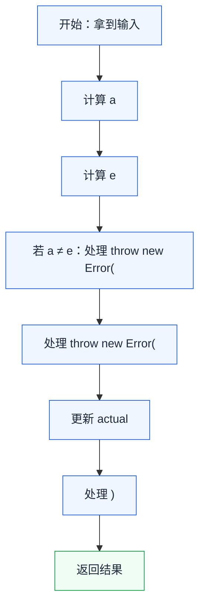

## TypeScript 解题方案（4 个方案逐个讲）

> **运行与提交**：每个方案都是自包含文件（内嵌用例自测，输出 PASS），整块复制到 `.ts` 文件后 `node 文件名` 即可运行。提交 LeetCode 时，把 `demo` 内的算法函数与辅助类型/函数整体取出、置于文件顶层即可。涉及交互/特殊接口的题以题面给定签名为准。

### 方案 1：直接实现

**分析与思路**：核心做法是「直接实现」。

**运行方式**：`node 本文件`，内嵌用例全部通过会输出 PASS。


**方案专属流程图**（真实控制流）：


```typescript
function assertEq(actual: any, expected: any, msg: string = ''): void {
  // 定义函数/方法 assertEq
  const a = JSON.stringify(actual);
  const e = JSON.stringify(expected);
  if (a !== e)
    throw new Error(
      'ASSERT FAILED ' + msg + ' :: actual=' + a + ' expected=' + e,
    );
}

function numDistinct(s: string, t: string): number {
  // 定义函数/方法 numDistinct
  const m = s.length,
    n = t.length; // 把 字符串.长度, 元素个数 赋值为 另一字符串.长度 存入 映射表
  const dp: number[][] = Array.from({ length: m + 1 }, () =>
    new Array(n + 1).fill(0),
  );
  for (let i = 0; i <= m; i++) dp[i][n] = 1; // 让 下标 i 从 0 开始计数，下标 i 不超过 映射表 就继续
  for (let i = m - 1; i >= 0; i--) {
    // 让 下标 i 从 映射表 减 1 开始计数，下标 i 不低于 0 就继续
    for (let j = n - 1; j >= 0; j--) {
      // 让 下标 j 从 元素个数 减 1 开始计数，下标 j 不低于 0 就继续
      if (s[i] === t[j]) dp[i][j] = dp[i + 1][j + 1] + dp[i + 1][j];
      else dp[i][j] = dp[i + 1][j]; // 否则
    }
  }
  return dp[0][0]; // 返回 DP 表[0][0]
}
export function demo(): void {
  // 程序入口：跑内嵌自测用例
  assertEq(numDistinct('rabbbit', 'rabbit'), 3, 'nd1'); // 断言校验
  assertEq(numDistinct('babgbag', 'bag'), 5, 'nd2'); // 断言校验
  console.log('PASS'); // 全部用例通过，输出 PASS
}
demo(); // demo();
```

### 方案 2：直接实现

**分析与思路**：核心做法是「直接实现」。

**运行方式**：`node 本文件`，内嵌用例全部通过会输出 PASS。


**方案专属流程图**（真实控制流）：


```typescript
function assertEq(actual: any, expected: any, msg: string = ''): void {
  // 定义函数/方法 assertEq
  const a = JSON.stringify(actual);
  const e = JSON.stringify(expected);
  if (a !== e)
    throw new Error(
      'ASSERT FAILED ' + msg + ' :: actual=' + a + ' expected=' + e,
    );
}

function numDistinct(s: string, t: string): number {
  // 定义函数/方法 numDistinct
  const sLen = s.length,
    tLen = t.length; // 把 字符串.长度, tLen 赋值为 另一字符串.长度 存入 sLen
  const memo = new Map<string, number>(); // 把 new Map 小于 string, number 超过 () 存入 记忆化表
  function helper(i: number, j: number): number {
    // 定义函数/方法 helper
    if (j < 0) return 1; // 若 下标 j 小于 0，直接返回 1
    if (i < 0) return 0; // 若 下标 i 小于 0，直接返回 0
    const key = i + ',' + j; // 把 下标 i 加 「,」 加 下标 j 存入 key
    if (memo.has(key)) return memo.get(key)!; // 若 记忆化表.has(key)，直接返回 记忆化表 查找 key)取反
    let res: number; // let 结果: number;
    if (s[i] === t[j]) res = helper(i - 1, j) + helper(i - 1, j - 1);
    else res = helper(i - 1, j); // 否则
    memo.set(key, res); // 记忆化表.set(key, 结果);
    return res; // 返回 结果
  }
  return helper(sLen - 1, tLen - 1); // 返回 helper(sLen 减 1, tLen 减 1)
}
export function demo(): void {
  // 程序入口：跑内嵌自测用例
  assertEq(numDistinct('rabbbit', 'rabbit'), 3, 'nd1'); // 断言校验
  assertEq(numDistinct('babgbag', 'bag'), 5, 'nd2'); // 断言校验
  console.log('PASS'); // 全部用例通过，输出 PASS
}
demo(); // demo();
```

### 方案 3：直接实现

**分析与思路**：核心做法是「直接实现」。

**运行方式**：`node 本文件`，内嵌用例全部通过会输出 PASS。

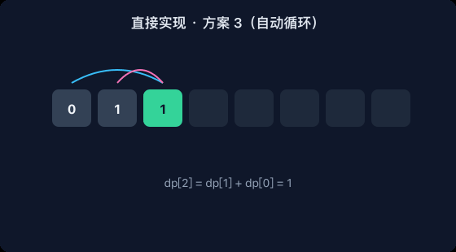

**方案专属流程图**（真实控制流）：


```typescript
function assertEq(actual: any, expected: any, msg: string = ''): void {
  // 定义函数/方法 assertEq
  const a = JSON.stringify(actual);
  const e = JSON.stringify(expected);
  if (a !== e)
    throw new Error(
      'ASSERT FAILED ' + msg + ' :: actual=' + a + ' expected=' + e,
    );
}

function numDistinct(s: string, t: string): number {
  // 定义函数/方法 numDistinct
  const m = s.length,
    n = t.length; // 把 字符串.长度, 元素个数 赋值为 另一字符串.长度 存入 映射表
  const dp: number[][] = Array.from({ length: m + 1 }, () =>
    new Array(n + 1).fill(0),
  );
  for (let i = 0; i <= m; i++) dp[i][n] = 1; // 让 下标 i 从 0 开始计数，下标 i 不超过 映射表 就继续
  for (let i = m - 1; i >= 0; i--)
    // 让 下标 i 从 映射表 减 1 开始计数，下标 i 不低于 0 就继续
    for (let j = n - 1; j >= 0; j--) {
      // 让 下标 j 从 元素个数 减 1 开始计数，下标 j 不低于 0 就继续
      if (s[i] === t[j]) dp[i][j] = dp[i + 1][j + 1] + dp[i + 1][j];
      else dp[i][j] = dp[i + 1][j]; // 否则
    }
  return dp[0][0]; // 返回 DP 表[0][0]
}
export function demo(): void {
  // 程序入口：跑内嵌自测用例
  assertEq(numDistinct('rabbbit', 'rabbit'), 3, 'nd1'); // 断言校验
  assertEq(numDistinct('babgbag', 'bag'), 5, 'nd2'); // 断言校验
  console.log('PASS'); // 全部用例通过，输出 PASS
}
demo(); // demo();
```

### 方案 4：直接实现

**分析与思路**：核心做法是「直接实现」。

**运行方式**：`node 本文件`，内嵌用例全部通过会输出 PASS。


**方案专属流程图**（真实控制流）：

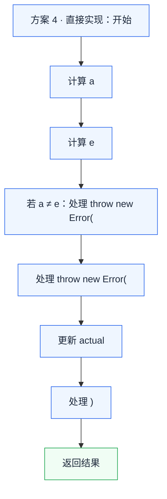

```typescript
function assertEq(actual: any, expected: any, msg: string = ''): void {
  // 定义函数/方法 assertEq
  const a = JSON.stringify(actual);
  const e = JSON.stringify(expected);
  if (a !== e)
    throw new Error(
      'ASSERT FAILED ' + msg + ' :: actual=' + a + ' expected=' + e,
    );
}

function numDistinct(s: string, t: string): number {
  // 定义函数/方法 numDistinct
  const memo = new Map<string, number>(); // 把 new Map 小于 string, number 超过 () 存入 记忆化表
  function helper(i: number, j: number): number {
    // 定义函数/方法 helper
    if (j < 0) return 1; // 若 下标 j 小于 0，直接返回 1
    if (i < 0) return 0; // 若 下标 i 小于 0，直接返回 0
    const key = i + ',' + j; // 把 下标 i 加 「,」 加 下标 j 存入 key
    if (memo.has(key)) return memo.get(key)!; // 若 记忆化表.has(key)，直接返回 记忆化表 查找 key)取反
    let res: number; // let 结果: number;
    if (s[i] === t[j]) res = helper(i - 1, j) + helper(i - 1, j - 1);
    else res = helper(i - 1, j); // 否则
    memo.set(key, res); // 记忆化表.set(key, 结果);
    return res; // 返回 结果
  }
  return helper(s.length - 1, t.length - 1); // 返回 helper(字符串.长度 减 1, 另一字符串.长度 减 1)
}
export function demo(): void {
  // 程序入口：跑内嵌自测用例
  assertEq(numDistinct('rabbbit', 'rabbit'), 3, 'nd1'); // 断言校验
  assertEq(numDistinct('babgbag', 'bag'), 5, 'nd2'); // 断言校验
  console.log('PASS'); // 全部用例通过，输出 PASS
}
demo(); // demo();
```

## 逐步拆解与面试追问

**复杂度**：时间 O(n) 量级，空间 O(n)

**为什么是这个量级**：整体只对数据做有限趟处理

**面试官可能会追问**：

- 状态定义为什么是它？
- 遍历顺序由什么决定？
- 能否滚动数组压空间？

## 关键 API 速查（TS 主解法实际用到，附官方链接）

| API | 作用 | 使用要点 | 官方文档 |
|---|---|---|---|
| `Array.from()` | 类数组/可迭代对象转数组 | Array.from(iterable, mapFn) 可同时映射；对 Set 去重、对字符串按码元拆分；稀疏位会被 undefined 填充 | [官方文档](https://developer.mozilla.org/zh-CN/docs/Web/JavaScript/Reference/Global_Objects/Array/from) |
| `JSON.stringify()` | 序列化为 JSON 字符串 | 常用于结构化比较（深度相等判定）；undefined/函数/循环引用会被丢弃或抛错 | [官方文档](https://developer.mozilla.org/zh-CN/docs/Web/JavaScript/Reference/Global_Objects/JSON/stringify) |

### 各语言官方文档导航

- **TypeScript / JS**：[MDN 中文参考](https://developer.mozilla.org/zh-CN/)
- **Python**：[Python 官方文档](https://docs.python.org/zh-cn/3/)
- **Go**：[Go 标准库](https://pkg.go.dev/std)
- **Java**：[JDK 17 API](https://docs.oracle.com/en/java/javase/17/docs/api/)
- **Rust**：[Rust 标准库](https://doc.rust-lang.org/std/)
- **Lua**：[Lua 5.4 手册](https://www.lua.org/manual/5.4/)
- **C**：[Cppreference C](https://zh.cppreference.com/w/c)
- **C++**：[Cppreference C++](https://zh.cppreference.com/w/cpp)
- **R**：[R 官方手册](https://stat.ethz.ch/R-manual/)
- **Zig**：[Zig 语言文档](https://ziglang.org/documentation/master/)
- **Dart**：[Dart API](https://api.dart.dev/)

## 附录：其他 10 种语言全部实现（每种语言列举其全部方案）

> TypeScript 的全部方案见「TypeScript 解题方案」一节；下面是其余 10 种语言的对应实现，每种语言的每个方案都带思路分析、代码走读与专属运行架构图。
> 每个方案都内嵌用例自测，可独立运行（老仓库 python/go 文件遵循「打印结果」约定）。
> 完整解法文件见 `dsa/<语言>/dp/lc_115_不同的子序列/`。

### Python 实现（4 种方案）

Python 的全部方案如下，每个方案都内嵌用例自测，可独立运行（老仓库 python/go 文件遵循「打印结果」约定）：

#### 方案 1：直接实现

**思路与代码分析**：核心是「直接实现」。Python 版用切片与字典推导式简化操作，突出可读性。代码里依次做这些事：DP 表逐项填充。**走读**：方案 1 · 直接实现：开始 → 更新 m → 更新 n → 填写 DP 表 → 处理 [0] * (n + 1) for _ in range → 处理 ] → 循环 i：从 0 到 m + 1 前 → 填写 DP 表 → 循环 i：从 m - 1 到 -1 前，步长 -1 → 循环 j：从 n - 1 到 -1 前，步长 -1 → 若 s[i] == t[j]：填写 DP 表 → 填写 DP 表 → 填写 DP 表 → 返回 dp[0][0]。

**运行架构**（真实控制流）：

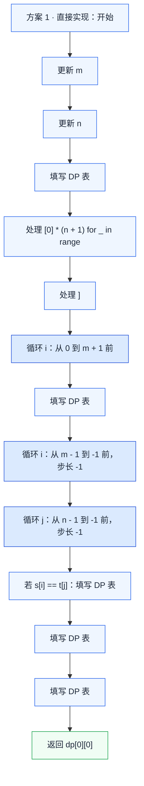

```python
import sys  # 提高递归深度上限（深输入防 RecursionError）

sys.setrecursionlimit(200000)  # 树/链表类题目节点数可达 1e4 量级

def numDistinct(s, t):  # 定义函数 numDistinct（参数：字符串, 另一字符串）
    # 动态规划（从后往前）
    m = len(s)  # 把 长度(字符串) 存入 映射表
    n = len(t)  # 把 长度(另一字符串) 存入 元素个数
    dp = [
        [0] * (n + 1) for _ in range(m + 1)
    ]  # 把 [[0] 乘 (元素个数 加 1) for _ in range(映射表 加 1)] 存入 DP 表
    for i in range(m + 1):  # 让 下标 i 从 映射表 加 1 遍历
        dp[i][n] = 1  # 把 1 写入 dp[i][n]
    for i in range(m - 1, -1, -1):  # 让 下标 i 从 映射表 减 1 倒数回去（每步减 1）
        for j in range(n - 1, -1, -1):  # 让 下标 j 从 元素个数 减 1 倒数回去（每步减 1）
            if s[i] == t[j]:  # 若 字符串[下标 i] 等于 另一字符串[下标 j]
                dp[i][j] = dp[i + 1][j + 1] + dp[i + 1][j]
            else:  # 否则
                dp[i][j] = dp[i + 1][j]  # 把 DP 表[下标 i 加 1][下标 j] 写入 dp[i][j]
    return dp[0][0]  # 返回 DP 表[0][0]

if __name__ == "__main__":  # 若 __name__ 等于 '__main__'
    print(numDistinct("rabbbit", "rabbit"))  # 打印输出
```

#### 方案 2：直接实现

**思路与代码分析**：核心是「直接实现」。Python 版用切片与字典推导式简化操作，突出可读性。**走读**：方案 2 · 直接实现：开始 → 处理 from functools import lru_ca → 更新 sLen → 更新 tLen → 处理 @lru_cache(None) → 命中条件，直接返回 → 命中条件，直接返回 → 命中条件，直接返回 → 处理 i - 1, j - 1 → 处理 ) → 返回 helper(i - 1, j) → 返回 helper(sLen - 1, tLen - 1)。

**运行架构**（真实控制流）：


```python
import sys  # 提高递归深度上限（深输入防 RecursionError）

sys.setrecursionlimit(200000)  # 树/链表类题目节点数可达 1e4 量级

def numDistinct(s, t):  # 定义函数 numDistinct（参数：字符串, 另一字符串）
    # 递归（自顶向下，记忆化以保证可用）
    from functools import lru_cache  # from functools import lru_cache

    sLen = len(s)  # 把 长度(字符串) 存入 sLen
    tLen = len(t)  # 把 长度(另一字符串) 存入 tLen

    @lru_cache(None)  # @lru_cache(None)
    def helper(i, j):  # 定义函数 helper（参数：下标 i, 下标 j）
        if j < 0:  # 若 下标 j 小于 0
            return 1  # 返回 1
        if i < 0:  # 若 下标 i 小于 0
            return 0  # 返回 0
        if s[i] == t[j]:  # 若 字符串[下标 i] 等于 另一字符串[下标 j]
            return helper(i - 1, j) + helper(
                i - 1, j - 1
            )  # 返回 helper(下标 i 减 1, 下标 j) 加 helper(下标 i 减 1, 下标 j 减 1)
        return helper(i - 1, j)  # 返回 helper(下标 i 减 1, 下标 j)

    return helper(sLen - 1, tLen - 1)  # 返回 helper(sLen 减 1, tLen 减 1)

if __name__ == "__main__":  # 若 __name__ 等于 '__main__'
    print(numDistinct("rabbbit", "rabbit"))  # 打印输出
```

#### 方案 3：直接实现

**思路与代码分析**：核心是「直接实现」。Python 版用切片与字典推导式简化操作，突出可读性。**走读**：方案 3 · 直接实现：开始 → 处理 from functools import lru_ca → 更新 sLen → 更新 tLen → 处理 @lru_cache(None) → 命中条件，直接返回 → 命中条件，直接返回 → 命中条件，直接返回 → 处理 i - 1, j - 1 → 处理 ) → 返回 helper(i - 1, j) → 返回 helper(sLen - 1, tLen - 1)。

**运行架构**（真实控制流）：

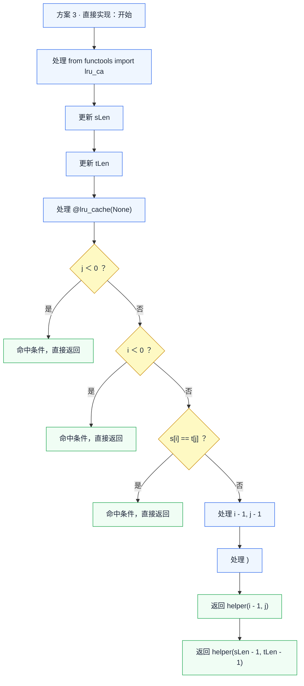

```python
import sys  # 提高递归深度上限（深输入防 RecursionError）

sys.setrecursionlimit(200000)  # 树/链表类题目节点数可达 1e4 量级

def numDistinct(s, t):  # 定义函数 numDistinct（参数：字符串, 另一字符串）
    # 递归（记忆化）
    from functools import lru_cache  # from functools import lru_cache

    sLen = len(s)  # 把 长度(字符串) 存入 sLen
    tLen = len(t)  # 把 长度(另一字符串) 存入 tLen

    @lru_cache(None)  # @lru_cache(None)
    def helper(i, j):  # 定义函数 helper（参数：下标 i, 下标 j）
        if j < 0:  # 若 下标 j 小于 0
            return 1  # 返回 1
        if i < 0:  # 若 下标 i 小于 0
            return 0  # 返回 0
        if s[i] == t[j]:  # 若 字符串[下标 i] 等于 另一字符串[下标 j]
            return helper(i - 1, j) + helper(
                i - 1, j - 1
            )  # 返回 helper(下标 i 减 1, 下标 j) 加 helper(下标 i 减 1, 下标 j 减 1)
        return helper(i - 1, j)  # 返回 helper(下标 i 减 1, 下标 j)

    return helper(sLen - 1, tLen - 1)  # 返回 helper(sLen 减 1, tLen 减 1)

if __name__ == "__main__":  # 若 __name__ 等于 '__main__'
    print(numDistinct("rabbbit", "rabbit"))  # 打印输出
```

#### 方案 4：直接实现

**思路与代码分析**：核心是「直接实现」。Python 版用切片与字典推导式简化操作，突出可读性。代码里依次做这些事：DP 表逐项填充。**走读**：方案 4 · 直接实现：开始 → 更新 sLen → 更新 tLen → 填写 DP 表 → 处理 [0] * (tLen + 1) for _ in ra → 处理 ] → 循环 i：从 0 到 sLen + 1 前 → 填写 DP 表 → 循环 i：从 1 到 sLen + 1 前 → 循环 j：从 1 到 tLen + 1 前 → 若 s[i - 1] == t[j - 1]：填写 DP 表 → 填写 DP 表 → 填写 DP 表 → 返回 dp[sLen][tLen]。

**运行架构**（真实控制流）：

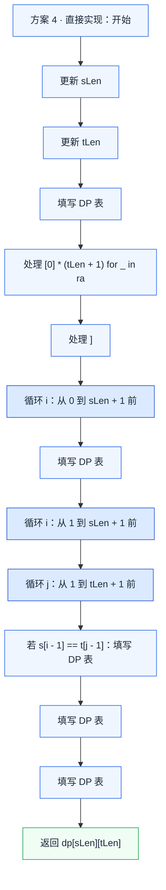

```python
import sys  # 提高递归深度上限（深输入防 RecursionError）

sys.setrecursionlimit(200000)  # 树/链表类题目节点数可达 1e4 量级

def numDistinct(s, t):  # 定义函数 numDistinct（参数：字符串, 另一字符串）
    # 动态规划（从前往后，二维）
    sLen = len(s)  # 把 长度(字符串) 存入 sLen
    tLen = len(t)  # 把 长度(另一字符串) 存入 tLen
    dp = [
        [0] * (tLen + 1) for _ in range(sLen + 1)
    ]  # 把 [[0] 乘 (tLen 加 1) for _ in range(sLen 加 1)] 存入 DP 表
    for i in range(sLen + 1):  # 让 下标 i 从 sLen 加 1 遍历
        dp[i][0] = 1  # 把 1 写入 dp[i][0]
    for i in range(1, sLen + 1):  # 让 下标 i 从 1 到 sLen 加 1 遍历
        for j in range(1, tLen + 1):  # 让 下标 j 从 1 到 tLen 加 1 遍历
            if s[i - 1] == t[j - 1]:  # 若 字符串[下标 i 减 1] 等于 另一字符串[下标 j 减 1]
                dp[i][j] = dp[i - 1][j - 1] + dp[i - 1][j]
            else:  # 否则
                dp[i][j] = dp[i - 1][j]  # 把 DP 表[下标 i 减 1][下标 j] 写入 dp[i][j]
    return dp[sLen][tLen]  # 返回 DP 表[sLen][tLen]

if __name__ == "__main__":  # 若 __name__ 等于 '__main__'
    print(numDistinct("rabbbit", "rabbit"))  # 打印输出
```

### Go 实现（4 种方案）

Go 的全部方案如下，每个方案都内嵌用例自测，可独立运行（老仓库 python/go 文件遵循「打印结果」约定）：

#### 方案 1：直接实现

**思路与代码分析**：核心是「直接实现」。Go 版用切片与多返回值惯用法，显式处理索引边界。代码里依次做这些事：DP 表逐项填充。**走读**：方案 1 · 直接实现：开始 → 更新 : → 更新 : → 更新 : → 遍历 dp 的下标与元素 i → 填写 DP 表 → 遍历循环 → 填写 DP 表 → 遍历循环 → 遍历循环 → 处理 if s[i] == t[j] → 填写 DP 表 → 填写 DP 表 → 返回 dp[0][0]。

**运行架构**（真实控制流）：

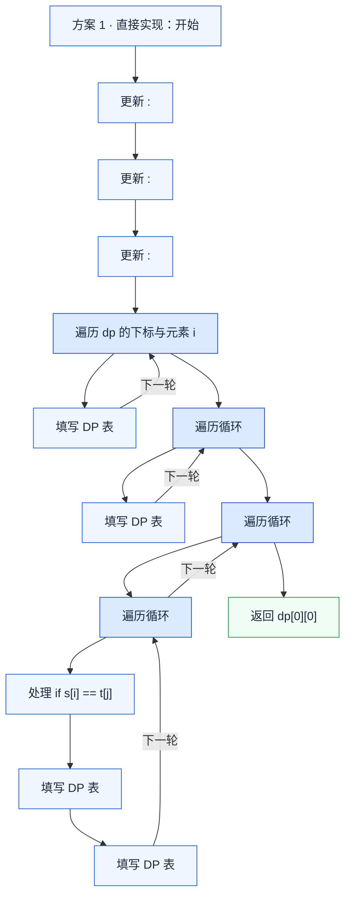

```go
package main // 引入依赖

import (
	"fmt" // 「fmt」
	"os"  // 「os」
)

// numDistinct 是 Python 参考 solution_1 的忠实翻译（从后往前的二维 DP）。
func numDistinct(s, t string) int { // 定义函数/方法 numDistinct
	m := len(s)              // 把 长度(字符串) 写入 m :
	n := len(t)              // 把 长度(另一字符串) 写入 n :
	dp := make([][]int, m+1) // 把 make([][]int, 映射表 加 1) 写入 dp :
	for i := range dp {      // 把 range DP 表 { 写入 for i :
		dp[i] = make([]int, n+1) // 把 make([]int, 元素个数 加 1) 写入 dp[i]
	}
	for i := 0; i <= m; i++ { // 让 下标 i 从 0 开始计数
		dp[i][n] = 1 // 把 1 写入 dp[i][n]
	}
	for i := m - 1; i >= 0; i-- { // 把 映射表 减 1; 下标 i 不低于 0; 下标 i 减一 { 写入 for i :
		for j := n - 1; j >= 0; j-- { // 把 元素个数 减 1; 下标 j 不低于 0; 下标 j 减一 { 写入 for j :
			if s[i] == t[j] { // 若 字符串[下标 i] 等于 另一字符串[下标 j]
				dp[i][j] = dp[i+1][j+1] + dp[i+1][j]
			} else { // 否则
				dp[i][j] = dp[i+1][j] // 把 DP 表[下标 i 加 1][下标 j] 写入 dp[i][j]
			}
		}
	}
	return dp[0][0] // 返回 DP 表[0][0]
}

func main() { // 程序入口：跑内嵌自测用例
	type tc struct { // 定义类型
		s, t string // 字符串, 另一字符串 string
		want int    // want int
	}
	cases := []tc{ // 把 []tc{ 写入 cases :
		{"rabbbit", "rabbit", 3},
		{"babgbag", "bag", 5},
		{"a", "a", 1},
		{"abc", "", 1},
	}
	for _, c := range cases { // 同时取 _ 与 字符 遍历
		if got := numDistinct(c.s, c.t); got != c.want { // 若 got : 赋值为 numDistinct(字符.字符串, 字符.另一字符串); got 不等于 字符.want
			fmt.Printf("FAIL %q %q got=%d want=%d\n", c.s, c.t, got, c.want) // 打印输出
			os.Exit(1)                                                       // os.Exit(1)
		}
	}
	fmt.Println("PASS") // 全部用例通过，输出 PASS
}
```

#### 方案 2：直接实现

**思路与代码分析**：核心是「直接实现」。Go 版用切片与多返回值惯用法，显式处理索引边界。代码里依次做这些事：哈希结构做计数或查重。**走读**：方案 2 · 直接实现：开始 → 更新 : → 返回 1 → 返回 0 → 返回 v → 返回 r → 返回 helper(sLen-1, tLen-1)。

**运行架构**（真实控制流）：

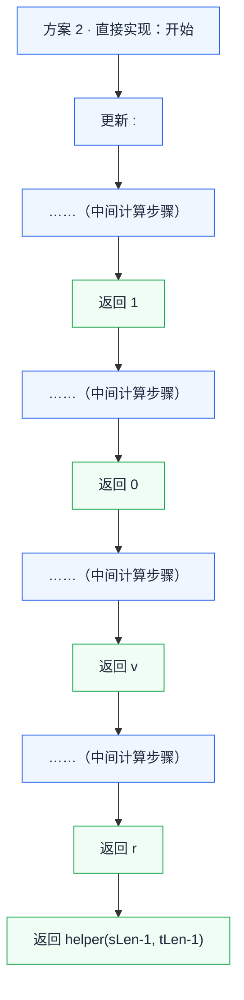

```go
package main // 引入依赖

import (
	"fmt"
	"os"
	"strconv"
) // 引入依赖

func numDistinct(s, t string) int { // 定义函数/方法 numDistinct
	sLen, tLen := len(s), len(t)  // 把 长度(字符串), 长度(另一字符串) 写入 sLen, tLen :
	memo := map[string]int{}      // 把 映射表[string]int{} 写入 memo :
	var helper func(int, int) int // var helper func(int, int) int
	helper = func(i, j int) int { // 把 func(下标 i, 下标 j int) int { 写入 helper
		if j < 0 { // 若 下标 j 小于 0
			return 1 // 返回 1
		}
		if i < 0 { // 若 下标 i 小于 0
			return 0 // 返回 0
		}
		key := strconv.Itoa(i) + "," + strconv.Itoa(j) // 把 strconv.Itoa(下标 i) 加 「,」 加 strconv.Itoa(下标 j) 写入 key :
		if v, ok := memo[key]; ok {                    // 若 值, ok : 赋值为 记忆化表[key]; ok
			return v // 返回 值
		}
		var r int         // var 右指针 int
		if s[i] == t[j] { // 若 字符串[下标 i] 等于 另一字符串[下标 j]
			r = helper(i-1, j) + helper(i-1, j-1) // 把 helper(下标 i 减 1, 下标 j) 加 helper(下标 i 减 1, 下标 j 减 1) 写入 右指针
		} else { // 否则
			r = helper(i-1, j) // 把 helper(下标 i 减 1, 下标 j) 写入 右指针
		}
		memo[key] = r // 把 右指针 写入 memo[key]
		return r      // 返回 右指针
	}
	return helper(sLen-1, tLen-1) // 定义函数/方法 helper
}

func main() { // 程序入口：跑内嵌自测用例
	cases := []struct { // 把 []struct { 写入 cases :
		s, t string // 字符串, 另一字符串 string
		want int    // want int
	}{ // }{
		{"rabbbit", "rabbit", 3},
		{"babgbag", "bag", 5},
	}
	ok := true                // 把 true 写入 ok :
	for _, c := range cases { // 同时取 _ 与 字符 遍历
		if g := numDistinct(c.s, c.t); g != c.want { // 若 g : 赋值为 numDistinct(字符.字符串, 字符.另一字符串); g 不等于 字符.want
			ok = false                                                 // 把 false 写入 ok
			fmt.Printf("FAIL %q,%q=%v want %v\n", c.s, c.t, g, c.want) // 打印输出
		}
	}
	if !ok { // 若 取反 ok
		os.Exit(1) // os.Exit(1)
	}
	fmt.Println("PASS") // 全部用例通过，输出 PASS
}
```

#### 方案 3：直接实现

**思路与代码分析**：核心是「直接实现」。Go 版用切片与多返回值惯用法，显式处理索引边界。**走读**：方案 3 · 直接实现：开始 → 更新 : → 遍历 memo 的下标与元素 i → 遍历 memo[i] 的下标与元素 j → 返回 1 → 返回 0 → 返回 memo[i][j] → 返回 res → 返回 helper(m-1, n-1)。

**运行架构**（真实控制流）：

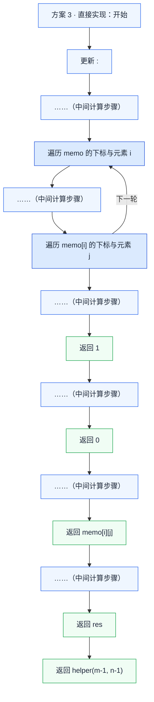

```go
package main // 引入依赖

import (
	"fmt" // 「fmt」
	"os"  // 「os」
)

// numDistinct 是 Python 参考 solution_3 的忠实翻译（递归 + 记忆化）。
func numDistinct(s, t string) int { // 定义函数/方法 numDistinct
	m := len(s)              // 把 长度(字符串) 写入 m :
	n := len(t)              // 把 长度(另一字符串) 写入 n :
	memo := make([][]int, m) // 把 make([][]int, 映射表) 写入 memo :
	for i := range memo {    // 把 range 记忆化表 { 写入 for i :
		memo[i] = make([]int, n) // 把 make([]int, 元素个数) 写入 memo[i]
		for j := range memo[i] { // 把 range 记忆化表[下标 i] { 写入 for j :
			memo[i][j] = -1 // 把 减 1 写入 memo[i][j]
		}
	}
	var helper func(i, j int) int // var helper func(下标 i, 下标 j int) int
	helper = func(i, j int) int { // 把 func(下标 i, 下标 j int) int { 写入 helper
		if j < 0 { // 若 下标 j 小于 0
			return 1 // 返回 1
		}
		if i < 0 { // 若 下标 i 小于 0
			return 0 // 返回 0
		}
		if memo[i][j] != -1 { // 若 记忆化表[下标 i][下标 j] 不等于 减 1
			return memo[i][j] // 返回 记忆化表[下标 i][下标 j]
		}
		var res int       // var 结果 int
		if s[i] == t[j] { // 若 字符串[下标 i] 等于 另一字符串[下标 j]
			res = helper(i-1, j) + helper(i-1, j-1) // 把 helper(下标 i 减 1, 下标 j) 加 helper(下标 i 减 1, 下标 j 减 1) 写入 结果
		} else { // 否则
			res = helper(i-1, j) // 把 helper(下标 i 减 1, 下标 j) 写入 结果
		}
		memo[i][j] = res // 把 结果 写入 memo[i][j]
		return res       // 返回 结果
	}
	return helper(m-1, n-1) // 定义函数/方法 helper
}

func main() { // 程序入口：跑内嵌自测用例
	type tc struct { // 定义类型
		s, t string // 字符串, 另一字符串 string
		want int    // want int
	}
	cases := []tc{ // 把 []tc{ 写入 cases :
		{"rabbbit", "rabbit", 3},
		{"babgbag", "bag", 5},
		{"a", "a", 1},
		{"abc", "", 1},
	}
	for _, c := range cases { // 同时取 _ 与 字符 遍历
		if got := numDistinct(c.s, c.t); got != c.want { // 若 got : 赋值为 numDistinct(字符.字符串, 字符.另一字符串); got 不等于 字符.want
			fmt.Printf("FAIL %q %q got=%d want=%d\n", c.s, c.t, got, c.want) // 打印输出
			os.Exit(1)                                                       // os.Exit(1)
		}
	}
	fmt.Println("PASS") // 全部用例通过，输出 PASS
}
```

#### 方案 4：直接实现

**思路与代码分析**：核心是「直接实现」。Go 版用切片与多返回值惯用法，显式处理索引边界。代码里依次做这些事：DP 表逐项填充。**走读**：方案 4 · 直接实现：开始 → 更新 : → 更新 : → 遍历 dp 的下标与元素 i → 填写 DP 表 → 遍历循环 → 填写 DP 表 → 遍历循环 → 遍历循环 → 处理 if s[i-1] == t[j-1] → 填写 DP 表 → 填写 DP 表 → 返回 dp[sLen][tLen]。

**运行架构**（真实控制流）：

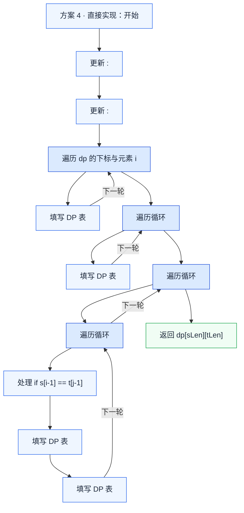

```go
package main // 引入依赖

import (
	"fmt"
	"os"
) // 引入依赖

func numDistinct(s, t string) int { // 定义函数/方法 numDistinct
	sLen, tLen := len(s), len(t) // 把 长度(字符串), 长度(另一字符串) 写入 sLen, tLen :
	dp := make([][]int, sLen+1)  // 把 make([][]int, sLen 加 1) 写入 dp :
	for i := range dp {          // 把 range DP 表 { 写入 for i :
		dp[i] = make([]int, tLen+1) // 把 make([]int, tLen 加 1) 写入 dp[i]
	}
	for i := 0; i <= sLen; i++ { // 让 下标 i 从 0 开始计数
		dp[i][0] = 1 // 把 1 写入 dp[i][0]
	}
	for i := 1; i <= sLen; i++ { // 让 下标 i 从 1 开始计数
		for j := 1; j <= tLen; j++ { // 让 下标 j 从 1 开始计数
			if s[i-1] == t[j-1] { // 若 字符串[下标 i 减 1] 等于 另一字符串[下标 j 减 1]
				dp[i][j] = dp[i-1][j-1] + dp[i-1][j]
			} else { // 否则
				dp[i][j] = dp[i-1][j] // 把 DP 表[下标 i 减 1][下标 j] 写入 dp[i][j]
			}
		}
	}
	return dp[sLen][tLen] // 返回 DP 表[sLen][tLen]
}

func main() { // 程序入口：跑内嵌自测用例
	cases := []struct { // 把 []struct { 写入 cases :
		s, t string // 字符串, 另一字符串 string
		want int    // want int
	}{ // }{
		{"rabbbit", "rabbit", 3},
		{"babgbag", "bag", 5},
	}
	ok := true                // 把 true 写入 ok :
	for _, c := range cases { // 同时取 _ 与 字符 遍历
		if g := numDistinct(c.s, c.t); g != c.want { // 若 g : 赋值为 numDistinct(字符.字符串, 字符.另一字符串); g 不等于 字符.want
			ok = false                                                 // 把 false 写入 ok
			fmt.Printf("FAIL %q,%q=%v want %v\n", c.s, c.t, g, c.want) // 打印输出
		}
	}
	if !ok { // 若 取反 ok
		os.Exit(1) // os.Exit(1)
	}
	fmt.Println("PASS") // 全部用例通过，输出 PASS
}
```

### Java 实现（4 种方案）

Java 的全部方案如下，每个方案都内嵌用例自测，可独立运行（老仓库 python/go 文件遵循「打印结果」约定）：

#### 方案 1：直接实现

**思路与代码分析**：核心是「直接实现」。Java 版用类与静态方法组织，集合操作显式明了。代码里依次做这些事：DP 表逐项填充；双重循环遍历。**走读**：方案 1 · 直接实现：开始 → 更新 m → 更新 n → 填写 DP 表 → 遍历循环 → 填写 DP 表 → 遍历循环 → 遍历循环 → 若 s.charAt(i) == t.charAt(j) 则： → 填写 DP 表 → 填写 DP 表 → 返回 dp[0][0]。

**运行架构**（真实控制流）：

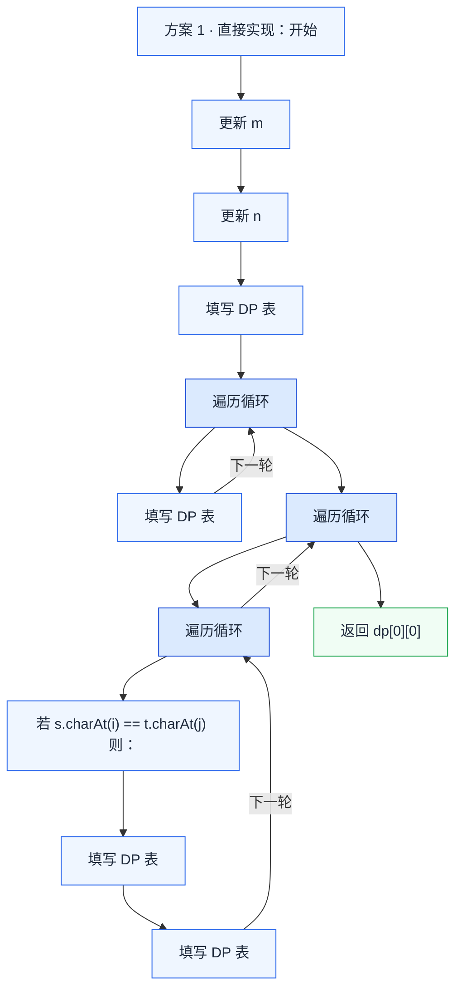

```java
package com.webfault.dsa; // 引入依赖

class lc115_solution11 { // 定义类型
  // numDistinct 忠实翻译 python ref solution_1___1.py（从后往前 DP）
  public long numDistinct(String s, String t) { // 定义函数/方法 numDistinct
    int m = s.length(); // 把 字符串.长度() 存入 映射表
    int n = t.length(); // 把 另一字符串.长度() 存入 元素个数
    long[][] dp = new long[m + 1][n + 1]; // 把 new long[映射表 加 1][元素个数 加 1]; 写入 long[][] dp
    for (int i = 0; i <= m; i++) { // 让 下标 i 从 0 开始计数，下标 i 不超过 映射表 就继续
      dp[i][n] = 1; // 把 1; 写入 dp[i][n]
    }
    for (int i = m - 1; i >= 0; i--) { // 让 下标 i 从 映射表 减 1 开始计数，下标 i 不低于 0 就继续
      for (int j = n - 1; j >= 0; j--) { // 让 下标 j 从 元素个数 减 1 开始计数，下标 j 不低于 0 就继续
        if (s.charAt(i) == t.charAt(j)) { // 若 字符串 取字符 下标 i) 等于 另一字符串 取字符 下标 j
          dp[i][j] = dp[i + 1][j + 1] + dp[i + 1][j];
        } else { // 否则
          dp[i][j] = dp[i + 1][j]; // 把 DP 表[下标 i 加 1][下标 j]; 写入 dp[i][j]
        }
      }
    }
    return dp[0][0]; // 返回 DP 表[0][0]
  }

  public static void main(String[] args) { // public static void main(String[] args) {
    lc115_solution11 s = new lc115_solution11(); // 把 new lc115_solution11(); 写入 lc115_solution11 s
    String[][] cases = { // 把 { 写入 String[][] cases
      {"rabbbit", "rabbit", "3"},
      {"babgbag", "bag", "5"},
      {"", "", "1"},
      {"a", "", "1"},
      {"", "a", "0"},
      {"aaa", "aa", "3"},
      {"aabbcc", "abc", "8"},
    };
    boolean ok = true; // 把 true; 写入 boolean ok
    for (String[] c : cases) { // for (String[] 字符 : cases) {
      long got = s.numDistinct(c[0], c[1]); // 把 字符串.numDistinct(字符[0], 字符[1]); 写入 long got
      long want = Long.parseLong(c[2]); // 把 Long.parseLong(字符[2]); 写入 long want
      if (got != want) { // 若 got 不等于 want
        ok = false; // 把 false; 写入 ok
        System.out.println(
            "FAIL solve(\"" + c[0] + "\",\"" + c[1] + "\")=" + got + " want " + want); // 打印输出
      }
    }
    if (!ok) { // 若 取反 ok
      throw new RuntimeException("FAILED"); // throw new RuntimeException(「FAILED」);
    }
    System.out.println("PASS"); // 全部用例通过，输出 PASS
  }
}
```

#### 方案 2：直接实现

**思路与代码分析**：核心是「直接实现」。Java 版用类与静态方法组织，集合操作显式明了。代码里依次做这些事：双重循环遍历。**走读**：方案 2 · 直接实现：开始 → 更新 this.s → 更新 this.t → 更新 sLen → 更新 memo → 遍历循环 → 遍历循环 → 更新 memo[i][j] → 返回 helper(sLen - 1, tLen - 1)。

**运行架构**（真实控制流）：


```java
package com.webfault.dsa; // 引入依赖

class lc115_solution222 { // 定义类型
  private String s, t; // private String 字符串, 另一字符串;
  private long[][] memo; // private long[][] 记忆化表;

  // numDistinct 忠实翻译 python ref solution_2_2_____2_________.py（lru_cache 记忆化递归）
  public long numDistinct(String s, String t) { // 定义函数/方法 numDistinct
    this.s = s; // 把 字符串; 写入 字符串
    this.t = t; // 把 另一字符串; 写入 另一字符串
    int sLen = s.length(), tLen = t.length(); // 把 字符串.长度(), tLen 赋值为 另一字符串.长度() 存入 sLen
    memo = new long[sLen][tLen]; // 把 new long[sLen][tLen]; 写入 记忆化表
    for (int i = 0; i < sLen; i++) { // 让 下标 i 从 0 开始计数，下标 i 小于 sLen 就继续
      for (int j = 0; j < tLen; j++) { // 让 下标 j 从 0 开始计数，下标 j 小于 tLen 就继续
        memo[i][j] = -1; // 把 减 1; 写入 memo[i][j]
      }
    }
    return helper(sLen - 1, tLen - 1); // 返回 helper(sLen 减 1, tLen 减 1)
  }

  private long helper(int i, int j) { // 定义函数/方法 helper
    if (j < 0) { // 若 下标 j 小于 0
      return 1; // 返回 1
    }
    if (i < 0) { // 若 下标 i 小于 0
      return 0; // 返回 0
    }
    if (memo[i][j] != -1) { // 若 记忆化表[下标 i][下标 j] 不等于 减 1
      return memo[i][j]; // 返回 记忆化表[下标 i][下标 j]
    }
    if (s.charAt(i) == t.charAt(j)) { // 若 字符串 取字符 下标 i) 等于 另一字符串 取字符 下标 j
      memo[i][j] = helper(i - 1, j) + helper(i - 1, j - 1);
    } else { // 否则
      memo[i][j] = helper(i - 1, j); // 把 helper(下标 i 减 1, 下标 j); 写入 memo[i][j]
    }
    return memo[i][j]; // 返回 记忆化表[下标 i][下标 j]
  }

  public static void main(String[] args) { // public static void main(String[] args) {
    lc115_solution222 s =
        new lc115_solution222(); // 把 new lc115_solution222(); 写入 lc115_solution222 s
    String[][] cases = { // 把 { 写入 String[][] cases
      {"rabbbit", "rabbit", "3"},
      {"babgbag", "bag", "5"},
      {"", "", "1"},
      {"a", "", "1"},
      {"", "a", "0"},
      {"aaa", "aa", "3"},
      {"aabbcc", "abc", "8"},
    };
    boolean ok = true; // 把 true; 写入 boolean ok
    for (String[] c : cases) { // for (String[] 字符 : cases) {
      long got = s.numDistinct(c[0], c[1]); // 把 字符串.numDistinct(字符[0], 字符[1]); 写入 long got
      long want = Long.parseLong(c[2]); // 把 Long.parseLong(字符[2]); 写入 long want
      if (got != want) { // 若 got 不等于 want
        ok = false; // 把 false; 写入 ok
        System.out.println(
            "FAIL solve(\"" + c[0] + "\",\"" + c[1] + "\")=" + got + " want " + want); // 打印输出
      }
    }
    if (!ok) { // 若 取反 ok
      throw new RuntimeException("FAILED"); // throw new RuntimeException(「FAILED」);
    }
    System.out.println("PASS"); // 全部用例通过，输出 PASS
  }
}
```

#### 方案 3：直接实现

**思路与代码分析**：核心是「直接实现」。Java 版用类与静态方法组织，集合操作显式明了。代码里依次做这些事：双重循环遍历。**走读**：方案 3 · 直接实现：开始 → 更新 this.s → 更新 this.t → 更新 sLen → 更新 memo → 遍历循环 → 遍历循环 → 更新 memo[i][j] → 返回 helper(sLen - 1, tLen - 1)。

**运行架构**（真实控制流）：

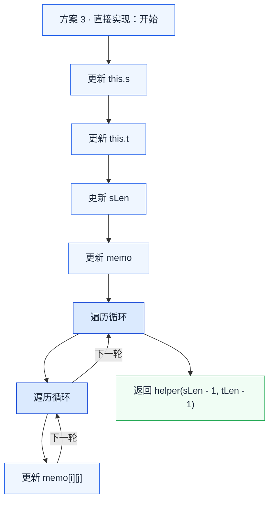

```java
package com.webfault.dsa; // 引入依赖

class lc115_solution333 { // 定义类型
  private String s, t; // private String 字符串, 另一字符串;
  private long[][] memo; // private long[][] 记忆化表;

  // numDistinct 忠实翻译 python ref solution_3_3_____3_________.py（lru_cache 记忆化递归）
  public long numDistinct(String s, String t) { // 定义函数/方法 numDistinct
    this.s = s; // 把 字符串; 写入 字符串
    this.t = t; // 把 另一字符串; 写入 另一字符串
    int sLen = s.length(), tLen = t.length(); // 把 字符串.长度(), tLen 赋值为 另一字符串.长度() 存入 sLen
    memo = new long[sLen][tLen]; // 把 new long[sLen][tLen]; 写入 记忆化表
    for (int i = 0; i < sLen; i++) { // 让 下标 i 从 0 开始计数，下标 i 小于 sLen 就继续
      for (int j = 0; j < tLen; j++) { // 让 下标 j 从 0 开始计数，下标 j 小于 tLen 就继续
        memo[i][j] = -1; // 把 减 1; 写入 memo[i][j]
      }
    }
    return helper(sLen - 1, tLen - 1); // 返回 helper(sLen 减 1, tLen 减 1)
  }

  private long helper(int i, int j) { // 定义函数/方法 helper
    if (j < 0) { // 若 下标 j 小于 0
      return 1; // 返回 1
    }
    if (i < 0) { // 若 下标 i 小于 0
      return 0; // 返回 0
    }
    if (memo[i][j] != -1) { // 若 记忆化表[下标 i][下标 j] 不等于 减 1
      return memo[i][j]; // 返回 记忆化表[下标 i][下标 j]
    }
    if (s.charAt(i) == t.charAt(j)) { // 若 字符串 取字符 下标 i) 等于 另一字符串 取字符 下标 j
      memo[i][j] = helper(i - 1, j) + helper(i - 1, j - 1);
    } else { // 否则
      memo[i][j] = helper(i - 1, j); // 把 helper(下标 i 减 1, 下标 j); 写入 memo[i][j]
    }
    return memo[i][j]; // 返回 记忆化表[下标 i][下标 j]
  }

  public static void main(String[] args) { // public static void main(String[] args) {
    lc115_solution333 s =
        new lc115_solution333(); // 把 new lc115_solution333(); 写入 lc115_solution333 s
    String[][] cases = { // 把 { 写入 String[][] cases
      {"rabbbit", "rabbit", "3"},
      {"babgbag", "bag", "5"},
      {"", "", "1"},
      {"a", "", "1"},
      {"", "a", "0"},
      {"aaa", "aa", "3"},
      {"aabbcc", "abc", "8"},
    };
    boolean ok = true; // 把 true; 写入 boolean ok
    for (String[] c : cases) { // for (String[] 字符 : cases) {
      long got = s.numDistinct(c[0], c[1]); // 把 字符串.numDistinct(字符[0], 字符[1]); 写入 long got
      long want = Long.parseLong(c[2]); // 把 Long.parseLong(字符[2]); 写入 long want
      if (got != want) { // 若 got 不等于 want
        ok = false; // 把 false; 写入 ok
        System.out.println(
            "FAIL solve(\"" + c[0] + "\",\"" + c[1] + "\")=" + got + " want " + want); // 打印输出
      }
    }
    if (!ok) { // 若 取反 ok
      throw new RuntimeException("FAILED"); // throw new RuntimeException(「FAILED」);
    }
    System.out.println("PASS"); // 全部用例通过，输出 PASS
  }
}
```

#### 方案 4：直接实现

**思路与代码分析**：核心是「直接实现」。Java 版用类与静态方法组织，集合操作显式明了。代码里依次做这些事：DP 表逐项填充；双重循环遍历。**走读**：方案 4 · 直接实现：开始 → 更新 sLen → 填写 DP 表 → 遍历循环 → 填写 DP 表 → 遍历循环 → 遍历循环 → 若 s.charAt(i - 1) == t.charAt(j - 1) 则： → 填写 DP 表 → 填写 DP 表 → 返回 dp[sLen][tLen]。

**运行架构**（真实控制流）：

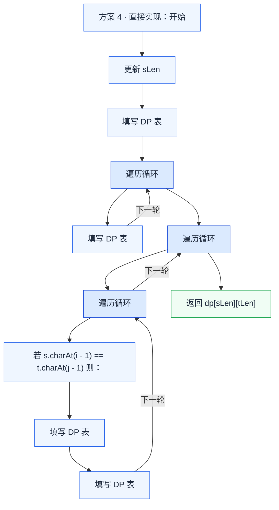

```java
package com.webfault.dsa; // 引入依赖

class lc115_solution444 { // 定义类型
  // numDistinct 忠实翻译 python ref solution_4_4_____4______.py（从前往后二维 DP）
  static long numDistinct(String s, String t) { // 定义函数/方法 numDistinct
    int sLen = s.length(), tLen = t.length(); // 把 字符串.长度(), tLen 赋值为 另一字符串.长度() 存入 sLen
    long[][] dp = new long[sLen + 1][tLen + 1]; // 把 new long[sLen 加 1][tLen 加 1]; 写入 long[][] dp
    for (int i = 0; i <= sLen; i++) { // 让 下标 i 从 0 开始计数，下标 i 不超过 sLen 就继续
      dp[i][0] = 1; // 把 1; 写入 dp[i][0]
    }
    for (int i = 1; i <= sLen; i++) { // 让 下标 i 从 1 开始计数，下标 i 不超过 sLen 就继续
      for (int j = 1; j <= tLen; j++) { // 让 下标 j 从 1 开始计数，下标 j 不超过 tLen 就继续
        if (s.charAt(i - 1) == t.charAt(j - 1)) { // 若 字符串 取字符 下标 i 减 1) 等于 另一字符串 取字符 下标 j 减 1
          dp[i][j] = dp[i - 1][j - 1] + dp[i - 1][j];
        } else { // 否则
          dp[i][j] = dp[i - 1][j]; // 把 DP 表[下标 i 减 1][下标 j]; 写入 dp[i][j]
        }
      }
    }
    return dp[sLen][tLen]; // 返回 DP 表[sLen][tLen]
  }

  public static void main(String[] args) { // public static void main(String[] args) {
    String[][] cases = { // 把 { 写入 String[][] cases
      {"rabbbit", "rabbit", "3"},
      {"babgbag", "bag", "5"},
      {"", "", "1"},
      {"a", "", "1"},
      {"", "a", "0"},
      {"aaa", "aa", "3"},
      {"aabbcc", "abc", "8"},
    };
    boolean ok = true; // 把 true; 写入 boolean ok
    for (String[] c : cases) { // for (String[] 字符 : cases) {
      long got = numDistinct(c[0], c[1]); // 把 numDistinct(字符[0], 字符[1]); 写入 long got
      long want = Long.parseLong(c[2]); // 把 Long.parseLong(字符[2]); 写入 long want
      if (got != want) { // 若 got 不等于 want
        ok = false; // 把 false; 写入 ok
        System.out.println(
            "FAIL solve(\"" + c[0] + "\",\"" + c[1] + "\")=" + got + " want " + want); // 打印输出
      }
    }
    if (!ok) { // 若 取反 ok
      throw new RuntimeException("FAILED"); // throw new RuntimeException(「FAILED」);
    }
    System.out.println("PASS"); // 全部用例通过，输出 PASS
  }
}
```

### Rust 实现（4 种方案）

Rust 的全部方案如下，每个方案都内嵌用例自测，可独立运行（老仓库 python/go 文件遵循「打印结果」约定）：

#### 方案 1：直接实现

**思路与代码分析**：核心是「直接实现」。Rust 版用所有权移动与切片借用改写同一逻辑，注意 Option 与引用边界。代码里依次做这些事：DP 表逐项填充。**走读**：方案 1 · 直接实现：开始 → 计算 a → 计算 b → 计算 let (m, n) = (a.len(), b → 填写 DP 表 → 填写 DP 表 → 遍历 1..=m 中的每个元素 i → 遍历 (1..=n).rev() 中的每个元素 j → 处理 if a[i - 1] == b[j - 1] → 填写 DP 表 → 填写 DP 表 → 返回结果。

**运行架构**（真实控制流）：

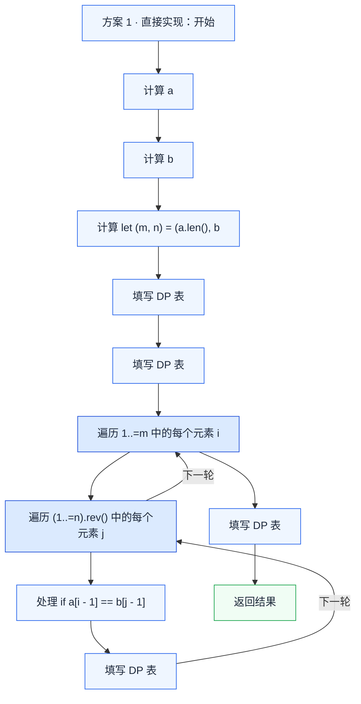

```rust
// LeetCode 115. 不同的子序列 — Rust 版（方案1）
fn num_distinct(s: String, t: String) -> i32 {
    // 定义函数/方法 num_distinct
    let a: Vec<char> = s.chars().collect(); // 把 字符串.chars().collect(); 写入 let a: Vec<char>
    let b: Vec<char> = t.chars().collect(); // 把 另一字符串.chars().collect(); 写入 let b: Vec<char>
    let (m, n) = (a.len(), b.len()); // 把 (数组.长度(), b.长度()); 写入 let (m, n)
    let mut dp = vec![0i64; n + 1]; // 把 vec取反 [0i64; 元素个数 加 1]; 写入 let mut dp
    dp[0] = 1; // 把 1; 写入 dp[0]
    for i in 1..=m {
        // 逐个取出 1 的元素（下标 i）
        for j in (1..=n).rev() {
            // 把 元素个数).rev() { 写入 for j in (1
            if a[i - 1] == b[j - 1] {
                dp[j] += dp[j - 1];
            }
        }
    }
    dp[n] as i32 // DP 表[元素个数] as i32
}
fn main() {
    assert_eq!(num_distinct("rabbbit".into(), "rabbit".into()), 3);
    assert_eq!(num_distinct("babgbag".into(), "bag".into()), 5);
    println!("PASS");
} // 程序入口：跑内嵌自测用例
```

#### 方案 2：直接实现

**思路与代码分析**：核心是「直接实现」。Rust 版用所有权移动与切片借用改写同一逻辑，注意 Option 与引用边界。代码里依次做这些事：DP 表逐项填充。**走读**：方案 2 · 直接实现：开始 → 计算 a → 计算 b → 计算 let (m, n) = (a.len(), b → 填写 DP 表 → 填写 DP 表 → 遍历 1..=m 中的每个元素 i → 遍历 (1..=n).rev() 中的每个元素 j → 处理 if a[i - 1] == b[j - 1] → 填写 DP 表 → 填写 DP 表 → 返回结果。

**运行架构**（真实控制流）：


```rust
// LeetCode 115. 不同的子序列 — Rust 版（方案2）
fn num_distinct(s: String, t: String) -> i32 {
    // 定义函数/方法 num_distinct
    let a: Vec<char> = s.chars().collect(); // 把 字符串.chars().collect(); 写入 let a: Vec<char>
    let b: Vec<char> = t.chars().collect(); // 把 另一字符串.chars().collect(); 写入 let b: Vec<char>
    let (m, n) = (a.len(), b.len()); // 把 (数组.长度(), b.长度()); 写入 let (m, n)
    let mut dp = vec![0i64; n + 1]; // 把 vec取反 [0i64; 元素个数 加 1]; 写入 let mut dp
    dp[0] = 1; // 把 1; 写入 dp[0]
    for i in 1..=m {
        // 逐个取出 1 的元素（下标 i）
        for j in (1..=n).rev() {
            // 把 元素个数).rev() { 写入 for j in (1
            if a[i - 1] == b[j - 1] {
                dp[j] += dp[j - 1];
            }
        }
    }
    dp[n] as i32 // DP 表[元素个数] as i32
}
fn main() {
    assert_eq!(num_distinct("rabbbit".into(), "rabbit".into()), 3);
    assert_eq!(num_distinct("babgbag".into(), "bag".into()), 5);
    println!("PASS");
} // 程序入口：跑内嵌自测用例
```

#### 方案 3：直接实现

**思路与代码分析**：核心是「直接实现」。Rust 版用所有权移动与切片借用改写同一逻辑，注意 Option 与引用边界。代码里依次做这些事：DP 表逐项填充。**走读**：方案 3 · 直接实现：开始 → 计算 a → 计算 b → 计算 let (m, n) = (a.len(), b → 填写 DP 表 → 填写 DP 表 → 遍历 1..=m 中的每个元素 i → 遍历 (1..=n).rev() 中的每个元素 j → 处理 if a[i - 1] == b[j - 1] → 填写 DP 表 → 填写 DP 表 → 返回结果。

**运行架构**（真实控制流）：


```rust
// LeetCode 115. 不同的子序列 — Rust 版（方案3）
fn num_distinct(s: String, t: String) -> i32 {
    // 定义函数/方法 num_distinct
    let a: Vec<char> = s.chars().collect(); // 把 字符串.chars().collect(); 写入 let a: Vec<char>
    let b: Vec<char> = t.chars().collect(); // 把 另一字符串.chars().collect(); 写入 let b: Vec<char>
    let (m, n) = (a.len(), b.len()); // 把 (数组.长度(), b.长度()); 写入 let (m, n)
    let mut dp = vec![0i64; n + 1]; // 把 vec取反 [0i64; 元素个数 加 1]; 写入 let mut dp
    dp[0] = 1; // 把 1; 写入 dp[0]
    for i in 1..=m {
        // 逐个取出 1 的元素（下标 i）
        for j in (1..=n).rev() {
            // 把 元素个数).rev() { 写入 for j in (1
            if a[i - 1] == b[j - 1] {
                dp[j] += dp[j - 1];
            }
        }
    }
    dp[n] as i32 // DP 表[元素个数] as i32
}
fn main() {
    assert_eq!(num_distinct("rabbbit".into(), "rabbit".into()), 3);
    assert_eq!(num_distinct("babgbag".into(), "bag".into()), 5);
    println!("PASS");
} // 程序入口：跑内嵌自测用例
```

#### 方案 4：直接实现

**思路与代码分析**：核心是「直接实现」。Rust 版用所有权移动与切片借用改写同一逻辑，注意 Option 与引用边界。代码里依次做这些事：DP 表逐项填充。**走读**：方案 4 · 直接实现：开始 → 计算 a → 计算 b → 计算 let (m, n) = (a.len(), b → 填写 DP 表 → 填写 DP 表 → 遍历 1..=m 中的每个元素 i → 遍历 (1..=n).rev() 中的每个元素 j → 处理 if a[i - 1] == b[j - 1] → 填写 DP 表 → 填写 DP 表 → 返回结果。

**运行架构**（真实控制流）：

```mermaid
graph TD
    N0["方案 4 · 直接实现：开始"]
    N1["计算 a"]
    N2["计算 b"]
    N3["计算 let (m, n) = (a.len(), b"]
    N4["填写 DP 表"]
    N5["填写 DP 表"]
    N6["遍历 1..=m 中的每个元素 i"]
    N7["遍历 (1..=n).rev() 中的每个元素 j"]
    N8["处理 if a[i - 1] == b[j - 1]"]
    N9["填写 DP 表"]
    N10["填写 DP 表"]
    N11["返回结果"]
    N0 --> N1
    N1 --> N2
    N2 --> N3
    N3 --> N4
    N4 --> N5
    N5 --> N6
    N6 --> N7
    N7 --> N8
    N8 --> N9
    N9 -- 下一轮 --> N7
    N7 -- 下一轮 --> N6
    N6 --> N10
    N10 --> N11
    classDef n fill:#eff6ff,stroke:#2563eb,color:#1e293b;
    classDef lp fill:#dbeafe,stroke:#1d4ed8,color:#1e293b;
    classDef dc fill:#fef9c3,stroke:#ca8a04,color:#1e293b;
    classDef tm fill:#f0fdf4,stroke:#16a34a,color:#1e293b;
    class N0,N1,N2,N3,N4,N5,N8,N9,N10 n;
    class N6,N7 lp;
    class N11 tm;
```

```rust
// LeetCode 115. 不同的子序列 — Rust 版（方案4）
fn num_distinct(s: String, t: String) -> i32 {
    // 定义函数/方法 num_distinct
    let a: Vec<char> = s.chars().collect(); // 把 字符串.chars().collect(); 写入 let a: Vec<char>
    let b: Vec<char> = t.chars().collect(); // 把 另一字符串.chars().collect(); 写入 let b: Vec<char>
    let (m, n) = (a.len(), b.len()); // 把 (数组.长度(), b.长度()); 写入 let (m, n)
    let mut dp = vec![0i64; n + 1]; // 把 vec取反 [0i64; 元素个数 加 1]; 写入 let mut dp
    dp[0] = 1; // 把 1; 写入 dp[0]
    for i in 1..=m {
        // 逐个取出 1 的元素（下标 i）
        for j in (1..=n).rev() {
            // 把 元素个数).rev() { 写入 for j in (1
            if a[i - 1] == b[j - 1] {
                dp[j] += dp[j - 1];
            }
        }
    }
    dp[n] as i32 // DP 表[元素个数] as i32
}
fn main() {
    assert_eq!(num_distinct("rabbbit".into(), "rabbit".into()), 3);
    assert_eq!(num_distinct("babgbag".into(), "bag".into()), 5);
    println!("PASS");
} // 程序入口：跑内嵌自测用例
```

### Lua 实现（4 种方案）

Lua 的全部方案如下，每个方案都内嵌用例自测，可独立运行（老仓库 python/go 文件遵循「打印结果」约定）：

#### 方案 1：直接实现

**思路与代码分析**：核心是「直接实现」。Lua 版用表与 ipairs 遍历，注意 ipairs 遇 nil 即停的语义。代码里依次做这些事：DP 表逐项填充。**走读**：方案 1 · 直接实现：开始 → 更新 n → 填写 DP 表 → 循环 j：从 0 到 n do → 填写 DP 表 → 填写 DP 表 → 循环 i：从 1 到 m do → 循环 j：从 n 到 1, -1 do → 处理 if s:sub(i, i) == t:sub(j, j → 填写 DP 表 → 返回 dp[n]。

**运行架构**（真实控制流）：

```mermaid
graph TD
    N0["方案 1 · 直接实现：开始"]
    N1["更新 n"]
    N2["填写 DP 表"]
    N3["循环 j：从 0 到 n do"]
    N4["填写 DP 表"]
    N5["填写 DP 表"]
    N6["循环 i：从 1 到 m do"]
    N7["循环 j：从 n 到 1, -1 do"]
    N8["处理 if s:sub(i, i) == t:sub(j, j"]
    N9["填写 DP 表"]
    N10["返回 dp[n]"]
    N0 --> N1
    N1 --> N2
    N2 --> N3
    N3 --> N4
    N4 --> N5
    N5 --> N6
    N6 --> N7
    N7 --> N8
    N8 --> N9
    N9 --> N10
    classDef n fill:#eff6ff,stroke:#2563eb,color:#1e293b;
    classDef lp fill:#dbeafe,stroke:#1d4ed8,color:#1e293b;
    classDef dc fill:#fef9c3,stroke:#ca8a04,color:#1e293b;
    classDef tm fill:#f0fdf4,stroke:#16a34a,color:#1e293b;
    class N0,N1,N2,N4,N5,N8,N9 n;
    class N3,N6,N7 lp;
    class N10 tm;
```

```lua
-- LeetCode 115. 不同的子序列 — Lua 版（方案1）
local function num_distinct(s, t) -- local function num_distinct(字符串, 另一字符串)
	local m, n = #s, #t -- 把 #字符串, #另一字符串 写入 local m, n
	local dp = {} -- 把 {} 写入 local dp
	for j = 0, n do
		dp[j] = 0
	end -- 让 下标 j 从 0 走到 元素个数（Lua 1 基）
	dp[0] = 1 -- 把 1 写入 dp[0]
	for i = 1, m do -- 让 下标 i 从 1 走到 映射表（Lua 1 基）
		for j = n, 1, -1 do -- 把 元素个数, 1, 减 1 do 写入 for j
			if s:sub(i, i) == t:sub(j, j) then
				dp[j] = dp[j] + dp[j - 1]
			end
		end -- 终点
	end -- 终点
	return dp[n] -- 返回 DP 表[元素个数]
end -- 终点
assert(num_distinct("rabbbit", "rabbit") == 3) -- 断言校验
assert(num_distinct("babgbag", "bag") == 5) -- 断言校验
print("PASS") -- 全部用例通过，输出 PASS
```

#### 方案 2：直接实现

**思路与代码分析**：核心是「直接实现」。Lua 版用表与 ipairs 遍历，注意 ipairs 遇 nil 即停的语义。代码里依次做这些事：DP 表逐项填充。**走读**：方案 2 · 直接实现：开始 → 更新 n → 填写 DP 表 → 循环 j：从 0 到 n do → 填写 DP 表 → 填写 DP 表 → 循环 i：从 1 到 m do → 循环 j：从 n 到 1, -1 do → 处理 if s:sub(i, i) == t:sub(j, j → 填写 DP 表 → 返回 dp[n]。

**运行架构**（真实控制流）：

```mermaid
graph TD
    N0["方案 2 · 直接实现：开始"]
    N1["更新 n"]
    N2["填写 DP 表"]
    N3["循环 j：从 0 到 n do"]
    N4["填写 DP 表"]
    N5["填写 DP 表"]
    N6["循环 i：从 1 到 m do"]
    N7["循环 j：从 n 到 1, -1 do"]
    N8["处理 if s:sub(i, i) == t:sub(j, j"]
    N9["填写 DP 表"]
    N10["返回 dp[n]"]
    N0 --> N1
    N1 --> N2
    N2 --> N3
    N3 --> N4
    N4 --> N5
    N5 --> N6
    N6 --> N7
    N7 --> N8
    N8 --> N9
    N9 --> N10
    classDef n fill:#eff6ff,stroke:#2563eb,color:#1e293b;
    classDef lp fill:#dbeafe,stroke:#1d4ed8,color:#1e293b;
    classDef dc fill:#fef9c3,stroke:#ca8a04,color:#1e293b;
    classDef tm fill:#f0fdf4,stroke:#16a34a,color:#1e293b;
    class N0,N1,N2,N4,N5,N8,N9 n;
    class N3,N6,N7 lp;
    class N10 tm;
```

```lua
-- LeetCode 115. 不同的子序列 — Lua 版（方案2）
local function num_distinct(s, t) -- local function num_distinct(字符串, 另一字符串)
	local m, n = #s, #t -- 把 #字符串, #另一字符串 写入 local m, n
	local dp = {} -- 把 {} 写入 local dp
	for j = 0, n do
		dp[j] = 0
	end -- 让 下标 j 从 0 走到 元素个数（Lua 1 基）
	dp[0] = 1 -- 把 1 写入 dp[0]
	for i = 1, m do -- 让 下标 i 从 1 走到 映射表（Lua 1 基）
		for j = n, 1, -1 do -- 把 元素个数, 1, 减 1 do 写入 for j
			if s:sub(i, i) == t:sub(j, j) then
				dp[j] = dp[j] + dp[j - 1]
			end
		end -- 终点
	end -- 终点
	return dp[n] -- 返回 DP 表[元素个数]
end -- 终点
assert(num_distinct("rabbbit", "rabbit") == 3) -- 断言校验
assert(num_distinct("babgbag", "bag") == 5) -- 断言校验
print("PASS") -- 全部用例通过，输出 PASS
```

#### 方案 3：直接实现

**思路与代码分析**：核心是「直接实现」。Lua 版用表与 ipairs 遍历，注意 ipairs 遇 nil 即停的语义。代码里依次做这些事：DP 表逐项填充。**走读**：方案 3 · 直接实现：开始 → 更新 n → 填写 DP 表 → 循环 j：从 0 到 n do → 填写 DP 表 → 填写 DP 表 → 循环 i：从 1 到 m do → 循环 j：从 n 到 1, -1 do → 处理 if s:sub(i, i) == t:sub(j, j → 填写 DP 表 → 返回 dp[n]。

**运行架构**（真实控制流）：

```mermaid
graph TD
    N0["方案 3 · 直接实现：开始"]
    N1["更新 n"]
    N2["填写 DP 表"]
    N3["循环 j：从 0 到 n do"]
    N4["填写 DP 表"]
    N5["填写 DP 表"]
    N6["循环 i：从 1 到 m do"]
    N7["循环 j：从 n 到 1, -1 do"]
    N8["处理 if s:sub(i, i) == t:sub(j, j"]
    N9["填写 DP 表"]
    N10["返回 dp[n]"]
    N0 --> N1
    N1 --> N2
    N2 --> N3
    N3 --> N4
    N4 --> N5
    N5 --> N6
    N6 --> N7
    N7 --> N8
    N8 --> N9
    N9 --> N10
    classDef n fill:#eff6ff,stroke:#2563eb,color:#1e293b;
    classDef lp fill:#dbeafe,stroke:#1d4ed8,color:#1e293b;
    classDef dc fill:#fef9c3,stroke:#ca8a04,color:#1e293b;
    classDef tm fill:#f0fdf4,stroke:#16a34a,color:#1e293b;
    class N0,N1,N2,N4,N5,N8,N9 n;
    class N3,N6,N7 lp;
    class N10 tm;
```

```lua
-- LeetCode 115. 不同的子序列 — Lua 版（方案3）
local function num_distinct(s, t) -- local function num_distinct(字符串, 另一字符串)
	local m, n = #s, #t -- 把 #字符串, #另一字符串 写入 local m, n
	local dp = {} -- 把 {} 写入 local dp
	for j = 0, n do
		dp[j] = 0
	end -- 让 下标 j 从 0 走到 元素个数（Lua 1 基）
	dp[0] = 1 -- 把 1 写入 dp[0]
	for i = 1, m do -- 让 下标 i 从 1 走到 映射表（Lua 1 基）
		for j = n, 1, -1 do -- 把 元素个数, 1, 减 1 do 写入 for j
			if s:sub(i, i) == t:sub(j, j) then
				dp[j] = dp[j] + dp[j - 1]
			end
		end -- 终点
	end -- 终点
	return dp[n] -- 返回 DP 表[元素个数]
end -- 终点
assert(num_distinct("rabbbit", "rabbit") == 3) -- 断言校验
assert(num_distinct("babgbag", "bag") == 5) -- 断言校验
print("PASS") -- 全部用例通过，输出 PASS
```

#### 方案 4：直接实现

**思路与代码分析**：核心是「直接实现」。Lua 版用表与 ipairs 遍历，注意 ipairs 遇 nil 即停的语义。代码里依次做这些事：DP 表逐项填充。**走读**：方案 4 · 直接实现：开始 → 更新 n → 填写 DP 表 → 循环 j：从 0 到 n do → 填写 DP 表 → 填写 DP 表 → 循环 i：从 1 到 m do → 循环 j：从 n 到 1, -1 do → 处理 if s:sub(i, i) == t:sub(j, j → 填写 DP 表 → 返回 dp[n]。

**运行架构**（真实控制流）：

```mermaid
graph TD
    N0["方案 4 · 直接实现：开始"]
    N1["更新 n"]
    N2["填写 DP 表"]
    N3["循环 j：从 0 到 n do"]
    N4["填写 DP 表"]
    N5["填写 DP 表"]
    N6["循环 i：从 1 到 m do"]
    N7["循环 j：从 n 到 1, -1 do"]
    N8["处理 if s:sub(i, i) == t:sub(j, j"]
    N9["填写 DP 表"]
    N10["返回 dp[n]"]
    N0 --> N1
    N1 --> N2
    N2 --> N3
    N3 --> N4
    N4 --> N5
    N5 --> N6
    N6 --> N7
    N7 --> N8
    N8 --> N9
    N9 --> N10
    classDef n fill:#eff6ff,stroke:#2563eb,color:#1e293b;
    classDef lp fill:#dbeafe,stroke:#1d4ed8,color:#1e293b;
    classDef dc fill:#fef9c3,stroke:#ca8a04,color:#1e293b;
    classDef tm fill:#f0fdf4,stroke:#16a34a,color:#1e293b;
    class N0,N1,N2,N4,N5,N8,N9 n;
    class N3,N6,N7 lp;
    class N10 tm;
```

```lua
-- LeetCode 115. 不同的子序列 — Lua 版（方案4）
local function num_distinct(s, t) -- local function num_distinct(字符串, 另一字符串)
	local m, n = #s, #t -- 把 #字符串, #另一字符串 写入 local m, n
	local dp = {} -- 把 {} 写入 local dp
	for j = 0, n do
		dp[j] = 0
	end -- 让 下标 j 从 0 走到 元素个数（Lua 1 基）
	dp[0] = 1 -- 把 1 写入 dp[0]
	for i = 1, m do -- 让 下标 i 从 1 走到 映射表（Lua 1 基）
		for j = n, 1, -1 do -- 把 元素个数, 1, 减 1 do 写入 for j
			if s:sub(i, i) == t:sub(j, j) then
				dp[j] = dp[j] + dp[j - 1]
			end
		end -- 终点
	end -- 终点
	return dp[n] -- 返回 DP 表[元素个数]
end -- 终点
assert(num_distinct("rabbbit", "rabbit") == 3) -- 断言校验
assert(num_distinct("babgbag", "bag") == 5) -- 断言校验
print("PASS") -- 全部用例通过，输出 PASS
```

### C 实现（4 种方案）

C 的全部方案如下，每个方案都内嵌用例自测，可独立运行（老仓库 python/go 文件遵循「打印结果」约定）：

#### 方案 1：直接实现

**思路与代码分析**：核心是「直接实现」。C 版手动管理下标与内存，循环边界全部显式写出。代码里依次做这些事：DP 表逐项填充；双重循环遍历。**走读**：方案 1 · 直接实现：开始 → 更新 m → 更新 n → 填写 DP 表 → 填写 DP 表 → 遍历循环 → 遍历循环 → 若 s[i - 1] == t[j - 1]：填写 DP 表 → 填写 DP 表 → 返回 dp[n]。

**运行架构**（真实控制流）：

```mermaid
graph TD
    N0["方案 1 · 直接实现：开始"]
    N1["更新 m"]
    N2["更新 n"]
    N3["填写 DP 表"]
    N4["填写 DP 表"]
    N5["遍历循环"]
    N6["遍历循环"]
    N7["若 s[i - 1] == t[j - 1]：填写 DP 表"]
    N8["填写 DP 表"]
    N9["返回 dp[n]"]
    N0 --> N1
    N1 --> N2
    N2 --> N3
    N3 --> N4
    N4 --> N5
    N5 --> N6
    N6 --> N7
    N7 --> N8
    N8 -- 下一轮 --> N6
    N6 -- 下一轮 --> N5
    N5 --> N9
    classDef n fill:#eff6ff,stroke:#2563eb,color:#1e293b;
    classDef lp fill:#dbeafe,stroke:#1d4ed8,color:#1e293b;
    classDef dc fill:#fef9c3,stroke:#ca8a04,color:#1e293b;
    classDef tm fill:#f0fdf4,stroke:#16a34a,color:#1e293b;
    class N0,N1,N2,N3,N4,N7,N8 n;
    class N5,N6 lp;
    class N9 tm;
```

```c
/* LeetCode 115. 不同的子序列 — C 版（方案1） */
#include <stdio.h>                                       // 引入头文件
#include <string.h>                                      // 引入头文件
static long num_distinct(const char *s, const char *t) { // 定义函数/方法 num_distinct
    int m = (int)strlen(s),
        n = (int)strlen(t); // 把 (int)strlen(字符串), 元素个数 赋值为 (int)strlen(另一字符串) 存入 映射表
    long dp[1001] = {0};           // 把 {0}; 写入 long dp[1001]
    dp[0] = 1;                     // 把 1; 写入 dp[0]
    for (int i = 1; i <= m; i++) { // 让 下标 i 从 1 开始计数，下标 i 不超过 映射表 就继续
        for (int j = n; j >= 1; j--) { // 让 下标 j 从 元素个数 开始计数，下标 j 不低于 1 就继续
            if (s[i - 1] == t[j - 1])
                dp[j] += dp[j - 1];
        }
    }
    return dp[n]; // 返回 DP 表[元素个数]
}
int main(void) { // 程序入口：跑内嵌自测用例
    if (num_distinct("rabbbit", "rabbit") != 3) {
        printf("FAIL 1\n");
        return 1;
    }
    if (num_distinct("babgbag", "bag") != 5) {
        printf("FAIL 2\n");
        return 1;
    }
    printf("PASS\n");
    return 0;
} // 全部用例通过，输出 PASS
```

#### 方案 2：直接实现

**思路与代码分析**：核心是「直接实现」。C 版手动管理下标与内存，循环边界全部显式写出。代码里依次做这些事：DP 表逐项填充；双重循环遍历。**走读**：方案 2 · 直接实现：开始 → 更新 m → 更新 n → 填写 DP 表 → 填写 DP 表 → 遍历循环 → 遍历循环 → 若 s[i - 1] == t[j - 1]：填写 DP 表 → 填写 DP 表 → 返回 dp[n]。

**运行架构**（真实控制流）：

```mermaid
graph TD
    N0["方案 2 · 直接实现：开始"]
    N1["更新 m"]
    N2["更新 n"]
    N3["填写 DP 表"]
    N4["填写 DP 表"]
    N5["遍历循环"]
    N6["遍历循环"]
    N7["若 s[i - 1] == t[j - 1]：填写 DP 表"]
    N8["填写 DP 表"]
    N9["返回 dp[n]"]
    N0 --> N1
    N1 --> N2
    N2 --> N3
    N3 --> N4
    N4 --> N5
    N5 --> N6
    N6 --> N7
    N7 --> N8
    N8 -- 下一轮 --> N6
    N6 -- 下一轮 --> N5
    N5 --> N9
    classDef n fill:#eff6ff,stroke:#2563eb,color:#1e293b;
    classDef lp fill:#dbeafe,stroke:#1d4ed8,color:#1e293b;
    classDef dc fill:#fef9c3,stroke:#ca8a04,color:#1e293b;
    classDef tm fill:#f0fdf4,stroke:#16a34a,color:#1e293b;
    class N0,N1,N2,N3,N4,N7,N8 n;
    class N5,N6 lp;
    class N9 tm;
```

```c
/* LeetCode 115. 不同的子序列 — C 版（方案2） */
#include <stdio.h>                                       // 引入头文件
#include <string.h>                                      // 引入头文件
static long num_distinct(const char *s, const char *t) { // 定义函数/方法 num_distinct
    int m = (int)strlen(s),
        n = (int)strlen(t); // 把 (int)strlen(字符串), 元素个数 赋值为 (int)strlen(另一字符串) 存入 映射表
    long dp[1001] = {0};           // 把 {0}; 写入 long dp[1001]
    dp[0] = 1;                     // 把 1; 写入 dp[0]
    for (int i = 1; i <= m; i++) { // 让 下标 i 从 1 开始计数，下标 i 不超过 映射表 就继续
        for (int j = n; j >= 1; j--) { // 让 下标 j 从 元素个数 开始计数，下标 j 不低于 1 就继续
            if (s[i - 1] == t[j - 1])
                dp[j] += dp[j - 1];
        }
    }
    return dp[n]; // 返回 DP 表[元素个数]
}
int main(void) { // 程序入口：跑内嵌自测用例
    if (num_distinct("rabbbit", "rabbit") != 3) {
        printf("FAIL 1\n");
        return 1;
    }
    if (num_distinct("babgbag", "bag") != 5) {
        printf("FAIL 2\n");
        return 1;
    }
    printf("PASS\n");
    return 0;
} // 全部用例通过，输出 PASS
```

#### 方案 3：直接实现

**思路与代码分析**：核心是「直接实现」。C 版手动管理下标与内存，循环边界全部显式写出。代码里依次做这些事：DP 表逐项填充；双重循环遍历。**走读**：方案 3 · 直接实现：开始 → 更新 m → 更新 n → 填写 DP 表 → 填写 DP 表 → 遍历循环 → 遍历循环 → 若 s[i - 1] == t[j - 1]：填写 DP 表 → 填写 DP 表 → 返回 dp[n]。

**运行架构**（真实控制流）：

```mermaid
graph TD
    N0["方案 3 · 直接实现：开始"]
    N1["更新 m"]
    N2["更新 n"]
    N3["填写 DP 表"]
    N4["填写 DP 表"]
    N5["遍历循环"]
    N6["遍历循环"]
    N7["若 s[i - 1] == t[j - 1]：填写 DP 表"]
    N8["填写 DP 表"]
    N9["返回 dp[n]"]
    N0 --> N1
    N1 --> N2
    N2 --> N3
    N3 --> N4
    N4 --> N5
    N5 --> N6
    N6 --> N7
    N7 --> N8
    N8 -- 下一轮 --> N6
    N6 -- 下一轮 --> N5
    N5 --> N9
    classDef n fill:#eff6ff,stroke:#2563eb,color:#1e293b;
    classDef lp fill:#dbeafe,stroke:#1d4ed8,color:#1e293b;
    classDef dc fill:#fef9c3,stroke:#ca8a04,color:#1e293b;
    classDef tm fill:#f0fdf4,stroke:#16a34a,color:#1e293b;
    class N0,N1,N2,N3,N4,N7,N8 n;
    class N5,N6 lp;
    class N9 tm;
```

```c
/* LeetCode 115. 不同的子序列 — C 版（方案3） */
#include <stdio.h>                                       // 引入头文件
#include <string.h>                                      // 引入头文件
static long num_distinct(const char *s, const char *t) { // 定义函数/方法 num_distinct
    int m = (int)strlen(s),
        n = (int)strlen(t); // 把 (int)strlen(字符串), 元素个数 赋值为 (int)strlen(另一字符串) 存入 映射表
    long dp[1001] = {0};           // 把 {0}; 写入 long dp[1001]
    dp[0] = 1;                     // 把 1; 写入 dp[0]
    for (int i = 1; i <= m; i++) { // 让 下标 i 从 1 开始计数，下标 i 不超过 映射表 就继续
        for (int j = n; j >= 1; j--) { // 让 下标 j 从 元素个数 开始计数，下标 j 不低于 1 就继续
            if (s[i - 1] == t[j - 1])
                dp[j] += dp[j - 1];
        }
    }
    return dp[n]; // 返回 DP 表[元素个数]
}
int main(void) { // 程序入口：跑内嵌自测用例
    if (num_distinct("rabbbit", "rabbit") != 3) {
        printf("FAIL 1\n");
        return 1;
    }
    if (num_distinct("babgbag", "bag") != 5) {
        printf("FAIL 2\n");
        return 1;
    }
    printf("PASS\n");
    return 0;
} // 全部用例通过，输出 PASS
```

#### 方案 4：直接实现

**思路与代码分析**：核心是「直接实现」。C 版手动管理下标与内存，循环边界全部显式写出。代码里依次做这些事：DP 表逐项填充；双重循环遍历。**走读**：方案 4 · 直接实现：开始 → 更新 m → 更新 n → 填写 DP 表 → 填写 DP 表 → 遍历循环 → 遍历循环 → 若 s[i - 1] == t[j - 1]：填写 DP 表 → 填写 DP 表 → 返回 dp[n]。

**运行架构**（真实控制流）：

```mermaid
graph TD
    N0["方案 4 · 直接实现：开始"]
    N1["更新 m"]
    N2["更新 n"]
    N3["填写 DP 表"]
    N4["填写 DP 表"]
    N5["遍历循环"]
    N6["遍历循环"]
    N7["若 s[i - 1] == t[j - 1]：填写 DP 表"]
    N8["填写 DP 表"]
    N9["返回 dp[n]"]
    N0 --> N1
    N1 --> N2
    N2 --> N3
    N3 --> N4
    N4 --> N5
    N5 --> N6
    N6 --> N7
    N7 --> N8
    N8 -- 下一轮 --> N6
    N6 -- 下一轮 --> N5
    N5 --> N9
    classDef n fill:#eff6ff,stroke:#2563eb,color:#1e293b;
    classDef lp fill:#dbeafe,stroke:#1d4ed8,color:#1e293b;
    classDef dc fill:#fef9c3,stroke:#ca8a04,color:#1e293b;
    classDef tm fill:#f0fdf4,stroke:#16a34a,color:#1e293b;
    class N0,N1,N2,N3,N4,N7,N8 n;
    class N5,N6 lp;
    class N9 tm;
```

```c
/* LeetCode 115. 不同的子序列 — C 版（方案4） */
#include <stdio.h>                                       // 引入头文件
#include <string.h>                                      // 引入头文件
static long num_distinct(const char *s, const char *t) { // 定义函数/方法 num_distinct
    int m = (int)strlen(s),
        n = (int)strlen(t); // 把 (int)strlen(字符串), 元素个数 赋值为 (int)strlen(另一字符串) 存入 映射表
    long dp[1001] = {0};           // 把 {0}; 写入 long dp[1001]
    dp[0] = 1;                     // 把 1; 写入 dp[0]
    for (int i = 1; i <= m; i++) { // 让 下标 i 从 1 开始计数，下标 i 不超过 映射表 就继续
        for (int j = n; j >= 1; j--) { // 让 下标 j 从 元素个数 开始计数，下标 j 不低于 1 就继续
            if (s[i - 1] == t[j - 1])
                dp[j] += dp[j - 1];
        }
    }
    return dp[n]; // 返回 DP 表[元素个数]
}
int main(void) { // 程序入口：跑内嵌自测用例
    if (num_distinct("rabbbit", "rabbit") != 3) {
        printf("FAIL 1\n");
        return 1;
    }
    if (num_distinct("babgbag", "bag") != 5) {
        printf("FAIL 2\n");
        return 1;
    }
    printf("PASS\n");
    return 0;
} // 全部用例通过，输出 PASS
```

### C++ 实现（4 种方案）

C++ 的全部方案如下，每个方案都内嵌用例自测，可独立运行（老仓库 python/go 文件遵循「打印结果」约定）：

#### 方案 1：直接实现

**思路与代码分析**：核心是「直接实现」。C++ 版用 STL 容器与迭代器，减少手写下标错误。代码里依次做这些事：DP 表逐项填充；双重循环遍历。**走读**：方案 1 · 直接实现：开始 → 更新 m → 处理 std::vector＜long long＞ dp(n → 填写 DP 表 → 遍历循环 → 遍历循环 → 若 s[i - 1] == t[j - 1]：填写 DP 表 → 填写 DP 表 → 返回 static_cast＜int＞(dp[n])。

**运行架构**（真实控制流）：

```mermaid
graph TD
    N0["方案 1 · 直接实现：开始"]
    N1["更新 m"]
    N2["处理 std::vector＜long long＞ dp(n"]
    N3["填写 DP 表"]
    N4["遍历循环"]
    N5["遍历循环"]
    N6["若 s[i - 1] == t[j - 1]：填写 DP 表"]
    N7["填写 DP 表"]
    N8["返回 static_cast＜int＞(dp[n])"]
    N0 --> N1
    N1 --> N2
    N2 --> N3
    N3 --> N4
    N4 --> N5
    N5 --> N6
    N6 --> N7
    N7 -- 下一轮 --> N5
    N5 -- 下一轮 --> N4
    N4 --> N8
    classDef n fill:#eff6ff,stroke:#2563eb,color:#1e293b;
    classDef lp fill:#dbeafe,stroke:#1d4ed8,color:#1e293b;
    classDef dc fill:#fef9c3,stroke:#ca8a04,color:#1e293b;
    classDef tm fill:#f0fdf4,stroke:#16a34a,color:#1e293b;
    class N0,N1,N2,N3,N6,N7 n;
    class N4,N5 lp;
    class N8 tm;
```

```cpp
// LeetCode 115. 不同的子序列 — C++ 版（方案1）
#include <cassert>                                                   // 引入头文件
#include <iostream>                                                  // 引入头文件
#include <string>                                                    // 引入头文件
#include <vector>                                                    // 引入头文件
static int numDistinct(const std::string &s, const std::string &t) { // 定义函数/方法 numDistinct
    int m = static_cast<int>(s.size()), n = static_cast<int>(t.size());
    std::vector<long long> dp(n + 1, 0); // std::vector 小于 long long 超过 DP 表(元素个数 加 1, 0);
    dp[0] = 1;                           // 把 1; 写入 dp[0]
    for (int i = 1; i <= m; ++i) { // 让 下标 i 从 1 开始计数，下标 i 不超过 映射表 就继续
        for (int j = n; j >= 1; --j) { // 让 下标 j 从 元素个数 开始计数，下标 j 不低于 1 就继续
            if (s[i - 1] == t[j - 1])
                dp[j] += dp[j - 1];
        }
    }
    return static_cast<int>(dp[n]); // 返回 static_cast 小于 int 超过 (DP 表[元素个数])
}
int main() {
    assert(numDistinct("rabbbit", "rabbit") == 3);
    assert(numDistinct("babgbag", "bag") == 5);
    std::cout << "PASS" << std::endl;
} // 全部用例通过，输出 PASS
```

#### 方案 2：直接实现

**思路与代码分析**：核心是「直接实现」。C++ 版用 STL 容器与迭代器，减少手写下标错误。代码里依次做这些事：DP 表逐项填充；双重循环遍历。**走读**：方案 2 · 直接实现：开始 → 更新 m → 处理 std::vector＜long long＞ dp(n → 填写 DP 表 → 遍历循环 → 遍历循环 → 若 s[i - 1] == t[j - 1]：填写 DP 表 → 填写 DP 表 → 返回 static_cast＜int＞(dp[n])。

**运行架构**（真实控制流）：

```mermaid
graph TD
    N0["方案 2 · 直接实现：开始"]
    N1["更新 m"]
    N2["处理 std::vector＜long long＞ dp(n"]
    N3["填写 DP 表"]
    N4["遍历循环"]
    N5["遍历循环"]
    N6["若 s[i - 1] == t[j - 1]：填写 DP 表"]
    N7["填写 DP 表"]
    N8["返回 static_cast＜int＞(dp[n])"]
    N0 --> N1
    N1 --> N2
    N2 --> N3
    N3 --> N4
    N4 --> N5
    N5 --> N6
    N6 --> N7
    N7 -- 下一轮 --> N5
    N5 -- 下一轮 --> N4
    N4 --> N8
    classDef n fill:#eff6ff,stroke:#2563eb,color:#1e293b;
    classDef lp fill:#dbeafe,stroke:#1d4ed8,color:#1e293b;
    classDef dc fill:#fef9c3,stroke:#ca8a04,color:#1e293b;
    classDef tm fill:#f0fdf4,stroke:#16a34a,color:#1e293b;
    class N0,N1,N2,N3,N6,N7 n;
    class N4,N5 lp;
    class N8 tm;
```

```cpp
// LeetCode 115. 不同的子序列 — C++ 版（方案2）
#include <cassert>                                                   // 引入头文件
#include <iostream>                                                  // 引入头文件
#include <string>                                                    // 引入头文件
#include <vector>                                                    // 引入头文件
static int numDistinct(const std::string &s, const std::string &t) { // 定义函数/方法 numDistinct
    int m = static_cast<int>(s.size()), n = static_cast<int>(t.size());
    std::vector<long long> dp(n + 1, 0); // std::vector 小于 long long 超过 DP 表(元素个数 加 1, 0);
    dp[0] = 1;                           // 把 1; 写入 dp[0]
    for (int i = 1; i <= m; ++i) { // 让 下标 i 从 1 开始计数，下标 i 不超过 映射表 就继续
        for (int j = n; j >= 1; --j) { // 让 下标 j 从 元素个数 开始计数，下标 j 不低于 1 就继续
            if (s[i - 1] == t[j - 1])
                dp[j] += dp[j - 1];
        }
    }
    return static_cast<int>(dp[n]); // 返回 static_cast 小于 int 超过 (DP 表[元素个数])
}
int main() {
    assert(numDistinct("rabbbit", "rabbit") == 3);
    assert(numDistinct("babgbag", "bag") == 5);
    std::cout << "PASS" << std::endl;
} // 全部用例通过，输出 PASS
```

#### 方案 3：直接实现

**思路与代码分析**：核心是「直接实现」。C++ 版用 STL 容器与迭代器，减少手写下标错误。代码里依次做这些事：DP 表逐项填充；双重循环遍历。**走读**：方案 3 · 直接实现：开始 → 更新 m → 处理 std::vector＜long long＞ dp(n → 填写 DP 表 → 遍历循环 → 遍历循环 → 若 s[i - 1] == t[j - 1]：填写 DP 表 → 填写 DP 表 → 返回 static_cast＜int＞(dp[n])。

**运行架构**（真实控制流）：

```mermaid
graph TD
    N0["方案 3 · 直接实现：开始"]
    N1["更新 m"]
    N2["处理 std::vector＜long long＞ dp(n"]
    N3["填写 DP 表"]
    N4["遍历循环"]
    N5["遍历循环"]
    N6["若 s[i - 1] == t[j - 1]：填写 DP 表"]
    N7["填写 DP 表"]
    N8["返回 static_cast＜int＞(dp[n])"]
    N0 --> N1
    N1 --> N2
    N2 --> N3
    N3 --> N4
    N4 --> N5
    N5 --> N6
    N6 --> N7
    N7 -- 下一轮 --> N5
    N5 -- 下一轮 --> N4
    N4 --> N8
    classDef n fill:#eff6ff,stroke:#2563eb,color:#1e293b;
    classDef lp fill:#dbeafe,stroke:#1d4ed8,color:#1e293b;
    classDef dc fill:#fef9c3,stroke:#ca8a04,color:#1e293b;
    classDef tm fill:#f0fdf4,stroke:#16a34a,color:#1e293b;
    class N0,N1,N2,N3,N6,N7 n;
    class N4,N5 lp;
    class N8 tm;
```

```cpp
// LeetCode 115. 不同的子序列 — C++ 版（方案3）
#include <cassert>                                                   // 引入头文件
#include <iostream>                                                  // 引入头文件
#include <string>                                                    // 引入头文件
#include <vector>                                                    // 引入头文件
static int numDistinct(const std::string &s, const std::string &t) { // 定义函数/方法 numDistinct
    int m = static_cast<int>(s.size()), n = static_cast<int>(t.size());
    std::vector<long long> dp(n + 1, 0); // std::vector 小于 long long 超过 DP 表(元素个数 加 1, 0);
    dp[0] = 1;                           // 把 1; 写入 dp[0]
    for (int i = 1; i <= m; ++i) { // 让 下标 i 从 1 开始计数，下标 i 不超过 映射表 就继续
        for (int j = n; j >= 1; --j) { // 让 下标 j 从 元素个数 开始计数，下标 j 不低于 1 就继续
            if (s[i - 1] == t[j - 1])
                dp[j] += dp[j - 1];
        }
    }
    return static_cast<int>(dp[n]); // 返回 static_cast 小于 int 超过 (DP 表[元素个数])
}
int main() {
    assert(numDistinct("rabbbit", "rabbit") == 3);
    assert(numDistinct("babgbag", "bag") == 5);
    std::cout << "PASS" << std::endl;
} // 全部用例通过，输出 PASS
```

#### 方案 4：直接实现

**思路与代码分析**：核心是「直接实现」。C++ 版用 STL 容器与迭代器，减少手写下标错误。代码里依次做这些事：DP 表逐项填充；双重循环遍历。**走读**：方案 4 · 直接实现：开始 → 更新 m → 处理 std::vector＜long long＞ dp(n → 填写 DP 表 → 遍历循环 → 遍历循环 → 若 s[i - 1] == t[j - 1]：填写 DP 表 → 填写 DP 表 → 返回 static_cast＜int＞(dp[n])。

**运行架构**（真实控制流）：

```mermaid
graph TD
    N0["方案 4 · 直接实现：开始"]
    N1["更新 m"]
    N2["处理 std::vector＜long long＞ dp(n"]
    N3["填写 DP 表"]
    N4["遍历循环"]
    N5["遍历循环"]
    N6["若 s[i - 1] == t[j - 1]：填写 DP 表"]
    N7["填写 DP 表"]
    N8["返回 static_cast＜int＞(dp[n])"]
    N0 --> N1
    N1 --> N2
    N2 --> N3
    N3 --> N4
    N4 --> N5
    N5 --> N6
    N6 --> N7
    N7 -- 下一轮 --> N5
    N5 -- 下一轮 --> N4
    N4 --> N8
    classDef n fill:#eff6ff,stroke:#2563eb,color:#1e293b;
    classDef lp fill:#dbeafe,stroke:#1d4ed8,color:#1e293b;
    classDef dc fill:#fef9c3,stroke:#ca8a04,color:#1e293b;
    classDef tm fill:#f0fdf4,stroke:#16a34a,color:#1e293b;
    class N0,N1,N2,N3,N6,N7 n;
    class N4,N5 lp;
    class N8 tm;
```

```cpp
// LeetCode 115. 不同的子序列 — C++ 版（方案4）
#include <cassert>                                                   // 引入头文件
#include <iostream>                                                  // 引入头文件
#include <string>                                                    // 引入头文件
#include <vector>                                                    // 引入头文件
static int numDistinct(const std::string &s, const std::string &t) { // 定义函数/方法 numDistinct
    int m = static_cast<int>(s.size()), n = static_cast<int>(t.size());
    std::vector<long long> dp(n + 1, 0); // std::vector 小于 long long 超过 DP 表(元素个数 加 1, 0);
    dp[0] = 1;                           // 把 1; 写入 dp[0]
    for (int i = 1; i <= m; ++i) { // 让 下标 i 从 1 开始计数，下标 i 不超过 映射表 就继续
        for (int j = n; j >= 1; --j) { // 让 下标 j 从 元素个数 开始计数，下标 j 不低于 1 就继续
            if (s[i - 1] == t[j - 1])
                dp[j] += dp[j - 1];
        }
    }
    return static_cast<int>(dp[n]); // 返回 static_cast 小于 int 超过 (DP 表[元素个数])
}
int main() {
    assert(numDistinct("rabbbit", "rabbit") == 3);
    assert(numDistinct("babgbag", "bag") == 5);
    std::cout << "PASS" << std::endl;
} // 全部用例通过，输出 PASS
```

### R 实现（4 种方案）

R 的全部方案如下，每个方案都内嵌用例自测，可独立运行（老仓库 python/go 文件遵循「打印结果」约定）：

#### 方案 1：直接实现

**思路与代码分析**：核心是「直接实现」。R 版用向量化思维与 1 起始下标，注意 1:n 的降序陷阱。代码里依次做这些事：DP 表逐项填充；双重循环遍历。**走读**：方案 1 · 直接实现：开始 → 处理 chars_s ＜- strsplit(s, )[[ → 处理 chars_t ＜- strsplit(t, )[[ → 处理 m ＜- length(chars_s) → 处理 n ＜- length(chars_t) → 处理 dp ＜- c(1L, rep(0L, n)) → 循环 i：遍历 1:m → 循环 j：遍历 n:1 → 若 chars_s[i] == chars_t[j]：填写 DP 表 → 填写 DP 表 → 填写 DP 表 → 返回结果。

**运行架构**（真实控制流）：

```mermaid
graph TD
    N0["方案 1 · 直接实现：开始"]
    N1["处理 chars_s ＜- strsplit(s, )[["]
    N2["处理 chars_t ＜- strsplit(t, )[["]
    N3["处理 m ＜- length(chars_s)"]
    N4["处理 n ＜- length(chars_t)"]
    N5["处理 dp ＜- c(1L, rep(0L, n))"]
    N6["循环 i：遍历 1:m"]
    N7["循环 j：遍历 n:1"]
    N8["若 chars_s[i] == chars_t[j]：填写 DP 表"]
    N9["填写 DP 表"]
    N10["填写 DP 表"]
    N11["返回结果"]
    N0 --> N1
    N1 --> N2
    N2 --> N3
    N3 --> N4
    N4 --> N5
    N5 --> N6
    N6 --> N7
    N7 --> N8
    N8 --> N9
    N9 -- 下一轮 --> N7
    N7 -- 下一轮 --> N6
    N6 --> N10
    N10 --> N11
    classDef n fill:#eff6ff,stroke:#2563eb,color:#1e293b;
    classDef lp fill:#dbeafe,stroke:#1d4ed8,color:#1e293b;
    classDef dc fill:#fef9c3,stroke:#ca8a04,color:#1e293b;
    classDef tm fill:#f0fdf4,stroke:#16a34a,color:#1e293b;
    class N0,N1,N2,N3,N4,N5,N8,N9,N10 n;
    class N6,N7 lp;
    class N11 tm;
```

```r
# 版（方案1） 定义函数 num_distinct（参数：字符串, 另一字符串）
num_distinct <- function(s, t) {
    chars_s <- strsplit(s, "")[[1]]  # 把 strsplit(字符串, 「」)[[1]] 存入 chars_s
    chars_t <- strsplit(t, "")[[1]]  # 把 strsplit(另一字符串, 「」)[[1]] 存入 chars_t
    m <- length(chars_s)
    n <- length(chars_t)  # 把 长度(chars_s); 元素个数 小于 减 长度(chars_t) 存入 映射表
    dp <- c(1L, rep(0L, n))  # 把 字符(1L, rep(0L, 元素个数)) 存入 DP 表
    for (i in 1:m) {
        # for (下标 i in 1:映射表) { for (下标 j in 元素个数:1) {
        for (j in n:1) {
            if (chars_s[i] == chars_t[j])
                dp[j + 1] <- dp[j + 1] + dp[j]
        }
    }
    dp[n + 1]  # DP 表[元素个数 加 1]
}
stopifnot(num_distinct("rabbbit", "rabbit") == 3)  # 断言校验
stopifnot(num_distinct("babgbag", "bag") == 5)  # 断言校验
cat("PASS\n")  # 全部用例通过，输出 PASS
```

#### 方案 2：直接实现

**思路与代码分析**：核心是「直接实现」。R 版用向量化思维与 1 起始下标，注意 1:n 的降序陷阱。代码里依次做这些事：DP 表逐项填充；双重循环遍历。**走读**：方案 2 · 直接实现：开始 → 处理 chars_s ＜- strsplit(s, )[[ → 处理 chars_t ＜- strsplit(t, )[[ → 处理 m ＜- length(chars_s) → 处理 n ＜- length(chars_t) → 处理 dp ＜- c(1L, rep(0L, n)) → 循环 i：遍历 1:m → 循环 j：遍历 n:1 → 若 chars_s[i] == chars_t[j]：填写 DP 表 → 填写 DP 表 → 填写 DP 表 → 返回结果。

**运行架构**（真实控制流）：

```mermaid
graph TD
    N0["方案 2 · 直接实现：开始"]
    N1["处理 chars_s ＜- strsplit(s, )[["]
    N2["处理 chars_t ＜- strsplit(t, )[["]
    N3["处理 m ＜- length(chars_s)"]
    N4["处理 n ＜- length(chars_t)"]
    N5["处理 dp ＜- c(1L, rep(0L, n))"]
    N6["循环 i：遍历 1:m"]
    N7["循环 j：遍历 n:1"]
    N8["若 chars_s[i] == chars_t[j]：填写 DP 表"]
    N9["填写 DP 表"]
    N10["填写 DP 表"]
    N11["返回结果"]
    N0 --> N1
    N1 --> N2
    N2 --> N3
    N3 --> N4
    N4 --> N5
    N5 --> N6
    N6 --> N7
    N7 --> N8
    N8 --> N9
    N9 -- 下一轮 --> N7
    N7 -- 下一轮 --> N6
    N6 --> N10
    N10 --> N11
    classDef n fill:#eff6ff,stroke:#2563eb,color:#1e293b;
    classDef lp fill:#dbeafe,stroke:#1d4ed8,color:#1e293b;
    classDef dc fill:#fef9c3,stroke:#ca8a04,color:#1e293b;
    classDef tm fill:#f0fdf4,stroke:#16a34a,color:#1e293b;
    class N0,N1,N2,N3,N4,N5,N8,N9,N10 n;
    class N6,N7 lp;
    class N11 tm;
```

```r
# 版（方案2） 定义函数 num_distinct（参数：字符串, 另一字符串）
num_distinct <- function(s, t) {
    chars_s <- strsplit(s, "")[[1]]  # 把 strsplit(字符串, 「」)[[1]] 存入 chars_s
    chars_t <- strsplit(t, "")[[1]]  # 把 strsplit(另一字符串, 「」)[[1]] 存入 chars_t
    m <- length(chars_s)
    n <- length(chars_t)  # 把 长度(chars_s); 元素个数 小于 减 长度(chars_t) 存入 映射表
    dp <- c(1L, rep(0L, n))  # 把 字符(1L, rep(0L, 元素个数)) 存入 DP 表
    for (i in 1:m) {
        # for (下标 i in 1:映射表) { for (下标 j in 元素个数:1) {
        for (j in n:1) {
            if (chars_s[i] == chars_t[j])
                dp[j + 1] <- dp[j + 1] + dp[j]
        }
    }
    dp[n + 1]  # DP 表[元素个数 加 1]
}
stopifnot(num_distinct("rabbbit", "rabbit") == 3)  # 断言校验
stopifnot(num_distinct("babgbag", "bag") == 5)  # 断言校验
cat("PASS\n")  # 全部用例通过，输出 PASS
```

#### 方案 3：直接实现

**思路与代码分析**：核心是「直接实现」。R 版用向量化思维与 1 起始下标，注意 1:n 的降序陷阱。代码里依次做这些事：DP 表逐项填充；双重循环遍历。**走读**：方案 3 · 直接实现：开始 → 处理 chars_s ＜- strsplit(s, )[[ → 处理 chars_t ＜- strsplit(t, )[[ → 处理 m ＜- length(chars_s) → 处理 n ＜- length(chars_t) → 处理 dp ＜- c(1L, rep(0L, n)) → 循环 i：遍历 1:m → 循环 j：遍历 n:1 → 若 chars_s[i] == chars_t[j]：填写 DP 表 → 填写 DP 表 → 填写 DP 表 → 返回结果。

**运行架构**（真实控制流）：

```mermaid
graph TD
    N0["方案 3 · 直接实现：开始"]
    N1["处理 chars_s ＜- strsplit(s, )[["]
    N2["处理 chars_t ＜- strsplit(t, )[["]
    N3["处理 m ＜- length(chars_s)"]
    N4["处理 n ＜- length(chars_t)"]
    N5["处理 dp ＜- c(1L, rep(0L, n))"]
    N6["循环 i：遍历 1:m"]
    N7["循环 j：遍历 n:1"]
    N8["若 chars_s[i] == chars_t[j]：填写 DP 表"]
    N9["填写 DP 表"]
    N10["填写 DP 表"]
    N11["返回结果"]
    N0 --> N1
    N1 --> N2
    N2 --> N3
    N3 --> N4
    N4 --> N5
    N5 --> N6
    N6 --> N7
    N7 --> N8
    N8 --> N9
    N9 -- 下一轮 --> N7
    N7 -- 下一轮 --> N6
    N6 --> N10
    N10 --> N11
    classDef n fill:#eff6ff,stroke:#2563eb,color:#1e293b;
    classDef lp fill:#dbeafe,stroke:#1d4ed8,color:#1e293b;
    classDef dc fill:#fef9c3,stroke:#ca8a04,color:#1e293b;
    classDef tm fill:#f0fdf4,stroke:#16a34a,color:#1e293b;
    class N0,N1,N2,N3,N4,N5,N8,N9,N10 n;
    class N6,N7 lp;
    class N11 tm;
```

```r
# 版（方案3） 定义函数 num_distinct（参数：字符串, 另一字符串）
num_distinct <- function(s, t) {
    chars_s <- strsplit(s, "")[[1]]  # 把 strsplit(字符串, 「」)[[1]] 存入 chars_s
    chars_t <- strsplit(t, "")[[1]]  # 把 strsplit(另一字符串, 「」)[[1]] 存入 chars_t
    m <- length(chars_s)
    n <- length(chars_t)  # 把 长度(chars_s); 元素个数 小于 减 长度(chars_t) 存入 映射表
    dp <- c(1L, rep(0L, n))  # 把 字符(1L, rep(0L, 元素个数)) 存入 DP 表
    for (i in 1:m) {
        # for (下标 i in 1:映射表) { for (下标 j in 元素个数:1) {
        for (j in n:1) {
            if (chars_s[i] == chars_t[j])
                dp[j + 1] <- dp[j + 1] + dp[j]
        }
    }
    dp[n + 1]  # DP 表[元素个数 加 1]
}
stopifnot(num_distinct("rabbbit", "rabbit") == 3)  # 断言校验
stopifnot(num_distinct("babgbag", "bag") == 5)  # 断言校验
cat("PASS\n")  # 全部用例通过，输出 PASS
```

#### 方案 4：直接实现

**思路与代码分析**：核心是「直接实现」。R 版用向量化思维与 1 起始下标，注意 1:n 的降序陷阱。代码里依次做这些事：DP 表逐项填充；双重循环遍历。**走读**：方案 4 · 直接实现：开始 → 处理 chars_s ＜- strsplit(s, )[[ → 处理 chars_t ＜- strsplit(t, )[[ → 处理 m ＜- length(chars_s) → 处理 n ＜- length(chars_t) → 处理 dp ＜- c(1L, rep(0L, n)) → 循环 i：遍历 1:m → 循环 j：遍历 n:1 → 若 chars_s[i] == chars_t[j]：填写 DP 表 → 填写 DP 表 → 填写 DP 表 → 返回结果。

**运行架构**（真实控制流）：

```mermaid
graph TD
    N0["方案 4 · 直接实现：开始"]
    N1["处理 chars_s ＜- strsplit(s, )[["]
    N2["处理 chars_t ＜- strsplit(t, )[["]
    N3["处理 m ＜- length(chars_s)"]
    N4["处理 n ＜- length(chars_t)"]
    N5["处理 dp ＜- c(1L, rep(0L, n))"]
    N6["循环 i：遍历 1:m"]
    N7["循环 j：遍历 n:1"]
    N8["若 chars_s[i] == chars_t[j]：填写 DP 表"]
    N9["填写 DP 表"]
    N10["填写 DP 表"]
    N11["返回结果"]
    N0 --> N1
    N1 --> N2
    N2 --> N3
    N3 --> N4
    N4 --> N5
    N5 --> N6
    N6 --> N7
    N7 --> N8
    N8 --> N9
    N9 -- 下一轮 --> N7
    N7 -- 下一轮 --> N6
    N6 --> N10
    N10 --> N11
    classDef n fill:#eff6ff,stroke:#2563eb,color:#1e293b;
    classDef lp fill:#dbeafe,stroke:#1d4ed8,color:#1e293b;
    classDef dc fill:#fef9c3,stroke:#ca8a04,color:#1e293b;
    classDef tm fill:#f0fdf4,stroke:#16a34a,color:#1e293b;
    class N0,N1,N2,N3,N4,N5,N8,N9,N10 n;
    class N6,N7 lp;
    class N11 tm;
```

```r
# 版（方案4） 定义函数 num_distinct（参数：字符串, 另一字符串）
num_distinct <- function(s, t) {
    chars_s <- strsplit(s, "")[[1]]  # 把 strsplit(字符串, 「」)[[1]] 存入 chars_s
    chars_t <- strsplit(t, "")[[1]]  # 把 strsplit(另一字符串, 「」)[[1]] 存入 chars_t
    m <- length(chars_s)
    n <- length(chars_t)  # 把 长度(chars_s); 元素个数 小于 减 长度(chars_t) 存入 映射表
    dp <- c(1L, rep(0L, n))  # 把 字符(1L, rep(0L, 元素个数)) 存入 DP 表
    for (i in 1:m) {
        # for (下标 i in 1:映射表) { for (下标 j in 元素个数:1) {
        for (j in n:1) {
            if (chars_s[i] == chars_t[j])
                dp[j + 1] <- dp[j + 1] + dp[j]
        }
    }
    dp[n + 1]  # DP 表[元素个数 加 1]
}
stopifnot(num_distinct("rabbbit", "rabbit") == 3)  # 断言校验
stopifnot(num_distinct("babgbag", "bag") == 5)  # 断言校验
cat("PASS\n")  # 全部用例通过，输出 PASS
```

### Zig 实现（4 种方案）

Zig 的全部方案如下，每个方案都内嵌用例自测，可独立运行（老仓库 python/go 文件遵循「打印结果」约定）：

#### 方案 1：直接实现

**思路与代码分析**：核心是「直接实现」。Zig 版显式分配与清零，整型边界处理严格。代码里依次做这些事：DP 表逐项填充；双重循环遍历。**走读**：方案 1 · 直接实现：开始 → 计算 m → 计算 n → 计算 dp → 填写 DP 表 → 遍历集合元素 → 遍历集合元素 → 计算 j → 当 (j ≥ 1) : (j -= 1) 时反复执行 → 若 s[i - 1] == t[j - 1]：填写 DP 表 → 若 j == 1：处理 break → 返回 @intCast(dp[n])。

**运行架构**（真实控制流）：

```mermaid
graph TD
    N0["方案 1 · 直接实现：开始"]
    N1["计算 m"]
    N2["计算 n"]
    N3["计算 dp"]
    N4["填写 DP 表"]
    N5["遍历集合元素"]
    N6["遍历集合元素"]
    N7["计算 j"]
    N8["当 (j ≥ 1) : (j -= 1) 时反复执行"]
    N9["若 s[i - 1] == t[j - 1]：填写 DP 表"]
    N10["若 j == 1：处理 break"]
    N11["返回 @intCast(dp[n])"]
    N0 --> N1
    N1 --> N2
    N2 --> N3
    N3 --> N4
    N4 --> N5
    N5 --> N6
    N6 --> N7
    N7 --> N8
    N8 --> N9
    N9 --> N10
    N10 -- 下一轮 --> N8
    N8 -- 下一轮 --> N6
    N6 --> N11
    classDef n fill:#eff6ff,stroke:#2563eb,color:#1e293b;
    classDef lp fill:#dbeafe,stroke:#1d4ed8,color:#1e293b;
    classDef dc fill:#fef9c3,stroke:#ca8a04,color:#1e293b;
    classDef tm fill:#f0fdf4,stroke:#16a34a,color:#1e293b;
    class N0,N1,N2,N3,N4,N7,N9,N10 n;
    class N5,N6,N8 lp;
    class N11 tm;
```

```zig
// LeetCode 115. 不同的子序列 — Zig 版（方案1）
const std = @import("std"); // 把 @import(「std」) 存入 std
fn numDistinct(s: []const u8, t: []const u8) i32 { // 定义函数/方法 numDistinct
    const m = s.len; // 把 字符串.长度 存入 映射表
    const n = t.len; // 把 另一字符串.长度 存入 元素个数
    var dp: [1001]i64 = undefined; // 把 undefined; 写入 var dp: [1001]i64
    dp[0] = 1; // 把 1; 写入 dp[0]
    for (1..n + 1) |j| dp[j] = 0; // 把 0; 写入 for (1..n + 1) |j| dp[j]
    for (1..m + 1) |i| { // for (1..映射表 加 1) 按位或 下标 i 按位或 {
        var j: usize = n; // 把 元素个数; 写入 var j: usize
        while (j >= 1) : (j -= 1) { // 循环，直到不满足「下标 j 不低于 1) : (下标 j 累减 1」
            if (s[i - 1] == t[j - 1]) dp[j] += dp[j - 1];
            if (j == 1) break; // 若 下标 j 等于 1) break;
        }
    }
    return @intCast(dp[n]); // 返回 @intCast(DP 表[元素个数])
}
pub fn main() !void { // 程序入口：跑内嵌自测用例
    if (numDistinct("rabbbit", "rabbit") != 3) return error.TestFailed;
    if (numDistinct("babgbag", "bag") != 5) return error.TestFailed;
    std.debug.print("PASS\n", .{});
} // 全部用例通过，输出 PASS
```

#### 方案 2：直接实现

**思路与代码分析**：核心是「直接实现」。Zig 版显式分配与清零，整型边界处理严格。代码里依次做这些事：DP 表逐项填充；双重循环遍历。**走读**：方案 2 · 直接实现：开始 → 计算 m → 计算 n → 计算 dp → 填写 DP 表 → 遍历集合元素 → 遍历集合元素 → 计算 j → 当 (j ≥ 1) : (j -= 1) 时反复执行 → 若 s[i - 1] == t[j - 1]：填写 DP 表 → 若 j == 1：处理 break → 返回 @intCast(dp[n])。

**运行架构**（真实控制流）：

```mermaid
graph TD
    N0["方案 2 · 直接实现：开始"]
    N1["计算 m"]
    N2["计算 n"]
    N3["计算 dp"]
    N4["填写 DP 表"]
    N5["遍历集合元素"]
    N6["遍历集合元素"]
    N7["计算 j"]
    N8["当 (j ≥ 1) : (j -= 1) 时反复执行"]
    N9["若 s[i - 1] == t[j - 1]：填写 DP 表"]
    N10["若 j == 1：处理 break"]
    N11["返回 @intCast(dp[n])"]
    N0 --> N1
    N1 --> N2
    N2 --> N3
    N3 --> N4
    N4 --> N5
    N5 --> N6
    N6 --> N7
    N7 --> N8
    N8 --> N9
    N9 --> N10
    N10 -- 下一轮 --> N8
    N8 -- 下一轮 --> N6
    N6 --> N11
    classDef n fill:#eff6ff,stroke:#2563eb,color:#1e293b;
    classDef lp fill:#dbeafe,stroke:#1d4ed8,color:#1e293b;
    classDef dc fill:#fef9c3,stroke:#ca8a04,color:#1e293b;
    classDef tm fill:#f0fdf4,stroke:#16a34a,color:#1e293b;
    class N0,N1,N2,N3,N4,N7,N9,N10 n;
    class N5,N6,N8 lp;
    class N11 tm;
```

```zig
// LeetCode 115. 不同的子序列 — Zig 版（方案2）
const std = @import("std"); // 把 @import(「std」) 存入 std
fn numDistinct(s: []const u8, t: []const u8) i32 { // 定义函数/方法 numDistinct
    const m = s.len; // 把 字符串.长度 存入 映射表
    const n = t.len; // 把 另一字符串.长度 存入 元素个数
    var dp: [1001]i64 = undefined; // 把 undefined; 写入 var dp: [1001]i64
    dp[0] = 1; // 把 1; 写入 dp[0]
    for (1..n + 1) |j| dp[j] = 0; // 把 0; 写入 for (1..n + 1) |j| dp[j]
    for (1..m + 1) |i| { // for (1..映射表 加 1) 按位或 下标 i 按位或 {
        var j: usize = n; // 把 元素个数; 写入 var j: usize
        while (j >= 1) : (j -= 1) { // 循环，直到不满足「下标 j 不低于 1) : (下标 j 累减 1」
            if (s[i - 1] == t[j - 1]) dp[j] += dp[j - 1];
            if (j == 1) break; // 若 下标 j 等于 1) break;
        }
    }
    return @intCast(dp[n]); // 返回 @intCast(DP 表[元素个数])
}
pub fn main() !void { // 程序入口：跑内嵌自测用例
    if (numDistinct("rabbbit", "rabbit") != 3) return error.TestFailed;
    if (numDistinct("babgbag", "bag") != 5) return error.TestFailed;
    std.debug.print("PASS\n", .{});
} // 全部用例通过，输出 PASS
```

#### 方案 3：直接实现

**思路与代码分析**：核心是「直接实现」。Zig 版显式分配与清零，整型边界处理严格。代码里依次做这些事：DP 表逐项填充；双重循环遍历。**走读**：方案 3 · 直接实现：开始 → 计算 m → 计算 n → 计算 dp → 填写 DP 表 → 遍历集合元素 → 遍历集合元素 → 计算 j → 当 (j ≥ 1) : (j -= 1) 时反复执行 → 若 s[i - 1] == t[j - 1]：填写 DP 表 → 若 j == 1：处理 break → 返回 @intCast(dp[n])。

**运行架构**（真实控制流）：

```mermaid
graph TD
    N0["方案 3 · 直接实现：开始"]
    N1["计算 m"]
    N2["计算 n"]
    N3["计算 dp"]
    N4["填写 DP 表"]
    N5["遍历集合元素"]
    N6["遍历集合元素"]
    N7["计算 j"]
    N8["当 (j ≥ 1) : (j -= 1) 时反复执行"]
    N9["若 s[i - 1] == t[j - 1]：填写 DP 表"]
    N10["若 j == 1：处理 break"]
    N11["返回 @intCast(dp[n])"]
    N0 --> N1
    N1 --> N2
    N2 --> N3
    N3 --> N4
    N4 --> N5
    N5 --> N6
    N6 --> N7
    N7 --> N8
    N8 --> N9
    N9 --> N10
    N10 -- 下一轮 --> N8
    N8 -- 下一轮 --> N6
    N6 --> N11
    classDef n fill:#eff6ff,stroke:#2563eb,color:#1e293b;
    classDef lp fill:#dbeafe,stroke:#1d4ed8,color:#1e293b;
    classDef dc fill:#fef9c3,stroke:#ca8a04,color:#1e293b;
    classDef tm fill:#f0fdf4,stroke:#16a34a,color:#1e293b;
    class N0,N1,N2,N3,N4,N7,N9,N10 n;
    class N5,N6,N8 lp;
    class N11 tm;
```

```zig
// LeetCode 115. 不同的子序列 — Zig 版（方案3）
const std = @import("std"); // 把 @import(「std」) 存入 std
fn numDistinct(s: []const u8, t: []const u8) i32 { // 定义函数/方法 numDistinct
    const m = s.len; // 把 字符串.长度 存入 映射表
    const n = t.len; // 把 另一字符串.长度 存入 元素个数
    var dp: [1001]i64 = undefined; // 把 undefined; 写入 var dp: [1001]i64
    dp[0] = 1; // 把 1; 写入 dp[0]
    for (1..n + 1) |j| dp[j] = 0; // 把 0; 写入 for (1..n + 1) |j| dp[j]
    for (1..m + 1) |i| { // for (1..映射表 加 1) 按位或 下标 i 按位或 {
        var j: usize = n; // 把 元素个数; 写入 var j: usize
        while (j >= 1) : (j -= 1) { // 循环，直到不满足「下标 j 不低于 1) : (下标 j 累减 1」
            if (s[i - 1] == t[j - 1]) dp[j] += dp[j - 1];
            if (j == 1) break; // 若 下标 j 等于 1) break;
        }
    }
    return @intCast(dp[n]); // 返回 @intCast(DP 表[元素个数])
}
pub fn main() !void { // 程序入口：跑内嵌自测用例
    if (numDistinct("rabbbit", "rabbit") != 3) return error.TestFailed;
    if (numDistinct("babgbag", "bag") != 5) return error.TestFailed;
    std.debug.print("PASS\n", .{});
} // 全部用例通过，输出 PASS
```

#### 方案 4：直接实现

**思路与代码分析**：核心是「直接实现」。Zig 版显式分配与清零，整型边界处理严格。代码里依次做这些事：DP 表逐项填充；双重循环遍历。**走读**：方案 4 · 直接实现：开始 → 计算 m → 计算 n → 计算 dp → 填写 DP 表 → 遍历集合元素 → 遍历集合元素 → 计算 j → 当 (j ≥ 1) : (j -= 1) 时反复执行 → 若 s[i - 1] == t[j - 1]：填写 DP 表 → 若 j == 1：处理 break → 返回 @intCast(dp[n])。

**运行架构**（真实控制流）：

```mermaid
graph TD
    N0["方案 4 · 直接实现：开始"]
    N1["计算 m"]
    N2["计算 n"]
    N3["计算 dp"]
    N4["填写 DP 表"]
    N5["遍历集合元素"]
    N6["遍历集合元素"]
    N7["计算 j"]
    N8["当 (j ≥ 1) : (j -= 1) 时反复执行"]
    N9["若 s[i - 1] == t[j - 1]：填写 DP 表"]
    N10["若 j == 1：处理 break"]
    N11["返回 @intCast(dp[n])"]
    N0 --> N1
    N1 --> N2
    N2 --> N3
    N3 --> N4
    N4 --> N5
    N5 --> N6
    N6 --> N7
    N7 --> N8
    N8 --> N9
    N9 --> N10
    N10 -- 下一轮 --> N8
    N8 -- 下一轮 --> N6
    N6 --> N11
    classDef n fill:#eff6ff,stroke:#2563eb,color:#1e293b;
    classDef lp fill:#dbeafe,stroke:#1d4ed8,color:#1e293b;
    classDef dc fill:#fef9c3,stroke:#ca8a04,color:#1e293b;
    classDef tm fill:#f0fdf4,stroke:#16a34a,color:#1e293b;
    class N0,N1,N2,N3,N4,N7,N9,N10 n;
    class N5,N6,N8 lp;
    class N11 tm;
```

```zig
// LeetCode 115. 不同的子序列 — Zig 版（方案4）
const std = @import("std"); // 把 @import(「std」) 存入 std
fn numDistinct(s: []const u8, t: []const u8) i32 { // 定义函数/方法 numDistinct
    const m = s.len; // 把 字符串.长度 存入 映射表
    const n = t.len; // 把 另一字符串.长度 存入 元素个数
    var dp: [1001]i64 = undefined; // 把 undefined; 写入 var dp: [1001]i64
    dp[0] = 1; // 把 1; 写入 dp[0]
    for (1..n + 1) |j| dp[j] = 0; // 把 0; 写入 for (1..n + 1) |j| dp[j]
    for (1..m + 1) |i| { // for (1..映射表 加 1) 按位或 下标 i 按位或 {
        var j: usize = n; // 把 元素个数; 写入 var j: usize
        while (j >= 1) : (j -= 1) { // 循环，直到不满足「下标 j 不低于 1) : (下标 j 累减 1」
            if (s[i - 1] == t[j - 1]) dp[j] += dp[j - 1];
            if (j == 1) break; // 若 下标 j 等于 1) break;
        }
    }
    return @intCast(dp[n]); // 返回 @intCast(DP 表[元素个数])
}
pub fn main() !void { // 程序入口：跑内嵌自测用例
    if (numDistinct("rabbbit", "rabbit") != 3) return error.TestFailed;
    if (numDistinct("babgbag", "bag") != 5) return error.TestFailed;
    std.debug.print("PASS\n", .{});
} // 全部用例通过，输出 PASS
```

### Dart 实现（4 种方案）

Dart 的全部方案如下，每个方案都内嵌用例自测，可独立运行（老仓库 python/go 文件遵循「打印结果」约定）：

#### 方案 1：直接实现

**思路与代码分析**：核心是「直接实现」。Dart 版用可空类型标注与集合方法，注意空安全。代码里依次做这些事：DP 表逐项填充；双重循环遍历。**走读**：方案 1 · 直接实现：开始 → 更新 m → 填写 DP 表 → 处理 n + 1, → 处理 0, → 处理 ) → 填写 DP 表 → 遍历循环 → 遍历循环 → 若 s[i - 1] == t[j - 1]：填写 DP 表 → 返回 dp[n]。

**运行架构**（真实控制流）：

```mermaid
graph TD
    N0["方案 1 · 直接实现：开始"]
    N1["更新 m"]
    N2["填写 DP 表"]
    N3["处理 n + 1,"]
    N4["处理 0,"]
    N5["处理 )"]
    N6["填写 DP 表"]
    N7["遍历循环"]
    N8["遍历循环"]
    N9["若 s[i - 1] == t[j - 1]：填写 DP 表"]
    N10["返回 dp[n]"]
    N0 --> N1
    N1 --> N2
    N2 --> N3
    N3 --> N4
    N4 --> N5
    N5 --> N6
    N6 --> N7
    N7 --> N8
    N8 --> N9
    N9 -- 下一轮 --> N8
    N8 -- 下一轮 --> N7
    N7 --> N10
    classDef n fill:#eff6ff,stroke:#2563eb,color:#1e293b;
    classDef lp fill:#dbeafe,stroke:#1d4ed8,color:#1e293b;
    classDef dc fill:#fef9c3,stroke:#ca8a04,color:#1e293b;
    classDef tm fill:#f0fdf4,stroke:#16a34a,color:#1e293b;
    class N0,N1,N2,N3,N4,N5,N6,N9 n;
    class N7,N8 lp;
    class N10 tm;
```

```dart
// LeetCode 115. 不同的子序列 — Dart 版（方案1）
int numDistinct(String s, String t) {
  // 定义函数/方法 numDistinct
  final m = s.length, n = t.length; // 把 字符串.长度, 元素个数 赋值为 另一字符串.长度 存入 映射表
  final dp = List<int>.filled(
    n + 1,
    0,
  ); // 把 List 小于 int 超过 .filled(元素个数 加 1, 0) 存入 DP 表
  dp[0] = 1; // 把 1; 写入 dp[0]
  for (var i = 1; i <= m; i++) {
    // 让 下标 i 从 1 开始计数，下标 i 不超过 映射表 就继续
    for (var j = n; j >= 1; j--) {
      // 让 下标 j 从 元素个数 开始计数，下标 j 不低于 1 就继续
      if (s[i - 1] == t[j - 1]) dp[j] += dp[j - 1];
    }
  }
  return dp[n]; // 返回 DP 表[元素个数]
}

void main() {
  if (numDistinct('rabbbit', 'rabbit') != 3) throw StateError('c1');
  if (numDistinct('babgbag', 'bag') != 5) throw StateError('c2');
  print('PASS');
} // 全部用例通过，输出 PASS
```

#### 方案 2：直接实现

**思路与代码分析**：核心是「直接实现」。Dart 版用可空类型标注与集合方法，注意空安全。代码里依次做这些事：DP 表逐项填充；双重循环遍历。**走读**：方案 2 · 直接实现：开始 → 更新 m → 填写 DP 表 → 处理 n + 1, → 处理 0, → 处理 ) → 填写 DP 表 → 遍历循环 → 遍历循环 → 若 s[i - 1] == t[j - 1]：填写 DP 表 → 返回 dp[n]。

**运行架构**（真实控制流）：

```mermaid
graph TD
    N0["方案 2 · 直接实现：开始"]
    N1["更新 m"]
    N2["填写 DP 表"]
    N3["处理 n + 1,"]
    N4["处理 0,"]
    N5["处理 )"]
    N6["填写 DP 表"]
    N7["遍历循环"]
    N8["遍历循环"]
    N9["若 s[i - 1] == t[j - 1]：填写 DP 表"]
    N10["返回 dp[n]"]
    N0 --> N1
    N1 --> N2
    N2 --> N3
    N3 --> N4
    N4 --> N5
    N5 --> N6
    N6 --> N7
    N7 --> N8
    N8 --> N9
    N9 -- 下一轮 --> N8
    N8 -- 下一轮 --> N7
    N7 --> N10
    classDef n fill:#eff6ff,stroke:#2563eb,color:#1e293b;
    classDef lp fill:#dbeafe,stroke:#1d4ed8,color:#1e293b;
    classDef dc fill:#fef9c3,stroke:#ca8a04,color:#1e293b;
    classDef tm fill:#f0fdf4,stroke:#16a34a,color:#1e293b;
    class N0,N1,N2,N3,N4,N5,N6,N9 n;
    class N7,N8 lp;
    class N10 tm;
```

```dart
// LeetCode 115. 不同的子序列 — Dart 版（方案2）
int numDistinct(String s, String t) {
  // 定义函数/方法 numDistinct
  final m = s.length, n = t.length; // 把 字符串.长度, 元素个数 赋值为 另一字符串.长度 存入 映射表
  final dp = List<int>.filled(
    n + 1,
    0,
  ); // 把 List 小于 int 超过 .filled(元素个数 加 1, 0) 存入 DP 表
  dp[0] = 1; // 把 1; 写入 dp[0]
  for (var i = 1; i <= m; i++) {
    // 让 下标 i 从 1 开始计数，下标 i 不超过 映射表 就继续
    for (var j = n; j >= 1; j--) {
      // 让 下标 j 从 元素个数 开始计数，下标 j 不低于 1 就继续
      if (s[i - 1] == t[j - 1]) dp[j] += dp[j - 1];
    }
  }
  return dp[n]; // 返回 DP 表[元素个数]
}

void main() {
  if (numDistinct('rabbbit', 'rabbit') != 3) throw StateError('c1');
  if (numDistinct('babgbag', 'bag') != 5) throw StateError('c2');
  print('PASS');
} // 全部用例通过，输出 PASS
```

#### 方案 3：直接实现

**思路与代码分析**：核心是「直接实现」。Dart 版用可空类型标注与集合方法，注意空安全。代码里依次做这些事：DP 表逐项填充；双重循环遍历。**走读**：方案 3 · 直接实现：开始 → 更新 m → 填写 DP 表 → 处理 n + 1, → 处理 0, → 处理 ) → 填写 DP 表 → 遍历循环 → 遍历循环 → 若 s[i - 1] == t[j - 1]：填写 DP 表 → 返回 dp[n]。

**运行架构**（真实控制流）：

```mermaid
graph TD
    N0["方案 3 · 直接实现：开始"]
    N1["更新 m"]
    N2["填写 DP 表"]
    N3["处理 n + 1,"]
    N4["处理 0,"]
    N5["处理 )"]
    N6["填写 DP 表"]
    N7["遍历循环"]
    N8["遍历循环"]
    N9["若 s[i - 1] == t[j - 1]：填写 DP 表"]
    N10["返回 dp[n]"]
    N0 --> N1
    N1 --> N2
    N2 --> N3
    N3 --> N4
    N4 --> N5
    N5 --> N6
    N6 --> N7
    N7 --> N8
    N8 --> N9
    N9 -- 下一轮 --> N8
    N8 -- 下一轮 --> N7
    N7 --> N10
    classDef n fill:#eff6ff,stroke:#2563eb,color:#1e293b;
    classDef lp fill:#dbeafe,stroke:#1d4ed8,color:#1e293b;
    classDef dc fill:#fef9c3,stroke:#ca8a04,color:#1e293b;
    classDef tm fill:#f0fdf4,stroke:#16a34a,color:#1e293b;
    class N0,N1,N2,N3,N4,N5,N6,N9 n;
    class N7,N8 lp;
    class N10 tm;
```

```dart
// LeetCode 115. 不同的子序列 — Dart 版（方案3）
int numDistinct(String s, String t) {
  // 定义函数/方法 numDistinct
  final m = s.length, n = t.length; // 把 字符串.长度, 元素个数 赋值为 另一字符串.长度 存入 映射表
  final dp = List<int>.filled(
    n + 1,
    0,
  ); // 把 List 小于 int 超过 .filled(元素个数 加 1, 0) 存入 DP 表
  dp[0] = 1; // 把 1; 写入 dp[0]
  for (var i = 1; i <= m; i++) {
    // 让 下标 i 从 1 开始计数，下标 i 不超过 映射表 就继续
    for (var j = n; j >= 1; j--) {
      // 让 下标 j 从 元素个数 开始计数，下标 j 不低于 1 就继续
      if (s[i - 1] == t[j - 1]) dp[j] += dp[j - 1];
    }
  }
  return dp[n]; // 返回 DP 表[元素个数]
}

void main() {
  if (numDistinct('rabbbit', 'rabbit') != 3) throw StateError('c1');
  if (numDistinct('babgbag', 'bag') != 5) throw StateError('c2');
  print('PASS');
} // 全部用例通过，输出 PASS
```

#### 方案 4：直接实现

**思路与代码分析**：核心是「直接实现」。Dart 版用可空类型标注与集合方法，注意空安全。代码里依次做这些事：DP 表逐项填充；双重循环遍历。**走读**：方案 4 · 直接实现：开始 → 更新 m → 填写 DP 表 → 处理 n + 1, → 处理 0, → 处理 ) → 填写 DP 表 → 遍历循环 → 遍历循环 → 若 s[i - 1] == t[j - 1]：填写 DP 表 → 返回 dp[n]。

**运行架构**（真实控制流）：

```mermaid
graph TD
    N0["方案 4 · 直接实现：开始"]
    N1["更新 m"]
    N2["填写 DP 表"]
    N3["处理 n + 1,"]
    N4["处理 0,"]
    N5["处理 )"]
    N6["填写 DP 表"]
    N7["遍历循环"]
    N8["遍历循环"]
    N9["若 s[i - 1] == t[j - 1]：填写 DP 表"]
    N10["返回 dp[n]"]
    N0 --> N1
    N1 --> N2
    N2 --> N3
    N3 --> N4
    N4 --> N5
    N5 --> N6
    N6 --> N7
    N7 --> N8
    N8 --> N9
    N9 -- 下一轮 --> N8
    N8 -- 下一轮 --> N7
    N7 --> N10
    classDef n fill:#eff6ff,stroke:#2563eb,color:#1e293b;
    classDef lp fill:#dbeafe,stroke:#1d4ed8,color:#1e293b;
    classDef dc fill:#fef9c3,stroke:#ca8a04,color:#1e293b;
    classDef tm fill:#f0fdf4,stroke:#16a34a,color:#1e293b;
    class N0,N1,N2,N3,N4,N5,N6,N9 n;
    class N7,N8 lp;
    class N10 tm;
```

```dart
// LeetCode 115. 不同的子序列 — Dart 版（方案4）
int numDistinct(String s, String t) {
  // 定义函数/方法 numDistinct
  final m = s.length, n = t.length; // 把 字符串.长度, 元素个数 赋值为 另一字符串.长度 存入 映射表
  final dp = List<int>.filled(
    n + 1,
    0,
  ); // 把 List 小于 int 超过 .filled(元素个数 加 1, 0) 存入 DP 表
  dp[0] = 1; // 把 1; 写入 dp[0]
  for (var i = 1; i <= m; i++) {
    // 让 下标 i 从 1 开始计数，下标 i 不超过 映射表 就继续
    for (var j = n; j >= 1; j--) {
      // 让 下标 j 从 元素个数 开始计数，下标 j 不低于 1 就继续
      if (s[i - 1] == t[j - 1]) dp[j] += dp[j - 1];
    }
  }
  return dp[n]; // 返回 DP 表[元素个数]
}

void main() {
  if (numDistinct('rabbbit', 'rabbit') != 3) throw StateError('c1');
  if (numDistinct('babgbag', 'bag') != 5) throw StateError('c2');
  print('PASS');
} // 全部用例通过，输出 PASS
```

---

## 内容总结

- **不同的子序列**（动态规划 · Hard）：共 4 个方案，主线思路「直接实现」；时间 O(n) 量级；动画演示DP 表填充过程，附录给出 11 种语言 × 全部方案的可运行实现。
- 来源博客：[https://blog.csdn.net/tyro_java/article/details/144848405](https://blog.csdn.net/tyro_java/article/details/144848405)
- 导航：[📋 总目录](../) ｜ [← 190 将字符串翻转到单调递增](../190_将字符串翻转到单调递增/) ｜ [192 买卖股票的最佳时机 iii →](../192_买卖股票的最佳时机_iii/)
