# 192 · 买卖股票的最佳时机 iii（第十阶段 · 动态规划 · Hard）

> **难度**：⭐⭐⭐ Hard ｜ **专题**：动态规划
> **学习定位**：第十阶段 · 动态规划第 192 篇 ｜ **解法数**：2
> **内容总结**：**买卖股票的最佳时机 iii**（动态规划 · Hard）：共 2 个方案，主线思路「动态规划」；时间 O(n) 到 O(m·n)（取决于状态维度）；动画演示DP 表填充过程，附录给出 11 种语言 × 全部方案的可运行实现。

---

## 题目描述

给定一个数组，它的第 `i` 个元素是一支给定的股票在第 `i` 天的价格。

设计一个算法来计算你所能获取的最大利润。你最多可以完成 两笔 交易。

注意：你不能同时参与多笔交易（你必须在再次购买前出售掉之前的股票）。

示例 1:

输入：prices = [3,3,5,0,0,3,1,4]
输出：6
解释：在第 4 天（股票价格 = 0）的时候买入，在第 6 天（股票价格 = 3）的时候卖出，这笔交易所能获得利润 = 3-0 = 3 。
 随后，在第 7 天（股票价格 = 1）的时候买入，在第 8 天 （股票价格 = 4）的时候卖出，这笔交易所能获得利润 = 4-1 = 3 。

- 主函数签名：`function maxProfit(prices: number[]): number`

**用例（来自原题）**：

**示例 2**

```text
输入：prices = [1,2,3,4,5]
输出：4
```

解释：在第 1 天（股票价格 = 1）的时候买入，在第 5 天 （股票价格 = 5）的时候卖出，这笔交易所能获得利润 = 5-1 = 4 。 注意你不能在第 1 天和第 2 天接连购买股票，之后再将它们卖出。 因为这样属于同时参与了多笔交易，你必须在再次购买前出售掉之前的股票。

**示例 3**

```text
输入：prices = [7,6,4,3,1] 
输出：0
```

解释：在这个情况下，没有交易完成，所以最大利润为 0。

**示例 4**

```text
输入：prices = [1]
输出：0
```
> ✅ **官方验证**：全部 TypeScript 解法已通过 leetcode.cn 官方示例用例验证（自动注入运行，全部 PASS）。题面与 [leetcode.cn 官方](https://leetcode.cn/problems/best-time-to-buy-and-sell-stock-iii/)一致，示例配图取自官方题面。

**数据范围与注意事项**：

- `1 <= prices.length <= 10^5`
- `0 <= prices[i] <= 10^5`
- **易错点**：初始化（第 0 行或列）的含义要想清楚，它决定后续转移是否成立。

## 题目分析

**场景是什么**：把大问题拆成小问题并记住结果，对应真实开发里的编辑距离、资源规划。本题就是该场景的 Hard 级练习，主线做法是「动态规划」。

**主线怎么解**：把主解法从头到尾过一遍，它其实在依次做这几件事：DP 表逐项填充 → 单循环线性扫描。

## 解题思路

**方案对比**（共 2 个方案，由浅入深）：

| 方案 | 时间复杂度 | 空间复杂度 |
|---|---|---|
| 方案 1 · 动态规划 | O(n) 到 O(m·n)（取决于状态维度） | 即 DP 表大小 |
| 方案 2 · 动态规划优化空间 | O(n)（单趟线性扫描） | O(1) 到 O(n)（视辅助结构） |

**由浅入深的路径**：动态规划 → 动态规划优化空间；每往右一步，都在补上一步的短板。

**方案间的取舍**：方案 1（动态规划）；方案 2（动态规划优化空间）。数据规模小、可读性优先时选靠前的方案；规模大、性能优先时选靠后的方案。

**怎么读这一篇**：

- 🐣 **新手路线**：把「题目描述」的示例 1 在纸上手推一遍 → 读方案 1（最直观的写法）与它的代码走读 → 按「运行方式」本地跑通看 PASS → 回头对比方案 2 之后的写法差在哪
- 🦅 **大佬路线**：直接锁定最优方案 1（动态规划，O(n) 到 O(m·n)（取决于状态维度））→ 跳读该方案代码与走读 → 用「逐步拆解与面试追问」补齐复杂度推导与边界追问

### 动态算法图（DP 表填充，GIF 自动循环）


动画演示动态规划专题里DP 表填充的典型过程；每个方案在「TypeScript 解题方案」一节还配了专属动画与专属流程图。

### 主解法流程图（真实控制流）

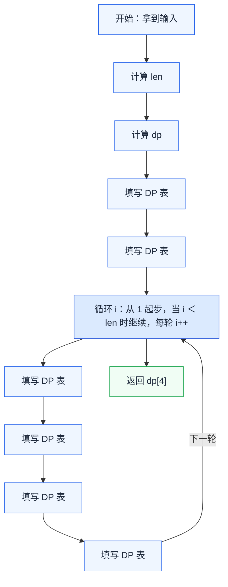

## TypeScript 解题方案（2 个方案逐个讲）

> **运行与提交**：每个方案都是自包含文件（内嵌用例自测，输出 PASS），整块复制到 `.ts` 文件后 `node 文件名` 即可运行。提交 LeetCode 时，把 `demo` 内的算法函数与辅助类型/函数整体取出、置于文件顶层即可。涉及交互/特殊接口的题以题面给定签名为准。

### 方案 1：动态规划

**分析与思路**：核心做法是「动态规划」。代码里依次做这些事：DP 表逐项填充；单循环线性扫描。

**运行方式**：`node 本文件`，内嵌用例全部通过会输出 PASS。


**方案专属流程图**（真实控制流）：

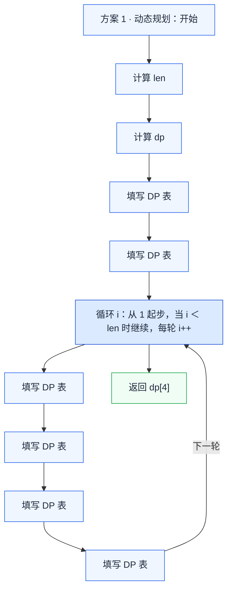

```typescript
/**
 * LeetCode 123. 买卖股票的最佳时机 III
 * 方案：1 ) 方案1:动态规划
 * 来源：https://blog.csdn.net/tyro_java/article/details/144849793
 * 忠实翻译 python/dp/lc_123_买卖股票的最佳时机_iii/solution_1_1_____1_____.py
 */

export function demo(): void {
  // 程序入口：跑内嵌自测用例
  function maxProfit(prices: number[]): number {
    // 定义函数/方法 maxProfit
    // 动态规划空间降维
    const len = prices.length; // 把 价格序列.长度 存入 长度
    const dp: number[] = [0, 0, 0, 0, 0]; // 把 [0, 0, 0, 0, 0]; 写入 const dp: number[]
    dp[1] = -prices[0]; // 把 减 价格序列[0]; 写入 dp[1]
    dp[3] = -prices[0]; // 把 减 价格序列[0]; 写入 dp[3]
    for (let i = 1; i < len; i++) {
      // 让 下标 i 从 1 开始计数，下标 i 小于 长度 就继续
      dp[1] = Math.max(dp[1], dp[0] - prices[i]); // 把 Math.取较大值 DP 表[1], DP 表[0] 减 价格序列[下标 i]); 写入 dp[1]
      dp[2] = Math.max(dp[2], dp[1] + prices[i]); // 把 Math.取较大值 DP 表[2], DP 表[1] 加 价格序列[下标 i]); 写入 dp[2]
      dp[3] = Math.max(dp[3], dp[2] - prices[i]); // 把 Math.取较大值 DP 表[3], DP 表[2] 减 价格序列[下标 i]); 写入 dp[3]
      dp[4] = Math.max(dp[4], dp[3] + prices[i]); // 把 Math.取较大值 DP 表[4], DP 表[3] 加 价格序列[下标 i]); 写入 dp[4]
    }
    return dp[4]; // 返回 DP 表[4]
  }

  const cases: { in: number[]; want: number }[] = [
    { in: [1, 2, 3], want: 2 },
    { in: [1, 2, 3, 4, 5], want: 4 },
    { in: [7, 6, 4, 3, 1], want: 0 },
    { in: [3, 3, 5, 0, 0, 3, 1, 4], want: 6 },
    { in: [1], want: 0 },
    { in: [1, 2], want: 1 },
  ];
  let fail = false; // 把 false 存入 fail
  for (const c of cases) {
    // for (const 字符 of cases) {
    const got = maxProfit(c.in); // 把 maxProfit(字符.in) 存入 got
    if (got !== c.want) {
      // 若 got 不等于 字符.want
      fail = true; // 把 true 存入 fail
      console.log('FAIL maxProfit(%o)=%d want %d', c.in, got, c.want); // 打印输出
    }
  }
  if (fail) {
    // 若 fail
    throw new Error('FAILED'); // throw new Error(「FAILED」);
  }
  console.log('PASS'); // 全部用例通过，输出 PASS
}
demo(); // demo();
```

### 方案 2：动态规划优化空间

**分析与思路**：核心做法是「动态规划优化空间」。代码里依次做这些事：单循环线性扫描。

**运行方式**：`node 本文件`，内嵌用例全部通过会输出 PASS。

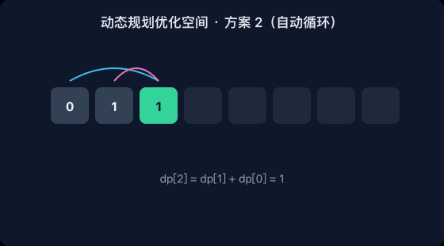

**方案专属流程图**（真实控制流）：

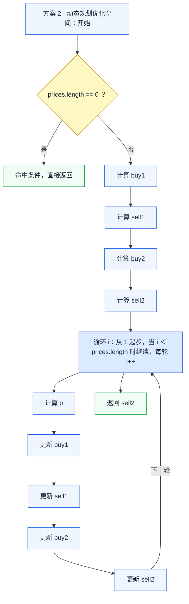

```typescript
/**
 * LeetCode 123. 买卖股票的最佳时机 III
 * 方案：2 ) 方案2:动态规划优化空间
 * 来源：https://blog.csdn.net/tyro_java/article/details/144849793
 * 忠实翻译 python/dp/lc_123_买卖股票的最佳时机_iii/solution_2_2_____2_________.py
 */

export function demo(): void {
  // 程序入口：跑内嵌自测用例
  function maxProfit(prices: number[]): number {
    // 定义函数/方法 maxProfit
    if (prices.length === 0) {
      // 若 价格序列.长度 全等于 0
      return 0; // 返回 0
    }
    let buy1 = -prices[0]; // 把 减 价格序列[0] 存入 buy1
    let sell1 = 0; // 把 0 存入 sell1
    let buy2 = -prices[0]; // 把 减 价格序列[0] 存入 buy2
    let sell2 = 0; // 把 0 存入 sell2
    for (let i = 1; i < prices.length; i++) {
      // 让 下标 i 从 1 开始计数，下标 i 小于 价格序列.长度 就继续
      const p = prices[i]; // 把 价格序列[下标 i] 存入 节点
      buy1 = Math.max(buy1, -p); // 把 Math.取较大值 buy1, 减 节点) 存入 buy1
      sell1 = Math.max(sell1, buy1 + p); // 把 Math.取较大值 sell1, buy1 加 节点) 存入 sell1
      buy2 = Math.max(buy2, sell1 - p); // 把 Math.取较大值 buy2, sell1 减 节点) 存入 buy2
      sell2 = Math.max(sell2, buy2 + p); // 把 Math.取较大值 sell2, buy2 加 节点) 存入 sell2
    }
    return sell2; // 返回 sell2
  }

  const cases: { in: number[]; want: number }[] = [
    { in: [3, 3, 5, 0, 0, 3, 1, 4], want: 6 },
    { in: [1, 2, 3, 4, 5], want: 4 },
    { in: [7, 6, 4, 3, 1], want: 0 },
    { in: [1], want: 0 },
    { in: [], want: 0 },
  ];
  let fail = false; // 把 false 存入 fail
  for (const c of cases) {
    // for (const 字符 of cases) {
    const got = maxProfit(c.in); // 把 maxProfit(字符.in) 存入 got
    if (got !== c.want) {
      // 若 got 不等于 字符.want
      fail = true; // 把 true 存入 fail
      console.log('FAIL maxProfit(%o)=%d want %d', c.in, got, c.want); // 打印输出
    }
  }
  if (fail) {
    // 若 fail
    throw new Error('FAILED'); // throw new Error(「FAILED」);
  }
  console.log('PASS'); // 全部用例通过，输出 PASS
}
demo(); // demo();
```

## 逐步拆解与面试追问

**复杂度**：时间 O(n) 到 O(m·n)（取决于状态维度），空间即 DP 表大小

**为什么是这个量级**：动态规划把指数级枚举压成表，每格只算一次，复杂度等于「状态数 × 转移代价」

**面试官可能会追问**：

- 状态定义为什么是它？
- 遍历顺序由什么决定？
- 能否滚动数组压空间？

## 关键 API 速查（TS 主解法实际用到，附官方链接）

| API | 作用 | 使用要点 | 官方文档 |
|---|---|---|---|
| `Math.max()` | 最大值 | 配展开 Math.max(...arr)；空参返回 -Infinity；超大数组注意展开参数上限 | [官方文档](https://developer.mozilla.org/zh-CN/docs/Web/JavaScript/Reference/Global_Objects/Math/max) |

### 各语言官方文档导航

- **TypeScript / JS**：[MDN 中文参考](https://developer.mozilla.org/zh-CN/)
- **Python**：[Python 官方文档](https://docs.python.org/zh-cn/3/)
- **Go**：[Go 标准库](https://pkg.go.dev/std)
- **Java**：[JDK 17 API](https://docs.oracle.com/en/java/javase/17/docs/api/)
- **Rust**：[Rust 标准库](https://doc.rust-lang.org/std/)
- **Lua**：[Lua 5.4 手册](https://www.lua.org/manual/5.4/)
- **C**：[Cppreference C](https://zh.cppreference.com/w/c)
- **C++**：[Cppreference C++](https://zh.cppreference.com/w/cpp)
- **R**：[R 官方手册](https://stat.ethz.ch/R-manual/)
- **Zig**：[Zig 语言文档](https://ziglang.org/documentation/master/)
- **Dart**：[Dart API](https://api.dart.dev/)

## 附录：其他 10 种语言全部实现（每种语言列举其全部方案）

> TypeScript 的全部方案见「TypeScript 解题方案」一节；下面是其余 10 种语言的对应实现，每种语言的每个方案都带思路分析、代码走读与专属运行架构图。
> 每个方案都内嵌用例自测，可独立运行（老仓库 python/go 文件遵循「打印结果」约定）。
> 完整解法文件见 `dsa/<语言>/dp/lc_123_买卖股票的最佳时机_iii/`。

### Python 实现（2 种方案）

Python 的全部方案如下，每个方案都内嵌用例自测，可独立运行（老仓库 python/go 文件遵循「打印结果」约定）：

#### 方案 1：动态规划

**思路与代码分析**：核心是「动态规划」。Python 版用切片与字典推导式简化操作，突出可读性。代码里依次做这些事：DP 表逐项填充。**走读**：方案 1 · 动态规划：开始 → 更新 n → 循环 i：从 1 到 n 前 → 返回 dp[4]。

**运行架构**（真实控制流）：

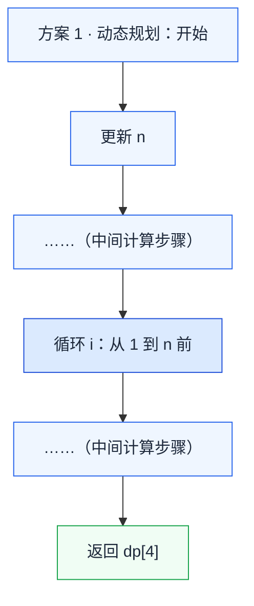

```python
import sys  # 提高递归深度上限（深输入防 RecursionError）

sys.setrecursionlimit(200000)  # 树/链表类题目节点数可达 1e4 量级

def maxProfit(prices):  # 定义函数 maxProfit（参数：价格序列）
    n = len(prices)  # 把 长度(价格序列) 存入 元素个数
    dp = [0, 0, 0, 0, 0]  # 把 [0, 0, 0, 0, 0] 存入 DP 表
    dp[1] = -prices[0]  # 把 减 价格序列[0] 写入 dp[1]
    dp[3] = -prices[0]  # 把 减 价格序列[0] 写入 dp[3]
    for i in range(1, n):  # 让 下标 i 从 1 到 元素个数 遍历
        dp[1] = max(
            dp[1], dp[0] - prices[i]
        )  # 把 取较大值 DP 表[1], DP 表[0] 减 价格序列[下标 i]) 写入 dp[1]
        dp[2] = max(
            dp[2], dp[1] + prices[i]
        )  # 把 取较大值 DP 表[2], DP 表[1] 加 价格序列[下标 i]) 写入 dp[2]
        dp[3] = max(
            dp[3], dp[2] - prices[i]
        )  # 把 取较大值 DP 表[3], DP 表[2] 减 价格序列[下标 i]) 写入 dp[3]
        dp[4] = max(
            dp[4], dp[3] + prices[i]
        )  # 把 取较大值 DP 表[4], DP 表[3] 加 价格序列[下标 i]) 写入 dp[4]
    return dp[4]  # 返回 DP 表[4]

if __name__ == "__main__":  # 若 __name__ 等于 '__main__'
    print(maxProfit([1, 2, 3]))  # 打印输出
```

#### 方案 2：动态规划优化空间

**思路与代码分析**：核心是「动态规划优化空间」。Python 版用切片与字典推导式简化操作，突出可读性。**走读**：方案 2 · 动态规划优化空间：开始 → 命中条件，直接返回 → 更新 buy1 → 更新 sell1 → 更新 buy2 → 更新 sell2 → 遍历 prices[1:]: 中的每个元素 p → 更新 buy1 → 更新 sell1 → 更新 buy2 → 更新 sell2 → 返回 sell2。

**运行架构**（真实控制流）：

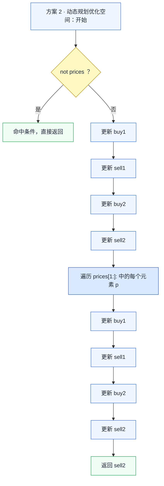

```python
import sys  # 提高递归深度上限（深输入防 RecursionError）

sys.setrecursionlimit(200000)  # 树/链表类题目节点数可达 1e4 量级

def maxProfit(prices):  # 定义函数 maxProfit（参数：价格序列）
    if not prices:  # 若 not 价格序列
        return 0  # 返回 0
    buy1 = -prices[0]  # 把 减 价格序列[0] 存入 buy1
    sell1 = 0  # 把 0 存入 sell1
    buy2 = -prices[0]  # 把 减 价格序列[0] 存入 buy2
    sell2 = 0  # 把 0 存入 sell2
    for p in prices[1:]:  # 逐个取出 价格序列 的元素（节点）
        buy1 = max(buy1, -p)  # 把 取较大值 buy1, 减 节点) 存入 buy1
        sell1 = max(sell1, buy1 + p)  # 把 取较大值 sell1, buy1 加 节点) 存入 sell1
        buy2 = max(buy2, sell1 - p)  # 把 取较大值 buy2, sell1 减 节点) 存入 buy2
        sell2 = max(sell2, buy2 + p)  # 把 取较大值 sell2, buy2 加 节点) 存入 sell2
    return sell2  # 返回 sell2

if __name__ == "__main__":  # 若 __name__ 等于 '__main__'
    print(maxProfit([3, 3, 5, 0, 0, 3, 1, 4]))  # 打印输出
```

### Go 实现（2 种方案）

Go 的全部方案如下，每个方案都内嵌用例自测，可独立运行（老仓库 python/go 文件遵循「打印结果」约定）：

#### 方案 1：动态规划

**思路与代码分析**：核心是「动态规划」。Go 版用切片与多返回值惯用法，显式处理索引边界。代码里依次做这些事：DP 表逐项填充。**走读**：方案 1 · 动态规划：开始 → 更新 : → 更新 : → 填写 DP 表 → 填写 DP 表 → 遍历循环 → 填写 DP 表 → 填写 DP 表 → 填写 DP 表 → 填写 DP 表 → 返回 dp[4]。

**运行架构**（真实控制流）：

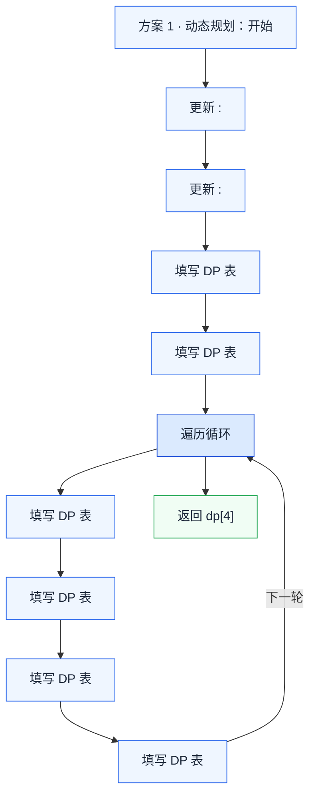

```go
package main // 引入依赖

import (
	"fmt"
	"os"
) // 引入依赖

func max(a, b int) int { // 定义函数/方法 max
	if a > b { // 若 数组 超过 b
		return a // 返回 数组
	}
	return b // 返回 b
}

func maxProfit(prices []int) int { // 定义函数/方法 maxProfit
	n := len(prices)         // 把 长度(价格序列) 写入 n :
	dp := [5]int{}           // 把 [5]int{} 写入 dp :
	dp[1] = -prices[0]       // 把 减 价格序列[0] 写入 dp[1]
	dp[3] = -prices[0]       // 把 减 价格序列[0] 写入 dp[3]
	for i := 1; i < n; i++ { // 让 下标 i 从 1 开始计数
		dp[1] = max(dp[1], dp[0]-prices[i]) // 把 取较大值 DP 表[1], DP 表[0] 减 价格序列[下标 i]) 写入 dp[1]
		dp[2] = max(dp[2], dp[1]+prices[i]) // 把 取较大值 DP 表[2], DP 表[1] 加 价格序列[下标 i]) 写入 dp[2]
		dp[3] = max(dp[3], dp[2]-prices[i]) // 把 取较大值 DP 表[3], DP 表[2] 减 价格序列[下标 i]) 写入 dp[3]
		dp[4] = max(dp[4], dp[3]+prices[i]) // 把 取较大值 DP 表[4], DP 表[3] 加 价格序列[下标 i]) 写入 dp[4]
	}
	return dp[4] // 返回 DP 表[4]
}

func main() { // 程序入口：跑内嵌自测用例
	ok := true          // 把 true 写入 ok :
	cases := []struct { // 把 []struct { 写入 cases :
		in   []int // in []int
		want int   // want int
	}{ // }{
		{[]int{1, 2, 3}, 2},
		{[]int{3, 3, 5, 0, 0, 3, 1, 4}, 6},
		{[]int{1}, 0},
		{[]int{1, 2, 4, 2, 5, 7, 2, 4, 9, 0}, 13},
	}
	for _, c := range cases { // 同时取 _ 与 字符 遍历
		if got := maxProfit(c.in); got != c.want { // 若 got : 赋值为 maxProfit(字符.in); got 不等于 字符.want
			ok = false                                                       // 把 false 写入 ok
			fmt.Printf("FAIL maxProfit(%v)=%d want %d\n", c.in, got, c.want) // 打印输出
		}
	}
	if !ok { // 若 取反 ok
		os.Exit(1) // os.Exit(1)
	}
	fmt.Println("PASS") // 全部用例通过，输出 PASS
}
```

#### 方案 2：动态规划优化空间

**思路与代码分析**：核心是「动态规划优化空间」。Go 版用切片与多返回值惯用法，显式处理索引边界。**走读**：方案 2 · 动态规划优化空间：开始 → 处理 if len(prices) == 0 → 返回 0 → 更新 : → 更新 : → 更新 : → 更新 : → 遍历 prices[1 的下标与元素 p → 更新 buy1 → 更新 sell1 → 更新 buy2 → 更新 sell2 → 返回 sell2。

**运行架构**（真实控制流）：

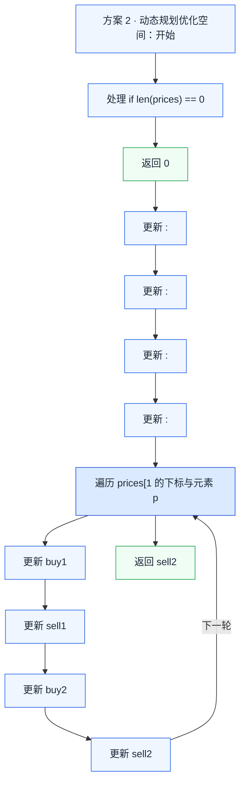

```go
package main // 引入依赖

import (
	"fmt"
	"os"
) // 引入依赖

func max(a, b int) int { // 定义函数/方法 max
	if a > b { // 若 数组 超过 b
		return a // 返回 数组
	}
	return b // 返回 b
}

func maxProfit(prices []int) int { // 定义函数/方法 maxProfit
	if len(prices) == 0 { // 若 长度(价格序列) 等于 0
		return 0 // 返回 0
	}
	buy1 := -prices[0]             // 把 减 价格序列[0] 写入 buy1 :
	sell1 := 0                     // 把 0 写入 sell1 :
	buy2 := -prices[0]             // 把 减 价格序列[0] 写入 buy2 :
	sell2 := 0                     // 把 0 写入 sell2 :
	for _, p := range prices[1:] { // 同时取 _ 与 节点 遍历
		buy1 = max(buy1, -p)       // 把 取较大值 buy1, 减 节点) 写入 buy1
		sell1 = max(sell1, buy1+p) // 把 取较大值 sell1, buy1 加 节点) 写入 sell1
		buy2 = max(buy2, sell1-p)  // 把 取较大值 buy2, sell1 减 节点) 写入 buy2
		sell2 = max(sell2, buy2+p) // 把 取较大值 sell2, buy2 加 节点) 写入 sell2
	}
	return sell2 // 返回 sell2
}

func main() { // 程序入口：跑内嵌自测用例
	ok := true          // 把 true 写入 ok :
	cases := []struct { // 把 []struct { 写入 cases :
		in   []int // in []int
		want int   // want int
	}{ // }{
		{[]int{3, 3, 5, 0, 0, 3, 1, 4}, 6},
		{[]int{1, 2, 3}, 2},
		{[]int{1}, 0},
		{[]int{}, 0},
	}
	for _, c := range cases { // 同时取 _ 与 字符 遍历
		if got := maxProfit(c.in); got != c.want { // 若 got : 赋值为 maxProfit(字符.in); got 不等于 字符.want
			ok = false                                                       // 把 false 写入 ok
			fmt.Printf("FAIL maxProfit(%v)=%d want %d\n", c.in, got, c.want) // 打印输出
		}
	}
	if !ok { // 若 取反 ok
		os.Exit(1) // os.Exit(1)
	}
	fmt.Println("PASS") // 全部用例通过，输出 PASS
}
```

### Java 实现（2 种方案）

Java 的全部方案如下，每个方案都内嵌用例自测，可独立运行（老仓库 python/go 文件遵循「打印结果」约定）：

#### 方案 1：动态规划

**思路与代码分析**：核心是「动态规划」。Java 版用类与静态方法组织，集合操作显式明了。代码里依次做这些事：DP 表逐项填充；单循环线性扫描。**走读**：方案 1 · 动态规划：开始 → 更新 len → 遍历循环 → 返回 dp[4]。

**运行架构**（真实控制流）：

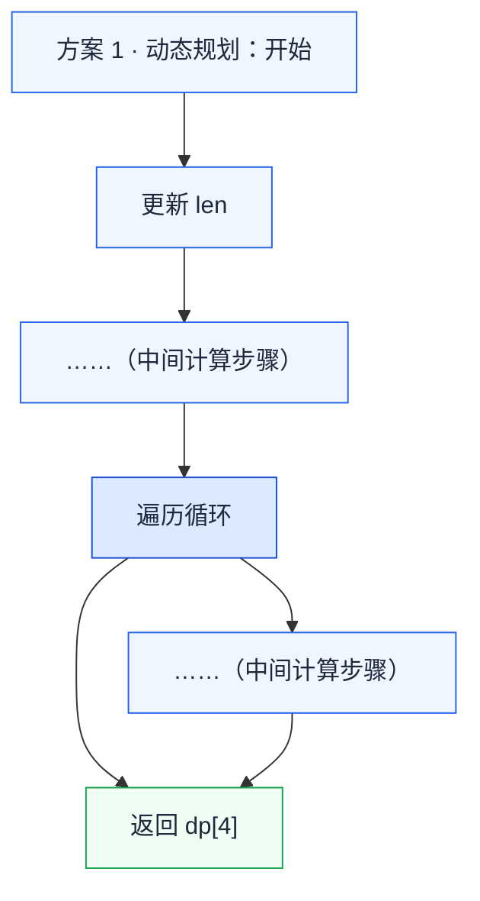

```java
package com.webfault.dsa; // 引入依赖

import java.util.*; // 引入依赖

class lc123_solution111 { // 定义类型
  public int maxProfit(int[] prices) { // 定义函数/方法 maxProfit
    int len = prices.length; // 把 价格序列.长度 存入 长度
    int[] dp = new int[5]; // 把 new int[5]; 写入 int[] dp
    dp[1] = -prices[0]; // 把 减 价格序列[0]; 写入 dp[1]
    dp[3] = -prices[0]; // 把 减 价格序列[0]; 写入 dp[3]
    for (int i = 1; i < len; i++) { // 让 下标 i 从 1 开始计数，下标 i 小于 长度 就继续
      dp[1] =
          Math.max(
              dp[1], dp[0] - prices[i]); // 把 Math.取较大值 DP 表[1], DP 表[0] 减 价格序列[下标 i]); 写入 dp[1]
      dp[2] =
          Math.max(
              dp[2], dp[1] + prices[i]); // 把 Math.取较大值 DP 表[2], DP 表[1] 加 价格序列[下标 i]); 写入 dp[2]
      dp[3] =
          Math.max(
              dp[3], dp[2] - prices[i]); // 把 Math.取较大值 DP 表[3], DP 表[2] 减 价格序列[下标 i]); 写入 dp[3]
      dp[4] =
          Math.max(
              dp[4], dp[3] + prices[i]); // 把 Math.取较大值 DP 表[4], DP 表[3] 加 价格序列[下标 i]); 写入 dp[4]
    }
    return dp[4]; // 返回 DP 表[4]
  }

  public static void main(String[] args) { // public static void main(String[] args) {
    lc123_solution111 s =
        new lc123_solution111(); // 把 new lc123_solution111(); 写入 lc123_solution111 s
    int got = s.maxProfit(new int[] {1, 2, 3}); // 把 字符串.maxProfit(new int[]{1, 2, 3}) 存入 got
    if (got != 2) {
      System.out.println("FAIL got " + got);
      throw new RuntimeException("FAILED");
    }
    System.out.println("PASS"); // 全部用例通过，输出 PASS
  }
}
```

#### 方案 2：动态规划优化空间

**思路与代码分析**：核心是「动态规划优化空间」。Java 版用类与静态方法组织，集合操作显式明了。代码里依次做这些事：单循环线性扫描。**走读**：方案 2 · 动态规划优化空间：开始 → 更新 n → 命中条件，直接返回 → 更新 buy1 → 更新 buy2 → 更新 sell1 → 更新 sell2 → 遍历循环 → 更新 buy1 → 更新 sell1 → 更新 buy2 → 更新 sell2 → 返回 sell2。

**运行架构**（真实控制流）：

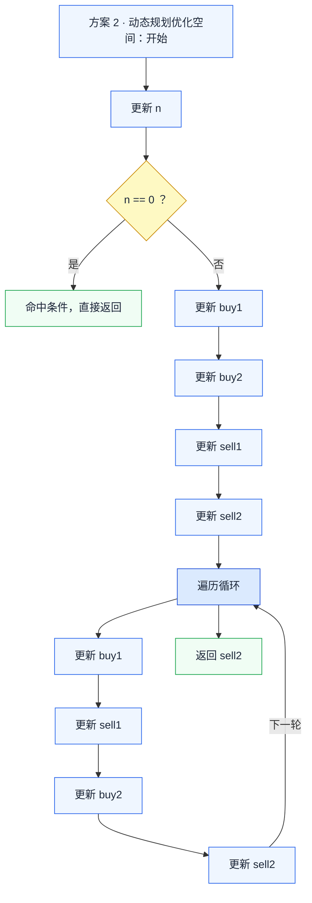

```java
package com.webfault.dsa; // 引入依赖

import java.util.*; // 引入依赖

class lc123_solution222 { // 定义类型
  public int maxProfit(int[] prices) { // 定义函数/方法 maxProfit
    int n = prices.length; // 把 价格序列.长度 存入 元素个数
    if (n == 0) return 0; // 若 元素个数 等于 0，直接返回 0
    int buy1 = -prices[0]; // 把 减 价格序列[0] 存入 buy1
    int buy2 = -prices[0]; // 把 减 价格序列[0] 存入 buy2
    int sell1 = 0; // 把 0 存入 sell1
    int sell2 = 0; // 把 0 存入 sell2
    for (int i = 1; i < n; i++) { // 让 下标 i 从 1 开始计数，下标 i 小于 元素个数 就继续
      buy1 = Math.max(buy1, -prices[i]); // 把 Math.取较大值 buy1, 减 价格序列[下标 i]); 写入 buy1
      sell1 = Math.max(sell1, buy1 + prices[i]); // 把 Math.取较大值 sell1, buy1 加 价格序列[下标 i]); 写入 sell1
      buy2 = Math.max(buy2, sell1 - prices[i]); // 把 Math.取较大值 buy2, sell1 减 价格序列[下标 i]); 写入 buy2
      sell2 = Math.max(sell2, buy2 + prices[i]); // 把 Math.取较大值 sell2, buy2 加 价格序列[下标 i]); 写入 sell2
    }
    return sell2; // 返回 sell2
  }

  public static void main(String[] args) { // public static void main(String[] args) {
    lc123_solution222 s =
        new lc123_solution222(); // 把 new lc123_solution222(); 写入 lc123_solution222 s
    int got =
        s.maxProfit(
            new int[] {
              3, 3, 5, 0, 0, 3, 1, 4
            }); // 把 字符串.maxProfit(new int[]{3, 3, 5, 0, 0, 3, 1, 4}) 存入 got
    if (got != 6) {
      System.out.println("FAIL got " + got);
      throw new RuntimeException("FAILED");
    }
    System.out.println("PASS"); // 全部用例通过，输出 PASS
  }
}
```

### Rust 实现（2 种方案）

Rust 的全部方案如下，每个方案都内嵌用例自测，可独立运行（老仓库 python/go 文件遵循「打印结果」约定）：

#### 方案 1：动态规划

**思路与代码分析**：核心是「动态规划」。Rust 版用所有权移动与切片借用改写同一逻辑，注意 Option 与引用边界。**走读**：方案 1 · 动态规划：开始 → 计算 let (mut buy1, mut sell1 → 计算 let (mut buy2, mut sell2 → 遍历 &prices 中的每个元素 p → 更新 buy1 → 更新 sell1 → 更新 buy2 → 更新 sell2 → 处理 sell2 → 返回结果。

**运行架构**（真实控制流）：

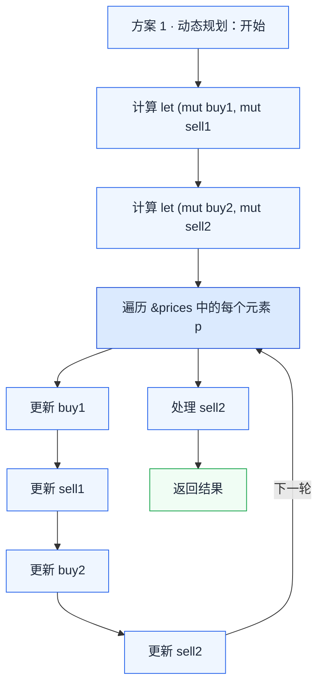

```rust
// LeetCode 123. 买卖股票的最佳时机III — Rust 版（方案1）
fn max_profit_iii(prices: Vec<i32>) -> i32 {
    // 定义函数/方法 max_profit_iii
    let (mut buy1, mut sell1) = (i32::MIN, 0); // 把 (i32::MIN, 0); 写入 let (mut buy1, mut sell1)
    let (mut buy2, mut sell2) = (i32::MIN, 0); // 把 (i32::MIN, 0); 写入 let (mut buy2, mut sell2)
    for &p in &prices {
        // for 按位与 节点 in 按位与 价格序列 {
        buy1 = buy1.max(-p); // 把 buy1.取较大值 减 节点); 写入 buy1
        sell1 = sell1.max(buy1 + p); // 把 sell1.取较大值 buy1 加 节点); 写入 sell1
        buy2 = buy2.max(sell1 - p); // 把 buy2.取较大值 sell1 减 节点); 写入 buy2
        sell2 = sell2.max(buy2 + p); // 把 sell2.取较大值 buy2 加 节点); 写入 sell2
    }
    sell2 // sell2
}
fn main() {
    assert_eq!(max_profit_iii(vec![1, 2, 3]), 2);
    assert_eq!(max_profit_iii(vec![1, 2, 3, 4, 5]), 4);
    assert_eq!(max_profit_iii(vec![7, 6, 4, 3, 1]), 0);
    assert_eq!(max_profit_iii(vec![3, 3, 5, 0, 0, 3, 1, 4]), 6);
    assert_eq!(max_profit_iii(vec![1]), 0);
    assert_eq!(max_profit_iii(vec![1, 2]), 1);
    println!("PASS");
} // 程序入口：跑内嵌自测用例
```

#### 方案 2：动态规划优化空间

**思路与代码分析**：核心是「动态规划优化空间」。Rust 版用所有权移动与切片借用改写同一逻辑，注意 Option 与引用边界。**走读**：方案 2 · 动态规划优化空间：开始 → 计算 let (mut buy1, mut sell1 → 计算 let (mut buy2, mut sell2 → 遍历 &prices 中的每个元素 p → 更新 buy1 → 更新 sell1 → 更新 buy2 → 更新 sell2 → 处理 sell2 → 返回结果。

**运行架构**（真实控制流）：

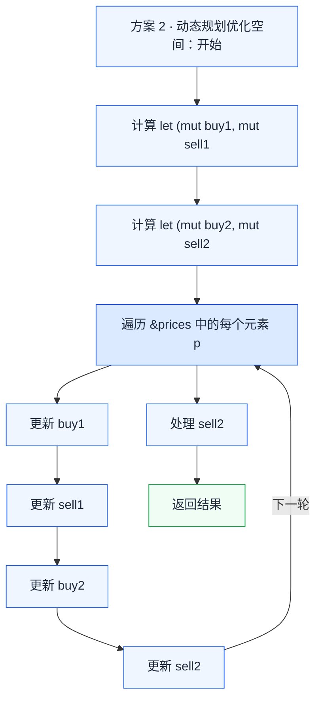

```rust
// LeetCode 123. 买卖股票的最佳时机III — Rust 版（方案2）
fn max_profit_iii(prices: Vec<i32>) -> i32 {
    // 定义函数/方法 max_profit_iii
    let (mut buy1, mut sell1) = (i32::MIN, 0); // 把 (i32::MIN, 0); 写入 let (mut buy1, mut sell1)
    let (mut buy2, mut sell2) = (i32::MIN, 0); // 把 (i32::MIN, 0); 写入 let (mut buy2, mut sell2)
    for &p in &prices {
        // for 按位与 节点 in 按位与 价格序列 {
        buy1 = buy1.max(-p); // 把 buy1.取较大值 减 节点); 写入 buy1
        sell1 = sell1.max(buy1 + p); // 把 sell1.取较大值 buy1 加 节点); 写入 sell1
        buy2 = buy2.max(sell1 - p); // 把 buy2.取较大值 sell1 减 节点); 写入 buy2
        sell2 = sell2.max(buy2 + p); // 把 sell2.取较大值 buy2 加 节点); 写入 sell2
    }
    sell2 // sell2
}
fn main() {
    assert_eq!(max_profit_iii(vec![1, 2, 3]), 2);
    assert_eq!(max_profit_iii(vec![1, 2, 3, 4, 5]), 4);
    assert_eq!(max_profit_iii(vec![7, 6, 4, 3, 1]), 0);
    assert_eq!(max_profit_iii(vec![3, 3, 5, 0, 0, 3, 1, 4]), 6);
    assert_eq!(max_profit_iii(vec![1]), 0);
    assert_eq!(max_profit_iii(vec![1, 2]), 1);
    println!("PASS");
} // 程序入口：跑内嵌自测用例
```

### Lua 实现（2 种方案）

Lua 的全部方案如下，每个方案都内嵌用例自测，可独立运行（老仓库 python/go 文件遵循「打印结果」约定）：

#### 方案 1：动态规划

**思路与代码分析**：核心是「动态规划」。Lua 版用表与 ipairs 遍历，注意 ipairs 遇 nil 即停的语义。**走读**：方案 1 · 动态规划：开始 → 更新 sell1 → 更新 sell2 → 遍历 ipairs(prices) do 中的每个元素 p → 处理 if -p ＞ buy1 then → 更新 buy1 → 处理 if buy1 + p ＞ sell1 then → 更新 sell1 → 处理 if sell1 - p ＞ buy2 then → 更新 buy2 → 处理 if buy2 + p ＞ sell2 then → 更新 sell2 → 返回 sell2。

**运行架构**（真实控制流）：

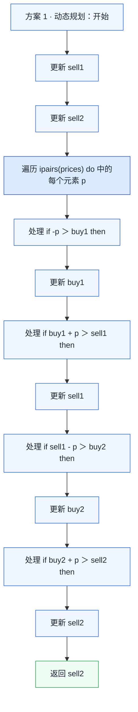

```lua
-- LeetCode 123. 买卖股票的最佳时机III — Lua 版（方案1）
local function max_profit_iii(prices) -- local function max_profit_iii(价格序列)
	local buy1, sell1 = -math.huge, 0 -- 把 减 math.huge, 0 写入 local buy1, sell1
	local buy2, sell2 = -math.huge, 0 -- 把 减 math.huge, 0 写入 local buy2, sell2
	for _, p in ipairs(prices) do -- 遍历取 节点
		if -p > buy1 then
			buy1 = -p
		end -- 若 减 节点 超过 buy1 then buy1 赋值为 减 节点 终点
		if buy1 + p > sell1 then
			sell1 = buy1 + p
		end -- 若 buy1 加 节点 超过 sell1 then sell1 赋值为 buy1 加 节点 终点
		if sell1 - p > buy2 then
			buy2 = sell1 - p
		end -- 若 sell1 减 节点 超过 buy2 then buy2 赋值为 sell1 减 节点 终点
		if buy2 + p > sell2 then
			sell2 = buy2 + p
		end -- 若 buy2 加 节点 超过 sell2 then sell2 赋值为 buy2 加 节点 终点
	end -- 终点
	return sell2 -- 返回 sell2
end -- 终点
assert(max_profit_iii({ 1, 2, 3 }) == 2) -- 断言校验
assert(max_profit_iii({ 1, 2, 3, 4, 5 }) == 4) -- 断言校验
assert(max_profit_iii({ 7, 6, 4, 3, 1 }) == 0) -- 断言校验
assert(max_profit_iii({ 3, 3, 5, 0, 0, 3, 1, 4 }) == 6) -- 断言校验
assert(max_profit_iii({ 1 }) == 0) -- 断言校验
assert(max_profit_iii({ 1, 2 }) == 1) -- 断言校验
print("PASS") -- 全部用例通过，输出 PASS
```

#### 方案 2：动态规划优化空间

**思路与代码分析**：核心是「动态规划优化空间」。Lua 版用表与 ipairs 遍历，注意 ipairs 遇 nil 即停的语义。**走读**：方案 2 · 动态规划优化空间：开始 → 更新 sell1 → 更新 sell2 → 遍历 ipairs(prices) do 中的每个元素 p → 处理 if -p ＞ buy1 then → 更新 buy1 → 处理 if buy1 + p ＞ sell1 then → 更新 sell1 → 处理 if sell1 - p ＞ buy2 then → 更新 buy2 → 处理 if buy2 + p ＞ sell2 then → 更新 sell2 → 返回 sell2。

**运行架构**（真实控制流）：

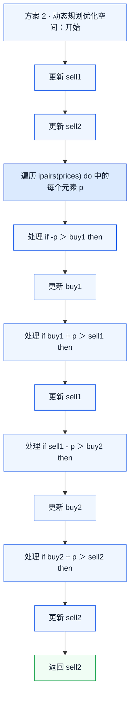

```lua
-- LeetCode 123. 买卖股票的最佳时机III — Lua 版（方案2）
local function max_profit_iii(prices) -- local function max_profit_iii(价格序列)
	local buy1, sell1 = -math.huge, 0 -- 把 减 math.huge, 0 写入 local buy1, sell1
	local buy2, sell2 = -math.huge, 0 -- 把 减 math.huge, 0 写入 local buy2, sell2
	for _, p in ipairs(prices) do -- 遍历取 节点
		if -p > buy1 then
			buy1 = -p
		end -- 若 减 节点 超过 buy1 then buy1 赋值为 减 节点 终点
		if buy1 + p > sell1 then
			sell1 = buy1 + p
		end -- 若 buy1 加 节点 超过 sell1 then sell1 赋值为 buy1 加 节点 终点
		if sell1 - p > buy2 then
			buy2 = sell1 - p
		end -- 若 sell1 减 节点 超过 buy2 then buy2 赋值为 sell1 减 节点 终点
		if buy2 + p > sell2 then
			sell2 = buy2 + p
		end -- 若 buy2 加 节点 超过 sell2 then sell2 赋值为 buy2 加 节点 终点
	end -- 终点
	return sell2 -- 返回 sell2
end -- 终点
assert(max_profit_iii({ 1, 2, 3 }) == 2) -- 断言校验
assert(max_profit_iii({ 1, 2, 3, 4, 5 }) == 4) -- 断言校验
assert(max_profit_iii({ 7, 6, 4, 3, 1 }) == 0) -- 断言校验
assert(max_profit_iii({ 3, 3, 5, 0, 0, 3, 1, 4 }) == 6) -- 断言校验
assert(max_profit_iii({ 1 }) == 0) -- 断言校验
assert(max_profit_iii({ 1, 2 }) == 1) -- 断言校验
print("PASS") -- 全部用例通过，输出 PASS
```

### C 实现（2 种方案）

C 的全部方案如下，每个方案都内嵌用例自测，可独立运行（老仓库 python/go 文件遵循「打印结果」约定）：

#### 方案 1：动态规划

**思路与代码分析**：核心是「动态规划」。C 版手动管理下标与内存，循环边界全部显式写出。代码里依次做这些事：单循环线性扫描。**走读**：方案 1 · 动态规划：开始 → 更新 buy1 → 遍历循环 → 若 -p[i] ＞ buy1：更新 buy1 → 更新 buy1 → 若 buy1 + p[i] ＞ sell1：更新 sell1 → 更新 sell1 → 若 sell1 - p[i] ＞ buy2：更新 buy2 → 更新 buy2 → 若 buy2 + p[i] ＞ sell2：更新 sell2 → 更新 sell2 → 返回 sell2。

**运行架构**（真实控制流）：

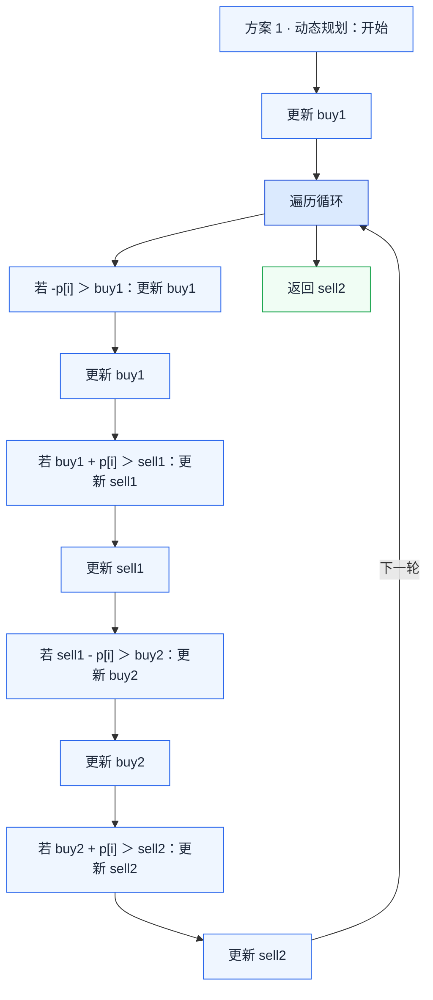

```c
/* LeetCode 123. 买卖股票的最佳时机III — C 版（方案1） */
#include <stdio.h>                               // 引入头文件
static int max_profit_iii(const int *p, int n) { // 定义函数/方法 max_profit_iii
    int buy1 = -1000000000, sell1 = 0, buy2 = -1000000000, sell2 = 0;
    for (int i = 0; i < n; i++) { // 让 下标 i 从 0 开始计数，下标 i 小于 元素个数 就继续
        if (-p[i] > buy1)
            buy1 = -p[i]; // 若 减 节点[下标 i] 超过 buy1) buy1 赋值为 减 节点[下标 i];
        if (buy1 + p[i] > sell1)
            sell1 = buy1 + p[i]; // 若 buy1 加 节点[下标 i] 超过 sell1) sell1 赋值为 buy1 加 节点[下标 i];
        if (sell1 - p[i] > buy2)
            buy2 = sell1 - p[i]; // 若 sell1 减 节点[下标 i] 超过 buy2) buy2 赋值为 sell1 减 节点[下标 i];
        if (buy2 + p[i] > sell2)
            sell2 = buy2 + p[i]; // 若 buy2 加 节点[下标 i] 超过 sell2) sell2 赋值为 buy2 加 节点[下标 i];
    }
    return sell2; // 返回 sell2
}
int main(void) { // 程序入口：跑内嵌自测用例
    if (max_profit_iii((int[]){1, 2, 3}, 3) != 2) {
        printf("FAIL 1\n");
        return 1;
    }
    if (max_profit_iii((int[]){1, 2, 3, 4, 5}, 5) != 4) {
        printf("FAIL 2\n");
        return 1;
    }
    if (max_profit_iii((int[]){7, 6, 4, 3, 1}, 5) != 0) {
        printf("FAIL 3\n");
        return 1;
    }
    if (max_profit_iii((int[]){3, 3, 5, 0, 0, 3, 1, 4}, 8) != 6) {
        printf("FAIL 4\n");
        return 1;
    }
    if (max_profit_iii((int[]){1}, 1) != 0) {
        printf("FAIL 5\n");
        return 1;
    }
    if (max_profit_iii((int[]){1, 2}, 2) != 1) {
        printf("FAIL 6\n");
        return 1;
    }
    printf("PASS\n");
    return 0;
} // 全部用例通过，输出 PASS
```

#### 方案 2：动态规划优化空间

**思路与代码分析**：核心是「动态规划优化空间」。C 版手动管理下标与内存，循环边界全部显式写出。代码里依次做这些事：单循环线性扫描。**走读**：方案 2 · 动态规划优化空间：开始 → 更新 buy1 → 遍历循环 → 若 -p[i] ＞ buy1：更新 buy1 → 更新 buy1 → 若 buy1 + p[i] ＞ sell1：更新 sell1 → 更新 sell1 → 若 sell1 - p[i] ＞ buy2：更新 buy2 → 更新 buy2 → 若 buy2 + p[i] ＞ sell2：更新 sell2 → 更新 sell2 → 返回 sell2。

**运行架构**（真实控制流）：

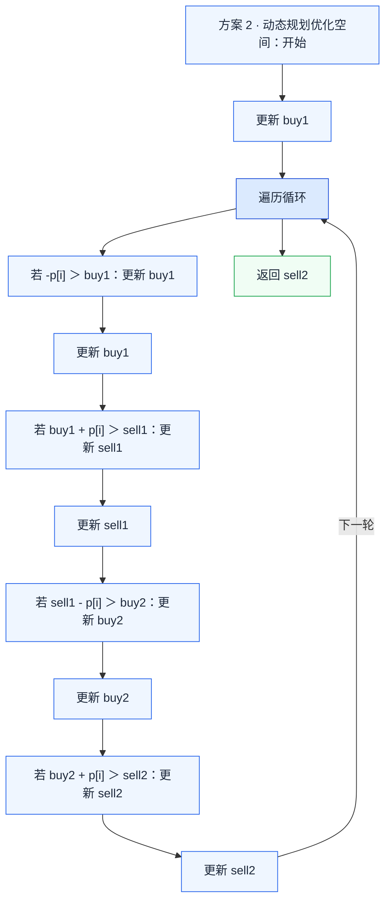

```c
/* LeetCode 123. 买卖股票的最佳时机III — C 版（方案2） */
#include <stdio.h>                               // 引入头文件
static int max_profit_iii(const int *p, int n) { // 定义函数/方法 max_profit_iii
    int buy1 = -1000000000, sell1 = 0, buy2 = -1000000000, sell2 = 0;
    for (int i = 0; i < n; i++) { // 让 下标 i 从 0 开始计数，下标 i 小于 元素个数 就继续
        if (-p[i] > buy1)
            buy1 = -p[i]; // 若 减 节点[下标 i] 超过 buy1) buy1 赋值为 减 节点[下标 i];
        if (buy1 + p[i] > sell1)
            sell1 = buy1 + p[i]; // 若 buy1 加 节点[下标 i] 超过 sell1) sell1 赋值为 buy1 加 节点[下标 i];
        if (sell1 - p[i] > buy2)
            buy2 = sell1 - p[i]; // 若 sell1 减 节点[下标 i] 超过 buy2) buy2 赋值为 sell1 减 节点[下标 i];
        if (buy2 + p[i] > sell2)
            sell2 = buy2 + p[i]; // 若 buy2 加 节点[下标 i] 超过 sell2) sell2 赋值为 buy2 加 节点[下标 i];
    }
    return sell2; // 返回 sell2
}
int main(void) { // 程序入口：跑内嵌自测用例
    if (max_profit_iii((int[]){1, 2, 3}, 3) != 2) {
        printf("FAIL 1\n");
        return 1;
    }
    if (max_profit_iii((int[]){1, 2, 3, 4, 5}, 5) != 4) {
        printf("FAIL 2\n");
        return 1;
    }
    if (max_profit_iii((int[]){7, 6, 4, 3, 1}, 5) != 0) {
        printf("FAIL 3\n");
        return 1;
    }
    if (max_profit_iii((int[]){3, 3, 5, 0, 0, 3, 1, 4}, 8) != 6) {
        printf("FAIL 4\n");
        return 1;
    }
    if (max_profit_iii((int[]){1}, 1) != 0) {
        printf("FAIL 5\n");
        return 1;
    }
    if (max_profit_iii((int[]){1, 2}, 2) != 1) {
        printf("FAIL 6\n");
        return 1;
    }
    printf("PASS\n");
    return 0;
} // 全部用例通过，输出 PASS
```

### C++ 实现（2 种方案）

C++ 的全部方案如下，每个方案都内嵌用例自测，可独立运行（老仓库 python/go 文件遵循「打印结果」约定）：

#### 方案 1：动态规划

**思路与代码分析**：核心是「动态规划」。C++ 版用 STL 容器与迭代器，减少手写下标错误。代码里依次做这些事：单循环线性扫描。**走读**：方案 1 · 动态规划：开始 → 更新 buy1 → 遍历循环 → 更新 buy1 → 更新 sell1 → 更新 buy2 → 更新 sell2 → 返回 sell2。

**运行架构**（真实控制流）：

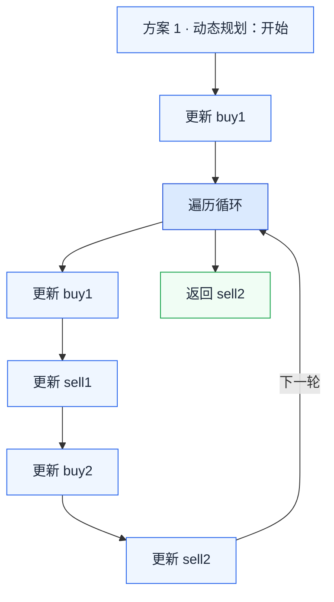

```cpp
// LeetCode 123. 买卖股票的最佳时机III — C++ 版（方案1）
#include <algorithm>                                      // 引入头文件
#include <cassert>                                        // 引入头文件
#include <iostream>                                       // 引入头文件
#include <vector>                                         // 引入头文件
static int maxProfitIII(const std::vector<int> &prices) { // 定义函数/方法 maxProfitIII
    int buy1 = -1000000000, sell1 = 0, buy2 = -1000000000, sell2 = 0;
    for (int p : prices) {                 // for (int 节点 : 价格序列) {
        buy1 = std::max(buy1, -p);         // 把 std::取较大值 buy1, 减 节点); 写入 buy1
        sell1 = std::max(sell1, buy1 + p); // 把 std::取较大值 sell1, buy1 加 节点); 写入 sell1
        buy2 = std::max(buy2, sell1 - p);  // 把 std::取较大值 buy2, sell1 减 节点); 写入 buy2
        sell2 = std::max(sell2, buy2 + p); // 把 std::取较大值 sell2, buy2 加 节点); 写入 sell2
    }
    return sell2; // 返回 sell2
}
int main() {                                             // 程序入口：跑内嵌自测用例
    assert(maxProfitIII({1, 2, 3}) == 2);                // 断言校验
    assert(maxProfitIII({1, 2, 3, 4, 5}) == 4);          // 断言校验
    assert(maxProfitIII({7, 6, 4, 3, 1}) == 0);          // 断言校验
    assert(maxProfitIII({3, 3, 5, 0, 0, 3, 1, 4}) == 6); // 断言校验
    assert(maxProfitIII({1}) == 0);                      // 断言校验
    assert(maxProfitIII({1, 2}) == 1);                   // 断言校验
    std::cout << "PASS" << std::endl;
} // 全部用例通过，输出 PASS
```

#### 方案 2：动态规划优化空间

**思路与代码分析**：核心是「动态规划优化空间」。C++ 版用 STL 容器与迭代器，减少手写下标错误。代码里依次做这些事：单循环线性扫描。**走读**：方案 2 · 动态规划优化空间：开始 → 更新 buy1 → 遍历循环 → 更新 buy1 → 更新 sell1 → 更新 buy2 → 更新 sell2 → 返回 sell2。

**运行架构**（真实控制流）：

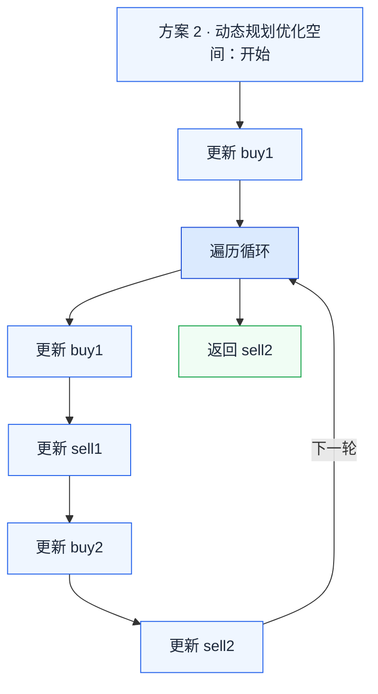

```cpp
// LeetCode 123. 买卖股票的最佳时机III — C++ 版（方案2）
#include <algorithm>                                      // 引入头文件
#include <cassert>                                        // 引入头文件
#include <iostream>                                       // 引入头文件
#include <vector>                                         // 引入头文件
static int maxProfitIII(const std::vector<int> &prices) { // 定义函数/方法 maxProfitIII
    int buy1 = -1000000000, sell1 = 0, buy2 = -1000000000, sell2 = 0;
    for (int p : prices) {                 // for (int 节点 : 价格序列) {
        buy1 = std::max(buy1, -p);         // 把 std::取较大值 buy1, 减 节点); 写入 buy1
        sell1 = std::max(sell1, buy1 + p); // 把 std::取较大值 sell1, buy1 加 节点); 写入 sell1
        buy2 = std::max(buy2, sell1 - p);  // 把 std::取较大值 buy2, sell1 减 节点); 写入 buy2
        sell2 = std::max(sell2, buy2 + p); // 把 std::取较大值 sell2, buy2 加 节点); 写入 sell2
    }
    return sell2; // 返回 sell2
}
int main() {                                             // 程序入口：跑内嵌自测用例
    assert(maxProfitIII({1, 2, 3}) == 2);                // 断言校验
    assert(maxProfitIII({1, 2, 3, 4, 5}) == 4);          // 断言校验
    assert(maxProfitIII({7, 6, 4, 3, 1}) == 0);          // 断言校验
    assert(maxProfitIII({3, 3, 5, 0, 0, 3, 1, 4}) == 6); // 断言校验
    assert(maxProfitIII({1}) == 0);                      // 断言校验
    assert(maxProfitIII({1, 2}) == 1);                   // 断言校验
    std::cout << "PASS" << std::endl;
} // 全部用例通过，输出 PASS
```

### R 实现（2 种方案）

R 的全部方案如下，每个方案都内嵌用例自测，可独立运行（老仓库 python/go 文件遵循「打印结果」约定）：

#### 方案 1：动态规划

**思路与代码分析**：核心是「动态规划」。R 版用向量化思维与 1 起始下标，注意 1:n 的降序陷阱。代码里依次做这些事：单循环线性扫描。**走读**：方案 1 · 动态规划：开始 → 处理 buy1 ＜- -Inf → 处理 sell1 ＜- 0L → 处理 buy2 ＜- -Inf → 处理 sell2 ＜- 0L → 循环 p：遍历 prices → 处理 buy1 ＜- max(buy1, -p) → 处理 sell1 ＜- max(sell1, buy1 + p → 处理 buy2 ＜- max(buy2, sell1 - p) → 处理 sell2 ＜- max(sell2, buy2 + p → 处理 sell2 → 返回结果。

**运行架构**（真实控制流）：

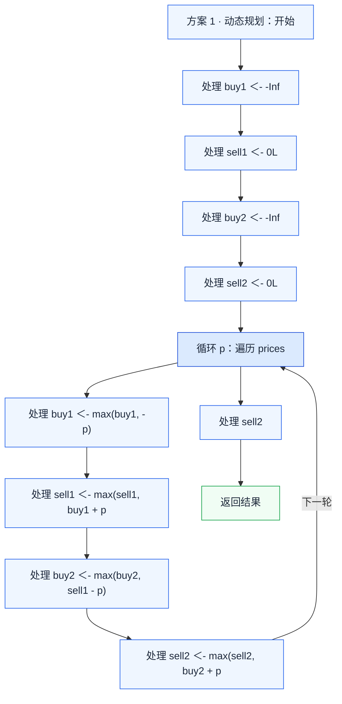

```r
# — R 版（方案1） 定义函数 max_profit_iii（参数：价格序列）
max_profit_iii <- function(prices) {
    buy1 <- -Inf
    sell1 <- 0L
    buy2 <- -Inf
    sell2 <- 0L
    for (p in prices) {
        # for (节点 in 价格序列) {
        buy1 <- max(buy1, -p)  # 把 取较大值 buy1, 减 节点) 存入 buy1
        sell1 <- max(sell1, buy1 + p)  # 把 取较大值 sell1, buy1 加 节点) 存入 sell1
        buy2 <- max(buy2, sell1 - p)  # 把 取较大值 buy2, sell1 减 节点) 存入 buy2
        sell2 <- max(sell2, buy2 + p)  # 把 取较大值 sell2, buy2 加 节点) 存入 sell2
    }
    sell2  # sell2
}
stopifnot(max_profit_iii(c(1, 2, 3)) == 2)  # 断言校验
stopifnot(max_profit_iii(c(1, 2, 3, 4, 5)) == 4)  # 断言校验
stopifnot(max_profit_iii(c(7, 6, 4, 3, 1)) == 0)  # 断言校验
stopifnot(max_profit_iii(c(3, 3, 5, 0, 0, 3, 1, 4)) == 6)  # 断言校验
stopifnot(max_profit_iii(c(1)) == 0)  # 断言校验
stopifnot(max_profit_iii(c(1, 2)) == 1)  # 断言校验
cat("PASS\n")  # 全部用例通过，输出 PASS
```

#### 方案 2：动态规划优化空间

**思路与代码分析**：核心是「动态规划优化空间」。R 版用向量化思维与 1 起始下标，注意 1:n 的降序陷阱。代码里依次做这些事：单循环线性扫描。**走读**：方案 2 · 动态规划优化空间：开始 → 处理 buy1 ＜- -Inf → 处理 sell1 ＜- 0L → 处理 buy2 ＜- -Inf → 处理 sell2 ＜- 0L → 循环 p：遍历 prices → 处理 buy1 ＜- max(buy1, -p) → 处理 sell1 ＜- max(sell1, buy1 + p → 处理 buy2 ＜- max(buy2, sell1 - p) → 处理 sell2 ＜- max(sell2, buy2 + p → 处理 sell2 → 返回结果。

**运行架构**（真实控制流）：

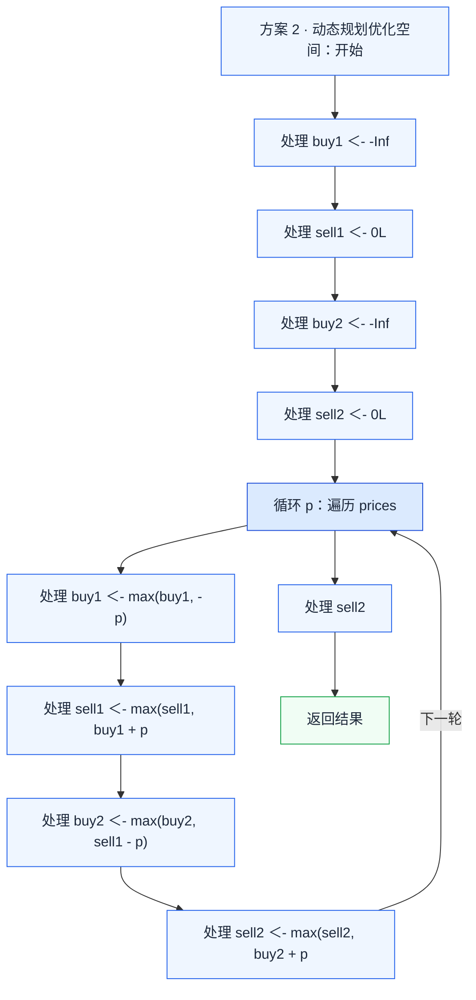

```r
# — R 版（方案2） 定义函数 max_profit_iii（参数：价格序列）
max_profit_iii <- function(prices) {
    buy1 <- -Inf
    sell1 <- 0L
    buy2 <- -Inf
    sell2 <- 0L
    for (p in prices) {
        # for (节点 in 价格序列) {
        buy1 <- max(buy1, -p)  # 把 取较大值 buy1, 减 节点) 存入 buy1
        sell1 <- max(sell1, buy1 + p)  # 把 取较大值 sell1, buy1 加 节点) 存入 sell1
        buy2 <- max(buy2, sell1 - p)  # 把 取较大值 buy2, sell1 减 节点) 存入 buy2
        sell2 <- max(sell2, buy2 + p)  # 把 取较大值 sell2, buy2 加 节点) 存入 sell2
    }
    sell2  # sell2
}
stopifnot(max_profit_iii(c(1, 2, 3)) == 2)  # 断言校验
stopifnot(max_profit_iii(c(1, 2, 3, 4, 5)) == 4)  # 断言校验
stopifnot(max_profit_iii(c(7, 6, 4, 3, 1)) == 0)  # 断言校验
stopifnot(max_profit_iii(c(3, 3, 5, 0, 0, 3, 1, 4)) == 6)  # 断言校验
stopifnot(max_profit_iii(c(1)) == 0)  # 断言校验
stopifnot(max_profit_iii(c(1, 2)) == 1)  # 断言校验
cat("PASS\n")  # 全部用例通过，输出 PASS
```

### Zig 实现（2 种方案）

Zig 的全部方案如下，每个方案都内嵌用例自测，可独立运行（老仓库 python/go 文件遵循「打印结果」约定）：

#### 方案 1：动态规划

**思路与代码分析**：核心是「动态规划」。Zig 版显式分配与清零，整型边界处理严格。代码里依次做这些事：单循环线性扫描。**走读**：方案 1 · 动态规划：开始 → 计算 buy1 → 计算 sell1 → 计算 buy2 → 计算 sell2 → 遍历集合元素 → 更新 buy1 → 更新 sell1 → 更新 buy2 → 更新 sell2 → 返回 @intCast(sell2)。

**运行架构**（真实控制流）：

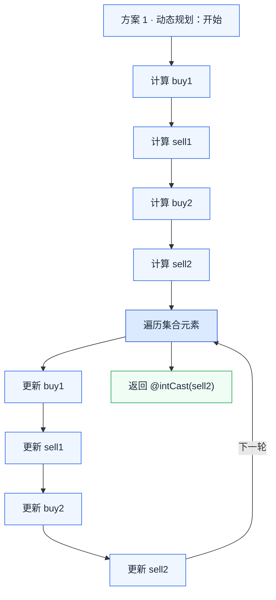

```zig
// LeetCode 123. 买卖股票的最佳时机III — Zig 版（方案1）
const std = @import("std"); // 把 @import(「std」) 存入 std
fn maxProfitIII(prices: []const i32) i32 { // 定义函数/方法 maxProfitIII
    var buy1: i64 = std.math.minInt(i64) / 2; // 把 std.math.minInt(i64) 除以 2; 写入 var buy1: i64
    var sell1: i64 = 0; // 把 0; 写入 var sell1: i64
    var buy2: i64 = std.math.minInt(i64) / 2; // 把 std.math.minInt(i64) 除以 2; 写入 var buy2: i64
    var sell2: i64 = 0; // 把 0; 写入 var sell2: i64
    for (prices) |p| { // 逐个取出 价格序列 的元素（节点）
        buy1 = @max(buy1, -p); // 把 @取较大值 buy1, 减 节点); 写入 buy1
        sell1 = @max(sell1, buy1 + p); // 把 @取较大值 sell1, buy1 加 节点); 写入 sell1
        buy2 = @max(buy2, sell1 - p); // 把 @取较大值 buy2, sell1 减 节点); 写入 buy2
        sell2 = @max(sell2, buy2 + p); // 把 @取较大值 sell2, buy2 加 节点); 写入 sell2
    }
    return @intCast(sell2); // 返回 @intCast(sell2)
}
pub fn main() !void { // 程序入口：跑内嵌自测用例
    if (maxProfitIII(&[_]i32{ 1, 2, 3 }) != 2) return error.TestFailed;
    if (maxProfitIII(&[_]i32{ 1, 2, 3, 4, 5 }) != 4) return error.TestFailed;
    if (maxProfitIII(&[_]i32{ 7, 6, 4, 3, 1 }) != 0) return error.TestFailed;
    if (maxProfitIII(&[_]i32{ 3, 3, 5, 0, 0, 3, 1, 4 }) != 6) return error.TestFailed;
    if (maxProfitIII(&[_]i32{1}) != 0) return error.TestFailed; // 若 maxProfitIII( 按位与 [_]i32{1}) 不等于 0，直接返回 error.TestFailed
    if (maxProfitIII(&[_]i32{ 1, 2 }) != 1) return error.TestFailed;
    std.debug.print("PASS\n", .{});
} // 全部用例通过，输出 PASS
```

#### 方案 2：动态规划优化空间

**思路与代码分析**：核心是「动态规划优化空间」。Zig 版显式分配与清零，整型边界处理严格。代码里依次做这些事：单循环线性扫描。**走读**：方案 2 · 动态规划优化空间：开始 → 计算 buy1 → 计算 sell1 → 计算 buy2 → 计算 sell2 → 遍历集合元素 → 更新 buy1 → 更新 sell1 → 更新 buy2 → 更新 sell2 → 返回 @intCast(sell2)。

**运行架构**（真实控制流）：

```mermaid
graph TD
    N0["方案 2 · 动态规划优化空间：开始"]
    N1["计算 buy1"]
    N2["计算 sell1"]
    N3["计算 buy2"]
    N4["计算 sell2"]
    N5["遍历集合元素"]
    N6["更新 buy1"]
    N7["更新 sell1"]
    N8["更新 buy2"]
    N9["更新 sell2"]
    N10["返回 @intCast(sell2)"]
    N0 --> N1
    N1 --> N2
    N2 --> N3
    N3 --> N4
    N4 --> N5
    N5 --> N6
    N6 --> N7
    N7 --> N8
    N8 --> N9
    N9 -- 下一轮 --> N5
    N5 --> N10
    classDef n fill:#eff6ff,stroke:#2563eb,color:#1e293b;
    classDef lp fill:#dbeafe,stroke:#1d4ed8,color:#1e293b;
    classDef dc fill:#fef9c3,stroke:#ca8a04,color:#1e293b;
    classDef tm fill:#f0fdf4,stroke:#16a34a,color:#1e293b;
    class N0,N1,N2,N3,N4,N6,N7,N8,N9 n;
    class N5 lp;
    class N10 tm;
```

```zig
// LeetCode 123. 买卖股票的最佳时机III — Zig 版（方案2）
const std = @import("std"); // 把 @import(「std」) 存入 std
fn maxProfitIII(prices: []const i32) i32 { // 定义函数/方法 maxProfitIII
    var buy1: i64 = std.math.minInt(i64) / 2; // 把 std.math.minInt(i64) 除以 2; 写入 var buy1: i64
    var sell1: i64 = 0; // 把 0; 写入 var sell1: i64
    var buy2: i64 = std.math.minInt(i64) / 2; // 把 std.math.minInt(i64) 除以 2; 写入 var buy2: i64
    var sell2: i64 = 0; // 把 0; 写入 var sell2: i64
    for (prices) |p| { // 逐个取出 价格序列 的元素（节点）
        buy1 = @max(buy1, -p); // 把 @取较大值 buy1, 减 节点); 写入 buy1
        sell1 = @max(sell1, buy1 + p); // 把 @取较大值 sell1, buy1 加 节点); 写入 sell1
        buy2 = @max(buy2, sell1 - p); // 把 @取较大值 buy2, sell1 减 节点); 写入 buy2
        sell2 = @max(sell2, buy2 + p); // 把 @取较大值 sell2, buy2 加 节点); 写入 sell2
    }
    return @intCast(sell2); // 返回 @intCast(sell2)
}
pub fn main() !void { // 程序入口：跑内嵌自测用例
    if (maxProfitIII(&[_]i32{ 1, 2, 3 }) != 2) return error.TestFailed;
    if (maxProfitIII(&[_]i32{ 1, 2, 3, 4, 5 }) != 4) return error.TestFailed;
    if (maxProfitIII(&[_]i32{ 7, 6, 4, 3, 1 }) != 0) return error.TestFailed;
    if (maxProfitIII(&[_]i32{ 3, 3, 5, 0, 0, 3, 1, 4 }) != 6) return error.TestFailed;
    if (maxProfitIII(&[_]i32{1}) != 0) return error.TestFailed; // 若 maxProfitIII( 按位与 [_]i32{1}) 不等于 0，直接返回 error.TestFailed
    if (maxProfitIII(&[_]i32{ 1, 2 }) != 1) return error.TestFailed;
    std.debug.print("PASS\n", .{});
} // 全部用例通过，输出 PASS
```

### Dart 实现（2 种方案）

Dart 的全部方案如下，每个方案都内嵌用例自测，可独立运行（老仓库 python/go 文件遵循「打印结果」约定）：

#### 方案 1：动态规划

**思路与代码分析**：核心是「动态规划」。Dart 版用可空类型标注与集合方法，注意空安全。代码里依次做这些事：单循环线性扫描。**走读**：方案 1 · 动态规划：开始 → 计算 buy1 → 遍历循环 → 更新 buy1 → 更新 sell1 → 处理 ? sell1 → 处理 : buy1 + p → 更新 buy2 → 处理 ? buy2 → 处理 : sell1 - p → 更新 sell2 → 处理 ? sell2 → 处理 : buy2 + p → 返回 sell2。

**运行架构**（真实控制流）：

```mermaid
graph TD
    N0["方案 1 · 动态规划：开始"]
    N1["计算 buy1"]
    N2["遍历循环"]
    N3["更新 buy1"]
    N4["更新 sell1"]
    N5["处理 ? sell1"]
    N6["处理 : buy1 + p"]
    N7["更新 buy2"]
    N8["处理 ? buy2"]
    N9["处理 : sell1 - p"]
    N10["更新 sell2"]
    N11["处理 ? sell2"]
    N12["处理 : buy2 + p"]
    N13["返回 sell2"]
    N0 --> N1
    N1 --> N2
    N2 --> N3
    N3 --> N4
    N4 --> N5
    N5 --> N6
    N6 --> N7
    N7 --> N8
    N8 --> N9
    N9 --> N10
    N10 --> N11
    N11 --> N12
    N12 -- 下一轮 --> N2
    N2 --> N13
    classDef n fill:#eff6ff,stroke:#2563eb,color:#1e293b;
    classDef lp fill:#dbeafe,stroke:#1d4ed8,color:#1e293b;
    classDef dc fill:#fef9c3,stroke:#ca8a04,color:#1e293b;
    classDef tm fill:#f0fdf4,stroke:#16a34a,color:#1e293b;
    class N0,N1,N3,N4,N5,N6,N7,N8,N9,N10,N11,N12 n;
    class N2 lp;
    class N13 tm;
```

```dart
// LeetCode 123. 买卖股票的最佳时机III — Dart 版（方案1）
int maxProfitIII(List<int> prices) {
  // 定义函数/方法 maxProfitIII
  var buy1 = -1000000000, sell1 = 0, buy2 = -1000000000, sell2 = 0;
  for (final p in prices) {
    // for (final 节点 in 价格序列) {
    buy1 = buy1 > -p ? buy1 : -p; // 把 buy1 超过 减 节点 ? buy1 : 减 节点 存入 buy1
    sell1 = sell1 > buy1 + p
        ? sell1
        : buy1 + p; // 把 sell1 超过 buy1 加 节点 ? sell1 : buy1 加 节点 存入 sell1
    buy2 = buy2 > sell1 - p
        ? buy2
        : sell1 - p; // 把 buy2 超过 sell1 减 节点 ? buy2 : sell1 减 节点 存入 buy2
    sell2 = sell2 > buy2 + p
        ? sell2
        : buy2 + p; // 把 sell2 超过 buy2 加 节点 ? sell2 : buy2 加 节点 存入 sell2
  }
  return sell2; // 返回 sell2
}

void main() {
  // 程序入口：跑内嵌自测用例
  if (maxProfitIII([1, 2, 3]) != 2)
    throw StateError(
      'c1',
    ); // 若 maxProfitIII([1,2,3]) 不等于 2) throw StateError('c1');
  if (maxProfitIII([1, 2, 3, 4, 5]) != 4)
    throw StateError(
      'c2',
    ); // 若 maxProfitIII([1,2,3,4,5]) 不等于 4) throw StateError('c2');
  if (maxProfitIII([7, 6, 4, 3, 1]) != 0)
    throw StateError(
      'c3',
    ); // 若 maxProfitIII([7,6,4,3,1]) 不等于 0) throw StateError('c3');
  if (maxProfitIII([3, 3, 5, 0, 0, 3, 1, 4]) != 6) throw StateError('c4');
  if (maxProfitIII([1]) != 0)
    throw StateError(
      'c5',
    ); // 若 maxProfitIII([1]) 不等于 0) throw StateError('c5');
  if (maxProfitIII([1, 2]) != 1)
    throw StateError(
      'c6',
    ); // 若 maxProfitIII([1,2]) 不等于 1) throw StateError('c6');
  print('PASS');
} // 全部用例通过，输出 PASS
```

#### 方案 2：动态规划优化空间

**思路与代码分析**：核心是「动态规划优化空间」。Dart 版用可空类型标注与集合方法，注意空安全。代码里依次做这些事：单循环线性扫描。**走读**：方案 2 · 动态规划优化空间：开始 → 计算 buy1 → 遍历循环 → 更新 buy1 → 更新 sell1 → 处理 ? sell1 → 处理 : buy1 + p → 更新 buy2 → 处理 ? buy2 → 处理 : sell1 - p → 更新 sell2 → 处理 ? sell2 → 处理 : buy2 + p → 返回 sell2。

**运行架构**（真实控制流）：

```mermaid
graph TD
    N0["方案 2 · 动态规划优化空间：开始"]
    N1["计算 buy1"]
    N2["遍历循环"]
    N3["更新 buy1"]
    N4["更新 sell1"]
    N5["处理 ? sell1"]
    N6["处理 : buy1 + p"]
    N7["更新 buy2"]
    N8["处理 ? buy2"]
    N9["处理 : sell1 - p"]
    N10["更新 sell2"]
    N11["处理 ? sell2"]
    N12["处理 : buy2 + p"]
    N13["返回 sell2"]
    N0 --> N1
    N1 --> N2
    N2 --> N3
    N3 --> N4
    N4 --> N5
    N5 --> N6
    N6 --> N7
    N7 --> N8
    N8 --> N9
    N9 --> N10
    N10 --> N11
    N11 --> N12
    N12 -- 下一轮 --> N2
    N2 --> N13
    classDef n fill:#eff6ff,stroke:#2563eb,color:#1e293b;
    classDef lp fill:#dbeafe,stroke:#1d4ed8,color:#1e293b;
    classDef dc fill:#fef9c3,stroke:#ca8a04,color:#1e293b;
    classDef tm fill:#f0fdf4,stroke:#16a34a,color:#1e293b;
    class N0,N1,N3,N4,N5,N6,N7,N8,N9,N10,N11,N12 n;
    class N2 lp;
    class N13 tm;
```

```dart
// LeetCode 123. 买卖股票的最佳时机III — Dart 版（方案2）
int maxProfitIII(List<int> prices) {
  // 定义函数/方法 maxProfitIII
  var buy1 = -1000000000, sell1 = 0, buy2 = -1000000000, sell2 = 0;
  for (final p in prices) {
    // for (final 节点 in 价格序列) {
    buy1 = buy1 > -p ? buy1 : -p; // 把 buy1 超过 减 节点 ? buy1 : 减 节点 存入 buy1
    sell1 = sell1 > buy1 + p
        ? sell1
        : buy1 + p; // 把 sell1 超过 buy1 加 节点 ? sell1 : buy1 加 节点 存入 sell1
    buy2 = buy2 > sell1 - p
        ? buy2
        : sell1 - p; // 把 buy2 超过 sell1 减 节点 ? buy2 : sell1 减 节点 存入 buy2
    sell2 = sell2 > buy2 + p
        ? sell2
        : buy2 + p; // 把 sell2 超过 buy2 加 节点 ? sell2 : buy2 加 节点 存入 sell2
  }
  return sell2; // 返回 sell2
}

void main() {
  // 程序入口：跑内嵌自测用例
  if (maxProfitIII([1, 2, 3]) != 2)
    throw StateError(
      'c1',
    ); // 若 maxProfitIII([1,2,3]) 不等于 2) throw StateError('c1');
  if (maxProfitIII([1, 2, 3, 4, 5]) != 4)
    throw StateError(
      'c2',
    ); // 若 maxProfitIII([1,2,3,4,5]) 不等于 4) throw StateError('c2');
  if (maxProfitIII([7, 6, 4, 3, 1]) != 0)
    throw StateError(
      'c3',
    ); // 若 maxProfitIII([7,6,4,3,1]) 不等于 0) throw StateError('c3');
  if (maxProfitIII([3, 3, 5, 0, 0, 3, 1, 4]) != 6) throw StateError('c4');
  if (maxProfitIII([1]) != 0)
    throw StateError(
      'c5',
    ); // 若 maxProfitIII([1]) 不等于 0) throw StateError('c5');
  if (maxProfitIII([1, 2]) != 1)
    throw StateError(
      'c6',
    ); // 若 maxProfitIII([1,2]) 不等于 1) throw StateError('c6');
  print('PASS');
} // 全部用例通过，输出 PASS
```

---

## 内容总结

- **买卖股票的最佳时机 iii**（动态规划 · Hard）：共 2 个方案，主线思路「动态规划」；时间 O(n) 到 O(m·n)（取决于状态维度）；动画演示DP 表填充过程，附录给出 11 种语言 × 全部方案的可运行实现。
- 来源博客：[https://blog.csdn.net/tyro_java/article/details/144849793](https://blog.csdn.net/tyro_java/article/details/144849793)
- 导航：[📋 总目录](../) ｜ [← 191 不同的子序列](../191_不同的子序列/) ｜ [193 并行课程 ii →](../193_并行课程_ii/)
