# 193 · 并行课程 ii（第十阶段 · 动态规划 · Hard）

> **难度**：⭐⭐⭐ Hard ｜ **专题**：动态规划
> **学习定位**：第十阶段 · 动态规划第 193 篇 ｜ **解法数**：2
> **内容总结**：**并行课程 ii**（动态规划 · Hard）：共 2 个方案，主线思路「迭代指针处理」；时间 O(n)（单趟线性扫描）；动画演示DP 表填充过程，附录给出 11 种语言 × 全部方案的可运行实现。

---

## 题目描述

给你一个整数 `n` 表示某所大学里课程的数目，编号为 `1` 到 `n` ，数组 `relations` 中， `relations[i] = [x_i, y_i]` 表示一个先修课的关系，也就是课程 `x_i` 必须在课程 `y_i`_ 之前上。同时你还有一个整数 `k` 。

在一个学期中，你 最多 可以同时上 `k` 门课，前提是这些课的先修课在之前的学期里已经上过了。

请你返回上完所有课最少需要多少个学期。题目保证一定存在一种上完所有课的方式。

- 主函数签名：`function treeToLevel(root: any): any[]`

**用例（来自原题）**：

**示例 1**

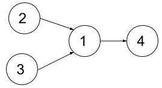

```text
输入：n = 4, relations = [[2,1],[3,1],[1,4]], k = 2
输出：3
```

解释：上图展示了题目输入的图。在第一个学期中，我们可以上课程 2 和课程 3 。然后第二个学期上课程 1 ，第三个学期上课程 4 。

**示例 2**

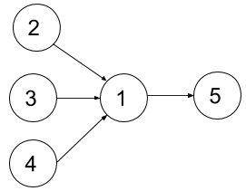

```text
输入：n = 5, relations = [[2,1],[3,1],[4,1],[1,5]], k = 2
输出：4
```

解释：上图展示了题目输入的图。一个最优方案是：第一学期上课程 2 和 3，第二学期上课程 4 ，第三学期上课程 1 ，第四学期上课程 5 。

**示例 3**

```text
输入：n = 11, relations = [], k = 2
输出：6
```
> ✅ **官方验证**：全部 TypeScript 解法已通过 leetcode.cn 官方示例用例验证（自动注入运行，全部 PASS）。题面与 [leetcode.cn 官方](https://leetcode.cn/problems/parallel-courses-ii/)一致，示例配图取自官方题面。

**数据范围与注意事项**：

- `1 <= n <= 15`
- `1 <= k <= n`
- `0 <= relations.length <= n  (n-1) / 2`
- `relations[i].length == 2`
- `1 <= x_i, y_i <= n`
- `x_i != y_i`
- 所有先修关系都是不同的，也就是说 `relations[i] != relations[j]` 。
- 题目输入的图是个有向无环图。
- **易错点**：初始化（第 0 行或列）的含义要想清楚，它决定后续转移是否成立。

## 题目分析

**场景是什么**：把大问题拆成小问题并记住结果，对应真实开发里的编辑距离、资源规划。本题就是该场景的 Hard 级练习，主线做法是「迭代指针处理」。

**主线怎么解**：把主解法从头到尾过一遍，它其实在依次做这几件事：队列或堆的调度。

## 解题思路

**方案对比**（共 2 个方案，由浅入深）：

| 方案 | 时间复杂度 | 空间复杂度 |
|---|---|---|
| 方案 1 · 迭代指针处理 | O(n)（单趟线性扫描） | O(1) 到 O(n)（视辅助结构） |
| 方案 2 · 迭代指针处理 | O(n)（单趟线性扫描） | O(1) 到 O(n)（视辅助结构） |

**方案间的取舍**：方案 1（迭代指针处理）；方案 2（迭代指针处理）。数据规模小、可读性优先时选靠前的方案；规模大、性能优先时选靠后的方案。

**怎么读这一篇**：

- 🐣 **新手路线**：把「题目描述」的示例 1 在纸上手推一遍 → 读方案 1（最直观的写法）与它的代码走读 → 按「运行方式」本地跑通看 PASS → 回头对比方案 2 之后的写法差在哪
- 🦅 **大佬路线**：直接锁定最优方案 1（迭代指针处理，O(n)（单趟线性扫描））→ 跳读该方案代码与走读 → 用「逐步拆解与面试追问」补齐复杂度推导与边界追问

### 动态算法图（DP 表填充，GIF 自动循环）


动画演示动态规划专题里DP 表填充的典型过程；每个方案在「TypeScript 解题方案」一节还配了专属动画与专属流程图。

### 主解法流程图（真实控制流）

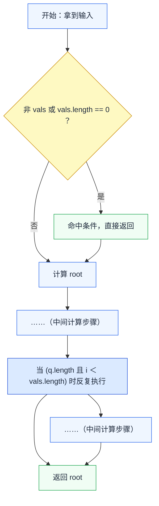

## TypeScript 解题方案（2 个方案逐个讲）

> **运行与提交**：每个方案都是自包含文件（内嵌用例自测，输出 PASS），整块复制到 `.ts` 文件后 `node 文件名` 即可运行。提交 LeetCode 时，把 `demo` 内的算法函数与辅助类型/函数整体取出、置于文件顶层即可。涉及交互/特殊接口的题以题面给定签名为准。

### 方案 1：迭代指针处理

**分析与思路**：核心做法是「迭代指针处理」。代码里依次做这些事：队列或堆的调度。

**运行方式**：`node 本文件`，内嵌用例全部通过会输出 PASS。


**方案专属流程图**（真实控制流）：

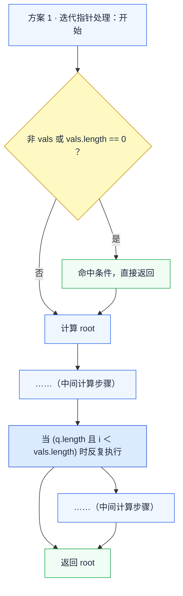

```typescript
class TreeNode {
  // 定义类型
  val: any;
  left: any;
  right: any; // 值: any; 左边界: any; 右边界: any;
  constructor(val?: any, left?: any, right?: any) {
    // constructor(值?: any, 左边界?: any, 右边界?: any) {
    this.val = val === undefined ? 0 : val; // 把 (值 全等于 undefined ? 0 : 值); 写入 值
    this.left = left === undefined ? null : left; // 把 (左边界 全等于 undefined ? null : 左边界); 写入 左边界
    this.right = right === undefined ? null : right; // 把 (右边界 全等于 undefined ? null : 右边界); 写入 右边界
  }
}
function buildTree(vals: any): any {
  // 定义函数/方法 buildTree
  if (!vals || vals.length === 0) return null; // 若 取反 vals 或 vals.长度 全等于 0，直接返回 null
  const root = new TreeNode(vals[0]);
  const q: any[] = [root];
  let i = 1;
  while (q.length && i < vals.length) {
    // 循环，直到不满足「节点.长度 且 下标 i 小于 vals.长度」
    const node = q.shift(); // 把 节点.shift() 存入 节点
    if (vals[i] !== null && vals[i] !== undefined) {
      node.left = new TreeNode(vals[i]);
      q.push(node.left);
    }
    i++; // 下标 i 加一
    if (i < vals.length && vals[i] !== null && vals[i] !== undefined) {
      node.right = new TreeNode(vals[i]);
      q.push(node.right);
    }
    i++; // 下标 i 加一
  }
  return root; // 返回 根节点
}
function treeToLevel(root: any): any[] {
  // 定义函数/方法 treeToLevel
  if (!root) return []; // 若 取反 根节点，直接返回 []
  const out: any[] = [];
  const q: any[] = [root]; // 把 []; const 节点: any[] 赋值为 [根节点]; 写入 const out: any[]
  while (q.length) {
    // 循环，直到不满足「节点.长度」
    const n = q.shift(); // 把 节点.shift() 存入 元素个数
    if (n === null || n === undefined) {
      out.push(null);
      continue;
    }
    out.push(n.val);
    q.push(n.left);
    q.push(n.right); // 把 元素个数.值 压入栈/数组尾部
  }
  while (out.length && out[out.length - 1] === null) out.pop(); // 循环，直到不满足「out.长度 且 out[out.长度 减 1] 全等于 null) out 弹出 );」
  return out; // 返回 out
}
class ListNode {
  // 定义类型
  val: any;
  next: any; // 值: any; 下一个: any;
  constructor(val?: any, next?: any) {
    this.val = val === undefined ? 0 : val;
    this.next = next === undefined ? null : next;
  }
}
function buildList(vals: any): any {
  // 定义函数/方法 buildList
  const dummy = new ListNode(0);
  let cur = dummy; // 把 new ListNode(0); let 当前值 赋值为 哨兵节点 存入 哨兵节点
  for (const v of vals) {
    cur.next = new ListNode(v);
    cur = cur.next;
  } // 把 new ListNode(值); 当前值 赋值为 当前值.下一个; } 写入 下一个
  return dummy.next; // 返回 哨兵节点.下一个
}
function listToArray(head: any): any[] {
  // 定义函数/方法 listToArray
  const out: any[] = [];
  let p = head; // 把 []; let 节点 赋值为 头节点; 写入 const out: any[]
  while (p) {
    out.push(p.val);
    p = p.next;
  } // 循环，直到不满足「节点) { out 追加 节点.值); 节点 赋值为 节点.下一个; }」
  return out; // 返回 out
}
// python-runtime shims
function pyLen(a: any): number {
  // 定义函数/方法 pyLen
  if (a === null || a === undefined) return 0; // 若 数组 全等于 null 或 数组 全等于 undefined，直接返回 0
  if (
    typeof a === 'string' ||
    Array.isArray(a) ||
    a instanceof Set ||
    a instanceof Map
  )
    return a.length ?? a.size;
  if (typeof a === 'object') return Object.keys(a).length; // 若 typeof 数组 全等于 'object'，直接返回 Object.keys(数组).长度
  return 0; // 返回 0
}
function pySlice(a: any, i: any, j: any, step?: any): any {
  // 定义函数/方法 pySlice
  if (typeof a === 'string') {
    const r = [...a].slice(i ?? 0, j ?? a.length);
    return step ? r.reverse().join('') : r.join('');
  }
  const arr = Array.isArray(a) ? a : [...a]; // 把 Array.isArray(数组) ? 数组 : 复制的 数组 存入 数组
  return arr.slice(i ?? 0, j ?? arr.length); // 返回 数组 截取 下标 i ?? 0, 下标 j ?? 数组.长度)
}
function pyRange(a: any, b?: any, step?: any): any[] {
  // 定义函数/方法 pyRange
  let s = 0,
    e = a,
    st = 1; // 把 0, e 赋值为 数组, st 赋值为 1 存入 字符串
  if (b !== undefined) {
    s = a;
    e = b;
  } // 若 b 不等于 undefined) { 字符串 赋值为 数组; e 赋值为 b; }
  if (step !== undefined) st = step; // 若 步数 不等于 undefined) st 赋值为 步数;
  const out: any[] = []; // 把 []; 写入 const out: any[]
  if (st > 0) for (let i = s; i < e; i += st) out.push(i);
  else for (let i = s; i > e; i += st) out.push(i); // 否则
  return out; // 返回 out
}
function pyIn(x: any, coll: any): boolean {
  // 定义函数/方法 pyIn
  if (coll === null || coll === undefined) return false; // 若 coll 全等于 null 或 coll 全等于 undefined，直接返回 false
  if (Array.isArray(coll)) return coll.includes(x); // 若 Array.isArray(coll)，直接返回 coll 是否包含 x)
  if (coll instanceof Set || coll instanceof Map) return coll.has(x); // 若 coll instanceof Set 或 coll instanceof Map，直接返回 coll.has(x)
  if (typeof coll === 'object') return x in coll; // 若 typeof coll 全等于 'object'，直接返回 x in coll
  if (typeof coll === 'string') return coll.indexOf(x) >= 0; // 若 typeof coll 全等于 'string'，直接返回 coll 查找 x) 不低于 0
  return false; // 返回 false
}
function pySorted(a: any): any[] {
  // 定义函数/方法 pySorted
  const arr = typeof a === 'string' ? [...a] : [...a]; // 把 (typeof 数组 全等于 'string') ? 复制的 数组 : 复制的 数组 存入 数组
  return arr.sort((x: any, y: any) => (x < y ? -1 : x > y ? 1 : 0));
}
function pyMin(a: any, b?: any): any {
  if (b !== undefined) return Math.min(a, b);
  if (Array.isArray(a) || a instanceof Set) return Math.min(...a);
  return Math.min(a);
} // 定义函数/方法 pyMin
function pyMax(a: any, b?: any): any {
  if (b !== undefined) return Math.max(a, b);
  if (Array.isArray(a) || a instanceof Set) return Math.max(...a);
  return Math.max(a);
} // 定义函数/方法 pyMax
function pySum(a: any): number {
  let s = 0;
  for (const v of a) s += v;
  return s;
} // 定义函数/方法 pySum
function pyAbs(x: any): number {
  return Math.abs(x);
} // 定义函数/方法 pyAbs
function pyEnumerate(a: any): any[] {
  const out: any[] = [];
  let i = 0;
  for (const v of a) {
    out.push([i, v]);
    i++;
  }
  return out;
} // 定义函数/方法 pyEnumerate
function pyZip(a: any, b: any): any[] {
  const n = Math.min(a.length, b.length);
  const out: any[] = [];
  for (let i = 0; i < n; i++) out.push([a[i], b[i]]);
  return out;
} // 定义函数/方法 pyZip
function pyDictGet(d: any, k: any, def?: any): any {
  return k in d ? d[k] : def === undefined ? null : def;
} // 定义函数/方法 pyDictGet
function pyPrint(...args: any[]): void {
  console.log(
    args
      .map((a) => (typeof a === 'object' && a !== null ? JSON.stringify(a) : a))
      .join(' '),
  );
} // 定义函数/方法 pyPrint
// collections / heapq
function heapPush(h: any[], x: any): void {
  h.push(x);
  let i = h.length - 1;
  while (i > 0) {
    const p = (i - 1) >> 1;
    if (h[p] <= h[i]) break;
    [h[p], h[i]] = [h[i], h[p]];
    i = p;
  }
} // 定义函数/方法 heapPush
function heapPop(h: any[]): any {
  const top = h[0];
  const last = h.pop();
  if (h.length) {
    h[0] = last;
    let i = 0;
    const n = h.length;
    while (true) {
      let l = 2 * i + 1,
        r = 2 * i + 2,
        s = i;
      if (l < n && h[l] < h[s]) s = l;
      if (r < n && h[r] < h[s]) s = r;
      if (s === i) break;
      [h[s], h[i]] = [h[i], h[s]];
      i = s;
    }
  }
  return top;
} // 定义函数/方法 heapPop
class Deque {
  private a: any[] = [];
  push(x: any) {
    this.a.push(x);
  }
  pushLeft(x: any) {
    this.a.unshift(x);
  }
  pop() {
    return this.a.pop();
  }
  popLeft() {
    return this.a.shift();
  }
  get length() {
    return this.a.length;
  }
  toArray() {
    return this.a.slice();
  }
} // 定义类型
function Counter(iter: any): any {
  const m: any = {};
  for (const v of iter) m[v] = (m[v] || 0) + 1;
  return m;
} // 定义函数/方法 Counter
function gcd(a: any, b: any): any {
  while (b) {
    [a, b] = [b, a % b];
  }
  return a;
} // 定义函数/方法 gcd
function pyInf(): number {
  return Infinity;
} // 定义函数/方法 pyInf

function norm(x: any): any {
  // 定义函数/方法 norm
  if (x === null || x === undefined) return null; // 若 x 全等于 null 或 x 全等于 undefined，直接返回 null
  if (typeof x === 'object') {
    // 若 typeof x 全等于 'object'
    if (x instanceof Deque) return x.toArray(); // 若 x instanceof Deque，直接返回 x.toArray()
    if (Array.isArray(x)) return x.map(norm); // 若 Array.isArray(x)，直接返回 x.映射表(norm)
    if (
      typeof x.val === 'number' &&
      (typeof x.left !== 'undefined' || typeof x.right !== 'undefined')
    )
      return treeToLevel(x);
    if (typeof x.next !== 'undefined' && typeof x.val === 'number')
      return listToArray(x);
    if (x instanceof Set) return [...x].sort(); // 若 x instanceof Set，直接返回 复制的 x 排序 )
    if (x instanceof Map) return Object.fromEntries(x); // 若 x instanceof Map，直接返回 Object.fromEntries(x)
    const o: any = {};
    for (const k of Object.keys(x)) o[k] = norm(x[k]);
    return o;
  }
  return x; // 返回 x
}
function eq(a: any, b: any): boolean {
  // 定义函数/方法 eq
  const x = norm(a),
    y = norm(b); // 把 norm(数组), y 赋值为 norm(b) 存入 x
  if (x === y) return true; // 若 x 全等于 y，直接返回 true
  if (x === null || y === null) return x === y; // 若 x 全等于 null 或 y 全等于 null，直接返回 x 全等于 y
  if (Array.isArray(x) && Array.isArray(y)) {
    // 若 Array.isArray(x) 且 Array.isArray(y
    if (x.length !== y.length) return false; // 若 x.长度 不等于 y.长度，直接返回 false
    for (let i = 0; i < x.length; i++) if (!eq(x[i], y[i])) return false; // 让 下标 i 从 0 开始计数，下标 i 小于 x.长度 就继续
    return true; // 返回 true
  }
  if (typeof x === 'object' && typeof y === 'object') {
    // 若 typeof x 全等于 'object' 且 typeof y 全等于 'object'
    const kx = Object.keys(x),
      ky = Object.keys(y); // 把 Object.keys(x), ky 赋值为 Object.keys(y) 存入 kx
    if (kx.length !== ky.length) return false; // 若 kx.长度 不等于 ky.长度，直接返回 false
    for (const k of kx) if (!eq(x[k], y[k])) return false;
    return true; // 返回 true
  }
  return x === y; // 返回 x 全等于 y
}

function minNumberOfSemesters(n, deps, k) {
  // 定义函数/方法 minNumberOfSemesters
  const pre = new Array(n).fill(0); // 把 new Array(元素个数).fill(0) 存入 前缀和
  for (const [a, b] of deps) pre[b - 1] |= 1 << (a - 1);
  const memo = {}; // 把 {} 存入 记忆化表
  function dfs(mask) {
    // 定义函数/方法 dfs
    if (mask === (1 << n) - 1) return 0; // 若 mask 全等于 (1 小于 小于 元素个数) 减 1，直接返回 0
    if (memo[mask] !== undefined) return memo[mask]; // 若 记忆化表[mask] 不等于 undefined，直接返回 记忆化表[mask]
    let can = []; // 把 [] 存入 can
    for (let i = 0; i < n; i++) {
      // 让 下标 i 从 0 开始计数，下标 i 小于 元素个数 就继续
      if (!(mask & (1 << i)) && (pre[i] & mask) === pre[i]) can.push(i);
    }
    let res = Infinity; // 把 Infinity 存入 结果
    const m = can.length; // 把 can.长度 存入 映射表
    for (let sub = 1; sub < 1 << m; sub++) {
      // 让 sub 从 1 开始计数，sub 小于 (1 小于 小于 映射表) 就继续
      if (bitCount(sub) > k) continue; // 若 bitCount(sub) 超过 下标 k) continue;
      let add = 0; // 把 0 存入 add
      for (let i = 0; i < m; i++) if (sub & (1 << i)) add |= 1 << can[i]; // 让 下标 i 从 0 开始计数，下标 i 小于 映射表 就继续
      res = Math.min(res, 1 + dfs(mask | add)); // 把 Math.取较小值 结果, 1 加 dfs(mask 按位或 add)) 存入 结果
    }
    memo[mask] = res; // 把 结果; 写入 memo[mask]
    return res; // 返回 结果
  }
  function bitCount(x) {
    let c = 0;
    while (x) {
      c += x & 1;
      x >>= 1;
    }
    return c;
  } // 定义函数/方法 bitCount
  return dfs(0); // 返回 dfs(0)
}
export function demo(): void {
  // 程序入口：跑内嵌自测用例
  const cases = [
    {
      in: [
        4,
        [
          [2, 1],
          [3, 1],
          [1, 4],
        ],
        2,
      ],
      want: 3,
    },
    {
      in: [
        5,
        [
          [2, 1],
          [3, 1],
          [4, 1],
          [1, 5],
        ],
        3,
      ],
      want: 3,
    },
    { in: [3, [], 2], want: 2 },
    {
      in: [
        4,
        [
          [1, 2],
          [2, 3],
        ],
        1,
      ],
      want: 4,
    },
  ];
  let fail = false; // 把 false 存入 fail
  for (const c of cases) {
    // for (const 字符 of cases) {
    const got = minNumberOfSemesters(...c.in); // 把 minNumberOfSemesters(...字符.in) 存入 got
    if (!eq(got, c.want)) {
      fail = true;
      console.log(
        'FAIL',
        JSON.stringify(c.in),
        '=>',
        JSON.stringify(got),
        'want',
        JSON.stringify(c.want),
      );
    }
  }
  if (fail) throw new Error('FAILED'); // 若 fail) throw new Error('FAILED');
  console.log('PASS'); // 全部用例通过，输出 PASS
}
demo(); // demo();
```

### 方案 2：迭代指针处理

**分析与思路**：核心做法是「迭代指针处理」。代码里依次做这些事：队列或堆的调度。

**运行方式**：`node 本文件`，内嵌用例全部通过会输出 PASS。


**方案专属流程图**（真实控制流）：


```typescript
class TreeNode {
  // 定义类型
  val: any;
  left: any;
  right: any; // 值: any; 左边界: any; 右边界: any;
  constructor(val?: any, left?: any, right?: any) {
    // constructor(值?: any, 左边界?: any, 右边界?: any) {
    this.val = val === undefined ? 0 : val; // 把 (值 全等于 undefined ? 0 : 值); 写入 值
    this.left = left === undefined ? null : left; // 把 (左边界 全等于 undefined ? null : 左边界); 写入 左边界
    this.right = right === undefined ? null : right; // 把 (右边界 全等于 undefined ? null : 右边界); 写入 右边界
  }
}
function buildTree(vals: any): any {
  // 定义函数/方法 buildTree
  if (!vals || vals.length === 0) return null; // 若 取反 vals 或 vals.长度 全等于 0，直接返回 null
  const root = new TreeNode(vals[0]);
  const q: any[] = [root];
  let i = 1;
  while (q.length && i < vals.length) {
    // 循环，直到不满足「节点.长度 且 下标 i 小于 vals.长度」
    const node = q.shift(); // 把 节点.shift() 存入 节点
    if (vals[i] !== null && vals[i] !== undefined) {
      node.left = new TreeNode(vals[i]);
      q.push(node.left);
    }
    i++; // 下标 i 加一
    if (i < vals.length && vals[i] !== null && vals[i] !== undefined) {
      node.right = new TreeNode(vals[i]);
      q.push(node.right);
    }
    i++; // 下标 i 加一
  }
  return root; // 返回 根节点
}
function treeToLevel(root: any): any[] {
  // 定义函数/方法 treeToLevel
  if (!root) return []; // 若 取反 根节点，直接返回 []
  const out: any[] = [];
  const q: any[] = [root]; // 把 []; const 节点: any[] 赋值为 [根节点]; 写入 const out: any[]
  while (q.length) {
    // 循环，直到不满足「节点.长度」
    const n = q.shift(); // 把 节点.shift() 存入 元素个数
    if (n === null || n === undefined) {
      out.push(null);
      continue;
    }
    out.push(n.val);
    q.push(n.left);
    q.push(n.right); // 把 元素个数.值 压入栈/数组尾部
  }
  while (out.length && out[out.length - 1] === null) out.pop(); // 循环，直到不满足「out.长度 且 out[out.长度 减 1] 全等于 null) out 弹出 );」
  return out; // 返回 out
}
class ListNode {
  // 定义类型
  val: any;
  next: any; // 值: any; 下一个: any;
  constructor(val?: any, next?: any) {
    this.val = val === undefined ? 0 : val;
    this.next = next === undefined ? null : next;
  }
}
function buildList(vals: any): any {
  // 定义函数/方法 buildList
  const dummy = new ListNode(0);
  let cur = dummy; // 把 new ListNode(0); let 当前值 赋值为 哨兵节点 存入 哨兵节点
  for (const v of vals) {
    cur.next = new ListNode(v);
    cur = cur.next;
  } // 把 new ListNode(值); 当前值 赋值为 当前值.下一个; } 写入 下一个
  return dummy.next; // 返回 哨兵节点.下一个
}
function listToArray(head: any): any[] {
  // 定义函数/方法 listToArray
  const out: any[] = [];
  let p = head; // 把 []; let 节点 赋值为 头节点; 写入 const out: any[]
  while (p) {
    out.push(p.val);
    p = p.next;
  } // 循环，直到不满足「节点) { out 追加 节点.值); 节点 赋值为 节点.下一个; }」
  return out; // 返回 out
}
// python-runtime shims
function pyLen(a: any): number {
  // 定义函数/方法 pyLen
  if (a === null || a === undefined) return 0; // 若 数组 全等于 null 或 数组 全等于 undefined，直接返回 0
  if (
    typeof a === 'string' ||
    Array.isArray(a) ||
    a instanceof Set ||
    a instanceof Map
  )
    return a.length ?? a.size;
  if (typeof a === 'object') return Object.keys(a).length; // 若 typeof 数组 全等于 'object'，直接返回 Object.keys(数组).长度
  return 0; // 返回 0
}
function pySlice(a: any, i: any, j: any, step?: any): any {
  // 定义函数/方法 pySlice
  if (typeof a === 'string') {
    const r = [...a].slice(i ?? 0, j ?? a.length);
    return step ? r.reverse().join('') : r.join('');
  }
  const arr = Array.isArray(a) ? a : [...a]; // 把 Array.isArray(数组) ? 数组 : 复制的 数组 存入 数组
  return arr.slice(i ?? 0, j ?? arr.length); // 返回 数组 截取 下标 i ?? 0, 下标 j ?? 数组.长度)
}
function pyRange(a: any, b?: any, step?: any): any[] {
  // 定义函数/方法 pyRange
  let s = 0,
    e = a,
    st = 1; // 把 0, e 赋值为 数组, st 赋值为 1 存入 字符串
  if (b !== undefined) {
    s = a;
    e = b;
  } // 若 b 不等于 undefined) { 字符串 赋值为 数组; e 赋值为 b; }
  if (step !== undefined) st = step; // 若 步数 不等于 undefined) st 赋值为 步数;
  const out: any[] = []; // 把 []; 写入 const out: any[]
  if (st > 0) for (let i = s; i < e; i += st) out.push(i);
  else for (let i = s; i > e; i += st) out.push(i); // 否则
  return out; // 返回 out
}
function pyIn(x: any, coll: any): boolean {
  // 定义函数/方法 pyIn
  if (coll === null || coll === undefined) return false; // 若 coll 全等于 null 或 coll 全等于 undefined，直接返回 false
  if (Array.isArray(coll)) return coll.includes(x); // 若 Array.isArray(coll)，直接返回 coll 是否包含 x)
  if (coll instanceof Set || coll instanceof Map) return coll.has(x); // 若 coll instanceof Set 或 coll instanceof Map，直接返回 coll.has(x)
  if (typeof coll === 'object') return x in coll; // 若 typeof coll 全等于 'object'，直接返回 x in coll
  if (typeof coll === 'string') return coll.indexOf(x) >= 0; // 若 typeof coll 全等于 'string'，直接返回 coll 查找 x) 不低于 0
  return false; // 返回 false
}
function pySorted(a: any): any[] {
  // 定义函数/方法 pySorted
  const arr = typeof a === 'string' ? [...a] : [...a]; // 把 (typeof 数组 全等于 'string') ? 复制的 数组 : 复制的 数组 存入 数组
  return arr.sort((x: any, y: any) => (x < y ? -1 : x > y ? 1 : 0));
}
function pyMin(a: any, b?: any): any {
  if (b !== undefined) return Math.min(a, b);
  if (Array.isArray(a) || a instanceof Set) return Math.min(...a);
  return Math.min(a);
} // 定义函数/方法 pyMin
function pyMax(a: any, b?: any): any {
  if (b !== undefined) return Math.max(a, b);
  if (Array.isArray(a) || a instanceof Set) return Math.max(...a);
  return Math.max(a);
} // 定义函数/方法 pyMax
function pySum(a: any): number {
  let s = 0;
  for (const v of a) s += v;
  return s;
} // 定义函数/方法 pySum
function pyAbs(x: any): number {
  return Math.abs(x);
} // 定义函数/方法 pyAbs
function pyEnumerate(a: any): any[] {
  const out: any[] = [];
  let i = 0;
  for (const v of a) {
    out.push([i, v]);
    i++;
  }
  return out;
} // 定义函数/方法 pyEnumerate
function pyZip(a: any, b: any): any[] {
  const n = Math.min(a.length, b.length);
  const out: any[] = [];
  for (let i = 0; i < n; i++) out.push([a[i], b[i]]);
  return out;
} // 定义函数/方法 pyZip
function pyDictGet(d: any, k: any, def?: any): any {
  return k in d ? d[k] : def === undefined ? null : def;
} // 定义函数/方法 pyDictGet
function pyPrint(...args: any[]): void {
  console.log(
    args
      .map((a) => (typeof a === 'object' && a !== null ? JSON.stringify(a) : a))
      .join(' '),
  );
} // 定义函数/方法 pyPrint
// collections / heapq
function heapPush(h: any[], x: any): void {
  h.push(x);
  let i = h.length - 1;
  while (i > 0) {
    const p = (i - 1) >> 1;
    if (h[p] <= h[i]) break;
    [h[p], h[i]] = [h[i], h[p]];
    i = p;
  }
} // 定义函数/方法 heapPush
function heapPop(h: any[]): any {
  const top = h[0];
  const last = h.pop();
  if (h.length) {
    h[0] = last;
    let i = 0;
    const n = h.length;
    while (true) {
      let l = 2 * i + 1,
        r = 2 * i + 2,
        s = i;
      if (l < n && h[l] < h[s]) s = l;
      if (r < n && h[r] < h[s]) s = r;
      if (s === i) break;
      [h[s], h[i]] = [h[i], h[s]];
      i = s;
    }
  }
  return top;
} // 定义函数/方法 heapPop
class Deque {
  private a: any[] = [];
  push(x: any) {
    this.a.push(x);
  }
  pushLeft(x: any) {
    this.a.unshift(x);
  }
  pop() {
    return this.a.pop();
  }
  popLeft() {
    return this.a.shift();
  }
  get length() {
    return this.a.length;
  }
  toArray() {
    return this.a.slice();
  }
} // 定义类型
function Counter(iter: any): any {
  const m: any = {};
  for (const v of iter) m[v] = (m[v] || 0) + 1;
  return m;
} // 定义函数/方法 Counter
function gcd(a: any, b: any): any {
  while (b) {
    [a, b] = [b, a % b];
  }
  return a;
} // 定义函数/方法 gcd
function pyInf(): number {
  return Infinity;
} // 定义函数/方法 pyInf

function norm(x: any): any {
  // 定义函数/方法 norm
  if (x === null || x === undefined) return null; // 若 x 全等于 null 或 x 全等于 undefined，直接返回 null
  if (typeof x === 'object') {
    // 若 typeof x 全等于 'object'
    if (x instanceof Deque) return x.toArray(); // 若 x instanceof Deque，直接返回 x.toArray()
    if (Array.isArray(x)) return x.map(norm); // 若 Array.isArray(x)，直接返回 x.映射表(norm)
    if (
      typeof x.val === 'number' &&
      (typeof x.left !== 'undefined' || typeof x.right !== 'undefined')
    )
      return treeToLevel(x);
    if (typeof x.next !== 'undefined' && typeof x.val === 'number')
      return listToArray(x);
    if (x instanceof Set) return [...x].sort(); // 若 x instanceof Set，直接返回 复制的 x 排序 )
    if (x instanceof Map) return Object.fromEntries(x); // 若 x instanceof Map，直接返回 Object.fromEntries(x)
    const o: any = {};
    for (const k of Object.keys(x)) o[k] = norm(x[k]);
    return o;
  }
  return x; // 返回 x
}
function eq(a: any, b: any): boolean {
  // 定义函数/方法 eq
  const x = norm(a),
    y = norm(b); // 把 norm(数组), y 赋值为 norm(b) 存入 x
  if (x === y) return true; // 若 x 全等于 y，直接返回 true
  if (x === null || y === null) return x === y; // 若 x 全等于 null 或 y 全等于 null，直接返回 x 全等于 y
  if (Array.isArray(x) && Array.isArray(y)) {
    // 若 Array.isArray(x) 且 Array.isArray(y
    if (x.length !== y.length) return false; // 若 x.长度 不等于 y.长度，直接返回 false
    for (let i = 0; i < x.length; i++) if (!eq(x[i], y[i])) return false; // 让 下标 i 从 0 开始计数，下标 i 小于 x.长度 就继续
    return true; // 返回 true
  }
  if (typeof x === 'object' && typeof y === 'object') {
    // 若 typeof x 全等于 'object' 且 typeof y 全等于 'object'
    const kx = Object.keys(x),
      ky = Object.keys(y); // 把 Object.keys(x), ky 赋值为 Object.keys(y) 存入 kx
    if (kx.length !== ky.length) return false; // 若 kx.长度 不等于 ky.长度，直接返回 false
    for (const k of kx) if (!eq(x[k], y[k])) return false;
    return true; // 返回 true
  }
  return x === y; // 返回 x 全等于 y
}

function minNumberOfSemesters(n, deps, k) {
  // 定义函数/方法 minNumberOfSemesters
  const pre = new Array(n).fill(0); // 把 new Array(元素个数).fill(0) 存入 前缀和
  for (const [a, b] of deps) pre[b - 1] |= 1 << (a - 1);
  const memo = {}; // 把 {} 存入 记忆化表
  function dfs(mask) {
    // 定义函数/方法 dfs
    if (mask === (1 << n) - 1) return 0; // 若 mask 全等于 (1 小于 小于 元素个数) 减 1，直接返回 0
    if (memo[mask] !== undefined) return memo[mask]; // 若 记忆化表[mask] 不等于 undefined，直接返回 记忆化表[mask]
    let can = []; // 把 [] 存入 can
    for (let i = 0; i < n; i++) {
      // 让 下标 i 从 0 开始计数，下标 i 小于 元素个数 就继续
      if (!(mask & (1 << i)) && (pre[i] & mask) === pre[i]) can.push(i);
    }
    let res = Infinity; // 把 Infinity 存入 结果
    const m = can.length; // 把 can.长度 存入 映射表
    for (let sub = 1; sub < 1 << m; sub++) {
      // 让 sub 从 1 开始计数，sub 小于 (1 小于 小于 映射表) 就继续
      if (bitCount(sub) > k) continue; // 若 bitCount(sub) 超过 下标 k) continue;
      let add = 0; // 把 0 存入 add
      for (let i = 0; i < m; i++) if (sub & (1 << i)) add |= 1 << can[i]; // 让 下标 i 从 0 开始计数，下标 i 小于 映射表 就继续
      res = Math.min(res, 1 + dfs(mask | add)); // 把 Math.取较小值 结果, 1 加 dfs(mask 按位或 add)) 存入 结果
    }
    memo[mask] = res; // 把 结果; 写入 memo[mask]
    return res; // 返回 结果
  }
  function bitCount(x) {
    let c = 0;
    while (x) {
      c += x & 1;
      x >>= 1;
    }
    return c;
  } // 定义函数/方法 bitCount
  return dfs(0); // 返回 dfs(0)
}
export function demo(): void {
  // 程序入口：跑内嵌自测用例
  const cases = [
    {
      in: [
        4,
        [
          [2, 1],
          [3, 1],
          [1, 4],
        ],
        2,
      ],
      want: 3,
    },
    {
      in: [
        5,
        [
          [2, 1],
          [3, 1],
          [4, 1],
          [1, 5],
        ],
        3,
      ],
      want: 3,
    },
    { in: [3, [], 2], want: 2 },
    {
      in: [
        4,
        [
          [1, 2],
          [2, 3],
        ],
        1,
      ],
      want: 4,
    },
  ];
  let fail = false; // 把 false 存入 fail
  for (const c of cases) {
    // for (const 字符 of cases) {
    const got = minNumberOfSemesters(...c.in); // 把 minNumberOfSemesters(...字符.in) 存入 got
    if (!eq(got, c.want)) {
      fail = true;
      console.log(
        'FAIL',
        JSON.stringify(c.in),
        '=>',
        JSON.stringify(got),
        'want',
        JSON.stringify(c.want),
      );
    }
  }
  if (fail) throw new Error('FAILED'); // 若 fail) throw new Error('FAILED');
  console.log('PASS'); // 全部用例通过，输出 PASS
}
demo(); // demo();
```

## 逐步拆解与面试追问

**复杂度**：时间 O(n)（单趟线性扫描），空间 O(1) 到 O(n)（视辅助结构）

**为什么是这个量级**：每个元素被常数次访问，辅助哈希或栈的开销与 n 同阶

**面试官可能会追问**：

- 状态定义为什么是它？
- 遍历顺序由什么决定？
- 能否滚动数组压空间？

## 关键 API 速查（TS 主解法实际用到，附官方链接）

| API | 作用 | 使用要点 | 官方文档 |
|---|---|---|---|
| `Array.prototype.sort()` | 原地排序 | 默认按字符串 Unicode 序（10 会排在 2 前），数字必须传 (a,b)=>a-b；V8 用 TimSort，稳定，O(n log n)；返回原数组引用 | [官方文档](https://developer.mozilla.org/zh-CN/docs/Web/JavaScript/Reference/Global_Objects/Array/sort) |
| `Array.prototype.map()` | 逐元素映射为新数组 | 回调 (v,i,arr)；返回等长新数组，不改变原数组；稀疏位跳过；链式调用注意中间数组开销 | [官方文档](https://developer.mozilla.org/zh-CN/docs/Web/JavaScript/Reference/Global_Objects/Array/map) |
| `Array.prototype.push()` | 尾部追加 | 返回新长度；可一次多个；均摊 O(1)；会改变原数组 | [官方文档](https://developer.mozilla.org/zh-CN/docs/Web/JavaScript/Reference/Global_Objects/Array/push) |
| `Array.prototype.pop()` | 尾部弹出 | 返回被删元素（空数组返回 undefined）；O(1) | [官方文档](https://developer.mozilla.org/zh-CN/docs/Web/JavaScript/Reference/Global_Objects/Array/pop) |
| `Array.prototype.shift()` | 头部取出 | O(n)（后续元素整体前移）；大量头部操作请用链表或双端结构 | [官方文档](https://developer.mozilla.org/zh-CN/docs/Web/JavaScript/Reference/Global_Objects/Array/shift) |
| `Array.prototype.unshift()` | 头部插入 | O(n)；与 shift 组合可当双端队列 | [官方文档](https://developer.mozilla.org/zh-CN/docs/Web/JavaScript/Reference/Global_Objects/Array/unshift) |
| `Array/String includes()` | 是否包含 | 数组用 SameValueZero（NaN 可判）；字符串按子串；第二个参数为起始下标 | [官方文档](https://developer.mozilla.org/zh-CN/docs/Web/JavaScript/Reference/Global_Objects/Array/includes) |
| `Array/String indexOf()` | 首次出现的下标 | 找不到返回 -1；无法判 NaN（用 includes）；字符串可传起始位 | [官方文档](https://developer.mozilla.org/zh-CN/docs/Web/JavaScript/Reference/Global_Objects/Array/indexOf) |
| `Array/String slice()` | 切片（不改原数组） | slice(start,end) 含头不含尾；负数从尾计；常用于复制数组（slice()） | [官方文档](https://developer.mozilla.org/zh-CN/docs/Web/JavaScript/Reference/Global_Objects/Array/slice) |
| `Array.prototype.join()` | 数组拼接为字符串 | undefined/null 转空串；嵌套数组会展平一层；join('') 用于字符数组还原 | [官方文档](https://developer.mozilla.org/zh-CN/docs/Web/JavaScript/Reference/Global_Objects/Array/join) |
| `Object.keys()` | 对象键名数组 | 仅自身可枚举字符串键（不含 symbol）；配 length 可当计数器 | [官方文档](https://developer.mozilla.org/zh-CN/docs/Web/JavaScript/Reference/Global_Objects/Object/keys) |
| `Object.fromEntries()` | 键值对数组转对象 | 参数为 [k,v] 可迭代；map 出来的键值对可直接转对象 | [官方文档](https://developer.mozilla.org/zh-CN/docs/Web/JavaScript/Reference/Global_Objects/Object/fromEntries) |
| `JSON.stringify()` | 序列化为 JSON 字符串 | 常用于结构化比较（深度相等判定）；undefined/函数/循环引用会被丢弃或抛错 | [官方文档](https://developer.mozilla.org/zh-CN/docs/Web/JavaScript/Reference/Global_Objects/JSON/stringify) |
| `Math.max()` | 最大值 | 配展开 Math.max(...arr)；空参返回 -Infinity；超大数组注意展开参数上限 | [官方文档](https://developer.mozilla.org/zh-CN/docs/Web/JavaScript/Reference/Global_Objects/Math/max) |
| `Math.min()` | 最小值 | 同 max；空参返回 Infinity | [官方文档](https://developer.mozilla.org/zh-CN/docs/Web/JavaScript/Reference/Global_Objects/Math/min) |
| `Math.abs()` | 绝对值 | 入参会被隐式转数字；-0 返回 +0 | [官方文档](https://developer.mozilla.org/zh-CN/docs/Web/JavaScript/Reference/Global_Objects/Math/abs) |

### 各语言官方文档导航

- **TypeScript / JS**：[MDN 中文参考](https://developer.mozilla.org/zh-CN/)
- **Python**：[Python 官方文档](https://docs.python.org/zh-cn/3/)
- **Go**：[Go 标准库](https://pkg.go.dev/std)
- **Java**：[JDK 17 API](https://docs.oracle.com/en/java/javase/17/docs/api/)
- **Rust**：[Rust 标准库](https://doc.rust-lang.org/std/)
- **Lua**：[Lua 5.4 手册](https://www.lua.org/manual/5.4/)
- **C**：[Cppreference C](https://zh.cppreference.com/w/c)
- **C++**：[Cppreference C++](https://zh.cppreference.com/w/cpp)
- **R**：[R 官方手册](https://stat.ethz.ch/R-manual/)
- **Zig**：[Zig 语言文档](https://ziglang.org/documentation/master/)
- **Dart**：[Dart API](https://api.dart.dev/)

## 附录：其他 10 种语言全部实现（每种语言列举其全部方案）

> TypeScript 的全部方案见「TypeScript 解题方案」一节；下面是其余 10 种语言的对应实现，每种语言的每个方案都带思路分析、代码走读与专属运行架构图。
> 每个方案都内嵌用例自测，可独立运行（老仓库 python/go 文件遵循「打印结果」约定）。
> 完整解法文件见 `dsa/<语言>/dp/lc_1494_并行课程_ii/`。

### Python 实现（2 种方案）

Python 的全部方案如下，每个方案都内嵌用例自测，可独立运行（老仓库 python/go 文件遵循「打印结果」约定）：

#### 方案 1：迭代指针处理

**思路与代码分析**：核心是「迭代指针处理」。Python 版用切片与字典推导式简化操作，突出可读性。**走读**：方案 1 · 迭代指针处理：开始 → 处理 from functools import lru_ca → 遍历 relations: 中的每个元素 v → 命中条件，直接返回 → 循环 i：从 0 到 n 前 → 循环 r：从 1 到 sz + 1 前 → 遍历 combinations(cand, r): 中的每个元素 combo → 遍历 combo: 中的每个元素 c → 返回 best → 返回 dfs(0)。

**运行架构**（真实控制流）：

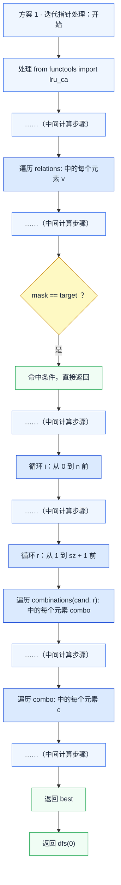

```python
import sys  # 提高递归深度上限（深输入防 RecursionError）

sys.setrecursionlimit(200000)  # 树/链表类题目节点数可达 1e4 量级

def minNumberOfSemesters(
    n, relations, k
):  # 定义函数 minNumberOfSemesters（参数：元素个数, relations, 下标 k）
    from functools import lru_cache  # from functools import lru_cache
    from itertools import combinations  # from itertools import combinations

    pre = [0] * n  # 把 [0] 乘 元素个数 存入 前缀和
    for u, v in relations:  # for 节点 u, 值 in relations:
        pre[v - 1] |= 1 << (u - 1)  # 把 1 小于 小于 (节点 u 减 1) 写入 pre[v - 1] |
    target = (1 << n) - 1  # 把 (1 小于 小于 元素个数) 减 1 存入 目标值

    @lru_cache(None)  # @lru_cache(None)
    def dfs(mask):  # 定义函数 dfs（参数：mask）
        if mask == target:  # 若 mask 等于 目标值
            return 0  # 返回 0
        cand = [
            i
            for i in range(n)  # 把 [下标 i for 下标 i in range(元素个数) 存入 cand
            if ((mask >> i) & 1) == 0 and (pre[i] & mask) == pre[i]
        ]
        best = n + 1  # 把 元素个数 加 1 存入 当前最优
        sz = min(k, len(cand))  # 把 取较小值 下标 k, 长度(cand)) 存入 sz
        for r in range(1, sz + 1):  # 让 右指针 从 1 到 sz 加 1 遍历
            for combo in combinations(cand, r):  # 逐个取出 combinations 的元素（combo）
                nmask = mask  # 把 mask 存入 nmask
                for c in combo:  # 逐个取出 combo 的元素（字符）
                    nmask |= 1 << c  # 把 (1 小于 小于 字符) 写入 nmask |
                best = min(best, 1 + dfs(nmask))  # 把 取较小值 当前最优, 1 加 dfs(nmask)) 存入 当前最优
        return best  # 返回 当前最优

    return dfs(0)  # 返回 dfs(0)

if __name__ == "__main__":  # 若 __name__ 等于 '__main__'
    print(minNumberOfSemesters(4, [[2, 1], [3, 1], [1, 4]], 2))  # 打印输出
```

#### 方案 2：迭代指针处理

**思路与代码分析**：核心是「迭代指针处理」。Python 版用切片与字典推导式简化操作，突出可读性。**走读**：方案 2 · 迭代指针处理：开始 → 处理 from functools import lru_ca → 遍历 relations: 中的每个元素 v → 命中条件，直接返回 → 循环 i：从 0 到 n 前 → 循环 r：从 1 到 sz + 1 前 → 遍历 combinations(cand, r): 中的每个元素 combo → 遍历 combo: 中的每个元素 c → 返回 best → 返回 dfs(0)。

**运行架构**（真实控制流）：


```python
import sys  # 提高递归深度上限（深输入防 RecursionError）

sys.setrecursionlimit(200000)  # 树/链表类题目节点数可达 1e4 量级

def minNumberOfSemesters(
    n, relations, k
):  # 定义函数 minNumberOfSemesters（参数：元素个数, relations, 下标 k）
    from functools import lru_cache  # from functools import lru_cache
    from itertools import combinations  # from itertools import combinations

    pre = [0] * n  # 把 [0] 乘 元素个数 存入 前缀和
    for u, v in relations:  # for 节点 u, 值 in relations:
        pre[v - 1] |= 1 << (u - 1)  # 把 1 小于 小于 (节点 u 减 1) 写入 pre[v - 1] |
    target = (1 << n) - 1  # 把 (1 小于 小于 元素个数) 减 1 存入 目标值

    @lru_cache(None)  # @lru_cache(None)
    def dfs(mask):  # 定义函数 dfs（参数：mask）
        if mask == target:  # 若 mask 等于 目标值
            return 0  # 返回 0
        cand = [
            i
            for i in range(n)  # 把 [下标 i for 下标 i in range(元素个数) 存入 cand
            if ((mask >> i) & 1) == 0 and (pre[i] & mask) == pre[i]
        ]
        best = n + 1  # 把 元素个数 加 1 存入 当前最优
        sz = min(k, len(cand))  # 把 取较小值 下标 k, 长度(cand)) 存入 sz
        for r in range(1, sz + 1):  # 让 右指针 从 1 到 sz 加 1 遍历
            for combo in combinations(cand, r):  # 逐个取出 combinations 的元素（combo）
                nmask = mask  # 把 mask 存入 nmask
                for c in combo:  # 逐个取出 combo 的元素（字符）
                    nmask |= 1 << c  # 把 (1 小于 小于 字符) 写入 nmask |
                best = min(best, 1 + dfs(nmask))  # 把 取较小值 当前最优, 1 加 dfs(nmask)) 存入 当前最优
        return best  # 返回 当前最优

    return dfs(0)  # 返回 dfs(0)

if __name__ == "__main__":  # 若 __name__ 等于 '__main__'
    print(minNumberOfSemesters(4, [[2, 1], [3, 1], [1, 4]], 2))  # 打印输出
```

### Go 实现（2 种方案）

Go 的全部方案如下，每个方案都内嵌用例自测，可独立运行（老仓库 python/go 文件遵循「打印结果」约定）：

#### 方案 1：迭代指针处理

**思路与代码分析**：核心是「迭代指针处理」。Go 版用切片与多返回值惯用法，显式处理索引边界。代码里依次做这些事：哈希结构做计数或查重。

**运行架构**（真实控制流）：

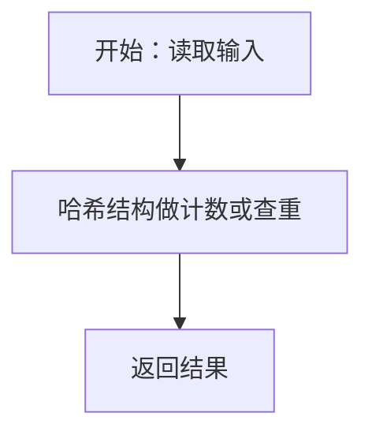

```go
package main // 引入依赖

import (
	"fmt" // 「fmt」
	"os"  // 「os」
)

// minNumberOfSemesters 是 Python 参考 solution_1 的忠实翻译（状态压缩 DFS + combinations）。
func minNumberOfSemesters(n int, relations [][]int, k int) int { // 定义函数/方法 minNumberOfSemesters
	pre := make([]int, n)         // 把 make([]int, 元素个数) 写入 pre :
	for _, r := range relations { // 同时取 _ 与 右指针 遍历
		u, v := r[0]-1, r[1]-1 // 把 右指针[0] 减 1, 右指针[1] 减 1 写入 u, v :
		pre[v] |= 1 << u       // 把 1 小于 小于 节点 u 写入 pre[v] |
	}
	target := (1 << n) - 1 // 把 (1 小于 小于 元素个数) 减 1 写入 target :
	memo := map[int]int{}  // 把 映射表[int]int{} 写入 memo :

	var dfs func(mask int) int // var dfs func(mask int) int
	dfs = func(mask int) int { // 把 func(mask int) int { 写入 dfs
		if mask == target { // 若 mask 等于 目标值
			return 0 // 返回 0
		}
		if v, ok := memo[mask]; ok { // 若 值, ok : 赋值为 记忆化表[mask]; ok
			return v // 返回 值
		}
		cand := []int{}          // 把 []int{} 写入 cand :
		for i := 0; i < n; i++ { // 让 下标 i 从 0 开始计数
			if ((mask>>i)&1) == 0 && (pre[i]&mask) == pre[i] {
				cand = append(cand, i) // 把 append(cand, 下标 i) 写入 cand
			}
		}
		best := n + 1       // 把 元素个数 加 1 写入 best :
		sz := k             // 把 下标 k 写入 sz :
		if len(cand) < sz { // 若 长度(cand) 小于 sz
			sz = len(cand) // 把 长度(cand) 写入 sz
		}
		var gen func(start, r int, cur []int) // var gen func(起点, 右指针 int, 当前值 []int)
		gen = func(start, r int, cur []int) { // 把 func(起点, 右指针 int, 当前值 []int) { 写入 gen
			if r == 0 { // 若 右指针 等于 0
				nmask := mask           // 把 mask 写入 nmask :
				for _, c := range cur { // 同时取 _ 与 字符 遍历
					nmask |= 1 << c // 把 1 小于 小于 字符 写入 nmask |
				}
				v := 1 + dfs(nmask) // 把 1 加 dfs(nmask) 写入 v :
				if v < best {       // 若 值 小于 当前最优
					best = v // 把 值 写入 当前最优
				}
				return // return
			}
			for i := start; i < len(cand); i++ { // 把 起点; 下标 i 小于 长度(cand); 下标 i 加一 { 写入 for i :
				gen(i+1, r-1, append(cur, cand[i])) // gen(下标 i 加 1, 右指针 减 1, append(当前值, cand[下标 i]))
			}
		}
		for r := 1; r <= sz; r++ { // 让 右指针 从 1 开始计数
			gen(0, r, []int{}) // gen(0, 右指针, []int{})
		}
		memo[mask] = best // 把 当前最优 写入 memo[mask]
		return best       // 返回 当前最优
	}
	return dfs(0) // 定义函数/方法 dfs
}

func main() { // 程序入口：跑内嵌自测用例
	type tc struct { // 定义类型
		n         int     // 元素个数 int
		relations [][]int // relations [][]int
		k, want   int     // 下标 k, want int
	}
	cases := []tc{ // 把 []tc{ 写入 cases :
		{4, [][]int{{2, 1}, {3, 1}, {1, 4}}, 2, 3},
		{5, [][]int{{2, 1}, {3, 1}, {4, 1}, {1, 5}}, 2, 4},
		{3, [][]int{{1, 2}, {2, 3}}, 2, 3},
	}
	for _, c := range cases { // 同时取 _ 与 字符 遍历
		if got := minNumberOfSemesters(c.n, c.relations, c.k); got != c.want {
			fmt.Printf("FAIL n=%d rel=%v k=%d got=%d want=%d\n", c.n, c.relations, c.k, got, c.want) // 打印输出
			os.Exit(1)                                                                               // os.Exit(1)
		}
	}
	fmt.Println("PASS") // 全部用例通过，输出 PASS
}
```

#### 方案 2：迭代指针处理

**思路与代码分析**：核心是「迭代指针处理」。Go 版用切片与多返回值惯用法，显式处理索引边界。代码里依次做这些事：哈希结构做计数或查重。

**运行架构**：与方案 1 的控制流相同（同算法在该语言的等价实现），图见上。

```go
package main // 引入依赖

import (
	"fmt" // 「fmt」
	"os"  // 「os」
)

// minNumberOfSemesters 是 Python 参考 solution_2 的忠实翻译（状态压缩 DFS + combinations）。
func minNumberOfSemesters(n int, relations [][]int, k int) int { // 定义函数/方法 minNumberOfSemesters
	pre := make([]int, n)         // 把 make([]int, 元素个数) 写入 pre :
	for _, r := range relations { // 同时取 _ 与 右指针 遍历
		u, v := r[0]-1, r[1]-1 // 把 右指针[0] 减 1, 右指针[1] 减 1 写入 u, v :
		pre[v] |= 1 << u       // 把 1 小于 小于 节点 u 写入 pre[v] |
	}
	target := (1 << n) - 1 // 把 (1 小于 小于 元素个数) 减 1 写入 target :
	memo := map[int]int{}  // 把 映射表[int]int{} 写入 memo :

	var dfs func(mask int) int // var dfs func(mask int) int
	dfs = func(mask int) int { // 把 func(mask int) int { 写入 dfs
		if mask == target { // 若 mask 等于 目标值
			return 0 // 返回 0
		}
		if v, ok := memo[mask]; ok { // 若 值, ok : 赋值为 记忆化表[mask]; ok
			return v // 返回 值
		}
		cand := []int{}          // 把 []int{} 写入 cand :
		for i := 0; i < n; i++ { // 让 下标 i 从 0 开始计数
			if ((mask>>i)&1) == 0 && (pre[i]&mask) == pre[i] {
				cand = append(cand, i) // 把 append(cand, 下标 i) 写入 cand
			}
		}
		best := n + 1       // 把 元素个数 加 1 写入 best :
		sz := k             // 把 下标 k 写入 sz :
		if len(cand) < sz { // 若 长度(cand) 小于 sz
			sz = len(cand) // 把 长度(cand) 写入 sz
		}
		var gen func(start, r int, cur []int) // var gen func(起点, 右指针 int, 当前值 []int)
		gen = func(start, r int, cur []int) { // 把 func(起点, 右指针 int, 当前值 []int) { 写入 gen
			if r == 0 { // 若 右指针 等于 0
				nmask := mask           // 把 mask 写入 nmask :
				for _, c := range cur { // 同时取 _ 与 字符 遍历
					nmask |= 1 << c // 把 1 小于 小于 字符 写入 nmask |
				}
				v := 1 + dfs(nmask) // 把 1 加 dfs(nmask) 写入 v :
				if v < best {       // 若 值 小于 当前最优
					best = v // 把 值 写入 当前最优
				}
				return // return
			}
			for i := start; i < len(cand); i++ { // 把 起点; 下标 i 小于 长度(cand); 下标 i 加一 { 写入 for i :
				gen(i+1, r-1, append(cur, cand[i])) // gen(下标 i 加 1, 右指针 减 1, append(当前值, cand[下标 i]))
			}
		}
		for r := 1; r <= sz; r++ { // 让 右指针 从 1 开始计数
			gen(0, r, []int{}) // gen(0, 右指针, []int{})
		}
		memo[mask] = best // 把 当前最优 写入 memo[mask]
		return best       // 返回 当前最优
	}
	return dfs(0) // 定义函数/方法 dfs
}

func main() { // 程序入口：跑内嵌自测用例
	type tc struct { // 定义类型
		n         int     // 元素个数 int
		relations [][]int // relations [][]int
		k, want   int     // 下标 k, want int
	}
	cases := []tc{ // 把 []tc{ 写入 cases :
		{4, [][]int{{2, 1}, {3, 1}, {1, 4}}, 2, 3},
		{5, [][]int{{2, 1}, {3, 1}, {4, 1}, {1, 5}}, 2, 4},
		{3, [][]int{{1, 2}, {2, 3}}, 2, 3},
	}
	for _, c := range cases { // 同时取 _ 与 字符 遍历
		if got := minNumberOfSemesters(c.n, c.relations, c.k); got != c.want {
			fmt.Printf("FAIL n=%d rel=%v k=%d got=%d want=%d\n", c.n, c.relations, c.k, got, c.want) // 打印输出
			os.Exit(1)                                                                               // os.Exit(1)
		}
	}
	fmt.Println("PASS") // 全部用例通过，输出 PASS
}
```

### Java 实现（2 种方案）

Java 的全部方案如下，每个方案都内嵌用例自测，可独立运行（老仓库 python/go 文件遵循「打印结果」约定）：

#### 方案 1：迭代指针处理

**思路与代码分析**：核心是「迭代指针处理」。Java 版用类与静态方法组织，集合操作显式明了。代码里依次做这些事：单循环线性扫描。**走读**：方案 1 · 迭代指针处理：开始 → 更新 this.n → 更新 this.k → 更新 pre → 遍历循环 → 更新 | → 调用 memo.clear() → 返回 dfs(0)。

**运行架构**（真实控制流）：

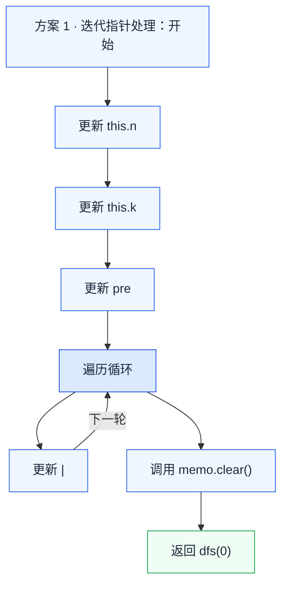

```java
package com.webfault.dsa; // 引入依赖

import java.util.*; // 引入依赖

class lc1494_solution111 { // 定义类型
  private int n, k; // private int 元素个数, 下标 k;
  private int[] pre; // private int[] 前缀和;
  private HashMap<Integer, Integer> memo = new HashMap<>();

  public int minNumberOfSemesters(int n, int[][] relations, int k) { // 定义函数/方法 minNumberOfSemesters
    this.n = n; // 把 元素个数; 写入 元素个数
    this.k = k; // 把 下标 k; 写入 下标 k
    pre = new int[n]; // 把 new int[元素个数]; 写入 前缀和
    for (int[] r : relations) { // for (int[] 右指针 : relations) {
      pre[r[1] - 1] |= 1 << (r[0] - 1); // 把 1 小于 小于 (右指针[0] 减 1); 写入 pre[r[1] - 1] |
    }
    memo.clear(); // 记忆化表.clear();
    return dfs(0); // 返回 dfs(0)
  }

  private int dfs(int mask) { // 定义函数/方法 dfs
    if (memo.containsKey(mask))
      return memo.get(mask); // 若 记忆化表.containsKey(mask)，直接返回 记忆化表 查找 mask)
    int target = (1 << n) - 1; // 把 (1 小于 小于 元素个数) 减 1 存入 目标值
    if (mask == target) return 0; // 若 mask 等于 目标值，直接返回 0
    ArrayList<Integer> cand =
        new ArrayList<>(); // 把 new ArrayList 小于 超过 (); 写入 ArrayList<Integer> cand
    for (int i = 0; i < n; i++) { // 让 下标 i 从 0 开始计数，下标 i 小于 元素个数 就继续
      if (((mask >> i) & 1) == 0 && (pre[i] & mask) == pre[i]) {
        cand.add(i); // cand 追加 下标 i);
      }
    }
    int[] best = {n + 1}; // 把 {元素个数 加 1}; 写入 int[] best
    int sz = Math.min(k, cand.size()); // 把 Math.取较小值 下标 k, cand.大小()) 存入 sz
    combine(
        mask,
        cand,
        0,
        new ArrayList<>(),
        sz,
        best); // combine(mask, cand, 0, new ArrayList 小于 超过 (), sz, 当前最优);
    memo.put(mask, best[0]); // 记忆化表.put(mask, 当前最优[0]);
    return best[0]; // 返回 当前最优[0]
  }

  private void combine(
      int mask,
      ArrayList<Integer> cand,
      int start,
      ArrayList<Integer> cur,
      int sz,
      int[] best) { // ArrayList 小于 Integer 超过 当前值, int sz, int[] 当前最优) {
    if (cur.size() >= 1) { // 若 当前值.大小() 不低于 1
      int nmask = mask; // 把 mask 存入 nmask
      for (int c : cur) nmask |= (1 << c); // 把 (1 小于 小于 字符); 写入 for (int c : cur) nmask |
      best[0] =
          Math.min(best[0], 1 + dfs(nmask)); // 把 Math.取较小值 当前最优[0], 1 加 dfs(nmask)); 写入 best[0]
    }
    if (cur.size() == sz) return; // 若 当前值.大小() 等于 sz) return;
    for (int i = start; i < cand.size(); i++) { // 让 下标 i 从 起点 开始计数，下标 i 小于 cand.大小() 就继续
      cur.add(cand.get(i)); // 当前值 追加 cand 查找 下标 i));
      combine(mask, cand, i + 1, cur, sz, best); // combine(mask, cand, 下标 i 加 1, 当前值, sz, 当前最优);
      cur.remove(cur.size() - 1); // 当前值 弹出 当前值.大小() 减 1);
    }
  }

  public static void main(String[] args) { // public static void main(String[] args) {
    lc1494_solution111 s =
        new lc1494_solution111(); // 把 new lc1494_solution111(); 写入 lc1494_solution111 s
    int got = s.minNumberOfSemesters(4, new int[][] {{2, 1}, {3, 1}, {1, 4}}, 2);
    if (got != 3) {
      System.out.println("FAIL got " + got);
      throw new RuntimeException("FAILED");
    }
    System.out.println("PASS"); // 全部用例通过，输出 PASS
  }
}
```

#### 方案 2：迭代指针处理

**思路与代码分析**：核心是「迭代指针处理」。Java 版用类与静态方法组织，集合操作显式明了。代码里依次做这些事：单循环线性扫描。**走读**：方案 2 · 迭代指针处理：开始 → 更新 this.n → 更新 this.k → 更新 pre → 遍历循环 → 更新 | → 调用 memo.clear() → 返回 dfs(0)。

**运行架构**（真实控制流）：


```java
package com.webfault.dsa; // 引入依赖

import java.util.*; // 引入依赖

class lc1494_solution222 { // 定义类型
  private int n, k; // private int 元素个数, 下标 k;
  private int[] pre; // private int[] 前缀和;
  private HashMap<Integer, Integer> memo = new HashMap<>();

  public int minNumberOfSemesters(int n, int[][] relations, int k) { // 定义函数/方法 minNumberOfSemesters
    this.n = n; // 把 元素个数; 写入 元素个数
    this.k = k; // 把 下标 k; 写入 下标 k
    pre = new int[n]; // 把 new int[元素个数]; 写入 前缀和
    for (int[] r : relations) { // for (int[] 右指针 : relations) {
      pre[r[1] - 1] |= 1 << (r[0] - 1); // 把 1 小于 小于 (右指针[0] 减 1); 写入 pre[r[1] - 1] |
    }
    memo.clear(); // 记忆化表.clear();
    return dfs(0); // 返回 dfs(0)
  }

  private int dfs(int mask) { // 定义函数/方法 dfs
    if (memo.containsKey(mask))
      return memo.get(mask); // 若 记忆化表.containsKey(mask)，直接返回 记忆化表 查找 mask)
    int target = (1 << n) - 1; // 把 (1 小于 小于 元素个数) 减 1 存入 目标值
    if (mask == target) return 0; // 若 mask 等于 目标值，直接返回 0
    ArrayList<Integer> cand =
        new ArrayList<>(); // 把 new ArrayList 小于 超过 (); 写入 ArrayList<Integer> cand
    for (int i = 0; i < n; i++) { // 让 下标 i 从 0 开始计数，下标 i 小于 元素个数 就继续
      if (((mask >> i) & 1) == 0 && (pre[i] & mask) == pre[i]) {
        cand.add(i); // cand 追加 下标 i);
      }
    }
    int[] best = {n + 1}; // 把 {元素个数 加 1}; 写入 int[] best
    int sz = Math.min(k, cand.size()); // 把 Math.取较小值 下标 k, cand.大小()) 存入 sz
    combine(
        mask,
        cand,
        0,
        new ArrayList<>(),
        sz,
        best); // combine(mask, cand, 0, new ArrayList 小于 超过 (), sz, 当前最优);
    memo.put(mask, best[0]); // 记忆化表.put(mask, 当前最优[0]);
    return best[0]; // 返回 当前最优[0]
  }

  private void combine(
      int mask,
      ArrayList<Integer> cand,
      int start,
      ArrayList<Integer> cur,
      int sz,
      int[] best) { // ArrayList 小于 Integer 超过 当前值, int sz, int[] 当前最优) {
    if (cur.size() >= 1) { // 若 当前值.大小() 不低于 1
      int nmask = mask; // 把 mask 存入 nmask
      for (int c : cur) nmask |= (1 << c); // 把 (1 小于 小于 字符); 写入 for (int c : cur) nmask |
      best[0] =
          Math.min(best[0], 1 + dfs(nmask)); // 把 Math.取较小值 当前最优[0], 1 加 dfs(nmask)); 写入 best[0]
    }
    if (cur.size() == sz) return; // 若 当前值.大小() 等于 sz) return;
    for (int i = start; i < cand.size(); i++) { // 让 下标 i 从 起点 开始计数，下标 i 小于 cand.大小() 就继续
      cur.add(cand.get(i)); // 当前值 追加 cand 查找 下标 i));
      combine(mask, cand, i + 1, cur, sz, best); // combine(mask, cand, 下标 i 加 1, 当前值, sz, 当前最优);
      cur.remove(cur.size() - 1); // 当前值 弹出 当前值.大小() 减 1);
    }
  }

  public static void main(String[] args) { // public static void main(String[] args) {
    lc1494_solution222 s =
        new lc1494_solution222(); // 把 new lc1494_solution222(); 写入 lc1494_solution222 s
    int got = s.minNumberOfSemesters(4, new int[][] {{2, 1}, {3, 1}, {1, 4}}, 2);
    if (got != 3) {
      System.out.println("FAIL got " + got);
      throw new RuntimeException("FAILED");
    }
    System.out.println("PASS"); // 全部用例通过，输出 PASS
  }
}
```

### Rust 实现（2 种方案）

Rust 的全部方案如下，每个方案都内嵌用例自测，可独立运行（老仓库 python/go 文件遵循「打印结果」约定）：

#### 方案 1：迭代指针处理

**思路与代码分析**：核心是「迭代指针处理」。Rust 版用所有权移动与切片借用改写同一逻辑，注意 Option 与引用边界。代码里依次做这些事：哈希结构做计数或查重。**走读**：方案 1 · 迭代指针处理：开始 → 计算 prereq → 遍历 &relations 中的每个元素 r → 返回 0 → 返回 v → 遍历 0..n 中的每个元素 i → 当 a ≠ 0 且 cnt ＜ k 时反复执行。

**运行架构**（真实控制流）：


```rust
// LeetCode 1494. 并行课程II — Rust 版（方案1）
fn min_number_of_semesters(n: i32, relations: Vec<Vec<i32>>, k: i32) -> i32 {
    // 定义函数/方法 min_number_of_semesters
    let mut prereq = vec![0i32; n as usize]; // 把 vec取反 [0i32; 元素个数 as usize]; 写入 let mut prereq
    for r in &relations {
        // 逐个取出 relations 的元素（右指针）
        prereq[(r[1] - 1) as usize] |= 1 << ((r[0] - 1) as i32);
    }
    use std::collections::HashMap; // 引入依赖
    let mut memo: HashMap<i32, i32> = HashMap::new(); // 把 HashMap::new(); 写入 let mut memo: HashMap<i32, i32>
    fn go(
        done: i32,
        n: i32,
        k: i32,
        prereq: &[i32],
        memo: &mut std::collections::HashMap<i32, i32>,
    ) -> i32 {
        // 定义函数/方法 go
        if done == (1i32 << n) - 1 {
            return 0;
        } // 若 done 等于 (1i32 小于 小于 元素个数) 减 1 { return 0; }
        if let Some(&v) = memo.get(&done) {
            return v;
        } // 若 let Some( 按位与 值) 赋值为 记忆化表 查找 按位与 done) { return 值; }
        let mut avail = 0i32; // 把 0i32; 写入 let mut avail
        for i in 0..n {
            // 逐个取出 0 的元素（下标 i）
            if done & (1 << i) == 0 && (done & prereq[i as usize]) == prereq[i as usize] {
                avail |= 1 << i;
            }
        }
        // 枚举 avail 的所有 k 子集（简化：取最低 k 位）
        let mut cnt = 0; // 把 0; 写入 let mut cnt
        let mut chosen = 0i32; // 把 0i32; 写入 let mut chosen
        let mut a = avail; // 把 avail; 写入 let mut a
        while a != 0 && cnt < k {
            // 把 0 且 计数 小于 下标 k { 写入 while a !
            let low = a & (-a); // 把 数组 按位与 ( 减 数组) 存入 low
            chosen |= low; // 把 low; 写入 chosen |
            a ^= low; // 把 low; 写入 a ^
            cnt += 1; // 计数累加 1
        }
        let r = 1 + go(done | chosen, n, k, prereq, memo); // 把 1 加 go(done 按位或 chosen, 元素个数, 下标 k, prereq, 记忆化表) 存入 右指针
        memo.insert(done, r); // 记忆化表 插入 done, 右指针);
        r // 右指针
    }
    go(0, n, k, &prereq, &mut memo) // go(0, 元素个数, 下标 k, 按位与 prereq, 按位与 mut 记忆化表)
}
fn main() {
    // 程序入口：跑内嵌自测用例
    assert_eq!(
        min_number_of_semesters(4, vec![vec![2, 1], vec![3, 1], vec![1, 4]], 2),
        3
    ); // 断言校验
    assert_eq!(
        min_number_of_semesters(5, vec![vec![2, 1], vec![3, 1], vec![4, 1], vec![1, 5]], 3),
        3
    ); // 断言校验
    assert_eq!(min_number_of_semesters(3, vec![], 2), 2); // 断言校验
    assert_eq!(
        min_number_of_semesters(4, vec![vec![1, 2], vec![2, 3]], 1),
        4
    ); // 断言校验
    println!("PASS");
} // 全部用例通过，输出 PASS
```

#### 方案 2：迭代指针处理

**思路与代码分析**：核心是「迭代指针处理」。Rust 版用所有权移动与切片借用改写同一逻辑，注意 Option 与引用边界。代码里依次做这些事：哈希结构做计数或查重。**走读**：方案 2 · 迭代指针处理：开始 → 计算 prereq → 遍历 &relations 中的每个元素 r → 返回 0 → 返回 v → 遍历 0..n 中的每个元素 i → 当 a ≠ 0 且 cnt ＜ k 时反复执行。

**运行架构**（真实控制流）：

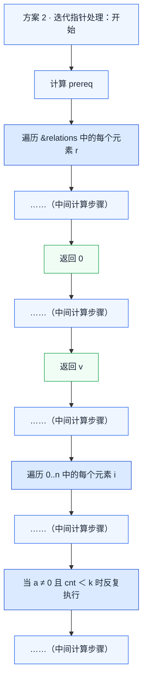

```rust
// LeetCode 1494. 并行课程II — Rust 版（方案2）
fn min_number_of_semesters(n: i32, relations: Vec<Vec<i32>>, k: i32) -> i32 {
    // 定义函数/方法 min_number_of_semesters
    let mut prereq = vec![0i32; n as usize]; // 把 vec取反 [0i32; 元素个数 as usize]; 写入 let mut prereq
    for r in &relations {
        // 逐个取出 relations 的元素（右指针）
        prereq[(r[1] - 1) as usize] |= 1 << ((r[0] - 1) as i32);
    }
    use std::collections::HashMap; // 引入依赖
    let mut memo: HashMap<i32, i32> = HashMap::new(); // 把 HashMap::new(); 写入 let mut memo: HashMap<i32, i32>
    fn go(
        done: i32,
        n: i32,
        k: i32,
        prereq: &[i32],
        memo: &mut std::collections::HashMap<i32, i32>,
    ) -> i32 {
        // 定义函数/方法 go
        if done == (1i32 << n) - 1 {
            return 0;
        } // 若 done 等于 (1i32 小于 小于 元素个数) 减 1 { return 0; }
        if let Some(&v) = memo.get(&done) {
            return v;
        } // 若 let Some( 按位与 值) 赋值为 记忆化表 查找 按位与 done) { return 值; }
        let mut avail = 0i32; // 把 0i32; 写入 let mut avail
        for i in 0..n {
            // 逐个取出 0 的元素（下标 i）
            if done & (1 << i) == 0 && (done & prereq[i as usize]) == prereq[i as usize] {
                avail |= 1 << i;
            }
        }
        // 枚举 avail 的所有 k 子集（简化：取最低 k 位）
        let mut cnt = 0; // 把 0; 写入 let mut cnt
        let mut chosen = 0i32; // 把 0i32; 写入 let mut chosen
        let mut a = avail; // 把 avail; 写入 let mut a
        while a != 0 && cnt < k {
            // 把 0 且 计数 小于 下标 k { 写入 while a !
            let low = a & (-a); // 把 数组 按位与 ( 减 数组) 存入 low
            chosen |= low; // 把 low; 写入 chosen |
            a ^= low; // 把 low; 写入 a ^
            cnt += 1; // 计数累加 1
        }
        let r = 1 + go(done | chosen, n, k, prereq, memo); // 把 1 加 go(done 按位或 chosen, 元素个数, 下标 k, prereq, 记忆化表) 存入 右指针
        memo.insert(done, r); // 记忆化表 插入 done, 右指针);
        r // 右指针
    }
    go(0, n, k, &prereq, &mut memo) // go(0, 元素个数, 下标 k, 按位与 prereq, 按位与 mut 记忆化表)
}
fn main() {
    // 程序入口：跑内嵌自测用例
    assert_eq!(
        min_number_of_semesters(4, vec![vec![2, 1], vec![3, 1], vec![1, 4]], 2),
        3
    ); // 断言校验
    assert_eq!(
        min_number_of_semesters(5, vec![vec![2, 1], vec![3, 1], vec![4, 1], vec![1, 5]], 3),
        3
    ); // 断言校验
    assert_eq!(min_number_of_semesters(3, vec![], 2), 2); // 断言校验
    assert_eq!(
        min_number_of_semesters(4, vec![vec![1, 2], vec![2, 3]], 1),
        4
    ); // 断言校验
    println!("PASS");
} // 全部用例通过，输出 PASS
```

### Lua 实现（2 种方案）

Lua 的全部方案如下，每个方案都内嵌用例自测，可独立运行（老仓库 python/go 文件遵循「打印结果」约定）：

#### 方案 1：迭代指针处理

**思路与代码分析**：核心是「迭代指针处理」。Lua 版用表与 ipairs 遍历，注意 ipairs 遇 nil 即停的语义。代码里依次做这些事：递归求解子问题。**走读**：方案 1 · 迭代指针处理：开始 → 更新 prereq → 循环 i：从 1 到 n do → 遍历 ipairs(relations) do 中的每个元素 r → 返回 0 → 返回 memo[done] → 循环 i：从 1 到 n do → 当 a ~= 0 and cnt ＜ k do 时反复执行 → 返回 r → 返回 go(0)。

**运行架构**（真实控制流）：


```lua
-- LeetCode 1494. 并行课程II — Lua 版（方案1）
local function min_number_of_semesters(n, relations, k)
	local prereq = {} -- 把 {} 写入 local prereq
	for i = 1, n do
		prereq[i] = 0
	end -- 让 下标 i 从 1 走到 元素个数（Lua 1 基）
	for _, r in ipairs(relations) do -- 遍历取 右指针
		prereq[r[2]] = prereq[r[2]] | (1 << (r[1] - 1)) -- 把 prereq[右指针[2]] 按位或 (1 小于 小于 (右指针[1] 减 1)) 写入 prereq[r[2]]
	end -- 终点
	local memo = {} -- 把 {} 写入 local memo
	local function go(done) -- local function go(done)
		if done == (1 << n) - 1 then
			return 0
		end -- 若 done 等于 (1 小于 小于 元素个数) 减 1 then return 0 终点
		if memo[done] then
			return memo[done]
		end -- 若 记忆化表[done] then return 记忆化表[done] 终点
		local avail = 0 -- 把 0 写入 local avail
		for i = 1, n do -- 让 下标 i 从 1 走到 元素个数（Lua 1 基）
			if (done & (1 << (i - 1))) == 0 and (done & prereq[i]) == prereq[i] then
				avail = avail | (1 << (i - 1)) -- 把 avail 按位或 (1 小于 小于 (下标 i 减 1)) 存入 avail
			end -- 终点
		end -- 终点
		local cnt, chosen, a = 0, 0, avail -- 把 0, 0, avail 写入 local cnt, chosen, a
		while a ~= 0 and cnt < k do -- 把 0 and 计数 小于 下标 k do 写入 while a ~
			local low = a & -a -- 把 数组 按位与 ( 减 数组) 写入 local low
			chosen = chosen | low -- 把 chosen 按位或 low 存入 chosen
			a = a ~ low -- 把 数组 ~ low 存入 数组
			cnt = cnt + 1 -- 把 计数 加 1 存入 计数
		end -- 终点
		local r = 1 + go(done | chosen) -- 把 1 加 go(done 按位或 chosen) 写入 local r
		memo[done] = r -- 把 右指针 写入 memo[done]
		return r -- 返回 右指针
	end -- 终点
	return go(0) -- 返回 go(0)
end -- 终点
assert(min_number_of_semesters(4, { { 2, 1 }, { 3, 1 }, { 1, 4 } }, 2) == 3) -- 断言校验
assert(min_number_of_semesters(5, { { 2, 1 }, { 3, 1 }, { 4, 1 }, { 1, 5 } }, 3) == 3) -- 断言校验
assert(min_number_of_semesters(3, {}, 2) == 2) -- 断言校验
assert(min_number_of_semesters(4, { { 1, 2 }, { 2, 3 } }, 1) == 4) -- 断言校验
print("PASS") -- 全部用例通过，输出 PASS
```

#### 方案 2：迭代指针处理

**思路与代码分析**：核心是「迭代指针处理」。Lua 版用表与 ipairs 遍历，注意 ipairs 遇 nil 即停的语义。代码里依次做这些事：递归求解子问题。**走读**：方案 2 · 迭代指针处理：开始 → 更新 prereq → 循环 i：从 1 到 n do → 遍历 ipairs(relations) do 中的每个元素 r → 返回 0 → 返回 memo[done] → 循环 i：从 1 到 n do → 当 a ~= 0 and cnt ＜ k do 时反复执行 → 返回 r → 返回 go(0)。

**运行架构**（真实控制流）：

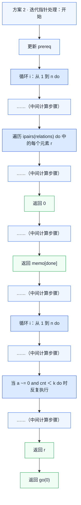

```lua
-- LeetCode 1494. 并行课程II — Lua 版（方案2）
local function min_number_of_semesters(n, relations, k)
	local prereq = {} -- 把 {} 写入 local prereq
	for i = 1, n do
		prereq[i] = 0
	end -- 让 下标 i 从 1 走到 元素个数（Lua 1 基）
	for _, r in ipairs(relations) do -- 遍历取 右指针
		prereq[r[2]] = prereq[r[2]] | (1 << (r[1] - 1)) -- 把 prereq[右指针[2]] 按位或 (1 小于 小于 (右指针[1] 减 1)) 写入 prereq[r[2]]
	end -- 终点
	local memo = {} -- 把 {} 写入 local memo
	local function go(done) -- local function go(done)
		if done == (1 << n) - 1 then
			return 0
		end -- 若 done 等于 (1 小于 小于 元素个数) 减 1 then return 0 终点
		if memo[done] then
			return memo[done]
		end -- 若 记忆化表[done] then return 记忆化表[done] 终点
		local avail = 0 -- 把 0 写入 local avail
		for i = 1, n do -- 让 下标 i 从 1 走到 元素个数（Lua 1 基）
			if (done & (1 << (i - 1))) == 0 and (done & prereq[i]) == prereq[i] then
				avail = avail | (1 << (i - 1)) -- 把 avail 按位或 (1 小于 小于 (下标 i 减 1)) 存入 avail
			end -- 终点
		end -- 终点
		local cnt, chosen, a = 0, 0, avail -- 把 0, 0, avail 写入 local cnt, chosen, a
		while a ~= 0 and cnt < k do -- 把 0 and 计数 小于 下标 k do 写入 while a ~
			local low = a & -a -- 把 数组 按位与 ( 减 数组) 写入 local low
			chosen = chosen | low -- 把 chosen 按位或 low 存入 chosen
			a = a ~ low -- 把 数组 ~ low 存入 数组
			cnt = cnt + 1 -- 把 计数 加 1 存入 计数
		end -- 终点
		local r = 1 + go(done | chosen) -- 把 1 加 go(done 按位或 chosen) 写入 local r
		memo[done] = r -- 把 右指针 写入 memo[done]
		return r -- 返回 右指针
	end -- 终点
	return go(0) -- 返回 go(0)
end -- 终点
assert(min_number_of_semesters(4, { { 2, 1 }, { 3, 1 }, { 1, 4 } }, 2) == 3) -- 断言校验
assert(min_number_of_semesters(5, { { 2, 1 }, { 3, 1 }, { 4, 1 }, { 1, 5 } }, 3) == 3) -- 断言校验
assert(min_number_of_semesters(3, {}, 2) == 2) -- 断言校验
assert(min_number_of_semesters(4, { { 1, 2 }, { 2, 3 } }, 1) == 4) -- 断言校验
print("PASS") -- 全部用例通过，输出 PASS
```

### C 实现（2 种方案）

C 的全部方案如下，每个方案都内嵌用例自测，可独立运行（老仓库 python/go 文件遵循「打印结果」约定）：

#### 方案 1：迭代指针处理

**思路与代码分析**：核心是「迭代指针处理」。C 版手动管理下标与内存，循环边界全部显式写出。代码里依次做这些事：双重循环遍历。**走读**：方案 1 · 迭代指针处理：开始 → 更新 n_g → 更新 k_g → 遍历循环 → 更新 prereq_g[i] → 遍历循环 → 更新 | → 处理 1 ＜＜ (relations[i][0] - 1) → 返回 go(0)。

**运行架构**（真实控制流）：

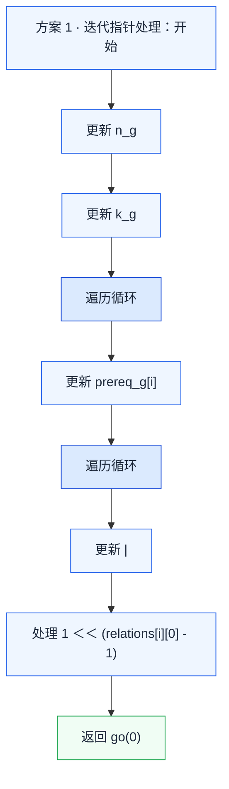

```c
/* LeetCode 1494. 并行课程II — C 版（方案1） */
#include <stdio.h>                 // 引入头文件
static int n_g, k_g, prereq_g[16]; // static int n_g, k_g, prereq_g[16];
static int go(int done) {          // 定义函数/方法 go
    if (done == (1 << n_g) - 1)
        return 0;                   // 若 done 等于 (1 小于 小于 n_g) 减 1，直接返回 0
    int avail = 0;                  // 把 0 存入 avail
    for (int i = 0; i < n_g; i++) { // 让 下标 i 从 0 开始计数，下标 i 小于 n_g 就继续
        if (!(done & (1 << i)) && (done & prereq_g[i]) == prereq_g[i])
            avail |= 1 << i;
    }
    int cnt = 0, chosen = 0, a = avail; // 把 0, chosen 赋值为 0, 数组 赋值为 avail 存入 计数
    while (a && cnt < k_g) {            // 循环，直到不满足「数组 且 计数 小于 k_g」
        int low = a & (-a);             // 把 数组 按位与 ( 减 数组) 存入 low
        chosen |= low;                  // 把 low; 写入 chosen |
        a ^= low;                       // 把 low; 写入 a ^
        cnt++;                          // 计数 加一
    }
    return 1 + go(done | chosen); // 返回 1 加 go(done 按位或 chosen)
}
static int min_number_of_semesters(int n, int relations[][2], int nr,
                                   int k) { // 定义函数/方法 min_number_of_semesters
    n_g = n;
    k_g = k; // 把 元素个数; k_g 赋值为 下标 k; 写入 n_g
    for (int i = 0; i < n; i++)
        prereq_g[i] = 0; // 让 下标 i 从 0 开始计数，下标 i 小于 元素个数 就继续
    for (int i = 0; i < nr; i++)
        prereq_g[relations[i][1] - 1] |=
            1 << (relations[i][0] - 1); // 让 下标 i 从 0 开始计数，下标 i 小于 nr 就继续
    return go(0);                       // 返回 go(0)
}
int main(void) {                            // 程序入口：跑内嵌自测用例
    int r1[][2] = {{2, 1}, {3, 1}, {1, 4}}; // 把 {{2,1},{3,1},{1,4}}; 写入 int r1[][2]
    if (min_number_of_semesters(4, r1, 3, 2) != 3) {
        printf("FAIL 1\n");
        return 1;
    }
    int r2[][2] = {{2, 1}, {3, 1}, {4, 1}, {1, 5}}; // 把 {{2,1},{3,1},{4,1},{1,5}}; 写入 int r2[][2]
    if (min_number_of_semesters(5, r2, 4, 3) != 3) {
        printf("FAIL 2\n");
        return 1;
    }
    if (min_number_of_semesters(3, r1, 0, 2) != 2) {
        printf("FAIL 3\n");
        return 1;
    }
    int r4[][2] = {{1, 2}, {2, 3}}; // 把 {{1,2},{2,3}}; 写入 int r4[][2]
    if (min_number_of_semesters(4, r4, 2, 1) != 4) {
        printf("FAIL 4\n");
        return 1;
    }
    printf("PASS\n");
    return 0;
} // 全部用例通过，输出 PASS
```

#### 方案 2：迭代指针处理

**思路与代码分析**：核心是「迭代指针处理」。C 版手动管理下标与内存，循环边界全部显式写出。代码里依次做这些事：双重循环遍历。**走读**：方案 2 · 迭代指针处理：开始 → 更新 n_g → 更新 k_g → 遍历循环 → 更新 prereq_g[i] → 遍历循环 → 更新 | → 处理 1 ＜＜ (relations[i][0] - 1) → 返回 go(0)。

**运行架构**（真实控制流）：

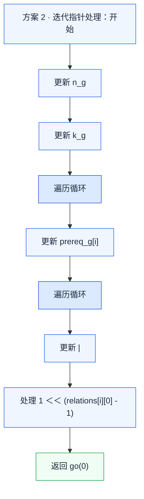

```c
/* LeetCode 1494. 并行课程II — C 版（方案2） */
#include <stdio.h>                 // 引入头文件
static int n_g, k_g, prereq_g[16]; // static int n_g, k_g, prereq_g[16];
static int go(int done) {          // 定义函数/方法 go
    if (done == (1 << n_g) - 1)
        return 0;                   // 若 done 等于 (1 小于 小于 n_g) 减 1，直接返回 0
    int avail = 0;                  // 把 0 存入 avail
    for (int i = 0; i < n_g; i++) { // 让 下标 i 从 0 开始计数，下标 i 小于 n_g 就继续
        if (!(done & (1 << i)) && (done & prereq_g[i]) == prereq_g[i])
            avail |= 1 << i;
    }
    int cnt = 0, chosen = 0, a = avail; // 把 0, chosen 赋值为 0, 数组 赋值为 avail 存入 计数
    while (a && cnt < k_g) {            // 循环，直到不满足「数组 且 计数 小于 k_g」
        int low = a & (-a);             // 把 数组 按位与 ( 减 数组) 存入 low
        chosen |= low;                  // 把 low; 写入 chosen |
        a ^= low;                       // 把 low; 写入 a ^
        cnt++;                          // 计数 加一
    }
    return 1 + go(done | chosen); // 返回 1 加 go(done 按位或 chosen)
}
static int min_number_of_semesters(int n, int relations[][2], int nr,
                                   int k) { // 定义函数/方法 min_number_of_semesters
    n_g = n;
    k_g = k; // 把 元素个数; k_g 赋值为 下标 k; 写入 n_g
    for (int i = 0; i < n; i++)
        prereq_g[i] = 0; // 让 下标 i 从 0 开始计数，下标 i 小于 元素个数 就继续
    for (int i = 0; i < nr; i++)
        prereq_g[relations[i][1] - 1] |=
            1 << (relations[i][0] - 1); // 让 下标 i 从 0 开始计数，下标 i 小于 nr 就继续
    return go(0);                       // 返回 go(0)
}
int main(void) {                            // 程序入口：跑内嵌自测用例
    int r1[][2] = {{2, 1}, {3, 1}, {1, 4}}; // 把 {{2,1},{3,1},{1,4}}; 写入 int r1[][2]
    if (min_number_of_semesters(4, r1, 3, 2) != 3) {
        printf("FAIL 1\n");
        return 1;
    }
    int r2[][2] = {{2, 1}, {3, 1}, {4, 1}, {1, 5}}; // 把 {{2,1},{3,1},{4,1},{1,5}}; 写入 int r2[][2]
    if (min_number_of_semesters(5, r2, 4, 3) != 3) {
        printf("FAIL 2\n");
        return 1;
    }
    if (min_number_of_semesters(3, r1, 0, 2) != 2) {
        printf("FAIL 3\n");
        return 1;
    }
    int r4[][2] = {{1, 2}, {2, 3}}; // 把 {{1,2},{2,3}}; 写入 int r4[][2]
    if (min_number_of_semesters(4, r4, 2, 1) != 4) {
        printf("FAIL 4\n");
        return 1;
    }
    printf("PASS\n");
    return 0;
} // 全部用例通过，输出 PASS
```

### C++ 实现（2 种方案）

C++ 的全部方案如下，每个方案都内嵌用例自测，可独立运行（老仓库 python/go 文件遵循「打印结果」约定）：

#### 方案 1：迭代指针处理

**思路与代码分析**：核心是「迭代指针处理」。C++ 版用 STL 容器与迭代器，减少手写下标错误。代码里依次做这些事：单循环线性扫描。**走读**：方案 1 · 迭代指针处理：开始 → 更新 nG → 更新 kG → 调用 prereqG.assign(n, 0) → 遍历循环 → 更新 | → 返回 go(0)。

**运行架构**（真实控制流）：


```cpp
// LeetCode 1494. 并行课程II — C++ 版（方案1）
#include <cassert>               // 引入头文件
#include <iostream>              // 引入头文件
#include <vector>                // 引入头文件
static int nG, kG;               // static int nG, kG;
static std::vector<int> prereqG; // static std::vector 小于 int 超过 prereqG;
static int go(int done) {        // 定义函数/方法 go
    if (done == (1 << nG) - 1)
        return 0;                  // 若 done 等于 (1 小于 小于 nG) 减 1，直接返回 0
    int avail = 0;                 // 把 0 存入 avail
    for (int i = 0; i < nG; ++i) { // 让 下标 i 从 0 开始计数，下标 i 小于 nG 就继续
        if (!(done & (1 << i)) && (done & prereqG[i]) == prereqG[i])
            avail |= 1 << i;
    }
    int cnt = 0, chosen = 0, a = avail; // 把 0, chosen 赋值为 0, 数组 赋值为 avail 存入 计数
    while (a && cnt < kG) {             // 循环，直到不满足「数组 且 计数 小于 kG」
        int low = a & (-a);             // 把 数组 按位与 ( 减 数组) 存入 low
        chosen |= low;                  // 把 low; 写入 chosen |
        a ^= low;                       // 把 low; 写入 a ^
        ++cnt;                          // 加一 计数;
    }
    return 1 + go(done | chosen); // 返回 1 加 go(done 按位或 chosen)
}
static int minNumberOfSemesters(int n, const std::vector<std::vector<int>> &relations,
                                int k) { // 定义函数/方法 minNumberOfSemesters
    nG = n;                              // 把 元素个数; 写入 nG
    kG = k;                              // 把 下标 k; 写入 kG
    prereqG.assign(n, 0);                // prereqG.assign(元素个数, 0);
    for (const auto &r : relations)
        prereqG[r[1] - 1] |= 1 << (r[0] - 1); // 逐个取出 relations 的元素（右指针）
    return go(0);                             // 返回 go(0)
}
int main() {                                                           // 程序入口：跑内嵌自测用例
    assert(minNumberOfSemesters(4, {{2, 1}, {3, 1}, {1, 4}}, 2) == 3); // 断言校验
    assert(minNumberOfSemesters(5, {{2, 1}, {3, 1}, {4, 1}, {1, 5}}, 3) == 3); // 断言校验
    assert(minNumberOfSemesters(3, {}, 2) == 2);                               // 断言校验
    assert(minNumberOfSemesters(4, {{1, 2}, {2, 3}}, 1) == 4);                 // 断言校验
    std::cout << "PASS" << std::endl;
} // 全部用例通过，输出 PASS
```

#### 方案 2：迭代指针处理

**思路与代码分析**：核心是「迭代指针处理」。C++ 版用 STL 容器与迭代器，减少手写下标错误。代码里依次做这些事：单循环线性扫描。**走读**：方案 2 · 迭代指针处理：开始 → 更新 nG → 更新 kG → 调用 prereqG.assign(n, 0) → 遍历循环 → 更新 | → 返回 go(0)。

**运行架构**（真实控制流）：

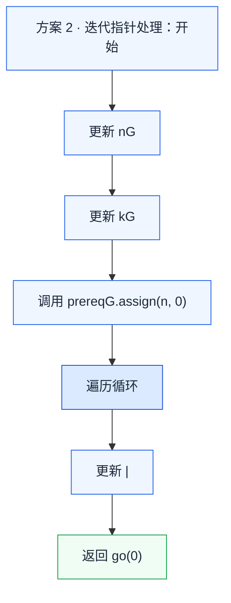

```cpp
// LeetCode 1494. 并行课程II — C++ 版（方案2）
#include <cassert>               // 引入头文件
#include <iostream>              // 引入头文件
#include <vector>                // 引入头文件
static int nG, kG;               // static int nG, kG;
static std::vector<int> prereqG; // static std::vector 小于 int 超过 prereqG;
static int go(int done) {        // 定义函数/方法 go
    if (done == (1 << nG) - 1)
        return 0;                  // 若 done 等于 (1 小于 小于 nG) 减 1，直接返回 0
    int avail = 0;                 // 把 0 存入 avail
    for (int i = 0; i < nG; ++i) { // 让 下标 i 从 0 开始计数，下标 i 小于 nG 就继续
        if (!(done & (1 << i)) && (done & prereqG[i]) == prereqG[i])
            avail |= 1 << i;
    }
    int cnt = 0, chosen = 0, a = avail; // 把 0, chosen 赋值为 0, 数组 赋值为 avail 存入 计数
    while (a && cnt < kG) {             // 循环，直到不满足「数组 且 计数 小于 kG」
        int low = a & (-a);             // 把 数组 按位与 ( 减 数组) 存入 low
        chosen |= low;                  // 把 low; 写入 chosen |
        a ^= low;                       // 把 low; 写入 a ^
        ++cnt;                          // 加一 计数;
    }
    return 1 + go(done | chosen); // 返回 1 加 go(done 按位或 chosen)
}
static int minNumberOfSemesters(int n, const std::vector<std::vector<int>> &relations,
                                int k) { // 定义函数/方法 minNumberOfSemesters
    nG = n;                              // 把 元素个数; 写入 nG
    kG = k;                              // 把 下标 k; 写入 kG
    prereqG.assign(n, 0);                // prereqG.assign(元素个数, 0);
    for (const auto &r : relations)
        prereqG[r[1] - 1] |= 1 << (r[0] - 1); // 逐个取出 relations 的元素（右指针）
    return go(0);                             // 返回 go(0)
}
int main() {                                                           // 程序入口：跑内嵌自测用例
    assert(minNumberOfSemesters(4, {{2, 1}, {3, 1}, {1, 4}}, 2) == 3); // 断言校验
    assert(minNumberOfSemesters(5, {{2, 1}, {3, 1}, {4, 1}, {1, 5}}, 3) == 3); // 断言校验
    assert(minNumberOfSemesters(3, {}, 2) == 2);                               // 断言校验
    assert(minNumberOfSemesters(4, {{1, 2}, {2, 3}}, 1) == 4);                 // 断言校验
    std::cout << "PASS" << std::endl;
} // 全部用例通过，输出 PASS
```

### R 实现（2 种方案）

R 的全部方案如下，每个方案都内嵌用例自测，可独立运行（老仓库 python/go 文件遵循「打印结果」约定）：

#### 方案 1：迭代指针处理

**思路与代码分析**：核心是「迭代指针处理」。R 版用向量化思维与 1 起始下标，注意 1:n 的降序陷阱。代码里依次做这些事：双重循环遍历。**走读**：方案 1 · 迭代指针处理：开始 → 处理 prereq ＜- rep(0L, n) → 循环 r：遍历 seq_len(nrow(relations)) → 命中条件，直接返回 → 循环 i：遍历 1:n → 当 (a ≠ 0L 且 cnt ＜ k) 时反复执行。

**运行架构**（真实控制流）：


```r
# 版（方案1） 定义函数 min_number_of_semesters（参数：元素个数, relations, 下标 k）
min_number_of_semesters <- function(n, relations, k) {
    prereq <- rep(0L, n)  # 把 rep(0L, 元素个数) 存入 prereq
    for (r in seq_len(nrow(relations))) {
        # for (右指针 in seq_len(nrow(relations))) {
        prereq[relations[r, 2]] <- bitwOr(prereq[relations[r, 2]], bitwShiftL(1, relations[r, 1] - 1))
    }
    go <- function(done) {
        # 定义函数 go（参数：done）
        if (done == bitwShiftL(1, n) - 1L)
            return(0L)  # 若 done 等于 bitwShiftL(1, 元素个数) 减 1L) return(0L
        avail <- 0L  # 把 0L 存入 avail
        for (i in 1:n) {
            # for (下标 i in 1:元素个数) {
            if (bitwAnd(done, bitwShiftL(1, i - 1)) == 0L && bitwAnd(done, prereq[i]) == prereq[i]) {
                avail <- bitwOr(avail, bitwShiftL(1, i - 1))  # 把 bitwOr(avail, bitwShiftL(1, 下标 i 减 1)) 存入 avail
            }
        }
        cnt <- 0L
        chosen <- 0L
        a <- avail  # 把 0L; chosen 小于 减 0L; 数组 小于 减 avail 存入 计数
        while (a != 0L && cnt < k) {
            # 循环，直到不满足「数组 不等于 0L 且 计数 小于 下标 k」
            low <- bitwAnd(a, -a)  # 把 bitwAnd(数组, 减 数组) 存入 low
            chosen <- bitwOr(chosen, low)  # 把 bitwOr(chosen, low) 存入 chosen
            a <- bitwXor(a, low)  # 把 bitwXor(数组, low) 存入 数组
            cnt <- cnt + 1L  # 把 计数 加 1L 存入 计数
        }
        1L + go(bitwOr(done, chosen))  # 1L 加 go(bitwOr(done, chosen))
    }
    go(0L)  # go(0L)
}
r1 <- matrix(c(2, 1, 3, 1, 1, 4), ncol = 2, byrow = TRUE)  # 把 矩阵(字符(2,1, 3,1, 1,4), ncol 赋值为 2, byrow 赋值为 TRUE) 存入 r1
stopifnot(min_number_of_semesters(4, r1, 2) == 3)  # 断言校验
r2 <- matrix(c(2, 1, 3, 1, 4, 1, 1, 5), ncol = 2, byrow = TRUE)
stopifnot(min_number_of_semesters(5, r2, 3) == 3)  # 断言校验
stopifnot(min_number_of_semesters(3, matrix(integer(0), ncol = 2), 2) == 2)  # 断言校验
r4 <- matrix(c(1, 2, 2, 3), ncol = 2, byrow = TRUE)  # 把 矩阵(字符(1,2, 2,3), ncol 赋值为 2, byrow 赋值为 TRUE) 存入 r4
stopifnot(min_number_of_semesters(4, r4, 1) == 4)  # 断言校验
cat("PASS\n")  # 全部用例通过，输出 PASS
```

#### 方案 2：迭代指针处理

**思路与代码分析**：核心是「迭代指针处理」。R 版用向量化思维与 1 起始下标，注意 1:n 的降序陷阱。代码里依次做这些事：双重循环遍历。**走读**：方案 2 · 迭代指针处理：开始 → 处理 prereq ＜- rep(0L, n) → 循环 r：遍历 seq_len(nrow(relations)) → 命中条件，直接返回 → 循环 i：遍历 1:n → 当 (a ≠ 0L 且 cnt ＜ k) 时反复执行。

**运行架构**（真实控制流）：

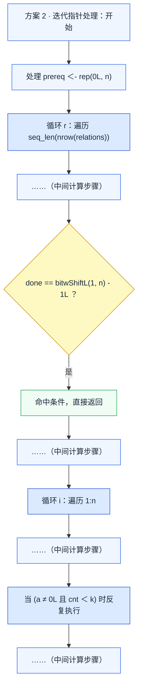

```r
# 版（方案2） 定义函数 min_number_of_semesters（参数：元素个数, relations, 下标 k）
min_number_of_semesters <- function(n, relations, k) {
    prereq <- rep(0L, n)  # 把 rep(0L, 元素个数) 存入 prereq
    for (r in seq_len(nrow(relations))) {
        # for (右指针 in seq_len(nrow(relations))) {
        prereq[relations[r, 2]] <- bitwOr(prereq[relations[r, 2]], bitwShiftL(1, relations[r, 1] - 1))
    }
    go <- function(done) {
        # 定义函数 go（参数：done）
        if (done == bitwShiftL(1, n) - 1L)
            return(0L)  # 若 done 等于 bitwShiftL(1, 元素个数) 减 1L) return(0L
        avail <- 0L  # 把 0L 存入 avail
        for (i in 1:n) {
            # for (下标 i in 1:元素个数) {
            if (bitwAnd(done, bitwShiftL(1, i - 1)) == 0L && bitwAnd(done, prereq[i]) == prereq[i]) {
                avail <- bitwOr(avail, bitwShiftL(1, i - 1))  # 把 bitwOr(avail, bitwShiftL(1, 下标 i 减 1)) 存入 avail
            }
        }
        cnt <- 0L
        chosen <- 0L
        a <- avail  # 把 0L; chosen 小于 减 0L; 数组 小于 减 avail 存入 计数
        while (a != 0L && cnt < k) {
            # 循环，直到不满足「数组 不等于 0L 且 计数 小于 下标 k」
            low <- bitwAnd(a, -a)  # 把 bitwAnd(数组, 减 数组) 存入 low
            chosen <- bitwOr(chosen, low)  # 把 bitwOr(chosen, low) 存入 chosen
            a <- bitwXor(a, low)  # 把 bitwXor(数组, low) 存入 数组
            cnt <- cnt + 1L  # 把 计数 加 1L 存入 计数
        }
        1L + go(bitwOr(done, chosen))  # 1L 加 go(bitwOr(done, chosen))
    }
    go(0L)  # go(0L)
}
r1 <- matrix(c(2, 1, 3, 1, 1, 4), ncol = 2, byrow = TRUE)  # 把 矩阵(字符(2,1, 3,1, 1,4), ncol 赋值为 2, byrow 赋值为 TRUE) 存入 r1
stopifnot(min_number_of_semesters(4, r1, 2) == 3)  # 断言校验
r2 <- matrix(c(2, 1, 3, 1, 4, 1, 1, 5), ncol = 2, byrow = TRUE)
stopifnot(min_number_of_semesters(5, r2, 3) == 3)  # 断言校验
stopifnot(min_number_of_semesters(3, matrix(integer(0), ncol = 2), 2) == 2)  # 断言校验
r4 <- matrix(c(1, 2, 2, 3), ncol = 2, byrow = TRUE)  # 把 矩阵(字符(1,2, 2,3), ncol 赋值为 2, byrow 赋值为 TRUE) 存入 r4
stopifnot(min_number_of_semesters(4, r4, 1) == 4)  # 断言校验
cat("PASS\n")  # 全部用例通过，输出 PASS
```

### Zig 实现（2 种方案）

Zig 的全部方案如下，每个方案都内嵌用例自测，可独立运行（老仓库 python/go 文件遵循「打印结果」约定）：

#### 方案 1：迭代指针处理

**思路与代码分析**：核心是「迭代指针处理」。Zig 版显式分配与清零，整型边界处理严格。代码里依次做这些事：双重循环遍历。**走读**：方案 1 · 迭代指针处理：开始 → 更新 nG → 更新 kG → 遍历集合元素 → 遍历集合元素 → 返回 go(0)。

**运行架构**（真实控制流）：

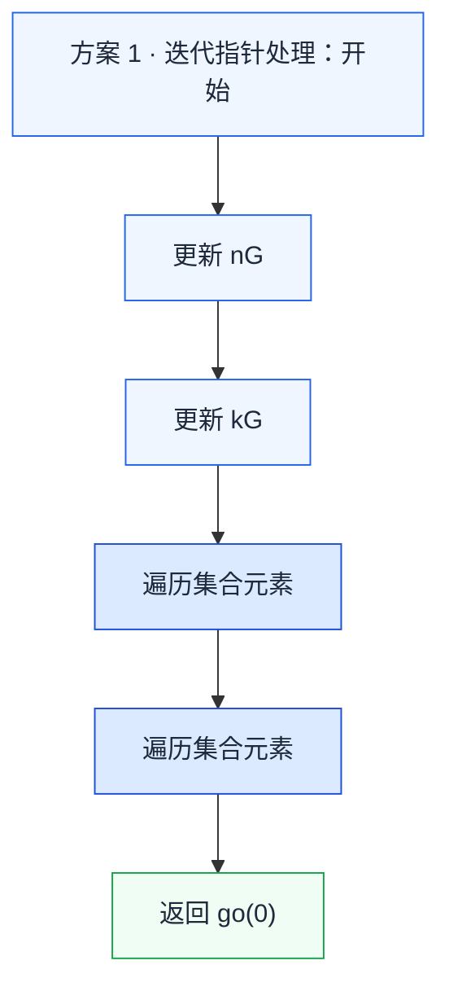

```zig
// LeetCode 1494. 并行课程II — Zig 版（方案1）
const std = @import("std"); // 把 @import(「std」) 存入 std
var nG: usize = 0; // 把 0; 写入 var nG: usize
var kG: usize = 0; // 把 0; 写入 var kG: usize
var prereqG: [16]i32 = undefined; // 把 undefined; 写入 var prereqG: [16]i32
fn go(done: i32) i32 { // 定义函数/方法 go
    if (done == (@as(i32, 1) << @intCast(nG)) - 1) return 0; // 若 done 等于 (@as(i32, 1) 小于 小于 @intCast(nG)) 减 1，直接返回 0
    var avail: i32 = 0; // 把 0; 写入 var avail: i32
    for (0..nG) |i| { // 让 下标 i 从 0 走到 nG 减一
        const bit = @as(i32, 1) << @intCast(i); // 把 @as(i32, 1) 小于 小于 @intCast(下标 i) 存入 bit
        if ((done & bit) == 0 and (done & prereqG[i]) == prereqG[i]) avail |= bit;
    }
    var cnt: usize = 0; // 把 0; 写入 var cnt: usize
    var chosen: i32 = 0; // 把 0; 写入 var chosen: i32
    var a = avail; // 把 avail 存入 数组
    while (a != 0 and cnt < kG) { // 循环，直到不满足「数组 不等于 0 and 计数 小于 kG」
        const low = a & (-a); // 把 数组 按位与 ( 减 数组) 存入 low
        chosen |= low; // 把 low; 写入 chosen |
        a ^= low; // 把 low; 写入 a ^
        cnt += 1; // 计数累加 1
    }
    return 1 + go(done | chosen); // 返回 1 加 go(done 按位或 chosen)
}
fn minNumberOfSemesters(n: usize, relations: []const [2]i32, k: usize) i32 { // 定义函数/方法 minNumberOfSemesters
    nG = n; // 把 元素个数; 写入 nG
    kG = k; // 把 下标 k; 写入 kG
    for (0..n) |i| prereqG[i] = 0; // 让 下标 i 从 0 走到 元素个数 减一
    for (relations) |r| prereqG[@intCast(r[1] - 1)] |= @as(i32, 1) << @intCast(r[0] - 1); // 逐个取出 relations 的元素（右指针）
    return go(0); // 返回 go(0)
}
pub fn main() !void { // 程序入口：跑内嵌自测用例
    const r1 = [_][2]i32{ .{ 2, 1 }, .{ 3, 1 }, .{ 1, 4 } }; // 把 [_][2]i32{ .{ 2, 1 }, .{ 3, 1 }, .{ 1, 4 } } 存入 r1
    if (minNumberOfSemesters(4, &r1, 2) != 3) return error.TestFailed;
    const r2 = [_][2]i32{ .{ 2, 1 }, .{ 3, 1 }, .{ 4, 1 }, .{ 1, 5 } };
    if (minNumberOfSemesters(5, &r2, 3) != 3) return error.TestFailed;
    const r0 = [_][2]i32{}; // 把 [_][2]i32{} 存入 r0
    if (minNumberOfSemesters(3, &r0, 2) != 2) return error.TestFailed;
    const r4 = [_][2]i32{ .{ 1, 2 }, .{ 2, 3 } }; // 把 [_][2]i32{ .{ 1, 2 }, .{ 2, 3 } } 存入 r4
    if (minNumberOfSemesters(4, &r4, 1) != 4) return error.TestFailed;
    std.debug.print("PASS\n", .{});
} // 全部用例通过，输出 PASS
```

#### 方案 2：迭代指针处理

**思路与代码分析**：核心是「迭代指针处理」。Zig 版显式分配与清零，整型边界处理严格。代码里依次做这些事：双重循环遍历。**走读**：方案 2 · 迭代指针处理：开始 → 更新 nG → 更新 kG → 遍历集合元素 → 遍历集合元素 → 返回 go(0)。

**运行架构**（真实控制流）：


```zig
// LeetCode 1494. 并行课程II — Zig 版（方案2）
const std = @import("std"); // 把 @import(「std」) 存入 std
var nG: usize = 0; // 把 0; 写入 var nG: usize
var kG: usize = 0; // 把 0; 写入 var kG: usize
var prereqG: [16]i32 = undefined; // 把 undefined; 写入 var prereqG: [16]i32
fn go(done: i32) i32 { // 定义函数/方法 go
    if (done == (@as(i32, 1) << @intCast(nG)) - 1) return 0; // 若 done 等于 (@as(i32, 1) 小于 小于 @intCast(nG)) 减 1，直接返回 0
    var avail: i32 = 0; // 把 0; 写入 var avail: i32
    for (0..nG) |i| { // 让 下标 i 从 0 走到 nG 减一
        const bit = @as(i32, 1) << @intCast(i); // 把 @as(i32, 1) 小于 小于 @intCast(下标 i) 存入 bit
        if ((done & bit) == 0 and (done & prereqG[i]) == prereqG[i]) avail |= bit;
    }
    var cnt: usize = 0; // 把 0; 写入 var cnt: usize
    var chosen: i32 = 0; // 把 0; 写入 var chosen: i32
    var a = avail; // 把 avail 存入 数组
    while (a != 0 and cnt < kG) { // 循环，直到不满足「数组 不等于 0 and 计数 小于 kG」
        const low = a & (-a); // 把 数组 按位与 ( 减 数组) 存入 low
        chosen |= low; // 把 low; 写入 chosen |
        a ^= low; // 把 low; 写入 a ^
        cnt += 1; // 计数累加 1
    }
    return 1 + go(done | chosen); // 返回 1 加 go(done 按位或 chosen)
}
fn minNumberOfSemesters(n: usize, relations: []const [2]i32, k: usize) i32 { // 定义函数/方法 minNumberOfSemesters
    nG = n; // 把 元素个数; 写入 nG
    kG = k; // 把 下标 k; 写入 kG
    for (0..n) |i| prereqG[i] = 0; // 让 下标 i 从 0 走到 元素个数 减一
    for (relations) |r| prereqG[@intCast(r[1] - 1)] |= @as(i32, 1) << @intCast(r[0] - 1); // 逐个取出 relations 的元素（右指针）
    return go(0); // 返回 go(0)
}
pub fn main() !void { // 程序入口：跑内嵌自测用例
    const r1 = [_][2]i32{ .{ 2, 1 }, .{ 3, 1 }, .{ 1, 4 } }; // 把 [_][2]i32{ .{ 2, 1 }, .{ 3, 1 }, .{ 1, 4 } } 存入 r1
    if (minNumberOfSemesters(4, &r1, 2) != 3) return error.TestFailed;
    const r2 = [_][2]i32{ .{ 2, 1 }, .{ 3, 1 }, .{ 4, 1 }, .{ 1, 5 } };
    if (minNumberOfSemesters(5, &r2, 3) != 3) return error.TestFailed;
    const r0 = [_][2]i32{}; // 把 [_][2]i32{} 存入 r0
    if (minNumberOfSemesters(3, &r0, 2) != 2) return error.TestFailed;
    const r4 = [_][2]i32{ .{ 1, 2 }, .{ 2, 3 } }; // 把 [_][2]i32{ .{ 1, 2 }, .{ 2, 3 } } 存入 r4
    if (minNumberOfSemesters(4, &r4, 1) != 4) return error.TestFailed;
    std.debug.print("PASS\n", .{});
} // 全部用例通过，输出 PASS
```

### Dart 实现（2 种方案）

Dart 的全部方案如下，每个方案都内嵌用例自测，可独立运行（老仓库 python/go 文件遵循「打印结果」约定）：

#### 方案 1：迭代指针处理

**思路与代码分析**：核心是「迭代指针处理」。Dart 版用可空类型标注与集合方法，注意空安全。代码里依次做这些事：双重循环遍历。**走读**：方案 1 · 迭代指针处理：开始 → 更新 prereq → 遍历循环 → 命中条件，直接返回 → 遍历循环 → 当 (a ≠ 0 且 cnt ＜ k) 时反复执行 → 返回 1 + go(done ｜ chosen) → 返回 go(0)。

**运行架构**（真实控制流）：

```mermaid
graph TD
    N0["方案 1 · 迭代指针处理：开始"]
    N1["更新 prereq"]
    D1["……（中间计算步骤）"]
    N5["遍历循环"]
    D2["……（中间计算步骤）"]
    N9{"done == (1 ＜＜ n) - 1 ？"}
    N10["命中条件，直接返回"]
    D3["……（中间计算步骤）"]
    N12["遍历循环"]
    D4["……（中间计算步骤）"]
    N16["当 (a ≠ 0 且 cnt ＜ k) 时反复执行"]
    D5["……（中间计算步骤）"]
    N21["返回 1 + go(done ｜ chosen)"]
    N22["返回 go(0)"]
    N0 --> N1
    N9 -- 是 --> N10
    N16 --> N21
    N21 --> N22
    N1 --> D1
    D1 --> N5
    N5 --> D2
    D2 --> N9
    N10 --> D3
    D3 --> N12
    N12 --> D4
    D4 --> N16
    N16 --> D5
    D5 --> N21
    classDef n fill:#eff6ff,stroke:#2563eb,color:#1e293b;
    classDef lp fill:#dbeafe,stroke:#1d4ed8,color:#1e293b;
    classDef dc fill:#fef9c3,stroke:#ca8a04,color:#1e293b;
    classDef tm fill:#f0fdf4,stroke:#16a34a,color:#1e293b;
    class N0,N1,D1,D2,D3,D4,D5 n;
    class N5,N12,N16 lp;
    class N9 dc;
    class N10,N21,N22 tm;
```

```dart
// LeetCode 1494. 并行课程II — Dart 版（方案1）
int minNumberOfSemesters(int n, List<List<int>> relations, int k) {
  // 定义函数/方法 minNumberOfSemesters
  final prereq = List<int>.filled(
    n,
    0,
  ); // 把 List 小于 int 超过 .filled(元素个数, 0) 存入 prereq
  for (final r in relations) {
    // for (final 右指针 in relations) {
    prereq[r[1] - 1] |=
        1 << (r[0] - 1); // 把 1 小于 小于 (右指针[0] 减 1); 写入 prereq[r[1] - 1] |
  }
  int go(int done) {
    // 定义函数/方法 go
    if (done == (1 << n) - 1) return 0; // 若 done 等于 (1 小于 小于 元素个数) 减 1，直接返回 0
    var avail = 0; // 把 0 存入 avail
    for (var i = 0; i < n; i++) {
      // 让 下标 i 从 0 开始计数，下标 i 小于 元素个数 就继续
      if ((done & (1 << i)) == 0 && (done & prereq[i]) == prereq[i])
        avail |= 1 << i;
    }
    var cnt = 0, chosen = 0, a = avail; // 把 0, chosen 赋值为 0, 数组 赋值为 avail 存入 计数
    while (a != 0 && cnt < k) {
      // 循环，直到不满足「数组 不等于 0 且 计数 小于 下标 k」
      final low = a & (-a); // 把 数组 按位与 ( 减 数组) 存入 low
      chosen |= low; // 把 low; 写入 chosen |
      a ^= low; // 把 low; 写入 a ^
      cnt++; // 计数 加一
    }
    return 1 + go(done | chosen); // 返回 1 加 go(done 按位或 chosen)
  }

  return go(0); // 返回 go(0)
}

void main() {
  // 程序入口：跑内嵌自测用例
  if (minNumberOfSemesters(4, [
        [2, 1],
        [3, 1],
        [1, 4],
      ], 2) !=
      3)
    throw StateError('c1');
  if (minNumberOfSemesters(5, [
        [2, 1],
        [3, 1],
        [4, 1],
        [1, 5],
      ], 3) !=
      3)
    throw StateError('c2');
  if (minNumberOfSemesters(3, [], 2) != 2) throw StateError('c3');
  if (minNumberOfSemesters(4, [
        [1, 2],
        [2, 3],
      ], 1) !=
      4)
    throw StateError('c4');
  print('PASS');
} // 全部用例通过，输出 PASS
```

#### 方案 2：迭代指针处理

**思路与代码分析**：核心是「迭代指针处理」。Dart 版用可空类型标注与集合方法，注意空安全。代码里依次做这些事：双重循环遍历。**走读**：方案 2 · 迭代指针处理：开始 → 更新 prereq → 遍历循环 → 命中条件，直接返回 → 遍历循环 → 当 (a ≠ 0 且 cnt ＜ k) 时反复执行 → 返回 1 + go(done ｜ chosen) → 返回 go(0)。

**运行架构**（真实控制流）：

```mermaid
graph TD
    N0["方案 2 · 迭代指针处理：开始"]
    N1["更新 prereq"]
    D1["……（中间计算步骤）"]
    N5["遍历循环"]
    D2["……（中间计算步骤）"]
    N9{"done == (1 ＜＜ n) - 1 ？"}
    N10["命中条件，直接返回"]
    D3["……（中间计算步骤）"]
    N12["遍历循环"]
    D4["……（中间计算步骤）"]
    N16["当 (a ≠ 0 且 cnt ＜ k) 时反复执行"]
    D5["……（中间计算步骤）"]
    N21["返回 1 + go(done ｜ chosen)"]
    N22["返回 go(0)"]
    N0 --> N1
    N9 -- 是 --> N10
    N16 --> N21
    N21 --> N22
    N1 --> D1
    D1 --> N5
    N5 --> D2
    D2 --> N9
    N10 --> D3
    D3 --> N12
    N12 --> D4
    D4 --> N16
    N16 --> D5
    D5 --> N21
    classDef n fill:#eff6ff,stroke:#2563eb,color:#1e293b;
    classDef lp fill:#dbeafe,stroke:#1d4ed8,color:#1e293b;
    classDef dc fill:#fef9c3,stroke:#ca8a04,color:#1e293b;
    classDef tm fill:#f0fdf4,stroke:#16a34a,color:#1e293b;
    class N0,N1,D1,D2,D3,D4,D5 n;
    class N5,N12,N16 lp;
    class N9 dc;
    class N10,N21,N22 tm;
```

```dart
// LeetCode 1494. 并行课程II — Dart 版（方案2）
int minNumberOfSemesters(int n, List<List<int>> relations, int k) {
  // 定义函数/方法 minNumberOfSemesters
  final prereq = List<int>.filled(
    n,
    0,
  ); // 把 List 小于 int 超过 .filled(元素个数, 0) 存入 prereq
  for (final r in relations) {
    // for (final 右指针 in relations) {
    prereq[r[1] - 1] |=
        1 << (r[0] - 1); // 把 1 小于 小于 (右指针[0] 减 1); 写入 prereq[r[1] - 1] |
  }
  int go(int done) {
    // 定义函数/方法 go
    if (done == (1 << n) - 1) return 0; // 若 done 等于 (1 小于 小于 元素个数) 减 1，直接返回 0
    var avail = 0; // 把 0 存入 avail
    for (var i = 0; i < n; i++) {
      // 让 下标 i 从 0 开始计数，下标 i 小于 元素个数 就继续
      if ((done & (1 << i)) == 0 && (done & prereq[i]) == prereq[i])
        avail |= 1 << i;
    }
    var cnt = 0, chosen = 0, a = avail; // 把 0, chosen 赋值为 0, 数组 赋值为 avail 存入 计数
    while (a != 0 && cnt < k) {
      // 循环，直到不满足「数组 不等于 0 且 计数 小于 下标 k」
      final low = a & (-a); // 把 数组 按位与 ( 减 数组) 存入 low
      chosen |= low; // 把 low; 写入 chosen |
      a ^= low; // 把 low; 写入 a ^
      cnt++; // 计数 加一
    }
    return 1 + go(done | chosen); // 返回 1 加 go(done 按位或 chosen)
  }

  return go(0); // 返回 go(0)
}

void main() {
  // 程序入口：跑内嵌自测用例
  if (minNumberOfSemesters(4, [
        [2, 1],
        [3, 1],
        [1, 4],
      ], 2) !=
      3)
    throw StateError('c1');
  if (minNumberOfSemesters(5, [
        [2, 1],
        [3, 1],
        [4, 1],
        [1, 5],
      ], 3) !=
      3)
    throw StateError('c2');
  if (minNumberOfSemesters(3, [], 2) != 2) throw StateError('c3');
  if (minNumberOfSemesters(4, [
        [1, 2],
        [2, 3],
      ], 1) !=
      4)
    throw StateError('c4');
  print('PASS');
} // 全部用例通过，输出 PASS
```

---

## 内容总结

- **并行课程 ii**（动态规划 · Hard）：共 2 个方案，主线思路「迭代指针处理」；时间 O(n)（单趟线性扫描）；动画演示DP 表填充过程，附录给出 11 种语言 × 全部方案的可运行实现。
- 来源博客：[https://blog.csdn.net/tyro_java/article/details/145380711](https://blog.csdn.net/tyro_java/article/details/145380711)
- 导航：[📋 总目录](../) ｜ [← 192 买卖股票的最佳时机 iii](../192_买卖股票的最佳时机_iii/) ｜ [194 并行课程 iii →](../194_并行课程_iii/)
