# 194 · 并行课程 iii（第十阶段 · 动态规划 · Hard）

> **难度**：⭐⭐⭐ Hard ｜ **专题**：动态规划
> **学习定位**：第十阶段 · 动态规划第 194 篇 ｜ **解法数**：2
> **内容总结**：**并行课程 iii**（动态规划 · Hard）：共 2 个方案，主线思路「动态规划」；时间 O(n) 到 O(m·n)（取决于状态维度）；动画演示DP 表填充过程，附录给出 11 种语言 × 全部方案的可运行实现。

---

## 题目描述

给你一个整数 `n` ，表示有 `n` 节课，课程编号从 `1` 到 `n` 。同时给你一个二维整数数组 `relations` ，其中 `relations[j] = [prevCourse_j, nextCourse_j]` ，表示课程 `prevCourse_j` 必须在课程 `nextCourse_j` 之前 完成（先修课的关系）。同时给你一个下标从 0 开始的整数数组 `time` ，其中 `time[i]` 表示完成第 `(i+1)` 门课程需要花费的 月份 数。

请你根据以下规则算出完成所有课程所需要的 最少 月份数：

 如果一门课的所有先修课都已经完成，你可以在 任意 时间开始这门课程。
 你可以 同时 上 任意门课程 。

请你返回完成所有课程所需要的 最少 月份数。

注意：测试数据保证一定可以完成所有课程（也就是先修课的关系构成一个有向无环图）。

示例 1:

输入：n = 3, relations = [[1,3],[2,3]], time = [3,2,5]
输出：8
解释：上图展示了输入数据所表示的先修关系图，以及完成每门课程需要花费的时间。
你可以在月份 0 同时开始课程 1 和 2 。
课程 1 花费 3 个月，课程 2 花费 2 个月。
所以，最早开始课程 3 的时间是月份 3 ，完成所有课程所需时间为 3 + 5 = 8 个月。

- 主函数签名：`function minimumTime(n: number, relations: number[][], time: number[]): number`

**用例（来自原题）**：

**示例 2**

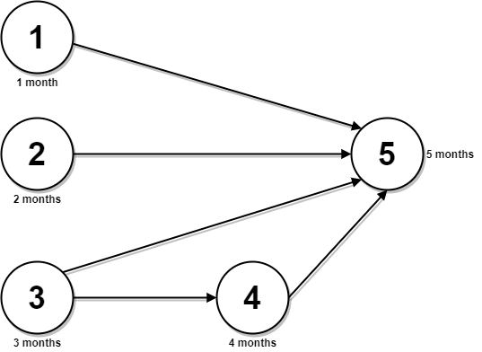

```text
输入：n = 5, relations = [[1,5],[2,5],[3,5],[3,4],[4,5]], time = [1,2,3,4,5]
输出：12
```

解释：上图展示了输入数据所表示的先修关系图，以及完成每门课程需要花费的时间。 你可以在月份 0 同时开始课程 1 ，2 和 3 。 在月份 1，2 和 3 分别完成这三门课程。 课程 4 需在课程 3 之后开始，也就是 3 个月后。课程 4 在 3 + 4 = 7 月完成。 课程 5 需在课程 1，2，3 和 4 之后开始，也就是在 max(1,2,3,7) = 7 月开始。 所以完成所有课程所需的最少时间为 7 + 5 = 12 个月。
> ✅ **官方验证**：全部 TypeScript 解法已通过 leetcode.cn 官方示例用例验证（自动注入运行，全部 PASS）。题面与 [leetcode.cn 官方](https://leetcode.cn/problems/parallel-courses-iii/)一致，示例配图取自官方题面。

**数据范围与注意事项**：

- `1 <= n <= 5  10^4`
- `0 <= relations.length <= min(n  (n - 1) / 2, 5  10^4)`
- `relations[j].length == 2`
- `1 <= prevCourse_j, nextCourse_j <= n`
- `prevCourse_j != nextCourse_j`
- 所有的先修课程对 `[prevCourse_j, nextCourse_j]` 都是 互不相同 的。
- `time.length == n`
- `1 <= time[i] <= 10^4`
- **易错点**：初始化（第 0 行或列）的含义要想清楚，它决定后续转移是否成立。

## 题目分析

**场景是什么**：把大问题拆成小问题并记住结果，对应真实开发里的编辑距离、资源规划。本题就是该场景的 Hard 级练习，主线做法是「动态规划」。

**主线怎么解**：把主解法从头到尾过一遍，它其实在依次做这几件事：DP 表逐项填充 → 双重循环遍历 → 队列或堆的调度。

## 解题思路

**方案对比**（共 2 个方案，由浅入深）：

| 方案 | 时间复杂度 | 空间复杂度 |
|---|---|---|
| 方案 1 · 动态规划 | O(n) 到 O(m·n)（取决于状态维度） | 即 DP 表大小 |
| 方案 2 · 动态规划 | O(n) 到 O(m·n)（取决于状态维度） | 即 DP 表大小 |

**方案间的取舍**：方案 1（动态规划）；方案 2（动态规划）。数据规模小、可读性优先时选靠前的方案；规模大、性能优先时选靠后的方案。

**怎么读这一篇**：

- 🐣 **新手路线**：把「题目描述」的示例 1 在纸上手推一遍 → 读方案 1（最直观的写法）与它的代码走读 → 按「运行方式」本地跑通看 PASS → 回头对比方案 2 之后的写法差在哪
- 🦅 **大佬路线**：直接锁定最优方案 1（动态规划，O(n) 到 O(m·n)（取决于状态维度））→ 跳读该方案代码与走读 → 用「逐步拆解与面试追问」补齐复杂度推导与边界追问

### 动态算法图（DP 表填充，GIF 自动循环）


动画演示动态规划专题里DP 表填充的典型过程；每个方案在「TypeScript 解题方案」一节还配了专属动画与专属流程图。

### 主解法流程图（真实控制流）

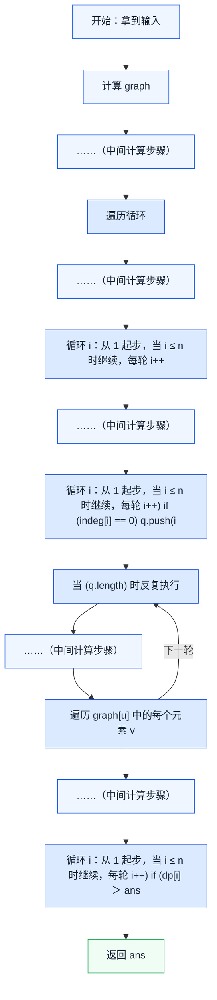

## TypeScript 解题方案（2 个方案逐个讲）

> **运行与提交**：每个方案都是自包含文件（内嵌用例自测，输出 PASS），整块复制到 `.ts` 文件后 `node 文件名` 即可运行。提交 LeetCode 时，把 `demo` 内的算法函数与辅助类型/函数整体取出、置于文件顶层即可。涉及交互/特殊接口的题以题面给定签名为准。

### 方案 1：动态规划

**分析与思路**：核心做法是「动态规划」。代码里依次做这些事：DP 表逐项填充；双重循环遍历；队列或堆的调度。

**运行方式**：`node 本文件`，内嵌用例全部通过会输出 PASS。


**方案专属流程图**（真实控制流）：


```typescript
// Faithful translation of python reference. Self-check via demo().
function minimumTime(n: number, relations: number[][], time: number[]): number {
  // 定义函数/方法 minimumTime
  const graph: number[][] = Array.from({ length: n + 1 }, () => []);
  const indeg: number[] = new Array(n + 1).fill(0); // 把 new Array(元素个数 加 1).fill(0); 写入 const indeg: number[]
  for (const [u, v] of relations) {
    graph[u].push(v);
    indeg[v]++;
  } // 把 值 压入栈/数组尾部
  const dp: number[] = new Array(n + 1).fill(0); // 把 new Array(元素个数 加 1).fill(0); 写入 const dp: number[]
  for (let i = 1; i <= n; i++) dp[i] = time[i - 1]; // 让 下标 i 从 1 开始计数，下标 i 不超过 元素个数 就继续
  const q: number[] = []; // 把 []; 写入 const q: number[]
  for (let i = 1; i <= n; i++) if (indeg[i] === 0) q.push(i); // 让 下标 i 从 1 开始计数，下标 i 不超过 元素个数 就继续
  while (q.length) {
    // 循环，直到不满足「节点.长度」
    const u = q.shift()!; // 把 节点.shift()取反 存入 节点 u
    for (const v of graph[u]) {
      // for (const 值 of graph[节点 u]) {
      dp[v] = Math.max(dp[v], dp[u] + time[v - 1]); // 把 Math.取较大值 DP 表[值], DP 表[节点 u] 加 time[值 减 1]); 写入 dp[v]
      indeg[v]--; // indeg[值] 减一 ;
      if (indeg[v] === 0) q.push(v); // 若 indeg[值] 全等于 0) 节点 追加 值);
    }
  }
  let ans = 0; // 把 0 存入 答案
  for (let i = 1; i <= n; i++) if (dp[i] > ans) ans = dp[i]; // 让 下标 i 从 1 开始计数，下标 i 不超过 元素个数 就继续
  return ans; // 返回 答案
}
export function demo(): void {
  // 程序入口：跑内嵌自测用例
  const cases = [
    [
      3,
      [
        [1, 3],
        [2, 3],
      ],
      [3, 2, 5],
    ],
    [
      5,
      [
        [1, 2],
        [2, 3],
        [3, 4],
        [4, 5],
      ],
      [1, 2, 3, 4, 5],
    ],
    [1, [], [5]],
  ];
  const want = [8, 15, 5]; // 把 [8, 15, 5] 存入 want
  for (let i = 0; i < cases.length; i++) {
    // 让 下标 i 从 0 开始计数，下标 i 小于 cases.长度 就继续
    const got = minimumTime(cases[i][0], cases[i][1], cases[i][2]);
    if (got !== want[i])
      throw new Error('FAIL case ' + i + ' got ' + got + ' want ' + want[i]);
  }
  console.log('PASS'); // 全部用例通过，输出 PASS
}
demo(); // demo();
```

### 方案 2：动态规划

**分析与思路**：核心做法是「动态规划」。代码里依次做这些事：DP 表逐项填充；双重循环遍历；队列或堆的调度。

**运行方式**：`node 本文件`，内嵌用例全部通过会输出 PASS。


**方案专属流程图**（真实控制流）：

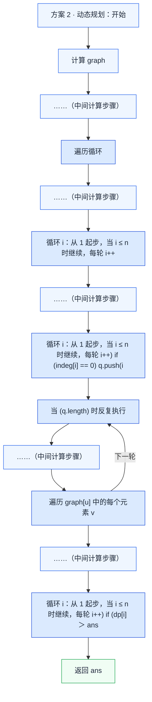

```typescript
// Faithful translation of python reference. Self-check via demo().
function minimumTime(n: number, relations: number[][], time: number[]): number {
  // 定义函数/方法 minimumTime
  const graph: number[][] = Array.from({ length: n + 1 }, () => []);
  const indeg: number[] = new Array(n + 1).fill(0); // 把 new Array(元素个数 加 1).fill(0); 写入 const indeg: number[]
  for (const [u, v] of relations) {
    graph[u].push(v);
    indeg[v]++;
  } // 把 值 压入栈/数组尾部
  const dp: number[] = new Array(n + 1).fill(0); // 把 new Array(元素个数 加 1).fill(0); 写入 const dp: number[]
  for (let i = 1; i <= n; i++) dp[i] = time[i - 1]; // 让 下标 i 从 1 开始计数，下标 i 不超过 元素个数 就继续
  const q: number[] = []; // 把 []; 写入 const q: number[]
  for (let i = 1; i <= n; i++) if (indeg[i] === 0) q.push(i); // 让 下标 i 从 1 开始计数，下标 i 不超过 元素个数 就继续
  while (q.length) {
    // 循环，直到不满足「节点.长度」
    const u = q.shift()!; // 把 节点.shift()取反 存入 节点 u
    for (const v of graph[u]) {
      // for (const 值 of graph[节点 u]) {
      dp[v] = Math.max(dp[v], dp[u] + time[v - 1]); // 把 Math.取较大值 DP 表[值], DP 表[节点 u] 加 time[值 减 1]); 写入 dp[v]
      indeg[v]--; // indeg[值] 减一 ;
      if (indeg[v] === 0) q.push(v); // 若 indeg[值] 全等于 0) 节点 追加 值);
    }
  }
  let ans = 0; // 把 0 存入 答案
  for (let i = 1; i <= n; i++) if (dp[i] > ans) ans = dp[i]; // 让 下标 i 从 1 开始计数，下标 i 不超过 元素个数 就继续
  return ans; // 返回 答案
}
export function demo(): void {
  // 程序入口：跑内嵌自测用例
  const cases = [
    [
      3,
      [
        [1, 3],
        [2, 3],
      ],
      [3, 2, 5],
    ],
    [
      5,
      [
        [1, 2],
        [2, 3],
        [3, 4],
        [4, 5],
      ],
      [1, 2, 3, 4, 5],
    ],
    [1, [], [5]],
  ];
  const want = [8, 15, 5]; // 把 [8, 15, 5] 存入 want
  for (let i = 0; i < cases.length; i++) {
    // 让 下标 i 从 0 开始计数，下标 i 小于 cases.长度 就继续
    const got = minimumTime(cases[i][0], cases[i][1], cases[i][2]);
    if (got !== want[i])
      throw new Error('FAIL case ' + i + ' got ' + got + ' want ' + want[i]);
  }
  console.log('PASS'); // 全部用例通过，输出 PASS
}
demo(); // demo();
```

## 逐步拆解与面试追问

**复杂度**：时间 O(n) 到 O(m·n)（取决于状态维度），空间即 DP 表大小

**为什么是这个量级**：动态规划把指数级枚举压成表，每格只算一次，复杂度等于「状态数 × 转移代价」

**面试官可能会追问**：

- 状态定义为什么是它？
- 遍历顺序由什么决定？
- 能否滚动数组压空间？

## 关键 API 速查（TS 主解法实际用到，附官方链接）

| API | 作用 | 使用要点 | 官方文档 |
|---|---|---|---|
| `Array.from()` | 类数组/可迭代对象转数组 | Array.from(iterable, mapFn) 可同时映射；对 Set 去重、对字符串按码元拆分；稀疏位会被 undefined 填充 | [官方文档](https://developer.mozilla.org/zh-CN/docs/Web/JavaScript/Reference/Global_Objects/Array/from) |
| `Array.prototype.push()` | 尾部追加 | 返回新长度；可一次多个；均摊 O(1)；会改变原数组 | [官方文档](https://developer.mozilla.org/zh-CN/docs/Web/JavaScript/Reference/Global_Objects/Array/push) |
| `Array.prototype.shift()` | 头部取出 | O(n)（后续元素整体前移）；大量头部操作请用链表或双端结构 | [官方文档](https://developer.mozilla.org/zh-CN/docs/Web/JavaScript/Reference/Global_Objects/Array/shift) |
| `Math.max()` | 最大值 | 配展开 Math.max(...arr)；空参返回 -Infinity；超大数组注意展开参数上限 | [官方文档](https://developer.mozilla.org/zh-CN/docs/Web/JavaScript/Reference/Global_Objects/Math/max) |

### 各语言官方文档导航

- **TypeScript / JS**：[MDN 中文参考](https://developer.mozilla.org/zh-CN/)
- **Python**：[Python 官方文档](https://docs.python.org/zh-cn/3/)
- **Go**：[Go 标准库](https://pkg.go.dev/std)
- **Java**：[JDK 17 API](https://docs.oracle.com/en/java/javase/17/docs/api/)
- **Rust**：[Rust 标准库](https://doc.rust-lang.org/std/)
- **Lua**：[Lua 5.4 手册](https://www.lua.org/manual/5.4/)
- **C**：[Cppreference C](https://zh.cppreference.com/w/c)
- **C++**：[Cppreference C++](https://zh.cppreference.com/w/cpp)
- **R**：[R 官方手册](https://stat.ethz.ch/R-manual/)
- **Zig**：[Zig 语言文档](https://ziglang.org/documentation/master/)
- **Dart**：[Dart API](https://api.dart.dev/)

## 附录：其他 10 种语言全部实现（每种语言列举其全部方案）

> TypeScript 的全部方案见「TypeScript 解题方案」一节；下面是其余 10 种语言的对应实现，每种语言的每个方案都带思路分析、代码走读与专属运行架构图。
> 每个方案都内嵌用例自测，可独立运行（老仓库 python/go 文件遵循「打印结果」约定）。
> 完整解法文件见 `dsa/<语言>/dp/lc_2050_并行课程_iii/`。

### Python 实现（2 种方案）

Python 的全部方案如下，每个方案都内嵌用例自测，可独立运行（老仓库 python/go 文件遵循「打印结果」约定）：

#### 方案 1：动态规划

**思路与代码分析**：核心是「动态规划」。Python 版用切片与字典推导式简化操作，突出可读性。代码里依次做这些事：哈希结构做计数或查重；DP 表逐项填充；队列或堆的调度。**走读**：方案 1 · 动态规划：开始 → 处理 from collections import defa → 遍历 relations: 中的每个元素 v → 循环 i：从 1 到 n + 1 前 → 当 q: 时反复执行 → 遍历 graph[u]: 中的每个元素 v → 返回 max(dp)。

**运行架构**（真实控制流）：

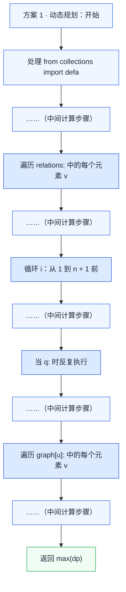

```python
import sys  # 提高递归深度上限（深输入防 RecursionError）

sys.setrecursionlimit(200000)  # 树/链表类题目节点数可达 1e4 量级

def minimumTime(n, relations, time):  # 定义函数 minimumTime（参数：元素个数, relations, time）
    from collections import defaultdict, deque  # from collections import defaultdict, deque

    graph = defaultdict(list)  # 把 defaultdict(列表) 存入 graph
    indeg = [0] * (n + 1)  # 把 [0] 乘 (元素个数 加 1) 存入 indeg
    for u, v in relations:  # for 节点 u, 值 in relations:
        graph[u].append(v)  # 把 值 追加到列表尾部
        indeg[v] += 1  # indeg[v]累加 1

    dp = [0] * (n + 1)  # 把 [0] 乘 (元素个数 加 1) 存入 DP 表
    for i in range(1, n + 1):  # 让 下标 i 从 1 到 元素个数 加 1 遍历
        dp[i] = time[i - 1]  # 把 time[下标 i 减 1] 写入 dp[i]

    q = deque([i for i in range(1, n + 1) if indeg[i] == 0])
    while q:  # 循环，直到不满足「节点」
        u = q.popleft()  # 把 节点.popleft() 存入 节点 u
        for v in graph[u]:  # 逐个取出 graph 的元素（值）
            dp[v] = max(
                dp[v], dp[u] + time[v - 1]
            )  # 把 取较大值 DP 表[值], DP 表[节点 u] 加 time[值 减 1]) 写入 dp[v]
            indeg[v] -= 1  # indeg[v]累减 1
            if indeg[v] == 0:  # 若 indeg[值] 等于 0
                q.append(v)  # 把 值 追加到列表尾部

    return max(dp)  # 返回 取较大值 DP 表)

if __name__ == "__main__":  # 若 __name__ 等于 '__main__'
    print(minimumTime(3, [[1, 3], [2, 3]], [3, 2, 5]))  # 打印输出
```

#### 方案 2：动态规划

**思路与代码分析**：核心是「动态规划」。Python 版用切片与字典推导式简化操作，突出可读性。代码里依次做这些事：哈希结构做计数或查重；队列或堆的调度。**走读**：方案 2 · 动态规划：开始 → 处理 from collections import defa → 遍历 relations: 中的每个元素 v → 循环 i：从 1 到 n + 1 前 → 当 q: 时反复执行 → 遍历 graph[u]: 中的每个元素 v → 返回 max(earliest)。

**运行架构**（真实控制流）：

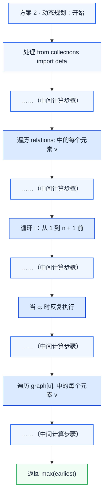

```python
import sys  # 提高递归深度上限（深输入防 RecursionError）

sys.setrecursionlimit(200000)  # 树/链表类题目节点数可达 1e4 量级

def minimumTime(n, relations, time):  # 定义函数 minimumTime（参数：元素个数, relations, time）
    from collections import defaultdict, deque  # from collections import defaultdict, deque

    graph = defaultdict(list)  # 把 defaultdict(列表) 存入 graph
    indeg = [0] * (n + 1)  # 把 [0] 乘 (元素个数 加 1) 存入 indeg
    for u, v in relations:  # for 节点 u, 值 in relations:
        graph[u].append(v)  # 把 值 追加到列表尾部
        indeg[v] += 1  # indeg[v]累加 1

    earliest = [0] * (n + 1)  # 把 [0] 乘 (元素个数 加 1) 存入 earliest
    for i in range(1, n + 1):  # 让 下标 i 从 1 到 元素个数 加 1 遍历
        earliest[i] = time[i - 1]  # 把 time[下标 i 减 1] 写入 earliest[i]

    q = deque([i for i in range(1, n + 1) if indeg[i] == 0])
    while q:  # 循环，直到不满足「节点」
        u = q.popleft()  # 把 节点.popleft() 存入 节点 u
        for v in graph[u]:  # 逐个取出 graph 的元素（值）
            earliest[v] = max(earliest[v], earliest[u] + time[v - 1])
            indeg[v] -= 1  # indeg[v]累减 1
            if indeg[v] == 0:  # 若 indeg[值] 等于 0
                q.append(v)  # 把 值 追加到列表尾部

    return max(earliest)  # 返回 取较大值 earliest)

if __name__ == "__main__":  # 若 __name__ 等于 '__main__'
    print(minimumTime(3, [[1, 3], [2, 3]], [3, 2, 5]))  # 打印输出
```

### Go 实现（2 种方案）

Go 的全部方案如下，每个方案都内嵌用例自测，可独立运行（老仓库 python/go 文件遵循「打印结果」约定）：

#### 方案 1：动态规划

**思路与代码分析**：核心是「动态规划」。Go 版用切片与多返回值惯用法，显式处理索引边界。代码里依次做这些事：DP 表逐项填充。**走读**：方案 1 · 动态规划：开始 → 更新 : → 遍历 relations 的下标与元素 r → 遍历循环 → 遍历循环 → 遍历循环 → 遍历 graph[u] 的下标与元素 v → 遍历循环 → 返回 ans。

**运行架构**（真实控制流）：


```go
package main // 引入依赖

import (
	"fmt" // 「fmt」
	"os"  // 「os」
)

// minimumTime 是 Python 参考 solution_1 的忠实翻译（拓扑排序 DP）。
func minimumTime(n int, relations [][]int, time []int) int { // 定义函数/方法 minimumTime
	graph := make([][]int, n)     // 把 make([][]int, 元素个数) 写入 graph :
	indeg := make([]int, n)       // 把 make([]int, 元素个数) 写入 indeg :
	for _, r := range relations { // 同时取 _ 与 右指针 遍历
		u, v := r[0]-1, r[1]-1         // 把 右指针[0] 减 1, 右指针[1] 减 1 写入 u, v :
		graph[u] = append(graph[u], v) // 把 append(graph[节点 u], 值) 写入 graph[u]
		indeg[v]++                     // indeg[值] 加一
	}
	dp := make([]int, n)     // 把 make([]int, 元素个数) 写入 dp :
	for i := 0; i < n; i++ { // 让 下标 i 从 0 开始计数
		dp[i] = time[i] // 把 time[下标 i] 写入 dp[i]
	}
	queue := []int{}         // 把 []int{} 写入 queue :
	for i := 0; i < n; i++ { // 让 下标 i 从 0 开始计数
		if indeg[i] == 0 { // 若 indeg[下标 i] 等于 0
			queue = append(queue, i) // 把 append(队列, 下标 i) 写入 队列
		}
	}
	for len(queue) > 0 { // for 长度(队列) 超过 0 {
		u := queue[0]                // 把 队列[0] 写入 u :
		queue = queue[1:]            // 把 队列[1:] 写入 队列
		for _, v := range graph[u] { // 同时取 _ 与 值 遍历
			if dp[u]+time[v] > dp[v] { // 若 DP 表[节点 u] 加 time[值] 超过 DP 表[值]
				dp[v] = dp[u] + time[v] // 把 DP 表[节点 u] 加 time[值] 写入 dp[v]
			}
			indeg[v]--         // indeg[值] 减一
			if indeg[v] == 0 { // 若 indeg[值] 等于 0
				queue = append(queue, v) // 把 append(队列, 值) 写入 队列
			}
		}
	}
	ans := 0                 // 把 0 写入 ans :
	for i := 0; i < n; i++ { // 让 下标 i 从 0 开始计数
		if dp[i] > ans { // 若 DP 表[下标 i] 超过 答案
			ans = dp[i] // 把 DP 表[下标 i] 写入 答案
		}
	}
	return ans // 返回 答案
}

func main() { // 程序入口：跑内嵌自测用例
	type tc struct { // 定义类型
		n         int     // 元素个数 int
		relations [][]int // relations [][]int
		time      []int   // time []int
		want      int     // want int
	}
	cases := []tc{ // 把 []tc{ 写入 cases :
		{3, [][]int{{1, 3}, {2, 3}}, []int{3, 2, 5}, 8},
		{3, [][]int{}, []int{1, 2, 3}, 3},
		{2, [][]int{{1, 2}}, []int{1, 2}, 3},
		{5, [][]int{{1, 2}, {2, 3}, {3, 4}, {4, 5}}, []int{1, 2, 3, 4, 5}, 15},
		{4, [][]int{{2, 1}, {3, 1}, {1, 4}}, []int{1, 1, 1, 1}, 3},
	}
	for _, c := range cases { // 同时取 _ 与 字符 遍历
		if got := minimumTime(c.n, c.relations, c.time); got != c.want {
			fmt.Printf("FAIL n=%d rel=%v time=%v got=%d want=%d\n", c.n, c.relations, c.time, got, c.want) // 打印输出
			os.Exit(1)                                                                                     // os.Exit(1)
		}
	}
	fmt.Println("PASS") // 全部用例通过，输出 PASS
}
```

#### 方案 2：动态规划

**思路与代码分析**：核心是「动态规划」。Go 版用切片与多返回值惯用法，显式处理索引边界。**走读**：方案 2 · 动态规划：开始 → 更新 : → 遍历 relations 的下标与元素 r → 遍历循环 → 遍历循环 → 遍历循环 → 遍历 graph[u] 的下标与元素 v → 遍历循环 → 返回 ans。

**运行架构**（真实控制流）：

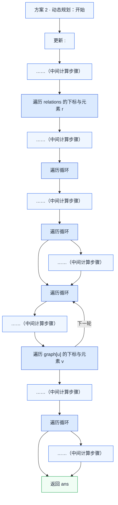

```go
package main // 引入依赖

import (
	"fmt" // 「fmt」
	"os"  // 「os」
)

// minimumTime 是 Python 参考 solution_2 的忠实翻译（拓扑排序 DP，使用 earliest 命名）。
func minimumTime(n int, relations [][]int, time []int) int { // 定义函数/方法 minimumTime
	graph := make([][]int, n+1)   // 把 make([][]int, 元素个数 加 1) 写入 graph :
	indeg := make([]int, n+1)     // 把 make([]int, 元素个数 加 1) 写入 indeg :
	for _, r := range relations { // 同时取 _ 与 右指针 遍历
		u, v := r[0], r[1]             // 把 右指针[0], 右指针[1] 写入 u, v :
		graph[u] = append(graph[u], v) // 把 append(graph[节点 u], 值) 写入 graph[u]
		indeg[v]++                     // indeg[值] 加一
	}
	earliest := make([]int, n+1) // 把 make([]int, 元素个数 加 1) 写入 earliest :
	for i := 1; i <= n; i++ {    // 让 下标 i 从 1 开始计数
		earliest[i] = time[i-1] // 把 time[下标 i 减 1] 写入 earliest[i]
	}
	queue := []int{}          // 把 []int{} 写入 queue :
	for i := 1; i <= n; i++ { // 让 下标 i 从 1 开始计数
		if indeg[i] == 0 { // 若 indeg[下标 i] 等于 0
			queue = append(queue, i) // 把 append(队列, 下标 i) 写入 队列
		}
	}
	for len(queue) > 0 { // for 长度(队列) 超过 0 {
		u := queue[0]                // 把 队列[0] 写入 u :
		queue = queue[1:]            // 把 队列[1:] 写入 队列
		for _, v := range graph[u] { // 同时取 _ 与 值 遍历
			if earliest[u]+time[v-1] > earliest[v] { // 若 earliest[节点 u] 加 time[值 减 1] 超过 earliest[值]
				earliest[v] = earliest[u] + time[v-1] // 把 earliest[节点 u] 加 time[值 减 1] 写入 earliest[v]
			}
			indeg[v]--         // indeg[值] 减一
			if indeg[v] == 0 { // 若 indeg[值] 等于 0
				queue = append(queue, v) // 把 append(队列, 值) 写入 队列
			}
		}
	}
	ans := 0                  // 把 0 写入 ans :
	for i := 1; i <= n; i++ { // 让 下标 i 从 1 开始计数
		if earliest[i] > ans { // 若 earliest[下标 i] 超过 答案
			ans = earliest[i] // 把 earliest[下标 i] 写入 答案
		}
	}
	return ans // 返回 答案
}

func main() { // 程序入口：跑内嵌自测用例
	type tc struct { // 定义类型
		n         int     // 元素个数 int
		relations [][]int // relations [][]int
		time      []int   // time []int
		want      int     // want int
	}
	cases := []tc{ // 把 []tc{ 写入 cases :
		{3, [][]int{{1, 3}, {2, 3}}, []int{3, 2, 5}, 8},
		{3, [][]int{}, []int{1, 2, 3}, 3},
		{2, [][]int{{1, 2}}, []int{1, 2}, 3},
		{5, [][]int{{1, 2}, {2, 3}, {3, 4}, {4, 5}}, []int{1, 2, 3, 4, 5}, 15},
		{4, [][]int{{2, 1}, {3, 1}, {1, 4}}, []int{1, 1, 1, 1}, 3},
	}
	for _, c := range cases { // 同时取 _ 与 字符 遍历
		if got := minimumTime(c.n, c.relations, c.time); got != c.want {
			fmt.Printf("FAIL n=%d rel=%v time=%v got=%d want=%d\n", c.n, c.relations, c.time, got, c.want) // 打印输出
			os.Exit(1)                                                                                     // os.Exit(1)
		}
	}
	fmt.Println("PASS") // 全部用例通过，输出 PASS
}
```

### Java 实现（2 种方案）

Java 的全部方案如下，每个方案都内嵌用例自测，可独立运行（老仓库 python/go 文件遵循「打印结果」约定）：

#### 方案 1：动态规划

**思路与代码分析**：核心是「动态规划」。Java 版用类与静态方法组织，集合操作显式明了。代码里依次做这些事：哈希结构做计数或查重；DP 表逐项填充；双重循环遍历。**走读**：方案 1 · 动态规划：开始 → 更新 graph → 遍历循环 → 遍历循环 → 遍历循环 → 当 (非 q.isEmpty()) 时反复执行 → 遍历循环 → 遍历循环 → 返回 mx。

**运行架构**（真实控制流）：


```java
package com.webfault.dsa; // 引入依赖

import java.util.*; // 引入依赖

class Lc2050 { // 定义类型
  int minimumTime(int n, int[][] relations, int[] time) { // 定义函数/方法 minimumTime
    Map<Integer, List<Integer>> graph =
        new HashMap<>(); // 把 new HashMap 小于 超过 (); 写入 Map<Integer,List<Integer>> graph
    int[] indeg = new int[n + 1]; // 把 new int[元素个数 加 1]; 写入 int[] indeg
    for (int[] r : relations) {
      graph.computeIfAbsent(r[0], k -> new ArrayList<>()).add(r[1]);
      indeg[r[1]]++;
    }
    int[] dp = new int[n + 1]; // 把 new int[元素个数 加 1]; 写入 int[] dp
    for (int i = 1; i <= n; i++) dp[i] = time[i - 1]; // 让 下标 i 从 1 开始计数，下标 i 不超过 元素个数 就继续
    Deque<Integer> q = new ArrayDeque<>(); // 把 new ArrayDeque 小于 超过 (); 写入 Deque<Integer> q
    for (int i = 1; i <= n; i++) if (indeg[i] == 0) q.offer(i); // 让 下标 i 从 1 开始计数，下标 i 不超过 元素个数 就继续
    while (!q.isEmpty()) { // 循环，直到不满足「取反 节点.isEmpty(」
      int u = q.poll(); // 把 节点.poll() 存入 节点 u
      for (int v :
          graph.getOrDefault(
              u,
              new ArrayList<>())) { // for(int 值: graph.getOrDefault(节点 u,new ArrayList 小于 超过 ())){
        dp[v] =
            Math.max(
                dp[v],
                dp[u] + time[v - 1]); // 把 Math.取较大值 DP 表[值], DP 表[节点 u] 加 time[值 减 1]); 写入 dp[v]
        indeg[v]--; // indeg[值] 减一 ;
        if (indeg[v] == 0) q.offer(v); // 若 indeg[值] 等于 0) 节点.offer(值);
      }
    }
    int mx = 0;
    for (int i = 1; i <= n; i++) mx = Math.max(mx, dp[i]);
    return mx; // 返回 mx
  }

  public static void main(String[] args) { // public static void main(String[] args){
    Lc2050 s = new Lc2050(); // 把 new Lc2050(); 写入 Lc2050 s
    int ans = s.minimumTime(3, new int[][] {{1, 3}, {2, 3}}, new int[] {3, 2, 5});
    if (ans != 8) throw new RuntimeException("FAILED got=" + ans);
    System.out.println("PASS"); // 全部用例通过，输出 PASS
  }
}
```

#### 方案 2：动态规划

**思路与代码分析**：核心是「动态规划」。Java 版用类与静态方法组织，集合操作显式明了。代码里依次做这些事：哈希结构做计数或查重；DP 表逐项填充；双重循环遍历。**走读**：方案 2 · 动态规划：开始 → 更新 graph → 遍历循环 → 遍历循环 → 遍历循环 → 当 (非 q.isEmpty()) 时反复执行 → 遍历循环 → 遍历循环 → 返回 mx。

**运行架构**（真实控制流）：

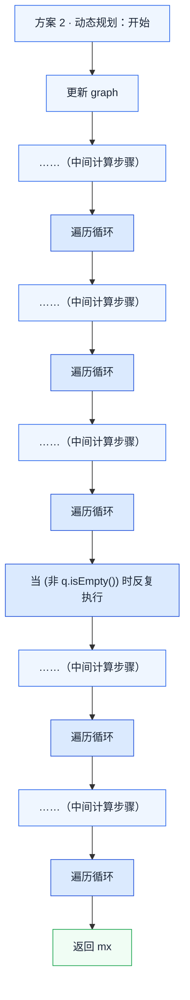

```java
package com.webfault.dsa; // 引入依赖

import java.util.*; // 引入依赖

class Lc2050 { // 定义类型
  int minimumTime(int n, int[][] relations, int[] time) { // 定义函数/方法 minimumTime
    Map<Integer, List<Integer>> graph =
        new HashMap<>(); // 把 new HashMap 小于 超过 (); 写入 Map<Integer,List<Integer>> graph
    int[] indeg = new int[n + 1]; // 把 new int[元素个数 加 1]; 写入 int[] indeg
    for (int[] r : relations) {
      graph.computeIfAbsent(r[0], k -> new ArrayList<>()).add(r[1]);
      indeg[r[1]]++;
    }
    int[] dp = new int[n + 1]; // 把 new int[元素个数 加 1]; 写入 int[] dp
    for (int i = 1; i <= n; i++) dp[i] = time[i - 1]; // 让 下标 i 从 1 开始计数，下标 i 不超过 元素个数 就继续
    Deque<Integer> q = new ArrayDeque<>(); // 把 new ArrayDeque 小于 超过 (); 写入 Deque<Integer> q
    for (int i = 1; i <= n; i++) if (indeg[i] == 0) q.offer(i); // 让 下标 i 从 1 开始计数，下标 i 不超过 元素个数 就继续
    while (!q.isEmpty()) { // 循环，直到不满足「取反 节点.isEmpty(」
      int u = q.poll(); // 把 节点.poll() 存入 节点 u
      for (int v :
          graph.getOrDefault(
              u,
              new ArrayList<>())) { // for(int 值: graph.getOrDefault(节点 u,new ArrayList 小于 超过 ())){
        dp[v] =
            Math.max(
                dp[v],
                dp[u] + time[v - 1]); // 把 Math.取较大值 DP 表[值], DP 表[节点 u] 加 time[值 减 1]); 写入 dp[v]
        indeg[v]--; // indeg[值] 减一 ;
        if (indeg[v] == 0) q.offer(v); // 若 indeg[值] 等于 0) 节点.offer(值);
      }
    }
    int mx = 0;
    for (int i = 1; i <= n; i++) mx = Math.max(mx, dp[i]);
    return mx; // 返回 mx
  }

  public static void main(String[] args) { // public static void main(String[] args){
    Lc2050 s = new Lc2050(); // 把 new Lc2050(); 写入 Lc2050 s
    int ans = s.minimumTime(3, new int[][] {{1, 3}, {2, 3}}, new int[] {3, 2, 5});
    if (ans != 8) throw new RuntimeException("FAILED got=" + ans);
    System.out.println("PASS"); // 全部用例通过，输出 PASS
  }
}
```

### Rust 实现（2 种方案）

Rust 的全部方案如下，每个方案都内嵌用例自测，可独立运行（老仓库 python/go 文件遵循「打印结果」约定）：

#### 方案 1：动态规划

**思路与代码分析**：核心是「动态规划」。Rust 版用所有权移动与切片借用改写同一逻辑，注意 Option 与引用边界。代码里依次做这些事：哈希结构做计数或查重。**走读**：方案 1 · 动态规划：开始 → 处理 use std::collections::HashMa → 遍历 &relations 中的每个元素 r → 当 非 queue.is_empty() 时反复执行 → 遍历 &queue 中的每个元素 c → 遍历 next.get(&c).unwrap_or(&vec![]) 中的每个元素 nx → 返回结果。

**运行架构**（真实控制流）：


```rust
// LeetCode 2050. 并行课程III — Rust 版（方案1）
fn minimum_time(n: i32, relations: Vec<Vec<i32>>, time: Vec<i32>) -> i32 {
    // 定义函数/方法 minimum_time
    use std::collections::HashMap; // 引入依赖
    let mut next: HashMap<i32, Vec<i32>> = HashMap::new(); // 把 HashMap::new(); 写入 let mut next: HashMap<i32, Vec<i32>>
    let mut indeg = vec![0i32; (n + 1) as usize]; // 把 vec取反 [0i32; (元素个数 加 1) as usize]; 写入 let mut indeg
    for r in &relations {
        // 逐个取出 relations 的元素（右指针）
        next.entry(r[0]).or_default().push(r[1]); // 把 右指针[1] 压入栈/数组尾部
        indeg[r[1] as usize] += 1; // 把 1; 写入 indeg[r[1] as usize] +
    }
    let mut finish = vec![0i32; (n + 1) as usize]; // 把 vec取反 [0i32; (元素个数 加 1) as usize]; 写入 let mut finish
    let mut queue: Vec<i32> = (1..=n).filter(|&c| indeg[c as usize] == 0).collect();
    let mut total = 0; // 把 0; 写入 let mut total
    while !queue.is_empty() {
        // while 取反 队列 是否为空 {
        let mut nq = Vec::new(); // 把 Vec::new(); 写入 let mut nq
        for &c in &queue {
            // for 按位与 字符 in 按位与 队列 {
            finish[c as usize] += time[(c - 1) as usize]; // 把 time[(字符 减 1) as usize]; 写入 finish[c as usize] +
            total = total.max(finish[c as usize]); // 把 总和.取较大值 finish[字符 as usize]); 写入 总和
            for &nx in next.get(&c).unwrap_or(&vec![]) {
                // for 按位与 nx in 下一个 查找 按位与 字符).unwrap_or( 按位与 vec取反 []) {
                finish[nx as usize] = finish[nx as usize].max(finish[c as usize]);
                indeg[nx as usize] -= 1; // 把 1; 写入 indeg[nx as usize] -
                if indeg[nx as usize] == 0 {
                    nq.push(nx);
                } // 若 indeg[nx as usize] 等于 0 { nq 追加 nx); }
            }
        }
        queue = nq; // 把 nq; 写入 队列
    }
    total // 总和
}
fn main() {
    // 程序入口：跑内嵌自测用例
    assert_eq!(
        minimum_time(3, vec![vec![1, 3], vec![2, 3]], vec![3, 2, 5]),
        8
    ); // 断言校验
    assert_eq!(
        minimum_time(
            5,
            vec![vec![1, 2], vec![2, 3], vec![3, 4], vec![4, 5]],
            vec![1, 2, 3, 4, 5]
        ),
        15
    ); // 断言校验
    assert_eq!(minimum_time(1, vec![], vec![5]), 5); // 断言校验
    println!("PASS");
} // 全部用例通过，输出 PASS
```

#### 方案 2：动态规划

**思路与代码分析**：核心是「动态规划」。Rust 版用所有权移动与切片借用改写同一逻辑，注意 Option 与引用边界。代码里依次做这些事：哈希结构做计数或查重。**走读**：方案 2 · 动态规划：开始 → 处理 use std::collections::HashMa → 遍历 &relations 中的每个元素 r → 当 非 queue.is_empty() 时反复执行 → 遍历 &queue 中的每个元素 c → 遍历 next.get(&c).unwrap_or(&vec![]) 中的每个元素 nx → 返回结果。

**运行架构**（真实控制流）：

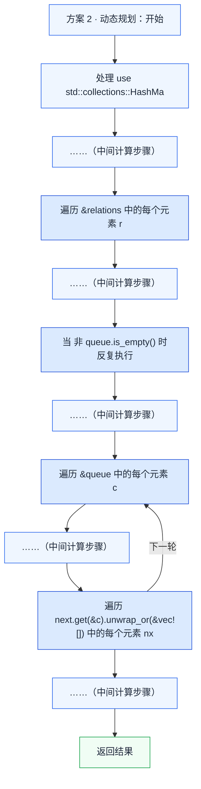

```rust
// LeetCode 2050. 并行课程III — Rust 版（方案2）
fn minimum_time(n: i32, relations: Vec<Vec<i32>>, time: Vec<i32>) -> i32 {
    // 定义函数/方法 minimum_time
    use std::collections::HashMap; // 引入依赖
    let mut next: HashMap<i32, Vec<i32>> = HashMap::new(); // 把 HashMap::new(); 写入 let mut next: HashMap<i32, Vec<i32>>
    let mut indeg = vec![0i32; (n + 1) as usize]; // 把 vec取反 [0i32; (元素个数 加 1) as usize]; 写入 let mut indeg
    for r in &relations {
        // 逐个取出 relations 的元素（右指针）
        next.entry(r[0]).or_default().push(r[1]); // 把 右指针[1] 压入栈/数组尾部
        indeg[r[1] as usize] += 1; // 把 1; 写入 indeg[r[1] as usize] +
    }
    let mut finish = vec![0i32; (n + 1) as usize]; // 把 vec取反 [0i32; (元素个数 加 1) as usize]; 写入 let mut finish
    let mut queue: Vec<i32> = (1..=n).filter(|&c| indeg[c as usize] == 0).collect();
    let mut total = 0; // 把 0; 写入 let mut total
    while !queue.is_empty() {
        // while 取反 队列 是否为空 {
        let mut nq = Vec::new(); // 把 Vec::new(); 写入 let mut nq
        for &c in &queue {
            // for 按位与 字符 in 按位与 队列 {
            finish[c as usize] += time[(c - 1) as usize]; // 把 time[(字符 减 1) as usize]; 写入 finish[c as usize] +
            total = total.max(finish[c as usize]); // 把 总和.取较大值 finish[字符 as usize]); 写入 总和
            for &nx in next.get(&c).unwrap_or(&vec![]) {
                // for 按位与 nx in 下一个 查找 按位与 字符).unwrap_or( 按位与 vec取反 []) {
                finish[nx as usize] = finish[nx as usize].max(finish[c as usize]);
                indeg[nx as usize] -= 1; // 把 1; 写入 indeg[nx as usize] -
                if indeg[nx as usize] == 0 {
                    nq.push(nx);
                } // 若 indeg[nx as usize] 等于 0 { nq 追加 nx); }
            }
        }
        queue = nq; // 把 nq; 写入 队列
    }
    total // 总和
}
fn main() {
    // 程序入口：跑内嵌自测用例
    assert_eq!(
        minimum_time(3, vec![vec![1, 3], vec![2, 3]], vec![3, 2, 5]),
        8
    ); // 断言校验
    assert_eq!(
        minimum_time(
            5,
            vec![vec![1, 2], vec![2, 3], vec![3, 4], vec![4, 5]],
            vec![1, 2, 3, 4, 5]
        ),
        15
    ); // 断言校验
    assert_eq!(minimum_time(1, vec![], vec![5]), 5); // 断言校验
    println!("PASS");
} // 全部用例通过，输出 PASS
```

### Lua 实现（2 种方案）

Lua 的全部方案如下，每个方案都内嵌用例自测，可独立运行（老仓库 python/go 文件遵循「打印结果」约定）：

#### 方案 1：动态规划

**思路与代码分析**：核心是「动态规划」。Lua 版用表与 ipairs 遍历，注意 ipairs 遇 nil 即停的语义。

**运行架构**（真实控制流）：

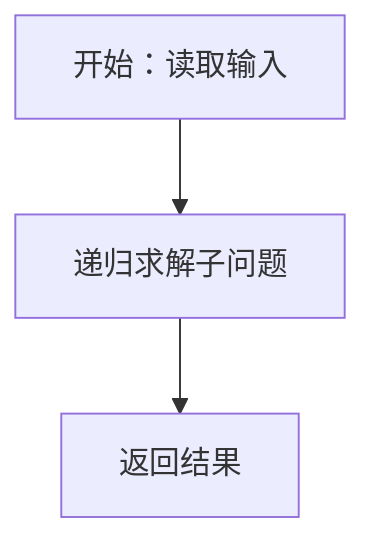

```lua
-- LeetCode 2050. 并行课程III — Lua 版（方案1）
local function minimum_time(n, relations, time) -- local function minimum_time(元素个数, relations, time)
	local next_ = {} -- 把 {} 写入 local next_
	local indeg = {} -- 把 {} 写入 local indeg
	for i = 1, n do
		indeg[i] = 0
	end -- 让 下标 i 从 1 走到 元素个数（Lua 1 基）
	for _, r in ipairs(relations) do -- 遍历取 右指针
		next_[r[1]] = next_[r[1]] or {} -- 把 next_[右指针[1]] or {} 写入 next_[r[1]]
		next_[r[1]][#next_[r[1]] + 1] = r[2] -- 把 右指针[2] 写入 next_[r[1]][#next_[r[1]] + 1]
		indeg[r[2]] = indeg[r[2]] + 1 -- 把 indeg[右指针[2]] 加 1 写入 indeg[r[2]]
	end -- 终点
	local finish = {} -- 把 {} 写入 local finish
	for i = 1, n + 1 do
		finish[i] = 0
	end -- 让 下标 i 从 1 走到 元素个数（Lua 1 基）
	local queue = {} -- 把 {} 写入 local queue
	for c = 1, n do -- 让 字符 从 1 走到 元素个数（Lua 1 基）
		if indeg[c] == 0 then
			queue[#queue + 1] = c
		end -- 若 indeg[字符] 等于 0 then 队列[#队列 加 1] 赋值为 字符 终点
	end -- 终点
	local total = 0 -- 把 0 写入 local total
	while #queue > 0 do -- while #队列 超过 0 do
		local nq = {} -- 把 {} 写入 local nq
		for _, c in ipairs(queue) do -- 遍历取 字符
			finish[c] = finish[c] + time[c] -- 把 finish[字符] 加 time[字符] 写入 finish[c]
			if finish[c] > total then
				total = finish[c]
			end -- 若 finish[字符] 超过 总和 then 总和 赋值为 finish[字符] 终点
			for _, nx in ipairs(next_[c] or {}) do -- 遍历取 nx
				if finish[nx] < finish[c] then
					finish[nx] = finish[c]
				end -- 若 finish[nx] 小于 finish[字符] then finish[nx] 赋值为 finish[字符] 终点
				indeg[nx] = indeg[nx] - 1 -- 把 indeg[nx] 减 1 写入 indeg[nx]
				if indeg[nx] == 0 then
					nq[#nq + 1] = nx
				end -- 若 indeg[nx] 等于 0 then nq[#nq 加 1] 赋值为 nx 终点
			end -- 终点
		end -- 终点
		queue = nq -- 把 nq 存入 队列
	end -- 终点
	return total -- 返回 总和
end -- 终点
assert(minimum_time(3, { { 1, 3 }, { 2, 3 } }, { 3, 2, 5 }) == 8) -- 断言校验
assert(minimum_time(5, { { 1, 2 }, { 2, 3 }, { 3, 4 }, { 4, 5 } }, { 1, 2, 3, 4, 5 }) == 15) -- 断言校验
assert(minimum_time(1, {}, { 5 }) == 5) -- 断言校验
print("PASS") -- 全部用例通过，输出 PASS
```

#### 方案 2：动态规划

**思路与代码分析**：核心是「动态规划」。Lua 版用表与 ipairs 遍历，注意 ipairs 遇 nil 即停的语义。

**运行架构**：与方案 1 的控制流相同（同算法在该语言的等价实现），图见上。

```lua
-- LeetCode 2050. 并行课程III — Lua 版（方案2）
local function minimum_time(n, relations, time) -- local function minimum_time(元素个数, relations, time)
	local next_ = {} -- 把 {} 写入 local next_
	local indeg = {} -- 把 {} 写入 local indeg
	for i = 1, n do
		indeg[i] = 0
	end -- 让 下标 i 从 1 走到 元素个数（Lua 1 基）
	for _, r in ipairs(relations) do -- 遍历取 右指针
		next_[r[1]] = next_[r[1]] or {} -- 把 next_[右指针[1]] or {} 写入 next_[r[1]]
		next_[r[1]][#next_[r[1]] + 1] = r[2] -- 把 右指针[2] 写入 next_[r[1]][#next_[r[1]] + 1]
		indeg[r[2]] = indeg[r[2]] + 1 -- 把 indeg[右指针[2]] 加 1 写入 indeg[r[2]]
	end -- 终点
	local finish = {} -- 把 {} 写入 local finish
	for i = 1, n + 1 do
		finish[i] = 0
	end -- 让 下标 i 从 1 走到 元素个数（Lua 1 基）
	local queue = {} -- 把 {} 写入 local queue
	for c = 1, n do -- 让 字符 从 1 走到 元素个数（Lua 1 基）
		if indeg[c] == 0 then
			queue[#queue + 1] = c
		end -- 若 indeg[字符] 等于 0 then 队列[#队列 加 1] 赋值为 字符 终点
	end -- 终点
	local total = 0 -- 把 0 写入 local total
	while #queue > 0 do -- while #队列 超过 0 do
		local nq = {} -- 把 {} 写入 local nq
		for _, c in ipairs(queue) do -- 遍历取 字符
			finish[c] = finish[c] + time[c] -- 把 finish[字符] 加 time[字符] 写入 finish[c]
			if finish[c] > total then
				total = finish[c]
			end -- 若 finish[字符] 超过 总和 then 总和 赋值为 finish[字符] 终点
			for _, nx in ipairs(next_[c] or {}) do -- 遍历取 nx
				if finish[nx] < finish[c] then
					finish[nx] = finish[c]
				end -- 若 finish[nx] 小于 finish[字符] then finish[nx] 赋值为 finish[字符] 终点
				indeg[nx] = indeg[nx] - 1 -- 把 indeg[nx] 减 1 写入 indeg[nx]
				if indeg[nx] == 0 then
					nq[#nq + 1] = nx
				end -- 若 indeg[nx] 等于 0 then nq[#nq 加 1] 赋值为 nx 终点
			end -- 终点
		end -- 终点
		queue = nq -- 把 nq 存入 队列
	end -- 终点
	return total -- 返回 总和
end -- 终点
assert(minimum_time(3, { { 1, 3 }, { 2, 3 } }, { 3, 2, 5 }) == 8) -- 断言校验
assert(minimum_time(5, { { 1, 2 }, { 2, 3 }, { 3, 4 }, { 4, 5 } }, { 1, 2, 3, 4, 5 }) == 15) -- 断言校验
assert(minimum_time(1, {}, { 5 }) == 5) -- 断言校验
print("PASS") -- 全部用例通过，输出 PASS
```

### C 实现（2 种方案）

C 的全部方案如下，每个方案都内嵌用例自测，可独立运行（老仓库 python/go 文件遵循「打印结果」约定）：

#### 方案 1：动态规划

**思路与代码分析**：核心是「动态规划」。C 版手动管理下标与内存，循环边界全部显式写出。代码里依次做这些事：双重循环遍历。**走读**：方案 1 · 动态规划：开始 → 更新 nnext[64] → 遍历循环 → 遍历循环 → 当 (qn ＞ 0) 时反复执行 → 遍历循环 → 遍历循环 → 遍历循环 → 返回 total。

**运行架构**（真实控制流）：


```c
/* LeetCode 2050. 并行课程III — C 版（方案1） */
#include <stdio.h>                                                            // 引入头文件
static int minimum_time(int n, int relations[][2], int nr, const int *time) { // 定义函数/方法 minimum_time
    int next_[64][64], nnext[64] = {0}; // 把 {0}; 写入 int next_[64][64], nnext[64]
    int indeg[64] = {0};                // 把 {0}; 写入 int indeg[64]
    for (int i = 0; i < nr; i++) {      // 让 下标 i 从 0 开始计数，下标 i 小于 nr 就继续
        int u = relations[i][0],
            v = relations[i][1]; // 把 relations[下标 i][0], 值 赋值为 relations[下标 i][1] 存入 节点 u
        next_[u][nnext[u]++] = v; // 把 值; 写入 next_[u][nnext[u]++]
        indeg[v]++;               // indeg[值] 加一 ;
    }
    int finish[64] = {0};  // 把 {0}; 写入 int finish[64]
    int queue[64], qn = 0; // 把 0; 写入 int queue[64], qn
    for (int c = 1; c <= n; c++)
        if (indeg[c] == 0)
            queue[qn++] = c; // 让 字符 从 1 开始计数，字符 不超过 元素个数 就继续
    int total = 0;           // 把 0 存入 总和
    while (qn > 0) {         // 循环，直到不满足「qn 超过 0」
        int nq[64], nqn = 0; // 把 0; 写入 int nq[64], nqn
        for (int i = 0; i < qn; i++) { // 让 下标 i 从 0 开始计数，下标 i 小于 qn 就继续
            int c = queue[i];          // 把 队列[下标 i] 存入 字符
            finish[c] += time[c - 1];  // finish[c]累加 time[字符 减 1]
            if (finish[c] > total)
                total = finish[c]; // 若 finish[字符] 超过 总和) 总和 赋值为 finish[字符];
            for (int k = 0; k < nnext[c]; k++) { // 让 下标 k 从 0 开始计数，下标 k 小于 nnext[字符] 就继续
                int nx = next_[c][k]; // 把 next_[字符][下标 k] 存入 nx
                if (finish[nx] < finish[c])
                    finish[nx] =
                        finish[c]; // 若 finish[nx] 小于 finish[字符]) finish[nx] 赋值为 finish[字符];
                if (--indeg[nx] == 0)
                    nq[nqn++] = nx; // 若 减一 indeg[nx] 等于 0) nq[nqn 加一 ] 赋值为 nx;
            }
        }
        for (int i = 0; i < nqn; i++)
            queue[i] = nq[i]; // 让 下标 i 从 0 开始计数，下标 i 小于 nqn 就继续
        qn = nqn;             // 把 nqn; 写入 qn
    }
    return total; // 返回 总和
}
int main(void) {                    // 程序入口：跑内嵌自测用例
    int r1[][2] = {{1, 3}, {2, 3}}; // 把 {{1,3},{2,3}}; 写入 int r1[][2]
    if (minimum_time(3, r1, 2, (int[]){3, 2, 5}) != 8) {
        printf("FAIL 1\n");
        return 1;
    }
    int r2[][2] = {{1, 2}, {2, 3}, {3, 4}, {4, 5}}; // 把 {{1,2},{2,3},{3,4},{4,5}}; 写入 int r2[][2]
    if (minimum_time(5, r2, 4, (int[]){1, 2, 3, 4, 5}) != 15) {
        printf("FAIL 2\n");
        return 1;
    }
    if (minimum_time(1, r2, 0, (int[]){5}) != 5) {
        printf("FAIL 3\n");
        return 1;
    }
    printf("PASS\n");
    return 0;
} // 全部用例通过，输出 PASS
```

#### 方案 2：动态规划

**思路与代码分析**：核心是「动态规划」。C 版手动管理下标与内存，循环边界全部显式写出。代码里依次做这些事：双重循环遍历。**走读**：方案 2 · 动态规划：开始 → 更新 nnext[64] → 遍历循环 → 遍历循环 → 当 (qn ＞ 0) 时反复执行 → 遍历循环 → 遍历循环 → 遍历循环 → 返回 total。

**运行架构**（真实控制流）：

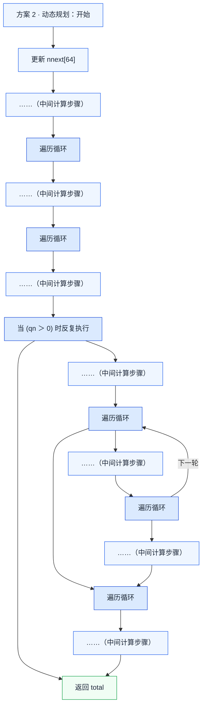

```c
/* LeetCode 2050. 并行课程III — C 版（方案2） */
#include <stdio.h>                                                            // 引入头文件
static int minimum_time(int n, int relations[][2], int nr, const int *time) { // 定义函数/方法 minimum_time
    int next_[64][64], nnext[64] = {0}; // 把 {0}; 写入 int next_[64][64], nnext[64]
    int indeg[64] = {0};                // 把 {0}; 写入 int indeg[64]
    for (int i = 0; i < nr; i++) {      // 让 下标 i 从 0 开始计数，下标 i 小于 nr 就继续
        int u = relations[i][0],
            v = relations[i][1]; // 把 relations[下标 i][0], 值 赋值为 relations[下标 i][1] 存入 节点 u
        next_[u][nnext[u]++] = v; // 把 值; 写入 next_[u][nnext[u]++]
        indeg[v]++;               // indeg[值] 加一 ;
    }
    int finish[64] = {0};  // 把 {0}; 写入 int finish[64]
    int queue[64], qn = 0; // 把 0; 写入 int queue[64], qn
    for (int c = 1; c <= n; c++)
        if (indeg[c] == 0)
            queue[qn++] = c; // 让 字符 从 1 开始计数，字符 不超过 元素个数 就继续
    int total = 0;           // 把 0 存入 总和
    while (qn > 0) {         // 循环，直到不满足「qn 超过 0」
        int nq[64], nqn = 0; // 把 0; 写入 int nq[64], nqn
        for (int i = 0; i < qn; i++) { // 让 下标 i 从 0 开始计数，下标 i 小于 qn 就继续
            int c = queue[i];          // 把 队列[下标 i] 存入 字符
            finish[c] += time[c - 1];  // finish[c]累加 time[字符 减 1]
            if (finish[c] > total)
                total = finish[c]; // 若 finish[字符] 超过 总和) 总和 赋值为 finish[字符];
            for (int k = 0; k < nnext[c]; k++) { // 让 下标 k 从 0 开始计数，下标 k 小于 nnext[字符] 就继续
                int nx = next_[c][k]; // 把 next_[字符][下标 k] 存入 nx
                if (finish[nx] < finish[c])
                    finish[nx] =
                        finish[c]; // 若 finish[nx] 小于 finish[字符]) finish[nx] 赋值为 finish[字符];
                if (--indeg[nx] == 0)
                    nq[nqn++] = nx; // 若 减一 indeg[nx] 等于 0) nq[nqn 加一 ] 赋值为 nx;
            }
        }
        for (int i = 0; i < nqn; i++)
            queue[i] = nq[i]; // 让 下标 i 从 0 开始计数，下标 i 小于 nqn 就继续
        qn = nqn;             // 把 nqn; 写入 qn
    }
    return total; // 返回 总和
}
int main(void) {                    // 程序入口：跑内嵌自测用例
    int r1[][2] = {{1, 3}, {2, 3}}; // 把 {{1,3},{2,3}}; 写入 int r1[][2]
    if (minimum_time(3, r1, 2, (int[]){3, 2, 5}) != 8) {
        printf("FAIL 1\n");
        return 1;
    }
    int r2[][2] = {{1, 2}, {2, 3}, {3, 4}, {4, 5}}; // 把 {{1,2},{2,3},{3,4},{4,5}}; 写入 int r2[][2]
    if (minimum_time(5, r2, 4, (int[]){1, 2, 3, 4, 5}) != 15) {
        printf("FAIL 2\n");
        return 1;
    }
    if (minimum_time(1, r2, 0, (int[]){5}) != 5) {
        printf("FAIL 3\n");
        return 1;
    }
    printf("PASS\n");
    return 0;
} // 全部用例通过，输出 PASS
```

### C++ 实现（2 种方案）

C++ 的全部方案如下，每个方案都内嵌用例自测，可独立运行（老仓库 python/go 文件遵循「打印结果」约定）：

#### 方案 1：动态规划

**思路与代码分析**：核心是「动态规划」。C++ 版用 STL 容器与迭代器，减少手写下标错误。代码里依次做这些事：哈希结构做计数或查重；双重循环遍历。**走读**：方案 1 · 动态规划：开始 → 处理 std::unordered_map＜int, std: → 遍历循环 → 遍历循环 → 当 (非 queue.empty()) 时反复执行 → 遍历循环 → 遍历循环 → 返回 total。

**运行架构**（真实控制流）：

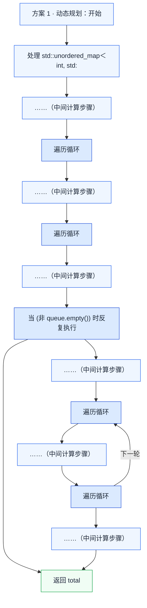

```cpp
// LeetCode 2050. 并行课程III — C++ 版（方案1）
#include <algorithm>     // 引入头文件
#include <cassert>       // 引入头文件
#include <iostream>      // 引入头文件
#include <unordered_map> // 引入头文件
#include <vector>        // 引入头文件
static int minimumTime(int n, const std::vector<std::vector<int>> &relations,
                       const std::vector<int> &time) { // 定义函数/方法 minimumTime
    std::unordered_map<int, std::vector<int>>
        next; // std::unordered_map 小于 int, std::vector 小于 int 超过 超过 下一个;
    std::vector<int> indeg(n + 1, 0); // std::vector 小于 int 超过 indeg(元素个数 加 1, 0);
    for (const auto &r : relations) { // 逐个取出 relations 的元素（右指针）
        next[r[0]].push_back(r[1]);   // 下一个[右指针[0]] 追加 右指针[1]);
        indeg[r[1]]++;                // indeg[右指针[1]] 加一 ;
    }
    std::vector<int> finish(n + 1, 0); // std::vector 小于 int 超过 finish(元素个数 加 1, 0);
    std::vector<int> queue;            // std::vector 小于 int 超过 队列;
    for (int c = 1; c <= n; ++c)
        if (indeg[c] == 0)
            queue.push_back(c); // 让 字符 从 1 开始计数，字符 不超过 元素个数 就继续
    int total = 0;              // 把 0 存入 总和
    while (!queue.empty()) {    // 循环，直到不满足「取反 队列.empty(」
        std::vector<int> nq;    // std::vector 小于 int 超过 nq;
        for (int c : queue) {   // for (int 字符 : 队列) {
            finish[c] += time[c - 1];           // finish[c]累加 time[字符 减 1]
            total = std::max(total, finish[c]); // 把 std::取较大值 总和, finish[字符]); 写入 总和
            for (int nx : next[c]) {            // for (int nx : 下一个[字符]) {
                finish[nx] = std::max(
                    finish[nx], finish[c]); // 把 std::取较大值 finish[nx], finish[字符]); 写入 finish[nx]
                if (--indeg[nx] == 0)
                    nq.push_back(nx); // 若 减一 indeg[nx] 等于 0) nq 追加 nx);
            }
        }
        queue = std::move(nq); // 把 std::move(nq); 写入 队列
    }
    return total; // 返回 总和
}
int main() {                                                  // 程序入口：跑内嵌自测用例
    assert(minimumTime(3, {{1, 3}, {2, 3}}, {3, 2, 5}) == 8); // 断言校验
    assert(minimumTime(5, {{1, 2}, {2, 3}, {3, 4}, {4, 5}}, {1, 2, 3, 4, 5}) == 15); // 断言校验
    assert(minimumTime(1, {}, {5}) == 5);                                            // 断言校验
    std::cout << "PASS" << std::endl;
} // 全部用例通过，输出 PASS
```

#### 方案 2：动态规划

**思路与代码分析**：核心是「动态规划」。C++ 版用 STL 容器与迭代器，减少手写下标错误。代码里依次做这些事：哈希结构做计数或查重；双重循环遍历。**走读**：方案 2 · 动态规划：开始 → 处理 std::unordered_map＜int, std: → 遍历循环 → 遍历循环 → 当 (非 queue.empty()) 时反复执行 → 遍历循环 → 遍历循环 → 返回 total。

**运行架构**（真实控制流）：


```cpp
// LeetCode 2050. 并行课程III — C++ 版（方案2）
#include <algorithm>     // 引入头文件
#include <cassert>       // 引入头文件
#include <iostream>      // 引入头文件
#include <unordered_map> // 引入头文件
#include <vector>        // 引入头文件
static int minimumTime(int n, const std::vector<std::vector<int>> &relations,
                       const std::vector<int> &time) { // 定义函数/方法 minimumTime
    std::unordered_map<int, std::vector<int>>
        next; // std::unordered_map 小于 int, std::vector 小于 int 超过 超过 下一个;
    std::vector<int> indeg(n + 1, 0); // std::vector 小于 int 超过 indeg(元素个数 加 1, 0);
    for (const auto &r : relations) { // 逐个取出 relations 的元素（右指针）
        next[r[0]].push_back(r[1]);   // 下一个[右指针[0]] 追加 右指针[1]);
        indeg[r[1]]++;                // indeg[右指针[1]] 加一 ;
    }
    std::vector<int> finish(n + 1, 0); // std::vector 小于 int 超过 finish(元素个数 加 1, 0);
    std::vector<int> queue;            // std::vector 小于 int 超过 队列;
    for (int c = 1; c <= n; ++c)
        if (indeg[c] == 0)
            queue.push_back(c); // 让 字符 从 1 开始计数，字符 不超过 元素个数 就继续
    int total = 0;              // 把 0 存入 总和
    while (!queue.empty()) {    // 循环，直到不满足「取反 队列.empty(」
        std::vector<int> nq;    // std::vector 小于 int 超过 nq;
        for (int c : queue) {   // for (int 字符 : 队列) {
            finish[c] += time[c - 1];           // finish[c]累加 time[字符 减 1]
            total = std::max(total, finish[c]); // 把 std::取较大值 总和, finish[字符]); 写入 总和
            for (int nx : next[c]) {            // for (int nx : 下一个[字符]) {
                finish[nx] = std::max(
                    finish[nx], finish[c]); // 把 std::取较大值 finish[nx], finish[字符]); 写入 finish[nx]
                if (--indeg[nx] == 0)
                    nq.push_back(nx); // 若 减一 indeg[nx] 等于 0) nq 追加 nx);
            }
        }
        queue = std::move(nq); // 把 std::move(nq); 写入 队列
    }
    return total; // 返回 总和
}
int main() {                                                  // 程序入口：跑内嵌自测用例
    assert(minimumTime(3, {{1, 3}, {2, 3}}, {3, 2, 5}) == 8); // 断言校验
    assert(minimumTime(5, {{1, 2}, {2, 3}, {3, 4}, {4, 5}}, {1, 2, 3, 4, 5}) == 15); // 断言校验
    assert(minimumTime(1, {}, {5}) == 5);                                            // 断言校验
    std::cout << "PASS" << std::endl;
} // 全部用例通过，输出 PASS
```

### R 实现（2 种方案）

R 的全部方案如下，每个方案都内嵌用例自测，可独立运行（老仓库 python/go 文件遵循「打印结果」约定）：

#### 方案 1：动态规划

**思路与代码分析**：核心是「动态规划」。R 版用向量化思维与 1 起始下标，注意 1:n 的降序陷阱。代码里依次做这些事：双重循环遍历。**走读**：方案 1 · 动态规划：开始 → 更新 new.env(parent → 循环 r：遍历 seq_len(nrow(relations)) → 循环 c：遍历 1:n) if (indeg[c + 1] == 0L → 当 (length(queue) ＞ 0) 时反复执行 → 循环 c：遍历 queue → 循环 nx：遍历 (if (!is.null(next_[[key]]) → 返回结果。

**运行架构**（真实控制流）：


```r
# 版（方案1） 定义函数 minimum_time_courses（参数：元素个数, relations, time）
minimum_time_courses <- function(n, relations, time) {
    next_ <- new.env(parent = emptyenv())  # 把 new.env(parent 赋值为 emptyenv()) 存入 next_
    indeg <- rep(0L, n + 1)  # 把 rep(0L, 元素个数 加 1) 存入 indeg
    for (r in seq_len(nrow(relations))) {
        # for (右指针 in seq_len(nrow(relations))) {
        u <- relations[r, 1]
        v <- relations[r, 2]  # 把 relations[右指针, 1]; 值 小于 减 relations[右指针, 2] 存入 节点 u
        key <- as.character(u)  # 把 as.character(节点 u) 存入 key
        lst <- if (!is.null(next_[[key]]))
            next_[[key]] else integer(0)
        next_[[key]] <- c(lst, v)  # 把 字符(lst, 值) 存入 next_[[key]]
        indeg[v + 1] <- indeg[v + 1] + 1L  # indeg[值 加 1] 小于 减 indeg[值 加 1] 加 1L
    }
    finish <- rep(0L, n + 1)  # 把 rep(0L, 元素个数 加 1) 存入 finish
    queue <- integer(0)  # 把 integer(0) 存入 队列
    for (c in 1:n) if (indeg[c + 1] == 0L)
        queue <- c(queue, c)
    total <- 0L  # 把 0L 存入 总和
    while (length(queue) > 0) {
        # 循环，直到不满足「长度(队列) 超过 0」
        nq <- integer(0)  # 把 integer(0) 存入 nq
        for (c in queue) {
            # for (字符 in 队列) {
            finish[c + 1] <- finish[c + 1] + time[c]  # finish[字符 加 1] 小于 减 finish[字符 加 1] 加 time[字符]
            if (finish[c + 1] > total)
                total <- finish[c + 1]  # 若 finish[字符 加 1] 超过 总和) 总和 小于 减 finish[字符 加 1]
            key <- as.character(c)  # 把 as.character(字符) 存入 key
            for (nx in (if (!is.null(next_[[key]]))
                next_[[key]] else integer(0))) {
                if (finish[nx + 1] < finish[c + 1])
                  finish[nx + 1] <- finish[c + 1]
                indeg[nx + 1] <- indeg[nx + 1] - 1L  # indeg[nx 加 1] 小于 减 indeg[nx 加 1] 减 1L
                if (indeg[nx + 1] == 0L)
                  nq <- c(nq, nx)  # 若 indeg[nx 加 1] 等于 0L) nq 小于 减 字符(nq, nx
            }
        }
        queue <- nq  # 把 nq 存入 队列
    }
    total  # 总和
}
r1 <- matrix(c(1, 3, 2, 3), ncol = 2, byrow = TRUE)  # 把 矩阵(字符(1,3, 2,3), ncol 赋值为 2, byrow 赋值为 TRUE) 存入 r1
stopifnot(minimum_time_courses(3, r1, c(3, 2, 5)) == 8)  # 断言校验
r2 <- matrix(c(1, 2, 2, 3, 3, 4, 4, 5), ncol = 2, byrow = TRUE)
stopifnot(minimum_time_courses(5, r2, c(1, 2, 3, 4, 5)) == 15)  # 断言校验
stopifnot(minimum_time_courses(1, matrix(integer(0), ncol = 2), c(5)) == 5)  # 断言校验
cat("PASS\n")  # 全部用例通过，输出 PASS
```

#### 方案 2：动态规划

**思路与代码分析**：核心是「动态规划」。R 版用向量化思维与 1 起始下标，注意 1:n 的降序陷阱。代码里依次做这些事：双重循环遍历。**走读**：方案 2 · 动态规划：开始 → 更新 new.env(parent → 循环 r：遍历 seq_len(nrow(relations)) → 循环 c：遍历 1:n) if (indeg[c + 1] == 0L → 当 (length(queue) ＞ 0) 时反复执行 → 循环 c：遍历 queue → 循环 nx：遍历 (if (!is.null(next_[[key]]) → 返回结果。

**运行架构**（真实控制流）：

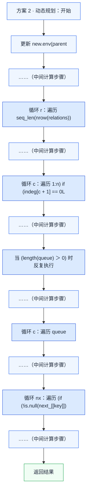

```r
# 版（方案2） 定义函数 minimum_time_courses（参数：元素个数, relations, time）
minimum_time_courses <- function(n, relations, time) {
    next_ <- new.env(parent = emptyenv())  # 把 new.env(parent 赋值为 emptyenv()) 存入 next_
    indeg <- rep(0L, n + 1)  # 把 rep(0L, 元素个数 加 1) 存入 indeg
    for (r in seq_len(nrow(relations))) {
        # for (右指针 in seq_len(nrow(relations))) {
        u <- relations[r, 1]
        v <- relations[r, 2]  # 把 relations[右指针, 1]; 值 小于 减 relations[右指针, 2] 存入 节点 u
        key <- as.character(u)  # 把 as.character(节点 u) 存入 key
        lst <- if (!is.null(next_[[key]]))
            next_[[key]] else integer(0)
        next_[[key]] <- c(lst, v)  # 把 字符(lst, 值) 存入 next_[[key]]
        indeg[v + 1] <- indeg[v + 1] + 1L  # indeg[值 加 1] 小于 减 indeg[值 加 1] 加 1L
    }
    finish <- rep(0L, n + 1)  # 把 rep(0L, 元素个数 加 1) 存入 finish
    queue <- integer(0)  # 把 integer(0) 存入 队列
    for (c in 1:n) if (indeg[c + 1] == 0L)
        queue <- c(queue, c)
    total <- 0L  # 把 0L 存入 总和
    while (length(queue) > 0) {
        # 循环，直到不满足「长度(队列) 超过 0」
        nq <- integer(0)  # 把 integer(0) 存入 nq
        for (c in queue) {
            # for (字符 in 队列) {
            finish[c + 1] <- finish[c + 1] + time[c]  # finish[字符 加 1] 小于 减 finish[字符 加 1] 加 time[字符]
            if (finish[c + 1] > total)
                total <- finish[c + 1]  # 若 finish[字符 加 1] 超过 总和) 总和 小于 减 finish[字符 加 1]
            key <- as.character(c)  # 把 as.character(字符) 存入 key
            for (nx in (if (!is.null(next_[[key]]))
                next_[[key]] else integer(0))) {
                if (finish[nx + 1] < finish[c + 1])
                  finish[nx + 1] <- finish[c + 1]
                indeg[nx + 1] <- indeg[nx + 1] - 1L  # indeg[nx 加 1] 小于 减 indeg[nx 加 1] 减 1L
                if (indeg[nx + 1] == 0L)
                  nq <- c(nq, nx)  # 若 indeg[nx 加 1] 等于 0L) nq 小于 减 字符(nq, nx
            }
        }
        queue <- nq  # 把 nq 存入 队列
    }
    total  # 总和
}
r1 <- matrix(c(1, 3, 2, 3), ncol = 2, byrow = TRUE)  # 把 矩阵(字符(1,3, 2,3), ncol 赋值为 2, byrow 赋值为 TRUE) 存入 r1
stopifnot(minimum_time_courses(3, r1, c(3, 2, 5)) == 8)  # 断言校验
r2 <- matrix(c(1, 2, 2, 3, 3, 4, 4, 5), ncol = 2, byrow = TRUE)
stopifnot(minimum_time_courses(5, r2, c(1, 2, 3, 4, 5)) == 15)  # 断言校验
stopifnot(minimum_time_courses(1, matrix(integer(0), ncol = 2), c(5)) == 5)  # 断言校验
cat("PASS\n")  # 全部用例通过，输出 PASS
```

### Zig 实现（2 种方案）

Zig 的全部方案如下，每个方案都内嵌用例自测，可独立运行（老仓库 python/go 文件遵循「打印结果」约定）：

#### 方案 1：动态规划

**思路与代码分析**：核心是「动态规划」。Zig 版显式分配与清零，整型边界处理严格。代码里依次做这些事：双重循环遍历。

**运行架构**（真实控制流）：

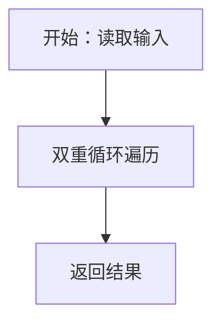

```zig
// LeetCode 2050. 并行课程III — Zig 版（方案1）
const std = @import("std"); // 把 @import(「std」) 存入 std
fn minimumTime(n: usize, relations: []const [2]i32, time: []const i32) i32 { // 定义函数/方法 minimumTime
    var next_buf: [64][64]i32 = undefined; // 把 undefined; 写入 var next_buf: [64][64]i32
    var nnext: [64]usize = undefined; // 把 undefined; 写入 var nnext: [64]usize
    var indeg: [64]i32 = undefined; // 把 undefined; 写入 var indeg: [64]i32
    for (0..n + 1) |i| { // for (0..元素个数 加 1) 按位或 下标 i 按位或 {
        nnext[i] = 0; // 把 0; 写入 nnext[i]
        indeg[i] = 0; // 把 0; 写入 indeg[i]
    }
    for (relations) |r| { // 逐个取出 relations 的元素（右指针）
        const u: usize = @intCast(r[0]); // 把 @intCast(右指针[0]); 写入 const u: usize
        const v: usize = @intCast(r[1]); // 把 @intCast(右指针[1]); 写入 const v: usize
        next_buf[u][nnext[u]] = r[1]; // 把 右指针[1]; 写入 next_buf[u][nnext[u]]
        nnext[u] += 1; // nnext[u]累加 1
        indeg[v] += 1; // indeg[v]累加 1
    }
    var finish: [64]i32 = undefined; // 把 undefined; 写入 var finish: [64]i32
    for (0..n + 1) |i| finish[i] = 0; // 把 0; 写入 for (0..n + 1) |i| finish[i]
    var queue: [64]i32 = undefined; // 把 undefined; 写入 var queue: [64]i32
    var qn: usize = 0; // 把 0; 写入 var qn: usize
    for (1..n + 1) |c| { // for (1..元素个数 加 1) 按位或 字符 按位或 {
        if (indeg[c] == 0) { // 若 indeg[字符] 等于 0
            queue[qn] = @intCast(c); // 把 @intCast(字符); 写入 queue[qn]
            qn += 1; // qn累加 1
        }
    }
    var total: i32 = 0; // 把 0; 写入 var total: i32
    while (qn > 0) { // 循环，直到不满足「qn 超过 0」
        var nq: [64]i32 = undefined; // 把 undefined; 写入 var nq: [64]i32
        var nqn: usize = 0; // 把 0; 写入 var nqn: usize
        for (0..qn) |i| { // 让 下标 i 从 0 走到 qn 减一
            const c: usize = @intCast(queue[i]); // 把 @intCast(队列[下标 i]); 写入 const c: usize
            finish[c] += time[c - 1]; // finish[c]累加 time[字符 减 1]
            if (finish[c] > total) total = finish[c]; // 若 finish[字符] 超过 总和) 总和 赋值为 finish[字符];
            for (0..nnext[c]) |k| { // for (0..nnext[字符]) 按位或 下标 k 按位或 {
                const nx: usize = @intCast(next_buf[c][k]); // 把 @intCast(next_buf[字符][下标 k]); 写入 const nx: usize
                if (finish[nx] < finish[c]) finish[nx] = finish[c]; // 若 finish[nx] 小于 finish[字符]) finish[nx] 赋值为 finish[字符];
                indeg[nx] -= 1; // indeg[nx]累减 1
                if (indeg[nx] == 0) { // 若 indeg[nx] 等于 0
                    nq[nqn] = next_buf[c][k]; // 把 next_buf[字符][下标 k]; 写入 nq[nqn]
                    nqn += 1; // nqn累加 1
                }
            }
        }
        for (0..nqn) |i| queue[i] = nq[i]; // 让 下标 i 从 0 走到 nqn 减一
        qn = nqn; // 把 nqn; 写入 qn
    }
    return total; // 返回 总和
}
pub fn main() !void { // 程序入口：跑内嵌自测用例
    const r1 = [_][2]i32{ .{ 1, 3 }, .{ 2, 3 } }; // 把 [_][2]i32{ .{ 1, 3 }, .{ 2, 3 } } 存入 r1
    if (minimumTime(3, &r1, &[_]i32{ 3, 2, 5 }) != 8) return error.TestFailed;
    const r2 = [_][2]i32{ .{ 1, 2 }, .{ 2, 3 }, .{ 3, 4 }, .{ 4, 5 } };
    if (minimumTime(5, &r2, &[_]i32{ 1, 2, 3, 4, 5 }) != 15) return error.TestFailed;
    const empty_rel = [_][2]i32{}; // 把 [_][2]i32{} 存入 empty_rel
    if (minimumTime(1, &empty_rel, &[_]i32{5}) != 5) return error.TestFailed;
    std.debug.print("PASS\n", .{});
} // 全部用例通过，输出 PASS
```

#### 方案 2：动态规划

**思路与代码分析**：核心是「动态规划」。Zig 版显式分配与清零，整型边界处理严格。代码里依次做这些事：双重循环遍历。

**运行架构**：与方案 1 的控制流相同（同算法在该语言的等价实现），图见上。

```zig
// LeetCode 2050. 并行课程III — Zig 版（方案2）
const std = @import("std"); // 把 @import(「std」) 存入 std
fn minimumTime(n: usize, relations: []const [2]i32, time: []const i32) i32 { // 定义函数/方法 minimumTime
    var next_buf: [64][64]i32 = undefined; // 把 undefined; 写入 var next_buf: [64][64]i32
    var nnext: [64]usize = undefined; // 把 undefined; 写入 var nnext: [64]usize
    var indeg: [64]i32 = undefined; // 把 undefined; 写入 var indeg: [64]i32
    for (0..n + 1) |i| { // for (0..元素个数 加 1) 按位或 下标 i 按位或 {
        nnext[i] = 0; // 把 0; 写入 nnext[i]
        indeg[i] = 0; // 把 0; 写入 indeg[i]
    }
    for (relations) |r| { // 逐个取出 relations 的元素（右指针）
        const u: usize = @intCast(r[0]); // 把 @intCast(右指针[0]); 写入 const u: usize
        const v: usize = @intCast(r[1]); // 把 @intCast(右指针[1]); 写入 const v: usize
        next_buf[u][nnext[u]] = r[1]; // 把 右指针[1]; 写入 next_buf[u][nnext[u]]
        nnext[u] += 1; // nnext[u]累加 1
        indeg[v] += 1; // indeg[v]累加 1
    }
    var finish: [64]i32 = undefined; // 把 undefined; 写入 var finish: [64]i32
    for (0..n + 1) |i| finish[i] = 0; // 把 0; 写入 for (0..n + 1) |i| finish[i]
    var queue: [64]i32 = undefined; // 把 undefined; 写入 var queue: [64]i32
    var qn: usize = 0; // 把 0; 写入 var qn: usize
    for (1..n + 1) |c| { // for (1..元素个数 加 1) 按位或 字符 按位或 {
        if (indeg[c] == 0) { // 若 indeg[字符] 等于 0
            queue[qn] = @intCast(c); // 把 @intCast(字符); 写入 queue[qn]
            qn += 1; // qn累加 1
        }
    }
    var total: i32 = 0; // 把 0; 写入 var total: i32
    while (qn > 0) { // 循环，直到不满足「qn 超过 0」
        var nq: [64]i32 = undefined; // 把 undefined; 写入 var nq: [64]i32
        var nqn: usize = 0; // 把 0; 写入 var nqn: usize
        for (0..qn) |i| { // 让 下标 i 从 0 走到 qn 减一
            const c: usize = @intCast(queue[i]); // 把 @intCast(队列[下标 i]); 写入 const c: usize
            finish[c] += time[c - 1]; // finish[c]累加 time[字符 减 1]
            if (finish[c] > total) total = finish[c]; // 若 finish[字符] 超过 总和) 总和 赋值为 finish[字符];
            for (0..nnext[c]) |k| { // for (0..nnext[字符]) 按位或 下标 k 按位或 {
                const nx: usize = @intCast(next_buf[c][k]); // 把 @intCast(next_buf[字符][下标 k]); 写入 const nx: usize
                if (finish[nx] < finish[c]) finish[nx] = finish[c]; // 若 finish[nx] 小于 finish[字符]) finish[nx] 赋值为 finish[字符];
                indeg[nx] -= 1; // indeg[nx]累减 1
                if (indeg[nx] == 0) { // 若 indeg[nx] 等于 0
                    nq[nqn] = next_buf[c][k]; // 把 next_buf[字符][下标 k]; 写入 nq[nqn]
                    nqn += 1; // nqn累加 1
                }
            }
        }
        for (0..nqn) |i| queue[i] = nq[i]; // 让 下标 i 从 0 走到 nqn 减一
        qn = nqn; // 把 nqn; 写入 qn
    }
    return total; // 返回 总和
}
pub fn main() !void { // 程序入口：跑内嵌自测用例
    const r1 = [_][2]i32{ .{ 1, 3 }, .{ 2, 3 } }; // 把 [_][2]i32{ .{ 1, 3 }, .{ 2, 3 } } 存入 r1
    if (minimumTime(3, &r1, &[_]i32{ 3, 2, 5 }) != 8) return error.TestFailed;
    const r2 = [_][2]i32{ .{ 1, 2 }, .{ 2, 3 }, .{ 3, 4 }, .{ 4, 5 } };
    if (minimumTime(5, &r2, &[_]i32{ 1, 2, 3, 4, 5 }) != 15) return error.TestFailed;
    const empty_rel = [_][2]i32{}; // 把 [_][2]i32{} 存入 empty_rel
    if (minimumTime(1, &empty_rel, &[_]i32{5}) != 5) return error.TestFailed;
    std.debug.print("PASS\n", .{});
} // 全部用例通过，输出 PASS
```

### Dart 实现（2 种方案）

Dart 的全部方案如下，每个方案都内嵌用例自测，可独立运行（老仓库 python/go 文件遵循「打印结果」约定）：

#### 方案 1：动态规划

**思路与代码分析**：核心是「动态规划」。Dart 版用可空类型标注与集合方法，注意空安全。代码里依次做这些事：双重循环遍历。**走读**：方案 1 · 动态规划：开始 → 更新 next → 遍历循环 → 遍历循环 → 当 (queue.isNotEmpty) 时反复执行 → 遍历循环 → 遍历循环 → 返回 total。

**运行架构**（真实控制流）：

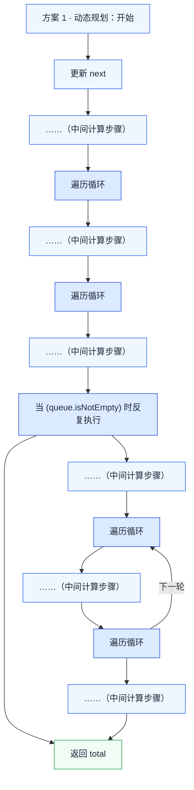

```dart
// LeetCode 2050. 并行课程III — Dart 版（方案1）
int minimumTime(int n, List<List<int>> relations, List<int> time) {
  // 定义函数/方法 minimumTime
  final next = <int, List<int>>{}; // 把 小于 int, List 小于 int 超过 超过 {} 存入 下一个
  final indeg = List<int>.filled(
    n + 1,
    0,
  ); // 把 List 小于 int 超过 .filled(元素个数 加 1, 0) 存入 indeg
  for (final r in relations) {
    // for (final 右指针 in relations) {
    next.putIfAbsent(r[0], () => []).add(r[1]);
    indeg[r[1]]++; // indeg[右指针[1]] 加一 ;
  }
  final finish = List<int>.filled(
    n + 1,
    0,
  ); // 把 List 小于 int 超过 .filled(元素个数 加 1, 0) 存入 finish
  var queue = <int>[]; // 把 小于 int 超过 [] 存入 队列
  for (var c = 1; c <= n; c++) {
    // 让 字符 从 1 开始计数，字符 不超过 元素个数 就继续
    if (indeg[c] == 0) queue.add(c); // 若 indeg[字符] 等于 0) 队列 追加 字符);
  }
  var total = 0; // 把 0 存入 总和
  while (queue.isNotEmpty) {
    // 循环，直到不满足「队列.isNotEmpty」
    final nq = <int>[]; // 把 小于 int 超过 [] 存入 nq
    for (final c in queue) {
      // for (final 字符 in 队列) {
      finish[c] += time[c - 1]; // finish[c]累加 time[字符 减 1]
      if (finish[c] > total)
        total = finish[c]; // 若 finish[字符] 超过 总和) 总和 赋值为 finish[字符];
      for (final nx in next[c] ?? []) {
        // for (final nx in 下一个[字符] ?? []) {
        if (finish[nx] < finish[c]) finish[nx] = finish[c]; // 若 finish[nx] 小于 finish[字符]) finish[nx] 赋值为 finish[字符];
        if (--indeg[nx] == 0) nq.add(nx); // 若 减一 indeg[nx] 等于 0) nq 追加 nx);
      }
    }
    queue = nq; // 把 nq 存入 队列
  }
  return total; // 返回 总和
}

void main() {
  // 程序入口：跑内嵌自测用例
  if (minimumTime(
        3,
        [
          [1, 3],
          [2, 3],
        ],
        [3, 2, 5],
      ) !=
      8)
    throw StateError('c1');
  if (minimumTime(
        5,
        [
          [1, 2],
          [2, 3],
          [3, 4],
          [4, 5],
        ],
        [1, 2, 3, 4, 5],
      ) !=
      15)
    throw StateError('c2');
  if (minimumTime(1, [], [5]) != 5)
    throw StateError(
      'c3',
    ); // 若 minimumTime(1, [], [5]) 不等于 5) throw StateError('c3');
  print('PASS');
} // 全部用例通过，输出 PASS
```

#### 方案 2：动态规划

**思路与代码分析**：核心是「动态规划」。Dart 版用可空类型标注与集合方法，注意空安全。代码里依次做这些事：双重循环遍历。**走读**：方案 2 · 动态规划：开始 → 更新 next → 遍历循环 → 遍历循环 → 当 (queue.isNotEmpty) 时反复执行 → 遍历循环 → 遍历循环 → 返回 total。

**运行架构**（真实控制流）：

```mermaid
graph TD
    N0["方案 2 · 动态规划：开始"]
    N1["更新 next"]
    D1["……（中间计算步骤）"]
    N6["遍历循环"]
    D2["……（中间计算步骤）"]
    N14["遍历循环"]
    D3["……（中间计算步骤）"]
    N17["当 (queue.isNotEmpty) 时反复执行"]
    D4["……（中间计算步骤）"]
    N19["遍历循环"]
    D5["……（中间计算步骤）"]
    N23["遍历循环"]
    D6["……（中间计算步骤）"]
    N27["返回 total"]
    N0 --> N1
    N23 -- 下一轮 --> N19
    N17 --> N27
    N1 --> D1
    D1 --> N6
    N6 --> D2
    D2 --> N14
    N14 --> D3
    D3 --> N17
    N17 --> D4
    D4 --> N19
    N19 --> D5
    D5 --> N23
    N23 --> D6
    D6 --> N27
    classDef n fill:#eff6ff,stroke:#2563eb,color:#1e293b;
    classDef lp fill:#dbeafe,stroke:#1d4ed8,color:#1e293b;
    classDef dc fill:#fef9c3,stroke:#ca8a04,color:#1e293b;
    classDef tm fill:#f0fdf4,stroke:#16a34a,color:#1e293b;
    class N0,N1,D1,D2,D3,D4,D5,D6 n;
    class N6,N14,N17,N19,N23 lp;
    class N27 tm;
```

```dart
// LeetCode 2050. 并行课程III — Dart 版（方案2）
int minimumTime(int n, List<List<int>> relations, List<int> time) {
  // 定义函数/方法 minimumTime
  final next = <int, List<int>>{}; // 把 小于 int, List 小于 int 超过 超过 {} 存入 下一个
  final indeg = List<int>.filled(
    n + 1,
    0,
  ); // 把 List 小于 int 超过 .filled(元素个数 加 1, 0) 存入 indeg
  for (final r in relations) {
    // for (final 右指针 in relations) {
    next.putIfAbsent(r[0], () => []).add(r[1]);
    indeg[r[1]]++; // indeg[右指针[1]] 加一 ;
  }
  final finish = List<int>.filled(
    n + 1,
    0,
  ); // 把 List 小于 int 超过 .filled(元素个数 加 1, 0) 存入 finish
  var queue = <int>[]; // 把 小于 int 超过 [] 存入 队列
  for (var c = 1; c <= n; c++) {
    // 让 字符 从 1 开始计数，字符 不超过 元素个数 就继续
    if (indeg[c] == 0) queue.add(c); // 若 indeg[字符] 等于 0) 队列 追加 字符);
  }
  var total = 0; // 把 0 存入 总和
  while (queue.isNotEmpty) {
    // 循环，直到不满足「队列.isNotEmpty」
    final nq = <int>[]; // 把 小于 int 超过 [] 存入 nq
    for (final c in queue) {
      // for (final 字符 in 队列) {
      finish[c] += time[c - 1]; // finish[c]累加 time[字符 减 1]
      if (finish[c] > total)
        total = finish[c]; // 若 finish[字符] 超过 总和) 总和 赋值为 finish[字符];
      for (final nx in next[c] ?? []) {
        // for (final nx in 下一个[字符] ?? []) {
        if (finish[nx] < finish[c]) finish[nx] = finish[c]; // 若 finish[nx] 小于 finish[字符]) finish[nx] 赋值为 finish[字符];
        if (--indeg[nx] == 0) nq.add(nx); // 若 减一 indeg[nx] 等于 0) nq 追加 nx);
      }
    }
    queue = nq; // 把 nq 存入 队列
  }
  return total; // 返回 总和
}

void main() {
  // 程序入口：跑内嵌自测用例
  if (minimumTime(
        3,
        [
          [1, 3],
          [2, 3],
        ],
        [3, 2, 5],
      ) !=
      8)
    throw StateError('c1');
  if (minimumTime(
        5,
        [
          [1, 2],
          [2, 3],
          [3, 4],
          [4, 5],
        ],
        [1, 2, 3, 4, 5],
      ) !=
      15)
    throw StateError('c2');
  if (minimumTime(1, [], [5]) != 5)
    throw StateError(
      'c3',
    ); // 若 minimumTime(1, [], [5]) 不等于 5) throw StateError('c3');
  print('PASS');
} // 全部用例通过，输出 PASS
```

---

## 内容总结

- **并行课程 iii**（动态规划 · Hard）：共 2 个方案，主线思路「动态规划」；时间 O(n) 到 O(m·n)（取决于状态维度）；动画演示DP 表填充过程，附录给出 11 种语言 × 全部方案的可运行实现。
- 来源博客：[https://blog.csdn.net/tyro_java/article/details/145380834](https://blog.csdn.net/tyro_java/article/details/145380834)
- 导航：[📋 总目录](../) ｜ [← 193 并行课程 ii](../193_并行课程_ii/) ｜ [195 最长递增子序列 ii →](../195_最长递增子序列_ii/)
