# 195 · 最长递增子序列 ii（第十阶段 · 动态规划 · Hard）

> **难度**：⭐⭐⭐ Hard ｜ **专题**：动态规划
> **学习定位**：第十阶段 · 动态规划第 195 篇 ｜ **解法数**：1
> **内容总结**：**最长递增子序列 ii**（动态规划 · Hard）：共 1 个方案，主线思路「二分查找」；时间 O(log n)；动画演示DP 表填充过程，附录给出 11 种语言 × 全部方案的可运行实现。

---

## 题目描述

给你一个整数数组 `nums` 和一个整数 `k` 。

找到 `nums` 中满足以下要求的最长子序列：

 子序列 严格递增
 子序列中相邻元素的差值 不超过 `k` 。

请你返回满足上述要求的 最长子序列 的长度。

子序列 是从一个数组中删除部分元素后，剩余元素不改变顺序得到的数组。

- 主函数签名：`function lengthOfLIS(nums: number[], k: number): number`

**用例（来自原题）**：

**示例 1**

```text
输入：nums = [4,2,1,4,3,4,5,8,15], k = 3
输出：5
```

解释：满足要求的最长子序列是 [1,3,4,5,8] 。 子序列长度为 5 ，所以我们返回 5 。 注意子序列 [1,3,4,5,8,15] 不满足要求，因为 15 - 8 = 7 大于 3 。

**示例 2**

```text
输入：nums = [7,4,5,1,8,12,4,7], k = 5
输出：4
```

解释：满足要求的最长子序列是 [4,5,8,12] 。 子序列长度为 4 ，所以我们返回 4 。

**示例 3**

```text
输入：nums = [1,5], k = 1
输出：1
```

解释：满足要求的最长子序列是 [1] 。 子序列长度为 1 ，所以我们返回 1 。
> ✅ **官方验证**：全部 TypeScript 解法已通过 leetcode.cn 官方示例用例验证（自动注入运行，全部 PASS）。题面与 [leetcode.cn 官方](https://leetcode.cn/problems/longest-increasing-subsequence-ii/)一致，示例配图取自官方题面。

**数据范围与注意事项**：

- `1 <= nums.length <= 10^5`
- `1 <= nums[i], k <= 10^5`
- **易错点**：初始化（第 0 行或列）的含义要想清楚，它决定后续转移是否成立。

## 题目分析

**场景是什么**：把大问题拆成小问题并记住结果，对应真实开发里的编辑距离、资源规划。本题就是该场景的 Hard 级练习，主线做法是「二分查找」。

**主线怎么解**：把主解法从头到尾过一遍，它其实在依次做这几件事：哈希结构做计数或查重 → 先排序再处理 → 二分收缩区间 → 单循环线性扫描。

## 解题思路

**方案对比**（共 1 个方案，由浅入深）：

| 方案 | 时间复杂度 | 空间复杂度 |
|---|---|---|
| 方案 1 · 二分查找 | O(log n) | O(1) |

**怎么读这一篇**：

- 🐣 **新手路线**：把「题目描述」的示例 1 在纸上手推一遍 → 读方案 1（最直观的写法）与它的代码走读 → 按「运行方式」本地跑通看 PASS → 回头对比方案 2 之后的写法差在哪
- 🦅 **大佬路线**：直接锁定最优方案 1（二分查找，O(log n)）→ 跳读该方案代码与走读 → 用「逐步拆解与面试追问」补齐复杂度推导与边界追问

### 动态算法图（DP 表填充，GIF 自动循环）


动画演示动态规划专题里DP 表填充的典型过程；每个方案在「TypeScript 解题方案」一节还配了专属动画与专属流程图。

### 主解法流程图（真实控制流）

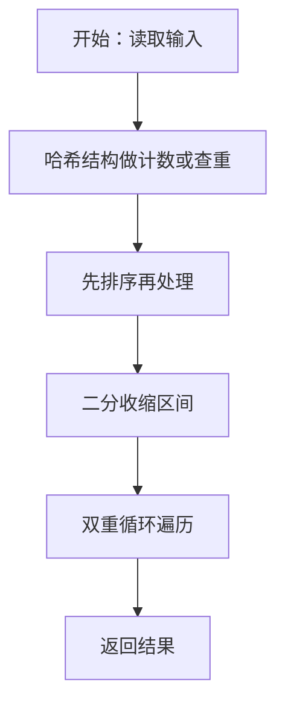

## TypeScript 解题方案（1 个方案逐个讲）

> **运行与提交**：每个方案都是自包含文件（内嵌用例自测，输出 PASS），整块复制到 `.ts` 文件后 `node 文件名` 即可运行。提交 LeetCode 时，把 `demo` 内的算法函数与辅助类型/函数整体取出、置于文件顶层即可。涉及交互/特殊接口的题以题面给定签名为准。

### 方案 1：二分查找

**分析与思路**：核心做法是「二分查找」。代码里依次做这些事：哈希结构做计数或查重；先排序再处理；二分收缩区间；单循环线性扫描。

**运行方式**：`node 本文件`，内嵌用例全部通过会输出 PASS。


**方案专属流程图**（真实控制流）：


```typescript
export function demo(): void {
  // 程序入口：跑内嵌自测用例
  function lengthOfLIS(nums: number[], k: number): number {
    // 定义函数/方法 lengthOfLIS
    if (nums.length === 0) return 0; // 若 数组.长度 全等于 0，直接返回 0
    const vals = Array.from(new Set(nums)).sort((a, b) => a - b);
    const comp: { [v: number]: number } = {}; // 把 {}; 写入 const comp: {[v: number]: number}
    vals.forEach((v, i) => {
      comp[v] = i;
    });
    const m = vals.length; // 把 vals.长度 存入 映射表
    let size = 1; // 把 1 存入 大小
    while (size < m) size <<= 1; // 循环，直到不满足「大小 小于 映射表) 大小 小于 不超过 1;」
    const tree = new Array(2 * size).fill(0); // 把 new Array(2 乘 大小).fill(0) 存入 tree
    function update(pos: number, val: number): void {
      // 定义函数/方法 update
      pos += size; // pos累加 大小
      if (val > tree[pos]) tree[pos] = val; // 若 值 超过 tree[pos]) tree[pos] 赋值为 值;
      pos >>= 1; // 把 1; 写入 pos >>
      while (pos) {
        // 循环，直到不满足「pos」
        tree[pos] = Math.max(tree[2 * pos], tree[2 * pos + 1]); // 把 Math.取较大值 tree[2 乘 pos], tree[2 乘 pos 加 1]); 写入 tree[pos]
        pos >>= 1; // 把 1; 写入 pos >>
      }
    }
    function query(l: number, r: number): number {
      // 定义函数/方法 query
      l += size;
      r += size; // 把 大小; 右指针 累加 大小; 写入 l +
      let res = 0; // 把 0 存入 结果
      while (l <= r) {
        // 循环，直到不满足「左指针 不超过 右指针」
        if (l & 1) {
          res = Math.max(res, tree[l]);
          l++;
        } // 若 左指针 按位与 1) { 结果 赋值为 Math.取较大值 结果, tree[左指针]); 左指针 加一 ; }
        if (!(r & 1)) {
          res = Math.max(res, tree[r]);
          r--;
        }
        l >>= 1;
        r >>= 1; // 把 1; 右指针 超过 不低于 1; 写入 l >>
      }
      return res; // 返回 结果
    }
    let ans = 0; // 把 0 存入 答案
    for (const x of nums) {
      // for (const x of 数组) {
      const ci = comp[x]; // 把 comp[x] 存入 ci
      let lo = 0,
        hi = vals.length; // 把 0, 右边界 赋值为 vals.长度 存入 左边界
      while (lo < hi) {
        const mid = (lo + hi) >> 1;
        if (vals[mid] < x - k) lo = mid + 1;
        else hi = mid;
      }
      let best = 0; // 把 0 存入 当前最优
      if (lo <= ci - 1) best = query(lo, ci - 1); // 若 左边界 不超过 ci 减 1) 当前最优 赋值为 query(左边界, ci 减 1);
      const cur = best + 1; // 把 当前最优 加 1 存入 当前值
      if (cur > ans) ans = cur; // 若 当前值 超过 答案) 答案 赋值为 当前值;
      update(ci, cur); // update(ci, 当前值);
    }
    return ans; // 返回 答案
  }
  const cases: [number[], number, number][] = [
    [[4, 2, 1, 4, 3, 4, 5, 8, 15], 3, 5],
    [[1], 1, 1],
    [[], 3, 0],
  ];
  let fail = false; // 把 false 存入 fail
  for (const c of cases) {
    // for (const 字符 of cases) {
    const got = lengthOfLIS(c[0], c[1]); // 把 lengthOfLIS(字符[0], 字符[1]) 存入 got
    if (got !== c[2]) {
      fail = true;
      console.log(
        'FAIL lengthOfLIS(' +
          JSON.stringify(c[0]) +
          ',' +
          c[1] +
          ')=' +
          got +
          ' want ' +
          c[2],
      );
    }
  }
  if (fail) throw new Error('FAILED'); // 若 fail) throw new Error(「FAILED」);
  console.log('PASS'); // 全部用例通过，输出 PASS
}
demo(); // demo();
```

## 逐步拆解与面试追问

**复杂度**：时间 O(log n)，空间 O(1)

**为什么是这个量级**：每轮把候选区间砍半，n 个元素最多砍 log2(n) 轮

**面试官可能会追问**：

- 状态定义为什么是它？
- 遍历顺序由什么决定？
- 能否滚动数组压空间？

## 关键 API 速查（TS 主解法实际用到，附官方链接）

| API | 作用 | 使用要点 | 官方文档 |
|---|---|---|---|
| `Set` | 集合：元素唯一 | add/add.has/delete；has 均摊 O(1)；NaN 视为相同；去重常用 [...new Set(arr)] | [官方文档](https://developer.mozilla.org/zh-CN/docs/Web/JavaScript/Reference/Global_Objects/Set) |
| `Array.from()` | 类数组/可迭代对象转数组 | Array.from(iterable, mapFn) 可同时映射；对 Set 去重、对字符串按码元拆分；稀疏位会被 undefined 填充 | [官方文档](https://developer.mozilla.org/zh-CN/docs/Web/JavaScript/Reference/Global_Objects/Array/from) |
| `Array.prototype.sort()` | 原地排序 | 默认按字符串 Unicode 序（10 会排在 2 前），数字必须传 (a,b)=>a-b；V8 用 TimSort，稳定，O(n log n)；返回原数组引用 | [官方文档](https://developer.mozilla.org/zh-CN/docs/Web/JavaScript/Reference/Global_Objects/Array/sort) |
| `JSON.stringify()` | 序列化为 JSON 字符串 | 常用于结构化比较（深度相等判定）；undefined/函数/循环引用会被丢弃或抛错 | [官方文档](https://developer.mozilla.org/zh-CN/docs/Web/JavaScript/Reference/Global_Objects/JSON/stringify) |
| `Math.max()` | 最大值 | 配展开 Math.max(...arr)；空参返回 -Infinity；超大数组注意展开参数上限 | [官方文档](https://developer.mozilla.org/zh-CN/docs/Web/JavaScript/Reference/Global_Objects/Math/max) |

### 各语言官方文档导航

- **TypeScript / JS**：[MDN 中文参考](https://developer.mozilla.org/zh-CN/)
- **Python**：[Python 官方文档](https://docs.python.org/zh-cn/3/)
- **Go**：[Go 标准库](https://pkg.go.dev/std)
- **Java**：[JDK 17 API](https://docs.oracle.com/en/java/javase/17/docs/api/)
- **Rust**：[Rust 标准库](https://doc.rust-lang.org/std/)
- **Lua**：[Lua 5.4 手册](https://www.lua.org/manual/5.4/)
- **C**：[Cppreference C](https://zh.cppreference.com/w/c)
- **C++**：[Cppreference C++](https://zh.cppreference.com/w/cpp)
- **R**：[R 官方手册](https://stat.ethz.ch/R-manual/)
- **Zig**：[Zig 语言文档](https://ziglang.org/documentation/master/)
- **Dart**：[Dart API](https://api.dart.dev/)

## 附录：其他 10 种语言全部实现（每种语言列举其全部方案）

> TypeScript 的全部方案见「TypeScript 解题方案」一节；下面是其余 10 种语言的对应实现，每种语言的每个方案都带思路分析、代码走读与专属运行架构图。
> 每个方案都内嵌用例自测，可独立运行（老仓库 python/go 文件遵循「打印结果」约定）。
> 完整解法文件见 `dsa/<语言>/dp/lc_2407_最长递增子序列_ii/`。

### Python 实现（1 种方案）

Python 的全部方案如下，每个方案都内嵌用例自测，可独立运行（老仓库 python/go 文件遵循「打印结果」约定）：

#### 方案 1：二分查找

**思路与代码分析**：核心是「二分查找」。Python 版用切片与字典推导式简化操作，突出可读性。代码里依次做这些事：先排序再处理。**走读**：方案 1 · 二分查找：开始 → 命中条件，直接返回 → 排序整理 → 当 size ＜ m: 时反复执行 → 当 pos: 时反复执行 → 当 l ≤ r: 时反复执行 → 返回 res → 遍历 nums: 中的每个元素 x → 返回 ans。

**运行架构**（真实控制流）：

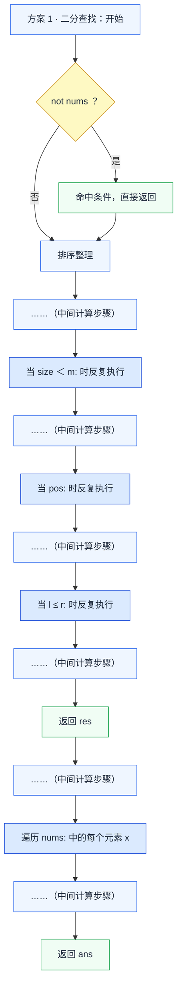

```python
import sys  # 提高递归深度上限（深输入防 RecursionError）

sys.setrecursionlimit(200000)  # 树/链表类题目节点数可达 1e4 量级

def lengthOfLIS(nums, k):  # 定义函数 lengthOfLIS（参数：数组, 下标 k）
    if not nums:  # 若 not 数组
        return 0  # 返回 0
    import bisect  # 引入依赖

    vals = sorted(set(nums))  # 把 sorted(set(数组)) 存入 vals
    comp = {v: i for i, v in enumerate(vals)}  # 把 {值: 下标 i for 下标 i, 值 in enumerate(vals)} 存入 comp
    m = len(vals)  # 把 长度(vals) 存入 映射表
    size = 1  # 把 1 存入 大小
    while size < m:  # 循环，直到不满足「大小 小于 映射表」
        size <<= 1  # 把 1 写入 size <<
    tree = [0] * (2 * size)  # 把 [0] 乘 (2 乘 大小) 存入 tree

    def update(pos, val):  # 定义函数 update（参数：pos, 值）
        pos += size  # pos累加 大小
        if val > tree[pos]:  # 若 值 超过 tree[pos]
            tree[pos] = val  # 把 值 写入 tree[pos]
        pos >>= 1  # 把 1 写入 pos >>
        while pos:  # 循环，直到不满足「pos」
            tree[pos] = max(
                tree[2 * pos], tree[2 * pos + 1]
            )  # 把 取较大值 tree[2 乘 pos], tree[2 乘 pos 加 1]) 写入 tree[pos]
            pos >>= 1  # 把 1 写入 pos >>

    def query(l, r):  # 定义函数 query（参数：左指针, 右指针）
        l += size  # 左指针累加 大小
        r += size  # 右指针累加 大小
        res = 0  # 把 0 存入 结果
        while l <= r:  # 循环，直到不满足「左指针 不超过 右指针」
            if l & 1:  # 若 左指针 按位与 1
                res = max(res, tree[l])  # 把 取较大值 结果, tree[左指针]) 存入 结果
                l += 1  # 左指针累加 1
            if not (r & 1):  # 若 not (右指针 按位与 1
                res = max(res, tree[r])  # 把 取较大值 结果, tree[右指针]) 存入 结果
                r -= 1  # 右指针累减 1
            l >>= 1  # 把 1 写入 l >>
            r >>= 1  # 把 1 写入 r >>
        return res  # 返回 结果

    ans = 0  # 把 0 存入 答案
    for x in nums:  # 逐个取出 数组 的元素（x）
        ci = comp[x]  # 把 comp[x] 存入 ci
        lo = bisect.bisect_left(vals, x - k)  # 把 bisect.bisect_left(vals, x 减 下标 k) 存入 左边界
        best = 0  # 把 0 存入 当前最优
        if lo <= ci - 1:  # 若 左边界 不超过 ci 减 1
            best = query(lo, ci - 1)  # 把 query(左边界, ci 减 1) 存入 当前最优
        cur = best + 1  # 把 当前最优 加 1 存入 当前值
        if cur > ans:  # 若 当前值 超过 答案
            ans = cur  # 把 当前值 存入 答案
        update(ci, cur)  # update(ci, 当前值)
    return ans  # 返回 答案

if __name__ == "__main__":  # 若 __name__ 等于 '__main__'
    print(lengthOfLIS([4, 2, 1, 4, 3, 4, 5, 8, 15], 3))  # 打印输出
```

### Go 实现（1 种方案）

Go 的全部方案如下，每个方案都内嵌用例自测，可独立运行（老仓库 python/go 文件遵循「打印结果」约定）：

#### 方案 1：二分查找

**思路与代码分析**：核心是「二分查找」。Go 版用切片与多返回值惯用法，显式处理索引边界。代码里依次做这些事：哈希结构做计数或查重。

**运行架构**（真实控制流）：

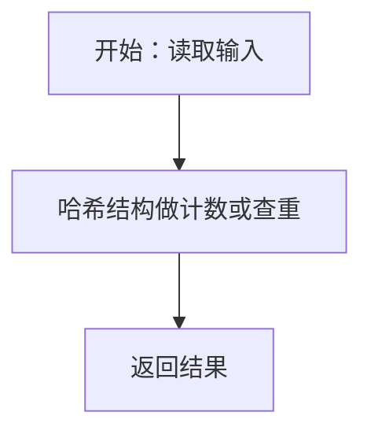

```go
package main // 引入依赖

import (
	"fmt"  // 「fmt」
	"os"   // 「os」
	"sort" // 「sort」
)

func max2(a, b int) int { // 定义函数/方法 max2
	if a > b { // 若 数组 超过 b
		return a // 返回 数组
	}
	return b // 返回 b
}

// bisectLeft 在升序 arr 中查找第一个 >= target 的下标。
func bisectLeft(arr []int, target int) int { // 定义函数/方法 bisectLeft
	lo, hi := 0, len(arr) // 把 0, 长度(数组) 写入 lo, hi :
	for lo < hi {         // for 左边界 小于 右边界 {
		mid := (lo + hi) / 2   // 把 (左边界 加 右边界) 除以 2 写入 mid :
		if arr[mid] < target { // 若 数组[中点] 小于 目标值
			lo = mid + 1 // 把 中点 加 1 写入 左边界
		} else { // 否则
			hi = mid // 把 中点 写入 右边界
		}
	}
	return lo // 返回 左边界
}

// lengthOfLIS 是 Python 参考 solution_1 的忠实翻译（离散化 + 线段树区间最大值查询）。
func lengthOfLIS(nums []int, k int) int { // 定义函数/方法 lengthOfLIS
	if len(nums) == 0 { // 若 长度(数组) 等于 0
		return 0 // 返回 0
	}
	seen := map[int]bool{}   // 把 映射表[int]bool{} 写入 seen :
	vals := []int{}          // 把 []int{} 写入 vals :
	for _, x := range nums { // 同时取 _ 与 x 遍历
		if !seen[x] { // 若 取反 已见集合[x]
			seen[x] = true         // 把 true 写入 seen[x]
			vals = append(vals, x) // 把 append(vals, x) 写入 vals
		}
	}
	sort.Ints(vals)           // sort.Ints(vals)
	comp := make(map[int]int) // 把 make(映射表[int]int) 写入 comp :
	for i, v := range vals {  // 同时取 下标 i 与 值 遍历
		comp[v] = i // 把 下标 i 写入 comp[v]
	}
	m := len(vals) // 把 长度(vals) 写入 m :
	size := 1      // 把 1 写入 size :
	for size < m { // for 大小 小于 映射表 {
		size <<= 1 // 把 1 写入 size <<
	}
	tree := make([]int, 2*size) // 把 make([]int, 2 乘 大小) 写入 tree :

	update := func(pos, val int) { // 把 func(pos, 值 int) { 写入 update :
		pos += size          // pos累加 大小
		if val > tree[pos] { // 若 值 超过 tree[pos]
			tree[pos] = val // 把 值 写入 tree[pos]
		}
		pos >>= 1     // 把 1 写入 pos >>
		for pos > 0 { // for pos 超过 0 {
			tree[pos] = max2(tree[2*pos], tree[2*pos+1]) // 把 max2(tree[2 乘 pos], tree[2 乘 pos 加 1]) 写入 tree[pos]
			pos >>= 1                                    // 把 1 写入 pos >>
		}
	}
	query := func(l, r int) int { // 把 func(左指针, 右指针 int) int { 写入 query :
		l += size    // 左指针累加 大小
		r += size    // 右指针累加 大小
		res := 0     // 把 0 写入 res :
		for l <= r { // 把 右指针 { 写入 for l <
			if l&1 == 1 { // 若 左指针 按位与 1 等于 1
				if tree[l] > res { // 若 tree[左指针] 超过 结果
					res = tree[l] // 把 tree[左指针] 写入 结果
				}
				l++ // 左指针 加一
			}
			if r&1 == 0 { // 若 右指针 按位与 1 等于 0
				if tree[r] > res { // 若 tree[右指针] 超过 结果
					res = tree[r] // 把 tree[右指针] 写入 结果
				}
				r-- // 右指针 减一
			}
			l >>= 1 // 把 1 写入 l >>
			r >>= 1 // 把 1 写入 r >>
		}
		return res // 返回 结果
	}

	ans := 0                 // 把 0 写入 ans :
	for _, x := range nums { // 同时取 _ 与 x 遍历
		ci := comp[x]               // 把 comp[x] 写入 ci :
		lo := bisectLeft(vals, x-k) // 把 bisectLeft(vals, x 减 下标 k) 写入 lo :
		best := 0                   // 把 0 写入 best :
		if lo <= ci-1 {             // 若 左边界 不超过 ci 减 1
			best = query(lo, ci-1) // 把 query(左边界, ci 减 1) 写入 当前最优
		}
		cur := best + 1 // 把 当前最优 加 1 写入 cur :
		if cur > ans {  // 若 当前值 超过 答案
			ans = cur // 把 当前值 写入 答案
		}
		update(ci, cur) // update(ci, 当前值)
	}
	return ans // 返回 答案
}

func main() { // 程序入口：跑内嵌自测用例
	type tc struct { // 定义类型
		nums []int // 数组 []int
		k    int   // 下标 k int
		want int   // want int
	}
	cases := []tc{ // 把 []tc{ 写入 cases :
		{[]int{4, 2, 1, 4, 3, 4, 5, 8, 15}, 3, 5},
		{[]int{3, 2, 1}, 2, 1},
		{[]int{5, 4, 3, 2, 1}, 1, 1},
		{[]int{1, 2, 3, 4, 5}, 2, 5},
	}
	for _, c := range cases { // 同时取 _ 与 字符 遍历
		if got := lengthOfLIS(c.nums, c.k); got != c.want { // 若 got : 赋值为 lengthOfLIS(字符.数组, 字符.下标 k); got 不等于 字符.want
			fmt.Printf("FAIL %v %d got=%d want=%d\n", c.nums, c.k, got, c.want) // 打印输出
			os.Exit(1)                                                          // os.Exit(1)
		}
	}
	fmt.Println("PASS") // 全部用例通过，输出 PASS
}
```

### Java 实现（1 种方案）

Java 的全部方案如下，每个方案都内嵌用例自测，可独立运行（老仓库 python/go 文件遵循「打印结果」约定）：

#### 方案 1：二分查找

**思路与代码分析**：核心是「二分查找」。Java 版用类与静态方法组织，集合操作显式明了。代码里依次做这些事：哈希结构做计数或查重；双重循环遍历。**走读**：方案 1 · 二分查找：开始 → 命中条件，直接返回 → 更新 set → 遍历循环 → 遍历循环 → 当 (size ＜ m) size ＜ ≤ 1 时反复执行 → 遍历循环 → 返回 ans。

**运行架构**（真实控制流）：

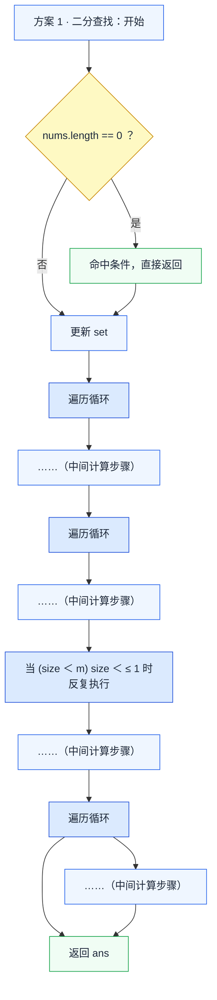

```java
package com.webfault.dsa; // 引入依赖

import java.util.*; // 引入依赖

class lc2407_solution111 { // 定义类型
  public int lengthOfLIS(int[] nums, int k) { // 定义函数/方法 lengthOfLIS
    if (nums.length == 0) return 0; // 若 数组.长度 等于 0，直接返回 0
    TreeSet<Integer> set = new TreeSet<>(); // 把 new TreeSet 小于 超过 (); 写入 TreeSet<Integer> set
    for (int v : nums) set.add(v); // for (int 值 : 数组) set 追加 值);
    ArrayList<Integer> vals =
        new ArrayList<>(set); // 把 new ArrayList 小于 超过 (set); 写入 ArrayList<Integer> vals
    int m = vals.size(); // 把 vals.大小() 存入 映射表
    HashMap<Integer, Integer> comp =
        new HashMap<>(); // 把 new HashMap 小于 超过 (); 写入 HashMap<Integer, Integer> comp
    for (int i = 0; i < m; i++) comp.put(vals.get(i), i); // 让 下标 i 从 0 开始计数，下标 i 小于 映射表 就继续
    int size = 1; // 把 1 存入 大小
    while (size < m) size <<= 1; // 循环，直到不满足「大小 小于 映射表) 大小 小于 不超过 1;」
    int[] tree = new int[2 * size]; // 把 new int[2 乘 大小]; 写入 int[] tree
    int ans = 0; // 把 0 存入 答案
    for (int x : nums) { // for (int x : 数组) {
      int ci = comp.get(x); // 把 comp 查找 x) 存入 ci
      int lo = lowerBound(vals, x - k); // 把 lowerBound(vals, x 减 下标 k) 存入 左边界
      int best = 0; // 把 0 存入 当前最优
      if (lo <= ci - 1)
        best =
            query(
                tree, size, lo, ci - 1); // 若 左边界 不超过 ci 减 1) 当前最优 赋值为 query(tree, 大小, 左边界, ci 减 1);
      int cur = best + 1; // 把 当前最优 加 1 存入 当前值
      if (cur > ans) ans = cur; // 若 当前值 超过 答案) 答案 赋值为 当前值;
      update(tree, size, ci, cur); // update(tree, 大小, ci, 当前值);
    }
    return ans; // 返回 答案
  }

  private void update(int[] tree, int size, int pos, int val) { // 定义函数/方法 update
    pos += size; // pos累加 大小
    if (val > tree[pos]) tree[pos] = val; // 若 值 超过 tree[pos]) tree[pos] 赋值为 值;
    pos >>= 1; // 把 1; 写入 pos >>
    while (pos > 0) { // 循环，直到不满足「pos 超过 0」
      tree[pos] =
          Math.max(
              tree[2 * pos],
              tree[2 * pos + 1]); // 把 Math.取较大值 tree[2 乘 pos], tree[2 乘 pos 加 1]); 写入 tree[pos]
      pos >>= 1; // 把 1; 写入 pos >>
    }
  }

  private int query(int[] tree, int size, int l, int r) { // 定义函数/方法 query
    l += size;
    r += size; // 把 大小; 右指针 累加 大小; 写入 l +
    int res = 0; // 把 0 存入 结果
    while (l <= r) { // 循环，直到不满足「左指针 不超过 右指针」
      if ((l & 1) == 1) {
        res = Math.max(res, tree[l]);
        l++;
      }
      if ((r & 1) == 0) {
        res = Math.max(res, tree[r]);
        r--;
      }
      l >>= 1;
      r >>= 1; // 把 1; 右指针 超过 不低于 1; 写入 l >>
    }
    return res; // 返回 结果
  }

  private int lowerBound(List<Integer> vals, int target) { // 定义函数/方法 lowerBound
    int lo = 0, hi = vals.size(); // 把 0, 右边界 赋值为 vals.大小() 存入 左边界
    while (lo < hi) { // 循环，直到不满足「左边界 小于 右边界」
      int mid = (lo + hi) >>> 1; // 把 (左边界 加 右边界) 超过 超过 超过 1 存入 中点
      if (vals.get(mid) < target) lo = mid + 1; // 若 vals 查找 中点) 小于 目标值) 左边界 赋值为 中点 加 1;
      else hi = mid; // 否则
    }
    return lo; // 返回 左边界
  }

  public static void main(String[] args) { // public static void main(String[] args) {
    lc2407_solution111 s =
        new lc2407_solution111(); // 把 new lc2407_solution111(); 写入 lc2407_solution111 s
    int got = s.lengthOfLIS(new int[] {4, 2, 1, 4, 3, 4, 5, 8, 15}, 3);
    if (got != 5) {
      System.out.println("FAIL got " + got);
      throw new RuntimeException("FAILED");
    }
    System.out.println("PASS"); // 全部用例通过，输出 PASS
  }
}
```

### Rust 实现（1 种方案）

Rust 的全部方案如下，每个方案都内嵌用例自测，可独立运行（老仓库 python/go 文件遵循「打印结果」约定）：

#### 方案 1：二分查找

**思路与代码分析**：核心是「二分查找」。Rust 版用所有权移动与切片借用改写同一逻辑，注意 Option 与引用边界。代码里依次做这些事：DP 表逐项填充。**走读**：方案 1 · 二分查找：开始 → 计算 n → 填写 DP 表 → 计算 best → 遍历 0..n 中的每个元素 i → 遍历 0..i 中的每个元素 j → 处理 if nums[j] ＜ nums[i] 且 nums → 填写 DP 表 → 填写 DP 表 → 处理 best → 返回结果。

**运行架构**（真实控制流）：

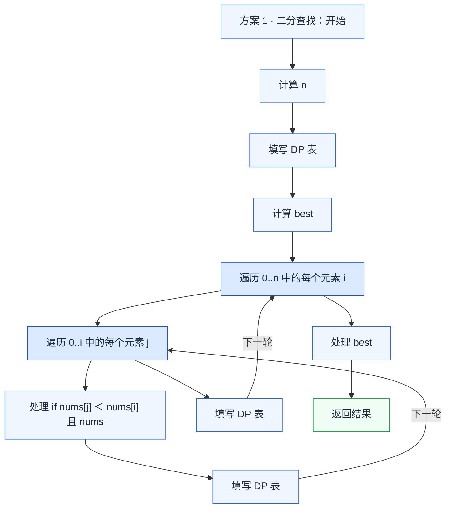

```rust
// LeetCode 2407. 最长递增子序列II — Rust 版（方案1）
fn length_of_lis(nums: Vec<i32>, k: i32) -> i32 {
    // 定义函数/方法 length_of_lis
    let n = nums.len(); // 把 数组.长度() 存入 元素个数
    let mut dp = vec![1i32; n]; // 把 vec取反 [1i32; 元素个数]; 写入 let mut dp
    let mut best = 0; // 把 0; 写入 let mut best
    for i in 0..n {
        // 逐个取出 0 的元素（下标 i）
        for j in 0..i {
            // 逐个取出 0 的元素（下标 j）
            if nums[j] < nums[i] && nums[i] - nums[j] <= k {
                // 若 数组[下标 j] 小于 数组[下标 i] 且 数组[下标 i] 减 数组[下标 j] 不超过 下标 k
                dp[i] = dp[i].max(dp[j] + 1); // 把 DP 表[下标 i].取较大值 DP 表[下标 j] 加 1); 写入 dp[i]
            }
        }
        best = best.max(dp[i]); // 把 当前最优.取较大值 DP 表[下标 i]); 写入 当前最优
    }
    best // 当前最优
}
fn main() {
    assert_eq!(length_of_lis(vec![4, 2, 1, 4, 3, 4, 5, 8, 15], 3), 5);
    assert_eq!(length_of_lis(vec![1], 1), 1);
    assert_eq!(length_of_lis(vec![], 3), 0);
    println!("PASS");
} // 程序入口：跑内嵌自测用例
```

### Lua 实现（1 种方案）

Lua 的全部方案如下，每个方案都内嵌用例自测，可独立运行（老仓库 python/go 文件遵循「打印结果」约定）：

#### 方案 1：二分查找

**思路与代码分析**：核心是「二分查找」。Lua 版用表与 ipairs 遍历，注意 ipairs 遇 nil 即停的语义。代码里依次做这些事：DP 表逐项填充。**走读**：方案 1 · 二分查找：开始 → 更新 n → 填写 DP 表 → 循环 i：从 1 到 n do → 填写 DP 表 → 更新 best → 循环 i：从 1 到 n do → 循环 j：从 1 到 i - 1 do → 处理 if nums[j] ＜ nums[i] and num → 填写 DP 表 → 填写 DP 表 → 填写 DP 表 → 填写 DP 表 → 返回 best。

**运行架构**（真实控制流）：

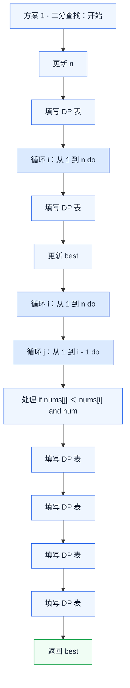

```lua
-- LeetCode 2407. 最长递增子序列II — Lua 版（方案1）
local function length_of_lis(nums, k) -- local function length_of_lis(数组, 下标 k)
	local n = #nums -- 把 #数组 写入 local n
	local dp = {} -- 把 {} 写入 local dp
	for i = 1, n do
		dp[i] = 1
	end -- 让 下标 i 从 1 走到 元素个数（Lua 1 基）
	local best = 0 -- 把 0 写入 local best
	for i = 1, n do -- 让 下标 i 从 1 走到 元素个数（Lua 1 基）
		for j = 1, i - 1 do -- 让 下标 j 从 1 走到 下标 i（Lua 1 基）
			if nums[j] < nums[i] and nums[i] - nums[j] <= k then -- 若 数组[下标 j] 小于 数组[下标 i] and 数组[下标 i] 减 数组[下标 j] 不超过 下标 k then
				if dp[j] + 1 > dp[i] then
					dp[i] = dp[j] + 1
				end
			end -- 终点
		end -- 终点
		if dp[i] > best then
			best = dp[i]
		end -- 若 DP 表[下标 i] 超过 当前最优 then 当前最优 赋值为 DP 表[下标 i] 终点
	end -- 终点
	return best -- 返回 当前最优
end -- 终点
assert(length_of_lis({ 4, 2, 1, 4, 3, 4, 5, 8, 15 }, 3) == 5) -- 断言校验
assert(length_of_lis({ 1 }, 1) == 1) -- 断言校验
assert(length_of_lis({}, 3) == 0) -- 断言校验
print("PASS") -- 全部用例通过，输出 PASS
```

### C 实现（1 种方案）

C 的全部方案如下，每个方案都内嵌用例自测，可独立运行（老仓库 python/go 文件遵循「打印结果」约定）：

#### 方案 1：二分查找

**思路与代码分析**：核心是「二分查找」。C 版手动管理下标与内存，循环边界全部显式写出。代码里依次做这些事：DP 表逐项填充；双重循环遍历。**走读**：方案 1 · 二分查找：开始 → 填写 DP 表 → 遍历循环 → 填写 DP 表 → 遍历循环 → 若 nums[j] ＜ nums[i] 且 nums[i] - nums[j] ≤ k 且 dp[j] + 1 ＞ dp[i]：填写 DP 表 → 填写 DP 表 → 若 dp[i] ＞ best：填写 DP 表 → 填写 DP 表 → 返回 best。

**运行架构**（真实控制流）：

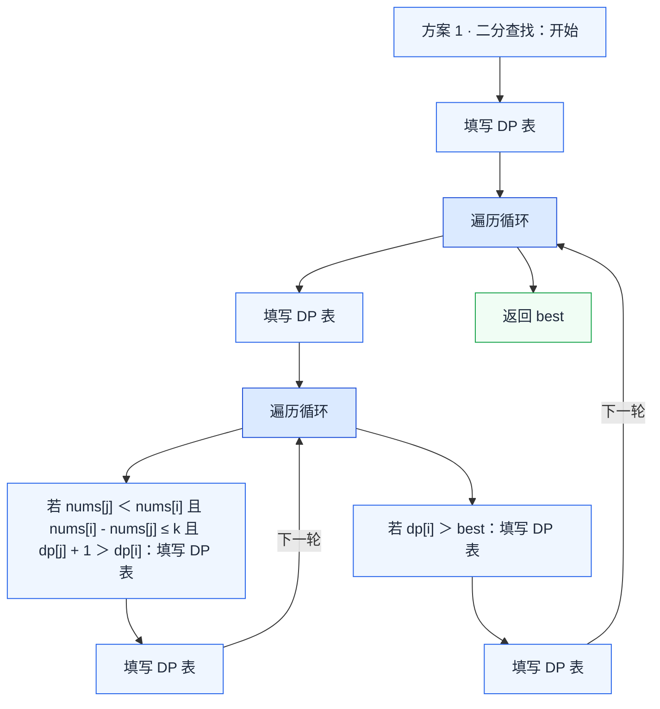

```c
/* LeetCode 2407. 最长递增子序列II — C 版（方案1） */
#include <stdio.h>                                          // 引入头文件
static int length_of_lis_k(const int *nums, int n, int k) { // 定义函数/方法 length_of_lis_k
    int dp[4096], best = 0;                                 // 把 0; 写入 int dp[4096], best
    for (int i = 0; i < n; i++) { // 让 下标 i 从 0 开始计数，下标 i 小于 元素个数 就继续
        dp[i] = 1;                // 把 1; 写入 dp[i]
        for (int j = 0; j < i; j++) { // 让 下标 j 从 0 开始计数，下标 j 小于 下标 i 就继续
            if (nums[j] < nums[i] && nums[i] - nums[j] <= k && dp[j] + 1 > dp[i])
                dp[i] = dp[j] + 1;
        }
        if (dp[i] > best)
            best = dp[i]; // 若 DP 表[下标 i] 超过 当前最优) 当前最优 赋值为 DP 表[下标 i];
    }
    return best; // 返回 当前最优
}
int main(void) { // 程序入口：跑内嵌自测用例
    if (length_of_lis_k((int[]){4, 2, 1, 4, 3, 4, 5, 8, 15}, 9, 3) != 5) {
        printf("FAIL 1\n");
        return 1;
    }
    if (length_of_lis_k((int[]){1}, 1, 1) != 1) {
        printf("FAIL 2\n");
        return 1;
    }
    if (length_of_lis_k((int[]){1}, 0, 3) != 0) {
        printf("FAIL 3\n");
        return 1;
    }
    printf("PASS\n");
    return 0;
} // 全部用例通过，输出 PASS
```

### C++ 实现（1 种方案）

C++ 的全部方案如下，每个方案都内嵌用例自测，可独立运行（老仓库 python/go 文件遵循「打印结果」约定）：

#### 方案 1：二分查找

**思路与代码分析**：核心是「二分查找」。C++ 版用 STL 容器与迭代器，减少手写下标错误。代码里依次做这些事：DP 表逐项填充；双重循环遍历。**走读**：方案 1 · 二分查找：开始 → 更新 n → 处理 std::vector＜int＞ dp(n, 1) → 更新 best → 遍历循环 → 遍历循环 → 若 nums[j] ＜ nums[i] 且 nums[i] - nums[j] ≤ k：填写 DP 表 → 填写 DP 表 → 填写 DP 表 → 返回 best。

**运行架构**（真实控制流）：

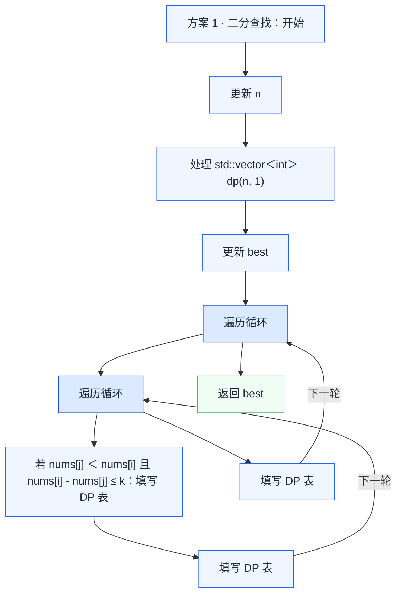

```cpp
// LeetCode 2407. 最长递增子序列II — C++ 版（方案1）
#include <algorithm>                                          // 引入头文件
#include <cassert>                                            // 引入头文件
#include <iostream>                                           // 引入头文件
#include <vector>                                             // 引入头文件
static int lengthOfLIS(const std::vector<int> &nums, int k) { // 定义函数/方法 lengthOfLIS
    int n = static_cast<int>(nums.size()); // 把 static_cast 小于 int 超过 (数组.大小()) 存入 元素个数
    std::vector<int> dp(n, 1);             // std::vector 小于 int 超过 DP 表(元素个数, 1);
    int best = 0;                          // 把 0 存入 当前最优
    for (int i = 0; i < n; ++i) { // 让 下标 i 从 0 开始计数，下标 i 小于 元素个数 就继续
        for (int j = 0; j < i; ++j) { // 让 下标 j 从 0 开始计数，下标 j 小于 下标 i 就继续
            if (nums[j] < nums[i] && nums[i] - nums[j] <= k)
                dp[i] = std::max(dp[i], dp[j] + 1);
        }
        best = std::max(best, dp[i]); // 把 std::取较大值 当前最优, DP 表[下标 i]); 写入 当前最优
    }
    return best; // 返回 当前最优
}
int main() {
    assert(lengthOfLIS({4, 2, 1, 4, 3, 4, 5, 8, 15}, 3) == 5);
    assert(lengthOfLIS({1}, 1) == 1);
    assert(lengthOfLIS({}, 3) == 0);
    std::cout << "PASS" << std::endl;
} // 全部用例通过，输出 PASS
```

### R 实现（1 种方案）

R 的全部方案如下，每个方案都内嵌用例自测，可独立运行（老仓库 python/go 文件遵循「打印结果」约定）：

#### 方案 1：二分查找

**思路与代码分析**：核心是「二分查找」。R 版用向量化思维与 1 起始下标，注意 1:n 的降序陷阱。代码里依次做这些事：DP 表逐项填充；双重循环遍历。**走读**：方案 1 · 二分查找：开始 → 处理 n ＜- length(nums) → 处理 dp ＜- rep(1L, n) → 处理 best ＜- 0L → 循环 i：遍历 seq_len(n) → 循环 j：遍历 seq_len(i - 1) → 若 nums[j] ＜ nums[i] 且 nums[i] - nums[j] ≤ k 且 dp[j] + 1L ＞ dp[i]：填写 DP 表 → 填写 DP 表 → 若 dp[i] ＞ best：填写 DP 表 → 填写 DP 表 → 处理 best → 返回结果。

**运行架构**（真实控制流）：

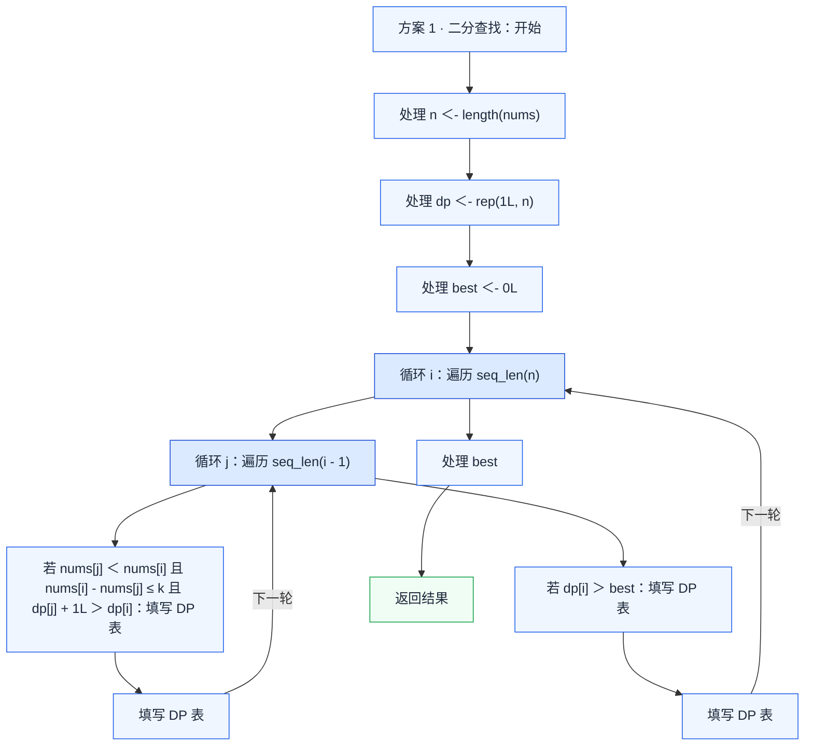

```r
# 版（方案1） 定义函数 length_of_lis_k（参数：数组, 下标 k）
length_of_lis_k <- function(nums, k) {
    n <- length(nums)  # 把 长度(数组) 存入 元素个数
    dp <- rep(1L, n)  # 把 rep(1L, 元素个数) 存入 DP 表
    best <- 0L  # 把 0L 存入 当前最优
    for (i in seq_len(n)) {
        # for (下标 i in seq_len(元素个数)) { for (下标 j in seq_len(下标 i 减 1)) {
        for (j in seq_len(i - 1)) {
            if (nums[j] < nums[i] && nums[i] - nums[j] <= k && dp[j] + 1L > dp[i])
                dp[i] <- dp[j] + 1L
        }
        if (dp[i] > best)
            best <- dp[i]  # 若 DP 表[下标 i] 超过 当前最优) 当前最优 小于 减 DP 表[下标 i]
    }
    best  # 当前最优
}
stopifnot(length_of_lis_k(c(4, 2, 1, 4, 3, 4, 5, 8, 15), 3) == 5)  # 断言校验
stopifnot(length_of_lis_k(c(1), 1) == 1)  # 断言校验
stopifnot(length_of_lis_k(integer(0), 3) == 0)  # 断言校验
cat("PASS\n")  # 全部用例通过，输出 PASS
```

### Zig 实现（1 种方案）

Zig 的全部方案如下，每个方案都内嵌用例自测，可独立运行（老仓库 python/go 文件遵循「打印结果」约定）：

#### 方案 1：二分查找

**思路与代码分析**：核心是「二分查找」。Zig 版显式分配与清零，整型边界处理严格。代码里依次做这些事：DP 表逐项填充；双重循环遍历。**走读**：方案 1 · 二分查找：开始 → 计算 n → 计算 dp → 计算 best → 遍历集合元素 → 填写 DP 表 → 遍历集合元素 → 若 nums[j] ＜ nums[i] and nums[i] - nums[j] ≤ k and dp[j] + 1 ＞ dp[i]：填写 DP 表 → 若 dp[i] ＞ best：填写 DP 表 → 返回 best。

**运行架构**（真实控制流）：

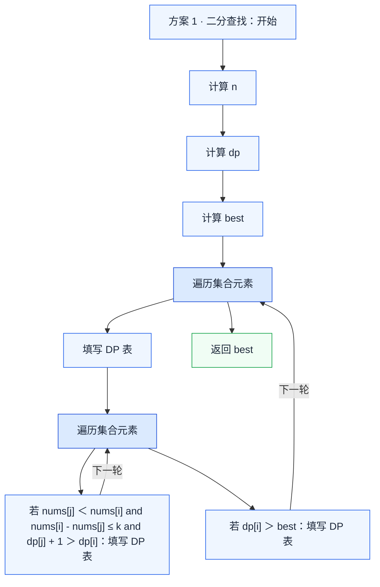

```zig
// LeetCode 2407. 最长递增子序列II — Zig 版（方案1）
const std = @import("std"); // 把 @import(「std」) 存入 std
fn lengthOfLIS(nums: []const i32, k: i32) i32 { // 定义函数/方法 lengthOfLIS
    const n = nums.len; // 把 数组.长度 存入 元素个数
    var dp: [4096]i32 = undefined; // 把 undefined; 写入 var dp: [4096]i32
    var best: i32 = 0; // 把 0; 写入 var best: i32
    for (0..n) |i| { // 让 下标 i 从 0 走到 元素个数 减一
        dp[i] = 1; // 把 1; 写入 dp[i]
        for (0..i) |j| { // 让 下标 j 从 0 走到 下标 i 减一
            if (nums[j] < nums[i] and nums[i] - nums[j] <= k and dp[j] + 1 > dp[i]) dp[i] = dp[j] + 1;
        }
        if (dp[i] > best) best = dp[i]; // 若 DP 表[下标 i] 超过 当前最优) 当前最优 赋值为 DP 表[下标 i];
    }
    return best; // 返回 当前最优
}
pub fn main() !void { // 程序入口：跑内嵌自测用例
    if (lengthOfLIS(&[_]i32{ 4, 2, 1, 4, 3, 4, 5, 8, 15 }, 3) != 5) return error.TestFailed;
    if (lengthOfLIS(&[_]i32{1}, 1) != 1) return error.TestFailed; // 若 lengthOfLIS( 按位与 [_]i32{1}, 1) 不等于 1，直接返回 error.TestFailed
    if (lengthOfLIS(&[_]i32{}, 3) != 0) return error.TestFailed; // 若 lengthOfLIS( 按位与 [_]i32{}, 3) 不等于 0，直接返回 error.TestFailed
    std.debug.print("PASS\n", .{});
} // 全部用例通过，输出 PASS
```

### Dart 实现（1 种方案）

Dart 的全部方案如下，每个方案都内嵌用例自测，可独立运行（老仓库 python/go 文件遵循「打印结果」约定）：

#### 方案 1：二分查找

**思路与代码分析**：核心是「二分查找」。Dart 版用可空类型标注与集合方法，注意空安全。代码里依次做这些事：DP 表逐项填充；双重循环遍历。**走读**：方案 1 · 二分查找：开始 → 更新 n → 填写 DP 表 → 处理 n, → 处理 1, → 处理 ) → 计算 best → 遍历循环 → 遍历循环 → 若 nums[j] ＜ nums[i] 且 nums[i] - nums[j] ≤ k 且 dp[j] + 1 ＞ dp[i]：填写 DP 表 → 填写 DP 表 → 若 dp[i] ＞ best：填写 DP 表 → 填写 DP 表 → 返回 best。

**运行架构**（真实控制流）：

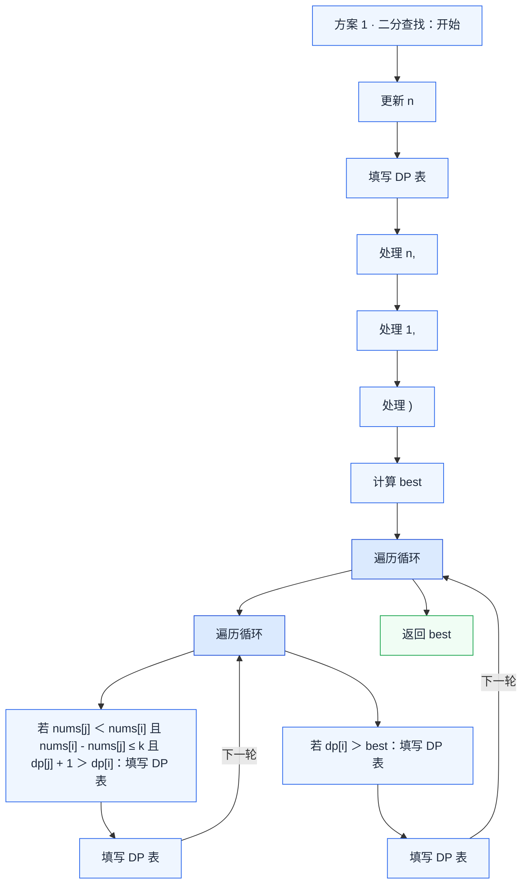

```dart
// LeetCode 2407. 最长递增子序列II — Dart 版（方案1）
int lengthOfLIS(List<int> nums, int k) {
  // 定义函数/方法 lengthOfLIS
  final n = nums.length; // 把 数组.长度 存入 元素个数
  final dp = List<int>.filled(
    n,
    1,
  ); // 把 List 小于 int 超过 .filled(元素个数, 1) 存入 DP 表
  var best = 0; // 把 0 存入 当前最优
  for (var i = 0; i < n; i++) {
    // 让 下标 i 从 0 开始计数，下标 i 小于 元素个数 就继续
    for (var j = 0; j < i; j++) {
      // 让 下标 j 从 0 开始计数，下标 j 小于 下标 i 就继续
      if (nums[j] < nums[i] && nums[i] - nums[j] <= k && dp[j] + 1 > dp[i])
        dp[i] = dp[j] + 1;
    }
    if (dp[i] > best)
      best = dp[i]; // 若 DP 表[下标 i] 超过 当前最优) 当前最优 赋值为 DP 表[下标 i];
  }
  return best; // 返回 当前最优
}

void main() {
  if (lengthOfLIS([4, 2, 1, 4, 3, 4, 5, 8, 15], 3) != 5) throw StateError('c1');
  if (lengthOfLIS([1], 1) != 1) throw StateError('c2');
  if (lengthOfLIS([], 3) != 0) throw StateError('c3');
  print('PASS');
} // 全部用例通过，输出 PASS
```

---

## 内容总结

- **最长递增子序列 ii**（动态规划 · Hard）：共 1 个方案，主线思路「二分查找」；时间 O(log n)；动画演示DP 表填充过程，附录给出 11 种语言 × 全部方案的可运行实现。
- 来源博客：[https://blog.csdn.net/tyro_java/article/details/144827578](https://blog.csdn.net/tyro_java/article/details/144827578)
- 导航：[📋 总目录](../) ｜ [← 194 并行课程 iii](../194_并行课程_iii/) ｜ [196 编辑距离 →](../196_编辑距离/)
