# 196 · 编辑距离（第十阶段 · 动态规划 · Hard）

> **难度**：⭐⭐⭐ Hard ｜ **专题**：动态规划
> **学习定位**：第十阶段 · 动态规划第 196 篇 ｜ **解法数**：2
> **内容总结**：**编辑距离**（动态规划 · Hard）：共 2 个方案，主线思路「迭代指针处理」；时间 O(n)（单趟线性扫描）；动画演示DP 表填充过程，附录给出 11 种语言 × 全部方案的可运行实现。

---

## 题目描述

给你两个单词 `word1` 和 `word2`， 请返回将 `word1` 转换成 `word2` 所使用的最少操作数 。

你可以对一个单词进行如下三种操作：

 插入一个字符
 删除一个字符
 替换一个字符

示例 1：

输入：word1 = 「horse」, word2 = 「ros」
输出：3
解释：
horse -> rorse （将 'h' 替换为 'r'）
rorse -> rose （删除 'r'）
rose -> ros （删除 'e'）

示例 2：

输入：word1 = 「intention」, word2 = 「execution」
输出：5
解释：
intention -> inention （删除 't'）
inention -> enention （将 'i' 替换为 'e'）
enention -> exention （将 'n' 替换为 'x'）
exention -> exection （将 'n' 替换为 'c'）
exection -> execution （插入 'u'）

提示：

 `0 
 `word1` 和 `word2` 由小写英文字母组成

- 主函数签名：`function treeToLevel(root: any): any[]`

**用例演示**（摘自主解法内嵌自测，输入到输出一目了然）：

```typescript
  const cases = [
    { in: ['horse', 'ros'], want: 3 },
    { in: ['intention', 'execution'], want: 5 },
    { in: ['', 'abc'], want: 3 },
    { in: ['abc', 'abc'], want: 0 },
  ];
```

> 题面与 [leetcode.cn 官方](https://leetcode.cn/problems/edit-distance/)一致，示例配图取自官方题面。

**数据范围与注意事项**：

- `0 <= word1.length, word2.length <= 500`
- `word1` 和 `word2` 由小写英文字母组成
- **易错点**：初始化（第 0 行或列）的含义要想清楚，它决定后续转移是否成立。

## 题目分析

**场景是什么**：把大问题拆成小问题并记住结果，对应真实开发里的编辑距离、资源规划。本题就是该场景的 Hard 级练习，主线做法是「迭代指针处理」。

**主线怎么解**：把主解法从头到尾过一遍，它其实在依次做这几件事：队列或堆的调度。

## 解题思路

**方案对比**（共 2 个方案，由浅入深）：

| 方案 | 时间复杂度 | 空间复杂度 |
|---|---|---|
| 方案 1 · 迭代指针处理 | O(n)（单趟线性扫描） | O(1) 到 O(n)（视辅助结构） |
| 方案 2 · 直接实现 | O(n) 量级 | O(n) |

**由浅入深的路径**：迭代指针处理 → 直接实现；每往右一步，都在补上一步的短板。

**方案间的取舍**：方案 1（迭代指针处理）；方案 2（直接实现）。数据规模小、可读性优先时选靠前的方案；规模大、性能优先时选靠后的方案。

**怎么读这一篇**：

- 🐣 **新手路线**：把「题目描述」的示例 1 在纸上手推一遍 → 读方案 1（最直观的写法）与它的代码走读 → 按「运行方式」本地跑通看 PASS → 回头对比方案 2 之后的写法差在哪
- 🦅 **大佬路线**：直接锁定最优方案 1（迭代指针处理，O(n)（单趟线性扫描））→ 跳读该方案代码与走读 → 用「逐步拆解与面试追问」补齐复杂度推导与边界追问

### 动态算法图（DP 表填充，GIF 自动循环）


动画演示动态规划专题里DP 表填充的典型过程；每个方案在「TypeScript 解题方案」一节还配了专属动画与专属流程图。

### 主解法流程图（真实控制流）

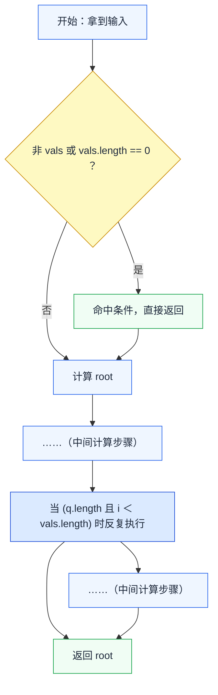

## TypeScript 解题方案（2 个方案逐个讲）

> **运行与提交**：每个方案都是自包含文件（内嵌用例自测，输出 PASS），整块复制到 `.ts` 文件后 `node 文件名` 即可运行。提交 LeetCode 时，把 `demo` 内的算法函数与辅助类型/函数整体取出、置于文件顶层即可。涉及交互/特殊接口的题以题面给定签名为准。

### 方案 1：迭代指针处理

**分析与思路**：核心做法是「迭代指针处理」。代码里依次做这些事：队列或堆的调度。

**运行方式**：`node 本文件`，内嵌用例全部通过会输出 PASS。


**方案专属流程图**（真实控制流）：

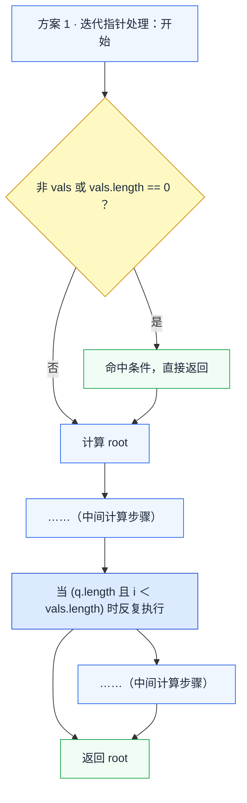

```typescript
class TreeNode {
  // 定义类型
  val: any;
  left: any;
  right: any; // 值: any; 左边界: any; 右边界: any;
  constructor(val?: any, left?: any, right?: any) {
    // constructor(值?: any, 左边界?: any, 右边界?: any) {
    this.val = val === undefined ? 0 : val; // 把 (值 全等于 undefined ? 0 : 值); 写入 值
    this.left = left === undefined ? null : left; // 把 (左边界 全等于 undefined ? null : 左边界); 写入 左边界
    this.right = right === undefined ? null : right; // 把 (右边界 全等于 undefined ? null : 右边界); 写入 右边界
  }
}
function buildTree(vals: any): any {
  // 定义函数/方法 buildTree
  if (!vals || vals.length === 0) return null; // 若 取反 vals 或 vals.长度 全等于 0，直接返回 null
  const root = new TreeNode(vals[0]);
  const q: any[] = [root];
  let i = 1;
  while (q.length && i < vals.length) {
    // 循环，直到不满足「节点.长度 且 下标 i 小于 vals.长度」
    const node = q.shift(); // 把 节点.shift() 存入 节点
    if (vals[i] !== null && vals[i] !== undefined) {
      node.left = new TreeNode(vals[i]);
      q.push(node.left);
    }
    i++; // 下标 i 加一
    if (i < vals.length && vals[i] !== null && vals[i] !== undefined) {
      node.right = new TreeNode(vals[i]);
      q.push(node.right);
    }
    i++; // 下标 i 加一
  }
  return root; // 返回 根节点
}
function treeToLevel(root: any): any[] {
  // 定义函数/方法 treeToLevel
  if (!root) return []; // 若 取反 根节点，直接返回 []
  const out: any[] = [];
  const q: any[] = [root]; // 把 []; const 节点: any[] 赋值为 [根节点]; 写入 const out: any[]
  while (q.length) {
    // 循环，直到不满足「节点.长度」
    const n = q.shift(); // 把 节点.shift() 存入 元素个数
    if (n === null || n === undefined) {
      out.push(null);
      continue;
    }
    out.push(n.val);
    q.push(n.left);
    q.push(n.right); // 把 元素个数.值 压入栈/数组尾部
  }
  while (out.length && out[out.length - 1] === null) out.pop(); // 循环，直到不满足「out.长度 且 out[out.长度 减 1] 全等于 null) out 弹出 );」
  return out; // 返回 out
}
class ListNode {
  // 定义类型
  val: any;
  next: any; // 值: any; 下一个: any;
  constructor(val?: any, next?: any) {
    this.val = val === undefined ? 0 : val;
    this.next = next === undefined ? null : next;
  }
}
function buildList(vals: any): any {
  // 定义函数/方法 buildList
  const dummy = new ListNode(0);
  let cur = dummy; // 把 new ListNode(0); let 当前值 赋值为 哨兵节点 存入 哨兵节点
  for (const v of vals) {
    cur.next = new ListNode(v);
    cur = cur.next;
  } // 把 new ListNode(值); 当前值 赋值为 当前值.下一个; } 写入 下一个
  return dummy.next; // 返回 哨兵节点.下一个
}
function listToArray(head: any): any[] {
  // 定义函数/方法 listToArray
  const out: any[] = [];
  let p = head; // 把 []; let 节点 赋值为 头节点; 写入 const out: any[]
  while (p) {
    out.push(p.val);
    p = p.next;
  } // 循环，直到不满足「节点) { out 追加 节点.值); 节点 赋值为 节点.下一个; }」
  return out; // 返回 out
}
// python-runtime shims
function pyLen(a: any): number {
  // 定义函数/方法 pyLen
  if (a === null || a === undefined) return 0; // 若 数组 全等于 null 或 数组 全等于 undefined，直接返回 0
  if (
    typeof a === 'string' ||
    Array.isArray(a) ||
    a instanceof Set ||
    a instanceof Map
  )
    return a.length ?? a.size;
  if (typeof a === 'object') return Object.keys(a).length; // 若 typeof 数组 全等于 'object'，直接返回 Object.keys(数组).长度
  return 0; // 返回 0
}
function pySlice(a: any, i: any, j: any, step?: any): any {
  // 定义函数/方法 pySlice
  if (typeof a === 'string') {
    const r = [...a].slice(i ?? 0, j ?? a.length);
    return step ? r.reverse().join('') : r.join('');
  }
  const arr = Array.isArray(a) ? a : [...a]; // 把 Array.isArray(数组) ? 数组 : 复制的 数组 存入 数组
  return arr.slice(i ?? 0, j ?? arr.length); // 返回 数组 截取 下标 i ?? 0, 下标 j ?? 数组.长度)
}
function pyRange(a: any, b?: any, step?: any): any[] {
  // 定义函数/方法 pyRange
  let s = 0,
    e = a,
    st = 1; // 把 0, e 赋值为 数组, st 赋值为 1 存入 字符串
  if (b !== undefined) {
    s = a;
    e = b;
  } // 若 b 不等于 undefined) { 字符串 赋值为 数组; e 赋值为 b; }
  if (step !== undefined) st = step; // 若 步数 不等于 undefined) st 赋值为 步数;
  const out: any[] = []; // 把 []; 写入 const out: any[]
  if (st > 0) for (let i = s; i < e; i += st) out.push(i);
  else for (let i = s; i > e; i += st) out.push(i); // 否则
  return out; // 返回 out
}
function pyIn(x: any, coll: any): boolean {
  // 定义函数/方法 pyIn
  if (coll === null || coll === undefined) return false; // 若 coll 全等于 null 或 coll 全等于 undefined，直接返回 false
  if (Array.isArray(coll)) return coll.includes(x); // 若 Array.isArray(coll)，直接返回 coll 是否包含 x)
  if (coll instanceof Set || coll instanceof Map) return coll.has(x); // 若 coll instanceof Set 或 coll instanceof Map，直接返回 coll.has(x)
  if (typeof coll === 'object') return x in coll; // 若 typeof coll 全等于 'object'，直接返回 x in coll
  if (typeof coll === 'string') return coll.indexOf(x) >= 0; // 若 typeof coll 全等于 'string'，直接返回 coll 查找 x) 不低于 0
  return false; // 返回 false
}
function pySorted(a: any): any[] {
  // 定义函数/方法 pySorted
  const arr = typeof a === 'string' ? [...a] : [...a]; // 把 (typeof 数组 全等于 'string') ? 复制的 数组 : 复制的 数组 存入 数组
  return arr.sort((x: any, y: any) => (x < y ? -1 : x > y ? 1 : 0));
}
function pyMin(a: any, b?: any): any {
  if (b !== undefined) return Math.min(a, b);
  if (Array.isArray(a) || a instanceof Set) return Math.min(...a);
  return Math.min(a);
} // 定义函数/方法 pyMin
function pyMax(a: any, b?: any): any {
  if (b !== undefined) return Math.max(a, b);
  if (Array.isArray(a) || a instanceof Set) return Math.max(...a);
  return Math.max(a);
} // 定义函数/方法 pyMax
function pySum(a: any): number {
  let s = 0;
  for (const v of a) s += v;
  return s;
} // 定义函数/方法 pySum
function pyAbs(x: any): number {
  return Math.abs(x);
} // 定义函数/方法 pyAbs
function pyEnumerate(a: any): any[] {
  const out: any[] = [];
  let i = 0;
  for (const v of a) {
    out.push([i, v]);
    i++;
  }
  return out;
} // 定义函数/方法 pyEnumerate
function pyZip(a: any, b: any): any[] {
  const n = Math.min(a.length, b.length);
  const out: any[] = [];
  for (let i = 0; i < n; i++) out.push([a[i], b[i]]);
  return out;
} // 定义函数/方法 pyZip
function pyDictGet(d: any, k: any, def?: any): any {
  return k in d ? d[k] : def === undefined ? null : def;
} // 定义函数/方法 pyDictGet
function pyPrint(...args: any[]): void {
  console.log(
    args
      .map((a) => (typeof a === 'object' && a !== null ? JSON.stringify(a) : a))
      .join(' '),
  );
} // 定义函数/方法 pyPrint
// collections / heapq
function heapPush(h: any[], x: any): void {
  h.push(x);
  let i = h.length - 1;
  while (i > 0) {
    const p = (i - 1) >> 1;
    if (h[p] <= h[i]) break;
    [h[p], h[i]] = [h[i], h[p]];
    i = p;
  }
} // 定义函数/方法 heapPush
function heapPop(h: any[]): any {
  const top = h[0];
  const last = h.pop();
  if (h.length) {
    h[0] = last;
    let i = 0;
    const n = h.length;
    while (true) {
      let l = 2 * i + 1,
        r = 2 * i + 2,
        s = i;
      if (l < n && h[l] < h[s]) s = l;
      if (r < n && h[r] < h[s]) s = r;
      if (s === i) break;
      [h[s], h[i]] = [h[i], h[s]];
      i = s;
    }
  }
  return top;
} // 定义函数/方法 heapPop
class Deque {
  private a: any[] = [];
  push(x: any) {
    this.a.push(x);
  }
  pushLeft(x: any) {
    this.a.unshift(x);
  }
  pop() {
    return this.a.pop();
  }
  popLeft() {
    return this.a.shift();
  }
  get length() {
    return this.a.length;
  }
  toArray() {
    return this.a.slice();
  }
} // 定义类型
function Counter(iter: any): any {
  const m: any = {};
  for (const v of iter) m[v] = (m[v] || 0) + 1;
  return m;
} // 定义函数/方法 Counter
function gcd(a: any, b: any): any {
  while (b) {
    [a, b] = [b, a % b];
  }
  return a;
} // 定义函数/方法 gcd
function pyInf(): number {
  return Infinity;
} // 定义函数/方法 pyInf

function norm(x: any): any {
  // 定义函数/方法 norm
  if (x === null || x === undefined) return null; // 若 x 全等于 null 或 x 全等于 undefined，直接返回 null
  if (typeof x === 'object') {
    // 若 typeof x 全等于 'object'
    if (x instanceof Deque) return x.toArray(); // 若 x instanceof Deque，直接返回 x.toArray()
    if (Array.isArray(x)) return x.map(norm); // 若 Array.isArray(x)，直接返回 x.映射表(norm)
    if (
      typeof x.val === 'number' &&
      (typeof x.left !== 'undefined' || typeof x.right !== 'undefined')
    )
      return treeToLevel(x);
    if (typeof x.next !== 'undefined' && typeof x.val === 'number')
      return listToArray(x);
    if (x instanceof Set) return [...x].sort(); // 若 x instanceof Set，直接返回 复制的 x 排序 )
    if (x instanceof Map) return Object.fromEntries(x); // 若 x instanceof Map，直接返回 Object.fromEntries(x)
    const o: any = {};
    for (const k of Object.keys(x)) o[k] = norm(x[k]);
    return o;
  }
  return x; // 返回 x
}
function eq(a: any, b: any): boolean {
  // 定义函数/方法 eq
  const x = norm(a),
    y = norm(b); // 把 norm(数组), y 赋值为 norm(b) 存入 x
  if (x === y) return true; // 若 x 全等于 y，直接返回 true
  if (x === null || y === null) return x === y; // 若 x 全等于 null 或 y 全等于 null，直接返回 x 全等于 y
  if (Array.isArray(x) && Array.isArray(y)) {
    // 若 Array.isArray(x) 且 Array.isArray(y
    if (x.length !== y.length) return false; // 若 x.长度 不等于 y.长度，直接返回 false
    for (let i = 0; i < x.length; i++) if (!eq(x[i], y[i])) return false; // 让 下标 i 从 0 开始计数，下标 i 小于 x.长度 就继续
    return true; // 返回 true
  }
  if (typeof x === 'object' && typeof y === 'object') {
    // 若 typeof x 全等于 'object' 且 typeof y 全等于 'object'
    const kx = Object.keys(x),
      ky = Object.keys(y); // 把 Object.keys(x), ky 赋值为 Object.keys(y) 存入 kx
    if (kx.length !== ky.length) return false; // 若 kx.长度 不等于 ky.长度，直接返回 false
    for (const k of kx) if (!eq(x[k], y[k])) return false;
    return true; // 返回 true
  }
  return x === y; // 返回 x 全等于 y
}

function minDistance(w1, w2) {
  // 定义函数/方法 minDistance
  const n = w1.length,
    m = w2.length; // 把 w1.长度, 映射表 赋值为 w2.长度 存入 元素个数
  const dp = Array.from({ length: n + 1 }, () => new Array(m + 1).fill(0));
  for (let i = 0; i <= n; i++) dp[i][0] = i; // 让 下标 i 从 0 开始计数，下标 i 不超过 元素个数 就继续
  for (let j = 0; j <= m; j++) dp[0][j] = j; // 让 下标 j 从 0 开始计数，下标 j 不超过 映射表 就继续
  for (let i = 1; i <= n; i++) {
    // 让 下标 i 从 1 开始计数，下标 i 不超过 元素个数 就继续
    for (let j = 1; j <= m; j++) {
      // 让 下标 j 从 1 开始计数，下标 j 不超过 映射表 就继续
      const c = w1[i - 1] === w2[j - 1] ? 0 : 1; // 把 w1[下标 i 减 1] 全等于 w2[下标 j 减 1] ? 0 : 1 存入 字符
      dp[i][j] = Math.min(
        dp[i - 1][j] + 1,
        dp[i][j - 1] + 1,
        dp[i - 1][j - 1] + c,
      );
    }
  }
  return dp[n][m]; // 返回 DP 表[元素个数][映射表]
}
export function demo(): void {
  // 程序入口：跑内嵌自测用例
  const cases = [
    { in: ['horse', 'ros'], want: 3 },
    { in: ['intention', 'execution'], want: 5 },
    { in: ['', 'abc'], want: 3 },
    { in: ['abc', 'abc'], want: 0 },
  ];
  let fail = false; // 把 false 存入 fail
  for (const c of cases) {
    // for (const 字符 of cases) {
    const got = minDistance(...c.in); // 把 minDistance(...字符.in) 存入 got
    if (!eq(got, c.want)) {
      fail = true;
      console.log(
        'FAIL',
        JSON.stringify(c.in),
        '=>',
        JSON.stringify(got),
        'want',
        JSON.stringify(c.want),
      );
    }
  }
  if (fail) throw new Error('FAILED'); // 若 fail) throw new Error('FAILED');
  console.log('PASS'); // 全部用例通过，输出 PASS
}
demo(); // demo();
```

### 方案 2：直接实现

**分析与思路**：核心做法是「直接实现」。

**运行方式**：`node 本文件`，内嵌用例全部通过会输出 PASS。


**方案专属流程图**（真实控制流）：

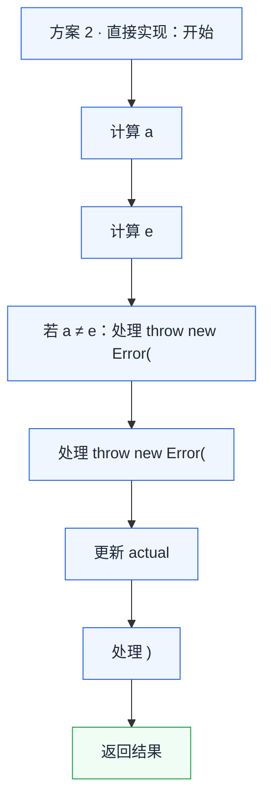

```typescript
function assertEq(actual: any, expected: any, msg: string = ''): void {
  // 定义函数/方法 assertEq
  const a = JSON.stringify(actual);
  const e = JSON.stringify(expected);
  if (a !== e)
    throw new Error(
      'ASSERT FAILED ' + msg + ' :: actual=' + a + ' expected=' + e,
    );
}

function minDistance(word1: string, word2: string): number {
  // 定义函数/方法 minDistance
  const m = word1.length,
    n = word2.length; // 把 word1.长度, 元素个数 赋值为 word2.长度 存入 映射表
  const dp: number[][] = Array.from({ length: m + 1 }, () =>
    new Array(n + 1).fill(0),
  );
  for (let i = 0; i <= m; i++) dp[i][0] = i; // 让 下标 i 从 0 开始计数，下标 i 不超过 映射表 就继续
  for (let j = 0; j <= n; j++) dp[0][j] = j; // 让 下标 j 从 0 开始计数，下标 j 不超过 元素个数 就继续
  for (let i = 1; i <= m; i++)
    for (let j = 1; j <= n; j++) {
      // 让 下标 i 从 1 开始计数，下标 i 不超过 映射表 就继续
      if (word1[i - 1] === word2[j - 1]) dp[i][j] = dp[i - 1][j - 1];
      else
        dp[i][j] = 1 + Math.min(dp[i - 1][j], dp[i][j - 1], dp[i - 1][j - 1]); // 否则
    }
  return dp[m][n]; // 返回 DP 表[映射表][元素个数]
}
export function demo(): void {
  // 程序入口：跑内嵌自测用例
  assertEq(minDistance('horse', 'ros'), 3, 'md'); // 断言校验
  assertEq(minDistance('', 'abc'), 3, 'empty1'); // 断言校验
  assertEq(minDistance('', ''), 0, 'empty'); // 断言校验
  console.log('PASS'); // 全部用例通过，输出 PASS
}
demo(); // demo();
```

## 逐步拆解与面试追问

**复杂度**：时间 O(n)（单趟线性扫描），空间 O(1) 到 O(n)（视辅助结构）

**为什么是这个量级**：每个元素被常数次访问，辅助哈希或栈的开销与 n 同阶

**面试官可能会追问**：

- 状态定义为什么是它？
- 遍历顺序由什么决定？
- 能否滚动数组压空间？

## 关键 API 速查（TS 主解法实际用到，附官方链接）

| API | 作用 | 使用要点 | 官方文档 |
|---|---|---|---|
| `Array.from()` | 类数组/可迭代对象转数组 | Array.from(iterable, mapFn) 可同时映射；对 Set 去重、对字符串按码元拆分；稀疏位会被 undefined 填充 | [官方文档](https://developer.mozilla.org/zh-CN/docs/Web/JavaScript/Reference/Global_Objects/Array/from) |
| `Array.prototype.sort()` | 原地排序 | 默认按字符串 Unicode 序（10 会排在 2 前），数字必须传 (a,b)=>a-b；V8 用 TimSort，稳定，O(n log n)；返回原数组引用 | [官方文档](https://developer.mozilla.org/zh-CN/docs/Web/JavaScript/Reference/Global_Objects/Array/sort) |
| `Array.prototype.map()` | 逐元素映射为新数组 | 回调 (v,i,arr)；返回等长新数组，不改变原数组；稀疏位跳过；链式调用注意中间数组开销 | [官方文档](https://developer.mozilla.org/zh-CN/docs/Web/JavaScript/Reference/Global_Objects/Array/map) |
| `Array.prototype.push()` | 尾部追加 | 返回新长度；可一次多个；均摊 O(1)；会改变原数组 | [官方文档](https://developer.mozilla.org/zh-CN/docs/Web/JavaScript/Reference/Global_Objects/Array/push) |
| `Array.prototype.pop()` | 尾部弹出 | 返回被删元素（空数组返回 undefined）；O(1) | [官方文档](https://developer.mozilla.org/zh-CN/docs/Web/JavaScript/Reference/Global_Objects/Array/pop) |
| `Array.prototype.shift()` | 头部取出 | O(n)（后续元素整体前移）；大量头部操作请用链表或双端结构 | [官方文档](https://developer.mozilla.org/zh-CN/docs/Web/JavaScript/Reference/Global_Objects/Array/shift) |
| `Array.prototype.unshift()` | 头部插入 | O(n)；与 shift 组合可当双端队列 | [官方文档](https://developer.mozilla.org/zh-CN/docs/Web/JavaScript/Reference/Global_Objects/Array/unshift) |
| `Array/String includes()` | 是否包含 | 数组用 SameValueZero（NaN 可判）；字符串按子串；第二个参数为起始下标 | [官方文档](https://developer.mozilla.org/zh-CN/docs/Web/JavaScript/Reference/Global_Objects/Array/includes) |
| `Array/String indexOf()` | 首次出现的下标 | 找不到返回 -1；无法判 NaN（用 includes）；字符串可传起始位 | [官方文档](https://developer.mozilla.org/zh-CN/docs/Web/JavaScript/Reference/Global_Objects/Array/indexOf) |
| `Array/String slice()` | 切片（不改原数组） | slice(start,end) 含头不含尾；负数从尾计；常用于复制数组（slice()） | [官方文档](https://developer.mozilla.org/zh-CN/docs/Web/JavaScript/Reference/Global_Objects/Array/slice) |
| `Array.prototype.join()` | 数组拼接为字符串 | undefined/null 转空串；嵌套数组会展平一层；join('') 用于字符数组还原 | [官方文档](https://developer.mozilla.org/zh-CN/docs/Web/JavaScript/Reference/Global_Objects/Array/join) |
| `Object.keys()` | 对象键名数组 | 仅自身可枚举字符串键（不含 symbol）；配 length 可当计数器 | [官方文档](https://developer.mozilla.org/zh-CN/docs/Web/JavaScript/Reference/Global_Objects/Object/keys) |
| `Object.fromEntries()` | 键值对数组转对象 | 参数为 [k,v] 可迭代；map 出来的键值对可直接转对象 | [官方文档](https://developer.mozilla.org/zh-CN/docs/Web/JavaScript/Reference/Global_Objects/Object/fromEntries) |
| `JSON.stringify()` | 序列化为 JSON 字符串 | 常用于结构化比较（深度相等判定）；undefined/函数/循环引用会被丢弃或抛错 | [官方文档](https://developer.mozilla.org/zh-CN/docs/Web/JavaScript/Reference/Global_Objects/JSON/stringify) |
| `Math.max()` | 最大值 | 配展开 Math.max(...arr)；空参返回 -Infinity；超大数组注意展开参数上限 | [官方文档](https://developer.mozilla.org/zh-CN/docs/Web/JavaScript/Reference/Global_Objects/Math/max) |
| `Math.min()` | 最小值 | 同 max；空参返回 Infinity | [官方文档](https://developer.mozilla.org/zh-CN/docs/Web/JavaScript/Reference/Global_Objects/Math/min) |
| `Math.abs()` | 绝对值 | 入参会被隐式转数字；-0 返回 +0 | [官方文档](https://developer.mozilla.org/zh-CN/docs/Web/JavaScript/Reference/Global_Objects/Math/abs) |

### 各语言官方文档导航

- **TypeScript / JS**：[MDN 中文参考](https://developer.mozilla.org/zh-CN/)
- **Python**：[Python 官方文档](https://docs.python.org/zh-cn/3/)
- **Go**：[Go 标准库](https://pkg.go.dev/std)
- **Java**：[JDK 17 API](https://docs.oracle.com/en/java/javase/17/docs/api/)
- **Rust**：[Rust 标准库](https://doc.rust-lang.org/std/)
- **Lua**：[Lua 5.4 手册](https://www.lua.org/manual/5.4/)
- **C**：[Cppreference C](https://zh.cppreference.com/w/c)
- **C++**：[Cppreference C++](https://zh.cppreference.com/w/cpp)
- **R**：[R 官方手册](https://stat.ethz.ch/R-manual/)
- **Zig**：[Zig 语言文档](https://ziglang.org/documentation/master/)
- **Dart**：[Dart API](https://api.dart.dev/)

## 附录：其他 10 种语言全部实现（每种语言列举其全部方案）

> TypeScript 的全部方案见「TypeScript 解题方案」一节；下面是其余 10 种语言的对应实现，每种语言的每个方案都带思路分析、代码走读与专属运行架构图。
> 每个方案都内嵌用例自测，可独立运行（老仓库 python/go 文件遵循「打印结果」约定）。
> 完整解法文件见 `dsa/<语言>/dp/lc_72_编辑距离/`。

### Python 实现（2 种方案）

Python 的全部方案如下，每个方案都内嵌用例自测，可独立运行（老仓库 python/go 文件遵循「打印结果」约定）：

#### 方案 1：迭代指针处理

**思路与代码分析**：核心是「迭代指针处理」。Python 版用切片与字典推导式简化操作，突出可读性。**走读**：方案 1 · 迭代指针处理：开始 → 更新 n → 命中条件，直接返回 → 循环 i：从 0 到 n + 1 前 → 循环 j：从 0 到 m + 1 前 → 循环 i：从 1 到 n + 1 前 → 循环 j：从 1 到 m + 1 前 → 返回 D[n][m]。

**运行架构**（真实控制流）：

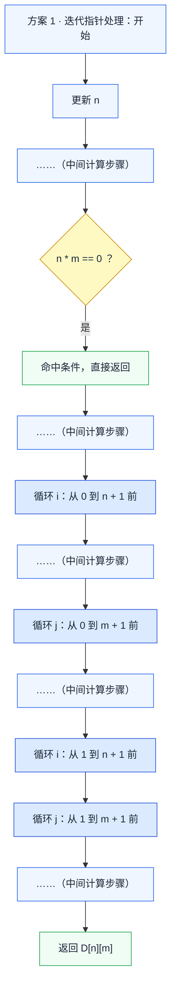

```python
import sys  # 提高递归深度上限（深输入防 RecursionError）

sys.setrecursionlimit(200000)  # 树/链表类题目节点数可达 1e4 量级

def minDistance(word1, word2):  # 定义函数 minDistance（参数：word1, word2）
    n = len(word1)  # 把 长度(word1) 存入 元素个数
    m = len(word2)  # 把 长度(word2) 存入 映射表

    # 有一个字符串为空串
    if n * m == 0:  # 若 元素个数 乘 映射表 等于 0
        return n + m  # 返回 元素个数 加 映射表

    # DP 数组
    D = [
        [0] * (m + 1) for _ in range(n + 1)
    ]  # 把 [[0] 乘 (映射表 加 1) for _ in range(元素个数 加 1)] 存入 D

    # 边界状态初始化
    for i in range(n + 1):  # 让 下标 i 从 元素个数 加 1 遍历
        D[i][0] = i  # 把 下标 i 写入 D[i][0]
    for j in range(m + 1):  # 让 下标 j 从 映射表 加 1 遍历
        D[0][j] = j  # 把 下标 j 写入 D[0][j]

    # 计算所有 DP 值
    for i in range(1, n + 1):  # 让 下标 i 从 1 到 元素个数 加 1 遍历
        for j in range(1, m + 1):  # 让 下标 j 从 1 到 映射表 加 1 遍历
            left = D[i - 1][j] + 1  # 把 D[下标 i 减 1][下标 j] 加 1 存入 左边界
            down = D[i][j - 1] + 1  # 把 D[下标 i][下标 j 减 1] 加 1 存入 down
            left_down = D[i - 1][j - 1]  # 把 D[下标 i 减 1][下标 j 减 1] 存入 left_down
            if word1[i - 1] != word2[j - 1]:  # 若 word1[下标 i 减 1] 不等于 word2[下标 j 减 1]
                left_down += 1  # left_down累加 1
            D[i][j] = min(left, down, left_down)  # 把 取较小值 左边界, down, left_down) 写入 D[i][j]

    return D[n][m]  # 返回 D[元素个数][映射表]

if __name__ == "__main__":  # 若 __name__ 等于 '__main__'
    print(minDistance("horse", "ros"))  # 打印输出
```

#### 方案 2：直接实现

**思路与代码分析**：核心是「直接实现」。Python 版用切片与字典推导式简化操作，突出可读性。代码里依次做这些事：DP 表逐项填充。**走读**：方案 2 · 直接实现：开始 → 更新 n → 填写 DP 表 → 处理 [0] * (n + 1) for _ in range → 处理 ] → 循环 i：从 0 到 m + 1 前 → 填写 DP 表 → 循环 j：从 0 到 n + 1 前 → 填写 DP 表 → 循环 i：从 1 到 m + 1 前 → 循环 j：从 1 到 n + 1 前 → 若 word1[i - 1] == word2[j - 1]：填写 DP 表 → 填写 DP 表 → 填写 DP 表 → 返回 dp[m][n]。

**运行架构**（真实控制流）：

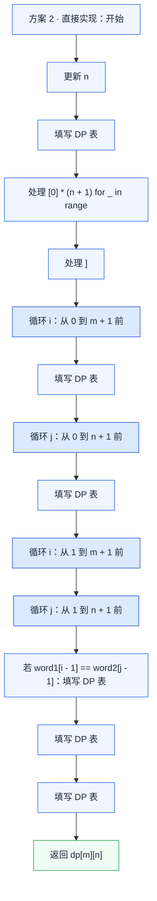

```python
import sys  # 提高递归深度上限（深输入防 RecursionError）

sys.setrecursionlimit(200000)  # 树/链表类题目节点数可达 1e4 量级

def minDistance(word1, word2):  # 定义函数 minDistance（参数：word1, word2）
    m, n = len(word1), len(word2)  # 把 长度(word1), 长度(word2) 写入 m, n
    dp = [
        [0] * (n + 1) for _ in range(m + 1)
    ]  # 把 [[0] 乘 (元素个数 加 1) for _ in range(映射表 加 1)] 存入 DP 表
    for i in range(m + 1):  # 让 下标 i 从 映射表 加 1 遍历
        dp[i][0] = i  # 把 下标 i 写入 dp[i][0]
    for j in range(n + 1):  # 让 下标 j 从 元素个数 加 1 遍历
        dp[0][j] = j  # 把 下标 j 写入 dp[0][j]
    for i in range(1, m + 1):  # 让 下标 i 从 1 到 映射表 加 1 遍历
        for j in range(1, n + 1):  # 让 下标 j 从 1 到 元素个数 加 1 遍历
            if word1[i - 1] == word2[j - 1]:  # 若 word1[下标 i 减 1] 等于 word2[下标 j 减 1]
                dp[i][j] = dp[i - 1][j - 1]  # 把 DP 表[下标 i 减 1][下标 j 减 1] 写入 dp[i][j]
            else:  # 否则
                dp[i][j] = 1 + min(dp[i - 1][j], dp[i][j - 1], dp[i - 1][j - 1])
    return dp[m][n]  # 返回 DP 表[映射表][元素个数]

if __name__ == "__main__":  # 若 __name__ 等于 '__main__'
    print(minDistance("horse", "ros"))  # 打印输出
```

### Go 实现（2 种方案）

Go 的全部方案如下，每个方案都内嵌用例自测，可独立运行（老仓库 python/go 文件遵循「打印结果」约定）：

#### 方案 1：迭代指针处理

**思路与代码分析**：核心是「迭代指针处理」。Go 版用切片与多返回值惯用法，显式处理索引边界。代码里依次做这些事：DP 表逐项填充。**走读**：方案 1 · 迭代指针处理：开始 → 更新 : → 更新 : → 遍历 dp 的下标与元素 i → 填写 DP 表 → 遍历循环 → 填写 DP 表 → 遍历循环 → 填写 DP 表 → 遍历循环 → 遍历循环 → 更新 : → 处理 if w1[i-1] == w2[j-1] → 更新 cost → 填写 DP 表 → 返回 dp[m][n]。

**运行架构**（真实控制流）：

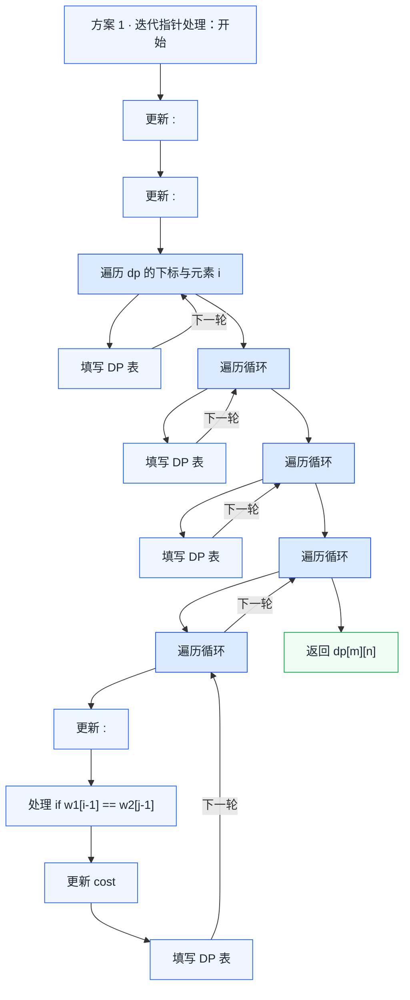

```go
package main // 引入依赖
import (
	"fmt"
	"os"
) // 引入依赖
func minDistance(w1, w2 string) int { // 定义函数/方法 minDistance
	m, n := len(w1), len(w2) // 把 长度(w1), 长度(w2) 写入 m, n :
	dp := make([][]int, m+1) // 把 make([][]int, 映射表 加 1) 写入 dp :
	for i := range dp {
		dp[i] = make([]int, n+1)
	}
	for i := 0; i <= m; i++ {
		dp[i][0] = i
	} // 让 下标 i 从 0 开始计数
	for j := 0; j <= n; j++ {
		dp[0][j] = j
	} // 让 下标 j 从 0 开始计数
	for i := 1; i <= m; i++ { // 让 下标 i 从 1 开始计数
		for j := 1; j <= n; j++ { // 让 下标 j 从 1 开始计数
			cost := 1
			if w1[i-1] == w2[j-1] {
				cost = 0
			}
			dp[i][j] = min3(dp[i-1][j]+1, dp[i][j-1]+1, dp[i-1][j-1]+cost)
		}
	}
	return dp[m][n] // 返回 DP 表[映射表][元素个数]
}
func min3(a, b, c int) int {
	x := a
	if b < x {
		x = b
	}
	if c < x {
		x = c
	}
	return x
} // 定义函数/方法 min3
func main() { // 程序入口：跑内嵌自测用例
	cases := []struct {
		a, b string
		want int
	}{ // 把 []struct{ 数组, b string; want int }{ 写入 cases :
		{"horse", "ros", 3}, {"intention", "execution", 5}, {"", "", 0},
	}
	ok := true                // 把 true 写入 ok :
	for _, c := range cases { // 同时取 _ 与 字符 遍历
		if got := minDistance(c.a, c.b); got != c.want {
			ok = false
			fmt.Printf("FAIL=%v want %v\n", got, c.want)
		}
	}
	if !ok {
		os.Exit(1)
	} // 若 取反 ok { os.Exit(1) }
	fmt.Println("PASS") // 全部用例通过，输出 PASS
}
```

#### 方案 2：直接实现

**思路与代码分析**：核心是「直接实现」。Go 版用切片与多返回值惯用法，显式处理索引边界。代码里依次做这些事：DP 表逐项填充。**走读**：方案 2 · 直接实现：开始 → 更新 : → 遍历 dp 的下标与元素 i → 遍历循环 → 遍历循环 → 遍历循环 → 遍历循环 → 返回 dp[m][n]。

**运行架构**（真实控制流）：

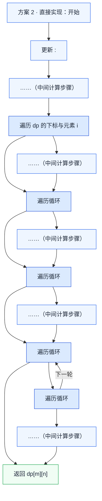

```go
package main // 引入依赖

import (
	"fmt"
	"os"
) // 引入依赖

func minDistance(word1, word2 string) int { // 定义函数/方法 minDistance
	m, n := len(word1), len(word2) // 把 长度(word1), 长度(word2) 写入 m, n :
	dp := make([][]int, m+1)       // 把 make([][]int, 映射表 加 1) 写入 dp :
	for i := range dp {            // 把 range DP 表 { 写入 for i :
		dp[i] = make([]int, n+1) // 把 make([]int, 元素个数 加 1) 写入 dp[i]
	}
	for i := 0; i <= m; i++ { // 让 下标 i 从 0 开始计数
		dp[i][0] = i // 把 下标 i 写入 dp[i][0]
	}
	for j := 0; j <= n; j++ { // 让 下标 j 从 0 开始计数
		dp[0][j] = j // 把 下标 j 写入 dp[0][j]
	}
	for i := 1; i <= m; i++ { // 让 下标 i 从 1 开始计数
		for j := 1; j <= n; j++ { // 让 下标 j 从 1 开始计数
			if word1[i-1] == word2[j-1] { // 若 word1[下标 i 减 1] 等于 word2[下标 j 减 1]
				dp[i][j] = dp[i-1][j-1] // 把 DP 表[下标 i 减 1][下标 j 减 1] 写入 dp[i][j]
			} else { // 否则
				v := dp[i-1][j]     // 把 DP 表[下标 i 减 1][下标 j] 写入 v :
				if dp[i][j-1] < v { // 若 DP 表[下标 i][下标 j 减 1] 小于 值
					v = dp[i][j-1] // 把 DP 表[下标 i][下标 j 减 1] 写入 值
				}
				if dp[i-1][j-1] < v { // 若 DP 表[下标 i 减 1][下标 j 减 1] 小于 值
					v = dp[i-1][j-1] // 把 DP 表[下标 i 减 1][下标 j 减 1] 写入 值
				}
				dp[i][j] = 1 + v // 把 1 加 值 写入 dp[i][j]
			}
		}
	}
	return dp[m][n] // 返回 DP 表[映射表][元素个数]
}

func main() { // 程序入口：跑内嵌自测用例
	type tc struct { // 定义类型
		a, b string // 数组, b string
		want int    // want int
	}
	cases := []tc{ // 把 []tc{ 写入 cases :
		{"horse", "ros", 3},
		{"", "", 0},
	}
	ok := true                // 把 true 写入 ok :
	for _, c := range cases { // 同时取 _ 与 字符 遍历
		if got := minDistance(c.a, c.b); got != c.want { // 若 got : 赋值为 minDistance(字符.数组, 字符.b); got 不等于 字符.want
			ok = false                                                                // 把 false 写入 ok
			fmt.Printf("FAIL minDistance(%q,%q)=%v want %v\n", c.a, c.b, got, c.want) // 打印输出
		}
	}
	if !ok { // 若 取反 ok
		os.Exit(1) // os.Exit(1)
	}
	fmt.Println("PASS") // 全部用例通过，输出 PASS
}
```

### Java 实现（2 种方案）

Java 的全部方案如下，每个方案都内嵌用例自测，可独立运行（老仓库 python/go 文件遵循「打印结果」约定）：

#### 方案 1：迭代指针处理

**思路与代码分析**：核心是「迭代指针处理」。Java 版用类与静态方法组织，集合操作显式明了。代码里依次做这些事：双重循环遍历。**走读**：方案 1 · 迭代指针处理：开始 → 更新 n → 命中条件，直接返回 → 遍历循环 → 遍历循环 → 遍历循环 → 遍历循环 → 返回 D[n][m]。

**运行架构**（真实控制流）：

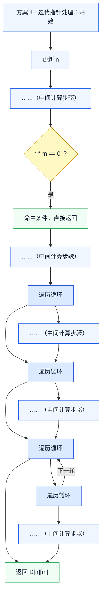

```java
package com.webfault.dsa; // 引入依赖

import java.util.*; // 引入依赖

class lc72_solution111 { // 定义类型
  public int minDistance(String word1, String word2) { // 定义函数/方法 minDistance
    int n = word1.length(); // 把 word1.长度() 存入 元素个数
    int m = word2.length(); // 把 word2.长度() 存入 映射表
    if (n * m == 0) { // 若 元素个数 乘 映射表 等于 0
      return n + m; // 返回 元素个数 加 映射表
    }
    int[][] D = new int[n + 1][m + 1]; // 把 new int[元素个数 加 1][映射表 加 1]; 写入 int[][] D
    for (int i = 0; i <= n; i++) { // 让 下标 i 从 0 开始计数，下标 i 不超过 元素个数 就继续
      D[i][0] = i; // 把 下标 i; 写入 D[i][0]
    }
    for (int j = 0; j <= m; j++) { // 让 下标 j 从 0 开始计数，下标 j 不超过 映射表 就继续
      D[0][j] = j; // 把 下标 j; 写入 D[0][j]
    }
    for (int i = 1; i < n + 1; i++) { // 让 下标 i 从 1 开始计数，下标 i 小于 元素个数 加 1 就继续
      for (int j = 1; j < m + 1; j++) { // 让 下标 j 从 1 开始计数，下标 j 小于 映射表 加 1 就继续
        int left = D[i - 1][j] + 1; // 把 D[下标 i 减 1][下标 j] 加 1 存入 左边界
        int down = D[i][j - 1] + 1; // 把 D[下标 i][下标 j 减 1] 加 1 存入 down
        int left_down = D[i - 1][j - 1]; // 把 D[下标 i 减 1][下标 j 减 1] 存入 left_down
        if (word1.charAt(i - 1)
            != word2.charAt(j - 1)) { // 若 word1 取字符 下标 i 减 1) 不等于 word2 取字符 下标 j 减 1
          left_down += 1; // left_down累加 1
        }
        D[i][j] =
            Math.min(
                Math.min(left, down),
                left_down); // 把 Math.取较小值 Math.取较小值 左边界, down), left_down); 写入 D[i][j]
      }
    }
    return D[n][m]; // 返回 D[元素个数][映射表]
  }

  public static void main(String[] args) { // public static void main(String[] args) {
    lc72_solution111 s = new lc72_solution111(); // 把 new lc72_solution111(); 写入 lc72_solution111 s
    int got = s.minDistance("horse", "ros"); // 把 字符串.minDistance(「horse」, 「horse」) 存入 got
    if (got != 3) {
      System.out.println("FAIL got " + got);
      throw new RuntimeException("FAILED");
    }
    System.out.println("PASS"); // 全部用例通过，输出 PASS
  }
}
```

#### 方案 2：直接实现

**思路与代码分析**：核心是「直接实现」。Java 版用类与静态方法组织，集合操作显式明了。代码里依次做这些事：DP 表逐项填充；双重循环遍历。**走读**：方案 2 · 直接实现：开始 → 更新 m → 填写 DP 表 → 遍历循环 → 遍历循环 → 遍历循环 → 遍历循环 → 更新 cost → 更新 = → 处理 ? 0 → 处理 : 1 → 填写 DP 表 → 返回 dp[m][n]。

**运行架构**（真实控制流）：

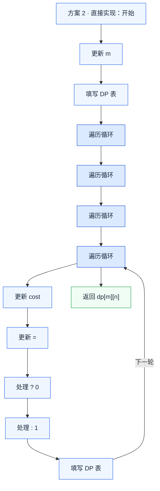

```java
package com.webfault.dsa; // 引入依赖

class Main { // 定义类型
  static int minDistance(String w1, String w2) { // 定义函数/方法 minDistance
    int m = w1.length(), n = w2.length(); // 把 w1.长度(), 元素个数 赋值为 w2.长度() 存入 映射表
    int[][] dp = new int[m + 1][n + 1]; // 把 new int[映射表 加 1][元素个数 加 1]; 写入 int[][] dp
    for (int i = 0; i <= m; i++) dp[i][0] = i; // 让 下标 i 从 0 开始计数，下标 i 不超过 映射表 就继续
    for (int j = 0; j <= n; j++) dp[0][j] = j; // 让 下标 j 从 0 开始计数，下标 j 不超过 元素个数 就继续
    for (int i = 1; i <= m; i++) // 让 下标 i 从 1 开始计数，下标 i 不超过 映射表 就继续
    for (int j = 1; j <= n; j++) { // 让 下标 j 从 1 开始计数，下标 j 不超过 元素个数 就继续
        int cost =
            w1.charAt(i - 1) == w2.charAt(j - 1)
                ? 0
                : 1; // 把 w1 取字符 下标 i 减 1) 等于 w2 取字符 下标 j 减 1) ? 0 : 1 存入 cost
        dp[i][j] = Math.min(dp[i - 1][j] + 1, Math.min(dp[i][j - 1] + 1, dp[i - 1][j - 1] + cost));
      }
    return dp[m][n]; // 返回 DP 表[映射表][元素个数]
  }

  public static void main(String[] args) { // public static void main(String[] args) {
    String[] a = {"horse", "intention", ""};
    String[] b = {"ros", "execution", ""};
    int[] ws = {3, 5, 0};
    boolean ok = true; // 把 true; 写入 boolean ok
    for (int i = 0; i < a.length; i++) { // 让 下标 i 从 0 开始计数，下标 i 小于 数组.长度 就继续
      int got = minDistance(a[i], b[i]); // 把 minDistance(数组[下标 i], b[下标 i]) 存入 got
      if (got != ws[i]) {
        ok = false;
        System.out.println("FAIL " + got + " want " + ws[i]);
      }
    }
    if (!ok) throw new RuntimeException("FAILED"); // 若 取反 ok) throw new RuntimeException(「FAILED」);
    System.out.println("PASS"); // 全部用例通过，输出 PASS
  }
}
```

### Rust 实现（2 种方案）

Rust 的全部方案如下，每个方案都内嵌用例自测，可独立运行（老仓库 python/go 文件遵循「打印结果」约定）：

#### 方案 1：迭代指针处理

**思路与代码分析**：核心是「迭代指针处理」。Rust 版用所有权移动与切片借用改写同一逻辑，注意 Option 与引用边界。代码里依次做这些事：DP 表逐项填充。**走读**：方案 1 · 迭代指针处理：开始 → 计算 a → 遍历 0..=n 中的每个元素 j → 遍历 1..=m 中的每个元素 i → 遍历 1..=n 中的每个元素 j → 返回结果。

**运行架构**（真实控制流）：

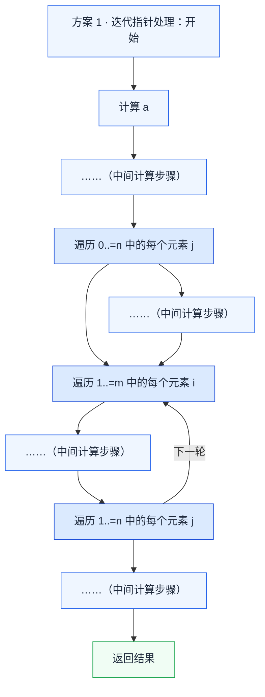

```rust
// LeetCode 72. 编辑距离 — Rust 版（方案1）
fn min_distance(w1: String, w2: String) -> i32 {
    // 定义函数/方法 min_distance
    let a: Vec<char> = w1.chars().collect(); // 把 w1.chars().collect(); 写入 let a: Vec<char>
    let b: Vec<char> = w2.chars().collect(); // 把 w2.chars().collect(); 写入 let b: Vec<char>
    let (m, n) = (a.len(), b.len()); // 把 (数组.长度(), b.长度()); 写入 let (m, n)
    let mut dp = vec![0i32; n + 1]; // 把 vec取反 [0i32; 元素个数 加 1]; 写入 let mut dp
    for j in 0..=n {
        dp[j] = j as i32;
    } // 逐个取出 0 的元素（下标 j）
    for i in 1..=m {
        // 逐个取出 1 的元素（下标 i）
        let mut prev_diag = dp[0]; // 把 DP 表[0]; 写入 let mut prev_diag
        dp[0] = i as i32; // 把 下标 i as i32; 写入 dp[0]
        for j in 1..=n {
            // 逐个取出 1 的元素（下标 j）
            let tmp = dp[j]; // 把 DP 表[下标 j] 存入 临时变量
            dp[j] = if a[i - 1] == b[j - 1] {
                prev_diag
            } else {
                1 + prev_diag.min(dp[j]).min(dp[j - 1])
            };
            prev_diag = tmp; // 把 临时变量; 写入 prev_diag
        }
    }
    dp[n] // DP 表[元素个数]
}
fn main() {
    assert_eq!(min_distance("horse".into(), "ros".into()), 3);
    assert_eq!(min_distance("intention".into(), "execution".into()), 5);
    println!("PASS");
} // 程序入口：跑内嵌自测用例
```

#### 方案 2：直接实现

**思路与代码分析**：核心是「直接实现」。Rust 版用所有权移动与切片借用改写同一逻辑，注意 Option 与引用边界。代码里依次做这些事：DP 表逐项填充。**走读**：方案 2 · 直接实现：开始 → 计算 a → 遍历 0..=n 中的每个元素 j → 遍历 1..=m 中的每个元素 i → 遍历 1..=n 中的每个元素 j → 返回结果。

**运行架构**（真实控制流）：

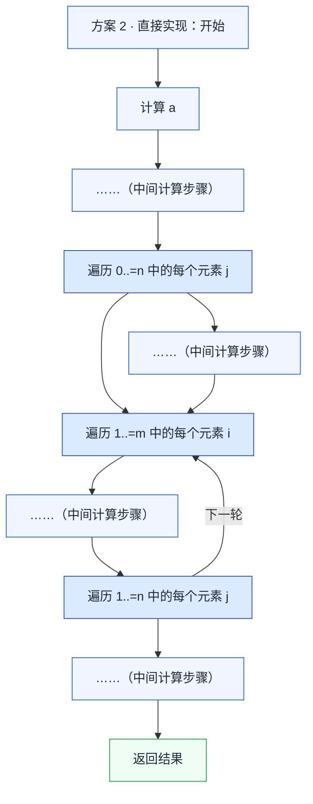

```rust
// LeetCode 72. 编辑距离 — Rust 版（方案2）
fn min_distance(w1: String, w2: String) -> i32 {
    // 定义函数/方法 min_distance
    let a: Vec<char> = w1.chars().collect(); // 把 w1.chars().collect(); 写入 let a: Vec<char>
    let b: Vec<char> = w2.chars().collect(); // 把 w2.chars().collect(); 写入 let b: Vec<char>
    let (m, n) = (a.len(), b.len()); // 把 (数组.长度(), b.长度()); 写入 let (m, n)
    let mut dp = vec![0i32; n + 1]; // 把 vec取反 [0i32; 元素个数 加 1]; 写入 let mut dp
    for j in 0..=n {
        dp[j] = j as i32;
    } // 逐个取出 0 的元素（下标 j）
    for i in 1..=m {
        // 逐个取出 1 的元素（下标 i）
        let mut prev_diag = dp[0]; // 把 DP 表[0]; 写入 let mut prev_diag
        dp[0] = i as i32; // 把 下标 i as i32; 写入 dp[0]
        for j in 1..=n {
            // 逐个取出 1 的元素（下标 j）
            let tmp = dp[j]; // 把 DP 表[下标 j] 存入 临时变量
            dp[j] = if a[i - 1] == b[j - 1] {
                prev_diag
            } else {
                1 + prev_diag.min(dp[j]).min(dp[j - 1])
            };
            prev_diag = tmp; // 把 临时变量; 写入 prev_diag
        }
    }
    dp[n] // DP 表[元素个数]
}
fn main() {
    assert_eq!(min_distance("horse".into(), "ros".into()), 3);
    assert_eq!(min_distance("intention".into(), "execution".into()), 5);
    println!("PASS");
} // 程序入口：跑内嵌自测用例
```

### Lua 实现（2 种方案）

Lua 的全部方案如下，每个方案都内嵌用例自测，可独立运行（老仓库 python/go 文件遵循「打印结果」约定）：

#### 方案 1：迭代指针处理

**思路与代码分析**：核心是「迭代指针处理」。Lua 版用表与 ipairs 遍历，注意 ipairs 遇 nil 即停的语义。代码里依次做这些事：DP 表逐项填充。**走读**：方案 1 · 迭代指针处理：开始 → 更新 n → 填写 DP 表 → 循环 j：从 0 到 n do → 填写 DP 表 → 循环 i：从 1 到 m do → 填写 DP 表 → 填写 DP 表 → 循环 j：从 1 到 n do → 填写 DP 表 → 处理 if w1:sub(i, i) == w2:sub(j, → 填写 DP 表 → 填写 DP 表 → 更新 prev_diag → 返回 dp[n]。

**运行架构**（真实控制流）：

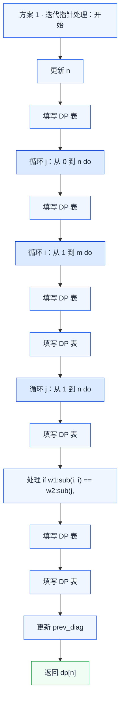

```lua
-- LeetCode 72. 编辑距离 — Lua 版（方案1）
local function min_distance(w1, w2) -- local function min_distance(w1, w2)
	local m, n = #w1, #w2 -- 把 #w1, #w2 写入 local m, n
	local dp = {} -- 把 {} 写入 local dp
	for j = 0, n do
		dp[j] = j
	end -- 让 下标 j 从 0 走到 元素个数（Lua 1 基）
	for i = 1, m do -- 让 下标 i 从 1 走到 映射表（Lua 1 基）
		local prev_diag = dp[0] -- 把 DP 表[0] 写入 local prev_diag
		dp[0] = i -- 把 下标 i 写入 dp[0]
		for j = 1, n do -- 让 下标 j 从 1 走到 元素个数（Lua 1 基）
			local tmp = dp[j] -- 把 DP 表[下标 j] 写入 local tmp
			if w1:sub(i, i) == w2:sub(j, j) then
				dp[j] = prev_diag
			else
				dp[j] = 1 + math.min(prev_diag, dp[j], dp[j - 1])
			end -- 否则
			prev_diag = tmp -- 把 临时变量 存入 prev_diag
		end -- 终点
	end -- 终点
	return dp[n] -- 返回 DP 表[元素个数]
end -- 终点
assert(min_distance("horse", "ros") == 3) -- 断言校验
assert(min_distance("intention", "execution") == 5) -- 断言校验
print("PASS") -- 全部用例通过，输出 PASS
```

#### 方案 2：直接实现

**思路与代码分析**：核心是「直接实现」。Lua 版用表与 ipairs 遍历，注意 ipairs 遇 nil 即停的语义。代码里依次做这些事：DP 表逐项填充。**走读**：方案 2 · 直接实现：开始 → 更新 n → 填写 DP 表 → 循环 j：从 0 到 n do → 填写 DP 表 → 循环 i：从 1 到 m do → 填写 DP 表 → 填写 DP 表 → 循环 j：从 1 到 n do → 填写 DP 表 → 处理 if w1:sub(i, i) == w2:sub(j, → 填写 DP 表 → 填写 DP 表 → 更新 prev_diag → 返回 dp[n]。

**运行架构**（真实控制流）：

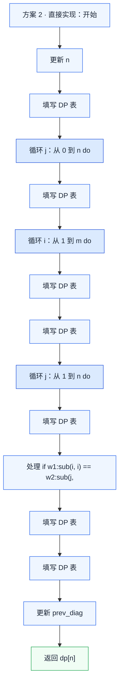

```lua
-- LeetCode 72. 编辑距离 — Lua 版（方案2）
local function min_distance(w1, w2) -- local function min_distance(w1, w2)
	local m, n = #w1, #w2 -- 把 #w1, #w2 写入 local m, n
	local dp = {} -- 把 {} 写入 local dp
	for j = 0, n do
		dp[j] = j
	end -- 让 下标 j 从 0 走到 元素个数（Lua 1 基）
	for i = 1, m do -- 让 下标 i 从 1 走到 映射表（Lua 1 基）
		local prev_diag = dp[0] -- 把 DP 表[0] 写入 local prev_diag
		dp[0] = i -- 把 下标 i 写入 dp[0]
		for j = 1, n do -- 让 下标 j 从 1 走到 元素个数（Lua 1 基）
			local tmp = dp[j] -- 把 DP 表[下标 j] 写入 local tmp
			if w1:sub(i, i) == w2:sub(j, j) then
				dp[j] = prev_diag
			else
				dp[j] = 1 + math.min(prev_diag, dp[j], dp[j - 1])
			end -- 否则
			prev_diag = tmp -- 把 临时变量 存入 prev_diag
		end -- 终点
	end -- 终点
	return dp[n] -- 返回 DP 表[元素个数]
end -- 终点
assert(min_distance("horse", "ros") == 3) -- 断言校验
assert(min_distance("intention", "execution") == 5) -- 断言校验
print("PASS") -- 全部用例通过，输出 PASS
```

### C 实现（2 种方案）

C 的全部方案如下，每个方案都内嵌用例自测，可独立运行（老仓库 python/go 文件遵循「打印结果」约定）：

#### 方案 1：迭代指针处理

**思路与代码分析**：核心是「迭代指针处理」。C 版手动管理下标与内存，循环边界全部显式写出。代码里依次做这些事：DP 表逐项填充；双重循环遍历。**走读**：方案 1 · 迭代指针处理：开始 → 更新 m → 更新 n → 填写 DP 表 → 遍历循环 → 填写 DP 表 → 遍历循环 → 填写 DP 表 → 填写 DP 表 → 遍历循环 → 填写 DP 表 → 填写 DP 表 → 更新 prev_diag → 返回 dp[n]。

**运行架构**（真实控制流）：

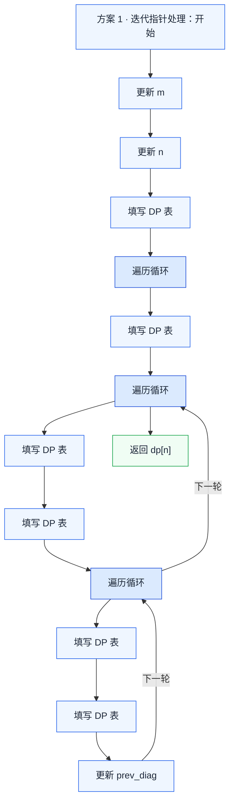

```c
/* LeetCode 72. 编辑距离 — C 版（方案1） */
#include <stdio.h>  // 引入头文件
#include <string.h> // 引入头文件
static int min2(int a, int b) {
    return a < b ? a : b;
} // static int min2(int 数组, int b) { return 数组 小于 b ? 数组 : b; }
static int min3(int a, int b, int c) { return min2(min2(a, b), c); }
static int min_distance(const char *w1, const char *w2) { // 定义函数/方法 min_distance
    int m = (int)strlen(w1),
        n = (int)strlen(w2); // 把 (int)strlen(w1), 元素个数 赋值为 (int)strlen(w2) 存入 映射表
    int dp[1001];            // int DP 表[1001];
    for (int j = 0; j <= n; j++)
        dp[j] = j; // 让 下标 j 从 0 开始计数，下标 j 不超过 元素个数 就继续
    for (int i = 1; i <= m; i++) { // 让 下标 i 从 1 开始计数，下标 i 不超过 映射表 就继续
        int prev_diag = dp[0];     // 把 DP 表[0] 存入 prev_diag
        dp[0] = i;                 // 把 下标 i; 写入 dp[0]
        for (int j = 1; j <= n; j++) { // 让 下标 j 从 1 开始计数，下标 j 不超过 元素个数 就继续
            int tmp = dp[j];           // 把 DP 表[下标 j] 存入 临时变量
            dp[j] = w1[i - 1] == w2[j - 1] ? prev_diag : 1 + min3(prev_diag, dp[j], dp[j - 1]);
            prev_diag = tmp; // 把 临时变量; 写入 prev_diag
        }
    }
    return dp[n]; // 返回 DP 表[元素个数]
}
int main(void) { // 程序入口：跑内嵌自测用例
    if (min_distance("horse", "ros") != 3) {
        printf("FAIL 1\n");
        return 1;
    }
    if (min_distance("intention", "execution") != 5) {
        printf("FAIL 2\n");
        return 1;
    }
    printf("PASS\n");
    return 0;
} // 全部用例通过，输出 PASS
```

#### 方案 2：直接实现

**思路与代码分析**：核心是「直接实现」。C 版手动管理下标与内存，循环边界全部显式写出。代码里依次做这些事：DP 表逐项填充；双重循环遍历。**走读**：方案 2 · 直接实现：开始 → 更新 m → 更新 n → 填写 DP 表 → 遍历循环 → 填写 DP 表 → 遍历循环 → 填写 DP 表 → 填写 DP 表 → 遍历循环 → 填写 DP 表 → 填写 DP 表 → 更新 prev_diag → 返回 dp[n]。

**运行架构**（真实控制流）：

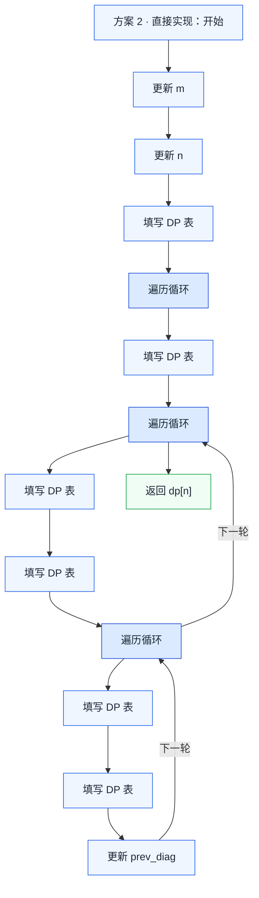

```c
/* LeetCode 72. 编辑距离 — C 版（方案2） */
#include <stdio.h>  // 引入头文件
#include <string.h> // 引入头文件
static int min2(int a, int b) {
    return a < b ? a : b;
} // static int min2(int 数组, int b) { return 数组 小于 b ? 数组 : b; }
static int min3(int a, int b, int c) { return min2(min2(a, b), c); }
static int min_distance(const char *w1, const char *w2) { // 定义函数/方法 min_distance
    int m = (int)strlen(w1),
        n = (int)strlen(w2); // 把 (int)strlen(w1), 元素个数 赋值为 (int)strlen(w2) 存入 映射表
    int dp[1001];            // int DP 表[1001];
    for (int j = 0; j <= n; j++)
        dp[j] = j; // 让 下标 j 从 0 开始计数，下标 j 不超过 元素个数 就继续
    for (int i = 1; i <= m; i++) { // 让 下标 i 从 1 开始计数，下标 i 不超过 映射表 就继续
        int prev_diag = dp[0];     // 把 DP 表[0] 存入 prev_diag
        dp[0] = i;                 // 把 下标 i; 写入 dp[0]
        for (int j = 1; j <= n; j++) { // 让 下标 j 从 1 开始计数，下标 j 不超过 元素个数 就继续
            int tmp = dp[j];           // 把 DP 表[下标 j] 存入 临时变量
            dp[j] = w1[i - 1] == w2[j - 1] ? prev_diag : 1 + min3(prev_diag, dp[j], dp[j - 1]);
            prev_diag = tmp; // 把 临时变量; 写入 prev_diag
        }
    }
    return dp[n]; // 返回 DP 表[元素个数]
}
int main(void) { // 程序入口：跑内嵌自测用例
    if (min_distance("horse", "ros") != 3) {
        printf("FAIL 1\n");
        return 1;
    }
    if (min_distance("intention", "execution") != 5) {
        printf("FAIL 2\n");
        return 1;
    }
    printf("PASS\n");
    return 0;
} // 全部用例通过，输出 PASS
```

### C++ 实现（2 种方案）

C++ 的全部方案如下，每个方案都内嵌用例自测，可独立运行（老仓库 python/go 文件遵循「打印结果」约定）：

#### 方案 1：迭代指针处理

**思路与代码分析**：核心是「迭代指针处理」。C++ 版用 STL 容器与迭代器，减少手写下标错误。代码里依次做这些事：DP 表逐项填充；双重循环遍历。**走读**：方案 1 · 迭代指针处理：开始 → 更新 m → 处理 std::vector＜int＞ dp(n + 1) → 遍历循环 → 填写 DP 表 → 遍历循环 → 填写 DP 表 → 填写 DP 表 → 遍历循环 → 填写 DP 表 → 填写 DP 表 → 更新 prevDiag → 返回 dp[n]。

**运行架构**（真实控制流）：

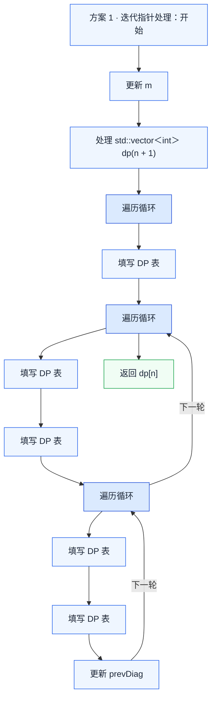

```cpp
// LeetCode 72. 编辑距离 — C++ 版（方案1）
#include <algorithm>                                                   // 引入头文件
#include <cassert>                                                     // 引入头文件
#include <iostream>                                                    // 引入头文件
#include <string>                                                      // 引入头文件
#include <vector>                                                      // 引入头文件
static int minDistance(const std::string &w1, const std::string &w2) { // 定义函数/方法 minDistance
    int m = static_cast<int>(w1.size()), n = static_cast<int>(w2.size());
    std::vector<int> dp(n + 1); // std::vector 小于 int 超过 DP 表(元素个数 加 1);
    for (int j = 0; j <= n; ++j)
        dp[j] = j; // 让 下标 j 从 0 开始计数，下标 j 不超过 元素个数 就继续
    for (int i = 1; i <= m; ++i) { // 让 下标 i 从 1 开始计数，下标 i 不超过 映射表 就继续
        int prevDiag = dp[0];      // 把 DP 表[0] 存入 prevDiag
        dp[0] = i;                 // 把 下标 i; 写入 dp[0]
        for (int j = 1; j <= n; ++j) { // 让 下标 j 从 1 开始计数，下标 j 不超过 元素个数 就继续
            int tmp = dp[j];           // 把 DP 表[下标 j] 存入 临时变量
            dp[j] = (w1[i - 1] == w2[j - 1]) ? prevDiag : 1 + std::min({prevDiag, dp[j], dp[j - 1]});
            prevDiag = tmp; // 把 临时变量; 写入 prevDiag
        }
    }
    return dp[n]; // 返回 DP 表[元素个数]
}
int main() {
    assert(minDistance("horse", "ros") == 3);
    assert(minDistance("intention", "execution") == 5);
    std::cout << "PASS" << std::endl;
} // 全部用例通过，输出 PASS
```

#### 方案 2：直接实现

**思路与代码分析**：核心是「直接实现」。C++ 版用 STL 容器与迭代器，减少手写下标错误。代码里依次做这些事：DP 表逐项填充；双重循环遍历。**走读**：方案 2 · 直接实现：开始 → 更新 m → 处理 std::vector＜int＞ dp(n + 1) → 遍历循环 → 填写 DP 表 → 遍历循环 → 填写 DP 表 → 填写 DP 表 → 遍历循环 → 填写 DP 表 → 填写 DP 表 → 更新 prevDiag → 返回 dp[n]。

**运行架构**（真实控制流）：

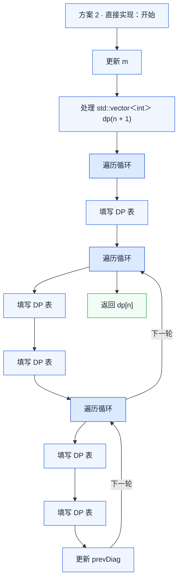

```cpp
// LeetCode 72. 编辑距离 — C++ 版（方案2）
#include <algorithm>                                                   // 引入头文件
#include <cassert>                                                     // 引入头文件
#include <iostream>                                                    // 引入头文件
#include <string>                                                      // 引入头文件
#include <vector>                                                      // 引入头文件
static int minDistance(const std::string &w1, const std::string &w2) { // 定义函数/方法 minDistance
    int m = static_cast<int>(w1.size()), n = static_cast<int>(w2.size());
    std::vector<int> dp(n + 1); // std::vector 小于 int 超过 DP 表(元素个数 加 1);
    for (int j = 0; j <= n; ++j)
        dp[j] = j; // 让 下标 j 从 0 开始计数，下标 j 不超过 元素个数 就继续
    for (int i = 1; i <= m; ++i) { // 让 下标 i 从 1 开始计数，下标 i 不超过 映射表 就继续
        int prevDiag = dp[0];      // 把 DP 表[0] 存入 prevDiag
        dp[0] = i;                 // 把 下标 i; 写入 dp[0]
        for (int j = 1; j <= n; ++j) { // 让 下标 j 从 1 开始计数，下标 j 不超过 元素个数 就继续
            int tmp = dp[j];           // 把 DP 表[下标 j] 存入 临时变量
            dp[j] = (w1[i - 1] == w2[j - 1]) ? prevDiag : 1 + std::min({prevDiag, dp[j], dp[j - 1]});
            prevDiag = tmp; // 把 临时变量; 写入 prevDiag
        }
    }
    return dp[n]; // 返回 DP 表[元素个数]
}
int main() {
    assert(minDistance("horse", "ros") == 3);
    assert(minDistance("intention", "execution") == 5);
    std::cout << "PASS" << std::endl;
} // 全部用例通过，输出 PASS
```

### R 实现（2 种方案）

R 的全部方案如下，每个方案都内嵌用例自测，可独立运行（老仓库 python/go 文件遵循「打印结果」约定）：

#### 方案 1：迭代指针处理

**思路与代码分析**：核心是「迭代指针处理」。R 版用向量化思维与 1 起始下标，注意 1:n 的降序陷阱。代码里依次做这些事：DP 表逐项填充；双重循环遍历。**走读**：方案 1 · 迭代指针处理：开始 → 处理 chars1 ＜- strsplit(w1, )[[ → 处理 chars2 ＜- strsplit(w2, )[[ → 处理 m ＜- length(chars1) → 处理 n ＜- length(chars2) → 处理 dp ＜- 0:n → 循环 i：遍历 1:m → 填写 DP 表 → 填写 DP 表 → 循环 j：遍历 1:n → 填写 DP 表 → 填写 DP 表 → 填写 DP 表 → 处理 prev_diag ＜- tmp → 填写 DP 表 → 返回结果。

**运行架构**（真实控制流）：

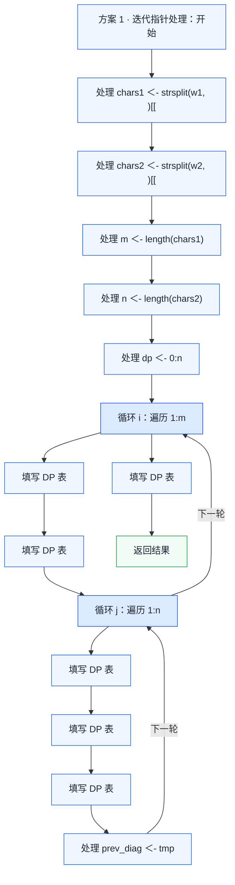

```r
# 版（方案1） 定义函数 min_distance_ed（参数：w1, w2）
min_distance_ed <- function(w1, w2) {
    chars1 <- strsplit(w1, "")[[1]]  # 把 strsplit(w1, 「」)[[1]] 存入 chars1
    chars2 <- strsplit(w2, "")[[1]]  # 把 strsplit(w2, 「」)[[1]] 存入 chars2
    m <- length(chars1)
    n <- length(chars2)  # 把 长度(chars1); 元素个数 小于 减 长度(chars2) 存入 映射表
    dp <- 0:n  # 把 0:元素个数 存入 DP 表
    for (i in 1:m) {
        # for (下标 i in 1:映射表) {
        prev_diag <- dp[1]  # 把 DP 表[1] 存入 prev_diag
        dp[1] <- i  # 把 下标 i 存入 dp[1]
        for (j in 1:n) {
            # for (下标 j in 1:元素个数) {
            tmp <- dp[j + 1]  # 把 DP 表[下标 j 加 1] 存入 临时变量
            dp[j + 1] <- if (chars1[i] == chars2[j])
                prev_diag else 1 + min(prev_diag, dp[j + 1], dp[j])
            prev_diag <- tmp  # 把 临时变量 存入 prev_diag
        }
    }
    dp[n + 1]  # DP 表[元素个数 加 1]
}
stopifnot(min_distance_ed("horse", "ros") == 3)  # 断言校验
stopifnot(min_distance_ed("intention", "execution") == 5)  # 断言校验
cat("PASS\n")  # 全部用例通过，输出 PASS
```

#### 方案 2：直接实现

**思路与代码分析**：核心是「直接实现」。R 版用向量化思维与 1 起始下标，注意 1:n 的降序陷阱。代码里依次做这些事：DP 表逐项填充；双重循环遍历。**走读**：方案 2 · 直接实现：开始 → 处理 chars1 ＜- strsplit(w1, )[[ → 处理 chars2 ＜- strsplit(w2, )[[ → 处理 m ＜- length(chars1) → 处理 n ＜- length(chars2) → 处理 dp ＜- 0:n → 循环 i：遍历 1:m → 填写 DP 表 → 填写 DP 表 → 循环 j：遍历 1:n → 填写 DP 表 → 填写 DP 表 → 填写 DP 表 → 处理 prev_diag ＜- tmp → 填写 DP 表 → 返回结果。

**运行架构**（真实控制流）：

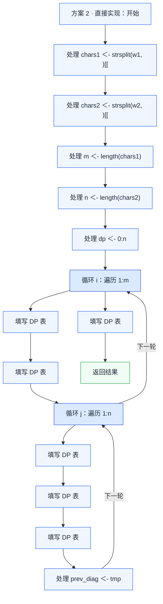

```r
# 版（方案2） 定义函数 min_distance_ed（参数：w1, w2）
min_distance_ed <- function(w1, w2) {
    chars1 <- strsplit(w1, "")[[1]]  # 把 strsplit(w1, 「」)[[1]] 存入 chars1
    chars2 <- strsplit(w2, "")[[1]]  # 把 strsplit(w2, 「」)[[1]] 存入 chars2
    m <- length(chars1)
    n <- length(chars2)  # 把 长度(chars1); 元素个数 小于 减 长度(chars2) 存入 映射表
    dp <- 0:n  # 把 0:元素个数 存入 DP 表
    for (i in 1:m) {
        # for (下标 i in 1:映射表) {
        prev_diag <- dp[1]  # 把 DP 表[1] 存入 prev_diag
        dp[1] <- i  # 把 下标 i 存入 dp[1]
        for (j in 1:n) {
            # for (下标 j in 1:元素个数) {
            tmp <- dp[j + 1]  # 把 DP 表[下标 j 加 1] 存入 临时变量
            dp[j + 1] <- if (chars1[i] == chars2[j])
                prev_diag else 1 + min(prev_diag, dp[j + 1], dp[j])
            prev_diag <- tmp  # 把 临时变量 存入 prev_diag
        }
    }
    dp[n + 1]  # DP 表[元素个数 加 1]
}
stopifnot(min_distance_ed("horse", "ros") == 3)  # 断言校验
stopifnot(min_distance_ed("intention", "execution") == 5)  # 断言校验
cat("PASS\n")  # 全部用例通过，输出 PASS
```

### Zig 实现（2 种方案）

Zig 的全部方案如下，每个方案都内嵌用例自测，可独立运行（老仓库 python/go 文件遵循「打印结果」约定）：

#### 方案 1：迭代指针处理

**思路与代码分析**：核心是「迭代指针处理」。Zig 版显式分配与清零，整型边界处理严格。代码里依次做这些事：DP 表逐项填充；双重循环遍历。**走读**：方案 1 · 迭代指针处理：开始 → 计算 m → 计算 n → 计算 dp → 遍历集合元素 → 遍历集合元素 → 填写 DP 表 → 填写 DP 表 → 遍历集合元素 → 填写 DP 表 → 填写 DP 表 → 更新 prev_diag → 返回 dp[n]。

**运行架构**（真实控制流）：

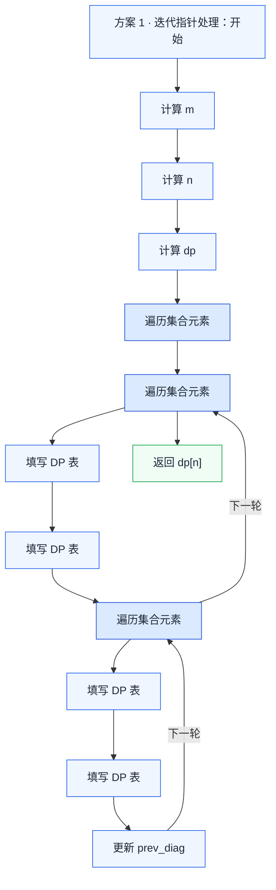

```zig
// LeetCode 72. 编辑距离 — Zig 版（方案1）
const std = @import("std"); // 把 @import(「std」) 存入 std
fn minDistance(w1: []const u8, w2: []const u8) i32 { // 定义函数/方法 minDistance
    const m = w1.len; // 把 w1.长度 存入 映射表
    const n = w2.len; // 把 w2.长度 存入 元素个数
    var dp: [1001]i32 = undefined; // 把 undefined; 写入 var dp: [1001]i32
    for (0..n + 1) |j| dp[j] = @intCast(j); // 把 @intCast(下标 j); 写入 for (0..n + 1) |j| dp[j]
    for (1..m + 1) |i| { // for (1..映射表 加 1) 按位或 下标 i 按位或 {
        var prev_diag = dp[0]; // 把 DP 表[0] 存入 prev_diag
        dp[0] = @intCast(i); // 把 @intCast(下标 i); 写入 dp[0]
        for (1..n + 1) |j| { // for (1..元素个数 加 1) 按位或 下标 j 按位或 {
            const tmp = dp[j]; // 把 DP 表[下标 j] 存入 临时变量
            dp[j] = if (w1[i - 1] == w2[j - 1]) prev_diag else 1 + @min(prev_diag, @min(dp[j], dp[j - 1]));
            prev_diag = tmp; // 把 临时变量; 写入 prev_diag
        }
    }
    return dp[n]; // 返回 DP 表[元素个数]
}
pub fn main() !void { // 程序入口：跑内嵌自测用例
    if (minDistance("horse", "ros") != 3) return error.TestFailed; // 若 minDistance(「horse」, 「horse」) 不等于 3，直接返回 error.TestFailed
    if (minDistance("intention", "execution") != 5) return error.TestFailed;
    std.debug.print("PASS\n", .{});
} // 全部用例通过，输出 PASS
```

#### 方案 2：直接实现

**思路与代码分析**：核心是「直接实现」。Zig 版显式分配与清零，整型边界处理严格。代码里依次做这些事：DP 表逐项填充；双重循环遍历。**走读**：方案 2 · 直接实现：开始 → 计算 m → 计算 n → 计算 dp → 遍历集合元素 → 遍历集合元素 → 填写 DP 表 → 填写 DP 表 → 遍历集合元素 → 填写 DP 表 → 填写 DP 表 → 更新 prev_diag → 返回 dp[n]。

**运行架构**（真实控制流）：

```mermaid
graph TD
    N0["方案 2 · 直接实现：开始"]
    N1["计算 m"]
    N2["计算 n"]
    N3["计算 dp"]
    N4["遍历集合元素"]
    N5["遍历集合元素"]
    N6["填写 DP 表"]
    N7["填写 DP 表"]
    N8["遍历集合元素"]
    N9["填写 DP 表"]
    N10["填写 DP 表"]
    N11["更新 prev_diag"]
    N12["返回 dp[n]"]
    N0 --> N1
    N1 --> N2
    N2 --> N3
    N3 --> N4
    N4 --> N5
    N5 --> N6
    N6 --> N7
    N7 --> N8
    N8 --> N9
    N9 --> N10
    N10 --> N11
    N11 -- 下一轮 --> N8
    N8 -- 下一轮 --> N5
    N5 --> N12
    classDef n fill:#eff6ff,stroke:#2563eb,color:#1e293b;
    classDef lp fill:#dbeafe,stroke:#1d4ed8,color:#1e293b;
    classDef dc fill:#fef9c3,stroke:#ca8a04,color:#1e293b;
    classDef tm fill:#f0fdf4,stroke:#16a34a,color:#1e293b;
    class N0,N1,N2,N3,N6,N7,N9,N10,N11 n;
    class N4,N5,N8 lp;
    class N12 tm;
```

```zig
// LeetCode 72. 编辑距离 — Zig 版（方案2）
const std = @import("std"); // 把 @import(「std」) 存入 std
fn minDistance(w1: []const u8, w2: []const u8) i32 { // 定义函数/方法 minDistance
    const m = w1.len; // 把 w1.长度 存入 映射表
    const n = w2.len; // 把 w2.长度 存入 元素个数
    var dp: [1001]i32 = undefined; // 把 undefined; 写入 var dp: [1001]i32
    for (0..n + 1) |j| dp[j] = @intCast(j); // 把 @intCast(下标 j); 写入 for (0..n + 1) |j| dp[j]
    for (1..m + 1) |i| { // for (1..映射表 加 1) 按位或 下标 i 按位或 {
        var prev_diag = dp[0]; // 把 DP 表[0] 存入 prev_diag
        dp[0] = @intCast(i); // 把 @intCast(下标 i); 写入 dp[0]
        for (1..n + 1) |j| { // for (1..元素个数 加 1) 按位或 下标 j 按位或 {
            const tmp = dp[j]; // 把 DP 表[下标 j] 存入 临时变量
            dp[j] = if (w1[i - 1] == w2[j - 1]) prev_diag else 1 + @min(prev_diag, @min(dp[j], dp[j - 1]));
            prev_diag = tmp; // 把 临时变量; 写入 prev_diag
        }
    }
    return dp[n]; // 返回 DP 表[元素个数]
}
pub fn main() !void { // 程序入口：跑内嵌自测用例
    if (minDistance("horse", "ros") != 3) return error.TestFailed; // 若 minDistance(「horse」, 「horse」) 不等于 3，直接返回 error.TestFailed
    if (minDistance("intention", "execution") != 5) return error.TestFailed;
    std.debug.print("PASS\n", .{});
} // 全部用例通过，输出 PASS
```

### Dart 实现（2 种方案）

Dart 的全部方案如下，每个方案都内嵌用例自测，可独立运行（老仓库 python/go 文件遵循「打印结果」约定）：

#### 方案 1：迭代指针处理

**思路与代码分析**：核心是「迭代指针处理」。Dart 版用可空类型标注与集合方法，注意空安全。代码里依次做这些事：DP 表逐项填充；双重循环遍历。**走读**：方案 1 · 迭代指针处理：开始 → 更新 m → 填写 DP 表 → 遍历循环 → 填写 DP 表 → 填写 DP 表 → 遍历循环 → 填写 DP 表 → 填写 DP 表 → 处理 ? prevDiag → 填写 DP 表 → 更新 prevDiag → 返回 dp[n]。

**运行架构**（真实控制流）：

```mermaid
graph TD
    N0["方案 1 · 迭代指针处理：开始"]
    N1["更新 m"]
    N2["填写 DP 表"]
    N3["遍历循环"]
    N4["填写 DP 表"]
    N5["填写 DP 表"]
    N6["遍历循环"]
    N7["填写 DP 表"]
    N8["填写 DP 表"]
    N9["处理 ? prevDiag"]
    N10["填写 DP 表"]
    N11["更新 prevDiag"]
    N12["返回 dp[n]"]
    N0 --> N1
    N1 --> N2
    N2 --> N3
    N3 --> N4
    N4 --> N5
    N5 --> N6
    N6 --> N7
    N7 --> N8
    N8 --> N9
    N9 --> N10
    N10 --> N11
    N11 -- 下一轮 --> N6
    N6 -- 下一轮 --> N3
    N3 --> N12
    classDef n fill:#eff6ff,stroke:#2563eb,color:#1e293b;
    classDef lp fill:#dbeafe,stroke:#1d4ed8,color:#1e293b;
    classDef dc fill:#fef9c3,stroke:#ca8a04,color:#1e293b;
    classDef tm fill:#f0fdf4,stroke:#16a34a,color:#1e293b;
    class N0,N1,N2,N4,N5,N7,N8,N9,N10,N11 n;
    class N3,N6 lp;
    class N12 tm;
```

```dart
// LeetCode 72. 编辑距离 — Dart 版（方案1）
int minDistance(String w1, String w2) {
  // 定义函数/方法 minDistance
  final m = w1.length, n = w2.length; // 把 w1.长度, 元素个数 赋值为 w2.长度 存入 映射表
  final dp = List<int>.generate(n + 1, (j) => j);
  for (var i = 1; i <= m; i++) {
    // 让 下标 i 从 1 开始计数，下标 i 不超过 映射表 就继续
    var prevDiag = dp[0]; // 把 DP 表[0] 存入 prevDiag
    dp[0] = i; // 把 下标 i; 写入 dp[0]
    for (var j = 1; j <= n; j++) {
      // 让 下标 j 从 1 开始计数，下标 j 不超过 元素个数 就继续
      final tmp = dp[j]; // 把 DP 表[下标 j] 存入 临时变量
      dp[j] = w1[i - 1] == w2[j - 1]
          ? prevDiag
          : 1 + [prevDiag, dp[j], dp[j - 1]].reduce((a, b) => a < b ? a : b);
      prevDiag = tmp; // 把 临时变量 存入 prevDiag
    }
  }
  return dp[n]; // 返回 DP 表[元素个数]
}

void main() {
  if (minDistance('horse', 'ros') != 3) throw StateError('c1');
  if (minDistance('intention', 'execution') != 5) throw StateError('c2');
  print('PASS');
} // 全部用例通过，输出 PASS
```

#### 方案 2：直接实现

**思路与代码分析**：核心是「直接实现」。Dart 版用可空类型标注与集合方法，注意空安全。代码里依次做这些事：DP 表逐项填充；双重循环遍历。**走读**：方案 2 · 直接实现：开始 → 更新 m → 填写 DP 表 → 遍历循环 → 填写 DP 表 → 填写 DP 表 → 遍历循环 → 填写 DP 表 → 填写 DP 表 → 处理 ? prevDiag → 填写 DP 表 → 更新 prevDiag → 返回 dp[n]。

**运行架构**（真实控制流）：

```mermaid
graph TD
    N0["方案 2 · 直接实现：开始"]
    N1["更新 m"]
    N2["填写 DP 表"]
    N3["遍历循环"]
    N4["填写 DP 表"]
    N5["填写 DP 表"]
    N6["遍历循环"]
    N7["填写 DP 表"]
    N8["填写 DP 表"]
    N9["处理 ? prevDiag"]
    N10["填写 DP 表"]
    N11["更新 prevDiag"]
    N12["返回 dp[n]"]
    N0 --> N1
    N1 --> N2
    N2 --> N3
    N3 --> N4
    N4 --> N5
    N5 --> N6
    N6 --> N7
    N7 --> N8
    N8 --> N9
    N9 --> N10
    N10 --> N11
    N11 -- 下一轮 --> N6
    N6 -- 下一轮 --> N3
    N3 --> N12
    classDef n fill:#eff6ff,stroke:#2563eb,color:#1e293b;
    classDef lp fill:#dbeafe,stroke:#1d4ed8,color:#1e293b;
    classDef dc fill:#fef9c3,stroke:#ca8a04,color:#1e293b;
    classDef tm fill:#f0fdf4,stroke:#16a34a,color:#1e293b;
    class N0,N1,N2,N4,N5,N7,N8,N9,N10,N11 n;
    class N3,N6 lp;
    class N12 tm;
```

```dart
// LeetCode 72. 编辑距离 — Dart 版（方案2）
int minDistance(String w1, String w2) {
  // 定义函数/方法 minDistance
  final m = w1.length, n = w2.length; // 把 w1.长度, 元素个数 赋值为 w2.长度 存入 映射表
  final dp = List<int>.generate(n + 1, (j) => j);
  for (var i = 1; i <= m; i++) {
    // 让 下标 i 从 1 开始计数，下标 i 不超过 映射表 就继续
    var prevDiag = dp[0]; // 把 DP 表[0] 存入 prevDiag
    dp[0] = i; // 把 下标 i; 写入 dp[0]
    for (var j = 1; j <= n; j++) {
      // 让 下标 j 从 1 开始计数，下标 j 不超过 元素个数 就继续
      final tmp = dp[j]; // 把 DP 表[下标 j] 存入 临时变量
      dp[j] = w1[i - 1] == w2[j - 1]
          ? prevDiag
          : 1 + [prevDiag, dp[j], dp[j - 1]].reduce((a, b) => a < b ? a : b);
      prevDiag = tmp; // 把 临时变量 存入 prevDiag
    }
  }
  return dp[n]; // 返回 DP 表[元素个数]
}

void main() {
  if (minDistance('horse', 'ros') != 3) throw StateError('c1');
  if (minDistance('intention', 'execution') != 5) throw StateError('c2');
  print('PASS');
} // 全部用例通过，输出 PASS
```

---

## 内容总结

- **编辑距离**（动态规划 · Hard）：共 2 个方案，主线思路「迭代指针处理」；时间 O(n)（单趟线性扫描）；动画演示DP 表填充过程，附录给出 11 种语言 × 全部方案的可运行实现。
- 来源博客：[https://blog.csdn.net/tyro_java/article/details/144848060](https://blog.csdn.net/tyro_java/article/details/144848060)
- 导航：[📋 总目录](../) ｜ [← 195 最长递增子序列 ii](../195_最长递增子序列_ii/) ｜ [197 python笔记 滑动验证码的识 →](../197_python笔记_滑动验证码的识别算法/)
