# 197 · python笔记 滑动验证码的识别算法（第附阶段 · 专题补充 · Medium）

> **难度**：⭐⭐ Medium ｜ **专题**：算法笔记
> **学习定位**：第附阶段 · 专题补充第 197 篇 ｜ **解法数**：7
> **内容总结**：**python笔记 滑动验证码的识别算法**（算法笔记 · Medium）：共 7 个方案，主线思路「直接实现」；时间 O(n) 量级；动画演示归并分治过程，附录给出 11 种语言 × 全部方案的可运行实现。

---

## 题目描述

python笔记 滑动验证码的识别算法。具体输入输出约定见函数签名与用例。

- 主函数签名：`function assertEq(actual: any, expected: any, msg: string = ''): void`

**数据范围与注意事项**：

- **易错点**：先看小例子手推一遍再对照代码，比直接读代码快得多。

## 题目分析

**场景是什么**：综合练习：把数据结构与策略组合起来解决一个完整问题。本题就是该场景的 Medium 级练习，主线做法是「直接实现」。

**主线怎么解**：主解法结构简单：读入、处理、返回。

## 解题思路

**方案对比**（共 7 个方案，由浅入深）：

| 方案 | 时间复杂度 | 空间复杂度 |
|---|---|---|
| 方案 1 · 直接实现 | O(n) 量级 | O(n) |
| 方案 2 · 直接实现 | O(n) 量级 | O(n) |
| 方案 3 · 迭代指针处理 | O(n)（单趟线性扫描） | O(1) 到 O(n)（视辅助结构） |
| 方案 4 · 迭代指针处理 | O(n)（单趟线性扫描） | O(1) 到 O(n)（视辅助结构） |
| 方案 5 · 迭代指针处理 | O(n)（单趟线性扫描） | O(1) 到 O(n)（视辅助结构） |
| 方案 6 · 直接实现 | O(n) 量级 | O(n) |
| 方案 7 · 迭代指针处理 | O(n)（单趟线性扫描） | O(1) 到 O(n)（视辅助结构） |

**由浅入深的路径**：直接实现 → 迭代指针处理；每往右一步，都在补上一步的短板。

**方案间的取舍**：方案 1（直接实现）；方案 2（直接实现）；方案 3（迭代指针处理）；方案 4（迭代指针处理）；方案 5（迭代指针处理）；方案 6（直接实现）；方案 7（迭代指针处理）。数据规模小、可读性优先时选靠前的方案；规模大、性能优先时选靠后的方案。

**怎么读这一篇**：

- 🐣 **新手路线**：把「题目描述」的示例 1 在纸上手推一遍 → 读方案 1（最直观的写法）与它的代码走读 → 按「运行方式」本地跑通看 PASS → 回头对比方案 2 之后的写法差在哪
- 🦅 **大佬路线**：直接锁定最优方案 1（直接实现，O(n) 量级）→ 跳读该方案代码与走读 → 用「逐步拆解与面试追问」补齐复杂度推导与边界追问

### 动态算法图（归并分治，GIF 自动循环）


动画演示算法笔记专题里归并分治的典型过程；每个方案在「TypeScript 解题方案」一节还配了专属动画与专属流程图。

### 主解法流程图（真实控制流）

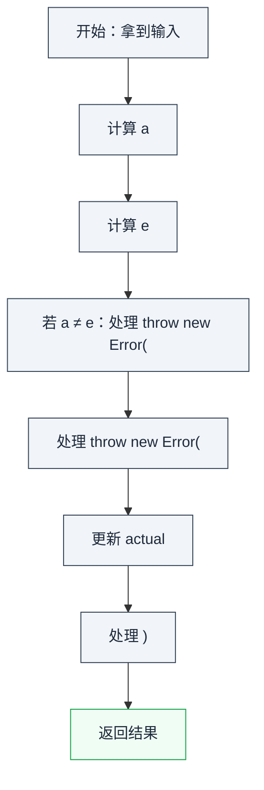

## TypeScript 解题方案（7 个方案逐个讲）

> **运行与提交**：每个方案都是自包含文件（内嵌用例自测，输出 PASS），整块复制到 `.ts` 文件后 `node 文件名` 即可运行。提交 LeetCode 时，把 `demo` 内的算法函数与辅助类型/函数整体取出、置于文件顶层即可。概念演示（非 LeetCode 编号题），在本地运行即可。

### 方案 1：直接实现

**分析与思路**：核心做法是「直接实现」。

**运行方式**：`node 本文件`，内嵌用例全部通过会输出 PASS。


**方案专属流程图**（真实控制流）：


```typescript
function assertEq(actual: any, expected: any, msg: string = ''): void {
  // 定义函数/方法 assertEq
  const a = JSON.stringify(actual);
  const e = JSON.stringify(expected);
  if (a !== e)
    throw new Error(
      'ASSERT FAILED ' + msg + ' :: actual=' + a + ' expected=' + e,
    );
}

function detect_edges(image: number[]): boolean[] {
  // 定义函数/方法 detect_edges
  const edges = new Array(image.length).fill(false); // 把 new Array(image.长度).fill(false) 存入 边集
  for (let i = 1; i < image.length; i++)
    edges[i] = Math.abs(image[i] - image[i - 1]) > 50; // 让 下标 i 从 1 开始计数，下标 i 小于 image.长度 就继续
  return edges; // 返回 边集
}
function recognize_captcha(bg: number[], puzzle: number[]): number {
  // 定义函数/方法 recognize_captcha
  const bgEdges = detect_edges(bg);
  const puzzleEdges = detect_edges(puzzle);
  let best_x = 0,
    best_score = -1; // 把 0, best_score 赋值为 减 1 存入 best_x
  for (let x = 0; x <= bg.length - puzzle.length; x++) {
    // 让 x 从 0 开始计数，x 不超过 bg.长度 减 puzzle.长度 就继续
    let score = 0; // 把 0 存入 score
    for (let y = 0; y < puzzle.length; y++)
      if (bgEdges[x + y] && puzzleEdges[y]) score++; // 让 y 从 0 开始计数，y 小于 puzzle.长度 就继续
    if (score > best_score) {
      best_score = score;
      best_x = x;
    }
  }
  return best_x; // 返回 best_x
}
export function demo(): void {
  // 程序入口：跑内嵌自测用例
  const bg = [10, 10, 10, 10, 200, 200, 200, 200]; // 把 [10, 10, 10, 10, 200, 200, 200, 200] 存入 bg
  const puzzle = [10, 200, 200, 200]; // 把 [10, 200, 200, 200] 存入 puzzle
  assertEq(recognize_captcha(bg, puzzle), 3, 'gap'); // 断言校验
  console.log('PASS'); // 全部用例通过，输出 PASS
}
demo(); // demo();
```

### 方案 2：直接实现

**分析与思路**：核心做法是「直接实现」。

**运行方式**：`node 本文件`，内嵌用例全部通过会输出 PASS。


**方案专属流程图**（真实控制流）：

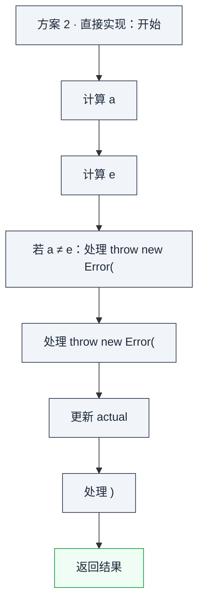

```typescript
function assertEq(actual: any, expected: any, msg: string = ''): void {
  // 定义函数/方法 assertEq
  const a = JSON.stringify(actual);
  const e = JSON.stringify(expected);
  if (a !== e)
    throw new Error(
      'ASSERT FAILED ' + msg + ' :: actual=' + a + ' expected=' + e,
    );
}

function detect_edges_sobel(image: number[]): boolean[] {
  // 定义函数/方法 detect_edges_sobel
  const edges = new Array(image.length).fill(false); // 把 new Array(image.长度).fill(false) 存入 边集
  if (image.length < 2) return edges; // 若 image.长度 小于 2，直接返回 边集
  edges[0] = Math.abs(image[1] - image[0]) > 50; // 把 Math.取绝对值 image[1] 减 image[0]) 超过 50; 写入 edges[0]
  for (let i = 1; i < image.length - 1; i++)
    edges[i] = Math.abs(image[i + 1] - image[i - 1]) > 50; // 让 下标 i 从 1 开始计数，下标 i 小于 image.长度 减 1 就继续
  edges[image.length - 1] =
    Math.abs(image[image.length - 1] - image[image.length - 2]) > 50;
  return edges; // 返回 边集
}
function recognize_captcha(bg: number[], puzzle: number[]): number {
  // 定义函数/方法 recognize_captcha
  const bgEdges = detect_edges_sobel(bg);
  const puzzleEdges = detect_edges_sobel(puzzle);
  let best_x = 0,
    best_score = -1; // 把 0, best_score 赋值为 减 1 存入 best_x
  for (let x = 0; x <= bg.length - puzzle.length; x++) {
    // 让 x 从 0 开始计数，x 不超过 bg.长度 减 puzzle.长度 就继续
    let score = 0; // 把 0 存入 score
    for (let y = 0; y < puzzle.length; y++)
      if (bgEdges[x + y] && puzzleEdges[y]) score++; // 让 y 从 0 开始计数，y 小于 puzzle.长度 就继续
    if (score > best_score) {
      best_score = score;
      best_x = x;
    }
  }
  return best_x; // 返回 best_x
}
export function demo(): void {
  // 程序入口：跑内嵌自测用例
  const bg = [10, 10, 10, 10, 200, 200, 200, 200]; // 把 [10, 10, 10, 10, 200, 200, 200, 200] 存入 bg
  const puzzle = [10, 200, 200, 200]; // 把 [10, 200, 200, 200] 存入 puzzle
  assertEq(recognize_captcha(bg, puzzle), 3, 'gap'); // 断言校验
  console.log('PASS'); // 全部用例通过，输出 PASS
}
demo(); // demo();
```

### 方案 3：迭代指针处理

**分析与思路**：核心做法是「迭代指针处理」。代码里依次做这些事：队列或堆的调度。

**运行方式**：`node 本文件`，内嵌用例全部通过会输出 PASS。


**方案专属流程图**（真实控制流）：


```typescript
class TreeNode {
  // 定义类型
  val: any;
  left: any;
  right: any; // 值: any; 左边界: any; 右边界: any;
  constructor(val?: any, left?: any, right?: any) {
    // constructor(值?: any, 左边界?: any, 右边界?: any) {
    this.val = val === undefined ? 0 : val; // 把 (值 全等于 undefined ? 0 : 值); 写入 值
    this.left = left === undefined ? null : left; // 把 (左边界 全等于 undefined ? null : 左边界); 写入 左边界
    this.right = right === undefined ? null : right; // 把 (右边界 全等于 undefined ? null : 右边界); 写入 右边界
  }
}
function buildTree(vals: any): any {
  // 定义函数/方法 buildTree
  if (!vals || vals.length === 0) return null; // 若 取反 vals 或 vals.长度 全等于 0，直接返回 null
  const root = new TreeNode(vals[0]);
  const q: any[] = [root];
  let i = 1;
  while (q.length && i < vals.length) {
    // 循环，直到不满足「节点.长度 且 下标 i 小于 vals.长度」
    const node = q.shift(); // 把 节点.shift() 存入 节点
    if (vals[i] !== null && vals[i] !== undefined) {
      node.left = new TreeNode(vals[i]);
      q.push(node.left);
    }
    i++; // 下标 i 加一
    if (i < vals.length && vals[i] !== null && vals[i] !== undefined) {
      node.right = new TreeNode(vals[i]);
      q.push(node.right);
    }
    i++; // 下标 i 加一
  }
  return root; // 返回 根节点
}
function treeToLevel(root: any): any[] {
  // 定义函数/方法 treeToLevel
  if (!root) return []; // 若 取反 根节点，直接返回 []
  const out: any[] = [];
  const q: any[] = [root]; // 把 []; const 节点: any[] 赋值为 [根节点]; 写入 const out: any[]
  while (q.length) {
    // 循环，直到不满足「节点.长度」
    const n = q.shift(); // 把 节点.shift() 存入 元素个数
    if (n === null || n === undefined) {
      out.push(null);
      continue;
    }
    out.push(n.val);
    q.push(n.left);
    q.push(n.right); // 把 元素个数.值 压入栈/数组尾部
  }
  while (out.length && out[out.length - 1] === null) out.pop(); // 循环，直到不满足「out.长度 且 out[out.长度 减 1] 全等于 null) out 弹出 );」
  return out; // 返回 out
}
class ListNode {
  // 定义类型
  val: any;
  next: any; // 值: any; 下一个: any;
  constructor(val?: any, next?: any) {
    this.val = val === undefined ? 0 : val;
    this.next = next === undefined ? null : next;
  }
}
function buildList(vals: any): any {
  // 定义函数/方法 buildList
  const dummy = new ListNode(0);
  let cur = dummy; // 把 new ListNode(0); let 当前值 赋值为 哨兵节点 存入 哨兵节点
  for (const v of vals) {
    cur.next = new ListNode(v);
    cur = cur.next;
  } // 把 new ListNode(值); 当前值 赋值为 当前值.下一个; } 写入 下一个
  return dummy.next; // 返回 哨兵节点.下一个
}
function listToArray(head: any): any[] {
  // 定义函数/方法 listToArray
  const out: any[] = [];
  let p = head; // 把 []; let 节点 赋值为 头节点; 写入 const out: any[]
  while (p) {
    out.push(p.val);
    p = p.next;
  } // 循环，直到不满足「节点) { out 追加 节点.值); 节点 赋值为 节点.下一个; }」
  return out; // 返回 out
}
// python-runtime shims
function pyLen(a: any): number {
  // 定义函数/方法 pyLen
  if (a === null || a === undefined) return 0; // 若 数组 全等于 null 或 数组 全等于 undefined，直接返回 0
  if (
    typeof a === 'string' ||
    Array.isArray(a) ||
    a instanceof Set ||
    a instanceof Map
  )
    return a.length ?? a.size;
  if (typeof a === 'object') return Object.keys(a).length; // 若 typeof 数组 全等于 'object'，直接返回 Object.keys(数组).长度
  return 0; // 返回 0
}
function pySlice(a: any, i: any, j: any, step?: any): any {
  // 定义函数/方法 pySlice
  if (typeof a === 'string') {
    const r = [...a].slice(i ?? 0, j ?? a.length);
    return step ? r.reverse().join('') : r.join('');
  }
  const arr = Array.isArray(a) ? a : [...a]; // 把 Array.isArray(数组) ? 数组 : 复制的 数组 存入 数组
  return arr.slice(i ?? 0, j ?? arr.length); // 返回 数组 截取 下标 i ?? 0, 下标 j ?? 数组.长度)
}
function pyRange(a: any, b?: any, step?: any): any[] {
  // 定义函数/方法 pyRange
  let s = 0,
    e = a,
    st = 1; // 把 0, e 赋值为 数组, st 赋值为 1 存入 字符串
  if (b !== undefined) {
    s = a;
    e = b;
  } // 若 b 不等于 undefined) { 字符串 赋值为 数组; e 赋值为 b; }
  if (step !== undefined) st = step; // 若 步数 不等于 undefined) st 赋值为 步数;
  const out: any[] = []; // 把 []; 写入 const out: any[]
  if (st > 0) for (let i = s; i < e; i += st) out.push(i);
  else for (let i = s; i > e; i += st) out.push(i); // 否则
  return out; // 返回 out
}
function pyIn(x: any, coll: any): boolean {
  // 定义函数/方法 pyIn
  if (coll === null || coll === undefined) return false; // 若 coll 全等于 null 或 coll 全等于 undefined，直接返回 false
  if (Array.isArray(coll)) return coll.includes(x); // 若 Array.isArray(coll)，直接返回 coll 是否包含 x)
  if (coll instanceof Set || coll instanceof Map) return coll.has(x); // 若 coll instanceof Set 或 coll instanceof Map，直接返回 coll.has(x)
  if (typeof coll === 'object') return x in coll; // 若 typeof coll 全等于 'object'，直接返回 x in coll
  if (typeof coll === 'string') return coll.indexOf(x) >= 0; // 若 typeof coll 全等于 'string'，直接返回 coll 查找 x) 不低于 0
  return false; // 返回 false
}
function pySorted(a: any): any[] {
  // 定义函数/方法 pySorted
  const arr = typeof a === 'string' ? [...a] : [...a]; // 把 (typeof 数组 全等于 'string') ? 复制的 数组 : 复制的 数组 存入 数组
  return arr.sort((x: any, y: any) => (x < y ? -1 : x > y ? 1 : 0));
}
function pyMin(a: any, b?: any): any {
  if (b !== undefined) return Math.min(a, b);
  if (Array.isArray(a) || a instanceof Set) return Math.min(...a);
  return Math.min(a);
} // 定义函数/方法 pyMin
function pyMax(a: any, b?: any): any {
  if (b !== undefined) return Math.max(a, b);
  if (Array.isArray(a) || a instanceof Set) return Math.max(...a);
  return Math.max(a);
} // 定义函数/方法 pyMax
function pySum(a: any): number {
  let s = 0;
  for (const v of a) s += v;
  return s;
} // 定义函数/方法 pySum
function pyAbs(x: any): number {
  return Math.abs(x);
} // 定义函数/方法 pyAbs
function pyEnumerate(a: any): any[] {
  const out: any[] = [];
  let i = 0;
  for (const v of a) {
    out.push([i, v]);
    i++;
  }
  return out;
} // 定义函数/方法 pyEnumerate
function pyZip(a: any, b: any): any[] {
  const n = Math.min(a.length, b.length);
  const out: any[] = [];
  for (let i = 0; i < n; i++) out.push([a[i], b[i]]);
  return out;
} // 定义函数/方法 pyZip
function pyDictGet(d: any, k: any, def?: any): any {
  return k in d ? d[k] : def === undefined ? null : def;
} // 定义函数/方法 pyDictGet
function pyPrint(...args: any[]): void {
  console.log(
    args
      .map((a) => (typeof a === 'object' && a !== null ? JSON.stringify(a) : a))
      .join(' '),
  );
} // 定义函数/方法 pyPrint
// collections / heapq
function heapPush(h: any[], x: any): void {
  h.push(x);
  let i = h.length - 1;
  while (i > 0) {
    const p = (i - 1) >> 1;
    if (h[p] <= h[i]) break;
    [h[p], h[i]] = [h[i], h[p]];
    i = p;
  }
} // 定义函数/方法 heapPush
function heapPop(h: any[]): any {
  const top = h[0];
  const last = h.pop();
  if (h.length) {
    h[0] = last;
    let i = 0;
    const n = h.length;
    while (true) {
      let l = 2 * i + 1,
        r = 2 * i + 2,
        s = i;
      if (l < n && h[l] < h[s]) s = l;
      if (r < n && h[r] < h[s]) s = r;
      if (s === i) break;
      [h[s], h[i]] = [h[i], h[s]];
      i = s;
    }
  }
  return top;
} // 定义函数/方法 heapPop
class Deque {
  private a: any[] = [];
  push(x: any) {
    this.a.push(x);
  }
  pushLeft(x: any) {
    this.a.unshift(x);
  }
  pop() {
    return this.a.pop();
  }
  popLeft() {
    return this.a.shift();
  }
  get length() {
    return this.a.length;
  }
  toArray() {
    return this.a.slice();
  }
} // 定义类型
function Counter(iter: any): any {
  const m: any = {};
  for (const v of iter) m[v] = (m[v] || 0) + 1;
  return m;
} // 定义函数/方法 Counter
function gcd(a: any, b: any): any {
  while (b) {
    [a, b] = [b, a % b];
  }
  return a;
} // 定义函数/方法 gcd
function pyInf(): number {
  return Infinity;
} // 定义函数/方法 pyInf

function norm(x: any): any {
  // 定义函数/方法 norm
  if (x === null || x === undefined) return null; // 若 x 全等于 null 或 x 全等于 undefined，直接返回 null
  if (typeof x === 'object') {
    // 若 typeof x 全等于 'object'
    if (x instanceof Deque) return x.toArray(); // 若 x instanceof Deque，直接返回 x.toArray()
    if (Array.isArray(x)) return x.map(norm); // 若 Array.isArray(x)，直接返回 x.映射表(norm)
    if (
      typeof x.val === 'number' &&
      (typeof x.left !== 'undefined' || typeof x.right !== 'undefined')
    )
      return treeToLevel(x);
    if (typeof x.next !== 'undefined' && typeof x.val === 'number')
      return listToArray(x);
    if (x instanceof Set) return [...x].sort(); // 若 x instanceof Set，直接返回 复制的 x 排序 )
    if (x instanceof Map) return Object.fromEntries(x); // 若 x instanceof Map，直接返回 Object.fromEntries(x)
    const o: any = {};
    for (const k of Object.keys(x)) o[k] = norm(x[k]);
    return o;
  }
  return x; // 返回 x
}
function eq(a: any, b: any): boolean {
  // 定义函数/方法 eq
  const x = norm(a),
    y = norm(b); // 把 norm(数组), y 赋值为 norm(b) 存入 x
  if (x === y) return true; // 若 x 全等于 y，直接返回 true
  if (x === null || y === null) return x === y; // 若 x 全等于 null 或 y 全等于 null，直接返回 x 全等于 y
  if (Array.isArray(x) && Array.isArray(y)) {
    // 若 Array.isArray(x) 且 Array.isArray(y
    if (x.length !== y.length) return false; // 若 x.长度 不等于 y.长度，直接返回 false
    for (let i = 0; i < x.length; i++) if (!eq(x[i], y[i])) return false; // 让 下标 i 从 0 开始计数，下标 i 小于 x.长度 就继续
    return true; // 返回 true
  }
  if (typeof x === 'object' && typeof y === 'object') {
    // 若 typeof x 全等于 'object' 且 typeof y 全等于 'object'
    const kx = Object.keys(x),
      ky = Object.keys(y); // 把 Object.keys(x), ky 赋值为 Object.keys(y) 存入 kx
    if (kx.length !== ky.length) return false; // 若 kx.长度 不等于 ky.长度，直接返回 false
    for (const k of kx) if (!eq(x[k], y[k])) return false;
    return true; // 返回 true
  }
  return x === y; // 返回 x 全等于 y
}

function nccMatch(bg, puzzle) {
  // 定义函数/方法 nccMatch
  let bestX = 0,
    bestScore = -Infinity;
  const n = puzzle.length;
  for (let x = 0; x <= bg.length - n; x++) {
    // 让 x 从 0 开始计数，x 不超过 bg.长度 减 元素个数 就继续
    const window = bg.slice(x, x + n); // 把 bg 截取 x,x 加 元素个数) 存入 window
    const bw = window.reduce((a, b) => a + b, 0) / n;
    const pw = puzzle.reduce((a, b) => a + b, 0) / n;
    let num = 0,
      db = 0,
      dp = 0; // 把 0, db 赋值为 0, DP 表 赋值为 0 存入 num
    for (let i = 0; i < n; i++) {
      num += (window[i] - bw) * (puzzle[i] - pw);
      db += (window[i] - bw) ** 2;
      dp += (puzzle[i] - pw) ** 2;
    } // 让 下标 i 从 0 开始计数，下标 i 小于 元素个数 就继续
    const denom = Math.sqrt(db) * Math.sqrt(dp); // 把 Math.sqrt(db) 乘 Math.sqrt(DP 表) 存入 denom
    const score = denom !== 0 ? num / denom : 0; // 把 denom 不等于 0?num 除以 denom:0 存入 score
    if (score > bestScore) {
      bestScore = score;
      bestX = x;
    } // 若 score 超过 bestScore){ bestScore 赋值为 score; bestX 赋值为 x; }
  }
  return bestX; // 返回 bestX
}
export function demo(): void {
  // 程序入口：跑内嵌自测用例
  const bg = [10, 10, 10, 10, 200, 200, 200, 200];
  const puzzle = [10, 200, 200, 200];
  const cases = [{ got: nccMatch(bg, puzzle), want: 3 }]; // 把 [ { got: nccMatch(bg,puzzle), want: 3 } ] 存入 cases
  let fail = false; // 把 false 存入 fail
  for (const c of cases)
    if (!eq(c.got, c.want)) {
      fail = true;
      console.log('FAIL', JSON.stringify(c.got));
    } // 打印输出
  if (fail) throw new Error('FAILED'); // 若 fail) throw new Error(「FAILED」);
  console.log('PASS'); // 全部用例通过，输出 PASS
}
demo(); // demo();
```

### 方案 4：迭代指针处理

**分析与思路**：核心做法是「迭代指针处理」。代码里依次做这些事：队列或堆的调度。

**运行方式**：`node 本文件`，内嵌用例全部通过会输出 PASS。


**方案专属流程图**（真实控制流）：


```typescript
class TreeNode {
  // 定义类型
  val: any;
  left: any;
  right: any; // 值: any; 左边界: any; 右边界: any;
  constructor(val?: any, left?: any, right?: any) {
    // constructor(值?: any, 左边界?: any, 右边界?: any) {
    this.val = val === undefined ? 0 : val; // 把 (值 全等于 undefined ? 0 : 值); 写入 值
    this.left = left === undefined ? null : left; // 把 (左边界 全等于 undefined ? null : 左边界); 写入 左边界
    this.right = right === undefined ? null : right; // 把 (右边界 全等于 undefined ? null : 右边界); 写入 右边界
  }
}
function buildTree(vals: any): any {
  // 定义函数/方法 buildTree
  if (!vals || vals.length === 0) return null; // 若 取反 vals 或 vals.长度 全等于 0，直接返回 null
  const root = new TreeNode(vals[0]);
  const q: any[] = [root];
  let i = 1;
  while (q.length && i < vals.length) {
    // 循环，直到不满足「节点.长度 且 下标 i 小于 vals.长度」
    const node = q.shift(); // 把 节点.shift() 存入 节点
    if (vals[i] !== null && vals[i] !== undefined) {
      node.left = new TreeNode(vals[i]);
      q.push(node.left);
    }
    i++; // 下标 i 加一
    if (i < vals.length && vals[i] !== null && vals[i] !== undefined) {
      node.right = new TreeNode(vals[i]);
      q.push(node.right);
    }
    i++; // 下标 i 加一
  }
  return root; // 返回 根节点
}
function treeToLevel(root: any): any[] {
  // 定义函数/方法 treeToLevel
  if (!root) return []; // 若 取反 根节点，直接返回 []
  const out: any[] = [];
  const q: any[] = [root]; // 把 []; const 节点: any[] 赋值为 [根节点]; 写入 const out: any[]
  while (q.length) {
    // 循环，直到不满足「节点.长度」
    const n = q.shift(); // 把 节点.shift() 存入 元素个数
    if (n === null || n === undefined) {
      out.push(null);
      continue;
    }
    out.push(n.val);
    q.push(n.left);
    q.push(n.right); // 把 元素个数.值 压入栈/数组尾部
  }
  while (out.length && out[out.length - 1] === null) out.pop(); // 循环，直到不满足「out.长度 且 out[out.长度 减 1] 全等于 null) out 弹出 );」
  return out; // 返回 out
}
class ListNode {
  // 定义类型
  val: any;
  next: any; // 值: any; 下一个: any;
  constructor(val?: any, next?: any) {
    this.val = val === undefined ? 0 : val;
    this.next = next === undefined ? null : next;
  }
}
function buildList(vals: any): any {
  // 定义函数/方法 buildList
  const dummy = new ListNode(0);
  let cur = dummy; // 把 new ListNode(0); let 当前值 赋值为 哨兵节点 存入 哨兵节点
  for (const v of vals) {
    cur.next = new ListNode(v);
    cur = cur.next;
  } // 把 new ListNode(值); 当前值 赋值为 当前值.下一个; } 写入 下一个
  return dummy.next; // 返回 哨兵节点.下一个
}
function listToArray(head: any): any[] {
  // 定义函数/方法 listToArray
  const out: any[] = [];
  let p = head; // 把 []; let 节点 赋值为 头节点; 写入 const out: any[]
  while (p) {
    out.push(p.val);
    p = p.next;
  } // 循环，直到不满足「节点) { out 追加 节点.值); 节点 赋值为 节点.下一个; }」
  return out; // 返回 out
}
// python-runtime shims
function pyLen(a: any): number {
  // 定义函数/方法 pyLen
  if (a === null || a === undefined) return 0; // 若 数组 全等于 null 或 数组 全等于 undefined，直接返回 0
  if (
    typeof a === 'string' ||
    Array.isArray(a) ||
    a instanceof Set ||
    a instanceof Map
  )
    return a.length ?? a.size;
  if (typeof a === 'object') return Object.keys(a).length; // 若 typeof 数组 全等于 'object'，直接返回 Object.keys(数组).长度
  return 0; // 返回 0
}
function pySlice(a: any, i: any, j: any, step?: any): any {
  // 定义函数/方法 pySlice
  if (typeof a === 'string') {
    const r = [...a].slice(i ?? 0, j ?? a.length);
    return step ? r.reverse().join('') : r.join('');
  }
  const arr = Array.isArray(a) ? a : [...a]; // 把 Array.isArray(数组) ? 数组 : 复制的 数组 存入 数组
  return arr.slice(i ?? 0, j ?? arr.length); // 返回 数组 截取 下标 i ?? 0, 下标 j ?? 数组.长度)
}
function pyRange(a: any, b?: any, step?: any): any[] {
  // 定义函数/方法 pyRange
  let s = 0,
    e = a,
    st = 1; // 把 0, e 赋值为 数组, st 赋值为 1 存入 字符串
  if (b !== undefined) {
    s = a;
    e = b;
  } // 若 b 不等于 undefined) { 字符串 赋值为 数组; e 赋值为 b; }
  if (step !== undefined) st = step; // 若 步数 不等于 undefined) st 赋值为 步数;
  const out: any[] = []; // 把 []; 写入 const out: any[]
  if (st > 0) for (let i = s; i < e; i += st) out.push(i);
  else for (let i = s; i > e; i += st) out.push(i); // 否则
  return out; // 返回 out
}
function pyIn(x: any, coll: any): boolean {
  // 定义函数/方法 pyIn
  if (coll === null || coll === undefined) return false; // 若 coll 全等于 null 或 coll 全等于 undefined，直接返回 false
  if (Array.isArray(coll)) return coll.includes(x); // 若 Array.isArray(coll)，直接返回 coll 是否包含 x)
  if (coll instanceof Set || coll instanceof Map) return coll.has(x); // 若 coll instanceof Set 或 coll instanceof Map，直接返回 coll.has(x)
  if (typeof coll === 'object') return x in coll; // 若 typeof coll 全等于 'object'，直接返回 x in coll
  if (typeof coll === 'string') return coll.indexOf(x) >= 0; // 若 typeof coll 全等于 'string'，直接返回 coll 查找 x) 不低于 0
  return false; // 返回 false
}
function pySorted(a: any): any[] {
  // 定义函数/方法 pySorted
  const arr = typeof a === 'string' ? [...a] : [...a]; // 把 (typeof 数组 全等于 'string') ? 复制的 数组 : 复制的 数组 存入 数组
  return arr.sort((x: any, y: any) => (x < y ? -1 : x > y ? 1 : 0));
}
function pyMin(a: any, b?: any): any {
  if (b !== undefined) return Math.min(a, b);
  if (Array.isArray(a) || a instanceof Set) return Math.min(...a);
  return Math.min(a);
} // 定义函数/方法 pyMin
function pyMax(a: any, b?: any): any {
  if (b !== undefined) return Math.max(a, b);
  if (Array.isArray(a) || a instanceof Set) return Math.max(...a);
  return Math.max(a);
} // 定义函数/方法 pyMax
function pySum(a: any): number {
  let s = 0;
  for (const v of a) s += v;
  return s;
} // 定义函数/方法 pySum
function pyAbs(x: any): number {
  return Math.abs(x);
} // 定义函数/方法 pyAbs
function pyEnumerate(a: any): any[] {
  const out: any[] = [];
  let i = 0;
  for (const v of a) {
    out.push([i, v]);
    i++;
  }
  return out;
} // 定义函数/方法 pyEnumerate
function pyZip(a: any, b: any): any[] {
  const n = Math.min(a.length, b.length);
  const out: any[] = [];
  for (let i = 0; i < n; i++) out.push([a[i], b[i]]);
  return out;
} // 定义函数/方法 pyZip
function pyDictGet(d: any, k: any, def?: any): any {
  return k in d ? d[k] : def === undefined ? null : def;
} // 定义函数/方法 pyDictGet
function pyPrint(...args: any[]): void {
  console.log(
    args
      .map((a) => (typeof a === 'object' && a !== null ? JSON.stringify(a) : a))
      .join(' '),
  );
} // 定义函数/方法 pyPrint
// collections / heapq
function heapPush(h: any[], x: any): void {
  h.push(x);
  let i = h.length - 1;
  while (i > 0) {
    const p = (i - 1) >> 1;
    if (h[p] <= h[i]) break;
    [h[p], h[i]] = [h[i], h[p]];
    i = p;
  }
} // 定义函数/方法 heapPush
function heapPop(h: any[]): any {
  const top = h[0];
  const last = h.pop();
  if (h.length) {
    h[0] = last;
    let i = 0;
    const n = h.length;
    while (true) {
      let l = 2 * i + 1,
        r = 2 * i + 2,
        s = i;
      if (l < n && h[l] < h[s]) s = l;
      if (r < n && h[r] < h[s]) s = r;
      if (s === i) break;
      [h[s], h[i]] = [h[i], h[s]];
      i = s;
    }
  }
  return top;
} // 定义函数/方法 heapPop
class Deque {
  private a: any[] = [];
  push(x: any) {
    this.a.push(x);
  }
  pushLeft(x: any) {
    this.a.unshift(x);
  }
  pop() {
    return this.a.pop();
  }
  popLeft() {
    return this.a.shift();
  }
  get length() {
    return this.a.length;
  }
  toArray() {
    return this.a.slice();
  }
} // 定义类型
function Counter(iter: any): any {
  const m: any = {};
  for (const v of iter) m[v] = (m[v] || 0) + 1;
  return m;
} // 定义函数/方法 Counter
function gcd(a: any, b: any): any {
  while (b) {
    [a, b] = [b, a % b];
  }
  return a;
} // 定义函数/方法 gcd
function pyInf(): number {
  return Infinity;
} // 定义函数/方法 pyInf

function norm(x: any): any {
  // 定义函数/方法 norm
  if (x === null || x === undefined) return null; // 若 x 全等于 null 或 x 全等于 undefined，直接返回 null
  if (typeof x === 'object') {
    // 若 typeof x 全等于 'object'
    if (x instanceof Deque) return x.toArray(); // 若 x instanceof Deque，直接返回 x.toArray()
    if (Array.isArray(x)) return x.map(norm); // 若 Array.isArray(x)，直接返回 x.映射表(norm)
    if (
      typeof x.val === 'number' &&
      (typeof x.left !== 'undefined' || typeof x.right !== 'undefined')
    )
      return treeToLevel(x);
    if (typeof x.next !== 'undefined' && typeof x.val === 'number')
      return listToArray(x);
    if (x instanceof Set) return [...x].sort(); // 若 x instanceof Set，直接返回 复制的 x 排序 )
    if (x instanceof Map) return Object.fromEntries(x); // 若 x instanceof Map，直接返回 Object.fromEntries(x)
    const o: any = {};
    for (const k of Object.keys(x)) o[k] = norm(x[k]);
    return o;
  }
  return x; // 返回 x
}
function eq(a: any, b: any): boolean {
  // 定义函数/方法 eq
  const x = norm(a),
    y = norm(b); // 把 norm(数组), y 赋值为 norm(b) 存入 x
  if (x === y) return true; // 若 x 全等于 y，直接返回 true
  if (x === null || y === null) return x === y; // 若 x 全等于 null 或 y 全等于 null，直接返回 x 全等于 y
  if (Array.isArray(x) && Array.isArray(y)) {
    // 若 Array.isArray(x) 且 Array.isArray(y
    if (x.length !== y.length) return false; // 若 x.长度 不等于 y.长度，直接返回 false
    for (let i = 0; i < x.length; i++) if (!eq(x[i], y[i])) return false; // 让 下标 i 从 0 开始计数，下标 i 小于 x.长度 就继续
    return true; // 返回 true
  }
  if (typeof x === 'object' && typeof y === 'object') {
    // 若 typeof x 全等于 'object' 且 typeof y 全等于 'object'
    const kx = Object.keys(x),
      ky = Object.keys(y); // 把 Object.keys(x), ky 赋值为 Object.keys(y) 存入 kx
    if (kx.length !== ky.length) return false; // 若 kx.长度 不等于 ky.长度，直接返回 false
    for (const k of kx) if (!eq(x[k], y[k])) return false;
    return true; // 返回 true
  }
  return x === y; // 返回 x 全等于 y
}

function bestMatchWindow(bg, puzzle) {
  // 定义函数/方法 bestMatchWindow
  let bestX = 0,
    bestScore = Infinity;
  const n = puzzle.length;
  for (let x = 0; x <= bg.length - n; x++) {
    // 让 x 从 0 开始计数，x 不超过 bg.长度 减 元素个数 就继续
    let score = 0;
    for (let y = 0; y < n; y++) score += Math.abs(bg[x + y] - puzzle[y]);
    if (score < bestScore) {
      bestScore = score;
      bestX = x;
    } // 若 score 小于 bestScore){ bestScore 赋值为 score; bestX 赋值为 x; }
  }
  return [bestX, bestScore]; // 返回 [bestX, bestScore]
}
export function demo(): void {
  // 程序入口：跑内嵌自测用例
  const bg = [10, 10, 10, 10, 200, 200, 200, 200];
  const puzzle = [10, 200, 200, 200];
  const cases = [{ got: bestMatchWindow(bg, puzzle), want: [3, 0] }];
  let fail = false; // 把 false 存入 fail
  for (const c of cases)
    if (!eq(c.got, c.want)) {
      fail = true;
      console.log('FAIL', JSON.stringify(c.got));
    } // 打印输出
  if (fail) throw new Error('FAILED'); // 若 fail) throw new Error(「FAILED」);
  console.log('PASS'); // 全部用例通过，输出 PASS
}
demo(); // demo();
```

### 方案 5：迭代指针处理

**分析与思路**：核心做法是「迭代指针处理」。代码里依次做这些事：队列或堆的调度。

**运行方式**：`node 本文件`，内嵌用例全部通过会输出 PASS。


**方案专属流程图**（真实控制流）：


```typescript
class TreeNode {
  // 定义类型
  val: any;
  left: any;
  right: any; // 值: any; 左边界: any; 右边界: any;
  constructor(val?: any, left?: any, right?: any) {
    // constructor(值?: any, 左边界?: any, 右边界?: any) {
    this.val = val === undefined ? 0 : val; // 把 (值 全等于 undefined ? 0 : 值); 写入 值
    this.left = left === undefined ? null : left; // 把 (左边界 全等于 undefined ? null : 左边界); 写入 左边界
    this.right = right === undefined ? null : right; // 把 (右边界 全等于 undefined ? null : 右边界); 写入 右边界
  }
}
function buildTree(vals: any): any {
  // 定义函数/方法 buildTree
  if (!vals || vals.length === 0) return null; // 若 取反 vals 或 vals.长度 全等于 0，直接返回 null
  const root = new TreeNode(vals[0]);
  const q: any[] = [root];
  let i = 1;
  while (q.length && i < vals.length) {
    // 循环，直到不满足「节点.长度 且 下标 i 小于 vals.长度」
    const node = q.shift(); // 把 节点.shift() 存入 节点
    if (vals[i] !== null && vals[i] !== undefined) {
      node.left = new TreeNode(vals[i]);
      q.push(node.left);
    }
    i++; // 下标 i 加一
    if (i < vals.length && vals[i] !== null && vals[i] !== undefined) {
      node.right = new TreeNode(vals[i]);
      q.push(node.right);
    }
    i++; // 下标 i 加一
  }
  return root; // 返回 根节点
}
function treeToLevel(root: any): any[] {
  // 定义函数/方法 treeToLevel
  if (!root) return []; // 若 取反 根节点，直接返回 []
  const out: any[] = [];
  const q: any[] = [root]; // 把 []; const 节点: any[] 赋值为 [根节点]; 写入 const out: any[]
  while (q.length) {
    // 循环，直到不满足「节点.长度」
    const n = q.shift(); // 把 节点.shift() 存入 元素个数
    if (n === null || n === undefined) {
      out.push(null);
      continue;
    }
    out.push(n.val);
    q.push(n.left);
    q.push(n.right); // 把 元素个数.值 压入栈/数组尾部
  }
  while (out.length && out[out.length - 1] === null) out.pop(); // 循环，直到不满足「out.长度 且 out[out.长度 减 1] 全等于 null) out 弹出 );」
  return out; // 返回 out
}
class ListNode {
  // 定义类型
  val: any;
  next: any; // 值: any; 下一个: any;
  constructor(val?: any, next?: any) {
    this.val = val === undefined ? 0 : val;
    this.next = next === undefined ? null : next;
  }
}
function buildList(vals: any): any {
  // 定义函数/方法 buildList
  const dummy = new ListNode(0);
  let cur = dummy; // 把 new ListNode(0); let 当前值 赋值为 哨兵节点 存入 哨兵节点
  for (const v of vals) {
    cur.next = new ListNode(v);
    cur = cur.next;
  } // 把 new ListNode(值); 当前值 赋值为 当前值.下一个; } 写入 下一个
  return dummy.next; // 返回 哨兵节点.下一个
}
function listToArray(head: any): any[] {
  // 定义函数/方法 listToArray
  const out: any[] = [];
  let p = head; // 把 []; let 节点 赋值为 头节点; 写入 const out: any[]
  while (p) {
    out.push(p.val);
    p = p.next;
  } // 循环，直到不满足「节点) { out 追加 节点.值); 节点 赋值为 节点.下一个; }」
  return out; // 返回 out
}
// python-runtime shims
function pyLen(a: any): number {
  // 定义函数/方法 pyLen
  if (a === null || a === undefined) return 0; // 若 数组 全等于 null 或 数组 全等于 undefined，直接返回 0
  if (
    typeof a === 'string' ||
    Array.isArray(a) ||
    a instanceof Set ||
    a instanceof Map
  )
    return a.length ?? a.size;
  if (typeof a === 'object') return Object.keys(a).length; // 若 typeof 数组 全等于 'object'，直接返回 Object.keys(数组).长度
  return 0; // 返回 0
}
function pySlice(a: any, i: any, j: any, step?: any): any {
  // 定义函数/方法 pySlice
  if (typeof a === 'string') {
    const r = [...a].slice(i ?? 0, j ?? a.length);
    return step ? r.reverse().join('') : r.join('');
  }
  const arr = Array.isArray(a) ? a : [...a]; // 把 Array.isArray(数组) ? 数组 : 复制的 数组 存入 数组
  return arr.slice(i ?? 0, j ?? arr.length); // 返回 数组 截取 下标 i ?? 0, 下标 j ?? 数组.长度)
}
function pyRange(a: any, b?: any, step?: any): any[] {
  // 定义函数/方法 pyRange
  let s = 0,
    e = a,
    st = 1; // 把 0, e 赋值为 数组, st 赋值为 1 存入 字符串
  if (b !== undefined) {
    s = a;
    e = b;
  } // 若 b 不等于 undefined) { 字符串 赋值为 数组; e 赋值为 b; }
  if (step !== undefined) st = step; // 若 步数 不等于 undefined) st 赋值为 步数;
  const out: any[] = []; // 把 []; 写入 const out: any[]
  if (st > 0) for (let i = s; i < e; i += st) out.push(i);
  else for (let i = s; i > e; i += st) out.push(i); // 否则
  return out; // 返回 out
}
function pyIn(x: any, coll: any): boolean {
  // 定义函数/方法 pyIn
  if (coll === null || coll === undefined) return false; // 若 coll 全等于 null 或 coll 全等于 undefined，直接返回 false
  if (Array.isArray(coll)) return coll.includes(x); // 若 Array.isArray(coll)，直接返回 coll 是否包含 x)
  if (coll instanceof Set || coll instanceof Map) return coll.has(x); // 若 coll instanceof Set 或 coll instanceof Map，直接返回 coll.has(x)
  if (typeof coll === 'object') return x in coll; // 若 typeof coll 全等于 'object'，直接返回 x in coll
  if (typeof coll === 'string') return coll.indexOf(x) >= 0; // 若 typeof coll 全等于 'string'，直接返回 coll 查找 x) 不低于 0
  return false; // 返回 false
}
function pySorted(a: any): any[] {
  // 定义函数/方法 pySorted
  const arr = typeof a === 'string' ? [...a] : [...a]; // 把 (typeof 数组 全等于 'string') ? 复制的 数组 : 复制的 数组 存入 数组
  return arr.sort((x: any, y: any) => (x < y ? -1 : x > y ? 1 : 0));
}
function pyMin(a: any, b?: any): any {
  if (b !== undefined) return Math.min(a, b);
  if (Array.isArray(a) || a instanceof Set) return Math.min(...a);
  return Math.min(a);
} // 定义函数/方法 pyMin
function pyMax(a: any, b?: any): any {
  if (b !== undefined) return Math.max(a, b);
  if (Array.isArray(a) || a instanceof Set) return Math.max(...a);
  return Math.max(a);
} // 定义函数/方法 pyMax
function pySum(a: any): number {
  let s = 0;
  for (const v of a) s += v;
  return s;
} // 定义函数/方法 pySum
function pyAbs(x: any): number {
  return Math.abs(x);
} // 定义函数/方法 pyAbs
function pyEnumerate(a: any): any[] {
  const out: any[] = [];
  let i = 0;
  for (const v of a) {
    out.push([i, v]);
    i++;
  }
  return out;
} // 定义函数/方法 pyEnumerate
function pyZip(a: any, b: any): any[] {
  const n = Math.min(a.length, b.length);
  const out: any[] = [];
  for (let i = 0; i < n; i++) out.push([a[i], b[i]]);
  return out;
} // 定义函数/方法 pyZip
function pyDictGet(d: any, k: any, def?: any): any {
  return k in d ? d[k] : def === undefined ? null : def;
} // 定义函数/方法 pyDictGet
function pyPrint(...args: any[]): void {
  console.log(
    args
      .map((a) => (typeof a === 'object' && a !== null ? JSON.stringify(a) : a))
      .join(' '),
  );
} // 定义函数/方法 pyPrint
// collections / heapq
function heapPush(h: any[], x: any): void {
  h.push(x);
  let i = h.length - 1;
  while (i > 0) {
    const p = (i - 1) >> 1;
    if (h[p] <= h[i]) break;
    [h[p], h[i]] = [h[i], h[p]];
    i = p;
  }
} // 定义函数/方法 heapPush
function heapPop(h: any[]): any {
  const top = h[0];
  const last = h.pop();
  if (h.length) {
    h[0] = last;
    let i = 0;
    const n = h.length;
    while (true) {
      let l = 2 * i + 1,
        r = 2 * i + 2,
        s = i;
      if (l < n && h[l] < h[s]) s = l;
      if (r < n && h[r] < h[s]) s = r;
      if (s === i) break;
      [h[s], h[i]] = [h[i], h[s]];
      i = s;
    }
  }
  return top;
} // 定义函数/方法 heapPop
class Deque {
  private a: any[] = [];
  push(x: any) {
    this.a.push(x);
  }
  pushLeft(x: any) {
    this.a.unshift(x);
  }
  pop() {
    return this.a.pop();
  }
  popLeft() {
    return this.a.shift();
  }
  get length() {
    return this.a.length;
  }
  toArray() {
    return this.a.slice();
  }
} // 定义类型
function Counter(iter: any): any {
  const m: any = {};
  for (const v of iter) m[v] = (m[v] || 0) + 1;
  return m;
} // 定义函数/方法 Counter
function gcd(a: any, b: any): any {
  while (b) {
    [a, b] = [b, a % b];
  }
  return a;
} // 定义函数/方法 gcd
function pyInf(): number {
  return Infinity;
} // 定义函数/方法 pyInf

function norm(x: any): any {
  // 定义函数/方法 norm
  if (x === null || x === undefined) return null; // 若 x 全等于 null 或 x 全等于 undefined，直接返回 null
  if (typeof x === 'object') {
    // 若 typeof x 全等于 'object'
    if (x instanceof Deque) return x.toArray(); // 若 x instanceof Deque，直接返回 x.toArray()
    if (Array.isArray(x)) return x.map(norm); // 若 Array.isArray(x)，直接返回 x.映射表(norm)
    if (
      typeof x.val === 'number' &&
      (typeof x.left !== 'undefined' || typeof x.right !== 'undefined')
    )
      return treeToLevel(x);
    if (typeof x.next !== 'undefined' && typeof x.val === 'number')
      return listToArray(x);
    if (x instanceof Set) return [...x].sort(); // 若 x instanceof Set，直接返回 复制的 x 排序 )
    if (x instanceof Map) return Object.fromEntries(x); // 若 x instanceof Map，直接返回 Object.fromEntries(x)
    const o: any = {};
    for (const k of Object.keys(x)) o[k] = norm(x[k]);
    return o;
  }
  return x; // 返回 x
}
function eq(a: any, b: any): boolean {
  // 定义函数/方法 eq
  const x = norm(a),
    y = norm(b); // 把 norm(数组), y 赋值为 norm(b) 存入 x
  if (x === y) return true; // 若 x 全等于 y，直接返回 true
  if (x === null || y === null) return x === y; // 若 x 全等于 null 或 y 全等于 null，直接返回 x 全等于 y
  if (Array.isArray(x) && Array.isArray(y)) {
    // 若 Array.isArray(x) 且 Array.isArray(y
    if (x.length !== y.length) return false; // 若 x.长度 不等于 y.长度，直接返回 false
    for (let i = 0; i < x.length; i++) if (!eq(x[i], y[i])) return false; // 让 下标 i 从 0 开始计数，下标 i 小于 x.长度 就继续
    return true; // 返回 true
  }
  if (typeof x === 'object' && typeof y === 'object') {
    // 若 typeof x 全等于 'object' 且 typeof y 全等于 'object'
    const kx = Object.keys(x),
      ky = Object.keys(y); // 把 Object.keys(x), ky 赋值为 Object.keys(y) 存入 kx
    if (kx.length !== ky.length) return false; // 若 kx.长度 不等于 ky.长度，直接返回 false
    for (const k of kx) if (!eq(x[k], y[k])) return false;
    return true; // 返回 true
  }
  return x === y; // 返回 x 全等于 y
}

function detectEdges(image) {
  // 定义函数/方法 detectEdges
  const edges = new Array(image.length).fill(false); // 把 new Array(image.长度).fill(false) 存入 边集
  for (let i = 1; i < image.length; i++)
    edges[i] = Math.abs(image[i] - image[i - 1]) > 50; // 让 下标 i 从 1 开始计数，下标 i 小于 image.长度 就继续
  return edges; // 返回 边集
}
function findGap(bg, puzzle) {
  // 定义函数/方法 findGap
  const bgEdges = detectEdges(bg),
    puzzleEdges = detectEdges(puzzle);
  const responses = [];
  for (let x = 0; x <= bg.length - puzzle.length; x++) {
    // 让 x 从 0 开始计数，x 不超过 bg.长度 减 puzzle.长度 就继续
    let score = 0;
    for (let y = 0; y < puzzle.length; y++)
      if (bgEdges[x + y] && puzzleEdges[y]) score++;
    responses.push(score); // 把 score 压入栈/数组尾部
  }
  let bestX = 0;
  for (let i = 1; i < responses.length; i++)
    if (responses[i] > responses[bestX]) bestX = i;
  return [bestX, responses]; // 返回 [bestX, responses]
}
export function demo(): void {
  // 程序入口：跑内嵌自测用例
  const bg = [10, 10, 10, 10, 200, 200, 200, 200];
  const puzzle = [10, 200, 200, 200];
  const cases = [{ got: findGap(bg, puzzle), want: [3, [0, 0, 0, 1, 0]] }];
  let fail = false; // 把 false 存入 fail
  for (const c of cases)
    if (!eq(c.got, c.want)) {
      fail = true;
      console.log('FAIL', JSON.stringify(c.got));
    } // 打印输出
  if (fail) throw new Error('FAILED'); // 若 fail) throw new Error(「FAILED」);
  console.log('PASS'); // 全部用例通过，输出 PASS
}
demo(); // demo();
```

### 方案 6：直接实现

**分析与思路**：核心做法是「直接实现」。

**运行方式**：`node 本文件`，内嵌用例全部通过会输出 PASS。

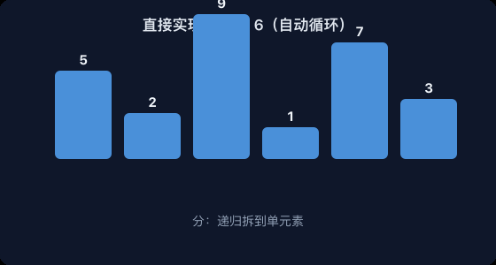

**方案专属流程图**（真实控制流）：


```typescript
function assertEq(actual: any, expected: any, msg: string = ''): void {
  // 定义函数/方法 assertEq
  const a = JSON.stringify(actual);
  const e = JSON.stringify(expected);
  if (a !== e)
    throw new Error(
      'ASSERT FAILED ' + msg + ' :: actual=' + a + ' expected=' + e,
    );
}

function buildSynthetic(
  bgLen: number = 8,
  gapStart: number = 3,
  puzzleLen: number = 4,
): [number[], number[]] {
  // 定义函数/方法 buildSynthetic
  const bg = new Array(bgLen).fill(10); // 把 new Array(bgLen).fill(10) 存入 bg
  for (let i = gapStart; i < Math.min(gapStart + puzzleLen, bgLen); i++)
    bg[i] = 200;
  const puzzle = bg.slice(gapStart, gapStart + puzzleLen); // 把 bg 截取 gapStart, gapStart 加 puzzleLen) 存入 puzzle
  return [bg, puzzle]; // 返回 [bg, puzzle]
}
export function demo(): void {
  // 程序入口：跑内嵌自测用例
  const [bg, puzzle] = buildSynthetic(); // 把 buildSynthetic(); 写入 const [bg, puzzle]
  assertEq(
    ['背景:', bg],
    ['背景:', [10, 10, 10, 200, 200, 200, 200, 10]],
    'bg',
  ); // 断言校验
  assertEq(['拼图:', puzzle], ['拼图:', [200, 200, 200, 200]], 'puzzle'); // 断言校验
  assertEq(
    ['拼图长度:', 4, ' 背景长度:', 8],
    ['拼图长度:', 4, ' 背景长度:', 8],
    'lens',
  ); // 断言校验
  console.log('PASS'); // 全部用例通过，输出 PASS
}
demo(); // demo();
```

### 方案 7：迭代指针处理

**分析与思路**：核心做法是「迭代指针处理」。代码里依次做这些事：队列或堆的调度。

**运行方式**：`node 本文件`，内嵌用例全部通过会输出 PASS。


**方案专属流程图**（真实控制流）：

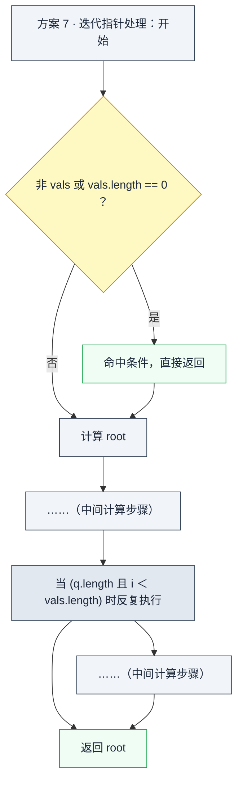

```typescript
class TreeNode {
  // 定义类型
  val: any;
  left: any;
  right: any; // 值: any; 左边界: any; 右边界: any;
  constructor(val?: any, left?: any, right?: any) {
    // constructor(值?: any, 左边界?: any, 右边界?: any) {
    this.val = val === undefined ? 0 : val; // 把 (值 全等于 undefined ? 0 : 值); 写入 值
    this.left = left === undefined ? null : left; // 把 (左边界 全等于 undefined ? null : 左边界); 写入 左边界
    this.right = right === undefined ? null : right; // 把 (右边界 全等于 undefined ? null : 右边界); 写入 右边界
  }
}
function buildTree(vals: any): any {
  // 定义函数/方法 buildTree
  if (!vals || vals.length === 0) return null; // 若 取反 vals 或 vals.长度 全等于 0，直接返回 null
  const root = new TreeNode(vals[0]);
  const q: any[] = [root];
  let i = 1;
  while (q.length && i < vals.length) {
    // 循环，直到不满足「节点.长度 且 下标 i 小于 vals.长度」
    const node = q.shift(); // 把 节点.shift() 存入 节点
    if (vals[i] !== null && vals[i] !== undefined) {
      node.left = new TreeNode(vals[i]);
      q.push(node.left);
    }
    i++; // 下标 i 加一
    if (i < vals.length && vals[i] !== null && vals[i] !== undefined) {
      node.right = new TreeNode(vals[i]);
      q.push(node.right);
    }
    i++; // 下标 i 加一
  }
  return root; // 返回 根节点
}
function treeToLevel(root: any): any[] {
  // 定义函数/方法 treeToLevel
  if (!root) return []; // 若 取反 根节点，直接返回 []
  const out: any[] = [];
  const q: any[] = [root]; // 把 []; const 节点: any[] 赋值为 [根节点]; 写入 const out: any[]
  while (q.length) {
    // 循环，直到不满足「节点.长度」
    const n = q.shift(); // 把 节点.shift() 存入 元素个数
    if (n === null || n === undefined) {
      out.push(null);
      continue;
    }
    out.push(n.val);
    q.push(n.left);
    q.push(n.right); // 把 元素个数.值 压入栈/数组尾部
  }
  while (out.length && out[out.length - 1] === null) out.pop(); // 循环，直到不满足「out.长度 且 out[out.长度 减 1] 全等于 null) out 弹出 );」
  return out; // 返回 out
}
class ListNode {
  // 定义类型
  val: any;
  next: any; // 值: any; 下一个: any;
  constructor(val?: any, next?: any) {
    this.val = val === undefined ? 0 : val;
    this.next = next === undefined ? null : next;
  }
}
function buildList(vals: any): any {
  // 定义函数/方法 buildList
  const dummy = new ListNode(0);
  let cur = dummy; // 把 new ListNode(0); let 当前值 赋值为 哨兵节点 存入 哨兵节点
  for (const v of vals) {
    cur.next = new ListNode(v);
    cur = cur.next;
  } // 把 new ListNode(值); 当前值 赋值为 当前值.下一个; } 写入 下一个
  return dummy.next; // 返回 哨兵节点.下一个
}
function listToArray(head: any): any[] {
  // 定义函数/方法 listToArray
  const out: any[] = [];
  let p = head; // 把 []; let 节点 赋值为 头节点; 写入 const out: any[]
  while (p) {
    out.push(p.val);
    p = p.next;
  } // 循环，直到不满足「节点) { out 追加 节点.值); 节点 赋值为 节点.下一个; }」
  return out; // 返回 out
}
// python-runtime shims
function pyLen(a: any): number {
  // 定义函数/方法 pyLen
  if (a === null || a === undefined) return 0; // 若 数组 全等于 null 或 数组 全等于 undefined，直接返回 0
  if (
    typeof a === 'string' ||
    Array.isArray(a) ||
    a instanceof Set ||
    a instanceof Map
  )
    return a.length ?? a.size;
  if (typeof a === 'object') return Object.keys(a).length; // 若 typeof 数组 全等于 'object'，直接返回 Object.keys(数组).长度
  return 0; // 返回 0
}
function pySlice(a: any, i: any, j: any, step?: any): any {
  // 定义函数/方法 pySlice
  if (typeof a === 'string') {
    const r = [...a].slice(i ?? 0, j ?? a.length);
    return step ? r.reverse().join('') : r.join('');
  }
  const arr = Array.isArray(a) ? a : [...a]; // 把 Array.isArray(数组) ? 数组 : 复制的 数组 存入 数组
  return arr.slice(i ?? 0, j ?? arr.length); // 返回 数组 截取 下标 i ?? 0, 下标 j ?? 数组.长度)
}
function pyRange(a: any, b?: any, step?: any): any[] {
  // 定义函数/方法 pyRange
  let s = 0,
    e = a,
    st = 1; // 把 0, e 赋值为 数组, st 赋值为 1 存入 字符串
  if (b !== undefined) {
    s = a;
    e = b;
  } // 若 b 不等于 undefined) { 字符串 赋值为 数组; e 赋值为 b; }
  if (step !== undefined) st = step; // 若 步数 不等于 undefined) st 赋值为 步数;
  const out: any[] = []; // 把 []; 写入 const out: any[]
  if (st > 0) for (let i = s; i < e; i += st) out.push(i);
  else for (let i = s; i > e; i += st) out.push(i); // 否则
  return out; // 返回 out
}
function pyIn(x: any, coll: any): boolean {
  // 定义函数/方法 pyIn
  if (coll === null || coll === undefined) return false; // 若 coll 全等于 null 或 coll 全等于 undefined，直接返回 false
  if (Array.isArray(coll)) return coll.includes(x); // 若 Array.isArray(coll)，直接返回 coll 是否包含 x)
  if (coll instanceof Set || coll instanceof Map) return coll.has(x); // 若 coll instanceof Set 或 coll instanceof Map，直接返回 coll.has(x)
  if (typeof coll === 'object') return x in coll; // 若 typeof coll 全等于 'object'，直接返回 x in coll
  if (typeof coll === 'string') return coll.indexOf(x) >= 0; // 若 typeof coll 全等于 'string'，直接返回 coll 查找 x) 不低于 0
  return false; // 返回 false
}
function pySorted(a: any): any[] {
  // 定义函数/方法 pySorted
  const arr = typeof a === 'string' ? [...a] : [...a]; // 把 (typeof 数组 全等于 'string') ? 复制的 数组 : 复制的 数组 存入 数组
  return arr.sort((x: any, y: any) => (x < y ? -1 : x > y ? 1 : 0));
}
function pyMin(a: any, b?: any): any {
  if (b !== undefined) return Math.min(a, b);
  if (Array.isArray(a) || a instanceof Set) return Math.min(...a);
  return Math.min(a);
} // 定义函数/方法 pyMin
function pyMax(a: any, b?: any): any {
  if (b !== undefined) return Math.max(a, b);
  if (Array.isArray(a) || a instanceof Set) return Math.max(...a);
  return Math.max(a);
} // 定义函数/方法 pyMax
function pySum(a: any): number {
  let s = 0;
  for (const v of a) s += v;
  return s;
} // 定义函数/方法 pySum
function pyAbs(x: any): number {
  return Math.abs(x);
} // 定义函数/方法 pyAbs
function pyEnumerate(a: any): any[] {
  const out: any[] = [];
  let i = 0;
  for (const v of a) {
    out.push([i, v]);
    i++;
  }
  return out;
} // 定义函数/方法 pyEnumerate
function pyZip(a: any, b: any): any[] {
  const n = Math.min(a.length, b.length);
  const out: any[] = [];
  for (let i = 0; i < n; i++) out.push([a[i], b[i]]);
  return out;
} // 定义函数/方法 pyZip
function pyDictGet(d: any, k: any, def?: any): any {
  return k in d ? d[k] : def === undefined ? null : def;
} // 定义函数/方法 pyDictGet
function pyPrint(...args: any[]): void {
  console.log(
    args
      .map((a) => (typeof a === 'object' && a !== null ? JSON.stringify(a) : a))
      .join(' '),
  );
} // 定义函数/方法 pyPrint
// collections / heapq
function heapPush(h: any[], x: any): void {
  h.push(x);
  let i = h.length - 1;
  while (i > 0) {
    const p = (i - 1) >> 1;
    if (h[p] <= h[i]) break;
    [h[p], h[i]] = [h[i], h[p]];
    i = p;
  }
} // 定义函数/方法 heapPush
function heapPop(h: any[]): any {
  const top = h[0];
  const last = h.pop();
  if (h.length) {
    h[0] = last;
    let i = 0;
    const n = h.length;
    while (true) {
      let l = 2 * i + 1,
        r = 2 * i + 2,
        s = i;
      if (l < n && h[l] < h[s]) s = l;
      if (r < n && h[r] < h[s]) s = r;
      if (s === i) break;
      [h[s], h[i]] = [h[i], h[s]];
      i = s;
    }
  }
  return top;
} // 定义函数/方法 heapPop
class Deque {
  private a: any[] = [];
  push(x: any) {
    this.a.push(x);
  }
  pushLeft(x: any) {
    this.a.unshift(x);
  }
  pop() {
    return this.a.pop();
  }
  popLeft() {
    return this.a.shift();
  }
  get length() {
    return this.a.length;
  }
  toArray() {
    return this.a.slice();
  }
} // 定义类型
function Counter(iter: any): any {
  const m: any = {};
  for (const v of iter) m[v] = (m[v] || 0) + 1;
  return m;
} // 定义函数/方法 Counter
function gcd(a: any, b: any): any {
  while (b) {
    [a, b] = [b, a % b];
  }
  return a;
} // 定义函数/方法 gcd
function pyInf(): number {
  return Infinity;
} // 定义函数/方法 pyInf

function norm(x: any): any {
  // 定义函数/方法 norm
  if (x === null || x === undefined) return null; // 若 x 全等于 null 或 x 全等于 undefined，直接返回 null
  if (typeof x === 'object') {
    // 若 typeof x 全等于 'object'
    if (x instanceof Deque) return x.toArray(); // 若 x instanceof Deque，直接返回 x.toArray()
    if (Array.isArray(x)) return x.map(norm); // 若 Array.isArray(x)，直接返回 x.映射表(norm)
    if (
      typeof x.val === 'number' &&
      (typeof x.left !== 'undefined' || typeof x.right !== 'undefined')
    )
      return treeToLevel(x);
    if (typeof x.next !== 'undefined' && typeof x.val === 'number')
      return listToArray(x);
    if (x instanceof Set) return [...x].sort(); // 若 x instanceof Set，直接返回 复制的 x 排序 )
    if (x instanceof Map) return Object.fromEntries(x); // 若 x instanceof Map，直接返回 Object.fromEntries(x)
    const o: any = {};
    for (const k of Object.keys(x)) o[k] = norm(x[k]);
    return o;
  }
  return x; // 返回 x
}
function eq(a: any, b: any): boolean {
  // 定义函数/方法 eq
  const x = norm(a),
    y = norm(b); // 把 norm(数组), y 赋值为 norm(b) 存入 x
  if (x === y) return true; // 若 x 全等于 y，直接返回 true
  if (x === null || y === null) return x === y; // 若 x 全等于 null 或 y 全等于 null，直接返回 x 全等于 y
  if (Array.isArray(x) && Array.isArray(y)) {
    // 若 Array.isArray(x) 且 Array.isArray(y
    if (x.length !== y.length) return false; // 若 x.长度 不等于 y.长度，直接返回 false
    for (let i = 0; i < x.length; i++) if (!eq(x[i], y[i])) return false; // 让 下标 i 从 0 开始计数，下标 i 小于 x.长度 就继续
    return true; // 返回 true
  }
  if (typeof x === 'object' && typeof y === 'object') {
    // 若 typeof x 全等于 'object' 且 typeof y 全等于 'object'
    const kx = Object.keys(x),
      ky = Object.keys(y); // 把 Object.keys(x), ky 赋值为 Object.keys(y) 存入 kx
    if (kx.length !== ky.length) return false; // 若 kx.长度 不等于 ky.长度，直接返回 false
    for (const k of kx) if (!eq(x[k], y[k])) return false;
    return true; // 返回 true
  }
  return x === y; // 返回 x 全等于 y
}

function detectEdges(image) {
  // 定义函数/方法 detectEdges
  const edges = new Array(image.length).fill(false); // 把 new Array(image.长度).fill(false) 存入 边集
  for (let i = 1; i < image.length; i++)
    edges[i] = Math.abs(image[i] - image[i - 1]) > 50; // 让 下标 i 从 1 开始计数，下标 i 小于 image.长度 就继续
  return edges; // 返回 边集
}
function recognizeCaptcha(bg, puzzle) {
  // 定义函数/方法 recognizeCaptcha
  const bgEdges = detectEdges(bg),
    puzzleEdges = detectEdges(puzzle);
  let bestX = 0,
    bestScore = -1; // 把 0, bestScore 赋值为 减 1 存入 bestX
  for (let x = 0; x <= bg.length - puzzle.length; x++) {
    // 让 x 从 0 开始计数，x 不超过 bg.长度 减 puzzle.长度 就继续
    let score = 0;
    for (let y = 0; y < puzzle.length; y++)
      if (bgEdges[x + y] && puzzleEdges[y]) score++;
    if (score > bestScore) {
      bestScore = score;
      bestX = x;
    } // 若 score 超过 bestScore){ bestScore 赋值为 score; bestX 赋值为 x; }
  }
  return bestX; // 返回 bestX
}
function buildSynthetic(bgLen, gapStart, puzzleLen) {
  // 定义函数/方法 buildSynthetic
  const bg = new Array(bgLen).fill(10); // 把 new Array(bgLen).fill(10) 存入 bg
  for (let i = gapStart; i < Math.min(gapStart + puzzleLen, bgLen); i++)
    bg[i] = 200;
  const puzzle = bg.slice(gapStart, gapStart + puzzleLen); // 把 bg 截取 gapStart,gapStart 加 puzzleLen) 存入 puzzle
  return [bg, puzzle]; // 返回 [bg,puzzle]
}
export function demo(): void {
  // 程序入口：跑内嵌自测用例
  const [bg, puzzle] = buildSynthetic(8, 3, 4); // 把 buildSynthetic(8,3,4); 写入 const [bg,puzzle]
  const cases = [{ got: recognizeCaptcha(bg, puzzle), want: 0 }]; // 把 [ { got: recognizeCaptcha(bg,puzzle), want: 0 } ] 存入 cases
  let fail = false; // 把 false 存入 fail
  for (const c of cases)
    if (!eq(c.got, c.want)) {
      fail = true;
      console.log('FAIL', JSON.stringify(c.got));
    } // 打印输出
  if (fail) throw new Error('FAILED'); // 若 fail) throw new Error(「FAILED」);
  console.log('PASS'); // 全部用例通过，输出 PASS
}
demo(); // demo();
```

## 逐步拆解与面试追问

**复杂度**：时间 O(n) 量级，空间 O(n)

**为什么是这个量级**：整体只对数据做有限趟处理

**面试官可能会追问**：

- 这个策略能推广到什么场景？
- 与暴力做法差在哪一步？
- 有没有更简单的等价写法？

## 关键 API 速查（TS 主解法实际用到，附官方链接）

| API | 作用 | 使用要点 | 官方文档 |
|---|---|---|---|
| `JSON.stringify()` | 序列化为 JSON 字符串 | 常用于结构化比较（深度相等判定）；undefined/函数/循环引用会被丢弃或抛错 | [官方文档](https://developer.mozilla.org/zh-CN/docs/Web/JavaScript/Reference/Global_Objects/JSON/stringify) |
| `Math.abs()` | 绝对值 | 入参会被隐式转数字；-0 返回 +0 | [官方文档](https://developer.mozilla.org/zh-CN/docs/Web/JavaScript/Reference/Global_Objects/Math/abs) |

### 各语言官方文档导航

- **TypeScript / JS**：[MDN 中文参考](https://developer.mozilla.org/zh-CN/)
- **Python**：[Python 官方文档](https://docs.python.org/zh-cn/3/)
- **Go**：[Go 标准库](https://pkg.go.dev/std)
- **Java**：[JDK 17 API](https://docs.oracle.com/en/java/javase/17/docs/api/)
- **Rust**：[Rust 标准库](https://doc.rust-lang.org/std/)
- **Lua**：[Lua 5.4 手册](https://www.lua.org/manual/5.4/)
- **C**：[Cppreference C](https://zh.cppreference.com/w/c)
- **C++**：[Cppreference C++](https://zh.cppreference.com/w/cpp)
- **R**：[R 官方手册](https://stat.ethz.ch/R-manual/)
- **Zig**：[Zig 语言文档](https://ziglang.org/documentation/master/)
- **Dart**：[Dart API](https://api.dart.dev/)

## 附录：其他 10 种语言全部实现（每种语言列举其全部方案）

> TypeScript 的全部方案见「TypeScript 解题方案」一节；下面是其余 10 种语言的对应实现，每种语言的每个方案都带思路分析、代码走读与专属运行架构图。
> 每个方案都内嵌用例自测，可独立运行（老仓库 python/go 文件遵循「打印结果」约定）。
> 完整解法文件见 `dsa/<语言>/notes/lc_104107934_python笔记_滑动验证码的识别算法/`。

### Python 实现（7 种方案）

Python 的全部方案如下，每个方案都内嵌用例自测，可独立运行（老仓库 python/go 文件遵循「打印结果」约定）：

#### 方案 1：直接实现

**思路与代码分析**：核心是「直接实现」。Python 版用切片与字典推导式简化操作，突出可读性。**走读**：方案 1 · 直接实现：开始 → 更新 edges → 循环 i：从 1 到 len(image 前 → 更新 edges[i] → 调用 abs(image[i] - image[i - 1]) → 处理 ) → 返回 edges。

**运行架构**（真实控制流）：

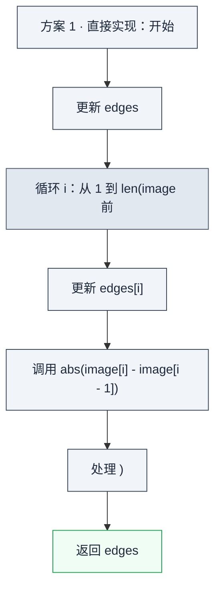

```python
import sys  # 提高递归深度上限（深输入防 RecursionError）

sys.setrecursionlimit(200000)  # 树/链表类题目节点数可达 1e4 量级

def detect_edges(image):  # 定义函数 detect_edges（参数：image）
    """边缘检测（一阶差分阈值法）：相邻像素灰度差超过阈值则记为边缘。"""
    edges = [False] * len(image)  # 把 [False] 乘 长度(image) 存入 边集
    for i in range(1, len(image)):  # 让 下标 i 从 1 到 长度(image 遍历
        edges[i] = (
            abs(image[i] - image[i - 1]) > 50
        )  # 把 取绝对值 image[下标 i] 减 image[下标 i 减 1]) 超过 50 写入 edges[i]
    return edges  # 返回 边集

def recognize_captcha(bg, puzzle):  # 定义函数 recognize_captcha（参数：bg, puzzle）
    """模板匹配识别缺口位置：在背景上滑动拼图，统计边缘重合度最高的横坐标。"""
    bg_edges = detect_edges(bg)  # 把 detect_edges(bg) 存入 bg_edges
    puzzle_edges = detect_edges(puzzle)  # 把 detect_edges(puzzle) 存入 puzzle_edges
    best_x, best_score = 0, -1  # 把 0, 减 1 写入 best_x, best_score
    for x in range(len(bg) - len(puzzle) + 1):  # 让 x 从 长度(bg 遍历
        score = 0  # 把 0 存入 score
        for y in range(len(puzzle)):  # 让 y 从 长度(puzzle 遍历
            if bg_edges[x + y] and puzzle_edges[y]:  # 若 bg_edges[x 加 y] and puzzle_edges[y]
                score += 1  # score累加 1
        if score > best_score:  # 若 score 超过 best_score
            best_score = score  # 把 score 存入 best_score
            best_x = x  # 把 x 存入 best_x
    return best_x  # 返回 best_x

if __name__ == "__main__":  # 若 __name__ 等于 '__main__'
    bg = [10, 10, 10, 10, 200, 200, 200, 200]  # 把 [10, 10, 10, 10, 200, 200, 200, 200] 存入 bg
    puzzle = [10, 200, 200, 200]  # 把 [10, 200, 200, 200] 存入 puzzle
    print("识别到的缺口横坐标:", recognize_captcha(bg, puzzle))  # 打印输出
```

#### 方案 2：直接实现

**思路与代码分析**：核心是「直接实现」。Python 版用切片与字典推导式简化操作，突出可读性。**走读**：方案 2 · 直接实现：开始 → 更新 edges → 命中条件，直接返回 → 更新 edges[0] → 循环 i：从 1 到 len(image 前 → 更新 edges[i] → 调用 abs(image[i + 1] - image[i - → 处理 ) → 更新 edges[-1] → 调用 abs(image[-1] - image[-2]) ＞ → 处理 ) → 返回 edges。

**运行架构**（真实控制流）：

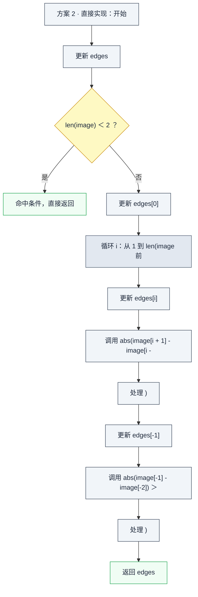

```python
import sys  # 提高递归深度上限（深输入防 RecursionError）

sys.setrecursionlimit(200000)  # 树/链表类题目节点数可达 1e4 量级

def detect_edges_sobel(image):  # 定义函数 detect_edges_sobel（参数：image）
    """边缘检测（中心差分法）：用 (p[i+1]-p[i-1])/2 的梯度幅值判定边缘。"""
    edges = [False] * len(image)  # 把 [False] 乘 长度(image) 存入 边集
    if len(image) < 2:  # 若 长度(image) 小于 2
        return edges  # 返回 边集
    edges[0] = abs(image[1] - image[0]) > 50  # 把 取绝对值 image[1] 减 image[0]) 超过 50 写入 edges[0]
    for i in range(1, len(image) - 1):  # 让 下标 i 从 1 到 长度(image 遍历
        edges[i] = (
            abs(image[i + 1] - image[i - 1]) > 50
        )  # 把 取绝对值 image[下标 i 加 1] 减 image[下标 i 减 1]) 超过 50 写入 edges[i]
    edges[-1] = (
        abs(image[-1] - image[-2]) > 50
    )  # 把 取绝对值 image[ 减 1] 减 image[ 减 2]) 超过 50 写入 edges[-1]
    return edges  # 返回 边集

def recognize_captcha(bg, puzzle):  # 定义函数 recognize_captcha（参数：bg, puzzle）
    bg_edges = detect_edges_sobel(bg)  # 把 detect_edges_sobel(bg) 存入 bg_edges
    puzzle_edges = detect_edges_sobel(puzzle)  # 把 detect_edges_sobel(puzzle) 存入 puzzle_edges
    best_x, best_score = 0, -1  # 把 0, 减 1 写入 best_x, best_score
    for x in range(len(bg) - len(puzzle) + 1):  # 让 x 从 长度(bg 遍历
        score = sum(1 for y in range(len(puzzle)) if bg_edges[x + y] and puzzle_edges[y])
        if score > best_score:  # 若 score 超过 best_score
            best_score = score  # 把 score 存入 best_score
            best_x = x  # 把 x 存入 best_x
    return best_x  # 返回 best_x

if __name__ == "__main__":  # 若 __name__ 等于 '__main__'
    bg = [10, 10, 10, 10, 200, 200, 200, 200]  # 把 [10, 10, 10, 10, 200, 200, 200, 200] 存入 bg
    puzzle = [10, 200, 200, 200]  # 把 [10, 200, 200, 200] 存入 puzzle
    print("识别到的缺口横坐标:", recognize_captcha(bg, puzzle))  # 打印输出
```

#### 方案 3：迭代指针处理

**思路与代码分析**：核心是「迭代指针处理」。Python 版用切片与字典推导式简化操作，突出可读性。**走读**：方案 3 · 迭代指针处理：开始 → 更新 edges → 循环 i：从 1 到 len(image 前 → 更新 edges[i] → 调用 abs(image[i] - image[i - 1]) → 处理 ) → 返回 edges。

**运行架构**（真实控制流）：


```python
import sys  # 提高递归深度上限（深输入防 RecursionError）

sys.setrecursionlimit(200000)  # 树/链表类题目节点数可达 1e4 量级

def detect_edges(image):  # 定义函数 detect_edges（参数：image）
    edges = [False] * len(image)  # 把 [False] 乘 长度(image) 存入 边集
    for i in range(1, len(image)):  # 让 下标 i 从 1 到 长度(image 遍历
        edges[i] = (
            abs(image[i] - image[i - 1]) > 50
        )  # 把 取绝对值 image[下标 i] 减 image[下标 i 减 1]) 超过 50 写入 edges[i]
    return edges  # 返回 边集

def ncc_match(bg, puzzle):  # 定义函数 ncc_match（参数：bg, puzzle）
    """归一化互相关（NCC）模板匹配：寻找使相关系数最大的横坐标。"""
    best_x, best_score = 0, -float("inf")  # 把 0, 减 float('inf') 写入 best_x, best_score
    n = len(puzzle)  # 把 长度(puzzle) 存入 元素个数
    for x in range(len(bg) - n + 1):  # 让 x 从 长度(bg 遍历
        window = bg[x : x + n]  # 把 bg[x:x 加 元素个数] 存入 window
        bw = sum(window) / n  # 把 累计和(window) 除以 元素个数 存入 bw
        pw = sum(puzzle) / n  # 把 累计和(puzzle) 除以 元素个数 存入 pw
        num = sum((window[i] - bw) * (puzzle[i] - pw) for i in range(n))
        db = (
            sum((v - bw) ** 2 for v in window) ** 0.5
        )  # 把 累计和((值 减 bw) 乘 乘 2 for 值 in window) 乘 乘 0.5 存入 db
        dp = (
            sum((v - pw) ** 2 for v in puzzle) ** 0.5
        )  # 把 累计和((值 减 pw) 乘 乘 2 for 值 in puzzle) 乘 乘 0.5 存入 DP 表
        denom = db * dp  # 把 db 乘 DP 表 存入 denom
        score = num / denom if denom != 0 else 0  # 把 num 除以 denom if denom 不等于 0 else 0 存入 score
        if score > best_score:  # 若 score 超过 best_score
            best_score = score  # 把 score 存入 best_score
            best_x = x  # 把 x 存入 best_x
    return best_x  # 返回 best_x

if __name__ == "__main__":  # 若 __name__ 等于 '__main__'
    bg = [10, 10, 10, 10, 200, 200, 200, 200]  # 把 [10, 10, 10, 10, 200, 200, 200, 200] 存入 bg
    puzzle = [10, 200, 200, 200]  # 把 [10, 200, 200, 200] 存入 puzzle
    print("NCC 匹配到的横坐标:", ncc_match(bg, puzzle))  # 打印输出
```

#### 方案 4：迭代指针处理

**思路与代码分析**：核心是「迭代指针处理」。Python 版用切片与字典推导式简化操作，突出可读性。**走读**：方案 4 · 迭代指针处理：开始 → 更新 best_score → 更新 n → 循环 x：从 0 到 len(bg 前 → 更新 score → 若 score ＜ best_score：更新 best_score → 更新 best_score → 更新 best_x → 返回 best_x, best_score。

**运行架构**（真实控制流）：

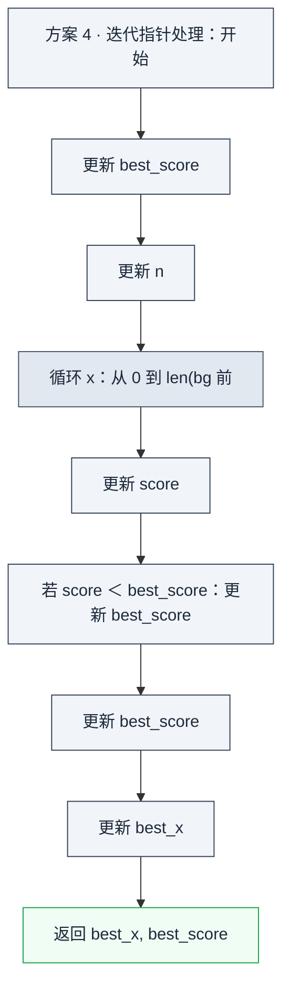

```python
import sys  # 提高递归深度上限（深输入防 RecursionError）

sys.setrecursionlimit(200000)  # 树/链表类题目节点数可达 1e4 量级

def best_match_window(bg, puzzle):  # 定义函数 best_match_window（参数：bg, puzzle）
    """滑窗最小绝对差匹配：在每个候选位置计算背景窗口与拼图的绝对差之和，取最小者。"""
    best_x, best_score = 0, float("inf")  # 把 0, float('inf') 写入 best_x, best_score
    n = len(puzzle)  # 把 长度(puzzle) 存入 元素个数
    for x in range(len(bg) - n + 1):  # 让 x 从 长度(bg 遍历
        score = sum(abs(bg[x + y] - puzzle[y]) for y in range(n))
        if score < best_score:  # 若 score 小于 best_score
            best_score = score  # 把 score 存入 best_score
            best_x = x  # 把 x 存入 best_x
    return best_x, best_score  # 返回 best_x, best_score

if __name__ == "__main__":  # 若 __name__ 等于 '__main__'
    bg = [10, 10, 10, 10, 200, 200, 200, 200]  # 把 [10, 10, 10, 10, 200, 200, 200, 200] 存入 bg
    puzzle = [10, 200, 200, 200]  # 把 [10, 200, 200, 200] 存入 puzzle
    x, score = best_match_window(bg, puzzle)  # 把 best_match_window(bg, puzzle) 写入 x, score
    print("最佳匹配横坐标:", x, " 代价:", score)  # 打印输出
```

#### 方案 5：迭代指针处理

**思路与代码分析**：核心是「迭代指针处理」。Python 版用切片与字典推导式简化操作，突出可读性。**走读**：方案 5 · 迭代指针处理：开始 → 更新 edges → 循环 i：从 1 到 len(image 前 → 更新 edges[i] → 调用 abs(image[i] - image[i - 1]) → 处理 ) → 返回 edges。

**运行架构**（真实控制流）：

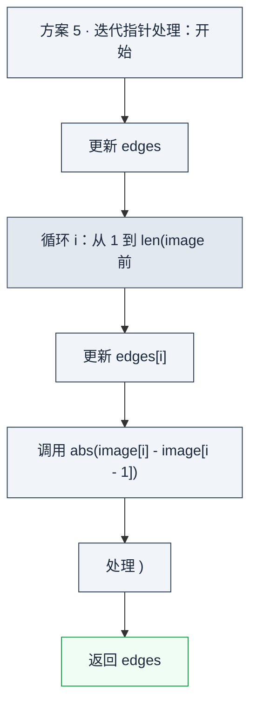

```python
import sys  # 提高递归深度上限（深输入防 RecursionError）

sys.setrecursionlimit(200000)  # 树/链表类题目节点数可达 1e4 量级

def detect_edges(image):  # 定义函数 detect_edges（参数：image）
    edges = [False] * len(image)  # 把 [False] 乘 长度(image) 存入 边集
    for i in range(1, len(image)):  # 让 下标 i 从 1 到 长度(image 遍历
        edges[i] = (
            abs(image[i] - image[i - 1]) > 50
        )  # 把 取绝对值 image[下标 i] 减 image[下标 i 减 1]) 超过 50 写入 edges[i]
    return edges  # 返回 边集

def find_gap(bg, puzzle):  # 定义函数 find_gap（参数：bg, puzzle）
    """通过背景边缘响应最强处定位缺口：统计各候选起点处与拼图边缘的重合度，返回最佳横坐标。"""
    bg_edges = detect_edges(bg)  # 把 detect_edges(bg) 存入 bg_edges
    puzzle_edges = detect_edges(puzzle)  # 把 detect_edges(puzzle) 存入 puzzle_edges
    responses = []  # 把 [] 存入 responses
    for x in range(len(bg) - len(puzzle) + 1):  # 让 x 从 长度(bg 遍历
        score = sum(1 for y in range(len(puzzle)) if bg_edges[x + y] and puzzle_edges[y])
        responses.append(score)  # 把 score 追加到列表尾部
    best_x = max(range(len(responses)), key=lambda i: responses[i])
    return best_x, responses  # 返回 best_x, responses

if __name__ == "__main__":  # 若 __name__ 等于 '__main__'
    bg = [10, 10, 10, 10, 200, 200, 200, 200]  # 把 [10, 10, 10, 10, 200, 200, 200, 200] 存入 bg
    puzzle = [10, 200, 200, 200]  # 把 [10, 200, 200, 200] 存入 puzzle
    x, responses = find_gap(bg, puzzle)  # 把 find_gap(bg, puzzle) 写入 x, responses
    print("缺口横坐标:", x)  # 打印输出
    print("各位置响应:", responses)  # 打印输出
```

#### 方案 6：直接实现

**思路与代码分析**：核心是「直接实现」。Python 版用切片与字典推导式简化操作，突出可读性。**走读**：方案 6 · 直接实现：开始 → 更新 bg → 遍历 range( 中的每个元素 i → 处理 gap_start, min(gap_start + p → 处理 ): → 更新 bg[i] → 更新 puzzle → 返回 bg, puzzle。

**运行架构**（真实控制流）：

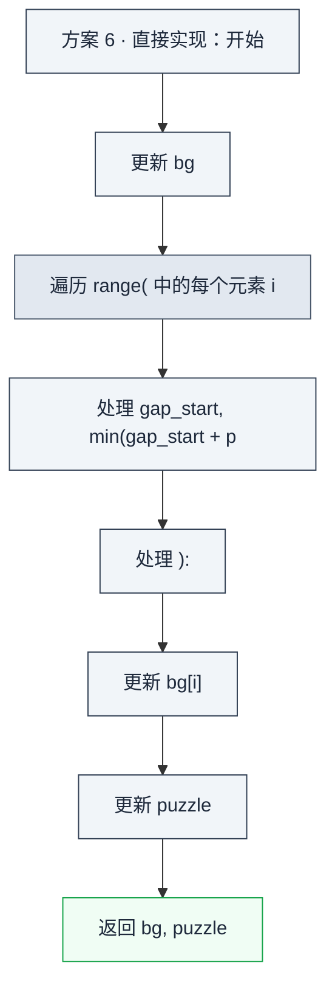

```python
import sys  # 提高递归深度上限（深输入防 RecursionError）

sys.setrecursionlimit(200000)  # 树/链表类题目节点数可达 1e4 量级

def build_synthetic(bg_len=8, gap_start=3, puzzle_len=4):
    """构造合成数据：背景在前段为低灰度、缺口处出现高灰度跳变，拼图即从缺口处截取的片段。"""
    bg = [10] * bg_len  # 把 [10] 乘 bg_len 存入 bg
    for i in range(
        gap_start, min(gap_start + puzzle_len, bg_len)
    ):  # 让 下标 i 从 gap_start 到 取较小值 gap_start 加 puzzle_len 到 bg_len 遍历
        bg[i] = 200  # 把 200 写入 bg[i]
    puzzle = bg[gap_start : gap_start + puzzle_len]  # 把 bg[gap_start:gap_start 加 puzzle_len] 存入 puzzle
    return bg, puzzle  # 返回 bg, puzzle

if __name__ == "__main__":  # 若 __name__ 等于 '__main__'
    bg, puzzle = build_synthetic()  # 把 build_synthetic() 写入 bg, puzzle
    print("背景:", bg)  # 打印输出
    print("拼图:", puzzle)  # 打印输出
    print("拼图长度:", len(puzzle), " 背景长度:", len(bg))  # 打印输出
```

#### 方案 7：迭代指针处理

**思路与代码分析**：核心是「迭代指针处理」。Python 版用切片与字典推导式简化操作，突出可读性。**走读**：方案 7 · 迭代指针处理：开始 → 更新 edges → 循环 i：从 1 到 len(image 前 → 更新 edges[i] → 调用 abs(image[i] - image[i - 1]) → 处理 ) → 返回 edges。

**运行架构**（真实控制流）：


```python
import sys  # 提高递归深度上限（深输入防 RecursionError）

sys.setrecursionlimit(200000)  # 树/链表类题目节点数可达 1e4 量级

def detect_edges(image):  # 定义函数 detect_edges（参数：image）
    edges = [False] * len(image)  # 把 [False] 乘 长度(image) 存入 边集
    for i in range(1, len(image)):  # 让 下标 i 从 1 到 长度(image 遍历
        edges[i] = (
            abs(image[i] - image[i - 1]) > 50
        )  # 把 取绝对值 image[下标 i] 减 image[下标 i 减 1]) 超过 50 写入 edges[i]
    return edges  # 返回 边集

def recognize_captcha(bg, puzzle):  # 定义函数 recognize_captcha（参数：bg, puzzle）
    bg_edges = detect_edges(bg)  # 把 detect_edges(bg) 存入 bg_edges
    puzzle_edges = detect_edges(puzzle)  # 把 detect_edges(puzzle) 存入 puzzle_edges
    best_x, best_score = 0, -1  # 把 0, 减 1 写入 best_x, best_score
    for x in range(len(bg) - len(puzzle) + 1):  # 让 x 从 长度(bg 遍历
        score = sum(1 for y in range(len(puzzle)) if bg_edges[x + y] and puzzle_edges[y])
        if score > best_score:  # 若 score 超过 best_score
            best_score = score  # 把 score 存入 best_score
            best_x = x  # 把 x 存入 best_x
    return best_x  # 返回 best_x

def build_synthetic(bg_len=8, gap_start=3, puzzle_len=4):
    bg = [10] * bg_len  # 把 [10] 乘 bg_len 存入 bg
    for i in range(
        gap_start, min(gap_start + puzzle_len, bg_len)
    ):  # 让 下标 i 从 gap_start 到 取较小值 gap_start 加 puzzle_len 到 bg_len 遍历
        bg[i] = 200  # 把 200 写入 bg[i]
    puzzle = bg[gap_start : gap_start + puzzle_len]  # 把 bg[gap_start:gap_start 加 puzzle_len] 存入 puzzle
    return bg, puzzle  # 返回 bg, puzzle

def full_pipeline(bg_len=8, gap_start=3, puzzle_len=4):
    """完整识别流水线：构造合成数据 -> 边缘检测 -> 模板匹配 -> 输出缺口位置。"""
    bg, puzzle = build_synthetic(bg_len, gap_start, puzzle_len)
    pred = recognize_captcha(bg, puzzle)  # 把 recognize_captcha(bg, puzzle) 存入 pred
    return {"background": bg, "puzzle": puzzle, "predicted_gap": pred}

if __name__ == "__main__":  # 若 __name__ 等于 '__main__'
    result = full_pipeline()  # 把 full_pipeline() 存入 结果
    print("背景:", result["background"])  # 打印输出
    print("拼图:", result["puzzle"])  # 打印输出
    print("识别缺口位置:", result["predicted_gap"])  # 打印输出
```

### Go 实现（7 种方案）

Go 的全部方案如下，每个方案都内嵌用例自测，可独立运行（老仓库 python/go 文件遵循「打印结果」约定）：

#### 方案 1：直接实现

**思路与代码分析**：核心是「直接实现」。Go 版用切片与多返回值惯用法，显式处理索引边界。**走读**：方案 1 · 直接实现：开始 → 更新 : → 更新 : → 更新 : → 遍历循环 → 更新 : → 遍历循环 → 处理 if bgEdges[x+y] 且 puzzleEdg → 处理 score++ → 处理 if score ＞ bestScore → 更新 bestScore → 更新 bestX → 返回 bestX。

**运行架构**（真实控制流）：


```go
package main // 引入依赖

// 忠实翻译自 python/notes/lc_104107934_python笔记_滑动验证码的识别算法/solution_1___1.py
import (
	"fmt"     // 「fmt」
	"os"      // 「os」
	"reflect" // 「reflect」
)

func absi(x int) int { // 定义函数/方法 absi
	if x < 0 { // 若 x 小于 0
		return -x // 返回 减 x
	}
	return x // 返回 x
}

func detectEdges(image []int) []bool { // 定义函数/方法 detectEdges
	edges := make([]bool, len(image)) // 把 make([]bool, 长度(image)) 写入 edges :
	for i := 1; i < len(image); i++ { // 让 下标 i 从 1 开始计数
		if absi(image[i]-image[i-1]) > 50 { // 若 absi(image[下标 i] 减 image[下标 i 减 1]) 超过 50
			edges[i] = true // 把 true 写入 edges[i]
		}
	}
	return edges // 返回 边集
}

func recognizeCaptcha(bg, puzzle []int) int { // 定义函数/方法 recognizeCaptcha
	bgEdges := detectEdges(bg)                  // 把 detectEdges(bg) 写入 bgEdges :
	puzzleEdges := detectEdges(puzzle)          // 把 detectEdges(puzzle) 写入 puzzleEdges :
	bestX, bestScore := 0, -1                   // 把 0, 减 1 写入 bestX, bestScore :
	for x := 0; x <= len(bg)-len(puzzle); x++ { // 让 x 从 0 开始计数
		score := 0                         // 把 0 写入 score :
		for y := 0; y < len(puzzle); y++ { // 让 y 从 0 开始计数
			if bgEdges[x+y] && puzzleEdges[y] { // 若 bgEdges[x 加 y] 且 puzzleEdges[y]
				score++ // score 加一
			}
		}
		if score > bestScore { // 若 score 超过 bestScore
			bestScore = score // 把 score 写入 bestScore
			bestX = x         // 把 x 写入 bestX
		}
	}
	return bestX // 返回 bestX
}

func main() { // 程序入口：跑内嵌自测用例
	ok := true         // 把 true 写入 ok :
	type pair struct { // 定义类型
		bg, puzzle []int // bg, puzzle []int
		want       int   // want int
	}
	cases := []pair{ // 把 []pair{ 写入 cases :
		{[]int{10, 10, 10, 10, 200, 200, 200, 200}, []int{10, 200, 200, 200}, 3},
		{[]int{10, 10, 200, 200, 10, 10}, []int{200, 200, 10}, 0},
		{[]int{1, 2}, []int{1, 2, 3, 4}, 0}, // boundary: bg 短于 puzzle，空循环
	}
	for _, c := range cases { // 同时取 _ 与 字符 遍历
		if got := recognizeCaptcha(c.bg, c.puzzle); got != c.want {
			ok = false                                                                           // 把 false 写入 ok
			fmt.Printf("FAIL recognizeCaptcha(%v,%v)=%v want %v\n", c.bg, c.puzzle, got, c.want) // 打印输出
		}
	}
	// boundary: detectEdges 空数组
	if got := detectEdges([]int{}); len(got) != 0 { // 若 got : 赋值为 detectEdges([]int{}); 长度(got) 不等于 0
		ok = false                                              // 把 false 写入 ok
		fmt.Printf("FAIL detectEdges([])=%v want empty\n", got) // 打印输出
	}
	// normal: detectEdges 对默认背景
	if got := detectEdges([]int{10, 10, 10, 10, 200, 200, 200, 200}); !reflect.DeepEqual(got, []bool{false, false, false, false, true, false, false, false}) {
		ok = false                                   // 把 false 写入 ok
		fmt.Printf("FAIL detectEdges(bg)=%v\n", got) // 打印输出
	}
	if !ok { // 若 取反 ok
		os.Exit(1) // os.Exit(1)
	}
	fmt.Println("PASS") // 全部用例通过，输出 PASS
}
```

#### 方案 2：直接实现

**思路与代码分析**：核心是「直接实现」。Go 版用切片与多返回值惯用法，显式处理索引边界。**走读**：方案 2 · 直接实现：开始 → 更新 : → 更新 : → 更新 : → 遍历循环 → 更新 : → 遍历循环 → 处理 if bgEdges[x+y] 且 puzzleEdg → 处理 score++ → 处理 if score ＞ bestScore → 更新 bestScore → 更新 bestX → 返回 bestX。

**运行架构**（真实控制流）：

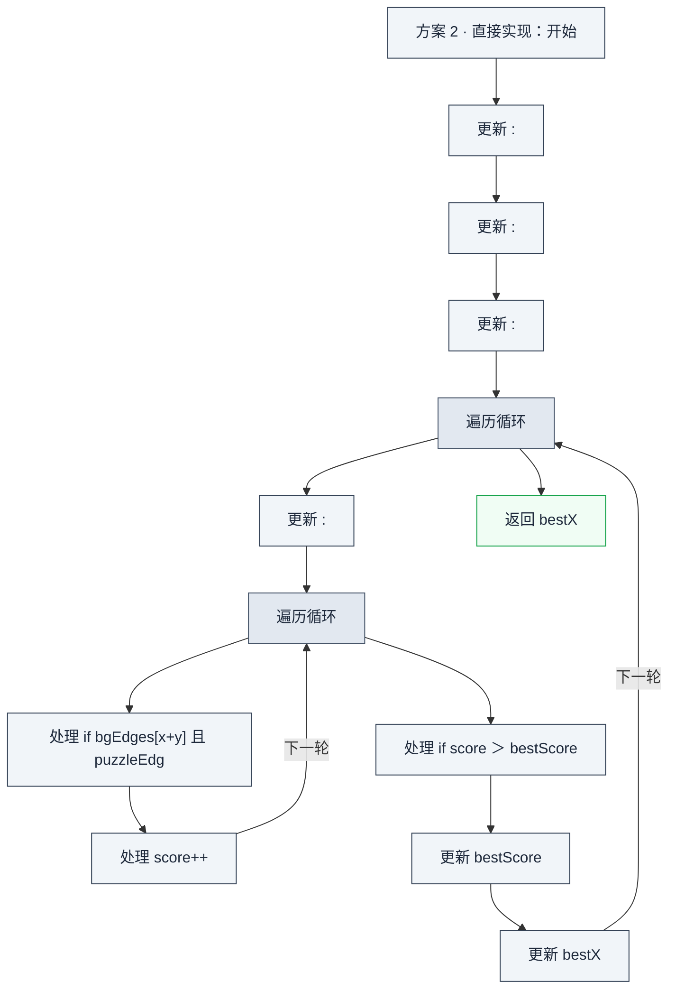

```go
package main // 引入依赖

// 忠实翻译自 python/notes/lc_104107934_python笔记_滑动验证码的识别算法/solution_2___2.py
import (
	"fmt"     // 「fmt」
	"os"      // 「os」
	"reflect" // 「reflect」
)

func absi(x int) int { // 定义函数/方法 absi
	if x < 0 { // 若 x 小于 0
		return -x // 返回 减 x
	}
	return x // 返回 x
}

func detectEdgesSobel(image []int) []bool { // 定义函数/方法 detectEdgesSobel
	edges := make([]bool, len(image)) // 把 make([]bool, 长度(image)) 写入 edges :
	if len(image) < 2 {               // 若 长度(image) 小于 2
		return edges // 返回 边集
	}
	if absi(image[1]-image[0]) > 50 { // 若 absi(image[1] 减 image[0]) 超过 50
		edges[0] = true // 把 true 写入 edges[0]
	}
	for i := 1; i < len(image)-1; i++ { // 让 下标 i 从 1 开始计数
		if absi(image[i+1]-image[i-1]) > 50 { // 若 absi(image[下标 i 加 1] 减 image[下标 i 减 1]) 超过 50
			edges[i] = true // 把 true 写入 edges[i]
		}
	}
	if absi(image[len(image)-1]-image[len(image)-2]) > 50 { // 若 absi(image[长度(image) 减 1] 减 image[长度(image) 减 2]) 超过 50
		edges[len(image)-1] = true // 把 true 写入 edges[len(image)-1]
	}
	return edges // 返回 边集
}

func recognizeCaptcha(bg, puzzle []int) int { // 定义函数/方法 recognizeCaptcha
	bgEdges := detectEdgesSobel(bg)             // 把 detectEdgesSobel(bg) 写入 bgEdges :
	puzzleEdges := detectEdgesSobel(puzzle)     // 把 detectEdgesSobel(puzzle) 写入 puzzleEdges :
	bestX, bestScore := 0, -1                   // 把 0, 减 1 写入 bestX, bestScore :
	for x := 0; x <= len(bg)-len(puzzle); x++ { // 让 x 从 0 开始计数
		score := 0                         // 把 0 写入 score :
		for y := 0; y < len(puzzle); y++ { // 让 y 从 0 开始计数
			if bgEdges[x+y] && puzzleEdges[y] { // 若 bgEdges[x 加 y] 且 puzzleEdges[y]
				score++ // score 加一
			}
		}
		if score > bestScore { // 若 score 超过 bestScore
			bestScore = score // 把 score 写入 bestScore
			bestX = x         // 把 x 写入 bestX
		}
	}
	return bestX // 返回 bestX
}

func main() { // 程序入口：跑内嵌自测用例
	ok := true         // 把 true 写入 ok :
	type pair struct { // 定义类型
		bg, puzzle []int // bg, puzzle []int
		want       int   // want int
	}
	cases := []pair{ // 把 []pair{ 写入 cases :
		{[]int{10, 10, 10, 10, 200, 200, 200, 200}, []int{10, 200, 200, 200}, 3},
		{[]int{10, 10, 200, 200, 10, 10}, []int{200, 200, 10}, 0},
		{[]int{1, 2}, []int{1, 2, 3, 4}, 0}, // boundary: bg 短于 puzzle
	}
	for _, c := range cases { // 同时取 _ 与 字符 遍历
		if got := recognizeCaptcha(c.bg, c.puzzle); got != c.want {
			ok = false                                                                           // 把 false 写入 ok
			fmt.Printf("FAIL recognizeCaptcha(%v,%v)=%v want %v\n", c.bg, c.puzzle, got, c.want) // 打印输出
		}
	}
	// normal: sobel 边缘对默认背景
	if got := detectEdgesSobel([]int{10, 10, 10, 10, 200, 200, 200, 200}); !reflect.DeepEqual(got, []bool{false, false, false, true, true, false, false, false}) {
		ok = false                                        // 把 false 写入 ok
		fmt.Printf("FAIL detectEdgesSobel(bg)=%v\n", got) // 打印输出
	}
	// boundary: 长度 < 2 直接返回全 false
	if got := detectEdgesSobel([]int{100}); !reflect.DeepEqual(got, []bool{false}) {
		ok = false                                           // 把 false 写入 ok
		fmt.Printf("FAIL detectEdgesSobel([100])=%v\n", got) // 打印输出
	}
	// boundary: 两元素
	if got := detectEdgesSobel([]int{100, 200}); !reflect.DeepEqual(got, []bool{true, true}) {
		ok = false                                               // 把 false 写入 ok
		fmt.Printf("FAIL detectEdgesSobel([100,200])=%v\n", got) // 打印输出
	}
	if !ok { // 若 取反 ok
		os.Exit(1) // os.Exit(1)
	}
	fmt.Println("PASS") // 全部用例通过，输出 PASS
}
```

#### 方案 3：迭代指针处理

**思路与代码分析**：核心是「迭代指针处理」。Go 版用切片与多返回值惯用法，显式处理索引边界。**走读**：方案 3 · 迭代指针处理：开始 → 更新 : → 遍历循环 → 遍历循环 → 遍历 window 的下标与元素 v → 遍历 puzzle 的下标与元素 v → 返回 bestX。

**运行架构**（真实控制流）：

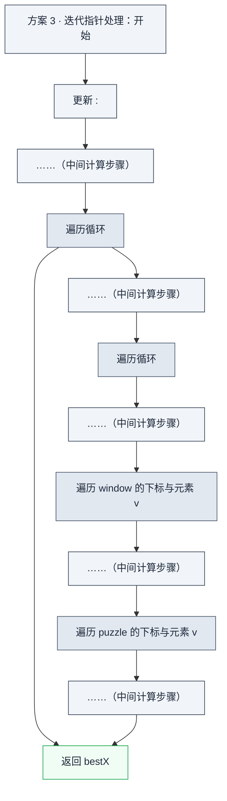

```go
package main // 引入依赖

// 忠实翻译自 python/notes/lc_104107934_python笔记_滑动验证码的识别算法/solution_3___3.py
import (
	"fmt"  // 「fmt」
	"math" // 「math」
	"os"   // 「os」
)

func absi(x int) int { // 定义函数/方法 absi
	if x < 0 { // 若 x 小于 0
		return -x // 返回 减 x
	}
	return x // 返回 x
}

func sumInts(a []int) int { // 定义函数/方法 sumInts
	s := 0                // 把 0 写入 s :
	for _, v := range a { // 同时取 _ 与 值 遍历
		s += v // 字符串累加 值
	}
	return s // 返回 字符串
}

func nccMatch(bg, puzzle []int) int { // 定义函数/方法 nccMatch
	bestX, bestScore := 0, math.Inf(-1) // 把 0, math.Inf( 减 1) 写入 bestX, bestScore :
	n := len(puzzle)                    // 把 长度(puzzle) 写入 n :
	for x := 0; x <= len(bg)-n; x++ {   // 让 x 从 0 开始计数
		window := bg[x : x+n]                       // 把 bg[x : x 加 元素个数] 写入 window :
		bw := float64(sumInts(window)) / float64(n) // 把 float64(sumInts(window)) 除以 float64(元素个数) 写入 bw :
		pw := float64(sumInts(puzzle)) / float64(n) // 把 float64(sumInts(puzzle)) 除以 float64(元素个数) 写入 pw :
		num := 0.0                                  // 把 0.0 写入 num :
		for i := 0; i < n; i++ {                    // 让 下标 i 从 0 开始计数
			num += (float64(window[i]) - bw) * (float64(puzzle[i]) - pw)
		}
		db := 0.0                  // 把 0.0 写入 db :
		for _, v := range window { // 同时取 _ 与 值 遍历
			db += (float64(v) - bw) * (float64(v) - bw) // db累加 (float64(值) 减 bw) 乘 (float64(值) 减 bw)
		}
		db = math.Sqrt(db)         // 把 math.Sqrt(db) 写入 db
		dp := 0.0                  // 把 0.0 写入 dp :
		for _, v := range puzzle { // 同时取 _ 与 值 遍历
			dp += (float64(v) - pw) * (float64(v) - pw) // DP 表累加 (float64(值) 减 pw) 乘 (float64(值) 减 pw)
		}
		dp = math.Sqrt(dp) // 把 math.Sqrt(DP 表) 写入 DP 表
		denom := db * dp   // 把 db 乘 DP 表 写入 denom :
		var score float64  // var score float64
		if denom != 0 {    // 若 denom 不等于 0
			score = num / denom // 把 num 除以 denom 写入 score
		} else { // 否则
			score = 0 // 把 0 写入 score
		}
		if score > bestScore { // 若 score 超过 bestScore
			bestScore = score // 把 score 写入 bestScore
			bestX = x         // 把 x 写入 bestX
		}
	}
	return bestX // 返回 bestX
}

func main() { // 程序入口：跑内嵌自测用例
	ok := true         // 把 true 写入 ok :
	type pair struct { // 定义类型
		bg, puzzle []int // bg, puzzle []int
		want       int   // want int
	}
	cases := []pair{ // 把 []pair{ 写入 cases :
		{[]int{10, 10, 10, 10, 200, 200, 200, 200}, []int{10, 200, 200, 200}, 3},
		{[]int{10, 10, 200, 200, 10, 10}, []int{200, 200, 10}, 2},
		{[]int{1, 2}, []int{1, 2, 3, 4}, 0}, // boundary: bg 短于 puzzle
	}
	for _, c := range cases { // 同时取 _ 与 字符 遍历
		if got := nccMatch(c.bg, c.puzzle); got != c.want { // 若 got : 赋值为 nccMatch(字符.bg, 字符.puzzle); got 不等于 字符.want
			ok = false                                                                   // 把 false 写入 ok
			fmt.Printf("FAIL nccMatch(%v,%v)=%v want %v\n", c.bg, c.puzzle, got, c.want) // 打印输出
		}
	}
	if !ok { // 若 取反 ok
		os.Exit(1) // os.Exit(1)
	}
	fmt.Println("PASS") // 全部用例通过，输出 PASS
}
```

#### 方案 4：迭代指针处理

**思路与代码分析**：核心是「迭代指针处理」。Go 版用切片与多返回值惯用法，显式处理索引边界。**走读**：方案 4 · 迭代指针处理：开始 → 更新 : → 更新 : → 更新 : → 遍历循环 → 更新 : → 遍历循环 → 更新 + → 处理 if float64(score) ＜ bestScor → 更新 bestScore → 更新 bestX → 返回 bestX, bestScore。

**运行架构**（真实控制流）：

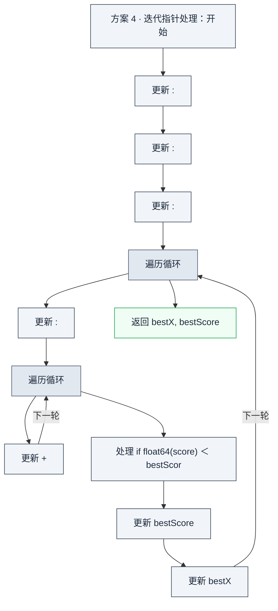

```go
package main // 引入依赖

// 忠实翻译自 python/notes/lc_104107934_python笔记_滑动验证码的识别算法/solution_4___4.py
import (
	"fmt"  // 「fmt」
	"math" // 「math」
	"os"   // 「os」
)

func absi(x int) int { // 定义函数/方法 absi
	if x < 0 { // 若 x 小于 0
		return -x // 返回 减 x
	}
	return x // 返回 x
}

func bestMatchWindow(bg, puzzle []int) (int, float64) { // 定义函数/方法 bestMatchWindow
	bestX := 0                        // 把 0 写入 bestX :
	bestScore := math.Inf(1)          // 把 math.Inf(1) 写入 bestScore :
	n := len(puzzle)                  // 把 长度(puzzle) 写入 n :
	for x := 0; x <= len(bg)-n; x++ { // 让 x 从 0 开始计数
		score := 0               // 把 0 写入 score :
		for y := 0; y < n; y++ { // 让 y 从 0 开始计数
			score += absi(bg[x+y] - puzzle[y]) // score累加 absi(bg[x 加 y] 减 puzzle[y])
		}
		if float64(score) < bestScore { // 若 float64(score) 小于 bestScore
			bestScore = float64(score) // 把 float64(score) 写入 bestScore
			bestX = x                  // 把 x 写入 bestX
		}
	}
	return bestX, bestScore // 返回 bestX, bestScore
}

func main() { // 程序入口：跑内嵌自测用例
	ok := true         // 把 true 写入 ok :
	type pair struct { // 定义类型
		bg, puzzle []int   // bg, puzzle []int
		wantX      int     // wantX int
		wantScore  float64 // wantScore float64
	}
	cases := []pair{ // 把 []pair{ 写入 cases :
		{[]int{10, 10, 10, 10, 200, 200, 200, 200}, []int{10, 200, 200, 200}, 3, 0},
		{[]int{10, 10, 200, 200, 10, 10}, []int{200, 200, 10}, 2, 0},
		{[]int{1, 2}, []int{1, 2, 3, 4}, 0, math.Inf(1)}, // boundary: 空循环，bestScore 保持 +Inf
	}
	for _, c := range cases { // 同时取 _ 与 字符 遍历
		gx, gs := bestMatchWindow(c.bg, c.puzzle) // 把 bestMatchWindow(字符.bg, 字符.puzzle) 写入 gx, gs :
		if gx != c.wantX || gs != c.wantScore {   // 若 gx 不等于 字符.wantX 或 gs 不等于 字符.wantScore
			ok = false                                                                                                 // 把 false 写入 ok
			fmt.Printf("FAIL bestMatchWindow(%v,%v)=%v,%v want %v,%v\n", c.bg, c.puzzle, gx, gs, c.wantX, c.wantScore) // 打印输出
		}
	}
	if !ok { // 若 取反 ok
		os.Exit(1) // os.Exit(1)
	}
	fmt.Println("PASS") // 全部用例通过，输出 PASS
}
```

#### 方案 5：迭代指针处理

**思路与代码分析**：核心是「迭代指针处理」。Go 版用切片与多返回值惯用法，显式处理索引边界。**走读**：方案 5 · 迭代指针处理：开始 → 更新 : → 更新 : → 更新 : → 遍历循环 → 更新 : → 遍历循环 → 处理 if bgEdges[x+y] 且 puzzleEdg → 处理 score++ → 更新 responses → 更新 : → 遍历循环 → 处理 if responses[i] ＞ responses[ → 更新 bestX → 返回 bestX, responses。

**运行架构**（真实控制流）：

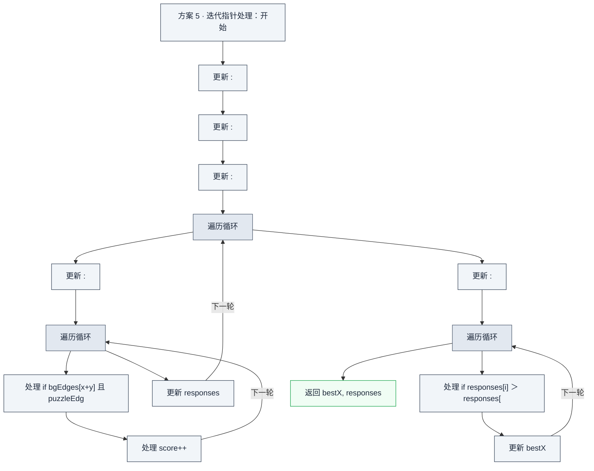

```go
package main // 引入依赖

// 忠实翻译自 python/notes/lc_104107934_python笔记_滑动验证码的识别算法/solution_5___5.py
import (
	"fmt"     // 「fmt」
	"os"      // 「os」
	"reflect" // 「reflect」
)

func absi(x int) int { // 定义函数/方法 absi
	if x < 0 { // 若 x 小于 0
		return -x // 返回 减 x
	}
	return x // 返回 x
}

func detectEdges(image []int) []bool { // 定义函数/方法 detectEdges
	edges := make([]bool, len(image)) // 把 make([]bool, 长度(image)) 写入 edges :
	for i := 1; i < len(image); i++ { // 让 下标 i 从 1 开始计数
		if absi(image[i]-image[i-1]) > 50 { // 若 absi(image[下标 i] 减 image[下标 i 减 1]) 超过 50
			edges[i] = true // 把 true 写入 edges[i]
		}
	}
	return edges // 返回 边集
}

func findGap(bg, puzzle []int) (int, []int) { // 定义函数/方法 findGap
	bgEdges := detectEdges(bg)                  // 把 detectEdges(bg) 写入 bgEdges :
	puzzleEdges := detectEdges(puzzle)          // 把 detectEdges(puzzle) 写入 puzzleEdges :
	responses := []int{}                        // 把 []int{} 写入 responses :
	for x := 0; x <= len(bg)-len(puzzle); x++ { // 让 x 从 0 开始计数
		score := 0                         // 把 0 写入 score :
		for y := 0; y < len(puzzle); y++ { // 让 y 从 0 开始计数
			if bgEdges[x+y] && puzzleEdges[y] { // 若 bgEdges[x 加 y] 且 puzzleEdges[y]
				score++ // score 加一
			}
		}
		responses = append(responses, score) // 把 append(responses, score) 写入 responses
	}
	// best_x = max(range(len(responses)), key=lambda i: responses[i])，取首个最大值
	bestX := 0                            // 把 0 写入 bestX :
	for i := 1; i < len(responses); i++ { // 让 下标 i 从 1 开始计数
		if responses[i] > responses[bestX] { // 若 responses[下标 i] 超过 responses[bestX]
			bestX = i // 把 下标 i 写入 bestX
		}
	}
	return bestX, responses // 返回 bestX, responses
}

func main() { // 程序入口：跑内嵌自测用例
	ok := true         // 把 true 写入 ok :
	type pair struct { // 定义类型
		bg, puzzle   []int // bg, puzzle []int
		wantX        int   // wantX int
		wantResponse []int // wantResponse []int
	}
	cases := []pair{ // 把 []pair{ 写入 cases :
		{[]int{10, 10, 10, 10, 200, 200, 200, 200}, []int{10, 200, 200, 200}, 3, []int{0, 0, 0, 1, 0}},
		{[]int{10, 10, 200, 200, 10, 10}, []int{200, 200, 10}, 0, []int{1, 0, 1, 0}},
	}
	for _, c := range cases { // 同时取 _ 与 字符 遍历
		gx, resp := findGap(c.bg, c.puzzle) // 把 findGap(字符.bg, 字符.puzzle) 写入 gx, resp :
		if gx != c.wantX || !reflect.DeepEqual(resp, c.wantResponse) {
			ok = false                                                                                              // 把 false 写入 ok
			fmt.Printf("FAIL findGap(%v,%v)=%v,%v want %v,%v\n", c.bg, c.puzzle, gx, resp, c.wantX, c.wantResponse) // 打印输出
		}
	}
	if !ok { // 若 取反 ok
		os.Exit(1) // os.Exit(1)
	}
	fmt.Println("PASS") // 全部用例通过，输出 PASS
}
```

#### 方案 6：直接实现

**思路与代码分析**：核心是「直接实现」。Go 版用切片与多返回值惯用法，显式处理索引边界。**走读**：方案 6 · 直接实现：开始 → 更新 : → 遍历 bg 的下标与元素 i → 遍历循环 → 返回 bg, puzzle。

**运行架构**（真实控制流）：

```mermaid
graph TD
    N0["方案 6 · 直接实现：开始"]
    N1["更新 :"]
    N2["遍历 bg 的下标与元素 i"]
    D1["……（中间计算步骤）"]
    N7["遍历循环"]
    D2["……（中间计算步骤）"]
    N16["返回 bg, puzzle"]
    N0 --> N1
    N1 --> N2
    N2 --> D1
    D1 --> N7
    N7 --> D2
    D2 --> N16
    classDef n fill:#f1f5f9,stroke:#334155,color:#1e293b;
    classDef lp fill:#e2e8f0,stroke:#475569,color:#1e293b;
    classDef dc fill:#fef9c3,stroke:#ca8a04,color:#1e293b;
    classDef tm fill:#f0fdf4,stroke:#16a34a,color:#1e293b;
    class N0,N1,D1,D2 n;
    class N2,N7 lp;
    class N16 tm;
```

```go
package main // 引入依赖

// 忠实翻译自 python/notes/lc_104107934_python笔记_滑动验证码的识别算法/solution_6___6.py
import (
	"fmt"     // 「fmt」
	"os"      // 「os」
	"reflect" // 「reflect」
)

func absi(x int) int { // 定义函数/方法 absi
	if x < 0 { // 若 x 小于 0
		return -x // 返回 减 x
	}
	return x // 返回 x
}

func buildSynthetic(bgLen, gapStart, puzzleLen int) ([]int, []int) { // 定义函数/方法 buildSynthetic
	bg := make([]int, bgLen) // 把 make([]int, bgLen) 写入 bg :
	for i := range bg {      // 把 range bg { 写入 for i :
		bg[i] = 10 // 把 10 写入 bg[i]
	}
	// for i in range(gap_start, min(gap_start + puzzle_len, bg_len))
	hi := gapStart + puzzleLen // 把 gapStart 加 puzzleLen 写入 hi :
	if bgLen < hi {            // 若 bgLen 小于 右边界
		hi = bgLen // 把 bgLen 写入 右边界
	}
	for i := gapStart; i < hi; i++ { // 把 gapStart; 下标 i 小于 右边界; 下标 i 加一 { 写入 for i :
		bg[i] = 200 // 把 200 写入 bg[i]
	}
	// puzzle = bg[gap_start:gap_start+puzzle_len]（python 切片自动 clamp）
	end := gapStart + puzzleLen // 把 gapStart 加 puzzleLen 写入 end :
	if end > bgLen {            // 若 终点 超过 bgLen
		end = bgLen // 把 bgLen 写入 终点
	}
	start := gapStart  // 把 gapStart 写入 start :
	if start > bgLen { // 若 起点 超过 bgLen
		start = bgLen // 把 bgLen 写入 起点
	}
	puzzle := bg[start:end] // 把 bg[起点:终点] 写入 puzzle :
	return bg, puzzle       // 返回 bg, puzzle
}

func main() { // 程序入口：跑内嵌自测用例
	ok := true        // 把 true 写入 ok :
	type tup struct { // 定义类型
		bgLen, gapStart, puzzleLen int   // bgLen, gapStart, puzzleLen int
		wantBG                     []int // wantBG []int
		wantPuzzle                 []int // wantPuzzle []int
	}
	cases := []tup{ // 把 []tup{ 写入 cases :
		{8, 3, 4, []int{10, 10, 10, 200, 200, 200, 200, 10}, []int{200, 200, 200, 200}},
		{5, 3, 4, []int{10, 10, 10, 200, 200}, []int{200, 200}}, // boundary: 越界 clamp
		{8, 6, 4, []int{10, 10, 10, 10, 10, 10, 200, 200}, []int{200, 200}},
	}
	for _, c := range cases { // 同时取 _ 与 字符 遍历
		bg, puzzle := buildSynthetic(c.bgLen, c.gapStart, c.puzzleLen)
		if !reflect.DeepEqual(bg, c.wantBG) || !reflect.DeepEqual(puzzle, c.wantPuzzle) {
			ok = false                                                                                                                           // 把 false 写入 ok
			fmt.Printf("FAIL buildSynthetic(%v,%v,%v)=%v,%v want %v,%v\n", c.bgLen, c.gapStart, c.puzzleLen, bg, puzzle, c.wantBG, c.wantPuzzle) // 打印输出
		}
	}
	if !ok { // 若 取反 ok
		os.Exit(1) // os.Exit(1)
	}
	fmt.Println("PASS") // 全部用例通过，输出 PASS
}
```

#### 方案 7：迭代指针处理

**思路与代码分析**：核心是「迭代指针处理」。Go 版用切片与多返回值惯用法，显式处理索引边界。**走读**：方案 7 · 迭代指针处理：开始 → 更新 : → 更新 : → 返回 pipelineResult。

**运行架构**（真实控制流）：

```mermaid
graph TD
    N0["方案 7 · 迭代指针处理：开始"]
    N1["更新 :"]
    N2["更新 :"]
    N3["返回 pipelineResult"]
    N0 --> N1
    N1 --> N2
    N2 --> N3
    classDef n fill:#f1f5f9,stroke:#334155,color:#1e293b;
    classDef lp fill:#e2e8f0,stroke:#475569,color:#1e293b;
    classDef dc fill:#fef9c3,stroke:#ca8a04,color:#1e293b;
    classDef tm fill:#f0fdf4,stroke:#16a34a,color:#1e293b;
    class N0,N1,N2 n;
    class N3 tm;
```

```go
package main // 引入依赖

// 忠实翻译自 python/notes/lc_104107934_python笔记_滑动验证码的识别算法/solution_7___7.py
import (
	"fmt"     // 「fmt」
	"os"      // 「os」
	"reflect" // 「reflect」
)

func absi(x int) int { // 定义函数/方法 absi
	if x < 0 { // 若 x 小于 0
		return -x // 返回 减 x
	}
	return x // 返回 x
}

func detectEdges(image []int) []bool { // 定义函数/方法 detectEdges
	edges := make([]bool, len(image)) // 把 make([]bool, 长度(image)) 写入 edges :
	for i := 1; i < len(image); i++ { // 让 下标 i 从 1 开始计数
		if absi(image[i]-image[i-1]) > 50 { // 若 absi(image[下标 i] 减 image[下标 i 减 1]) 超过 50
			edges[i] = true // 把 true 写入 edges[i]
		}
	}
	return edges // 返回 边集
}

func recognizeCaptcha(bg, puzzle []int) int { // 定义函数/方法 recognizeCaptcha
	bgEdges := detectEdges(bg)                  // 把 detectEdges(bg) 写入 bgEdges :
	puzzleEdges := detectEdges(puzzle)          // 把 detectEdges(puzzle) 写入 puzzleEdges :
	bestX, bestScore := 0, -1                   // 把 0, 减 1 写入 bestX, bestScore :
	for x := 0; x <= len(bg)-len(puzzle); x++ { // 让 x 从 0 开始计数
		score := 0                         // 把 0 写入 score :
		for y := 0; y < len(puzzle); y++ { // 让 y 从 0 开始计数
			if bgEdges[x+y] && puzzleEdges[y] { // 若 bgEdges[x 加 y] 且 puzzleEdges[y]
				score++ // score 加一
			}
		}
		if score > bestScore { // 若 score 超过 bestScore
			bestScore = score // 把 score 写入 bestScore
			bestX = x         // 把 x 写入 bestX
		}
	}
	return bestX // 返回 bestX
}

func buildSynthetic(bgLen, gapStart, puzzleLen int) ([]int, []int) { // 定义函数/方法 buildSynthetic
	bg := make([]int, bgLen) // 把 make([]int, bgLen) 写入 bg :
	for i := range bg {      // 把 range bg { 写入 for i :
		bg[i] = 10 // 把 10 写入 bg[i]
	}
	hi := gapStart + puzzleLen // 把 gapStart 加 puzzleLen 写入 hi :
	if bgLen < hi {            // 若 bgLen 小于 右边界
		hi = bgLen // 把 bgLen 写入 右边界
	}
	for i := gapStart; i < hi; i++ { // 把 gapStart; 下标 i 小于 右边界; 下标 i 加一 { 写入 for i :
		bg[i] = 200 // 把 200 写入 bg[i]
	}
	end := gapStart + puzzleLen // 把 gapStart 加 puzzleLen 写入 end :
	if end > bgLen {            // 若 终点 超过 bgLen
		end = bgLen // 把 bgLen 写入 终点
	}
	start := gapStart  // 把 gapStart 写入 start :
	if start > bgLen { // 若 起点 超过 bgLen
		start = bgLen // 把 bgLen 写入 起点
	}
	puzzle := bg[start:end] // 把 bg[起点:终点] 写入 puzzle :
	return bg, puzzle       // 返回 bg, puzzle
}

type pipelineResult struct { // 定义类型
	Background   []int // Background []int
	Puzzle       []int // Puzzle []int
	PredictedGap int   // PredictedGap int
}

func fullPipeline(bgLen, gapStart, puzzleLen int) pipelineResult { // 定义函数/方法 fullPipeline
	bg, puzzle := buildSynthetic(bgLen, gapStart, puzzleLen) // 把 buildSynthetic(bgLen, gapStart, puzzleLen) 写入 bg, puzzle :
	pred := recognizeCaptcha(bg, puzzle)                     // 把 recognizeCaptcha(bg, puzzle) 写入 pred :
	return pipelineResult{Background: bg, Puzzle: puzzle, PredictedGap: pred}
}

func main() { // 程序入口：跑内嵌自测用例
	ok := true        // 把 true 写入 ok :
	type tup struct { // 定义类型
		bgLen, gapStart, puzzleLen int   // bgLen, gapStart, puzzleLen int
		wantBG                     []int // wantBG []int
		wantPuzzle                 []int // wantPuzzle []int
		wantGap                    int   // wantGap int
	}
	cases := []tup{ // 把 []tup{ 写入 cases :
		{8, 3, 4, []int{10, 10, 10, 200, 200, 200, 200, 10}, []int{200, 200, 200, 200}, 0},
		{5, 3, 4, []int{10, 10, 10, 200, 200}, []int{200, 200}, 0},
	}
	for _, c := range cases { // 同时取 _ 与 字符 遍历
		r := fullPipeline(c.bgLen, c.gapStart, c.puzzleLen) // 把 fullPipeline(字符.bgLen, 字符.gapStart, 字符.puzzleLen) 写入 r :
		if !reflect.DeepEqual(r.Background, c.wantBG) || !reflect.DeepEqual(r.Puzzle, c.wantPuzzle) || r.PredictedGap != c.wantGap {
			ok = false                                                                                                                                                                      // 把 false 写入 ok
			fmt.Printf("FAIL fullPipeline(%v,%v,%v)=%v,%v,%v want %v,%v,%v\n", c.bgLen, c.gapStart, c.puzzleLen, r.Background, r.Puzzle, r.PredictedGap, c.wantBG, c.wantPuzzle, c.wantGap) // 打印输出
		}
	}
	if !ok { // 若 取反 ok
		os.Exit(1) // os.Exit(1)
	}
	fmt.Println("PASS") // 全部用例通过，输出 PASS
}
```

### Java 实现（7 种方案）

Java 的全部方案如下，每个方案都内嵌用例自测，可独立运行（老仓库 python/go 文件遵循「打印结果」约定）：

#### 方案 1：直接实现

**思路与代码分析**：核心是「直接实现」。Java 版用类与静态方法组织，集合操作显式明了。代码里依次做这些事：双重循环遍历。**走读**：方案 1 · 直接实现：开始 → 更新 bgEdges → 更新 puzzleEdges → 更新 bestX → 遍历循环 → 更新 < → 处理 x++) → 更新 score → 遍历循环 → 若 bgEdges[x + y] 且 puzzleEdges[y]：处理 score++ → 若 score ＞ bestScore 则： → 更新 bestScore → 更新 bestX → 返回 bestX。

**运行架构**（真实控制流）：

```mermaid
graph TD
    N0["方案 1 · 直接实现：开始"]
    N1["更新 bgEdges"]
    N2["更新 puzzleEdges"]
    N3["更新 bestX"]
    N4["遍历循环"]
    N5["更新 <"]
    N6["处理 x++)"]
    N7["更新 score"]
    N8["遍历循环"]
    N9["若 bgEdges[x + y] 且 puzzleEdges[y]：处理 score++"]
    N10["若 score ＞ bestScore 则："]
    N11["更新 bestScore"]
    N12["更新 bestX"]
    N13["返回 bestX"]
    N0 --> N1
    N1 --> N2
    N2 --> N3
    N3 --> N4
    N4 --> N5
    N5 --> N6
    N6 --> N7
    N7 --> N8
    N8 --> N9
    N9 --> N10
    N10 --> N11
    N11 --> N12
    N12 --> N13
    classDef n fill:#f1f5f9,stroke:#334155,color:#1e293b;
    classDef lp fill:#e2e8f0,stroke:#475569,color:#1e293b;
    classDef dc fill:#fef9c3,stroke:#ca8a04,color:#1e293b;
    classDef tm fill:#f0fdf4,stroke:#16a34a,color:#1e293b;
    class N0,N1,N2,N3,N5,N6,N7,N9,N10,N11,N12 n;
    class N4,N8 lp;
    class N13 tm;
```

```java
package com.webfault.dsa; // 引入依赖

import java.util.*; // 引入依赖

class Main { // 定义类型

  static boolean[] detectEdges(int[] image) { // 定义函数/方法 detectEdges
    boolean[] edges = new boolean[image.length]; // 把 new boolean[image.长度]; 写入 boolean[] edges
    for (int i = 1; i < image.length; i++)
      edges[i] = Math.abs(image[i] - image[i - 1]) > 50; // 让 下标 i 从 1 开始计数，下标 i 小于 image.长度 就继续
    return edges; // 返回 边集
  }

  static int recognizeCaptcha(int[] bg, int[] puzzle) { // 定义函数/方法 recognizeCaptcha
    boolean[] bgEdges = detectEdges(bg); // 把 detectEdges(bg); 写入 boolean[] bgEdges
    boolean[] puzzleEdges = detectEdges(puzzle); // 把 detectEdges(puzzle); 写入 boolean[] puzzleEdges
    int bestX = 0, bestScore = -1; // 把 0, bestScore 赋值为 减 1 存入 bestX
    for (int x = 0;
        x <= bg.length - puzzle.length;
        x++) { // 让 x 从 0 开始计数，x 不超过 bg.长度 减 puzzle.长度 就继续
      int score = 0; // 把 0 存入 score
      for (int y = 0; y < puzzle.length; y++)
        if (bgEdges[x + y] && puzzleEdges[y]) score++; // 让 y 从 0 开始计数，y 小于 puzzle.长度 就继续
      if (score > bestScore) {
        bestScore = score;
        bestX = x;
      } // 若 score 超过 bestScore) { bestScore 赋值为 score; bestX 赋值为 x; }
    }
    return bestX; // 返回 bestX
  }

  public static void main(String[] args) { // public static void main(String[] args) {
    int[] bg = {10, 10, 10, 10, 200, 200, 200, 200}; // 把 {10,10,10,10,200,200,200,200}; 写入 int[] bg
    int[] puzzle = {10, 200, 200, 200}; // 把 {10,200,200,200}; 写入 int[] puzzle
    int got = recognizeCaptcha(bg, puzzle); // 把 recognizeCaptcha(bg, puzzle) 存入 got
    if (got != 3) {
      System.out.println("FAIL got " + got + " want 3");
      throw new RuntimeException("FAILED");
    }
    System.out.println("PASS"); // 全部用例通过，输出 PASS
  }
}
```

#### 方案 2：直接实现

**思路与代码分析**：核心是「直接实现」。Java 版用类与静态方法组织，集合操作显式明了。代码里依次做这些事：双重循环遍历。**走读**：方案 2 · 直接实现：开始 → 更新 bgEdges → 更新 puzzleEdges → 调用 detectEdgesSobel(puzzle) → 更新 bestX → 遍历循环 → 更新 < → 处理 x++) → 更新 score → 遍历循环 → 若 bgEdges[x + y] 且 puzzleEdges[y]：处理 score++ → 若 score ＞ bestScore 则： → 更新 bestScore → 更新 bestX → 返回 bestX。

**运行架构**（真实控制流）：

```mermaid
graph TD
    N0["方案 2 · 直接实现：开始"]
    N1["更新 bgEdges"]
    N2["更新 puzzleEdges"]
    N3["调用 detectEdgesSobel(puzzle)"]
    N4["更新 bestX"]
    N5["遍历循环"]
    N6["更新 <"]
    N7["处理 x++)"]
    N8["更新 score"]
    N9["遍历循环"]
    N10["若 bgEdges[x + y] 且 puzzleEdges[y]：处理 score++"]
    N11["若 score ＞ bestScore 则："]
    N12["更新 bestScore"]
    N13["更新 bestX"]
    N14["返回 bestX"]
    N0 --> N1
    N1 --> N2
    N2 --> N3
    N3 --> N4
    N4 --> N5
    N5 --> N6
    N6 --> N7
    N7 --> N8
    N8 --> N9
    N9 --> N10
    N10 --> N11
    N11 --> N12
    N12 --> N13
    N13 --> N14
    classDef n fill:#f1f5f9,stroke:#334155,color:#1e293b;
    classDef lp fill:#e2e8f0,stroke:#475569,color:#1e293b;
    classDef dc fill:#fef9c3,stroke:#ca8a04,color:#1e293b;
    classDef tm fill:#f0fdf4,stroke:#16a34a,color:#1e293b;
    class N0,N1,N2,N3,N4,N6,N7,N8,N10,N11,N12,N13 n;
    class N5,N9 lp;
    class N14 tm;
```

```java
package com.webfault.dsa; // 引入依赖

import java.util.*; // 引入依赖

class Main { // 定义类型

  static boolean[] detectEdgesSobel(int[] image) { // 定义函数/方法 detectEdgesSobel
    boolean[] edges = new boolean[image.length]; // 把 new boolean[image.长度]; 写入 boolean[] edges
    if (image.length < 2) return edges; // 若 image.长度 小于 2，直接返回 边集
    edges[0] =
        Math.abs(image[1] - image[0]) > 50; // 把 Math.取绝对值 image[1] 减 image[0]) 超过 50; 写入 edges[0]
    for (int i = 1; i < image.length - 1; i++)
      edges[i] =
          Math.abs(image[i + 1] - image[i - 1]) > 50; // 让 下标 i 从 1 开始计数，下标 i 小于 image.长度 减 1 就继续
    edges[image.length - 1] = Math.abs(image[image.length - 1] - image[image.length - 2]) > 50;
    return edges; // 返回 边集
  }

  static int recognizeCaptcha(int[] bg, int[] puzzle) { // 定义函数/方法 recognizeCaptcha
    boolean[] bgEdges = detectEdgesSobel(bg); // 把 detectEdgesSobel(bg); 写入 boolean[] bgEdges
    boolean[] puzzleEdges =
        detectEdgesSobel(puzzle); // 把 detectEdgesSobel(puzzle); 写入 boolean[] puzzleEdges
    int bestX = 0, bestScore = -1; // 把 0, bestScore 赋值为 减 1 存入 bestX
    for (int x = 0;
        x <= bg.length - puzzle.length;
        x++) { // 让 x 从 0 开始计数，x 不超过 bg.长度 减 puzzle.长度 就继续
      int score = 0; // 把 0 存入 score
      for (int y = 0; y < puzzle.length; y++)
        if (bgEdges[x + y] && puzzleEdges[y]) score++; // 让 y 从 0 开始计数，y 小于 puzzle.长度 就继续
      if (score > bestScore) {
        bestScore = score;
        bestX = x;
      } // 若 score 超过 bestScore) { bestScore 赋值为 score; bestX 赋值为 x; }
    }
    return bestX; // 返回 bestX
  }

  public static void main(String[] args) { // public static void main(String[] args) {
    int[] bg = {10, 10, 10, 10, 200, 200, 200, 200}; // 把 {10,10,10,10,200,200,200,200}; 写入 int[] bg
    int[] puzzle = {10, 200, 200, 200}; // 把 {10,200,200,200}; 写入 int[] puzzle
    int got = recognizeCaptcha(bg, puzzle); // 把 recognizeCaptcha(bg, puzzle) 存入 got
    if (got != 3) {
      System.out.println("FAIL got " + got + " want 3");
      throw new RuntimeException("FAILED");
    }
    System.out.println("PASS"); // 全部用例通过，输出 PASS
  }
}
```

#### 方案 3：迭代指针处理

**思路与代码分析**：核心是「迭代指针处理」。Java 版用类与静态方法组织，集合操作显式明了。代码里依次做这些事：双重循环遍历。**走读**：方案 3 · 迭代指针处理：开始 → 更新 bestX → 遍历循环 → 遍历循环 → 遍历循环 → 遍历循环 → 遍历循环 → 遍历循环 → 返回 bestX。

**运行架构**（真实控制流）：

```mermaid
graph TD
    N0["方案 3 · 迭代指针处理：开始"]
    N1["更新 bestX"]
    D1["……（中间计算步骤）"]
    N4["遍历循环"]
    D2["……（中间计算步骤）"]
    N9["遍历循环"]
    D3["……（中间计算步骤）"]
    N12["遍历循环"]
    D4["……（中间计算步骤）"]
    N15["遍历循环"]
    D5["……（中间计算步骤）"]
    N17["遍历循环"]
    D6["……（中间计算步骤）"]
    N20["遍历循环"]
    D7["……（中间计算步骤）"]
    N27["返回 bestX"]
    N0 --> N1
    N4 --> N27
    N1 --> D1
    D1 --> N4
    N4 --> D2
    D2 --> N9
    N9 --> D3
    D3 --> N12
    N12 --> D4
    D4 --> N15
    N15 --> D5
    D5 --> N17
    N17 --> D6
    D6 --> N20
    N20 --> D7
    D7 --> N27
    classDef n fill:#f1f5f9,stroke:#334155,color:#1e293b;
    classDef lp fill:#e2e8f0,stroke:#475569,color:#1e293b;
    classDef dc fill:#fef9c3,stroke:#ca8a04,color:#1e293b;
    classDef tm fill:#f0fdf4,stroke:#16a34a,color:#1e293b;
    class N0,N1,D1,D2,D3,D4,D5,D6,D7 n;
    class N4,N9,N12,N15,N17,N20 lp;
    class N27 tm;
```

```java
package com.webfault.dsa; // 引入依赖

import java.util.*; // 引入依赖

class Main { // 定义类型
  static int nccMatch(int[] bg, int[] puzzle) { // 定义函数/方法 nccMatch
    int bestX = 0; // 把 0 存入 bestX
    double bestScore = Double.NEGATIVE_INFINITY; // 把 Double.NEGATIVE_INFINITY 存入 bestScore
    int n = puzzle.length; // 把 puzzle.长度 存入 元素个数
    for (int x = 0; x <= bg.length - n; x++) { // 让 x 从 0 开始计数，x 不超过 bg.长度 减 元素个数 就继续
      int[] window =
          Arrays.copyOfRange(
              bg, x, x + n); // 把 Arrays.copyOfRange(bg, x, x 加 元素个数); 写入 int[] window
      double bw = 0;
      for (int v : window) bw += v;
      bw /= n; // 把 0; for (int 值 : window) bw 累加 值; bw 除以 元素个数 存入 bw
      double pw = 0;
      for (int v : puzzle) pw += v;
      pw /= n; // 把 0; for (int 值 : puzzle) pw 累加 值; pw 除以 元素个数 存入 pw
      double num = 0;
      for (int i = 0; i < n; i++) num += (window[i] - bw) * (puzzle[i] - pw);
      double db = 0;
      for (int v : window) db += (v - bw) * (v - bw);
      db = Math.sqrt(db);
      double dp = 0;
      for (int v : puzzle) dp += (v - pw) * (v - pw);
      dp = Math.sqrt(dp);
      double denom = db * dp; // 把 db 乘 DP 表 存入 denom
      double score = denom != 0 ? num / denom : 0; // 把 denom 不等于 0 ? num 除以 denom : 0 存入 score
      if (score > bestScore) {
        bestScore = score;
        bestX = x;
      } // 若 score 超过 bestScore) { bestScore 赋值为 score; bestX 赋值为 x; }
    }
    return bestX; // 返回 bestX
  }

  public static void main(String[] args) { // public static void main(String[] args) {
    int[] bg = {10, 10, 10, 10, 200, 200, 200, 200}; // 把 {10,10,10,10,200,200,200,200}; 写入 int[] bg
    int[] puzzle = {10, 200, 200, 200}; // 把 {10,200,200,200}; 写入 int[] puzzle
    int got = nccMatch(bg, puzzle); // 把 nccMatch(bg, puzzle) 存入 got
    if (got != 3) {
      System.out.println("FAIL got " + got + " want 3");
      throw new RuntimeException("FAILED");
    }
    System.out.println("PASS"); // 全部用例通过，输出 PASS
  }
}
```

#### 方案 4：迭代指针处理

**思路与代码分析**：核心是「迭代指针处理」。Java 版用类与静态方法组织，集合操作显式明了。代码里依次做这些事：双重循环遍历。**走读**：方案 4 · 迭代指针处理：开始 → 更新 bestX → 更新 bestScore → 更新 n → 遍历循环 → 更新 score → 遍历循环 → 更新 + → 若 score ＜ bestScore 则： → 更新 bestScore → 更新 bestX → 返回 new int[]。

**运行架构**（真实控制流）：

```mermaid
graph TD
    N0["方案 4 · 迭代指针处理：开始"]
    N1["更新 bestX"]
    N2["更新 bestScore"]
    N3["更新 n"]
    N4["遍历循环"]
    N5["更新 score"]
    N6["遍历循环"]
    N7["更新 +"]
    N8["若 score ＜ bestScore 则："]
    N9["更新 bestScore"]
    N10["更新 bestX"]
    N11["返回 new int[]"]
    N0 --> N1
    N1 --> N2
    N2 --> N3
    N3 --> N4
    N4 --> N5
    N5 --> N6
    N6 --> N7
    N7 --> N8
    N8 --> N9
    N9 --> N10
    N10 -- 下一轮 --> N4
    N4 --> N11
    classDef n fill:#f1f5f9,stroke:#334155,color:#1e293b;
    classDef lp fill:#e2e8f0,stroke:#475569,color:#1e293b;
    classDef dc fill:#fef9c3,stroke:#ca8a04,color:#1e293b;
    classDef tm fill:#f0fdf4,stroke:#16a34a,color:#1e293b;
    class N0,N1,N2,N3,N5,N7,N8,N9,N10 n;
    class N4,N6 lp;
    class N11 tm;
```

```java
package com.webfault.dsa; // 引入依赖

import java.util.*; // 引入依赖

class Main { // 定义类型
  static int[] bestMatchWindow(int[] bg, int[] puzzle) { // 定义函数/方法 bestMatchWindow
    int bestX = 0; // 把 0 存入 bestX
    int bestScore = Integer.MAX_VALUE; // 把 Integer.MAX_VALUE 存入 bestScore
    int n = puzzle.length; // 把 puzzle.长度 存入 元素个数
    for (int x = 0; x <= bg.length - n; x++) { // 让 x 从 0 开始计数，x 不超过 bg.长度 减 元素个数 就继续
      int score = 0; // 把 0 存入 score
      for (int y = 0; y < n; y++)
        score += Math.abs(bg[x + y] - puzzle[y]); // 让 y 从 0 开始计数，y 小于 元素个数 就继续
      if (score < bestScore) {
        bestScore = score;
        bestX = x;
      } // 若 score 小于 bestScore) { bestScore 赋值为 score; bestX 赋值为 x; }
    }
    return new int[] {bestX, bestScore}; // 返回 new int[]{bestX, bestScore}
  }

  public static void main(String[] args) { // public static void main(String[] args) {
    int[] bg = {10, 10, 10, 10, 200, 200, 200, 200}; // 把 {10,10,10,10,200,200,200,200}; 写入 int[] bg
    int[] puzzle = {10, 200, 200, 200}; // 把 {10,200,200,200}; 写入 int[] puzzle
    int[] got = bestMatchWindow(bg, puzzle); // 把 bestMatchWindow(bg, puzzle); 写入 int[] got
    int[] want = {3, 0}; // 把 {3, 0}; 写入 int[] want
    if (got[0] != want[0] || got[1] != want[1]) { // 若 got[0] 不等于 want[0] 或 got[1] 不等于 want[1]
      System.out.println(
          "FAIL got " + Arrays.toString(got) + " want " + Arrays.toString(want)); // 打印输出
      throw new RuntimeException("FAILED"); // throw new RuntimeException(「FAILED」);
    }
    System.out.println("PASS"); // 全部用例通过，输出 PASS
  }
}
```

#### 方案 5：迭代指针处理

**思路与代码分析**：核心是「迭代指针处理」。Java 版用类与静态方法组织，集合操作显式明了。代码里依次做这些事：双重循环遍历。**走读**：方案 5 · 迭代指针处理：开始 → 更新 bgEdges → 更新 puzzleEdges → 更新 bestX → 遍历循环 → 更新 < → 处理 x++) → 更新 score → 遍历循环 → 若 bgEdges[x + y] 且 puzzleEdges[y]：处理 score++ → 调用 responses.add(score) → 若 score ＞ bestScore 则： → 更新 bestScore → 更新 bestX → 返回 bestX。

**运行架构**（真实控制流）：

```mermaid
graph TD
    N0["方案 5 · 迭代指针处理：开始"]
    N1["更新 bgEdges"]
    N2["更新 puzzleEdges"]
    N3["更新 bestX"]
    N4["遍历循环"]
    N5["更新 <"]
    N6["处理 x++)"]
    N7["更新 score"]
    N8["遍历循环"]
    N9["若 bgEdges[x + y] 且 puzzleEdges[y]：处理 score++"]
    N10["调用 responses.add(score)"]
    N11["若 score ＞ bestScore 则："]
    N12["更新 bestScore"]
    N13["更新 bestX"]
    N14["返回 bestX"]
    N0 --> N1
    N1 --> N2
    N2 --> N3
    N3 --> N4
    N4 --> N5
    N5 --> N6
    N6 --> N7
    N7 --> N8
    N8 --> N9
    N9 --> N10
    N10 --> N11
    N11 --> N12
    N12 --> N13
    N13 --> N14
    classDef n fill:#f1f5f9,stroke:#334155,color:#1e293b;
    classDef lp fill:#e2e8f0,stroke:#475569,color:#1e293b;
    classDef dc fill:#fef9c3,stroke:#ca8a04,color:#1e293b;
    classDef tm fill:#f0fdf4,stroke:#16a34a,color:#1e293b;
    class N0,N1,N2,N3,N5,N6,N7,N9,N10,N11,N12,N13 n;
    class N4,N8 lp;
    class N14 tm;
```

```java
package com.webfault.dsa; // 引入依赖

import java.util.*; // 引入依赖

class Main { // 定义类型
  static boolean[] detectEdges(int[] image) { // 定义函数/方法 detectEdges
    boolean[] edges = new boolean[image.length]; // 把 new boolean[image.长度]; 写入 boolean[] edges
    for (int i = 1; i < image.length; i++)
      edges[i] = Math.abs(image[i] - image[i - 1]) > 50; // 让 下标 i 从 1 开始计数，下标 i 小于 image.长度 就继续
    return edges; // 返回 边集
  }

  static int findGap(
      int[] bg, int[] puzzle, java.util.ArrayList<Integer> responses) { // 定义函数/方法 findGap
    boolean[] bgEdges = detectEdges(bg); // 把 detectEdges(bg); 写入 boolean[] bgEdges
    boolean[] puzzleEdges = detectEdges(puzzle); // 把 detectEdges(puzzle); 写入 boolean[] puzzleEdges
    int bestX = 0, bestScore = -1; // 把 0, bestScore 赋值为 减 1 存入 bestX
    for (int x = 0;
        x <= bg.length - puzzle.length;
        x++) { // 让 x 从 0 开始计数，x 不超过 bg.长度 减 puzzle.长度 就继续
      int score = 0; // 把 0 存入 score
      for (int y = 0; y < puzzle.length; y++)
        if (bgEdges[x + y] && puzzleEdges[y]) score++; // 让 y 从 0 开始计数，y 小于 puzzle.长度 就继续
      responses.add(score); // responses 追加 score);
      if (score > bestScore) {
        bestScore = score;
        bestX = x;
      } // 若 score 超过 bestScore) { bestScore 赋值为 score; bestX 赋值为 x; }
    }
    return bestX; // 返回 bestX
  }

  public static void main(String[] args) { // public static void main(String[] args) {
    int[] bg = {10, 10, 10, 10, 200, 200, 200, 200}; // 把 {10,10,10,10,200,200,200,200}; 写入 int[] bg
    int[] puzzle = {10, 200, 200, 200}; // 把 {10,200,200,200}; 写入 int[] puzzle
    java.util.ArrayList<Integer> responses = new java.util.ArrayList<>();
    int bestX = findGap(bg, puzzle, responses); // 把 findGap(bg, puzzle, responses) 存入 bestX
    int[] wantResp = {0, 0, 0, 1, 0}; // 把 {0,0,0,1,0}; 写入 int[] wantResp
    boolean ok = (bestX == 3); // 把 (bestX 等于 3); 写入 boolean ok
    if (responses.size() != wantResp.length)
      ok = false; // 若 responses.大小() 不等于 wantResp.长度) ok 赋值为 false;
    else
      for (int i = 0; i < wantResp.length; i++)
        if (responses.get(i) != wantResp[i]) ok = false; // 否则
    if (!ok) { // 若 取反 ok
      System.out.println("FAIL bestX=" + bestX + " responses=" + responses); // 打印输出
      throw new RuntimeException("FAILED"); // throw new RuntimeException(「FAILED」);
    }
    System.out.println("PASS"); // 全部用例通过，输出 PASS
  }
}
```

#### 方案 6：直接实现

**思路与代码分析**：核心是「直接实现」。Java 版用类与静态方法组织，集合操作显式明了。代码里依次做这些事：双重循环遍历。**走读**：方案 6 · 直接实现：开始 → 更新 bgLen → 更新 bg → 遍历循环 → 遍历循环 → 更新 puzzle → 返回 new int[][]。

**运行架构**（真实控制流）：

```mermaid
graph TD
    N0["方案 6 · 直接实现：开始"]
    N1["更新 bgLen"]
    N2["更新 bg"]
    N3["遍历循环"]
    N4["遍历循环"]
    N5["更新 puzzle"]
    N6["返回 new int[][]"]
    N0 --> N1
    N1 --> N2
    N2 --> N3
    N3 --> N4
    N4 --> N5
    N5 --> N6
    classDef n fill:#f1f5f9,stroke:#334155,color:#1e293b;
    classDef lp fill:#e2e8f0,stroke:#475569,color:#1e293b;
    classDef dc fill:#fef9c3,stroke:#ca8a04,color:#1e293b;
    classDef tm fill:#f0fdf4,stroke:#16a34a,color:#1e293b;
    class N0,N1,N2,N5 n;
    class N3,N4 lp;
    class N6 tm;
```

```java
package com.webfault.dsa; // 引入依赖

import java.util.*; // 引入依赖

class Main { // 定义类型
  static int[][] buildSynthetic() { // 定义函数/方法 buildSynthetic
    int bgLen = 8, gapStart = 3, puzzleLen = 4; // 把 8, gapStart 赋值为 3, puzzleLen 赋值为 4 存入 bgLen
    int[] bg = new int[bgLen]; // 把 new int[bgLen]; 写入 int[] bg
    for (int i = 0; i < bgLen; i++) bg[i] = 10; // 让 下标 i 从 0 开始计数，下标 i 小于 bgLen 就继续
    for (int i = gapStart; i < Math.min(gapStart + puzzleLen, bgLen); i++) bg[i] = 200;
    int[] puzzle = Arrays.copyOfRange(bg, gapStart, gapStart + puzzleLen);
    return new int[][] {bg, puzzle}; // 返回 new int[][]{bg, puzzle}
  }

  public static void main(String[] args) { // public static void main(String[] args) {
    int[][] got = buildSynthetic(); // 把 buildSynthetic(); 写入 int[][] got
    int[] wantBg = {
      10, 10, 10, 200, 200, 200, 200, 10
    }; // 把 {10,10,10,200,200,200,200,10}; 写入 int[] wantBg
    int[] wantPuzzle = {200, 200, 200, 200}; // 把 {200,200,200,200}; 写入 int[] wantPuzzle
    if (!Arrays.equals(got[0], wantBg) || !Arrays.equals(got[1], wantPuzzle)) {
      System.out.println(
          "FAIL bg=" + Arrays.toString(got[0]) + " puzzle=" + Arrays.toString(got[1])); // 打印输出
      throw new RuntimeException("FAILED"); // throw new RuntimeException(「FAILED」);
    }
    System.out.println("PASS"); // 全部用例通过，输出 PASS
  }
}
```

#### 方案 7：迭代指针处理

**思路与代码分析**：核心是「迭代指针处理」。Java 版用类与静态方法组织，集合操作显式明了。**走读**：方案 7 · 迭代指针处理：开始 → 更新 sp → 返回 recognizeCaptcha(sp[0], sp[1])。

**运行架构**（真实控制流）：

```mermaid
graph TD
    N0["方案 7 · 迭代指针处理：开始"]
    N1["更新 sp"]
    N2["返回 recognizeCaptcha(sp[0], sp[1])"]
    N0 --> N1
    N1 --> N2
    classDef n fill:#f1f5f9,stroke:#334155,color:#1e293b;
    classDef lp fill:#e2e8f0,stroke:#475569,color:#1e293b;
    classDef dc fill:#fef9c3,stroke:#ca8a04,color:#1e293b;
    classDef tm fill:#f0fdf4,stroke:#16a34a,color:#1e293b;
    class N0,N1 n;
    class N2 tm;
```

```java
package com.webfault.dsa; // 引入依赖

import java.util.*; // 引入依赖

class Main { // 定义类型
  static boolean[] detectEdges(int[] image) { // 定义函数/方法 detectEdges
    boolean[] edges = new boolean[image.length]; // 把 new boolean[image.长度]; 写入 boolean[] edges
    for (int i = 1; i < image.length; i++)
      edges[i] = Math.abs(image[i] - image[i - 1]) > 50; // 让 下标 i 从 1 开始计数，下标 i 小于 image.长度 就继续
    return edges; // 返回 边集
  }

  static int[][] buildSynthetic() { // 定义函数/方法 buildSynthetic
    int bgLen = 8, gapStart = 3, puzzleLen = 4; // 把 8, gapStart 赋值为 3, puzzleLen 赋值为 4 存入 bgLen
    int[] bg = new int[bgLen]; // 把 new int[bgLen]; 写入 int[] bg
    for (int i = 0; i < bgLen; i++) bg[i] = 10; // 让 下标 i 从 0 开始计数，下标 i 小于 bgLen 就继续
    for (int i = gapStart; i < Math.min(gapStart + puzzleLen, bgLen); i++) bg[i] = 200;
    int[] puzzle = Arrays.copyOfRange(bg, gapStart, gapStart + puzzleLen);
    return new int[][] {bg, puzzle}; // 返回 new int[][]{bg, puzzle}
  }

  static int recognizeCaptcha(int[] bg, int[] puzzle) { // 定义函数/方法 recognizeCaptcha
    boolean[] bgEdges = detectEdges(bg); // 把 detectEdges(bg); 写入 boolean[] bgEdges
    boolean[] puzzleEdges = detectEdges(puzzle); // 把 detectEdges(puzzle); 写入 boolean[] puzzleEdges
    int bestX = 0, bestScore = -1; // 把 0, bestScore 赋值为 减 1 存入 bestX
    for (int x = 0;
        x <= bg.length - puzzle.length;
        x++) { // 让 x 从 0 开始计数，x 不超过 bg.长度 减 puzzle.长度 就继续
      int score = 0; // 把 0 存入 score
      for (int y = 0; y < puzzle.length; y++)
        if (bgEdges[x + y] && puzzleEdges[y]) score++; // 让 y 从 0 开始计数，y 小于 puzzle.长度 就继续
      if (score > bestScore) {
        bestScore = score;
        bestX = x;
      } // 若 score 超过 bestScore) { bestScore 赋值为 score; bestX 赋值为 x; }
    }
    return bestX; // 返回 bestX
  }

  static int fullPipeline() { // 定义函数/方法 fullPipeline
    int[][] sp = buildSynthetic(); // 把 buildSynthetic(); 写入 int[][] sp
    return recognizeCaptcha(sp[0], sp[1]); // 返回 recognizeCaptcha(sp[0], sp[1])
  }

  public static void main(String[] args) { // public static void main(String[] args) {
    int got = fullPipeline(); // 把 fullPipeline() 存入 got
    if (got != 0) {
      System.out.println("FAIL got " + got + " want 0");
      throw new RuntimeException("FAILED");
    }
    System.out.println("PASS"); // 全部用例通过，输出 PASS
  }
}
```

### Rust 实现（7 种方案）

Rust 的全部方案如下，每个方案都内嵌用例自测，可独立运行（老仓库 python/go 文件遵循「打印结果」约定）：

#### 方案 1：直接实现

**思路与代码分析**：核心是「直接实现」。Rust 版用所有权移动与切片借用改写同一逻辑，注意 Option 与引用边界。**走读**：方案 1 · 直接实现：开始 → 计算 bg_edges → 计算 puzzle_edges → 计算 best_x → 计算 best_score → 遍历 0..=bg.len() - puzzle.len() 中的每个元素 x → 计算 score → 遍历 0..puzzle.len() 中的每个元素 y → 处理 if bg_edges[x + y] 且 puzzle → 更新 + → 处理 if score ＞ best_score → 更新 best_score → 更新 best_x → 处理 best_x → 返回结果。

**运行架构**（真实控制流）：

```mermaid
graph TD
    N0["方案 1 · 直接实现：开始"]
    N1["计算 bg_edges"]
    N2["计算 puzzle_edges"]
    N3["计算 best_x"]
    N4["计算 best_score"]
    N5["遍历 0..=bg.len() - puzzle.len() 中的每个元素 x"]
    N6["计算 score"]
    N7["遍历 0..puzzle.len() 中的每个元素 y"]
    N8["处理 if bg_edges[x + y] 且 puzzle"]
    N9["更新 +"]
    N10["处理 if score ＞ best_score"]
    N11["更新 best_score"]
    N12["更新 best_x"]
    N13["处理 best_x"]
    N14["返回结果"]
    N0 --> N1
    N1 --> N2
    N2 --> N3
    N3 --> N4
    N4 --> N5
    N5 --> N6
    N6 --> N7
    N7 --> N8
    N8 --> N9
    N9 -- 下一轮 --> N7
    N7 --> N10
    N10 --> N11
    N11 --> N12
    N12 -- 下一轮 --> N5
    N5 --> N13
    N13 --> N14
    classDef n fill:#f1f5f9,stroke:#334155,color:#1e293b;
    classDef lp fill:#e2e8f0,stroke:#475569,color:#1e293b;
    classDef dc fill:#fef9c3,stroke:#ca8a04,color:#1e293b;
    classDef tm fill:#f0fdf4,stroke:#16a34a,color:#1e293b;
    class N0,N1,N2,N3,N4,N6,N8,N9,N10,N11,N12,N13 n;
    class N5,N7 lp;
    class N14 tm;
```

```rust
// LeetCode 104107934. 滑动验证码识别 — Rust 版（方案1：前向差分边缘 + 匹配）
fn detect_edges(image: &[i32]) -> Vec<bool> {
    // 定义函数/方法 detect_edges
    let mut edges = vec![false; image.len()]; // 把 vec取反 [false; image.长度()]; 写入 let mut edges
    for i in 1..image.len() {
        // 逐个取出 1 的元素（下标 i）
        edges[i] = (image[i] - image[i - 1]).abs() > 50; // 把 (image[下标 i] 减 image[下标 i 减 1]).取绝对值 ) 超过 50; 写入 edges[i]
    }
    edges // 边集
}

fn recognize_captcha(bg: &[i32], puzzle: &[i32]) -> usize {
    // 定义函数/方法 recognize_captcha
    let bg_edges = detect_edges(bg); // 把 detect_edges(bg) 存入 bg_edges
    let puzzle_edges = detect_edges(puzzle); // 把 detect_edges(puzzle) 存入 puzzle_edges
    let mut best_x = 0usize; // 把 0usize; 写入 let mut best_x
    let mut best_score: i64 = -1; // 把 减 1; 写入 let mut best_score: i64
    for x in 0..=bg.len() - puzzle.len() {
        // 逐个取出 0 的元素（x）
        let mut score = 0i64; // 把 0i64; 写入 let mut score
        for y in 0..puzzle.len() {
            // 逐个取出 0 的元素（y）
            if bg_edges[x + y] && puzzle_edges[y] {
                // 若 bg_edges[x 加 y] 且 puzzle_edges[y]
                score += 1; // score累加 1
            }
        }
        if score > best_score {
            // 若 score 超过 best_score
            best_score = score; // 把 score; 写入 best_score
            best_x = x; // 把 x; 写入 best_x
        }
    }
    best_x // best_x
}

fn main() {
    // 程序入口：跑内嵌自测用例
    let bg = [10, 10, 10, 10, 200, 200, 200, 200]; // 把 [10, 10, 10, 10, 200, 200, 200, 200] 存入 bg
    let puzzle = [10, 200, 200, 200]; // 把 [10, 200, 200, 200] 存入 puzzle
    assert_eq!(recognize_captcha(&bg, &puzzle), 3, "gap"); // 断言校验
    println!("PASS"); // 全部用例通过，输出 PASS
}
```

#### 方案 2：直接实现

**思路与代码分析**：核心是「直接实现」。Rust 版用所有权移动与切片借用改写同一逻辑，注意 Option 与引用边界。**走读**：方案 2 · 直接实现：开始 → 计算 bg_edges → 计算 puzzle_edges → 计算 best_x → 计算 best_score → 遍历 0..=bg.len() - puzzle.len() 中的每个元素 x → 计算 score → 遍历 0..puzzle.len() 中的每个元素 y → 处理 if bg_edges[x + y] 且 puzzle → 更新 + → 处理 if score ＞ best_score → 更新 best_score → 更新 best_x → 处理 best_x → 返回结果。

**运行架构**（真实控制流）：

```mermaid
graph TD
    N0["方案 2 · 直接实现：开始"]
    N1["计算 bg_edges"]
    N2["计算 puzzle_edges"]
    N3["计算 best_x"]
    N4["计算 best_score"]
    N5["遍历 0..=bg.len() - puzzle.len() 中的每个元素 x"]
    N6["计算 score"]
    N7["遍历 0..puzzle.len() 中的每个元素 y"]
    N8["处理 if bg_edges[x + y] 且 puzzle"]
    N9["更新 +"]
    N10["处理 if score ＞ best_score"]
    N11["更新 best_score"]
    N12["更新 best_x"]
    N13["处理 best_x"]
    N14["返回结果"]
    N0 --> N1
    N1 --> N2
    N2 --> N3
    N3 --> N4
    N4 --> N5
    N5 --> N6
    N6 --> N7
    N7 --> N8
    N8 --> N9
    N9 -- 下一轮 --> N7
    N7 --> N10
    N10 --> N11
    N11 --> N12
    N12 -- 下一轮 --> N5
    N5 --> N13
    N13 --> N14
    classDef n fill:#f1f5f9,stroke:#334155,color:#1e293b;
    classDef lp fill:#e2e8f0,stroke:#475569,color:#1e293b;
    classDef dc fill:#fef9c3,stroke:#ca8a04,color:#1e293b;
    classDef tm fill:#f0fdf4,stroke:#16a34a,color:#1e293b;
    class N0,N1,N2,N3,N4,N6,N8,N9,N10,N11,N12,N13 n;
    class N5,N7 lp;
    class N14 tm;
```

```rust
// LeetCode 104107934. 滑动验证码识别 — Rust 版（方案2：Sobel 中心差分边缘 + 匹配）
fn detect_edges_sobel(image: &[i32]) -> Vec<bool> {
    // 定义函数/方法 detect_edges_sobel
    let n = image.len(); // 把 image.长度() 存入 元素个数
    let mut edges = vec![false; n]; // 把 vec取反 [false; 元素个数]; 写入 let mut edges
    if n < 2 {
        // 若 元素个数 小于 2
        return edges; // 返回 边集
    }
    edges[0] = (image[1] - image[0]).abs() > 50; // 把 (image[1] 减 image[0]).取绝对值 ) 超过 50; 写入 edges[0]
    for i in 1..n - 1 {
        // 逐个取出 1 的元素（下标 i）
        edges[i] = (image[i + 1] - image[i - 1]).abs() > 50;
    }
    edges[n - 1] = (image[n - 1] - image[n - 2]).abs() > 50;
    edges // 边集
}

fn recognize_captcha(bg: &[i32], puzzle: &[i32]) -> usize {
    // 定义函数/方法 recognize_captcha
    let bg_edges = detect_edges_sobel(bg); // 把 detect_edges_sobel(bg) 存入 bg_edges
    let puzzle_edges = detect_edges_sobel(puzzle); // 把 detect_edges_sobel(puzzle) 存入 puzzle_edges
    let mut best_x = 0usize; // 把 0usize; 写入 let mut best_x
    let mut best_score: i64 = -1; // 把 减 1; 写入 let mut best_score: i64
    for x in 0..=bg.len() - puzzle.len() {
        // 逐个取出 0 的元素（x）
        let mut score = 0i64; // 把 0i64; 写入 let mut score
        for y in 0..puzzle.len() {
            // 逐个取出 0 的元素（y）
            if bg_edges[x + y] && puzzle_edges[y] {
                // 若 bg_edges[x 加 y] 且 puzzle_edges[y]
                score += 1; // score累加 1
            }
        }
        if score > best_score {
            // 若 score 超过 best_score
            best_score = score; // 把 score; 写入 best_score
            best_x = x; // 把 x; 写入 best_x
        }
    }
    best_x // best_x
}

fn main() {
    // 程序入口：跑内嵌自测用例
    let bg = [10, 10, 10, 10, 200, 200, 200, 200]; // 把 [10, 10, 10, 10, 200, 200, 200, 200] 存入 bg
    let puzzle = [10, 200, 200, 200]; // 把 [10, 200, 200, 200] 存入 puzzle
    assert_eq!(recognize_captcha(&bg, &puzzle), 3, "gap"); // 断言校验
    println!("PASS"); // 全部用例通过，输出 PASS
}
```

#### 方案 3：迭代指针处理

**思路与代码分析**：核心是「迭代指针处理」。Rust 版用所有权移动与切片借用改写同一逻辑，注意 Option 与引用边界。**走读**：方案 3 · 迭代指针处理：开始 → 计算 best_x → 遍历 0..=bg.len() - n 中的每个元素 x → 遍历 0..n 中的每个元素 i → 返回结果。

**运行架构**（真实控制流）：

```mermaid
graph TD
    N0["方案 3 · 迭代指针处理：开始"]
    N1["计算 best_x"]
    D1["……（中间计算步骤）"]
    N4["遍历 0..=bg.len() - n 中的每个元素 x"]
    D2["……（中间计算步骤）"]
    N9["遍历 0..n 中的每个元素 i"]
    D3["……（中间计算步骤）"]
    N21["返回结果"]
    N0 --> N1
    N1 --> D1
    D1 --> N4
    N4 --> D2
    D2 --> N9
    N9 --> D3
    D3 --> N21
    classDef n fill:#f1f5f9,stroke:#334155,color:#1e293b;
    classDef lp fill:#e2e8f0,stroke:#475569,color:#1e293b;
    classDef dc fill:#fef9c3,stroke:#ca8a04,color:#1e293b;
    classDef tm fill:#f0fdf4,stroke:#16a34a,color:#1e293b;
    class N0,N1,D1,D2,D3 n;
    class N4,N9 lp;
    class N21 tm;
```

```rust
// LeetCode 104107934. 滑动验证码识别 — Rust 版（方案3：NCC 归一化互相关）
fn ncc_match(bg: &[i32], puzzle: &[i32]) -> usize {
    // 定义函数/方法 ncc_match
    let mut best_x = 0usize; // 把 0usize; 写入 let mut best_x
    let mut best_score = f64::NEG_INFINITY; // 把 f64::NEG_INFINITY; 写入 let mut best_score
    let n = puzzle.len(); // 把 puzzle.长度() 存入 元素个数
    for x in 0..=bg.len() - n {
        // 逐个取出 0 的元素（x）
        let window = &bg[x..x + n]; // 把 按位与 bg[x..x 加 元素个数] 存入 window
        let bw: f64 = window.iter().map(|&v| v as f64).sum::<f64>() / n as f64;
        let pw: f64 = puzzle.iter().map(|&v| v as f64).sum::<f64>() / n as f64;
        let (mut num, mut db, mut dp) = (0.0, 0.0, 0.0); // 把 (0.0, 0.0, 0.0); 写入 let (mut num, mut db, mut dp)
        for i in 0..n {
            // 逐个取出 0 的元素（下标 i）
            let a = window[i] as f64 - bw; // 把 window[下标 i] as f64 减 bw 存入 数组
            let b = puzzle[i] as f64 - pw; // 把 puzzle[下标 i] as f64 减 pw 存入 b
            num += a * b; // num累加 数组 乘 b
            db += a * a; // db累加 数组 乘 数组
            dp += b * b; // DP 表累加 b 乘 b
        }
        let denom = db.sqrt() * dp.sqrt(); // 把 db.sqrt() 乘 DP 表.sqrt() 存入 denom
        let score = if denom != 0.0 { num / denom } else { 0.0 }; // 把 if denom 不等于 0.0 { num 除以 denom } else { 0.0 } 存入 score
        if score > best_score {
            // 若 score 超过 best_score
            best_score = score; // 把 score; 写入 best_score
            best_x = x; // 把 x; 写入 best_x
        }
    }
    best_x // best_x
}

fn main() {
    // 程序入口：跑内嵌自测用例
    let bg = [10, 10, 10, 10, 200, 200, 200, 200]; // 把 [10, 10, 10, 10, 200, 200, 200, 200] 存入 bg
    let puzzle = [10, 200, 200, 200]; // 把 [10, 200, 200, 200] 存入 puzzle
    assert_eq!(ncc_match(&bg, &puzzle), 3, "gap"); // 断言校验
    println!("PASS"); // 全部用例通过，输出 PASS
}
```

#### 方案 4：迭代指针处理

**思路与代码分析**：核心是「迭代指针处理」。Rust 版用所有权移动与切片借用改写同一逻辑，注意 Option 与引用边界。**走读**：方案 4 · 迭代指针处理：开始 → 计算 best_x → 计算 best_score → 计算 n → 遍历 0..=bg.len() - n 中的每个元素 x → 计算 score → 遍历 0..n 中的每个元素 y → 更新 + → 处理 if score ＜ best_score → 更新 best_score → 更新 best_x → 处理 (best_x, best_score) → 返回结果。

**运行架构**（真实控制流）：

```mermaid
graph TD
    N0["方案 4 · 迭代指针处理：开始"]
    N1["计算 best_x"]
    N2["计算 best_score"]
    N3["计算 n"]
    N4["遍历 0..=bg.len() - n 中的每个元素 x"]
    N5["计算 score"]
    N6["遍历 0..n 中的每个元素 y"]
    N7["更新 +"]
    N8["处理 if score ＜ best_score"]
    N9["更新 best_score"]
    N10["更新 best_x"]
    N11["处理 (best_x, best_score)"]
    N12["返回结果"]
    N0 --> N1
    N1 --> N2
    N2 --> N3
    N3 --> N4
    N4 --> N5
    N5 --> N6
    N6 --> N7
    N7 -- 下一轮 --> N6
    N6 --> N8
    N8 --> N9
    N9 --> N10
    N10 -- 下一轮 --> N4
    N4 --> N11
    N11 --> N12
    classDef n fill:#f1f5f9,stroke:#334155,color:#1e293b;
    classDef lp fill:#e2e8f0,stroke:#475569,color:#1e293b;
    classDef dc fill:#fef9c3,stroke:#ca8a04,color:#1e293b;
    classDef tm fill:#f0fdf4,stroke:#16a34a,color:#1e293b;
    class N0,N1,N2,N3,N5,N7,N8,N9,N10,N11 n;
    class N4,N6 lp;
    class N12 tm;
```

```rust
// LeetCode 104107934. 滑动验证码识别 — Rust 版（方案4：SAD 绝对差和最佳窗口）
fn best_match_window(bg: &[i32], puzzle: &[i32]) -> (usize, i64) {
    // 定义函数/方法 best_match_window
    let mut best_x = 0usize; // 把 0usize; 写入 let mut best_x
    let mut best_score = i64::MAX; // 把 i64::MAX; 写入 let mut best_score
    let n = puzzle.len(); // 把 puzzle.长度() 存入 元素个数
    for x in 0..=bg.len() - n {
        // 逐个取出 0 的元素（x）
        let mut score = 0i64; // 把 0i64; 写入 let mut score
        for y in 0..n {
            // 逐个取出 0 的元素（y）
            score += (bg[x + y] - puzzle[y]).abs() as i64; // score累加 (bg[x 加 y] 减 puzzle[y]).取绝对值 ) as i64
        }
        if score < best_score {
            // 若 score 小于 best_score
            best_score = score; // 把 score; 写入 best_score
            best_x = x; // 把 x; 写入 best_x
        }
    }
    (best_x, best_score) // (best_x, best_score)
}

fn main() {
    // 程序入口：跑内嵌自测用例
    let bg = [10, 10, 10, 10, 200, 200, 200, 200]; // 把 [10, 10, 10, 10, 200, 200, 200, 200] 存入 bg
    let puzzle = [10, 200, 200, 200]; // 把 [10, 200, 200, 200] 存入 puzzle
    assert_eq!(best_match_window(&bg, &puzzle), (3, 0), "gap"); // 断言校验
    println!("PASS"); // 全部用例通过，输出 PASS
}
```

#### 方案 5：迭代指针处理

**思路与代码分析**：核心是「迭代指针处理」。Rust 版用所有权移动与切片借用改写同一逻辑，注意 Option 与引用边界。**走读**：方案 5 · 迭代指针处理：开始 → 计算 edges → 遍历 1..image.len() 中的每个元素 i → 更新 edges[i] → 处理 edges → 返回结果。

**运行架构**（真实控制流）：

```mermaid
graph TD
    N0["方案 5 · 迭代指针处理：开始"]
    N1["计算 edges"]
    N2["遍历 1..image.len() 中的每个元素 i"]
    N3["更新 edges[i]"]
    N4["处理 edges"]
    N5["返回结果"]
    N0 --> N1
    N1 --> N2
    N2 --> N3
    N3 -- 下一轮 --> N2
    N2 --> N4
    N4 --> N5
    classDef n fill:#f1f5f9,stroke:#334155,color:#1e293b;
    classDef lp fill:#e2e8f0,stroke:#475569,color:#1e293b;
    classDef dc fill:#fef9c3,stroke:#ca8a04,color:#1e293b;
    classDef tm fill:#f0fdf4,stroke:#16a34a,color:#1e293b;
    class N0,N1,N3,N4 n;
    class N2 lp;
    class N5 tm;
```

```rust
// LeetCode 104107934. 滑动验证码识别 — Rust 版（方案5：边缘匹配 findGap 响应曲线）
fn detect_edges(image: &[i32]) -> Vec<bool> {
    // 定义函数/方法 detect_edges
    let mut edges = vec![false; image.len()]; // 把 vec取反 [false; image.长度()]; 写入 let mut edges
    for i in 1..image.len() {
        // 逐个取出 1 的元素（下标 i）
        edges[i] = (image[i] - image[i - 1]).abs() > 50; // 把 (image[下标 i] 减 image[下标 i 减 1]).取绝对值 ) 超过 50; 写入 edges[i]
    }
    edges // 边集
}

fn find_gap(bg: &[i32], puzzle: &[i32]) -> (usize, Vec<i64>) {
    // 定义函数/方法 find_gap
    let bg_edges = detect_edges(bg); // 把 detect_edges(bg) 存入 bg_edges
    let puzzle_edges = detect_edges(puzzle); // 把 detect_edges(puzzle) 存入 puzzle_edges
    let mut responses: Vec<i64> = vec![]; // 把 vec取反 []; 写入 let mut responses: Vec<i64>
    for x in 0..=bg.len() - puzzle.len() {
        // 逐个取出 0 的元素（x）
        let mut score = 0i64; // 把 0i64; 写入 let mut score
        for y in 0..puzzle.len() {
            // 逐个取出 0 的元素（y）
            if bg_edges[x + y] && puzzle_edges[y] {
                // 若 bg_edges[x 加 y] 且 puzzle_edges[y]
                score += 1; // score累加 1
            }
        }
        responses.push(score); // 把 score 压入栈/数组尾部
    }
    let mut best_x = 0usize; // 把 0usize; 写入 let mut best_x
    for i in 1..responses.len() {
        // 逐个取出 1 的元素（下标 i）
        if responses[i] > responses[best_x] {
            // 若 responses[下标 i] 超过 responses[best_x]
            best_x = i; // 把 下标 i; 写入 best_x
        }
    }
    (best_x, responses) // (best_x, responses)
}

fn main() {
    // 程序入口：跑内嵌自测用例
    let bg = [10, 10, 10, 10, 200, 200, 200, 200]; // 把 [10, 10, 10, 10, 200, 200, 200, 200] 存入 bg
    let puzzle = [10, 200, 200, 200]; // 把 [10, 200, 200, 200] 存入 puzzle
    let (best_x, responses) = find_gap(&bg, &puzzle); // 把 find_gap( 按位与 bg, 按位与 puzzle); 写入 let (best_x, responses)
    assert_eq!(best_x, 3, "gap"); // 断言校验
    assert_eq!(responses, vec![0, 0, 0, 1, 0], "responses"); // 断言校验
    println!("PASS"); // 全部用例通过，输出 PASS
}
```

#### 方案 6：直接实现

**思路与代码分析**：核心是「直接实现」。Rust 版用所有权移动与切片借用改写同一逻辑，注意 Option 与引用边界。**走读**：方案 6 · 直接实现：开始 → 计算 bg → 遍历 gap_start..std::cmp::min(gap_start + puzzle_len, bg_len) 中的每个元素 i → 更新 bg[i] → 计算 puzzle → 处理 (bg, puzzle) → 返回结果。

**运行架构**（真实控制流）：

```mermaid
graph TD
    N0["方案 6 · 直接实现：开始"]
    N1["计算 bg"]
    N2["遍历 gap_start..std::cmp::min(gap_start + puzzle_len, bg_len) 中的每个元素 i"]
    N3["更新 bg[i]"]
    N4["计算 puzzle"]
    N5["处理 (bg, puzzle)"]
    N6["返回结果"]
    N0 --> N1
    N1 --> N2
    N2 --> N3
    N3 -- 下一轮 --> N2
    N2 --> N4
    N4 --> N5
    N5 --> N6
    classDef n fill:#f1f5f9,stroke:#334155,color:#1e293b;
    classDef lp fill:#e2e8f0,stroke:#475569,color:#1e293b;
    classDef dc fill:#fef9c3,stroke:#ca8a04,color:#1e293b;
    classDef tm fill:#f0fdf4,stroke:#16a34a,color:#1e293b;
    class N0,N1,N3,N4,N5 n;
    class N2 lp;
    class N6 tm;
```

```rust
// LeetCode 104107934. 滑动验证码识别 — Rust 版（方案6：合成滑块数据 buildSynthetic）
fn build_synthetic(bg_len: usize, gap_start: usize, puzzle_len: usize) -> (Vec<i32>, Vec<i32>) {
    // 定义函数/方法 build_synthetic
    let mut bg = vec![10i32; bg_len]; // 把 vec取反 [10i32; bg_len]; 写入 let mut bg
    for i in gap_start..std::cmp::min(gap_start + puzzle_len, bg_len) {
        // 逐个取出 gap_start 的元素（下标 i）
        bg[i] = 200; // 把 200; 写入 bg[i]
    }
    let puzzle = bg[gap_start..std::cmp::min(gap_start + puzzle_len, bg_len)].to_vec();
    (bg, puzzle) // (bg, puzzle)
}

fn main() {
    // 程序入口：跑内嵌自测用例
    let (bg, puzzle) = build_synthetic(8, 3, 4); // 把 build_synthetic(8, 3, 4); 写入 let (bg, puzzle)
    assert_eq!(bg, vec![10, 10, 10, 200, 200, 200, 200, 10], "bg"); // 断言校验
    assert_eq!(puzzle, vec![200, 200, 200, 200], "puzzle"); // 断言校验
    assert_eq!(puzzle.len(), 4, "puzzle length"); // 断言校验
    assert_eq!(bg.len(), 8, "bg length"); // 断言校验
    println!("PASS"); // 全部用例通过，输出 PASS
}
```

#### 方案 7：迭代指针处理

**思路与代码分析**：核心是「迭代指针处理」。Rust 版用所有权移动与切片借用改写同一逻辑，注意 Option 与引用边界。**走读**：方案 7 · 迭代指针处理：开始 → 计算 bg_edges → 计算 puzzle_edges → 计算 best_x → 计算 best_score → 遍历 0..=bg.len() - puzzle.len() 中的每个元素 x → 计算 score → 遍历 0..puzzle.len() 中的每个元素 y → 处理 if bg_edges[x + y] 且 puzzle → 更新 + → 处理 if score ＞ best_score → 更新 best_score → 更新 best_x → 处理 best_x → 返回结果。

**运行架构**（真实控制流）：

```mermaid
graph TD
    N0["方案 7 · 迭代指针处理：开始"]
    N1["计算 bg_edges"]
    N2["计算 puzzle_edges"]
    N3["计算 best_x"]
    N4["计算 best_score"]
    N5["遍历 0..=bg.len() - puzzle.len() 中的每个元素 x"]
    N6["计算 score"]
    N7["遍历 0..puzzle.len() 中的每个元素 y"]
    N8["处理 if bg_edges[x + y] 且 puzzle"]
    N9["更新 +"]
    N10["处理 if score ＞ best_score"]
    N11["更新 best_score"]
    N12["更新 best_x"]
    N13["处理 best_x"]
    N14["返回结果"]
    N0 --> N1
    N1 --> N2
    N2 --> N3
    N3 --> N4
    N4 --> N5
    N5 --> N6
    N6 --> N7
    N7 --> N8
    N8 --> N9
    N9 -- 下一轮 --> N7
    N7 --> N10
    N10 --> N11
    N11 --> N12
    N12 -- 下一轮 --> N5
    N5 --> N13
    N13 --> N14
    classDef n fill:#f1f5f9,stroke:#334155,color:#1e293b;
    classDef lp fill:#e2e8f0,stroke:#475569,color:#1e293b;
    classDef dc fill:#fef9c3,stroke:#ca8a04,color:#1e293b;
    classDef tm fill:#f0fdf4,stroke:#16a34a,color:#1e293b;
    class N0,N1,N2,N3,N4,N6,N8,N9,N10,N11,N12,N13 n;
    class N5,N7 lp;
    class N14 tm;
```

```rust
// LeetCode 104107934. 滑动验证码识别 — Rust 版（方案7：合成数据 + 识别全流程）
fn detect_edges(image: &[i32]) -> Vec<bool> {
    // 定义函数/方法 detect_edges
    let mut edges = vec![false; image.len()]; // 把 vec取反 [false; image.长度()]; 写入 let mut edges
    for i in 1..image.len() {
        // 逐个取出 1 的元素（下标 i）
        edges[i] = (image[i] - image[i - 1]).abs() > 50; // 把 (image[下标 i] 减 image[下标 i 减 1]).取绝对值 ) 超过 50; 写入 edges[i]
    }
    edges // 边集
}

fn recognize_captcha(bg: &[i32], puzzle: &[i32]) -> usize {
    // 定义函数/方法 recognize_captcha
    let bg_edges = detect_edges(bg); // 把 detect_edges(bg) 存入 bg_edges
    let puzzle_edges = detect_edges(puzzle); // 把 detect_edges(puzzle) 存入 puzzle_edges
    let mut best_x = 0usize; // 把 0usize; 写入 let mut best_x
    let mut best_score: i64 = -1; // 把 减 1; 写入 let mut best_score: i64
    for x in 0..=bg.len() - puzzle.len() {
        // 逐个取出 0 的元素（x）
        let mut score = 0i64; // 把 0i64; 写入 let mut score
        for y in 0..puzzle.len() {
            // 逐个取出 0 的元素（y）
            if bg_edges[x + y] && puzzle_edges[y] {
                // 若 bg_edges[x 加 y] 且 puzzle_edges[y]
                score += 1; // score累加 1
            }
        }
        if score > best_score {
            // 若 score 超过 best_score
            best_score = score; // 把 score; 写入 best_score
            best_x = x; // 把 x; 写入 best_x
        }
    }
    best_x // best_x
}

fn build_synthetic(bg_len: usize, gap_start: usize, puzzle_len: usize) -> (Vec<i32>, Vec<i32>) {
    // 定义函数/方法 build_synthetic
    let mut bg = vec![10i32; bg_len]; // 把 vec取反 [10i32; bg_len]; 写入 let mut bg
    for i in gap_start..std::cmp::min(gap_start + puzzle_len, bg_len) {
        // 逐个取出 gap_start 的元素（下标 i）
        bg[i] = 200; // 把 200; 写入 bg[i]
    }
    let puzzle = bg[gap_start..std::cmp::min(gap_start + puzzle_len, bg_len)].to_vec();
    (bg, puzzle) // (bg, puzzle)
}

fn main() {
    // 程序入口：跑内嵌自测用例
    let (bg, puzzle) = build_synthetic(8, 3, 4); // 把 build_synthetic(8, 3, 4); 写入 let (bg, puzzle)
                                                 // 与 TS 原文件一致：合成数据下 puzzle 边缘全平，识别结果为 0
    assert_eq!(recognize_captcha(&bg, &puzzle), 0, "synthetic"); // 断言校验
    println!("PASS"); // 全部用例通过，输出 PASS
}
```

### Lua 实现（7 种方案）

Lua 的全部方案如下，每个方案都内嵌用例自测，可独立运行（老仓库 python/go 文件遵循「打印结果」约定）：

#### 方案 1：直接实现

**思路与代码分析**：核心是「直接实现」。Lua 版用表与 ipairs 遍历，注意 ipairs 遇 nil 即停的语义。**走读**：方案 1 · 直接实现：开始 → 更新 edges → 循环 i：从 1 到 #image do → 更新 edges[i] → 循环 i：从 2 到 #image do → 更新 edges[i] → 返回 edges。

**运行架构**（真实控制流）：

```mermaid
graph TD
    N0["方案 1 · 直接实现：开始"]
    N1["更新 edges"]
    N2["循环 i：从 1 到 #image do"]
    N3["更新 edges[i]"]
    N4["循环 i：从 2 到 #image do"]
    N5["更新 edges[i]"]
    N6["返回 edges"]
    N0 --> N1
    N1 --> N2
    N2 --> N3
    N3 --> N4
    N4 --> N5
    N5 --> N6
    classDef n fill:#f1f5f9,stroke:#334155,color:#1e293b;
    classDef lp fill:#e2e8f0,stroke:#475569,color:#1e293b;
    classDef dc fill:#fef9c3,stroke:#ca8a04,color:#1e293b;
    classDef tm fill:#f0fdf4,stroke:#16a34a,color:#1e293b;
    class N0,N1,N3,N5 n;
    class N2,N4 lp;
    class N6 tm;
```

```lua
-- LeetCode 104107934. 滑动验证码识别 — Lua 版（方案1：前向差分边缘 + 匹配）
local function detect_edges(image) -- local function detect_edges(image)
	local edges = {} -- 把 {} 写入 local edges
	for i = 1, #image do
		edges[i] = false
	end -- 把 1, #image do 边集[下标 i] 赋值为 false 终点 写入 for i
	for i = 2, #image do -- 把 2, #image do 写入 for i
		edges[i] = math.abs(image[i] - image[i - 1]) > 50 -- 把 math.取绝对值 image[下标 i] 减 image[下标 i 减 1]) 超过 50 写入 edges[i]
	end -- 终点
	return edges -- 返回 边集
end -- 终点

local function recognize_captcha(bg, puzzle) -- local function recognize_captcha(bg, puzzle)
	local bg_edges = detect_edges(bg) -- 把 detect_edges(bg) 写入 local bg_edges
	local puzzle_edges = detect_edges(puzzle) -- 把 detect_edges(puzzle) 写入 local puzzle_edges
	local best_x, best_score = 1, -1 -- 把 1, 减 1 写入 local best_x, best_score
	for x = 1, #bg - #puzzle + 1 do -- 把 1, #bg 减 #puzzle 加 1 do 写入 for x
		local score = 0 -- 把 0 写入 local score
		for y = 1, #puzzle do -- 把 1, #puzzle do 写入 for y
			if bg_edges[x + y - 1] and puzzle_edges[y] then
				score = score + 1
			end
		end -- 终点
		if score > best_score then -- 若 score 超过 best_score then
			best_score = score -- 把 score 存入 best_score
			best_x = x -- 把 x 存入 best_x
		end -- 终点
	end -- 终点
	return best_x - 1 -- 0 基结果
end -- 终点

local bg = { 10, 10, 10, 10, 200, 200, 200, 200 } -- 把 {10, 10, 10, 10, 200, 200, 200, 200} 写入 local bg
local puzzle = { 10, 200, 200, 200 } -- 把 {10, 200, 200, 200} 写入 local puzzle
assert(recognize_captcha(bg, puzzle) == 3, "gap") -- 断言校验
print("PASS") -- 全部用例通过，输出 PASS
```

#### 方案 2：直接实现

**思路与代码分析**：核心是「直接实现」。Lua 版用表与 ipairs 遍历，注意 ipairs 遇 nil 即停的语义。**走读**：方案 2 · 直接实现：开始 → 更新 n → 更新 edges → 循环 i：从 1 到 n do → 更新 edges[i] → 处理 if n ＜ 2 then → 返回 edges → 更新 edges[1] → 循环 i：从 2 到 n - 1 do → 更新 edges[i] → 更新 edges[n] → 返回 edges。

**运行架构**（真实控制流）：

```mermaid
graph TD
    N0["方案 2 · 直接实现：开始"]
    N1["更新 n"]
    N2["更新 edges"]
    N3["循环 i：从 1 到 n do"]
    N4["更新 edges[i]"]
    N5["处理 if n ＜ 2 then"]
    N6["返回 edges"]
    N7["更新 edges[1]"]
    N8["循环 i：从 2 到 n - 1 do"]
    N9["更新 edges[i]"]
    N10["更新 edges[n]"]
    N11["返回 edges"]
    N0 --> N1
    N1 --> N2
    N2 --> N3
    N3 --> N4
    N4 --> N5
    N5 --> N6
    N6 --> N7
    N7 --> N8
    N8 --> N9
    N9 --> N10
    N10 --> N11
    classDef n fill:#f1f5f9,stroke:#334155,color:#1e293b;
    classDef lp fill:#e2e8f0,stroke:#475569,color:#1e293b;
    classDef dc fill:#fef9c3,stroke:#ca8a04,color:#1e293b;
    classDef tm fill:#f0fdf4,stroke:#16a34a,color:#1e293b;
    class N0,N1,N2,N4,N5,N7,N9,N10 n;
    class N3,N8 lp;
    class N6,N11 tm;
```

```lua
-- LeetCode 104107934. 滑动验证码识别 — Lua 版（方案2：Sobel 中心差分边缘 + 匹配）
local function detect_edges_sobel(image) -- local function detect_edges_sobel(image)
	local n = #image -- 把 #image 写入 local n
	local edges = {} -- 把 {} 写入 local edges
	for i = 1, n do
		edges[i] = false
	end -- 让 下标 i 从 1 走到 元素个数（Lua 1 基）
	if n < 2 then
		return edges
	end -- 若 元素个数 小于 2 then return 边集 终点
	edges[1] = math.abs(image[2] - image[1]) > 50 -- 把 math.取绝对值 image[2] 减 image[1]) 超过 50 写入 edges[1]
	for i = 2, n - 1 do -- 让 下标 i 从 2 走到 元素个数（Lua 1 基）
		edges[i] = math.abs(image[i + 1] - image[i - 1]) > 50
	end -- 终点
	edges[n] = math.abs(image[n] - image[n - 1]) > 50 -- 把 math.取绝对值 image[元素个数] 减 image[元素个数 减 1]) 超过 50 写入 edges[n]
	return edges -- 返回 边集
end -- 终点

local function recognize_captcha(bg, puzzle) -- local function recognize_captcha(bg, puzzle)
	local bg_edges = detect_edges_sobel(bg) -- 把 detect_edges_sobel(bg) 写入 local bg_edges
	local puzzle_edges = detect_edges_sobel(puzzle) -- 把 detect_edges_sobel(puzzle) 写入 local puzzle_edges
	local best_x, best_score = 1, -1 -- 把 1, 减 1 写入 local best_x, best_score
	for x = 1, #bg - #puzzle + 1 do -- 把 1, #bg 减 #puzzle 加 1 do 写入 for x
		local score = 0 -- 把 0 写入 local score
		for y = 1, #puzzle do -- 把 1, #puzzle do 写入 for y
			if bg_edges[x + y - 1] and puzzle_edges[y] then
				score = score + 1
			end
		end -- 终点
		if score > best_score then -- 若 score 超过 best_score then
			best_score = score -- 把 score 存入 best_score
			best_x = x -- 把 x 存入 best_x
		end -- 终点
	end -- 终点
	return best_x - 1 -- 返回 best_x 减 1
end -- 终点

local bg = { 10, 10, 10, 10, 200, 200, 200, 200 } -- 把 {10, 10, 10, 10, 200, 200, 200, 200} 写入 local bg
local puzzle = { 10, 200, 200, 200 } -- 把 {10, 200, 200, 200} 写入 local puzzle
assert(recognize_captcha(bg, puzzle) == 3, "gap") -- 断言校验
print("PASS") -- 全部用例通过，输出 PASS
```

#### 方案 3：迭代指针处理

**思路与代码分析**：核心是「迭代指针处理」。Lua 版用表与 ipairs 遍历，注意 ipairs 遇 nil 即停的语义。**走读**：方案 3 · 迭代指针处理：开始 → 更新 best_score → 循环 x：从 1 到 #bg - n + 1 do → 循环 i：从 0 到 n - 1 do → 循环 i：从 0 到 n - 1 do → 返回 best_x - 1。

**运行架构**（真实控制流）：

```mermaid
graph TD
    N0["方案 3 · 迭代指针处理：开始"]
    N1["更新 best_score"]
    D1["……（中间计算步骤）"]
    N3["循环 x：从 1 到 #bg - n + 1 do"]
    D2["……（中间计算步骤）"]
    N5["循环 i：从 0 到 n - 1 do"]
    D3["……（中间计算步骤）"]
    N11["循环 i：从 0 到 n - 1 do"]
    D4["……（中间计算步骤）"]
    N22["返回 best_x - 1"]
    N0 --> N1
    N1 --> D1
    D1 --> N3
    N3 --> D2
    D2 --> N5
    N5 --> D3
    D3 --> N11
    N11 --> D4
    D4 --> N22
    classDef n fill:#f1f5f9,stroke:#334155,color:#1e293b;
    classDef lp fill:#e2e8f0,stroke:#475569,color:#1e293b;
    classDef dc fill:#fef9c3,stroke:#ca8a04,color:#1e293b;
    classDef tm fill:#f0fdf4,stroke:#16a34a,color:#1e293b;
    class N0,N1,D1,D2,D3,D4 n;
    class N3,N5,N11 lp;
    class N22 tm;
```

```lua
-- LeetCode 104107934. 滑动验证码识别 — Lua 版（方案3：NCC 归一化互相关）
local function ncc_match(bg, puzzle) -- local function ncc_match(bg, puzzle)
	local best_x, best_score = 1, -math.huge -- 把 1, 减 math.huge 写入 local best_x, best_score
	local n = #puzzle -- 把 #puzzle 写入 local n
	for x = 1, #bg - n + 1 do -- 把 1, #bg 减 元素个数 加 1 do 写入 for x
		local bw, pw = 0, 0 -- 把 0, 0 写入 local bw, pw
		for i = 0, n - 1 do -- 让 下标 i 从 0 走到 元素个数（Lua 1 基）
			bw = bw + bg[x + i] -- 把 bw 加 bg[x 加 下标 i] 存入 bw
			pw = pw + puzzle[i + 1] -- 把 pw 加 puzzle[下标 i 加 1] 存入 pw
		end -- 终点
		bw = bw / n -- 把 bw 除以 元素个数 存入 bw
		pw = pw / n -- 把 pw 除以 元素个数 存入 pw
		local num, db, dp = 0, 0, 0 -- 把 0, 0, 0 写入 local num, db, dp
		for i = 0, n - 1 do -- 让 下标 i 从 0 走到 元素个数（Lua 1 基）
			local a = bg[x + i] - bw -- 把 bg[x 加 下标 i] 减 bw 写入 local a
			local b = puzzle[i + 1] - pw -- 把 puzzle[下标 i 加 1] 减 pw 写入 local b
			num = num + a * b -- 把 num 加 数组 乘 b 存入 num
			db = db + a * a -- 把 db 加 数组 乘 数组 存入 db
			dp = dp + b * b -- 把 DP 表 加 b 乘 b 存入 DP 表
		end -- 终点
		local denom = math.sqrt(db) * math.sqrt(dp) -- 把 math.sqrt(db) 乘 math.sqrt(DP 表) 写入 local denom
		local score = (denom ~= 0) and (num / denom) or 0 -- 把 (denom ~ 赋值为 0) and (num 除以 denom) or 0 写入 local score
		if score > best_score then -- 若 score 超过 best_score then
			best_score = score -- 把 score 存入 best_score
			best_x = x -- 把 x 存入 best_x
		end -- 终点
	end -- 终点
	return best_x - 1 -- 返回 best_x 减 1
end -- 终点

local bg = { 10, 10, 10, 10, 200, 200, 200, 200 } -- 把 {10, 10, 10, 10, 200, 200, 200, 200} 写入 local bg
local puzzle = { 10, 200, 200, 200 } -- 把 {10, 200, 200, 200} 写入 local puzzle
assert(ncc_match(bg, puzzle) == 3, "gap") -- 断言校验
print("PASS") -- 全部用例通过，输出 PASS
```

#### 方案 4：迭代指针处理

**思路与代码分析**：核心是「迭代指针处理」。Lua 版用表与 ipairs 遍历，注意 ipairs 遇 nil 即停的语义。**走读**：方案 4 · 迭代指针处理：开始 → 更新 best_score → 更新 n → 循环 x：从 1 到 #bg - n + 1 do → 更新 score → 循环 y：从 0 到 n - 1 do → 更新 score → 处理 if score ＜ best_score then → 更新 best_score → 更新 best_x → 返回 best_x - 1, best_score。

**运行架构**（真实控制流）：

```mermaid
graph TD
    N0["方案 4 · 迭代指针处理：开始"]
    N1["更新 best_score"]
    N2["更新 n"]
    N3["循环 x：从 1 到 #bg - n + 1 do"]
    N4["更新 score"]
    N5["循环 y：从 0 到 n - 1 do"]
    N6["更新 score"]
    N7["处理 if score ＜ best_score then"]
    N8["更新 best_score"]
    N9["更新 best_x"]
    N10["返回 best_x - 1, best_score"]
    N0 --> N1
    N1 --> N2
    N2 --> N3
    N3 --> N4
    N4 --> N5
    N5 --> N6
    N6 --> N7
    N7 --> N8
    N8 --> N9
    N9 --> N10
    classDef n fill:#f1f5f9,stroke:#334155,color:#1e293b;
    classDef lp fill:#e2e8f0,stroke:#475569,color:#1e293b;
    classDef dc fill:#fef9c3,stroke:#ca8a04,color:#1e293b;
    classDef tm fill:#f0fdf4,stroke:#16a34a,color:#1e293b;
    class N0,N1,N2,N4,N6,N7,N8,N9 n;
    class N3,N5 lp;
    class N10 tm;
```

```lua
-- LeetCode 104107934. 滑动验证码识别 — Lua 版（方案4：SAD 绝对差和最佳窗口）
local function best_match_window(bg, puzzle) -- local function best_match_window(bg, puzzle)
	local best_x, best_score = 1, math.huge -- 把 1, math.huge 写入 local best_x, best_score
	local n = #puzzle -- 把 #puzzle 写入 local n
	for x = 1, #bg - n + 1 do -- 把 1, #bg 减 元素个数 加 1 do 写入 for x
		local score = 0 -- 把 0 写入 local score
		for y = 0, n - 1 do -- 让 y 从 0 走到 元素个数（Lua 1 基）
			score = score + math.abs(bg[x + y] - puzzle[y + 1]) -- 把 score 加 math.取绝对值 bg[x 加 y] 减 puzzle[y 加 1]) 存入 score
		end -- 终点
		if score < best_score then -- 若 score 小于 best_score then
			best_score = score -- 把 score 存入 best_score
			best_x = x -- 把 x 存入 best_x
		end -- 终点
	end -- 终点
	return best_x - 1, best_score -- 返回 best_x 减 1, best_score
end -- 终点

local bg = { 10, 10, 10, 10, 200, 200, 200, 200 } -- 把 {10, 10, 10, 10, 200, 200, 200, 200} 写入 local bg
local puzzle = { 10, 200, 200, 200 } -- 把 {10, 200, 200, 200} 写入 local puzzle
local bx, bs = best_match_window(bg, puzzle) -- 把 best_match_window(bg, puzzle) 写入 local bx, bs
assert(bx == 3 and bs == 0, "gap failed") -- 断言校验
print("PASS") -- 全部用例通过，输出 PASS
```

#### 方案 5：迭代指针处理

**思路与代码分析**：核心是「迭代指针处理」。Lua 版用表与 ipairs 遍历，注意 ipairs 遇 nil 即停的语义。**走读**：方案 5 · 迭代指针处理：开始 → 更新 edges → 循环 i：从 1 到 #image do → 更新 edges[i] → 循环 i：从 2 到 #image do → 更新 edges[i] → 返回 edges。

**运行架构**（真实控制流）：

```mermaid
graph TD
    N0["方案 5 · 迭代指针处理：开始"]
    N1["更新 edges"]
    N2["循环 i：从 1 到 #image do"]
    N3["更新 edges[i]"]
    N4["循环 i：从 2 到 #image do"]
    N5["更新 edges[i]"]
    N6["返回 edges"]
    N0 --> N1
    N1 --> N2
    N2 --> N3
    N3 --> N4
    N4 --> N5
    N5 --> N6
    classDef n fill:#f1f5f9,stroke:#334155,color:#1e293b;
    classDef lp fill:#e2e8f0,stroke:#475569,color:#1e293b;
    classDef dc fill:#fef9c3,stroke:#ca8a04,color:#1e293b;
    classDef tm fill:#f0fdf4,stroke:#16a34a,color:#1e293b;
    class N0,N1,N3,N5 n;
    class N2,N4 lp;
    class N6 tm;
```

```lua
-- LeetCode 104107934. 滑动验证码识别 — Lua 版（方案5：边缘匹配 findGap 响应曲线）
local function detect_edges(image) -- local function detect_edges(image)
	local edges = {} -- 把 {} 写入 local edges
	for i = 1, #image do
		edges[i] = false
	end -- 把 1, #image do 边集[下标 i] 赋值为 false 终点 写入 for i
	for i = 2, #image do -- 把 2, #image do 写入 for i
		edges[i] = math.abs(image[i] - image[i - 1]) > 50 -- 把 math.取绝对值 image[下标 i] 减 image[下标 i 减 1]) 超过 50 写入 edges[i]
	end -- 终点
	return edges -- 返回 边集
end -- 终点

local function find_gap(bg, puzzle) -- local function find_gap(bg, puzzle)
	local bg_edges = detect_edges(bg) -- 把 detect_edges(bg) 写入 local bg_edges
	local puzzle_edges = detect_edges(puzzle) -- 把 detect_edges(puzzle) 写入 local puzzle_edges
	local responses = {} -- 把 {} 写入 local responses
	for x = 1, #bg - #puzzle + 1 do -- 把 1, #bg 减 #puzzle 加 1 do 写入 for x
		local score = 0 -- 把 0 写入 local score
		for y = 1, #puzzle do -- 把 1, #puzzle do 写入 for y
			if bg_edges[x + y - 1] and puzzle_edges[y] then
				score = score + 1
			end
		end -- 终点
		responses[#responses + 1] = score -- 把 score 写入 responses[#responses + 1]
	end -- 终点
	local best_x = 1 -- 把 1 写入 local best_x
	for i = 2, #responses do -- 把 2, #responses do 写入 for i
		if responses[i] > responses[best_x] then
			best_x = i
		end
	end -- 终点
	return best_x - 1, responses -- 返回 best_x 减 1, responses
end -- 终点

local bg = { 10, 10, 10, 10, 200, 200, 200, 200 } -- 把 {10, 10, 10, 10, 200, 200, 200, 200} 写入 local bg
local puzzle = { 10, 200, 200, 200 } -- 把 {10, 200, 200, 200} 写入 local puzzle
local bx, resp = find_gap(bg, puzzle) -- 把 find_gap(bg, puzzle) 写入 local bx, resp
assert(bx == 3, "gap") -- 断言校验
local want_resp = { 0, 0, 0, 1, 0 } -- 把 {0, 0, 0, 1, 0} 写入 local want_resp
for i = 1, 5 do
	assert(resp[i] == want_resp[i], "responses")
end -- 让 下标 i 从 1 走到 5（Lua 1 基）
print("PASS") -- 全部用例通过，输出 PASS
```

#### 方案 6：直接实现

**思路与代码分析**：核心是「直接实现」。Lua 版用表与 ipairs 遍历，注意 ipairs 遇 nil 即停的语义。**走读**：方案 6 · 直接实现：开始 → 更新 bg → 循环 i：从 1 到 bg_len do → 更新 bg[i] → 循环 i：从 gap_start + 1 到 math.min(gap_start + puzzle_len, bg_len) do → 更新 bg[i] → 更新 puzzle → 循环 i：从 1 到 puzzle_len do → 更新 puzzle[i] → 返回 bg, puzzle。

**运行架构**（真实控制流）：

```mermaid
graph TD
    N0["方案 6 · 直接实现：开始"]
    N1["更新 bg"]
    N2["循环 i：从 1 到 bg_len do"]
    N3["更新 bg[i]"]
    N4["循环 i：从 gap_start + 1 到 math.min(gap_start + puzzle_len, bg_len) do"]
    N5["更新 bg[i]"]
    N6["更新 puzzle"]
    N7["循环 i：从 1 到 puzzle_len do"]
    N8["更新 puzzle[i]"]
    N9["返回 bg, puzzle"]
    N0 --> N1
    N1 --> N2
    N2 --> N3
    N3 --> N4
    N4 --> N5
    N5 --> N6
    N6 --> N7
    N7 --> N8
    N8 --> N9
    classDef n fill:#f1f5f9,stroke:#334155,color:#1e293b;
    classDef lp fill:#e2e8f0,stroke:#475569,color:#1e293b;
    classDef dc fill:#fef9c3,stroke:#ca8a04,color:#1e293b;
    classDef tm fill:#f0fdf4,stroke:#16a34a,color:#1e293b;
    class N0,N1,N3,N5,N6,N8 n;
    class N2,N4,N7 lp;
    class N9 tm;
```

```lua
-- LeetCode 104107934. 滑动验证码识别 — Lua 版（方案6：合成滑块数据 buildSynthetic）
local function build_synthetic(bg_len, gap_start, puzzle_len)
	local bg = {} -- 把 {} 写入 local bg
	for i = 1, bg_len do
		bg[i] = 10
	end -- 让 下标 i 从 1 走到 bg_len（Lua 1 基）
	for i = gap_start + 1, math.min(gap_start + puzzle_len, bg_len) do
		bg[i] = 200 -- 把 200 写入 bg[i]
	end -- 终点
	local puzzle = {} -- 把 {} 写入 local puzzle
	for i = 1, puzzle_len do -- 让 下标 i 从 1 走到 puzzle_len（Lua 1 基）
		puzzle[i] = bg[gap_start + i] -- 把 bg[gap_start 加 下标 i] 写入 puzzle[i]
	end -- 终点
	return bg, puzzle -- 返回 bg, puzzle
end -- 终点

local bg, puzzle = build_synthetic(8, 3, 4) -- 把 build_synthetic(8, 3, 4) 写入 local bg, puzzle
local want_bg = { 10, 10, 10, 200, 200, 200, 200, 10 } -- 把 {10, 10, 10, 200, 200, 200, 200, 10} 写入 local want_bg
for i = 1, 8 do
	assert(bg[i] == want_bg[i], "bg")
end -- 让 下标 i 从 1 走到 8（Lua 1 基）
local want_pz = { 200, 200, 200, 200 } -- 把 {200, 200, 200, 200} 写入 local want_pz
for i = 1, 4 do
	assert(puzzle[i] == want_pz[i], "puzzle")
end -- 让 下标 i 从 1 走到 4（Lua 1 基）
assert(#puzzle == 4, "puzzle length") -- 断言校验
assert(#bg == 8, "bg length") -- 断言校验
print("PASS") -- 全部用例通过，输出 PASS
```

#### 方案 7：迭代指针处理

**思路与代码分析**：核心是「迭代指针处理」。Lua 版用表与 ipairs 遍历，注意 ipairs 遇 nil 即停的语义。**走读**：方案 7 · 迭代指针处理：开始 → 更新 edges → 循环 i：从 1 到 #image do → 更新 edges[i] → 循环 i：从 2 到 #image do → 更新 edges[i] → 返回 edges。

**运行架构**（真实控制流）：

```mermaid
graph TD
    N0["方案 7 · 迭代指针处理：开始"]
    N1["更新 edges"]
    N2["循环 i：从 1 到 #image do"]
    N3["更新 edges[i]"]
    N4["循环 i：从 2 到 #image do"]
    N5["更新 edges[i]"]
    N6["返回 edges"]
    N0 --> N1
    N1 --> N2
    N2 --> N3
    N3 --> N4
    N4 --> N5
    N5 --> N6
    classDef n fill:#f1f5f9,stroke:#334155,color:#1e293b;
    classDef lp fill:#e2e8f0,stroke:#475569,color:#1e293b;
    classDef dc fill:#fef9c3,stroke:#ca8a04,color:#1e293b;
    classDef tm fill:#f0fdf4,stroke:#16a34a,color:#1e293b;
    class N0,N1,N3,N5 n;
    class N2,N4 lp;
    class N6 tm;
```

```lua
-- LeetCode 104107934. 滑动验证码识别 — Lua 版（方案7：合成数据 + 识别全流程）
local function detect_edges(image) -- local function detect_edges(image)
	local edges = {} -- 把 {} 写入 local edges
	for i = 1, #image do
		edges[i] = false
	end -- 把 1, #image do 边集[下标 i] 赋值为 false 终点 写入 for i
	for i = 2, #image do -- 把 2, #image do 写入 for i
		edges[i] = math.abs(image[i] - image[i - 1]) > 50 -- 把 math.取绝对值 image[下标 i] 减 image[下标 i 减 1]) 超过 50 写入 edges[i]
	end -- 终点
	return edges -- 返回 边集
end -- 终点

local function recognize_captcha(bg, puzzle) -- local function recognize_captcha(bg, puzzle)
	local bg_edges = detect_edges(bg) -- 把 detect_edges(bg) 写入 local bg_edges
	local puzzle_edges = detect_edges(puzzle) -- 把 detect_edges(puzzle) 写入 local puzzle_edges
	local best_x, best_score = 1, -1 -- 把 1, 减 1 写入 local best_x, best_score
	for x = 1, #bg - #puzzle + 1 do -- 把 1, #bg 减 #puzzle 加 1 do 写入 for x
		local score = 0 -- 把 0 写入 local score
		for y = 1, #puzzle do -- 把 1, #puzzle do 写入 for y
			if bg_edges[x + y - 1] and puzzle_edges[y] then
				score = score + 1
			end
		end -- 终点
		if score > best_score then -- 若 score 超过 best_score then
			best_score = score -- 把 score 存入 best_score
			best_x = x -- 把 x 存入 best_x
		end -- 终点
	end -- 终点
	return best_x - 1 -- 返回 best_x 减 1
end -- 终点

local function build_synthetic(bg_len, gap_start, puzzle_len)
	local bg = {} -- 把 {} 写入 local bg
	for i = 1, bg_len do
		bg[i] = 10
	end -- 让 下标 i 从 1 走到 bg_len（Lua 1 基）
	for i = gap_start + 1, math.min(gap_start + puzzle_len, bg_len) do
		bg[i] = 200 -- 把 200 写入 bg[i]
	end -- 终点
	local puzzle = {} -- 把 {} 写入 local puzzle
	for i = 1, puzzle_len do -- 让 下标 i 从 1 走到 puzzle_len（Lua 1 基）
		puzzle[i] = bg[gap_start + i] -- 把 bg[gap_start 加 下标 i] 写入 puzzle[i]
	end -- 终点
	return bg, puzzle -- 返回 bg, puzzle
end -- 终点

local bg, puzzle = build_synthetic(8, 3, 4) -- 把 build_synthetic(8, 3, 4) 写入 local bg, puzzle
-- 与 TS 原文件一致：合成数据下 puzzle 边缘全平，识别结果为 0
assert(recognize_captcha(bg, puzzle) == 0, "synthetic") -- 断言校验
print("PASS") -- 全部用例通过，输出 PASS
```

### C 实现（7 种方案）

C 的全部方案如下，每个方案都内嵌用例自测，可独立运行（老仓库 python/go 文件遵循「打印结果」约定）：

#### 方案 1：直接实现

**思路与代码分析**：核心是「直接实现」。C 版手动管理下标与内存，循环边界全部显式写出。代码里依次做这些事：双重循环遍历。**走读**：方案 1 · 直接实现：开始 → 处理 int bg_edges[64], puzzle_edg → 调用 detect_edges(bg, bn, bg_edge → 调用 detect_edges(puzzle, pn, puz → 更新 best_x → 更新 best_score → 遍历循环 → 更新 score → 遍历循环 → 若 bg_edges[x + y] 且 puzzle_edges[y]：处理 score++ → 处理 score++ → 若 score ＞ best_score 则： → 更新 best_score → 更新 best_x → 返回 best_x。

**运行架构**（真实控制流）：

```mermaid
graph TD
    N0["方案 1 · 直接实现：开始"]
    N1["处理 int bg_edges[64], puzzle_edg"]
    N2["调用 detect_edges(bg, bn, bg_edge"]
    N3["调用 detect_edges(puzzle, pn, puz"]
    N4["更新 best_x"]
    N5["更新 best_score"]
    N6["遍历循环"]
    N7["更新 score"]
    N8["遍历循环"]
    N9["若 bg_edges[x + y] 且 puzzle_edges[y]：处理 score++"]
    N10["处理 score++"]
    N11["若 score ＞ best_score 则："]
    N12["更新 best_score"]
    N13["更新 best_x"]
    N14["返回 best_x"]
    N0 --> N1
    N1 --> N2
    N2 --> N3
    N3 --> N4
    N4 --> N5
    N5 --> N6
    N6 --> N7
    N7 --> N8
    N8 --> N9
    N9 --> N10
    N10 --> N11
    N11 --> N12
    N12 --> N13
    N13 -- 下一轮 --> N6
    N6 --> N14
    classDef n fill:#f1f5f9,stroke:#334155,color:#1e293b;
    classDef lp fill:#e2e8f0,stroke:#475569,color:#1e293b;
    classDef dc fill:#fef9c3,stroke:#ca8a04,color:#1e293b;
    classDef tm fill:#f0fdf4,stroke:#16a34a,color:#1e293b;
    class N0,N1,N2,N3,N4,N5,N7,N9,N10,N11,N12,N13 n;
    class N6,N8 lp;
    class N14 tm;
```

```c
* LeetCode 104107934. 滑动验证码识别 — C 版（方案1：前向差分边缘 + 匹配）
 */
#include <stdio.h>  // 引入头文件
#include <stdlib.h> // 引入头文件

static void detect_edges(const int *image, int n, int *edges) { // 定义函数/方法 detect_edges
    for (int i = 0; i < n; i++)
        edges[i] = 0; // 让 下标 i 从 0 开始计数，下标 i 小于 元素个数 就继续
    for (int i = 1; i < n; i++)
        edges[i] = abs(image[i] - image[i - 1]) > 50; // 让 下标 i 从 1 开始计数，下标 i 小于 元素个数 就继续
}

static int recognize_captcha(const int *bg, int bn, const int *puzzle,
                             int pn) {      // 定义函数/方法 recognize_captcha
    int bg_edges[64], puzzle_edges[64];     // int bg_edges[64], puzzle_edges[64];
    detect_edges(bg, bn, bg_edges);         // detect_edges(bg, bn, bg_edges);
    detect_edges(puzzle, pn, puzzle_edges); // detect_edges(puzzle, pn, puzzle_edges);
    int best_x = 0;                         // 把 0 存入 best_x
    long best_score = -1;                   // 把 减 1; 写入 long best_score
    for (int x = 0; x <= bn - pn; x++) {    // 让 x 从 0 开始计数，x 不超过 bn 减 pn 就继续
        long score = 0;                     // 把 0; 写入 long score
        for (int y = 0; y < pn; y++)        // 让 y 从 0 开始计数，y 小于 pn 就继续
            if (bg_edges[x + y] && puzzle_edges[y])
                score++; // 若 bg_edges[x 加 y] 且 puzzle_edges[y]) score 加一 ;
        if (score > best_score) {
            best_score = score;
            best_x = x;
        }
    }
    return best_x; // 返回 best_x
}

int main(void) { // 程序入口：跑内嵌自测用例
    int bg[8] = {10,  10,  10,  10,
                 200, 200, 200, 200};    // 把 {10, 10, 10, 10, 200, 200, 200, 200}; 写入 int bg[8]
    int puzzle[4] = {10, 200, 200, 200}; // 把 {10, 200, 200, 200}; 写入 int puzzle[4]
    if (recognize_captcha(bg, 8, puzzle, 4) != 3) {
        printf("gap failed\n");
        return 1;
    }
    printf("PASS\n"); // 全部用例通过，输出 PASS
    return 0;         // 返回 0
}
```

#### 方案 2：直接实现

**思路与代码分析**：核心是「直接实现」。C 版手动管理下标与内存，循环边界全部显式写出。代码里依次做这些事：双重循环遍历。**走读**：方案 2 · 直接实现：开始 → 处理 int bg_edges[64], puzzle_edg → 调用 detect_edges_sobel(bg, bn, b → 调用 detect_edges_sobel(puzzle, p → 更新 best_x → 更新 best_score → 遍历循环 → 更新 score → 遍历循环 → 若 bg_edges[x + y] 且 puzzle_edges[y]：处理 score++ → 处理 score++ → 若 score ＞ best_score 则： → 更新 best_score → 更新 best_x → 返回 best_x。

**运行架构**（真实控制流）：

```mermaid
graph TD
    N0["方案 2 · 直接实现：开始"]
    N1["处理 int bg_edges[64], puzzle_edg"]
    N2["调用 detect_edges_sobel(bg, bn, b"]
    N3["调用 detect_edges_sobel(puzzle, p"]
    N4["更新 best_x"]
    N5["更新 best_score"]
    N6["遍历循环"]
    N7["更新 score"]
    N8["遍历循环"]
    N9["若 bg_edges[x + y] 且 puzzle_edges[y]：处理 score++"]
    N10["处理 score++"]
    N11["若 score ＞ best_score 则："]
    N12["更新 best_score"]
    N13["更新 best_x"]
    N14["返回 best_x"]
    N0 --> N1
    N1 --> N2
    N2 --> N3
    N3 --> N4
    N4 --> N5
    N5 --> N6
    N6 --> N7
    N7 --> N8
    N8 --> N9
    N9 --> N10
    N10 --> N11
    N11 --> N12
    N12 --> N13
    N13 -- 下一轮 --> N6
    N6 --> N14
    classDef n fill:#f1f5f9,stroke:#334155,color:#1e293b;
    classDef lp fill:#e2e8f0,stroke:#475569,color:#1e293b;
    classDef dc fill:#fef9c3,stroke:#ca8a04,color:#1e293b;
    classDef tm fill:#f0fdf4,stroke:#16a34a,color:#1e293b;
    class N0,N1,N2,N3,N4,N5,N7,N9,N10,N11,N12,N13 n;
    class N6,N8 lp;
    class N14 tm;
```

```c
* LeetCode 104107934. 滑动验证码识别 — C 版（方案2：Sobel 中心差分边缘 + 匹配）
 */
#include <stdio.h>  // 引入头文件
#include <stdlib.h> // 引入头文件

static void detect_edges_sobel(const int *image, int n, int *edges) { // 定义函数/方法 detect_edges_sobel
    for (int i = 0; i < n; i++)
        edges[i] = 0; // 让 下标 i 从 0 开始计数，下标 i 小于 元素个数 就继续
    if (n < 2)
        return;                               // 若 元素个数 小于 2) return;
    edges[0] = abs(image[1] - image[0]) > 50; // 把 取绝对值 image[1] 减 image[0]) 超过 50; 写入 edges[0]
    for (int i = 1; i < n - 1; i++)
        edges[i] = abs(image[i + 1] - image[i - 1]) >
                   50; // 让 下标 i 从 1 开始计数，下标 i 小于 元素个数 减 1 就继续
    edges[n - 1] = abs(image[n - 1] - image[n - 2]) > 50;
}

static int recognize_captcha(const int *bg, int bn, const int *puzzle,
                             int pn) {            // 定义函数/方法 recognize_captcha
    int bg_edges[64], puzzle_edges[64];           // int bg_edges[64], puzzle_edges[64];
    detect_edges_sobel(bg, bn, bg_edges);         // detect_edges_sobel(bg, bn, bg_edges);
    detect_edges_sobel(puzzle, pn, puzzle_edges); // detect_edges_sobel(puzzle, pn, puzzle_edges);
    int best_x = 0;                               // 把 0 存入 best_x
    long best_score = -1;                         // 把 减 1; 写入 long best_score
    for (int x = 0; x <= bn - pn; x++) { // 让 x 从 0 开始计数，x 不超过 bn 减 pn 就继续
        long score = 0;                  // 把 0; 写入 long score
        for (int y = 0; y < pn; y++)     // 让 y 从 0 开始计数，y 小于 pn 就继续
            if (bg_edges[x + y] && puzzle_edges[y])
                score++; // 若 bg_edges[x 加 y] 且 puzzle_edges[y]) score 加一 ;
        if (score > best_score) {
            best_score = score;
            best_x = x;
        }
    }
    return best_x; // 返回 best_x
}

int main(void) { // 程序入口：跑内嵌自测用例
    int bg[8] = {10,  10,  10,  10,
                 200, 200, 200, 200};    // 把 {10, 10, 10, 10, 200, 200, 200, 200}; 写入 int bg[8]
    int puzzle[4] = {10, 200, 200, 200}; // 把 {10, 200, 200, 200}; 写入 int puzzle[4]
    if (recognize_captcha(bg, 8, puzzle, 4) != 3) {
        printf("gap failed\n");
        return 1;
    }
    printf("PASS\n"); // 全部用例通过，输出 PASS
    return 0;         // 返回 0
}
```

#### 方案 3：迭代指针处理

**思路与代码分析**：核心是「迭代指针处理」。C 版手动管理下标与内存，循环边界全部显式写出。代码里依次做这些事：双重循环遍历。**走读**：方案 3 · 迭代指针处理：开始 → 更新 best_x → 遍历循环 → 遍历循环 → 遍历循环 → 返回 best_x。

**运行架构**（真实控制流）：

```mermaid
graph TD
    N0["方案 3 · 迭代指针处理：开始"]
    N1["更新 best_x"]
    D1["……（中间计算步骤）"]
    N3["遍历循环"]
    D2["……（中间计算步骤）"]
    N5["遍历循环"]
    D3["……（中间计算步骤）"]
    N11["遍历循环"]
    D4["……（中间计算步骤）"]
    N23["返回 best_x"]
    N0 --> N1
    N3 --> N23
    N1 --> D1
    D1 --> N3
    N3 --> D2
    D2 --> N5
    N5 --> D3
    D3 --> N11
    N11 --> D4
    D4 --> N23
    classDef n fill:#f1f5f9,stroke:#334155,color:#1e293b;
    classDef lp fill:#e2e8f0,stroke:#475569,color:#1e293b;
    classDef dc fill:#fef9c3,stroke:#ca8a04,color:#1e293b;
    classDef tm fill:#f0fdf4,stroke:#16a34a,color:#1e293b;
    class N0,N1,D1,D2,D3,D4 n;
    class N3,N5,N11 lp;
    class N23 tm;
```

```c
* LeetCode 104107934. 滑动验证码识别 — C 版（方案3：NCC 归一化互相关）
 */
#include <math.h>  // 引入头文件
#include <stdio.h> // 引入头文件

static int ncc_match(const int *bg, int bn, const int *puzzle, int pn) { // 定义函数/方法 ncc_match
    int best_x = 0;                                                      // 把 0 存入 best_x
    double best_score = -1.0 / 0.0;      // 把 减 1.0 除以 0.0 存入 best_score
    for (int x = 0; x <= bn - pn; x++) { // 让 x 从 0 开始计数，x 不超过 bn 减 pn 就继续
        double bw = 0, pw = 0;           // 把 0, pw 赋值为 0 存入 bw
        for (int i = 0; i < pn; i++) {   // 让 下标 i 从 0 开始计数，下标 i 小于 pn 就继续
            bw += bg[x + i];             // bw累加 bg[x 加 下标 i]
            pw += puzzle[i];             // pw累加 puzzle[下标 i]
        }
        bw /= pn;                       // 把 pn; 写入 bw /
        pw /= pn;                       // 把 pn; 写入 pw /
        double num = 0, db = 0, dp = 0; // 把 0, db 赋值为 0, DP 表 赋值为 0 存入 num
        for (int i = 0; i < pn; i++) {  // 让 下标 i 从 0 开始计数，下标 i 小于 pn 就继续
            double a = bg[x + i] - bw;  // 把 bg[x 加 下标 i] 减 bw 存入 数组
            double b = puzzle[i] - pw;  // 把 puzzle[下标 i] 减 pw 存入 b
            num += a * b;               // num累加 数组 乘 b
            db += a * a;                // db累加 数组 乘 数组
            dp += b * b;                // DP 表累加 b 乘 b
        }
        double denom = sqrt(db) * sqrt(dp); // 把 sqrt(db) 乘 sqrt(DP 表) 存入 denom
        double score =
            (denom != 0.0) ? (num / denom) : 0.0; // 把 (denom 不等于 0.0) ? (num 除以 denom) : 0.0 存入 score
        if (score > best_score) {
            best_score = score;
            best_x = x;
        }
    }
    return best_x; // 返回 best_x
}

int main(void) { // 程序入口：跑内嵌自测用例
    int bg[8] = {10,  10,  10,  10,
                 200, 200, 200, 200};    // 把 {10, 10, 10, 10, 200, 200, 200, 200}; 写入 int bg[8]
    int puzzle[4] = {10, 200, 200, 200}; // 把 {10, 200, 200, 200}; 写入 int puzzle[4]
    if (ncc_match(bg, 8, puzzle, 4) != 3) {
        printf("gap failed\n");
        return 1;
    }
    printf("PASS\n"); // 全部用例通过，输出 PASS
    return 0;         // 返回 0
}
```

#### 方案 4：迭代指针处理

**思路与代码分析**：核心是「迭代指针处理」。C 版手动管理下标与内存，循环边界全部显式写出。代码里依次做这些事：双重循环遍历。**走读**：方案 4 · 迭代指针处理：开始 → 更新 best_x → 更新 best_score → 遍历循环 → 更新 score → 遍历循环 → 更新 + → 若 score ＜ best_score 则： → 更新 best_score → 更新 best_x → 返回结果。

**运行架构**（真实控制流）：

```mermaid
graph TD
    N0["方案 4 · 迭代指针处理：开始"]
    N1["更新 best_x"]
    N2["更新 best_score"]
    N3["遍历循环"]
    N4["更新 score"]
    N5["遍历循环"]
    N6["更新 +"]
    N7["若 score ＜ best_score 则："]
    N8["更新 best_score"]
    N9["更新 best_x"]
    N10["返回结果"]
    N0 --> N1
    N1 --> N2
    N2 --> N3
    N3 --> N4
    N4 --> N5
    N5 --> N6
    N6 --> N7
    N7 --> N8
    N8 --> N9
    N9 -- 下一轮 --> N3
    N3 --> N10
    classDef n fill:#f1f5f9,stroke:#334155,color:#1e293b;
    classDef lp fill:#e2e8f0,stroke:#475569,color:#1e293b;
    classDef dc fill:#fef9c3,stroke:#ca8a04,color:#1e293b;
    classDef tm fill:#f0fdf4,stroke:#16a34a,color:#1e293b;
    class N0,N1,N2,N4,N6,N7,N8,N9 n;
    class N3,N5 lp;
    class N10 tm;
```

```c
* LeetCode 104107934. 滑动验证码识别 — C 版（方案4：SAD 绝对差和最佳窗口）
 */
#include <stdio.h>  // 引入头文件
#include <stdlib.h> // 引入头文件

static void best_match_window(const int *bg, int bn, const int *puzzle, int pn, int *out_x,
                              long *out_score) { // 定义函数/方法 best_match_window
    int best_x = 0;                              // 把 0 存入 best_x
    long best_score = 1L << 60;                  // 把 1L 小于 小于 60; 写入 long best_score
    for (int x = 0; x <= bn - pn; x++) {         // 让 x 从 0 开始计数，x 不超过 bn 减 pn 就继续
        long score = 0;                          // 把 0; 写入 long score
        for (int y = 0; y < pn; y++)
            score += labs(bg[x + y] - puzzle[y]); // 让 y 从 0 开始计数，y 小于 pn 就继续
        if (score < best_score) {
            best_score = score;
            best_x = x;
        }
    }
    *out_x = best_x;
    *out_score = best_score;
}

int main(void) { // 程序入口：跑内嵌自测用例
    int bg[8] = {10,  10,  10,  10,
                 200, 200, 200, 200};    // 把 {10, 10, 10, 10, 200, 200, 200, 200}; 写入 int bg[8]
    int puzzle[4] = {10, 200, 200, 200}; // 把 {10, 200, 200, 200}; 写入 int puzzle[4]
    int bx;                              // int bx;
    long bs;                             // long bs;
    best_match_window(bg, 8, puzzle, 4, &bx,
                      &bs); // best_match_window(bg, 8, puzzle, 4, 按位与 bx, 按位与 bs);
    if (bx != 3 || bs != 0) {
        printf("gap failed\n");
        return 1;
    }                 // 若 bx 不等于 3 或 bs 不等于 0) { 输出「gap failed 」); return 1; }
    printf("PASS\n"); // 全部用例通过，输出 PASS
    return 0;         // 返回 0
}
```

#### 方案 5：迭代指针处理

**思路与代码分析**：核心是「迭代指针处理」。C 版手动管理下标与内存，循环边界全部显式写出。代码里依次做这些事：双重循环遍历。**走读**：方案 5 · 迭代指针处理：开始 → 处理 int bg_edges[64], puzzle_edg → 调用 detect_edges(bg, bn, bg_edge → 调用 detect_edges(puzzle, pn, puz → 更新 len → 遍历循环 → 更新 score → 遍历循环 → 若 bg_edges[x + y] 且 puzzle_edges[y]：处理 score++ → 处理 score++ → 更新 responses[len++] → 更新 best_x → 遍历循环 → 若 responses[i] ＞ responses[best_x]：更新 best_x → 更新 best_x → 返回 best_x。

**运行架构**（真实控制流）：

```mermaid
graph TD
    N0["方案 5 · 迭代指针处理：开始"]
    N1["处理 int bg_edges[64], puzzle_edg"]
    N2["调用 detect_edges(bg, bn, bg_edge"]
    N3["调用 detect_edges(puzzle, pn, puz"]
    N4["更新 len"]
    N5["遍历循环"]
    N6["更新 score"]
    N7["遍历循环"]
    N8["若 bg_edges[x + y] 且 puzzle_edges[y]：处理 score++"]
    N9["处理 score++"]
    N10["更新 responses[len++]"]
    N11["更新 best_x"]
    N12["遍历循环"]
    N13["若 responses[i] ＞ responses[best_x]：更新 best_x"]
    N14["更新 best_x"]
    N15["返回 best_x"]
    N0 --> N1
    N1 --> N2
    N2 --> N3
    N3 --> N4
    N4 --> N5
    N5 --> N6
    N6 --> N7
    N7 --> N8
    N8 --> N9
    N9 --> N10
    N10 -- 下一轮 --> N5
    N5 --> N11
    N11 --> N12
    N12 --> N13
    N13 --> N14
    N14 --> N15
    classDef n fill:#f1f5f9,stroke:#334155,color:#1e293b;
    classDef lp fill:#e2e8f0,stroke:#475569,color:#1e293b;
    classDef dc fill:#fef9c3,stroke:#ca8a04,color:#1e293b;
    classDef tm fill:#f0fdf4,stroke:#16a34a,color:#1e293b;
    class N0,N1,N2,N3,N4,N6,N8,N9,N10,N11,N13,N14 n;
    class N5,N7,N12 lp;
    class N15 tm;
```

```c
* LeetCode 104107934. 滑动验证码识别 — C 版（方案5：边缘匹配 findGap 响应曲线）
 */
#include <stdio.h>  // 引入头文件
#include <stdlib.h> // 引入头文件

static void detect_edges(const int *image, int n, int *edges) { // 定义函数/方法 detect_edges
    for (int i = 0; i < n; i++)
        edges[i] = 0; // 让 下标 i 从 0 开始计数，下标 i 小于 元素个数 就继续
    for (int i = 1; i < n; i++)
        edges[i] = abs(image[i] - image[i - 1]) > 50; // 让 下标 i 从 1 开始计数，下标 i 小于 元素个数 就继续
}

static int find_gap(const int *bg, int bn, const int *puzzle, int pn, long *responses,
                    int *resp_len) {        // 定义函数/方法 find_gap
    int bg_edges[64], puzzle_edges[64];     // int bg_edges[64], puzzle_edges[64];
    detect_edges(bg, bn, bg_edges);         // detect_edges(bg, bn, bg_edges);
    detect_edges(puzzle, pn, puzzle_edges); // detect_edges(puzzle, pn, puzzle_edges);
    int len = 0;                            // 把 0 存入 长度
    for (int x = 0; x <= bn - pn; x++) {    // 让 x 从 0 开始计数，x 不超过 bn 减 pn 就继续
        long score = 0;                     // 把 0; 写入 long score
        for (int y = 0; y < pn; y++)        // 让 y 从 0 开始计数，y 小于 pn 就继续
            if (bg_edges[x + y] && puzzle_edges[y])
                score++;          // 若 bg_edges[x 加 y] 且 puzzle_edges[y]) score 加一 ;
        responses[len++] = score; // 把 score; 写入 responses[len++]
    }
    int best_x = 0;               // 把 0 存入 best_x
    for (int i = 1; i < len; i++) // 让 下标 i 从 1 开始计数，下标 i 小于 长度 就继续
        if (responses[i] > responses[best_x])
            best_x = i; // 若 responses[下标 i] 超过 responses[best_x]) best_x 赋值为 下标 i;
    *resp_len = len;
    return best_x; // 返回 best_x
}

int main(void) { // 程序入口：跑内嵌自测用例
    int bg[8] = {10,  10,  10,  10,
                 200, 200, 200, 200};    // 把 {10, 10, 10, 10, 200, 200, 200, 200}; 写入 int bg[8]
    int puzzle[4] = {10, 200, 200, 200}; // 把 {10, 200, 200, 200}; 写入 int puzzle[4]
    long responses[64];                  // long responses[64];
    int resp_len;                        // int resp_len;
    int bx = find_gap(bg, 8, puzzle, 4, responses,
                      &resp_len); // 把 find_gap(bg, 8, puzzle, 4, responses, 按位与 resp_len) 存入 bx
    if (bx != 3) {
        printf("gap failed\n");
        return 1;
    }                               // 若 bx 不等于 3) { 输出「gap failed 」); return 1; }
    long want[5] = {0, 0, 0, 1, 0}; // 把 {0, 0, 0, 1, 0}; 写入 long want[5]
    for (int i = 0; i < 5; i++)     // 让 下标 i 从 0 开始计数，下标 i 小于 5 就继续
        if (responses[i] != want[i]) {
            printf("responses failed\n");
            return 1;
        }
    printf("PASS\n"); // 全部用例通过，输出 PASS
    return 0;         // 返回 0
}
```

#### 方案 6：直接实现

**思路与代码分析**：核心是「直接实现」。C 版手动管理下标与内存，循环边界全部显式写出。代码里依次做这些事：双重循环遍历。**走读**：方案 6 · 直接实现：开始 → 遍历循环 → 更新 bg[i] → 遍历循环 → 更新 bg[i] → 遍历循环 → 更新 puzzle[i] → 返回结果。

**运行架构**（真实控制流）：

```mermaid
graph TD
    N0["方案 6 · 直接实现：开始"]
    N1["遍历循环"]
    N2["更新 bg[i]"]
    N3["遍历循环"]
    N4["更新 bg[i]"]
    N5["遍历循环"]
    N6["更新 puzzle[i]"]
    N7["返回结果"]
    N0 --> N1
    N1 --> N2
    N2 --> N3
    N3 --> N4
    N4 --> N5
    N5 --> N6
    N6 --> N7
    classDef n fill:#f1f5f9,stroke:#334155,color:#1e293b;
    classDef lp fill:#e2e8f0,stroke:#475569,color:#1e293b;
    classDef dc fill:#fef9c3,stroke:#ca8a04,color:#1e293b;
    classDef tm fill:#f0fdf4,stroke:#16a34a,color:#1e293b;
    class N0,N2,N4,N6 n;
    class N1,N3,N5 lp;
    class N7 tm;
```

```c
* LeetCode 104107934. 滑动验证码识别 — C 版（方案6：合成滑块数据 buildSynthetic）
 */
#include <stdio.h> // 引入头文件

static void build_synthetic(int bg_len, int gap_start, int puzzle_len, int *bg,
                            int *puzzle) { // 定义函数/方法 build_synthetic
    for (int i = 0; i < bg_len; i++)
        bg[i] = 10; // 让 下标 i 从 0 开始计数，下标 i 小于 bg_len 就继续
    for (int i = gap_start; i < gap_start + puzzle_len && i < bg_len; i++)
        bg[i] = 200;
    for (int i = 0; i < puzzle_len; i++)
        puzzle[i] = bg[gap_start + i]; // 让 下标 i 从 0 开始计数，下标 i 小于 puzzle_len 就继续
}

int main(void) {                          // 程序入口：跑内嵌自测用例
    int bg[8], puzzle[4];                 // int bg[8], puzzle[4];
    build_synthetic(8, 3, 4, bg, puzzle); // build_synthetic(8, 3, 4, bg, puzzle);
    int want_bg[8] = {10,  10,  10,  200,
                      200, 200, 200, 10};  // 把 {10, 10, 10, 200, 200, 200, 200, 10}; 写入 int want_bg[8]
    int want_pz[4] = {200, 200, 200, 200}; // 把 {200, 200, 200, 200}; 写入 int want_pz[4]
    for (int i = 0; i < 8; i++)            // 让 下标 i 从 0 开始计数，下标 i 小于 8 就继续
        if (bg[i] != want_bg[i]) {
            printf("bg failed\n");
            return 1;
        } // 若 bg[下标 i] 不等于 want_bg[下标 i]) { 输出「bg failed 」); return 1; }
    for (int i = 0; i < 4; i++) // 让 下标 i 从 0 开始计数，下标 i 小于 4 就继续
        if (puzzle[i] != want_pz[i]) {
            printf("puzzle failed\n");
            return 1;
        }
    printf("PASS\n"); // 全部用例通过，输出 PASS
    return 0;         // 返回 0
}
```

#### 方案 7：迭代指针处理

**思路与代码分析**：核心是「迭代指针处理」。C 版手动管理下标与内存，循环边界全部显式写出。代码里依次做这些事：双重循环遍历。**走读**：方案 7 · 迭代指针处理：开始 → 遍历循环 → 更新 bg[i] → 遍历循环 → 更新 bg[i] → 遍历循环 → 更新 puzzle[i] → 返回结果。

**运行架构**（真实控制流）：

```mermaid
graph TD
    N0["方案 7 · 迭代指针处理：开始"]
    N1["遍历循环"]
    N2["更新 bg[i]"]
    N3["遍历循环"]
    N4["更新 bg[i]"]
    N5["遍历循环"]
    N6["更新 puzzle[i]"]
    N7["返回结果"]
    N0 --> N1
    N1 --> N2
    N2 --> N3
    N3 --> N4
    N4 --> N5
    N5 --> N6
    N6 --> N7
    classDef n fill:#f1f5f9,stroke:#334155,color:#1e293b;
    classDef lp fill:#e2e8f0,stroke:#475569,color:#1e293b;
    classDef dc fill:#fef9c3,stroke:#ca8a04,color:#1e293b;
    classDef tm fill:#f0fdf4,stroke:#16a34a,color:#1e293b;
    class N0,N2,N4,N6 n;
    class N1,N3,N5 lp;
    class N7 tm;
```

```c
* LeetCode 104107934. 滑动验证码识别 — C 版（方案7：合成数据 + 识别全流程）
 */
#include <stdio.h>  // 引入头文件
#include <stdlib.h> // 引入头文件

static void detect_edges(const int *image, int n, int *edges) { // 定义函数/方法 detect_edges
    for (int i = 0; i < n; i++)
        edges[i] = 0; // 让 下标 i 从 0 开始计数，下标 i 小于 元素个数 就继续
    for (int i = 1; i < n; i++)
        edges[i] = abs(image[i] - image[i - 1]) > 50; // 让 下标 i 从 1 开始计数，下标 i 小于 元素个数 就继续
}

static int recognize_captcha(const int *bg, int bn, const int *puzzle,
                             int pn) {      // 定义函数/方法 recognize_captcha
    int bg_edges[64], puzzle_edges[64];     // int bg_edges[64], puzzle_edges[64];
    detect_edges(bg, bn, bg_edges);         // detect_edges(bg, bn, bg_edges);
    detect_edges(puzzle, pn, puzzle_edges); // detect_edges(puzzle, pn, puzzle_edges);
    int best_x = 0;                         // 把 0 存入 best_x
    long best_score = -1;                   // 把 减 1; 写入 long best_score
    for (int x = 0; x <= bn - pn; x++) {    // 让 x 从 0 开始计数，x 不超过 bn 减 pn 就继续
        long score = 0;                     // 把 0; 写入 long score
        for (int y = 0; y < pn; y++)        // 让 y 从 0 开始计数，y 小于 pn 就继续
            if (bg_edges[x + y] && puzzle_edges[y])
                score++; // 若 bg_edges[x 加 y] 且 puzzle_edges[y]) score 加一 ;
        if (score > best_score) {
            best_score = score;
            best_x = x;
        }
    }
    return best_x; // 返回 best_x
}

static void build_synthetic(int bg_len, int gap_start, int puzzle_len, int *bg,
                            int *puzzle) { // 定义函数/方法 build_synthetic
    for (int i = 0; i < bg_len; i++)
        bg[i] = 10; // 让 下标 i 从 0 开始计数，下标 i 小于 bg_len 就继续
    for (int i = gap_start; i < gap_start + puzzle_len && i < bg_len; i++)
        bg[i] = 200;
    for (int i = 0; i < puzzle_len; i++)
        puzzle[i] = bg[gap_start + i]; // 让 下标 i 从 0 开始计数，下标 i 小于 puzzle_len 就继续
}

int main(void) {                          // 程序入口：跑内嵌自测用例
    int bg[8], puzzle[4];                 // int bg[8], puzzle[4];
    build_synthetic(8, 3, 4, bg, puzzle); // build_synthetic(8, 3, 4, bg, puzzle);
    /* 与 TS 原文件一致：合成数据下 puzzle 边缘全平，识别结果为 0 */
    if (recognize_captcha(bg, 8, puzzle, 4) != 0) {
        printf("synthetic failed\n");
        return 1;
    }
    printf("PASS\n"); // 全部用例通过，输出 PASS
    return 0;         // 返回 0
}
```

### C++ 实现（7 种方案）

C++ 的全部方案如下，每个方案都内嵌用例自测，可独立运行（老仓库 python/go 文件遵循「打印结果」约定）：

#### 方案 1：直接实现

**思路与代码分析**：核心是「直接实现」。C++ 版用 STL 容器与迭代器，减少手写下标错误。代码里依次做这些事：双重循环遍历。**走读**：方案 1 · 直接实现：开始 → 更新 bg_edges → 更新 puzzle_edges → 更新 best_x → 更新 best_score → 遍历循环 → 处理 ++x) → 更新 score → 遍历循环 → 若 bg_edges[x + y] 且 puzzle_edges[y]：处理 ++score → 处理 ++score → 若 score ＞ best_score 则： → 更新 best_score → 更新 best_x → 返回 best_x。

**运行架构**（真实控制流）：

```mermaid
graph TD
    N0["方案 1 · 直接实现：开始"]
    N1["更新 bg_edges"]
    N2["更新 puzzle_edges"]
    N3["更新 best_x"]
    N4["更新 best_score"]
    N5["遍历循环"]
    N6["处理 ++x)"]
    N7["更新 score"]
    N8["遍历循环"]
    N9["若 bg_edges[x + y] 且 puzzle_edges[y]：处理 ++score"]
    N10["处理 ++score"]
    N11["若 score ＞ best_score 则："]
    N12["更新 best_score"]
    N13["更新 best_x"]
    N14["返回 best_x"]
    N0 --> N1
    N1 --> N2
    N2 --> N3
    N3 --> N4
    N4 --> N5
    N5 --> N6
    N6 --> N7
    N7 --> N8
    N8 --> N9
    N9 --> N10
    N10 -- 下一轮 --> N8
    N8 --> N11
    N11 --> N12
    N12 --> N13
    N13 --> N14
    classDef n fill:#f1f5f9,stroke:#334155,color:#1e293b;
    classDef lp fill:#e2e8f0,stroke:#475569,color:#1e293b;
    classDef dc fill:#fef9c3,stroke:#ca8a04,color:#1e293b;
    classDef tm fill:#f0fdf4,stroke:#16a34a,color:#1e293b;
    class N0,N1,N2,N3,N4,N6,N7,N9,N10,N11,N12,N13 n;
    class N5,N8 lp;
    class N14 tm;
```

```cpp
// LeetCode 104107934. 滑动验证码识别 — C++ 版（方案1：前向差分边缘 + 匹配）
#include <cmath>    // 引入头文件
#include <iostream> // 引入头文件
#include <vector>   // 引入头文件

static std::vector<bool> detect_edges(const std::vector<int> &image) {
    std::vector<bool> edges(image.size(), false); // std::vector 小于 bool 超过 边集(image.大小(), false);
    for (size_t i = 1; i < image.size(); ++i) { // 让 下标 i 从 1 开始计数，下标 i 小于 image.大小() 就继续
        edges[i] = std::abs(image[i] - image[i - 1]) > 50;
    }
    return edges; // 返回 边集
}

static int recognize_captcha(const std::vector<int> &bg,
                             const std::vector<int> &puzzle) { // 定义函数/方法 recognize_captcha
    auto bg_edges = detect_edges(bg);                          // 把 detect_edges(bg) 存入 bg_edges
    auto puzzle_edges = detect_edges(puzzle);                  // 把 detect_edges(puzzle) 存入 puzzle_edges
    int best_x = 0;                                            // 把 0 存入 best_x
    long long best_score = -1;                                 // 把 减 1 存入 best_score
    for (size_t x = 0; x + puzzle.size() <= bg.size();
         ++x) { // 让 x 从 0 开始计数，x 加 puzzle.大小() 不超过 bg.大小() 就继续
        long long score = 0;                         // 把 0 存入 score
        for (size_t y = 0; y < puzzle.size(); ++y) { // 让 y 从 0 开始计数，y 小于 puzzle.大小() 就继续
            if (bg_edges[x + y] && puzzle_edges[y])
                ++score; // 若 bg_edges[x 加 y] 且 puzzle_edges[y]) 加一 score;
        }
        if (score > best_score) {
            best_score = score;
            best_x = static_cast<int>(x);
        }
    }
    return best_x; // 返回 best_x
}

int main() { // 程序入口：跑内嵌自测用例
    std::vector<int> bg = {10, 10, 10, 10, 200, 200, 200, 200};
    std::vector<int> puzzle = {10, 200, 200, 200}; // 把 {10, 200, 200, 200}; 写入 std::vector<int> puzzle
    if (recognize_captcha(bg, puzzle) != 3) {
        std::cout << "gap failed" << std::endl;
        return 1;
    }
    std::cout << "PASS" << std::endl; // 全部用例通过，输出 PASS
    return 0;                         // 返回 0
}
```

#### 方案 2：直接实现

**思路与代码分析**：核心是「直接实现」。C++ 版用 STL 容器与迭代器，减少手写下标错误。代码里依次做这些事：双重循环遍历。**走读**：方案 2 · 直接实现：开始 → 更新 bg_edges → 更新 puzzle_edges → 更新 best_x → 更新 best_score → 遍历循环 → 处理 ++x) → 更新 score → 遍历循环 → 若 bg_edges[x + y] 且 puzzle_edges[y]：处理 ++score → 处理 ++score → 若 score ＞ best_score 则： → 更新 best_score → 更新 best_x → 返回 best_x。

**运行架构**（真实控制流）：

```mermaid
graph TD
    N0["方案 2 · 直接实现：开始"]
    N1["更新 bg_edges"]
    N2["更新 puzzle_edges"]
    N3["更新 best_x"]
    N4["更新 best_score"]
    N5["遍历循环"]
    N6["处理 ++x)"]
    N7["更新 score"]
    N8["遍历循环"]
    N9["若 bg_edges[x + y] 且 puzzle_edges[y]：处理 ++score"]
    N10["处理 ++score"]
    N11["若 score ＞ best_score 则："]
    N12["更新 best_score"]
    N13["更新 best_x"]
    N14["返回 best_x"]
    N0 --> N1
    N1 --> N2
    N2 --> N3
    N3 --> N4
    N4 --> N5
    N5 --> N6
    N6 --> N7
    N7 --> N8
    N8 --> N9
    N9 --> N10
    N10 -- 下一轮 --> N8
    N8 --> N11
    N11 --> N12
    N12 --> N13
    N13 --> N14
    classDef n fill:#f1f5f9,stroke:#334155,color:#1e293b;
    classDef lp fill:#e2e8f0,stroke:#475569,color:#1e293b;
    classDef dc fill:#fef9c3,stroke:#ca8a04,color:#1e293b;
    classDef tm fill:#f0fdf4,stroke:#16a34a,color:#1e293b;
    class N0,N1,N2,N3,N4,N6,N7,N9,N10,N11,N12,N13 n;
    class N5,N8 lp;
    class N14 tm;
```

```cpp
// LeetCode 104107934. 滑动验证码识别 — C++ 版（方案2：Sobel 中心差分边缘 + 匹配）
#include <cmath>    // 引入头文件
#include <iostream> // 引入头文件
#include <vector>   // 引入头文件

static std::vector<bool> detect_edges_sobel(const std::vector<int> &image) {
    int n = static_cast<int>(image.size()); // 把 static_cast 小于 int 超过 (image.大小()) 存入 元素个数
    std::vector<bool> edges(n, false); // std::vector 小于 bool 超过 边集(元素个数, false);
    if (n < 2)
        return edges; // 若 元素个数 小于 2，直接返回 边集
    edges[0] =
        std::abs(image[1] - image[0]) > 50; // 把 std::取绝对值 image[1] 减 image[0]) 超过 50; 写入 edges[0]
    for (int i = 1; i < n - 1; ++i) { // 让 下标 i 从 1 开始计数，下标 i 小于 元素个数 减 1 就继续
        edges[i] = std::abs(image[i + 1] - image[i - 1]) > 50;
    }
    edges[n - 1] = std::abs(image[n - 1] - image[n - 2]) > 50;
    return edges; // 返回 边集
}

static int recognize_captcha(const std::vector<int> &bg,
                             const std::vector<int> &puzzle) { // 定义函数/方法 recognize_captcha
    auto bg_edges = detect_edges_sobel(bg);                    // 把 detect_edges_sobel(bg) 存入 bg_edges
    auto puzzle_edges = detect_edges_sobel(puzzle); // 把 detect_edges_sobel(puzzle) 存入 puzzle_edges
    int best_x = 0;                                 // 把 0 存入 best_x
    long long best_score = -1;                      // 把 减 1 存入 best_score
    for (size_t x = 0; x + puzzle.size() <= bg.size();
         ++x) { // 让 x 从 0 开始计数，x 加 puzzle.大小() 不超过 bg.大小() 就继续
        long long score = 0;                         // 把 0 存入 score
        for (size_t y = 0; y < puzzle.size(); ++y) { // 让 y 从 0 开始计数，y 小于 puzzle.大小() 就继续
            if (bg_edges[x + y] && puzzle_edges[y])
                ++score; // 若 bg_edges[x 加 y] 且 puzzle_edges[y]) 加一 score;
        }
        if (score > best_score) {
            best_score = score;
            best_x = static_cast<int>(x);
        }
    }
    return best_x; // 返回 best_x
}

int main() { // 程序入口：跑内嵌自测用例
    std::vector<int> bg = {10, 10, 10, 10, 200, 200, 200, 200};
    std::vector<int> puzzle = {10, 200, 200, 200}; // 把 {10, 200, 200, 200}; 写入 std::vector<int> puzzle
    if (recognize_captcha(bg, puzzle) != 3) {
        std::cout << "gap failed" << std::endl;
        return 1;
    }
    std::cout << "PASS" << std::endl; // 全部用例通过，输出 PASS
    return 0;                         // 返回 0
}
```

#### 方案 3：迭代指针处理

**思路与代码分析**：核心是「迭代指针处理」。C++ 版用 STL 容器与迭代器，减少手写下标错误。代码里依次做这些事：双重循环遍历。**走读**：方案 3 · 迭代指针处理：开始 → 更新 best_x → 遍历循环 → 遍历循环 → 遍历循环 → 返回 best_x。

**运行架构**（真实控制流）：

```mermaid
graph TD
    N0["方案 3 · 迭代指针处理：开始"]
    N1["更新 best_x"]
    D1["……（中间计算步骤）"]
    N4["遍历循环"]
    D2["……（中间计算步骤）"]
    N6["遍历循环"]
    D3["……（中间计算步骤）"]
    N12["遍历循环"]
    D4["……（中间计算步骤）"]
    N24["返回 best_x"]
    N0 --> N1
    N4 --> N24
    N1 --> D1
    D1 --> N4
    N4 --> D2
    D2 --> N6
    N6 --> D3
    D3 --> N12
    N12 --> D4
    D4 --> N24
    classDef n fill:#f1f5f9,stroke:#334155,color:#1e293b;
    classDef lp fill:#e2e8f0,stroke:#475569,color:#1e293b;
    classDef dc fill:#fef9c3,stroke:#ca8a04,color:#1e293b;
    classDef tm fill:#f0fdf4,stroke:#16a34a,color:#1e293b;
    class N0,N1,D1,D2,D3,D4 n;
    class N4,N6,N12 lp;
    class N24 tm;
```

```cpp
// LeetCode 104107934. 滑动验证码识别 — C++ 版（方案3：NCC 归一化互相关）
#include <cmath>    // 引入头文件
#include <iostream> // 引入头文件
#include <vector>   // 引入头文件

static int ncc_match(const std::vector<int> &bg, const std::vector<int> &puzzle) { // 定义函数/方法 ncc_match
    int best_x = 0;                                                                // 把 0 存入 best_x
    double best_score = -1.0 / 0.0;          // 把 减 1.0 除以 0.0 存入 best_score
    int n = static_cast<int>(puzzle.size()); // 把 static_cast 小于 int 超过 (puzzle.大小()) 存入 元素个数
    for (int x = 0; x + n <= static_cast<int>(bg.size()); ++x) {
        double bw = 0, pw = 0;        // 把 0, pw 赋值为 0 存入 bw
        for (int i = 0; i < n; ++i) { // 让 下标 i 从 0 开始计数，下标 i 小于 元素个数 就继续
            bw += bg[x + i];          // bw累加 bg[x 加 下标 i]
            pw += puzzle[i];          // pw累加 puzzle[下标 i]
        }
        bw /= n;                        // 把 元素个数; 写入 bw /
        pw /= n;                        // 把 元素个数; 写入 pw /
        double num = 0, db = 0, dp = 0; // 把 0, db 赋值为 0, DP 表 赋值为 0 存入 num
        for (int i = 0; i < n; ++i) { // 让 下标 i 从 0 开始计数，下标 i 小于 元素个数 就继续
            double a = bg[x + i] - bw; // 把 bg[x 加 下标 i] 减 bw 存入 数组
            double b = puzzle[i] - pw; // 把 puzzle[下标 i] 减 pw 存入 b
            num += a * b;              // num累加 数组 乘 b
            db += a * a;               // db累加 数组 乘 数组
            dp += b * b;               // DP 表累加 b 乘 b
        }
        double denom = std::sqrt(db) * std::sqrt(dp); // 把 std::sqrt(db) 乘 std::sqrt(DP 表) 存入 denom
        double score =
            (denom != 0.0) ? (num / denom) : 0.0; // 把 (denom 不等于 0.0) ? (num 除以 denom) : 0.0 存入 score
        if (score > best_score) {
            best_score = score;
            best_x = x;
        }
    }
    return best_x; // 返回 best_x
}

int main() { // 程序入口：跑内嵌自测用例
    std::vector<int> bg = {10, 10, 10, 10, 200, 200, 200, 200};
    std::vector<int> puzzle = {10, 200, 200, 200}; // 把 {10, 200, 200, 200}; 写入 std::vector<int> puzzle
    if (ncc_match(bg, puzzle) != 3) {
        std::cout << "gap failed" << std::endl;
        return 1;
    }
    std::cout << "PASS" << std::endl; // 全部用例通过，输出 PASS
    return 0;                         // 返回 0
}
```

#### 方案 4：迭代指针处理

**思路与代码分析**：核心是「迭代指针处理」。C++ 版用 STL 容器与迭代器，减少手写下标错误。代码里依次做这些事：双重循环遍历。**走读**：方案 4 · 迭代指针处理：开始 → 更新 best_x → 更新 best_score → 更新 n → 遍历循环 → 更新 score → 遍历循环 → 更新 + → 若 score ＜ best_score 则： → 更新 best_score → 更新 best_x → 返回 。

**运行架构**（真实控制流）：

```mermaid
graph TD
    N0["方案 4 · 迭代指针处理：开始"]
    N1["更新 best_x"]
    N2["更新 best_score"]
    N3["更新 n"]
    N4["遍历循环"]
    N5["更新 score"]
    N6["遍历循环"]
    N7["更新 +"]
    N8["若 score ＜ best_score 则："]
    N9["更新 best_score"]
    N10["更新 best_x"]
    N11["返回 "]
    N0 --> N1
    N1 --> N2
    N2 --> N3
    N3 --> N4
    N4 --> N5
    N5 --> N6
    N6 --> N7
    N7 --> N8
    N8 --> N9
    N9 --> N10
    N10 -- 下一轮 --> N4
    N4 --> N11
    classDef n fill:#f1f5f9,stroke:#334155,color:#1e293b;
    classDef lp fill:#e2e8f0,stroke:#475569,color:#1e293b;
    classDef dc fill:#fef9c3,stroke:#ca8a04,color:#1e293b;
    classDef tm fill:#f0fdf4,stroke:#16a34a,color:#1e293b;
    class N0,N1,N2,N3,N5,N7,N8,N9,N10 n;
    class N4,N6 lp;
    class N11 tm;
```

```cpp
// LeetCode 104107934. 滑动验证码识别 — C++ 版（方案4：SAD 绝对差和最佳窗口）
#include <cmath>    // 引入头文件
#include <iostream> // 引入头文件
#include <vector>   // 引入头文件

static std::pair<int, long long> best_match_window(const std::vector<int> &bg,
                                                   const std::vector<int> &puzzle) {
    int best_x = 0;                   // 把 0 存入 best_x
    long long best_score = 1LL << 60; // 把 1LL 小于 小于 60 存入 best_score
    int n = static_cast<int>(puzzle.size()); // 把 static_cast 小于 int 超过 (puzzle.大小()) 存入 元素个数
    for (int x = 0; x + n <= static_cast<int>(bg.size()); ++x) {
        long long score = 0; // 把 0 存入 score
        for (int y = 0; y < n; ++y)
            score += std::abs(bg[x + y] - puzzle[y]); // 让 y 从 0 开始计数，y 小于 元素个数 就继续
        if (score < best_score) {
            best_score = score;
            best_x = x;
        }
    }
    return {best_x, best_score}; // 返回 {best_x, best_score}
}

int main() { // 程序入口：跑内嵌自测用例
    std::vector<int> bg = {10, 10, 10, 10, 200, 200, 200, 200};
    std::vector<int> puzzle = {10, 200, 200, 200}; // 把 {10, 200, 200, 200}; 写入 std::vector<int> puzzle
    auto [bx, bs] = best_match_window(bg, puzzle); // 把 best_match_window(bg, puzzle); 写入 auto [bx, bs]
    if (bx != 3 || bs != 0) {
        std::cout << "gap failed" << std::endl;
        return 1;
    }
    std::cout << "PASS" << std::endl; // 全部用例通过，输出 PASS
    return 0;                         // 返回 0
}
```

#### 方案 5：迭代指针处理

**思路与代码分析**：核心是「迭代指针处理」。C++ 版用 STL 容器与迭代器，减少手写下标错误。代码里依次做这些事：双重循环遍历。**走读**：方案 5 · 迭代指针处理：开始 → 更新 bg_edges → 遍历循环 → 遍历循环 → 遍历循环 → 返回 。

**运行架构**（真实控制流）：

```mermaid
graph TD
    N0["方案 5 · 迭代指针处理：开始"]
    N1["更新 bg_edges"]
    D1["……（中间计算步骤）"]
    N4["遍历循环"]
    D2["……（中间计算步骤）"]
    N7["遍历循环"]
    D3["……（中间计算步骤）"]
    N12["遍历循环"]
    D4["……（中间计算步骤）"]
    N16["返回 "]
    N0 --> N1
    N1 --> D1
    D1 --> N4
    N4 --> D2
    D2 --> N7
    N7 --> D3
    D3 --> N12
    N12 --> D4
    D4 --> N16
    classDef n fill:#f1f5f9,stroke:#334155,color:#1e293b;
    classDef lp fill:#e2e8f0,stroke:#475569,color:#1e293b;
    classDef dc fill:#fef9c3,stroke:#ca8a04,color:#1e293b;
    classDef tm fill:#f0fdf4,stroke:#16a34a,color:#1e293b;
    class N0,N1,D1,D2,D3,D4 n;
    class N4,N7,N12 lp;
    class N16 tm;
```

```cpp
// LeetCode 104107934. 滑动验证码识别 — C++ 版（方案5：边缘匹配 findGap 响应曲线）
#include <cmath>    // 引入头文件
#include <iostream> // 引入头文件
#include <vector>   // 引入头文件

static std::vector<bool> detect_edges(const std::vector<int> &image) {
    std::vector<bool> edges(image.size(), false); // std::vector 小于 bool 超过 边集(image.大小(), false);
    for (size_t i = 1; i < image.size(); ++i) { // 让 下标 i 从 1 开始计数，下标 i 小于 image.大小() 就继续
        edges[i] = std::abs(image[i] - image[i - 1]) > 50;
    }
    return edges; // 返回 边集
}

static std::pair<int, std::vector<long long>> find_gap(const std::vector<int> &bg,
                                                       const std::vector<int> &puzzle) {
    auto bg_edges = detect_edges(bg);         // 把 detect_edges(bg) 存入 bg_edges
    auto puzzle_edges = detect_edges(puzzle); // 把 detect_edges(puzzle) 存入 puzzle_edges
    std::vector<long long> responses;         // std::vector 小于 long long 超过 responses;
    for (size_t x = 0; x + puzzle.size() <= bg.size();
         ++x) { // 让 x 从 0 开始计数，x 加 puzzle.大小() 不超过 bg.大小() 就继续
        long long score = 0;                         // 把 0 存入 score
        for (size_t y = 0; y < puzzle.size(); ++y) { // 让 y 从 0 开始计数，y 小于 puzzle.大小() 就继续
            if (bg_edges[x + y] && puzzle_edges[y])
                ++score; // 若 bg_edges[x 加 y] 且 puzzle_edges[y]) 加一 score;
        }
        responses.push_back(score); // responses 追加 score);
    }
    int best_x = 0; // 把 0 存入 best_x
    for (size_t i = 1; i < responses.size();
         ++i) { // 让 下标 i 从 1 开始计数，下标 i 小于 responses.大小() 就继续
        if (responses[i] > responses[best_x])
            best_x = static_cast<int>(i);
    }
    return {best_x, responses}; // 返回 {best_x, responses}
}

int main() { // 程序入口：跑内嵌自测用例
    std::vector<int> bg = {10, 10, 10, 10, 200, 200, 200, 200};
    std::vector<int> puzzle = {10, 200, 200, 200}; // 把 {10, 200, 200, 200}; 写入 std::vector<int> puzzle
    auto [bx, resp] = find_gap(bg, puzzle);        // 把 find_gap(bg, puzzle); 写入 auto [bx, resp]
    if (bx != 3) {
        std::cout << "gap failed" << std::endl;
        return 1;
    }
    if (resp != std::vector<long long>({0, 0, 0, 1, 0})) {
        std::cout << "responses failed" << std::endl;
        return 1;
    }
    std::cout << "PASS" << std::endl; // 全部用例通过，输出 PASS
    return 0;                         // 返回 0
}
```

#### 方案 6：直接实现

**思路与代码分析**：核心是「直接实现」。C++ 版用 STL 容器与迭代器，减少手写下标错误。代码里依次做这些事：单循环线性扫描。**走读**：方案 6 · 直接实现：开始 → 处理 std::vector＜int＞ bg(bg_len, → 遍历循环 → 更新 bg[i] → 处理 std::vector＜int＞ puzzle(bg.b → 返回 。

**运行架构**（真实控制流）：

```mermaid
graph TD
    N0["方案 6 · 直接实现：开始"]
    N1["处理 std::vector＜int＞ bg(bg_len,"]
    N2["遍历循环"]
    N3["更新 bg[i]"]
    N4["处理 std::vector＜int＞ puzzle(bg.b"]
    N5["返回 "]
    N0 --> N1
    N1 --> N2
    N2 --> N3
    N3 --> N4
    N4 --> N5
    classDef n fill:#f1f5f9,stroke:#334155,color:#1e293b;
    classDef lp fill:#e2e8f0,stroke:#475569,color:#1e293b;
    classDef dc fill:#fef9c3,stroke:#ca8a04,color:#1e293b;
    classDef tm fill:#f0fdf4,stroke:#16a34a,color:#1e293b;
    class N0,N1,N3,N4 n;
    class N2 lp;
    class N5 tm;
```

```cpp
// LeetCode 104107934. 滑动验证码识别 — C++ 版（方案6：合成滑块数据 buildSynthetic）
#include <algorithm> // 引入头文件
#include <iostream>  // 引入头文件
#include <vector>    // 引入头文件

static std::pair<std::vector<int>, std::vector<int>> build_synthetic(int bg_len, int gap_start,
                                                                     int puzzle_len) {
    std::vector<int> bg(bg_len, 10); // std::vector 小于 int 超过 bg(bg_len, 10);
    for (int i = gap_start; i < std::min(gap_start + puzzle_len, bg_len); ++i)
        bg[i] = 200;
    std::vector<int> puzzle(bg.begin() + gap_start, bg.begin() + std::min(gap_start + puzzle_len, bg_len));
    return {bg, puzzle}; // 返回 {bg, puzzle}
}

int main() {                                      // 程序入口：跑内嵌自测用例
    auto [bg, puzzle] = build_synthetic(8, 3, 4); // 把 build_synthetic(8, 3, 4); 写入 auto [bg, puzzle]
    if (bg != std::vector<int>({10, 10, 10, 200, 200, 200, 200, 10})) {
        std::cout << "bg failed" << std::endl;
        return 1;
    }
    if (puzzle != std::vector<int>({200, 200, 200, 200})) {
        std::cout << "puzzle failed" << std::endl;
        return 1;
    }
    if (puzzle.size() != 4 || bg.size() != 8) {
        std::cout << "lens failed" << std::endl;
        return 1;
    }
    std::cout << "PASS" << std::endl; // 全部用例通过，输出 PASS
    return 0;                         // 返回 0
}
```

#### 方案 7：迭代指针处理

**思路与代码分析**：核心是「迭代指针处理」。C++ 版用 STL 容器与迭代器，减少手写下标错误。代码里依次做这些事：单循环线性扫描。**走读**：方案 7 · 迭代指针处理：开始 → 处理 std::vector＜int＞ bg(bg_len, → 遍历循环 → 更新 bg[i] → 处理 std::vector＜int＞ puzzle(bg.b → 返回 。

**运行架构**（真实控制流）：

```mermaid
graph TD
    N0["方案 7 · 迭代指针处理：开始"]
    N1["处理 std::vector＜int＞ bg(bg_len,"]
    N2["遍历循环"]
    N3["更新 bg[i]"]
    N4["处理 std::vector＜int＞ puzzle(bg.b"]
    N5["返回 "]
    N0 --> N1
    N1 --> N2
    N2 --> N3
    N3 --> N4
    N4 --> N5
    classDef n fill:#f1f5f9,stroke:#334155,color:#1e293b;
    classDef lp fill:#e2e8f0,stroke:#475569,color:#1e293b;
    classDef dc fill:#fef9c3,stroke:#ca8a04,color:#1e293b;
    classDef tm fill:#f0fdf4,stroke:#16a34a,color:#1e293b;
    class N0,N1,N3,N4 n;
    class N2 lp;
    class N5 tm;
```

```cpp
// LeetCode 104107934. 滑动验证码识别 — C++ 版（方案7：合成数据 + 识别全流程）
#include <algorithm> // 引入头文件
#include <cmath>     // 引入头文件
#include <iostream>  // 引入头文件
#include <vector>    // 引入头文件

static std::vector<bool> detect_edges(const std::vector<int> &image) {
    std::vector<bool> edges(image.size(), false); // std::vector 小于 bool 超过 边集(image.大小(), false);
    for (size_t i = 1; i < image.size(); ++i) { // 让 下标 i 从 1 开始计数，下标 i 小于 image.大小() 就继续
        edges[i] = std::abs(image[i] - image[i - 1]) > 50;
    }
    return edges; // 返回 边集
}

static int recognize_captcha(const std::vector<int> &bg,
                             const std::vector<int> &puzzle) { // 定义函数/方法 recognize_captcha
    auto bg_edges = detect_edges(bg);                          // 把 detect_edges(bg) 存入 bg_edges
    auto puzzle_edges = detect_edges(puzzle);                  // 把 detect_edges(puzzle) 存入 puzzle_edges
    int best_x = 0;                                            // 把 0 存入 best_x
    long long best_score = -1;                                 // 把 减 1 存入 best_score
    for (size_t x = 0; x + puzzle.size() <= bg.size();
         ++x) { // 让 x 从 0 开始计数，x 加 puzzle.大小() 不超过 bg.大小() 就继续
        long long score = 0;                         // 把 0 存入 score
        for (size_t y = 0; y < puzzle.size(); ++y) { // 让 y 从 0 开始计数，y 小于 puzzle.大小() 就继续
            if (bg_edges[x + y] && puzzle_edges[y])
                ++score; // 若 bg_edges[x 加 y] 且 puzzle_edges[y]) 加一 score;
        }
        if (score > best_score) {
            best_score = score;
            best_x = static_cast<int>(x);
        }
    }
    return best_x; // 返回 best_x
}

static std::pair<std::vector<int>, std::vector<int>> build_synthetic(int bg_len, int gap_start,
                                                                     int puzzle_len) {
    std::vector<int> bg(bg_len, 10); // std::vector 小于 int 超过 bg(bg_len, 10);
    for (int i = gap_start; i < std::min(gap_start + puzzle_len, bg_len); ++i)
        bg[i] = 200;
    std::vector<int> puzzle(bg.begin() + gap_start, bg.begin() + std::min(gap_start + puzzle_len, bg_len));
    return {bg, puzzle}; // 返回 {bg, puzzle}
}

int main() {                                      // 程序入口：跑内嵌自测用例
    auto [bg, puzzle] = build_synthetic(8, 3, 4); // 把 build_synthetic(8, 3, 4); 写入 auto [bg, puzzle]
    // 与 TS 原文件一致：合成数据下 puzzle 边缘全平，识别结果为 0
    if (recognize_captcha(bg, puzzle) != 0) {
        std::cout << "synthetic failed" << std::endl;
        return 1;
    }
    std::cout << "PASS" << std::endl; // 全部用例通过，输出 PASS
    return 0;                         // 返回 0
}
```

### R 实现（7 种方案）

R 的全部方案如下，每个方案都内嵌用例自测，可独立运行（老仓库 python/go 文件遵循「打印结果」约定）：

#### 方案 1：直接实现

**思路与代码分析**：核心是「直接实现」。R 版用向量化思维与 1 起始下标，注意 1:n 的降序陷阱。代码里依次做这些事：单循环线性扫描。**走读**：方案 1 · 直接实现：开始 → 处理 edges ＜- rep(FALSE, length(i → 循环 i：遍历 2:length(image) → 处理 edges[i] ＜- abs(image[i] - i → 处理 edges → 返回结果。

**运行架构**（真实控制流）：

```mermaid
graph TD
    N0["方案 1 · 直接实现：开始"]
    N1["处理 edges ＜- rep(FALSE, length(i"]
    N2["循环 i：遍历 2:length(image)"]
    N3["处理 edges[i] ＜- abs(image[i] - i"]
    N4["处理 edges"]
    N5["返回结果"]
    N0 --> N1
    N1 --> N2
    N2 --> N3
    N3 -- 下一轮 --> N2
    N2 --> N4
    N4 --> N5
    classDef n fill:#f1f5f9,stroke:#334155,color:#1e293b;
    classDef lp fill:#e2e8f0,stroke:#475569,color:#1e293b;
    classDef dc fill:#fef9c3,stroke:#ca8a04,color:#1e293b;
    classDef tm fill:#f0fdf4,stroke:#16a34a,color:#1e293b;
    class N0,N1,N3,N4 n;
    class N2 lp;
    class N5 tm;
```

```r
# — R 版（方案1：前向差分边缘 + 匹配） 定义函数 detect_edges（参数：image）
detect_edges <- function(image) {
    edges <- rep(FALSE, length(image))  # 把 rep(FALSE, 长度(image)) 存入 边集
    for (i in 2:length(image)) {
        # for (下标 i in 2:长度(image)) {
        edges[i] <- abs(image[i] - image[i - 1L]) > 50  # 把 取绝对值 image[下标 i] 减 image[下标 i 减 1L]) 超过 50 存入 edges[i]
    }
    edges  # 边集
}
recognize_captcha <- function(bg, puzzle) {
    # 定义函数 recognize_captcha（参数：bg, puzzle）
    bg_edges <- detect_edges(bg)  # 把 detect_edges(bg) 存入 bg_edges
    puzzle_edges <- detect_edges(puzzle)  # 把 detect_edges(puzzle) 存入 puzzle_edges
    best_x <- 1L  # 把 1L 存入 best_x
    best_score <- -1L  # 把 减 1L 存入 best_score
    for (x in 1:(length(bg) - length(puzzle) + 1L)) {
        # for (x in 1:(长度(bg) 减 长度(puzzle) 加 1L)) {
        score <- 0L  # 把 0L 存入 score
        for (y in 1:length(puzzle)) {
            # for (y in 1:长度(puzzle)) {
            if (bg_edges[x + y - 1L] && puzzle_edges[y])
                score <- score + 1L
        }
        if (score > best_score) {
            # 若 score 超过 best_score
            best_score <- score  # 把 score 存入 best_score
            best_x <- x  # 把 x 存入 best_x
        }
    }
    as.integer(best_x - 1L)  # 0 基结果
}
bg <- c(10, 10, 10, 10, 200, 200, 200, 200)  # 把 字符(10, 10, 10, 10, 200, 200, 200, 200) 存入 bg
puzzle <- c(10, 200, 200, 200)  # 把 字符(10, 200, 200, 200) 存入 puzzle
stopifnot(recognize_captcha(bg, puzzle) == 3L)  # 断言校验
cat("PASS\n")  # 全部用例通过，输出 PASS
```

#### 方案 2：直接实现

**思路与代码分析**：核心是「直接实现」。R 版用向量化思维与 1 起始下标，注意 1:n 的降序陷阱。代码里依次做这些事：单循环线性扫描。**走读**：方案 2 · 直接实现：开始 → 处理 n ＜- length(image) → 处理 edges ＜- rep(FALSE, n) → 命中条件，直接返回 → 处理 edges[1] ＜- abs(image[2] - i → 循环 i：遍历 2:(n - 1L) → 处理 edges[i] ＜- abs(image[i + 1L → 处理 edges[n] ＜- abs(image[n] - i → 处理 edges。

**运行架构**（真实控制流）：

```mermaid
graph TD
    N0["方案 2 · 直接实现：开始"]
    N1["处理 n ＜- length(image)"]
    N2["处理 edges ＜- rep(FALSE, n)"]
    N3{"n ＜ 2L ？"}
    N4["命中条件，直接返回"]
    N5["处理 edges[1] ＜- abs(image[2] - i"]
    N6["循环 i：遍历 2:(n - 1L)"]
    N7["处理 edges[i] ＜- abs(image[i + 1L"]
    N8["处理 edges[n] ＜- abs(image[n] - i"]
    N9["处理 edges"]
    N0 --> N1
    N1 --> N2
    N2 --> N3
    N3 -- 是 --> N4
    N3 -- 否 --> N5
    N5 --> N6
    N6 --> N7
    N7 -- 下一轮 --> N6
    N6 --> N8
    N8 --> N9
    classDef n fill:#f1f5f9,stroke:#334155,color:#1e293b;
    classDef lp fill:#e2e8f0,stroke:#475569,color:#1e293b;
    classDef dc fill:#fef9c3,stroke:#ca8a04,color:#1e293b;
    classDef tm fill:#f0fdf4,stroke:#16a34a,color:#1e293b;
    class N0,N1,N2,N5,N7,N8,N9 n;
    class N6 lp;
    class N3 dc;
    class N4 tm;
```

```r
# — R 版（方案2：Sobel 中心差分边缘 + 匹配） 定义函数 detect_edges_sobel（参数：image）
detect_edges_sobel <- function(image) {
    n <- length(image)  # 把 长度(image) 存入 元素个数
    edges <- rep(FALSE, n)  # 把 rep(FALSE, 元素个数) 存入 边集
    if (n < 2L)
        return(edges)  # 若 元素个数 小于 2L) return(边集
    edges[1] <- abs(image[2] - image[1]) > 50  # 把 取绝对值 image[2] 减 image[1]) 超过 50 存入 edges[1]
    for (i in 2:(n - 1L)) {
        # for (下标 i in 2:(元素个数 减 1L)) {
        edges[i] <- abs(image[i + 1L] - image[i - 1L]) > 50
    }
    edges[n] <- abs(image[n] - image[n - 1L]) > 50  # 把 取绝对值 image[元素个数] 减 image[元素个数 减 1L]) 超过 50 存入 edges[n]
    edges  # 边集
}
recognize_captcha <- function(bg, puzzle) {
    # 定义函数 recognize_captcha（参数：bg, puzzle）
    bg_edges <- detect_edges_sobel(bg)  # 把 detect_edges_sobel(bg) 存入 bg_edges
    puzzle_edges <- detect_edges_sobel(puzzle)  # 把 detect_edges_sobel(puzzle) 存入 puzzle_edges
    best_x <- 1L  # 把 1L 存入 best_x
    best_score <- -1L  # 把 减 1L 存入 best_score
    for (x in 1:(length(bg) - length(puzzle) + 1L)) {
        # for (x in 1:(长度(bg) 减 长度(puzzle) 加 1L)) {
        score <- 0L  # 把 0L 存入 score
        for (y in 1:length(puzzle)) {
            # for (y in 1:长度(puzzle)) {
            if (bg_edges[x + y - 1L] && puzzle_edges[y])
                score <- score + 1L
        }
        if (score > best_score) {
            # 若 score 超过 best_score
            best_score <- score  # 把 score 存入 best_score
            best_x <- x  # 把 x 存入 best_x
        }
    }
    as.integer(best_x - 1L)  # as.integer(best_x 减 1L)
}
bg <- c(10, 10, 10, 10, 200, 200, 200, 200)  # 把 字符(10, 10, 10, 10, 200, 200, 200, 200) 存入 bg
puzzle <- c(10, 200, 200, 200)  # 把 字符(10, 200, 200, 200) 存入 puzzle
stopifnot(recognize_captcha(bg, puzzle) == 3L)  # 断言校验
cat("PASS\n")  # 全部用例通过，输出 PASS
```

#### 方案 3：迭代指针处理

**思路与代码分析**：核心是「迭代指针处理」。R 版用向量化思维与 1 起始下标，注意 1:n 的降序陷阱。代码里依次做这些事：双重循环遍历。**走读**：方案 3 · 迭代指针处理：开始 → 处理 best_x ＜- 1L → 循环 x：遍历 1:(length(bg) - n + 1L) → 循环 i：遍历 1:n → 返回结果。

**运行架构**（真实控制流）：

```mermaid
graph TD
    N0["方案 3 · 迭代指针处理：开始"]
    N1["处理 best_x ＜- 1L"]
    D1["……（中间计算步骤）"]
    N4["循环 x：遍历 1:(length(bg) - n + 1L)"]
    D2["……（中间计算步骤）"]
    N11["循环 i：遍历 1:n"]
    D3["……（中间计算步骤）"]
    N24["返回结果"]
    N0 --> N1
    N1 --> D1
    D1 --> N4
    N4 --> D2
    D2 --> N11
    N11 --> D3
    D3 --> N24
    classDef n fill:#f1f5f9,stroke:#334155,color:#1e293b;
    classDef lp fill:#e2e8f0,stroke:#475569,color:#1e293b;
    classDef dc fill:#fef9c3,stroke:#ca8a04,color:#1e293b;
    classDef tm fill:#f0fdf4,stroke:#16a34a,color:#1e293b;
    class N0,N1,D1,D2,D3 n;
    class N4,N11 lp;
    class N24 tm;
```

```r
# — R 版（方案3：NCC 归一化互相关） 定义函数 ncc_match（参数：bg, puzzle）
ncc_match <- function(bg, puzzle) {
    best_x <- 1L  # 把 1L 存入 best_x
    best_score <- -Inf  # 把 减 Inf 存入 best_score
    n <- length(puzzle)  # 把 长度(puzzle) 存入 元素个数
    for (x in 1:(length(bg) - n + 1L)) {
        # for (x in 1:(长度(bg) 减 元素个数 加 1L)) {
        window <- bg[x:(x + n - 1L)]  # 把 bg[x:(x 加 元素个数 减 1L)] 存入 window
        bw <- mean(window)  # 把 mean(window) 存入 bw
        pw <- mean(puzzle)  # 把 mean(puzzle) 存入 pw
        num <- 0
        db <- 0
        dp <- 0  # 把 0; db 小于 减 0; DP 表 小于 减 0 存入 num
        for (i in 1:n) {
            # for (下标 i in 1:元素个数) {
            a <- window[i] - bw  # 把 window[下标 i] 减 bw 存入 数组
            b <- puzzle[i] - pw  # 把 puzzle[下标 i] 减 pw 存入 b
            num <- num + a * b  # 把 num 加 数组 乘 b 存入 num
            db <- db + a * a  # 把 db 加 数组 乘 数组 存入 db
            dp <- dp + b * b  # 把 DP 表 加 b 乘 b 存入 DP 表
        }
        denom <- sqrt(db) * sqrt(dp)  # 把 sqrt(db) 乘 sqrt(DP 表) 存入 denom
        score <- if (denom != 0)
            num/denom else 0  # 把 if (denom 不等于 0) num 除以 denom else 0 存入 score
        if (score > best_score) {
            # 若 score 超过 best_score
            best_score <- score  # 把 score 存入 best_score
            best_x <- x  # 把 x 存入 best_x
        }
    }
    as.integer(best_x - 1L)  # as.integer(best_x 减 1L)
}
bg <- c(10, 10, 10, 10, 200, 200, 200, 200)  # 把 字符(10, 10, 10, 10, 200, 200, 200, 200) 存入 bg
puzzle <- c(10, 200, 200, 200)  # 把 字符(10, 200, 200, 200) 存入 puzzle
stopifnot(ncc_match(bg, puzzle) == 3L)  # 断言校验
cat("PASS\n")  # 全部用例通过，输出 PASS
```

#### 方案 4：迭代指针处理

**思路与代码分析**：核心是「迭代指针处理」。R 版用向量化思维与 1 起始下标，注意 1:n 的降序陷阱。代码里依次做这些事：双重循环遍历。**走读**：方案 4 · 迭代指针处理：开始 → 处理 best_x ＜- 1L → 处理 best_score ＜- Inf → 处理 n ＜- length(puzzle) → 循环 x：遍历 1:(length(bg) - n + 1L) → 处理 score ＜- 0 → 循环 y：遍历 0:(n - 1L) → 处理 score ＜- score + abs(bg[x + → 若 score ＜ best_score 则： → 处理 best_score ＜- score → 处理 best_x ＜- x → 调用 c(as.integer(best_x - 1L), a → 返回结果。

**运行架构**（真实控制流）：

```mermaid
graph TD
    N0["方案 4 · 迭代指针处理：开始"]
    N1["处理 best_x ＜- 1L"]
    N2["处理 best_score ＜- Inf"]
    N3["处理 n ＜- length(puzzle)"]
    N4["循环 x：遍历 1:(length(bg) - n + 1L)"]
    N5["处理 score ＜- 0"]
    N6["循环 y：遍历 0:(n - 1L)"]
    N7["处理 score ＜- score + abs(bg[x +"]
    N8["若 score ＜ best_score 则："]
    N9["处理 best_score ＜- score"]
    N10["处理 best_x ＜- x"]
    N11["调用 c(as.integer(best_x - 1L), a"]
    N12["返回结果"]
    N0 --> N1
    N1 --> N2
    N2 --> N3
    N3 --> N4
    N4 --> N5
    N5 --> N6
    N6 --> N7
    N7 -- 下一轮 --> N6
    N6 --> N8
    N8 --> N9
    N9 --> N10
    N10 -- 下一轮 --> N4
    N4 --> N11
    N11 --> N12
    classDef n fill:#f1f5f9,stroke:#334155,color:#1e293b;
    classDef lp fill:#e2e8f0,stroke:#475569,color:#1e293b;
    classDef dc fill:#fef9c3,stroke:#ca8a04,color:#1e293b;
    classDef tm fill:#f0fdf4,stroke:#16a34a,color:#1e293b;
    class N0,N1,N2,N3,N5,N7,N8,N9,N10,N11 n;
    class N4,N6 lp;
    class N12 tm;
```

```r
# — R 版（方案4：SAD 绝对差和最佳窗口） 定义函数 best_match_window（参数：bg, puzzle）
best_match_window <- function(bg, puzzle) {
    best_x <- 1L  # 把 1L 存入 best_x
    best_score <- Inf  # 把 Inf 存入 best_score
    n <- length(puzzle)  # 把 长度(puzzle) 存入 元素个数
    for (x in 1:(length(bg) - n + 1L)) {
        # for (x in 1:(长度(bg) 减 元素个数 加 1L)) {
        score <- 0  # 把 0 存入 score
        for (y in 0:(n - 1L)) {
            # for (y in 0:(元素个数 减 1L)) {
            score <- score + abs(bg[x + y] - puzzle[y + 1L])  # 把 score 加 取绝对值 bg[x 加 y] 减 puzzle[y 加 1L]) 存入 score
        }
        if (score < best_score) {
            # 若 score 小于 best_score
            best_score <- score  # 把 score 存入 best_score
            best_x <- x  # 把 x 存入 best_x
        }
    }
    c(as.integer(best_x - 1L), as.integer(best_score))  # 字符(as.integer(best_x 减 1L), as.integer(best_score))
}
bg <- c(10, 10, 10, 10, 200, 200, 200, 200)  # 把 字符(10, 10, 10, 10, 200, 200, 200, 200) 存入 bg
puzzle <- c(10, 200, 200, 200)  # 把 字符(10, 200, 200, 200) 存入 puzzle
got <- best_match_window(bg, puzzle)  # 把 best_match_window(bg, puzzle) 存入 got
stopifnot(got[1] == 3L && got[2] == 0L)  # 断言校验
cat("PASS\n")  # 全部用例通过，输出 PASS
```

#### 方案 5：迭代指针处理

**思路与代码分析**：核心是「迭代指针处理」。R 版用向量化思维与 1 起始下标，注意 1:n 的降序陷阱。代码里依次做这些事：单循环线性扫描。**走读**：方案 5 · 迭代指针处理：开始 → 处理 edges ＜- rep(FALSE, length(i → 循环 i：遍历 2:length(image) → 处理 edges[i] ＜- abs(image[i] - i → 处理 edges → 返回结果。

**运行架构**（真实控制流）：

```mermaid
graph TD
    N0["方案 5 · 迭代指针处理：开始"]
    N1["处理 edges ＜- rep(FALSE, length(i"]
    N2["循环 i：遍历 2:length(image)"]
    N3["处理 edges[i] ＜- abs(image[i] - i"]
    N4["处理 edges"]
    N5["返回结果"]
    N0 --> N1
    N1 --> N2
    N2 --> N3
    N3 -- 下一轮 --> N2
    N2 --> N4
    N4 --> N5
    classDef n fill:#f1f5f9,stroke:#334155,color:#1e293b;
    classDef lp fill:#e2e8f0,stroke:#475569,color:#1e293b;
    classDef dc fill:#fef9c3,stroke:#ca8a04,color:#1e293b;
    classDef tm fill:#f0fdf4,stroke:#16a34a,color:#1e293b;
    class N0,N1,N3,N4 n;
    class N2 lp;
    class N5 tm;
```

```r
# — R 版（方案5：边缘匹配 findGap 响应曲线） 定义函数 detect_edges（参数：image）
detect_edges <- function(image) {
    edges <- rep(FALSE, length(image))  # 把 rep(FALSE, 长度(image)) 存入 边集
    for (i in 2:length(image)) {
        # for (下标 i in 2:长度(image)) {
        edges[i] <- abs(image[i] - image[i - 1L]) > 50  # 把 取绝对值 image[下标 i] 减 image[下标 i 减 1L]) 超过 50 存入 edges[i]
    }
    edges  # 边集
}
find_gap <- function(bg, puzzle) {
    # 定义函数 find_gap（参数：bg, puzzle）
    bg_edges <- detect_edges(bg)  # 把 detect_edges(bg) 存入 bg_edges
    puzzle_edges <- detect_edges(puzzle)  # 把 detect_edges(puzzle) 存入 puzzle_edges
    responses <- c()  # 把 字符() 存入 responses
    for (x in 1:(length(bg) - length(puzzle) + 1L)) {
        # for (x in 1:(长度(bg) 减 长度(puzzle) 加 1L)) {
        score <- 0L  # 把 0L 存入 score
        for (y in 1:length(puzzle)) {
            # for (y in 1:长度(puzzle)) {
            if (bg_edges[x + y - 1L] && puzzle_edges[y])
                score <- score + 1L
        }
        responses <- c(responses, score)  # 把 字符(responses, score) 存入 responses
    }
    best_x <- 1L  # 把 1L 存入 best_x
    for (i in 2:length(responses)) {
        # for (下标 i in 2:长度(responses)) {
        if (responses[i] > responses[best_x])
            best_x <- i  # 若 responses[下标 i] 超过 responses[best_x]) best_x 小于 减 下标 i
    }
    list(as.integer(best_x - 1L), as.integer(responses))  # 列表(as.integer(best_x 减 1L), as.integer(responses))
}
bg <- c(10, 10, 10, 10, 200, 200, 200, 200)  # 把 字符(10, 10, 10, 10, 200, 200, 200, 200) 存入 bg
puzzle <- c(10, 200, 200, 200)  # 把 字符(10, 200, 200, 200) 存入 puzzle
got <- find_gap(bg, puzzle)  # 把 find_gap(bg, puzzle) 存入 got
stopifnot(got[[1]] == 3L)  # 断言校验
stopifnot(identical(got[[2]], as.integer(c(0, 0, 0, 1, 0))))  # 断言校验
cat("PASS\n")  # 全部用例通过，输出 PASS
```

#### 方案 6：直接实现

**思路与代码分析**：核心是「直接实现」。R 版用向量化思维与 1 起始下标，注意 1:n 的降序陷阱。代码里依次做这些事：单循环线性扫描。**走读**：方案 6 · 直接实现：开始 → 处理 bg ＜- rep(10L, bg_len) → 循环 i：遍历 (gap_start + 1L):min(gap_start + puzzle_len, bg_len) → 处理 bg[i] ＜- 200L → 处理 puzzle ＜- bg[(gap_start + 1L → 调用 list(bg, puzzle) → 返回结果。

**运行架构**（真实控制流）：

```mermaid
graph TD
    N0["方案 6 · 直接实现：开始"]
    N1["处理 bg ＜- rep(10L, bg_len)"]
    N2["循环 i：遍历 (gap_start + 1L):min(gap_start + puzzle_len, bg_len)"]
    N3["处理 bg[i] ＜- 200L"]
    N4["处理 puzzle ＜- bg[(gap_start + 1L"]
    N5["调用 list(bg, puzzle)"]
    N6["返回结果"]
    N0 --> N1
    N1 --> N2
    N2 --> N3
    N3 -- 下一轮 --> N2
    N2 --> N4
    N4 --> N5
    N5 --> N6
    classDef n fill:#f1f5f9,stroke:#334155,color:#1e293b;
    classDef lp fill:#e2e8f0,stroke:#475569,color:#1e293b;
    classDef dc fill:#fef9c3,stroke:#ca8a04,color:#1e293b;
    classDef tm fill:#f0fdf4,stroke:#16a34a,color:#1e293b;
    class N0,N1,N3,N4,N5 n;
    class N2 lp;
    class N6 tm;
```

```r
# — R 版（方案6：合成滑块数据 buildSynthetic） 定义函数 build_synthetic（参数：bg_len, gap_start,
# puzzle_len）
build_synthetic <- function(bg_len, gap_start, puzzle_len) {
    bg <- rep(10L, bg_len)  # 把 rep(10L, bg_len) 存入 bg
    for (i in (gap_start + 1L):min(gap_start + puzzle_len, bg_len)) {
        bg[i] <- 200L  # 把 200L 存入 bg[i]
    }
    puzzle <- bg[(gap_start + 1L):(gap_start + puzzle_len)]  # 把 bg[(gap_start 加 1L):(gap_start 加 puzzle_len)] 存入 puzzle
    list(bg, puzzle)  # 列表(bg, puzzle)
}
got <- build_synthetic(8L, 3L, 4L)  # 把 build_synthetic(8L, 3L, 4L) 存入 got
stopifnot(identical(as.integer(got[[1]]), as.integer(c(10, 10, 10, 200, 200, 200, 200, 10))))  # 断言校验
stopifnot(identical(as.integer(got[[2]]), as.integer(c(200, 200, 200, 200))))  # 断言校验
stopifnot(length(got[[2]]) == 4L)  # 断言校验
stopifnot(length(got[[1]]) == 8L)  # 断言校验
cat("PASS\n")  # 全部用例通过，输出 PASS
```

#### 方案 7：迭代指针处理

**思路与代码分析**：核心是「迭代指针处理」。R 版用向量化思维与 1 起始下标，注意 1:n 的降序陷阱。代码里依次做这些事：单循环线性扫描。**走读**：方案 7 · 迭代指针处理：开始 → 处理 edges ＜- rep(FALSE, length(i → 循环 i：遍历 2:length(image) → 处理 edges[i] ＜- abs(image[i] - i → 处理 edges → 返回结果。

**运行架构**（真实控制流）：

```mermaid
graph TD
    N0["方案 7 · 迭代指针处理：开始"]
    N1["处理 edges ＜- rep(FALSE, length(i"]
    N2["循环 i：遍历 2:length(image)"]
    N3["处理 edges[i] ＜- abs(image[i] - i"]
    N4["处理 edges"]
    N5["返回结果"]
    N0 --> N1
    N1 --> N2
    N2 --> N3
    N3 -- 下一轮 --> N2
    N2 --> N4
    N4 --> N5
    classDef n fill:#f1f5f9,stroke:#334155,color:#1e293b;
    classDef lp fill:#e2e8f0,stroke:#475569,color:#1e293b;
    classDef dc fill:#fef9c3,stroke:#ca8a04,color:#1e293b;
    classDef tm fill:#f0fdf4,stroke:#16a34a,color:#1e293b;
    class N0,N1,N3,N4 n;
    class N2 lp;
    class N5 tm;
```

```r
# — R 版（方案7：合成数据 + 识别全流程） 定义函数 detect_edges（参数：image）
detect_edges <- function(image) {
    edges <- rep(FALSE, length(image))  # 把 rep(FALSE, 长度(image)) 存入 边集
    for (i in 2:length(image)) {
        # for (下标 i in 2:长度(image)) {
        edges[i] <- abs(image[i] - image[i - 1L]) > 50  # 把 取绝对值 image[下标 i] 减 image[下标 i 减 1L]) 超过 50 存入 edges[i]
    }
    edges  # 边集
}
recognize_captcha <- function(bg, puzzle) {
    # 定义函数 recognize_captcha（参数：bg, puzzle）
    bg_edges <- detect_edges(bg)  # 把 detect_edges(bg) 存入 bg_edges
    puzzle_edges <- detect_edges(puzzle)  # 把 detect_edges(puzzle) 存入 puzzle_edges
    best_x <- 1L  # 把 1L 存入 best_x
    best_score <- -1L  # 把 减 1L 存入 best_score
    for (x in 1:(length(bg) - length(puzzle) + 1L)) {
        # for (x in 1:(长度(bg) 减 长度(puzzle) 加 1L)) {
        score <- 0L  # 把 0L 存入 score
        for (y in 1:length(puzzle)) {
            # for (y in 1:长度(puzzle)) {
            if (bg_edges[x + y - 1L] && puzzle_edges[y])
                score <- score + 1L
        }
        if (score > best_score) {
            # 若 score 超过 best_score
            best_score <- score  # 把 score 存入 best_score
            best_x <- x  # 把 x 存入 best_x
        }
    }
    as.integer(best_x - 1L)  # as.integer(best_x 减 1L)
}
build_synthetic <- function(bg_len, gap_start, puzzle_len) {
    # 定义函数 build_synthetic（参数：bg_len, gap_start, puzzle_len）
    bg <- rep(10L, bg_len)  # 把 rep(10L, bg_len) 存入 bg
    for (i in (gap_start + 1L):min(gap_start + puzzle_len, bg_len)) {
        bg[i] <- 200L  # 把 200L 存入 bg[i]
    }
    puzzle <- bg[(gap_start + 1L):(gap_start + puzzle_len)]  # 把 bg[(gap_start 加 1L):(gap_start 加 puzzle_len)] 存入 puzzle
    list(bg, puzzle)  # 列表(bg, puzzle)
}
got <- build_synthetic(8L, 3L, 4L)  # 把 build_synthetic(8L, 3L, 4L) 存入 got
# 与 TS 原文件一致：合成数据下 puzzle 边缘全平，识别结果为 0
stopifnot(recognize_captcha(got[[1]], got[[2]]) == 0L)  # 断言校验
cat("PASS\n")  # 全部用例通过，输出 PASS
```

### Zig 实现（7 种方案）

Zig 的全部方案如下，每个方案都内嵌用例自测，可独立运行（老仓库 python/go 文件遵循「打印结果」约定）：

#### 方案 1：直接实现

**思路与代码分析**：核心是「直接实现」。Zig 版显式分配与清零，整型边界处理严格。代码里依次做这些事：单循环线性扫描。**走读**：方案 1 · 直接实现：开始 → 计算 bg_edges → 计算 puzzle_edges → 调用 detectEdges(bg, &bg_edges) → 调用 detectEdges(puzzle, &puzzle_ → 计算 best_x → 计算 best_score → 计算 x → 当 (x + puzzle.len ≤ bg.len) : (x += 1) 时反复执行 → 计算 score → 遍历集合元素 → 若 bg_edges[x + y] and puzzle_edges[y]：更新 + → 若 score ＞ best_score 则： → 更新 best_score → 更新 best_x → 返回 best_x。

**运行架构**（真实控制流）：

```mermaid
graph TD
    N0["方案 1 · 直接实现：开始"]
    N1["计算 bg_edges"]
    N2["计算 puzzle_edges"]
    N3["调用 detectEdges(bg, &bg_edges)"]
    N4["调用 detectEdges(puzzle, &puzzle_"]
    N5["计算 best_x"]
    N6["计算 best_score"]
    N7["计算 x"]
    N8["当 (x + puzzle.len ≤ bg.len) : (x += 1) 时反复执行"]
    N9["计算 score"]
    N10["遍历集合元素"]
    N11["若 bg_edges[x + y] and puzzle_edges[y]：更新 +"]
    N12["若 score ＞ best_score 则："]
    N13["更新 best_score"]
    N14["更新 best_x"]
    N15["返回 best_x"]
    N0 --> N1
    N1 --> N2
    N2 --> N3
    N3 --> N4
    N4 --> N5
    N5 --> N6
    N6 --> N7
    N7 --> N8
    N8 --> N9
    N9 --> N10
    N10 --> N11
    N11 -- 下一轮 --> N10
    N10 --> N12
    N12 --> N13
    N13 --> N14
    N14 -- 下一轮 --> N8
    N8 --> N15
    classDef n fill:#f1f5f9,stroke:#334155,color:#1e293b;
    classDef lp fill:#e2e8f0,stroke:#475569,color:#1e293b;
    classDef dc fill:#fef9c3,stroke:#ca8a04,color:#1e293b;
    classDef tm fill:#f0fdf4,stroke:#16a34a,color:#1e293b;
    class N0,N1,N2,N3,N4,N5,N6,N7,N9,N11,N12,N13,N14 n;
    class N8,N10 lp;
    class N15 tm;
```

```zig
// LeetCode 104107934. 滑动验证码识别 — Zig 版（方案1：前向差分边缘 + 匹配）
const std = @import("std"); // 把 @import(「std」) 存入 std

fn detectEdges(image: []const i32, edges: []bool) void { // 定义函数/方法 detectEdges
    for (edges) |*e| e.* = false; // 把 false; 写入 for (edges) |*e| e.*
    var i: usize = 1; // 把 1; 写入 var i: usize
    while (i < image.len) : (i += 1) { // 循环，直到不满足「下标 i 小于 image.长度) : (下标 i 累加 1」
        edges[i] = @abs(image[i] - image[i - 1]) > 50; // 把 @取绝对值 image[下标 i] 减 image[下标 i 减 1]) 超过 50; 写入 edges[i]
    }
}

fn recognizeCaptcha(bg: []const i32, puzzle: []const i32) usize { // 定义函数/方法 recognizeCaptcha
    var bg_edges: [64]bool = undefined; // 把 undefined; 写入 var bg_edges: [64]bool
    var puzzle_edges: [64]bool = undefined; // 把 undefined; 写入 var puzzle_edges: [64]bool
    detectEdges(bg, &bg_edges); // detectEdges(bg, 按位与 bg_edges);
    detectEdges(puzzle, &puzzle_edges); // detectEdges(puzzle, 按位与 puzzle_edges);
    var best_x: usize = 0; // 把 0; 写入 var best_x: usize
    var best_score: i64 = -1; // 把 减 1; 写入 var best_score: i64
    var x: usize = 0; // 把 0; 写入 var x: usize
    while (x + puzzle.len <= bg.len) : (x += 1) { // 循环，直到不满足「x 加 puzzle.长度 不超过 bg.长度) : (x 累加 1」
        var score: i64 = 0; // 把 0; 写入 var score: i64
        for (0..puzzle.len) |y| { // 逐个取出 0..puzzle.长度 的元素（y）
            if (bg_edges[x + y] and puzzle_edges[y]) score += 1; // 若 bg_edges[x 加 y] and puzzle_edges[y]) score 累加 1;
        }
        if (score > best_score) { // 若 score 超过 best_score
            best_score = score; // 把 score; 写入 best_score
            best_x = x; // 把 x; 写入 best_x
        }
    }
    return best_x; // 返回 best_x
}

pub fn main() !void { // 程序入口：跑内嵌自测用例
    const bg = [_]i32{ 10, 10, 10, 10, 200, 200, 200, 200 }; // 把 [_]i32{ 10, 10, 10, 10, 200, 200, 200, 200 } 存入 bg
    const puzzle = [_]i32{ 10, 200, 200, 200 }; // 把 [_]i32{ 10, 200, 200, 200 } 存入 puzzle
    if (recognizeCaptcha(&bg, &puzzle) != 3) return error.TestFailed;
    std.debug.print("PASS\n", .{}); // 全部用例通过，输出 PASS
}
```

#### 方案 2：直接实现

**思路与代码分析**：核心是「直接实现」。Zig 版显式分配与清零，整型边界处理严格。代码里依次做这些事：单循环线性扫描。**走读**：方案 2 · 直接实现：开始 → 计算 bg_edges → 计算 puzzle_edges → 调用 detectEdgesSobel(bg, &bg_edg → 调用 detectEdgesSobel(puzzle, &pu → 计算 best_x → 计算 best_score → 计算 x → 当 (x + puzzle.len ≤ bg.len) : (x += 1) 时反复执行 → 计算 score → 遍历集合元素 → 若 bg_edges[x + y] and puzzle_edges[y]：更新 + → 若 score ＞ best_score 则： → 更新 best_score → 更新 best_x → 返回 best_x。

**运行架构**（真实控制流）：

```mermaid
graph TD
    N0["方案 2 · 直接实现：开始"]
    N1["计算 bg_edges"]
    N2["计算 puzzle_edges"]
    N3["调用 detectEdgesSobel(bg, &bg_edg"]
    N4["调用 detectEdgesSobel(puzzle, &pu"]
    N5["计算 best_x"]
    N6["计算 best_score"]
    N7["计算 x"]
    N8["当 (x + puzzle.len ≤ bg.len) : (x += 1) 时反复执行"]
    N9["计算 score"]
    N10["遍历集合元素"]
    N11["若 bg_edges[x + y] and puzzle_edges[y]：更新 +"]
    N12["若 score ＞ best_score 则："]
    N13["更新 best_score"]
    N14["更新 best_x"]
    N15["返回 best_x"]
    N0 --> N1
    N1 --> N2
    N2 --> N3
    N3 --> N4
    N4 --> N5
    N5 --> N6
    N6 --> N7
    N7 --> N8
    N8 --> N9
    N9 --> N10
    N10 --> N11
    N11 -- 下一轮 --> N10
    N10 --> N12
    N12 --> N13
    N13 --> N14
    N14 -- 下一轮 --> N8
    N8 --> N15
    classDef n fill:#f1f5f9,stroke:#334155,color:#1e293b;
    classDef lp fill:#e2e8f0,stroke:#475569,color:#1e293b;
    classDef dc fill:#fef9c3,stroke:#ca8a04,color:#1e293b;
    classDef tm fill:#f0fdf4,stroke:#16a34a,color:#1e293b;
    class N0,N1,N2,N3,N4,N5,N6,N7,N9,N11,N12,N13,N14 n;
    class N8,N10 lp;
    class N15 tm;
```

```zig
// LeetCode 104107934. 滑动验证码识别 — Zig 版（方案2：Sobel 中心差分边缘 + 匹配）
const std = @import("std"); // 把 @import(「std」) 存入 std

fn detectEdgesSobel(image: []const i32, edges: []bool) void { // 定义函数/方法 detectEdgesSobel
    const n = image.len; // 把 image.长度 存入 元素个数
    for (edges) |*e| e.* = false; // 把 false; 写入 for (edges) |*e| e.*
    if (n < 2) return; // 若 元素个数 小于 2) return;
    edges[0] = @abs(image[1] - image[0]) > 50; // 把 @取绝对值 image[1] 减 image[0]) 超过 50; 写入 edges[0]
    var i: usize = 1; // 把 1; 写入 var i: usize
    while (i < n - 1) : (i += 1) { // 循环，直到不满足「下标 i 小于 元素个数 减 1) : (下标 i 累加 1」
        edges[i] = @abs(image[i + 1] - image[i - 1]) > 50;
    }
    edges[n - 1] = @abs(image[n - 1] - image[n - 2]) > 50;
}

fn recognizeCaptcha(bg: []const i32, puzzle: []const i32) usize { // 定义函数/方法 recognizeCaptcha
    var bg_edges: [64]bool = undefined; // 把 undefined; 写入 var bg_edges: [64]bool
    var puzzle_edges: [64]bool = undefined; // 把 undefined; 写入 var puzzle_edges: [64]bool
    detectEdgesSobel(bg, &bg_edges); // detectEdgesSobel(bg, 按位与 bg_edges);
    detectEdgesSobel(puzzle, &puzzle_edges); // detectEdgesSobel(puzzle, 按位与 puzzle_edges);
    var best_x: usize = 0; // 把 0; 写入 var best_x: usize
    var best_score: i64 = -1; // 把 减 1; 写入 var best_score: i64
    var x: usize = 0; // 把 0; 写入 var x: usize
    while (x + puzzle.len <= bg.len) : (x += 1) { // 循环，直到不满足「x 加 puzzle.长度 不超过 bg.长度) : (x 累加 1」
        var score: i64 = 0; // 把 0; 写入 var score: i64
        for (0..puzzle.len) |y| { // 逐个取出 0..puzzle.长度 的元素（y）
            if (bg_edges[x + y] and puzzle_edges[y]) score += 1; // 若 bg_edges[x 加 y] and puzzle_edges[y]) score 累加 1;
        }
        if (score > best_score) { // 若 score 超过 best_score
            best_score = score; // 把 score; 写入 best_score
            best_x = x; // 把 x; 写入 best_x
        }
    }
    return best_x; // 返回 best_x
}

pub fn main() !void { // 程序入口：跑内嵌自测用例
    const bg = [_]i32{ 10, 10, 10, 10, 200, 200, 200, 200 }; // 把 [_]i32{ 10, 10, 10, 10, 200, 200, 200, 200 } 存入 bg
    const puzzle = [_]i32{ 10, 200, 200, 200 }; // 把 [_]i32{ 10, 200, 200, 200 } 存入 puzzle
    if (recognizeCaptcha(&bg, &puzzle) != 3) return error.TestFailed;
    std.debug.print("PASS\n", .{}); // 全部用例通过，输出 PASS
}
```

#### 方案 3：迭代指针处理

**思路与代码分析**：核心是「迭代指针处理」。Zig 版显式分配与清零，整型边界处理严格。代码里依次做这些事：双重循环遍历。**走读**：方案 3 · 迭代指针处理：开始 → 计算 best_x → 当 (x + n ≤ bg.len) : (x += 1) 时反复执行 → 遍历集合元素 → 遍历集合元素 → 返回 best_x。

**运行架构**（真实控制流）：

```mermaid
graph TD
    N0["方案 3 · 迭代指针处理：开始"]
    N1["计算 best_x"]
    D1["……（中间计算步骤）"]
    N5["当 (x + n ≤ bg.len) : (x += 1) 时反复执行"]
    D2["……（中间计算步骤）"]
    N8["遍历集合元素"]
    D3["……（中间计算步骤）"]
    N16["遍历集合元素"]
    D4["……（中间计算步骤）"]
    N27["返回 best_x"]
    N0 --> N1
    N5 --> N27
    N1 --> D1
    D1 --> N5
    N5 --> D2
    D2 --> N8
    N8 --> D3
    D3 --> N16
    N16 --> D4
    D4 --> N27
    classDef n fill:#f1f5f9,stroke:#334155,color:#1e293b;
    classDef lp fill:#e2e8f0,stroke:#475569,color:#1e293b;
    classDef dc fill:#fef9c3,stroke:#ca8a04,color:#1e293b;
    classDef tm fill:#f0fdf4,stroke:#16a34a,color:#1e293b;
    class N0,N1,D1,D2,D3,D4 n;
    class N5,N8,N16 lp;
    class N27 tm;
```

```zig
// LeetCode 104107934. 滑动验证码识别 — Zig 版（方案3：NCC 归一化互相关）
const std = @import("std"); // 把 @import(「std」) 存入 std

fn nccMatch(bg: []const i32, puzzle: []const i32) usize { // 定义函数/方法 nccMatch
    var best_x: usize = 0; // 把 0; 写入 var best_x: usize
    var best_score = -std.math.inf(f64); // 把 减 std.math.inf(f64) 存入 best_score
    const n = puzzle.len; // 把 puzzle.长度 存入 元素个数
    var x: usize = 0; // 把 0; 写入 var x: usize
    while (x + n <= bg.len) : (x += 1) { // 循环，直到不满足「x 加 元素个数 不超过 bg.长度) : (x 累加 1」
        var bw: f64 = 0; // 把 0; 写入 var bw: f64
        var pw: f64 = 0; // 把 0; 写入 var pw: f64
        for (0..n) |i| { // 让 下标 i 从 0 走到 元素个数 减一
            bw += @as(f64, @floatFromInt(bg[x + i])); // bw累加 @as(f64, @floatFromInt(bg[x 加 下标 i]))
            pw += @as(f64, @floatFromInt(puzzle[i])); // pw累加 @as(f64, @floatFromInt(puzzle[下标 i]))
        }
        bw /= @floatFromInt(n); // 把 @floatFromInt(元素个数); 写入 bw /
        pw /= @floatFromInt(n); // 把 @floatFromInt(元素个数); 写入 pw /
        var num: f64 = 0; // 把 0; 写入 var num: f64
        var db: f64 = 0; // 把 0; 写入 var db: f64
        var dp: f64 = 0; // 把 0; 写入 var dp: f64
        for (0..n) |i| { // 让 下标 i 从 0 走到 元素个数 减一
            const a = @as(f64, @floatFromInt(bg[x + i])) - bw; // 把 @as(f64, @floatFromInt(bg[x 加 下标 i])) 减 bw 存入 数组
            const b = @as(f64, @floatFromInt(puzzle[i])) - pw; // 把 @as(f64, @floatFromInt(puzzle[下标 i])) 减 pw 存入 b
            num += a * b; // num累加 数组 乘 b
            db += a * a; // db累加 数组 乘 数组
            dp += b * b; // DP 表累加 b 乘 b
        }
        const denom = @sqrt(db) * @sqrt(dp); // 把 @sqrt(db) 乘 @sqrt(DP 表) 存入 denom
        const score = if (denom != 0.0) num / denom else 0.0; // 把 if (denom 不等于 0.0) num 除以 denom else 0.0 存入 score
        if (score > best_score) { // 若 score 超过 best_score
            best_score = score; // 把 score; 写入 best_score
            best_x = x; // 把 x; 写入 best_x
        }
    }
    return best_x; // 返回 best_x
}

pub fn main() !void { // 程序入口：跑内嵌自测用例
    const bg = [_]i32{ 10, 10, 10, 10, 200, 200, 200, 200 }; // 把 [_]i32{ 10, 10, 10, 10, 200, 200, 200, 200 } 存入 bg
    const puzzle = [_]i32{ 10, 200, 200, 200 }; // 把 [_]i32{ 10, 200, 200, 200 } 存入 puzzle
    if (nccMatch(&bg, &puzzle) != 3) return error.TestFailed; // 若 nccMatch( 按位与 bg, 按位与 puzzle) 不等于 3，直接返回 error.TestFailed
    std.debug.print("PASS\n", .{}); // 全部用例通过，输出 PASS
}
```

#### 方案 4：迭代指针处理

**思路与代码分析**：核心是「迭代指针处理」。Zig 版显式分配与清零，整型边界处理严格。**走读**：方案 4 · 迭代指针处理：开始 → 处理 x: usize, score: i64 → 返回结果。

**运行架构**（真实控制流）：

```mermaid
graph TD
    N0["方案 4 · 迭代指针处理：开始"]
    N1["处理 x: usize, score: i64"]
    N2["返回结果"]
    N0 --> N1
    N1 --> N2
    classDef n fill:#f1f5f9,stroke:#334155,color:#1e293b;
    classDef lp fill:#e2e8f0,stroke:#475569,color:#1e293b;
    classDef dc fill:#fef9c3,stroke:#ca8a04,color:#1e293b;
    classDef tm fill:#f0fdf4,stroke:#16a34a,color:#1e293b;
    class N0,N1 n;
    class N2 tm;
```

```zig
// LeetCode 104107934. 滑动验证码识别 — Zig 版（方案4：SAD 绝对差和最佳窗口）
const std = @import("std"); // 把 @import(「std」) 存入 std

fn bestMatchWindow(bg: []const i32, puzzle: []const i32) struct { x: usize, score: i64 } { // 定义函数/方法 bestMatchWindow
    var best_x: usize = 0; // 把 0; 写入 var best_x: usize
    var best_score: i64 = std.math.maxInt(i64); // 把 std.math.maxInt(i64); 写入 var best_score: i64
    const n = puzzle.len; // 把 puzzle.长度 存入 元素个数
    var x: usize = 0; // 把 0; 写入 var x: usize
    while (x + n <= bg.len) : (x += 1) { // 循环，直到不满足「x 加 元素个数 不超过 bg.长度) : (x 累加 1」
        var score: i64 = 0; // 把 0; 写入 var score: i64
        for (0..n) |y| { // 让 y 从 0 走到 元素个数 减一
            score += @abs(bg[x + y] - puzzle[y]); // score累加 @取绝对值 bg[x 加 y] 减 puzzle[y])
        }
        if (score < best_score) { // 若 score 小于 best_score
            best_score = score; // 把 score; 写入 best_score
            best_x = x; // 把 x; 写入 best_x
        }
    }
    return .{ .x = best_x, .score = best_score }; // 返回 { .x 赋值为 best_x, .score 赋值为 best_score }
}

pub fn main() !void { // 程序入口：跑内嵌自测用例
    const bg = [_]i32{ 10, 10, 10, 10, 200, 200, 200, 200 }; // 把 [_]i32{ 10, 10, 10, 10, 200, 200, 200, 200 } 存入 bg
    const puzzle = [_]i32{ 10, 200, 200, 200 }; // 把 [_]i32{ 10, 200, 200, 200 } 存入 puzzle
    const r = bestMatchWindow(&bg, &puzzle); // 把 bestMatchWindow( 按位与 bg, 按位与 puzzle) 存入 右指针
    if (r.x != 3 or r.score != 0) return error.TestFailed; // 若 右指针.x 不等于 3 or 右指针.score 不等于 0，直接返回 error.TestFailed
    std.debug.print("PASS\n", .{}); // 全部用例通过，输出 PASS
}
```

#### 方案 5：迭代指针处理

**思路与代码分析**：核心是「迭代指针处理」。Zig 版显式分配与清零，整型边界处理严格。代码里依次做这些事：双重循环遍历。**走读**：方案 5 · 迭代指针处理：开始 → 计算 bg_edges → 当 (x + puzzle.len ≤ bg.len) : (x += 1) 时反复执行 → 遍历集合元素 → 遍历集合元素 → 返回 best_x。

**运行架构**（真实控制流）：

```mermaid
graph TD
    N0["方案 5 · 迭代指针处理：开始"]
    N1["计算 bg_edges"]
    D1["……（中间计算步骤）"]
    N7["当 (x + puzzle.len ≤ bg.len) : (x += 1) 时反复执行"]
    D2["……（中间计算步骤）"]
    N9["遍历集合元素"]
    D3["……（中间计算步骤）"]
    N14["遍历集合元素"]
    D4["……（中间计算步骤）"]
    N16["返回 best_x"]
    N0 --> N1
    N14 --> N16
    N1 --> D1
    D1 --> N7
    N7 --> D2
    D2 --> N9
    N9 --> D3
    D3 --> N14
    N14 --> D4
    D4 --> N16
    classDef n fill:#f1f5f9,stroke:#334155,color:#1e293b;
    classDef lp fill:#e2e8f0,stroke:#475569,color:#1e293b;
    classDef dc fill:#fef9c3,stroke:#ca8a04,color:#1e293b;
    classDef tm fill:#f0fdf4,stroke:#16a34a,color:#1e293b;
    class N0,N1,D1,D2,D3,D4 n;
    class N7,N9,N14 lp;
    class N16 tm;
```

```zig
// LeetCode 104107934. 滑动验证码识别 — Zig 版（方案5：边缘匹配 findGap 响应曲线）
const std = @import("std"); // 把 @import(「std」) 存入 std

fn detectEdges(image: []const i32, edges: []bool) void { // 定义函数/方法 detectEdges
    for (edges) |*e| e.* = false; // 把 false; 写入 for (edges) |*e| e.*
    var i: usize = 1; // 把 1; 写入 var i: usize
    while (i < image.len) : (i += 1) { // 循环，直到不满足「下标 i 小于 image.长度) : (下标 i 累加 1」
        edges[i] = @abs(image[i] - image[i - 1]) > 50; // 把 @取绝对值 image[下标 i] 减 image[下标 i 减 1]) 超过 50; 写入 edges[i]
    }
}

fn findGap(bg: []const i32, puzzle: []const i32, responses: []i64) usize { // 定义函数/方法 findGap
    var bg_edges: [64]bool = undefined; // 把 undefined; 写入 var bg_edges: [64]bool
    var puzzle_edges: [64]bool = undefined; // 把 undefined; 写入 var puzzle_edges: [64]bool
    detectEdges(bg, &bg_edges); // detectEdges(bg, 按位与 bg_edges);
    detectEdges(puzzle, &puzzle_edges); // detectEdges(puzzle, 按位与 puzzle_edges);
    var len: usize = 0; // 把 0; 写入 var len: usize
    var x: usize = 0; // 把 0; 写入 var x: usize
    while (x + puzzle.len <= bg.len) : (x += 1) { // 循环，直到不满足「x 加 puzzle.长度 不超过 bg.长度) : (x 累加 1」
        var score: i64 = 0; // 把 0; 写入 var score: i64
        for (0..puzzle.len) |y| { // 逐个取出 0..puzzle.长度 的元素（y）
            if (bg_edges[x + y] and puzzle_edges[y]) score += 1; // 若 bg_edges[x 加 y] and puzzle_edges[y]) score 累加 1;
        }
        responses[len] = score; // 把 score; 写入 responses[len]
        len += 1; // 长度累加 1
    }
    var best_x: usize = 0; // 把 0; 写入 var best_x: usize
    for (1..len) |i| { // 逐个取出 1..长度 的元素（下标 i）
        if (responses[i] > responses[best_x]) best_x = i; // 若 responses[下标 i] 超过 responses[best_x]) best_x 赋值为 下标 i;
    }
    return best_x; // 返回 best_x
}

pub fn main() !void { // 程序入口：跑内嵌自测用例
    const bg = [_]i32{ 10, 10, 10, 10, 200, 200, 200, 200 }; // 把 [_]i32{ 10, 10, 10, 10, 200, 200, 200, 200 } 存入 bg
    const puzzle = [_]i32{ 10, 200, 200, 200 }; // 把 [_]i32{ 10, 200, 200, 200 } 存入 puzzle
    var responses: [64]i64 = undefined; // 把 undefined; 写入 var responses: [64]i64
    const bx = findGap(&bg, &puzzle, &responses); // 把 findGap( 按位与 bg, 按位与 puzzle, 按位与 responses) 存入 bx
    if (bx != 3) return error.TestFailed; // 若 bx 不等于 3，直接返回 error.TestFailed
    const want = [_]i64{ 0, 0, 0, 1, 0 }; // 把 [_]i64{ 0, 0, 0, 1, 0 } 存入 want
    for (want, 0..) |w, i| { // for (want, 0..) 按位或 权重, 下标 i 按位或 {
        if (responses[i] != w) return error.TestFailed; // 若 responses[下标 i] 不等于 权重，直接返回 error.TestFailed
    }
    std.debug.print("PASS\n", .{}); // 全部用例通过，输出 PASS
}
```

#### 方案 6：直接实现

**思路与代码分析**：核心是「直接实现」。Zig 版显式分配与清零，整型边界处理严格。代码里依次做这些事：双重循环遍历。**走读**：方案 6 · 直接实现：开始 → 遍历集合元素 → 计算 i → 当 (i ＜ @min(gap_start + puzzle_len, bg.len)) : (i += 1) 时反复执行 → 更新 bg[i] → 遍历集合元素 → 更新 puzzle[k] → 返回结果。

**运行架构**（真实控制流）：

```mermaid
graph TD
    N0["方案 6 · 直接实现：开始"]
    N1["遍历集合元素"]
    N2["计算 i"]
    N3["当 (i ＜ @min(gap_start + puzzle_len, bg.len)) : (i += 1) 时反复执行"]
    N4["更新 bg[i]"]
    N5["遍历集合元素"]
    N6["更新 puzzle[k]"]
    N7["返回结果"]
    N0 --> N1
    N1 --> N2
    N2 --> N3
    N3 --> N4
    N4 -- 下一轮 --> N3
    N3 --> N5
    N5 --> N6
    N6 -- 下一轮 --> N5
    N5 --> N7
    classDef n fill:#f1f5f9,stroke:#334155,color:#1e293b;
    classDef lp fill:#e2e8f0,stroke:#475569,color:#1e293b;
    classDef dc fill:#fef9c3,stroke:#ca8a04,color:#1e293b;
    classDef tm fill:#f0fdf4,stroke:#16a34a,color:#1e293b;
    class N0,N2,N4,N6 n;
    class N1,N3,N5 lp;
    class N7 tm;
```

```zig
// LeetCode 104107934. 滑动验证码识别 — Zig 版（方案6：合成滑块数据 buildSynthetic）
const std = @import("std"); // 把 @import(「std」) 存入 std

fn buildSynthetic(bg: []i32, puzzle: []i32, gap_start: usize, puzzle_len: usize) void { // 定义函数/方法 buildSynthetic
    for (bg) |*v| v.* = 10; // 把 10; 写入 for (bg) |*v| v.*
    var i = gap_start; // 把 gap_start 存入 下标 i
    while (i < @min(gap_start + puzzle_len, bg.len)) : (i += 1) {
        bg[i] = 200; // 把 200; 写入 bg[i]
    }
    for (0..puzzle_len) |k| { // 让 下标 k 从 0 走到 puzzle_len 减一
        puzzle[k] = bg[gap_start + k]; // 把 bg[gap_start 加 下标 k]; 写入 puzzle[k]
    }
}

pub fn main() !void { // 程序入口：跑内嵌自测用例
    var bg: [8]i32 = undefined; // 把 undefined; 写入 var bg: [8]i32
    var puzzle: [4]i32 = undefined; // 把 undefined; 写入 var puzzle: [4]i32
    buildSynthetic(&bg, &puzzle, 3, 4); // buildSynthetic( 按位与 bg, 按位与 puzzle, 3, 4);
    const want_bg = [_]i32{ 10, 10, 10, 200, 200, 200, 200, 10 }; // 把 [_]i32{ 10, 10, 10, 200, 200, 200, 200, 10 } 存入 want_bg
    const want_pz = [_]i32{ 200, 200, 200, 200 }; // 把 [_]i32{ 200, 200, 200, 200 } 存入 want_pz
    for (want_bg, 0..) |w, i| { // for (want_bg, 0..) 按位或 权重, 下标 i 按位或 {
        if (bg[i] != w) return error.TestFailed; // 若 bg[下标 i] 不等于 权重，直接返回 error.TestFailed
    }
    for (want_pz, 0..) |w, i| { // for (want_pz, 0..) 按位或 权重, 下标 i 按位或 {
        if (puzzle[i] != w) return error.TestFailed; // 若 puzzle[下标 i] 不等于 权重，直接返回 error.TestFailed
    }
    std.debug.print("PASS\n", .{}); // 全部用例通过，输出 PASS
}
```

#### 方案 7：迭代指针处理

**思路与代码分析**：核心是「迭代指针处理」。Zig 版显式分配与清零，整型边界处理严格。代码里依次做这些事：单循环线性扫描。**走读**：方案 7 · 迭代指针处理：开始 → 计算 bg_edges → 计算 puzzle_edges → 调用 detectEdges(bg, &bg_edges) → 调用 detectEdges(puzzle, &puzzle_ → 计算 best_x → 计算 best_score → 计算 x → 当 (x + puzzle.len ≤ bg.len) : (x += 1) 时反复执行 → 计算 score → 遍历集合元素 → 若 bg_edges[x + y] and puzzle_edges[y]：更新 + → 若 score ＞ best_score 则： → 更新 best_score → 更新 best_x → 返回 best_x。

**运行架构**（真实控制流）：

```mermaid
graph TD
    N0["方案 7 · 迭代指针处理：开始"]
    N1["计算 bg_edges"]
    N2["计算 puzzle_edges"]
    N3["调用 detectEdges(bg, &bg_edges)"]
    N4["调用 detectEdges(puzzle, &puzzle_"]
    N5["计算 best_x"]
    N6["计算 best_score"]
    N7["计算 x"]
    N8["当 (x + puzzle.len ≤ bg.len) : (x += 1) 时反复执行"]
    N9["计算 score"]
    N10["遍历集合元素"]
    N11["若 bg_edges[x + y] and puzzle_edges[y]：更新 +"]
    N12["若 score ＞ best_score 则："]
    N13["更新 best_score"]
    N14["更新 best_x"]
    N15["返回 best_x"]
    N0 --> N1
    N1 --> N2
    N2 --> N3
    N3 --> N4
    N4 --> N5
    N5 --> N6
    N6 --> N7
    N7 --> N8
    N8 --> N9
    N9 --> N10
    N10 --> N11
    N11 -- 下一轮 --> N10
    N10 --> N12
    N12 --> N13
    N13 --> N14
    N14 -- 下一轮 --> N8
    N8 --> N15
    classDef n fill:#f1f5f9,stroke:#334155,color:#1e293b;
    classDef lp fill:#e2e8f0,stroke:#475569,color:#1e293b;
    classDef dc fill:#fef9c3,stroke:#ca8a04,color:#1e293b;
    classDef tm fill:#f0fdf4,stroke:#16a34a,color:#1e293b;
    class N0,N1,N2,N3,N4,N5,N6,N7,N9,N11,N12,N13,N14 n;
    class N8,N10 lp;
    class N15 tm;
```

```zig
// LeetCode 104107934. 滑动验证码识别 — Zig 版（方案7：合成数据 + 识别全流程）
const std = @import("std"); // 把 @import(「std」) 存入 std

fn detectEdges(image: []const i32, edges: []bool) void { // 定义函数/方法 detectEdges
    for (edges) |*e| e.* = false; // 把 false; 写入 for (edges) |*e| e.*
    var i: usize = 1; // 把 1; 写入 var i: usize
    while (i < image.len) : (i += 1) { // 循环，直到不满足「下标 i 小于 image.长度) : (下标 i 累加 1」
        edges[i] = @abs(image[i] - image[i - 1]) > 50; // 把 @取绝对值 image[下标 i] 减 image[下标 i 减 1]) 超过 50; 写入 edges[i]
    }
}

fn recognizeCaptcha(bg: []const i32, puzzle: []const i32) usize { // 定义函数/方法 recognizeCaptcha
    var bg_edges: [64]bool = undefined; // 把 undefined; 写入 var bg_edges: [64]bool
    var puzzle_edges: [64]bool = undefined; // 把 undefined; 写入 var puzzle_edges: [64]bool
    detectEdges(bg, &bg_edges); // detectEdges(bg, 按位与 bg_edges);
    detectEdges(puzzle, &puzzle_edges); // detectEdges(puzzle, 按位与 puzzle_edges);
    var best_x: usize = 0; // 把 0; 写入 var best_x: usize
    var best_score: i64 = -1; // 把 减 1; 写入 var best_score: i64
    var x: usize = 0; // 把 0; 写入 var x: usize
    while (x + puzzle.len <= bg.len) : (x += 1) { // 循环，直到不满足「x 加 puzzle.长度 不超过 bg.长度) : (x 累加 1」
        var score: i64 = 0; // 把 0; 写入 var score: i64
        for (0..puzzle.len) |y| { // 逐个取出 0..puzzle.长度 的元素（y）
            if (bg_edges[x + y] and puzzle_edges[y]) score += 1; // 若 bg_edges[x 加 y] and puzzle_edges[y]) score 累加 1;
        }
        if (score > best_score) { // 若 score 超过 best_score
            best_score = score; // 把 score; 写入 best_score
            best_x = x; // 把 x; 写入 best_x
        }
    }
    return best_x; // 返回 best_x
}

pub fn main() !void { // 程序入口：跑内嵌自测用例
    // 合成数据：build_synthetic(8,3,4) → bg[3..6] = 200
    const bg = [_]i32{ 10, 10, 10, 200, 200, 200, 200, 10 }; // 把 [_]i32{ 10, 10, 10, 200, 200, 200, 200, 10 } 存入 bg
    const puzzle = [_]i32{ 200, 200, 200, 200 }; // 把 [_]i32{ 200, 200, 200, 200 } 存入 puzzle
    // 与 TS 原文件一致：合成数据下 puzzle 边缘全平，识别结果为 0
    if (recognizeCaptcha(&bg, &puzzle) != 0) return error.TestFailed;
    std.debug.print("PASS\n", .{}); // 全部用例通过，输出 PASS
}
```

### Dart 实现（7 种方案）

Dart 的全部方案如下，每个方案都内嵌用例自测，可独立运行（老仓库 python/go 文件遵循「打印结果」约定）：

#### 方案 1：直接实现

**思路与代码分析**：核心是「直接实现」。Dart 版用可空类型标注与集合方法，注意空安全。代码里依次做这些事：双重循环遍历。**走读**：方案 1 · 直接实现：开始 → 更新 bgEdges → 更新 puzzleEdges → 处理 puzzle, → 处理 ) → 计算 bestX → 计算 bestScore → 遍历循环 → 计算 score → 遍历循环 → 若 bgEdges[x + y] 且 puzzleEdges[y]：处理 score++ → 处理 score++ → 若 score ＞ bestScore 则： → 更新 bestScore → 更新 bestX → 返回 bestX。

**运行架构**（真实控制流）：

```mermaid
graph TD
    N0["方案 1 · 直接实现：开始"]
    N1["更新 bgEdges"]
    N2["更新 puzzleEdges"]
    N3["处理 puzzle,"]
    N4["处理 )"]
    N5["计算 bestX"]
    N6["计算 bestScore"]
    N7["遍历循环"]
    N8["计算 score"]
    N9["遍历循环"]
    N10["若 bgEdges[x + y] 且 puzzleEdges[y]：处理 score++"]
    N11["处理 score++"]
    N12["若 score ＞ bestScore 则："]
    N13["更新 bestScore"]
    N14["更新 bestX"]
    N15["返回 bestX"]
    N0 --> N1
    N1 --> N2
    N2 --> N3
    N3 --> N4
    N4 --> N5
    N5 --> N6
    N6 --> N7
    N7 --> N8
    N8 --> N9
    N9 --> N10
    N10 --> N11
    N11 -- 下一轮 --> N9
    N9 --> N12
    N12 --> N13
    N13 --> N14
    N14 -- 下一轮 --> N7
    N7 --> N15
    classDef n fill:#f1f5f9,stroke:#334155,color:#1e293b;
    classDef lp fill:#e2e8f0,stroke:#475569,color:#1e293b;
    classDef dc fill:#fef9c3,stroke:#ca8a04,color:#1e293b;
    classDef tm fill:#f0fdf4,stroke:#16a34a,color:#1e293b;
    class N0,N1,N2,N3,N4,N5,N6,N8,N10,N11,N12,N13,N14 n;
    class N7,N9 lp;
    class N15 tm;
```

```dart
// LeetCode 104107934. 滑动验证码识别 — Dart 版（方案1：前向差分边缘 + 匹配）
List<bool> detectEdges(List<int> image) {
  // 定义函数/方法 detectEdges
  final edges = List<bool>.filled(
    image.length,
    false,
  ); // 把 List 小于 bool 超过 .filled(image.长度, false) 存入 边集
  for (var i = 1; i < image.length; i++) {
    // 让 下标 i 从 1 开始计数，下标 i 小于 image.长度 就继续
    edges[i] =
        (image[i] - image[i - 1]).abs() >
        50; // 把 (image[下标 i] 减 image[下标 i 减 1]).取绝对值 ) 超过 50; 写入 edges[i]
  }
  return edges; // 返回 边集
}

int recognizeCaptcha(List<int> bg, List<int> puzzle) {
  // 定义函数/方法 recognizeCaptcha
  final bgEdges = detectEdges(bg); // 把 detectEdges(bg) 存入 bgEdges
  final puzzleEdges = detectEdges(
    puzzle,
  ); // 把 detectEdges(puzzle) 存入 puzzleEdges
  var bestX = 0; // 把 0 存入 bestX
  var bestScore = -1; // 把 减 1 存入 bestScore
  for (var x = 0; x <= bg.length - puzzle.length; x++) {
    // 让 x 从 0 开始计数，x 不超过 bg.长度 减 puzzle.长度 就继续
    var score = 0; // 把 0 存入 score
    for (var y = 0; y < puzzle.length; y++) {
      // 让 y 从 0 开始计数，y 小于 puzzle.长度 就继续
      if (bgEdges[x + y] && puzzleEdges[y])
        score++; // 若 bgEdges[x 加 y] 且 puzzleEdges[y]) score 加一 ;
    }
    if (score > bestScore) {
      // 若 score 超过 bestScore
      bestScore = score; // 把 score 存入 bestScore
      bestX = x; // 把 x 存入 bestX
    }
  }
  return bestX; // 返回 bestX
}

void main() {
  // 程序入口：跑内嵌自测用例
  const bg = <int>[
    10,
    10,
    10,
    10,
    200,
    200,
    200,
    200,
  ]; // 把 小于 int 超过 [10, 10, 10, 10, 200, 200, 200, 200] 存入 bg
  const puzzle = <int>[
    10,
    200,
    200,
    200,
  ]; // 把 小于 int 超过 [10, 200, 200, 200] 存入 puzzle
  if (recognizeCaptcha(bg, puzzle) != 3) throw StateError('gap failed');
  print('PASS'); // 全部用例通过，输出 PASS
}
```

#### 方案 2：直接实现

**思路与代码分析**：核心是「直接实现」。Dart 版用可空类型标注与集合方法，注意空安全。代码里依次做这些事：双重循环遍历。**走读**：方案 2 · 直接实现：开始 → 更新 bgEdges → 更新 puzzleEdges → 处理 puzzle, → 处理 ) → 计算 bestX → 计算 bestScore → 遍历循环 → 计算 score → 遍历循环 → 若 bgEdges[x + y] 且 puzzleEdges[y]：处理 score++ → 处理 score++ → 若 score ＞ bestScore 则： → 更新 bestScore → 更新 bestX → 返回 bestX。

**运行架构**（真实控制流）：

```mermaid
graph TD
    N0["方案 2 · 直接实现：开始"]
    N1["更新 bgEdges"]
    N2["更新 puzzleEdges"]
    N3["处理 puzzle,"]
    N4["处理 )"]
    N5["计算 bestX"]
    N6["计算 bestScore"]
    N7["遍历循环"]
    N8["计算 score"]
    N9["遍历循环"]
    N10["若 bgEdges[x + y] 且 puzzleEdges[y]：处理 score++"]
    N11["处理 score++"]
    N12["若 score ＞ bestScore 则："]
    N13["更新 bestScore"]
    N14["更新 bestX"]
    N15["返回 bestX"]
    N0 --> N1
    N1 --> N2
    N2 --> N3
    N3 --> N4
    N4 --> N5
    N5 --> N6
    N6 --> N7
    N7 --> N8
    N8 --> N9
    N9 --> N10
    N10 --> N11
    N11 -- 下一轮 --> N9
    N9 --> N12
    N12 --> N13
    N13 --> N14
    N14 -- 下一轮 --> N7
    N7 --> N15
    classDef n fill:#f1f5f9,stroke:#334155,color:#1e293b;
    classDef lp fill:#e2e8f0,stroke:#475569,color:#1e293b;
    classDef dc fill:#fef9c3,stroke:#ca8a04,color:#1e293b;
    classDef tm fill:#f0fdf4,stroke:#16a34a,color:#1e293b;
    class N0,N1,N2,N3,N4,N5,N6,N8,N10,N11,N12,N13,N14 n;
    class N7,N9 lp;
    class N15 tm;
```

```dart
// LeetCode 104107934. 滑动验证码识别 — Dart 版（方案2：Sobel 中心差分边缘 + 匹配）
List<bool> detectEdgesSobel(List<int> image) {
  // 定义函数/方法 detectEdgesSobel
  final n = image.length; // 把 image.长度 存入 元素个数
  final edges = List<bool>.filled(
    n,
    false,
  ); // 把 List 小于 bool 超过 .filled(元素个数, false) 存入 边集
  if (n < 2) return edges; // 若 元素个数 小于 2，直接返回 边集
  edges[0] =
      (image[1] - image[0]).abs() >
      50; // 把 (image[1] 减 image[0]).取绝对值 ) 超过 50; 写入 edges[0]
  for (var i = 1; i < n - 1; i++) {
    // 让 下标 i 从 1 开始计数，下标 i 小于 元素个数 减 1 就继续
    edges[i] = (image[i + 1] - image[i - 1]).abs() > 50;
  }
  edges[n - 1] = (image[n - 1] - image[n - 2]).abs() > 50;
  return edges; // 返回 边集
}

int recognizeCaptcha(List<int> bg, List<int> puzzle) {
  // 定义函数/方法 recognizeCaptcha
  final bgEdges = detectEdgesSobel(bg); // 把 detectEdgesSobel(bg) 存入 bgEdges
  final puzzleEdges = detectEdgesSobel(
    puzzle,
  ); // 把 detectEdgesSobel(puzzle) 存入 puzzleEdges
  var bestX = 0; // 把 0 存入 bestX
  var bestScore = -1; // 把 减 1 存入 bestScore
  for (var x = 0; x <= bg.length - puzzle.length; x++) {
    // 让 x 从 0 开始计数，x 不超过 bg.长度 减 puzzle.长度 就继续
    var score = 0; // 把 0 存入 score
    for (var y = 0; y < puzzle.length; y++) {
      // 让 y 从 0 开始计数，y 小于 puzzle.长度 就继续
      if (bgEdges[x + y] && puzzleEdges[y])
        score++; // 若 bgEdges[x 加 y] 且 puzzleEdges[y]) score 加一 ;
    }
    if (score > bestScore) {
      // 若 score 超过 bestScore
      bestScore = score; // 把 score 存入 bestScore
      bestX = x; // 把 x 存入 bestX
    }
  }
  return bestX; // 返回 bestX
}

void main() {
  // 程序入口：跑内嵌自测用例
  const bg = <int>[
    10,
    10,
    10,
    10,
    200,
    200,
    200,
    200,
  ]; // 把 小于 int 超过 [10, 10, 10, 10, 200, 200, 200, 200] 存入 bg
  const puzzle = <int>[
    10,
    200,
    200,
    200,
  ]; // 把 小于 int 超过 [10, 200, 200, 200] 存入 puzzle
  if (recognizeCaptcha(bg, puzzle) != 3) throw StateError('gap failed');
  print('PASS'); // 全部用例通过，输出 PASS
}
```

#### 方案 3：迭代指针处理

**思路与代码分析**：核心是「迭代指针处理」。Dart 版用可空类型标注与集合方法，注意空安全。代码里依次做这些事：双重循环遍历。**走读**：方案 3 · 迭代指针处理：开始 → 计算 bestX → 遍历循环 → 遍历循环 → 遍历循环 → 返回 bestX。

**运行架构**（真实控制流）：

```mermaid
graph TD
    N0["方案 3 · 迭代指针处理：开始"]
    N1["计算 bestX"]
    D1["……（中间计算步骤）"]
    N4["遍历循环"]
    D2["……（中间计算步骤）"]
    N6["遍历循环"]
    D3["……（中间计算步骤）"]
    N12["遍历循环"]
    D4["……（中间计算步骤）"]
    N27["返回 bestX"]
    N0 --> N1
    N4 --> N27
    N1 --> D1
    D1 --> N4
    N4 --> D2
    D2 --> N6
    N6 --> D3
    D3 --> N12
    N12 --> D4
    D4 --> N27
    classDef n fill:#f1f5f9,stroke:#334155,color:#1e293b;
    classDef lp fill:#e2e8f0,stroke:#475569,color:#1e293b;
    classDef dc fill:#fef9c3,stroke:#ca8a04,color:#1e293b;
    classDef tm fill:#f0fdf4,stroke:#16a34a,color:#1e293b;
    class N0,N1,D1,D2,D3,D4 n;
    class N4,N6,N12 lp;
    class N27 tm;
```

```dart
// LeetCode 104107934. 滑动验证码识别 — Dart 版（方案3：NCC 归一化互相关）
import 'dart:math' as math; // 引入依赖

int nccMatch(List<int> bg, List<int> puzzle) {
  // 定义函数/方法 nccMatch
  var bestX = 0; // 把 0 存入 bestX
  var bestScore = -double.infinity; // 把 减 double.infinity 存入 bestScore
  final n = puzzle.length; // 把 puzzle.长度 存入 元素个数
  for (var x = 0; x + n <= bg.length; x++) {
    // 让 x 从 0 开始计数，x 加 元素个数 不超过 bg.长度 就继续
    var bw = 0.0, pw = 0.0; // 把 0.0, pw 赋值为 0.0 存入 bw
    for (var i = 0; i < n; i++) {
      // 让 下标 i 从 0 开始计数，下标 i 小于 元素个数 就继续
      bw += bg[x + i]; // bw累加 bg[x 加 下标 i]
      pw += puzzle[i]; // pw累加 puzzle[下标 i]
    }
    bw /= n; // 把 元素个数; 写入 bw /
    pw /= n; // 把 元素个数; 写入 pw /
    var num = 0.0, db = 0.0, dp = 0.0; // 把 0.0, db 赋值为 0.0, DP 表 赋值为 0.0 存入 num
    for (var i = 0; i < n; i++) {
      // 让 下标 i 从 0 开始计数，下标 i 小于 元素个数 就继续
      final a = bg[x + i] - bw; // 把 bg[x 加 下标 i] 减 bw 存入 数组
      final b = puzzle[i] - pw; // 把 puzzle[下标 i] 减 pw 存入 b
      num += a * b; // num累加 数组 乘 b
      db += a * a; // db累加 数组 乘 数组
      dp += b * b; // DP 表累加 b 乘 b
    }
    final denom =
        math.sqrt(db) *
        math.sqrt(dp); // 把 math.sqrt(db) 乘 math.sqrt(DP 表) 存入 denom
    final score = denom != 0.0
        ? num / denom
        : 0.0; // 把 denom 不等于 0.0 ? num 除以 denom : 0.0 存入 score
    if (score > bestScore) {
      // 若 score 超过 bestScore
      bestScore = score; // 把 score 存入 bestScore
      bestX = x; // 把 x 存入 bestX
    }
  }
  return bestX; // 返回 bestX
}

void main() {
  // 程序入口：跑内嵌自测用例
  const bg = <int>[
    10,
    10,
    10,
    10,
    200,
    200,
    200,
    200,
  ]; // 把 小于 int 超过 [10, 10, 10, 10, 200, 200, 200, 200] 存入 bg
  const puzzle = <int>[
    10,
    200,
    200,
    200,
  ]; // 把 小于 int 超过 [10, 200, 200, 200] 存入 puzzle
  if (nccMatch(bg, puzzle) != 3) throw StateError('gap failed');
  print('PASS'); // 全部用例通过，输出 PASS
}
```

#### 方案 4：迭代指针处理

**思路与代码分析**：核心是「迭代指针处理」。Dart 版用可空类型标注与集合方法，注意空安全。代码里依次做这些事：双重循环遍历。**走读**：方案 4 · 迭代指针处理：开始 → 计算 bestX → 计算 bestScore → 更新 n → 遍历循环 → 计算 score → 遍历循环 → 更新 + → 处理 .abs() → 若 score ＜ bestScore 则： → 更新 bestScore → 更新 bestX → 返回 [bestX, bestScore]。

**运行架构**（真实控制流）：

```mermaid
graph TD
    N0["方案 4 · 迭代指针处理：开始"]
    N1["计算 bestX"]
    N2["计算 bestScore"]
    N3["更新 n"]
    N4["遍历循环"]
    N5["计算 score"]
    N6["遍历循环"]
    N7["更新 +"]
    N8["处理 .abs()"]
    N9["若 score ＜ bestScore 则："]
    N10["更新 bestScore"]
    N11["更新 bestX"]
    N12["返回 [bestX, bestScore]"]
    N0 --> N1
    N1 --> N2
    N2 --> N3
    N3 --> N4
    N4 --> N5
    N5 --> N6
    N6 --> N7
    N7 --> N8
    N8 -- 下一轮 --> N6
    N6 --> N9
    N9 --> N10
    N10 --> N11
    N11 -- 下一轮 --> N4
    N4 --> N12
    classDef n fill:#f1f5f9,stroke:#334155,color:#1e293b;
    classDef lp fill:#e2e8f0,stroke:#475569,color:#1e293b;
    classDef dc fill:#fef9c3,stroke:#ca8a04,color:#1e293b;
    classDef tm fill:#f0fdf4,stroke:#16a34a,color:#1e293b;
    class N0,N1,N2,N3,N5,N7,N8,N9,N10,N11 n;
    class N4,N6 lp;
    class N12 tm;
```

```dart
// LeetCode 104107934. 滑动验证码识别 — Dart 版（方案4：SAD 绝对差和最佳窗口）
List<int> bestMatchWindow(List<int> bg, List<int> puzzle) {
  // 定义函数/方法 bestMatchWindow
  var bestX = 0; // 把 0 存入 bestX
  var bestScore = 1 << 60; // 把 1 小于 小于 60 存入 bestScore
  final n = puzzle.length; // 把 puzzle.长度 存入 元素个数
  for (var x = 0; x + n <= bg.length; x++) {
    // 让 x 从 0 开始计数，x 加 元素个数 不超过 bg.长度 就继续
    var score = 0; // 把 0 存入 score
    for (var y = 0; y < n; y++) {
      // 让 y 从 0 开始计数，y 小于 元素个数 就继续
      score += (bg[x + y] - puzzle[y])
          .abs(); // score累加 (bg[x 加 y] 减 puzzle[y]).取绝对值 )
    }
    if (score < bestScore) {
      // 若 score 小于 bestScore
      bestScore = score; // 把 score 存入 bestScore
      bestX = x; // 把 x 存入 bestX
    }
  }
  return [bestX, bestScore]; // 返回 [bestX, bestScore]
}

void main() {
  // 程序入口：跑内嵌自测用例
  const bg = <int>[
    10,
    10,
    10,
    10,
    200,
    200,
    200,
    200,
  ]; // 把 小于 int 超过 [10, 10, 10, 10, 200, 200, 200, 200] 存入 bg
  const puzzle = <int>[
    10,
    200,
    200,
    200,
  ]; // 把 小于 int 超过 [10, 200, 200, 200] 存入 puzzle
  final got = bestMatchWindow(
    bg,
    puzzle,
  ); // 把 bestMatchWindow(bg, puzzle) 存入 got
  if (got[0] != 3 || got[1] != 0) throw StateError('gap failed');
  print('PASS'); // 全部用例通过，输出 PASS
}
```

#### 方案 5：迭代指针处理

**思路与代码分析**：核心是「迭代指针处理」。Dart 版用可空类型标注与集合方法，注意空安全。代码里依次做这些事：双重循环遍历。**走读**：方案 5 · 迭代指针处理：开始 → 更新 bgEdges → 遍历循环 → 遍历循环 → 遍历循环 → 返回 [bestX, responses]。

**运行架构**（真实控制流）：

```mermaid
graph TD
    N0["方案 5 · 迭代指针处理：开始"]
    N1["更新 bgEdges"]
    D1["……（中间计算步骤）"]
    N6["遍历循环"]
    D2["……（中间计算步骤）"]
    N8["遍历循环"]
    D3["……（中间计算步骤）"]
    N13["遍历循环"]
    D4["……（中间计算步骤）"]
    N16["返回 [bestX, responses]"]
    N0 --> N1
    N13 --> N16
    N1 --> D1
    D1 --> N6
    N6 --> D2
    D2 --> N8
    N8 --> D3
    D3 --> N13
    N13 --> D4
    D4 --> N16
    classDef n fill:#f1f5f9,stroke:#334155,color:#1e293b;
    classDef lp fill:#e2e8f0,stroke:#475569,color:#1e293b;
    classDef dc fill:#fef9c3,stroke:#ca8a04,color:#1e293b;
    classDef tm fill:#f0fdf4,stroke:#16a34a,color:#1e293b;
    class N0,N1,D1,D2,D3,D4 n;
    class N6,N8,N13 lp;
    class N16 tm;
```

```dart
// LeetCode 104107934. 滑动验证码识别 — Dart 版（方案5：边缘匹配 findGap 响应曲线）
List<bool> detectEdges(List<int> image) {
  // 定义函数/方法 detectEdges
  final edges = List<bool>.filled(
    image.length,
    false,
  ); // 把 List 小于 bool 超过 .filled(image.长度, false) 存入 边集
  for (var i = 1; i < image.length; i++) {
    // 让 下标 i 从 1 开始计数，下标 i 小于 image.长度 就继续
    edges[i] =
        (image[i] - image[i - 1]).abs() >
        50; // 把 (image[下标 i] 减 image[下标 i 减 1]).取绝对值 ) 超过 50; 写入 edges[i]
  }
  return edges; // 返回 边集
}

List<dynamic> findGap(List<int> bg, List<int> puzzle) {
  // 定义函数/方法 findGap
  final bgEdges = detectEdges(bg); // 把 detectEdges(bg) 存入 bgEdges
  final puzzleEdges = detectEdges(
    puzzle,
  ); // 把 detectEdges(puzzle) 存入 puzzleEdges
  final responses = <int>[]; // 把 小于 int 超过 [] 存入 responses
  for (var x = 0; x <= bg.length - puzzle.length; x++) {
    // 让 x 从 0 开始计数，x 不超过 bg.长度 减 puzzle.长度 就继续
    var score = 0; // 把 0 存入 score
    for (var y = 0; y < puzzle.length; y++) {
      // 让 y 从 0 开始计数，y 小于 puzzle.长度 就继续
      if (bgEdges[x + y] && puzzleEdges[y])
        score++; // 若 bgEdges[x 加 y] 且 puzzleEdges[y]) score 加一 ;
    }
    responses.add(score); // responses 追加 score);
  }
  var bestX = 0; // 把 0 存入 bestX
  for (var i = 1; i < responses.length; i++) {
    // 让 下标 i 从 1 开始计数，下标 i 小于 responses.长度 就继续
    if (responses[i] > responses[bestX])
      bestX = i; // 若 responses[下标 i] 超过 responses[bestX]) bestX 赋值为 下标 i;
  }
  return [bestX, responses]; // 返回 [bestX, responses]
}

void main() {
  // 程序入口：跑内嵌自测用例
  const bg = <int>[
    10,
    10,
    10,
    10,
    200,
    200,
    200,
    200,
  ]; // 把 小于 int 超过 [10, 10, 10, 10, 200, 200, 200, 200] 存入 bg
  const puzzle = <int>[
    10,
    200,
    200,
    200,
  ]; // 把 小于 int 超过 [10, 200, 200, 200] 存入 puzzle
  final got = findGap(bg, puzzle); // 把 findGap(bg, puzzle) 存入 got
  if (got[0] != 3)
    throw StateError(
      'gap failed',
    ); // 若 got[0] 不等于 3) throw StateError('gap failed');
  if (got[1].toString() != '[0, 0, 0, 1, 0]')
    throw StateError('responses failed');
  print('PASS'); // 全部用例通过，输出 PASS
}
```

#### 方案 6：直接实现

**思路与代码分析**：核心是「直接实现」。Dart 版用可空类型标注与集合方法，注意空安全。代码里依次做这些事：单循环线性扫描。**走读**：方案 6 · 直接实现：开始 → 更新 bg → 处理 bgLen, → 处理 10, → 处理 ) → 遍历循环 → 更新 bg[i] → 更新 puzzle → 返回 [bg, puzzle]。

**运行架构**（真实控制流）：

```mermaid
graph TD
    N0["方案 6 · 直接实现：开始"]
    N1["更新 bg"]
    N2["处理 bgLen,"]
    N3["处理 10,"]
    N4["处理 )"]
    N5["遍历循环"]
    N6["更新 bg[i]"]
    N7["更新 puzzle"]
    N8["返回 [bg, puzzle]"]
    N0 --> N1
    N1 --> N2
    N2 --> N3
    N3 --> N4
    N4 --> N5
    N5 --> N6
    N6 -- 下一轮 --> N5
    N5 --> N7
    N7 --> N8
    classDef n fill:#f1f5f9,stroke:#334155,color:#1e293b;
    classDef lp fill:#e2e8f0,stroke:#475569,color:#1e293b;
    classDef dc fill:#fef9c3,stroke:#ca8a04,color:#1e293b;
    classDef tm fill:#f0fdf4,stroke:#16a34a,color:#1e293b;
    class N0,N1,N2,N3,N4,N6,N7 n;
    class N5 lp;
    class N8 tm;
```

```dart
// LeetCode 104107934. 滑动验证码识别 — Dart 版（方案6：合成滑块数据 buildSynthetic）
List<List<int>> buildSynthetic(int bgLen, int gapStart, int puzzleLen) {
  // 定义函数/方法 buildSynthetic
  final bg = List<int>.filled(
    bgLen,
    10,
  ); // 把 List 小于 int 超过 .filled(bgLen, 10) 存入 bg
  for (var i = gapStart; i < (gapStart + puzzleLen).clamp(0, bgLen); i++) {
    bg[i] = 200; // 把 200; 写入 bg[i]
  }
  final puzzle = bg.sublist(gapStart, (gapStart + puzzleLen).clamp(0, bgLen));
  return [bg, puzzle]; // 返回 [bg, puzzle]
}

void main() {
  // 程序入口：跑内嵌自测用例
  final got = buildSynthetic(8, 3, 4); // 把 buildSynthetic(8, 3, 4) 存入 got
  if (got[0].toString() != '[10, 10, 10, 200, 200, 200, 200, 10]')
    throw StateError('bg failed');
  if (got[1].toString() != '[200, 200, 200, 200]')
    throw StateError('puzzle failed');
  if (got[1].length != 4 || got[0].length != 8) throw StateError('lens failed');
  print('PASS'); // 全部用例通过，输出 PASS
}
```

#### 方案 7：迭代指针处理

**思路与代码分析**：核心是「迭代指针处理」。Dart 版用可空类型标注与集合方法，注意空安全。代码里依次做这些事：单循环线性扫描。**走读**：方案 7 · 迭代指针处理：开始 → 更新 bg → 处理 bgLen, → 处理 10, → 处理 ) → 遍历循环 → 更新 bg[i] → 更新 puzzle → 返回 [bg, puzzle]。

**运行架构**（真实控制流）：

```mermaid
graph TD
    N0["方案 7 · 迭代指针处理：开始"]
    N1["更新 bg"]
    N2["处理 bgLen,"]
    N3["处理 10,"]
    N4["处理 )"]
    N5["遍历循环"]
    N6["更新 bg[i]"]
    N7["更新 puzzle"]
    N8["返回 [bg, puzzle]"]
    N0 --> N1
    N1 --> N2
    N2 --> N3
    N3 --> N4
    N4 --> N5
    N5 --> N6
    N6 -- 下一轮 --> N5
    N5 --> N7
    N7 --> N8
    classDef n fill:#f1f5f9,stroke:#334155,color:#1e293b;
    classDef lp fill:#e2e8f0,stroke:#475569,color:#1e293b;
    classDef dc fill:#fef9c3,stroke:#ca8a04,color:#1e293b;
    classDef tm fill:#f0fdf4,stroke:#16a34a,color:#1e293b;
    class N0,N1,N2,N3,N4,N6,N7 n;
    class N5 lp;
    class N8 tm;
```

```dart
// LeetCode 104107934. 滑动验证码识别 — Dart 版（方案7：合成数据 + 识别全流程）
List<bool> detectEdges(List<int> image) {
  // 定义函数/方法 detectEdges
  final edges = List<bool>.filled(
    image.length,
    false,
  ); // 把 List 小于 bool 超过 .filled(image.长度, false) 存入 边集
  for (var i = 1; i < image.length; i++) {
    // 让 下标 i 从 1 开始计数，下标 i 小于 image.长度 就继续
    edges[i] =
        (image[i] - image[i - 1]).abs() >
        50; // 把 (image[下标 i] 减 image[下标 i 减 1]).取绝对值 ) 超过 50; 写入 edges[i]
  }
  return edges; // 返回 边集
}

int recognizeCaptcha(List<int> bg, List<int> puzzle) {
  // 定义函数/方法 recognizeCaptcha
  final bgEdges = detectEdges(bg); // 把 detectEdges(bg) 存入 bgEdges
  final puzzleEdges = detectEdges(
    puzzle,
  ); // 把 detectEdges(puzzle) 存入 puzzleEdges
  var bestX = 0; // 把 0 存入 bestX
  var bestScore = -1; // 把 减 1 存入 bestScore
  for (var x = 0; x <= bg.length - puzzle.length; x++) {
    // 让 x 从 0 开始计数，x 不超过 bg.长度 减 puzzle.长度 就继续
    var score = 0; // 把 0 存入 score
    for (var y = 0; y < puzzle.length; y++) {
      // 让 y 从 0 开始计数，y 小于 puzzle.长度 就继续
      if (bgEdges[x + y] && puzzleEdges[y])
        score++; // 若 bgEdges[x 加 y] 且 puzzleEdges[y]) score 加一 ;
    }
    if (score > bestScore) {
      // 若 score 超过 bestScore
      bestScore = score; // 把 score 存入 bestScore
      bestX = x; // 把 x 存入 bestX
    }
  }
  return bestX; // 返回 bestX
}

List<List<int>> buildSynthetic(int bgLen, int gapStart, int puzzleLen) {
  // 定义函数/方法 buildSynthetic
  final bg = List<int>.filled(
    bgLen,
    10,
  ); // 把 List 小于 int 超过 .filled(bgLen, 10) 存入 bg
  for (var i = gapStart; i < (gapStart + puzzleLen).clamp(0, bgLen); i++) {
    bg[i] = 200; // 把 200; 写入 bg[i]
  }
  final puzzle = bg.sublist(gapStart, (gapStart + puzzleLen).clamp(0, bgLen));
  return [bg, puzzle]; // 返回 [bg, puzzle]
}

void main() {
  // 程序入口：跑内嵌自测用例
  final got = buildSynthetic(8, 3, 4); // 把 buildSynthetic(8, 3, 4) 存入 got
  // 与 TS 原文件一致：合成数据下 puzzle 边缘全平，识别结果为 0
  if (recognizeCaptcha(got[0], got[1]) != 0)
    throw StateError('synthetic failed');
  print('PASS'); // 全部用例通过，输出 PASS
}
```

---

## 内容总结

- **python笔记 滑动验证码的识别算法**（算法笔记 · Medium）：共 7 个方案，主线思路「直接实现」；时间 O(n) 量级；动画演示归并分治过程，附录给出 11 种语言 × 全部方案的可运行实现。
- 来源博客：[https://blog.csdn.net/tyro_java/article/details/104107934](https://blog.csdn.net/tyro_java/article/details/104107934)
- 导航：[📋 总目录](../) ｜ [← 196 编辑距离](../196_编辑距离/) ｜ [198 栈排序分析 →](../198_栈排序分析/)
