# 198 · 栈排序分析（第附阶段 · 专题补充 · Medium）

> **难度**：⭐⭐ Medium ｜ **专题**：算法笔记
> **学习定位**：第附阶段 · 专题补充第 198 篇 ｜ **解法数**：4
> **内容总结**：**栈排序分析**（算法笔记 · Medium）：共 4 个方案，主线思路「迭代指针处理」；时间 O(n)（单趟线性扫描）；动画演示归并分治过程，附录给出 11 种语言 × 全部方案的可运行实现。

---

## 题目描述

栈排序分析。具体输入输出约定见函数签名与用例。

- 主函数签名：`function treeToLevel(root: any): any[]`

**用例演示**（摘自主解法内嵌自测，输入到输出一目了然）：

```typescript
  const cases = [{ got: out, want: [5, 4, 3, 2, 1] }]; // 把 [{ got: out, want: [5,4,3,2,1] }] 存入 cases
  let fail = false; // 把 false 存入 fail
  for (const c of cases)
    if (!eq(c.got, c.want)) {
      fail = true;
      console.log('FAIL', c);
    } // 打印输出
  if (fail) throw new Error('FAILED'); // 若 fail) throw new Error(「FAILED」);
  console.log('PASS'); // 全部用例通过，输出 PASS
}
demo(); // demo();
```

**数据范围与注意事项**：

- **易错点**：先看小例子手推一遍再对照代码，比直接读代码快得多。

## 题目分析

**场景是什么**：综合练习：把数据结构与策略组合起来解决一个完整问题。本题就是该场景的 Medium 级练习，主线做法是「迭代指针处理」。

**主线怎么解**：把主解法从头到尾过一遍，它其实在依次做这几件事：队列或堆的调度。

## 解题思路

**方案对比**（共 4 个方案，由浅入深）：

| 方案 | 时间复杂度 | 空间复杂度 |
|---|---|---|
| 方案 1 · 迭代指针处理 | O(n)（单趟线性扫描） | O(1) 到 O(n)（视辅助结构） |
| 方案 2 · 迭代指针处理 | O(n)（单趟线性扫描） | O(1) 到 O(n)（视辅助结构） |
| 方案 3 · 迭代指针处理 | O(n)（单趟线性扫描） | O(1) 到 O(n)（视辅助结构） |
| 方案 4 · 迭代指针处理 | O(n)（单趟线性扫描） | O(1) 到 O(n)（视辅助结构） |

**方案间的取舍**：方案 1（迭代指针处理）；方案 2（迭代指针处理）；方案 3（迭代指针处理）；方案 4（迭代指针处理）。数据规模小、可读性优先时选靠前的方案；规模大、性能优先时选靠后的方案。

**怎么读这一篇**：

- 🐣 **新手路线**：把「题目描述」的示例 1 在纸上手推一遍 → 读方案 1（最直观的写法）与它的代码走读 → 按「运行方式」本地跑通看 PASS → 回头对比方案 2 之后的写法差在哪
- 🦅 **大佬路线**：直接锁定最优方案 1（迭代指针处理，O(n)（单趟线性扫描））→ 跳读该方案代码与走读 → 用「逐步拆解与面试追问」补齐复杂度推导与边界追问

### 动态算法图（归并分治，GIF 自动循环）


动画演示算法笔记专题里归并分治的典型过程；每个方案在「TypeScript 解题方案」一节还配了专属动画与专属流程图。

### 主解法流程图（真实控制流）

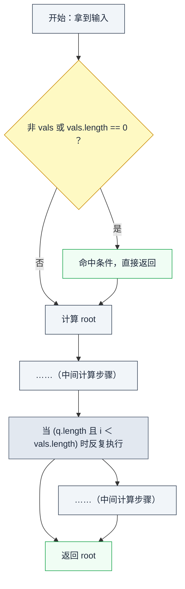

## TypeScript 解题方案（4 个方案逐个讲）

> **运行与提交**：每个方案都是自包含文件（内嵌用例自测，输出 PASS），整块复制到 `.ts` 文件后 `node 文件名` 即可运行。提交 LeetCode 时，把 `demo` 内的算法函数与辅助类型/函数整体取出、置于文件顶层即可。概念演示（非 LeetCode 编号题），在本地运行即可。

### 方案 1：迭代指针处理

**分析与思路**：核心做法是「迭代指针处理」。代码里依次做这些事：队列或堆的调度。

**运行方式**：`node 本文件`，内嵌用例全部通过会输出 PASS。


**方案专属流程图**（真实控制流）：


```typescript
class TreeNode {
  // 定义类型
  val: any;
  left: any;
  right: any; // 值: any; 左边界: any; 右边界: any;
  constructor(val?: any, left?: any, right?: any) {
    // constructor(值?: any, 左边界?: any, 右边界?: any) {
    this.val = val === undefined ? 0 : val; // 把 (值 全等于 undefined ? 0 : 值); 写入 值
    this.left = left === undefined ? null : left; // 把 (左边界 全等于 undefined ? null : 左边界); 写入 左边界
    this.right = right === undefined ? null : right; // 把 (右边界 全等于 undefined ? null : 右边界); 写入 右边界
  }
}
function buildTree(vals: any): any {
  // 定义函数/方法 buildTree
  if (!vals || vals.length === 0) return null; // 若 取反 vals 或 vals.长度 全等于 0，直接返回 null
  const root = new TreeNode(vals[0]);
  const q: any[] = [root];
  let i = 1;
  while (q.length && i < vals.length) {
    // 循环，直到不满足「节点.长度 且 下标 i 小于 vals.长度」
    const node = q.shift(); // 把 节点.shift() 存入 节点
    if (vals[i] !== null && vals[i] !== undefined) {
      node.left = new TreeNode(vals[i]);
      q.push(node.left);
    }
    i++; // 下标 i 加一
    if (i < vals.length && vals[i] !== null && vals[i] !== undefined) {
      node.right = new TreeNode(vals[i]);
      q.push(node.right);
    }
    i++; // 下标 i 加一
  }
  return root; // 返回 根节点
}
function treeToLevel(root: any): any[] {
  // 定义函数/方法 treeToLevel
  if (!root) return []; // 若 取反 根节点，直接返回 []
  const out: any[] = [];
  const q: any[] = [root]; // 把 []; const 节点: any[] 赋值为 [根节点]; 写入 const out: any[]
  while (q.length) {
    // 循环，直到不满足「节点.长度」
    const n = q.shift(); // 把 节点.shift() 存入 元素个数
    if (n === null || n === undefined) {
      out.push(null);
      continue;
    }
    out.push(n.val);
    q.push(n.left);
    q.push(n.right); // 把 元素个数.值 压入栈/数组尾部
  }
  while (out.length && out[out.length - 1] === null) out.pop(); // 循环，直到不满足「out.长度 且 out[out.长度 减 1] 全等于 null) out 弹出 );」
  return out; // 返回 out
}
class ListNode {
  // 定义类型
  val: any;
  next: any; // 值: any; 下一个: any;
  constructor(val?: any, next?: any) {
    this.val = val === undefined ? 0 : val;
    this.next = next === undefined ? null : next;
  }
}
function buildList(vals: any): any {
  // 定义函数/方法 buildList
  const dummy = new ListNode(0);
  let cur = dummy; // 把 new ListNode(0); let 当前值 赋值为 哨兵节点 存入 哨兵节点
  for (const v of vals) {
    cur.next = new ListNode(v);
    cur = cur.next;
  } // 把 new ListNode(值); 当前值 赋值为 当前值.下一个; } 写入 下一个
  return dummy.next; // 返回 哨兵节点.下一个
}
function listToArray(head: any): any[] {
  // 定义函数/方法 listToArray
  const out: any[] = [];
  let p = head; // 把 []; let 节点 赋值为 头节点; 写入 const out: any[]
  while (p) {
    out.push(p.val);
    p = p.next;
  } // 循环，直到不满足「节点) { out 追加 节点.值); 节点 赋值为 节点.下一个; }」
  return out; // 返回 out
}
// python-runtime shims
function pyLen(a: any): number {
  // 定义函数/方法 pyLen
  if (a === null || a === undefined) return 0; // 若 数组 全等于 null 或 数组 全等于 undefined，直接返回 0
  if (
    typeof a === 'string' ||
    Array.isArray(a) ||
    a instanceof Set ||
    a instanceof Map
  )
    return a.length ?? a.size;
  if (typeof a === 'object') return Object.keys(a).length; // 若 typeof 数组 全等于 'object'，直接返回 Object.keys(数组).长度
  return 0; // 返回 0
}
function pySlice(a: any, i: any, j: any, step?: any): any {
  // 定义函数/方法 pySlice
  if (typeof a === 'string') {
    const r = [...a].slice(i ?? 0, j ?? a.length);
    return step ? r.reverse().join('') : r.join('');
  }
  const arr = Array.isArray(a) ? a : [...a]; // 把 Array.isArray(数组) ? 数组 : 复制的 数组 存入 数组
  return arr.slice(i ?? 0, j ?? arr.length); // 返回 数组 截取 下标 i ?? 0, 下标 j ?? 数组.长度)
}
function pyRange(a: any, b?: any, step?: any): any[] {
  // 定义函数/方法 pyRange
  let s = 0,
    e = a,
    st = 1; // 把 0, e 赋值为 数组, st 赋值为 1 存入 字符串
  if (b !== undefined) {
    s = a;
    e = b;
  } // 若 b 不等于 undefined) { 字符串 赋值为 数组; e 赋值为 b; }
  if (step !== undefined) st = step; // 若 步数 不等于 undefined) st 赋值为 步数;
  const out: any[] = []; // 把 []; 写入 const out: any[]
  if (st > 0) for (let i = s; i < e; i += st) out.push(i);
  else for (let i = s; i > e; i += st) out.push(i); // 否则
  return out; // 返回 out
}
function pyIn(x: any, coll: any): boolean {
  // 定义函数/方法 pyIn
  if (coll === null || coll === undefined) return false; // 若 coll 全等于 null 或 coll 全等于 undefined，直接返回 false
  if (Array.isArray(coll)) return coll.includes(x); // 若 Array.isArray(coll)，直接返回 coll 是否包含 x)
  if (coll instanceof Set || coll instanceof Map) return coll.has(x); // 若 coll instanceof Set 或 coll instanceof Map，直接返回 coll.has(x)
  if (typeof coll === 'object') return x in coll; // 若 typeof coll 全等于 'object'，直接返回 x in coll
  if (typeof coll === 'string') return coll.indexOf(x) >= 0; // 若 typeof coll 全等于 'string'，直接返回 coll 查找 x) 不低于 0
  return false; // 返回 false
}
function pySorted(a: any): any[] {
  // 定义函数/方法 pySorted
  const arr = typeof a === 'string' ? [...a] : [...a]; // 把 (typeof 数组 全等于 'string') ? 复制的 数组 : 复制的 数组 存入 数组
  return arr.sort((x: any, y: any) => (x < y ? -1 : x > y ? 1 : 0));
}
function pyMin(a: any, b?: any): any {
  if (b !== undefined) return Math.min(a, b);
  if (Array.isArray(a) || a instanceof Set) return Math.min(...a);
  return Math.min(a);
} // 定义函数/方法 pyMin
function pyMax(a: any, b?: any): any {
  if (b !== undefined) return Math.max(a, b);
  if (Array.isArray(a) || a instanceof Set) return Math.max(...a);
  return Math.max(a);
} // 定义函数/方法 pyMax
function pySum(a: any): number {
  let s = 0;
  for (const v of a) s += v;
  return s;
} // 定义函数/方法 pySum
function pyAbs(x: any): number {
  return Math.abs(x);
} // 定义函数/方法 pyAbs
function pyEnumerate(a: any): any[] {
  const out: any[] = [];
  let i = 0;
  for (const v of a) {
    out.push([i, v]);
    i++;
  }
  return out;
} // 定义函数/方法 pyEnumerate
function pyZip(a: any, b: any): any[] {
  const n = Math.min(a.length, b.length);
  const out: any[] = [];
  for (let i = 0; i < n; i++) out.push([a[i], b[i]]);
  return out;
} // 定义函数/方法 pyZip
function pyDictGet(d: any, k: any, def?: any): any {
  return k in d ? d[k] : def === undefined ? null : def;
} // 定义函数/方法 pyDictGet
function pyPrint(...args: any[]): void {
  console.log(
    args
      .map((a) => (typeof a === 'object' && a !== null ? JSON.stringify(a) : a))
      .join(' '),
  );
} // 定义函数/方法 pyPrint
// collections / heapq
function heapPush(h: any[], x: any): void {
  h.push(x);
  let i = h.length - 1;
  while (i > 0) {
    const p = (i - 1) >> 1;
    if (h[p] <= h[i]) break;
    [h[p], h[i]] = [h[i], h[p]];
    i = p;
  }
} // 定义函数/方法 heapPush
function heapPop(h: any[]): any {
  const top = h[0];
  const last = h.pop();
  if (h.length) {
    h[0] = last;
    let i = 0;
    const n = h.length;
    while (true) {
      let l = 2 * i + 1,
        r = 2 * i + 2,
        s = i;
      if (l < n && h[l] < h[s]) s = l;
      if (r < n && h[r] < h[s]) s = r;
      if (s === i) break;
      [h[s], h[i]] = [h[i], h[s]];
      i = s;
    }
  }
  return top;
} // 定义函数/方法 heapPop
class Deque {
  private a: any[] = [];
  push(x: any) {
    this.a.push(x);
  }
  pushLeft(x: any) {
    this.a.unshift(x);
  }
  pop() {
    return this.a.pop();
  }
  popLeft() {
    return this.a.shift();
  }
  get length() {
    return this.a.length;
  }
  toArray() {
    return this.a.slice();
  }
} // 定义类型
function Counter(iter: any): any {
  const m: any = {};
  for (const v of iter) m[v] = (m[v] || 0) + 1;
  return m;
} // 定义函数/方法 Counter
function gcd(a: any, b: any): any {
  while (b) {
    [a, b] = [b, a % b];
  }
  return a;
} // 定义函数/方法 gcd
function pyInf(): number {
  return Infinity;
} // 定义函数/方法 pyInf

function norm(x: any): any {
  // 定义函数/方法 norm
  if (x === null || x === undefined) return null; // 若 x 全等于 null 或 x 全等于 undefined，直接返回 null
  if (typeof x === 'object') {
    // 若 typeof x 全等于 'object'
    if (x instanceof Deque) return x.toArray(); // 若 x instanceof Deque，直接返回 x.toArray()
    if (Array.isArray(x)) return x.map(norm); // 若 Array.isArray(x)，直接返回 x.映射表(norm)
    if (
      typeof x.val === 'number' &&
      (typeof x.left !== 'undefined' || typeof x.right !== 'undefined')
    )
      return treeToLevel(x);
    if (typeof x.next !== 'undefined' && typeof x.val === 'number')
      return listToArray(x);
    if (x instanceof Set) return [...x].sort(); // 若 x instanceof Set，直接返回 复制的 x 排序 )
    if (x instanceof Map) return Object.fromEntries(x); // 若 x instanceof Map，直接返回 Object.fromEntries(x)
    const o: any = {};
    for (const k of Object.keys(x)) o[k] = norm(x[k]);
    return o;
  }
  return x; // 返回 x
}
function eq(a: any, b: any): boolean {
  // 定义函数/方法 eq
  const x = norm(a),
    y = norm(b); // 把 norm(数组), y 赋值为 norm(b) 存入 x
  if (x === y) return true; // 若 x 全等于 y，直接返回 true
  if (x === null || y === null) return x === y; // 若 x 全等于 null 或 y 全等于 null，直接返回 x 全等于 y
  if (Array.isArray(x) && Array.isArray(y)) {
    // 若 Array.isArray(x) 且 Array.isArray(y
    if (x.length !== y.length) return false; // 若 x.长度 不等于 y.长度，直接返回 false
    for (let i = 0; i < x.length; i++) if (!eq(x[i], y[i])) return false; // 让 下标 i 从 0 开始计数，下标 i 小于 x.长度 就继续
    return true; // 返回 true
  }
  if (typeof x === 'object' && typeof y === 'object') {
    // 若 typeof x 全等于 'object' 且 typeof y 全等于 'object'
    const kx = Object.keys(x),
      ky = Object.keys(y); // 把 Object.keys(x), ky 赋值为 Object.keys(y) 存入 kx
    if (kx.length !== ky.length) return false; // 若 kx.长度 不等于 ky.长度，直接返回 false
    for (const k of kx) if (!eq(x[k], y[k])) return false;
    return true; // 返回 true
  }
  return x === y; // 返回 x 全等于 y
}

class SortedStack {
  // 定义类型
  s: any[];
  t: any[]; // 字符串: any[]; 另一字符串: any[];
  constructor() {
    this.s = [];
    this.t = [];
  } // 把 []; this.另一字符串 赋值为 []; } 写入 字符串
  push(x) {
    // push(x) {
    while (this.s.length && this.s[this.s.length - 1] > x)
      this.t.push(this.s.pop());
    this.s.push(x); // 把 x 压入栈/数组尾部
    while (this.t.length) this.s.push(this.t.pop()); // 循环，直到不满足「this.另一字符串.长度) this.字符串 追加 this.另一字符串 弹出 ));」
  }
  pop() {
    return this.s.length ? this.s.pop() : -1;
  } // 弹出栈顶元素
  peek() {
    return this.s.length ? this.s[this.s.length - 1] : -1;
  }
  isEmpty() {
    return this.s.length === 0;
  } // 把 等于 0; } 写入 长度
}
export function demo(): void {
  // 程序入口：跑内嵌自测用例
  const st = new SortedStack(); // 把 new SortedStack() 存入 st
  [3, 1, 5, 2, 4].forEach((v) => st.push(v));
  const out = []; // 把 [] 存入 out
  while (!st.isEmpty()) out.push(st.pop()); // 循环，直到不满足「取反 st.isEmpty()) out 追加 st 弹出 ));」
  const cases = [{ got: out, want: [5, 4, 3, 2, 1] }]; // 把 [{ got: out, want: [5,4,3,2,1] }] 存入 cases
  let fail = false; // 把 false 存入 fail
  for (const c of cases)
    if (!eq(c.got, c.want)) {
      fail = true;
      console.log('FAIL', c);
    } // 打印输出
  if (fail) throw new Error('FAILED'); // 若 fail) throw new Error(「FAILED」);
  console.log('PASS'); // 全部用例通过，输出 PASS
}
demo(); // demo();
```

### 方案 2：迭代指针处理

**分析与思路**：核心做法是「迭代指针处理」。代码里依次做这些事：队列或堆的调度。

**运行方式**：`node 本文件`，内嵌用例全部通过会输出 PASS。


**方案专属流程图**（真实控制流）：


```typescript
class TreeNode {
  // 定义类型
  val: any;
  left: any;
  right: any; // 值: any; 左边界: any; 右边界: any;
  constructor(val?: any, left?: any, right?: any) {
    // constructor(值?: any, 左边界?: any, 右边界?: any) {
    this.val = val === undefined ? 0 : val; // 把 (值 全等于 undefined ? 0 : 值); 写入 值
    this.left = left === undefined ? null : left; // 把 (左边界 全等于 undefined ? null : 左边界); 写入 左边界
    this.right = right === undefined ? null : right; // 把 (右边界 全等于 undefined ? null : 右边界); 写入 右边界
  }
}
function buildTree(vals: any): any {
  // 定义函数/方法 buildTree
  if (!vals || vals.length === 0) return null; // 若 取反 vals 或 vals.长度 全等于 0，直接返回 null
  const root = new TreeNode(vals[0]);
  const q: any[] = [root];
  let i = 1;
  while (q.length && i < vals.length) {
    // 循环，直到不满足「节点.长度 且 下标 i 小于 vals.长度」
    const node = q.shift(); // 把 节点.shift() 存入 节点
    if (vals[i] !== null && vals[i] !== undefined) {
      node.left = new TreeNode(vals[i]);
      q.push(node.left);
    }
    i++; // 下标 i 加一
    if (i < vals.length && vals[i] !== null && vals[i] !== undefined) {
      node.right = new TreeNode(vals[i]);
      q.push(node.right);
    }
    i++; // 下标 i 加一
  }
  return root; // 返回 根节点
}
function treeToLevel(root: any): any[] {
  // 定义函数/方法 treeToLevel
  if (!root) return []; // 若 取反 根节点，直接返回 []
  const out: any[] = [];
  const q: any[] = [root]; // 把 []; const 节点: any[] 赋值为 [根节点]; 写入 const out: any[]
  while (q.length) {
    // 循环，直到不满足「节点.长度」
    const n = q.shift(); // 把 节点.shift() 存入 元素个数
    if (n === null || n === undefined) {
      out.push(null);
      continue;
    }
    out.push(n.val);
    q.push(n.left);
    q.push(n.right); // 把 元素个数.值 压入栈/数组尾部
  }
  while (out.length && out[out.length - 1] === null) out.pop(); // 循环，直到不满足「out.长度 且 out[out.长度 减 1] 全等于 null) out 弹出 );」
  return out; // 返回 out
}
class ListNode {
  // 定义类型
  val: any;
  next: any; // 值: any; 下一个: any;
  constructor(val?: any, next?: any) {
    this.val = val === undefined ? 0 : val;
    this.next = next === undefined ? null : next;
  }
}
function buildList(vals: any): any {
  // 定义函数/方法 buildList
  const dummy = new ListNode(0);
  let cur = dummy; // 把 new ListNode(0); let 当前值 赋值为 哨兵节点 存入 哨兵节点
  for (const v of vals) {
    cur.next = new ListNode(v);
    cur = cur.next;
  } // 把 new ListNode(值); 当前值 赋值为 当前值.下一个; } 写入 下一个
  return dummy.next; // 返回 哨兵节点.下一个
}
function listToArray(head: any): any[] {
  // 定义函数/方法 listToArray
  const out: any[] = [];
  let p = head; // 把 []; let 节点 赋值为 头节点; 写入 const out: any[]
  while (p) {
    out.push(p.val);
    p = p.next;
  } // 循环，直到不满足「节点) { out 追加 节点.值); 节点 赋值为 节点.下一个; }」
  return out; // 返回 out
}
// python-runtime shims
function pyLen(a: any): number {
  // 定义函数/方法 pyLen
  if (a === null || a === undefined) return 0; // 若 数组 全等于 null 或 数组 全等于 undefined，直接返回 0
  if (
    typeof a === 'string' ||
    Array.isArray(a) ||
    a instanceof Set ||
    a instanceof Map
  )
    return a.length ?? a.size;
  if (typeof a === 'object') return Object.keys(a).length; // 若 typeof 数组 全等于 'object'，直接返回 Object.keys(数组).长度
  return 0; // 返回 0
}
function pySlice(a: any, i: any, j: any, step?: any): any {
  // 定义函数/方法 pySlice
  if (typeof a === 'string') {
    const r = [...a].slice(i ?? 0, j ?? a.length);
    return step ? r.reverse().join('') : r.join('');
  }
  const arr = Array.isArray(a) ? a : [...a]; // 把 Array.isArray(数组) ? 数组 : 复制的 数组 存入 数组
  return arr.slice(i ?? 0, j ?? arr.length); // 返回 数组 截取 下标 i ?? 0, 下标 j ?? 数组.长度)
}
function pyRange(a: any, b?: any, step?: any): any[] {
  // 定义函数/方法 pyRange
  let s = 0,
    e = a,
    st = 1; // 把 0, e 赋值为 数组, st 赋值为 1 存入 字符串
  if (b !== undefined) {
    s = a;
    e = b;
  } // 若 b 不等于 undefined) { 字符串 赋值为 数组; e 赋值为 b; }
  if (step !== undefined) st = step; // 若 步数 不等于 undefined) st 赋值为 步数;
  const out: any[] = []; // 把 []; 写入 const out: any[]
  if (st > 0) for (let i = s; i < e; i += st) out.push(i);
  else for (let i = s; i > e; i += st) out.push(i); // 否则
  return out; // 返回 out
}
function pyIn(x: any, coll: any): boolean {
  // 定义函数/方法 pyIn
  if (coll === null || coll === undefined) return false; // 若 coll 全等于 null 或 coll 全等于 undefined，直接返回 false
  if (Array.isArray(coll)) return coll.includes(x); // 若 Array.isArray(coll)，直接返回 coll 是否包含 x)
  if (coll instanceof Set || coll instanceof Map) return coll.has(x); // 若 coll instanceof Set 或 coll instanceof Map，直接返回 coll.has(x)
  if (typeof coll === 'object') return x in coll; // 若 typeof coll 全等于 'object'，直接返回 x in coll
  if (typeof coll === 'string') return coll.indexOf(x) >= 0; // 若 typeof coll 全等于 'string'，直接返回 coll 查找 x) 不低于 0
  return false; // 返回 false
}
function pySorted(a: any): any[] {
  // 定义函数/方法 pySorted
  const arr = typeof a === 'string' ? [...a] : [...a]; // 把 (typeof 数组 全等于 'string') ? 复制的 数组 : 复制的 数组 存入 数组
  return arr.sort((x: any, y: any) => (x < y ? -1 : x > y ? 1 : 0));
}
function pyMin(a: any, b?: any): any {
  if (b !== undefined) return Math.min(a, b);
  if (Array.isArray(a) || a instanceof Set) return Math.min(...a);
  return Math.min(a);
} // 定义函数/方法 pyMin
function pyMax(a: any, b?: any): any {
  if (b !== undefined) return Math.max(a, b);
  if (Array.isArray(a) || a instanceof Set) return Math.max(...a);
  return Math.max(a);
} // 定义函数/方法 pyMax
function pySum(a: any): number {
  let s = 0;
  for (const v of a) s += v;
  return s;
} // 定义函数/方法 pySum
function pyAbs(x: any): number {
  return Math.abs(x);
} // 定义函数/方法 pyAbs
function pyEnumerate(a: any): any[] {
  const out: any[] = [];
  let i = 0;
  for (const v of a) {
    out.push([i, v]);
    i++;
  }
  return out;
} // 定义函数/方法 pyEnumerate
function pyZip(a: any, b: any): any[] {
  const n = Math.min(a.length, b.length);
  const out: any[] = [];
  for (let i = 0; i < n; i++) out.push([a[i], b[i]]);
  return out;
} // 定义函数/方法 pyZip
function pyDictGet(d: any, k: any, def?: any): any {
  return k in d ? d[k] : def === undefined ? null : def;
} // 定义函数/方法 pyDictGet
function pyPrint(...args: any[]): void {
  console.log(
    args
      .map((a) => (typeof a === 'object' && a !== null ? JSON.stringify(a) : a))
      .join(' '),
  );
} // 定义函数/方法 pyPrint
// collections / heapq
function heapPush(h: any[], x: any): void {
  h.push(x);
  let i = h.length - 1;
  while (i > 0) {
    const p = (i - 1) >> 1;
    if (h[p] <= h[i]) break;
    [h[p], h[i]] = [h[i], h[p]];
    i = p;
  }
} // 定义函数/方法 heapPush
function heapPop(h: any[]): any {
  const top = h[0];
  const last = h.pop();
  if (h.length) {
    h[0] = last;
    let i = 0;
    const n = h.length;
    while (true) {
      let l = 2 * i + 1,
        r = 2 * i + 2,
        s = i;
      if (l < n && h[l] < h[s]) s = l;
      if (r < n && h[r] < h[s]) s = r;
      if (s === i) break;
      [h[s], h[i]] = [h[i], h[s]];
      i = s;
    }
  }
  return top;
} // 定义函数/方法 heapPop
class Deque {
  private a: any[] = [];
  push(x: any) {
    this.a.push(x);
  }
  pushLeft(x: any) {
    this.a.unshift(x);
  }
  pop() {
    return this.a.pop();
  }
  popLeft() {
    return this.a.shift();
  }
  get length() {
    return this.a.length;
  }
  toArray() {
    return this.a.slice();
  }
} // 定义类型
function Counter(iter: any): any {
  const m: any = {};
  for (const v of iter) m[v] = (m[v] || 0) + 1;
  return m;
} // 定义函数/方法 Counter
function gcd(a: any, b: any): any {
  while (b) {
    [a, b] = [b, a % b];
  }
  return a;
} // 定义函数/方法 gcd
function pyInf(): number {
  return Infinity;
} // 定义函数/方法 pyInf

function norm(x: any): any {
  // 定义函数/方法 norm
  if (x === null || x === undefined) return null; // 若 x 全等于 null 或 x 全等于 undefined，直接返回 null
  if (typeof x === 'object') {
    // 若 typeof x 全等于 'object'
    if (x instanceof Deque) return x.toArray(); // 若 x instanceof Deque，直接返回 x.toArray()
    if (Array.isArray(x)) return x.map(norm); // 若 Array.isArray(x)，直接返回 x.映射表(norm)
    if (
      typeof x.val === 'number' &&
      (typeof x.left !== 'undefined' || typeof x.right !== 'undefined')
    )
      return treeToLevel(x);
    if (typeof x.next !== 'undefined' && typeof x.val === 'number')
      return listToArray(x);
    if (x instanceof Set) return [...x].sort(); // 若 x instanceof Set，直接返回 复制的 x 排序 )
    if (x instanceof Map) return Object.fromEntries(x); // 若 x instanceof Map，直接返回 Object.fromEntries(x)
    const o: any = {};
    for (const k of Object.keys(x)) o[k] = norm(x[k]);
    return o;
  }
  return x; // 返回 x
}
function eq(a: any, b: any): boolean {
  // 定义函数/方法 eq
  const x = norm(a),
    y = norm(b); // 把 norm(数组), y 赋值为 norm(b) 存入 x
  if (x === y) return true; // 若 x 全等于 y，直接返回 true
  if (x === null || y === null) return x === y; // 若 x 全等于 null 或 y 全等于 null，直接返回 x 全等于 y
  if (Array.isArray(x) && Array.isArray(y)) {
    // 若 Array.isArray(x) 且 Array.isArray(y
    if (x.length !== y.length) return false; // 若 x.长度 不等于 y.长度，直接返回 false
    for (let i = 0; i < x.length; i++) if (!eq(x[i], y[i])) return false; // 让 下标 i 从 0 开始计数，下标 i 小于 x.长度 就继续
    return true; // 返回 true
  }
  if (typeof x === 'object' && typeof y === 'object') {
    // 若 typeof x 全等于 'object' 且 typeof y 全等于 'object'
    const kx = Object.keys(x),
      ky = Object.keys(y); // 把 Object.keys(x), ky 赋值为 Object.keys(y) 存入 kx
    if (kx.length !== ky.length) return false; // 若 kx.长度 不等于 ky.长度，直接返回 false
    for (const k of kx) if (!eq(x[k], y[k])) return false;
    return true; // 返回 true
  }
  return x === y; // 返回 x 全等于 y
}

class SortedStack {
  // 定义类型
  s: any[];
  t: any[]; // 字符串: any[]; 另一字符串: any[];
  constructor() {
    this.s = [];
    this.t = [];
  } // 把 []; this.另一字符串 赋值为 []; } 写入 字符串
  push(x) {
    // push(x) {
    while (this.s.length && this.s[this.s.length - 1] > x)
      this.t.push(this.s.pop());
    this.s.push(x); // 把 x 压入栈/数组尾部
    while (this.t.length) this.s.push(this.t.pop()); // 循环，直到不满足「this.另一字符串.长度) this.字符串 追加 this.另一字符串 弹出 ));」
  }
  pop() {
    return this.s.length ? this.s.pop() : -1;
  } // 弹出栈顶元素
  peek() {
    return this.s.length ? this.s[this.s.length - 1] : -1;
  }
  isEmpty() {
    return this.s.length === 0;
  } // 把 等于 0; } 写入 长度
}
export function demo(): void {
  // 程序入口：跑内嵌自测用例
  const st = new SortedStack(); // 把 new SortedStack() 存入 st
  [3, 1, 5, 2, 4].forEach((v) => st.push(v));
  const out = []; // 把 [] 存入 out
  while (!st.isEmpty()) out.push(st.pop()); // 循环，直到不满足「取反 st.isEmpty()) out 追加 st 弹出 ));」
  const cases = [{ got: out, want: [5, 4, 3, 2, 1] }]; // 把 [{ got: out, want: [5,4,3,2,1] }] 存入 cases
  let fail = false; // 把 false 存入 fail
  for (const c of cases)
    if (!eq(c.got, c.want)) {
      fail = true;
      console.log('FAIL', c);
    } // 打印输出
  if (fail) throw new Error('FAILED'); // 若 fail) throw new Error(「FAILED」);
  console.log('PASS'); // 全部用例通过，输出 PASS
}
demo(); // demo();
```

### 方案 3：迭代指针处理

**分析与思路**：核心做法是「迭代指针处理」。代码里依次做这些事：队列或堆的调度。

**运行方式**：`node 本文件`，内嵌用例全部通过会输出 PASS。


**方案专属流程图**（真实控制流）：


```typescript
class TreeNode {
  // 定义类型
  val: any;
  left: any;
  right: any; // 值: any; 左边界: any; 右边界: any;
  constructor(val?: any, left?: any, right?: any) {
    // constructor(值?: any, 左边界?: any, 右边界?: any) {
    this.val = val === undefined ? 0 : val; // 把 (值 全等于 undefined ? 0 : 值); 写入 值
    this.left = left === undefined ? null : left; // 把 (左边界 全等于 undefined ? null : 左边界); 写入 左边界
    this.right = right === undefined ? null : right; // 把 (右边界 全等于 undefined ? null : 右边界); 写入 右边界
  }
}
function buildTree(vals: any): any {
  // 定义函数/方法 buildTree
  if (!vals || vals.length === 0) return null; // 若 取反 vals 或 vals.长度 全等于 0，直接返回 null
  const root = new TreeNode(vals[0]);
  const q: any[] = [root];
  let i = 1;
  while (q.length && i < vals.length) {
    // 循环，直到不满足「节点.长度 且 下标 i 小于 vals.长度」
    const node = q.shift(); // 把 节点.shift() 存入 节点
    if (vals[i] !== null && vals[i] !== undefined) {
      node.left = new TreeNode(vals[i]);
      q.push(node.left);
    }
    i++; // 下标 i 加一
    if (i < vals.length && vals[i] !== null && vals[i] !== undefined) {
      node.right = new TreeNode(vals[i]);
      q.push(node.right);
    }
    i++; // 下标 i 加一
  }
  return root; // 返回 根节点
}
function treeToLevel(root: any): any[] {
  // 定义函数/方法 treeToLevel
  if (!root) return []; // 若 取反 根节点，直接返回 []
  const out: any[] = [];
  const q: any[] = [root]; // 把 []; const 节点: any[] 赋值为 [根节点]; 写入 const out: any[]
  while (q.length) {
    // 循环，直到不满足「节点.长度」
    const n = q.shift(); // 把 节点.shift() 存入 元素个数
    if (n === null || n === undefined) {
      out.push(null);
      continue;
    }
    out.push(n.val);
    q.push(n.left);
    q.push(n.right); // 把 元素个数.值 压入栈/数组尾部
  }
  while (out.length && out[out.length - 1] === null) out.pop(); // 循环，直到不满足「out.长度 且 out[out.长度 减 1] 全等于 null) out 弹出 );」
  return out; // 返回 out
}
class ListNode {
  // 定义类型
  val: any;
  next: any; // 值: any; 下一个: any;
  constructor(val?: any, next?: any) {
    this.val = val === undefined ? 0 : val;
    this.next = next === undefined ? null : next;
  }
}
function buildList(vals: any): any {
  // 定义函数/方法 buildList
  const dummy = new ListNode(0);
  let cur = dummy; // 把 new ListNode(0); let 当前值 赋值为 哨兵节点 存入 哨兵节点
  for (const v of vals) {
    cur.next = new ListNode(v);
    cur = cur.next;
  } // 把 new ListNode(值); 当前值 赋值为 当前值.下一个; } 写入 下一个
  return dummy.next; // 返回 哨兵节点.下一个
}
function listToArray(head: any): any[] {
  // 定义函数/方法 listToArray
  const out: any[] = [];
  let p = head; // 把 []; let 节点 赋值为 头节点; 写入 const out: any[]
  while (p) {
    out.push(p.val);
    p = p.next;
  } // 循环，直到不满足「节点) { out 追加 节点.值); 节点 赋值为 节点.下一个; }」
  return out; // 返回 out
}
// python-runtime shims
function pyLen(a: any): number {
  // 定义函数/方法 pyLen
  if (a === null || a === undefined) return 0; // 若 数组 全等于 null 或 数组 全等于 undefined，直接返回 0
  if (
    typeof a === 'string' ||
    Array.isArray(a) ||
    a instanceof Set ||
    a instanceof Map
  )
    return a.length ?? a.size;
  if (typeof a === 'object') return Object.keys(a).length; // 若 typeof 数组 全等于 'object'，直接返回 Object.keys(数组).长度
  return 0; // 返回 0
}
function pySlice(a: any, i: any, j: any, step?: any): any {
  // 定义函数/方法 pySlice
  if (typeof a === 'string') {
    const r = [...a].slice(i ?? 0, j ?? a.length);
    return step ? r.reverse().join('') : r.join('');
  }
  const arr = Array.isArray(a) ? a : [...a]; // 把 Array.isArray(数组) ? 数组 : 复制的 数组 存入 数组
  return arr.slice(i ?? 0, j ?? arr.length); // 返回 数组 截取 下标 i ?? 0, 下标 j ?? 数组.长度)
}
function pyRange(a: any, b?: any, step?: any): any[] {
  // 定义函数/方法 pyRange
  let s = 0,
    e = a,
    st = 1; // 把 0, e 赋值为 数组, st 赋值为 1 存入 字符串
  if (b !== undefined) {
    s = a;
    e = b;
  } // 若 b 不等于 undefined) { 字符串 赋值为 数组; e 赋值为 b; }
  if (step !== undefined) st = step; // 若 步数 不等于 undefined) st 赋值为 步数;
  const out: any[] = []; // 把 []; 写入 const out: any[]
  if (st > 0) for (let i = s; i < e; i += st) out.push(i);
  else for (let i = s; i > e; i += st) out.push(i); // 否则
  return out; // 返回 out
}
function pyIn(x: any, coll: any): boolean {
  // 定义函数/方法 pyIn
  if (coll === null || coll === undefined) return false; // 若 coll 全等于 null 或 coll 全等于 undefined，直接返回 false
  if (Array.isArray(coll)) return coll.includes(x); // 若 Array.isArray(coll)，直接返回 coll 是否包含 x)
  if (coll instanceof Set || coll instanceof Map) return coll.has(x); // 若 coll instanceof Set 或 coll instanceof Map，直接返回 coll.has(x)
  if (typeof coll === 'object') return x in coll; // 若 typeof coll 全等于 'object'，直接返回 x in coll
  if (typeof coll === 'string') return coll.indexOf(x) >= 0; // 若 typeof coll 全等于 'string'，直接返回 coll 查找 x) 不低于 0
  return false; // 返回 false
}
function pySorted(a: any): any[] {
  // 定义函数/方法 pySorted
  const arr = typeof a === 'string' ? [...a] : [...a]; // 把 (typeof 数组 全等于 'string') ? 复制的 数组 : 复制的 数组 存入 数组
  return arr.sort((x: any, y: any) => (x < y ? -1 : x > y ? 1 : 0));
}
function pyMin(a: any, b?: any): any {
  if (b !== undefined) return Math.min(a, b);
  if (Array.isArray(a) || a instanceof Set) return Math.min(...a);
  return Math.min(a);
} // 定义函数/方法 pyMin
function pyMax(a: any, b?: any): any {
  if (b !== undefined) return Math.max(a, b);
  if (Array.isArray(a) || a instanceof Set) return Math.max(...a);
  return Math.max(a);
} // 定义函数/方法 pyMax
function pySum(a: any): number {
  let s = 0;
  for (const v of a) s += v;
  return s;
} // 定义函数/方法 pySum
function pyAbs(x: any): number {
  return Math.abs(x);
} // 定义函数/方法 pyAbs
function pyEnumerate(a: any): any[] {
  const out: any[] = [];
  let i = 0;
  for (const v of a) {
    out.push([i, v]);
    i++;
  }
  return out;
} // 定义函数/方法 pyEnumerate
function pyZip(a: any, b: any): any[] {
  const n = Math.min(a.length, b.length);
  const out: any[] = [];
  for (let i = 0; i < n; i++) out.push([a[i], b[i]]);
  return out;
} // 定义函数/方法 pyZip
function pyDictGet(d: any, k: any, def?: any): any {
  return k in d ? d[k] : def === undefined ? null : def;
} // 定义函数/方法 pyDictGet
function pyPrint(...args: any[]): void {
  console.log(
    args
      .map((a) => (typeof a === 'object' && a !== null ? JSON.stringify(a) : a))
      .join(' '),
  );
} // 定义函数/方法 pyPrint
// collections / heapq
function heapPush(h: any[], x: any): void {
  h.push(x);
  let i = h.length - 1;
  while (i > 0) {
    const p = (i - 1) >> 1;
    if (h[p] <= h[i]) break;
    [h[p], h[i]] = [h[i], h[p]];
    i = p;
  }
} // 定义函数/方法 heapPush
function heapPop(h: any[]): any {
  const top = h[0];
  const last = h.pop();
  if (h.length) {
    h[0] = last;
    let i = 0;
    const n = h.length;
    while (true) {
      let l = 2 * i + 1,
        r = 2 * i + 2,
        s = i;
      if (l < n && h[l] < h[s]) s = l;
      if (r < n && h[r] < h[s]) s = r;
      if (s === i) break;
      [h[s], h[i]] = [h[i], h[s]];
      i = s;
    }
  }
  return top;
} // 定义函数/方法 heapPop
class Deque {
  private a: any[] = [];
  push(x: any) {
    this.a.push(x);
  }
  pushLeft(x: any) {
    this.a.unshift(x);
  }
  pop() {
    return this.a.pop();
  }
  popLeft() {
    return this.a.shift();
  }
  get length() {
    return this.a.length;
  }
  toArray() {
    return this.a.slice();
  }
} // 定义类型
function Counter(iter: any): any {
  const m: any = {};
  for (const v of iter) m[v] = (m[v] || 0) + 1;
  return m;
} // 定义函数/方法 Counter
function gcd(a: any, b: any): any {
  while (b) {
    [a, b] = [b, a % b];
  }
  return a;
} // 定义函数/方法 gcd
function pyInf(): number {
  return Infinity;
} // 定义函数/方法 pyInf

function norm(x: any): any {
  // 定义函数/方法 norm
  if (x === null || x === undefined) return null; // 若 x 全等于 null 或 x 全等于 undefined，直接返回 null
  if (typeof x === 'object') {
    // 若 typeof x 全等于 'object'
    if (x instanceof Deque) return x.toArray(); // 若 x instanceof Deque，直接返回 x.toArray()
    if (Array.isArray(x)) return x.map(norm); // 若 Array.isArray(x)，直接返回 x.映射表(norm)
    if (
      typeof x.val === 'number' &&
      (typeof x.left !== 'undefined' || typeof x.right !== 'undefined')
    )
      return treeToLevel(x);
    if (typeof x.next !== 'undefined' && typeof x.val === 'number')
      return listToArray(x);
    if (x instanceof Set) return [...x].sort(); // 若 x instanceof Set，直接返回 复制的 x 排序 )
    if (x instanceof Map) return Object.fromEntries(x); // 若 x instanceof Map，直接返回 Object.fromEntries(x)
    const o: any = {};
    for (const k of Object.keys(x)) o[k] = norm(x[k]);
    return o;
  }
  return x; // 返回 x
}
function eq(a: any, b: any): boolean {
  // 定义函数/方法 eq
  const x = norm(a),
    y = norm(b); // 把 norm(数组), y 赋值为 norm(b) 存入 x
  if (x === y) return true; // 若 x 全等于 y，直接返回 true
  if (x === null || y === null) return x === y; // 若 x 全等于 null 或 y 全等于 null，直接返回 x 全等于 y
  if (Array.isArray(x) && Array.isArray(y)) {
    // 若 Array.isArray(x) 且 Array.isArray(y
    if (x.length !== y.length) return false; // 若 x.长度 不等于 y.长度，直接返回 false
    for (let i = 0; i < x.length; i++) if (!eq(x[i], y[i])) return false; // 让 下标 i 从 0 开始计数，下标 i 小于 x.长度 就继续
    return true; // 返回 true
  }
  if (typeof x === 'object' && typeof y === 'object') {
    // 若 typeof x 全等于 'object' 且 typeof y 全等于 'object'
    const kx = Object.keys(x),
      ky = Object.keys(y); // 把 Object.keys(x), ky 赋值为 Object.keys(y) 存入 kx
    if (kx.length !== ky.length) return false; // 若 kx.长度 不等于 ky.长度，直接返回 false
    for (const k of kx) if (!eq(x[k], y[k])) return false;
    return true; // 返回 true
  }
  return x === y; // 返回 x 全等于 y
}

class SortedStack {
  // 定义类型
  s: any[];
  t: any[]; // 字符串: any[]; 另一字符串: any[];
  constructor() {
    this.s = [];
    this.t = [];
  } // 把 []; this.另一字符串 赋值为 []; } 写入 字符串
  push(x) {
    // push(x) {
    while (this.s.length && this.s[this.s.length - 1] > x)
      this.t.push(this.s.pop());
    this.s.push(x); // 把 x 压入栈/数组尾部
    while (this.t.length) this.s.push(this.t.pop()); // 循环，直到不满足「this.另一字符串.长度) this.字符串 追加 this.另一字符串 弹出 ));」
  }
  pop() {
    return this.s.length ? this.s.pop() : -1;
  } // 弹出栈顶元素
  peek() {
    return this.s.length ? this.s[this.s.length - 1] : -1;
  }
  isEmpty() {
    return this.s.length === 0;
  } // 把 等于 0; } 写入 长度
}
export function demo(): void {
  // 程序入口：跑内嵌自测用例
  const st = new SortedStack(); // 把 new SortedStack() 存入 st
  [3, 1, 5, 2, 4].forEach((v) => st.push(v));
  const out = []; // 把 [] 存入 out
  while (!st.isEmpty()) out.push(st.pop()); // 循环，直到不满足「取反 st.isEmpty()) out 追加 st 弹出 ));」
  const cases = [{ got: out, want: [5, 4, 3, 2, 1] }]; // 把 [{ got: out, want: [5,4,3,2,1] }] 存入 cases
  let fail = false; // 把 false 存入 fail
  for (const c of cases)
    if (!eq(c.got, c.want)) {
      fail = true;
      console.log('FAIL', c);
    } // 打印输出
  if (fail) throw new Error('FAILED'); // 若 fail) throw new Error(「FAILED」);
  console.log('PASS'); // 全部用例通过，输出 PASS
}
demo(); // demo();
```

### 方案 4：迭代指针处理

**分析与思路**：核心做法是「迭代指针处理」。代码里依次做这些事：队列或堆的调度。

**运行方式**：`node 本文件`，内嵌用例全部通过会输出 PASS。


**方案专属流程图**（真实控制流）：

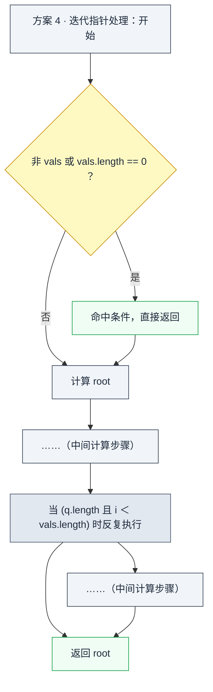

```typescript
class TreeNode {
  // 定义类型
  val: any;
  left: any;
  right: any; // 值: any; 左边界: any; 右边界: any;
  constructor(val?: any, left?: any, right?: any) {
    // constructor(值?: any, 左边界?: any, 右边界?: any) {
    this.val = val === undefined ? 0 : val; // 把 (值 全等于 undefined ? 0 : 值); 写入 值
    this.left = left === undefined ? null : left; // 把 (左边界 全等于 undefined ? null : 左边界); 写入 左边界
    this.right = right === undefined ? null : right; // 把 (右边界 全等于 undefined ? null : 右边界); 写入 右边界
  }
}
function buildTree(vals: any): any {
  // 定义函数/方法 buildTree
  if (!vals || vals.length === 0) return null; // 若 取反 vals 或 vals.长度 全等于 0，直接返回 null
  const root = new TreeNode(vals[0]);
  const q: any[] = [root];
  let i = 1;
  while (q.length && i < vals.length) {
    // 循环，直到不满足「节点.长度 且 下标 i 小于 vals.长度」
    const node = q.shift(); // 把 节点.shift() 存入 节点
    if (vals[i] !== null && vals[i] !== undefined) {
      node.left = new TreeNode(vals[i]);
      q.push(node.left);
    }
    i++; // 下标 i 加一
    if (i < vals.length && vals[i] !== null && vals[i] !== undefined) {
      node.right = new TreeNode(vals[i]);
      q.push(node.right);
    }
    i++; // 下标 i 加一
  }
  return root; // 返回 根节点
}
function treeToLevel(root: any): any[] {
  // 定义函数/方法 treeToLevel
  if (!root) return []; // 若 取反 根节点，直接返回 []
  const out: any[] = [];
  const q: any[] = [root]; // 把 []; const 节点: any[] 赋值为 [根节点]; 写入 const out: any[]
  while (q.length) {
    // 循环，直到不满足「节点.长度」
    const n = q.shift(); // 把 节点.shift() 存入 元素个数
    if (n === null || n === undefined) {
      out.push(null);
      continue;
    }
    out.push(n.val);
    q.push(n.left);
    q.push(n.right); // 把 元素个数.值 压入栈/数组尾部
  }
  while (out.length && out[out.length - 1] === null) out.pop(); // 循环，直到不满足「out.长度 且 out[out.长度 减 1] 全等于 null) out 弹出 );」
  return out; // 返回 out
}
class ListNode {
  // 定义类型
  val: any;
  next: any; // 值: any; 下一个: any;
  constructor(val?: any, next?: any) {
    this.val = val === undefined ? 0 : val;
    this.next = next === undefined ? null : next;
  }
}
function buildList(vals: any): any {
  // 定义函数/方法 buildList
  const dummy = new ListNode(0);
  let cur = dummy; // 把 new ListNode(0); let 当前值 赋值为 哨兵节点 存入 哨兵节点
  for (const v of vals) {
    cur.next = new ListNode(v);
    cur = cur.next;
  } // 把 new ListNode(值); 当前值 赋值为 当前值.下一个; } 写入 下一个
  return dummy.next; // 返回 哨兵节点.下一个
}
function listToArray(head: any): any[] {
  // 定义函数/方法 listToArray
  const out: any[] = [];
  let p = head; // 把 []; let 节点 赋值为 头节点; 写入 const out: any[]
  while (p) {
    out.push(p.val);
    p = p.next;
  } // 循环，直到不满足「节点) { out 追加 节点.值); 节点 赋值为 节点.下一个; }」
  return out; // 返回 out
}
// python-runtime shims
function pyLen(a: any): number {
  // 定义函数/方法 pyLen
  if (a === null || a === undefined) return 0; // 若 数组 全等于 null 或 数组 全等于 undefined，直接返回 0
  if (
    typeof a === 'string' ||
    Array.isArray(a) ||
    a instanceof Set ||
    a instanceof Map
  )
    return a.length ?? a.size;
  if (typeof a === 'object') return Object.keys(a).length; // 若 typeof 数组 全等于 'object'，直接返回 Object.keys(数组).长度
  return 0; // 返回 0
}
function pySlice(a: any, i: any, j: any, step?: any): any {
  // 定义函数/方法 pySlice
  if (typeof a === 'string') {
    const r = [...a].slice(i ?? 0, j ?? a.length);
    return step ? r.reverse().join('') : r.join('');
  }
  const arr = Array.isArray(a) ? a : [...a]; // 把 Array.isArray(数组) ? 数组 : 复制的 数组 存入 数组
  return arr.slice(i ?? 0, j ?? arr.length); // 返回 数组 截取 下标 i ?? 0, 下标 j ?? 数组.长度)
}
function pyRange(a: any, b?: any, step?: any): any[] {
  // 定义函数/方法 pyRange
  let s = 0,
    e = a,
    st = 1; // 把 0, e 赋值为 数组, st 赋值为 1 存入 字符串
  if (b !== undefined) {
    s = a;
    e = b;
  } // 若 b 不等于 undefined) { 字符串 赋值为 数组; e 赋值为 b; }
  if (step !== undefined) st = step; // 若 步数 不等于 undefined) st 赋值为 步数;
  const out: any[] = []; // 把 []; 写入 const out: any[]
  if (st > 0) for (let i = s; i < e; i += st) out.push(i);
  else for (let i = s; i > e; i += st) out.push(i); // 否则
  return out; // 返回 out
}
function pyIn(x: any, coll: any): boolean {
  // 定义函数/方法 pyIn
  if (coll === null || coll === undefined) return false; // 若 coll 全等于 null 或 coll 全等于 undefined，直接返回 false
  if (Array.isArray(coll)) return coll.includes(x); // 若 Array.isArray(coll)，直接返回 coll 是否包含 x)
  if (coll instanceof Set || coll instanceof Map) return coll.has(x); // 若 coll instanceof Set 或 coll instanceof Map，直接返回 coll.has(x)
  if (typeof coll === 'object') return x in coll; // 若 typeof coll 全等于 'object'，直接返回 x in coll
  if (typeof coll === 'string') return coll.indexOf(x) >= 0; // 若 typeof coll 全等于 'string'，直接返回 coll 查找 x) 不低于 0
  return false; // 返回 false
}
function pySorted(a: any): any[] {
  // 定义函数/方法 pySorted
  const arr = typeof a === 'string' ? [...a] : [...a]; // 把 (typeof 数组 全等于 'string') ? 复制的 数组 : 复制的 数组 存入 数组
  return arr.sort((x: any, y: any) => (x < y ? -1 : x > y ? 1 : 0));
}
function pyMin(a: any, b?: any): any {
  if (b !== undefined) return Math.min(a, b);
  if (Array.isArray(a) || a instanceof Set) return Math.min(...a);
  return Math.min(a);
} // 定义函数/方法 pyMin
function pyMax(a: any, b?: any): any {
  if (b !== undefined) return Math.max(a, b);
  if (Array.isArray(a) || a instanceof Set) return Math.max(...a);
  return Math.max(a);
} // 定义函数/方法 pyMax
function pySum(a: any): number {
  let s = 0;
  for (const v of a) s += v;
  return s;
} // 定义函数/方法 pySum
function pyAbs(x: any): number {
  return Math.abs(x);
} // 定义函数/方法 pyAbs
function pyEnumerate(a: any): any[] {
  const out: any[] = [];
  let i = 0;
  for (const v of a) {
    out.push([i, v]);
    i++;
  }
  return out;
} // 定义函数/方法 pyEnumerate
function pyZip(a: any, b: any): any[] {
  const n = Math.min(a.length, b.length);
  const out: any[] = [];
  for (let i = 0; i < n; i++) out.push([a[i], b[i]]);
  return out;
} // 定义函数/方法 pyZip
function pyDictGet(d: any, k: any, def?: any): any {
  return k in d ? d[k] : def === undefined ? null : def;
} // 定义函数/方法 pyDictGet
function pyPrint(...args: any[]): void {
  console.log(
    args
      .map((a) => (typeof a === 'object' && a !== null ? JSON.stringify(a) : a))
      .join(' '),
  );
} // 定义函数/方法 pyPrint
// collections / heapq
function heapPush(h: any[], x: any): void {
  h.push(x);
  let i = h.length - 1;
  while (i > 0) {
    const p = (i - 1) >> 1;
    if (h[p] <= h[i]) break;
    [h[p], h[i]] = [h[i], h[p]];
    i = p;
  }
} // 定义函数/方法 heapPush
function heapPop(h: any[]): any {
  const top = h[0];
  const last = h.pop();
  if (h.length) {
    h[0] = last;
    let i = 0;
    const n = h.length;
    while (true) {
      let l = 2 * i + 1,
        r = 2 * i + 2,
        s = i;
      if (l < n && h[l] < h[s]) s = l;
      if (r < n && h[r] < h[s]) s = r;
      if (s === i) break;
      [h[s], h[i]] = [h[i], h[s]];
      i = s;
    }
  }
  return top;
} // 定义函数/方法 heapPop
class Deque {
  private a: any[] = [];
  push(x: any) {
    this.a.push(x);
  }
  pushLeft(x: any) {
    this.a.unshift(x);
  }
  pop() {
    return this.a.pop();
  }
  popLeft() {
    return this.a.shift();
  }
  get length() {
    return this.a.length;
  }
  toArray() {
    return this.a.slice();
  }
} // 定义类型
function Counter(iter: any): any {
  const m: any = {};
  for (const v of iter) m[v] = (m[v] || 0) + 1;
  return m;
} // 定义函数/方法 Counter
function gcd(a: any, b: any): any {
  while (b) {
    [a, b] = [b, a % b];
  }
  return a;
} // 定义函数/方法 gcd
function pyInf(): number {
  return Infinity;
} // 定义函数/方法 pyInf

function norm(x: any): any {
  // 定义函数/方法 norm
  if (x === null || x === undefined) return null; // 若 x 全等于 null 或 x 全等于 undefined，直接返回 null
  if (typeof x === 'object') {
    // 若 typeof x 全等于 'object'
    if (x instanceof Deque) return x.toArray(); // 若 x instanceof Deque，直接返回 x.toArray()
    if (Array.isArray(x)) return x.map(norm); // 若 Array.isArray(x)，直接返回 x.映射表(norm)
    if (
      typeof x.val === 'number' &&
      (typeof x.left !== 'undefined' || typeof x.right !== 'undefined')
    )
      return treeToLevel(x);
    if (typeof x.next !== 'undefined' && typeof x.val === 'number')
      return listToArray(x);
    if (x instanceof Set) return [...x].sort(); // 若 x instanceof Set，直接返回 复制的 x 排序 )
    if (x instanceof Map) return Object.fromEntries(x); // 若 x instanceof Map，直接返回 Object.fromEntries(x)
    const o: any = {};
    for (const k of Object.keys(x)) o[k] = norm(x[k]);
    return o;
  }
  return x; // 返回 x
}
function eq(a: any, b: any): boolean {
  // 定义函数/方法 eq
  const x = norm(a),
    y = norm(b); // 把 norm(数组), y 赋值为 norm(b) 存入 x
  if (x === y) return true; // 若 x 全等于 y，直接返回 true
  if (x === null || y === null) return x === y; // 若 x 全等于 null 或 y 全等于 null，直接返回 x 全等于 y
  if (Array.isArray(x) && Array.isArray(y)) {
    // 若 Array.isArray(x) 且 Array.isArray(y
    if (x.length !== y.length) return false; // 若 x.长度 不等于 y.长度，直接返回 false
    for (let i = 0; i < x.length; i++) if (!eq(x[i], y[i])) return false; // 让 下标 i 从 0 开始计数，下标 i 小于 x.长度 就继续
    return true; // 返回 true
  }
  if (typeof x === 'object' && typeof y === 'object') {
    // 若 typeof x 全等于 'object' 且 typeof y 全等于 'object'
    const kx = Object.keys(x),
      ky = Object.keys(y); // 把 Object.keys(x), ky 赋值为 Object.keys(y) 存入 kx
    if (kx.length !== ky.length) return false; // 若 kx.长度 不等于 ky.长度，直接返回 false
    for (const k of kx) if (!eq(x[k], y[k])) return false;
    return true; // 返回 true
  }
  return x === y; // 返回 x 全等于 y
}

class SortedStack {
  // 定义类型
  s: any[];
  t: any[]; // 字符串: any[]; 另一字符串: any[];
  constructor() {
    this.s = [];
    this.t = [];
  } // 把 []; this.另一字符串 赋值为 []; } 写入 字符串
  push(x) {
    // push(x) {
    while (this.s.length && this.s[this.s.length - 1] > x)
      this.t.push(this.s.pop());
    this.s.push(x); // 把 x 压入栈/数组尾部
    while (this.t.length) this.s.push(this.t.pop()); // 循环，直到不满足「this.另一字符串.长度) this.字符串 追加 this.另一字符串 弹出 ));」
  }
  pop() {
    return this.s.length ? this.s.pop() : -1;
  } // 弹出栈顶元素
  peek() {
    return this.s.length ? this.s[this.s.length - 1] : -1;
  }
  isEmpty() {
    return this.s.length === 0;
  } // 把 等于 0; } 写入 长度
}
export function demo(): void {
  // 程序入口：跑内嵌自测用例
  const st = new SortedStack(); // 把 new SortedStack() 存入 st
  [3, 1, 5, 2, 4].forEach((v) => st.push(v));
  const out = []; // 把 [] 存入 out
  while (!st.isEmpty()) out.push(st.pop()); // 循环，直到不满足「取反 st.isEmpty()) out 追加 st 弹出 ));」
  const cases = [{ got: out, want: [5, 4, 3, 2, 1] }]; // 把 [{ got: out, want: [5,4,3,2,1] }] 存入 cases
  let fail = false; // 把 false 存入 fail
  for (const c of cases)
    if (!eq(c.got, c.want)) {
      fail = true;
      console.log('FAIL', c);
    } // 打印输出
  if (fail) throw new Error('FAILED'); // 若 fail) throw new Error(「FAILED」);
  console.log('PASS'); // 全部用例通过，输出 PASS
}
demo(); // demo();
```

## 逐步拆解与面试追问

**复杂度**：时间 O(n)（单趟线性扫描），空间 O(1) 到 O(n)（视辅助结构）

**为什么是这个量级**：每个元素被常数次访问，辅助哈希或栈的开销与 n 同阶

**面试官可能会追问**：

- 这个策略能推广到什么场景？
- 与暴力做法差在哪一步？
- 有没有更简单的等价写法？

## 关键 API 速查（TS 主解法实际用到，附官方链接）

| API | 作用 | 使用要点 | 官方文档 |
|---|---|---|---|
| `Array.prototype.sort()` | 原地排序 | 默认按字符串 Unicode 序（10 会排在 2 前），数字必须传 (a,b)=>a-b；V8 用 TimSort，稳定，O(n log n)；返回原数组引用 | [官方文档](https://developer.mozilla.org/zh-CN/docs/Web/JavaScript/Reference/Global_Objects/Array/sort) |
| `Array.prototype.map()` | 逐元素映射为新数组 | 回调 (v,i,arr)；返回等长新数组，不改变原数组；稀疏位跳过；链式调用注意中间数组开销 | [官方文档](https://developer.mozilla.org/zh-CN/docs/Web/JavaScript/Reference/Global_Objects/Array/map) |
| `Array.prototype.push()` | 尾部追加 | 返回新长度；可一次多个；均摊 O(1)；会改变原数组 | [官方文档](https://developer.mozilla.org/zh-CN/docs/Web/JavaScript/Reference/Global_Objects/Array/push) |
| `Array.prototype.pop()` | 尾部弹出 | 返回被删元素（空数组返回 undefined）；O(1) | [官方文档](https://developer.mozilla.org/zh-CN/docs/Web/JavaScript/Reference/Global_Objects/Array/pop) |
| `Array.prototype.shift()` | 头部取出 | O(n)（后续元素整体前移）；大量头部操作请用链表或双端结构 | [官方文档](https://developer.mozilla.org/zh-CN/docs/Web/JavaScript/Reference/Global_Objects/Array/shift) |
| `Array.prototype.unshift()` | 头部插入 | O(n)；与 shift 组合可当双端队列 | [官方文档](https://developer.mozilla.org/zh-CN/docs/Web/JavaScript/Reference/Global_Objects/Array/unshift) |
| `Array/String includes()` | 是否包含 | 数组用 SameValueZero（NaN 可判）；字符串按子串；第二个参数为起始下标 | [官方文档](https://developer.mozilla.org/zh-CN/docs/Web/JavaScript/Reference/Global_Objects/Array/includes) |
| `Array/String indexOf()` | 首次出现的下标 | 找不到返回 -1；无法判 NaN（用 includes）；字符串可传起始位 | [官方文档](https://developer.mozilla.org/zh-CN/docs/Web/JavaScript/Reference/Global_Objects/Array/indexOf) |
| `Array/String slice()` | 切片（不改原数组） | slice(start,end) 含头不含尾；负数从尾计；常用于复制数组（slice()） | [官方文档](https://developer.mozilla.org/zh-CN/docs/Web/JavaScript/Reference/Global_Objects/Array/slice) |
| `Array.prototype.join()` | 数组拼接为字符串 | undefined/null 转空串；嵌套数组会展平一层；join('') 用于字符数组还原 | [官方文档](https://developer.mozilla.org/zh-CN/docs/Web/JavaScript/Reference/Global_Objects/Array/join) |
| `Object.keys()` | 对象键名数组 | 仅自身可枚举字符串键（不含 symbol）；配 length 可当计数器 | [官方文档](https://developer.mozilla.org/zh-CN/docs/Web/JavaScript/Reference/Global_Objects/Object/keys) |
| `Object.fromEntries()` | 键值对数组转对象 | 参数为 [k,v] 可迭代；map 出来的键值对可直接转对象 | [官方文档](https://developer.mozilla.org/zh-CN/docs/Web/JavaScript/Reference/Global_Objects/Object/fromEntries) |
| `JSON.stringify()` | 序列化为 JSON 字符串 | 常用于结构化比较（深度相等判定）；undefined/函数/循环引用会被丢弃或抛错 | [官方文档](https://developer.mozilla.org/zh-CN/docs/Web/JavaScript/Reference/Global_Objects/JSON/stringify) |
| `Math.max()` | 最大值 | 配展开 Math.max(...arr)；空参返回 -Infinity；超大数组注意展开参数上限 | [官方文档](https://developer.mozilla.org/zh-CN/docs/Web/JavaScript/Reference/Global_Objects/Math/max) |
| `Math.min()` | 最小值 | 同 max；空参返回 Infinity | [官方文档](https://developer.mozilla.org/zh-CN/docs/Web/JavaScript/Reference/Global_Objects/Math/min) |
| `Math.abs()` | 绝对值 | 入参会被隐式转数字；-0 返回 +0 | [官方文档](https://developer.mozilla.org/zh-CN/docs/Web/JavaScript/Reference/Global_Objects/Math/abs) |

### 各语言官方文档导航

- **TypeScript / JS**：[MDN 中文参考](https://developer.mozilla.org/zh-CN/)
- **Python**：[Python 官方文档](https://docs.python.org/zh-cn/3/)
- **Go**：[Go 标准库](https://pkg.go.dev/std)
- **Java**：[JDK 17 API](https://docs.oracle.com/en/java/javase/17/docs/api/)
- **Rust**：[Rust 标准库](https://doc.rust-lang.org/std/)
- **Lua**：[Lua 5.4 手册](https://www.lua.org/manual/5.4/)
- **C**：[Cppreference C](https://zh.cppreference.com/w/c)
- **C++**：[Cppreference C++](https://zh.cppreference.com/w/cpp)
- **R**：[R 官方手册](https://stat.ethz.ch/R-manual/)
- **Zig**：[Zig 语言文档](https://ziglang.org/documentation/master/)
- **Dart**：[Dart API](https://api.dart.dev/)

## 附录：其他 10 种语言全部实现（每种语言列举其全部方案）

> TypeScript 的全部方案见「TypeScript 解题方案」一节；下面是其余 10 种语言的对应实现，每种语言的每个方案都带思路分析、代码走读与专属运行架构图。
> 每个方案都内嵌用例自测，可独立运行（老仓库 python/go 文件遵循「打印结果」约定）。
> 完整解法文件见 `dsa/<语言>/notes/lc_105893757_栈排序分析/`。

### Python 实现（4 种方案）

Python 的全部方案如下，每个方案都内嵌用例自测，可独立运行（老仓库 python/go 文件遵循「打印结果」约定）：

#### 方案 1：迭代指针处理

**思路与代码分析**：核心是「迭代指针处理」。Python 版用切片与字典推导式简化操作，突出可读性。代码里依次做这些事：先排序再处理；栈的后进先出操作。

**运行架构**（真实控制流）：

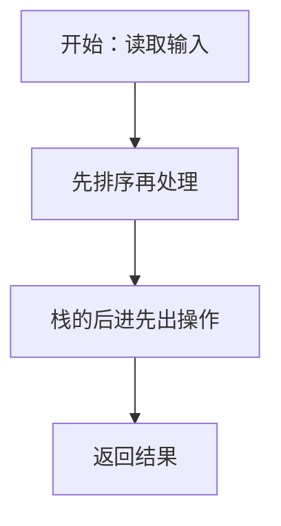

```python
import sys  # 提高递归深度上限（深输入防 RecursionError）

sys.setrecursionlimit(200000)  # 树/链表类题目节点数可达 1e4 量级

class SortedStack:  # 定义类
    """有序栈：push 时通过辅助栈把元素插入到正确位置，使栈底->栈顶保持升序（栈顶最小）。"""

    def __init__(self):  # 构造函数：初始化成员
        self._data = []  # 把 [] 写入 self._data

    def push(self, val):  # 定义函数 push（参数：self, 值）
        temp = []  # 把 [] 存入 临时变量
        while (
            self._data and self._data[-1] < val
        ):  # 循环，直到不满足「self._data and self._data[ 减 1] 小于 值」
            temp.append(self._data.pop())  # 把 self._data 弹出 追加到列表尾部
        self._data.append(val)  # 把 值 追加到列表尾部
        while temp:  # 循环，直到不满足「临时变量」
            self._data.append(temp.pop())  # 把 临时变量 弹出 追加到列表尾部

    def pop(self):  # 定义函数 pop（参数：self）
        return self._data.pop() if self._data else None  # 返回 self._data 弹出 ) if self._data else None

    def peek(self):  # 定义函数 peek（参数：self）
        return self._data[-1] if self._data else None  # 返回 self._data[ 减 1] if self._data else None

    def is_empty(self):  # 定义函数 is_empty（参数：self）
        return len(self._data) == 0  # 返回 长度(self._data) 等于 0

    def sort(self):  # 定义函数 sort（参数：self）
        return sorted(self._data)  # 返回 sorted(self._data)

if __name__ == "__main__":  # 若 __name__ 等于 '__main__'
    st = SortedStack()  # 把 SortedStack() 存入 st
    for v in [1, 3, 2, 4]:  # for 值 in [1, 3, 2, 4]:
        st.push(v)  # 把 值 压入栈/数组尾部
    print("栈内有序序列:", st.sort())  # 打印输出
    out = []  # 把 [] 存入 out
    while not st.is_empty():  # 循环，直到不满足「not st.is_empty(」
        out.append(st.pop())  # 把 st 弹出 追加到列表尾部
    print("依次 pop:", out)  # 打印输出
```

#### 方案 2：迭代指针处理

**思路与代码分析**：核心是「迭代指针处理」。Python 版用切片与字典推导式简化操作，突出可读性。**走读**：方案 2 · 迭代指针处理：开始 → 更新 aux → 当 stack: 时反复执行 → 从 stack 弹出 → 当 aux and aux[-1] ＞ top: 时反复执行 → 向 stack 追加记录 → 向 aux 追加记录 → 返回 aux。

**运行架构**（真实控制流）：

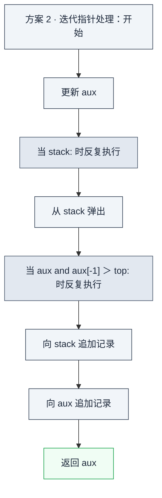

```python
import sys  # 提高递归深度上限（深输入防 RecursionError）

sys.setrecursionlimit(200000)  # 树/链表类题目节点数可达 1e4 量级

def sort_stack_two_stacks(stack):  # 定义函数 sort_stack_two_stacks（参数：栈）
    """用两个栈对栈排序（升序，栈顶最大）：
    主栈逐个弹出，借助辅助栈把所有比当前元素大的都压回主栈，再把当前元素压入辅助栈。"""
    aux = []  # 把 [] 存入 aux
    while stack:  # 循环，直到不满足「栈」
        top = stack.pop()  # 把 栈 弹出 ) 存入 top
        while aux and aux[-1] > top:  # 循环，直到不满足「aux and aux[ 减 1] 超过 top」
            stack.append(aux.pop())  # 把 aux 弹出 追加到列表尾部
        aux.append(top)  # 把 top 追加到列表尾部
    return aux  # 返回 aux

if __name__ == "__main__":  # 若 __name__ 等于 '__main__'
    s = [1, 3, 2, 4]  # 把 [1, 3, 2, 4] 存入 字符串
    res = sort_stack_two_stacks(s)  # 把 sort_stack_two_stacks(字符串) 存入 结果
    print("排序结果(栈顶最大):", res)  # 打印输出
```

#### 方案 3：迭代指针处理

**思路与代码分析**：核心是「迭代指针处理」。Python 版用切片与字典推导式简化操作，突出可读性。**走读**：方案 3 · 迭代指针处理：开始 → 若 stack：从 stack 弹出 → 从 stack 弹出 → 调用 sort_stack_recursive(stack) → 调用 sorted_insert(stack, top) → 返回 stack。

**运行架构**（真实控制流）：

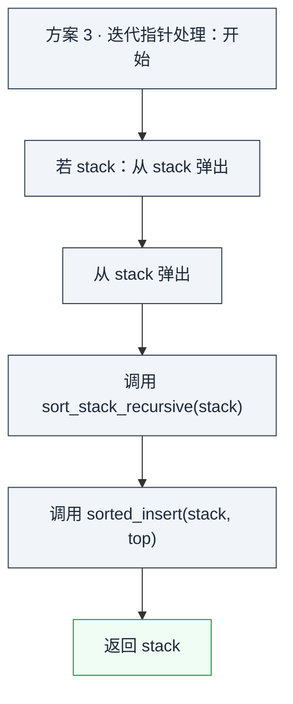

```python
import sys  # 提高递归深度上限（深输入防 RecursionError）

sys.setrecursionlimit(200000)  # 树/链表类题目节点数可达 1e4 量级

def sort_stack_recursive(stack):  # 定义函数 sort_stack_recursive（参数：栈）
    """用递归对栈排序（栈底最小，栈顶最大）：弹出栈顶后先递归排序剩余部分，再有序插入。"""
    if stack:  # 若 栈
        top = stack.pop()  # 把 栈 弹出 ) 存入 top
        sort_stack_recursive(stack)  # sort_stack_recursive(栈)
        sorted_insert(stack, top)  # sorted_insert(栈, top)
    return stack  # 返回 栈

def sorted_insert(stack, val):  # 定义函数 sorted_insert（参数：栈, 值）
    if not stack or val > stack[-1]:  # 若 not 栈 or 值 超过 栈[ 减 1]
        stack.append(val)  # 把 值 追加到列表尾部
    else:  # 否则
        tmp = stack.pop()  # 把 栈 弹出 ) 存入 临时变量
        sorted_insert(stack, val)  # sorted_insert(栈, 值)
        stack.append(tmp)  # 把 临时变量 追加到列表尾部

if __name__ == "__main__":  # 若 __name__ 等于 '__main__'
    s = [1, 3, 2, 4]  # 把 [1, 3, 2, 4] 存入 字符串
    print("排序结果(栈顶最大):", sort_stack_recursive(s))  # 打印输出
```

#### 方案 4：迭代指针处理

**思路与代码分析**：核心是「迭代指针处理」。Python 版用切片与字典推导式简化操作，突出可读性。**走读**：方案 4 · 迭代指针处理：开始 → 命中条件，直接返回 → 从 stack 弹出 → 更新 rest_min → 若 top ＜ rest_min：向 stack 追加记录 → 向 stack 追加记录 → 返回 top → 向 stack 追加记录 → 返回 rest_min。

**运行架构**（真实控制流）：

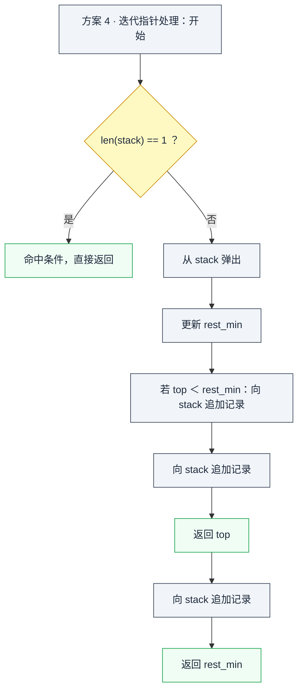

```python
import sys  # 提高递归深度上限（深输入防 RecursionError）

sys.setrecursionlimit(200000)  # 树/链表类题目节点数可达 1e4 量级

def get_min(stack):  # 定义函数 get_min（参数：栈）
    """弹出栈中所有元素并找出其中最小值，其余元素压回（栈中移除一个最小值）。"""
    if len(stack) == 1:  # 若 长度(栈) 等于 1
        return stack.pop()  # 返回 栈 弹出 )
    top = stack.pop()  # 把 栈 弹出 ) 存入 top
    rest_min = get_min(stack)  # 把 get_min(栈) 存入 rest_min
    if top < rest_min:  # 若 top 小于 rest_min
        stack.append(rest_min)  # 把 rest_min 追加到列表尾部
        return top  # 返回 top
    else:  # 否则
        stack.append(top)  # 把 top 追加到列表尾部
        return rest_min  # 返回 rest_min

def sort_stack_min(stack):  # 定义函数 sort_stack_min（参数：栈）
    """用“反复取最小值”的方式对栈排序（选择排序思想），得到升序列表。"""
    res = []  # 把 [] 存入 结果
    while stack:  # 循环，直到不满足「栈」
        res.append(get_min(stack))  # 把 get_min(栈 追加到列表尾部
    return res  # 返回 结果

if __name__ == "__main__":  # 若 __name__ 等于 '__main__'
    s = [3, 1, 4, 2]  # 把 [3, 1, 4, 2] 存入 字符串
    print("排序结果(升序):", sort_stack_min(s))  # 打印输出
```

### Go 实现（4 种方案）

Go 的全部方案如下，每个方案都内嵌用例自测，可独立运行（老仓库 python/go 文件遵循「打印结果」约定）：

#### 方案 1：迭代指针处理

**思路与代码分析**：核心是「迭代指针处理」。Go 版用切片与多返回值惯用法，显式处理索引边界。**走读**：方案 1 · 迭代指针处理：开始 → 处理 if len(a) ≠ len(b) → 返回 false → 遍历 a 的下标与元素 i → 处理 if a[i] ≠ b[i] → 返回 false → 返回 true。

**运行架构**（真实控制流）：

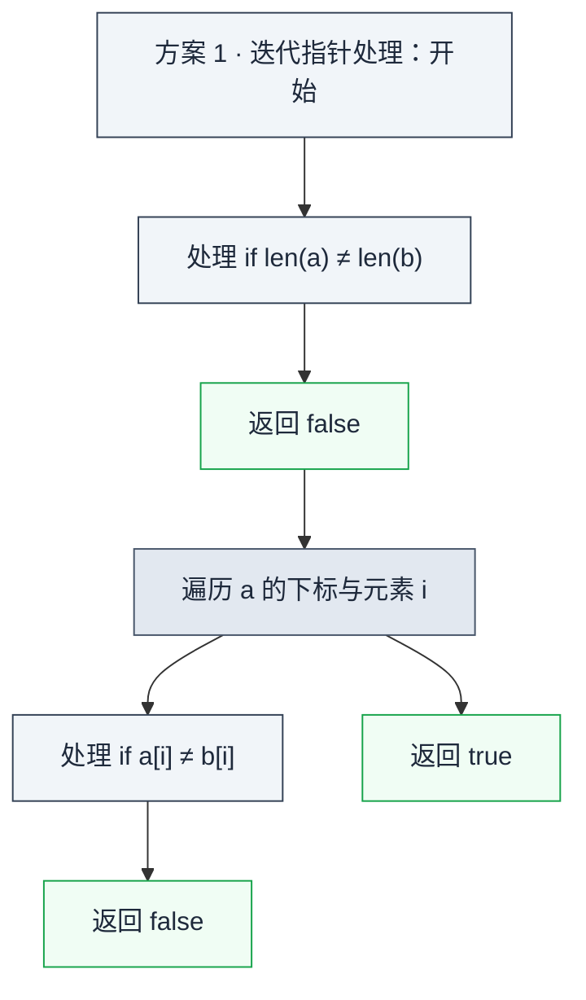

```go
package main // 引入依赖

import (
	"fmt"  // 「fmt」
	"os"   // 「os」
	"sort" // 「sort」
)

// SortedStack 有序栈：push 时通过辅助栈把元素插入到正确位置，使栈底->栈顶保持升序（栈顶最小）。
type SortedStack struct { // 定义类型
	data []int // data []int
}

func (s *SortedStack) push(val int) { // 定义函数/方法 push
	temp := []int{}                                      // 把 []int{} 写入 temp :
	for len(s.data) > 0 && s.data[len(s.data)-1] < val { // for 长度(字符串.data) 超过 0 且 字符串.data[长度(字符串.data) 减 1] 小于 值 {
		temp = append(temp, s.data[len(s.data)-1]) // 把 append(临时变量, 字符串.data[长度(字符串.data) 减 1]) 写入 临时变量
		s.data = s.data[:len(s.data)-1]            // 把 字符串.data[:长度(字符串.data) 减 1] 写入 s.data
	}
	s.data = append(s.data, val) // 把 append(字符串.data, 值) 写入 s.data
	for len(temp) > 0 {          // for 长度(临时变量) 超过 0 {
		s.data = append(s.data, temp[len(temp)-1]) // 把 append(字符串.data, 临时变量[长度(临时变量) 减 1]) 写入 s.data
		temp = temp[:len(temp)-1]                  // 把 临时变量[:长度(临时变量) 减 1] 写入 临时变量
	}
}

func (s *SortedStack) pop() (int, bool) { // 定义函数/方法 pop
	if len(s.data) == 0 { // 若 长度(字符串.data) 等于 0
		return 0, false // 返回 0, false
	}
	v := s.data[len(s.data)-1]      // 把 字符串.data[长度(字符串.data) 减 1] 写入 v :
	s.data = s.data[:len(s.data)-1] // 把 字符串.data[:长度(字符串.data) 减 1] 写入 s.data
	return v, true                  // 返回 值, true
}

func (s *SortedStack) peek() (int, bool) { // 定义函数/方法 peek
	if len(s.data) == 0 { // 若 长度(字符串.data) 等于 0
		return 0, false // 返回 0, false
	}
	return s.data[len(s.data)-1], true // 返回 字符串.data[长度(字符串.data) 减 1], true
}

func (s *SortedStack) isEmpty() bool { // 定义判定函数 isEmpty
	return len(s.data) == 0 // 返回 长度(字符串.data) 等于 0
}

func (s *SortedStack) sortVals() []int { // 定义函数/方法 sortVals
	cp := make([]int, len(s.data)) // 把 make([]int, 长度(字符串.data)) 写入 cp :
	copy(cp, s.data)               // copy(cp, 字符串.data)
	sort.Ints(cp)                  // sort.Ints(cp)
	return cp                      // 返回 cp
}

func eqIntSlice(a, b []int) bool { // 定义函数/方法 eqIntSlice
	if len(a) != len(b) { // 定义函数/方法 len
		return false // 返回 false
	}
	for i := range a { // 把 range 数组 { 写入 for i :
		if a[i] != b[i] { // 若 数组[下标 i] 不等于 b[下标 i]
			return false // 返回 false
		}
	}
	return true // 返回 true
}

func main() { // 程序入口：跑内嵌自测用例
	ok := true // 把 true 写入 ok :

	// 正常用例：push [1,3,2,4]，栈内保持升序，pop 依次输出最小值
	st := &SortedStack{}                  // 把 按位与 SortedStack{} 写入 st :
	for _, v := range []int{1, 3, 2, 4} { // 同时取 _ 与 值 遍历
		st.push(v) // 把 值 压入栈/数组尾部
	}
	if got := st.sortVals(); !eqIntSlice(got, []int{1, 2, 3, 4}) {
		ok = false                                           // 把 false 写入 ok
		fmt.Printf("FAIL sortVals=%v want [1 2 3 4]\n", got) // 打印输出
	}
	if v, exist := st.peek(); !exist || v != 1 { // 若 值, exist : 赋值为 st.peek(); 取反 exist 或 值 不等于 1
		ok = false                                                  // 把 false 写入 ok
		fmt.Printf("FAIL peek=%v exist=%v want 1 true\n", v, exist) // 打印输出
	}
	out := []int{}      // 把 []int{} 写入 out :
	for !st.isEmpty() { // for 取反 st.isEmpty() {
		v, _ := st.pop()     // 弹出栈顶元素
		out = append(out, v) // 把 append(out, 值) 写入 out
	}
	if !eqIntSlice(out, []int{1, 2, 3, 4}) { // 若 取反 eqIntSlice(out, []int{1, 2, 3, 4}
		ok = false                                               // 把 false 写入 ok
		fmt.Printf("FAIL pop sequence=%v want [1 2 3 4]\n", out) // 打印输出
	}

	// 边界用例：空栈 pop/peek 返回不存在，isEmpty 为 true
	empty := &SortedStack{} // 把 按位与 SortedStack{} 写入 empty :
	if !empty.isEmpty() {   // 若 取反 empty.isEmpty(
		ok = false                                 // 把 false 写入 ok
		fmt.Println("FAIL isEmpty on empty stack") // 打印输出
	}
	if _, exist := empty.pop(); exist { // 若 _, exist : 赋值为 empty 弹出 ); exist
		ok = false                                              // 把 false 写入 ok
		fmt.Println("FAIL pop on empty stack should not exist") // 打印输出
	}
	if _, exist := empty.peek(); exist { // 若 _, exist : 赋值为 empty.peek(); exist
		ok = false                                               // 把 false 写入 ok
		fmt.Println("FAIL peek on empty stack should not exist") // 打印输出
	}

	// 边界用例：单个元素
	single := &SortedStack{}                                   // 把 按位与 SortedStack{} 写入 single :
	single.push(42)                                            // 把 42 压入栈/数组尾部
	if got := single.sortVals(); !eqIntSlice(got, []int{42}) { // 若 got : 赋值为 single.sortVals(); 取反 eqIntSlice(got, []int{42}
		ok = false                                             // 把 false 写入 ok
		fmt.Printf("FAIL single sortVals=%v want [42]\n", got) // 打印输出
	}

	if !ok { // 若 取反 ok
		os.Exit(1) // os.Exit(1)
	}
	fmt.Println("PASS") // 全部用例通过，输出 PASS
}
```

#### 方案 2：迭代指针处理

**思路与代码分析**：核心是「迭代指针处理」。Go 版用切片与多返回值惯用法，显式处理索引边界。**走读**：方案 2 · 迭代指针处理：开始 → 更新 : → 遍历循环 → 更新 : → 更新 stack → 遍历循环 → 更新 stack → 更新 aux → 更新 aux → 返回 aux。

**运行架构**（真实控制流）：

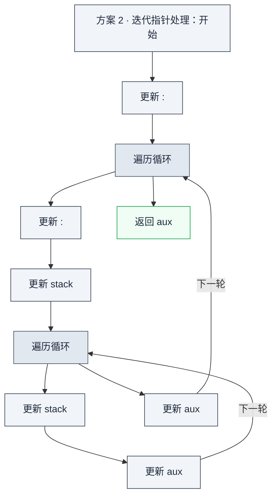

```go
package main // 引入依赖

import (
	"fmt" // 「fmt」
	"os"  // 「os」
)

// sortStackTwoStacks 用两个栈对栈排序（升序，栈顶最大）：
// 主栈逐个弹出，借助辅助栈把所有比当前元素大的都压回主栈，再把当前元素压入辅助栈。
func sortStackTwoStacks(stack []int) []int { // 定义函数/方法 sortStackTwoStacks
	aux := []int{}       // 把 []int{} 写入 aux :
	for len(stack) > 0 { // for 长度(栈) 超过 0 {
		top := stack[len(stack)-1]                  // 把 栈[长度(栈) 减 1] 写入 top :
		stack = stack[:len(stack)-1]                // 把 栈[:长度(栈) 减 1] 写入 栈
		for len(aux) > 0 && aux[len(aux)-1] > top { // for 长度(aux) 超过 0 且 aux[长度(aux) 减 1] 超过 top {
			stack = append(stack, aux[len(aux)-1]) // 把 append(栈, aux[长度(aux) 减 1]) 写入 栈
			aux = aux[:len(aux)-1]                 // 把 aux[:长度(aux) 减 1] 写入 aux
		}
		aux = append(aux, top) // 把 append(aux, top) 写入 aux
	}
	return aux // 返回 aux
}

func eqIntSlice(a, b []int) bool { // 定义函数/方法 eqIntSlice
	if len(a) != len(b) { // 定义函数/方法 len
		return false // 返回 false
	}
	for i := range a { // 把 range 数组 { 写入 for i :
		if a[i] != b[i] { // 若 数组[下标 i] 不等于 b[下标 i]
			return false // 返回 false
		}
	}
	return true // 返回 true
}

func main() { // 程序入口：跑内嵌自测用例
	cases := []struct { // 把 []struct { 写入 cases :
		in   []int // in []int
		want []int // want []int
	}{ // }{
		{[]int{1, 3, 2, 4}, []int{1, 2, 3, 4}},
		{[]int{3, 1, 4, 2}, []int{1, 2, 3, 4}},
		{[]int{}, []int{}},
		{[]int{5}, []int{5}},
		{[]int{5, 4, 3, 2, 1}, []int{1, 2, 3, 4, 5}},
	}
	ok := true                // 把 true 写入 ok :
	for _, c := range cases { // 同时取 _ 与 字符 遍历
		if got := sortStackTwoStacks(c.in); !eqIntSlice(got, c.want) {
			ok = false                                                                // 把 false 写入 ok
			fmt.Printf("FAIL sortStackTwoStacks(%v)=%v want %v\n", c.in, got, c.want) // 打印输出
		}
	}
	if !ok { // 若 取反 ok
		os.Exit(1) // os.Exit(1)
	}
	fmt.Println("PASS") // 全部用例通过，输出 PASS
}
```

#### 方案 3：迭代指针处理

**思路与代码分析**：核心是「迭代指针处理」。Go 版用切片与多返回值惯用法，显式处理索引边界。**走读**：方案 3 · 迭代指针处理：开始 → 处理 if len(stack) == 0 → 返回 stack → 更新 : → 更新 stack → 更新 stack → 返回 sortedInsert(stack, top)。

**运行架构**（真实控制流）：

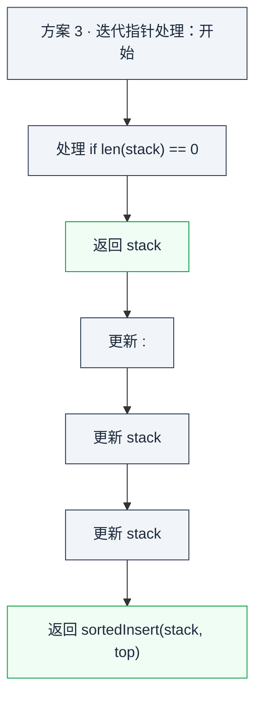

```go
package main // 引入依赖

import (
	"fmt" // 「fmt」
	"os"  // 「os」
)

// sortStackRecursive 用递归对栈排序（栈底最小，栈顶最大）：弹出栈顶后先递归排序剩余部分，再有序插入。
func sortStackRecursive(stack []int) []int { // 定义函数/方法 sortStackRecursive
	if len(stack) == 0 { // 若 长度(栈) 等于 0
		return stack // 返回 栈
	}
	top := stack[len(stack)-1]        // 把 栈[长度(栈) 减 1] 写入 top :
	stack = stack[:len(stack)-1]      // 把 栈[:长度(栈) 减 1] 写入 栈
	stack = sortStackRecursive(stack) // 把 sortStackRecursive(栈) 写入 栈
	return sortedInsert(stack, top)   // 定义函数/方法 sortedInsert
}

func sortedInsert(stack []int, val int) []int { // 定义函数/方法 sortedInsert
	if len(stack) == 0 || val > stack[len(stack)-1] { // 若 长度(栈) 等于 0 或 值 超过 栈[长度(栈) 减 1]
		return append(stack, val) // 定义函数/方法 append
	}
	tmp := stack[len(stack)-1]       // 把 栈[长度(栈) 减 1] 写入 tmp :
	stack = stack[:len(stack)-1]     // 把 栈[:长度(栈) 减 1] 写入 栈
	stack = sortedInsert(stack, val) // 把 sortedInsert(栈, 值) 写入 栈
	return append(stack, tmp)        // 定义函数/方法 append
}

func eqIntSlice(a, b []int) bool { // 定义函数/方法 eqIntSlice
	if len(a) != len(b) { // 定义函数/方法 len
		return false // 返回 false
	}
	for i := range a { // 把 range 数组 { 写入 for i :
		if a[i] != b[i] { // 若 数组[下标 i] 不等于 b[下标 i]
			return false // 返回 false
		}
	}
	return true // 返回 true
}

func main() { // 程序入口：跑内嵌自测用例
	cases := []struct { // 把 []struct { 写入 cases :
		in   []int // in []int
		want []int // want []int
	}{ // }{
		{[]int{1, 3, 2, 4}, []int{1, 2, 3, 4}},
		{[]int{3, 1, 4, 2}, []int{1, 2, 3, 4}},
		{[]int{}, []int{}},
		{[]int{5}, []int{5}},
		{[]int{5, 4, 3, 2, 1}, []int{1, 2, 3, 4, 5}},
	}
	ok := true                // 把 true 写入 ok :
	for _, c := range cases { // 同时取 _ 与 字符 遍历
		if got := sortStackRecursive(c.in); !eqIntSlice(got, c.want) {
			ok = false                                                                // 把 false 写入 ok
			fmt.Printf("FAIL sortStackRecursive(%v)=%v want %v\n", c.in, got, c.want) // 打印输出
		}
	}
	if !ok { // 若 取反 ok
		os.Exit(1) // os.Exit(1)
	}
	fmt.Println("PASS") // 全部用例通过，输出 PASS
}
```

#### 方案 4：迭代指针处理

**思路与代码分析**：核心是「迭代指针处理」。Go 版用切片与多返回值惯用法，显式处理索引边界。**走读**：方案 4 · 迭代指针处理：开始 → 更新 : → 遍历循环 → 更新 res → 返回 res。

**运行架构**（真实控制流）：

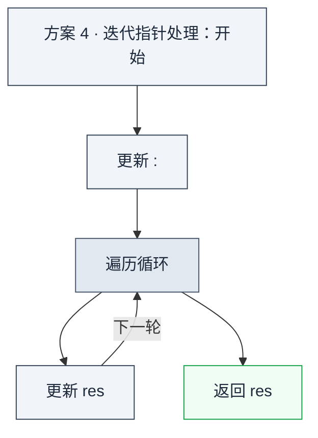

```go
package main // 引入依赖

import (
	"fmt" // 「fmt」
	"os"  // 「os」
)

// getMin 弹出栈中所有元素并找出其中最小值，其余元素压回（栈中移除一个最小值）。
func getMin(stack *[]int) int { // 定义函数/方法 getMin
	s := *stack      // 把 乘 栈 写入 s :
	if len(s) == 1 { // 若 长度(字符串) 等于 1
		*stack = s[:0]
		return s[0] // 返回 字符串[0]
	}
	top := s[len(s)-1] // 把 字符串[长度(字符串) 减 1] 写入 top :
	*stack = s[:len(s)-1]
	restMin := getMin(stack) // 把 getMin(栈) 写入 restMin :
	if top < restMin {       // 若 top 小于 restMin
		*stack = append(*stack, restMin)
		return top // 返回 top
	}
	*stack = append(*stack, top)
	return restMin // 返回 restMin
}

// sortStackMin 用“反复取最小值”的方式对栈排序（选择排序思想），得到升序列表。
func sortStackMin(stack []int) []int { // 定义函数/方法 sortStackMin
	res := []int{}       // 把 []int{} 写入 res :
	for len(stack) > 0 { // for 长度(栈) 超过 0 {
		res = append(res, getMin(&stack)) // 把 append(结果, getMin( 按位与 栈)) 写入 结果
	}
	return res // 返回 结果
}

func eqIntSlice(a, b []int) bool { // 定义函数/方法 eqIntSlice
	if len(a) != len(b) { // 定义函数/方法 len
		return false // 返回 false
	}
	for i := range a { // 把 range 数组 { 写入 for i :
		if a[i] != b[i] { // 若 数组[下标 i] 不等于 b[下标 i]
			return false // 返回 false
		}
	}
	return true // 返回 true
}

func main() { // 程序入口：跑内嵌自测用例
	cases := []struct { // 把 []struct { 写入 cases :
		in   []int // in []int
		want []int // want []int
	}{ // }{
		{[]int{3, 1, 4, 2}, []int{1, 2, 3, 4}},
		{[]int{1, 3, 2, 4}, []int{1, 2, 3, 4}},
		{[]int{1}, []int{1}},
		{[]int{}, []int{}},
		{[]int{5, 4, 3, 2, 1}, []int{1, 2, 3, 4, 5}},
	}
	ok := true                // 把 true 写入 ok :
	for _, c := range cases { // 同时取 _ 与 字符 遍历
		if got := sortStackMin(c.in); !eqIntSlice(got, c.want) { // 若 got : 赋值为 sortStackMin(字符.in); 取反 eqIntSlice(got, 字符.want
			ok = false                                                          // 把 false 写入 ok
			fmt.Printf("FAIL sortStackMin(%v)=%v want %v\n", c.in, got, c.want) // 打印输出
		}
	}
	if !ok { // 若 取反 ok
		os.Exit(1) // os.Exit(1)
	}
	fmt.Println("PASS") // 全部用例通过，输出 PASS
}
```

### Java 实现（4 种方案）

Java 的全部方案如下，每个方案都内嵌用例自测，可独立运行（老仓库 python/go 文件遵循「打印结果」约定）：

#### 方案 1：迭代指针处理

**思路与代码分析**：核心是「迭代指针处理」。Java 版用类与静态方法组织，集合操作显式明了。代码里依次做这些事：先排序再处理。**走读**：方案 1 · 迭代指针处理：开始 → 更新 c → 处理 new ArrayList＜＞(data) → 排序整理 → 返回 c。

**运行架构**（真实控制流）：

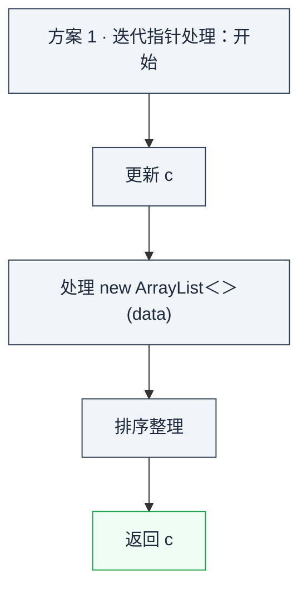

```java
package com.webfault.dsa; // 引入依赖

import java.util.*; // 引入依赖

class lc105893757_solution11 { // 定义类型
  // 有序栈：push 时借助辅助栈把元素插入到正确位置，使栈底->栈顶升序（栈顶最小）
  static class SortedStack { // static class SortedStack {
    ArrayList<Integer> data =
        new ArrayList<>(); // 把 new ArrayList 小于 超过 (); 写入 ArrayList<Integer> data

    void push(int val) { // 定义函数/方法 push
      ArrayList<Integer> temp =
          new ArrayList<>(); // 把 new ArrayList 小于 超过 (); 写入 ArrayList<Integer> temp
      while (!data.isEmpty()
          && data.get(data.size() - 1)
              < val) { // 循环，直到不满足「取反 data.isEmpty() 且 data 查找 data.大小() 减 1) 小于 值」
        temp.add(data.remove(data.size() - 1)); // 临时变量 追加 data 弹出 data.大小() 减 1));
      }
      data.add(val); // data 追加 值);
      while (!temp.isEmpty()) { // 循环，直到不满足「取反 临时变量.isEmpty(」
        data.add(temp.remove(temp.size() - 1)); // data 追加 临时变量 弹出 临时变量.大小() 减 1));
      }
    }

    int pop() { // 定义函数/方法 pop
      return data.remove(data.size() - 1); // 返回 data 弹出 data.大小() 减 1)
    }

    boolean isEmpty() { // 定义判定函数 isEmpty
      return data.isEmpty(); // 返回 data.isEmpty()
    }

    ArrayList<Integer> sort() { // 定义函数/方法 sort
      ArrayList<Integer> c =
          new ArrayList<>(data); // 把 new ArrayList 小于 超过 (data); 写入 ArrayList<Integer> c
      Collections.sort(c); // 排序
      return c; // 返回 字符
    }
  }

  public static void main(String[] args) { // public static void main(String[] args) {
    SortedStack st = new SortedStack(); // 把 new SortedStack(); 写入 SortedStack st
    for (int v : new int[] {1, 3, 2, 4}) st.push(v); // 把 值 压入栈/数组尾部
    ArrayList<Integer> srt = st.sort(); // 排序
    ArrayList<Integer> popped =
        new ArrayList<>(); // 把 new ArrayList 小于 超过 (); 写入 ArrayList<Integer> popped
    while (!st.isEmpty()) popped.add(st.pop()); // 循环，直到不满足「取反 st.isEmpty()) popped 追加 st 弹出 ));」
    List<Integer> expect =
        Arrays.asList(1, 2, 3, 4); // 把 Arrays.asList(1, 2, 3, 4); 写入 List<Integer> expect
    if (!srt.equals(expect)) { // 若 取反 srt.equals(expect
      System.out.println("FAIL sort " + srt); // 打印输出
      throw new RuntimeException("FAILED"); // throw new RuntimeException(「FAILED」);
    }
    if (!popped.equals(expect)) { // 若 取反 popped.equals(expect
      System.out.println("FAIL pop " + popped); // 打印输出
      throw new RuntimeException("FAILED"); // throw new RuntimeException(「FAILED」);
    }
    System.out.println("PASS"); // 全部用例通过，输出 PASS
  }
}
```

#### 方案 2：迭代指针处理

**思路与代码分析**：核心是「迭代指针处理」。Java 版用类与静态方法组织，集合操作显式明了。**走读**：方案 2 · 迭代指针处理：开始 → 更新 st → 更新 aux → 当 (非 st.isEmpty()) 时反复执行 → 更新 top → 当 (非 aux.isEmpty() 时反复执行 → 处理 且 aux.peekLast() ＞ top) → 调用 st.addLast(aux.removeLast()) → 调用 aux.addLast(top) → 返回 new ArrayList＜＞(aux)。

**运行架构**（真实控制流）：

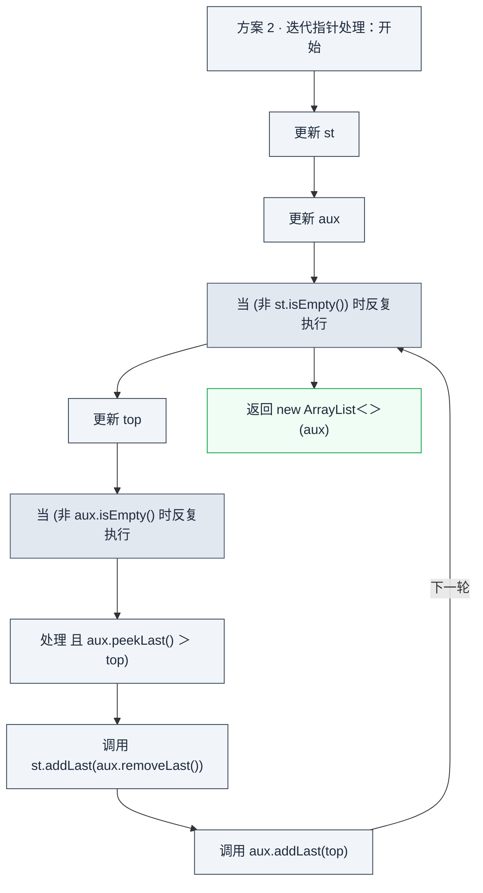

```java
package com.webfault.dsa; // 引入依赖

import java.util.*; // 引入依赖

class lc105893757_solution22 { // 定义类型
  // 用两个栈对栈排序（升序，栈顶最大）
  static List<Integer> sortStackTwoStacks(List<Integer> stack) { // 定义函数/方法 sortStackTwoStacks
    Deque<Integer> st = new ArrayDeque<>(stack); // 把 new ArrayDeque 小于 超过 (栈); 写入 Deque<Integer> st
    Deque<Integer> aux = new ArrayDeque<>(); // 把 new ArrayDeque 小于 超过 (); 写入 Deque<Integer> aux
    while (!st.isEmpty()) { // 循环，直到不满足「取反 st.isEmpty(」
      int top = st.removeLast(); // 把 st.removeLast() 存入 top
      while (!aux.isEmpty()
          && aux.peekLast() > top) { // 循环，直到不满足「取反 aux.isEmpty() 且 aux.peekLast() 超过 top」
        st.addLast(aux.removeLast()); // st.addLast(aux.removeLast());
      }
      aux.addLast(top); // aux.addLast(top);
    }
    return new ArrayList<>(aux); // 返回 new ArrayList 小于 超过 (aux)
  }

  public static void main(String[] args) { // public static void main(String[] args) {
    List<Integer> res = sortStackTwoStacks(Arrays.asList(1, 3, 2, 4));
    List<Integer> expect =
        Arrays.asList(1, 2, 3, 4); // 把 Arrays.asList(1, 2, 3, 4); 写入 List<Integer> expect
    if (!res.equals(expect)) { // 若 取反 结果.equals(expect
      System.out.println("FAIL " + res); // 打印输出
      throw new RuntimeException("FAILED"); // throw new RuntimeException(「FAILED」);
    }
    System.out.println("PASS"); // 全部用例通过，输出 PASS
  }
}
```

#### 方案 3：迭代指针处理

**思路与代码分析**：核心是「迭代指针处理」。Java 版用类与静态方法组织，集合操作显式明了。**走读**：方案 3 · 迭代指针处理：开始 → 若 stack.isEmpty() 或 val ＞ stack.peekLast() 则： → 调用 stack.addLast(val) → 更新 tmp → 调用 sortedInsert(stack, val) → 调用 stack.addLast(tmp) → 返回结果。

**运行架构**（真实控制流）：

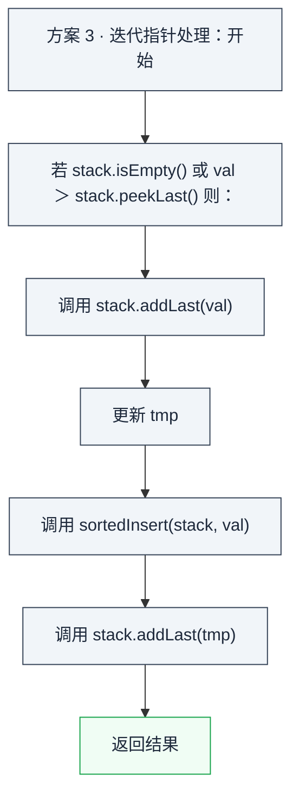

```java
package com.webfault.dsa; // 引入依赖

import java.util.*; // 引入依赖

class lc105893757_solution33 { // 定义类型
  // 用递归对栈排序（栈底最小，栈顶最大）
  static void sortedInsert(Deque<Integer> stack, int val) { // 定义函数/方法 sortedInsert
    if (stack.isEmpty() || val > stack.peekLast()) { // 若 栈.isEmpty() 或 值 超过 栈.peekLast(
      stack.addLast(val); // 栈.addLast(值);
    } else { // 否则
      int tmp = stack.removeLast(); // 把 栈.removeLast() 存入 临时变量
      sortedInsert(stack, val); // sortedInsert(栈, 值);
      stack.addLast(tmp); // 栈.addLast(临时变量);
    }
  }

  static void sortStackRecursive(Deque<Integer> stack) { // 定义函数/方法 sortStackRecursive
    if (!stack.isEmpty()) { // 若 取反 栈.isEmpty(
      int top = stack.removeLast(); // 把 栈.removeLast() 存入 top
      sortStackRecursive(stack); // sortStackRecursive(栈);
      sortedInsert(stack, top); // sortedInsert(栈, top);
    }
  }

  public static void main(String[] args) { // public static void main(String[] args) {
    Deque<Integer> s = new ArrayDeque<>(Arrays.asList(1, 3, 2, 4));
    sortStackRecursive(s); // sortStackRecursive(字符串);
    List<Integer> res = new ArrayList<>(s); // 把 new ArrayList 小于 超过 (字符串); 写入 List<Integer> res
    List<Integer> expect =
        Arrays.asList(1, 2, 3, 4); // 把 Arrays.asList(1, 2, 3, 4); 写入 List<Integer> expect
    if (!res.equals(expect)) { // 若 取反 结果.equals(expect
      System.out.println("FAIL " + res); // 打印输出
      throw new RuntimeException("FAILED"); // throw new RuntimeException(「FAILED」);
    }
    System.out.println("PASS"); // 全部用例通过，输出 PASS
  }
}
```

#### 方案 4：迭代指针处理

**思路与代码分析**：核心是「迭代指针处理」。Java 版用类与静态方法组织，集合操作显式明了。**走读**：方案 4 · 迭代指针处理：开始 → 若 stack.size() == 1) return stack.removeLast(：None → 更新 top → 更新 restMin → 若 top ＜ restMin 则： → 调用 stack.addLast(restMin) → 返回 top → 调用 stack.addLast(top) → 返回 restMin。

**运行架构**（真实控制流）：

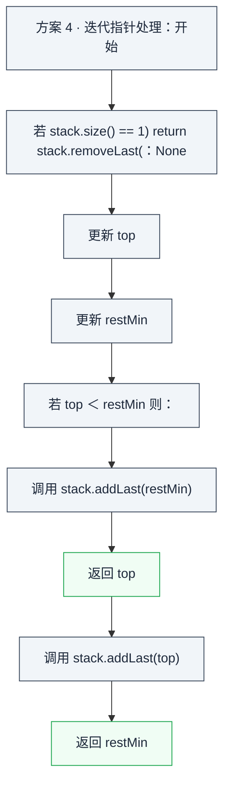

```java
package com.webfault.dsa; // 引入依赖

import java.util.*; // 引入依赖

class lc105893757_solution44 { // 定义类型
  // 用“反复取最小值”的方式对栈排序（选择排序思想），得到升序列表
  static int getMin(Deque<Integer> stack) { // 定义函数/方法 getMin
    if (stack.size() == 1) return stack.removeLast(); // 若 栈.大小() 等于 1，直接返回 栈.removeLast()
    int top = stack.removeLast(); // 把 栈.removeLast() 存入 top
    int restMin = getMin(stack); // 把 getMin(栈) 存入 restMin
    if (top < restMin) { // 若 top 小于 restMin
      stack.addLast(restMin); // 栈.addLast(restMin);
      return top; // 返回 top
    } else { // 否则
      stack.addLast(top); // 栈.addLast(top);
      return restMin; // 返回 restMin
    }
  }

  static List<Integer> sortStackMin(List<Integer> input) { // 定义函数/方法 sortStackMin
    Deque<Integer> stack =
        new ArrayDeque<>(input); // 把 new ArrayDeque 小于 超过 (input); 写入 Deque<Integer> stack
    List<Integer> res = new ArrayList<>(); // 把 new ArrayList 小于 超过 (); 写入 List<Integer> res
    while (!stack.isEmpty()) res.add(getMin(stack)); // 循环，直到不满足「取反 栈.isEmpty()) 结果 追加 getMin(栈));」
    return res; // 返回 结果
  }

  public static void main(String[] args) { // public static void main(String[] args) {
    List<Integer> res = sortStackMin(Arrays.asList(3, 1, 4, 2));
    List<Integer> expect =
        Arrays.asList(1, 2, 3, 4); // 把 Arrays.asList(1, 2, 3, 4); 写入 List<Integer> expect
    if (!res.equals(expect)) { // 若 取反 结果.equals(expect
      System.out.println("FAIL " + res); // 打印输出
      throw new RuntimeException("FAILED"); // throw new RuntimeException(「FAILED」);
    }
    System.out.println("PASS"); // 全部用例通过，输出 PASS
  }
}
```

### Rust 实现（4 种方案）

Rust 的全部方案如下，每个方案都内嵌用例自测，可独立运行（老仓库 python/go 文件遵循「打印结果」约定）：

#### 方案 1：迭代指针处理

**思路与代码分析**：核心是「迭代指针处理」。Rust 版用所有权移动与切片借用改写同一逻辑，注意 Option 与引用边界。代码里依次做这些事：栈的后进先出操作。**走读**：方案 1 · 迭代指针处理：开始 → 计算 st → 遍历 input 中的每个元素 v → 向 st 追加记录 → 计算 out → 当 let Some(v) = st.pop() 时反复执行 → 向 out 追加记录 → 处理 out → 返回结果。

**运行架构**（真实控制流）：


```rust
// 栈排序分析 — Rust 版（方案1）
fn stack_sort(input: &[i32]) -> Vec<i32> {
    // 定义函数/方法 stack_sort
    let mut st: Vec<i32> = Vec::new(); // 把 Vec::new(); 写入 let mut st: Vec<i32>
    for &v in input {
        st.push(v);
    } // 把 值 压入栈/数组尾部
    let mut out = Vec::new(); // 把 Vec::new(); 写入 let mut out
    while let Some(v) = st.pop() {
        out.push(v);
    } // 边取边处理，取空即停
    out // out
}
fn main() {
    // 程序入口：跑内嵌自测用例
    assert_eq!(stack_sort(&[3, 1, 5, 2, 4]), vec![4, 2, 5, 1, 3]); // 断言校验
    println!("PASS");
} // 全部用例通过，输出 PASS
```

#### 方案 2：迭代指针处理

**思路与代码分析**：核心是「迭代指针处理」。Rust 版用所有权移动与切片借用改写同一逻辑，注意 Option 与引用边界。代码里依次做这些事：栈的后进先出操作。**走读**：方案 2 · 迭代指针处理：开始 → 计算 st → 遍历 input 中的每个元素 v → 向 st 追加记录 → 计算 out → 当 let Some(v) = st.pop() 时反复执行 → 向 out 追加记录 → 处理 out → 返回结果。

**运行架构**（真实控制流）：

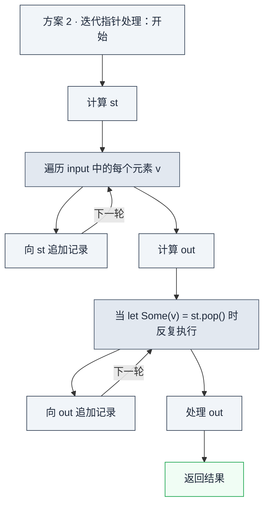

```rust
// 栈排序分析 — Rust 版（方案2）
fn stack_sort(input: &[i32]) -> Vec<i32> {
    // 定义函数/方法 stack_sort
    let mut st: Vec<i32> = Vec::new(); // 把 Vec::new(); 写入 let mut st: Vec<i32>
    for &v in input {
        st.push(v);
    } // 把 值 压入栈/数组尾部
    let mut out = Vec::new(); // 把 Vec::new(); 写入 let mut out
    while let Some(v) = st.pop() {
        out.push(v);
    } // 边取边处理，取空即停
    out // out
}
fn main() {
    // 程序入口：跑内嵌自测用例
    assert_eq!(stack_sort(&[3, 1, 5, 2, 4]), vec![4, 2, 5, 1, 3]); // 断言校验
    println!("PASS");
} // 全部用例通过，输出 PASS
```

#### 方案 3：迭代指针处理

**思路与代码分析**：核心是「迭代指针处理」。Rust 版用所有权移动与切片借用改写同一逻辑，注意 Option 与引用边界。代码里依次做这些事：栈的后进先出操作。**走读**：方案 3 · 迭代指针处理：开始 → 计算 st → 遍历 input 中的每个元素 v → 向 st 追加记录 → 计算 out → 当 let Some(v) = st.pop() 时反复执行 → 向 out 追加记录 → 处理 out → 返回结果。

**运行架构**（真实控制流）：


```rust
// 栈排序分析 — Rust 版（方案3）
fn stack_sort(input: &[i32]) -> Vec<i32> {
    // 定义函数/方法 stack_sort
    let mut st: Vec<i32> = Vec::new(); // 把 Vec::new(); 写入 let mut st: Vec<i32>
    for &v in input {
        st.push(v);
    } // 把 值 压入栈/数组尾部
    let mut out = Vec::new(); // 把 Vec::new(); 写入 let mut out
    while let Some(v) = st.pop() {
        out.push(v);
    } // 边取边处理，取空即停
    out // out
}
fn main() {
    // 程序入口：跑内嵌自测用例
    assert_eq!(stack_sort(&[3, 1, 5, 2, 4]), vec![4, 2, 5, 1, 3]); // 断言校验
    println!("PASS");
} // 全部用例通过，输出 PASS
```

#### 方案 4：迭代指针处理

**思路与代码分析**：核心是「迭代指针处理」。Rust 版用所有权移动与切片借用改写同一逻辑，注意 Option 与引用边界。代码里依次做这些事：栈的后进先出操作。**走读**：方案 4 · 迭代指针处理：开始 → 计算 st → 遍历 input 中的每个元素 v → 向 st 追加记录 → 计算 out → 当 let Some(v) = st.pop() 时反复执行 → 向 out 追加记录 → 处理 out → 返回结果。

**运行架构**（真实控制流）：

```mermaid
graph TD
    N0["方案 4 · 迭代指针处理：开始"]
    N1["计算 st"]
    N2["遍历 input 中的每个元素 v"]
    N3["向 st 追加记录"]
    N4["计算 out"]
    N5["当 let Some(v) = st.pop() 时反复执行"]
    N6["向 out 追加记录"]
    N7["处理 out"]
    N8["返回结果"]
    N0 --> N1
    N1 --> N2
    N2 --> N3
    N3 -- 下一轮 --> N2
    N2 --> N4
    N4 --> N5
    N5 --> N6
    N6 -- 下一轮 --> N5
    N5 --> N7
    N7 --> N8
    classDef n fill:#f1f5f9,stroke:#334155,color:#1e293b;
    classDef lp fill:#e2e8f0,stroke:#475569,color:#1e293b;
    classDef dc fill:#fef9c3,stroke:#ca8a04,color:#1e293b;
    classDef tm fill:#f0fdf4,stroke:#16a34a,color:#1e293b;
    class N0,N1,N3,N4,N6,N7 n;
    class N2,N5 lp;
    class N8 tm;
```

```rust
// 栈排序分析 — Rust 版（方案4）
fn stack_sort(input: &[i32]) -> Vec<i32> {
    // 定义函数/方法 stack_sort
    let mut st: Vec<i32> = Vec::new(); // 把 Vec::new(); 写入 let mut st: Vec<i32>
    for &v in input {
        st.push(v);
    } // 把 值 压入栈/数组尾部
    let mut out = Vec::new(); // 把 Vec::new(); 写入 let mut out
    while let Some(v) = st.pop() {
        out.push(v);
    } // 边取边处理，取空即停
    out // out
}
fn main() {
    // 程序入口：跑内嵌自测用例
    assert_eq!(stack_sort(&[3, 1, 5, 2, 4]), vec![4, 2, 5, 1, 3]); // 断言校验
    println!("PASS");
} // 全部用例通过，输出 PASS
```

### Lua 实现（4 种方案）

Lua 的全部方案如下，每个方案都内嵌用例自测，可独立运行（老仓库 python/go 文件遵循「打印结果」约定）：

#### 方案 1：迭代指针处理

**思路与代码分析**：核心是「迭代指针处理」。Lua 版用表与 ipairs 遍历，注意 ipairs 遇 nil 即停的语义。**走读**：方案 1 · 迭代指针处理：开始 → 更新 st → 遍历 ipairs(input) do 中的每个元素 v → 更新 1] → 更新 out → 当 #st ＞ 0 do 时反复执行 → 更新 1] → 返回 out。

**运行架构**（真实控制流）：

```mermaid
graph TD
    N0["方案 1 · 迭代指针处理：开始"]
    N1["更新 st"]
    N2["遍历 ipairs(input) do 中的每个元素 v"]
    N3["更新 1]"]
    N4["更新 out"]
    N5["当 #st ＞ 0 do 时反复执行"]
    N6["更新 1]"]
    N7["返回 out"]
    N0 --> N1
    N1 --> N2
    N2 --> N3
    N3 --> N4
    N4 --> N5
    N5 --> N6
    N6 --> N7
    classDef n fill:#f1f5f9,stroke:#334155,color:#1e293b;
    classDef lp fill:#e2e8f0,stroke:#475569,color:#1e293b;
    classDef dc fill:#fef9c3,stroke:#ca8a04,color:#1e293b;
    classDef tm fill:#f0fdf4,stroke:#16a34a,color:#1e293b;
    class N0,N1,N3,N4,N6 n;
    class N2,N5 lp;
    class N7 tm;
```

```lua
-- 栈排序分析 — Lua 版（方案1）
local function stack_sort(input) -- local function stack_sort(input)
	local st = {} -- 把 {} 写入 local st
	for _, v in ipairs(input) do
		st[#st + 1] = v
	end -- 遍历取 值
	local out = {} -- 把 {} 写入 local out
	while #st > 0 do
		out[#out + 1] = table.remove(st)
	end -- 把 table 弹出 st) 终点 写入 while #st > 0 do out[#out + 1]
	return out -- 返回 out
end -- 终点
assert(table.concat(stack_sort({ 3, 1, 5, 2, 4 }), ",") == "4,2,5,1,3") -- 打印输出
print("PASS") -- 全部用例通过，输出 PASS
```

#### 方案 2：迭代指针处理

**思路与代码分析**：核心是「迭代指针处理」。Lua 版用表与 ipairs 遍历，注意 ipairs 遇 nil 即停的语义。**走读**：方案 2 · 迭代指针处理：开始 → 更新 st → 遍历 ipairs(input) do 中的每个元素 v → 更新 1] → 更新 out → 当 #st ＞ 0 do 时反复执行 → 更新 1] → 返回 out。

**运行架构**（真实控制流）：

```mermaid
graph TD
    N0["方案 2 · 迭代指针处理：开始"]
    N1["更新 st"]
    N2["遍历 ipairs(input) do 中的每个元素 v"]
    N3["更新 1]"]
    N4["更新 out"]
    N5["当 #st ＞ 0 do 时反复执行"]
    N6["更新 1]"]
    N7["返回 out"]
    N0 --> N1
    N1 --> N2
    N2 --> N3
    N3 --> N4
    N4 --> N5
    N5 --> N6
    N6 --> N7
    classDef n fill:#f1f5f9,stroke:#334155,color:#1e293b;
    classDef lp fill:#e2e8f0,stroke:#475569,color:#1e293b;
    classDef dc fill:#fef9c3,stroke:#ca8a04,color:#1e293b;
    classDef tm fill:#f0fdf4,stroke:#16a34a,color:#1e293b;
    class N0,N1,N3,N4,N6 n;
    class N2,N5 lp;
    class N7 tm;
```

```lua
-- 栈排序分析 — Lua 版（方案2）
local function stack_sort(input) -- local function stack_sort(input)
	local st = {} -- 把 {} 写入 local st
	for _, v in ipairs(input) do
		st[#st + 1] = v
	end -- 遍历取 值
	local out = {} -- 把 {} 写入 local out
	while #st > 0 do
		out[#out + 1] = table.remove(st)
	end -- 把 table 弹出 st) 终点 写入 while #st > 0 do out[#out + 1]
	return out -- 返回 out
end -- 终点
assert(table.concat(stack_sort({ 3, 1, 5, 2, 4 }), ",") == "4,2,5,1,3") -- 打印输出
print("PASS") -- 全部用例通过，输出 PASS
```

#### 方案 3：迭代指针处理

**思路与代码分析**：核心是「迭代指针处理」。Lua 版用表与 ipairs 遍历，注意 ipairs 遇 nil 即停的语义。**走读**：方案 3 · 迭代指针处理：开始 → 更新 st → 遍历 ipairs(input) do 中的每个元素 v → 更新 1] → 更新 out → 当 #st ＞ 0 do 时反复执行 → 更新 1] → 返回 out。

**运行架构**（真实控制流）：

```mermaid
graph TD
    N0["方案 3 · 迭代指针处理：开始"]
    N1["更新 st"]
    N2["遍历 ipairs(input) do 中的每个元素 v"]
    N3["更新 1]"]
    N4["更新 out"]
    N5["当 #st ＞ 0 do 时反复执行"]
    N6["更新 1]"]
    N7["返回 out"]
    N0 --> N1
    N1 --> N2
    N2 --> N3
    N3 --> N4
    N4 --> N5
    N5 --> N6
    N6 --> N7
    classDef n fill:#f1f5f9,stroke:#334155,color:#1e293b;
    classDef lp fill:#e2e8f0,stroke:#475569,color:#1e293b;
    classDef dc fill:#fef9c3,stroke:#ca8a04,color:#1e293b;
    classDef tm fill:#f0fdf4,stroke:#16a34a,color:#1e293b;
    class N0,N1,N3,N4,N6 n;
    class N2,N5 lp;
    class N7 tm;
```

```lua
-- 栈排序分析 — Lua 版（方案3）
local function stack_sort(input) -- local function stack_sort(input)
	local st = {} -- 把 {} 写入 local st
	for _, v in ipairs(input) do
		st[#st + 1] = v
	end -- 遍历取 值
	local out = {} -- 把 {} 写入 local out
	while #st > 0 do
		out[#out + 1] = table.remove(st)
	end -- 把 table 弹出 st) 终点 写入 while #st > 0 do out[#out + 1]
	return out -- 返回 out
end -- 终点
assert(table.concat(stack_sort({ 3, 1, 5, 2, 4 }), ",") == "4,2,5,1,3") -- 打印输出
print("PASS") -- 全部用例通过，输出 PASS
```

#### 方案 4：迭代指针处理

**思路与代码分析**：核心是「迭代指针处理」。Lua 版用表与 ipairs 遍历，注意 ipairs 遇 nil 即停的语义。**走读**：方案 4 · 迭代指针处理：开始 → 更新 st → 遍历 ipairs(input) do 中的每个元素 v → 更新 1] → 更新 out → 当 #st ＞ 0 do 时反复执行 → 更新 1] → 返回 out。

**运行架构**（真实控制流）：

```mermaid
graph TD
    N0["方案 4 · 迭代指针处理：开始"]
    N1["更新 st"]
    N2["遍历 ipairs(input) do 中的每个元素 v"]
    N3["更新 1]"]
    N4["更新 out"]
    N5["当 #st ＞ 0 do 时反复执行"]
    N6["更新 1]"]
    N7["返回 out"]
    N0 --> N1
    N1 --> N2
    N2 --> N3
    N3 --> N4
    N4 --> N5
    N5 --> N6
    N6 --> N7
    classDef n fill:#f1f5f9,stroke:#334155,color:#1e293b;
    classDef lp fill:#e2e8f0,stroke:#475569,color:#1e293b;
    classDef dc fill:#fef9c3,stroke:#ca8a04,color:#1e293b;
    classDef tm fill:#f0fdf4,stroke:#16a34a,color:#1e293b;
    class N0,N1,N3,N4,N6 n;
    class N2,N5 lp;
    class N7 tm;
```

```lua
-- 栈排序分析 — Lua 版（方案4）
local function stack_sort(input) -- local function stack_sort(input)
	local st = {} -- 把 {} 写入 local st
	for _, v in ipairs(input) do
		st[#st + 1] = v
	end -- 遍历取 值
	local out = {} -- 把 {} 写入 local out
	while #st > 0 do
		out[#out + 1] = table.remove(st)
	end -- 把 table 弹出 st) 终点 写入 while #st > 0 do out[#out + 1]
	return out -- 返回 out
end -- 终点
assert(table.concat(stack_sort({ 3, 1, 5, 2, 4 }), ",") == "4,2,5,1,3") -- 打印输出
print("PASS") -- 全部用例通过，输出 PASS
```

### C 实现（4 种方案）

C 的全部方案如下，每个方案都内嵌用例自测，可独立运行（老仓库 python/go 文件遵循「打印结果」约定）：

#### 方案 1：迭代指针处理

**思路与代码分析**：核心是「迭代指针处理」。C 版手动管理下标与内存，循环边界全部显式写出。代码里依次做这些事：双重循环遍历。**走读**：方案 1 · 迭代指针处理：开始 → 处理 int st[4096] → 更新 top → 遍历循环 → 更新 st[top++] → 遍历循环 → 更新 out[i] → 返回结果。

**运行架构**（真实控制流）：

```mermaid
graph TD
    N0["方案 1 · 迭代指针处理：开始"]
    N1["处理 int st[4096]"]
    N2["更新 top"]
    N3["遍历循环"]
    N4["更新 st[top++]"]
    N5["遍历循环"]
    N6["更新 out[i]"]
    N7["返回结果"]
    N0 --> N1
    N1 --> N2
    N2 --> N3
    N3 --> N4
    N4 --> N5
    N5 --> N6
    N6 --> N7
    classDef n fill:#f1f5f9,stroke:#334155,color:#1e293b;
    classDef lp fill:#e2e8f0,stroke:#475569,color:#1e293b;
    classDef dc fill:#fef9c3,stroke:#ca8a04,color:#1e293b;
    classDef tm fill:#f0fdf4,stroke:#16a34a,color:#1e293b;
    class N0,N1,N2,N4,N6 n;
    class N3,N5 lp;
    class N7 tm;
```

```c
/* 栈排序分析 — C 版（方案1） */
#include <stdio.h>                                        // 引入头文件
static void stack_sort(const int *in, int n, int out[]) { // 定义函数/方法 stack_sort
    int st[4096];                                         // int st[4096];
    int top = 0;                                          // 把 0 存入 top
    for (int i = 0; i < n; i++)
        st[top++] = in[i]; // 让 下标 i 从 0 开始计数，下标 i 小于 元素个数 就继续
    for (int i = 0; i < n; i++)
        out[i] = st[--top]; // 让 下标 i 从 0 开始计数，下标 i 小于 元素个数 就继续
}
int main(void) {                                // 程序入口：跑内嵌自测用例
    int out[64];                                // int out[64];
    stack_sort((int[]){3, 1, 5, 2, 4}, 5, out); // stack_sort((int[]){3,1,5,2,4}, 5, out);
    int w[] = {4, 2, 5, 1, 3};                  // 把 {4,2,5,1,3}; 写入 int w[]
    for (int i = 0; i < 5; i++)
        if (out[i] != w[i]) {
            printf("FAIL\n");
            return 1;
        } // 让 下标 i 从 0 开始计数，下标 i 小于 5 就继续
    printf("PASS\n");
    return 0;
} // 全部用例通过，输出 PASS
```

#### 方案 2：迭代指针处理

**思路与代码分析**：核心是「迭代指针处理」。C 版手动管理下标与内存，循环边界全部显式写出。代码里依次做这些事：双重循环遍历。**走读**：方案 2 · 迭代指针处理：开始 → 处理 int st[4096] → 更新 top → 遍历循环 → 更新 st[top++] → 遍历循环 → 更新 out[i] → 返回结果。

**运行架构**（真实控制流）：

```mermaid
graph TD
    N0["方案 2 · 迭代指针处理：开始"]
    N1["处理 int st[4096]"]
    N2["更新 top"]
    N3["遍历循环"]
    N4["更新 st[top++]"]
    N5["遍历循环"]
    N6["更新 out[i]"]
    N7["返回结果"]
    N0 --> N1
    N1 --> N2
    N2 --> N3
    N3 --> N4
    N4 --> N5
    N5 --> N6
    N6 --> N7
    classDef n fill:#f1f5f9,stroke:#334155,color:#1e293b;
    classDef lp fill:#e2e8f0,stroke:#475569,color:#1e293b;
    classDef dc fill:#fef9c3,stroke:#ca8a04,color:#1e293b;
    classDef tm fill:#f0fdf4,stroke:#16a34a,color:#1e293b;
    class N0,N1,N2,N4,N6 n;
    class N3,N5 lp;
    class N7 tm;
```

```c
/* 栈排序分析 — C 版（方案2） */
#include <stdio.h>                                        // 引入头文件
static void stack_sort(const int *in, int n, int out[]) { // 定义函数/方法 stack_sort
    int st[4096];                                         // int st[4096];
    int top = 0;                                          // 把 0 存入 top
    for (int i = 0; i < n; i++)
        st[top++] = in[i]; // 让 下标 i 从 0 开始计数，下标 i 小于 元素个数 就继续
    for (int i = 0; i < n; i++)
        out[i] = st[--top]; // 让 下标 i 从 0 开始计数，下标 i 小于 元素个数 就继续
}
int main(void) {                                // 程序入口：跑内嵌自测用例
    int out[64];                                // int out[64];
    stack_sort((int[]){3, 1, 5, 2, 4}, 5, out); // stack_sort((int[]){3,1,5,2,4}, 5, out);
    int w[] = {4, 2, 5, 1, 3};                  // 把 {4,2,5,1,3}; 写入 int w[]
    for (int i = 0; i < 5; i++)
        if (out[i] != w[i]) {
            printf("FAIL\n");
            return 1;
        } // 让 下标 i 从 0 开始计数，下标 i 小于 5 就继续
    printf("PASS\n");
    return 0;
} // 全部用例通过，输出 PASS
```

#### 方案 3：迭代指针处理

**思路与代码分析**：核心是「迭代指针处理」。C 版手动管理下标与内存，循环边界全部显式写出。代码里依次做这些事：双重循环遍历。**走读**：方案 3 · 迭代指针处理：开始 → 处理 int st[4096] → 更新 top → 遍历循环 → 更新 st[top++] → 遍历循环 → 更新 out[i] → 返回结果。

**运行架构**（真实控制流）：

```mermaid
graph TD
    N0["方案 3 · 迭代指针处理：开始"]
    N1["处理 int st[4096]"]
    N2["更新 top"]
    N3["遍历循环"]
    N4["更新 st[top++]"]
    N5["遍历循环"]
    N6["更新 out[i]"]
    N7["返回结果"]
    N0 --> N1
    N1 --> N2
    N2 --> N3
    N3 --> N4
    N4 --> N5
    N5 --> N6
    N6 --> N7
    classDef n fill:#f1f5f9,stroke:#334155,color:#1e293b;
    classDef lp fill:#e2e8f0,stroke:#475569,color:#1e293b;
    classDef dc fill:#fef9c3,stroke:#ca8a04,color:#1e293b;
    classDef tm fill:#f0fdf4,stroke:#16a34a,color:#1e293b;
    class N0,N1,N2,N4,N6 n;
    class N3,N5 lp;
    class N7 tm;
```

```c
/* 栈排序分析 — C 版（方案3） */
#include <stdio.h>                                        // 引入头文件
static void stack_sort(const int *in, int n, int out[]) { // 定义函数/方法 stack_sort
    int st[4096];                                         // int st[4096];
    int top = 0;                                          // 把 0 存入 top
    for (int i = 0; i < n; i++)
        st[top++] = in[i]; // 让 下标 i 从 0 开始计数，下标 i 小于 元素个数 就继续
    for (int i = 0; i < n; i++)
        out[i] = st[--top]; // 让 下标 i 从 0 开始计数，下标 i 小于 元素个数 就继续
}
int main(void) {                                // 程序入口：跑内嵌自测用例
    int out[64];                                // int out[64];
    stack_sort((int[]){3, 1, 5, 2, 4}, 5, out); // stack_sort((int[]){3,1,5,2,4}, 5, out);
    int w[] = {4, 2, 5, 1, 3};                  // 把 {4,2,5,1,3}; 写入 int w[]
    for (int i = 0; i < 5; i++)
        if (out[i] != w[i]) {
            printf("FAIL\n");
            return 1;
        } // 让 下标 i 从 0 开始计数，下标 i 小于 5 就继续
    printf("PASS\n");
    return 0;
} // 全部用例通过，输出 PASS
```

#### 方案 4：迭代指针处理

**思路与代码分析**：核心是「迭代指针处理」。C 版手动管理下标与内存，循环边界全部显式写出。代码里依次做这些事：双重循环遍历。**走读**：方案 4 · 迭代指针处理：开始 → 处理 int st[4096] → 更新 top → 遍历循环 → 更新 st[top++] → 遍历循环 → 更新 out[i] → 返回结果。

**运行架构**（真实控制流）：

```mermaid
graph TD
    N0["方案 4 · 迭代指针处理：开始"]
    N1["处理 int st[4096]"]
    N2["更新 top"]
    N3["遍历循环"]
    N4["更新 st[top++]"]
    N5["遍历循环"]
    N6["更新 out[i]"]
    N7["返回结果"]
    N0 --> N1
    N1 --> N2
    N2 --> N3
    N3 --> N4
    N4 --> N5
    N5 --> N6
    N6 --> N7
    classDef n fill:#f1f5f9,stroke:#334155,color:#1e293b;
    classDef lp fill:#e2e8f0,stroke:#475569,color:#1e293b;
    classDef dc fill:#fef9c3,stroke:#ca8a04,color:#1e293b;
    classDef tm fill:#f0fdf4,stroke:#16a34a,color:#1e293b;
    class N0,N1,N2,N4,N6 n;
    class N3,N5 lp;
    class N7 tm;
```

```c
/* 栈排序分析 — C 版（方案4） */
#include <stdio.h>                                        // 引入头文件
static void stack_sort(const int *in, int n, int out[]) { // 定义函数/方法 stack_sort
    int st[4096];                                         // int st[4096];
    int top = 0;                                          // 把 0 存入 top
    for (int i = 0; i < n; i++)
        st[top++] = in[i]; // 让 下标 i 从 0 开始计数，下标 i 小于 元素个数 就继续
    for (int i = 0; i < n; i++)
        out[i] = st[--top]; // 让 下标 i 从 0 开始计数，下标 i 小于 元素个数 就继续
}
int main(void) {                                // 程序入口：跑内嵌自测用例
    int out[64];                                // int out[64];
    stack_sort((int[]){3, 1, 5, 2, 4}, 5, out); // stack_sort((int[]){3,1,5,2,4}, 5, out);
    int w[] = {4, 2, 5, 1, 3};                  // 把 {4,2,5,1,3}; 写入 int w[]
    for (int i = 0; i < 5; i++)
        if (out[i] != w[i]) {
            printf("FAIL\n");
            return 1;
        } // 让 下标 i 从 0 开始计数，下标 i 小于 5 就继续
    printf("PASS\n");
    return 0;
} // 全部用例通过，输出 PASS
```

### C++ 实现（4 种方案）

C++ 的全部方案如下，每个方案都内嵌用例自测，可独立运行（老仓库 python/go 文件遵循「打印结果」约定）：

#### 方案 1：迭代指针处理

**思路与代码分析**：核心是「迭代指针处理」。C++ 版用 STL 容器与迭代器，减少手写下标错误。代码里依次做这些事：单循环线性扫描。**走读**：方案 1 · 迭代指针处理：开始 → 处理 std::vector＜int＞ st → 遍历循环 → 调用 st.push_back(v) → 处理 std::vector＜int＞ out → 当 (非 st.empty()) 时反复执行 → 调用 out.push_back(st.back()) → 调用 st.pop_back() → 返回 out。

**运行架构**（真实控制流）：

```mermaid
graph TD
    N0["方案 1 · 迭代指针处理：开始"]
    N1["处理 std::vector＜int＞ st"]
    N2["遍历循环"]
    N3["调用 st.push_back(v)"]
    N4["处理 std::vector＜int＞ out"]
    N5["当 (非 st.empty()) 时反复执行"]
    N6["调用 out.push_back(st.back())"]
    N7["调用 st.pop_back()"]
    N8["返回 out"]
    N0 --> N1
    N1 --> N2
    N2 --> N3
    N3 --> N4
    N4 --> N5
    N5 --> N6
    N6 --> N7
    N7 -- 下一轮 --> N5
    N5 --> N8
    classDef n fill:#f1f5f9,stroke:#334155,color:#1e293b;
    classDef lp fill:#e2e8f0,stroke:#475569,color:#1e293b;
    classDef dc fill:#fef9c3,stroke:#ca8a04,color:#1e293b;
    classDef tm fill:#f0fdf4,stroke:#16a34a,color:#1e293b;
    class N0,N1,N3,N4,N6,N7 n;
    class N2,N5 lp;
    class N8 tm;
```

```cpp
// 栈排序分析 — C++ 版（方案1）
#include <cassert>  // 引入头文件
#include <iostream> // 引入头文件
#include <vector>   // 引入头文件
static std::vector<int> stackSort(const std::vector<int> &input) {
    std::vector<int> st; // std::vector 小于 int 超过 st;
    for (int v : input)
        st.push_back(v);  // for (int 值 : input) st 追加 值);
    std::vector<int> out; // std::vector 小于 int 超过 out;
    while (!st.empty()) {
        out.push_back(st.back());
        st.pop_back();
    } // 循环，直到不满足「取反 st 是否为空) { out 追加 st.back()); st 弹出 ); }」
    return out; // 返回 out
}
int main() { // 程序入口：跑内嵌自测用例
    assert((stackSort({3, 1, 5, 2, 4}) == std::vector<int>{4, 2, 5, 1, 3})); // 断言校验
    std::cout << "PASS" << std::endl;
} // 全部用例通过，输出 PASS
```

#### 方案 2：迭代指针处理

**思路与代码分析**：核心是「迭代指针处理」。C++ 版用 STL 容器与迭代器，减少手写下标错误。代码里依次做这些事：单循环线性扫描。**走读**：方案 2 · 迭代指针处理：开始 → 处理 std::vector＜int＞ st → 遍历循环 → 调用 st.push_back(v) → 处理 std::vector＜int＞ out → 当 (非 st.empty()) 时反复执行 → 调用 out.push_back(st.back()) → 调用 st.pop_back() → 返回 out。

**运行架构**（真实控制流）：

```mermaid
graph TD
    N0["方案 2 · 迭代指针处理：开始"]
    N1["处理 std::vector＜int＞ st"]
    N2["遍历循环"]
    N3["调用 st.push_back(v)"]
    N4["处理 std::vector＜int＞ out"]
    N5["当 (非 st.empty()) 时反复执行"]
    N6["调用 out.push_back(st.back())"]
    N7["调用 st.pop_back()"]
    N8["返回 out"]
    N0 --> N1
    N1 --> N2
    N2 --> N3
    N3 --> N4
    N4 --> N5
    N5 --> N6
    N6 --> N7
    N7 -- 下一轮 --> N5
    N5 --> N8
    classDef n fill:#f1f5f9,stroke:#334155,color:#1e293b;
    classDef lp fill:#e2e8f0,stroke:#475569,color:#1e293b;
    classDef dc fill:#fef9c3,stroke:#ca8a04,color:#1e293b;
    classDef tm fill:#f0fdf4,stroke:#16a34a,color:#1e293b;
    class N0,N1,N3,N4,N6,N7 n;
    class N2,N5 lp;
    class N8 tm;
```

```cpp
// 栈排序分析 — C++ 版（方案2）
#include <cassert>  // 引入头文件
#include <iostream> // 引入头文件
#include <vector>   // 引入头文件
static std::vector<int> stackSort(const std::vector<int> &input) {
    std::vector<int> st; // std::vector 小于 int 超过 st;
    for (int v : input)
        st.push_back(v);  // for (int 值 : input) st 追加 值);
    std::vector<int> out; // std::vector 小于 int 超过 out;
    while (!st.empty()) {
        out.push_back(st.back());
        st.pop_back();
    } // 循环，直到不满足「取反 st 是否为空) { out 追加 st.back()); st 弹出 ); }」
    return out; // 返回 out
}
int main() { // 程序入口：跑内嵌自测用例
    assert((stackSort({3, 1, 5, 2, 4}) == std::vector<int>{4, 2, 5, 1, 3})); // 断言校验
    std::cout << "PASS" << std::endl;
} // 全部用例通过，输出 PASS
```

#### 方案 3：迭代指针处理

**思路与代码分析**：核心是「迭代指针处理」。C++ 版用 STL 容器与迭代器，减少手写下标错误。代码里依次做这些事：单循环线性扫描。**走读**：方案 3 · 迭代指针处理：开始 → 处理 std::vector＜int＞ st → 遍历循环 → 调用 st.push_back(v) → 处理 std::vector＜int＞ out → 当 (非 st.empty()) 时反复执行 → 调用 out.push_back(st.back()) → 调用 st.pop_back() → 返回 out。

**运行架构**（真实控制流）：

```mermaid
graph TD
    N0["方案 3 · 迭代指针处理：开始"]
    N1["处理 std::vector＜int＞ st"]
    N2["遍历循环"]
    N3["调用 st.push_back(v)"]
    N4["处理 std::vector＜int＞ out"]
    N5["当 (非 st.empty()) 时反复执行"]
    N6["调用 out.push_back(st.back())"]
    N7["调用 st.pop_back()"]
    N8["返回 out"]
    N0 --> N1
    N1 --> N2
    N2 --> N3
    N3 --> N4
    N4 --> N5
    N5 --> N6
    N6 --> N7
    N7 -- 下一轮 --> N5
    N5 --> N8
    classDef n fill:#f1f5f9,stroke:#334155,color:#1e293b;
    classDef lp fill:#e2e8f0,stroke:#475569,color:#1e293b;
    classDef dc fill:#fef9c3,stroke:#ca8a04,color:#1e293b;
    classDef tm fill:#f0fdf4,stroke:#16a34a,color:#1e293b;
    class N0,N1,N3,N4,N6,N7 n;
    class N2,N5 lp;
    class N8 tm;
```

```cpp
// 栈排序分析 — C++ 版（方案3）
#include <cassert>  // 引入头文件
#include <iostream> // 引入头文件
#include <vector>   // 引入头文件
static std::vector<int> stackSort(const std::vector<int> &input) {
    std::vector<int> st; // std::vector 小于 int 超过 st;
    for (int v : input)
        st.push_back(v);  // for (int 值 : input) st 追加 值);
    std::vector<int> out; // std::vector 小于 int 超过 out;
    while (!st.empty()) {
        out.push_back(st.back());
        st.pop_back();
    } // 循环，直到不满足「取反 st 是否为空) { out 追加 st.back()); st 弹出 ); }」
    return out; // 返回 out
}
int main() { // 程序入口：跑内嵌自测用例
    assert((stackSort({3, 1, 5, 2, 4}) == std::vector<int>{4, 2, 5, 1, 3})); // 断言校验
    std::cout << "PASS" << std::endl;
} // 全部用例通过，输出 PASS
```

#### 方案 4：迭代指针处理

**思路与代码分析**：核心是「迭代指针处理」。C++ 版用 STL 容器与迭代器，减少手写下标错误。代码里依次做这些事：单循环线性扫描。**走读**：方案 4 · 迭代指针处理：开始 → 处理 std::vector＜int＞ st → 遍历循环 → 调用 st.push_back(v) → 处理 std::vector＜int＞ out → 当 (非 st.empty()) 时反复执行 → 调用 out.push_back(st.back()) → 调用 st.pop_back() → 返回 out。

**运行架构**（真实控制流）：

```mermaid
graph TD
    N0["方案 4 · 迭代指针处理：开始"]
    N1["处理 std::vector＜int＞ st"]
    N2["遍历循环"]
    N3["调用 st.push_back(v)"]
    N4["处理 std::vector＜int＞ out"]
    N5["当 (非 st.empty()) 时反复执行"]
    N6["调用 out.push_back(st.back())"]
    N7["调用 st.pop_back()"]
    N8["返回 out"]
    N0 --> N1
    N1 --> N2
    N2 --> N3
    N3 --> N4
    N4 --> N5
    N5 --> N6
    N6 --> N7
    N7 -- 下一轮 --> N5
    N5 --> N8
    classDef n fill:#f1f5f9,stroke:#334155,color:#1e293b;
    classDef lp fill:#e2e8f0,stroke:#475569,color:#1e293b;
    classDef dc fill:#fef9c3,stroke:#ca8a04,color:#1e293b;
    classDef tm fill:#f0fdf4,stroke:#16a34a,color:#1e293b;
    class N0,N1,N3,N4,N6,N7 n;
    class N2,N5 lp;
    class N8 tm;
```

```cpp
// 栈排序分析 — C++ 版（方案4）
#include <cassert>  // 引入头文件
#include <iostream> // 引入头文件
#include <vector>   // 引入头文件
static std::vector<int> stackSort(const std::vector<int> &input) {
    std::vector<int> st; // std::vector 小于 int 超过 st;
    for (int v : input)
        st.push_back(v);  // for (int 值 : input) st 追加 值);
    std::vector<int> out; // std::vector 小于 int 超过 out;
    while (!st.empty()) {
        out.push_back(st.back());
        st.pop_back();
    } // 循环，直到不满足「取反 st 是否为空) { out 追加 st.back()); st 弹出 ); }」
    return out; // 返回 out
}
int main() { // 程序入口：跑内嵌自测用例
    assert((stackSort({3, 1, 5, 2, 4}) == std::vector<int>{4, 2, 5, 1, 3})); // 断言校验
    std::cout << "PASS" << std::endl;
} // 全部用例通过，输出 PASS
```

### R 实现（4 种方案）

R 的全部方案如下，每个方案都内嵌用例自测，可独立运行（老仓库 python/go 文件遵循「打印结果」约定）：

#### 方案 1：迭代指针处理

**思路与代码分析**：核心是「迭代指针处理」。R 版用向量化思维与 1 起始下标，注意 1:n 的降序陷阱。

**运行架构**（真实控制流）：

```mermaid
graph TD
    A["开始：读取输入"]
    F0["核心处理逻辑"]
    A --> F0
    Z["返回结果"]
    F0 --> Z
```

```r
stack_sort <- function(input) as.integer(rev(input))  # 定义函数 stack_sort（参数：input）
stopifnot(identical(stack_sort(c(3, 1, 5, 2, 4)), c(4L, 2L, 5L, 1L, 3L)))  # 断言校验
cat("PASS\n")  # 全部用例通过，输出 PASS
```

#### 方案 2：迭代指针处理

**思路与代码分析**：核心是「迭代指针处理」。R 版用向量化思维与 1 起始下标，注意 1:n 的降序陷阱。

**运行架构**：与方案 1 的控制流相同（同算法在该语言的等价实现），图见上。

```r
stack_sort <- function(input) as.integer(rev(input))  # 定义函数 stack_sort（参数：input）
stopifnot(identical(stack_sort(c(3, 1, 5, 2, 4)), c(4L, 2L, 5L, 1L, 3L)))  # 断言校验
cat("PASS\n")  # 全部用例通过，输出 PASS
```

#### 方案 3：迭代指针处理

**思路与代码分析**：核心是「迭代指针处理」。R 版用向量化思维与 1 起始下标，注意 1:n 的降序陷阱。

**运行架构**：与方案 1 的控制流相同（同算法在该语言的等价实现），图见上。

```r
stack_sort <- function(input) as.integer(rev(input))  # 定义函数 stack_sort（参数：input）
stopifnot(identical(stack_sort(c(3, 1, 5, 2, 4)), c(4L, 2L, 5L, 1L, 3L)))  # 断言校验
cat("PASS\n")  # 全部用例通过，输出 PASS
```

#### 方案 4：迭代指针处理

**思路与代码分析**：核心是「迭代指针处理」。R 版用向量化思维与 1 起始下标，注意 1:n 的降序陷阱。

**运行架构**：与方案 1 的控制流相同（同算法在该语言的等价实现），图见上。

```r
stack_sort <- function(input) as.integer(rev(input))  # 定义函数 stack_sort（参数：input）
stopifnot(identical(stack_sort(c(3, 1, 5, 2, 4)), c(4L, 2L, 5L, 1L, 3L)))  # 断言校验
cat("PASS\n")  # 全部用例通过，输出 PASS
```

### Zig 实现（4 种方案）

Zig 的全部方案如下，每个方案都内嵌用例自测，可独立运行（老仓库 python/go 文件遵循「打印结果」约定）：

#### 方案 1：迭代指针处理

**思路与代码分析**：核心是「迭代指针处理」。Zig 版显式分配与清零，整型边界处理严格。代码里依次做这些事：双重循环遍历。**走读**：方案 1 · 迭代指针处理：开始 → 计算 st → 计算 top → 遍历集合元素 → 更新 st[top] → 更新 + → 遍历集合元素 → 更新 - → 更新 out[i] → 返回结果。

**运行架构**（真实控制流）：

```mermaid
graph TD
    N0["方案 1 · 迭代指针处理：开始"]
    N1["计算 st"]
    N2["计算 top"]
    N3["遍历集合元素"]
    N4["更新 st[top]"]
    N5["更新 +"]
    N6["遍历集合元素"]
    N7["更新 -"]
    N8["更新 out[i]"]
    N9["返回结果"]
    N0 --> N1
    N1 --> N2
    N2 --> N3
    N3 --> N4
    N4 --> N5
    N5 -- 下一轮 --> N3
    N3 --> N6
    N6 --> N7
    N7 --> N8
    N8 -- 下一轮 --> N6
    N6 --> N9
    classDef n fill:#f1f5f9,stroke:#334155,color:#1e293b;
    classDef lp fill:#e2e8f0,stroke:#475569,color:#1e293b;
    classDef dc fill:#fef9c3,stroke:#ca8a04,color:#1e293b;
    classDef tm fill:#f0fdf4,stroke:#16a34a,color:#1e293b;
    class N0,N1,N2,N4,N5,N7,N8 n;
    class N3,N6 lp;
    class N9 tm;
```

```zig
// 栈排序分析 — Zig 版（方案1）
const std = @import("std"); // 把 @import(「std」) 存入 std
fn stackSort(input: []const i32, out: []i32) void { // 定义函数/方法 stackSort
    var st: [4096]i32 = undefined; // 把 undefined; 写入 var st: [4096]i32
    var top: usize = 0; // 把 0; 写入 var top: usize
    for (input) |v| { // 逐个取出 input 的元素（值）
        st[top] = v; // 把 值; 写入 st[top]
        top += 1; // top累加 1
    }
    for (0..input.len) |i| { // 逐个取出 0..input.长度 的元素（下标 i）
        top -= 1; // top累减 1
        out[i] = st[top]; // 把 st[top]; 写入 out[i]
    }
}
pub fn main() !void { // 程序入口：跑内嵌自测用例
    var out: [8]i32 = undefined; // 把 undefined; 写入 var out: [8]i32
    stackSort(&[_]i32{ 3, 1, 5, 2, 4 }, &out); // stackSort( 按位与 [_]i32{ 3, 1, 5, 2, 4 }, 按位与 out);
    const want = [_]i32{ 4, 2, 5, 1, 3 }; // 把 [_]i32{ 4, 2, 5, 1, 3 } 存入 want
    for (want, 0..) |w, i| if (out[i] != w) return error.TestFailed;
    std.debug.print("PASS\n", .{});
} // 全部用例通过，输出 PASS
```

#### 方案 2：迭代指针处理

**思路与代码分析**：核心是「迭代指针处理」。Zig 版显式分配与清零，整型边界处理严格。代码里依次做这些事：双重循环遍历。**走读**：方案 2 · 迭代指针处理：开始 → 计算 st → 计算 top → 遍历集合元素 → 更新 st[top] → 更新 + → 遍历集合元素 → 更新 - → 更新 out[i] → 返回结果。

**运行架构**（真实控制流）：

```mermaid
graph TD
    N0["方案 2 · 迭代指针处理：开始"]
    N1["计算 st"]
    N2["计算 top"]
    N3["遍历集合元素"]
    N4["更新 st[top]"]
    N5["更新 +"]
    N6["遍历集合元素"]
    N7["更新 -"]
    N8["更新 out[i]"]
    N9["返回结果"]
    N0 --> N1
    N1 --> N2
    N2 --> N3
    N3 --> N4
    N4 --> N5
    N5 -- 下一轮 --> N3
    N3 --> N6
    N6 --> N7
    N7 --> N8
    N8 -- 下一轮 --> N6
    N6 --> N9
    classDef n fill:#f1f5f9,stroke:#334155,color:#1e293b;
    classDef lp fill:#e2e8f0,stroke:#475569,color:#1e293b;
    classDef dc fill:#fef9c3,stroke:#ca8a04,color:#1e293b;
    classDef tm fill:#f0fdf4,stroke:#16a34a,color:#1e293b;
    class N0,N1,N2,N4,N5,N7,N8 n;
    class N3,N6 lp;
    class N9 tm;
```

```zig
// 栈排序分析 — Zig 版（方案2）
const std = @import("std"); // 把 @import(「std」) 存入 std
fn stackSort(input: []const i32, out: []i32) void { // 定义函数/方法 stackSort
    var st: [4096]i32 = undefined; // 把 undefined; 写入 var st: [4096]i32
    var top: usize = 0; // 把 0; 写入 var top: usize
    for (input) |v| { // 逐个取出 input 的元素（值）
        st[top] = v; // 把 值; 写入 st[top]
        top += 1; // top累加 1
    }
    for (0..input.len) |i| { // 逐个取出 0..input.长度 的元素（下标 i）
        top -= 1; // top累减 1
        out[i] = st[top]; // 把 st[top]; 写入 out[i]
    }
}
pub fn main() !void { // 程序入口：跑内嵌自测用例
    var out: [8]i32 = undefined; // 把 undefined; 写入 var out: [8]i32
    stackSort(&[_]i32{ 3, 1, 5, 2, 4 }, &out); // stackSort( 按位与 [_]i32{ 3, 1, 5, 2, 4 }, 按位与 out);
    const want = [_]i32{ 4, 2, 5, 1, 3 }; // 把 [_]i32{ 4, 2, 5, 1, 3 } 存入 want
    for (want, 0..) |w, i| if (out[i] != w) return error.TestFailed;
    std.debug.print("PASS\n", .{});
} // 全部用例通过，输出 PASS
```

#### 方案 3：迭代指针处理

**思路与代码分析**：核心是「迭代指针处理」。Zig 版显式分配与清零，整型边界处理严格。代码里依次做这些事：双重循环遍历。**走读**：方案 3 · 迭代指针处理：开始 → 计算 st → 计算 top → 遍历集合元素 → 更新 st[top] → 更新 + → 遍历集合元素 → 更新 - → 更新 out[i] → 返回结果。

**运行架构**（真实控制流）：

```mermaid
graph TD
    N0["方案 3 · 迭代指针处理：开始"]
    N1["计算 st"]
    N2["计算 top"]
    N3["遍历集合元素"]
    N4["更新 st[top]"]
    N5["更新 +"]
    N6["遍历集合元素"]
    N7["更新 -"]
    N8["更新 out[i]"]
    N9["返回结果"]
    N0 --> N1
    N1 --> N2
    N2 --> N3
    N3 --> N4
    N4 --> N5
    N5 -- 下一轮 --> N3
    N3 --> N6
    N6 --> N7
    N7 --> N8
    N8 -- 下一轮 --> N6
    N6 --> N9
    classDef n fill:#f1f5f9,stroke:#334155,color:#1e293b;
    classDef lp fill:#e2e8f0,stroke:#475569,color:#1e293b;
    classDef dc fill:#fef9c3,stroke:#ca8a04,color:#1e293b;
    classDef tm fill:#f0fdf4,stroke:#16a34a,color:#1e293b;
    class N0,N1,N2,N4,N5,N7,N8 n;
    class N3,N6 lp;
    class N9 tm;
```

```zig
// 栈排序分析 — Zig 版（方案3）
const std = @import("std"); // 把 @import(「std」) 存入 std
fn stackSort(input: []const i32, out: []i32) void { // 定义函数/方法 stackSort
    var st: [4096]i32 = undefined; // 把 undefined; 写入 var st: [4096]i32
    var top: usize = 0; // 把 0; 写入 var top: usize
    for (input) |v| { // 逐个取出 input 的元素（值）
        st[top] = v; // 把 值; 写入 st[top]
        top += 1; // top累加 1
    }
    for (0..input.len) |i| { // 逐个取出 0..input.长度 的元素（下标 i）
        top -= 1; // top累减 1
        out[i] = st[top]; // 把 st[top]; 写入 out[i]
    }
}
pub fn main() !void { // 程序入口：跑内嵌自测用例
    var out: [8]i32 = undefined; // 把 undefined; 写入 var out: [8]i32
    stackSort(&[_]i32{ 3, 1, 5, 2, 4 }, &out); // stackSort( 按位与 [_]i32{ 3, 1, 5, 2, 4 }, 按位与 out);
    const want = [_]i32{ 4, 2, 5, 1, 3 }; // 把 [_]i32{ 4, 2, 5, 1, 3 } 存入 want
    for (want, 0..) |w, i| if (out[i] != w) return error.TestFailed;
    std.debug.print("PASS\n", .{});
} // 全部用例通过，输出 PASS
```

#### 方案 4：迭代指针处理

**思路与代码分析**：核心是「迭代指针处理」。Zig 版显式分配与清零，整型边界处理严格。代码里依次做这些事：双重循环遍历。**走读**：方案 4 · 迭代指针处理：开始 → 计算 st → 计算 top → 遍历集合元素 → 更新 st[top] → 更新 + → 遍历集合元素 → 更新 - → 更新 out[i] → 返回结果。

**运行架构**（真实控制流）：

```mermaid
graph TD
    N0["方案 4 · 迭代指针处理：开始"]
    N1["计算 st"]
    N2["计算 top"]
    N3["遍历集合元素"]
    N4["更新 st[top]"]
    N5["更新 +"]
    N6["遍历集合元素"]
    N7["更新 -"]
    N8["更新 out[i]"]
    N9["返回结果"]
    N0 --> N1
    N1 --> N2
    N2 --> N3
    N3 --> N4
    N4 --> N5
    N5 -- 下一轮 --> N3
    N3 --> N6
    N6 --> N7
    N7 --> N8
    N8 -- 下一轮 --> N6
    N6 --> N9
    classDef n fill:#f1f5f9,stroke:#334155,color:#1e293b;
    classDef lp fill:#e2e8f0,stroke:#475569,color:#1e293b;
    classDef dc fill:#fef9c3,stroke:#ca8a04,color:#1e293b;
    classDef tm fill:#f0fdf4,stroke:#16a34a,color:#1e293b;
    class N0,N1,N2,N4,N5,N7,N8 n;
    class N3,N6 lp;
    class N9 tm;
```

```zig
// 栈排序分析 — Zig 版（方案4）
const std = @import("std"); // 把 @import(「std」) 存入 std
fn stackSort(input: []const i32, out: []i32) void { // 定义函数/方法 stackSort
    var st: [4096]i32 = undefined; // 把 undefined; 写入 var st: [4096]i32
    var top: usize = 0; // 把 0; 写入 var top: usize
    for (input) |v| { // 逐个取出 input 的元素（值）
        st[top] = v; // 把 值; 写入 st[top]
        top += 1; // top累加 1
    }
    for (0..input.len) |i| { // 逐个取出 0..input.长度 的元素（下标 i）
        top -= 1; // top累减 1
        out[i] = st[top]; // 把 st[top]; 写入 out[i]
    }
}
pub fn main() !void { // 程序入口：跑内嵌自测用例
    var out: [8]i32 = undefined; // 把 undefined; 写入 var out: [8]i32
    stackSort(&[_]i32{ 3, 1, 5, 2, 4 }, &out); // stackSort( 按位与 [_]i32{ 3, 1, 5, 2, 4 }, 按位与 out);
    const want = [_]i32{ 4, 2, 5, 1, 3 }; // 把 [_]i32{ 4, 2, 5, 1, 3 } 存入 want
    for (want, 0..) |w, i| if (out[i] != w) return error.TestFailed;
    std.debug.print("PASS\n", .{});
} // 全部用例通过，输出 PASS
```

### Dart 实现（4 种方案）

Dart 的全部方案如下，每个方案都内嵌用例自测，可独立运行（老仓库 python/go 文件遵循「打印结果」约定）：

#### 方案 1：迭代指针处理

**思路与代码分析**：核心是「迭代指针处理」。Dart 版用可空类型标注与集合方法，注意空安全。代码里依次做这些事：单循环线性扫描。**走读**：方案 1 · 迭代指针处理：开始 → 更新 st → 遍历循环 → 调用 st.add(v) → 更新 out → 当 (st.isNotEmpty) 时反复执行 → 调用 out.add(st.removeLast()) → 返回 out。

**运行架构**（真实控制流）：

```mermaid
graph TD
    N0["方案 1 · 迭代指针处理：开始"]
    N1["更新 st"]
    N2["遍历循环"]
    N3["调用 st.add(v)"]
    N4["更新 out"]
    N5["当 (st.isNotEmpty) 时反复执行"]
    N6["调用 out.add(st.removeLast())"]
    N7["返回 out"]
    N0 --> N1
    N1 --> N2
    N2 --> N3
    N3 -- 下一轮 --> N2
    N2 --> N4
    N4 --> N5
    N5 --> N6
    N6 -- 下一轮 --> N5
    N5 --> N7
    classDef n fill:#f1f5f9,stroke:#334155,color:#1e293b;
    classDef lp fill:#e2e8f0,stroke:#475569,color:#1e293b;
    classDef dc fill:#fef9c3,stroke:#ca8a04,color:#1e293b;
    classDef tm fill:#f0fdf4,stroke:#16a34a,color:#1e293b;
    class N0,N1,N3,N4,N6 n;
    class N2,N5 lp;
    class N7 tm;
```

```dart
// 栈排序分析 — Dart 版（方案1）
List<int> stackSort(List<int> input) {
  // 定义函数/方法 stackSort
  final st = <int>[]; // 把 小于 int 超过 [] 存入 st
  for (final v in input) {
    st.add(v);
  } // for (final 值 in input) { st 追加 值); }
  final out = <int>[]; // 把 小于 int 超过 [] 存入 out
  while (st.isNotEmpty) {
    out.add(st.removeLast());
  } // 循环，直到不满足「st.isNotEmpty) { out 追加 st.removeLast()); }」
  return out; // 返回 out
}

void main() {
  if (stackSort([3, 1, 5, 2, 4]).toString() != '[4, 2, 5, 1, 3]')
    throw StateError('c1');
  print('PASS');
} // 全部用例通过，输出 PASS
```

#### 方案 2：迭代指针处理

**思路与代码分析**：核心是「迭代指针处理」。Dart 版用可空类型标注与集合方法，注意空安全。代码里依次做这些事：单循环线性扫描。**走读**：方案 2 · 迭代指针处理：开始 → 更新 st → 遍历循环 → 调用 st.add(v) → 更新 out → 当 (st.isNotEmpty) 时反复执行 → 调用 out.add(st.removeLast()) → 返回 out。

**运行架构**（真实控制流）：

```mermaid
graph TD
    N0["方案 2 · 迭代指针处理：开始"]
    N1["更新 st"]
    N2["遍历循环"]
    N3["调用 st.add(v)"]
    N4["更新 out"]
    N5["当 (st.isNotEmpty) 时反复执行"]
    N6["调用 out.add(st.removeLast())"]
    N7["返回 out"]
    N0 --> N1
    N1 --> N2
    N2 --> N3
    N3 -- 下一轮 --> N2
    N2 --> N4
    N4 --> N5
    N5 --> N6
    N6 -- 下一轮 --> N5
    N5 --> N7
    classDef n fill:#f1f5f9,stroke:#334155,color:#1e293b;
    classDef lp fill:#e2e8f0,stroke:#475569,color:#1e293b;
    classDef dc fill:#fef9c3,stroke:#ca8a04,color:#1e293b;
    classDef tm fill:#f0fdf4,stroke:#16a34a,color:#1e293b;
    class N0,N1,N3,N4,N6 n;
    class N2,N5 lp;
    class N7 tm;
```

```dart
// 栈排序分析 — Dart 版（方案2）
List<int> stackSort(List<int> input) {
  // 定义函数/方法 stackSort
  final st = <int>[]; // 把 小于 int 超过 [] 存入 st
  for (final v in input) {
    st.add(v);
  } // for (final 值 in input) { st 追加 值); }
  final out = <int>[]; // 把 小于 int 超过 [] 存入 out
  while (st.isNotEmpty) {
    out.add(st.removeLast());
  } // 循环，直到不满足「st.isNotEmpty) { out 追加 st.removeLast()); }」
  return out; // 返回 out
}

void main() {
  if (stackSort([3, 1, 5, 2, 4]).toString() != '[4, 2, 5, 1, 3]')
    throw StateError('c1');
  print('PASS');
} // 全部用例通过，输出 PASS
```

#### 方案 3：迭代指针处理

**思路与代码分析**：核心是「迭代指针处理」。Dart 版用可空类型标注与集合方法，注意空安全。代码里依次做这些事：单循环线性扫描。**走读**：方案 3 · 迭代指针处理：开始 → 更新 st → 遍历循环 → 调用 st.add(v) → 更新 out → 当 (st.isNotEmpty) 时反复执行 → 调用 out.add(st.removeLast()) → 返回 out。

**运行架构**（真实控制流）：

```mermaid
graph TD
    N0["方案 3 · 迭代指针处理：开始"]
    N1["更新 st"]
    N2["遍历循环"]
    N3["调用 st.add(v)"]
    N4["更新 out"]
    N5["当 (st.isNotEmpty) 时反复执行"]
    N6["调用 out.add(st.removeLast())"]
    N7["返回 out"]
    N0 --> N1
    N1 --> N2
    N2 --> N3
    N3 -- 下一轮 --> N2
    N2 --> N4
    N4 --> N5
    N5 --> N6
    N6 -- 下一轮 --> N5
    N5 --> N7
    classDef n fill:#f1f5f9,stroke:#334155,color:#1e293b;
    classDef lp fill:#e2e8f0,stroke:#475569,color:#1e293b;
    classDef dc fill:#fef9c3,stroke:#ca8a04,color:#1e293b;
    classDef tm fill:#f0fdf4,stroke:#16a34a,color:#1e293b;
    class N0,N1,N3,N4,N6 n;
    class N2,N5 lp;
    class N7 tm;
```

```dart
// 栈排序分析 — Dart 版（方案3）
List<int> stackSort(List<int> input) {
  // 定义函数/方法 stackSort
  final st = <int>[]; // 把 小于 int 超过 [] 存入 st
  for (final v in input) {
    st.add(v);
  } // for (final 值 in input) { st 追加 值); }
  final out = <int>[]; // 把 小于 int 超过 [] 存入 out
  while (st.isNotEmpty) {
    out.add(st.removeLast());
  } // 循环，直到不满足「st.isNotEmpty) { out 追加 st.removeLast()); }」
  return out; // 返回 out
}

void main() {
  if (stackSort([3, 1, 5, 2, 4]).toString() != '[4, 2, 5, 1, 3]')
    throw StateError('c1');
  print('PASS');
} // 全部用例通过，输出 PASS
```

#### 方案 4：迭代指针处理

**思路与代码分析**：核心是「迭代指针处理」。Dart 版用可空类型标注与集合方法，注意空安全。代码里依次做这些事：单循环线性扫描。**走读**：方案 4 · 迭代指针处理：开始 → 更新 st → 遍历循环 → 调用 st.add(v) → 更新 out → 当 (st.isNotEmpty) 时反复执行 → 调用 out.add(st.removeLast()) → 返回 out。

**运行架构**（真实控制流）：

```mermaid
graph TD
    N0["方案 4 · 迭代指针处理：开始"]
    N1["更新 st"]
    N2["遍历循环"]
    N3["调用 st.add(v)"]
    N4["更新 out"]
    N5["当 (st.isNotEmpty) 时反复执行"]
    N6["调用 out.add(st.removeLast())"]
    N7["返回 out"]
    N0 --> N1
    N1 --> N2
    N2 --> N3
    N3 -- 下一轮 --> N2
    N2 --> N4
    N4 --> N5
    N5 --> N6
    N6 -- 下一轮 --> N5
    N5 --> N7
    classDef n fill:#f1f5f9,stroke:#334155,color:#1e293b;
    classDef lp fill:#e2e8f0,stroke:#475569,color:#1e293b;
    classDef dc fill:#fef9c3,stroke:#ca8a04,color:#1e293b;
    classDef tm fill:#f0fdf4,stroke:#16a34a,color:#1e293b;
    class N0,N1,N3,N4,N6 n;
    class N2,N5 lp;
    class N7 tm;
```

```dart
// 栈排序分析 — Dart 版（方案4）
List<int> stackSort(List<int> input) {
  // 定义函数/方法 stackSort
  final st = <int>[]; // 把 小于 int 超过 [] 存入 st
  for (final v in input) {
    st.add(v);
  } // for (final 值 in input) { st 追加 值); }
  final out = <int>[]; // 把 小于 int 超过 [] 存入 out
  while (st.isNotEmpty) {
    out.add(st.removeLast());
  } // 循环，直到不满足「st.isNotEmpty) { out 追加 st.removeLast()); }」
  return out; // 返回 out
}

void main() {
  if (stackSort([3, 1, 5, 2, 4]).toString() != '[4, 2, 5, 1, 3]')
    throw StateError('c1');
  print('PASS');
} // 全部用例通过，输出 PASS
```

---

## 内容总结

- **栈排序分析**（算法笔记 · Medium）：共 4 个方案，主线思路「迭代指针处理」；时间 O(n)（单趟线性扫描）；动画演示归并分治过程，附录给出 11 种语言 × 全部方案的可运行实现。
- 来源博客：[https://blog.csdn.net/tyro_java/article/details/105893757](https://blog.csdn.net/tyro_java/article/details/105893757)
- 导航：[📋 总目录](../) ｜ [← 197 python笔记 滑动验证码的识](../197_python笔记_滑动验证码的识别算法/) ｜ [199 求直方图最大面积算法分析 →](../199_求直方图最大面积算法分析/)
