# 199 · 求直方图最大面积算法分析（第附阶段 · 专题补充 · Medium）

> **难度**：⭐⭐ Medium ｜ **专题**：算法笔记
> **学习定位**：第附阶段 · 专题补充第 199 篇 ｜ **解法数**：6
> **内容总结**：**求直方图最大面积算法分析**（算法笔记 · Medium）：共 6 个方案，主线思路「双重循环枚举」；时间 O(n²)（两层嵌套扫描）；动画演示归并分治过程，附录给出 11 种语言 × 全部方案的可运行实现。

---

## 题目描述

求直方图最大面积算法分析。具体输入输出约定见函数签名与用例。

- 主函数签名：`function getResult(n: number, h: number[]): number`

**数据范围与注意事项**：

- **易错点**：先看小例子手推一遍再对照代码，比直接读代码快得多。

## 题目分析

**场景是什么**：综合练习：把数据结构与策略组合起来解决一个完整问题。本题就是该场景的 Medium 级练习，主线做法是「双重循环枚举」。

**主线怎么解**：把主解法从头到尾过一遍，它其实在依次做这几件事：双重循环遍历。

## 解题思路

**方案对比**（共 6 个方案，由浅入深）：

| 方案 | 时间复杂度 | 空间复杂度 |
|---|---|---|
| 方案 1 · 双重循环枚举 | O(n²)（两层嵌套扫描） | O(1) 到 O(n) |
| 方案 2 · 双重循环枚举 | O(n²)（两层嵌套扫描） | O(1) 到 O(n) |
| 方案 3 · 双重循环枚举 | O(n²)（两层嵌套扫描） | O(1) 到 O(n) |
| 方案 4 · 双重循环枚举 | O(n²)（两层嵌套扫描） | O(1) 到 O(n) |
| 方案 5 · 双重循环枚举 | O(n²)（两层嵌套扫描） | O(1) 到 O(n) |
| 方案 6 · 双重循环枚举 | O(n²)（两层嵌套扫描） | O(1) 到 O(n) |

**方案间的取舍**：方案 1（双重循环枚举）；方案 2（双重循环枚举）；方案 3（双重循环枚举）；方案 4（双重循环枚举）；方案 5（双重循环枚举）；方案 6（双重循环枚举）。数据规模小、可读性优先时选靠前的方案；规模大、性能优先时选靠后的方案。

**怎么读这一篇**：

- 🐣 **新手路线**：把「题目描述」的示例 1 在纸上手推一遍 → 读方案 1（最直观的写法）与它的代码走读 → 按「运行方式」本地跑通看 PASS → 回头对比方案 2 之后的写法差在哪
- 🦅 **大佬路线**：直接锁定最优方案 1（双重循环枚举，O(n²)（两层嵌套扫描））→ 跳读该方案代码与走读 → 用「逐步拆解与面试追问」补齐复杂度推导与边界追问

### 动态算法图（归并分治，GIF 自动循环）


动画演示算法笔记专题里归并分治的典型过程；每个方案在「TypeScript 解题方案」一节还配了专属动画与专属流程图。

### 主解法流程图（真实控制流）

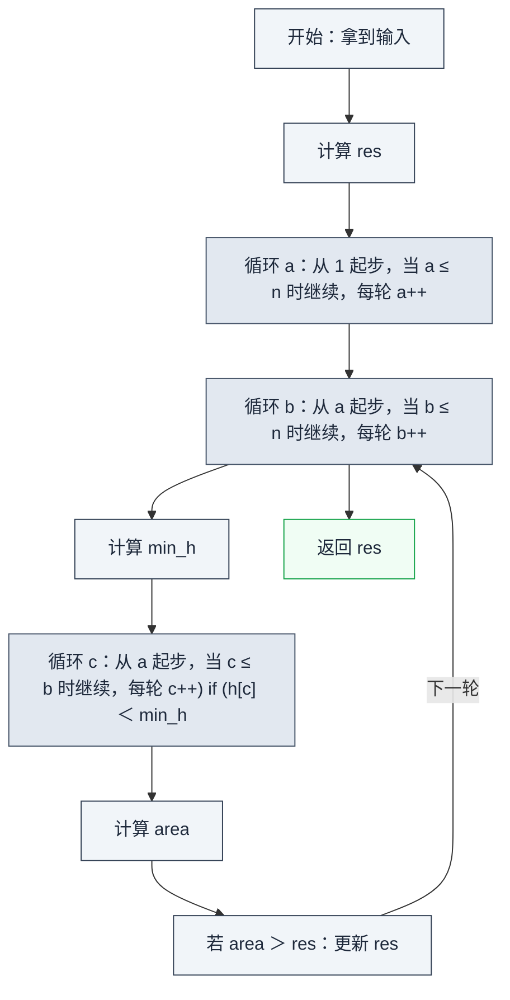

## TypeScript 解题方案（6 个方案逐个讲）

> **运行与提交**：每个方案都是自包含文件（内嵌用例自测，输出 PASS），整块复制到 `.ts` 文件后 `node 文件名` 即可运行。提交 LeetCode 时，把 `demo` 内的算法函数与辅助类型/函数整体取出、置于文件顶层即可。概念演示（非 LeetCode 编号题），在本地运行即可。

### 方案 1：双重循环枚举

**分析与思路**：核心做法是「双重循环枚举」。代码里依次做这些事：双重循环遍历。

**运行方式**：`node 本文件`，内嵌用例全部通过会输出 PASS。


**方案专属流程图**（真实控制流）：


```typescript
export function demo(): void {
  // 程序入口：跑内嵌自测用例
  function getResult(n: number, h: number[]): number {
    // 定义函数/方法 getResult
    let res = 0; // 把 0 存入 结果
    for (let a = 1; a <= n; a++)
      for (let b = a; b <= n; b++) {
        // 让 数组 从 1 开始计数，数组 不超过 元素个数 就继续
        let min_h = 50000; // 把 50000 存入 min_h
        for (let c = a; c <= b; c++) if (h[c] < min_h) min_h = h[c]; // 让 字符 从 数组 开始计数，字符 不超过 b 就继续
        const area = (b - a + 1) * min_h; // 把 (b 减 数组 加 1) 乘 min_h 存入 area
        if (area > res) res = area; // 若 area 超过 结果) 结果 赋值为 area;
      }
    return res; // 返回 结果
  }
  let fail = false; // 把 false 存入 fail
  if (getResult(5, [0, 2, 3, 3, 3, 2, 0]) !== 10) {
    fail = true;
    console.log('FAIL1');
  }
  if (getResult(6, [0, 2, 1, 5, 6, 2, 3, 0]) !== 10) {
    fail = true;
    console.log('FAIL2');
  }
  if (fail) throw new Error('FAILED'); // 若 fail) throw new Error(「FAILED」);
  console.log('PASS'); // 全部用例通过，输出 PASS
}
demo(); // demo();
```

### 方案 2：双重循环枚举

**分析与思路**：核心做法是「双重循环枚举」。代码里依次做这些事：双重循环遍历。

**运行方式**：`node 本文件`，内嵌用例全部通过会输出 PASS。


**方案专属流程图**（真实控制流）：

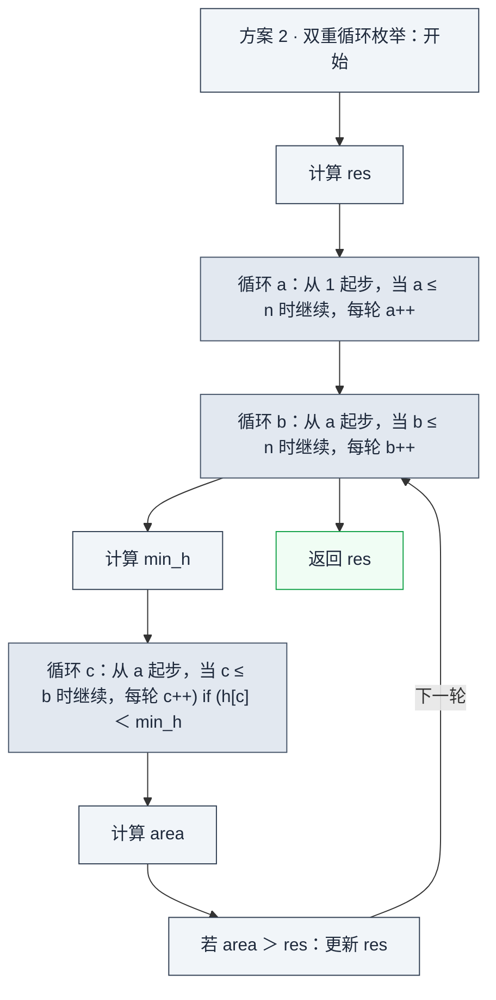

```typescript
export function demo(): void {
  // 程序入口：跑内嵌自测用例
  function getResult(n: number, h: number[]): number {
    // 定义函数/方法 getResult
    let res = 0; // 把 0 存入 结果
    for (let a = 1; a <= n; a++)
      for (let b = a; b <= n; b++) {
        // 让 数组 从 1 开始计数，数组 不超过 元素个数 就继续
        let min_h = 50000; // 把 50000 存入 min_h
        for (let c = a; c <= b; c++) if (h[c] < min_h) min_h = h[c]; // 让 字符 从 数组 开始计数，字符 不超过 b 就继续
        const area = (b - a + 1) * min_h; // 把 (b 减 数组 加 1) 乘 min_h 存入 area
        if (area > res) res = area; // 若 area 超过 结果) 结果 赋值为 area;
      }
    return res; // 返回 结果
  }
  let fail = false; // 把 false 存入 fail
  if (getResult(5, [0, 2, 3, 3, 3, 2, 0]) !== 10) {
    fail = true;
    console.log('FAIL1');
  }
  if (getResult(6, [0, 2, 1, 5, 6, 2, 3, 0]) !== 10) {
    fail = true;
    console.log('FAIL2');
  }
  if (fail) throw new Error('FAILED'); // 若 fail) throw new Error(「FAILED」);
  console.log('PASS'); // 全部用例通过，输出 PASS
}
demo(); // demo();
```

### 方案 3：双重循环枚举

**分析与思路**：核心做法是「双重循环枚举」。代码里依次做这些事：双重循环遍历。

**运行方式**：`node 本文件`，内嵌用例全部通过会输出 PASS。


**方案专属流程图**（真实控制流）：


```typescript
export function demo(): void {
  // 程序入口：跑内嵌自测用例
  function getResult(n: number, h: number[]): number {
    // 定义函数/方法 getResult
    let res = 0; // 把 0 存入 结果
    for (let a = 1; a <= n; a++)
      for (let b = a; b <= n; b++) {
        // 让 数组 从 1 开始计数，数组 不超过 元素个数 就继续
        let min_h = 50000; // 把 50000 存入 min_h
        for (let c = a; c <= b; c++) if (h[c] < min_h) min_h = h[c]; // 让 字符 从 数组 开始计数，字符 不超过 b 就继续
        const area = (b - a + 1) * min_h; // 把 (b 减 数组 加 1) 乘 min_h 存入 area
        if (area > res) res = area; // 若 area 超过 结果) 结果 赋值为 area;
      }
    return res; // 返回 结果
  }
  let fail = false; // 把 false 存入 fail
  if (getResult(5, [0, 2, 3, 3, 3, 2, 0]) !== 10) {
    fail = true;
    console.log('FAIL1');
  }
  if (getResult(6, [0, 2, 1, 5, 6, 2, 3, 0]) !== 10) {
    fail = true;
    console.log('FAIL2');
  }
  if (fail) throw new Error('FAILED'); // 若 fail) throw new Error(「FAILED」);
  console.log('PASS'); // 全部用例通过，输出 PASS
}
demo(); // demo();
```

### 方案 4：双重循环枚举

**分析与思路**：核心做法是「双重循环枚举」。代码里依次做这些事：双重循环遍历。

**运行方式**：`node 本文件`，内嵌用例全部通过会输出 PASS。


**方案专属流程图**（真实控制流）：


```typescript
export function demo(): void {
  // 程序入口：跑内嵌自测用例
  function getResult(n: number, h: number[]): number {
    // 定义函数/方法 getResult
    let res = 0; // 把 0 存入 结果
    for (let a = 1; a <= n; a++)
      for (let b = a; b <= n; b++) {
        // 让 数组 从 1 开始计数，数组 不超过 元素个数 就继续
        let min_h = 50000; // 把 50000 存入 min_h
        for (let c = a; c <= b; c++) if (h[c] < min_h) min_h = h[c]; // 让 字符 从 数组 开始计数，字符 不超过 b 就继续
        const area = (b - a + 1) * min_h; // 把 (b 减 数组 加 1) 乘 min_h 存入 area
        if (area > res) res = area; // 若 area 超过 结果) 结果 赋值为 area;
      }
    return res; // 返回 结果
  }
  let fail = false; // 把 false 存入 fail
  if (getResult(5, [0, 2, 3, 3, 3, 2, 0]) !== 10) {
    fail = true;
    console.log('FAIL1');
  }
  if (getResult(6, [0, 2, 1, 5, 6, 2, 3, 0]) !== 10) {
    fail = true;
    console.log('FAIL2');
  }
  if (fail) throw new Error('FAILED'); // 若 fail) throw new Error(「FAILED」);
  console.log('PASS'); // 全部用例通过，输出 PASS
}
demo(); // demo();
```

### 方案 5：双重循环枚举

**分析与思路**：核心做法是「双重循环枚举」。代码里依次做这些事：双重循环遍历。

**运行方式**：`node 本文件`，内嵌用例全部通过会输出 PASS。

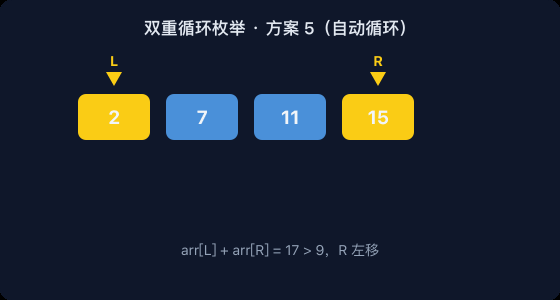

**方案专属流程图**（真实控制流）：


```typescript
export function demo(): void {
  // 程序入口：跑内嵌自测用例
  function getResult(n: number, h: number[]): number {
    // 定义函数/方法 getResult
    let res = 0; // 把 0 存入 结果
    for (let a = 1; a <= n; a++)
      for (let b = a; b <= n; b++) {
        // 让 数组 从 1 开始计数，数组 不超过 元素个数 就继续
        let min_h = 50000; // 把 50000 存入 min_h
        for (let c = a; c <= b; c++) if (h[c] < min_h) min_h = h[c]; // 让 字符 从 数组 开始计数，字符 不超过 b 就继续
        const area = (b - a + 1) * min_h; // 把 (b 减 数组 加 1) 乘 min_h 存入 area
        if (area > res) res = area; // 若 area 超过 结果) 结果 赋值为 area;
      }
    return res; // 返回 结果
  }
  let fail = false; // 把 false 存入 fail
  if (getResult(5, [0, 2, 3, 3, 3, 2, 0]) !== 10) {
    fail = true;
    console.log('FAIL1');
  }
  if (getResult(6, [0, 2, 1, 5, 6, 2, 3, 0]) !== 10) {
    fail = true;
    console.log('FAIL2');
  }
  if (fail) throw new Error('FAILED'); // 若 fail) throw new Error(「FAILED」);
  console.log('PASS'); // 全部用例通过，输出 PASS
}
demo(); // demo();
```

### 方案 6：双重循环枚举

**分析与思路**：核心做法是「双重循环枚举」。代码里依次做这些事：双重循环遍历。

**运行方式**：`node 本文件`，内嵌用例全部通过会输出 PASS。


**方案专属流程图**（真实控制流）：


```typescript
export function demo(): void {
  // 程序入口：跑内嵌自测用例
  function getResult(n: number, h: number[]): number {
    // 定义函数/方法 getResult
    let res = 0; // 把 0 存入 结果
    for (let a = 1; a <= n; a++)
      for (let b = a; b <= n; b++) {
        // 让 数组 从 1 开始计数，数组 不超过 元素个数 就继续
        let min_h = 50000; // 把 50000 存入 min_h
        for (let c = a; c <= b; c++) if (h[c] < min_h) min_h = h[c]; // 让 字符 从 数组 开始计数，字符 不超过 b 就继续
        const area = (b - a + 1) * min_h; // 把 (b 减 数组 加 1) 乘 min_h 存入 area
        if (area > res) res = area; // 若 area 超过 结果) 结果 赋值为 area;
      }
    return res; // 返回 结果
  }
  let fail = false; // 把 false 存入 fail
  if (getResult(5, [0, 2, 3, 3, 3, 2, 0]) !== 10) {
    fail = true;
    console.log('FAIL1');
  }
  if (getResult(6, [0, 2, 1, 5, 6, 2, 3, 0]) !== 10) {
    fail = true;
    console.log('FAIL2');
  }
  if (fail) throw new Error('FAILED'); // 若 fail) throw new Error(「FAILED」);
  console.log('PASS'); // 全部用例通过，输出 PASS
}
demo(); // demo();
```

## 逐步拆解与面试追问

**复杂度**：时间 O(n²)（两层嵌套扫描），空间 O(1) 到 O(n)

**为什么是这个量级**：外层定起点、内层扫终点，n 个起点各扫 n 次

**面试官可能会追问**：

- 这个策略能推广到什么场景？
- 与暴力做法差在哪一步？
- 有没有更简单的等价写法？

## 关键 API 速查（TS 主解法实际用到，附官方链接）

本题主解法只用到基础语法（变量、循环、比较），不依赖特殊库 API。

### 各语言官方文档导航

- **TypeScript / JS**：[MDN 中文参考](https://developer.mozilla.org/zh-CN/)
- **Python**：[Python 官方文档](https://docs.python.org/zh-cn/3/)
- **Go**：[Go 标准库](https://pkg.go.dev/std)
- **Java**：[JDK 17 API](https://docs.oracle.com/en/java/javase/17/docs/api/)
- **Rust**：[Rust 标准库](https://doc.rust-lang.org/std/)
- **Lua**：[Lua 5.4 手册](https://www.lua.org/manual/5.4/)
- **C**：[Cppreference C](https://zh.cppreference.com/w/c)
- **C++**：[Cppreference C++](https://zh.cppreference.com/w/cpp)
- **R**：[R 官方手册](https://stat.ethz.ch/R-manual/)
- **Zig**：[Zig 语言文档](https://ziglang.org/documentation/master/)
- **Dart**：[Dart API](https://api.dart.dev/)

## 附录：其他 10 种语言全部实现（每种语言列举其全部方案）

> TypeScript 的全部方案见「TypeScript 解题方案」一节；下面是其余 10 种语言的对应实现，每种语言的每个方案都带思路分析、代码走读与专属运行架构图。
> 每个方案都内嵌用例自测，可独立运行（老仓库 python/go 文件遵循「打印结果」约定）。
> 完整解法文件见 `dsa/<语言>/notes/lc_107391023_求直方图最大面积算法分析/`。

### Python 实现（6 种方案）

Python 的全部方案如下，每个方案都内嵌用例自测，可独立运行（老仓库 python/go 文件遵循「打印结果」约定）：

#### 方案 1：双重循环枚举

**思路与代码分析**：核心是「双重循环枚举」。Python 版用切片与字典推导式简化操作，突出可读性。**走读**：方案 1 · 双重循环枚举：开始 → 更新 res → 循环 a：从 1 到 n + 1 前 → 循环 b：从 a 到 n + 1 前 → 更新 min_h → 循环 c：从 a 到 b + 1 前 → 若 h[c] ＜ min_h：更新 min_h → 更新 min_h → 更新 area → 若 area ＞ res：更新 res → 更新 res → 返回 res。

**运行架构**（真实控制流）：

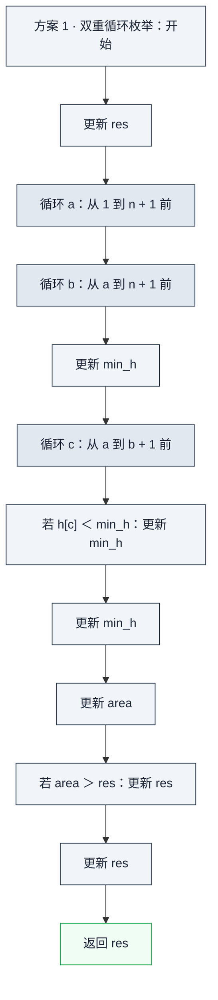

```python
import sys  # 提高递归深度上限（深输入防 RecursionError）

sys.setrecursionlimit(200000)  # 树/链表类题目节点数可达 1e4 量级

def get_result(n, h):  # 定义函数 get_result（参数：元素个数, h）
    # 算法1：蛮力 O(n^3)
    # h 为 1 下标数组，h[0]=h[n+1]=0
    res = 0  # 把 0 存入 结果
    for a in range(1, n + 1):  # 让 数组 从 1 到 元素个数 加 1 遍历
        for b in range(a, n + 1):  # 让 b 从 数组 到 元素个数 加 1 遍历
            min_h = 50000  # 把 50000 存入 min_h
            for c in range(a, b + 1):  # 让 字符 从 数组 到 b 加 1 遍历
                if h[c] < min_h:  # 若 h[字符] 小于 min_h
                    min_h = h[c]  # 把 h[字符] 存入 min_h
            area = (b - a + 1) * min_h  # 把 (b 减 数组 加 1) 乘 min_h 存入 area
            if area > res:  # 若 area 超过 结果
                res = area  # 把 area 存入 结果
    return res  # 返回 结果

if __name__ == "__main__":  # 若 __name__ 等于 '__main__'
    # 输入：5 ; 2 3 3 3 2
    h = [0, 2, 3, 3, 3, 2, 0]  # 把 [0, 2, 3, 3, 3, 2, 0] 存入 h
    print(get_result(5, h))  # 输出: 10
```

#### 方案 2：双重循环枚举

**思路与代码分析**：核心是「双重循环枚举」。Python 版用切片与字典推导式简化操作，突出可读性。**走读**：方案 2 · 双重循环枚举：开始 → 更新 res → 循环 a：从 1 到 n + 1 前 → 更新 min_h → 循环 b：从 a 到 n + 1 前 → 若 h[b] ＜ min_h：更新 min_h → 更新 min_h → 更新 area → 若 area ＞ res：更新 res → 更新 res → 返回 res。

**运行架构**（真实控制流）：

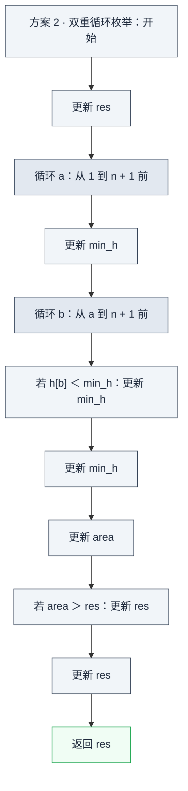

```python
import sys  # 提高递归深度上限（深输入防 RecursionError）

sys.setrecursionlimit(200000)  # 树/链表类题目节点数可达 1e4 量级

def get_result(n, h):  # 定义函数 get_result（参数：元素个数, h）
    # 算法2：减少循环 O(n^2)，利用 (a,b+1) 的最小高度 = min((a,b), h[b+1])
    res = 0  # 把 0 存入 结果
    for a in range(1, n + 1):  # 让 数组 从 1 到 元素个数 加 1 遍历
        min_h = 50000  # 把 50000 存入 min_h
        for b in range(a, n + 1):  # 让 b 从 数组 到 元素个数 加 1 遍历
            if h[b] < min_h:  # 若 h[b] 小于 min_h
                min_h = h[b]  # 把 h[b] 存入 min_h
            area = (b - a + 1) * min_h  # 把 (b 减 数组 加 1) 乘 min_h 存入 area
            if area > res:  # 若 area 超过 结果
                res = area  # 把 area 存入 结果
    return res  # 返回 结果

if __name__ == "__main__":  # 若 __name__ 等于 '__main__'
    h = [0, 2, 3, 3, 3, 2, 0]  # 把 [0, 2, 3, 3, 3, 2, 0] 存入 h
    print(get_result(5, h))  # 输出: 10
```

#### 方案 3：双重循环枚举

**思路与代码分析**：核心是「双重循环枚举」。Python 版用切片与字典推导式简化操作，突出可读性。**走读**：方案 3 · 双重循环枚举：开始 → 更新 res → 循环 a：从 1 到 n + 1 前 → 更新 cur_h → 更新 lo → 当 lo ≥ 1 and h[lo] ≥ cur_h: 时反复执行 → 更新 - → 更新 hi → 当 ( 时反复执行 → 更新 < → 处理 ): → 更新 + → 更新 area → 若 area ＞ res：更新 res → 更新 res → 返回 res。

**运行架构**（真实控制流）：

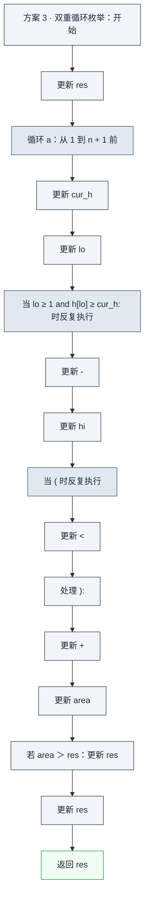

```python
import sys  # 提高递归深度上限（深输入防 RecursionError）

sys.setrecursionlimit(200000)  # 树/链表类题目节点数可达 1e4 量级

def get_result(n, h):  # 定义函数 get_result（参数：元素个数, h）
    # 算法3：卡位计算 O(n^2)
    res = 0  # 把 0 存入 结果
    for a in range(1, n + 1):  # 让 数组 从 1 到 元素个数 加 1 遍历
        cur_h = h[a]  # 把 h[数组] 存入 cur_h
        # 找左卡位点
        lo = a - 1  # 把 数组 减 1 存入 左边界
        while lo >= 1 and h[lo] >= cur_h:  # 循环，直到不满足「左边界 不低于 1 and h[左边界] 不低于 cur_h」
            lo -= 1  # 左边界累减 1
        # 找右卡位点
        hi = a + 1  # 把 数组 加 1 存入 右边界
        while (
            hi <= n and h[hi] >= cur_h
        ):  # 循环，直到不满足「右边界 不超过 元素个数 and h[右边界] 不低于 cur_h」
            hi += 1  # 右边界累加 1
        area = (hi - lo - 1) * cur_h  # 把 (右边界 减 左边界 减 1) 乘 cur_h 存入 area
        if area > res:  # 若 area 超过 结果
            res = area  # 把 area 存入 结果
    return res  # 返回 结果

if __name__ == "__main__":  # 若 __name__ 等于 '__main__'
    h = [0, 2, 3, 3, 3, 2, 0]  # 把 [0, 2, 3, 3, 3, 2, 0] 存入 h
    print(get_result(5, h))  # 输出: 10
```

#### 方案 4：双重循环枚举

**思路与代码分析**：核心是「双重循环枚举」。Python 版用切片与字典推导式简化操作，突出可读性。**走读**：方案 4 · 双重循环枚举：开始 → 更新 res → 更新 stack → 循环 i：从 1 到 n + 2 前 → 当 h[stack[-1]] ＞ h[i]: 时反复执行 → 从 stack 弹出 → 更新 width → 更新 area → 若 area ＞ res：更新 res → 更新 res → 向 stack 追加记录 → 返回 res。

**运行架构**（真实控制流）：

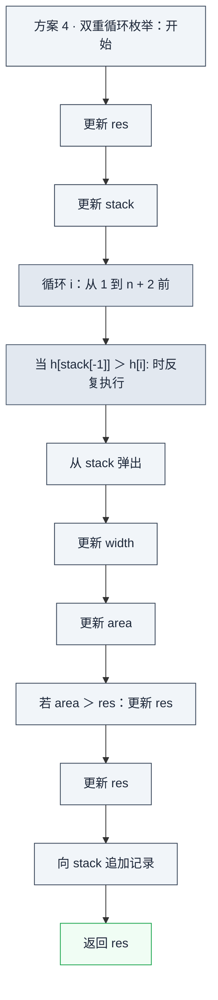

```python
import sys  # 提高递归深度上限（深输入防 RecursionError）

sys.setrecursionlimit(200000)  # 树/链表类题目节点数可达 1e4 量级

def get_result(n, h):  # 定义函数 get_result（参数：元素个数, h）
    # 算法4：单调栈（哨兵版本）
    res = 0  # 把 0 存入 结果
    stack = [0]  # 把 [0] 存入 栈
    for i in range(1, n + 2):  # 遍历到 n+1，h[n+1]=0 作为右哨兵
        while h[stack[-1]] > h[i]:  # 循环，直到不满足「h[栈[ 减 1]] 超过 h[下标 i]」
            now_h = h[stack.pop()]  # 把 h[栈 弹出 )] 存入 now_h
            width = i - stack[-1] - 1  # 把 下标 i 减 栈[ 减 1] 减 1 存入 width
            area = now_h * width  # 把 now_h 乘 width 存入 area
            if area > res:  # 若 area 超过 结果
                res = area  # 把 area 存入 结果
        stack.append(i)  # 把 下标 i 追加到列表尾部
    return res  # 返回 结果

if __name__ == "__main__":  # 若 __name__ 等于 '__main__'
    h = [0, 2, 3, 3, 3, 2, 0]  # 把 [0, 2, 3, 3, 3, 2, 0] 存入 h
    print(get_result(5, h))  # 输出: 10
```

#### 方案 5：双重循环枚举

**思路与代码分析**：核心是「双重循环枚举」。Python 版用切片与字典推导式简化操作，突出可读性。**走读**：方案 5 · 双重循环枚举：开始 → 更新 res → 更新 stack → 更新 i → 当 i ＜ n + 2: 时反复执行 → 若 not stack or h[stack[-1]] ≤ h[i]：向 stack 追加记录 → 向 stack 追加记录 → 更新 + → 从 stack 弹出 → 更新 width → 更新 area → 若 area ＞ res：更新 res → 更新 res → 返回 res。

**运行架构**（真实控制流）：

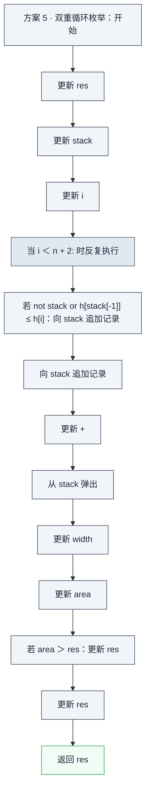

```python
import sys  # 提高递归深度上限（深输入防 RecursionError）

sys.setrecursionlimit(200000)  # 树/链表类题目节点数可达 1e4 量级

def get_result(n, h):  # 定义函数 get_result（参数：元素个数, h）
    # 算法5：单调栈（形式转换，i 从 0 开始）
    res = 0  # 把 0 存入 结果
    stack = []  # 把 [] 存入 栈
    i = 0  # 把 0 存入 下标 i
    while i < n + 2:  # 循环，直到不满足「下标 i 小于 元素个数 加 2」
        if not stack or h[stack[-1]] <= h[i]:  # 若 not 栈 or h[栈[ 减 1]] 不超过 h[下标 i]
            stack.append(i)  # 把 下标 i 追加到列表尾部
            i += 1  # 下标 i累加 1
        else:  # 否则
            now_h = h[stack.pop()]  # 把 h[栈 弹出 )] 存入 now_h
            width = i - stack[-1] - 1  # 把 下标 i 减 栈[ 减 1] 减 1 存入 width
            area = now_h * width  # 把 now_h 乘 width 存入 area
            if area > res:  # 若 area 超过 结果
                res = area  # 把 area 存入 结果
    return res  # 返回 结果

if __name__ == "__main__":  # 若 __name__ 等于 '__main__'
    h = [0, 2, 3, 3, 3, 2, 0]  # 把 [0, 2, 3, 3, 3, 2, 0] 存入 h
    print(get_result(5, h))  # 输出: 10
```

#### 方案 6：双重循环枚举

**思路与代码分析**：核心是「双重循环枚举」。Python 版用切片与字典推导式简化操作，突出可读性。**走读**：方案 6 · 双重循环枚举：开始 → 更新 res → 更新 stack → 循环 i：从 1 到 n + 2 前 → 当 h[stack[-1]] ＞ h[i]: 时反复执行 → 从 stack 弹出 → 更新 width → 更新 area → 若 area ＞ res：更新 res → 更新 res → 向 stack 追加记录 → 返回 res。

**运行架构**（真实控制流）：

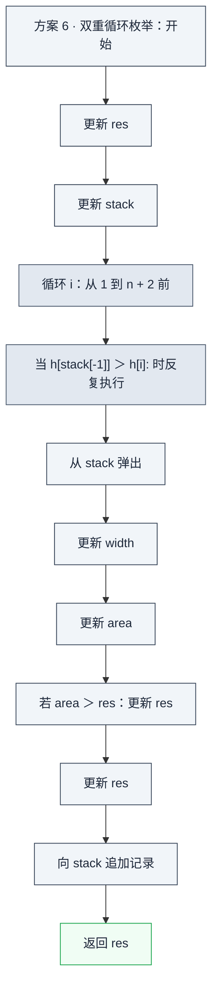

```python
import sys  # 提高递归深度上限（深输入防 RecursionError）

sys.setrecursionlimit(200000)  # 树/链表类题目节点数可达 1e4 量级

def get_result(n, h):  # 定义函数 get_result（参数：元素个数, h）
    # 通用输入程序的算法实现（单调栈）
    res = 0  # 把 0 存入 结果
    stack = [0]  # 把 [0] 存入 栈
    for i in range(1, n + 2):  # 让 下标 i 从 1 到 元素个数 加 2 遍历
        while h[stack[-1]] > h[i]:  # 循环，直到不满足「h[栈[ 减 1]] 超过 h[下标 i]」
            now_h = h[stack.pop()]  # 把 h[栈 弹出 )] 存入 now_h
            width = i - stack[-1] - 1  # 把 下标 i 减 栈[ 减 1] 减 1 存入 width
            area = now_h * width  # 把 now_h 乘 width 存入 area
            if area > res:  # 若 area 超过 结果
                res = area  # 把 area 存入 结果
        stack.append(i)  # 把 下标 i 追加到列表尾部
    return res  # 返回 结果

if __name__ == "__main__":  # 若 __name__ 等于 '__main__'
    # 输入格式：第一行 n，第二行 n 个非负整数
    n = 5  # 把 5 存入 元素个数
    heights = [2, 3, 3, 3, 2]  # 把 [2, 3, 3, 3, 2] 存入 heights
    h = [0] + heights + [0]  # 控制 height[0] 和 height[n+1] 均为 0
    print(get_result(n, h))  # 输出: 10
```

### Go 实现（6 种方案）

Go 的全部方案如下，每个方案都内嵌用例自测，可独立运行（老仓库 python/go 文件遵循「打印结果」约定）：

#### 方案 1：双重循环枚举

**思路与代码分析**：核心是「双重循环枚举」。Go 版用切片与多返回值惯用法，显式处理索引边界。**走读**：方案 1 · 双重循环枚举：开始 → 更新 : → 遍历循环 → 遍历循环 → 更新 : → 遍历循环 → 处理 if h[c] ＜ minH → 更新 minH → 更新 : → 处理 if area ＞ res → 更新 res → 返回 res。

**运行架构**（真实控制流）：

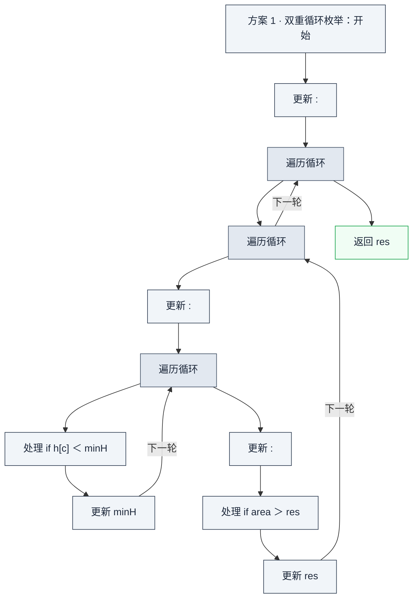

```go
package main // 引入依赖

import (
	"fmt"
	"os"
) // 引入依赖

func getResult(n int, h []int) int { // 定义函数/方法 getResult
	res := 0                  // 把 0 写入 res :
	for a := 1; a <= n; a++ { // 让 数组 从 1 开始计数
		for b := a; b <= n; b++ { // 把 数组; b 不超过 元素个数; b 加一 { 写入 for b :
			minH := 50000             // 把 50000 写入 minH :
			for c := a; c <= b; c++ { // 把 数组; 字符 不超过 b; 字符 加一 { 写入 for c :
				if h[c] < minH { // 若 h[字符] 小于 minH
					minH = h[c] // 把 h[字符] 写入 minH
				}
			}
			area := (b - a + 1) * minH // 把 (b 减 数组 加 1) 乘 minH 写入 area :
			if area > res {            // 若 area 超过 结果
				res = area // 把 area 写入 结果
			}
		}
	}
	return res // 返回 结果
}

func main() { // 程序入口：跑内嵌自测用例
	cases := []struct { // 把 []struct { 写入 cases :
		n    int   // 元素个数 int
		h    []int // h []int
		want int   // want int
	}{ // }{
		{5, []int{0, 2, 3, 3, 3, 2, 0}, 10},
		{1, []int{0, 1, 0}, 1},
	}
	ok := true                // 把 true 写入 ok :
	for _, c := range cases { // 同时取 _ 与 字符 遍历
		if got := getResult(c.n, c.h); got != c.want { // 若 got : 赋值为 getResult(字符.元素个数, 字符.h); got 不等于 字符.want
			ok = false                                                              // 把 false 写入 ok
			fmt.Printf("FAIL getResult(%d,%v)=%d want %d\n", c.n, c.h, got, c.want) // 打印输出
		}
	}
	if !ok { // 若 取反 ok
		os.Exit(1) // os.Exit(1)
	}
	fmt.Println("PASS") // 全部用例通过，输出 PASS
}
```

#### 方案 2：双重循环枚举

**思路与代码分析**：核心是「双重循环枚举」。Go 版用切片与多返回值惯用法，显式处理索引边界。**走读**：方案 2 · 双重循环枚举：开始 → 更新 : → 遍历循环 → 更新 : → 遍历循环 → 处理 if h[b] ＜ minH → 更新 minH → 更新 : → 处理 if area ＞ res → 更新 res → 返回 res。

**运行架构**（真实控制流）：

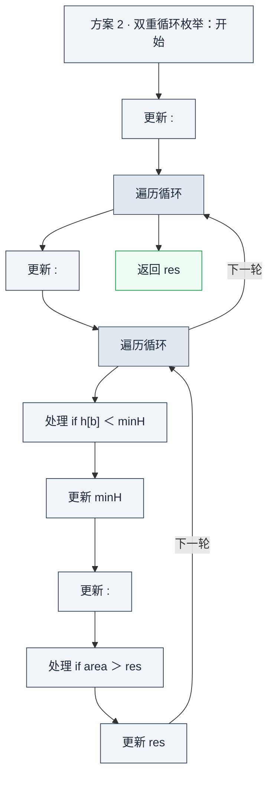

```go
package main // 引入依赖

import (
	"fmt"
	"os"
) // 引入依赖

func getResult(n int, h []int) int { // 定义函数/方法 getResult
	res := 0                  // 把 0 写入 res :
	for a := 1; a <= n; a++ { // 让 数组 从 1 开始计数
		minH := 50000             // 把 50000 写入 minH :
		for b := a; b <= n; b++ { // 把 数组; b 不超过 元素个数; b 加一 { 写入 for b :
			if h[b] < minH { // 若 h[b] 小于 minH
				minH = h[b] // 把 h[b] 写入 minH
			}
			area := (b - a + 1) * minH // 把 (b 减 数组 加 1) 乘 minH 写入 area :
			if area > res {            // 若 area 超过 结果
				res = area // 把 area 写入 结果
			}
		}
	}
	return res // 返回 结果
}

func main() { // 程序入口：跑内嵌自测用例
	cases := []struct { // 把 []struct { 写入 cases :
		n    int   // 元素个数 int
		h    []int // h []int
		want int   // want int
	}{ // }{
		{5, []int{0, 2, 3, 3, 3, 2, 0}, 10},
		{1, []int{0, 1, 0}, 1},
	}
	ok := true                // 把 true 写入 ok :
	for _, c := range cases { // 同时取 _ 与 字符 遍历
		if got := getResult(c.n, c.h); got != c.want { // 若 got : 赋值为 getResult(字符.元素个数, 字符.h); got 不等于 字符.want
			ok = false                                                              // 把 false 写入 ok
			fmt.Printf("FAIL getResult(%d,%v)=%d want %d\n", c.n, c.h, got, c.want) // 打印输出
		}
	}
	if !ok { // 若 取反 ok
		os.Exit(1) // os.Exit(1)
	}
	fmt.Println("PASS") // 全部用例通过，输出 PASS
}
```

#### 方案 3：双重循环枚举

**思路与代码分析**：核心是「双重循环枚举」。Go 版用切片与多返回值惯用法，显式处理索引边界。**走读**：方案 3 · 双重循环枚举：开始 → 更新 : → 遍历循环 → 更新 : → 更新 : → 遍历循环 → 处理 lo-- → 更新 : → 遍历循环 → 处理 hi++ → 更新 : → 处理 if area ＞ res → 更新 res → 返回 res。

**运行架构**（真实控制流）：

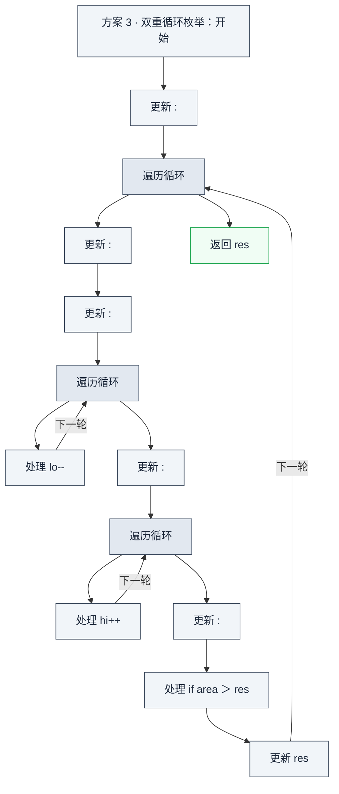

```go
package main // 引入依赖

import (
	"fmt"
	"os"
) // 引入依赖

func getResult(n int, h []int) int { // 定义函数/方法 getResult
	res := 0                  // 把 0 写入 res :
	for a := 1; a <= n; a++ { // 让 数组 从 1 开始计数
		curH := h[a]                   // 把 h[数组] 写入 curH :
		lo := a - 1                    // 把 数组 减 1 写入 lo :
		for lo >= 1 && h[lo] >= curH { // 把 1 且 h[左边界] 不低于 curH { 写入 for lo >
			lo-- // 左边界 减一
		}
		hi := a + 1                    // 把 数组 加 1 写入 hi :
		for hi <= n && h[hi] >= curH { // 把 元素个数 且 h[右边界] 不低于 curH { 写入 for hi <
			hi++ // 右边界 加一
		}
		area := (hi - lo - 1) * curH // 把 (右边界 减 左边界 减 1) 乘 curH 写入 area :
		if area > res {              // 若 area 超过 结果
			res = area // 把 area 写入 结果
		}
	}
	return res // 返回 结果
}

func main() { // 程序入口：跑内嵌自测用例
	cases := []struct { // 把 []struct { 写入 cases :
		n    int   // 元素个数 int
		h    []int // h []int
		want int   // want int
	}{ // }{
		{5, []int{0, 2, 3, 3, 3, 2, 0}, 10},
		{1, []int{0, 1, 0}, 1},
	}
	ok := true                // 把 true 写入 ok :
	for _, c := range cases { // 同时取 _ 与 字符 遍历
		if got := getResult(c.n, c.h); got != c.want { // 若 got : 赋值为 getResult(字符.元素个数, 字符.h); got 不等于 字符.want
			ok = false                                                              // 把 false 写入 ok
			fmt.Printf("FAIL getResult(%d,%v)=%d want %d\n", c.n, c.h, got, c.want) // 打印输出
		}
	}
	if !ok { // 若 取反 ok
		os.Exit(1) // os.Exit(1)
	}
	fmt.Println("PASS") // 全部用例通过，输出 PASS
}
```

#### 方案 4：双重循环枚举

**思路与代码分析**：核心是「双重循环枚举」。Go 版用切片与多返回值惯用法，显式处理索引边界。**走读**：方案 4 · 双重循环枚举：开始 → 更新 : → 更新 : → 遍历循环 → 遍历循环 → 更新 : → 更新 stack → 更新 : → 更新 : → 处理 if area ＞ res → 更新 res → 更新 stack → 返回 res。

**运行架构**（真实控制流）：

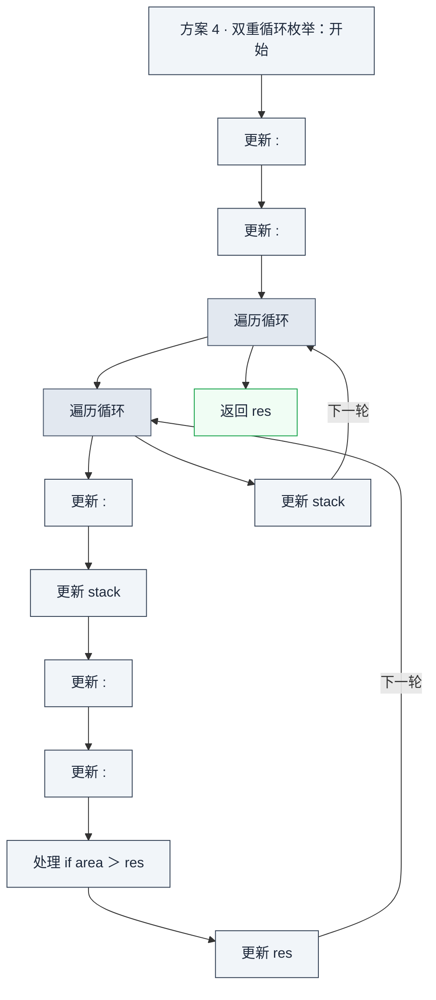

```go
package main // 引入依赖

import (
	"fmt"
	"os"
) // 引入依赖

func getResult(n int, h []int) int { // 定义函数/方法 getResult
	res := 0                    // 把 0 写入 res :
	stack := []int{0}           // 把 []int{0} 写入 stack :
	for i := 1; i <= n+1; i++ { // 让 下标 i 从 1 开始计数
		for len(stack) > 0 && h[stack[len(stack)-1]] > h[i] { // for 长度(栈) 超过 0 且 h[栈[长度(栈) 减 1]] 超过 h[下标 i] {
			nowH := h[stack[len(stack)-1]]       // 把 h[栈[长度(栈) 减 1]] 写入 nowH :
			stack = stack[:len(stack)-1]         // 把 栈[:长度(栈) 减 1] 写入 栈
			width := i - stack[len(stack)-1] - 1 // 把 下标 i 减 栈[长度(栈) 减 1] 减 1 写入 width :
			area := nowH * width                 // 把 nowH 乘 width 写入 area :
			if area > res {                      // 若 area 超过 结果
				res = area // 把 area 写入 结果
			}
		}
		stack = append(stack, i) // 把 append(栈, 下标 i) 写入 栈
	}
	return res // 返回 结果
}

func main() { // 程序入口：跑内嵌自测用例
	cases := []struct { // 把 []struct { 写入 cases :
		n    int   // 元素个数 int
		h    []int // h []int
		want int   // want int
	}{ // }{
		{5, []int{0, 2, 3, 3, 3, 2, 0}, 10},
		{1, []int{0, 1, 0}, 1},
	}
	ok := true                // 把 true 写入 ok :
	for _, c := range cases { // 同时取 _ 与 字符 遍历
		if got := getResult(c.n, c.h); got != c.want { // 若 got : 赋值为 getResult(字符.元素个数, 字符.h); got 不等于 字符.want
			ok = false                                                              // 把 false 写入 ok
			fmt.Printf("FAIL getResult(%d,%v)=%d want %d\n", c.n, c.h, got, c.want) // 打印输出
		}
	}
	if !ok { // 若 取反 ok
		os.Exit(1) // os.Exit(1)
	}
	fmt.Println("PASS") // 全部用例通过，输出 PASS
}
```

#### 方案 5：双重循环枚举

**思路与代码分析**：核心是「双重循环枚举」。Go 版用切片与多返回值惯用法，显式处理索引边界。**走读**：方案 5 · 双重循环枚举：开始 → 更新 : → 更新 : → 更新 : → 遍历循环 → 处理 if len(stack) == 0 或 h[stac → 更新 stack → 处理 i++ → 更新 : → 更新 stack → 更新 : → 更新 : → 处理 if area ＞ res → 更新 res → 返回 res。

**运行架构**（真实控制流）：

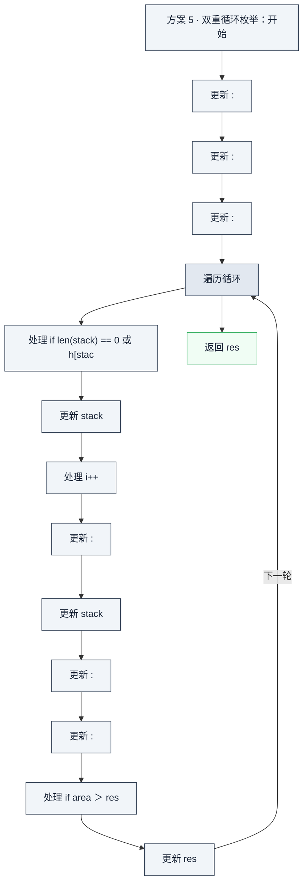

```go
package main // 引入依赖

import (
	"fmt"
	"os"
) // 引入依赖

func getResult(n int, h []int) int { // 定义函数/方法 getResult
	res := 0         // 把 0 写入 res :
	stack := []int{} // 把 []int{} 写入 stack :
	i := 0           // 把 0 写入 i :
	for i < n+2 {    // for 下标 i 小于 元素个数 加 2 {
		if len(stack) == 0 || h[stack[len(stack)-1]] <= h[i] { // 若 长度(栈) 等于 0 或 h[栈[长度(栈) 减 1]] 不超过 h[下标 i]
			stack = append(stack, i) // 把 append(栈, 下标 i) 写入 栈
			i++                      // 下标 i 加一
		} else { // 否则
			nowH := h[stack[len(stack)-1]]       // 把 h[栈[长度(栈) 减 1]] 写入 nowH :
			stack = stack[:len(stack)-1]         // 把 栈[:长度(栈) 减 1] 写入 栈
			width := i - stack[len(stack)-1] - 1 // 把 下标 i 减 栈[长度(栈) 减 1] 减 1 写入 width :
			area := nowH * width                 // 把 nowH 乘 width 写入 area :
			if area > res {                      // 若 area 超过 结果
				res = area // 把 area 写入 结果
			}
		}
	}
	return res // 返回 结果
}

func main() { // 程序入口：跑内嵌自测用例
	cases := []struct { // 把 []struct { 写入 cases :
		n    int   // 元素个数 int
		h    []int // h []int
		want int   // want int
	}{ // }{
		{5, []int{0, 2, 3, 3, 3, 2, 0}, 10},
		{1, []int{0, 1, 0}, 1},
	}
	ok := true                // 把 true 写入 ok :
	for _, c := range cases { // 同时取 _ 与 字符 遍历
		if got := getResult(c.n, c.h); got != c.want { // 若 got : 赋值为 getResult(字符.元素个数, 字符.h); got 不等于 字符.want
			ok = false                                                              // 把 false 写入 ok
			fmt.Printf("FAIL getResult(%d,%v)=%d want %d\n", c.n, c.h, got, c.want) // 打印输出
		}
	}
	if !ok { // 若 取反 ok
		os.Exit(1) // os.Exit(1)
	}
	fmt.Println("PASS") // 全部用例通过，输出 PASS
}
```

#### 方案 6：双重循环枚举

**思路与代码分析**：核心是「双重循环枚举」。Go 版用切片与多返回值惯用法，显式处理索引边界。**走读**：方案 6 · 双重循环枚举：开始 → 更新 : → 更新 : → 遍历循环 → 遍历循环 → 更新 : → 更新 stack → 更新 : → 更新 : → 处理 if area ＞ res → 更新 res → 更新 stack → 返回 res。

**运行架构**（真实控制流）：


```go
package main // 引入依赖

import (
	"fmt"
	"os"
) // 引入依赖

func getResult(n int, h []int) int { // 定义函数/方法 getResult
	res := 0                    // 把 0 写入 res :
	stack := []int{0}           // 把 []int{0} 写入 stack :
	for i := 1; i <= n+1; i++ { // 让 下标 i 从 1 开始计数
		for len(stack) > 0 && h[stack[len(stack)-1]] > h[i] { // for 长度(栈) 超过 0 且 h[栈[长度(栈) 减 1]] 超过 h[下标 i] {
			nowH := h[stack[len(stack)-1]]       // 把 h[栈[长度(栈) 减 1]] 写入 nowH :
			stack = stack[:len(stack)-1]         // 把 栈[:长度(栈) 减 1] 写入 栈
			width := i - stack[len(stack)-1] - 1 // 把 下标 i 减 栈[长度(栈) 减 1] 减 1 写入 width :
			area := nowH * width                 // 把 nowH 乘 width 写入 area :
			if area > res {                      // 若 area 超过 结果
				res = area // 把 area 写入 结果
			}
		}
		stack = append(stack, i) // 把 append(栈, 下标 i) 写入 栈
	}
	return res // 返回 结果
}

func main() { // 程序入口：跑内嵌自测用例
	cases := []struct { // 把 []struct { 写入 cases :
		n    int   // 元素个数 int
		h    []int // h []int
		want int   // want int
	}{ // }{
		{5, []int{0, 2, 3, 3, 3, 2, 0}, 10},
		{1, []int{0, 1, 0}, 1},
	}
	ok := true                // 把 true 写入 ok :
	for _, c := range cases { // 同时取 _ 与 字符 遍历
		if got := getResult(c.n, c.h); got != c.want { // 若 got : 赋值为 getResult(字符.元素个数, 字符.h); got 不等于 字符.want
			ok = false                                                              // 把 false 写入 ok
			fmt.Printf("FAIL getResult(%d,%v)=%d want %d\n", c.n, c.h, got, c.want) // 打印输出
		}
	}
	if !ok { // 若 取反 ok
		os.Exit(1) // os.Exit(1)
	}
	fmt.Println("PASS") // 全部用例通过，输出 PASS
}
```

### Java 实现（6 种方案）

Java 的全部方案如下，每个方案都内嵌用例自测，可独立运行（老仓库 python/go 文件遵循「打印结果」约定）：

#### 方案 1：双重循环枚举

**思路与代码分析**：核心是「双重循环枚举」。Java 版用类与静态方法组织，集合操作显式明了。代码里依次做这些事：双重循环遍历。**走读**：方案 1 · 双重循环枚举：开始 → 更新 res → 遍历循环 → 遍历循环 → 更新 minH → 遍历循环 → 若 h[c] ＜ minH：更新 minH → 更新 area → 若 area ＞ res：更新 res → 返回 res。

**运行架构**（真实控制流）：

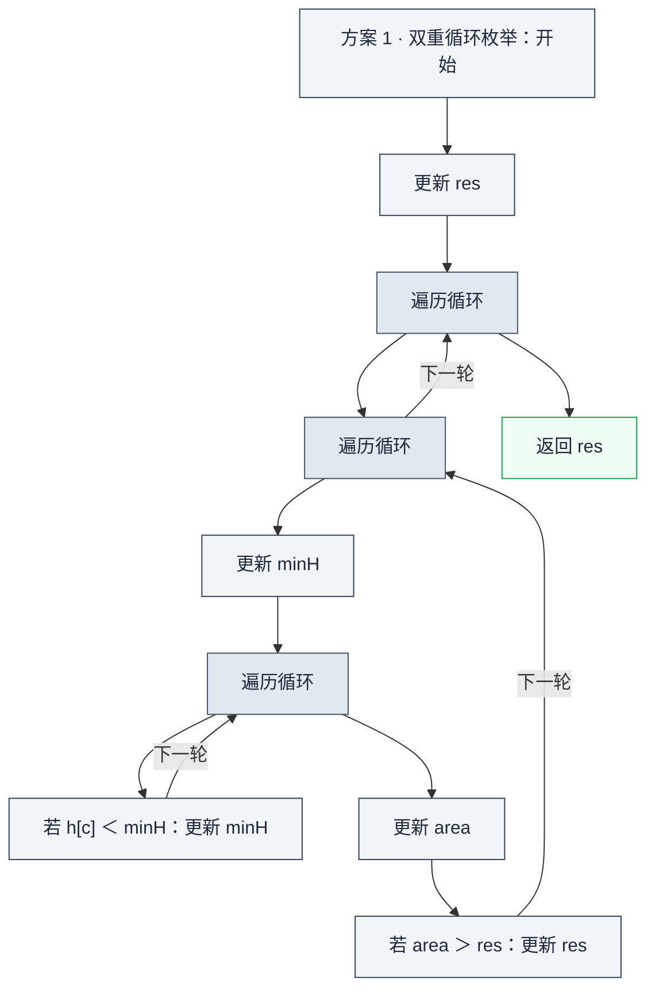

```java
package com.webfault.dsa; // 引入依赖

import java.util.*; // 引入依赖

class lc107391023_solution11 { // 定义类型
  // 暴力 O(n^3)：枚举所有区间，求区间最小高度
  static int getResult(int n, int[] h) { // 定义函数/方法 getResult
    int res = 0; // 把 0 存入 结果
    for (int a = 1; a <= n; a++) { // 让 数组 从 1 开始计数，数组 不超过 元素个数 就继续
      for (int b = a; b <= n; b++) { // 让 b 从 数组 开始计数，b 不超过 元素个数 就继续
        int minH = h[a]; // 把 h[数组] 存入 minH
        for (int c = a; c <= b; c++) { // 让 字符 从 数组 开始计数，字符 不超过 b 就继续
          if (h[c] < minH) minH = h[c]; // 若 h[字符] 小于 minH) minH 赋值为 h[字符];
        }
        int area = (b - a + 1) * minH; // 把 (b 减 数组 加 1) 乘 minH 存入 area
        if (area > res) res = area; // 若 area 超过 结果) 结果 赋值为 area;
      }
    }
    return res; // 返回 结果
  }

  static int run(int n, int[] heights) { // 定义函数/方法 run
    int[] h = new int[n + 2]; // 把 new int[元素个数 加 2]; 写入 int[] h
    h[0] = 0; // 把 0; 写入 h[0]
    h[n + 1] = 0; // 把 0; 写入 h[n + 1]
    for (int i = 0; i < n; i++) h[i + 1] = heights[i]; // 让 下标 i 从 0 开始计数，下标 i 小于 元素个数 就继续
    return getResult(n, h); // 返回 getResult(元素个数, h)
  }

  public static void main(String[] args) { // public static void main(String[] args) {
    lc107391023_solution11 s =
        new lc107391023_solution11(); // 把 new lc107391023_solution11(); 写入 lc107391023_solution11 s
    if (s.run(5, new int[] {2, 3, 3, 3, 2})
        != 10) { // 若 字符串.run(5, new int[]{2, 3, 3, 3, 2}) 不等于 10
      System.out.println("FAIL 1"); // 打印输出
      throw new RuntimeException("FAILED"); // throw new RuntimeException(「FAILED」);
    }
    if (s.run(1, new int[] {5}) != 5) { // 若 字符串.run(1, new int[]{5}) 不等于 5
      System.out.println("FAIL 2"); // 打印输出
      throw new RuntimeException("FAILED"); // throw new RuntimeException(「FAILED」);
    }
    System.out.println("PASS"); // 全部用例通过，输出 PASS
  }
}
```

#### 方案 2：双重循环枚举

**思路与代码分析**：核心是「双重循环枚举」。Java 版用类与静态方法组织，集合操作显式明了。代码里依次做这些事：双重循环遍历。**走读**：方案 2 · 双重循环枚举：开始 → 更新 res → 遍历循环 → 更新 minH → 遍历循环 → 若 h[b] ＜ minH：更新 minH → 更新 area → 若 area ＞ res：更新 res → 返回 res。

**运行架构**（真实控制流）：

```mermaid
graph TD
    N0["方案 2 · 双重循环枚举：开始"]
    N1["更新 res"]
    N2["遍历循环"]
    N3["更新 minH"]
    N4["遍历循环"]
    N5["若 h[b] ＜ minH：更新 minH"]
    N6["更新 area"]
    N7["若 area ＞ res：更新 res"]
    N8["返回 res"]
    N0 --> N1
    N1 --> N2
    N2 --> N3
    N3 --> N4
    N4 --> N5
    N5 --> N6
    N6 --> N7
    N7 -- 下一轮 --> N4
    N4 -- 下一轮 --> N2
    N2 --> N8
    classDef n fill:#f1f5f9,stroke:#334155,color:#1e293b;
    classDef lp fill:#e2e8f0,stroke:#475569,color:#1e293b;
    classDef dc fill:#fef9c3,stroke:#ca8a04,color:#1e293b;
    classDef tm fill:#f0fdf4,stroke:#16a34a,color:#1e293b;
    class N0,N1,N3,N5,N6,N7 n;
    class N2,N4 lp;
    class N8 tm;
```

```java
package com.webfault.dsa; // 引入依赖

import java.util.*; // 引入依赖

class lc107391023_solution22 { // 定义类型
  // O(n^2)：枚举左端点，向右扩展时维护最小高度
  static int getResult(int n, int[] h) { // 定义函数/方法 getResult
    int res = 0; // 把 0 存入 结果
    for (int a = 1; a <= n; a++) { // 让 数组 从 1 开始计数，数组 不超过 元素个数 就继续
      int minH = h[a]; // 把 h[数组] 存入 minH
      for (int b = a; b <= n; b++) { // 让 b 从 数组 开始计数，b 不超过 元素个数 就继续
        if (h[b] < minH) minH = h[b]; // 若 h[b] 小于 minH) minH 赋值为 h[b];
        int area = (b - a + 1) * minH; // 把 (b 减 数组 加 1) 乘 minH 存入 area
        if (area > res) res = area; // 若 area 超过 结果) 结果 赋值为 area;
      }
    }
    return res; // 返回 结果
  }

  static int run(int n, int[] heights) { // 定义函数/方法 run
    int[] h = new int[n + 2]; // 把 new int[元素个数 加 2]; 写入 int[] h
    h[0] = 0; // 把 0; 写入 h[0]
    h[n + 1] = 0; // 把 0; 写入 h[n + 1]
    for (int i = 0; i < n; i++) h[i + 1] = heights[i]; // 让 下标 i 从 0 开始计数，下标 i 小于 元素个数 就继续
    return getResult(n, h); // 返回 getResult(元素个数, h)
  }

  public static void main(String[] args) { // public static void main(String[] args) {
    lc107391023_solution22 s =
        new lc107391023_solution22(); // 把 new lc107391023_solution22(); 写入 lc107391023_solution22 s
    if (s.run(5, new int[] {2, 3, 3, 3, 2})
        != 10) { // 若 字符串.run(5, new int[]{2, 3, 3, 3, 2}) 不等于 10
      System.out.println("FAIL 1"); // 打印输出
      throw new RuntimeException("FAILED"); // throw new RuntimeException(「FAILED」);
    }
    if (s.run(1, new int[] {5}) != 5) { // 若 字符串.run(1, new int[]{5}) 不等于 5
      System.out.println("FAIL 2"); // 打印输出
      throw new RuntimeException("FAILED"); // throw new RuntimeException(「FAILED」);
    }
    System.out.println("PASS"); // 全部用例通过，输出 PASS
  }
}
```

#### 方案 3：双重循环枚举

**思路与代码分析**：核心是「双重循环枚举」。Java 版用类与静态方法组织，集合操作显式明了。代码里依次做这些事：单循环线性扫描。**走读**：方案 3 · 双重循环枚举：开始 → 更新 res → 遍历循环 → 更新 L → 当 (L - 1 ≥ 1 且 h[L - 1] ≥ h[i]) 时反复执行 → 处理 L-- → 当 (R + 1 ≤ n 且 h[R + 1] ≥ h[i]) 时反复执行 → 处理 R++ → 更新 area → 若 area ＞ res：更新 res → 返回 res。

**运行架构**（真实控制流）：

```mermaid
graph TD
    N0["方案 3 · 双重循环枚举：开始"]
    N1["更新 res"]
    N2["遍历循环"]
    N3["更新 L"]
    N4["当 (L - 1 ≥ 1 且 h[L - 1] ≥ h[i]) 时反复执行"]
    N5["处理 L--"]
    N6["当 (R + 1 ≤ n 且 h[R + 1] ≥ h[i]) 时反复执行"]
    N7["处理 R++"]
    N8["更新 area"]
    N9["若 area ＞ res：更新 res"]
    N10["返回 res"]
    N0 --> N1
    N1 --> N2
    N2 --> N3
    N3 --> N4
    N4 --> N5
    N5 --> N6
    N6 --> N7
    N7 --> N8
    N8 --> N9
    N9 -- 下一轮 --> N2
    N2 --> N10
    classDef n fill:#f1f5f9,stroke:#334155,color:#1e293b;
    classDef lp fill:#e2e8f0,stroke:#475569,color:#1e293b;
    classDef dc fill:#fef9c3,stroke:#ca8a04,color:#1e293b;
    classDef tm fill:#f0fdf4,stroke:#16a34a,color:#1e293b;
    class N0,N1,N3,N5,N7,N8,N9 n;
    class N2,N4,N6 lp;
    class N10 tm;
```

```java
package com.webfault.dsa; // 引入依赖

import java.util.*; // 引入依赖

class lc107391023_solution33 { // 定义类型
  // 卡位法：对每个柱子向左右扩展找到第一个更矮的位置
  static int getResult(int n, int[] h) { // 定义函数/方法 getResult
    int res = 0; // 把 0 存入 结果
    for (int i = 1; i <= n; i++) { // 让 下标 i 从 1 开始计数，下标 i 不超过 元素个数 就继续
      int L = i, R = i; // 把 下标 i, R 赋值为 下标 i 存入 L
      while (L - 1 >= 1 && h[L - 1] >= h[i])
        L--; // 循环，直到不满足「L 减 1 不低于 1 且 h[L 减 1] 不低于 h[下标 i]) L 减一 ;」
      while (R + 1 <= n && h[R + 1] >= h[i])
        R++; // 循环，直到不满足「R 加 1 不超过 元素个数 且 h[R 加 1] 不低于 h[下标 i]) R 加一 ;」
      int area = h[i] * (R - L + 1); // 把 h[下标 i] 乘 (R 减 L 加 1) 存入 area
      if (area > res) res = area; // 若 area 超过 结果) 结果 赋值为 area;
    }
    return res; // 返回 结果
  }

  static int run(int n, int[] heights) { // 定义函数/方法 run
    int[] h = new int[n + 2]; // 把 new int[元素个数 加 2]; 写入 int[] h
    h[0] = 0; // 把 0; 写入 h[0]
    h[n + 1] = 0; // 把 0; 写入 h[n + 1]
    for (int i = 0; i < n; i++) h[i + 1] = heights[i]; // 让 下标 i 从 0 开始计数，下标 i 小于 元素个数 就继续
    return getResult(n, h); // 返回 getResult(元素个数, h)
  }

  public static void main(String[] args) { // public static void main(String[] args) {
    lc107391023_solution33 s =
        new lc107391023_solution33(); // 把 new lc107391023_solution33(); 写入 lc107391023_solution33 s
    if (s.run(5, new int[] {2, 3, 3, 3, 2})
        != 10) { // 若 字符串.run(5, new int[]{2, 3, 3, 3, 2}) 不等于 10
      System.out.println("FAIL 1"); // 打印输出
      throw new RuntimeException("FAILED"); // throw new RuntimeException(「FAILED」);
    }
    if (s.run(1, new int[] {5}) != 5) { // 若 字符串.run(1, new int[]{5}) 不等于 5
      System.out.println("FAIL 2"); // 打印输出
      throw new RuntimeException("FAILED"); // throw new RuntimeException(「FAILED」);
    }
    System.out.println("PASS"); // 全部用例通过，输出 PASS
  }
}
```

#### 方案 4：双重循环枚举

**思路与代码分析**：核心是「双重循环枚举」。Java 版用类与静态方法组织，集合操作显式明了。代码里依次做这些事：单循环线性扫描；栈的后进先出操作。**走读**：方案 4 · 双重循环枚举：开始 → 更新 res → 更新 st → 遍历循环 → 当 (非 st.isEmpty() 时反复执行 → 处理 且 h[st.peek()] ＞ h[i]) → 从 st 弹出 → 更新 width → 调用 st.isEmpty() → 处理 ? i → 处理 : i - st.peek() - 1 → 更新 area → 若 area ＞ res：更新 res → 向 st 追加记录 → 返回 res。

**运行架构**（真实控制流）：

```mermaid
graph TD
    N0["方案 4 · 双重循环枚举：开始"]
    N1["更新 res"]
    N2["更新 st"]
    N3["遍历循环"]
    N4["当 (非 st.isEmpty() 时反复执行"]
    N5["处理 且 h[st.peek()] ＞ h[i])"]
    N6["从 st 弹出"]
    N7["更新 width"]
    N8["调用 st.isEmpty()"]
    N9["处理 ? i"]
    N10["处理 : i - st.peek() - 1"]
    N11["更新 area"]
    N12["若 area ＞ res：更新 res"]
    N13["向 st 追加记录"]
    N14["返回 res"]
    N0 --> N1
    N1 --> N2
    N2 --> N3
    N3 --> N4
    N4 --> N5
    N5 --> N6
    N6 --> N7
    N7 --> N8
    N8 --> N9
    N9 --> N10
    N10 --> N11
    N11 --> N12
    N12 --> N13
    N13 -- 下一轮 --> N3
    N3 --> N14
    classDef n fill:#f1f5f9,stroke:#334155,color:#1e293b;
    classDef lp fill:#e2e8f0,stroke:#475569,color:#1e293b;
    classDef dc fill:#fef9c3,stroke:#ca8a04,color:#1e293b;
    classDef tm fill:#f0fdf4,stroke:#16a34a,color:#1e293b;
    class N0,N1,N2,N5,N6,N7,N8,N9,N10,N11,N12,N13 n;
    class N3,N4 lp;
    class N14 tm;
```

```java
package com.webfault.dsa; // 引入依赖

import java.util.*; // 引入依赖

class lc107391023_solution44 { // 定义类型
  // 单调栈（带哨兵）：在首尾各加一个高度为 0 的哨兵
  static int getResult(int n, int[] h) { // 定义函数/方法 getResult
    int res = 0; // 把 0 存入 结果
    Deque<Integer> st = new ArrayDeque<>(); // 把 new ArrayDeque 小于 超过 (); 写入 Deque<Integer> st
    for (int i = 0; i < n + 2; i++) { // 让 下标 i 从 0 开始计数，下标 i 小于 元素个数 加 2 就继续
      while (!st.isEmpty()
          && h[st.peek()] > h[i]) { // 循环，直到不满足「取反 st.isEmpty() 且 h[st.peek()] 超过 h[下标 i]」
        int height = h[st.pop()]; // 把 h[st 弹出 )] 存入 height
        int width =
            st.isEmpty()
                ? i
                : i - st.peek() - 1; // 把 st.isEmpty() ? 下标 i : 下标 i 减 st.peek() 减 1 存入 width
        int area = height * width; // 把 height 乘 width 存入 area
        if (area > res) res = area; // 若 area 超过 结果) 结果 赋值为 area;
      }
      st.push(i); // 把 下标 i 压入栈/数组尾部
    }
    return res; // 返回 结果
  }

  static int run(int n, int[] heights) { // 定义函数/方法 run
    int[] h = new int[n + 2]; // 把 new int[元素个数 加 2]; 写入 int[] h
    h[0] = 0; // 把 0; 写入 h[0]
    h[n + 1] = 0; // 把 0; 写入 h[n + 1]
    for (int i = 0; i < n; i++) h[i + 1] = heights[i]; // 让 下标 i 从 0 开始计数，下标 i 小于 元素个数 就继续
    return getResult(n, h); // 返回 getResult(元素个数, h)
  }

  public static void main(String[] args) { // public static void main(String[] args) {
    lc107391023_solution44 s =
        new lc107391023_solution44(); // 把 new lc107391023_solution44(); 写入 lc107391023_solution44 s
    if (s.run(5, new int[] {2, 3, 3, 3, 2})
        != 10) { // 若 字符串.run(5, new int[]{2, 3, 3, 3, 2}) 不等于 10
      System.out.println("FAIL 1"); // 打印输出
      throw new RuntimeException("FAILED"); // throw new RuntimeException(「FAILED」);
    }
    if (s.run(1, new int[] {5}) != 5) { // 若 字符串.run(1, new int[]{5}) 不等于 5
      System.out.println("FAIL 2"); // 打印输出
      throw new RuntimeException("FAILED"); // throw new RuntimeException(「FAILED」);
    }
    System.out.println("PASS"); // 全部用例通过，输出 PASS
  }
}
```

#### 方案 5：双重循环枚举

**思路与代码分析**：核心是「双重循环枚举」。Java 版用类与静态方法组织，集合操作显式明了。代码里依次做这些事：单循环线性扫描；栈的后进先出操作。**走读**：方案 5 · 双重循环枚举：开始 → 更新 n → 遍历循环 → 当 (非 st.isEmpty() 时反复执行 → 返回 res。

**运行架构**（真实控制流）：

```mermaid
graph TD
    N0["方案 5 · 双重循环枚举：开始"]
    N1["更新 n"]
    D1["……（中间计算步骤）"]
    N4["遍历循环"]
    D2["……（中间计算步骤）"]
    N6["当 (非 st.isEmpty() 时反复执行"]
    D3["……（中间计算步骤）"]
    N16["返回 res"]
    N0 --> N1
    N4 --> N16
    N1 --> D1
    D1 --> N4
    N4 --> D2
    D2 --> N6
    N6 --> D3
    D3 --> N16
    classDef n fill:#f1f5f9,stroke:#334155,color:#1e293b;
    classDef lp fill:#e2e8f0,stroke:#475569,color:#1e293b;
    classDef dc fill:#fef9c3,stroke:#ca8a04,color:#1e293b;
    classDef tm fill:#f0fdf4,stroke:#16a34a,color:#1e293b;
    class N0,N1,D1,D2,D3 n;
    class N4,N6 lp;
    class N16 tm;
```

```java
package com.webfault.dsa; // 引入依赖

import java.util.*; // 引入依赖

class lc107391023_solution55 { // 定义类型
  // 单调栈（从 i=0 开始，循环到 n 处理剩余）
  static int getResult(int[] h) { // 定义函数/方法 getResult
    int n = h.length; // 把 h.长度 存入 元素个数
    int res = 0; // 把 0 存入 结果
    Deque<Integer> st = new ArrayDeque<>(); // 把 new ArrayDeque 小于 超过 (); 写入 Deque<Integer> st
    for (int i = 0; i <= n; i++) { // 让 下标 i 从 0 开始计数，下标 i 不超过 元素个数 就继续
      int cur = (i == n) ? 0 : h[i]; // 把 (下标 i 等于 元素个数) ? 0 : h[下标 i] 存入 当前值
      while (!st.isEmpty()
          && cur < h[st.peek()]) { // 循环，直到不满足「取反 st.isEmpty() 且 当前值 小于 h[st.peek()]」
        int height = h[st.pop()]; // 把 h[st 弹出 )] 存入 height
        int width =
            st.isEmpty()
                ? i
                : i - st.peek() - 1; // 把 st.isEmpty() ? 下标 i : 下标 i 减 st.peek() 减 1 存入 width
        int area = height * width; // 把 height 乘 width 存入 area
        if (area > res) res = area; // 若 area 超过 结果) 结果 赋值为 area;
      }
      st.push(i); // 把 下标 i 压入栈/数组尾部
    }
    return res; // 返回 结果
  }

  static int run(int n, int[] heights) { // 定义函数/方法 run
    return getResult(heights); // 返回 getResult(heights)
  }

  public static void main(String[] args) { // public static void main(String[] args) {
    lc107391023_solution55 s =
        new lc107391023_solution55(); // 把 new lc107391023_solution55(); 写入 lc107391023_solution55 s
    if (s.run(5, new int[] {2, 3, 3, 3, 2})
        != 10) { // 若 字符串.run(5, new int[]{2, 3, 3, 3, 2}) 不等于 10
      System.out.println("FAIL 1"); // 打印输出
      throw new RuntimeException("FAILED"); // throw new RuntimeException(「FAILED」);
    }
    if (s.run(1, new int[] {5}) != 5) { // 若 字符串.run(1, new int[]{5}) 不等于 5
      System.out.println("FAIL 2"); // 打印输出
      throw new RuntimeException("FAILED"); // throw new RuntimeException(「FAILED」);
    }
    System.out.println("PASS"); // 全部用例通过，输出 PASS
  }
}
```

#### 方案 6：双重循环枚举

**思路与代码分析**：核心是「双重循环枚举」。Java 版用类与静态方法组织，集合操作显式明了。代码里依次做这些事：单循环线性扫描。**走读**：方案 6 · 双重循环枚举：开始 → 命中条件，直接返回 → 命中条件，直接返回 → 更新 minIdx → 遍历循环 → 若 a[i] ＜ a[minIdx]：更新 minIdx → 更新 area → 更新 left → 更新 right → 返回 Math.max(area, Math.max(left, right))。

**运行架构**（真实控制流）：

```mermaid
graph TD
    N0["方案 6 · 双重循环枚举：开始"]
    N1{"l ＞ r ？"}
    N2["命中条件，直接返回"]
    N3{"l == r ？"}
    N4["命中条件，直接返回"]
    N5["更新 minIdx"]
    N6["遍历循环"]
    N7["若 a[i] ＜ a[minIdx]：更新 minIdx"]
    N8["更新 area"]
    N9["更新 left"]
    N10["更新 right"]
    N11["返回 Math.max(area, Math.max(left, right))"]
    N0 --> N1
    N1 -- 是 --> N2
    N1 -- 否 --> N3
    N3 -- 是 --> N4
    N3 -- 否 --> N5
    N5 --> N6
    N6 --> N7
    N7 -- 下一轮 --> N6
    N6 --> N8
    N8 --> N9
    N9 --> N10
    N10 --> N11
    classDef n fill:#f1f5f9,stroke:#334155,color:#1e293b;
    classDef lp fill:#e2e8f0,stroke:#475569,color:#1e293b;
    classDef dc fill:#fef9c3,stroke:#ca8a04,color:#1e293b;
    classDef tm fill:#f0fdf4,stroke:#16a34a,color:#1e293b;
    class N0,N5,N7,N8,N9,N10 n;
    class N6 lp;
    class N1,N3 dc;
    class N2,N4,N11 tm;
```

```java
package com.webfault.dsa; // 引入依赖

import java.util.*; // 引入依赖

class lc107391023_solution66 { // 定义类型
  // 分治法：以区间最小高度为高，递归左右
  static int dc(int[] a, int l, int r) { // 定义函数/方法 dc
    if (l > r) return 0; // 若 左指针 超过 右指针，直接返回 0
    if (l == r) return a[l]; // 若 左指针 等于 右指针，直接返回 数组[左指针]
    int minIdx = l; // 把 左指针 存入 minIdx
    for (int i = l; i <= r; i++) { // 让 下标 i 从 左指针 开始计数，下标 i 不超过 右指针 就继续
      if (a[i] < a[minIdx]) minIdx = i; // 若 数组[下标 i] 小于 数组[minIdx]) minIdx 赋值为 下标 i;
    }
    int area = a[minIdx] * (r - l + 1); // 把 数组[minIdx] 乘 (右指针 减 左指针 加 1) 存入 area
    int left = dc(a, l, minIdx - 1); // 把 dc(数组, 左指针, minIdx 减 1) 存入 左边界
    int right = dc(a, minIdx + 1, r); // 把 dc(数组, minIdx 加 1, 右指针) 存入 右边界
    return Math.max(area, Math.max(left, right)); // 返回 Math.取较大值 area, Math.取较大值 左边界, 右边界))
  }

  static int getResult(int n, int[] h) { // 定义函数/方法 getResult
    int[] bars = new int[n]; // 把 new int[元素个数]; 写入 int[] bars
    for (int i = 0; i < n; i++) bars[i] = h[i + 1]; // 让 下标 i 从 0 开始计数，下标 i 小于 元素个数 就继续
    return dc(bars, 0, n - 1); // 返回 dc(bars, 0, 元素个数 减 1)
  }

  static int run(int n, int[] heights) { // 定义函数/方法 run
    int[] h = new int[n + 2]; // 把 new int[元素个数 加 2]; 写入 int[] h
    h[0] = 0; // 把 0; 写入 h[0]
    h[n + 1] = 0; // 把 0; 写入 h[n + 1]
    for (int i = 0; i < n; i++) h[i + 1] = heights[i]; // 让 下标 i 从 0 开始计数，下标 i 小于 元素个数 就继续
    return getResult(n, h); // 返回 getResult(元素个数, h)
  }

  public static void main(String[] args) { // public static void main(String[] args) {
    lc107391023_solution66 s =
        new lc107391023_solution66(); // 把 new lc107391023_solution66(); 写入 lc107391023_solution66 s
    if (s.run(5, new int[] {2, 3, 3, 3, 2})
        != 10) { // 若 字符串.run(5, new int[]{2, 3, 3, 3, 2}) 不等于 10
      System.out.println("FAIL 1"); // 打印输出
      throw new RuntimeException("FAILED"); // throw new RuntimeException(「FAILED」);
    }
    if (s.run(1, new int[] {5}) != 5) { // 若 字符串.run(1, new int[]{5}) 不等于 5
      System.out.println("FAIL 2"); // 打印输出
      throw new RuntimeException("FAILED"); // throw new RuntimeException(「FAILED」);
    }
    System.out.println("PASS"); // 全部用例通过，输出 PASS
  }
}
```

### Rust 实现（6 种方案）

Rust 的全部方案如下，每个方案都内嵌用例自测，可独立运行（老仓库 python/go 文件遵循「打印结果」约定）：

#### 方案 1：双重循环枚举

**思路与代码分析**：核心是「双重循环枚举」。Rust 版用所有权移动与切片借用改写同一逻辑，注意 Option 与引用边界。代码里依次做这些事：栈的后进先出操作。**走读**：方案 1 · 双重循环枚举：开始 → 计算 st → 遍历 0..=n 中的每个元素 i → 当 let Some(&top) = st.last() 时反复执行 → 返回结果。

**运行架构**（真实控制流）：

```mermaid
graph TD
    N0["方案 1 · 双重循环枚举：开始"]
    N1["计算 st"]
    D1["……（中间计算步骤）"]
    N5["遍历 0..=n 中的每个元素 i"]
    D2["……（中间计算步骤）"]
    N7["当 let Some(&top) = st.last() 时反复执行"]
    D3["……（中间计算步骤）"]
    N16["返回结果"]
    N0 --> N1
    N1 --> D1
    D1 --> N5
    N5 --> D2
    D2 --> N7
    N7 --> D3
    D3 --> N16
    classDef n fill:#f1f5f9,stroke:#334155,color:#1e293b;
    classDef lp fill:#e2e8f0,stroke:#475569,color:#1e293b;
    classDef dc fill:#fef9c3,stroke:#ca8a04,color:#1e293b;
    classDef tm fill:#f0fdf4,stroke:#16a34a,color:#1e293b;
    class N0,N1,D1,D2,D3 n;
    class N5,N7 lp;
    class N16 tm;
```

```rust
// 求直方图最大面积算法分析 — Rust 版（方案1）
fn get_result(_n: i32, heights: &[i32]) -> i32 {
    // 定义函数/方法 get_result
    let mut st: Vec<usize> = Vec::new(); // 把 Vec::new(); 写入 let mut st: Vec<usize>
    let mut best = 0; // 把 0; 写入 let mut best
    let h = heights; // 把 heights 存入 h
    let n = h.len(); // 把 h.长度() 存入 元素个数
    for i in 0..=n {
        // 逐个取出 0 的元素（下标 i）
        let cur = if i < n { h[i] } else { 0 }; // 把 if 下标 i 小于 元素个数 { h[下标 i] } else { 0 } 存入 当前值
        while let Some(&top) = st.last() {
            // 边取边处理，取空即停
            if h[top] >= cur {
                // 若 h[top] 不低于 当前值
                st.pop(); // 弹出栈顶元素
                let left = st.last().map(|&x| x as i64).unwrap_or(-1);
                let width = i as i64 - left - 1; // 把 下标 i as i64 减 左边界 减 1 存入 width
                best = best.max((h[top] as i64 * width) as i32); // 把 当前最优.取较大值 (h[top] as i64 乘 width) as i32); 写入 当前最优
            } else {
                break;
            } // 否则
        }
        st.push(i); // 把 下标 i 压入栈/数组尾部
    }
    best // 当前最优
}
fn main() {
    // 程序入口：跑内嵌自测用例
    assert_eq!(get_result(5, &[0, 2, 3, 3, 3, 2, 0]), 10); // 断言校验
    assert_eq!(get_result(6, &[0, 2, 1, 5, 6, 2, 3, 0]), 10); // 断言校验
    println!("PASS");
} // 全部用例通过，输出 PASS
```

#### 方案 2：双重循环枚举

**思路与代码分析**：核心是「双重循环枚举」。Rust 版用所有权移动与切片借用改写同一逻辑，注意 Option 与引用边界。代码里依次做这些事：栈的后进先出操作。**走读**：方案 2 · 双重循环枚举：开始 → 计算 st → 遍历 0..=n 中的每个元素 i → 当 let Some(&top) = st.last() 时反复执行 → 返回结果。

**运行架构**（真实控制流）：

```mermaid
graph TD
    N0["方案 2 · 双重循环枚举：开始"]
    N1["计算 st"]
    D1["……（中间计算步骤）"]
    N5["遍历 0..=n 中的每个元素 i"]
    D2["……（中间计算步骤）"]
    N7["当 let Some(&top) = st.last() 时反复执行"]
    D3["……（中间计算步骤）"]
    N16["返回结果"]
    N0 --> N1
    N1 --> D1
    D1 --> N5
    N5 --> D2
    D2 --> N7
    N7 --> D3
    D3 --> N16
    classDef n fill:#f1f5f9,stroke:#334155,color:#1e293b;
    classDef lp fill:#e2e8f0,stroke:#475569,color:#1e293b;
    classDef dc fill:#fef9c3,stroke:#ca8a04,color:#1e293b;
    classDef tm fill:#f0fdf4,stroke:#16a34a,color:#1e293b;
    class N0,N1,D1,D2,D3 n;
    class N5,N7 lp;
    class N16 tm;
```

```rust
// 求直方图最大面积算法分析 — Rust 版（方案2）
fn get_result(_n: i32, heights: &[i32]) -> i32 {
    // 定义函数/方法 get_result
    let mut st: Vec<usize> = Vec::new(); // 把 Vec::new(); 写入 let mut st: Vec<usize>
    let mut best = 0; // 把 0; 写入 let mut best
    let h = heights; // 把 heights 存入 h
    let n = h.len(); // 把 h.长度() 存入 元素个数
    for i in 0..=n {
        // 逐个取出 0 的元素（下标 i）
        let cur = if i < n { h[i] } else { 0 }; // 把 if 下标 i 小于 元素个数 { h[下标 i] } else { 0 } 存入 当前值
        while let Some(&top) = st.last() {
            // 边取边处理，取空即停
            if h[top] >= cur {
                // 若 h[top] 不低于 当前值
                st.pop(); // 弹出栈顶元素
                let left = st.last().map(|&x| x as i64).unwrap_or(-1);
                let width = i as i64 - left - 1; // 把 下标 i as i64 减 左边界 减 1 存入 width
                best = best.max((h[top] as i64 * width) as i32); // 把 当前最优.取较大值 (h[top] as i64 乘 width) as i32); 写入 当前最优
            } else {
                break;
            } // 否则
        }
        st.push(i); // 把 下标 i 压入栈/数组尾部
    }
    best // 当前最优
}
fn main() {
    // 程序入口：跑内嵌自测用例
    assert_eq!(get_result(5, &[0, 2, 3, 3, 3, 2, 0]), 10); // 断言校验
    assert_eq!(get_result(6, &[0, 2, 1, 5, 6, 2, 3, 0]), 10); // 断言校验
    println!("PASS");
} // 全部用例通过，输出 PASS
```

#### 方案 3：双重循环枚举

**思路与代码分析**：核心是「双重循环枚举」。Rust 版用所有权移动与切片借用改写同一逻辑，注意 Option 与引用边界。代码里依次做这些事：栈的后进先出操作。**走读**：方案 3 · 双重循环枚举：开始 → 计算 st → 遍历 0..=n 中的每个元素 i → 当 let Some(&top) = st.last() 时反复执行 → 返回结果。

**运行架构**（真实控制流）：

```mermaid
graph TD
    N0["方案 3 · 双重循环枚举：开始"]
    N1["计算 st"]
    D1["……（中间计算步骤）"]
    N5["遍历 0..=n 中的每个元素 i"]
    D2["……（中间计算步骤）"]
    N7["当 let Some(&top) = st.last() 时反复执行"]
    D3["……（中间计算步骤）"]
    N16["返回结果"]
    N0 --> N1
    N1 --> D1
    D1 --> N5
    N5 --> D2
    D2 --> N7
    N7 --> D3
    D3 --> N16
    classDef n fill:#f1f5f9,stroke:#334155,color:#1e293b;
    classDef lp fill:#e2e8f0,stroke:#475569,color:#1e293b;
    classDef dc fill:#fef9c3,stroke:#ca8a04,color:#1e293b;
    classDef tm fill:#f0fdf4,stroke:#16a34a,color:#1e293b;
    class N0,N1,D1,D2,D3 n;
    class N5,N7 lp;
    class N16 tm;
```

```rust
// 求直方图最大面积算法分析 — Rust 版（方案3）
fn get_result(_n: i32, heights: &[i32]) -> i32 {
    // 定义函数/方法 get_result
    let mut st: Vec<usize> = Vec::new(); // 把 Vec::new(); 写入 let mut st: Vec<usize>
    let mut best = 0; // 把 0; 写入 let mut best
    let h = heights; // 把 heights 存入 h
    let n = h.len(); // 把 h.长度() 存入 元素个数
    for i in 0..=n {
        // 逐个取出 0 的元素（下标 i）
        let cur = if i < n { h[i] } else { 0 }; // 把 if 下标 i 小于 元素个数 { h[下标 i] } else { 0 } 存入 当前值
        while let Some(&top) = st.last() {
            // 边取边处理，取空即停
            if h[top] >= cur {
                // 若 h[top] 不低于 当前值
                st.pop(); // 弹出栈顶元素
                let left = st.last().map(|&x| x as i64).unwrap_or(-1);
                let width = i as i64 - left - 1; // 把 下标 i as i64 减 左边界 减 1 存入 width
                best = best.max((h[top] as i64 * width) as i32); // 把 当前最优.取较大值 (h[top] as i64 乘 width) as i32); 写入 当前最优
            } else {
                break;
            } // 否则
        }
        st.push(i); // 把 下标 i 压入栈/数组尾部
    }
    best // 当前最优
}
fn main() {
    // 程序入口：跑内嵌自测用例
    assert_eq!(get_result(5, &[0, 2, 3, 3, 3, 2, 0]), 10); // 断言校验
    assert_eq!(get_result(6, &[0, 2, 1, 5, 6, 2, 3, 0]), 10); // 断言校验
    println!("PASS");
} // 全部用例通过，输出 PASS
```

#### 方案 4：双重循环枚举

**思路与代码分析**：核心是「双重循环枚举」。Rust 版用所有权移动与切片借用改写同一逻辑，注意 Option 与引用边界。代码里依次做这些事：栈的后进先出操作。**走读**：方案 4 · 双重循环枚举：开始 → 计算 st → 遍历 0..=n 中的每个元素 i → 当 let Some(&top) = st.last() 时反复执行 → 返回结果。

**运行架构**（真实控制流）：

```mermaid
graph TD
    N0["方案 4 · 双重循环枚举：开始"]
    N1["计算 st"]
    D1["……（中间计算步骤）"]
    N5["遍历 0..=n 中的每个元素 i"]
    D2["……（中间计算步骤）"]
    N7["当 let Some(&top) = st.last() 时反复执行"]
    D3["……（中间计算步骤）"]
    N16["返回结果"]
    N0 --> N1
    N1 --> D1
    D1 --> N5
    N5 --> D2
    D2 --> N7
    N7 --> D3
    D3 --> N16
    classDef n fill:#f1f5f9,stroke:#334155,color:#1e293b;
    classDef lp fill:#e2e8f0,stroke:#475569,color:#1e293b;
    classDef dc fill:#fef9c3,stroke:#ca8a04,color:#1e293b;
    classDef tm fill:#f0fdf4,stroke:#16a34a,color:#1e293b;
    class N0,N1,D1,D2,D3 n;
    class N5,N7 lp;
    class N16 tm;
```

```rust
// 求直方图最大面积算法分析 — Rust 版（方案4）
fn get_result(_n: i32, heights: &[i32]) -> i32 {
    // 定义函数/方法 get_result
    let mut st: Vec<usize> = Vec::new(); // 把 Vec::new(); 写入 let mut st: Vec<usize>
    let mut best = 0; // 把 0; 写入 let mut best
    let h = heights; // 把 heights 存入 h
    let n = h.len(); // 把 h.长度() 存入 元素个数
    for i in 0..=n {
        // 逐个取出 0 的元素（下标 i）
        let cur = if i < n { h[i] } else { 0 }; // 把 if 下标 i 小于 元素个数 { h[下标 i] } else { 0 } 存入 当前值
        while let Some(&top) = st.last() {
            // 边取边处理，取空即停
            if h[top] >= cur {
                // 若 h[top] 不低于 当前值
                st.pop(); // 弹出栈顶元素
                let left = st.last().map(|&x| x as i64).unwrap_or(-1);
                let width = i as i64 - left - 1; // 把 下标 i as i64 减 左边界 减 1 存入 width
                best = best.max((h[top] as i64 * width) as i32); // 把 当前最优.取较大值 (h[top] as i64 乘 width) as i32); 写入 当前最优
            } else {
                break;
            } // 否则
        }
        st.push(i); // 把 下标 i 压入栈/数组尾部
    }
    best // 当前最优
}
fn main() {
    // 程序入口：跑内嵌自测用例
    assert_eq!(get_result(5, &[0, 2, 3, 3, 3, 2, 0]), 10); // 断言校验
    assert_eq!(get_result(6, &[0, 2, 1, 5, 6, 2, 3, 0]), 10); // 断言校验
    println!("PASS");
} // 全部用例通过，输出 PASS
```

#### 方案 5：双重循环枚举

**思路与代码分析**：核心是「双重循环枚举」。Rust 版用所有权移动与切片借用改写同一逻辑，注意 Option 与引用边界。代码里依次做这些事：栈的后进先出操作。**走读**：方案 5 · 双重循环枚举：开始 → 计算 st → 遍历 0..=n 中的每个元素 i → 当 let Some(&top) = st.last() 时反复执行 → 返回结果。

**运行架构**（真实控制流）：

```mermaid
graph TD
    N0["方案 5 · 双重循环枚举：开始"]
    N1["计算 st"]
    D1["……（中间计算步骤）"]
    N5["遍历 0..=n 中的每个元素 i"]
    D2["……（中间计算步骤）"]
    N7["当 let Some(&top) = st.last() 时反复执行"]
    D3["……（中间计算步骤）"]
    N16["返回结果"]
    N0 --> N1
    N1 --> D1
    D1 --> N5
    N5 --> D2
    D2 --> N7
    N7 --> D3
    D3 --> N16
    classDef n fill:#f1f5f9,stroke:#334155,color:#1e293b;
    classDef lp fill:#e2e8f0,stroke:#475569,color:#1e293b;
    classDef dc fill:#fef9c3,stroke:#ca8a04,color:#1e293b;
    classDef tm fill:#f0fdf4,stroke:#16a34a,color:#1e293b;
    class N0,N1,D1,D2,D3 n;
    class N5,N7 lp;
    class N16 tm;
```

```rust
// 求直方图最大面积算法分析 — Rust 版（方案5）
fn get_result(_n: i32, heights: &[i32]) -> i32 {
    // 定义函数/方法 get_result
    let mut st: Vec<usize> = Vec::new(); // 把 Vec::new(); 写入 let mut st: Vec<usize>
    let mut best = 0; // 把 0; 写入 let mut best
    let h = heights; // 把 heights 存入 h
    let n = h.len(); // 把 h.长度() 存入 元素个数
    for i in 0..=n {
        // 逐个取出 0 的元素（下标 i）
        let cur = if i < n { h[i] } else { 0 }; // 把 if 下标 i 小于 元素个数 { h[下标 i] } else { 0 } 存入 当前值
        while let Some(&top) = st.last() {
            // 边取边处理，取空即停
            if h[top] >= cur {
                // 若 h[top] 不低于 当前值
                st.pop(); // 弹出栈顶元素
                let left = st.last().map(|&x| x as i64).unwrap_or(-1);
                let width = i as i64 - left - 1; // 把 下标 i as i64 减 左边界 减 1 存入 width
                best = best.max((h[top] as i64 * width) as i32); // 把 当前最优.取较大值 (h[top] as i64 乘 width) as i32); 写入 当前最优
            } else {
                break;
            } // 否则
        }
        st.push(i); // 把 下标 i 压入栈/数组尾部
    }
    best // 当前最优
}
fn main() {
    // 程序入口：跑内嵌自测用例
    assert_eq!(get_result(5, &[0, 2, 3, 3, 3, 2, 0]), 10); // 断言校验
    assert_eq!(get_result(6, &[0, 2, 1, 5, 6, 2, 3, 0]), 10); // 断言校验
    println!("PASS");
} // 全部用例通过，输出 PASS
```

#### 方案 6：双重循环枚举

**思路与代码分析**：核心是「双重循环枚举」。Rust 版用所有权移动与切片借用改写同一逻辑，注意 Option 与引用边界。代码里依次做这些事：栈的后进先出操作。**走读**：方案 6 · 双重循环枚举：开始 → 计算 st → 遍历 0..=n 中的每个元素 i → 当 let Some(&top) = st.last() 时反复执行 → 返回结果。

**运行架构**（真实控制流）：

```mermaid
graph TD
    N0["方案 6 · 双重循环枚举：开始"]
    N1["计算 st"]
    D1["……（中间计算步骤）"]
    N5["遍历 0..=n 中的每个元素 i"]
    D2["……（中间计算步骤）"]
    N7["当 let Some(&top) = st.last() 时反复执行"]
    D3["……（中间计算步骤）"]
    N16["返回结果"]
    N0 --> N1
    N1 --> D1
    D1 --> N5
    N5 --> D2
    D2 --> N7
    N7 --> D3
    D3 --> N16
    classDef n fill:#f1f5f9,stroke:#334155,color:#1e293b;
    classDef lp fill:#e2e8f0,stroke:#475569,color:#1e293b;
    classDef dc fill:#fef9c3,stroke:#ca8a04,color:#1e293b;
    classDef tm fill:#f0fdf4,stroke:#16a34a,color:#1e293b;
    class N0,N1,D1,D2,D3 n;
    class N5,N7 lp;
    class N16 tm;
```

```rust
// 求直方图最大面积算法分析 — Rust 版（方案6）
fn get_result(_n: i32, heights: &[i32]) -> i32 {
    // 定义函数/方法 get_result
    let mut st: Vec<usize> = Vec::new(); // 把 Vec::new(); 写入 let mut st: Vec<usize>
    let mut best = 0; // 把 0; 写入 let mut best
    let h = heights; // 把 heights 存入 h
    let n = h.len(); // 把 h.长度() 存入 元素个数
    for i in 0..=n {
        // 逐个取出 0 的元素（下标 i）
        let cur = if i < n { h[i] } else { 0 }; // 把 if 下标 i 小于 元素个数 { h[下标 i] } else { 0 } 存入 当前值
        while let Some(&top) = st.last() {
            // 边取边处理，取空即停
            if h[top] >= cur {
                // 若 h[top] 不低于 当前值
                st.pop(); // 弹出栈顶元素
                let left = st.last().map(|&x| x as i64).unwrap_or(-1);
                let width = i as i64 - left - 1; // 把 下标 i as i64 减 左边界 减 1 存入 width
                best = best.max((h[top] as i64 * width) as i32); // 把 当前最优.取较大值 (h[top] as i64 乘 width) as i32); 写入 当前最优
            } else {
                break;
            } // 否则
        }
        st.push(i); // 把 下标 i 压入栈/数组尾部
    }
    best // 当前最优
}
fn main() {
    // 程序入口：跑内嵌自测用例
    assert_eq!(get_result(5, &[0, 2, 3, 3, 3, 2, 0]), 10); // 断言校验
    assert_eq!(get_result(6, &[0, 2, 1, 5, 6, 2, 3, 0]), 10); // 断言校验
    println!("PASS");
} // 全部用例通过，输出 PASS
```

### Lua 实现（6 种方案）

Lua 的全部方案如下，每个方案都内嵌用例自测，可独立运行（老仓库 python/go 文件遵循「打印结果」约定）：

#### 方案 1：双重循环枚举

**思路与代码分析**：核心是「双重循环枚举」。Lua 版用表与 ipairs 遍历，注意 ipairs 遇 nil 即停的语义。代码里依次做这些事：递归求解子问题。**走读**：方案 1 · 双重循环枚举：开始 → 更新 st → 更新 best → 处理 local function at(i) → 返回 i ≤ #heights and heights[i] or 0 → 循环 i：从 1 到 #heights + 1 do → 更新 cur → 当 #st ＞ 0 and heights[st[#st]] ≥ cur do 时反复执行 → 更新 top → 更新 left → 更新 width → 更新 area → 处理 if area ＞ best then → 更新 best → 更新 1] → 返回 best。

**运行架构**（真实控制流）：

```mermaid
graph TD
    N0["方案 1 · 双重循环枚举：开始"]
    N1["更新 st"]
    N2["更新 best"]
    N3["处理 local function at(i)"]
    N4["返回 i ≤ #heights and heights[i] or 0"]
    N5["循环 i：从 1 到 #heights + 1 do"]
    N6["更新 cur"]
    N7["当 #st ＞ 0 and heights[st[#st]] ≥ cur do 时反复执行"]
    N8["更新 top"]
    N9["更新 left"]
    N10["更新 width"]
    N11["更新 area"]
    N12["处理 if area ＞ best then"]
    N13["更新 best"]
    N14["更新 1]"]
    N15["返回 best"]
    N0 --> N1
    N1 --> N2
    N2 --> N3
    N3 --> N4
    N4 --> N5
    N5 --> N6
    N6 --> N7
    N7 --> N8
    N8 --> N9
    N9 --> N10
    N10 --> N11
    N11 --> N12
    N12 --> N13
    N13 --> N14
    N14 --> N15
    classDef n fill:#f1f5f9,stroke:#334155,color:#1e293b;
    classDef lp fill:#e2e8f0,stroke:#475569,color:#1e293b;
    classDef dc fill:#fef9c3,stroke:#ca8a04,color:#1e293b;
    classDef tm fill:#f0fdf4,stroke:#16a34a,color:#1e293b;
    class N0,N1,N2,N3,N6,N8,N9,N10,N11,N12,N13,N14 n;
    class N5,N7 lp;
    class N4,N15 tm;
```

```lua
-- 求直方图最大面积算法分析 — Lua 版（方案1）
local function get_result(n, heights) -- local function get_result(元素个数, heights)
	local st = {} -- 把 {} 写入 local st
	local best = 0 -- 把 0 写入 local best
	local function at(i)
		return i <= #heights and heights[i] or 0
	end
	for i = 1, #heights + 1 do -- 把 1, #heights 加 1 do 写入 for i
		local cur = at(i) -- 把 at(下标 i) 写入 local cur
		while #st > 0 and heights[st[#st]] >= cur do -- 把 当前值 do 写入 while #st > 0 and heights[st[#st]] >
			local top = table.remove(st) -- 把 table 弹出 st) 写入 local top
			local left = st[#st] or 0 -- 把 st[#st] or 0 写入 local left
			local width = i - left - 1 -- 把 下标 i 减 左边界 减 1 写入 local width
			local area = heights[top] * width -- 把 heights[top] 乘 width 写入 local area
			if area > best then
				best = area
			end -- 若 area 超过 当前最优 then 当前最优 赋值为 area 终点
		end -- 终点
		st[#st + 1] = i -- 把 下标 i 写入 st[#st + 1]
	end -- 终点
	return best -- 返回 当前最优
end -- 终点
assert(get_result(5, { 0, 2, 3, 3, 3, 2, 0 }) == 10) -- 断言校验
assert(get_result(6, { 0, 2, 1, 5, 6, 2, 3, 0 }) == 10) -- 断言校验
print("PASS") -- 全部用例通过，输出 PASS
```

#### 方案 2：双重循环枚举

**思路与代码分析**：核心是「双重循环枚举」。Lua 版用表与 ipairs 遍历，注意 ipairs 遇 nil 即停的语义。代码里依次做这些事：递归求解子问题。**走读**：方案 2 · 双重循环枚举：开始 → 更新 st → 更新 best → 处理 local function at(i) → 返回 i ≤ #heights and heights[i] or 0 → 循环 i：从 1 到 #heights + 1 do → 更新 cur → 当 #st ＞ 0 and heights[st[#st]] ≥ cur do 时反复执行 → 更新 top → 更新 left → 更新 width → 更新 area → 处理 if area ＞ best then → 更新 best → 更新 1] → 返回 best。

**运行架构**（真实控制流）：

```mermaid
graph TD
    N0["方案 2 · 双重循环枚举：开始"]
    N1["更新 st"]
    N2["更新 best"]
    N3["处理 local function at(i)"]
    N4["返回 i ≤ #heights and heights[i] or 0"]
    N5["循环 i：从 1 到 #heights + 1 do"]
    N6["更新 cur"]
    N7["当 #st ＞ 0 and heights[st[#st]] ≥ cur do 时反复执行"]
    N8["更新 top"]
    N9["更新 left"]
    N10["更新 width"]
    N11["更新 area"]
    N12["处理 if area ＞ best then"]
    N13["更新 best"]
    N14["更新 1]"]
    N15["返回 best"]
    N0 --> N1
    N1 --> N2
    N2 --> N3
    N3 --> N4
    N4 --> N5
    N5 --> N6
    N6 --> N7
    N7 --> N8
    N8 --> N9
    N9 --> N10
    N10 --> N11
    N11 --> N12
    N12 --> N13
    N13 --> N14
    N14 --> N15
    classDef n fill:#f1f5f9,stroke:#334155,color:#1e293b;
    classDef lp fill:#e2e8f0,stroke:#475569,color:#1e293b;
    classDef dc fill:#fef9c3,stroke:#ca8a04,color:#1e293b;
    classDef tm fill:#f0fdf4,stroke:#16a34a,color:#1e293b;
    class N0,N1,N2,N3,N6,N8,N9,N10,N11,N12,N13,N14 n;
    class N5,N7 lp;
    class N4,N15 tm;
```

```lua
-- 求直方图最大面积算法分析 — Lua 版（方案2）
local function get_result(n, heights) -- local function get_result(元素个数, heights)
	local st = {} -- 把 {} 写入 local st
	local best = 0 -- 把 0 写入 local best
	local function at(i)
		return i <= #heights and heights[i] or 0
	end
	for i = 1, #heights + 1 do -- 把 1, #heights 加 1 do 写入 for i
		local cur = at(i) -- 把 at(下标 i) 写入 local cur
		while #st > 0 and heights[st[#st]] >= cur do -- 把 当前值 do 写入 while #st > 0 and heights[st[#st]] >
			local top = table.remove(st) -- 把 table 弹出 st) 写入 local top
			local left = st[#st] or 0 -- 把 st[#st] or 0 写入 local left
			local width = i - left - 1 -- 把 下标 i 减 左边界 减 1 写入 local width
			local area = heights[top] * width -- 把 heights[top] 乘 width 写入 local area
			if area > best then
				best = area
			end -- 若 area 超过 当前最优 then 当前最优 赋值为 area 终点
		end -- 终点
		st[#st + 1] = i -- 把 下标 i 写入 st[#st + 1]
	end -- 终点
	return best -- 返回 当前最优
end -- 终点
assert(get_result(5, { 0, 2, 3, 3, 3, 2, 0 }) == 10) -- 断言校验
assert(get_result(6, { 0, 2, 1, 5, 6, 2, 3, 0 }) == 10) -- 断言校验
print("PASS") -- 全部用例通过，输出 PASS
```

#### 方案 3：双重循环枚举

**思路与代码分析**：核心是「双重循环枚举」。Lua 版用表与 ipairs 遍历，注意 ipairs 遇 nil 即停的语义。代码里依次做这些事：递归求解子问题。**走读**：方案 3 · 双重循环枚举：开始 → 更新 st → 更新 best → 处理 local function at(i) → 返回 i ≤ #heights and heights[i] or 0 → 循环 i：从 1 到 #heights + 1 do → 更新 cur → 当 #st ＞ 0 and heights[st[#st]] ≥ cur do 时反复执行 → 更新 top → 更新 left → 更新 width → 更新 area → 处理 if area ＞ best then → 更新 best → 更新 1] → 返回 best。

**运行架构**（真实控制流）：

```mermaid
graph TD
    N0["方案 3 · 双重循环枚举：开始"]
    N1["更新 st"]
    N2["更新 best"]
    N3["处理 local function at(i)"]
    N4["返回 i ≤ #heights and heights[i] or 0"]
    N5["循环 i：从 1 到 #heights + 1 do"]
    N6["更新 cur"]
    N7["当 #st ＞ 0 and heights[st[#st]] ≥ cur do 时反复执行"]
    N8["更新 top"]
    N9["更新 left"]
    N10["更新 width"]
    N11["更新 area"]
    N12["处理 if area ＞ best then"]
    N13["更新 best"]
    N14["更新 1]"]
    N15["返回 best"]
    N0 --> N1
    N1 --> N2
    N2 --> N3
    N3 --> N4
    N4 --> N5
    N5 --> N6
    N6 --> N7
    N7 --> N8
    N8 --> N9
    N9 --> N10
    N10 --> N11
    N11 --> N12
    N12 --> N13
    N13 --> N14
    N14 --> N15
    classDef n fill:#f1f5f9,stroke:#334155,color:#1e293b;
    classDef lp fill:#e2e8f0,stroke:#475569,color:#1e293b;
    classDef dc fill:#fef9c3,stroke:#ca8a04,color:#1e293b;
    classDef tm fill:#f0fdf4,stroke:#16a34a,color:#1e293b;
    class N0,N1,N2,N3,N6,N8,N9,N10,N11,N12,N13,N14 n;
    class N5,N7 lp;
    class N4,N15 tm;
```

```lua
-- 求直方图最大面积算法分析 — Lua 版（方案3）
local function get_result(n, heights) -- local function get_result(元素个数, heights)
	local st = {} -- 把 {} 写入 local st
	local best = 0 -- 把 0 写入 local best
	local function at(i)
		return i <= #heights and heights[i] or 0
	end
	for i = 1, #heights + 1 do -- 把 1, #heights 加 1 do 写入 for i
		local cur = at(i) -- 把 at(下标 i) 写入 local cur
		while #st > 0 and heights[st[#st]] >= cur do -- 把 当前值 do 写入 while #st > 0 and heights[st[#st]] >
			local top = table.remove(st) -- 把 table 弹出 st) 写入 local top
			local left = st[#st] or 0 -- 把 st[#st] or 0 写入 local left
			local width = i - left - 1 -- 把 下标 i 减 左边界 减 1 写入 local width
			local area = heights[top] * width -- 把 heights[top] 乘 width 写入 local area
			if area > best then
				best = area
			end -- 若 area 超过 当前最优 then 当前最优 赋值为 area 终点
		end -- 终点
		st[#st + 1] = i -- 把 下标 i 写入 st[#st + 1]
	end -- 终点
	return best -- 返回 当前最优
end -- 终点
assert(get_result(5, { 0, 2, 3, 3, 3, 2, 0 }) == 10) -- 断言校验
assert(get_result(6, { 0, 2, 1, 5, 6, 2, 3, 0 }) == 10) -- 断言校验
print("PASS") -- 全部用例通过，输出 PASS
```

#### 方案 4：双重循环枚举

**思路与代码分析**：核心是「双重循环枚举」。Lua 版用表与 ipairs 遍历，注意 ipairs 遇 nil 即停的语义。代码里依次做这些事：递归求解子问题。**走读**：方案 4 · 双重循环枚举：开始 → 更新 st → 更新 best → 处理 local function at(i) → 返回 i ≤ #heights and heights[i] or 0 → 循环 i：从 1 到 #heights + 1 do → 更新 cur → 当 #st ＞ 0 and heights[st[#st]] ≥ cur do 时反复执行 → 更新 top → 更新 left → 更新 width → 更新 area → 处理 if area ＞ best then → 更新 best → 更新 1] → 返回 best。

**运行架构**（真实控制流）：

```mermaid
graph TD
    N0["方案 4 · 双重循环枚举：开始"]
    N1["更新 st"]
    N2["更新 best"]
    N3["处理 local function at(i)"]
    N4["返回 i ≤ #heights and heights[i] or 0"]
    N5["循环 i：从 1 到 #heights + 1 do"]
    N6["更新 cur"]
    N7["当 #st ＞ 0 and heights[st[#st]] ≥ cur do 时反复执行"]
    N8["更新 top"]
    N9["更新 left"]
    N10["更新 width"]
    N11["更新 area"]
    N12["处理 if area ＞ best then"]
    N13["更新 best"]
    N14["更新 1]"]
    N15["返回 best"]
    N0 --> N1
    N1 --> N2
    N2 --> N3
    N3 --> N4
    N4 --> N5
    N5 --> N6
    N6 --> N7
    N7 --> N8
    N8 --> N9
    N9 --> N10
    N10 --> N11
    N11 --> N12
    N12 --> N13
    N13 --> N14
    N14 --> N15
    classDef n fill:#f1f5f9,stroke:#334155,color:#1e293b;
    classDef lp fill:#e2e8f0,stroke:#475569,color:#1e293b;
    classDef dc fill:#fef9c3,stroke:#ca8a04,color:#1e293b;
    classDef tm fill:#f0fdf4,stroke:#16a34a,color:#1e293b;
    class N0,N1,N2,N3,N6,N8,N9,N10,N11,N12,N13,N14 n;
    class N5,N7 lp;
    class N4,N15 tm;
```

```lua
-- 求直方图最大面积算法分析 — Lua 版（方案4）
local function get_result(n, heights) -- local function get_result(元素个数, heights)
	local st = {} -- 把 {} 写入 local st
	local best = 0 -- 把 0 写入 local best
	local function at(i)
		return i <= #heights and heights[i] or 0
	end
	for i = 1, #heights + 1 do -- 把 1, #heights 加 1 do 写入 for i
		local cur = at(i) -- 把 at(下标 i) 写入 local cur
		while #st > 0 and heights[st[#st]] >= cur do -- 把 当前值 do 写入 while #st > 0 and heights[st[#st]] >
			local top = table.remove(st) -- 把 table 弹出 st) 写入 local top
			local left = st[#st] or 0 -- 把 st[#st] or 0 写入 local left
			local width = i - left - 1 -- 把 下标 i 减 左边界 减 1 写入 local width
			local area = heights[top] * width -- 把 heights[top] 乘 width 写入 local area
			if area > best then
				best = area
			end -- 若 area 超过 当前最优 then 当前最优 赋值为 area 终点
		end -- 终点
		st[#st + 1] = i -- 把 下标 i 写入 st[#st + 1]
	end -- 终点
	return best -- 返回 当前最优
end -- 终点
assert(get_result(5, { 0, 2, 3, 3, 3, 2, 0 }) == 10) -- 断言校验
assert(get_result(6, { 0, 2, 1, 5, 6, 2, 3, 0 }) == 10) -- 断言校验
print("PASS") -- 全部用例通过，输出 PASS
```

#### 方案 5：双重循环枚举

**思路与代码分析**：核心是「双重循环枚举」。Lua 版用表与 ipairs 遍历，注意 ipairs 遇 nil 即停的语义。代码里依次做这些事：递归求解子问题。**走读**：方案 5 · 双重循环枚举：开始 → 更新 st → 更新 best → 处理 local function at(i) → 返回 i ≤ #heights and heights[i] or 0 → 循环 i：从 1 到 #heights + 1 do → 更新 cur → 当 #st ＞ 0 and heights[st[#st]] ≥ cur do 时反复执行 → 更新 top → 更新 left → 更新 width → 更新 area → 处理 if area ＞ best then → 更新 best → 更新 1] → 返回 best。

**运行架构**（真实控制流）：

```mermaid
graph TD
    N0["方案 5 · 双重循环枚举：开始"]
    N1["更新 st"]
    N2["更新 best"]
    N3["处理 local function at(i)"]
    N4["返回 i ≤ #heights and heights[i] or 0"]
    N5["循环 i：从 1 到 #heights + 1 do"]
    N6["更新 cur"]
    N7["当 #st ＞ 0 and heights[st[#st]] ≥ cur do 时反复执行"]
    N8["更新 top"]
    N9["更新 left"]
    N10["更新 width"]
    N11["更新 area"]
    N12["处理 if area ＞ best then"]
    N13["更新 best"]
    N14["更新 1]"]
    N15["返回 best"]
    N0 --> N1
    N1 --> N2
    N2 --> N3
    N3 --> N4
    N4 --> N5
    N5 --> N6
    N6 --> N7
    N7 --> N8
    N8 --> N9
    N9 --> N10
    N10 --> N11
    N11 --> N12
    N12 --> N13
    N13 --> N14
    N14 --> N15
    classDef n fill:#f1f5f9,stroke:#334155,color:#1e293b;
    classDef lp fill:#e2e8f0,stroke:#475569,color:#1e293b;
    classDef dc fill:#fef9c3,stroke:#ca8a04,color:#1e293b;
    classDef tm fill:#f0fdf4,stroke:#16a34a,color:#1e293b;
    class N0,N1,N2,N3,N6,N8,N9,N10,N11,N12,N13,N14 n;
    class N5,N7 lp;
    class N4,N15 tm;
```

```lua
-- 求直方图最大面积算法分析 — Lua 版（方案5）
local function get_result(n, heights) -- local function get_result(元素个数, heights)
	local st = {} -- 把 {} 写入 local st
	local best = 0 -- 把 0 写入 local best
	local function at(i)
		return i <= #heights and heights[i] or 0
	end
	for i = 1, #heights + 1 do -- 把 1, #heights 加 1 do 写入 for i
		local cur = at(i) -- 把 at(下标 i) 写入 local cur
		while #st > 0 and heights[st[#st]] >= cur do -- 把 当前值 do 写入 while #st > 0 and heights[st[#st]] >
			local top = table.remove(st) -- 把 table 弹出 st) 写入 local top
			local left = st[#st] or 0 -- 把 st[#st] or 0 写入 local left
			local width = i - left - 1 -- 把 下标 i 减 左边界 减 1 写入 local width
			local area = heights[top] * width -- 把 heights[top] 乘 width 写入 local area
			if area > best then
				best = area
			end -- 若 area 超过 当前最优 then 当前最优 赋值为 area 终点
		end -- 终点
		st[#st + 1] = i -- 把 下标 i 写入 st[#st + 1]
	end -- 终点
	return best -- 返回 当前最优
end -- 终点
assert(get_result(5, { 0, 2, 3, 3, 3, 2, 0 }) == 10) -- 断言校验
assert(get_result(6, { 0, 2, 1, 5, 6, 2, 3, 0 }) == 10) -- 断言校验
print("PASS") -- 全部用例通过，输出 PASS
```

#### 方案 6：双重循环枚举

**思路与代码分析**：核心是「双重循环枚举」。Lua 版用表与 ipairs 遍历，注意 ipairs 遇 nil 即停的语义。代码里依次做这些事：递归求解子问题。**走读**：方案 6 · 双重循环枚举：开始 → 更新 st → 更新 best → 处理 local function at(i) → 返回 i ≤ #heights and heights[i] or 0 → 循环 i：从 1 到 #heights + 1 do → 更新 cur → 当 #st ＞ 0 and heights[st[#st]] ≥ cur do 时反复执行 → 更新 top → 更新 left → 更新 width → 更新 area → 处理 if area ＞ best then → 更新 best → 更新 1] → 返回 best。

**运行架构**（真实控制流）：

```mermaid
graph TD
    N0["方案 6 · 双重循环枚举：开始"]
    N1["更新 st"]
    N2["更新 best"]
    N3["处理 local function at(i)"]
    N4["返回 i ≤ #heights and heights[i] or 0"]
    N5["循环 i：从 1 到 #heights + 1 do"]
    N6["更新 cur"]
    N7["当 #st ＞ 0 and heights[st[#st]] ≥ cur do 时反复执行"]
    N8["更新 top"]
    N9["更新 left"]
    N10["更新 width"]
    N11["更新 area"]
    N12["处理 if area ＞ best then"]
    N13["更新 best"]
    N14["更新 1]"]
    N15["返回 best"]
    N0 --> N1
    N1 --> N2
    N2 --> N3
    N3 --> N4
    N4 --> N5
    N5 --> N6
    N6 --> N7
    N7 --> N8
    N8 --> N9
    N9 --> N10
    N10 --> N11
    N11 --> N12
    N12 --> N13
    N13 --> N14
    N14 --> N15
    classDef n fill:#f1f5f9,stroke:#334155,color:#1e293b;
    classDef lp fill:#e2e8f0,stroke:#475569,color:#1e293b;
    classDef dc fill:#fef9c3,stroke:#ca8a04,color:#1e293b;
    classDef tm fill:#f0fdf4,stroke:#16a34a,color:#1e293b;
    class N0,N1,N2,N3,N6,N8,N9,N10,N11,N12,N13,N14 n;
    class N5,N7 lp;
    class N4,N15 tm;
```

```lua
-- 求直方图最大面积算法分析 — Lua 版（方案6）
local function get_result(n, heights) -- local function get_result(元素个数, heights)
	local st = {} -- 把 {} 写入 local st
	local best = 0 -- 把 0 写入 local best
	local function at(i)
		return i <= #heights and heights[i] or 0
	end
	for i = 1, #heights + 1 do -- 把 1, #heights 加 1 do 写入 for i
		local cur = at(i) -- 把 at(下标 i) 写入 local cur
		while #st > 0 and heights[st[#st]] >= cur do -- 把 当前值 do 写入 while #st > 0 and heights[st[#st]] >
			local top = table.remove(st) -- 把 table 弹出 st) 写入 local top
			local left = st[#st] or 0 -- 把 st[#st] or 0 写入 local left
			local width = i - left - 1 -- 把 下标 i 减 左边界 减 1 写入 local width
			local area = heights[top] * width -- 把 heights[top] 乘 width 写入 local area
			if area > best then
				best = area
			end -- 若 area 超过 当前最优 then 当前最优 赋值为 area 终点
		end -- 终点
		st[#st + 1] = i -- 把 下标 i 写入 st[#st + 1]
	end -- 终点
	return best -- 返回 当前最优
end -- 终点
assert(get_result(5, { 0, 2, 3, 3, 3, 2, 0 }) == 10) -- 断言校验
assert(get_result(6, { 0, 2, 1, 5, 6, 2, 3, 0 }) == 10) -- 断言校验
print("PASS") -- 全部用例通过，输出 PASS
```

### C 实现（6 种方案）

C 的全部方案如下，每个方案都内嵌用例自测，可独立运行（老仓库 python/go 文件遵循「打印结果」约定）：

#### 方案 1：双重循环枚举

**思路与代码分析**：核心是「双重循环枚举」。C 版手动管理下标与内存，循环边界全部显式写出。代码里依次做这些事：单循环线性扫描。**走读**：方案 1 · 双重循环枚举：开始 → 处理 int st[4096] → 更新 top → 更新 best → 遍历循环 → 更新 cur → 当 (top ＞ 0 且 时反复执行 → 更新 > → 更新 t → 更新 left → 更新 width → 更新 area → 若 area ＞ best：更新 best → 更新 best → 更新 st[top++] → 返回 best。

**运行架构**（真实控制流）：

```mermaid
graph TD
    N0["方案 1 · 双重循环枚举：开始"]
    N1["处理 int st[4096]"]
    N2["更新 top"]
    N3["更新 best"]
    N4["遍历循环"]
    N5["更新 cur"]
    N6["当 (top ＞ 0 且 时反复执行"]
    N7["更新 >"]
    N8["更新 t"]
    N9["更新 left"]
    N10["更新 width"]
    N11["更新 area"]
    N12["若 area ＞ best：更新 best"]
    N13["更新 best"]
    N14["更新 st[top++]"]
    N15["返回 best"]
    N0 --> N1
    N1 --> N2
    N2 --> N3
    N3 --> N4
    N4 --> N5
    N5 --> N6
    N6 --> N7
    N7 --> N8
    N8 --> N9
    N9 --> N10
    N10 --> N11
    N11 --> N12
    N12 --> N13
    N13 --> N14
    N14 -- 下一轮 --> N4
    N4 --> N15
    classDef n fill:#f1f5f9,stroke:#334155,color:#1e293b;
    classDef lp fill:#e2e8f0,stroke:#475569,color:#1e293b;
    classDef dc fill:#fef9c3,stroke:#ca8a04,color:#1e293b;
    classDef tm fill:#f0fdf4,stroke:#16a34a,color:#1e293b;
    class N0,N1,N2,N3,N5,N7,N8,N9,N10,N11,N12,N13,N14 n;
    class N4,N6 lp;
    class N15 tm;
```

```c
/* 求直方图最大面积算法分析 — C 版（方案1） */
#include <stdio.h>                                    // 引入头文件
static int get_result(int n, const int *h, int len) { // 定义函数/方法 get_result
    int st[4096];                                     // int st[4096];
    int top = 0;                                      // 把 0 存入 top
    int best = 0;                                     // 把 0 存入 当前最优
    for (int i = 0; i <= len; i++) {  // 让 下标 i 从 0 开始计数，下标 i 不超过 长度 就继续
        int cur = i < len ? h[i] : 0; // 把 下标 i 小于 长度 ? h[下标 i] : 0 存入 当前值
        while (top > 0 &&
               h[st[top - 1]] >= cur) { // 循环，直到不满足「top 超过 0 且 h[st[top 减 1]] 不低于 当前值」
            int t = st[--top];                     // 把 st[ 减一 top] 存入 另一字符串
            int left = top > 0 ? st[top - 1] : -1; // 把 top 超过 0 ? st[top 减 1] : 减 1 存入 左边界
            int width = i - left - 1;              // 把 下标 i 减 左边界 减 1 存入 width
            int area = h[t] * width;               // 把 h[另一字符串] 乘 width 存入 area
            if (area > best)
                best = area; // 若 area 超过 当前最优) 当前最优 赋值为 area;
        }
        st[top++] = i; // 把 下标 i; 写入 st[top++]
    }
    return best; // 返回 当前最优
}
int main(void) { // 程序入口：跑内嵌自测用例
    if (get_result(5, (int[]){0, 2, 3, 3, 3, 2, 0}, 7) != 10) {
        printf("FAIL 1\n");
        return 1;
    }
    if (get_result(6, (int[]){0, 2, 1, 5, 6, 2, 3, 0}, 8) != 10) {
        printf("FAIL 2\n");
        return 1;
    }
    printf("PASS\n");
    return 0;
} // 全部用例通过，输出 PASS
```

#### 方案 2：双重循环枚举

**思路与代码分析**：核心是「双重循环枚举」。C 版手动管理下标与内存，循环边界全部显式写出。代码里依次做这些事：单循环线性扫描。**走读**：方案 2 · 双重循环枚举：开始 → 处理 int st[4096] → 更新 top → 更新 best → 遍历循环 → 更新 cur → 当 (top ＞ 0 且 时反复执行 → 更新 > → 更新 t → 更新 left → 更新 width → 更新 area → 若 area ＞ best：更新 best → 更新 best → 更新 st[top++] → 返回 best。

**运行架构**（真实控制流）：

```mermaid
graph TD
    N0["方案 2 · 双重循环枚举：开始"]
    N1["处理 int st[4096]"]
    N2["更新 top"]
    N3["更新 best"]
    N4["遍历循环"]
    N5["更新 cur"]
    N6["当 (top ＞ 0 且 时反复执行"]
    N7["更新 >"]
    N8["更新 t"]
    N9["更新 left"]
    N10["更新 width"]
    N11["更新 area"]
    N12["若 area ＞ best：更新 best"]
    N13["更新 best"]
    N14["更新 st[top++]"]
    N15["返回 best"]
    N0 --> N1
    N1 --> N2
    N2 --> N3
    N3 --> N4
    N4 --> N5
    N5 --> N6
    N6 --> N7
    N7 --> N8
    N8 --> N9
    N9 --> N10
    N10 --> N11
    N11 --> N12
    N12 --> N13
    N13 --> N14
    N14 -- 下一轮 --> N4
    N4 --> N15
    classDef n fill:#f1f5f9,stroke:#334155,color:#1e293b;
    classDef lp fill:#e2e8f0,stroke:#475569,color:#1e293b;
    classDef dc fill:#fef9c3,stroke:#ca8a04,color:#1e293b;
    classDef tm fill:#f0fdf4,stroke:#16a34a,color:#1e293b;
    class N0,N1,N2,N3,N5,N7,N8,N9,N10,N11,N12,N13,N14 n;
    class N4,N6 lp;
    class N15 tm;
```

```c
/* 求直方图最大面积算法分析 — C 版（方案2） */
#include <stdio.h>                                    // 引入头文件
static int get_result(int n, const int *h, int len) { // 定义函数/方法 get_result
    int st[4096];                                     // int st[4096];
    int top = 0;                                      // 把 0 存入 top
    int best = 0;                                     // 把 0 存入 当前最优
    for (int i = 0; i <= len; i++) {  // 让 下标 i 从 0 开始计数，下标 i 不超过 长度 就继续
        int cur = i < len ? h[i] : 0; // 把 下标 i 小于 长度 ? h[下标 i] : 0 存入 当前值
        while (top > 0 &&
               h[st[top - 1]] >= cur) { // 循环，直到不满足「top 超过 0 且 h[st[top 减 1]] 不低于 当前值」
            int t = st[--top];                     // 把 st[ 减一 top] 存入 另一字符串
            int left = top > 0 ? st[top - 1] : -1; // 把 top 超过 0 ? st[top 减 1] : 减 1 存入 左边界
            int width = i - left - 1;              // 把 下标 i 减 左边界 减 1 存入 width
            int area = h[t] * width;               // 把 h[另一字符串] 乘 width 存入 area
            if (area > best)
                best = area; // 若 area 超过 当前最优) 当前最优 赋值为 area;
        }
        st[top++] = i; // 把 下标 i; 写入 st[top++]
    }
    return best; // 返回 当前最优
}
int main(void) { // 程序入口：跑内嵌自测用例
    if (get_result(5, (int[]){0, 2, 3, 3, 3, 2, 0}, 7) != 10) {
        printf("FAIL 1\n");
        return 1;
    }
    if (get_result(6, (int[]){0, 2, 1, 5, 6, 2, 3, 0}, 8) != 10) {
        printf("FAIL 2\n");
        return 1;
    }
    printf("PASS\n");
    return 0;
} // 全部用例通过，输出 PASS
```

#### 方案 3：双重循环枚举

**思路与代码分析**：核心是「双重循环枚举」。C 版手动管理下标与内存，循环边界全部显式写出。代码里依次做这些事：单循环线性扫描。**走读**：方案 3 · 双重循环枚举：开始 → 处理 int st[4096] → 更新 top → 更新 best → 遍历循环 → 更新 cur → 当 (top ＞ 0 且 时反复执行 → 更新 > → 更新 t → 更新 left → 更新 width → 更新 area → 若 area ＞ best：更新 best → 更新 best → 更新 st[top++] → 返回 best。

**运行架构**（真实控制流）：

```mermaid
graph TD
    N0["方案 3 · 双重循环枚举：开始"]
    N1["处理 int st[4096]"]
    N2["更新 top"]
    N3["更新 best"]
    N4["遍历循环"]
    N5["更新 cur"]
    N6["当 (top ＞ 0 且 时反复执行"]
    N7["更新 >"]
    N8["更新 t"]
    N9["更新 left"]
    N10["更新 width"]
    N11["更新 area"]
    N12["若 area ＞ best：更新 best"]
    N13["更新 best"]
    N14["更新 st[top++]"]
    N15["返回 best"]
    N0 --> N1
    N1 --> N2
    N2 --> N3
    N3 --> N4
    N4 --> N5
    N5 --> N6
    N6 --> N7
    N7 --> N8
    N8 --> N9
    N9 --> N10
    N10 --> N11
    N11 --> N12
    N12 --> N13
    N13 --> N14
    N14 -- 下一轮 --> N4
    N4 --> N15
    classDef n fill:#f1f5f9,stroke:#334155,color:#1e293b;
    classDef lp fill:#e2e8f0,stroke:#475569,color:#1e293b;
    classDef dc fill:#fef9c3,stroke:#ca8a04,color:#1e293b;
    classDef tm fill:#f0fdf4,stroke:#16a34a,color:#1e293b;
    class N0,N1,N2,N3,N5,N7,N8,N9,N10,N11,N12,N13,N14 n;
    class N4,N6 lp;
    class N15 tm;
```

```c
/* 求直方图最大面积算法分析 — C 版（方案3） */
#include <stdio.h>                                    // 引入头文件
static int get_result(int n, const int *h, int len) { // 定义函数/方法 get_result
    int st[4096];                                     // int st[4096];
    int top = 0;                                      // 把 0 存入 top
    int best = 0;                                     // 把 0 存入 当前最优
    for (int i = 0; i <= len; i++) {  // 让 下标 i 从 0 开始计数，下标 i 不超过 长度 就继续
        int cur = i < len ? h[i] : 0; // 把 下标 i 小于 长度 ? h[下标 i] : 0 存入 当前值
        while (top > 0 &&
               h[st[top - 1]] >= cur) { // 循环，直到不满足「top 超过 0 且 h[st[top 减 1]] 不低于 当前值」
            int t = st[--top];                     // 把 st[ 减一 top] 存入 另一字符串
            int left = top > 0 ? st[top - 1] : -1; // 把 top 超过 0 ? st[top 减 1] : 减 1 存入 左边界
            int width = i - left - 1;              // 把 下标 i 减 左边界 减 1 存入 width
            int area = h[t] * width;               // 把 h[另一字符串] 乘 width 存入 area
            if (area > best)
                best = area; // 若 area 超过 当前最优) 当前最优 赋值为 area;
        }
        st[top++] = i; // 把 下标 i; 写入 st[top++]
    }
    return best; // 返回 当前最优
}
int main(void) { // 程序入口：跑内嵌自测用例
    if (get_result(5, (int[]){0, 2, 3, 3, 3, 2, 0}, 7) != 10) {
        printf("FAIL 1\n");
        return 1;
    }
    if (get_result(6, (int[]){0, 2, 1, 5, 6, 2, 3, 0}, 8) != 10) {
        printf("FAIL 2\n");
        return 1;
    }
    printf("PASS\n");
    return 0;
} // 全部用例通过，输出 PASS
```

#### 方案 4：双重循环枚举

**思路与代码分析**：核心是「双重循环枚举」。C 版手动管理下标与内存，循环边界全部显式写出。代码里依次做这些事：单循环线性扫描。**走读**：方案 4 · 双重循环枚举：开始 → 处理 int st[4096] → 更新 top → 更新 best → 遍历循环 → 更新 cur → 当 (top ＞ 0 且 时反复执行 → 更新 > → 更新 t → 更新 left → 更新 width → 更新 area → 若 area ＞ best：更新 best → 更新 best → 更新 st[top++] → 返回 best。

**运行架构**（真实控制流）：

```mermaid
graph TD
    N0["方案 4 · 双重循环枚举：开始"]
    N1["处理 int st[4096]"]
    N2["更新 top"]
    N3["更新 best"]
    N4["遍历循环"]
    N5["更新 cur"]
    N6["当 (top ＞ 0 且 时反复执行"]
    N7["更新 >"]
    N8["更新 t"]
    N9["更新 left"]
    N10["更新 width"]
    N11["更新 area"]
    N12["若 area ＞ best：更新 best"]
    N13["更新 best"]
    N14["更新 st[top++]"]
    N15["返回 best"]
    N0 --> N1
    N1 --> N2
    N2 --> N3
    N3 --> N4
    N4 --> N5
    N5 --> N6
    N6 --> N7
    N7 --> N8
    N8 --> N9
    N9 --> N10
    N10 --> N11
    N11 --> N12
    N12 --> N13
    N13 --> N14
    N14 -- 下一轮 --> N4
    N4 --> N15
    classDef n fill:#f1f5f9,stroke:#334155,color:#1e293b;
    classDef lp fill:#e2e8f0,stroke:#475569,color:#1e293b;
    classDef dc fill:#fef9c3,stroke:#ca8a04,color:#1e293b;
    classDef tm fill:#f0fdf4,stroke:#16a34a,color:#1e293b;
    class N0,N1,N2,N3,N5,N7,N8,N9,N10,N11,N12,N13,N14 n;
    class N4,N6 lp;
    class N15 tm;
```

```c
/* 求直方图最大面积算法分析 — C 版（方案4） */
#include <stdio.h>                                    // 引入头文件
static int get_result(int n, const int *h, int len) { // 定义函数/方法 get_result
    int st[4096];                                     // int st[4096];
    int top = 0;                                      // 把 0 存入 top
    int best = 0;                                     // 把 0 存入 当前最优
    for (int i = 0; i <= len; i++) {  // 让 下标 i 从 0 开始计数，下标 i 不超过 长度 就继续
        int cur = i < len ? h[i] : 0; // 把 下标 i 小于 长度 ? h[下标 i] : 0 存入 当前值
        while (top > 0 &&
               h[st[top - 1]] >= cur) { // 循环，直到不满足「top 超过 0 且 h[st[top 减 1]] 不低于 当前值」
            int t = st[--top];                     // 把 st[ 减一 top] 存入 另一字符串
            int left = top > 0 ? st[top - 1] : -1; // 把 top 超过 0 ? st[top 减 1] : 减 1 存入 左边界
            int width = i - left - 1;              // 把 下标 i 减 左边界 减 1 存入 width
            int area = h[t] * width;               // 把 h[另一字符串] 乘 width 存入 area
            if (area > best)
                best = area; // 若 area 超过 当前最优) 当前最优 赋值为 area;
        }
        st[top++] = i; // 把 下标 i; 写入 st[top++]
    }
    return best; // 返回 当前最优
}
int main(void) { // 程序入口：跑内嵌自测用例
    if (get_result(5, (int[]){0, 2, 3, 3, 3, 2, 0}, 7) != 10) {
        printf("FAIL 1\n");
        return 1;
    }
    if (get_result(6, (int[]){0, 2, 1, 5, 6, 2, 3, 0}, 8) != 10) {
        printf("FAIL 2\n");
        return 1;
    }
    printf("PASS\n");
    return 0;
} // 全部用例通过，输出 PASS
```

#### 方案 5：双重循环枚举

**思路与代码分析**：核心是「双重循环枚举」。C 版手动管理下标与内存，循环边界全部显式写出。代码里依次做这些事：单循环线性扫描。**走读**：方案 5 · 双重循环枚举：开始 → 处理 int st[4096] → 更新 top → 更新 best → 遍历循环 → 更新 cur → 当 (top ＞ 0 且 时反复执行 → 更新 > → 更新 t → 更新 left → 更新 width → 更新 area → 若 area ＞ best：更新 best → 更新 best → 更新 st[top++] → 返回 best。

**运行架构**（真实控制流）：

```mermaid
graph TD
    N0["方案 5 · 双重循环枚举：开始"]
    N1["处理 int st[4096]"]
    N2["更新 top"]
    N3["更新 best"]
    N4["遍历循环"]
    N5["更新 cur"]
    N6["当 (top ＞ 0 且 时反复执行"]
    N7["更新 >"]
    N8["更新 t"]
    N9["更新 left"]
    N10["更新 width"]
    N11["更新 area"]
    N12["若 area ＞ best：更新 best"]
    N13["更新 best"]
    N14["更新 st[top++]"]
    N15["返回 best"]
    N0 --> N1
    N1 --> N2
    N2 --> N3
    N3 --> N4
    N4 --> N5
    N5 --> N6
    N6 --> N7
    N7 --> N8
    N8 --> N9
    N9 --> N10
    N10 --> N11
    N11 --> N12
    N12 --> N13
    N13 --> N14
    N14 -- 下一轮 --> N4
    N4 --> N15
    classDef n fill:#f1f5f9,stroke:#334155,color:#1e293b;
    classDef lp fill:#e2e8f0,stroke:#475569,color:#1e293b;
    classDef dc fill:#fef9c3,stroke:#ca8a04,color:#1e293b;
    classDef tm fill:#f0fdf4,stroke:#16a34a,color:#1e293b;
    class N0,N1,N2,N3,N5,N7,N8,N9,N10,N11,N12,N13,N14 n;
    class N4,N6 lp;
    class N15 tm;
```

```c
/* 求直方图最大面积算法分析 — C 版（方案5） */
#include <stdio.h>                                    // 引入头文件
static int get_result(int n, const int *h, int len) { // 定义函数/方法 get_result
    int st[4096];                                     // int st[4096];
    int top = 0;                                      // 把 0 存入 top
    int best = 0;                                     // 把 0 存入 当前最优
    for (int i = 0; i <= len; i++) {  // 让 下标 i 从 0 开始计数，下标 i 不超过 长度 就继续
        int cur = i < len ? h[i] : 0; // 把 下标 i 小于 长度 ? h[下标 i] : 0 存入 当前值
        while (top > 0 &&
               h[st[top - 1]] >= cur) { // 循环，直到不满足「top 超过 0 且 h[st[top 减 1]] 不低于 当前值」
            int t = st[--top];                     // 把 st[ 减一 top] 存入 另一字符串
            int left = top > 0 ? st[top - 1] : -1; // 把 top 超过 0 ? st[top 减 1] : 减 1 存入 左边界
            int width = i - left - 1;              // 把 下标 i 减 左边界 减 1 存入 width
            int area = h[t] * width;               // 把 h[另一字符串] 乘 width 存入 area
            if (area > best)
                best = area; // 若 area 超过 当前最优) 当前最优 赋值为 area;
        }
        st[top++] = i; // 把 下标 i; 写入 st[top++]
    }
    return best; // 返回 当前最优
}
int main(void) { // 程序入口：跑内嵌自测用例
    if (get_result(5, (int[]){0, 2, 3, 3, 3, 2, 0}, 7) != 10) {
        printf("FAIL 1\n");
        return 1;
    }
    if (get_result(6, (int[]){0, 2, 1, 5, 6, 2, 3, 0}, 8) != 10) {
        printf("FAIL 2\n");
        return 1;
    }
    printf("PASS\n");
    return 0;
} // 全部用例通过，输出 PASS
```

#### 方案 6：双重循环枚举

**思路与代码分析**：核心是「双重循环枚举」。C 版手动管理下标与内存，循环边界全部显式写出。代码里依次做这些事：单循环线性扫描。**走读**：方案 6 · 双重循环枚举：开始 → 处理 int st[4096] → 更新 top → 更新 best → 遍历循环 → 更新 cur → 当 (top ＞ 0 且 时反复执行 → 更新 > → 更新 t → 更新 left → 更新 width → 更新 area → 若 area ＞ best：更新 best → 更新 best → 更新 st[top++] → 返回 best。

**运行架构**（真实控制流）：

```mermaid
graph TD
    N0["方案 6 · 双重循环枚举：开始"]
    N1["处理 int st[4096]"]
    N2["更新 top"]
    N3["更新 best"]
    N4["遍历循环"]
    N5["更新 cur"]
    N6["当 (top ＞ 0 且 时反复执行"]
    N7["更新 >"]
    N8["更新 t"]
    N9["更新 left"]
    N10["更新 width"]
    N11["更新 area"]
    N12["若 area ＞ best：更新 best"]
    N13["更新 best"]
    N14["更新 st[top++]"]
    N15["返回 best"]
    N0 --> N1
    N1 --> N2
    N2 --> N3
    N3 --> N4
    N4 --> N5
    N5 --> N6
    N6 --> N7
    N7 --> N8
    N8 --> N9
    N9 --> N10
    N10 --> N11
    N11 --> N12
    N12 --> N13
    N13 --> N14
    N14 -- 下一轮 --> N4
    N4 --> N15
    classDef n fill:#f1f5f9,stroke:#334155,color:#1e293b;
    classDef lp fill:#e2e8f0,stroke:#475569,color:#1e293b;
    classDef dc fill:#fef9c3,stroke:#ca8a04,color:#1e293b;
    classDef tm fill:#f0fdf4,stroke:#16a34a,color:#1e293b;
    class N0,N1,N2,N3,N5,N7,N8,N9,N10,N11,N12,N13,N14 n;
    class N4,N6 lp;
    class N15 tm;
```

```c
/* 求直方图最大面积算法分析 — C 版（方案6） */
#include <stdio.h>                                    // 引入头文件
static int get_result(int n, const int *h, int len) { // 定义函数/方法 get_result
    int st[4096];                                     // int st[4096];
    int top = 0;                                      // 把 0 存入 top
    int best = 0;                                     // 把 0 存入 当前最优
    for (int i = 0; i <= len; i++) {  // 让 下标 i 从 0 开始计数，下标 i 不超过 长度 就继续
        int cur = i < len ? h[i] : 0; // 把 下标 i 小于 长度 ? h[下标 i] : 0 存入 当前值
        while (top > 0 &&
               h[st[top - 1]] >= cur) { // 循环，直到不满足「top 超过 0 且 h[st[top 减 1]] 不低于 当前值」
            int t = st[--top];                     // 把 st[ 减一 top] 存入 另一字符串
            int left = top > 0 ? st[top - 1] : -1; // 把 top 超过 0 ? st[top 减 1] : 减 1 存入 左边界
            int width = i - left - 1;              // 把 下标 i 减 左边界 减 1 存入 width
            int area = h[t] * width;               // 把 h[另一字符串] 乘 width 存入 area
            if (area > best)
                best = area; // 若 area 超过 当前最优) 当前最优 赋值为 area;
        }
        st[top++] = i; // 把 下标 i; 写入 st[top++]
    }
    return best; // 返回 当前最优
}
int main(void) { // 程序入口：跑内嵌自测用例
    if (get_result(5, (int[]){0, 2, 3, 3, 3, 2, 0}, 7) != 10) {
        printf("FAIL 1\n");
        return 1;
    }
    if (get_result(6, (int[]){0, 2, 1, 5, 6, 2, 3, 0}, 8) != 10) {
        printf("FAIL 2\n");
        return 1;
    }
    printf("PASS\n");
    return 0;
} // 全部用例通过，输出 PASS
```

### C++ 实现（6 种方案）

C++ 的全部方案如下，每个方案都内嵌用例自测，可独立运行（老仓库 python/go 文件遵循「打印结果」约定）：

#### 方案 1：双重循环枚举

**思路与代码分析**：核心是「双重循环枚举」。C++ 版用 STL 容器与迭代器，减少手写下标错误。代码里依次做这些事：单循环线性扫描。**走读**：方案 1 · 双重循环枚举：开始 → 处理 std::vector＜size_t＞ st → 更新 best → 遍历循环 → 更新 cur → 当 (非 st.empty() 且 时反复执行 → 更新 > → 更新 t → 调用 st.pop_back() → 更新 left → 更新 width → 处理 1 → 更新 best → 调用 st.push_back(i) → 返回 best。

**运行架构**（真实控制流）：

```mermaid
graph TD
    N0["方案 1 · 双重循环枚举：开始"]
    N1["处理 std::vector＜size_t＞ st"]
    N2["更新 best"]
    N3["遍历循环"]
    N4["更新 cur"]
    N5["当 (非 st.empty() 且 时反复执行"]
    N6["更新 >"]
    N7["更新 t"]
    N8["调用 st.pop_back()"]
    N9["更新 left"]
    N10["更新 width"]
    N11["处理 1"]
    N12["更新 best"]
    N13["调用 st.push_back(i)"]
    N14["返回 best"]
    N0 --> N1
    N1 --> N2
    N2 --> N3
    N3 --> N4
    N4 --> N5
    N5 --> N6
    N6 --> N7
    N7 --> N8
    N8 --> N9
    N9 --> N10
    N10 --> N11
    N11 --> N12
    N12 --> N13
    N13 -- 下一轮 --> N3
    N3 --> N14
    classDef n fill:#f1f5f9,stroke:#334155,color:#1e293b;
    classDef lp fill:#e2e8f0,stroke:#475569,color:#1e293b;
    classDef dc fill:#fef9c3,stroke:#ca8a04,color:#1e293b;
    classDef tm fill:#f0fdf4,stroke:#16a34a,color:#1e293b;
    class N0,N1,N2,N4,N6,N7,N8,N9,N10,N11,N12,N13 n;
    class N3,N5 lp;
    class N14 tm;
```

```cpp
// 求直方图最大面积算法分析 — C++ 版（方案1）
#include <cassert>                                       // 引入头文件
#include <iostream>                                      // 引入头文件
#include <vector>                                        // 引入头文件
static int getResult(int n, const std::vector<int> &h) { // 定义函数/方法 getResult
    std::vector<size_t> st;                              // std::vector 小于 size_t 超过 st;
    int best = 0;                                        // 把 0 存入 当前最优
    for (size_t i = 0; i <= h.size(); ++i) { // 让 下标 i 从 0 开始计数，下标 i 不超过 h.大小() 就继续
        int cur = i < h.size() ? h[i] : 0; // 把 下标 i 小于 h.大小() ? h[下标 i] : 0 存入 当前值
        while (!st.empty() &&
               h[st.back()] >= cur) { // 循环，直到不满足「取反 st 是否为空 且 h[st.back()] 不低于 当前值」
            int t = h[st.back()]; // 把 h[st.back()] 存入 另一字符串
            st.pop_back();        // 弹出栈顶元素
            long long left = st.empty() ? -1 : static_cast<long long>(st.back());
            long long width = static_cast<long long>(i) - left -
                              1; // 把 static_cast 小于 long long 超过 (下标 i) 减 左边界 减 1 存入 width
            best = std::max(best, static_cast<int>(t * width));
        }
        st.push_back(i); // st 追加 下标 i);
    }
    return best; // 返回 当前最优
}
int main() {                                              // 程序入口：跑内嵌自测用例
    assert(getResult(5, {0, 2, 3, 3, 3, 2, 0}) == 10);    // 断言校验
    assert(getResult(6, {0, 2, 1, 5, 6, 2, 3, 0}) == 10); // 断言校验
    std::cout << "PASS" << std::endl;
} // 全部用例通过，输出 PASS
```

#### 方案 2：双重循环枚举

**思路与代码分析**：核心是「双重循环枚举」。C++ 版用 STL 容器与迭代器，减少手写下标错误。代码里依次做这些事：单循环线性扫描。**走读**：方案 2 · 双重循环枚举：开始 → 处理 std::vector＜size_t＞ st → 更新 best → 遍历循环 → 更新 cur → 当 (非 st.empty() 且 时反复执行 → 更新 > → 更新 t → 调用 st.pop_back() → 更新 left → 更新 width → 处理 1 → 更新 best → 调用 st.push_back(i) → 返回 best。

**运行架构**（真实控制流）：

```mermaid
graph TD
    N0["方案 2 · 双重循环枚举：开始"]
    N1["处理 std::vector＜size_t＞ st"]
    N2["更新 best"]
    N3["遍历循环"]
    N4["更新 cur"]
    N5["当 (非 st.empty() 且 时反复执行"]
    N6["更新 >"]
    N7["更新 t"]
    N8["调用 st.pop_back()"]
    N9["更新 left"]
    N10["更新 width"]
    N11["处理 1"]
    N12["更新 best"]
    N13["调用 st.push_back(i)"]
    N14["返回 best"]
    N0 --> N1
    N1 --> N2
    N2 --> N3
    N3 --> N4
    N4 --> N5
    N5 --> N6
    N6 --> N7
    N7 --> N8
    N8 --> N9
    N9 --> N10
    N10 --> N11
    N11 --> N12
    N12 --> N13
    N13 -- 下一轮 --> N3
    N3 --> N14
    classDef n fill:#f1f5f9,stroke:#334155,color:#1e293b;
    classDef lp fill:#e2e8f0,stroke:#475569,color:#1e293b;
    classDef dc fill:#fef9c3,stroke:#ca8a04,color:#1e293b;
    classDef tm fill:#f0fdf4,stroke:#16a34a,color:#1e293b;
    class N0,N1,N2,N4,N6,N7,N8,N9,N10,N11,N12,N13 n;
    class N3,N5 lp;
    class N14 tm;
```

```cpp
// 求直方图最大面积算法分析 — C++ 版（方案2）
#include <cassert>                                       // 引入头文件
#include <iostream>                                      // 引入头文件
#include <vector>                                        // 引入头文件
static int getResult(int n, const std::vector<int> &h) { // 定义函数/方法 getResult
    std::vector<size_t> st;                              // std::vector 小于 size_t 超过 st;
    int best = 0;                                        // 把 0 存入 当前最优
    for (size_t i = 0; i <= h.size(); ++i) { // 让 下标 i 从 0 开始计数，下标 i 不超过 h.大小() 就继续
        int cur = i < h.size() ? h[i] : 0; // 把 下标 i 小于 h.大小() ? h[下标 i] : 0 存入 当前值
        while (!st.empty() &&
               h[st.back()] >= cur) { // 循环，直到不满足「取反 st 是否为空 且 h[st.back()] 不低于 当前值」
            int t = h[st.back()]; // 把 h[st.back()] 存入 另一字符串
            st.pop_back();        // 弹出栈顶元素
            long long left = st.empty() ? -1 : static_cast<long long>(st.back());
            long long width = static_cast<long long>(i) - left -
                              1; // 把 static_cast 小于 long long 超过 (下标 i) 减 左边界 减 1 存入 width
            best = std::max(best, static_cast<int>(t * width));
        }
        st.push_back(i); // st 追加 下标 i);
    }
    return best; // 返回 当前最优
}
int main() {                                              // 程序入口：跑内嵌自测用例
    assert(getResult(5, {0, 2, 3, 3, 3, 2, 0}) == 10);    // 断言校验
    assert(getResult(6, {0, 2, 1, 5, 6, 2, 3, 0}) == 10); // 断言校验
    std::cout << "PASS" << std::endl;
} // 全部用例通过，输出 PASS
```

#### 方案 3：双重循环枚举

**思路与代码分析**：核心是「双重循环枚举」。C++ 版用 STL 容器与迭代器，减少手写下标错误。代码里依次做这些事：单循环线性扫描。**走读**：方案 3 · 双重循环枚举：开始 → 处理 std::vector＜size_t＞ st → 更新 best → 遍历循环 → 更新 cur → 当 (非 st.empty() 且 时反复执行 → 更新 > → 更新 t → 调用 st.pop_back() → 更新 left → 更新 width → 处理 1 → 更新 best → 调用 st.push_back(i) → 返回 best。

**运行架构**（真实控制流）：

```mermaid
graph TD
    N0["方案 3 · 双重循环枚举：开始"]
    N1["处理 std::vector＜size_t＞ st"]
    N2["更新 best"]
    N3["遍历循环"]
    N4["更新 cur"]
    N5["当 (非 st.empty() 且 时反复执行"]
    N6["更新 >"]
    N7["更新 t"]
    N8["调用 st.pop_back()"]
    N9["更新 left"]
    N10["更新 width"]
    N11["处理 1"]
    N12["更新 best"]
    N13["调用 st.push_back(i)"]
    N14["返回 best"]
    N0 --> N1
    N1 --> N2
    N2 --> N3
    N3 --> N4
    N4 --> N5
    N5 --> N6
    N6 --> N7
    N7 --> N8
    N8 --> N9
    N9 --> N10
    N10 --> N11
    N11 --> N12
    N12 --> N13
    N13 -- 下一轮 --> N3
    N3 --> N14
    classDef n fill:#f1f5f9,stroke:#334155,color:#1e293b;
    classDef lp fill:#e2e8f0,stroke:#475569,color:#1e293b;
    classDef dc fill:#fef9c3,stroke:#ca8a04,color:#1e293b;
    classDef tm fill:#f0fdf4,stroke:#16a34a,color:#1e293b;
    class N0,N1,N2,N4,N6,N7,N8,N9,N10,N11,N12,N13 n;
    class N3,N5 lp;
    class N14 tm;
```

```cpp
// 求直方图最大面积算法分析 — C++ 版（方案3）
#include <cassert>                                       // 引入头文件
#include <iostream>                                      // 引入头文件
#include <vector>                                        // 引入头文件
static int getResult(int n, const std::vector<int> &h) { // 定义函数/方法 getResult
    std::vector<size_t> st;                              // std::vector 小于 size_t 超过 st;
    int best = 0;                                        // 把 0 存入 当前最优
    for (size_t i = 0; i <= h.size(); ++i) { // 让 下标 i 从 0 开始计数，下标 i 不超过 h.大小() 就继续
        int cur = i < h.size() ? h[i] : 0; // 把 下标 i 小于 h.大小() ? h[下标 i] : 0 存入 当前值
        while (!st.empty() &&
               h[st.back()] >= cur) { // 循环，直到不满足「取反 st 是否为空 且 h[st.back()] 不低于 当前值」
            int t = h[st.back()]; // 把 h[st.back()] 存入 另一字符串
            st.pop_back();        // 弹出栈顶元素
            long long left = st.empty() ? -1 : static_cast<long long>(st.back());
            long long width = static_cast<long long>(i) - left -
                              1; // 把 static_cast 小于 long long 超过 (下标 i) 减 左边界 减 1 存入 width
            best = std::max(best, static_cast<int>(t * width));
        }
        st.push_back(i); // st 追加 下标 i);
    }
    return best; // 返回 当前最优
}
int main() {                                              // 程序入口：跑内嵌自测用例
    assert(getResult(5, {0, 2, 3, 3, 3, 2, 0}) == 10);    // 断言校验
    assert(getResult(6, {0, 2, 1, 5, 6, 2, 3, 0}) == 10); // 断言校验
    std::cout << "PASS" << std::endl;
} // 全部用例通过，输出 PASS
```

#### 方案 4：双重循环枚举

**思路与代码分析**：核心是「双重循环枚举」。C++ 版用 STL 容器与迭代器，减少手写下标错误。代码里依次做这些事：单循环线性扫描。**走读**：方案 4 · 双重循环枚举：开始 → 处理 std::vector＜size_t＞ st → 更新 best → 遍历循环 → 更新 cur → 当 (非 st.empty() 且 时反复执行 → 更新 > → 更新 t → 调用 st.pop_back() → 更新 left → 更新 width → 处理 1 → 更新 best → 调用 st.push_back(i) → 返回 best。

**运行架构**（真实控制流）：

```mermaid
graph TD
    N0["方案 4 · 双重循环枚举：开始"]
    N1["处理 std::vector＜size_t＞ st"]
    N2["更新 best"]
    N3["遍历循环"]
    N4["更新 cur"]
    N5["当 (非 st.empty() 且 时反复执行"]
    N6["更新 >"]
    N7["更新 t"]
    N8["调用 st.pop_back()"]
    N9["更新 left"]
    N10["更新 width"]
    N11["处理 1"]
    N12["更新 best"]
    N13["调用 st.push_back(i)"]
    N14["返回 best"]
    N0 --> N1
    N1 --> N2
    N2 --> N3
    N3 --> N4
    N4 --> N5
    N5 --> N6
    N6 --> N7
    N7 --> N8
    N8 --> N9
    N9 --> N10
    N10 --> N11
    N11 --> N12
    N12 --> N13
    N13 -- 下一轮 --> N3
    N3 --> N14
    classDef n fill:#f1f5f9,stroke:#334155,color:#1e293b;
    classDef lp fill:#e2e8f0,stroke:#475569,color:#1e293b;
    classDef dc fill:#fef9c3,stroke:#ca8a04,color:#1e293b;
    classDef tm fill:#f0fdf4,stroke:#16a34a,color:#1e293b;
    class N0,N1,N2,N4,N6,N7,N8,N9,N10,N11,N12,N13 n;
    class N3,N5 lp;
    class N14 tm;
```

```cpp
// 求直方图最大面积算法分析 — C++ 版（方案4）
#include <cassert>                                       // 引入头文件
#include <iostream>                                      // 引入头文件
#include <vector>                                        // 引入头文件
static int getResult(int n, const std::vector<int> &h) { // 定义函数/方法 getResult
    std::vector<size_t> st;                              // std::vector 小于 size_t 超过 st;
    int best = 0;                                        // 把 0 存入 当前最优
    for (size_t i = 0; i <= h.size(); ++i) { // 让 下标 i 从 0 开始计数，下标 i 不超过 h.大小() 就继续
        int cur = i < h.size() ? h[i] : 0; // 把 下标 i 小于 h.大小() ? h[下标 i] : 0 存入 当前值
        while (!st.empty() &&
               h[st.back()] >= cur) { // 循环，直到不满足「取反 st 是否为空 且 h[st.back()] 不低于 当前值」
            int t = h[st.back()]; // 把 h[st.back()] 存入 另一字符串
            st.pop_back();        // 弹出栈顶元素
            long long left = st.empty() ? -1 : static_cast<long long>(st.back());
            long long width = static_cast<long long>(i) - left -
                              1; // 把 static_cast 小于 long long 超过 (下标 i) 减 左边界 减 1 存入 width
            best = std::max(best, static_cast<int>(t * width));
        }
        st.push_back(i); // st 追加 下标 i);
    }
    return best; // 返回 当前最优
}
int main() {                                              // 程序入口：跑内嵌自测用例
    assert(getResult(5, {0, 2, 3, 3, 3, 2, 0}) == 10);    // 断言校验
    assert(getResult(6, {0, 2, 1, 5, 6, 2, 3, 0}) == 10); // 断言校验
    std::cout << "PASS" << std::endl;
} // 全部用例通过，输出 PASS
```

#### 方案 5：双重循环枚举

**思路与代码分析**：核心是「双重循环枚举」。C++ 版用 STL 容器与迭代器，减少手写下标错误。代码里依次做这些事：单循环线性扫描。**走读**：方案 5 · 双重循环枚举：开始 → 处理 std::vector＜size_t＞ st → 更新 best → 遍历循环 → 更新 cur → 当 (非 st.empty() 且 时反复执行 → 更新 > → 更新 t → 调用 st.pop_back() → 更新 left → 更新 width → 处理 1 → 更新 best → 调用 st.push_back(i) → 返回 best。

**运行架构**（真实控制流）：

```mermaid
graph TD
    N0["方案 5 · 双重循环枚举：开始"]
    N1["处理 std::vector＜size_t＞ st"]
    N2["更新 best"]
    N3["遍历循环"]
    N4["更新 cur"]
    N5["当 (非 st.empty() 且 时反复执行"]
    N6["更新 >"]
    N7["更新 t"]
    N8["调用 st.pop_back()"]
    N9["更新 left"]
    N10["更新 width"]
    N11["处理 1"]
    N12["更新 best"]
    N13["调用 st.push_back(i)"]
    N14["返回 best"]
    N0 --> N1
    N1 --> N2
    N2 --> N3
    N3 --> N4
    N4 --> N5
    N5 --> N6
    N6 --> N7
    N7 --> N8
    N8 --> N9
    N9 --> N10
    N10 --> N11
    N11 --> N12
    N12 --> N13
    N13 -- 下一轮 --> N3
    N3 --> N14
    classDef n fill:#f1f5f9,stroke:#334155,color:#1e293b;
    classDef lp fill:#e2e8f0,stroke:#475569,color:#1e293b;
    classDef dc fill:#fef9c3,stroke:#ca8a04,color:#1e293b;
    classDef tm fill:#f0fdf4,stroke:#16a34a,color:#1e293b;
    class N0,N1,N2,N4,N6,N7,N8,N9,N10,N11,N12,N13 n;
    class N3,N5 lp;
    class N14 tm;
```

```cpp
// 求直方图最大面积算法分析 — C++ 版（方案5）
#include <cassert>                                       // 引入头文件
#include <iostream>                                      // 引入头文件
#include <vector>                                        // 引入头文件
static int getResult(int n, const std::vector<int> &h) { // 定义函数/方法 getResult
    std::vector<size_t> st;                              // std::vector 小于 size_t 超过 st;
    int best = 0;                                        // 把 0 存入 当前最优
    for (size_t i = 0; i <= h.size(); ++i) { // 让 下标 i 从 0 开始计数，下标 i 不超过 h.大小() 就继续
        int cur = i < h.size() ? h[i] : 0; // 把 下标 i 小于 h.大小() ? h[下标 i] : 0 存入 当前值
        while (!st.empty() &&
               h[st.back()] >= cur) { // 循环，直到不满足「取反 st 是否为空 且 h[st.back()] 不低于 当前值」
            int t = h[st.back()]; // 把 h[st.back()] 存入 另一字符串
            st.pop_back();        // 弹出栈顶元素
            long long left = st.empty() ? -1 : static_cast<long long>(st.back());
            long long width = static_cast<long long>(i) - left -
                              1; // 把 static_cast 小于 long long 超过 (下标 i) 减 左边界 减 1 存入 width
            best = std::max(best, static_cast<int>(t * width));
        }
        st.push_back(i); // st 追加 下标 i);
    }
    return best; // 返回 当前最优
}
int main() {                                              // 程序入口：跑内嵌自测用例
    assert(getResult(5, {0, 2, 3, 3, 3, 2, 0}) == 10);    // 断言校验
    assert(getResult(6, {0, 2, 1, 5, 6, 2, 3, 0}) == 10); // 断言校验
    std::cout << "PASS" << std::endl;
} // 全部用例通过，输出 PASS
```

#### 方案 6：双重循环枚举

**思路与代码分析**：核心是「双重循环枚举」。C++ 版用 STL 容器与迭代器，减少手写下标错误。代码里依次做这些事：单循环线性扫描。**走读**：方案 6 · 双重循环枚举：开始 → 处理 std::vector＜size_t＞ st → 更新 best → 遍历循环 → 更新 cur → 当 (非 st.empty() 且 时反复执行 → 更新 > → 更新 t → 调用 st.pop_back() → 更新 left → 更新 width → 处理 1 → 更新 best → 调用 st.push_back(i) → 返回 best。

**运行架构**（真实控制流）：

```mermaid
graph TD
    N0["方案 6 · 双重循环枚举：开始"]
    N1["处理 std::vector＜size_t＞ st"]
    N2["更新 best"]
    N3["遍历循环"]
    N4["更新 cur"]
    N5["当 (非 st.empty() 且 时反复执行"]
    N6["更新 >"]
    N7["更新 t"]
    N8["调用 st.pop_back()"]
    N9["更新 left"]
    N10["更新 width"]
    N11["处理 1"]
    N12["更新 best"]
    N13["调用 st.push_back(i)"]
    N14["返回 best"]
    N0 --> N1
    N1 --> N2
    N2 --> N3
    N3 --> N4
    N4 --> N5
    N5 --> N6
    N6 --> N7
    N7 --> N8
    N8 --> N9
    N9 --> N10
    N10 --> N11
    N11 --> N12
    N12 --> N13
    N13 -- 下一轮 --> N3
    N3 --> N14
    classDef n fill:#f1f5f9,stroke:#334155,color:#1e293b;
    classDef lp fill:#e2e8f0,stroke:#475569,color:#1e293b;
    classDef dc fill:#fef9c3,stroke:#ca8a04,color:#1e293b;
    classDef tm fill:#f0fdf4,stroke:#16a34a,color:#1e293b;
    class N0,N1,N2,N4,N6,N7,N8,N9,N10,N11,N12,N13 n;
    class N3,N5 lp;
    class N14 tm;
```

```cpp
// 求直方图最大面积算法分析 — C++ 版（方案6）
#include <cassert>                                       // 引入头文件
#include <iostream>                                      // 引入头文件
#include <vector>                                        // 引入头文件
static int getResult(int n, const std::vector<int> &h) { // 定义函数/方法 getResult
    std::vector<size_t> st;                              // std::vector 小于 size_t 超过 st;
    int best = 0;                                        // 把 0 存入 当前最优
    for (size_t i = 0; i <= h.size(); ++i) { // 让 下标 i 从 0 开始计数，下标 i 不超过 h.大小() 就继续
        int cur = i < h.size() ? h[i] : 0; // 把 下标 i 小于 h.大小() ? h[下标 i] : 0 存入 当前值
        while (!st.empty() &&
               h[st.back()] >= cur) { // 循环，直到不满足「取反 st 是否为空 且 h[st.back()] 不低于 当前值」
            int t = h[st.back()]; // 把 h[st.back()] 存入 另一字符串
            st.pop_back();        // 弹出栈顶元素
            long long left = st.empty() ? -1 : static_cast<long long>(st.back());
            long long width = static_cast<long long>(i) - left -
                              1; // 把 static_cast 小于 long long 超过 (下标 i) 减 左边界 减 1 存入 width
            best = std::max(best, static_cast<int>(t * width));
        }
        st.push_back(i); // st 追加 下标 i);
    }
    return best; // 返回 当前最优
}
int main() {                                              // 程序入口：跑内嵌自测用例
    assert(getResult(5, {0, 2, 3, 3, 3, 2, 0}) == 10);    // 断言校验
    assert(getResult(6, {0, 2, 1, 5, 6, 2, 3, 0}) == 10); // 断言校验
    std::cout << "PASS" << std::endl;
} // 全部用例通过，输出 PASS
```

### R 实现（6 种方案）

R 的全部方案如下，每个方案都内嵌用例自测，可独立运行（老仓库 python/go 文件遵循「打印结果」约定）：

#### 方案 1：双重循环枚举

**思路与代码分析**：核心是「双重循环枚举」。R 版用向量化思维与 1 起始下标，注意 1:n 的降序陷阱。代码里依次做这些事：单循环线性扫描。**走读**：方案 1 · 双重循环枚举：开始 → 处理 st ＜- integer(0) → 循环 i：遍历 1:(length(heights) + 1L) → 当 (length(st) ＞ 0 且 heights[st[length(st)]] ≥ cur) 时反复执行 → 返回结果。

**运行架构**（真实控制流）：

```mermaid
graph TD
    N0["方案 1 · 双重循环枚举：开始"]
    N1["处理 st ＜- integer(0)"]
    D1["……（中间计算步骤）"]
    N5["循环 i：遍历 1:(length(heights) + 1L)"]
    D2["……（中间计算步骤）"]
    N7["当 (length(st) ＞ 0 且 heights[st[length(st)]] ≥ cur) 时反复执行"]
    D3["……（中间计算步骤）"]
    N18["返回结果"]
    N0 --> N1
    N1 --> D1
    D1 --> N5
    N5 --> D2
    D2 --> N7
    N7 --> D3
    D3 --> N18
    classDef n fill:#f1f5f9,stroke:#334155,color:#1e293b;
    classDef lp fill:#e2e8f0,stroke:#475569,color:#1e293b;
    classDef dc fill:#fef9c3,stroke:#ca8a04,color:#1e293b;
    classDef tm fill:#f0fdf4,stroke:#16a34a,color:#1e293b;
    class N0,N1,D1,D2,D3 n;
    class N5,N7 lp;
    class N18 tm;
```

```r
# 版（方案1） 定义函数 get_result_hist（参数：元素个数, heights）
get_result_hist <- function(n, heights) {
    st <- integer(0)  # 把 integer(0) 存入 st
    best <- 0L  # 把 0L 存入 当前最优
    at <- function(i) if (i <= length(heights))
        heights[i] else 0  # 定义函数 at（参数：下标 i）
    for (i in 1:(length(heights) + 1L)) {
        # for (下标 i in 1:(长度(heights) 加 1L)) {
        cur <- at(i)  # 把 at(下标 i) 存入 当前值
        while (length(st) > 0 && heights[st[length(st)]] >= cur) {
            # 循环，直到不满足「长度(st) 超过 0 且 heights[st[长度(st)]] 不低于 当前值」
            t <- st[length(st)]  # 把 st[长度(st)] 存入 另一字符串
            st <- st[-length(st)]  # 把 st[ 减 长度(st)] 存入 st
            left <- if (length(st) > 0)
                st[length(st)] else 0L  # 把 if (长度(st) 超过 0) st[长度(st)] else 0L 存入 左边界
            width <- i - left - 1L  # 把 下标 i 减 左边界 减 1L 存入 width
            area <- as.numeric(heights[t]) * width  # 把 as.numeric(heights[另一字符串]) 乘 width 存入 area
            if (area > best)
                best <- as.integer(area)  # 若 area 超过 当前最优) 当前最优 小于 减 as.integer(area
        }
        st <- c(st, i)  # 把 字符(st, 下标 i) 存入 st
    }
    best  # 当前最优
}
stopifnot(get_result_hist(5, c(0, 2, 3, 3, 3, 2, 0)) == 10)  # 断言校验
stopifnot(get_result_hist(6, c(0, 2, 1, 5, 6, 2, 3, 0)) == 10)  # 断言校验
cat("PASS\n")  # 全部用例通过，输出 PASS
```

#### 方案 2：双重循环枚举

**思路与代码分析**：核心是「双重循环枚举」。R 版用向量化思维与 1 起始下标，注意 1:n 的降序陷阱。代码里依次做这些事：单循环线性扫描。**走读**：方案 2 · 双重循环枚举：开始 → 处理 st ＜- integer(0) → 循环 i：遍历 1:(length(heights) + 1L) → 当 (length(st) ＞ 0 且 heights[st[length(st)]] ≥ cur) 时反复执行 → 返回结果。

**运行架构**（真实控制流）：

```mermaid
graph TD
    N0["方案 2 · 双重循环枚举：开始"]
    N1["处理 st ＜- integer(0)"]
    D1["……（中间计算步骤）"]
    N5["循环 i：遍历 1:(length(heights) + 1L)"]
    D2["……（中间计算步骤）"]
    N7["当 (length(st) ＞ 0 且 heights[st[length(st)]] ≥ cur) 时反复执行"]
    D3["……（中间计算步骤）"]
    N18["返回结果"]
    N0 --> N1
    N1 --> D1
    D1 --> N5
    N5 --> D2
    D2 --> N7
    N7 --> D3
    D3 --> N18
    classDef n fill:#f1f5f9,stroke:#334155,color:#1e293b;
    classDef lp fill:#e2e8f0,stroke:#475569,color:#1e293b;
    classDef dc fill:#fef9c3,stroke:#ca8a04,color:#1e293b;
    classDef tm fill:#f0fdf4,stroke:#16a34a,color:#1e293b;
    class N0,N1,D1,D2,D3 n;
    class N5,N7 lp;
    class N18 tm;
```

```r
# 版（方案2） 定义函数 get_result_hist（参数：元素个数, heights）
get_result_hist <- function(n, heights) {
    st <- integer(0)  # 把 integer(0) 存入 st
    best <- 0L  # 把 0L 存入 当前最优
    at <- function(i) if (i <= length(heights))
        heights[i] else 0  # 定义函数 at（参数：下标 i）
    for (i in 1:(length(heights) + 1L)) {
        # for (下标 i in 1:(长度(heights) 加 1L)) {
        cur <- at(i)  # 把 at(下标 i) 存入 当前值
        while (length(st) > 0 && heights[st[length(st)]] >= cur) {
            # 循环，直到不满足「长度(st) 超过 0 且 heights[st[长度(st)]] 不低于 当前值」
            t <- st[length(st)]  # 把 st[长度(st)] 存入 另一字符串
            st <- st[-length(st)]  # 把 st[ 减 长度(st)] 存入 st
            left <- if (length(st) > 0)
                st[length(st)] else 0L  # 把 if (长度(st) 超过 0) st[长度(st)] else 0L 存入 左边界
            width <- i - left - 1L  # 把 下标 i 减 左边界 减 1L 存入 width
            area <- as.numeric(heights[t]) * width  # 把 as.numeric(heights[另一字符串]) 乘 width 存入 area
            if (area > best)
                best <- as.integer(area)  # 若 area 超过 当前最优) 当前最优 小于 减 as.integer(area
        }
        st <- c(st, i)  # 把 字符(st, 下标 i) 存入 st
    }
    best  # 当前最优
}
stopifnot(get_result_hist(5, c(0, 2, 3, 3, 3, 2, 0)) == 10)  # 断言校验
stopifnot(get_result_hist(6, c(0, 2, 1, 5, 6, 2, 3, 0)) == 10)  # 断言校验
cat("PASS\n")  # 全部用例通过，输出 PASS
```

#### 方案 3：双重循环枚举

**思路与代码分析**：核心是「双重循环枚举」。R 版用向量化思维与 1 起始下标，注意 1:n 的降序陷阱。代码里依次做这些事：单循环线性扫描。**走读**：方案 3 · 双重循环枚举：开始 → 处理 st ＜- integer(0) → 循环 i：遍历 1:(length(heights) + 1L) → 当 (length(st) ＞ 0 且 heights[st[length(st)]] ≥ cur) 时反复执行 → 返回结果。

**运行架构**（真实控制流）：

```mermaid
graph TD
    N0["方案 3 · 双重循环枚举：开始"]
    N1["处理 st ＜- integer(0)"]
    D1["……（中间计算步骤）"]
    N5["循环 i：遍历 1:(length(heights) + 1L)"]
    D2["……（中间计算步骤）"]
    N7["当 (length(st) ＞ 0 且 heights[st[length(st)]] ≥ cur) 时反复执行"]
    D3["……（中间计算步骤）"]
    N18["返回结果"]
    N0 --> N1
    N1 --> D1
    D1 --> N5
    N5 --> D2
    D2 --> N7
    N7 --> D3
    D3 --> N18
    classDef n fill:#f1f5f9,stroke:#334155,color:#1e293b;
    classDef lp fill:#e2e8f0,stroke:#475569,color:#1e293b;
    classDef dc fill:#fef9c3,stroke:#ca8a04,color:#1e293b;
    classDef tm fill:#f0fdf4,stroke:#16a34a,color:#1e293b;
    class N0,N1,D1,D2,D3 n;
    class N5,N7 lp;
    class N18 tm;
```

```r
# 版（方案3） 定义函数 get_result_hist（参数：元素个数, heights）
get_result_hist <- function(n, heights) {
    st <- integer(0)  # 把 integer(0) 存入 st
    best <- 0L  # 把 0L 存入 当前最优
    at <- function(i) if (i <= length(heights))
        heights[i] else 0  # 定义函数 at（参数：下标 i）
    for (i in 1:(length(heights) + 1L)) {
        # for (下标 i in 1:(长度(heights) 加 1L)) {
        cur <- at(i)  # 把 at(下标 i) 存入 当前值
        while (length(st) > 0 && heights[st[length(st)]] >= cur) {
            # 循环，直到不满足「长度(st) 超过 0 且 heights[st[长度(st)]] 不低于 当前值」
            t <- st[length(st)]  # 把 st[长度(st)] 存入 另一字符串
            st <- st[-length(st)]  # 把 st[ 减 长度(st)] 存入 st
            left <- if (length(st) > 0)
                st[length(st)] else 0L  # 把 if (长度(st) 超过 0) st[长度(st)] else 0L 存入 左边界
            width <- i - left - 1L  # 把 下标 i 减 左边界 减 1L 存入 width
            area <- as.numeric(heights[t]) * width  # 把 as.numeric(heights[另一字符串]) 乘 width 存入 area
            if (area > best)
                best <- as.integer(area)  # 若 area 超过 当前最优) 当前最优 小于 减 as.integer(area
        }
        st <- c(st, i)  # 把 字符(st, 下标 i) 存入 st
    }
    best  # 当前最优
}
stopifnot(get_result_hist(5, c(0, 2, 3, 3, 3, 2, 0)) == 10)  # 断言校验
stopifnot(get_result_hist(6, c(0, 2, 1, 5, 6, 2, 3, 0)) == 10)  # 断言校验
cat("PASS\n")  # 全部用例通过，输出 PASS
```

#### 方案 4：双重循环枚举

**思路与代码分析**：核心是「双重循环枚举」。R 版用向量化思维与 1 起始下标，注意 1:n 的降序陷阱。代码里依次做这些事：单循环线性扫描。**走读**：方案 4 · 双重循环枚举：开始 → 处理 st ＜- integer(0) → 循环 i：遍历 1:(length(heights) + 1L) → 当 (length(st) ＞ 0 且 heights[st[length(st)]] ≥ cur) 时反复执行 → 返回结果。

**运行架构**（真实控制流）：

```mermaid
graph TD
    N0["方案 4 · 双重循环枚举：开始"]
    N1["处理 st ＜- integer(0)"]
    D1["……（中间计算步骤）"]
    N5["循环 i：遍历 1:(length(heights) + 1L)"]
    D2["……（中间计算步骤）"]
    N7["当 (length(st) ＞ 0 且 heights[st[length(st)]] ≥ cur) 时反复执行"]
    D3["……（中间计算步骤）"]
    N18["返回结果"]
    N0 --> N1
    N1 --> D1
    D1 --> N5
    N5 --> D2
    D2 --> N7
    N7 --> D3
    D3 --> N18
    classDef n fill:#f1f5f9,stroke:#334155,color:#1e293b;
    classDef lp fill:#e2e8f0,stroke:#475569,color:#1e293b;
    classDef dc fill:#fef9c3,stroke:#ca8a04,color:#1e293b;
    classDef tm fill:#f0fdf4,stroke:#16a34a,color:#1e293b;
    class N0,N1,D1,D2,D3 n;
    class N5,N7 lp;
    class N18 tm;
```

```r
# 版（方案4） 定义函数 get_result_hist（参数：元素个数, heights）
get_result_hist <- function(n, heights) {
    st <- integer(0)  # 把 integer(0) 存入 st
    best <- 0L  # 把 0L 存入 当前最优
    at <- function(i) if (i <= length(heights))
        heights[i] else 0  # 定义函数 at（参数：下标 i）
    for (i in 1:(length(heights) + 1L)) {
        # for (下标 i in 1:(长度(heights) 加 1L)) {
        cur <- at(i)  # 把 at(下标 i) 存入 当前值
        while (length(st) > 0 && heights[st[length(st)]] >= cur) {
            # 循环，直到不满足「长度(st) 超过 0 且 heights[st[长度(st)]] 不低于 当前值」
            t <- st[length(st)]  # 把 st[长度(st)] 存入 另一字符串
            st <- st[-length(st)]  # 把 st[ 减 长度(st)] 存入 st
            left <- if (length(st) > 0)
                st[length(st)] else 0L  # 把 if (长度(st) 超过 0) st[长度(st)] else 0L 存入 左边界
            width <- i - left - 1L  # 把 下标 i 减 左边界 减 1L 存入 width
            area <- as.numeric(heights[t]) * width  # 把 as.numeric(heights[另一字符串]) 乘 width 存入 area
            if (area > best)
                best <- as.integer(area)  # 若 area 超过 当前最优) 当前最优 小于 减 as.integer(area
        }
        st <- c(st, i)  # 把 字符(st, 下标 i) 存入 st
    }
    best  # 当前最优
}
stopifnot(get_result_hist(5, c(0, 2, 3, 3, 3, 2, 0)) == 10)  # 断言校验
stopifnot(get_result_hist(6, c(0, 2, 1, 5, 6, 2, 3, 0)) == 10)  # 断言校验
cat("PASS\n")  # 全部用例通过，输出 PASS
```

#### 方案 5：双重循环枚举

**思路与代码分析**：核心是「双重循环枚举」。R 版用向量化思维与 1 起始下标，注意 1:n 的降序陷阱。代码里依次做这些事：单循环线性扫描。**走读**：方案 5 · 双重循环枚举：开始 → 处理 st ＜- integer(0) → 循环 i：遍历 1:(length(heights) + 1L) → 当 (length(st) ＞ 0 且 heights[st[length(st)]] ≥ cur) 时反复执行 → 返回结果。

**运行架构**（真实控制流）：

```mermaid
graph TD
    N0["方案 5 · 双重循环枚举：开始"]
    N1["处理 st ＜- integer(0)"]
    D1["……（中间计算步骤）"]
    N5["循环 i：遍历 1:(length(heights) + 1L)"]
    D2["……（中间计算步骤）"]
    N7["当 (length(st) ＞ 0 且 heights[st[length(st)]] ≥ cur) 时反复执行"]
    D3["……（中间计算步骤）"]
    N18["返回结果"]
    N0 --> N1
    N1 --> D1
    D1 --> N5
    N5 --> D2
    D2 --> N7
    N7 --> D3
    D3 --> N18
    classDef n fill:#f1f5f9,stroke:#334155,color:#1e293b;
    classDef lp fill:#e2e8f0,stroke:#475569,color:#1e293b;
    classDef dc fill:#fef9c3,stroke:#ca8a04,color:#1e293b;
    classDef tm fill:#f0fdf4,stroke:#16a34a,color:#1e293b;
    class N0,N1,D1,D2,D3 n;
    class N5,N7 lp;
    class N18 tm;
```

```r
# 版（方案5） 定义函数 get_result_hist（参数：元素个数, heights）
get_result_hist <- function(n, heights) {
    st <- integer(0)  # 把 integer(0) 存入 st
    best <- 0L  # 把 0L 存入 当前最优
    at <- function(i) if (i <= length(heights))
        heights[i] else 0  # 定义函数 at（参数：下标 i）
    for (i in 1:(length(heights) + 1L)) {
        # for (下标 i in 1:(长度(heights) 加 1L)) {
        cur <- at(i)  # 把 at(下标 i) 存入 当前值
        while (length(st) > 0 && heights[st[length(st)]] >= cur) {
            # 循环，直到不满足「长度(st) 超过 0 且 heights[st[长度(st)]] 不低于 当前值」
            t <- st[length(st)]  # 把 st[长度(st)] 存入 另一字符串
            st <- st[-length(st)]  # 把 st[ 减 长度(st)] 存入 st
            left <- if (length(st) > 0)
                st[length(st)] else 0L  # 把 if (长度(st) 超过 0) st[长度(st)] else 0L 存入 左边界
            width <- i - left - 1L  # 把 下标 i 减 左边界 减 1L 存入 width
            area <- as.numeric(heights[t]) * width  # 把 as.numeric(heights[另一字符串]) 乘 width 存入 area
            if (area > best)
                best <- as.integer(area)  # 若 area 超过 当前最优) 当前最优 小于 减 as.integer(area
        }
        st <- c(st, i)  # 把 字符(st, 下标 i) 存入 st
    }
    best  # 当前最优
}
stopifnot(get_result_hist(5, c(0, 2, 3, 3, 3, 2, 0)) == 10)  # 断言校验
stopifnot(get_result_hist(6, c(0, 2, 1, 5, 6, 2, 3, 0)) == 10)  # 断言校验
cat("PASS\n")  # 全部用例通过，输出 PASS
```

#### 方案 6：双重循环枚举

**思路与代码分析**：核心是「双重循环枚举」。R 版用向量化思维与 1 起始下标，注意 1:n 的降序陷阱。代码里依次做这些事：单循环线性扫描。**走读**：方案 6 · 双重循环枚举：开始 → 处理 st ＜- integer(0) → 循环 i：遍历 1:(length(heights) + 1L) → 当 (length(st) ＞ 0 且 heights[st[length(st)]] ≥ cur) 时反复执行 → 返回结果。

**运行架构**（真实控制流）：

```mermaid
graph TD
    N0["方案 6 · 双重循环枚举：开始"]
    N1["处理 st ＜- integer(0)"]
    D1["……（中间计算步骤）"]
    N5["循环 i：遍历 1:(length(heights) + 1L)"]
    D2["……（中间计算步骤）"]
    N7["当 (length(st) ＞ 0 且 heights[st[length(st)]] ≥ cur) 时反复执行"]
    D3["……（中间计算步骤）"]
    N18["返回结果"]
    N0 --> N1
    N1 --> D1
    D1 --> N5
    N5 --> D2
    D2 --> N7
    N7 --> D3
    D3 --> N18
    classDef n fill:#f1f5f9,stroke:#334155,color:#1e293b;
    classDef lp fill:#e2e8f0,stroke:#475569,color:#1e293b;
    classDef dc fill:#fef9c3,stroke:#ca8a04,color:#1e293b;
    classDef tm fill:#f0fdf4,stroke:#16a34a,color:#1e293b;
    class N0,N1,D1,D2,D3 n;
    class N5,N7 lp;
    class N18 tm;
```

```r
# 版（方案6） 定义函数 get_result_hist（参数：元素个数, heights）
get_result_hist <- function(n, heights) {
    st <- integer(0)  # 把 integer(0) 存入 st
    best <- 0L  # 把 0L 存入 当前最优
    at <- function(i) if (i <= length(heights))
        heights[i] else 0  # 定义函数 at（参数：下标 i）
    for (i in 1:(length(heights) + 1L)) {
        # for (下标 i in 1:(长度(heights) 加 1L)) {
        cur <- at(i)  # 把 at(下标 i) 存入 当前值
        while (length(st) > 0 && heights[st[length(st)]] >= cur) {
            # 循环，直到不满足「长度(st) 超过 0 且 heights[st[长度(st)]] 不低于 当前值」
            t <- st[length(st)]  # 把 st[长度(st)] 存入 另一字符串
            st <- st[-length(st)]  # 把 st[ 减 长度(st)] 存入 st
            left <- if (length(st) > 0)
                st[length(st)] else 0L  # 把 if (长度(st) 超过 0) st[长度(st)] else 0L 存入 左边界
            width <- i - left - 1L  # 把 下标 i 减 左边界 减 1L 存入 width
            area <- as.numeric(heights[t]) * width  # 把 as.numeric(heights[另一字符串]) 乘 width 存入 area
            if (area > best)
                best <- as.integer(area)  # 若 area 超过 当前最优) 当前最优 小于 减 as.integer(area
        }
        st <- c(st, i)  # 把 字符(st, 下标 i) 存入 st
    }
    best  # 当前最优
}
stopifnot(get_result_hist(5, c(0, 2, 3, 3, 3, 2, 0)) == 10)  # 断言校验
stopifnot(get_result_hist(6, c(0, 2, 1, 5, 6, 2, 3, 0)) == 10)  # 断言校验
cat("PASS\n")  # 全部用例通过，输出 PASS
```

### Zig 实现（6 种方案）

Zig 的全部方案如下，每个方案都内嵌用例自测，可独立运行（老仓库 python/go 文件遵循「打印结果」约定）：

#### 方案 1：双重循环枚举

**思路与代码分析**：核心是「双重循环枚举」。Zig 版显式分配与清零，整型边界处理严格。代码里依次做这些事：单循环线性扫描。**走读**：方案 1 · 双重循环枚举：开始 → 计算 st → 计算 top → 计算 best → 遍历集合元素 → 计算 cur → 当 (top ＞ 0 and h[st[top - 1]] ≥ cur) 时反复执行 → 更新 - → 计算 t → 计算 left → 计算 width → 计算 area → 若 area ＞ best：更新 best → 更新 st[top] → 更新 + → 返回 best。

**运行架构**（真实控制流）：

```mermaid
graph TD
    N0["方案 1 · 双重循环枚举：开始"]
    N1["计算 st"]
    N2["计算 top"]
    N3["计算 best"]
    N4["遍历集合元素"]
    N5["计算 cur"]
    N6["当 (top ＞ 0 and h[st[top - 1]] ≥ cur) 时反复执行"]
    N7["更新 -"]
    N8["计算 t"]
    N9["计算 left"]
    N10["计算 width"]
    N11["计算 area"]
    N12["若 area ＞ best：更新 best"]
    N13["更新 st[top]"]
    N14["更新 +"]
    N15["返回 best"]
    N0 --> N1
    N1 --> N2
    N2 --> N3
    N3 --> N4
    N4 --> N5
    N5 --> N6
    N6 --> N7
    N7 --> N8
    N8 --> N9
    N9 --> N10
    N10 --> N11
    N11 --> N12
    N12 -- 下一轮 --> N6
    N6 --> N13
    N13 --> N14
    N14 -- 下一轮 --> N4
    N4 --> N15
    classDef n fill:#f1f5f9,stroke:#334155,color:#1e293b;
    classDef lp fill:#e2e8f0,stroke:#475569,color:#1e293b;
    classDef dc fill:#fef9c3,stroke:#ca8a04,color:#1e293b;
    classDef tm fill:#f0fdf4,stroke:#16a34a,color:#1e293b;
    class N0,N1,N2,N3,N5,N7,N8,N9,N10,N11,N12,N13,N14 n;
    class N4,N6 lp;
    class N15 tm;
```

```zig
// 求直方图最大面积算法分析 — Zig 版（方案1）
const std = @import("std"); // 把 @import(「std」) 存入 std
fn getResult(h: []const i32) i32 { // 定义函数/方法 getResult
    var st: [4096]usize = undefined; // 把 undefined; 写入 var st: [4096]usize
    var top: usize = 0; // 把 0; 写入 var top: usize
    var best: i32 = 0; // 把 0; 写入 var best: i32
    for (0..h.len + 1) |i| { // for (0..h.长度 加 1) 按位或 下标 i 按位或 {
        const cur = if (i < h.len) h[i] else 0; // 把 if (下标 i 小于 h.长度) h[下标 i] else 0 存入 当前值
        while (top > 0 and h[st[top - 1]] >= cur) { // 循环，直到不满足「top 超过 0 and h[st[top 减 1]] 不低于 当前值」
            top -= 1; // top累减 1
            const t = st[top]; // 把 st[top] 存入 另一字符串
            const left: i64 = if (top > 0) @intCast(st[top - 1]) else -1;
            const width: i64 = @as(i64, @intCast(i)) - left - 1; // 把 @as(i64, @intCast(下标 i)) 减 左边界 减 1; 写入 const width: i64
            const area: i32 = @intCast(@as(i64, h[t]) * width); // 把 @intCast(@as(i64, h[另一字符串]) 乘 width); 写入 const area: i32
            if (area > best) best = area; // 若 area 超过 当前最优) 当前最优 赋值为 area;
        }
        st[top] = i; // 把 下标 i; 写入 st[top]
        top += 1; // top累加 1
    }
    return best; // 返回 当前最优
}
pub fn main() !void { // 程序入口：跑内嵌自测用例
    if (getResult(&[_]i32{ 0, 2, 3, 3, 3, 2, 0 }) != 10) return error.TestFailed;
    if (getResult(&[_]i32{ 0, 2, 1, 5, 6, 2, 3, 0 }) != 10) return error.TestFailed;
    std.debug.print("PASS\n", .{});
} // 全部用例通过，输出 PASS
```

#### 方案 2：双重循环枚举

**思路与代码分析**：核心是「双重循环枚举」。Zig 版显式分配与清零，整型边界处理严格。代码里依次做这些事：单循环线性扫描。**走读**：方案 2 · 双重循环枚举：开始 → 计算 st → 计算 top → 计算 best → 遍历集合元素 → 计算 cur → 当 (top ＞ 0 and h[st[top - 1]] ≥ cur) 时反复执行 → 更新 - → 计算 t → 计算 left → 计算 width → 计算 area → 若 area ＞ best：更新 best → 更新 st[top] → 更新 + → 返回 best。

**运行架构**（真实控制流）：

```mermaid
graph TD
    N0["方案 2 · 双重循环枚举：开始"]
    N1["计算 st"]
    N2["计算 top"]
    N3["计算 best"]
    N4["遍历集合元素"]
    N5["计算 cur"]
    N6["当 (top ＞ 0 and h[st[top - 1]] ≥ cur) 时反复执行"]
    N7["更新 -"]
    N8["计算 t"]
    N9["计算 left"]
    N10["计算 width"]
    N11["计算 area"]
    N12["若 area ＞ best：更新 best"]
    N13["更新 st[top]"]
    N14["更新 +"]
    N15["返回 best"]
    N0 --> N1
    N1 --> N2
    N2 --> N3
    N3 --> N4
    N4 --> N5
    N5 --> N6
    N6 --> N7
    N7 --> N8
    N8 --> N9
    N9 --> N10
    N10 --> N11
    N11 --> N12
    N12 -- 下一轮 --> N6
    N6 --> N13
    N13 --> N14
    N14 -- 下一轮 --> N4
    N4 --> N15
    classDef n fill:#f1f5f9,stroke:#334155,color:#1e293b;
    classDef lp fill:#e2e8f0,stroke:#475569,color:#1e293b;
    classDef dc fill:#fef9c3,stroke:#ca8a04,color:#1e293b;
    classDef tm fill:#f0fdf4,stroke:#16a34a,color:#1e293b;
    class N0,N1,N2,N3,N5,N7,N8,N9,N10,N11,N12,N13,N14 n;
    class N4,N6 lp;
    class N15 tm;
```

```zig
// 求直方图最大面积算法分析 — Zig 版（方案2）
const std = @import("std"); // 把 @import(「std」) 存入 std
fn getResult(h: []const i32) i32 { // 定义函数/方法 getResult
    var st: [4096]usize = undefined; // 把 undefined; 写入 var st: [4096]usize
    var top: usize = 0; // 把 0; 写入 var top: usize
    var best: i32 = 0; // 把 0; 写入 var best: i32
    for (0..h.len + 1) |i| { // for (0..h.长度 加 1) 按位或 下标 i 按位或 {
        const cur = if (i < h.len) h[i] else 0; // 把 if (下标 i 小于 h.长度) h[下标 i] else 0 存入 当前值
        while (top > 0 and h[st[top - 1]] >= cur) { // 循环，直到不满足「top 超过 0 and h[st[top 减 1]] 不低于 当前值」
            top -= 1; // top累减 1
            const t = st[top]; // 把 st[top] 存入 另一字符串
            const left: i64 = if (top > 0) @intCast(st[top - 1]) else -1;
            const width: i64 = @as(i64, @intCast(i)) - left - 1; // 把 @as(i64, @intCast(下标 i)) 减 左边界 减 1; 写入 const width: i64
            const area: i32 = @intCast(@as(i64, h[t]) * width); // 把 @intCast(@as(i64, h[另一字符串]) 乘 width); 写入 const area: i32
            if (area > best) best = area; // 若 area 超过 当前最优) 当前最优 赋值为 area;
        }
        st[top] = i; // 把 下标 i; 写入 st[top]
        top += 1; // top累加 1
    }
    return best; // 返回 当前最优
}
pub fn main() !void { // 程序入口：跑内嵌自测用例
    if (getResult(&[_]i32{ 0, 2, 3, 3, 3, 2, 0 }) != 10) return error.TestFailed;
    if (getResult(&[_]i32{ 0, 2, 1, 5, 6, 2, 3, 0 }) != 10) return error.TestFailed;
    std.debug.print("PASS\n", .{});
} // 全部用例通过，输出 PASS
```

#### 方案 3：双重循环枚举

**思路与代码分析**：核心是「双重循环枚举」。Zig 版显式分配与清零，整型边界处理严格。代码里依次做这些事：单循环线性扫描。**走读**：方案 3 · 双重循环枚举：开始 → 计算 st → 计算 top → 计算 best → 遍历集合元素 → 计算 cur → 当 (top ＞ 0 and h[st[top - 1]] ≥ cur) 时反复执行 → 更新 - → 计算 t → 计算 left → 计算 width → 计算 area → 若 area ＞ best：更新 best → 更新 st[top] → 更新 + → 返回 best。

**运行架构**（真实控制流）：

```mermaid
graph TD
    N0["方案 3 · 双重循环枚举：开始"]
    N1["计算 st"]
    N2["计算 top"]
    N3["计算 best"]
    N4["遍历集合元素"]
    N5["计算 cur"]
    N6["当 (top ＞ 0 and h[st[top - 1]] ≥ cur) 时反复执行"]
    N7["更新 -"]
    N8["计算 t"]
    N9["计算 left"]
    N10["计算 width"]
    N11["计算 area"]
    N12["若 area ＞ best：更新 best"]
    N13["更新 st[top]"]
    N14["更新 +"]
    N15["返回 best"]
    N0 --> N1
    N1 --> N2
    N2 --> N3
    N3 --> N4
    N4 --> N5
    N5 --> N6
    N6 --> N7
    N7 --> N8
    N8 --> N9
    N9 --> N10
    N10 --> N11
    N11 --> N12
    N12 -- 下一轮 --> N6
    N6 --> N13
    N13 --> N14
    N14 -- 下一轮 --> N4
    N4 --> N15
    classDef n fill:#f1f5f9,stroke:#334155,color:#1e293b;
    classDef lp fill:#e2e8f0,stroke:#475569,color:#1e293b;
    classDef dc fill:#fef9c3,stroke:#ca8a04,color:#1e293b;
    classDef tm fill:#f0fdf4,stroke:#16a34a,color:#1e293b;
    class N0,N1,N2,N3,N5,N7,N8,N9,N10,N11,N12,N13,N14 n;
    class N4,N6 lp;
    class N15 tm;
```

```zig
// 求直方图最大面积算法分析 — Zig 版（方案3）
const std = @import("std"); // 把 @import(「std」) 存入 std
fn getResult(h: []const i32) i32 { // 定义函数/方法 getResult
    var st: [4096]usize = undefined; // 把 undefined; 写入 var st: [4096]usize
    var top: usize = 0; // 把 0; 写入 var top: usize
    var best: i32 = 0; // 把 0; 写入 var best: i32
    for (0..h.len + 1) |i| { // for (0..h.长度 加 1) 按位或 下标 i 按位或 {
        const cur = if (i < h.len) h[i] else 0; // 把 if (下标 i 小于 h.长度) h[下标 i] else 0 存入 当前值
        while (top > 0 and h[st[top - 1]] >= cur) { // 循环，直到不满足「top 超过 0 and h[st[top 减 1]] 不低于 当前值」
            top -= 1; // top累减 1
            const t = st[top]; // 把 st[top] 存入 另一字符串
            const left: i64 = if (top > 0) @intCast(st[top - 1]) else -1;
            const width: i64 = @as(i64, @intCast(i)) - left - 1; // 把 @as(i64, @intCast(下标 i)) 减 左边界 减 1; 写入 const width: i64
            const area: i32 = @intCast(@as(i64, h[t]) * width); // 把 @intCast(@as(i64, h[另一字符串]) 乘 width); 写入 const area: i32
            if (area > best) best = area; // 若 area 超过 当前最优) 当前最优 赋值为 area;
        }
        st[top] = i; // 把 下标 i; 写入 st[top]
        top += 1; // top累加 1
    }
    return best; // 返回 当前最优
}
pub fn main() !void { // 程序入口：跑内嵌自测用例
    if (getResult(&[_]i32{ 0, 2, 3, 3, 3, 2, 0 }) != 10) return error.TestFailed;
    if (getResult(&[_]i32{ 0, 2, 1, 5, 6, 2, 3, 0 }) != 10) return error.TestFailed;
    std.debug.print("PASS\n", .{});
} // 全部用例通过，输出 PASS
```

#### 方案 4：双重循环枚举

**思路与代码分析**：核心是「双重循环枚举」。Zig 版显式分配与清零，整型边界处理严格。代码里依次做这些事：单循环线性扫描。**走读**：方案 4 · 双重循环枚举：开始 → 计算 st → 计算 top → 计算 best → 遍历集合元素 → 计算 cur → 当 (top ＞ 0 and h[st[top - 1]] ≥ cur) 时反复执行 → 更新 - → 计算 t → 计算 left → 计算 width → 计算 area → 若 area ＞ best：更新 best → 更新 st[top] → 更新 + → 返回 best。

**运行架构**（真实控制流）：

```mermaid
graph TD
    N0["方案 4 · 双重循环枚举：开始"]
    N1["计算 st"]
    N2["计算 top"]
    N3["计算 best"]
    N4["遍历集合元素"]
    N5["计算 cur"]
    N6["当 (top ＞ 0 and h[st[top - 1]] ≥ cur) 时反复执行"]
    N7["更新 -"]
    N8["计算 t"]
    N9["计算 left"]
    N10["计算 width"]
    N11["计算 area"]
    N12["若 area ＞ best：更新 best"]
    N13["更新 st[top]"]
    N14["更新 +"]
    N15["返回 best"]
    N0 --> N1
    N1 --> N2
    N2 --> N3
    N3 --> N4
    N4 --> N5
    N5 --> N6
    N6 --> N7
    N7 --> N8
    N8 --> N9
    N9 --> N10
    N10 --> N11
    N11 --> N12
    N12 -- 下一轮 --> N6
    N6 --> N13
    N13 --> N14
    N14 -- 下一轮 --> N4
    N4 --> N15
    classDef n fill:#f1f5f9,stroke:#334155,color:#1e293b;
    classDef lp fill:#e2e8f0,stroke:#475569,color:#1e293b;
    classDef dc fill:#fef9c3,stroke:#ca8a04,color:#1e293b;
    classDef tm fill:#f0fdf4,stroke:#16a34a,color:#1e293b;
    class N0,N1,N2,N3,N5,N7,N8,N9,N10,N11,N12,N13,N14 n;
    class N4,N6 lp;
    class N15 tm;
```

```zig
// 求直方图最大面积算法分析 — Zig 版（方案4）
const std = @import("std"); // 把 @import(「std」) 存入 std
fn getResult(h: []const i32) i32 { // 定义函数/方法 getResult
    var st: [4096]usize = undefined; // 把 undefined; 写入 var st: [4096]usize
    var top: usize = 0; // 把 0; 写入 var top: usize
    var best: i32 = 0; // 把 0; 写入 var best: i32
    for (0..h.len + 1) |i| { // for (0..h.长度 加 1) 按位或 下标 i 按位或 {
        const cur = if (i < h.len) h[i] else 0; // 把 if (下标 i 小于 h.长度) h[下标 i] else 0 存入 当前值
        while (top > 0 and h[st[top - 1]] >= cur) { // 循环，直到不满足「top 超过 0 and h[st[top 减 1]] 不低于 当前值」
            top -= 1; // top累减 1
            const t = st[top]; // 把 st[top] 存入 另一字符串
            const left: i64 = if (top > 0) @intCast(st[top - 1]) else -1;
            const width: i64 = @as(i64, @intCast(i)) - left - 1; // 把 @as(i64, @intCast(下标 i)) 减 左边界 减 1; 写入 const width: i64
            const area: i32 = @intCast(@as(i64, h[t]) * width); // 把 @intCast(@as(i64, h[另一字符串]) 乘 width); 写入 const area: i32
            if (area > best) best = area; // 若 area 超过 当前最优) 当前最优 赋值为 area;
        }
        st[top] = i; // 把 下标 i; 写入 st[top]
        top += 1; // top累加 1
    }
    return best; // 返回 当前最优
}
pub fn main() !void { // 程序入口：跑内嵌自测用例
    if (getResult(&[_]i32{ 0, 2, 3, 3, 3, 2, 0 }) != 10) return error.TestFailed;
    if (getResult(&[_]i32{ 0, 2, 1, 5, 6, 2, 3, 0 }) != 10) return error.TestFailed;
    std.debug.print("PASS\n", .{});
} // 全部用例通过，输出 PASS
```

#### 方案 5：双重循环枚举

**思路与代码分析**：核心是「双重循环枚举」。Zig 版显式分配与清零，整型边界处理严格。代码里依次做这些事：单循环线性扫描。**走读**：方案 5 · 双重循环枚举：开始 → 计算 st → 计算 top → 计算 best → 遍历集合元素 → 计算 cur → 当 (top ＞ 0 and h[st[top - 1]] ≥ cur) 时反复执行 → 更新 - → 计算 t → 计算 left → 计算 width → 计算 area → 若 area ＞ best：更新 best → 更新 st[top] → 更新 + → 返回 best。

**运行架构**（真实控制流）：

```mermaid
graph TD
    N0["方案 5 · 双重循环枚举：开始"]
    N1["计算 st"]
    N2["计算 top"]
    N3["计算 best"]
    N4["遍历集合元素"]
    N5["计算 cur"]
    N6["当 (top ＞ 0 and h[st[top - 1]] ≥ cur) 时反复执行"]
    N7["更新 -"]
    N8["计算 t"]
    N9["计算 left"]
    N10["计算 width"]
    N11["计算 area"]
    N12["若 area ＞ best：更新 best"]
    N13["更新 st[top]"]
    N14["更新 +"]
    N15["返回 best"]
    N0 --> N1
    N1 --> N2
    N2 --> N3
    N3 --> N4
    N4 --> N5
    N5 --> N6
    N6 --> N7
    N7 --> N8
    N8 --> N9
    N9 --> N10
    N10 --> N11
    N11 --> N12
    N12 -- 下一轮 --> N6
    N6 --> N13
    N13 --> N14
    N14 -- 下一轮 --> N4
    N4 --> N15
    classDef n fill:#f1f5f9,stroke:#334155,color:#1e293b;
    classDef lp fill:#e2e8f0,stroke:#475569,color:#1e293b;
    classDef dc fill:#fef9c3,stroke:#ca8a04,color:#1e293b;
    classDef tm fill:#f0fdf4,stroke:#16a34a,color:#1e293b;
    class N0,N1,N2,N3,N5,N7,N8,N9,N10,N11,N12,N13,N14 n;
    class N4,N6 lp;
    class N15 tm;
```

```zig
// 求直方图最大面积算法分析 — Zig 版（方案5）
const std = @import("std"); // 把 @import(「std」) 存入 std
fn getResult(h: []const i32) i32 { // 定义函数/方法 getResult
    var st: [4096]usize = undefined; // 把 undefined; 写入 var st: [4096]usize
    var top: usize = 0; // 把 0; 写入 var top: usize
    var best: i32 = 0; // 把 0; 写入 var best: i32
    for (0..h.len + 1) |i| { // for (0..h.长度 加 1) 按位或 下标 i 按位或 {
        const cur = if (i < h.len) h[i] else 0; // 把 if (下标 i 小于 h.长度) h[下标 i] else 0 存入 当前值
        while (top > 0 and h[st[top - 1]] >= cur) { // 循环，直到不满足「top 超过 0 and h[st[top 减 1]] 不低于 当前值」
            top -= 1; // top累减 1
            const t = st[top]; // 把 st[top] 存入 另一字符串
            const left: i64 = if (top > 0) @intCast(st[top - 1]) else -1;
            const width: i64 = @as(i64, @intCast(i)) - left - 1; // 把 @as(i64, @intCast(下标 i)) 减 左边界 减 1; 写入 const width: i64
            const area: i32 = @intCast(@as(i64, h[t]) * width); // 把 @intCast(@as(i64, h[另一字符串]) 乘 width); 写入 const area: i32
            if (area > best) best = area; // 若 area 超过 当前最优) 当前最优 赋值为 area;
        }
        st[top] = i; // 把 下标 i; 写入 st[top]
        top += 1; // top累加 1
    }
    return best; // 返回 当前最优
}
pub fn main() !void { // 程序入口：跑内嵌自测用例
    if (getResult(&[_]i32{ 0, 2, 3, 3, 3, 2, 0 }) != 10) return error.TestFailed;
    if (getResult(&[_]i32{ 0, 2, 1, 5, 6, 2, 3, 0 }) != 10) return error.TestFailed;
    std.debug.print("PASS\n", .{});
} // 全部用例通过，输出 PASS
```

#### 方案 6：双重循环枚举

**思路与代码分析**：核心是「双重循环枚举」。Zig 版显式分配与清零，整型边界处理严格。代码里依次做这些事：单循环线性扫描。**走读**：方案 6 · 双重循环枚举：开始 → 计算 st → 计算 top → 计算 best → 遍历集合元素 → 计算 cur → 当 (top ＞ 0 and h[st[top - 1]] ≥ cur) 时反复执行 → 更新 - → 计算 t → 计算 left → 计算 width → 计算 area → 若 area ＞ best：更新 best → 更新 st[top] → 更新 + → 返回 best。

**运行架构**（真实控制流）：

```mermaid
graph TD
    N0["方案 6 · 双重循环枚举：开始"]
    N1["计算 st"]
    N2["计算 top"]
    N3["计算 best"]
    N4["遍历集合元素"]
    N5["计算 cur"]
    N6["当 (top ＞ 0 and h[st[top - 1]] ≥ cur) 时反复执行"]
    N7["更新 -"]
    N8["计算 t"]
    N9["计算 left"]
    N10["计算 width"]
    N11["计算 area"]
    N12["若 area ＞ best：更新 best"]
    N13["更新 st[top]"]
    N14["更新 +"]
    N15["返回 best"]
    N0 --> N1
    N1 --> N2
    N2 --> N3
    N3 --> N4
    N4 --> N5
    N5 --> N6
    N6 --> N7
    N7 --> N8
    N8 --> N9
    N9 --> N10
    N10 --> N11
    N11 --> N12
    N12 -- 下一轮 --> N6
    N6 --> N13
    N13 --> N14
    N14 -- 下一轮 --> N4
    N4 --> N15
    classDef n fill:#f1f5f9,stroke:#334155,color:#1e293b;
    classDef lp fill:#e2e8f0,stroke:#475569,color:#1e293b;
    classDef dc fill:#fef9c3,stroke:#ca8a04,color:#1e293b;
    classDef tm fill:#f0fdf4,stroke:#16a34a,color:#1e293b;
    class N0,N1,N2,N3,N5,N7,N8,N9,N10,N11,N12,N13,N14 n;
    class N4,N6 lp;
    class N15 tm;
```

```zig
// 求直方图最大面积算法分析 — Zig 版（方案6）
const std = @import("std"); // 把 @import(「std」) 存入 std
fn getResult(h: []const i32) i32 { // 定义函数/方法 getResult
    var st: [4096]usize = undefined; // 把 undefined; 写入 var st: [4096]usize
    var top: usize = 0; // 把 0; 写入 var top: usize
    var best: i32 = 0; // 把 0; 写入 var best: i32
    for (0..h.len + 1) |i| { // for (0..h.长度 加 1) 按位或 下标 i 按位或 {
        const cur = if (i < h.len) h[i] else 0; // 把 if (下标 i 小于 h.长度) h[下标 i] else 0 存入 当前值
        while (top > 0 and h[st[top - 1]] >= cur) { // 循环，直到不满足「top 超过 0 and h[st[top 减 1]] 不低于 当前值」
            top -= 1; // top累减 1
            const t = st[top]; // 把 st[top] 存入 另一字符串
            const left: i64 = if (top > 0) @intCast(st[top - 1]) else -1;
            const width: i64 = @as(i64, @intCast(i)) - left - 1; // 把 @as(i64, @intCast(下标 i)) 减 左边界 减 1; 写入 const width: i64
            const area: i32 = @intCast(@as(i64, h[t]) * width); // 把 @intCast(@as(i64, h[另一字符串]) 乘 width); 写入 const area: i32
            if (area > best) best = area; // 若 area 超过 当前最优) 当前最优 赋值为 area;
        }
        st[top] = i; // 把 下标 i; 写入 st[top]
        top += 1; // top累加 1
    }
    return best; // 返回 当前最优
}
pub fn main() !void { // 程序入口：跑内嵌自测用例
    if (getResult(&[_]i32{ 0, 2, 3, 3, 3, 2, 0 }) != 10) return error.TestFailed;
    if (getResult(&[_]i32{ 0, 2, 1, 5, 6, 2, 3, 0 }) != 10) return error.TestFailed;
    std.debug.print("PASS\n", .{});
} // 全部用例通过，输出 PASS
```

### Dart 实现（6 种方案）

Dart 的全部方案如下，每个方案都内嵌用例自测，可独立运行（老仓库 python/go 文件遵循「打印结果」约定）：

#### 方案 1：双重循环枚举

**思路与代码分析**：核心是「双重循环枚举」。Dart 版用可空类型标注与集合方法，注意空安全。代码里依次做这些事：单循环线性扫描。**走读**：方案 1 · 双重循环枚举：开始 → 更新 st → 计算 best → 遍历循环 → 更新 cur → 当 (st.isNotEmpty 且 h[st.last] ≥ cur) 时反复执行 → 更新 t → 更新 left → 处理 ? -1 → 处理 : st.last → 更新 width → 更新 area → 若 area ＞ best：更新 best → 调用 st.add(i) → 返回 best。

**运行架构**（真实控制流）：

```mermaid
graph TD
    N0["方案 1 · 双重循环枚举：开始"]
    N1["更新 st"]
    N2["计算 best"]
    N3["遍历循环"]
    N4["更新 cur"]
    N5["当 (st.isNotEmpty 且 h[st.last] ≥ cur) 时反复执行"]
    N6["更新 t"]
    N7["更新 left"]
    N8["处理 ? -1"]
    N9["处理 : st.last"]
    N10["更新 width"]
    N11["更新 area"]
    N12["若 area ＞ best：更新 best"]
    N13["调用 st.add(i)"]
    N14["返回 best"]
    N0 --> N1
    N1 --> N2
    N2 --> N3
    N3 --> N4
    N4 --> N5
    N5 --> N6
    N6 --> N7
    N7 --> N8
    N8 --> N9
    N9 --> N10
    N10 --> N11
    N11 --> N12
    N12 -- 下一轮 --> N5
    N5 --> N13
    N13 -- 下一轮 --> N3
    N3 --> N14
    classDef n fill:#f1f5f9,stroke:#334155,color:#1e293b;
    classDef lp fill:#e2e8f0,stroke:#475569,color:#1e293b;
    classDef dc fill:#fef9c3,stroke:#ca8a04,color:#1e293b;
    classDef tm fill:#f0fdf4,stroke:#16a34a,color:#1e293b;
    class N0,N1,N2,N4,N6,N7,N8,N9,N10,N11,N12,N13 n;
    class N3,N5 lp;
    class N14 tm;
```

```dart
// 求直方图最大面积算法分析 — Dart 版（方案1）
int getResult(int n, List<int> h) {
  // 定义函数/方法 getResult
  final st = <int>[]; // 把 小于 int 超过 [] 存入 st
  var best = 0; // 把 0 存入 当前最优
  for (var i = 0; i <= h.length; i++) {
    // 让 下标 i 从 0 开始计数，下标 i 不超过 h.长度 就继续
    final cur = i < h.length ? h[i] : 0; // 把 下标 i 小于 h.长度 ? h[下标 i] : 0 存入 当前值
    while (st.isNotEmpty && h[st.last] >= cur) {
      // 循环，直到不满足「st.isNotEmpty 且 h[st.last] 不低于 当前值」
      final t = h[st.removeLast()]; // 把 h[st.removeLast()] 存入 另一字符串
      final left = st.isEmpty
          ? -1
          : st.last; // 把 st.isEmpty ? 减 1 : st.last 存入 左边界
      final width = i - left - 1; // 把 下标 i 减 左边界 减 1 存入 width
      final area = t * width; // 把 另一字符串 乘 width 存入 area
      if (area > best) best = area; // 若 area 超过 当前最优) 当前最优 赋值为 area;
    }
    st.add(i); // st 追加 下标 i);
  }
  return best; // 返回 当前最优
}

void main() {
  // 程序入口：跑内嵌自测用例
  if (getResult(5, [0, 2, 3, 3, 3, 2, 0]) != 10) throw StateError('c1');
  if (getResult(6, [0, 2, 1, 5, 6, 2, 3, 0]) != 10) throw StateError('c2');
  print('PASS');
} // 全部用例通过，输出 PASS
```

#### 方案 2：双重循环枚举

**思路与代码分析**：核心是「双重循环枚举」。Dart 版用可空类型标注与集合方法，注意空安全。代码里依次做这些事：单循环线性扫描。**走读**：方案 2 · 双重循环枚举：开始 → 更新 st → 计算 best → 遍历循环 → 更新 cur → 当 (st.isNotEmpty 且 h[st.last] ≥ cur) 时反复执行 → 更新 t → 更新 left → 处理 ? -1 → 处理 : st.last → 更新 width → 更新 area → 若 area ＞ best：更新 best → 调用 st.add(i) → 返回 best。

**运行架构**（真实控制流）：

```mermaid
graph TD
    N0["方案 2 · 双重循环枚举：开始"]
    N1["更新 st"]
    N2["计算 best"]
    N3["遍历循环"]
    N4["更新 cur"]
    N5["当 (st.isNotEmpty 且 h[st.last] ≥ cur) 时反复执行"]
    N6["更新 t"]
    N7["更新 left"]
    N8["处理 ? -1"]
    N9["处理 : st.last"]
    N10["更新 width"]
    N11["更新 area"]
    N12["若 area ＞ best：更新 best"]
    N13["调用 st.add(i)"]
    N14["返回 best"]
    N0 --> N1
    N1 --> N2
    N2 --> N3
    N3 --> N4
    N4 --> N5
    N5 --> N6
    N6 --> N7
    N7 --> N8
    N8 --> N9
    N9 --> N10
    N10 --> N11
    N11 --> N12
    N12 -- 下一轮 --> N5
    N5 --> N13
    N13 -- 下一轮 --> N3
    N3 --> N14
    classDef n fill:#f1f5f9,stroke:#334155,color:#1e293b;
    classDef lp fill:#e2e8f0,stroke:#475569,color:#1e293b;
    classDef dc fill:#fef9c3,stroke:#ca8a04,color:#1e293b;
    classDef tm fill:#f0fdf4,stroke:#16a34a,color:#1e293b;
    class N0,N1,N2,N4,N6,N7,N8,N9,N10,N11,N12,N13 n;
    class N3,N5 lp;
    class N14 tm;
```

```dart
// 求直方图最大面积算法分析 — Dart 版（方案2）
int getResult(int n, List<int> h) {
  // 定义函数/方法 getResult
  final st = <int>[]; // 把 小于 int 超过 [] 存入 st
  var best = 0; // 把 0 存入 当前最优
  for (var i = 0; i <= h.length; i++) {
    // 让 下标 i 从 0 开始计数，下标 i 不超过 h.长度 就继续
    final cur = i < h.length ? h[i] : 0; // 把 下标 i 小于 h.长度 ? h[下标 i] : 0 存入 当前值
    while (st.isNotEmpty && h[st.last] >= cur) {
      // 循环，直到不满足「st.isNotEmpty 且 h[st.last] 不低于 当前值」
      final t = h[st.removeLast()]; // 把 h[st.removeLast()] 存入 另一字符串
      final left = st.isEmpty
          ? -1
          : st.last; // 把 st.isEmpty ? 减 1 : st.last 存入 左边界
      final width = i - left - 1; // 把 下标 i 减 左边界 减 1 存入 width
      final area = t * width; // 把 另一字符串 乘 width 存入 area
      if (area > best) best = area; // 若 area 超过 当前最优) 当前最优 赋值为 area;
    }
    st.add(i); // st 追加 下标 i);
  }
  return best; // 返回 当前最优
}

void main() {
  // 程序入口：跑内嵌自测用例
  if (getResult(5, [0, 2, 3, 3, 3, 2, 0]) != 10) throw StateError('c1');
  if (getResult(6, [0, 2, 1, 5, 6, 2, 3, 0]) != 10) throw StateError('c2');
  print('PASS');
} // 全部用例通过，输出 PASS
```

#### 方案 3：双重循环枚举

**思路与代码分析**：核心是「双重循环枚举」。Dart 版用可空类型标注与集合方法，注意空安全。代码里依次做这些事：单循环线性扫描。**走读**：方案 3 · 双重循环枚举：开始 → 更新 st → 计算 best → 遍历循环 → 更新 cur → 当 (st.isNotEmpty 且 h[st.last] ≥ cur) 时反复执行 → 更新 t → 更新 left → 处理 ? -1 → 处理 : st.last → 更新 width → 更新 area → 若 area ＞ best：更新 best → 调用 st.add(i) → 返回 best。

**运行架构**（真实控制流）：

```mermaid
graph TD
    N0["方案 3 · 双重循环枚举：开始"]
    N1["更新 st"]
    N2["计算 best"]
    N3["遍历循环"]
    N4["更新 cur"]
    N5["当 (st.isNotEmpty 且 h[st.last] ≥ cur) 时反复执行"]
    N6["更新 t"]
    N7["更新 left"]
    N8["处理 ? -1"]
    N9["处理 : st.last"]
    N10["更新 width"]
    N11["更新 area"]
    N12["若 area ＞ best：更新 best"]
    N13["调用 st.add(i)"]
    N14["返回 best"]
    N0 --> N1
    N1 --> N2
    N2 --> N3
    N3 --> N4
    N4 --> N5
    N5 --> N6
    N6 --> N7
    N7 --> N8
    N8 --> N9
    N9 --> N10
    N10 --> N11
    N11 --> N12
    N12 -- 下一轮 --> N5
    N5 --> N13
    N13 -- 下一轮 --> N3
    N3 --> N14
    classDef n fill:#f1f5f9,stroke:#334155,color:#1e293b;
    classDef lp fill:#e2e8f0,stroke:#475569,color:#1e293b;
    classDef dc fill:#fef9c3,stroke:#ca8a04,color:#1e293b;
    classDef tm fill:#f0fdf4,stroke:#16a34a,color:#1e293b;
    class N0,N1,N2,N4,N6,N7,N8,N9,N10,N11,N12,N13 n;
    class N3,N5 lp;
    class N14 tm;
```

```dart
// 求直方图最大面积算法分析 — Dart 版（方案3）
int getResult(int n, List<int> h) {
  // 定义函数/方法 getResult
  final st = <int>[]; // 把 小于 int 超过 [] 存入 st
  var best = 0; // 把 0 存入 当前最优
  for (var i = 0; i <= h.length; i++) {
    // 让 下标 i 从 0 开始计数，下标 i 不超过 h.长度 就继续
    final cur = i < h.length ? h[i] : 0; // 把 下标 i 小于 h.长度 ? h[下标 i] : 0 存入 当前值
    while (st.isNotEmpty && h[st.last] >= cur) {
      // 循环，直到不满足「st.isNotEmpty 且 h[st.last] 不低于 当前值」
      final t = h[st.removeLast()]; // 把 h[st.removeLast()] 存入 另一字符串
      final left = st.isEmpty
          ? -1
          : st.last; // 把 st.isEmpty ? 减 1 : st.last 存入 左边界
      final width = i - left - 1; // 把 下标 i 减 左边界 减 1 存入 width
      final area = t * width; // 把 另一字符串 乘 width 存入 area
      if (area > best) best = area; // 若 area 超过 当前最优) 当前最优 赋值为 area;
    }
    st.add(i); // st 追加 下标 i);
  }
  return best; // 返回 当前最优
}

void main() {
  // 程序入口：跑内嵌自测用例
  if (getResult(5, [0, 2, 3, 3, 3, 2, 0]) != 10) throw StateError('c1');
  if (getResult(6, [0, 2, 1, 5, 6, 2, 3, 0]) != 10) throw StateError('c2');
  print('PASS');
} // 全部用例通过，输出 PASS
```

#### 方案 4：双重循环枚举

**思路与代码分析**：核心是「双重循环枚举」。Dart 版用可空类型标注与集合方法，注意空安全。代码里依次做这些事：单循环线性扫描。**走读**：方案 4 · 双重循环枚举：开始 → 更新 st → 计算 best → 遍历循环 → 更新 cur → 当 (st.isNotEmpty 且 h[st.last] ≥ cur) 时反复执行 → 更新 t → 更新 left → 处理 ? -1 → 处理 : st.last → 更新 width → 更新 area → 若 area ＞ best：更新 best → 调用 st.add(i) → 返回 best。

**运行架构**（真实控制流）：

```mermaid
graph TD
    N0["方案 4 · 双重循环枚举：开始"]
    N1["更新 st"]
    N2["计算 best"]
    N3["遍历循环"]
    N4["更新 cur"]
    N5["当 (st.isNotEmpty 且 h[st.last] ≥ cur) 时反复执行"]
    N6["更新 t"]
    N7["更新 left"]
    N8["处理 ? -1"]
    N9["处理 : st.last"]
    N10["更新 width"]
    N11["更新 area"]
    N12["若 area ＞ best：更新 best"]
    N13["调用 st.add(i)"]
    N14["返回 best"]
    N0 --> N1
    N1 --> N2
    N2 --> N3
    N3 --> N4
    N4 --> N5
    N5 --> N6
    N6 --> N7
    N7 --> N8
    N8 --> N9
    N9 --> N10
    N10 --> N11
    N11 --> N12
    N12 -- 下一轮 --> N5
    N5 --> N13
    N13 -- 下一轮 --> N3
    N3 --> N14
    classDef n fill:#f1f5f9,stroke:#334155,color:#1e293b;
    classDef lp fill:#e2e8f0,stroke:#475569,color:#1e293b;
    classDef dc fill:#fef9c3,stroke:#ca8a04,color:#1e293b;
    classDef tm fill:#f0fdf4,stroke:#16a34a,color:#1e293b;
    class N0,N1,N2,N4,N6,N7,N8,N9,N10,N11,N12,N13 n;
    class N3,N5 lp;
    class N14 tm;
```

```dart
// 求直方图最大面积算法分析 — Dart 版（方案4）
int getResult(int n, List<int> h) {
  // 定义函数/方法 getResult
  final st = <int>[]; // 把 小于 int 超过 [] 存入 st
  var best = 0; // 把 0 存入 当前最优
  for (var i = 0; i <= h.length; i++) {
    // 让 下标 i 从 0 开始计数，下标 i 不超过 h.长度 就继续
    final cur = i < h.length ? h[i] : 0; // 把 下标 i 小于 h.长度 ? h[下标 i] : 0 存入 当前值
    while (st.isNotEmpty && h[st.last] >= cur) {
      // 循环，直到不满足「st.isNotEmpty 且 h[st.last] 不低于 当前值」
      final t = h[st.removeLast()]; // 把 h[st.removeLast()] 存入 另一字符串
      final left = st.isEmpty
          ? -1
          : st.last; // 把 st.isEmpty ? 减 1 : st.last 存入 左边界
      final width = i - left - 1; // 把 下标 i 减 左边界 减 1 存入 width
      final area = t * width; // 把 另一字符串 乘 width 存入 area
      if (area > best) best = area; // 若 area 超过 当前最优) 当前最优 赋值为 area;
    }
    st.add(i); // st 追加 下标 i);
  }
  return best; // 返回 当前最优
}

void main() {
  // 程序入口：跑内嵌自测用例
  if (getResult(5, [0, 2, 3, 3, 3, 2, 0]) != 10) throw StateError('c1');
  if (getResult(6, [0, 2, 1, 5, 6, 2, 3, 0]) != 10) throw StateError('c2');
  print('PASS');
} // 全部用例通过，输出 PASS
```

#### 方案 5：双重循环枚举

**思路与代码分析**：核心是「双重循环枚举」。Dart 版用可空类型标注与集合方法，注意空安全。代码里依次做这些事：单循环线性扫描。**走读**：方案 5 · 双重循环枚举：开始 → 更新 st → 计算 best → 遍历循环 → 更新 cur → 当 (st.isNotEmpty 且 h[st.last] ≥ cur) 时反复执行 → 更新 t → 更新 left → 处理 ? -1 → 处理 : st.last → 更新 width → 更新 area → 若 area ＞ best：更新 best → 调用 st.add(i) → 返回 best。

**运行架构**（真实控制流）：

```mermaid
graph TD
    N0["方案 5 · 双重循环枚举：开始"]
    N1["更新 st"]
    N2["计算 best"]
    N3["遍历循环"]
    N4["更新 cur"]
    N5["当 (st.isNotEmpty 且 h[st.last] ≥ cur) 时反复执行"]
    N6["更新 t"]
    N7["更新 left"]
    N8["处理 ? -1"]
    N9["处理 : st.last"]
    N10["更新 width"]
    N11["更新 area"]
    N12["若 area ＞ best：更新 best"]
    N13["调用 st.add(i)"]
    N14["返回 best"]
    N0 --> N1
    N1 --> N2
    N2 --> N3
    N3 --> N4
    N4 --> N5
    N5 --> N6
    N6 --> N7
    N7 --> N8
    N8 --> N9
    N9 --> N10
    N10 --> N11
    N11 --> N12
    N12 -- 下一轮 --> N5
    N5 --> N13
    N13 -- 下一轮 --> N3
    N3 --> N14
    classDef n fill:#f1f5f9,stroke:#334155,color:#1e293b;
    classDef lp fill:#e2e8f0,stroke:#475569,color:#1e293b;
    classDef dc fill:#fef9c3,stroke:#ca8a04,color:#1e293b;
    classDef tm fill:#f0fdf4,stroke:#16a34a,color:#1e293b;
    class N0,N1,N2,N4,N6,N7,N8,N9,N10,N11,N12,N13 n;
    class N3,N5 lp;
    class N14 tm;
```

```dart
// 求直方图最大面积算法分析 — Dart 版（方案5）
int getResult(int n, List<int> h) {
  // 定义函数/方法 getResult
  final st = <int>[]; // 把 小于 int 超过 [] 存入 st
  var best = 0; // 把 0 存入 当前最优
  for (var i = 0; i <= h.length; i++) {
    // 让 下标 i 从 0 开始计数，下标 i 不超过 h.长度 就继续
    final cur = i < h.length ? h[i] : 0; // 把 下标 i 小于 h.长度 ? h[下标 i] : 0 存入 当前值
    while (st.isNotEmpty && h[st.last] >= cur) {
      // 循环，直到不满足「st.isNotEmpty 且 h[st.last] 不低于 当前值」
      final t = h[st.removeLast()]; // 把 h[st.removeLast()] 存入 另一字符串
      final left = st.isEmpty
          ? -1
          : st.last; // 把 st.isEmpty ? 减 1 : st.last 存入 左边界
      final width = i - left - 1; // 把 下标 i 减 左边界 减 1 存入 width
      final area = t * width; // 把 另一字符串 乘 width 存入 area
      if (area > best) best = area; // 若 area 超过 当前最优) 当前最优 赋值为 area;
    }
    st.add(i); // st 追加 下标 i);
  }
  return best; // 返回 当前最优
}

void main() {
  // 程序入口：跑内嵌自测用例
  if (getResult(5, [0, 2, 3, 3, 3, 2, 0]) != 10) throw StateError('c1');
  if (getResult(6, [0, 2, 1, 5, 6, 2, 3, 0]) != 10) throw StateError('c2');
  print('PASS');
} // 全部用例通过，输出 PASS
```

#### 方案 6：双重循环枚举

**思路与代码分析**：核心是「双重循环枚举」。Dart 版用可空类型标注与集合方法，注意空安全。代码里依次做这些事：单循环线性扫描。**走读**：方案 6 · 双重循环枚举：开始 → 更新 st → 计算 best → 遍历循环 → 更新 cur → 当 (st.isNotEmpty 且 h[st.last] ≥ cur) 时反复执行 → 更新 t → 更新 left → 处理 ? -1 → 处理 : st.last → 更新 width → 更新 area → 若 area ＞ best：更新 best → 调用 st.add(i) → 返回 best。

**运行架构**（真实控制流）：

```mermaid
graph TD
    N0["方案 6 · 双重循环枚举：开始"]
    N1["更新 st"]
    N2["计算 best"]
    N3["遍历循环"]
    N4["更新 cur"]
    N5["当 (st.isNotEmpty 且 h[st.last] ≥ cur) 时反复执行"]
    N6["更新 t"]
    N7["更新 left"]
    N8["处理 ? -1"]
    N9["处理 : st.last"]
    N10["更新 width"]
    N11["更新 area"]
    N12["若 area ＞ best：更新 best"]
    N13["调用 st.add(i)"]
    N14["返回 best"]
    N0 --> N1
    N1 --> N2
    N2 --> N3
    N3 --> N4
    N4 --> N5
    N5 --> N6
    N6 --> N7
    N7 --> N8
    N8 --> N9
    N9 --> N10
    N10 --> N11
    N11 --> N12
    N12 -- 下一轮 --> N5
    N5 --> N13
    N13 -- 下一轮 --> N3
    N3 --> N14
    classDef n fill:#f1f5f9,stroke:#334155,color:#1e293b;
    classDef lp fill:#e2e8f0,stroke:#475569,color:#1e293b;
    classDef dc fill:#fef9c3,stroke:#ca8a04,color:#1e293b;
    classDef tm fill:#f0fdf4,stroke:#16a34a,color:#1e293b;
    class N0,N1,N2,N4,N6,N7,N8,N9,N10,N11,N12,N13 n;
    class N3,N5 lp;
    class N14 tm;
```

```dart
// 求直方图最大面积算法分析 — Dart 版（方案6）
int getResult(int n, List<int> h) {
  // 定义函数/方法 getResult
  final st = <int>[]; // 把 小于 int 超过 [] 存入 st
  var best = 0; // 把 0 存入 当前最优
  for (var i = 0; i <= h.length; i++) {
    // 让 下标 i 从 0 开始计数，下标 i 不超过 h.长度 就继续
    final cur = i < h.length ? h[i] : 0; // 把 下标 i 小于 h.长度 ? h[下标 i] : 0 存入 当前值
    while (st.isNotEmpty && h[st.last] >= cur) {
      // 循环，直到不满足「st.isNotEmpty 且 h[st.last] 不低于 当前值」
      final t = h[st.removeLast()]; // 把 h[st.removeLast()] 存入 另一字符串
      final left = st.isEmpty
          ? -1
          : st.last; // 把 st.isEmpty ? 减 1 : st.last 存入 左边界
      final width = i - left - 1; // 把 下标 i 减 左边界 减 1 存入 width
      final area = t * width; // 把 另一字符串 乘 width 存入 area
      if (area > best) best = area; // 若 area 超过 当前最优) 当前最优 赋值为 area;
    }
    st.add(i); // st 追加 下标 i);
  }
  return best; // 返回 当前最优
}

void main() {
  // 程序入口：跑内嵌自测用例
  if (getResult(5, [0, 2, 3, 3, 3, 2, 0]) != 10) throw StateError('c1');
  if (getResult(6, [0, 2, 1, 5, 6, 2, 3, 0]) != 10) throw StateError('c2');
  print('PASS');
} // 全部用例通过，输出 PASS
```

---

## 内容总结

- **求直方图最大面积算法分析**（算法笔记 · Medium）：共 6 个方案，主线思路「双重循环枚举」；时间 O(n²)（两层嵌套扫描）；动画演示归并分治过程，附录给出 11 种语言 × 全部方案的可运行实现。
- 来源博客：[https://blog.csdn.net/tyro_java/article/details/107391023](https://blog.csdn.net/tyro_java/article/details/107391023)
- 导航：[📋 总目录](../) ｜ [← 198 栈排序分析](../198_栈排序分析/) ｜ [200 最大红矩形分析 →](../200_最大红矩形分析/)
