# 200 · 最大红矩形分析（第附阶段 · 专题补充 · Medium）

> **难度**：⭐⭐ Medium ｜ **专题**：算法笔记
> **学习定位**：第附阶段 · 专题补充第 200 篇 ｜ **解法数**：5
> **内容总结**：**最大红矩形分析**（算法笔记 · Medium）：共 5 个方案，主线思路「直接实现」；时间 O(n) 量级；动画演示归并分治过程，附录给出 11 种语言 × 全部方案的可运行实现。

---

## 题目描述

最大红矩形分析。具体输入输出约定见函数签名与用例。

- 主函数签名：`function assertEq(actual: any, expected: any, msg: string = ''): void`

**数据范围与注意事项**：

- **易错点**：先看小例子手推一遍再对照代码，比直接读代码快得多。

## 题目分析

**场景是什么**：综合练习：把数据结构与策略组合起来解决一个完整问题。本题就是该场景的 Medium 级练习，主线做法是「直接实现」。

**主线怎么解**：主解法结构简单：读入、处理、返回。

## 解题思路

**方案对比**（共 5 个方案，由浅入深）：

| 方案 | 时间复杂度 | 空间复杂度 |
|---|---|---|
| 方案 1 · 直接实现 | O(n) 量级 | O(n) |
| 方案 2 · 直接实现 | O(n) 量级 | O(n) |
| 方案 3 · 迭代指针处理 | O(n)（单趟线性扫描） | O(1) 到 O(n)（视辅助结构） |
| 方案 4 · 直接实现 | O(n) 量级 | O(n) |
| 方案 5 · 方案5（单调栈求最大全 '.' 矩形） | O(n²)（两层嵌套扫描） | O(1) 到 O(n) |

**由浅入深的路径**：直接实现 → 迭代指针处理 → 方案5（单调栈求最大全 '.' 矩形）；每往右一步，都在补上一步的短板。

**方案间的取舍**：方案 1（直接实现）；方案 2（直接实现）；方案 3（迭代指针处理）；方案 4（直接实现）；方案 5（方案5（单调栈求最大全 '.' 矩形））。数据规模小、可读性优先时选靠前的方案；规模大、性能优先时选靠后的方案。

**怎么读这一篇**：

- 🐣 **新手路线**：把「题目描述」的示例 1 在纸上手推一遍 → 读方案 1（最直观的写法）与它的代码走读 → 按「运行方式」本地跑通看 PASS → 回头对比方案 2 之后的写法差在哪
- 🦅 **大佬路线**：直接锁定最优方案 1（直接实现，O(n) 量级）→ 跳读该方案代码与走读 → 用「逐步拆解与面试追问」补齐复杂度推导与边界追问

### 动态算法图（归并分治，GIF 自动循环）


动画演示算法笔记专题里归并分治的典型过程；每个方案在「TypeScript 解题方案」一节还配了专属动画与专属流程图。

### 主解法流程图（真实控制流）

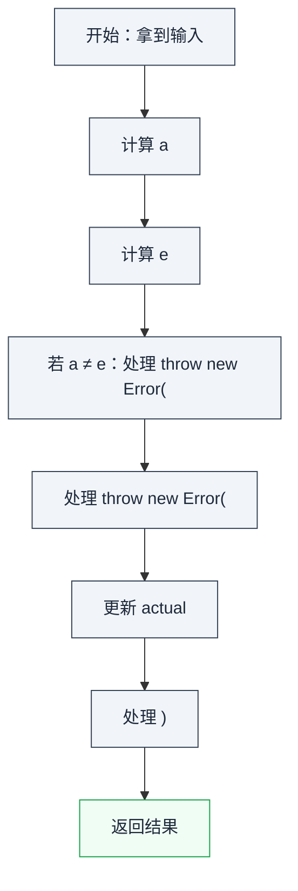

## TypeScript 解题方案（5 个方案逐个讲）

> **运行与提交**：每个方案都是自包含文件（内嵌用例自测，输出 PASS），整块复制到 `.ts` 文件后 `node 文件名` 即可运行。提交 LeetCode 时，把 `demo` 内的算法函数与辅助类型/函数整体取出、置于文件顶层即可。概念演示（非 LeetCode 编号题），在本地运行即可。

### 方案 1：直接实现

**分析与思路**：核心做法是「直接实现」。

**运行方式**：`node 本文件`，内嵌用例全部通过会输出 PASS。


**方案专属流程图**（真实控制流）：


```typescript
function assertEq(actual: any, expected: any, msg: string = ''): void {
  // 定义函数/方法 assertEq
  const a = JSON.stringify(actual);
  const e = JSON.stringify(expected);
  if (a !== e)
    throw new Error(
      'ASSERT FAILED ' + msg + ' :: actual=' + a + ' expected=' + e,
    );
}

function get_result(n: number, m: number, matrix: string[]): number {
  // 定义函数/方法 get_result
  let ans = 0;
  const height = new Array(m + 2).fill(0); // 把 0; const height 赋值为 new Array(映射表 加 2).fill(0) 存入 答案
  for (let k = 0; k < n; k++) {
    // 让 下标 k 从 0 开始计数，下标 k 小于 元素个数 就继续
    for (let i = 1; i <= m; i++) {
      if (matrix[k][i - 1] === '.') height[i]++;
      else height[i] = 0;
    } // 让 下标 i 从 1 开始计数，下标 i 不超过 映射表 就继续
    for (let a = 1; a <= m; a++) {
      // 让 数组 从 1 开始计数，数组 不超过 映射表 就继续
      let min_h = 50000; // 把 50000 存入 min_h
      for (let c = a; c <= m; c++) if (height[c] < min_h) min_h = height[c]; // 让 字符 从 数组 开始计数，字符 不超过 映射表 就继续
      const area = (m - a + 1) * min_h; // 把 (映射表 减 数组 加 1) 乘 min_h 存入 area
      if (area > ans) ans = area; // 若 area 超过 答案) 答案 赋值为 area;
    }
  }
  return ans; // 返回 答案
}
function get_result_card(n: number, m: number, matrix: string[]): number {
  // 定义函数/方法 get_result_card
  let ans = 0;
  const height = new Array(m + 2).fill(0); // 把 0; const height 赋值为 new Array(映射表 加 2).fill(0) 存入 答案
  for (let k = 0; k < n; k++) {
    // 让 下标 k 从 0 开始计数，下标 k 小于 元素个数 就继续
    for (let i = 1; i <= m; i++) {
      if (matrix[k][i - 1] === '.') height[i]++;
      else height[i] = 0;
    } // 让 下标 i 从 1 开始计数，下标 i 不超过 映射表 就继续
    for (let a = 1; a <= m; a++) {
      // 让 数组 从 1 开始计数，数组 不超过 映射表 就继续
      const cur_h = height[a]; // 把 height[数组] 存入 cur_h
      let lo = a - 1;
      while (lo >= 1 && height[lo] >= cur_h) lo--;
      let hi = a + 1;
      while (hi <= m && height[hi] >= cur_h) hi++;
      const area = (hi - lo - 1) * cur_h; // 把 (右边界 减 左边界 减 1) 乘 cur_h 存入 area
      if (area > ans) ans = area; // 若 area 超过 答案) 答案 赋值为 area;
    }
  }
  return ans; // 返回 答案
}
export function demo(): void {
  // 程序入口：跑内嵌自测用例
  const matrix = ['.....', 'XXXXX', '.X...', '.....']; // 把 [「.....」, 「.....」, 「.....」, 「.....」] 存入 矩阵
  assertEq(get_result(4, 5, matrix), 6, 'brute'); // 断言校验
  assertEq(get_result_card(4, 5, matrix), 6, 'card'); // 断言校验
  console.log('PASS'); // 全部用例通过，输出 PASS
}
demo(); // demo();
```

### 方案 2：直接实现

**分析与思路**：核心做法是「直接实现」。

**运行方式**：`node 本文件`，内嵌用例全部通过会输出 PASS。


**方案专属流程图**（真实控制流）：

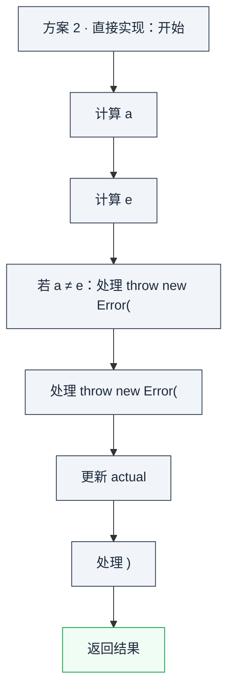

```typescript
function assertEq(actual: any, expected: any, msg: string = ''): void {
  // 定义函数/方法 assertEq
  const a = JSON.stringify(actual);
  const e = JSON.stringify(expected);
  if (a !== e)
    throw new Error(
      'ASSERT FAILED ' + msg + ' :: actual=' + a + ' expected=' + e,
    );
}

function get_result(n: number, m: number, matrix: string[]): number {
  // 定义函数/方法 get_result
  let ans = 0;
  const height = new Array(m + 2).fill(0); // 把 0; const height 赋值为 new Array(映射表 加 2).fill(0) 存入 答案
  for (let k = 0; k < n; k++) {
    // 让 下标 k 从 0 开始计数，下标 k 小于 元素个数 就继续
    for (let i = 1; i <= m; i++) {
      if (matrix[k][i - 1] === '.') height[i]++;
      else height[i] = 0;
    } // 让 下标 i 从 1 开始计数，下标 i 不超过 映射表 就继续
    for (let a = 1; a <= m; a++) {
      // 让 数组 从 1 开始计数，数组 不超过 映射表 就继续
      let min_h = 50000; // 把 50000 存入 min_h
      for (let c = a; c <= m; c++) if (height[c] < min_h) min_h = height[c]; // 让 字符 从 数组 开始计数，字符 不超过 映射表 就继续
      const area = (m - a + 1) * min_h; // 把 (映射表 减 数组 加 1) 乘 min_h 存入 area
      if (area > ans) ans = area; // 若 area 超过 答案) 答案 赋值为 area;
    }
  }
  return ans; // 返回 答案
}
function get_result_card(n: number, m: number, matrix: string[]): number {
  // 定义函数/方法 get_result_card
  let ans = 0;
  const height = new Array(m + 2).fill(0); // 把 0; const height 赋值为 new Array(映射表 加 2).fill(0) 存入 答案
  for (let k = 0; k < n; k++) {
    // 让 下标 k 从 0 开始计数，下标 k 小于 元素个数 就继续
    for (let i = 1; i <= m; i++) {
      if (matrix[k][i - 1] === '.') height[i]++;
      else height[i] = 0;
    } // 让 下标 i 从 1 开始计数，下标 i 不超过 映射表 就继续
    for (let a = 1; a <= m; a++) {
      // 让 数组 从 1 开始计数，数组 不超过 映射表 就继续
      const cur_h = height[a]; // 把 height[数组] 存入 cur_h
      let lo = a - 1;
      while (lo >= 1 && height[lo] >= cur_h) lo--;
      let hi = a + 1;
      while (hi <= m && height[hi] >= cur_h) hi++;
      const area = (hi - lo - 1) * cur_h; // 把 (右边界 减 左边界 减 1) 乘 cur_h 存入 area
      if (area > ans) ans = area; // 若 area 超过 答案) 答案 赋值为 area;
    }
  }
  return ans; // 返回 答案
}
export function demo(): void {
  // 程序入口：跑内嵌自测用例
  const matrix = ['.....', 'XXXXX', '.X...', '.....']; // 把 [「.....」, 「.....」, 「.....」, 「.....」] 存入 矩阵
  assertEq(get_result(4, 5, matrix), 6, 'brute'); // 断言校验
  assertEq(get_result_card(4, 5, matrix), 6, 'card'); // 断言校验
  console.log('PASS'); // 全部用例通过，输出 PASS
}
demo(); // demo();
```

### 方案 3：迭代指针处理

**分析与思路**：核心做法是「迭代指针处理」。代码里依次做这些事：队列或堆的调度。

**运行方式**：`node 本文件`，内嵌用例全部通过会输出 PASS。


**方案专属流程图**（真实控制流）：

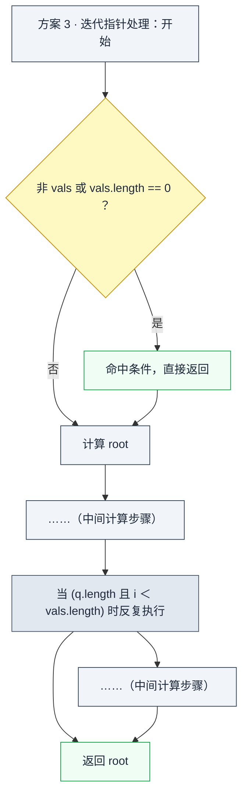

```typescript
class TreeNode {
  // 定义类型
  val: any;
  left: any;
  right: any; // 值: any; 左边界: any; 右边界: any;
  constructor(val?: any, left?: any, right?: any) {
    // constructor(值?: any, 左边界?: any, 右边界?: any) {
    this.val = val === undefined ? 0 : val; // 把 (值 全等于 undefined ? 0 : 值); 写入 值
    this.left = left === undefined ? null : left; // 把 (左边界 全等于 undefined ? null : 左边界); 写入 左边界
    this.right = right === undefined ? null : right; // 把 (右边界 全等于 undefined ? null : 右边界); 写入 右边界
  }
}
function buildTree(vals: any): any {
  // 定义函数/方法 buildTree
  if (!vals || vals.length === 0) return null; // 若 取反 vals 或 vals.长度 全等于 0，直接返回 null
  const root = new TreeNode(vals[0]);
  const q: any[] = [root];
  let i = 1;
  while (q.length && i < vals.length) {
    // 循环，直到不满足「节点.长度 且 下标 i 小于 vals.长度」
    const node = q.shift(); // 把 节点.shift() 存入 节点
    if (vals[i] !== null && vals[i] !== undefined) {
      node.left = new TreeNode(vals[i]);
      q.push(node.left);
    }
    i++; // 下标 i 加一
    if (i < vals.length && vals[i] !== null && vals[i] !== undefined) {
      node.right = new TreeNode(vals[i]);
      q.push(node.right);
    }
    i++; // 下标 i 加一
  }
  return root; // 返回 根节点
}
function treeToLevel(root: any): any[] {
  // 定义函数/方法 treeToLevel
  if (!root) return []; // 若 取反 根节点，直接返回 []
  const out: any[] = [];
  const q: any[] = [root]; // 把 []; const 节点: any[] 赋值为 [根节点]; 写入 const out: any[]
  while (q.length) {
    // 循环，直到不满足「节点.长度」
    const n = q.shift(); // 把 节点.shift() 存入 元素个数
    if (n === null || n === undefined) {
      out.push(null);
      continue;
    }
    out.push(n.val);
    q.push(n.left);
    q.push(n.right); // 把 元素个数.值 压入栈/数组尾部
  }
  while (out.length && out[out.length - 1] === null) out.pop(); // 循环，直到不满足「out.长度 且 out[out.长度 减 1] 全等于 null) out 弹出 );」
  return out; // 返回 out
}
class ListNode {
  // 定义类型
  val: any;
  next: any; // 值: any; 下一个: any;
  constructor(val?: any, next?: any) {
    this.val = val === undefined ? 0 : val;
    this.next = next === undefined ? null : next;
  }
}
function buildList(vals: any): any {
  // 定义函数/方法 buildList
  const dummy = new ListNode(0);
  let cur = dummy; // 把 new ListNode(0); let 当前值 赋值为 哨兵节点 存入 哨兵节点
  for (const v of vals) {
    cur.next = new ListNode(v);
    cur = cur.next;
  } // 把 new ListNode(值); 当前值 赋值为 当前值.下一个; } 写入 下一个
  return dummy.next; // 返回 哨兵节点.下一个
}
function listToArray(head: any): any[] {
  // 定义函数/方法 listToArray
  const out: any[] = [];
  let p = head; // 把 []; let 节点 赋值为 头节点; 写入 const out: any[]
  while (p) {
    out.push(p.val);
    p = p.next;
  } // 循环，直到不满足「节点) { out 追加 节点.值); 节点 赋值为 节点.下一个; }」
  return out; // 返回 out
}
// python-runtime shims
function pyLen(a: any): number {
  // 定义函数/方法 pyLen
  if (a === null || a === undefined) return 0; // 若 数组 全等于 null 或 数组 全等于 undefined，直接返回 0
  if (
    typeof a === 'string' ||
    Array.isArray(a) ||
    a instanceof Set ||
    a instanceof Map
  )
    return a.length ?? a.size;
  if (typeof a === 'object') return Object.keys(a).length; // 若 typeof 数组 全等于 'object'，直接返回 Object.keys(数组).长度
  return 0; // 返回 0
}
function pySlice(a: any, i: any, j: any, step?: any): any {
  // 定义函数/方法 pySlice
  if (typeof a === 'string') {
    const r = [...a].slice(i ?? 0, j ?? a.length);
    return step ? r.reverse().join('') : r.join('');
  }
  const arr = Array.isArray(a) ? a : [...a]; // 把 Array.isArray(数组) ? 数组 : 复制的 数组 存入 数组
  return arr.slice(i ?? 0, j ?? arr.length); // 返回 数组 截取 下标 i ?? 0, 下标 j ?? 数组.长度)
}
function pyRange(a: any, b?: any, step?: any): any[] {
  // 定义函数/方法 pyRange
  let s = 0,
    e = a,
    st = 1; // 把 0, e 赋值为 数组, st 赋值为 1 存入 字符串
  if (b !== undefined) {
    s = a;
    e = b;
  } // 若 b 不等于 undefined) { 字符串 赋值为 数组; e 赋值为 b; }
  if (step !== undefined) st = step; // 若 步数 不等于 undefined) st 赋值为 步数;
  const out: any[] = []; // 把 []; 写入 const out: any[]
  if (st > 0) for (let i = s; i < e; i += st) out.push(i);
  else for (let i = s; i > e; i += st) out.push(i); // 否则
  return out; // 返回 out
}
function pyIn(x: any, coll: any): boolean {
  // 定义函数/方法 pyIn
  if (coll === null || coll === undefined) return false; // 若 coll 全等于 null 或 coll 全等于 undefined，直接返回 false
  if (Array.isArray(coll)) return coll.includes(x); // 若 Array.isArray(coll)，直接返回 coll 是否包含 x)
  if (coll instanceof Set || coll instanceof Map) return coll.has(x); // 若 coll instanceof Set 或 coll instanceof Map，直接返回 coll.has(x)
  if (typeof coll === 'object') return x in coll; // 若 typeof coll 全等于 'object'，直接返回 x in coll
  if (typeof coll === 'string') return coll.indexOf(x) >= 0; // 若 typeof coll 全等于 'string'，直接返回 coll 查找 x) 不低于 0
  return false; // 返回 false
}
function pySorted(a: any): any[] {
  // 定义函数/方法 pySorted
  const arr = typeof a === 'string' ? [...a] : [...a]; // 把 (typeof 数组 全等于 'string') ? 复制的 数组 : 复制的 数组 存入 数组
  return arr.sort((x: any, y: any) => (x < y ? -1 : x > y ? 1 : 0));
}
function pyMin(a: any, b?: any): any {
  if (b !== undefined) return Math.min(a, b);
  if (Array.isArray(a) || a instanceof Set) return Math.min(...a);
  return Math.min(a);
} // 定义函数/方法 pyMin
function pyMax(a: any, b?: any): any {
  if (b !== undefined) return Math.max(a, b);
  if (Array.isArray(a) || a instanceof Set) return Math.max(...a);
  return Math.max(a);
} // 定义函数/方法 pyMax
function pySum(a: any): number {
  let s = 0;
  for (const v of a) s += v;
  return s;
} // 定义函数/方法 pySum
function pyAbs(x: any): number {
  return Math.abs(x);
} // 定义函数/方法 pyAbs
function pyEnumerate(a: any): any[] {
  const out: any[] = [];
  let i = 0;
  for (const v of a) {
    out.push([i, v]);
    i++;
  }
  return out;
} // 定义函数/方法 pyEnumerate
function pyZip(a: any, b: any): any[] {
  const n = Math.min(a.length, b.length);
  const out: any[] = [];
  for (let i = 0; i < n; i++) out.push([a[i], b[i]]);
  return out;
} // 定义函数/方法 pyZip
function pyDictGet(d: any, k: any, def?: any): any {
  return k in d ? d[k] : def === undefined ? null : def;
} // 定义函数/方法 pyDictGet
function pyPrint(...args: any[]): void {
  console.log(
    args
      .map((a) => (typeof a === 'object' && a !== null ? JSON.stringify(a) : a))
      .join(' '),
  );
} // 定义函数/方法 pyPrint
// collections / heapq
function heapPush(h: any[], x: any): void {
  h.push(x);
  let i = h.length - 1;
  while (i > 0) {
    const p = (i - 1) >> 1;
    if (h[p] <= h[i]) break;
    [h[p], h[i]] = [h[i], h[p]];
    i = p;
  }
} // 定义函数/方法 heapPush
function heapPop(h: any[]): any {
  const top = h[0];
  const last = h.pop();
  if (h.length) {
    h[0] = last;
    let i = 0;
    const n = h.length;
    while (true) {
      let l = 2 * i + 1,
        r = 2 * i + 2,
        s = i;
      if (l < n && h[l] < h[s]) s = l;
      if (r < n && h[r] < h[s]) s = r;
      if (s === i) break;
      [h[s], h[i]] = [h[i], h[s]];
      i = s;
    }
  }
  return top;
} // 定义函数/方法 heapPop
class Deque {
  private a: any[] = [];
  push(x: any) {
    this.a.push(x);
  }
  pushLeft(x: any) {
    this.a.unshift(x);
  }
  pop() {
    return this.a.pop();
  }
  popLeft() {
    return this.a.shift();
  }
  get length() {
    return this.a.length;
  }
  toArray() {
    return this.a.slice();
  }
} // 定义类型
function Counter(iter: any): any {
  const m: any = {};
  for (const v of iter) m[v] = (m[v] || 0) + 1;
  return m;
} // 定义函数/方法 Counter
function gcd(a: any, b: any): any {
  while (b) {
    [a, b] = [b, a % b];
  }
  return a;
} // 定义函数/方法 gcd
function pyInf(): number {
  return Infinity;
} // 定义函数/方法 pyInf

function norm(x: any): any {
  // 定义函数/方法 norm
  if (x === null || x === undefined) return null; // 若 x 全等于 null 或 x 全等于 undefined，直接返回 null
  if (typeof x === 'object') {
    // 若 typeof x 全等于 'object'
    if (x instanceof Deque) return x.toArray(); // 若 x instanceof Deque，直接返回 x.toArray()
    if (Array.isArray(x)) return x.map(norm); // 若 Array.isArray(x)，直接返回 x.映射表(norm)
    if (
      typeof x.val === 'number' &&
      (typeof x.left !== 'undefined' || typeof x.right !== 'undefined')
    )
      return treeToLevel(x);
    if (typeof x.next !== 'undefined' && typeof x.val === 'number')
      return listToArray(x);
    if (x instanceof Set) return [...x].sort(); // 若 x instanceof Set，直接返回 复制的 x 排序 )
    if (x instanceof Map) return Object.fromEntries(x); // 若 x instanceof Map，直接返回 Object.fromEntries(x)
    const o: any = {};
    for (const k of Object.keys(x)) o[k] = norm(x[k]);
    return o;
  }
  return x; // 返回 x
}
function eq(a: any, b: any): boolean {
  // 定义函数/方法 eq
  const x = norm(a),
    y = norm(b); // 把 norm(数组), y 赋值为 norm(b) 存入 x
  if (x === y) return true; // 若 x 全等于 y，直接返回 true
  if (x === null || y === null) return x === y; // 若 x 全等于 null 或 y 全等于 null，直接返回 x 全等于 y
  if (Array.isArray(x) && Array.isArray(y)) {
    // 若 Array.isArray(x) 且 Array.isArray(y
    if (x.length !== y.length) return false; // 若 x.长度 不等于 y.长度，直接返回 false
    for (let i = 0; i < x.length; i++) if (!eq(x[i], y[i])) return false; // 让 下标 i 从 0 开始计数，下标 i 小于 x.长度 就继续
    return true; // 返回 true
  }
  if (typeof x === 'object' && typeof y === 'object') {
    // 若 typeof x 全等于 'object' 且 typeof y 全等于 'object'
    const kx = Object.keys(x),
      ky = Object.keys(y); // 把 Object.keys(x), ky 赋值为 Object.keys(y) 存入 kx
    if (kx.length !== ky.length) return false; // 若 kx.长度 不等于 ky.长度，直接返回 false
    for (const k of kx) if (!eq(x[k], y[k])) return false;
    return true; // 返回 true
  }
  return x === y; // 返回 x 全等于 y
}

function getResult(n, m, matrix) {
  // 定义函数/方法 getResult
  let ans = 0; // 把 0 存入 答案
  const height = new Array(m + 2).fill(0); // 把 new Array(映射表 加 2).fill(0) 存入 height
  for (let k = 0; k < n; k++) {
    // 让 下标 k 从 0 开始计数，下标 k 小于 元素个数 就继续
    for (let i = 1; i <= m; i++) {
      // 让 下标 i 从 1 开始计数，下标 i 不超过 映射表 就继续
      if (matrix[k][i - 1] === '.')
        height[i] += 1; // 若 矩阵[下标 k][下标 i 减 1] 全等于 '.') height[下标 i] 累加 1;
      else height[i] = 0; // 否则
    }
    const stack = [0]; // 把 [0] 存入 栈
    for (let i = 1; i <= m + 1; i++) {
      // 让 下标 i 从 1 开始计数，下标 i 不超过 映射表 加 1 就继续
      while (height[stack[stack.length - 1]] > height[i]) {
        // 循环，直到不满足「height[栈[栈.长度 减 1]] 超过 height[下标 i]」
        const nowH = height[stack.pop()]; // 把 height[栈 弹出 )] 存入 nowH
        const width = i - stack[stack.length - 1] - 1; // 把 下标 i 减 栈[栈.长度 减 1] 减 1 存入 width
        const area = nowH * width; // 把 nowH 乘 width 存入 area
        if (area > ans) ans = area; // 若 area 超过 答案) 答案 赋值为 area;
      }
      stack.push(i); // 把 下标 i 压入栈/数组尾部
    }
  }
  return ans; // 返回 答案
}
export function demo(): void {
  // 程序入口：跑内嵌自测用例
  const matrix = ['.....', 'XXXXX', '.X...', '.....']; // 把 [「.....」,「.....」,「.....」,「.....」] 存入 矩阵
  const cases = [{ got: getResult(4, 5, matrix), want: 6 }]; // 把 [ { got: getResult(4, 5, 矩阵), want: 6 } ] 存入 cases
  let fail = false; // 把 false 存入 fail
  for (const c of cases)
    if (!eq(c.got, c.want)) {
      fail = true;
      console.log(
        'FAIL',
        JSON.stringify(c.got),
        'want',
        JSON.stringify(c.want),
      );
    } // 打印输出
  if (fail) throw new Error('FAILED'); // 若 fail) throw new Error(「FAILED」);
  console.log('PASS'); // 全部用例通过，输出 PASS
}
demo(); // demo();
```

### 方案 4：直接实现

**分析与思路**：核心做法是「直接实现」。

**运行方式**：`node 本文件`，内嵌用例全部通过会输出 PASS。

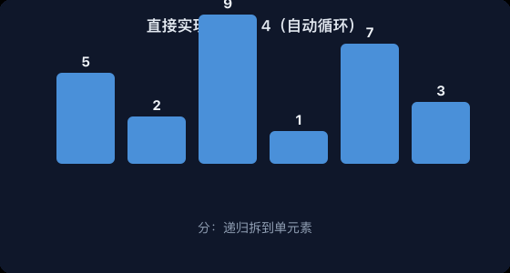

**方案专属流程图**（真实控制流）：


```typescript
function assertEq(actual: any, expected: any, msg: string = ''): void {
  // 定义函数/方法 assertEq
  const a = JSON.stringify(actual);
  const e = JSON.stringify(expected);
  if (a !== e)
    throw new Error(
      'ASSERT FAILED ' + msg + ' :: actual=' + a + ' expected=' + e,
    );
}

function max_red_rectangle(matrix: string[]): number {
  // 定义函数/方法 max_red_rectangle
  const n = matrix.length,
    m = matrix[0].length; // 把 矩阵.长度, 映射表 赋值为 矩阵[0].长度 存入 元素个数
  let ans = 0; // 把 0 存入 答案
  const height = new Array(m + 2).fill(0); // 把 new Array(映射表 加 2).fill(0) 存入 height
  for (let k = 0; k < n; k++) {
    // 让 下标 k 从 0 开始计数，下标 k 小于 元素个数 就继续
    for (let i = 1; i <= m; i++) {
      if (matrix[k][i - 1] === '.') height[i]++;
      else height[i] = 0;
    } // 让 下标 i 从 1 开始计数，下标 i 不超过 映射表 就继续
    const stack: number[] = [0]; // 把 [0]; 写入 const stack: number[]
    for (let i = 1; i <= m + 1; i++) {
      // 让 下标 i 从 1 开始计数，下标 i 不超过 映射表 加 1 就继续
      while (height[stack[stack.length - 1]] > height[i]) {
        // 循环，直到不满足「height[栈[栈.长度 减 1]] 超过 height[下标 i]」
        const now_h = height[stack.pop() as number]; // 把 height[栈 弹出 ) as number] 存入 now_h
        const width = i - stack[stack.length - 1] - 1; // 把 下标 i 减 栈[栈.长度 减 1] 减 1 存入 width
        ans = Math.max(ans, now_h * width); // 把 Math.取较大值 答案, now_h 乘 width) 存入 答案
      }
      stack.push(i); // 把 下标 i 压入栈/数组尾部
    }
  }
  return ans; // 返回 答案
}
function get_result_brute(n: number, m: number, matrix: string[]): number {
  // 定义函数/方法 get_result_brute
  let ans = 0;
  const height = new Array(m + 2).fill(0); // 把 0; const height 赋值为 new Array(映射表 加 2).fill(0) 存入 答案
  for (let k = 0; k < n; k++) {
    // 让 下标 k 从 0 开始计数，下标 k 小于 元素个数 就继续
    for (let i = 1; i <= m; i++) {
      if (matrix[k][i - 1] === '.') height[i]++;
      else height[i] = 0;
    } // 让 下标 i 从 1 开始计数，下标 i 不超过 映射表 就继续
    for (let a = 1; a <= m; a++) {
      let min_h = 50000;
      for (let c = a; c <= m; c++) if (height[c] < min_h) min_h = height[c];
      const area = (m - a + 1) * 0 + (a > 0 ? 0 : 0);
      const ar = c_index(a, m, height);
      if (ar > ans) ans = ar;
    } // 让 数组 从 1 开始计数，数组 不超过 映射表 就继续
  }
  return ans; // 返回 答案
}
function c_index(a: number, m: number, height: number[]): number {
  let min_h = 50000;
  for (let c = a; c <= m; c++) if (height[c] < min_h) min_h = height[c];
  return (m - a + 1) * min_h;
} // 定义函数/方法 c_index
export function demo(): void {
  // 程序入口：跑内嵌自测用例
  const matrix = ['.....', 'XXXXX', '.X...', '.....']; // 把 [「.....」, 「.....」, 「.....」, 「.....」] 存入 矩阵
  assertEq(max_red_rectangle(matrix), 6, 'mono'); // 断言校验
  console.log('PASS'); // 全部用例通过，输出 PASS
}
demo(); // demo();
```

### 方案 5：方案5（单调栈求最大全 '.' 矩形）

**分析与思路**：核心做法是「方案5（单调栈求最大全 '.' 矩形）」。代码里依次做这些事：双重循环遍历；栈的后进先出操作。

**运行方式**：`node 本文件`，内嵌用例全部通过会输出 PASS。

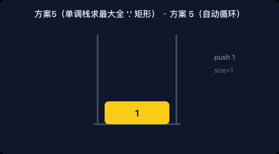

**方案专属流程图**（真实控制流）：

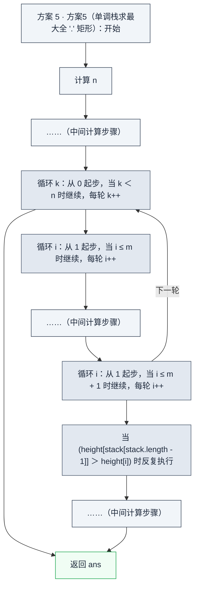

```typescript
/**
 ** 笔记：最大红矩形分析
 ** 方案：方案5（单调栈求最大全 '.' 矩形）
 ** 来源：python 参考忠实移植
 */

function maxRedRectangle(matrix: string[]): number {
  // 定义函数/方法 maxRedRectangle
  const n = matrix.length; // 把 矩阵.长度 存入 元素个数
  const m = matrix[0].length; // 把 矩阵[0].长度 存入 映射表
  let ans = 0; // 把 0 存入 答案
  const height: number[] = new Array(m + 2).fill(0); // 把 new Array(映射表 加 2).fill(0); 写入 const height: number[]
  for (let k = 0; k < n; k++) {
    // 让 下标 k 从 0 开始计数，下标 k 小于 元素个数 就继续
    for (let i = 1; i <= m; i++) {
      // 让 下标 i 从 1 开始计数，下标 i 不超过 映射表 就继续
      if (matrix[k][i - 1] === '.')
        height[i] += 1; // 若 矩阵[下标 k][下标 i 减 1] 全等于 '.') height[下标 i] 累加 1;
      else height[i] = 0; // 否则
    }
    const stack: number[] = [0]; // 把 [0]; 写入 const stack: number[]
    for (let i = 1; i <= m + 1; i++) {
      // 让 下标 i 从 1 开始计数，下标 i 不超过 映射表 加 1 就继续
      while (height[stack[stack.length - 1]] > height[i]) {
        // 循环，直到不满足「height[栈[栈.长度 减 1]] 超过 height[下标 i]」
        const nowH = height[stack.pop()!]; // 把 height[栈 弹出 )取反 ] 存入 nowH
        const width = i - stack[stack.length - 1] - 1; // 把 下标 i 减 栈[栈.长度 减 1] 减 1 存入 width
        ans = Math.max(ans, nowH * width); // 把 Math.取较大值 答案, nowH 乘 width) 存入 答案
      }
      stack.push(i); // 把 下标 i 压入栈/数组尾部
    }
  }
  return ans; // 返回 答案
}

export function demo(): void {
  // 程序入口：跑内嵌自测用例
  const cases: { in: string[]; want: number }[] = [
    { in: ['.....', 'XXXXX', '.X...', '.....'], want: 6 },
    { in: ['...', '...', '...'], want: 9 },
  ];
  let fail = false; // 把 false 存入 fail
  for (const c of cases) {
    // for (const 字符 of cases) {
    const got = maxRedRectangle(c.in); // 把 maxRedRectangle(字符.in) 存入 got
    if (got !== c.want) {
      // 若 got 不等于 字符.want
      fail = true; // 把 true 存入 fail
      console.log('FAIL', JSON.stringify(c.in), 'want', c.want, 'got', got); // 打印输出
    }
  }
  if (fail) throw new Error('FAILED'); // 若 fail) throw new Error(「FAILED」);
  console.log('PASS'); // 全部用例通过，输出 PASS
}
demo(); // demo();
```

## 逐步拆解与面试追问

**复杂度**：时间 O(n) 量级，空间 O(n)

**为什么是这个量级**：整体只对数据做有限趟处理

**面试官可能会追问**：

- 这个策略能推广到什么场景？
- 与暴力做法差在哪一步？
- 有没有更简单的等价写法？

## 关键 API 速查（TS 主解法实际用到，附官方链接）

| API | 作用 | 使用要点 | 官方文档 |
|---|---|---|---|
| `JSON.stringify()` | 序列化为 JSON 字符串 | 常用于结构化比较（深度相等判定）；undefined/函数/循环引用会被丢弃或抛错 | [官方文档](https://developer.mozilla.org/zh-CN/docs/Web/JavaScript/Reference/Global_Objects/JSON/stringify) |

### 各语言官方文档导航

- **TypeScript / JS**：[MDN 中文参考](https://developer.mozilla.org/zh-CN/)
- **Python**：[Python 官方文档](https://docs.python.org/zh-cn/3/)
- **Go**：[Go 标准库](https://pkg.go.dev/std)
- **Java**：[JDK 17 API](https://docs.oracle.com/en/java/javase/17/docs/api/)
- **Rust**：[Rust 标准库](https://doc.rust-lang.org/std/)
- **Lua**：[Lua 5.4 手册](https://www.lua.org/manual/5.4/)
- **C**：[Cppreference C](https://zh.cppreference.com/w/c)
- **C++**：[Cppreference C++](https://zh.cppreference.com/w/cpp)
- **R**：[R 官方手册](https://stat.ethz.ch/R-manual/)
- **Zig**：[Zig 语言文档](https://ziglang.org/documentation/master/)
- **Dart**：[Dart API](https://api.dart.dev/)

## 附录：其他 10 种语言全部实现（每种语言列举其全部方案）

> TypeScript 的全部方案见「TypeScript 解题方案」一节；下面是其余 10 种语言的对应实现，每种语言的每个方案都带思路分析、代码走读与专属运行架构图。
> 每个方案都内嵌用例自测，可独立运行（老仓库 python/go 文件遵循「打印结果」约定）。
> 完整解法文件见 `dsa/<语言>/notes/lc_107431726_最大红矩形分析/`。

### Python 实现（5 种方案）

Python 的全部方案如下，每个方案都内嵌用例自测，可独立运行（老仓库 python/go 文件遵循「打印结果」约定）：

#### 方案 1：直接实现

**思路与代码分析**：核心是「直接实现」。Python 版用切片与字典推导式简化操作，突出可读性。**走读**：方案 1 · 直接实现：开始 → 更新 ans → 循环 k：从 0 到 n 前 → 循环 i：从 1 到 m + 1 前 → 循环 a：从 1 到 m + 1 前 → 循环 b：从 a 到 m + 1 前 → 循环 c：从 a 到 b + 1 前 → 返回 ans。

**运行架构**（真实控制流）：

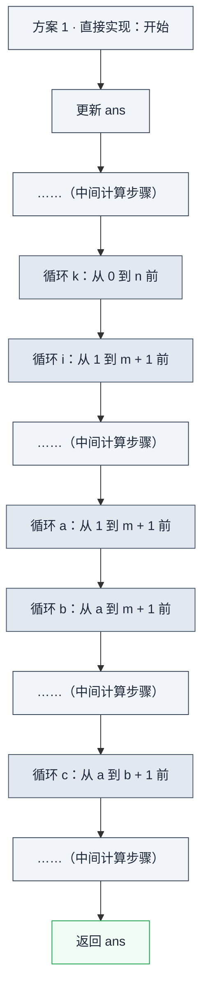

```python
import sys  # 提高递归深度上限（深输入防 RecursionError）

sys.setrecursionlimit(200000)  # 树/链表类题目节点数可达 1e4 量级

def get_result(n, m, matrix):  # 定义函数 get_result（参数：元素个数, 映射表, 矩阵）
    # 蛮力做法 O(n * m^3)
    ans = 0  # 把 0 存入 答案
    height = [0] * (m + 2)  # height[1..m] 为当前行的列高，左右哨兵为 0
    for k in range(n):  # 让 下标 k 从 元素个数 遍历
        for i in range(1, m + 1):  # 让 下标 i 从 1 到 映射表 加 1 遍历
            if matrix[k][i - 1] == ".":  # 若 矩阵[下标 k][下标 i 减 1] 等于 '.'
                height[i] += 1  # height[i]累加 1
            else:  # 否则
                height[i] = 0  # 把 0 写入 height[i]
        for a in range(1, m + 1):  # 让 数组 从 1 到 映射表 加 1 遍历
            for b in range(a, m + 1):  # 让 b 从 数组 到 映射表 加 1 遍历
                min_h = 50000  # 把 50000 存入 min_h
                for c in range(a, b + 1):  # 让 字符 从 数组 到 b 加 1 遍历
                    if height[c] < min_h:  # 若 height[字符] 小于 min_h
                        min_h = height[c]  # 把 height[字符] 存入 min_h
                area = (b - a + 1) * min_h  # 把 (b 减 数组 加 1) 乘 min_h 存入 area
                if area > ans:  # 若 area 超过 答案
                    ans = area  # 把 area 存入 答案
    return ans  # 返回 答案

if __name__ == "__main__":  # 若 __name__ 等于 '__main__'
    matrix = [
        ".....",
        "XXXXX",
        ".X...",
        ".....",
    ]
    print(get_result(4, 5, matrix))  # 输出: 6
```

#### 方案 2：直接实现

**思路与代码分析**：核心是「直接实现」。Python 版用切片与字典推导式简化操作，突出可读性。**走读**：方案 2 · 直接实现：开始 → 更新 ans → 循环 k：从 0 到 n 前 → 循环 i：从 1 到 m + 1 前 → 循环 a：从 1 到 m + 1 前 → 当 ( 时反复执行 → 当 ( 时反复执行 → 返回 ans。

**运行架构**（真实控制流）：

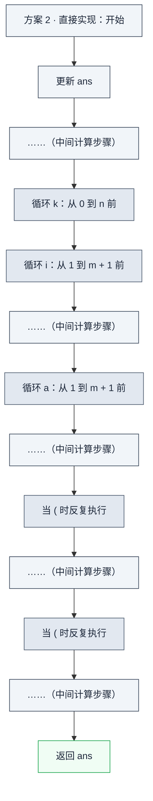

```python
import sys  # 提高递归深度上限（深输入防 RecursionError）

sys.setrecursionlimit(200000)  # 树/链表类题目节点数可达 1e4 量级

def get_result(n, m, matrix):  # 定义函数 get_result（参数：元素个数, 映射表, 矩阵）
    # 卡位做法 O(n * m^2)
    ans = 0  # 把 0 存入 答案
    height = [0] * (m + 2)  # 把 [0] 乘 (映射表 加 2) 存入 height
    for k in range(n):  # 让 下标 k 从 元素个数 遍历
        for i in range(1, m + 1):  # 让 下标 i 从 1 到 映射表 加 1 遍历
            if matrix[k][i - 1] == ".":  # 若 矩阵[下标 k][下标 i 减 1] 等于 '.'
                height[i] += 1  # height[i]累加 1
            else:  # 否则
                height[i] = 0  # 把 0 写入 height[i]
        for a in range(1, m + 1):  # 让 数组 从 1 到 映射表 加 1 遍历
            cur_h = height[a]  # 把 height[数组] 存入 cur_h
            # 找左卡位点
            lo = a - 1  # 把 数组 减 1 存入 左边界
            while (
                lo >= 1 and height[lo] >= cur_h
            ):  # 循环，直到不满足「左边界 不低于 1 and height[左边界] 不低于 cur_h」
                lo -= 1  # 左边界累减 1
            # 找右卡位点
            hi = a + 1  # 把 数组 加 1 存入 右边界
            while (
                hi <= m and height[hi] >= cur_h
            ):  # 循环，直到不满足「右边界 不超过 映射表 and height[右边界] 不低于 cur_h」
                hi += 1  # 右边界累加 1
            area = (hi - lo - 1) * cur_h  # 把 (右边界 减 左边界 减 1) 乘 cur_h 存入 area
            if area > ans:  # 若 area 超过 答案
                ans = area  # 把 area 存入 答案
    return ans  # 返回 答案

if __name__ == "__main__":  # 若 __name__ 等于 '__main__'
    matrix = [
        ".....",
        "XXXXX",
        ".X...",
        ".....",
    ]
    print(get_result(4, 5, matrix))  # 输出: 6
```

#### 方案 3：迭代指针处理

**思路与代码分析**：核心是「迭代指针处理」。Python 版用切片与字典推导式简化操作，突出可读性。**走读**：方案 3 · 迭代指针处理：开始 → 更新 ans → 循环 k：从 0 到 n 前 → 循环 i：从 1 到 m + 1 前 → 循环 i：从 1 到 m + 2 前 → 当 height[stack[-1]] ＞ height[i]: 时反复执行 → 返回 ans。

**运行架构**（真实控制流）：

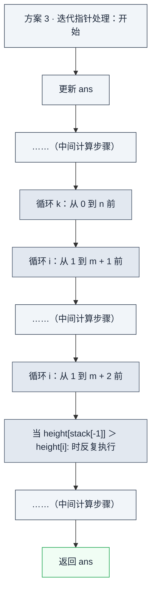

```python
import sys  # 提高递归深度上限（深输入防 RecursionError）

sys.setrecursionlimit(200000)  # 树/链表类题目节点数可达 1e4 量级

def get_result(n, m, matrix):  # 定义函数 get_result（参数：元素个数, 映射表, 矩阵）
    # 单调栈做法 O(n * m)
    ans = 0  # 把 0 存入 答案
    height = [0] * (m + 2)  # height[0] = height[m+1] = 0 哨兵
    for k in range(n):  # 让 下标 k 从 元素个数 遍历
        for i in range(1, m + 1):  # 让 下标 i 从 1 到 映射表 加 1 遍历
            if matrix[k][i - 1] == ".":  # 若 矩阵[下标 k][下标 i 减 1] 等于 '.'
                height[i] += 1  # height[i]累加 1
            else:  # 否则
                height[i] = 0  # 把 0 写入 height[i]
        stack = [0]  # 把 [0] 存入 栈
        for i in range(1, m + 2):  # 让 下标 i 从 1 到 映射表 加 2 遍历
            while height[stack[-1]] > height[i]:  # 循环，直到不满足「height[栈[ 减 1]] 超过 height[下标 i]」
                now_h = height[stack.pop()]  # 把 height[栈 弹出 )] 存入 now_h
                width = i - stack[-1] - 1  # 把 下标 i 减 栈[ 减 1] 减 1 存入 width
                area = now_h * width  # 把 now_h 乘 width 存入 area
                if area > ans:  # 若 area 超过 答案
                    ans = area  # 把 area 存入 答案
            stack.append(i)  # 把 下标 i 追加到列表尾部
    return ans  # 返回 答案

if __name__ == "__main__":  # 若 __name__ 等于 '__main__'
    matrix = [
        ".....",
        "XXXXX",
        ".X...",
        ".....",
    ]
    print(get_result(4, 5, matrix))  # 输出: 6
```

#### 方案 4：直接实现

**思路与代码分析**：核心是「直接实现」。Python 版用切片与字典推导式简化操作，突出可读性。**走读**：方案 4 · 直接实现：开始 → 更新 n → 循环 k：从 0 到 n 前 → 循环 i：从 1 到 m + 1 前 → 循环 i：从 1 到 m + 2 前 → 当 height[stack[-1]] ＞ height[i]: 时反复执行 → 返回 ans。

**运行架构**（真实控制流）：

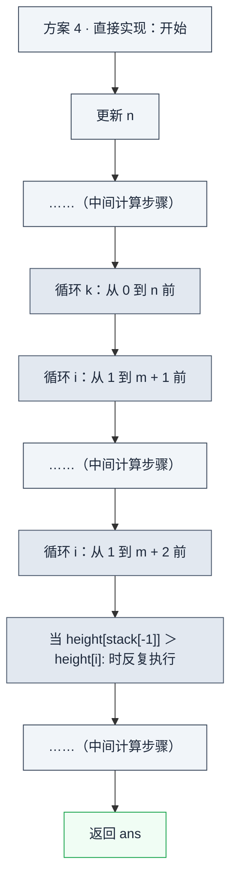

```python
import sys  # 提高递归深度上限（深输入防 RecursionError）

sys.setrecursionlimit(200000)  # 树/链表类题目节点数可达 1e4 量级

def max_red_rectangle(matrix):  # 定义函数 max_red_rectangle（参数：矩阵）
    # 单调栈实现（带哨兵），返回最大红矩形面积
    n = len(matrix)  # 把 长度(矩阵) 存入 元素个数
    m = len(matrix[0])  # 把 长度(矩阵[0]) 存入 映射表
    ans = 0  # 把 0 存入 答案
    height = [0] * (m + 2)  # 把 [0] 乘 (映射表 加 2) 存入 height
    for k in range(n):  # 让 下标 k 从 元素个数 遍历
        for i in range(1, m + 1):  # 让 下标 i 从 1 到 映射表 加 1 遍历
            if matrix[k][i - 1] == ".":  # 若 矩阵[下标 k][下标 i 减 1] 等于 '.'
                height[i] += 1  # height[i]累加 1
            else:  # 否则
                height[i] = 0  # 把 0 写入 height[i]
        stack = [0]  # 把 [0] 存入 栈
        for i in range(1, m + 2):  # 让 下标 i 从 1 到 映射表 加 2 遍历
            while height[stack[-1]] > height[i]:  # 循环，直到不满足「height[栈[ 减 1]] 超过 height[下标 i]」
                now_h = height[stack.pop()]  # 把 height[栈 弹出 )] 存入 now_h
                width = i - stack[-1] - 1  # 把 下标 i 减 栈[ 减 1] 减 1 存入 width
                ans = max(ans, now_h * width)  # 把 取较大值 答案, now_h 乘 width) 存入 答案
            stack.append(i)  # 把 下标 i 追加到列表尾部
    return ans  # 返回 答案

if __name__ == "__main__":  # 若 __name__ 等于 '__main__'
    # 通用输入程序：先读 n, m，再读 n 行字符矩阵
    matrix = [
        ".....",
        "XXXXX",
        ".X...",
        ".....",
    ]
    print(max_red_rectangle(matrix))  # 输出: 6
```

#### 方案 5：方案5（单调栈求最大全 '.' 矩形）

**思路与代码分析**：核心是「方案5（单调栈求最大全 '.' 矩形）」。Python 版用切片与字典推导式简化操作，突出可读性。**走读**：方案 5 · 方案5（单调栈求最大全 '.' 矩形）：开始 → 更新 n → 循环 k：从 0 到 n 前 → 循环 i：从 1 到 m + 1 前 → 循环 i：从 1 到 m + 2 前 → 当 height[stack[-1]] ＞ height[i]: 时反复执行 → 返回 ans。

**运行架构**（真实控制流）：

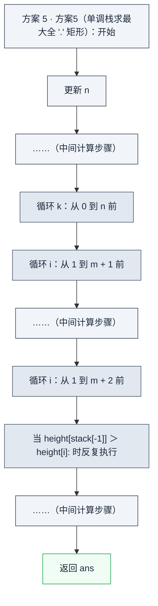

```python
import sys  # 提高递归深度上限（深输入防 RecursionError）

sys.setrecursionlimit(200000)  # 树/链表类题目节点数可达 1e4 量级

def max_red_rectangle(matrix):  # 定义函数 max_red_rectangle（参数：矩阵）
    n = len(matrix)  # 把 长度(矩阵) 存入 元素个数
    m = len(matrix[0])  # 把 长度(矩阵[0]) 存入 映射表
    ans = 0  # 把 0 存入 答案
    height = [0] * (m + 2)  # 把 [0] 乘 (映射表 加 2) 存入 height
    for k in range(n):  # 让 下标 k 从 元素个数 遍历
        for i in range(1, m + 1):  # 让 下标 i 从 1 到 映射表 加 1 遍历
            if matrix[k][i - 1] == ".":  # 若 矩阵[下标 k][下标 i 减 1] 等于 '.'
                height[i] += 1  # height[i]累加 1
            else:  # 否则
                height[i] = 0  # 把 0 写入 height[i]
        stack = [0]  # 把 [0] 存入 栈
        for i in range(1, m + 2):  # 让 下标 i 从 1 到 映射表 加 2 遍历
            while height[stack[-1]] > height[i]:  # 循环，直到不满足「height[栈[ 减 1]] 超过 height[下标 i]」
                now_h = height[stack.pop()]  # 把 height[栈 弹出 )] 存入 now_h
                width = i - stack[-1] - 1  # 把 下标 i 减 栈[ 减 1] 减 1 存入 width
                ans = max(ans, now_h * width)  # 把 取较大值 答案, now_h 乘 width) 存入 答案
            stack.append(i)  # 把 下标 i 追加到列表尾部
    return ans  # 返回 答案

if __name__ == "__main__":  # 若 __name__ 等于 '__main__'
    # 测试输入数据
    # 4 5
    # .....
    # XXXXX
    # .X...
    # .....
    test_input = [
        ".....",
        "XXXXX",
        ".X...",
        ".....",
    ]
    print(max_red_rectangle(test_input))  # 输出: 6
```

### Go 实现（5 种方案）

Go 的全部方案如下，每个方案都内嵌用例自测，可独立运行（老仓库 python/go 文件遵循「打印结果」约定）：

#### 方案 1：直接实现

**思路与代码分析**：核心是「直接实现」。Go 版用切片与多返回值惯用法，显式处理索引边界。**走读**：方案 1 · 直接实现：开始 → 更新 : → 遍历循环 → 遍历循环 → 遍历循环 → 遍历循环 → 遍历循环 → 返回 ans。

**运行架构**（真实控制流）：

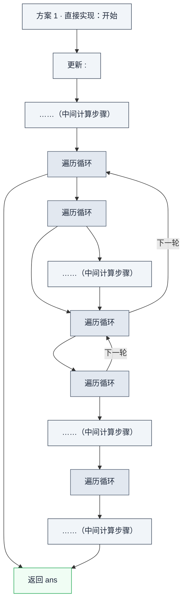

```go
package main // 引入依赖

import (
	"fmt" // 「fmt」
	"os"  // 「os」
)

// getResult 忠实翻译 python ref solution_1___1.py（蛮力 O(n*m^3)，左右哨兵 height）
func getResult(n, m int, matrix []string) int { // 定义函数/方法 getResult
	ans := 0                   // 把 0 写入 ans :
	height := make([]int, m+2) // height[1..m] 为当前行的列高，左右哨兵为 0
	for k := 0; k < n; k++ {   // 让 下标 k 从 0 开始计数
		for i := 1; i <= m; i++ { // 让 下标 i 从 1 开始计数
			if matrix[k][i-1] == '.' { // 若 矩阵[下标 k][下标 i 减 1] 等于 '.'
				height[i]++ // height[下标 i] 加一
			} else { // 否则
				height[i] = 0 // 把 0 写入 height[i]
			}
		}
		for a := 1; a <= m; a++ { // 让 数组 从 1 开始计数
			for b := a; b <= m; b++ { // 把 数组; b 不超过 映射表; b 加一 { 写入 for b :
				minH := 50000             // 把 50000 写入 minH :
				for c := a; c <= b; c++ { // 把 数组; 字符 不超过 b; 字符 加一 { 写入 for c :
					if height[c] < minH { // 若 height[字符] 小于 minH
						minH = height[c] // 把 height[字符] 写入 minH
					}
				}
				area := (b - a + 1) * minH // 把 (b 减 数组 加 1) 乘 minH 写入 area :
				if area > ans {            // 若 area 超过 答案
					ans = area // 把 area 写入 答案
				}
			}
		}
	}
	return ans // 返回 答案
}

func main() { // 程序入口：跑内嵌自测用例
	cases := []struct { // 把 []struct { 写入 cases :
		matrix []string // 矩阵 []string
		want   int      // want int
	}{ // }{
		{[]string{".....", "XXXXX", ".X...", "....."}, 6},
		{[]string{"...", "...", "..."}, 9},
		{[]string{"XXX", "XXX"}, 0},
		{[]string{"."}, 1},
		{[]string{"....", "....", "XXXX", "....", "...."}, 8},
	}
	ok := true                // 把 true 写入 ok :
	for _, c := range cases { // 同时取 _ 与 字符 遍历
		if got := getResult(len(c.matrix), len(c.matrix[0]), c.matrix); got != c.want {
			ok = false                                                       // 把 false 写入 ok
			fmt.Printf("FAIL solve(%v)=%d want %d\n", c.matrix, got, c.want) // 打印输出
		}
	}
	if !ok { // 若 取反 ok
		os.Exit(1) // os.Exit(1)
	}
	fmt.Println("PASS") // 全部用例通过，输出 PASS
}
```

#### 方案 2：直接实现

**思路与代码分析**：核心是「直接实现」。Go 版用切片与多返回值惯用法，显式处理索引边界。**走读**：方案 2 · 直接实现：开始 → 更新 : → 遍历循环 → 遍历循环 → 遍历循环 → 遍历循环 → 遍历循环 → 返回 ans。

**运行架构**（真实控制流）：

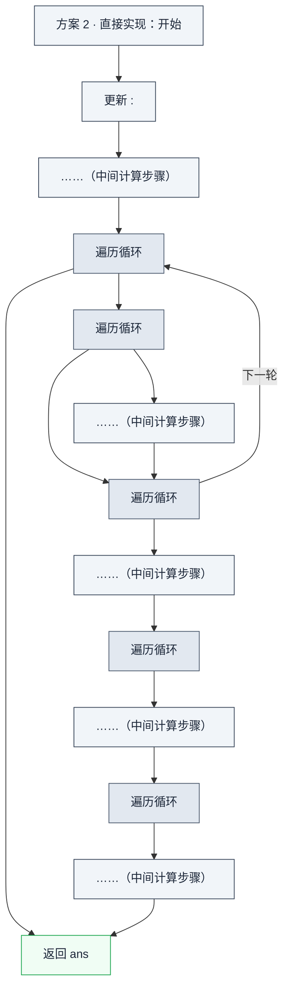

```go
package main // 引入依赖

import (
	"fmt" // 「fmt」
	"os"  // 「os」
)

// getResult 忠实翻译 python ref solution_2___2.py（卡位做法 O(n*m^2)）
func getResult(n, m int, matrix []string) int { // 定义函数/方法 getResult
	ans := 0                   // 把 0 写入 ans :
	height := make([]int, m+2) // 把 make([]int, 映射表 加 2) 写入 height :
	for k := 0; k < n; k++ {   // 让 下标 k 从 0 开始计数
		for i := 1; i <= m; i++ { // 让 下标 i 从 1 开始计数
			if matrix[k][i-1] == '.' { // 若 矩阵[下标 k][下标 i 减 1] 等于 '.'
				height[i]++ // height[下标 i] 加一
			} else { // 否则
				height[i] = 0 // 把 0 写入 height[i]
			}
		}
		for a := 1; a <= m; a++ { // 让 数组 从 1 开始计数
			curH := height[a] // 把 height[数组] 写入 curH :
			// 找左卡位点
			lo := a - 1                         // 把 数组 减 1 写入 lo :
			for lo >= 1 && height[lo] >= curH { // 把 1 且 height[左边界] 不低于 curH { 写入 for lo >
				lo-- // 左边界 减一
			}
			// 找右卡位点
			hi := a + 1                         // 把 数组 加 1 写入 hi :
			for hi <= m && height[hi] >= curH { // 把 映射表 且 height[右边界] 不低于 curH { 写入 for hi <
				hi++ // 右边界 加一
			}
			area := (hi - lo - 1) * curH // 把 (右边界 减 左边界 减 1) 乘 curH 写入 area :
			if area > ans {              // 若 area 超过 答案
				ans = area // 把 area 写入 答案
			}
		}
	}
	return ans // 返回 答案
}

func main() { // 程序入口：跑内嵌自测用例
	cases := []struct { // 把 []struct { 写入 cases :
		matrix []string // 矩阵 []string
		want   int      // want int
	}{ // }{
		{[]string{".....", "XXXXX", ".X...", "....."}, 6},
		{[]string{"...", "...", "..."}, 9},
		{[]string{"XXX", "XXX"}, 0},
		{[]string{"."}, 1},
		{[]string{"....", "....", "XXXX", "....", "...."}, 8},
	}
	ok := true                // 把 true 写入 ok :
	for _, c := range cases { // 同时取 _ 与 字符 遍历
		if got := getResult(len(c.matrix), len(c.matrix[0]), c.matrix); got != c.want {
			ok = false                                                       // 把 false 写入 ok
			fmt.Printf("FAIL solve(%v)=%d want %d\n", c.matrix, got, c.want) // 打印输出
		}
	}
	if !ok { // 若 取反 ok
		os.Exit(1) // os.Exit(1)
	}
	fmt.Println("PASS") // 全部用例通过，输出 PASS
}
```

#### 方案 3：迭代指针处理

**思路与代码分析**：核心是「迭代指针处理」。Go 版用切片与多返回值惯用法，显式处理索引边界。**走读**：方案 3 · 迭代指针处理：开始 → 更新 : → 遍历循环 → 遍历循环 → 遍历循环 → 遍历循环 → 返回 ans。

**运行架构**（真实控制流）：

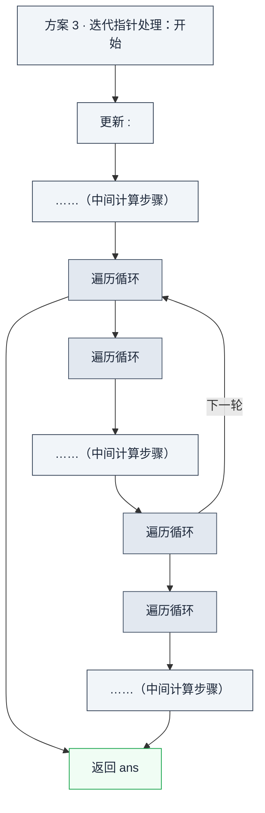

```go
package main // 引入依赖

import (
	"fmt" // 「fmt」
	"os"  // 「os」
)

// getResult 忠实翻译 python ref solution_3___3.py（单调栈 O(n*m)，哨兵 height[0]=height[m+1]=0）
func getResult(n, m int, matrix []string) int { // 定义函数/方法 getResult
	ans := 0                   // 把 0 写入 ans :
	height := make([]int, m+2) // 把 make([]int, 映射表 加 2) 写入 height :
	for k := 0; k < n; k++ {   // 让 下标 k 从 0 开始计数
		for i := 1; i <= m; i++ { // 让 下标 i 从 1 开始计数
			if matrix[k][i-1] == '.' { // 若 矩阵[下标 k][下标 i 减 1] 等于 '.'
				height[i]++ // height[下标 i] 加一
			} else { // 否则
				height[i] = 0 // 把 0 写入 height[i]
			}
		}
		stack := []int{0}           // 把 []int{0} 写入 stack :
		for i := 1; i <= m+1; i++ { // 让 下标 i 从 1 开始计数
			for len(stack) > 0 && height[stack[len(stack)-1]] > height[i] { // for 长度(栈) 超过 0 且 height[栈[长度(栈) 减 1]] 超过 height[下标 i] {
				nowH := height[stack[len(stack)-1]]  // 把 height[栈[长度(栈) 减 1]] 写入 nowH :
				stack = stack[:len(stack)-1]         // 把 栈[:长度(栈) 减 1] 写入 栈
				width := i - stack[len(stack)-1] - 1 // 把 下标 i 减 栈[长度(栈) 减 1] 减 1 写入 width :
				area := nowH * width                 // 把 nowH 乘 width 写入 area :
				if area > ans {                      // 若 area 超过 答案
					ans = area // 把 area 写入 答案
				}
			}
			stack = append(stack, i) // 把 append(栈, 下标 i) 写入 栈
		}
	}
	return ans // 返回 答案
}

func main() { // 程序入口：跑内嵌自测用例
	cases := []struct { // 把 []struct { 写入 cases :
		matrix []string // 矩阵 []string
		want   int      // want int
	}{ // }{
		{[]string{".....", "XXXXX", ".X...", "....."}, 6},
		{[]string{"...", "...", "..."}, 9},
		{[]string{"XXX", "XXX"}, 0},
		{[]string{"."}, 1},
		{[]string{"....", "....", "XXXX", "....", "...."}, 8},
	}
	ok := true                // 把 true 写入 ok :
	for _, c := range cases { // 同时取 _ 与 字符 遍历
		if got := getResult(len(c.matrix), len(c.matrix[0]), c.matrix); got != c.want {
			ok = false                                                       // 把 false 写入 ok
			fmt.Printf("FAIL solve(%v)=%d want %d\n", c.matrix, got, c.want) // 打印输出
		}
	}
	if !ok { // 若 取反 ok
		os.Exit(1) // os.Exit(1)
	}
	fmt.Println("PASS") // 全部用例通过，输出 PASS
}
```

#### 方案 4：直接实现

**思路与代码分析**：核心是「直接实现」。Go 版用切片与多返回值惯用法，显式处理索引边界。**走读**：方案 4 · 直接实现：开始 → 更新 : → 遍历循环 → 遍历循环 → 遍历循环 → 遍历循环 → 返回 ans。

**运行架构**（真实控制流）：

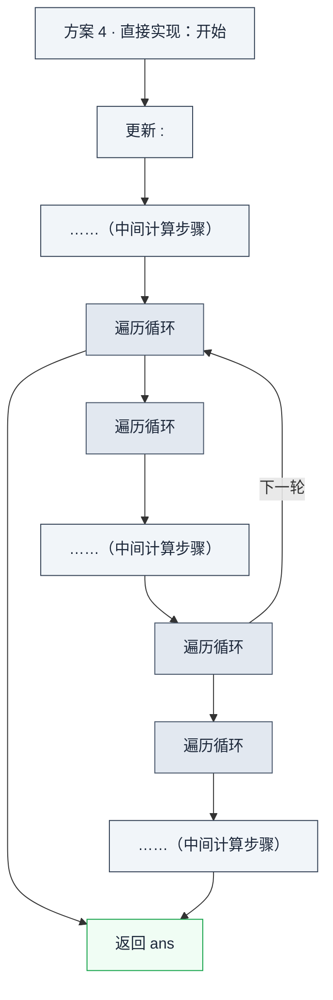

```go
package main // 引入依赖

import (
	"fmt" // 「fmt」
	"os"  // 「os」
)

// maxRedRectangle 忠实翻译 python ref solution_4___4.py（单调栈带哨兵）
func maxRedRectangle(matrix []string) int { // 定义函数/方法 maxRedRectangle
	n := len(matrix)           // 把 长度(矩阵) 写入 n :
	m := len(matrix[0])        // 把 长度(矩阵[0]) 写入 m :
	ans := 0                   // 把 0 写入 ans :
	height := make([]int, m+2) // 把 make([]int, 映射表 加 2) 写入 height :
	for k := 0; k < n; k++ {   // 让 下标 k 从 0 开始计数
		for i := 1; i <= m; i++ { // 让 下标 i 从 1 开始计数
			if matrix[k][i-1] == '.' { // 若 矩阵[下标 k][下标 i 减 1] 等于 '.'
				height[i]++ // height[下标 i] 加一
			} else { // 否则
				height[i] = 0 // 把 0 写入 height[i]
			}
		}
		stack := []int{0}           // 把 []int{0} 写入 stack :
		for i := 1; i <= m+1; i++ { // 让 下标 i 从 1 开始计数
			for len(stack) > 0 && height[stack[len(stack)-1]] > height[i] { // for 长度(栈) 超过 0 且 height[栈[长度(栈) 减 1]] 超过 height[下标 i] {
				nowH := height[stack[len(stack)-1]]  // 把 height[栈[长度(栈) 减 1]] 写入 nowH :
				stack = stack[:len(stack)-1]         // 把 栈[:长度(栈) 减 1] 写入 栈
				width := i - stack[len(stack)-1] - 1 // 把 下标 i 减 栈[长度(栈) 减 1] 减 1 写入 width :
				if nowH*width > ans {                // 若 nowH 乘 width 超过 答案
					ans = nowH * width // 把 nowH 乘 width 写入 答案
				}
			}
			stack = append(stack, i) // 把 append(栈, 下标 i) 写入 栈
		}
	}
	return ans // 返回 答案
}

func main() { // 程序入口：跑内嵌自测用例
	cases := []struct { // 把 []struct { 写入 cases :
		matrix []string // 矩阵 []string
		want   int      // want int
	}{ // }{
		{[]string{".....", "XXXXX", ".X...", "....."}, 6},
		{[]string{"...", "...", "..."}, 9},
		{[]string{"XXX", "XXX"}, 0},
		{[]string{"."}, 1},
		{[]string{"....", "....", "XXXX", "....", "...."}, 8},
	}
	ok := true                // 把 true 写入 ok :
	for _, c := range cases { // 同时取 _ 与 字符 遍历
		if got := maxRedRectangle(c.matrix); got != c.want { // 若 got : 赋值为 maxRedRectangle(字符.矩阵); got 不等于 字符.want
			ok = false                                                       // 把 false 写入 ok
			fmt.Printf("FAIL solve(%v)=%d want %d\n", c.matrix, got, c.want) // 打印输出
		}
	}
	if !ok { // 若 取反 ok
		os.Exit(1) // os.Exit(1)
	}
	fmt.Println("PASS") // 全部用例通过，输出 PASS
}
```

#### 方案 5：方案5（单调栈求最大全 '.' 矩形）

**思路与代码分析**：核心是「方案5（单调栈求最大全 '.' 矩形）」。Go 版用切片与多返回值惯用法，显式处理索引边界。**走读**：方案 5 · 方案5（单调栈求最大全 '.' 矩形）：开始 → 更新 : → 遍历循环 → 遍历循环 → 遍历循环 → 遍历循环 → 返回 ans。

**运行架构**（真实控制流）：

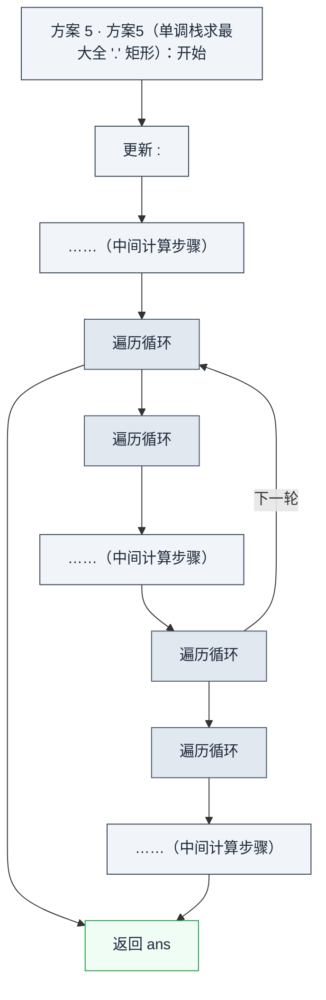

```go
package main // 引入依赖

import (
	"fmt" // 「fmt」
	"os"  // 「os」
)

// maxRedRectangle 忠实翻译 python ref solution_5___5.py（单调栈带哨兵）
func maxRedRectangle(matrix []string) int { // 定义函数/方法 maxRedRectangle
	n := len(matrix)           // 把 长度(矩阵) 写入 n :
	m := len(matrix[0])        // 把 长度(矩阵[0]) 写入 m :
	ans := 0                   // 把 0 写入 ans :
	height := make([]int, m+2) // 把 make([]int, 映射表 加 2) 写入 height :
	for k := 0; k < n; k++ {   // 让 下标 k 从 0 开始计数
		for i := 1; i <= m; i++ { // 让 下标 i 从 1 开始计数
			if matrix[k][i-1] == '.' { // 若 矩阵[下标 k][下标 i 减 1] 等于 '.'
				height[i]++ // height[下标 i] 加一
			} else { // 否则
				height[i] = 0 // 把 0 写入 height[i]
			}
		}
		stack := []int{0}           // 把 []int{0} 写入 stack :
		for i := 1; i <= m+1; i++ { // 让 下标 i 从 1 开始计数
			for len(stack) > 0 && height[stack[len(stack)-1]] > height[i] { // for 长度(栈) 超过 0 且 height[栈[长度(栈) 减 1]] 超过 height[下标 i] {
				nowH := height[stack[len(stack)-1]]  // 把 height[栈[长度(栈) 减 1]] 写入 nowH :
				stack = stack[:len(stack)-1]         // 把 栈[:长度(栈) 减 1] 写入 栈
				width := i - stack[len(stack)-1] - 1 // 把 下标 i 减 栈[长度(栈) 减 1] 减 1 写入 width :
				if nowH*width > ans {                // 若 nowH 乘 width 超过 答案
					ans = nowH * width // 把 nowH 乘 width 写入 答案
				}
			}
			stack = append(stack, i) // 把 append(栈, 下标 i) 写入 栈
		}
	}
	return ans // 返回 答案
}

func main() { // 程序入口：跑内嵌自测用例
	cases := []struct { // 把 []struct { 写入 cases :
		matrix []string // 矩阵 []string
		want   int      // want int
	}{ // }{
		{[]string{".....", "XXXXX", ".X...", "....."}, 6},
		{[]string{"...", "...", "..."}, 9},
		{[]string{"XXX", "XXX"}, 0},
		{[]string{"."}, 1},
		{[]string{"....", "....", "XXXX", "....", "...."}, 8},
	}
	ok := true                // 把 true 写入 ok :
	for _, c := range cases { // 同时取 _ 与 字符 遍历
		if got := maxRedRectangle(c.matrix); got != c.want { // 若 got : 赋值为 maxRedRectangle(字符.矩阵); got 不等于 字符.want
			ok = false                                                       // 把 false 写入 ok
			fmt.Printf("FAIL solve(%v)=%d want %d\n", c.matrix, got, c.want) // 打印输出
		}
	}
	if !ok { // 若 取反 ok
		os.Exit(1) // os.Exit(1)
	}
	fmt.Println("PASS") // 全部用例通过，输出 PASS
}
```

### Java 实现（5 种方案）

Java 的全部方案如下，每个方案都内嵌用例自测，可独立运行（老仓库 python/go 文件遵循「打印结果」约定）：

#### 方案 1：直接实现

**思路与代码分析**：核心是「直接实现」。Java 版用类与静态方法组织，集合操作显式明了。代码里依次做这些事：双重循环遍历。**走读**：方案 1 · 直接实现：开始 → 更新 n → 命中条件，直接返回 → 遍历循环 → 遍历循环 → 遍历循环 → 当 (height[stack[sp - 1]] ＞ height[i]) 时反复执行 → 返回 ans。

**运行架构**（真实控制流）：


```java
package com.webfault.dsa; // 引入依赖

class lcMaxRed { // 定义类型
  int maxRedRectangle(String[] matrix) { // 定义函数/方法 maxRedRectangle
    int n = matrix.length; // 把 矩阵.长度 存入 元素个数
    if (n == 0) return 0; // 若 元素个数 等于 0，直接返回 0
    int m = matrix[0].length(); // 把 矩阵[0].长度() 存入 映射表
    int ans = 0; // 把 0 存入 答案
    int[] height = new int[m + 2]; // 把 new int[映射表 加 2]; 写入 int[] height
    for (int k = 0; k < n; k++) { // 让 下标 k 从 0 开始计数，下标 k 小于 元素个数 就继续
      for (int i = 1; i <= m; i++) { // 让 下标 i 从 1 开始计数，下标 i 不超过 映射表 就继续
        if (matrix[k].charAt(i - 1) == '.')
          height[i] += 1; // 若 矩阵[下标 k] 取字符 下标 i 减 1) 等于 '.') height[下标 i] 累加 1;
        else height[i] = 0; // 否则
      }
      int[] stack = new int[m + 2]; // 把 new int[映射表 加 2]; 写入 int[] stack
      int sp = 0; // 把 0 存入 sp
      stack[sp++] = 0; // 把 0; 写入 stack[sp++]
      for (int i = 1; i < m + 2; i++) { // 让 下标 i 从 1 开始计数，下标 i 小于 映射表 加 2 就继续
        while (height[stack[sp - 1]] > height[i]) { // 循环，直到不满足「height[栈[sp 减 1]] 超过 height[下标 i]」
          int now_h = height[stack[--sp]]; // 把 height[栈[ 减一 sp]] 存入 now_h
          int width = i - stack[sp - 1] - 1; // 把 下标 i 减 栈[sp 减 1] 减 1 存入 width
          if (now_h * width > ans)
            ans = now_h * width; // 若 now_h 乘 width 超过 答案) 答案 赋值为 now_h 乘 width;
        }
        stack[sp++] = i; // 把 下标 i; 写入 stack[sp++]
      }
    }
    return ans; // 返回 答案
  }

  public static void main(String[] args) { // public static void main(String[] args) {
    lcMaxRed s = new lcMaxRed(); // 把 new lcMaxRed(); 写入 lcMaxRed s
    String[][][] cases = { // 把 { 写入 String[][][] cases
      {{".....", "XXXXX", ".X...", "....."}},
      {{"X"}},
      {{"."}},
      {{".X"}, {"X."}} // {{「.X」}, {「.X」}}
    };
    int[] wants = {6, 0, 1, 1}; // 把 {6, 0, 1, 1}; 写入 int[] wants
    boolean ok = true; // 把 true; 写入 boolean ok
    for (int i = 0; i < wants.length; i++) { // 让 下标 i 从 0 开始计数，下标 i 小于 wants.长度 就继续
      int got = s.maxRedRectangle(cases[i][0]); // 把 字符串.maxRedRectangle(cases[下标 i][0]) 存入 got
      if (got != wants[i]) {
        ok = false;
        System.out.println("FAIL case " + i + " got " + got + " want " + wants[i]);
      }
    }
    if (!ok) throw new RuntimeException("FAILED"); // 若 取反 ok) throw new RuntimeException(「FAILED」);
    System.out.println("PASS"); // 全部用例通过，输出 PASS
  }
}
```

#### 方案 2：直接实现

**思路与代码分析**：核心是「直接实现」。Java 版用类与静态方法组织，集合操作显式明了。代码里依次做这些事：双重循环遍历。**走读**：方案 2 · 直接实现：开始 → 更新 n → 命中条件，直接返回 → 遍历循环 → 遍历循环 → 遍历循环 → 当 (height[stack[sp - 1]] ＞ height[i]) 时反复执行 → 返回 ans。

**运行架构**（真实控制流）：


```java
package com.webfault.dsa; // 引入依赖

class lcMaxRed { // 定义类型
  int maxRedRectangle(String[] matrix) { // 定义函数/方法 maxRedRectangle
    int n = matrix.length; // 把 矩阵.长度 存入 元素个数
    if (n == 0) return 0; // 若 元素个数 等于 0，直接返回 0
    int m = matrix[0].length(); // 把 矩阵[0].长度() 存入 映射表
    int ans = 0; // 把 0 存入 答案
    int[] height = new int[m + 2]; // 把 new int[映射表 加 2]; 写入 int[] height
    for (int k = 0; k < n; k++) { // 让 下标 k 从 0 开始计数，下标 k 小于 元素个数 就继续
      for (int i = 1; i <= m; i++) { // 让 下标 i 从 1 开始计数，下标 i 不超过 映射表 就继续
        if (matrix[k].charAt(i - 1) == '.')
          height[i] += 1; // 若 矩阵[下标 k] 取字符 下标 i 减 1) 等于 '.') height[下标 i] 累加 1;
        else height[i] = 0; // 否则
      }
      int[] stack = new int[m + 2]; // 把 new int[映射表 加 2]; 写入 int[] stack
      int sp = 0; // 把 0 存入 sp
      stack[sp++] = 0; // 把 0; 写入 stack[sp++]
      for (int i = 1; i < m + 2; i++) { // 让 下标 i 从 1 开始计数，下标 i 小于 映射表 加 2 就继续
        while (height[stack[sp - 1]] > height[i]) { // 循环，直到不满足「height[栈[sp 减 1]] 超过 height[下标 i]」
          int now_h = height[stack[--sp]]; // 把 height[栈[ 减一 sp]] 存入 now_h
          int width = i - stack[sp - 1] - 1; // 把 下标 i 减 栈[sp 减 1] 减 1 存入 width
          if (now_h * width > ans)
            ans = now_h * width; // 若 now_h 乘 width 超过 答案) 答案 赋值为 now_h 乘 width;
        }
        stack[sp++] = i; // 把 下标 i; 写入 stack[sp++]
      }
    }
    return ans; // 返回 答案
  }

  public static void main(String[] args) { // public static void main(String[] args) {
    lcMaxRed s = new lcMaxRed(); // 把 new lcMaxRed(); 写入 lcMaxRed s
    String[][][] cases = { // 把 { 写入 String[][][] cases
      {{".....", "XXXXX", ".X...", "....."}},
      {{"X"}},
      {{"."}},
      {{".X"}, {"X."}} // {{「.X」}, {「.X」}}
    };
    int[] wants = {6, 0, 1, 1}; // 把 {6, 0, 1, 1}; 写入 int[] wants
    boolean ok = true; // 把 true; 写入 boolean ok
    for (int i = 0; i < wants.length; i++) { // 让 下标 i 从 0 开始计数，下标 i 小于 wants.长度 就继续
      int got = s.maxRedRectangle(cases[i][0]); // 把 字符串.maxRedRectangle(cases[下标 i][0]) 存入 got
      if (got != wants[i]) {
        ok = false;
        System.out.println("FAIL case " + i + " got " + got + " want " + wants[i]);
      }
    }
    if (!ok) throw new RuntimeException("FAILED"); // 若 取反 ok) throw new RuntimeException(「FAILED」);
    System.out.println("PASS"); // 全部用例通过，输出 PASS
  }
}
```

#### 方案 3：迭代指针处理

**思路与代码分析**：核心是「迭代指针处理」。Java 版用类与静态方法组织，集合操作显式明了。代码里依次做这些事：双重循环遍历。**走读**：方案 3 · 迭代指针处理：开始 → 更新 n → 命中条件，直接返回 → 遍历循环 → 遍历循环 → 遍历循环 → 当 (height[stack[sp - 1]] ＞ height[i]) 时反复执行 → 返回 ans。

**运行架构**（真实控制流）：

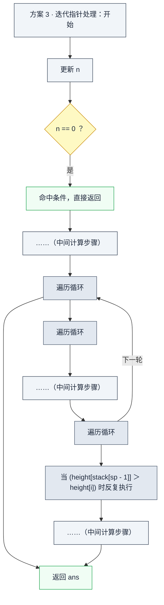

```java
package com.webfault.dsa; // 引入依赖

class lcMaxRed { // 定义类型
  int maxRedRectangle(String[] matrix) { // 定义函数/方法 maxRedRectangle
    int n = matrix.length; // 把 矩阵.长度 存入 元素个数
    if (n == 0) return 0; // 若 元素个数 等于 0，直接返回 0
    int m = matrix[0].length(); // 把 矩阵[0].长度() 存入 映射表
    int ans = 0; // 把 0 存入 答案
    int[] height = new int[m + 2]; // 把 new int[映射表 加 2]; 写入 int[] height
    for (int k = 0; k < n; k++) { // 让 下标 k 从 0 开始计数，下标 k 小于 元素个数 就继续
      for (int i = 1; i <= m; i++) { // 让 下标 i 从 1 开始计数，下标 i 不超过 映射表 就继续
        if (matrix[k].charAt(i - 1) == '.')
          height[i] += 1; // 若 矩阵[下标 k] 取字符 下标 i 减 1) 等于 '.') height[下标 i] 累加 1;
        else height[i] = 0; // 否则
      }
      int[] stack = new int[m + 2]; // 把 new int[映射表 加 2]; 写入 int[] stack
      int sp = 0; // 把 0 存入 sp
      stack[sp++] = 0; // 把 0; 写入 stack[sp++]
      for (int i = 1; i < m + 2; i++) { // 让 下标 i 从 1 开始计数，下标 i 小于 映射表 加 2 就继续
        while (height[stack[sp - 1]] > height[i]) { // 循环，直到不满足「height[栈[sp 减 1]] 超过 height[下标 i]」
          int now_h = height[stack[--sp]]; // 把 height[栈[ 减一 sp]] 存入 now_h
          int width = i - stack[sp - 1] - 1; // 把 下标 i 减 栈[sp 减 1] 减 1 存入 width
          if (now_h * width > ans)
            ans = now_h * width; // 若 now_h 乘 width 超过 答案) 答案 赋值为 now_h 乘 width;
        }
        stack[sp++] = i; // 把 下标 i; 写入 stack[sp++]
      }
    }
    return ans; // 返回 答案
  }

  public static void main(String[] args) { // public static void main(String[] args) {
    lcMaxRed s = new lcMaxRed(); // 把 new lcMaxRed(); 写入 lcMaxRed s
    String[][][] cases = { // 把 { 写入 String[][][] cases
      {{".....", "XXXXX", ".X...", "....."}},
      {{"X"}},
      {{"."}},
      {{".X"}, {"X."}} // {{「.X」}, {「.X」}}
    };
    int[] wants = {6, 0, 1, 1}; // 把 {6, 0, 1, 1}; 写入 int[] wants
    boolean ok = true; // 把 true; 写入 boolean ok
    for (int i = 0; i < wants.length; i++) { // 让 下标 i 从 0 开始计数，下标 i 小于 wants.长度 就继续
      int got = s.maxRedRectangle(cases[i][0]); // 把 字符串.maxRedRectangle(cases[下标 i][0]) 存入 got
      if (got != wants[i]) {
        ok = false;
        System.out.println("FAIL case " + i + " got " + got + " want " + wants[i]);
      }
    }
    if (!ok) throw new RuntimeException("FAILED"); // 若 取反 ok) throw new RuntimeException(「FAILED」);
    System.out.println("PASS"); // 全部用例通过，输出 PASS
  }
}
```

#### 方案 4：直接实现

**思路与代码分析**：核心是「直接实现」。Java 版用类与静态方法组织，集合操作显式明了。代码里依次做这些事：双重循环遍历。**走读**：方案 4 · 直接实现：开始 → 更新 n → 命中条件，直接返回 → 遍历循环 → 遍历循环 → 遍历循环 → 当 (height[stack[sp - 1]] ＞ height[i]) 时反复执行 → 返回 ans。

**运行架构**（真实控制流）：

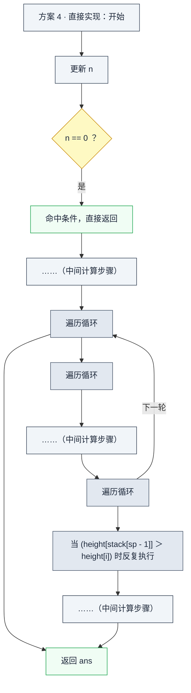

```java
package com.webfault.dsa; // 引入依赖

class lcMaxRed { // 定义类型
  int maxRedRectangle(String[] matrix) { // 定义函数/方法 maxRedRectangle
    int n = matrix.length; // 把 矩阵.长度 存入 元素个数
    if (n == 0) return 0; // 若 元素个数 等于 0，直接返回 0
    int m = matrix[0].length(); // 把 矩阵[0].长度() 存入 映射表
    int ans = 0; // 把 0 存入 答案
    int[] height = new int[m + 2]; // 把 new int[映射表 加 2]; 写入 int[] height
    for (int k = 0; k < n; k++) { // 让 下标 k 从 0 开始计数，下标 k 小于 元素个数 就继续
      for (int i = 1; i <= m; i++) { // 让 下标 i 从 1 开始计数，下标 i 不超过 映射表 就继续
        if (matrix[k].charAt(i - 1) == '.')
          height[i] += 1; // 若 矩阵[下标 k] 取字符 下标 i 减 1) 等于 '.') height[下标 i] 累加 1;
        else height[i] = 0; // 否则
      }
      int[] stack = new int[m + 2]; // 把 new int[映射表 加 2]; 写入 int[] stack
      int sp = 0; // 把 0 存入 sp
      stack[sp++] = 0; // 把 0; 写入 stack[sp++]
      for (int i = 1; i < m + 2; i++) { // 让 下标 i 从 1 开始计数，下标 i 小于 映射表 加 2 就继续
        while (height[stack[sp - 1]] > height[i]) { // 循环，直到不满足「height[栈[sp 减 1]] 超过 height[下标 i]」
          int now_h = height[stack[--sp]]; // 把 height[栈[ 减一 sp]] 存入 now_h
          int width = i - stack[sp - 1] - 1; // 把 下标 i 减 栈[sp 减 1] 减 1 存入 width
          if (now_h * width > ans)
            ans = now_h * width; // 若 now_h 乘 width 超过 答案) 答案 赋值为 now_h 乘 width;
        }
        stack[sp++] = i; // 把 下标 i; 写入 stack[sp++]
      }
    }
    return ans; // 返回 答案
  }

  public static void main(String[] args) { // public static void main(String[] args) {
    lcMaxRed s = new lcMaxRed(); // 把 new lcMaxRed(); 写入 lcMaxRed s
    String[][][] cases = { // 把 { 写入 String[][][] cases
      {{".....", "XXXXX", ".X...", "....."}},
      {{"X"}},
      {{"."}},
      {{".X"}, {"X."}} // {{「.X」}, {「.X」}}
    };
    int[] wants = {6, 0, 1, 1}; // 把 {6, 0, 1, 1}; 写入 int[] wants
    boolean ok = true; // 把 true; 写入 boolean ok
    for (int i = 0; i < wants.length; i++) { // 让 下标 i 从 0 开始计数，下标 i 小于 wants.长度 就继续
      int got = s.maxRedRectangle(cases[i][0]); // 把 字符串.maxRedRectangle(cases[下标 i][0]) 存入 got
      if (got != wants[i]) {
        ok = false;
        System.out.println("FAIL case " + i + " got " + got + " want " + wants[i]);
      }
    }
    if (!ok) throw new RuntimeException("FAILED"); // 若 取反 ok) throw new RuntimeException(「FAILED」);
    System.out.println("PASS"); // 全部用例通过，输出 PASS
  }
}
```

#### 方案 5：方案5（单调栈求最大全 '.' 矩形）

**思路与代码分析**：核心是「方案5（单调栈求最大全 '.' 矩形）」。Java 版用类与静态方法组织，集合操作显式明了。代码里依次做这些事：双重循环遍历。**走读**：方案 5 · 方案5（单调栈求最大全 '.' 矩形）：开始 → 更新 n → 命中条件，直接返回 → 遍历循环 → 遍历循环 → 遍历循环 → 当 (height[stack[sp - 1]] ＞ height[i]) 时反复执行 → 返回 ans。

**运行架构**（真实控制流）：

```mermaid
graph TD
    N0["方案 5 · 方案5（单调栈求最大全 '.' 矩形）：开始"]
    N1["更新 n"]
    N2{"n == 0 ？"}
    N3["命中条件，直接返回"]
    D1["……（中间计算步骤）"]
    N7["遍历循环"]
    N8["遍历循环"]
    D2["……（中间计算步骤）"]
    N14["遍历循环"]
    N15["当 (height[stack[sp - 1]] ＞ height[i]) 时反复执行"]
    D3["……（中间计算步骤）"]
    N21["返回 ans"]
    N0 --> N1
    N1 --> N2
    N2 -- 是 --> N3
    N7 --> N8
    N14 --> N15
    N14 -- 下一轮 --> N7
    N7 --> N21
    N3 --> D1
    D1 --> N7
    N8 --> D2
    D2 --> N14
    N15 --> D3
    D3 --> N21
    classDef n fill:#f1f5f9,stroke:#334155,color:#1e293b;
    classDef lp fill:#e2e8f0,stroke:#475569,color:#1e293b;
    classDef dc fill:#fef9c3,stroke:#ca8a04,color:#1e293b;
    classDef tm fill:#f0fdf4,stroke:#16a34a,color:#1e293b;
    class N0,N1,D1,D2,D3 n;
    class N7,N8,N14,N15 lp;
    class N2 dc;
    class N3,N21 tm;
```

```java
package com.webfault.dsa; // 引入依赖

class lcMaxRed { // 定义类型
  int maxRedRectangle(String[] matrix) { // 定义函数/方法 maxRedRectangle
    int n = matrix.length; // 把 矩阵.长度 存入 元素个数
    if (n == 0) return 0; // 若 元素个数 等于 0，直接返回 0
    int m = matrix[0].length(); // 把 矩阵[0].长度() 存入 映射表
    int ans = 0; // 把 0 存入 答案
    int[] height = new int[m + 2]; // 把 new int[映射表 加 2]; 写入 int[] height
    for (int k = 0; k < n; k++) { // 让 下标 k 从 0 开始计数，下标 k 小于 元素个数 就继续
      for (int i = 1; i <= m; i++) { // 让 下标 i 从 1 开始计数，下标 i 不超过 映射表 就继续
        if (matrix[k].charAt(i - 1) == '.')
          height[i] += 1; // 若 矩阵[下标 k] 取字符 下标 i 减 1) 等于 '.') height[下标 i] 累加 1;
        else height[i] = 0; // 否则
      }
      int[] stack = new int[m + 2]; // 把 new int[映射表 加 2]; 写入 int[] stack
      int sp = 0; // 把 0 存入 sp
      stack[sp++] = 0; // 把 0; 写入 stack[sp++]
      for (int i = 1; i < m + 2; i++) { // 让 下标 i 从 1 开始计数，下标 i 小于 映射表 加 2 就继续
        while (height[stack[sp - 1]] > height[i]) { // 循环，直到不满足「height[栈[sp 减 1]] 超过 height[下标 i]」
          int now_h = height[stack[--sp]]; // 把 height[栈[ 减一 sp]] 存入 now_h
          int width = i - stack[sp - 1] - 1; // 把 下标 i 减 栈[sp 减 1] 减 1 存入 width
          if (now_h * width > ans)
            ans = now_h * width; // 若 now_h 乘 width 超过 答案) 答案 赋值为 now_h 乘 width;
        }
        stack[sp++] = i; // 把 下标 i; 写入 stack[sp++]
      }
    }
    return ans; // 返回 答案
  }

  public static void main(String[] args) { // public static void main(String[] args) {
    lcMaxRed s = new lcMaxRed(); // 把 new lcMaxRed(); 写入 lcMaxRed s
    String[][][] cases = { // 把 { 写入 String[][][] cases
      {{".....", "XXXXX", ".X...", "....."}},
      {{"X"}},
      {{"."}},
      {{".X"}, {"X."}} // {{「.X」}, {「.X」}}
    };
    int[] wants = {6, 0, 1, 1}; // 把 {6, 0, 1, 1}; 写入 int[] wants
    boolean ok = true; // 把 true; 写入 boolean ok
    for (int i = 0; i < wants.length; i++) { // 让 下标 i 从 0 开始计数，下标 i 小于 wants.长度 就继续
      int got = s.maxRedRectangle(cases[i][0]); // 把 字符串.maxRedRectangle(cases[下标 i][0]) 存入 got
      if (got != wants[i]) {
        ok = false;
        System.out.println("FAIL case " + i + " got " + got + " want " + wants[i]);
      }
    }
    if (!ok) throw new RuntimeException("FAILED"); // 若 取反 ok) throw new RuntimeException(「FAILED」);
    System.out.println("PASS"); // 全部用例通过，输出 PASS
  }
}
```

### Rust 实现（5 种方案）

Rust 的全部方案如下，每个方案都内嵌用例自测，可独立运行（老仓库 python/go 文件遵循「打印结果」约定）：

#### 方案 1：直接实现

**思路与代码分析**：核心是「直接实现」。Rust 版用所有权移动与切片借用改写同一逻辑，注意 Option 与引用边界。**走读**：方案 1 · 直接实现：开始 → 计算 bytes → 遍历 0..n 中的每个元素 k → 遍历 1..=m 中的每个元素 i → 遍历 1..=m 中的每个元素 a → 遍历 a..=m 中的每个元素 c → 返回结果。

**运行架构**（真实控制流）：

```mermaid
graph TD
    N0["方案 1 · 直接实现：开始"]
    N1["计算 bytes"]
    D1["……（中间计算步骤）"]
    N4["遍历 0..n 中的每个元素 k"]
    N5["遍历 1..=m 中的每个元素 i"]
    D2["……（中间计算步骤）"]
    N9["遍历 1..=m 中的每个元素 a"]
    D3["……（中间计算步骤）"]
    N11["遍历 a..=m 中的每个元素 c"]
    D4["……（中间计算步骤）"]
    N18["返回结果"]
    N0 --> N1
    N4 --> N5
    N5 --> N9
    N9 -- 下一轮 --> N4
    N1 --> D1
    D1 --> N4
    N5 --> D2
    D2 --> N9
    N9 --> D3
    D3 --> N11
    N11 --> D4
    D4 --> N18
    classDef n fill:#f1f5f9,stroke:#334155,color:#1e293b;
    classDef lp fill:#e2e8f0,stroke:#475569,color:#1e293b;
    classDef dc fill:#fef9c3,stroke:#ca8a04,color:#1e293b;
    classDef tm fill:#f0fdf4,stroke:#16a34a,color:#1e293b;
    class N0,N1,D1,D2,D3,D4 n;
    class N4,N5,N9,N11 lp;
    class N18 tm;
```

```rust
// LeetCode 107431726. 最大红矩形分析 — Rust 版（方案A：逐行高度 + 暴力区间 / 卡片扩展）
fn get_result(n: usize, m: usize, matrix: &[&str]) -> i64 {
    // 定义函数/方法 get_result
    let bytes: Vec<&[u8]> = matrix.iter().map(|s| s.as_bytes()).collect();
    let mut ans = 0i64; // 把 0i64; 写入 let mut ans
    let mut height = vec![0i64; m + 2]; // 把 vec取反 [0i64; 映射表 加 2]; 写入 let mut height
    for k in 0..n {
        // 逐个取出 0 的元素（下标 k）
        for i in 1..=m {
            // 逐个取出 1 的元素（下标 i）
            if bytes[k][i - 1] == b'.' {
                // 若 bytes[下标 k][下标 i 减 1] 等于 b'.'
                height[i] += 1; // height[i]累加 1
            } else {
                // 否则
                height[i] = 0; // 把 0; 写入 height[i]
            }
        }
        for a in 1..=m {
            // 逐个取出 1 的元素（数组）
            let mut min_h = 50000i64; // 把 50000i64; 写入 let mut min_h
            for c in a..=m {
                // 逐个取出 数组 的元素（字符）
                if height[c] < min_h {
                    // 若 height[字符] 小于 min_h
                    min_h = height[c]; // 把 height[字符]; 写入 min_h
                }
            }
            let area = (m - a + 1) as i64 * min_h; // 把 (映射表 减 数组 加 1) as i64 乘 min_h 存入 area
            if area > ans {
                // 若 area 超过 答案
                ans = area; // 把 area; 写入 答案
            }
        }
    }
    ans // 答案
}

fn get_result_card(n: usize, m: usize, matrix: &[&str]) -> i64 {
    // 定义函数/方法 get_result_card
    let bytes: Vec<&[u8]> = matrix.iter().map(|s| s.as_bytes()).collect();
    let mut ans = 0i64; // 把 0i64; 写入 let mut ans
    let mut height = vec![0i64; m + 2]; // 把 vec取反 [0i64; 映射表 加 2]; 写入 let mut height
    for k in 0..n {
        // 逐个取出 0 的元素（下标 k）
        for i in 1..=m {
            // 逐个取出 1 的元素（下标 i）
            if bytes[k][i - 1] == b'.' {
                // 若 bytes[下标 k][下标 i 减 1] 等于 b'.'
                height[i] += 1; // height[i]累加 1
            } else {
                // 否则
                height[i] = 0; // 把 0; 写入 height[i]
            }
        }
        for a in 1..=m {
            // 逐个取出 1 的元素（数组）
            let cur_h = height[a]; // 把 height[数组] 存入 cur_h
            let mut lo = a as i64 - 1; // 把 数组 as i64 减 1; 写入 let mut lo
            while lo >= 1 && height[lo as usize] >= cur_h {
                // 把 1 且 height[左边界 as usize] 不低于 cur_h { 写入 while lo >
                lo -= 1; // 左边界累减 1
            }
            let mut hi = a + 1; // 把 数组 加 1; 写入 let mut hi
            while hi <= m && height[hi] >= cur_h {
                // 把 映射表 且 height[右边界] 不低于 cur_h { 写入 while hi <
                hi += 1; // 右边界累加 1
            }
            let area = (hi - lo as usize - 1) as i64 * cur_h; // 把 (右边界 减 左边界 as usize 减 1) as i64 乘 cur_h 存入 area
            if area > ans {
                // 若 area 超过 答案
                ans = area; // 把 area; 写入 答案
            }
        }
    }
    ans // 答案
}

fn main() {
    // 程序入口：跑内嵌自测用例
    let matrix = [".....", "XXXXX", ".X...", "....."]; // 把 [「.....」, 「.....」, 「.....」, 「.....」] 存入 矩阵
    assert_eq!(get_result(4, 5, &matrix), 6, "brute"); // 断言校验
    assert_eq!(get_result_card(4, 5, &matrix), 6, "card"); // 断言校验
    println!("PASS"); // 全部用例通过，输出 PASS
}
```

#### 方案 2：直接实现

**思路与代码分析**：核心是「直接实现」。Rust 版用所有权移动与切片借用改写同一逻辑，注意 Option 与引用边界。**走读**：方案 2 · 直接实现：开始 → 计算 bytes → 遍历 0..n 中的每个元素 k → 遍历 1..=m 中的每个元素 i → 遍历 1..=m 中的每个元素 a → 遍历 a..=m 中的每个元素 c → 返回结果。

**运行架构**（真实控制流）：

```mermaid
graph TD
    N0["方案 2 · 直接实现：开始"]
    N1["计算 bytes"]
    D1["……（中间计算步骤）"]
    N4["遍历 0..n 中的每个元素 k"]
    N5["遍历 1..=m 中的每个元素 i"]
    D2["……（中间计算步骤）"]
    N9["遍历 1..=m 中的每个元素 a"]
    D3["……（中间计算步骤）"]
    N11["遍历 a..=m 中的每个元素 c"]
    D4["……（中间计算步骤）"]
    N18["返回结果"]
    N0 --> N1
    N4 --> N5
    N5 --> N9
    N9 -- 下一轮 --> N4
    N1 --> D1
    D1 --> N4
    N5 --> D2
    D2 --> N9
    N9 --> D3
    D3 --> N11
    N11 --> D4
    D4 --> N18
    classDef n fill:#f1f5f9,stroke:#334155,color:#1e293b;
    classDef lp fill:#e2e8f0,stroke:#475569,color:#1e293b;
    classDef dc fill:#fef9c3,stroke:#ca8a04,color:#1e293b;
    classDef tm fill:#f0fdf4,stroke:#16a34a,color:#1e293b;
    class N0,N1,D1,D2,D3,D4 n;
    class N4,N5,N9,N11 lp;
    class N18 tm;
```

```rust
// LeetCode 107431726. 最大红矩形分析 — Rust 版（方案A：逐行高度 + 暴力区间 / 卡片扩展）
fn get_result(n: usize, m: usize, matrix: &[&str]) -> i64 {
    // 定义函数/方法 get_result
    let bytes: Vec<&[u8]> = matrix.iter().map(|s| s.as_bytes()).collect();
    let mut ans = 0i64; // 把 0i64; 写入 let mut ans
    let mut height = vec![0i64; m + 2]; // 把 vec取反 [0i64; 映射表 加 2]; 写入 let mut height
    for k in 0..n {
        // 逐个取出 0 的元素（下标 k）
        for i in 1..=m {
            // 逐个取出 1 的元素（下标 i）
            if bytes[k][i - 1] == b'.' {
                // 若 bytes[下标 k][下标 i 减 1] 等于 b'.'
                height[i] += 1; // height[i]累加 1
            } else {
                // 否则
                height[i] = 0; // 把 0; 写入 height[i]
            }
        }
        for a in 1..=m {
            // 逐个取出 1 的元素（数组）
            let mut min_h = 50000i64; // 把 50000i64; 写入 let mut min_h
            for c in a..=m {
                // 逐个取出 数组 的元素（字符）
                if height[c] < min_h {
                    // 若 height[字符] 小于 min_h
                    min_h = height[c]; // 把 height[字符]; 写入 min_h
                }
            }
            let area = (m - a + 1) as i64 * min_h; // 把 (映射表 减 数组 加 1) as i64 乘 min_h 存入 area
            if area > ans {
                // 若 area 超过 答案
                ans = area; // 把 area; 写入 答案
            }
        }
    }
    ans // 答案
}

fn get_result_card(n: usize, m: usize, matrix: &[&str]) -> i64 {
    // 定义函数/方法 get_result_card
    let bytes: Vec<&[u8]> = matrix.iter().map(|s| s.as_bytes()).collect();
    let mut ans = 0i64; // 把 0i64; 写入 let mut ans
    let mut height = vec![0i64; m + 2]; // 把 vec取反 [0i64; 映射表 加 2]; 写入 let mut height
    for k in 0..n {
        // 逐个取出 0 的元素（下标 k）
        for i in 1..=m {
            // 逐个取出 1 的元素（下标 i）
            if bytes[k][i - 1] == b'.' {
                // 若 bytes[下标 k][下标 i 减 1] 等于 b'.'
                height[i] += 1; // height[i]累加 1
            } else {
                // 否则
                height[i] = 0; // 把 0; 写入 height[i]
            }
        }
        for a in 1..=m {
            // 逐个取出 1 的元素（数组）
            let cur_h = height[a]; // 把 height[数组] 存入 cur_h
            let mut lo = a as i64 - 1; // 把 数组 as i64 减 1; 写入 let mut lo
            while lo >= 1 && height[lo as usize] >= cur_h {
                // 把 1 且 height[左边界 as usize] 不低于 cur_h { 写入 while lo >
                lo -= 1; // 左边界累减 1
            }
            let mut hi = a + 1; // 把 数组 加 1; 写入 let mut hi
            while hi <= m && height[hi] >= cur_h {
                // 把 映射表 且 height[右边界] 不低于 cur_h { 写入 while hi <
                hi += 1; // 右边界累加 1
            }
            let area = (hi - lo as usize - 1) as i64 * cur_h; // 把 (右边界 减 左边界 as usize 减 1) as i64 乘 cur_h 存入 area
            if area > ans {
                // 若 area 超过 答案
                ans = area; // 把 area; 写入 答案
            }
        }
    }
    ans // 答案
}

fn main() {
    // 程序入口：跑内嵌自测用例
    let matrix = [".....", "XXXXX", ".X...", "....."]; // 把 [「.....」, 「.....」, 「.....」, 「.....」] 存入 矩阵
    assert_eq!(get_result(4, 5, &matrix), 6, "brute"); // 断言校验
    assert_eq!(get_result_card(4, 5, &matrix), 6, "card"); // 断言校验
    println!("PASS"); // 全部用例通过，输出 PASS
}
```

#### 方案 3：迭代指针处理

**思路与代码分析**：核心是「迭代指针处理」。Rust 版用所有权移动与切片借用改写同一逻辑，注意 Option 与引用边界。代码里依次做这些事：栈的后进先出操作。**走读**：方案 3 · 迭代指针处理：开始 → 计算 n → 遍历 0..n 中的每个元素 k → 遍历 1..=m 中的每个元素 i → 遍历 1..=m + 1 中的每个元素 i → 当 height[*stack.last().unwrap()] ＞ height[i] 时反复执行 → 返回结果。

**运行架构**（真实控制流）：

```mermaid
graph TD
    N0["方案 3 · 迭代指针处理：开始"]
    N1["计算 n"]
    D1["……（中间计算步骤）"]
    N5["遍历 0..n 中的每个元素 k"]
    D2["……（中间计算步骤）"]
    N7["遍历 1..=m 中的每个元素 i"]
    D3["……（中间计算步骤）"]
    N12["遍历 1..=m + 1 中的每个元素 i"]
    N13["当 height[*stack.last().unwrap()] ＞ height[i] 时反复执行"]
    D4["……（中间计算步骤）"]
    N22["返回结果"]
    N0 --> N1
    N12 --> N13
    N12 -- 下一轮 --> N5
    N1 --> D1
    D1 --> N5
    N5 --> D2
    D2 --> N7
    N7 --> D3
    D3 --> N12
    N13 --> D4
    D4 --> N22
    classDef n fill:#f1f5f9,stroke:#334155,color:#1e293b;
    classDef lp fill:#e2e8f0,stroke:#475569,color:#1e293b;
    classDef dc fill:#fef9c3,stroke:#ca8a04,color:#1e293b;
    classDef tm fill:#f0fdf4,stroke:#16a34a,color:#1e293b;
    class N0,N1,D1,D2,D3,D4 n;
    class N5,N7,N12,N13 lp;
    class N22 tm;
```

```rust
// LeetCode 107431726. 最大红矩形分析 — Rust 版（方案C：逐行高度 + 单调栈）
fn max_red_rectangle(matrix: &[&str]) -> i64 {
    // 定义函数/方法 max_red_rectangle
    let n = matrix.len(); // 把 矩阵.长度() 存入 元素个数
    let m = matrix[0].len(); // 把 矩阵[0].长度() 存入 映射表
    let mut ans = 0i64; // 把 0i64; 写入 let mut ans
    let mut height = vec![0i64; m + 2]; // 把 vec取反 [0i64; 映射表 加 2]; 写入 let mut height
    for k in 0..n {
        // 逐个取出 0 的元素（下标 k）
        let row = matrix[k].as_bytes(); // 把 矩阵[下标 k].as_bytes() 存入 row
        for i in 1..=m {
            // 逐个取出 1 的元素（下标 i）
            if row[i - 1] == b'.' {
                // 若 row[下标 i 减 1] 等于 b'.'
                height[i] += 1; // height[i]累加 1
            } else {
                // 否则
                height[i] = 0; // 把 0; 写入 height[i]
            }
        }
        let mut stack: Vec<usize> = vec![0]; // 把 vec取反 [0]; 写入 let mut stack: Vec<usize>
        for i in 1..=m + 1 {
            // 逐个取出 1 的元素（下标 i）
            while height[*stack.last().unwrap()] > height[i] {
                // while height[ 乘 栈.last().unwrap()] 超过 height[下标 i] {
                let top = stack.pop().unwrap(); // 把 栈 弹出 ).unwrap() 存入 top
                let now_h = height[top]; // 把 height[top] 存入 now_h
                let width = i - stack.last().unwrap() - 1; // 把 下标 i 减 栈.last().unwrap() 减 1 存入 width
                let area = now_h * width as i64; // 把 now_h 乘 width as i64 存入 area
                if area > ans {
                    // 若 area 超过 答案
                    ans = area; // 把 area; 写入 答案
                }
            }
            stack.push(i); // 把 下标 i 压入栈/数组尾部
        }
    }
    ans // 答案
}

fn main() {
    // 程序入口：跑内嵌自测用例
    let matrix = [".....", "XXXXX", ".X...", "....."]; // 把 [「.....」, 「.....」, 「.....」, 「.....」] 存入 矩阵
    assert_eq!(max_red_rectangle(&matrix), 6, "mono"); // 断言校验
    println!("PASS"); // 全部用例通过，输出 PASS
}
```

#### 方案 4：直接实现

**思路与代码分析**：核心是「直接实现」。Rust 版用所有权移动与切片借用改写同一逻辑，注意 Option 与引用边界。代码里依次做这些事：栈的后进先出操作。**走读**：方案 4 · 直接实现：开始 → 计算 n → 遍历 0..n 中的每个元素 k → 遍历 1..=m 中的每个元素 i → 遍历 1..=m + 1 中的每个元素 i → 当 height[*stack.last().unwrap()] ＞ height[i] 时反复执行 → 返回结果。

**运行架构**（真实控制流）：

```mermaid
graph TD
    N0["方案 4 · 直接实现：开始"]
    N1["计算 n"]
    D1["……（中间计算步骤）"]
    N5["遍历 0..n 中的每个元素 k"]
    D2["……（中间计算步骤）"]
    N7["遍历 1..=m 中的每个元素 i"]
    D3["……（中间计算步骤）"]
    N12["遍历 1..=m + 1 中的每个元素 i"]
    N13["当 height[*stack.last().unwrap()] ＞ height[i] 时反复执行"]
    D4["……（中间计算步骤）"]
    N22["返回结果"]
    N0 --> N1
    N12 --> N13
    N12 -- 下一轮 --> N5
    N1 --> D1
    D1 --> N5
    N5 --> D2
    D2 --> N7
    N7 --> D3
    D3 --> N12
    N13 --> D4
    D4 --> N22
    classDef n fill:#f1f5f9,stroke:#334155,color:#1e293b;
    classDef lp fill:#e2e8f0,stroke:#475569,color:#1e293b;
    classDef dc fill:#fef9c3,stroke:#ca8a04,color:#1e293b;
    classDef tm fill:#f0fdf4,stroke:#16a34a,color:#1e293b;
    class N0,N1,D1,D2,D3,D4 n;
    class N5,N7,N12,N13 lp;
    class N22 tm;
```

```rust
// LeetCode 107431726. 最大红矩形分析 — Rust 版（方案D：逐行高度 + 单调栈）
fn max_red_rectangle(matrix: &[&str]) -> i64 {
    // 定义函数/方法 max_red_rectangle
    let n = matrix.len(); // 把 矩阵.长度() 存入 元素个数
    let m = matrix[0].len(); // 把 矩阵[0].长度() 存入 映射表
    let mut ans = 0i64; // 把 0i64; 写入 let mut ans
    let mut height = vec![0i64; m + 2]; // 把 vec取反 [0i64; 映射表 加 2]; 写入 let mut height
    for k in 0..n {
        // 逐个取出 0 的元素（下标 k）
        let row = matrix[k].as_bytes(); // 把 矩阵[下标 k].as_bytes() 存入 row
        for i in 1..=m {
            // 逐个取出 1 的元素（下标 i）
            if row[i - 1] == b'.' {
                // 若 row[下标 i 减 1] 等于 b'.'
                height[i] += 1; // height[i]累加 1
            } else {
                // 否则
                height[i] = 0; // 把 0; 写入 height[i]
            }
        }
        let mut stack: Vec<usize> = vec![0]; // 把 vec取反 [0]; 写入 let mut stack: Vec<usize>
        for i in 1..=m + 1 {
            // 逐个取出 1 的元素（下标 i）
            while height[*stack.last().unwrap()] > height[i] {
                // while height[ 乘 栈.last().unwrap()] 超过 height[下标 i] {
                let top = stack.pop().unwrap(); // 把 栈 弹出 ).unwrap() 存入 top
                let now_h = height[top]; // 把 height[top] 存入 now_h
                let width = i - stack.last().unwrap() - 1; // 把 下标 i 减 栈.last().unwrap() 减 1 存入 width
                let area = now_h * width as i64; // 把 now_h 乘 width as i64 存入 area
                if area > ans {
                    // 若 area 超过 答案
                    ans = area; // 把 area; 写入 答案
                }
            }
            stack.push(i); // 把 下标 i 压入栈/数组尾部
        }
    }
    ans // 答案
}

fn main() {
    // 程序入口：跑内嵌自测用例
    let matrix = [".....", "XXXXX", ".X...", "....."]; // 把 [「.....」, 「.....」, 「.....」, 「.....」] 存入 矩阵
    assert_eq!(max_red_rectangle(&matrix), 6, "mono"); // 断言校验
    println!("PASS"); // 全部用例通过，输出 PASS
}
```

#### 方案 5：方案5（单调栈求最大全 '.' 矩形）

**思路与代码分析**：核心是「方案5（单调栈求最大全 '.' 矩形）」。Rust 版用所有权移动与切片借用改写同一逻辑，注意 Option 与引用边界。代码里依次做这些事：栈的后进先出操作。**走读**：方案 5 · 方案5（单调栈求最大全 '.' 矩形）：开始 → 计算 n → 遍历 0..n 中的每个元素 k → 遍历 1..=m 中的每个元素 i → 遍历 1..=m + 1 中的每个元素 i → 当 height[*stack.last().unwrap()] ＞ height[i] 时反复执行 → 返回结果。

**运行架构**（真实控制流）：

```mermaid
graph TD
    N0["方案 5 · 方案5（单调栈求最大全 '.' 矩形）：开始"]
    N1["计算 n"]
    D1["……（中间计算步骤）"]
    N5["遍历 0..n 中的每个元素 k"]
    D2["……（中间计算步骤）"]
    N7["遍历 1..=m 中的每个元素 i"]
    D3["……（中间计算步骤）"]
    N12["遍历 1..=m + 1 中的每个元素 i"]
    N13["当 height[*stack.last().unwrap()] ＞ height[i] 时反复执行"]
    D4["……（中间计算步骤）"]
    N22["返回结果"]
    N0 --> N1
    N12 --> N13
    N12 -- 下一轮 --> N5
    N1 --> D1
    D1 --> N5
    N5 --> D2
    D2 --> N7
    N7 --> D3
    D3 --> N12
    N13 --> D4
    D4 --> N22
    classDef n fill:#f1f5f9,stroke:#334155,color:#1e293b;
    classDef lp fill:#e2e8f0,stroke:#475569,color:#1e293b;
    classDef dc fill:#fef9c3,stroke:#ca8a04,color:#1e293b;
    classDef tm fill:#f0fdf4,stroke:#16a34a,color:#1e293b;
    class N0,N1,D1,D2,D3,D4 n;
    class N5,N7,N12,N13 lp;
    class N22 tm;
```

```rust
// LeetCode 107431726. 最大红矩形分析 — Rust 版（方案E：逐行高度 + 单调栈）
fn max_red_rectangle(matrix: &[&str]) -> i64 {
    // 定义函数/方法 max_red_rectangle
    let n = matrix.len(); // 把 矩阵.长度() 存入 元素个数
    let m = matrix[0].len(); // 把 矩阵[0].长度() 存入 映射表
    let mut ans = 0i64; // 把 0i64; 写入 let mut ans
    let mut height = vec![0i64; m + 2]; // 把 vec取反 [0i64; 映射表 加 2]; 写入 let mut height
    for k in 0..n {
        // 逐个取出 0 的元素（下标 k）
        let row = matrix[k].as_bytes(); // 把 矩阵[下标 k].as_bytes() 存入 row
        for i in 1..=m {
            // 逐个取出 1 的元素（下标 i）
            if row[i - 1] == b'.' {
                // 若 row[下标 i 减 1] 等于 b'.'
                height[i] += 1; // height[i]累加 1
            } else {
                // 否则
                height[i] = 0; // 把 0; 写入 height[i]
            }
        }
        let mut stack: Vec<usize> = vec![0]; // 把 vec取反 [0]; 写入 let mut stack: Vec<usize>
        for i in 1..=m + 1 {
            // 逐个取出 1 的元素（下标 i）
            while height[*stack.last().unwrap()] > height[i] {
                // while height[ 乘 栈.last().unwrap()] 超过 height[下标 i] {
                let top = stack.pop().unwrap(); // 把 栈 弹出 ).unwrap() 存入 top
                let now_h = height[top]; // 把 height[top] 存入 now_h
                let width = i - stack.last().unwrap() - 1; // 把 下标 i 减 栈.last().unwrap() 减 1 存入 width
                let area = now_h * width as i64; // 把 now_h 乘 width as i64 存入 area
                if area > ans {
                    // 若 area 超过 答案
                    ans = area; // 把 area; 写入 答案
                }
            }
            stack.push(i); // 把 下标 i 压入栈/数组尾部
        }
    }
    ans // 答案
}

fn main() {
    // 程序入口：跑内嵌自测用例
    let matrix = [".....", "XXXXX", ".X...", "....."]; // 把 [「.....」, 「.....」, 「.....」, 「.....」] 存入 矩阵
    assert_eq!(max_red_rectangle(&matrix), 6, "mono"); // 断言校验
    assert_eq!(max_red_rectangle(&["...", "...", "..."]), 9, "all dots"); // 断言校验
    println!("PASS"); // 全部用例通过，输出 PASS
}
```

### Lua 实现（5 种方案）

Lua 的全部方案如下，每个方案都内嵌用例自测，可独立运行（老仓库 python/go 文件遵循「打印结果」约定）：

#### 方案 1：直接实现

**思路与代码分析**：核心是「直接实现」。Lua 版用表与 ipairs 遍历，注意 ipairs 遇 nil 即停的语义。**走读**：方案 1 · 直接实现：开始 → 更新 ans → 循环 i：从 1 到 m + 2 do → 循环 k：从 1 到 n do → 循环 i：从 1 到 m do → 循环 a：从 1 到 m do → 循环 c：从 a 到 m do → 返回 ans。

**运行架构**（真实控制流）：

```mermaid
graph TD
    N0["方案 1 · 直接实现：开始"]
    N1["更新 ans"]
    D1["……（中间计算步骤）"]
    N3["循环 i：从 1 到 m + 2 do"]
    D2["……（中间计算步骤）"]
    N5["循环 k：从 1 到 n do"]
    N6["循环 i：从 1 到 m do"]
    D3["……（中间计算步骤）"]
    N10["循环 a：从 1 到 m do"]
    D4["……（中间计算步骤）"]
    N12["循环 c：从 a 到 m do"]
    D5["……（中间计算步骤）"]
    N18["返回 ans"]
    N0 --> N1
    N5 --> N6
    N1 --> D1
    D1 --> N3
    N3 --> D2
    D2 --> N5
    N6 --> D3
    D3 --> N10
    N10 --> D4
    D4 --> N12
    N12 --> D5
    D5 --> N18
    classDef n fill:#f1f5f9,stroke:#334155,color:#1e293b;
    classDef lp fill:#e2e8f0,stroke:#475569,color:#1e293b;
    classDef dc fill:#fef9c3,stroke:#ca8a04,color:#1e293b;
    classDef tm fill:#f0fdf4,stroke:#16a34a,color:#1e293b;
    class N0,N1,D1,D2,D3,D4,D5 n;
    class N3,N5,N6,N10,N12 lp;
    class N18 tm;
```

```lua
-- LeetCode 107431726. 最大红矩形分析 — Lua 版（方案A：逐行高度 + 暴力区间 / 卡片扩展）
local function get_result(n, m, matrix) -- local function get_result(元素个数, 映射表, 矩阵)
	local ans = 0 -- 把 0 写入 local ans
	local height = {} -- 把 {} 写入 local height
	for i = 1, m + 2 do
		height[i] = 0
	end -- 让 下标 i 从 1 走到 映射表（Lua 1 基）
	for k = 1, n do -- 让 下标 k 从 1 走到 元素个数（Lua 1 基）
		for i = 1, m do -- 让 下标 i 从 1 走到 映射表（Lua 1 基）
			if matrix[k]:sub(i, i) == "." then
				height[i] = height[i] + 1
			else
				height[i] = 0
			end
		end -- 终点
		for a = 1, m do -- 让 数组 从 1 走到 映射表（Lua 1 基）
			local min_h = 50000 -- 把 50000 写入 local min_h
			for c = a, m do -- 把 数组, 映射表 do 写入 for c
				if height[c] < min_h then
					min_h = height[c]
				end -- 若 height[字符] 小于 min_h then min_h 赋值为 height[字符] 终点
			end -- 终点
			local area = (m - a + 1) * min_h -- 把 (映射表 减 数组 加 1) 乘 min_h 写入 local area
			if area > ans then
				ans = area
			end -- 若 area 超过 答案 then 答案 赋值为 area 终点
		end -- 终点
	end -- 终点
	return ans -- 返回 答案
end -- 终点

local function get_result_card(n, m, matrix) -- local function get_result_card(元素个数, 映射表, 矩阵)
	local ans = 0 -- 把 0 写入 local ans
	local height = {} -- 把 {} 写入 local height
	for i = 1, m + 2 do
		height[i] = 0
	end -- 让 下标 i 从 1 走到 映射表（Lua 1 基）
	for k = 1, n do -- 让 下标 k 从 1 走到 元素个数（Lua 1 基）
		for i = 1, m do -- 让 下标 i 从 1 走到 映射表（Lua 1 基）
			if matrix[k]:sub(i, i) == "." then
				height[i] = height[i] + 1
			else
				height[i] = 0
			end
		end -- 终点
		for a = 1, m do -- 让 数组 从 1 走到 映射表（Lua 1 基）
			local cur_h = height[a] -- 把 height[数组] 写入 local cur_h
			local lo = a - 1 -- 把 数组 减 1 写入 local lo
			while lo >= 1 and height[lo] >= cur_h do
				lo = lo - 1
			end
			local hi = a + 1 -- 把 数组 加 1 写入 local hi
			while hi <= m and height[hi] >= cur_h do
				hi = hi + 1
			end
			local area = (hi - lo - 1) * cur_h -- 把 (右边界 减 左边界 减 1) 乘 cur_h 写入 local area
			if area > ans then
				ans = area
			end -- 若 area 超过 答案 then 答案 赋值为 area 终点
		end -- 终点
	end -- 终点
	return ans -- 返回 答案
end -- 终点

local matrix = { ".....", "XXXXX", ".X...", "....." } -- 把 {「.....」, 「.....」, 「.....」, 「.....」} 写入 local matrix
assert(get_result(4, 5, matrix) == 6, "brute") -- 断言校验
assert(get_result_card(4, 5, matrix) == 6, "card") -- 断言校验
print("PASS") -- 全部用例通过，输出 PASS
```

#### 方案 2：直接实现

**思路与代码分析**：核心是「直接实现」。Lua 版用表与 ipairs 遍历，注意 ipairs 遇 nil 即停的语义。**走读**：方案 2 · 直接实现：开始 → 更新 ans → 循环 i：从 1 到 m + 2 do → 循环 k：从 1 到 n do → 循环 i：从 1 到 m do → 循环 a：从 1 到 m do → 循环 c：从 a 到 m do → 返回 ans。

**运行架构**（真实控制流）：

```mermaid
graph TD
    N0["方案 2 · 直接实现：开始"]
    N1["更新 ans"]
    D1["……（中间计算步骤）"]
    N3["循环 i：从 1 到 m + 2 do"]
    D2["……（中间计算步骤）"]
    N5["循环 k：从 1 到 n do"]
    N6["循环 i：从 1 到 m do"]
    D3["……（中间计算步骤）"]
    N10["循环 a：从 1 到 m do"]
    D4["……（中间计算步骤）"]
    N12["循环 c：从 a 到 m do"]
    D5["……（中间计算步骤）"]
    N18["返回 ans"]
    N0 --> N1
    N5 --> N6
    N1 --> D1
    D1 --> N3
    N3 --> D2
    D2 --> N5
    N6 --> D3
    D3 --> N10
    N10 --> D4
    D4 --> N12
    N12 --> D5
    D5 --> N18
    classDef n fill:#f1f5f9,stroke:#334155,color:#1e293b;
    classDef lp fill:#e2e8f0,stroke:#475569,color:#1e293b;
    classDef dc fill:#fef9c3,stroke:#ca8a04,color:#1e293b;
    classDef tm fill:#f0fdf4,stroke:#16a34a,color:#1e293b;
    class N0,N1,D1,D2,D3,D4,D5 n;
    class N3,N5,N6,N10,N12 lp;
    class N18 tm;
```

```lua
-- LeetCode 107431726. 最大红矩形分析 — Lua 版（方案A：逐行高度 + 暴力区间 / 卡片扩展）
local function get_result(n, m, matrix) -- local function get_result(元素个数, 映射表, 矩阵)
	local ans = 0 -- 把 0 写入 local ans
	local height = {} -- 把 {} 写入 local height
	for i = 1, m + 2 do
		height[i] = 0
	end -- 让 下标 i 从 1 走到 映射表（Lua 1 基）
	for k = 1, n do -- 让 下标 k 从 1 走到 元素个数（Lua 1 基）
		for i = 1, m do -- 让 下标 i 从 1 走到 映射表（Lua 1 基）
			if matrix[k]:sub(i, i) == "." then
				height[i] = height[i] + 1
			else
				height[i] = 0
			end
		end -- 终点
		for a = 1, m do -- 让 数组 从 1 走到 映射表（Lua 1 基）
			local min_h = 50000 -- 把 50000 写入 local min_h
			for c = a, m do -- 把 数组, 映射表 do 写入 for c
				if height[c] < min_h then
					min_h = height[c]
				end -- 若 height[字符] 小于 min_h then min_h 赋值为 height[字符] 终点
			end -- 终点
			local area = (m - a + 1) * min_h -- 把 (映射表 减 数组 加 1) 乘 min_h 写入 local area
			if area > ans then
				ans = area
			end -- 若 area 超过 答案 then 答案 赋值为 area 终点
		end -- 终点
	end -- 终点
	return ans -- 返回 答案
end -- 终点

local function get_result_card(n, m, matrix) -- local function get_result_card(元素个数, 映射表, 矩阵)
	local ans = 0 -- 把 0 写入 local ans
	local height = {} -- 把 {} 写入 local height
	for i = 1, m + 2 do
		height[i] = 0
	end -- 让 下标 i 从 1 走到 映射表（Lua 1 基）
	for k = 1, n do -- 让 下标 k 从 1 走到 元素个数（Lua 1 基）
		for i = 1, m do -- 让 下标 i 从 1 走到 映射表（Lua 1 基）
			if matrix[k]:sub(i, i) == "." then
				height[i] = height[i] + 1
			else
				height[i] = 0
			end
		end -- 终点
		for a = 1, m do -- 让 数组 从 1 走到 映射表（Lua 1 基）
			local cur_h = height[a] -- 把 height[数组] 写入 local cur_h
			local lo = a - 1 -- 把 数组 减 1 写入 local lo
			while lo >= 1 and height[lo] >= cur_h do
				lo = lo - 1
			end
			local hi = a + 1 -- 把 数组 加 1 写入 local hi
			while hi <= m and height[hi] >= cur_h do
				hi = hi + 1
			end
			local area = (hi - lo - 1) * cur_h -- 把 (右边界 减 左边界 减 1) 乘 cur_h 写入 local area
			if area > ans then
				ans = area
			end -- 若 area 超过 答案 then 答案 赋值为 area 终点
		end -- 终点
	end -- 终点
	return ans -- 返回 答案
end -- 终点

local matrix = { ".....", "XXXXX", ".X...", "....." } -- 把 {「.....」, 「.....」, 「.....」, 「.....」} 写入 local matrix
assert(get_result(4, 5, matrix) == 6, "brute") -- 断言校验
assert(get_result_card(4, 5, matrix) == 6, "card") -- 断言校验
print("PASS") -- 全部用例通过，输出 PASS
```

#### 方案 3：迭代指针处理

**思路与代码分析**：核心是「迭代指针处理」。Lua 版用表与 ipairs 遍历，注意 ipairs 遇 nil 即停的语义。**走读**：方案 3 · 迭代指针处理：开始 → 更新 m → 循环 i：从 1 到 m + 2 do → 循环 k：从 1 到 n do → 循环 i：从 1 到 m do → 循环 i：从 1 到 m + 1 do → 当 height[stack[#stack]] ＞ height[i] do 时反复执行 → 返回 ans。

**运行架构**（真实控制流）：

```mermaid
graph TD
    N0["方案 3 · 迭代指针处理：开始"]
    N1["更新 m"]
    D1["……（中间计算步骤）"]
    N5["循环 i：从 1 到 m + 2 do"]
    D2["……（中间计算步骤）"]
    N7["循环 k：从 1 到 n do"]
    N8["循环 i：从 1 到 m do"]
    D3["……（中间计算步骤）"]
    N13["循环 i：从 1 到 m + 1 do"]
    N14["当 height[stack[#stack]] ＞ height[i] do 时反复执行"]
    D4["……（中间计算步骤）"]
    N22["返回 ans"]
    N0 --> N1
    N7 --> N8
    N13 --> N14
    N1 --> D1
    D1 --> N5
    N5 --> D2
    D2 --> N7
    N8 --> D3
    D3 --> N13
    N14 --> D4
    D4 --> N22
    classDef n fill:#f1f5f9,stroke:#334155,color:#1e293b;
    classDef lp fill:#e2e8f0,stroke:#475569,color:#1e293b;
    classDef dc fill:#fef9c3,stroke:#ca8a04,color:#1e293b;
    classDef tm fill:#f0fdf4,stroke:#16a34a,color:#1e293b;
    class N0,N1,D1,D2,D3,D4 n;
    class N5,N7,N8,N13,N14 lp;
    class N22 tm;
```

```lua
-- LeetCode 107431726. 最大红矩形分析 — Lua 版（方案C：逐行高度 + 单调栈）
local function max_red_rectangle(matrix) -- local function max_red_rectangle(矩阵)
	local n, m = #matrix, #matrix[1] -- 把 #矩阵, #矩阵[1] 写入 local n, m
	local ans = 0 -- 把 0 写入 local ans
	local height = {} -- 把 {} 写入 local height
	height[0] = 0 -- 哨兵
	for i = 1, m + 2 do
		height[i] = 0
	end -- 让 下标 i 从 1 走到 映射表（Lua 1 基）
	for k = 1, n do -- 让 下标 k 从 1 走到 元素个数（Lua 1 基）
		for i = 1, m do -- 让 下标 i 从 1 走到 映射表（Lua 1 基）
			if matrix[k]:sub(i, i) == "." then
				height[i] = height[i] + 1
			else
				height[i] = 0
			end
		end -- 终点
		local stack = { 0 } -- 把 {0} 写入 local stack
		for i = 1, m + 1 do -- 让 下标 i 从 1 走到 映射表（Lua 1 基）
			while height[stack[#stack]] > height[i] do -- while height[栈[#栈]] 超过 height[下标 i] do
				local top = table.remove(stack) -- 把 table 弹出 栈) 写入 local top
				local now_h = height[top] -- 把 height[top] 写入 local now_h
				local width = i - stack[#stack] - 1 -- 把 下标 i 减 栈[#栈] 减 1 写入 local width
				local area = now_h * width -- 把 now_h 乘 width 写入 local area
				if area > ans then
					ans = area
				end -- 若 area 超过 答案 then 答案 赋值为 area 终点
			end -- 终点
			stack[#stack + 1] = i -- 把 下标 i 写入 stack[#stack + 1]
		end -- 终点
	end -- 终点
	return ans -- 返回 答案
end -- 终点

local matrix = { ".....", "XXXXX", ".X...", "....." } -- 把 {「.....」, 「.....」, 「.....」, 「.....」} 写入 local matrix
assert(max_red_rectangle(matrix) == 6, "mono") -- 断言校验
print("PASS") -- 全部用例通过，输出 PASS
```

#### 方案 4：直接实现

**思路与代码分析**：核心是「直接实现」。Lua 版用表与 ipairs 遍历，注意 ipairs 遇 nil 即停的语义。**走读**：方案 4 · 直接实现：开始 → 更新 m → 循环 i：从 1 到 m + 2 do → 循环 k：从 1 到 n do → 循环 i：从 1 到 m do → 循环 i：从 1 到 m + 1 do → 当 height[stack[#stack]] ＞ height[i] do 时反复执行 → 返回 ans。

**运行架构**（真实控制流）：

```mermaid
graph TD
    N0["方案 4 · 直接实现：开始"]
    N1["更新 m"]
    D1["……（中间计算步骤）"]
    N5["循环 i：从 1 到 m + 2 do"]
    D2["……（中间计算步骤）"]
    N7["循环 k：从 1 到 n do"]
    N8["循环 i：从 1 到 m do"]
    D3["……（中间计算步骤）"]
    N13["循环 i：从 1 到 m + 1 do"]
    N14["当 height[stack[#stack]] ＞ height[i] do 时反复执行"]
    D4["……（中间计算步骤）"]
    N22["返回 ans"]
    N0 --> N1
    N7 --> N8
    N13 --> N14
    N1 --> D1
    D1 --> N5
    N5 --> D2
    D2 --> N7
    N8 --> D3
    D3 --> N13
    N14 --> D4
    D4 --> N22
    classDef n fill:#f1f5f9,stroke:#334155,color:#1e293b;
    classDef lp fill:#e2e8f0,stroke:#475569,color:#1e293b;
    classDef dc fill:#fef9c3,stroke:#ca8a04,color:#1e293b;
    classDef tm fill:#f0fdf4,stroke:#16a34a,color:#1e293b;
    class N0,N1,D1,D2,D3,D4 n;
    class N5,N7,N8,N13,N14 lp;
    class N22 tm;
```

```lua
-- LeetCode 107431726. 最大红矩形分析 — Lua 版（方案D：逐行高度 + 单调栈）
local function max_red_rectangle(matrix) -- local function max_red_rectangle(矩阵)
	local n, m = #matrix, #matrix[1] -- 把 #矩阵, #矩阵[1] 写入 local n, m
	local ans = 0 -- 把 0 写入 local ans
	local height = {} -- 把 {} 写入 local height
	height[0] = 0 -- 哨兵
	for i = 1, m + 2 do
		height[i] = 0
	end -- 让 下标 i 从 1 走到 映射表（Lua 1 基）
	for k = 1, n do -- 让 下标 k 从 1 走到 元素个数（Lua 1 基）
		for i = 1, m do -- 让 下标 i 从 1 走到 映射表（Lua 1 基）
			if matrix[k]:sub(i, i) == "." then
				height[i] = height[i] + 1
			else
				height[i] = 0
			end
		end -- 终点
		local stack = { 0 } -- 把 {0} 写入 local stack
		for i = 1, m + 1 do -- 让 下标 i 从 1 走到 映射表（Lua 1 基）
			while height[stack[#stack]] > height[i] do -- while height[栈[#栈]] 超过 height[下标 i] do
				local top = table.remove(stack) -- 把 table 弹出 栈) 写入 local top
				local now_h = height[top] -- 把 height[top] 写入 local now_h
				local width = i - stack[#stack] - 1 -- 把 下标 i 减 栈[#栈] 减 1 写入 local width
				local area = now_h * width -- 把 now_h 乘 width 写入 local area
				if area > ans then
					ans = area
				end -- 若 area 超过 答案 then 答案 赋值为 area 终点
			end -- 终点
			stack[#stack + 1] = i -- 把 下标 i 写入 stack[#stack + 1]
		end -- 终点
	end -- 终点
	return ans -- 返回 答案
end -- 终点

local matrix = { ".....", "XXXXX", ".X...", "....." } -- 把 {「.....」, 「.....」, 「.....」, 「.....」} 写入 local matrix
assert(max_red_rectangle(matrix) == 6, "mono") -- 断言校验
print("PASS") -- 全部用例通过，输出 PASS
```

#### 方案 5：方案5（单调栈求最大全 '.' 矩形）

**思路与代码分析**：核心是「方案5（单调栈求最大全 '.' 矩形）」。Lua 版用表与 ipairs 遍历，注意 ipairs 遇 nil 即停的语义。**走读**：方案 5 · 方案5（单调栈求最大全 '.' 矩形）：开始 → 更新 m → 循环 i：从 1 到 m + 2 do → 循环 k：从 1 到 n do → 循环 i：从 1 到 m do → 循环 i：从 1 到 m + 1 do → 当 height[stack[#stack]] ＞ height[i] do 时反复执行 → 返回 ans。

**运行架构**（真实控制流）：

```mermaid
graph TD
    N0["方案 5 · 方案5（单调栈求最大全 '.' 矩形）：开始"]
    N1["更新 m"]
    D1["……（中间计算步骤）"]
    N5["循环 i：从 1 到 m + 2 do"]
    D2["……（中间计算步骤）"]
    N7["循环 k：从 1 到 n do"]
    N8["循环 i：从 1 到 m do"]
    D3["……（中间计算步骤）"]
    N13["循环 i：从 1 到 m + 1 do"]
    N14["当 height[stack[#stack]] ＞ height[i] do 时反复执行"]
    D4["……（中间计算步骤）"]
    N22["返回 ans"]
    N0 --> N1
    N7 --> N8
    N13 --> N14
    N1 --> D1
    D1 --> N5
    N5 --> D2
    D2 --> N7
    N8 --> D3
    D3 --> N13
    N14 --> D4
    D4 --> N22
    classDef n fill:#f1f5f9,stroke:#334155,color:#1e293b;
    classDef lp fill:#e2e8f0,stroke:#475569,color:#1e293b;
    classDef dc fill:#fef9c3,stroke:#ca8a04,color:#1e293b;
    classDef tm fill:#f0fdf4,stroke:#16a34a,color:#1e293b;
    class N0,N1,D1,D2,D3,D4 n;
    class N5,N7,N8,N13,N14 lp;
    class N22 tm;
```

```lua
-- LeetCode 107431726. 最大红矩形分析 — Lua 版（方案E：逐行高度 + 单调栈）
local function max_red_rectangle(matrix) -- local function max_red_rectangle(矩阵)
	local n, m = #matrix, #matrix[1] -- 把 #矩阵, #矩阵[1] 写入 local n, m
	local ans = 0 -- 把 0 写入 local ans
	local height = {} -- 把 {} 写入 local height
	height[0] = 0 -- 哨兵
	for i = 1, m + 2 do
		height[i] = 0
	end -- 让 下标 i 从 1 走到 映射表（Lua 1 基）
	for k = 1, n do -- 让 下标 k 从 1 走到 元素个数（Lua 1 基）
		for i = 1, m do -- 让 下标 i 从 1 走到 映射表（Lua 1 基）
			if matrix[k]:sub(i, i) == "." then
				height[i] = height[i] + 1
			else
				height[i] = 0
			end
		end -- 终点
		local stack = { 0 } -- 把 {0} 写入 local stack
		for i = 1, m + 1 do -- 让 下标 i 从 1 走到 映射表（Lua 1 基）
			while height[stack[#stack]] > height[i] do -- while height[栈[#栈]] 超过 height[下标 i] do
				local top = table.remove(stack) -- 把 table 弹出 栈) 写入 local top
				local now_h = height[top] -- 把 height[top] 写入 local now_h
				local width = i - stack[#stack] - 1 -- 把 下标 i 减 栈[#栈] 减 1 写入 local width
				local area = now_h * width -- 把 now_h 乘 width 写入 local area
				if area > ans then
					ans = area
				end -- 若 area 超过 答案 then 答案 赋值为 area 终点
			end -- 终点
			stack[#stack + 1] = i -- 把 下标 i 写入 stack[#stack + 1]
		end -- 终点
	end -- 终点
	return ans -- 返回 答案
end -- 终点

local matrix = { ".....", "XXXXX", ".X...", "....." } -- 把 {「.....」, 「.....」, 「.....」, 「.....」} 写入 local matrix
assert(max_red_rectangle(matrix) == 6, "mono") -- 断言校验
assert(max_red_rectangle({ "...", "...", "..." }) == 9, "all dots") -- 断言校验
print("PASS") -- 全部用例通过，输出 PASS
```

### C 实现（5 种方案）

C 的全部方案如下，每个方案都内嵌用例自测，可独立运行（老仓库 python/go 文件遵循「打印结果」约定）：

#### 方案 1：直接实现

**思路与代码分析**：核心是「直接实现」。C 版手动管理下标与内存，循环边界全部显式写出。代码里依次做这些事：双重循环遍历。**走读**：方案 1 · 直接实现：开始 → 更新 ans → 遍历循环 → 遍历循环 → 遍历循环 → 遍历循环 → 返回 ans。

**运行架构**（真实控制流）：

```mermaid
graph TD
    N0["方案 1 · 直接实现：开始"]
    N1["更新 ans"]
    D1["……（中间计算步骤）"]
    N3["遍历循环"]
    N4["遍历循环"]
    D2["……（中间计算步骤）"]
    N8["遍历循环"]
    D3["……（中间计算步骤）"]
    N10["遍历循环"]
    D4["……（中间计算步骤）"]
    N17["返回 ans"]
    N0 --> N1
    N3 --> N4
    N4 --> N8
    N8 -- 下一轮 --> N3
    N3 --> N17
    N1 --> D1
    D1 --> N3
    N4 --> D2
    D2 --> N8
    N8 --> D3
    D3 --> N10
    N10 --> D4
    D4 --> N17
    classDef n fill:#f1f5f9,stroke:#334155,color:#1e293b;
    classDef lp fill:#e2e8f0,stroke:#475569,color:#1e293b;
    classDef dc fill:#fef9c3,stroke:#ca8a04,color:#1e293b;
    classDef tm fill:#f0fdf4,stroke:#16a34a,color:#1e293b;
    class N0,N1,D1,D2,D3,D4 n;
    class N3,N4,N8,N10 lp;
    class N17 tm;
```

```c
* LeetCode 107431726. 最大红矩形分析 — C 版（方案A：逐行高度 + 暴力区间 / 卡片扩展）
 */
#include <stdio.h> // 引入头文件

static long long get_result(int n, int m, const char *matrix[]) {
    long long ans = 0;            // 把 0 存入 答案
    long long height[64] = {0};   // 把 {0}; 写入 long long height[64]
    for (int k = 0; k < n; k++) { // 让 下标 k 从 0 开始计数，下标 k 小于 元素个数 就继续
        for (int i = 1; i <= m; i++) { // 让 下标 i 从 1 开始计数，下标 i 不超过 映射表 就继续
            if (matrix[k][i - 1] == '.')
                height[i]++;
            else
                height[i] = 0;
        }
        for (int a = 1; a <= m; a++) { // 让 数组 从 1 开始计数，数组 不超过 映射表 就继续
            long long min_h = 50000;   // 把 50000 存入 min_h
            for (int c = a; c <= m; c++)
                if (height[c] < min_h)
                    min_h = height[c]; // 让 字符 从 数组 开始计数，字符 不超过 映射表 就继续
            long long area =
                (long long)(m - a + 1) * min_h; // 把 (long long)(映射表 减 数组 加 1) 乘 min_h 存入 area
            if (area > ans)
                ans = area; // 若 area 超过 答案) 答案 赋值为 area;
        }
    }
    return ans; // 返回 答案
}

static long long get_result_card(int n, int m, const char *matrix[]) {
    long long ans = 0;            // 把 0 存入 答案
    long long height[64] = {0};   // 把 {0}; 写入 long long height[64]
    for (int k = 0; k < n; k++) { // 让 下标 k 从 0 开始计数，下标 k 小于 元素个数 就继续
        for (int i = 1; i <= m; i++) { // 让 下标 i 从 1 开始计数，下标 i 不超过 映射表 就继续
            if (matrix[k][i - 1] == '.')
                height[i]++;
            else
                height[i] = 0;
        }
        for (int a = 1; a <= m; a++) { // 让 数组 从 1 开始计数，数组 不超过 映射表 就继续
            long long cur_h = height[a]; // 把 height[数组] 存入 cur_h
            long long lo = a - 1;        // 把 数组 减 1 存入 左边界
            while (lo >= 1 && height[lo] >= cur_h)
                lo--; // 循环，直到不满足「左边界 不低于 1 且 height[左边界] 不低于 cur_h) 左边界 减一 ;」
            long long hi = a + 1; // 把 数组 加 1 存入 右边界
            while (hi <= m && height[hi] >= cur_h)
                hi++; // 循环，直到不满足「右边界 不超过 映射表 且 height[右边界] 不低于 cur_h) 右边界 加一
                      // ;」
            long long area = (hi - lo - 1) * cur_h; // 把 (右边界 减 左边界 减 1) 乘 cur_h 存入 area
            if (area > ans)
                ans = area; // 若 area 超过 答案) 答案 赋值为 area;
        }
    }
    return ans; // 返回 答案
}

int main(void) { // 程序入口：跑内嵌自测用例
    const char *matrix[] = {".....", "XXXXX", ".X...", "....."};
    if (get_result(4, 5, matrix) != 6) {
        printf("brute failed\n");
        return 1;
    }
    if (get_result_card(4, 5, matrix) != 6) {
        printf("card failed\n");
        return 1;
    }
    printf("PASS\n"); // 全部用例通过，输出 PASS
    return 0;         // 返回 0
}
```

#### 方案 2：直接实现

**思路与代码分析**：核心是「直接实现」。C 版手动管理下标与内存，循环边界全部显式写出。代码里依次做这些事：双重循环遍历。**走读**：方案 2 · 直接实现：开始 → 更新 ans → 遍历循环 → 遍历循环 → 遍历循环 → 遍历循环 → 返回 ans。

**运行架构**（真实控制流）：

```mermaid
graph TD
    N0["方案 2 · 直接实现：开始"]
    N1["更新 ans"]
    D1["……（中间计算步骤）"]
    N3["遍历循环"]
    N4["遍历循环"]
    D2["……（中间计算步骤）"]
    N8["遍历循环"]
    D3["……（中间计算步骤）"]
    N10["遍历循环"]
    D4["……（中间计算步骤）"]
    N17["返回 ans"]
    N0 --> N1
    N3 --> N4
    N4 --> N8
    N8 -- 下一轮 --> N3
    N3 --> N17
    N1 --> D1
    D1 --> N3
    N4 --> D2
    D2 --> N8
    N8 --> D3
    D3 --> N10
    N10 --> D4
    D4 --> N17
    classDef n fill:#f1f5f9,stroke:#334155,color:#1e293b;
    classDef lp fill:#e2e8f0,stroke:#475569,color:#1e293b;
    classDef dc fill:#fef9c3,stroke:#ca8a04,color:#1e293b;
    classDef tm fill:#f0fdf4,stroke:#16a34a,color:#1e293b;
    class N0,N1,D1,D2,D3,D4 n;
    class N3,N4,N8,N10 lp;
    class N17 tm;
```

```c
* LeetCode 107431726. 最大红矩形分析 — C 版（方案A：逐行高度 + 暴力区间 / 卡片扩展）
 */
#include <stdio.h> // 引入头文件

static long long get_result(int n, int m, const char *matrix[]) {
    long long ans = 0;            // 把 0 存入 答案
    long long height[64] = {0};   // 把 {0}; 写入 long long height[64]
    for (int k = 0; k < n; k++) { // 让 下标 k 从 0 开始计数，下标 k 小于 元素个数 就继续
        for (int i = 1; i <= m; i++) { // 让 下标 i 从 1 开始计数，下标 i 不超过 映射表 就继续
            if (matrix[k][i - 1] == '.')
                height[i]++;
            else
                height[i] = 0;
        }
        for (int a = 1; a <= m; a++) { // 让 数组 从 1 开始计数，数组 不超过 映射表 就继续
            long long min_h = 50000;   // 把 50000 存入 min_h
            for (int c = a; c <= m; c++)
                if (height[c] < min_h)
                    min_h = height[c]; // 让 字符 从 数组 开始计数，字符 不超过 映射表 就继续
            long long area =
                (long long)(m - a + 1) * min_h; // 把 (long long)(映射表 减 数组 加 1) 乘 min_h 存入 area
            if (area > ans)
                ans = area; // 若 area 超过 答案) 答案 赋值为 area;
        }
    }
    return ans; // 返回 答案
}

static long long get_result_card(int n, int m, const char *matrix[]) {
    long long ans = 0;            // 把 0 存入 答案
    long long height[64] = {0};   // 把 {0}; 写入 long long height[64]
    for (int k = 0; k < n; k++) { // 让 下标 k 从 0 开始计数，下标 k 小于 元素个数 就继续
        for (int i = 1; i <= m; i++) { // 让 下标 i 从 1 开始计数，下标 i 不超过 映射表 就继续
            if (matrix[k][i - 1] == '.')
                height[i]++;
            else
                height[i] = 0;
        }
        for (int a = 1; a <= m; a++) { // 让 数组 从 1 开始计数，数组 不超过 映射表 就继续
            long long cur_h = height[a]; // 把 height[数组] 存入 cur_h
            long long lo = a - 1;        // 把 数组 减 1 存入 左边界
            while (lo >= 1 && height[lo] >= cur_h)
                lo--; // 循环，直到不满足「左边界 不低于 1 且 height[左边界] 不低于 cur_h) 左边界 减一 ;」
            long long hi = a + 1; // 把 数组 加 1 存入 右边界
            while (hi <= m && height[hi] >= cur_h)
                hi++; // 循环，直到不满足「右边界 不超过 映射表 且 height[右边界] 不低于 cur_h) 右边界 加一
                      // ;」
            long long area = (hi - lo - 1) * cur_h; // 把 (右边界 减 左边界 减 1) 乘 cur_h 存入 area
            if (area > ans)
                ans = area; // 若 area 超过 答案) 答案 赋值为 area;
        }
    }
    return ans; // 返回 答案
}

int main(void) { // 程序入口：跑内嵌自测用例
    const char *matrix[] = {".....", "XXXXX", ".X...", "....."};
    if (get_result(4, 5, matrix) != 6) {
        printf("brute failed\n");
        return 1;
    }
    if (get_result_card(4, 5, matrix) != 6) {
        printf("card failed\n");
        return 1;
    }
    printf("PASS\n"); // 全部用例通过，输出 PASS
    return 0;         // 返回 0
}
```

#### 方案 3：迭代指针处理

**思路与代码分析**：核心是「迭代指针处理」。C 版手动管理下标与内存，循环边界全部显式写出。代码里依次做这些事：双重循环遍历。**走读**：方案 3 · 迭代指针处理：开始 → 更新 m → 当 (matrix[0][m]) 时反复执行 → 遍历循环 → 遍历循环 → 遍历循环 → 当 (height[stack[top - 1]] ＞ hi) 时反复执行 → 返回 ans。

**运行架构**（真实控制流）：

```mermaid
graph TD
    N0["方案 3 · 迭代指针处理：开始"]
    N1["更新 m"]
    N2["当 (matrix[0][m]) 时反复执行"]
    D1["……（中间计算步骤）"]
    N7["遍历循环"]
    N8["遍历循环"]
    D2["……（中间计算步骤）"]
    N14["遍历循环"]
    D3["……（中间计算步骤）"]
    N17["当 (height[stack[top - 1]] ＞ hi) 时反复执行"]
    D4["……（中间计算步骤）"]
    N24["返回 ans"]
    N0 --> N1
    N1 --> N2
    N7 --> N8
    N14 -- 下一轮 --> N7
    N7 --> N24
    N2 --> D1
    D1 --> N7
    N8 --> D2
    D2 --> N14
    N14 --> D3
    D3 --> N17
    N17 --> D4
    D4 --> N24
    classDef n fill:#f1f5f9,stroke:#334155,color:#1e293b;
    classDef lp fill:#e2e8f0,stroke:#475569,color:#1e293b;
    classDef dc fill:#fef9c3,stroke:#ca8a04,color:#1e293b;
    classDef tm fill:#f0fdf4,stroke:#16a34a,color:#1e293b;
    class N0,N1,D1,D2,D3,D4 n;
    class N2,N7,N8,N14,N17 lp;
    class N24 tm;
```

```c
* LeetCode 107431726. 最大红矩形分析 — C 版（方案C：逐行高度 + 单调栈）
 */
#include <stdio.h> // 引入头文件

static long long max_red_rectangle(const char *matrix[], int n) {
    int m = 0; // 把 0 存入 映射表
    while (matrix[0][m])
        m++;                      // 循环，直到不满足「矩阵[0][映射表]) 映射表 加一 ;」
    long long ans = 0;            // 把 0 存入 答案
    long long height[64] = {0};   // 把 {0}; 写入 long long height[64]
    int stack[66];                // int 栈[66];
    for (int k = 0; k < n; k++) { // 让 下标 k 从 0 开始计数，下标 k 小于 元素个数 就继续
        for (int i = 1; i <= m; i++) { // 让 下标 i 从 1 开始计数，下标 i 不超过 映射表 就继续
            if (matrix[k][i - 1] == '.')
                height[i]++;
            else
                height[i] = 0;
        }
        int top = 0;                       // 把 0 存入 top
        stack[top++] = 0;                  // 把 0; 写入 stack[top++]
        for (int i = 1; i <= m + 1; i++) { // 让 下标 i 从 1 开始计数，下标 i 不超过 映射表 加 1 就继续
            long long hi =
                (i <= m) ? height[i] : 0; // 把 (下标 i 不超过 映射表) ? height[下标 i] : 0 存入 右边界
            while (height[stack[top - 1]] > hi) { // 循环，直到不满足「height[栈[top 减 1]] 超过 右边界」
                long long now_h = height[stack[--top]];   // 把 height[栈[ 减一 top]] 存入 now_h
                long long width = i - stack[top - 1] - 1; // 把 下标 i 减 栈[top 减 1] 减 1 存入 width
                long long area = now_h * width;           // 把 now_h 乘 width 存入 area
                if (area > ans)
                    ans = area; // 若 area 超过 答案) 答案 赋值为 area;
            }
            stack[top++] = i; // 把 下标 i; 写入 stack[top++]
        }
    }
    return ans; // 返回 答案
}

int main(void) { // 程序入口：跑内嵌自测用例
    const char *matrix[] = {".....", "XXXXX", ".X...", "....."};
    if (max_red_rectangle(matrix, 4) != 6) {
        printf("mono failed\n");
        return 1;
    }
    printf("PASS\n"); // 全部用例通过，输出 PASS
    return 0;         // 返回 0
}
```

#### 方案 4：直接实现

**思路与代码分析**：核心是「直接实现」。C 版手动管理下标与内存，循环边界全部显式写出。代码里依次做这些事：双重循环遍历。**走读**：方案 4 · 直接实现：开始 → 更新 m → 当 (matrix[0][m]) 时反复执行 → 遍历循环 → 遍历循环 → 遍历循环 → 当 (height[stack[top - 1]] ＞ hi) 时反复执行 → 返回 ans。

**运行架构**（真实控制流）：

```mermaid
graph TD
    N0["方案 4 · 直接实现：开始"]
    N1["更新 m"]
    N2["当 (matrix[0][m]) 时反复执行"]
    D1["……（中间计算步骤）"]
    N7["遍历循环"]
    N8["遍历循环"]
    D2["……（中间计算步骤）"]
    N14["遍历循环"]
    D3["……（中间计算步骤）"]
    N17["当 (height[stack[top - 1]] ＞ hi) 时反复执行"]
    D4["……（中间计算步骤）"]
    N24["返回 ans"]
    N0 --> N1
    N1 --> N2
    N7 --> N8
    N14 -- 下一轮 --> N7
    N7 --> N24
    N2 --> D1
    D1 --> N7
    N8 --> D2
    D2 --> N14
    N14 --> D3
    D3 --> N17
    N17 --> D4
    D4 --> N24
    classDef n fill:#f1f5f9,stroke:#334155,color:#1e293b;
    classDef lp fill:#e2e8f0,stroke:#475569,color:#1e293b;
    classDef dc fill:#fef9c3,stroke:#ca8a04,color:#1e293b;
    classDef tm fill:#f0fdf4,stroke:#16a34a,color:#1e293b;
    class N0,N1,D1,D2,D3,D4 n;
    class N2,N7,N8,N14,N17 lp;
    class N24 tm;
```

```c
* LeetCode 107431726. 最大红矩形分析 — C 版（方案D：逐行高度 + 单调栈）
 */
#include <stdio.h> // 引入头文件

static long long max_red_rectangle(const char *matrix[], int n) {
    int m = 0; // 把 0 存入 映射表
    while (matrix[0][m])
        m++;                      // 循环，直到不满足「矩阵[0][映射表]) 映射表 加一 ;」
    long long ans = 0;            // 把 0 存入 答案
    long long height[64] = {0};   // 把 {0}; 写入 long long height[64]
    int stack[66];                // int 栈[66];
    for (int k = 0; k < n; k++) { // 让 下标 k 从 0 开始计数，下标 k 小于 元素个数 就继续
        for (int i = 1; i <= m; i++) { // 让 下标 i 从 1 开始计数，下标 i 不超过 映射表 就继续
            if (matrix[k][i - 1] == '.')
                height[i]++;
            else
                height[i] = 0;
        }
        int top = 0;                       // 把 0 存入 top
        stack[top++] = 0;                  // 把 0; 写入 stack[top++]
        for (int i = 1; i <= m + 1; i++) { // 让 下标 i 从 1 开始计数，下标 i 不超过 映射表 加 1 就继续
            long long hi =
                (i <= m) ? height[i] : 0; // 把 (下标 i 不超过 映射表) ? height[下标 i] : 0 存入 右边界
            while (height[stack[top - 1]] > hi) { // 循环，直到不满足「height[栈[top 减 1]] 超过 右边界」
                long long now_h = height[stack[--top]];   // 把 height[栈[ 减一 top]] 存入 now_h
                long long width = i - stack[top - 1] - 1; // 把 下标 i 减 栈[top 减 1] 减 1 存入 width
                long long area = now_h * width;           // 把 now_h 乘 width 存入 area
                if (area > ans)
                    ans = area; // 若 area 超过 答案) 答案 赋值为 area;
            }
            stack[top++] = i; // 把 下标 i; 写入 stack[top++]
        }
    }
    return ans; // 返回 答案
}

int main(void) { // 程序入口：跑内嵌自测用例
    const char *matrix[] = {".....", "XXXXX", ".X...", "....."};
    if (max_red_rectangle(matrix, 4) != 6) {
        printf("mono failed\n");
        return 1;
    }
    printf("PASS\n"); // 全部用例通过，输出 PASS
    return 0;         // 返回 0
}
```

#### 方案 5：方案5（单调栈求最大全 '.' 矩形）

**思路与代码分析**：核心是「方案5（单调栈求最大全 '.' 矩形）」。C 版手动管理下标与内存，循环边界全部显式写出。代码里依次做这些事：双重循环遍历。**走读**：方案 5 · 方案5（单调栈求最大全 '.' 矩形）：开始 → 更新 m → 当 (matrix[0][m]) 时反复执行 → 遍历循环 → 遍历循环 → 遍历循环 → 当 (height[stack[top - 1]] ＞ hi) 时反复执行 → 返回 ans。

**运行架构**（真实控制流）：

```mermaid
graph TD
    N0["方案 5 · 方案5（单调栈求最大全 '.' 矩形）：开始"]
    N1["更新 m"]
    N2["当 (matrix[0][m]) 时反复执行"]
    D1["……（中间计算步骤）"]
    N7["遍历循环"]
    N8["遍历循环"]
    D2["……（中间计算步骤）"]
    N14["遍历循环"]
    D3["……（中间计算步骤）"]
    N17["当 (height[stack[top - 1]] ＞ hi) 时反复执行"]
    D4["……（中间计算步骤）"]
    N24["返回 ans"]
    N0 --> N1
    N1 --> N2
    N7 --> N8
    N14 -- 下一轮 --> N7
    N7 --> N24
    N2 --> D1
    D1 --> N7
    N8 --> D2
    D2 --> N14
    N14 --> D3
    D3 --> N17
    N17 --> D4
    D4 --> N24
    classDef n fill:#f1f5f9,stroke:#334155,color:#1e293b;
    classDef lp fill:#e2e8f0,stroke:#475569,color:#1e293b;
    classDef dc fill:#fef9c3,stroke:#ca8a04,color:#1e293b;
    classDef tm fill:#f0fdf4,stroke:#16a34a,color:#1e293b;
    class N0,N1,D1,D2,D3,D4 n;
    class N2,N7,N8,N14,N17 lp;
    class N24 tm;
```

```c
* LeetCode 107431726. 最大红矩形分析 — C 版（方案E：逐行高度 + 单调栈）
 */
#include <stdio.h> // 引入头文件

static long long max_red_rectangle(const char *matrix[], int n) {
    int m = 0; // 把 0 存入 映射表
    while (matrix[0][m])
        m++;                      // 循环，直到不满足「矩阵[0][映射表]) 映射表 加一 ;」
    long long ans = 0;            // 把 0 存入 答案
    long long height[64] = {0};   // 把 {0}; 写入 long long height[64]
    int stack[66];                // int 栈[66];
    for (int k = 0; k < n; k++) { // 让 下标 k 从 0 开始计数，下标 k 小于 元素个数 就继续
        for (int i = 1; i <= m; i++) { // 让 下标 i 从 1 开始计数，下标 i 不超过 映射表 就继续
            if (matrix[k][i - 1] == '.')
                height[i]++;
            else
                height[i] = 0;
        }
        int top = 0;                       // 把 0 存入 top
        stack[top++] = 0;                  // 把 0; 写入 stack[top++]
        for (int i = 1; i <= m + 1; i++) { // 让 下标 i 从 1 开始计数，下标 i 不超过 映射表 加 1 就继续
            long long hi =
                (i <= m) ? height[i] : 0; // 把 (下标 i 不超过 映射表) ? height[下标 i] : 0 存入 右边界
            while (height[stack[top - 1]] > hi) { // 循环，直到不满足「height[栈[top 减 1]] 超过 右边界」
                long long now_h = height[stack[--top]];   // 把 height[栈[ 减一 top]] 存入 now_h
                long long width = i - stack[top - 1] - 1; // 把 下标 i 减 栈[top 减 1] 减 1 存入 width
                long long area = now_h * width;           // 把 now_h 乘 width 存入 area
                if (area > ans)
                    ans = area; // 若 area 超过 答案) 答案 赋值为 area;
            }
            stack[top++] = i; // 把 下标 i; 写入 stack[top++]
        }
    }
    return ans; // 返回 答案
}

int main(void) { // 程序入口：跑内嵌自测用例
    const char *matrix[] = {".....", "XXXXX", ".X...", "....."};
    if (max_red_rectangle(matrix, 4) != 6) {
        printf("mono failed\n");
        return 1;
    }
    const char *m2[] = {"...", "...", "..."}; // 把 {「...」, 「...」, 「...」}; 写入 const char *m2[]
    if (max_red_rectangle(m2, 3) != 9) {
        printf("all dots failed\n");
        return 1;
    }
    printf("PASS\n"); // 全部用例通过，输出 PASS
    return 0;         // 返回 0
}
```

### C++ 实现（5 种方案）

C++ 的全部方案如下，每个方案都内嵌用例自测，可独立运行（老仓库 python/go 文件遵循「打印结果」约定）：

#### 方案 1：直接实现

**思路与代码分析**：核心是「直接实现」。C++ 版用 STL 容器与迭代器，减少手写下标错误。代码里依次做这些事：双重循环遍历。**走读**：方案 1 · 直接实现：开始 → 更新 ans → 遍历循环 → 遍历循环 → 遍历循环 → 遍历循环 → 返回 ans。

**运行架构**（真实控制流）：

```mermaid
graph TD
    N0["方案 1 · 直接实现：开始"]
    N1["更新 ans"]
    D1["……（中间计算步骤）"]
    N3["遍历循环"]
    N4["遍历循环"]
    D2["……（中间计算步骤）"]
    N8["遍历循环"]
    D3["……（中间计算步骤）"]
    N10["遍历循环"]
    D4["……（中间计算步骤）"]
    N18["返回 ans"]
    N0 --> N1
    N3 --> N4
    N4 --> N8
    N8 -- 下一轮 --> N3
    N3 --> N18
    N1 --> D1
    D1 --> N3
    N4 --> D2
    D2 --> N8
    N8 --> D3
    D3 --> N10
    N10 --> D4
    D4 --> N18
    classDef n fill:#f1f5f9,stroke:#334155,color:#1e293b;
    classDef lp fill:#e2e8f0,stroke:#475569,color:#1e293b;
    classDef dc fill:#fef9c3,stroke:#ca8a04,color:#1e293b;
    classDef tm fill:#f0fdf4,stroke:#16a34a,color:#1e293b;
    class N0,N1,D1,D2,D3,D4 n;
    class N3,N4,N8,N10 lp;
    class N18 tm;
```

```cpp
// LeetCode 107431726. 最大红矩形分析 — C++ 版（方案A：逐行高度 + 暴力区间 / 卡片扩展）
#include <iostream> // 引入头文件
#include <string>   // 引入头文件
#include <vector>   // 引入头文件

static long long get_result(int n, int m, const std::vector<std::string> &matrix) {
    long long ans = 0;                       // 把 0 存入 答案
    std::vector<long long> height(m + 2, 0); // std::vector 小于 long long 超过 height(映射表 加 2, 0);
    for (int k = 0; k < n; ++k) { // 让 下标 k 从 0 开始计数，下标 k 小于 元素个数 就继续
        for (int i = 1; i <= m; ++i) { // 让 下标 i 从 1 开始计数，下标 i 不超过 映射表 就继续
            if (matrix[k][i - 1] == '.')
                ++height[i];
            else
                height[i] = 0;
        }
        for (int a = 1; a <= m; ++a) { // 让 数组 从 1 开始计数，数组 不超过 映射表 就继续
            long long min_h = 50000;   // 把 50000 存入 min_h
            for (int c = a; c <= m; ++c)
                if (height[c] < min_h)
                    min_h = height[c]; // 让 字符 从 数组 开始计数，字符 不超过 映射表 就继续
            long long area =
                static_cast<long long>(m - a + 1) *
                min_h; // 把 static_cast 小于 long long 超过 (映射表 减 数组 加 1) 乘 min_h 存入 area
            if (area > ans)
                ans = area; // 若 area 超过 答案) 答案 赋值为 area;
        }
    }
    return ans; // 返回 答案
}

static long long get_result_card(int n, int m, const std::vector<std::string> &matrix) {
    long long ans = 0;                       // 把 0 存入 答案
    std::vector<long long> height(m + 2, 0); // std::vector 小于 long long 超过 height(映射表 加 2, 0);
    for (int k = 0; k < n; ++k) { // 让 下标 k 从 0 开始计数，下标 k 小于 元素个数 就继续
        for (int i = 1; i <= m; ++i) { // 让 下标 i 从 1 开始计数，下标 i 不超过 映射表 就继续
            if (matrix[k][i - 1] == '.')
                ++height[i];
            else
                height[i] = 0;
        }
        for (int a = 1; a <= m; ++a) { // 让 数组 从 1 开始计数，数组 不超过 映射表 就继续
            long long cur_h = height[a]; // 把 height[数组] 存入 cur_h
            long long lo = a - 1;        // 把 数组 减 1 存入 左边界
            while (lo >= 1 && height[lo] >= cur_h)
                --lo; // 循环，直到不满足「左边界 不低于 1 且 height[左边界] 不低于 cur_h) 减一 左边界;」
            long long hi = a + 1; // 把 数组 加 1 存入 右边界
            while (hi <= m && height[hi] >= cur_h)
                ++hi; // 循环，直到不满足「右边界 不超过 映射表 且 height[右边界] 不低于 cur_h) 加一 右边界;」
            long long area = (hi - lo - 1) * cur_h; // 把 (右边界 减 左边界 减 1) 乘 cur_h 存入 area
            if (area > ans)
                ans = area; // 若 area 超过 答案) 答案 赋值为 area;
        }
    }
    return ans; // 返回 答案
}

int main() { // 程序入口：跑内嵌自测用例
    std::vector<std::string> matrix = {".....", "XXXXX", ".X...", "....."};
    if (get_result(4, 5, matrix) != 6) {
        std::cout << "brute failed" << std::endl;
        return 1;
    }
    if (get_result_card(4, 5, matrix) != 6) {
        std::cout << "card failed" << std::endl;
        return 1;
    }
    std::cout << "PASS" << std::endl; // 全部用例通过，输出 PASS
    return 0;                         // 返回 0
}
```

#### 方案 2：直接实现

**思路与代码分析**：核心是「直接实现」。C++ 版用 STL 容器与迭代器，减少手写下标错误。代码里依次做这些事：双重循环遍历。**走读**：方案 2 · 直接实现：开始 → 更新 ans → 遍历循环 → 遍历循环 → 遍历循环 → 遍历循环 → 返回 ans。

**运行架构**（真实控制流）：

```mermaid
graph TD
    N0["方案 2 · 直接实现：开始"]
    N1["更新 ans"]
    D1["……（中间计算步骤）"]
    N3["遍历循环"]
    N4["遍历循环"]
    D2["……（中间计算步骤）"]
    N8["遍历循环"]
    D3["……（中间计算步骤）"]
    N10["遍历循环"]
    D4["……（中间计算步骤）"]
    N18["返回 ans"]
    N0 --> N1
    N3 --> N4
    N4 --> N8
    N8 -- 下一轮 --> N3
    N3 --> N18
    N1 --> D1
    D1 --> N3
    N4 --> D2
    D2 --> N8
    N8 --> D3
    D3 --> N10
    N10 --> D4
    D4 --> N18
    classDef n fill:#f1f5f9,stroke:#334155,color:#1e293b;
    classDef lp fill:#e2e8f0,stroke:#475569,color:#1e293b;
    classDef dc fill:#fef9c3,stroke:#ca8a04,color:#1e293b;
    classDef tm fill:#f0fdf4,stroke:#16a34a,color:#1e293b;
    class N0,N1,D1,D2,D3,D4 n;
    class N3,N4,N8,N10 lp;
    class N18 tm;
```

```cpp
// LeetCode 107431726. 最大红矩形分析 — C++ 版（方案A：逐行高度 + 暴力区间 / 卡片扩展）
#include <iostream> // 引入头文件
#include <string>   // 引入头文件
#include <vector>   // 引入头文件

static long long get_result(int n, int m, const std::vector<std::string> &matrix) {
    long long ans = 0;                       // 把 0 存入 答案
    std::vector<long long> height(m + 2, 0); // std::vector 小于 long long 超过 height(映射表 加 2, 0);
    for (int k = 0; k < n; ++k) { // 让 下标 k 从 0 开始计数，下标 k 小于 元素个数 就继续
        for (int i = 1; i <= m; ++i) { // 让 下标 i 从 1 开始计数，下标 i 不超过 映射表 就继续
            if (matrix[k][i - 1] == '.')
                ++height[i];
            else
                height[i] = 0;
        }
        for (int a = 1; a <= m; ++a) { // 让 数组 从 1 开始计数，数组 不超过 映射表 就继续
            long long min_h = 50000;   // 把 50000 存入 min_h
            for (int c = a; c <= m; ++c)
                if (height[c] < min_h)
                    min_h = height[c]; // 让 字符 从 数组 开始计数，字符 不超过 映射表 就继续
            long long area =
                static_cast<long long>(m - a + 1) *
                min_h; // 把 static_cast 小于 long long 超过 (映射表 减 数组 加 1) 乘 min_h 存入 area
            if (area > ans)
                ans = area; // 若 area 超过 答案) 答案 赋值为 area;
        }
    }
    return ans; // 返回 答案
}

static long long get_result_card(int n, int m, const std::vector<std::string> &matrix) {
    long long ans = 0;                       // 把 0 存入 答案
    std::vector<long long> height(m + 2, 0); // std::vector 小于 long long 超过 height(映射表 加 2, 0);
    for (int k = 0; k < n; ++k) { // 让 下标 k 从 0 开始计数，下标 k 小于 元素个数 就继续
        for (int i = 1; i <= m; ++i) { // 让 下标 i 从 1 开始计数，下标 i 不超过 映射表 就继续
            if (matrix[k][i - 1] == '.')
                ++height[i];
            else
                height[i] = 0;
        }
        for (int a = 1; a <= m; ++a) { // 让 数组 从 1 开始计数，数组 不超过 映射表 就继续
            long long cur_h = height[a]; // 把 height[数组] 存入 cur_h
            long long lo = a - 1;        // 把 数组 减 1 存入 左边界
            while (lo >= 1 && height[lo] >= cur_h)
                --lo; // 循环，直到不满足「左边界 不低于 1 且 height[左边界] 不低于 cur_h) 减一 左边界;」
            long long hi = a + 1; // 把 数组 加 1 存入 右边界
            while (hi <= m && height[hi] >= cur_h)
                ++hi; // 循环，直到不满足「右边界 不超过 映射表 且 height[右边界] 不低于 cur_h) 加一 右边界;」
            long long area = (hi - lo - 1) * cur_h; // 把 (右边界 减 左边界 减 1) 乘 cur_h 存入 area
            if (area > ans)
                ans = area; // 若 area 超过 答案) 答案 赋值为 area;
        }
    }
    return ans; // 返回 答案
}

int main() { // 程序入口：跑内嵌自测用例
    std::vector<std::string> matrix = {".....", "XXXXX", ".X...", "....."};
    if (get_result(4, 5, matrix) != 6) {
        std::cout << "brute failed" << std::endl;
        return 1;
    }
    if (get_result_card(4, 5, matrix) != 6) {
        std::cout << "card failed" << std::endl;
        return 1;
    }
    std::cout << "PASS" << std::endl; // 全部用例通过，输出 PASS
    return 0;                         // 返回 0
}
```

#### 方案 3：迭代指针处理

**思路与代码分析**：核心是「迭代指针处理」。C++ 版用 STL 容器与迭代器，减少手写下标错误。代码里依次做这些事：双重循环遍历。**走读**：方案 3 · 迭代指针处理：开始 → 更新 n → 遍历循环 → 遍历循环 → 遍历循环 → 当 (height[stack.back()] ＞ hi) 时反复执行 → 返回 ans。

**运行架构**（真实控制流）：

```mermaid
graph TD
    N0["方案 3 · 迭代指针处理：开始"]
    N1["更新 n"]
    D1["……（中间计算步骤）"]
    N5["遍历循环"]
    N6["遍历循环"]
    D2["……（中间计算步骤）"]
    N11["遍历循环"]
    D3["……（中间计算步骤）"]
    N14["当 (height[stack.back()] ＞ hi) 时反复执行"]
    D4["……（中间计算步骤）"]
    N24["返回 ans"]
    N0 --> N1
    N5 --> N6
    N11 -- 下一轮 --> N5
    N5 --> N24
    N1 --> D1
    D1 --> N5
    N6 --> D2
    D2 --> N11
    N11 --> D3
    D3 --> N14
    N14 --> D4
    D4 --> N24
    classDef n fill:#f1f5f9,stroke:#334155,color:#1e293b;
    classDef lp fill:#e2e8f0,stroke:#475569,color:#1e293b;
    classDef dc fill:#fef9c3,stroke:#ca8a04,color:#1e293b;
    classDef tm fill:#f0fdf4,stroke:#16a34a,color:#1e293b;
    class N0,N1,D1,D2,D3,D4 n;
    class N5,N6,N11,N14 lp;
    class N24 tm;
```

```cpp
// LeetCode 107431726. 最大红矩形分析 — C++ 版（方案C：逐行高度 + 单调栈）
#include <iostream> // 引入头文件
#include <string>   // 引入头文件
#include <vector>   // 引入头文件

static long long max_red_rectangle(const std::vector<std::string> &matrix) {
    size_t n = matrix.size();                // 把 矩阵.大小(); 写入 size_t n
    size_t m = matrix[0].size();             // 把 矩阵[0].大小(); 写入 size_t m
    long long ans = 0;                       // 把 0 存入 答案
    std::vector<long long> height(m + 2, 0); // std::vector 小于 long long 超过 height(映射表 加 2, 0);
    for (size_t k = 0; k < n; ++k) { // 让 下标 k 从 0 开始计数，下标 k 小于 元素个数 就继续
        for (size_t i = 1; i <= m; ++i) { // 让 下标 i 从 1 开始计数，下标 i 不超过 映射表 就继续
            if (matrix[k][i - 1] == '.')
                ++height[i];
            else
                height[i] = 0;
        }
        std::vector<size_t> stack{0}; // std::vector 小于 size_t 超过 栈{0};
        for (size_t i = 1; i <= m + 1; ++i) { // 让 下标 i 从 1 开始计数，下标 i 不超过 映射表 加 1 就继续
            long long hi =
                (i <= m) ? height[i] : 0; // 把 (下标 i 不超过 映射表) ? height[下标 i] : 0 存入 右边界
            while (height[stack.back()] > hi) { // 循环，直到不满足「height[栈.back()] 超过 右边界」
                long long now_h = height[stack.back()]; // 把 height[栈.back()] 存入 now_h
                stack.pop_back();                       // 弹出栈顶元素
                long long width = static_cast<long long>(
                    i - stack.back() -
                    1); // 把 static_cast 小于 long long 超过 (下标 i 减 栈.back() 减 1) 存入 width
                long long area = now_h * width; // 把 now_h 乘 width 存入 area
                if (area > ans)
                    ans = area; // 若 area 超过 答案) 答案 赋值为 area;
            }
            stack.push_back(i); // 栈 追加 下标 i);
        }
    }
    return ans; // 返回 答案
}

int main() { // 程序入口：跑内嵌自测用例
    std::vector<std::string> matrix = {".....", "XXXXX", ".X...", "....."};
    if (max_red_rectangle(matrix) != 6) {
        std::cout << "mono failed" << std::endl;
        return 1;
    }
    std::cout << "PASS" << std::endl; // 全部用例通过，输出 PASS
    return 0;                         // 返回 0
}
```

#### 方案 4：直接实现

**思路与代码分析**：核心是「直接实现」。C++ 版用 STL 容器与迭代器，减少手写下标错误。代码里依次做这些事：双重循环遍历。**走读**：方案 4 · 直接实现：开始 → 更新 n → 遍历循环 → 遍历循环 → 遍历循环 → 当 (height[stack.back()] ＞ hi) 时反复执行 → 返回 ans。

**运行架构**（真实控制流）：

```mermaid
graph TD
    N0["方案 4 · 直接实现：开始"]
    N1["更新 n"]
    D1["……（中间计算步骤）"]
    N5["遍历循环"]
    N6["遍历循环"]
    D2["……（中间计算步骤）"]
    N11["遍历循环"]
    D3["……（中间计算步骤）"]
    N14["当 (height[stack.back()] ＞ hi) 时反复执行"]
    D4["……（中间计算步骤）"]
    N24["返回 ans"]
    N0 --> N1
    N5 --> N6
    N11 -- 下一轮 --> N5
    N5 --> N24
    N1 --> D1
    D1 --> N5
    N6 --> D2
    D2 --> N11
    N11 --> D3
    D3 --> N14
    N14 --> D4
    D4 --> N24
    classDef n fill:#f1f5f9,stroke:#334155,color:#1e293b;
    classDef lp fill:#e2e8f0,stroke:#475569,color:#1e293b;
    classDef dc fill:#fef9c3,stroke:#ca8a04,color:#1e293b;
    classDef tm fill:#f0fdf4,stroke:#16a34a,color:#1e293b;
    class N0,N1,D1,D2,D3,D4 n;
    class N5,N6,N11,N14 lp;
    class N24 tm;
```

```cpp
// LeetCode 107431726. 最大红矩形分析 — C++ 版（方案D：逐行高度 + 单调栈）
#include <iostream> // 引入头文件
#include <string>   // 引入头文件
#include <vector>   // 引入头文件

static long long max_red_rectangle(const std::vector<std::string> &matrix) {
    size_t n = matrix.size();                // 把 矩阵.大小(); 写入 size_t n
    size_t m = matrix[0].size();             // 把 矩阵[0].大小(); 写入 size_t m
    long long ans = 0;                       // 把 0 存入 答案
    std::vector<long long> height(m + 2, 0); // std::vector 小于 long long 超过 height(映射表 加 2, 0);
    for (size_t k = 0; k < n; ++k) { // 让 下标 k 从 0 开始计数，下标 k 小于 元素个数 就继续
        for (size_t i = 1; i <= m; ++i) { // 让 下标 i 从 1 开始计数，下标 i 不超过 映射表 就继续
            if (matrix[k][i - 1] == '.')
                ++height[i];
            else
                height[i] = 0;
        }
        std::vector<size_t> stack{0}; // std::vector 小于 size_t 超过 栈{0};
        for (size_t i = 1; i <= m + 1; ++i) { // 让 下标 i 从 1 开始计数，下标 i 不超过 映射表 加 1 就继续
            long long hi =
                (i <= m) ? height[i] : 0; // 把 (下标 i 不超过 映射表) ? height[下标 i] : 0 存入 右边界
            while (height[stack.back()] > hi) { // 循环，直到不满足「height[栈.back()] 超过 右边界」
                long long now_h = height[stack.back()]; // 把 height[栈.back()] 存入 now_h
                stack.pop_back();                       // 弹出栈顶元素
                long long width = static_cast<long long>(
                    i - stack.back() -
                    1); // 把 static_cast 小于 long long 超过 (下标 i 减 栈.back() 减 1) 存入 width
                long long area = now_h * width; // 把 now_h 乘 width 存入 area
                if (area > ans)
                    ans = area; // 若 area 超过 答案) 答案 赋值为 area;
            }
            stack.push_back(i); // 栈 追加 下标 i);
        }
    }
    return ans; // 返回 答案
}

int main() { // 程序入口：跑内嵌自测用例
    std::vector<std::string> matrix = {".....", "XXXXX", ".X...", "....."};
    if (max_red_rectangle(matrix) != 6) {
        std::cout << "mono failed" << std::endl;
        return 1;
    }
    std::cout << "PASS" << std::endl; // 全部用例通过，输出 PASS
    return 0;                         // 返回 0
}
```

#### 方案 5：方案5（单调栈求最大全 '.' 矩形）

**思路与代码分析**：核心是「方案5（单调栈求最大全 '.' 矩形）」。C++ 版用 STL 容器与迭代器，减少手写下标错误。代码里依次做这些事：双重循环遍历。**走读**：方案 5 · 方案5（单调栈求最大全 '.' 矩形）：开始 → 更新 n → 遍历循环 → 遍历循环 → 遍历循环 → 当 (height[stack.back()] ＞ hi) 时反复执行 → 返回 ans。

**运行架构**（真实控制流）：

```mermaid
graph TD
    N0["方案 5 · 方案5（单调栈求最大全 '.' 矩形）：开始"]
    N1["更新 n"]
    D1["……（中间计算步骤）"]
    N5["遍历循环"]
    N6["遍历循环"]
    D2["……（中间计算步骤）"]
    N11["遍历循环"]
    D3["……（中间计算步骤）"]
    N14["当 (height[stack.back()] ＞ hi) 时反复执行"]
    D4["……（中间计算步骤）"]
    N24["返回 ans"]
    N0 --> N1
    N5 --> N6
    N11 -- 下一轮 --> N5
    N5 --> N24
    N1 --> D1
    D1 --> N5
    N6 --> D2
    D2 --> N11
    N11 --> D3
    D3 --> N14
    N14 --> D4
    D4 --> N24
    classDef n fill:#f1f5f9,stroke:#334155,color:#1e293b;
    classDef lp fill:#e2e8f0,stroke:#475569,color:#1e293b;
    classDef dc fill:#fef9c3,stroke:#ca8a04,color:#1e293b;
    classDef tm fill:#f0fdf4,stroke:#16a34a,color:#1e293b;
    class N0,N1,D1,D2,D3,D4 n;
    class N5,N6,N11,N14 lp;
    class N24 tm;
```

```cpp
// LeetCode 107431726. 最大红矩形分析 — C++ 版（方案E：逐行高度 + 单调栈）
#include <iostream> // 引入头文件
#include <string>   // 引入头文件
#include <vector>   // 引入头文件

static long long max_red_rectangle(const std::vector<std::string> &matrix) {
    size_t n = matrix.size();                // 把 矩阵.大小(); 写入 size_t n
    size_t m = matrix[0].size();             // 把 矩阵[0].大小(); 写入 size_t m
    long long ans = 0;                       // 把 0 存入 答案
    std::vector<long long> height(m + 2, 0); // std::vector 小于 long long 超过 height(映射表 加 2, 0);
    for (size_t k = 0; k < n; ++k) { // 让 下标 k 从 0 开始计数，下标 k 小于 元素个数 就继续
        for (size_t i = 1; i <= m; ++i) { // 让 下标 i 从 1 开始计数，下标 i 不超过 映射表 就继续
            if (matrix[k][i - 1] == '.')
                ++height[i];
            else
                height[i] = 0;
        }
        std::vector<size_t> stack{0}; // std::vector 小于 size_t 超过 栈{0};
        for (size_t i = 1; i <= m + 1; ++i) { // 让 下标 i 从 1 开始计数，下标 i 不超过 映射表 加 1 就继续
            long long hi =
                (i <= m) ? height[i] : 0; // 把 (下标 i 不超过 映射表) ? height[下标 i] : 0 存入 右边界
            while (height[stack.back()] > hi) { // 循环，直到不满足「height[栈.back()] 超过 右边界」
                long long now_h = height[stack.back()]; // 把 height[栈.back()] 存入 now_h
                stack.pop_back();                       // 弹出栈顶元素
                long long width = static_cast<long long>(
                    i - stack.back() -
                    1); // 把 static_cast 小于 long long 超过 (下标 i 减 栈.back() 减 1) 存入 width
                long long area = now_h * width; // 把 now_h 乘 width 存入 area
                if (area > ans)
                    ans = area; // 若 area 超过 答案) 答案 赋值为 area;
            }
            stack.push_back(i); // 栈 追加 下标 i);
        }
    }
    return ans; // 返回 答案
}

int main() { // 程序入口：跑内嵌自测用例
    std::vector<std::string> matrix = {".....", "XXXXX", ".X...", "....."};
    if (max_red_rectangle(matrix) != 6) {
        std::cout << "mono failed" << std::endl;
        return 1;
    }
    if (max_red_rectangle({"...", "...", "..."}) != 9) {
        std::cout << "all dots failed" << std::endl;
        return 1;
    }
    std::cout << "PASS" << std::endl; // 全部用例通过，输出 PASS
    return 0;                         // 返回 0
}
```

### R 实现（5 种方案）

R 的全部方案如下，每个方案都内嵌用例自测，可独立运行（老仓库 python/go 文件遵循「打印结果」约定）：

#### 方案 1：直接实现

**思路与代码分析**：核心是「直接实现」。R 版用向量化思维与 1 起始下标，注意 1:n 的降序陷阱。代码里依次做这些事：双重循环遍历。**走读**：方案 1 · 直接实现：开始 → 处理 ans ＜- 0 → 处理 height ＜- rep(0L, m + 2L) → 循环 k：遍历 1:n → 循环 i：遍历 1:m → 若 substr(matrix[k], i, i) == .：处理 height[i] ＜- height[i] + 1L → 处理 height[i] ＜- height[i] + 1L → 循环 a：遍历 1:m → 处理 min_h ＜- 50000L → 循环 c：遍历 a:m) if (height[c] < min_h → 处理 min_h ＜- height[c] → 处理 area ＜- (m - a + 1L) * min_h → 若 area ＞ ans：处理 ans ＜- area → 处理 ans ＜- area → 处理 ans → 返回结果。

**运行架构**（真实控制流）：

```mermaid
graph TD
    N0["方案 1 · 直接实现：开始"]
    N1["处理 ans ＜- 0"]
    N2["处理 height ＜- rep(0L, m + 2L)"]
    N3["循环 k：遍历 1:n"]
    N4["循环 i：遍历 1:m"]
    N5["若 substr(matrix[k], i, i) == .：处理 height[i] ＜- height[i] + 1L"]
    N6["处理 height[i] ＜- height[i] + 1L"]
    N7["循环 a：遍历 1:m"]
    N8["处理 min_h ＜- 50000L"]
    N9["循环 c：遍历 a:m) if (height[c] < min_h"]
    N10["处理 min_h ＜- height[c]"]
    N11["处理 area ＜- (m - a + 1L) * min_h"]
    N12["若 area ＞ ans：处理 ans ＜- area"]
    N13["处理 ans ＜- area"]
    N14["处理 ans"]
    N15["返回结果"]
    N0 --> N1
    N1 --> N2
    N2 --> N3
    N3 --> N4
    N4 --> N5
    N5 --> N6
    N6 -- 下一轮 --> N4
    N4 --> N7
    N7 --> N8
    N8 --> N9
    N9 --> N10
    N10 --> N11
    N11 --> N12
    N12 --> N13
    N13 -- 下一轮 --> N7
    N7 -- 下一轮 --> N3
    N3 --> N14
    N14 --> N15
    classDef n fill:#f1f5f9,stroke:#334155,color:#1e293b;
    classDef lp fill:#e2e8f0,stroke:#475569,color:#1e293b;
    classDef dc fill:#fef9c3,stroke:#ca8a04,color:#1e293b;
    classDef tm fill:#f0fdf4,stroke:#16a34a,color:#1e293b;
    class N0,N1,N2,N5,N6,N8,N10,N11,N12,N13,N14 n;
    class N3,N4,N7,N9 lp;
    class N15 tm;
```

```r
# — R 版（方案A：逐行高度 + 暴力区间 / 卡片扩展） 定义函数 get_result（参数：元素个数, 映射表, 矩阵）
get_result <- function(n, m, matrix) {
    ans <- 0  # 把 0 存入 答案
    height <- rep(0L, m + 2L)  # 把 rep(0L, 映射表 加 2L) 存入 height
    for (k in 1:n) {
        # for (下标 k in 1:元素个数) { for (下标 i in 1:映射表) {
        for (i in 1:m) {
            if (substr(matrix[k], i, i) == ".")
                height[i] <- height[i] + 1L else height[i] <- 0L
        }
        for (a in 1:m) {
            # for (数组 in 1:映射表) {
            min_h <- 50000L  # 把 50000L 存入 min_h
            for (c in a:m) if (height[c] < min_h)
                min_h <- height[c]
            area <- (m - a + 1L) * min_h  # 把 (映射表 减 数组 加 1L) 乘 min_h 存入 area
            if (area > ans)
                ans <- area  # 若 area 超过 答案) 答案 小于 减 area
        }
    }
    ans  # 答案
}
get_result_card <- function(n, m, matrix) {
    # 定义函数 get_result_card（参数：元素个数, 映射表, 矩阵）
    ans <- 0  # 把 0 存入 答案
    height <- rep(0L, m + 2L)  # 把 rep(0L, 映射表 加 2L) 存入 height
    for (k in 1:n) {
        # for (下标 k in 1:元素个数) { for (下标 i in 1:映射表) {
        for (i in 1:m) {
            if (substr(matrix[k], i, i) == ".")
                height[i] <- height[i] + 1L else height[i] <- 0L
        }
        for (a in 1:m) {
            # for (数组 in 1:映射表) {
            cur_h <- height[a]  # 把 height[数组] 存入 cur_h
            lo <- a - 1L  # 把 数组 减 1L 存入 左边界
            while (lo >= 1L && height[lo] >= cur_h) lo <- lo - 1L
            hi <- a + 1L  # 把 数组 加 1L 存入 右边界
            while (hi <= m && height[hi] >= cur_h) hi <- hi + 1L
            area <- (hi - lo - 1L) * cur_h  # 把 (右边界 减 左边界 减 1L) 乘 cur_h 存入 area
            if (area > ans)
                ans <- area  # 若 area 超过 答案) 答案 小于 减 area
        }
    }
    ans  # 答案
}
matrix <- c(".....", "XXXXX", ".X...", ".....")  # 把 字符(「.....」, 「.....」, 「.....」, 「.....」) 存入 矩阵
stopifnot(get_result(4L, 5L, matrix) == 6L)  # 断言校验
stopifnot(get_result_card(4L, 5L, matrix) == 6L)  # 断言校验
cat("PASS\n")  # 全部用例通过，输出 PASS
```

#### 方案 2：直接实现

**思路与代码分析**：核心是「直接实现」。R 版用向量化思维与 1 起始下标，注意 1:n 的降序陷阱。代码里依次做这些事：双重循环遍历。**走读**：方案 2 · 直接实现：开始 → 处理 ans ＜- 0 → 处理 height ＜- rep(0L, m + 2L) → 循环 k：遍历 1:n → 循环 i：遍历 1:m → 若 substr(matrix[k], i, i) == .：处理 height[i] ＜- height[i] + 1L → 处理 height[i] ＜- height[i] + 1L → 循环 a：遍历 1:m → 处理 min_h ＜- 50000L → 循环 c：遍历 a:m) if (height[c] < min_h → 处理 min_h ＜- height[c] → 处理 area ＜- (m - a + 1L) * min_h → 若 area ＞ ans：处理 ans ＜- area → 处理 ans ＜- area → 处理 ans → 返回结果。

**运行架构**（真实控制流）：

```mermaid
graph TD
    N0["方案 2 · 直接实现：开始"]
    N1["处理 ans ＜- 0"]
    N2["处理 height ＜- rep(0L, m + 2L)"]
    N3["循环 k：遍历 1:n"]
    N4["循环 i：遍历 1:m"]
    N5["若 substr(matrix[k], i, i) == .：处理 height[i] ＜- height[i] + 1L"]
    N6["处理 height[i] ＜- height[i] + 1L"]
    N7["循环 a：遍历 1:m"]
    N8["处理 min_h ＜- 50000L"]
    N9["循环 c：遍历 a:m) if (height[c] < min_h"]
    N10["处理 min_h ＜- height[c]"]
    N11["处理 area ＜- (m - a + 1L) * min_h"]
    N12["若 area ＞ ans：处理 ans ＜- area"]
    N13["处理 ans ＜- area"]
    N14["处理 ans"]
    N15["返回结果"]
    N0 --> N1
    N1 --> N2
    N2 --> N3
    N3 --> N4
    N4 --> N5
    N5 --> N6
    N6 -- 下一轮 --> N4
    N4 --> N7
    N7 --> N8
    N8 --> N9
    N9 --> N10
    N10 --> N11
    N11 --> N12
    N12 --> N13
    N13 -- 下一轮 --> N7
    N7 -- 下一轮 --> N3
    N3 --> N14
    N14 --> N15
    classDef n fill:#f1f5f9,stroke:#334155,color:#1e293b;
    classDef lp fill:#e2e8f0,stroke:#475569,color:#1e293b;
    classDef dc fill:#fef9c3,stroke:#ca8a04,color:#1e293b;
    classDef tm fill:#f0fdf4,stroke:#16a34a,color:#1e293b;
    class N0,N1,N2,N5,N6,N8,N10,N11,N12,N13,N14 n;
    class N3,N4,N7,N9 lp;
    class N15 tm;
```

```r
# — R 版（方案A：逐行高度 + 暴力区间 / 卡片扩展） 定义函数 get_result（参数：元素个数, 映射表, 矩阵）
get_result <- function(n, m, matrix) {
    ans <- 0  # 把 0 存入 答案
    height <- rep(0L, m + 2L)  # 把 rep(0L, 映射表 加 2L) 存入 height
    for (k in 1:n) {
        # for (下标 k in 1:元素个数) { for (下标 i in 1:映射表) {
        for (i in 1:m) {
            if (substr(matrix[k], i, i) == ".")
                height[i] <- height[i] + 1L else height[i] <- 0L
        }
        for (a in 1:m) {
            # for (数组 in 1:映射表) {
            min_h <- 50000L  # 把 50000L 存入 min_h
            for (c in a:m) if (height[c] < min_h)
                min_h <- height[c]
            area <- (m - a + 1L) * min_h  # 把 (映射表 减 数组 加 1L) 乘 min_h 存入 area
            if (area > ans)
                ans <- area  # 若 area 超过 答案) 答案 小于 减 area
        }
    }
    ans  # 答案
}
get_result_card <- function(n, m, matrix) {
    # 定义函数 get_result_card（参数：元素个数, 映射表, 矩阵）
    ans <- 0  # 把 0 存入 答案
    height <- rep(0L, m + 2L)  # 把 rep(0L, 映射表 加 2L) 存入 height
    for (k in 1:n) {
        # for (下标 k in 1:元素个数) { for (下标 i in 1:映射表) {
        for (i in 1:m) {
            if (substr(matrix[k], i, i) == ".")
                height[i] <- height[i] + 1L else height[i] <- 0L
        }
        for (a in 1:m) {
            # for (数组 in 1:映射表) {
            cur_h <- height[a]  # 把 height[数组] 存入 cur_h
            lo <- a - 1L  # 把 数组 减 1L 存入 左边界
            while (lo >= 1L && height[lo] >= cur_h) lo <- lo - 1L
            hi <- a + 1L  # 把 数组 加 1L 存入 右边界
            while (hi <= m && height[hi] >= cur_h) hi <- hi + 1L
            area <- (hi - lo - 1L) * cur_h  # 把 (右边界 减 左边界 减 1L) 乘 cur_h 存入 area
            if (area > ans)
                ans <- area  # 若 area 超过 答案) 答案 小于 减 area
        }
    }
    ans  # 答案
}
matrix <- c(".....", "XXXXX", ".X...", ".....")  # 把 字符(「.....」, 「.....」, 「.....」, 「.....」) 存入 矩阵
stopifnot(get_result(4L, 5L, matrix) == 6L)  # 断言校验
stopifnot(get_result_card(4L, 5L, matrix) == 6L)  # 断言校验
cat("PASS\n")  # 全部用例通过，输出 PASS
```

#### 方案 3：迭代指针处理

**思路与代码分析**：核心是「迭代指针处理」。R 版用向量化思维与 1 起始下标，注意 1:n 的降序陷阱。代码里依次做这些事：双重循环遍历。**走读**：方案 3 · 迭代指针处理：开始 → 处理 n ＜- length(matrix) → 循环 k：遍历 1:n → 循环 i：遍历 1:m → 循环 i：遍历 1:(m + 1L) → 当 (h_at(stack[length(stack)]) ＞ hi) 时反复执行 → 返回结果。

**运行架构**（真实控制流）：

```mermaid
graph TD
    N0["方案 3 · 迭代指针处理：开始"]
    N1["处理 n ＜- length(matrix)"]
    D1["……（中间计算步骤）"]
    N5["循环 k：遍历 1:n"]
    N6["循环 i：遍历 1:m"]
    D2["……（中间计算步骤）"]
    N12["循环 i：遍历 1:(m + 1L)"]
    D3["……（中间计算步骤）"]
    N15["当 (h_at(stack[length(stack)]) ＞ hi) 时反复执行"]
    D4["……（中间计算步骤）"]
    N24["返回结果"]
    N0 --> N1
    N5 --> N6
    N12 -- 下一轮 --> N5
    N1 --> D1
    D1 --> N5
    N6 --> D2
    D2 --> N12
    N12 --> D3
    D3 --> N15
    N15 --> D4
    D4 --> N24
    classDef n fill:#f1f5f9,stroke:#334155,color:#1e293b;
    classDef lp fill:#e2e8f0,stroke:#475569,color:#1e293b;
    classDef dc fill:#fef9c3,stroke:#ca8a04,color:#1e293b;
    classDef tm fill:#f0fdf4,stroke:#16a34a,color:#1e293b;
    class N0,N1,D1,D2,D3,D4 n;
    class N5,N6,N12,N15 lp;
    class N24 tm;
```

```r
# — R 版（方案C：逐行高度 + 单调栈） 定义函数 max_red_rectangle（参数：矩阵）
max_red_rectangle <- function(matrix) {
    n <- length(matrix)  # 把 长度(矩阵) 存入 元素个数
    m <- nchar(matrix[1])  # 把 nchar(矩阵[1]) 存入 映射表
    ans <- 0L  # 把 0L 存入 答案
    height <- rep(0L, m + 2L)  # 把 rep(0L, 映射表 加 2L) 存入 height
    for (k in 1:n) {
        # for (下标 k in 1:元素个数) { for (下标 i in 1:映射表) {
        for (i in 1:m) {
            if (substr(matrix[k], i, i) == ".")
                height[i] <- height[i] + 1L else height[i] <- 0L
        }
        stack <- c(0L)  # 把 字符(0L) 存入 栈
        h_at <- function(i) if (i == 0L)
            0L else height[i]  # 定义函数 h_at（参数：下标 i）
        for (i in 1:(m + 1L)) {
            # for (下标 i in 1:(映射表 加 1L)) {
            hi <- if (i <= m)
                height[i] else 0L  # 把 if (下标 i 不超过 映射表) height[下标 i] else 0L 存入 右边界
            while (h_at(stack[length(stack)]) > hi) {
                # 循环，直到不满足「h_at(栈[长度(栈)]) 超过 右边界」
                now_h <- h_at(stack[length(stack)])  # 把 h_at(栈[长度(栈)]) 存入 now_h
                stack <- stack[-length(stack)]  # 把 栈[ 减 长度(栈)] 存入 栈
                width <- i - stack[length(stack)] - 1L  # 把 下标 i 减 栈[长度(栈)] 减 1L 存入 width
                area <- now_h * width  # 把 now_h 乘 width 存入 area
                if (area > ans)
                  ans <- area  # 若 area 超过 答案) 答案 小于 减 area
            }
            stack <- c(stack, i)  # 把 字符(栈, 下标 i) 存入 栈
        }
    }
    ans  # 答案
}
matrix <- c(".....", "XXXXX", ".X...", ".....")  # 把 字符(「.....」, 「.....」, 「.....」, 「.....」) 存入 矩阵
stopifnot(max_red_rectangle(matrix) == 6L)  # 断言校验
cat("PASS\n")  # 全部用例通过，输出 PASS
```

#### 方案 4：直接实现

**思路与代码分析**：核心是「直接实现」。R 版用向量化思维与 1 起始下标，注意 1:n 的降序陷阱。代码里依次做这些事：双重循环遍历。**走读**：方案 4 · 直接实现：开始 → 处理 n ＜- length(matrix) → 循环 k：遍历 1:n → 循环 i：遍历 1:m → 循环 i：遍历 1:(m + 1L) → 当 (h_at(stack[length(stack)]) ＞ hi) 时反复执行 → 返回结果。

**运行架构**（真实控制流）：

```mermaid
graph TD
    N0["方案 4 · 直接实现：开始"]
    N1["处理 n ＜- length(matrix)"]
    D1["……（中间计算步骤）"]
    N5["循环 k：遍历 1:n"]
    N6["循环 i：遍历 1:m"]
    D2["……（中间计算步骤）"]
    N12["循环 i：遍历 1:(m + 1L)"]
    D3["……（中间计算步骤）"]
    N15["当 (h_at(stack[length(stack)]) ＞ hi) 时反复执行"]
    D4["……（中间计算步骤）"]
    N24["返回结果"]
    N0 --> N1
    N5 --> N6
    N12 -- 下一轮 --> N5
    N1 --> D1
    D1 --> N5
    N6 --> D2
    D2 --> N12
    N12 --> D3
    D3 --> N15
    N15 --> D4
    D4 --> N24
    classDef n fill:#f1f5f9,stroke:#334155,color:#1e293b;
    classDef lp fill:#e2e8f0,stroke:#475569,color:#1e293b;
    classDef dc fill:#fef9c3,stroke:#ca8a04,color:#1e293b;
    classDef tm fill:#f0fdf4,stroke:#16a34a,color:#1e293b;
    class N0,N1,D1,D2,D3,D4 n;
    class N5,N6,N12,N15 lp;
    class N24 tm;
```

```r
# — R 版（方案D：逐行高度 + 单调栈） 定义函数 max_red_rectangle（参数：矩阵）
max_red_rectangle <- function(matrix) {
    n <- length(matrix)  # 把 长度(矩阵) 存入 元素个数
    m <- nchar(matrix[1])  # 把 nchar(矩阵[1]) 存入 映射表
    ans <- 0L  # 把 0L 存入 答案
    height <- rep(0L, m + 2L)  # 把 rep(0L, 映射表 加 2L) 存入 height
    for (k in 1:n) {
        # for (下标 k in 1:元素个数) { for (下标 i in 1:映射表) {
        for (i in 1:m) {
            if (substr(matrix[k], i, i) == ".")
                height[i] <- height[i] + 1L else height[i] <- 0L
        }
        stack <- c(0L)  # 把 字符(0L) 存入 栈
        h_at <- function(i) if (i == 0L)
            0L else height[i]  # 定义函数 h_at（参数：下标 i）
        for (i in 1:(m + 1L)) {
            # for (下标 i in 1:(映射表 加 1L)) {
            hi <- if (i <= m)
                height[i] else 0L  # 把 if (下标 i 不超过 映射表) height[下标 i] else 0L 存入 右边界
            while (h_at(stack[length(stack)]) > hi) {
                # 循环，直到不满足「h_at(栈[长度(栈)]) 超过 右边界」
                now_h <- h_at(stack[length(stack)])  # 把 h_at(栈[长度(栈)]) 存入 now_h
                stack <- stack[-length(stack)]  # 把 栈[ 减 长度(栈)] 存入 栈
                width <- i - stack[length(stack)] - 1L  # 把 下标 i 减 栈[长度(栈)] 减 1L 存入 width
                area <- now_h * width  # 把 now_h 乘 width 存入 area
                if (area > ans)
                  ans <- area  # 若 area 超过 答案) 答案 小于 减 area
            }
            stack <- c(stack, i)  # 把 字符(栈, 下标 i) 存入 栈
        }
    }
    ans  # 答案
}
matrix <- c(".....", "XXXXX", ".X...", ".....")  # 把 字符(「.....」, 「.....」, 「.....」, 「.....」) 存入 矩阵
stopifnot(max_red_rectangle(matrix) == 6L)  # 断言校验
cat("PASS\n")  # 全部用例通过，输出 PASS
```

#### 方案 5：方案5（单调栈求最大全 '.' 矩形）

**思路与代码分析**：核心是「方案5（单调栈求最大全 '.' 矩形）」。R 版用向量化思维与 1 起始下标，注意 1:n 的降序陷阱。代码里依次做这些事：双重循环遍历。**走读**：方案 5 · 方案5（单调栈求最大全 '.' 矩形）：开始 → 处理 n ＜- length(matrix) → 循环 k：遍历 1:n → 循环 i：遍历 1:m → 循环 i：遍历 1:(m + 1L) → 当 (h_at(stack[length(stack)]) ＞ hi) 时反复执行 → 返回结果。

**运行架构**（真实控制流）：

```mermaid
graph TD
    N0["方案 5 · 方案5（单调栈求最大全 '.' 矩形）：开始"]
    N1["处理 n ＜- length(matrix)"]
    D1["……（中间计算步骤）"]
    N5["循环 k：遍历 1:n"]
    N6["循环 i：遍历 1:m"]
    D2["……（中间计算步骤）"]
    N12["循环 i：遍历 1:(m + 1L)"]
    D3["……（中间计算步骤）"]
    N15["当 (h_at(stack[length(stack)]) ＞ hi) 时反复执行"]
    D4["……（中间计算步骤）"]
    N24["返回结果"]
    N0 --> N1
    N5 --> N6
    N12 -- 下一轮 --> N5
    N1 --> D1
    D1 --> N5
    N6 --> D2
    D2 --> N12
    N12 --> D3
    D3 --> N15
    N15 --> D4
    D4 --> N24
    classDef n fill:#f1f5f9,stroke:#334155,color:#1e293b;
    classDef lp fill:#e2e8f0,stroke:#475569,color:#1e293b;
    classDef dc fill:#fef9c3,stroke:#ca8a04,color:#1e293b;
    classDef tm fill:#f0fdf4,stroke:#16a34a,color:#1e293b;
    class N0,N1,D1,D2,D3,D4 n;
    class N5,N6,N12,N15 lp;
    class N24 tm;
```

```r
# — R 版（方案E：逐行高度 + 单调栈） 定义函数 max_red_rectangle（参数：矩阵）
max_red_rectangle <- function(matrix) {
    n <- length(matrix)  # 把 长度(矩阵) 存入 元素个数
    m <- nchar(matrix[1])  # 把 nchar(矩阵[1]) 存入 映射表
    ans <- 0L  # 把 0L 存入 答案
    height <- rep(0L, m + 2L)  # 把 rep(0L, 映射表 加 2L) 存入 height
    for (k in 1:n) {
        # for (下标 k in 1:元素个数) { for (下标 i in 1:映射表) {
        for (i in 1:m) {
            if (substr(matrix[k], i, i) == ".")
                height[i] <- height[i] + 1L else height[i] <- 0L
        }
        stack <- c(0L)  # 把 字符(0L) 存入 栈
        h_at <- function(i) if (i == 0L)
            0L else height[i]  # 定义函数 h_at（参数：下标 i）
        for (i in 1:(m + 1L)) {
            # for (下标 i in 1:(映射表 加 1L)) {
            hi <- if (i <= m)
                height[i] else 0L  # 把 if (下标 i 不超过 映射表) height[下标 i] else 0L 存入 右边界
            while (h_at(stack[length(stack)]) > hi) {
                # 循环，直到不满足「h_at(栈[长度(栈)]) 超过 右边界」
                now_h <- h_at(stack[length(stack)])  # 把 h_at(栈[长度(栈)]) 存入 now_h
                stack <- stack[-length(stack)]  # 把 栈[ 减 长度(栈)] 存入 栈
                width <- i - stack[length(stack)] - 1L  # 把 下标 i 减 栈[长度(栈)] 减 1L 存入 width
                area <- now_h * width  # 把 now_h 乘 width 存入 area
                if (area > ans)
                  ans <- area  # 若 area 超过 答案) 答案 小于 减 area
            }
            stack <- c(stack, i)  # 把 字符(栈, 下标 i) 存入 栈
        }
    }
    ans  # 答案
}
matrix <- c(".....", "XXXXX", ".X...", ".....")  # 把 字符(「.....」, 「.....」, 「.....」, 「.....」) 存入 矩阵
stopifnot(max_red_rectangle(matrix) == 6L)  # 断言校验
stopifnot(max_red_rectangle(c("...", "...", "...")) == 9L)  # 断言校验
cat("PASS\n")  # 全部用例通过，输出 PASS
```

### Zig 实现（5 种方案）

Zig 的全部方案如下，每个方案都内嵌用例自测，可独立运行（老仓库 python/go 文件遵循「打印结果」约定）：

#### 方案 1：直接实现

**思路与代码分析**：核心是「直接实现」。Zig 版显式分配与清零，整型边界处理严格。代码里依次做这些事：双重循环遍历。**走读**：方案 1 · 直接实现：开始 → 计算 ans → 遍历集合元素 → 遍历集合元素 → 当 (i ≤ m) : (i += 1) 时反复执行 → 当 (a ≤ m) : (a += 1) 时反复执行 → 当 (c ≤ m) : (c += 1) 时反复执行 → 返回 ans。

**运行架构**（真实控制流）：

```mermaid
graph TD
    N0["方案 1 · 直接实现：开始"]
    N1["计算 ans"]
    D1["……（中间计算步骤）"]
    N3["遍历集合元素"]
    N4["遍历集合元素"]
    D2["……（中间计算步骤）"]
    N6["当 (i ≤ m) : (i += 1) 时反复执行"]
    D3["……（中间计算步骤）"]
    N11["当 (a ≤ m) : (a += 1) 时反复执行"]
    D4["……（中间计算步骤）"]
    N14["当 (c ≤ m) : (c += 1) 时反复执行"]
    D5["……（中间计算步骤）"]
    N18["返回 ans"]
    N0 --> N1
    N3 --> N4
    N11 -- 下一轮 --> N4
    N4 --> N18
    N1 --> D1
    D1 --> N3
    N4 --> D2
    D2 --> N6
    N6 --> D3
    D3 --> N11
    N11 --> D4
    D4 --> N14
    N14 --> D5
    D5 --> N18
    classDef n fill:#f1f5f9,stroke:#334155,color:#1e293b;
    classDef lp fill:#e2e8f0,stroke:#475569,color:#1e293b;
    classDef dc fill:#fef9c3,stroke:#ca8a04,color:#1e293b;
    classDef tm fill:#f0fdf4,stroke:#16a34a,color:#1e293b;
    class N0,N1,D1,D2,D3,D4,D5 n;
    class N3,N4,N6,N11,N14 lp;
    class N18 tm;
```

```zig
// LeetCode 107431726. 最大红矩形分析 — Zig 版（方案A：逐行高度 + 暴力区间 / 卡片扩展）
const std = @import("std"); // 把 @import(「std」) 存入 std

fn getResult(n: usize, m: usize, matrix: []const []const u8) i64 { // 定义函数/方法 getResult
    var ans: i64 = 0; // 把 0; 写入 var ans: i64
    var height: [66]i64 = undefined; // 把 undefined; 写入 var height: [66]i64
    for (&height) |*h| h.* = 0; // 把 0; 写入 for (&height) |*h| h.*
    for (0..n) |k| { // 让 下标 k 从 0 走到 元素个数 减一
        var i: usize = 1; // 把 1; 写入 var i: usize
        while (i <= m) : (i += 1) { // 循环，直到不满足「下标 i 不超过 映射表) : (下标 i 累加 1」
            if (matrix[k][i - 1] == '.') { // 若 矩阵[下标 k][下标 i 减 1] 等于 '.'
                height[i] += 1; // height[i]累加 1
            } else { // 否则
                height[i] = 0; // 把 0; 写入 height[i]
            }
        }
        var a: usize = 1; // 把 1; 写入 var a: usize
        while (a <= m) : (a += 1) { // 循环，直到不满足「数组 不超过 映射表) : (数组 累加 1」
            var min_h: i64 = 50000; // 把 50000; 写入 var min_h: i64
            var c = a; // 把 数组 存入 字符
            while (c <= m) : (c += 1) { // 循环，直到不满足「字符 不超过 映射表) : (字符 累加 1」
                if (height[c] < min_h) min_h = height[c]; // 若 height[字符] 小于 min_h) min_h 赋值为 height[字符];
            }
            const area = @as(i64, @intCast(m - a + 1)) * min_h; // 把 @as(i64, @intCast(映射表 减 数组 加 1)) 乘 min_h 存入 area
            if (area > ans) ans = area; // 若 area 超过 答案) 答案 赋值为 area;
        }
    }
    return ans; // 返回 答案
}

fn getResultCard(n: usize, m: usize, matrix: []const []const u8) i64 { // 定义函数/方法 getResultCard
    var ans: i64 = 0; // 把 0; 写入 var ans: i64
    var height: [66]i64 = undefined; // 把 undefined; 写入 var height: [66]i64
    for (&height) |*h| h.* = 0; // 把 0; 写入 for (&height) |*h| h.*
    for (0..n) |k| { // 让 下标 k 从 0 走到 元素个数 减一
        var i: usize = 1; // 把 1; 写入 var i: usize
        while (i <= m) : (i += 1) { // 循环，直到不满足「下标 i 不超过 映射表) : (下标 i 累加 1」
            if (matrix[k][i - 1] == '.') { // 若 矩阵[下标 k][下标 i 减 1] 等于 '.'
                height[i] += 1; // height[i]累加 1
            } else { // 否则
                height[i] = 0; // 把 0; 写入 height[i]
            }
        }
        var a: usize = 1; // 把 1; 写入 var a: usize
        while (a <= m) : (a += 1) { // 循环，直到不满足「数组 不超过 映射表) : (数组 累加 1」
            const cur_h = height[a]; // 把 height[数组] 存入 cur_h
            var lo: i64 = @as(i64, @intCast(a)) - 1; // 把 @as(i64, @intCast(数组)) 减 1; 写入 var lo: i64
            while (lo >= 1 and height[@intCast(lo)] >= cur_h) lo -= 1;
            var hi: usize = a + 1; // 把 数组 加 1; 写入 var hi: usize
            while (hi <= m and height[hi] >= cur_h) hi += 1; // 循环，直到不满足「右边界 不超过 映射表 and height[右边界] 不低于 cur_h) 右边界 累加 1;」
            const area = @as(i64, @intCast(hi - @as(usize, @intCast(lo)) - 1)) * cur_h;
            if (area > ans) ans = area; // 若 area 超过 答案) 答案 赋值为 area;
        }
    }
    return ans; // 返回 答案
}

pub fn main() !void { // 程序入口：跑内嵌自测用例
    const matrix = [_][]const u8{ ".....", "XXXXX", ".X...", "....." }; // 把 [_][]const u8{ 「.....」, 「.....」, 「.....」, 「.....」 } 存入 矩阵
    if (getResult(4, 5, &matrix) != 6) return error.TestFailed; // 若 getResult(4, 5, 按位与 矩阵) 不等于 6，直接返回 error.TestFailed
    if (getResultCard(4, 5, &matrix) != 6) return error.TestFailed; // 若 getResultCard(4, 5, 按位与 矩阵) 不等于 6，直接返回 error.TestFailed
    std.debug.print("PASS\n", .{}); // 全部用例通过，输出 PASS
}
```

#### 方案 2：直接实现

**思路与代码分析**：核心是「直接实现」。Zig 版显式分配与清零，整型边界处理严格。代码里依次做这些事：双重循环遍历。**走读**：方案 2 · 直接实现：开始 → 计算 ans → 遍历集合元素 → 遍历集合元素 → 当 (i ≤ m) : (i += 1) 时反复执行 → 当 (a ≤ m) : (a += 1) 时反复执行 → 当 (c ≤ m) : (c += 1) 时反复执行 → 返回 ans。

**运行架构**（真实控制流）：

```mermaid
graph TD
    N0["方案 2 · 直接实现：开始"]
    N1["计算 ans"]
    D1["……（中间计算步骤）"]
    N3["遍历集合元素"]
    N4["遍历集合元素"]
    D2["……（中间计算步骤）"]
    N6["当 (i ≤ m) : (i += 1) 时反复执行"]
    D3["……（中间计算步骤）"]
    N11["当 (a ≤ m) : (a += 1) 时反复执行"]
    D4["……（中间计算步骤）"]
    N14["当 (c ≤ m) : (c += 1) 时反复执行"]
    D5["……（中间计算步骤）"]
    N18["返回 ans"]
    N0 --> N1
    N3 --> N4
    N11 -- 下一轮 --> N4
    N4 --> N18
    N1 --> D1
    D1 --> N3
    N4 --> D2
    D2 --> N6
    N6 --> D3
    D3 --> N11
    N11 --> D4
    D4 --> N14
    N14 --> D5
    D5 --> N18
    classDef n fill:#f1f5f9,stroke:#334155,color:#1e293b;
    classDef lp fill:#e2e8f0,stroke:#475569,color:#1e293b;
    classDef dc fill:#fef9c3,stroke:#ca8a04,color:#1e293b;
    classDef tm fill:#f0fdf4,stroke:#16a34a,color:#1e293b;
    class N0,N1,D1,D2,D3,D4,D5 n;
    class N3,N4,N6,N11,N14 lp;
    class N18 tm;
```

```zig
// LeetCode 107431726. 最大红矩形分析 — Zig 版（方案A：逐行高度 + 暴力区间 / 卡片扩展）
const std = @import("std"); // 把 @import(「std」) 存入 std

fn getResult(n: usize, m: usize, matrix: []const []const u8) i64 { // 定义函数/方法 getResult
    var ans: i64 = 0; // 把 0; 写入 var ans: i64
    var height: [66]i64 = undefined; // 把 undefined; 写入 var height: [66]i64
    for (&height) |*h| h.* = 0; // 把 0; 写入 for (&height) |*h| h.*
    for (0..n) |k| { // 让 下标 k 从 0 走到 元素个数 减一
        var i: usize = 1; // 把 1; 写入 var i: usize
        while (i <= m) : (i += 1) { // 循环，直到不满足「下标 i 不超过 映射表) : (下标 i 累加 1」
            if (matrix[k][i - 1] == '.') { // 若 矩阵[下标 k][下标 i 减 1] 等于 '.'
                height[i] += 1; // height[i]累加 1
            } else { // 否则
                height[i] = 0; // 把 0; 写入 height[i]
            }
        }
        var a: usize = 1; // 把 1; 写入 var a: usize
        while (a <= m) : (a += 1) { // 循环，直到不满足「数组 不超过 映射表) : (数组 累加 1」
            var min_h: i64 = 50000; // 把 50000; 写入 var min_h: i64
            var c = a; // 把 数组 存入 字符
            while (c <= m) : (c += 1) { // 循环，直到不满足「字符 不超过 映射表) : (字符 累加 1」
                if (height[c] < min_h) min_h = height[c]; // 若 height[字符] 小于 min_h) min_h 赋值为 height[字符];
            }
            const area = @as(i64, @intCast(m - a + 1)) * min_h; // 把 @as(i64, @intCast(映射表 减 数组 加 1)) 乘 min_h 存入 area
            if (area > ans) ans = area; // 若 area 超过 答案) 答案 赋值为 area;
        }
    }
    return ans; // 返回 答案
}

fn getResultCard(n: usize, m: usize, matrix: []const []const u8) i64 { // 定义函数/方法 getResultCard
    var ans: i64 = 0; // 把 0; 写入 var ans: i64
    var height: [66]i64 = undefined; // 把 undefined; 写入 var height: [66]i64
    for (&height) |*h| h.* = 0; // 把 0; 写入 for (&height) |*h| h.*
    for (0..n) |k| { // 让 下标 k 从 0 走到 元素个数 减一
        var i: usize = 1; // 把 1; 写入 var i: usize
        while (i <= m) : (i += 1) { // 循环，直到不满足「下标 i 不超过 映射表) : (下标 i 累加 1」
            if (matrix[k][i - 1] == '.') { // 若 矩阵[下标 k][下标 i 减 1] 等于 '.'
                height[i] += 1; // height[i]累加 1
            } else { // 否则
                height[i] = 0; // 把 0; 写入 height[i]
            }
        }
        var a: usize = 1; // 把 1; 写入 var a: usize
        while (a <= m) : (a += 1) { // 循环，直到不满足「数组 不超过 映射表) : (数组 累加 1」
            const cur_h = height[a]; // 把 height[数组] 存入 cur_h
            var lo: i64 = @as(i64, @intCast(a)) - 1; // 把 @as(i64, @intCast(数组)) 减 1; 写入 var lo: i64
            while (lo >= 1 and height[@intCast(lo)] >= cur_h) lo -= 1;
            var hi: usize = a + 1; // 把 数组 加 1; 写入 var hi: usize
            while (hi <= m and height[hi] >= cur_h) hi += 1; // 循环，直到不满足「右边界 不超过 映射表 and height[右边界] 不低于 cur_h) 右边界 累加 1;」
            const area = @as(i64, @intCast(hi - @as(usize, @intCast(lo)) - 1)) * cur_h;
            if (area > ans) ans = area; // 若 area 超过 答案) 答案 赋值为 area;
        }
    }
    return ans; // 返回 答案
}

pub fn main() !void { // 程序入口：跑内嵌自测用例
    const matrix = [_][]const u8{ ".....", "XXXXX", ".X...", "....." }; // 把 [_][]const u8{ 「.....」, 「.....」, 「.....」, 「.....」 } 存入 矩阵
    if (getResult(4, 5, &matrix) != 6) return error.TestFailed; // 若 getResult(4, 5, 按位与 矩阵) 不等于 6，直接返回 error.TestFailed
    if (getResultCard(4, 5, &matrix) != 6) return error.TestFailed; // 若 getResultCard(4, 5, 按位与 矩阵) 不等于 6，直接返回 error.TestFailed
    std.debug.print("PASS\n", .{}); // 全部用例通过，输出 PASS
}
```

#### 方案 3：迭代指针处理

**思路与代码分析**：核心是「迭代指针处理」。Zig 版显式分配与清零，整型边界处理严格。代码里依次做这些事：双重循环遍历。**走读**：方案 3 · 迭代指针处理：开始 → 计算 n → 遍历集合元素 → 遍历集合元素 → 当 (i ≤ m) : (i += 1) 时反复执行 → 当 (idx ≤ m + 1) : (idx += 1) 时反复执行 → 当 (height[stack[top - 1]] ＞ hi) 时反复执行 → 返回 ans。

**运行架构**（真实控制流）：

```mermaid
graph TD
    N0["方案 3 · 迭代指针处理：开始"]
    N1["计算 n"]
    D1["……（中间计算步骤）"]
    N5["遍历集合元素"]
    D2["……（中间计算步骤）"]
    N7["遍历集合元素"]
    D3["……（中间计算步骤）"]
    N9["当 (i ≤ m) : (i += 1) 时反复执行"]
    D4["……（中间计算步骤）"]
    N17["当 (idx ≤ m + 1) : (idx += 1) 时反复执行"]
    D5["……（中间计算步骤）"]
    N19["当 (height[stack[top - 1]] ＞ hi) 时反复执行"]
    D6["……（中间计算步骤）"]
    N27["返回 ans"]
    N0 --> N1
    N17 -- 下一轮 --> N7
    N7 --> N27
    N1 --> D1
    D1 --> N5
    N5 --> D2
    D2 --> N7
    N7 --> D3
    D3 --> N9
    N9 --> D4
    D4 --> N17
    N17 --> D5
    D5 --> N19
    N19 --> D6
    D6 --> N27
    classDef n fill:#f1f5f9,stroke:#334155,color:#1e293b;
    classDef lp fill:#e2e8f0,stroke:#475569,color:#1e293b;
    classDef dc fill:#fef9c3,stroke:#ca8a04,color:#1e293b;
    classDef tm fill:#f0fdf4,stroke:#16a34a,color:#1e293b;
    class N0,N1,D1,D2,D3,D4,D5,D6 n;
    class N5,N7,N9,N17,N19 lp;
    class N27 tm;
```

```zig
// LeetCode 107431726. 最大红矩形分析 — Zig 版（方案C：逐行高度 + 单调栈）
const std = @import("std"); // 把 @import(「std」) 存入 std

fn maxRedRectangle(matrix: []const []const u8) i64 { // 定义函数/方法 maxRedRectangle
    const n = matrix.len; // 把 矩阵.长度 存入 元素个数
    const m = matrix[0].len; // 把 矩阵[0].长度 存入 映射表
    var ans: i64 = 0; // 把 0; 写入 var ans: i64
    var height: [66]i64 = undefined; // 把 undefined; 写入 var height: [66]i64
    for (&height) |*h| h.* = 0; // 把 0; 写入 for (&height) |*h| h.*
    var stack: [66]usize = undefined; // 把 undefined; 写入 var stack: [66]usize
    for (0..n) |k| { // 让 下标 k 从 0 走到 元素个数 减一
        var i: usize = 1; // 把 1; 写入 var i: usize
        while (i <= m) : (i += 1) { // 循环，直到不满足「下标 i 不超过 映射表) : (下标 i 累加 1」
            if (matrix[k][i - 1] == '.') { // 若 矩阵[下标 k][下标 i 减 1] 等于 '.'
                height[i] += 1; // height[i]累加 1
            } else { // 否则
                height[i] = 0; // 把 0; 写入 height[i]
            }
        }
        var top: usize = 0; // 把 0; 写入 var top: usize
        stack[top] = 0; // 把 0; 写入 stack[top]
        top += 1; // top累加 1
        var idx: usize = 1; // 把 1; 写入 var idx: usize
        while (idx <= m + 1) : (idx += 1) { // 循环，直到不满足「idx 不超过 映射表 加 1) : (idx 累加 1」
            const hi: i64 = if (idx <= m) height[idx] else 0; // 把 if (idx 不超过 映射表) height[idx] else 0; 写入 const hi: i64
            while (height[stack[top - 1]] > hi) { // 循环，直到不满足「height[栈[top 减 1]] 超过 右边界」
                top -= 1; // top累减 1
                const now_h = height[stack[top]]; // 把 height[栈[top]] 存入 now_h
                const width = idx - stack[top - 1] - 1; // 把 idx 减 栈[top 减 1] 减 1 存入 width
                const area = now_h * @as(i64, @intCast(width)); // 把 now_h 乘 @as(i64, @intCast(width)) 存入 area
                if (area > ans) ans = area; // 若 area 超过 答案) 答案 赋值为 area;
            }
            stack[top] = idx; // 把 idx; 写入 stack[top]
            top += 1; // top累加 1
        }
    }
    return ans; // 返回 答案
}

pub fn main() !void { // 程序入口：跑内嵌自测用例
    const matrix = [_][]const u8{ ".....", "XXXXX", ".X...", "....." }; // 把 [_][]const u8{ 「.....」, 「.....」, 「.....」, 「.....」 } 存入 矩阵
    if (maxRedRectangle(&matrix) != 6) return error.TestFailed; // 若 maxRedRectangle( 按位与 矩阵) 不等于 6，直接返回 error.TestFailed
    std.debug.print("PASS\n", .{}); // 全部用例通过，输出 PASS
}
```

#### 方案 4：直接实现

**思路与代码分析**：核心是「直接实现」。Zig 版显式分配与清零，整型边界处理严格。代码里依次做这些事：双重循环遍历。**走读**：方案 4 · 直接实现：开始 → 计算 n → 遍历集合元素 → 遍历集合元素 → 当 (i ≤ m) : (i += 1) 时反复执行 → 当 (idx ≤ m + 1) : (idx += 1) 时反复执行 → 当 (height[stack[top - 1]] ＞ hi) 时反复执行 → 返回 ans。

**运行架构**（真实控制流）：

```mermaid
graph TD
    N0["方案 4 · 直接实现：开始"]
    N1["计算 n"]
    D1["……（中间计算步骤）"]
    N5["遍历集合元素"]
    D2["……（中间计算步骤）"]
    N7["遍历集合元素"]
    D3["……（中间计算步骤）"]
    N9["当 (i ≤ m) : (i += 1) 时反复执行"]
    D4["……（中间计算步骤）"]
    N17["当 (idx ≤ m + 1) : (idx += 1) 时反复执行"]
    D5["……（中间计算步骤）"]
    N19["当 (height[stack[top - 1]] ＞ hi) 时反复执行"]
    D6["……（中间计算步骤）"]
    N27["返回 ans"]
    N0 --> N1
    N17 -- 下一轮 --> N7
    N7 --> N27
    N1 --> D1
    D1 --> N5
    N5 --> D2
    D2 --> N7
    N7 --> D3
    D3 --> N9
    N9 --> D4
    D4 --> N17
    N17 --> D5
    D5 --> N19
    N19 --> D6
    D6 --> N27
    classDef n fill:#f1f5f9,stroke:#334155,color:#1e293b;
    classDef lp fill:#e2e8f0,stroke:#475569,color:#1e293b;
    classDef dc fill:#fef9c3,stroke:#ca8a04,color:#1e293b;
    classDef tm fill:#f0fdf4,stroke:#16a34a,color:#1e293b;
    class N0,N1,D1,D2,D3,D4,D5,D6 n;
    class N5,N7,N9,N17,N19 lp;
    class N27 tm;
```

```zig
// LeetCode 107431726. 最大红矩形分析 — Zig 版（方案D：逐行高度 + 单调栈）
const std = @import("std"); // 把 @import(「std」) 存入 std

fn maxRedRectangle(matrix: []const []const u8) i64 { // 定义函数/方法 maxRedRectangle
    const n = matrix.len; // 把 矩阵.长度 存入 元素个数
    const m = matrix[0].len; // 把 矩阵[0].长度 存入 映射表
    var ans: i64 = 0; // 把 0; 写入 var ans: i64
    var height: [66]i64 = undefined; // 把 undefined; 写入 var height: [66]i64
    for (&height) |*h| h.* = 0; // 把 0; 写入 for (&height) |*h| h.*
    var stack: [66]usize = undefined; // 把 undefined; 写入 var stack: [66]usize
    for (0..n) |k| { // 让 下标 k 从 0 走到 元素个数 减一
        var i: usize = 1; // 把 1; 写入 var i: usize
        while (i <= m) : (i += 1) { // 循环，直到不满足「下标 i 不超过 映射表) : (下标 i 累加 1」
            if (matrix[k][i - 1] == '.') { // 若 矩阵[下标 k][下标 i 减 1] 等于 '.'
                height[i] += 1; // height[i]累加 1
            } else { // 否则
                height[i] = 0; // 把 0; 写入 height[i]
            }
        }
        var top: usize = 0; // 把 0; 写入 var top: usize
        stack[top] = 0; // 把 0; 写入 stack[top]
        top += 1; // top累加 1
        var idx: usize = 1; // 把 1; 写入 var idx: usize
        while (idx <= m + 1) : (idx += 1) { // 循环，直到不满足「idx 不超过 映射表 加 1) : (idx 累加 1」
            const hi: i64 = if (idx <= m) height[idx] else 0; // 把 if (idx 不超过 映射表) height[idx] else 0; 写入 const hi: i64
            while (height[stack[top - 1]] > hi) { // 循环，直到不满足「height[栈[top 减 1]] 超过 右边界」
                top -= 1; // top累减 1
                const now_h = height[stack[top]]; // 把 height[栈[top]] 存入 now_h
                const width = idx - stack[top - 1] - 1; // 把 idx 减 栈[top 减 1] 减 1 存入 width
                const area = now_h * @as(i64, @intCast(width)); // 把 now_h 乘 @as(i64, @intCast(width)) 存入 area
                if (area > ans) ans = area; // 若 area 超过 答案) 答案 赋值为 area;
            }
            stack[top] = idx; // 把 idx; 写入 stack[top]
            top += 1; // top累加 1
        }
    }
    return ans; // 返回 答案
}

pub fn main() !void { // 程序入口：跑内嵌自测用例
    const matrix = [_][]const u8{ ".....", "XXXXX", ".X...", "....." }; // 把 [_][]const u8{ 「.....」, 「.....」, 「.....」, 「.....」 } 存入 矩阵
    if (maxRedRectangle(&matrix) != 6) return error.TestFailed; // 若 maxRedRectangle( 按位与 矩阵) 不等于 6，直接返回 error.TestFailed
    std.debug.print("PASS\n", .{}); // 全部用例通过，输出 PASS
}
```

#### 方案 5：方案5（单调栈求最大全 '.' 矩形）

**思路与代码分析**：核心是「方案5（单调栈求最大全 '.' 矩形）」。Zig 版显式分配与清零，整型边界处理严格。代码里依次做这些事：双重循环遍历。**走读**：方案 5 · 方案5（单调栈求最大全 '.' 矩形）：开始 → 计算 n → 遍历集合元素 → 遍历集合元素 → 当 (i ≤ m) : (i += 1) 时反复执行 → 当 (idx ≤ m + 1) : (idx += 1) 时反复执行 → 当 (height[stack[top - 1]] ＞ hi) 时反复执行 → 返回 ans。

**运行架构**（真实控制流）：

```mermaid
graph TD
    N0["方案 5 · 方案5（单调栈求最大全 '.' 矩形）：开始"]
    N1["计算 n"]
    D1["……（中间计算步骤）"]
    N5["遍历集合元素"]
    D2["……（中间计算步骤）"]
    N7["遍历集合元素"]
    D3["……（中间计算步骤）"]
    N9["当 (i ≤ m) : (i += 1) 时反复执行"]
    D4["……（中间计算步骤）"]
    N17["当 (idx ≤ m + 1) : (idx += 1) 时反复执行"]
    D5["……（中间计算步骤）"]
    N19["当 (height[stack[top - 1]] ＞ hi) 时反复执行"]
    D6["……（中间计算步骤）"]
    N27["返回 ans"]
    N0 --> N1
    N17 -- 下一轮 --> N7
    N7 --> N27
    N1 --> D1
    D1 --> N5
    N5 --> D2
    D2 --> N7
    N7 --> D3
    D3 --> N9
    N9 --> D4
    D4 --> N17
    N17 --> D5
    D5 --> N19
    N19 --> D6
    D6 --> N27
    classDef n fill:#f1f5f9,stroke:#334155,color:#1e293b;
    classDef lp fill:#e2e8f0,stroke:#475569,color:#1e293b;
    classDef dc fill:#fef9c3,stroke:#ca8a04,color:#1e293b;
    classDef tm fill:#f0fdf4,stroke:#16a34a,color:#1e293b;
    class N0,N1,D1,D2,D3,D4,D5,D6 n;
    class N5,N7,N9,N17,N19 lp;
    class N27 tm;
```

```zig
// LeetCode 107431726. 最大红矩形分析 — Zig 版（方案E：逐行高度 + 单调栈）
const std = @import("std"); // 把 @import(「std」) 存入 std

fn maxRedRectangle(matrix: []const []const u8) i64 { // 定义函数/方法 maxRedRectangle
    const n = matrix.len; // 把 矩阵.长度 存入 元素个数
    const m = matrix[0].len; // 把 矩阵[0].长度 存入 映射表
    var ans: i64 = 0; // 把 0; 写入 var ans: i64
    var height: [66]i64 = undefined; // 把 undefined; 写入 var height: [66]i64
    for (&height) |*h| h.* = 0; // 把 0; 写入 for (&height) |*h| h.*
    var stack: [66]usize = undefined; // 把 undefined; 写入 var stack: [66]usize
    for (0..n) |k| { // 让 下标 k 从 0 走到 元素个数 减一
        var i: usize = 1; // 把 1; 写入 var i: usize
        while (i <= m) : (i += 1) { // 循环，直到不满足「下标 i 不超过 映射表) : (下标 i 累加 1」
            if (matrix[k][i - 1] == '.') { // 若 矩阵[下标 k][下标 i 减 1] 等于 '.'
                height[i] += 1; // height[i]累加 1
            } else { // 否则
                height[i] = 0; // 把 0; 写入 height[i]
            }
        }
        var top: usize = 0; // 把 0; 写入 var top: usize
        stack[top] = 0; // 把 0; 写入 stack[top]
        top += 1; // top累加 1
        var idx: usize = 1; // 把 1; 写入 var idx: usize
        while (idx <= m + 1) : (idx += 1) { // 循环，直到不满足「idx 不超过 映射表 加 1) : (idx 累加 1」
            const hi: i64 = if (idx <= m) height[idx] else 0; // 把 if (idx 不超过 映射表) height[idx] else 0; 写入 const hi: i64
            while (height[stack[top - 1]] > hi) { // 循环，直到不满足「height[栈[top 减 1]] 超过 右边界」
                top -= 1; // top累减 1
                const now_h = height[stack[top]]; // 把 height[栈[top]] 存入 now_h
                const width = idx - stack[top - 1] - 1; // 把 idx 减 栈[top 减 1] 减 1 存入 width
                const area = now_h * @as(i64, @intCast(width)); // 把 now_h 乘 @as(i64, @intCast(width)) 存入 area
                if (area > ans) ans = area; // 若 area 超过 答案) 答案 赋值为 area;
            }
            stack[top] = idx; // 把 idx; 写入 stack[top]
            top += 1; // top累加 1
        }
    }
    return ans; // 返回 答案
}

pub fn main() !void { // 程序入口：跑内嵌自测用例
    const matrix = [_][]const u8{ ".....", "XXXXX", ".X...", "....." }; // 把 [_][]const u8{ 「.....」, 「.....」, 「.....」, 「.....」 } 存入 矩阵
    if (maxRedRectangle(&matrix) != 6) return error.TestFailed; // 若 maxRedRectangle( 按位与 矩阵) 不等于 6，直接返回 error.TestFailed
    const m2 = [_][]const u8{ "...", "...", "..." }; // 把 [_][]const u8{ 「...」, 「...」, 「...」 } 存入 m2
    if (maxRedRectangle(&m2) != 9) return error.TestFailed; // 若 maxRedRectangle( 按位与 m2) 不等于 9，直接返回 error.TestFailed
    std.debug.print("PASS\n", .{}); // 全部用例通过，输出 PASS
}
```

### Dart 实现（5 种方案）

Dart 的全部方案如下，每个方案都内嵌用例自测，可独立运行（老仓库 python/go 文件遵循「打印结果」约定）：

#### 方案 1：直接实现

**思路与代码分析**：核心是「直接实现」。Dart 版用可空类型标注与集合方法，注意空安全。代码里依次做这些事：双重循环遍历。**走读**：方案 1 · 直接实现：开始 → 计算 ans → 遍历循环 → 遍历循环 → 遍历循环 → 遍历循环 → 返回 ans。

**运行架构**（真实控制流）：

```mermaid
graph TD
    N0["方案 1 · 直接实现：开始"]
    N1["计算 ans"]
    D1["……（中间计算步骤）"]
    N6["遍历循环"]
    N7["遍历循环"]
    D2["……（中间计算步骤）"]
    N11["遍历循环"]
    D3["……（中间计算步骤）"]
    N13["遍历循环"]
    D4["……（中间计算步骤）"]
    N18["返回 ans"]
    N0 --> N1
    N6 --> N7
    N7 --> N11
    N11 -- 下一轮 --> N6
    N6 --> N18
    N1 --> D1
    D1 --> N6
    N7 --> D2
    D2 --> N11
    N11 --> D3
    D3 --> N13
    N13 --> D4
    D4 --> N18
    classDef n fill:#f1f5f9,stroke:#334155,color:#1e293b;
    classDef lp fill:#e2e8f0,stroke:#475569,color:#1e293b;
    classDef dc fill:#fef9c3,stroke:#ca8a04,color:#1e293b;
    classDef tm fill:#f0fdf4,stroke:#16a34a,color:#1e293b;
    class N0,N1,D1,D2,D3,D4 n;
    class N6,N7,N11,N13 lp;
    class N18 tm;
```

```dart
// LeetCode 107431726. 最大红矩形分析 — Dart 版（方案A：逐行高度 + 暴力区间 / 卡片扩展）
int getResult(int n, int m, List<String> matrix) {
  // 定义函数/方法 getResult
  var ans = 0; // 把 0 存入 答案
  final height = List<int>.filled(
    m + 2,
    0,
  ); // 把 List 小于 int 超过 .filled(映射表 加 2, 0) 存入 height
  for (var k = 0; k < n; k++) {
    // 让 下标 k 从 0 开始计数，下标 k 小于 元素个数 就继续
    for (var i = 1; i <= m; i++) {
      // 让 下标 i 从 1 开始计数，下标 i 不超过 映射表 就继续
      if (matrix[k][i - 1] == '.') {
        // 若 矩阵[下标 k][下标 i 减 1] 等于 '.'
        height[i] += 1; // height[i]累加 1
      } else {
        // 否则
        height[i] = 0; // 把 0; 写入 height[i]
      }
    }
    for (var a = 1; a <= m; a++) {
      // 让 数组 从 1 开始计数，数组 不超过 映射表 就继续
      var minH = 50000; // 把 50000 存入 minH
      for (var c = a; c <= m; c++) {
        // 让 字符 从 数组 开始计数，字符 不超过 映射表 就继续
        if (height[c] < minH)
          minH = height[c]; // 若 height[字符] 小于 minH) minH 赋值为 height[字符];
      }
      final area = (m - a + 1) * minH; // 把 (映射表 减 数组 加 1) 乘 minH 存入 area
      if (area > ans) ans = area; // 若 area 超过 答案) 答案 赋值为 area;
    }
  }
  return ans; // 返回 答案
}

int getResultCard(int n, int m, List<String> matrix) {
  // 定义函数/方法 getResultCard
  var ans = 0; // 把 0 存入 答案
  final height = List<int>.filled(
    m + 2,
    0,
  ); // 把 List 小于 int 超过 .filled(映射表 加 2, 0) 存入 height
  for (var k = 0; k < n; k++) {
    // 让 下标 k 从 0 开始计数，下标 k 小于 元素个数 就继续
    for (var i = 1; i <= m; i++) {
      // 让 下标 i 从 1 开始计数，下标 i 不超过 映射表 就继续
      if (matrix[k][i - 1] == '.') {
        // 若 矩阵[下标 k][下标 i 减 1] 等于 '.'
        height[i] += 1; // height[i]累加 1
      } else {
        // 否则
        height[i] = 0; // 把 0; 写入 height[i]
      }
    }
    for (var a = 1; a <= m; a++) {
      // 让 数组 从 1 开始计数，数组 不超过 映射表 就继续
      final curH = height[a]; // 把 height[数组] 存入 curH
      var lo = a - 1; // 把 数组 减 1 存入 左边界
      while (lo >= 1 && height[lo] >= curH) {
        // 循环，直到不满足「左边界 不低于 1 且 height[左边界] 不低于 curH」
        lo--; // 左边界 减一
      }
      var hi = a + 1; // 把 数组 加 1 存入 右边界
      while (hi <= m && height[hi] >= curH) {
        // 循环，直到不满足「右边界 不超过 映射表 且 height[右边界] 不低于 curH」
        hi++; // 右边界 加一
      }
      final area = (hi - lo - 1) * curH; // 把 (右边界 减 左边界 减 1) 乘 curH 存入 area
      if (area > ans) ans = area; // 若 area 超过 答案) 答案 赋值为 area;
    }
  }
  return ans; // 返回 答案
}

void main() {
  // 程序入口：跑内嵌自测用例
  const matrix = <String>[
    '.....',
    'XXXXX',
    '.X...',
    '.....',
  ]; // 把 小于 String 超过 ['.....', 'XXXXX', '.X...', '.....'] 存入 矩阵
  if (getResult(4, 5, matrix) != 6) throw StateError('brute failed');
  if (getResultCard(4, 5, matrix) != 6) throw StateError('card failed');
  print('PASS'); // 全部用例通过，输出 PASS
}
```

#### 方案 2：直接实现

**思路与代码分析**：核心是「直接实现」。Dart 版用可空类型标注与集合方法，注意空安全。代码里依次做这些事：双重循环遍历。**走读**：方案 2 · 直接实现：开始 → 计算 ans → 遍历循环 → 遍历循环 → 遍历循环 → 遍历循环 → 返回 ans。

**运行架构**（真实控制流）：

```mermaid
graph TD
    N0["方案 2 · 直接实现：开始"]
    N1["计算 ans"]
    D1["……（中间计算步骤）"]
    N6["遍历循环"]
    N7["遍历循环"]
    D2["……（中间计算步骤）"]
    N11["遍历循环"]
    D3["……（中间计算步骤）"]
    N13["遍历循环"]
    D4["……（中间计算步骤）"]
    N18["返回 ans"]
    N0 --> N1
    N6 --> N7
    N7 --> N11
    N11 -- 下一轮 --> N6
    N6 --> N18
    N1 --> D1
    D1 --> N6
    N7 --> D2
    D2 --> N11
    N11 --> D3
    D3 --> N13
    N13 --> D4
    D4 --> N18
    classDef n fill:#f1f5f9,stroke:#334155,color:#1e293b;
    classDef lp fill:#e2e8f0,stroke:#475569,color:#1e293b;
    classDef dc fill:#fef9c3,stroke:#ca8a04,color:#1e293b;
    classDef tm fill:#f0fdf4,stroke:#16a34a,color:#1e293b;
    class N0,N1,D1,D2,D3,D4 n;
    class N6,N7,N11,N13 lp;
    class N18 tm;
```

```dart
// LeetCode 107431726. 最大红矩形分析 — Dart 版（方案A：逐行高度 + 暴力区间 / 卡片扩展）
int getResult(int n, int m, List<String> matrix) {
  // 定义函数/方法 getResult
  var ans = 0; // 把 0 存入 答案
  final height = List<int>.filled(
    m + 2,
    0,
  ); // 把 List 小于 int 超过 .filled(映射表 加 2, 0) 存入 height
  for (var k = 0; k < n; k++) {
    // 让 下标 k 从 0 开始计数，下标 k 小于 元素个数 就继续
    for (var i = 1; i <= m; i++) {
      // 让 下标 i 从 1 开始计数，下标 i 不超过 映射表 就继续
      if (matrix[k][i - 1] == '.') {
        // 若 矩阵[下标 k][下标 i 减 1] 等于 '.'
        height[i] += 1; // height[i]累加 1
      } else {
        // 否则
        height[i] = 0; // 把 0; 写入 height[i]
      }
    }
    for (var a = 1; a <= m; a++) {
      // 让 数组 从 1 开始计数，数组 不超过 映射表 就继续
      var minH = 50000; // 把 50000 存入 minH
      for (var c = a; c <= m; c++) {
        // 让 字符 从 数组 开始计数，字符 不超过 映射表 就继续
        if (height[c] < minH)
          minH = height[c]; // 若 height[字符] 小于 minH) minH 赋值为 height[字符];
      }
      final area = (m - a + 1) * minH; // 把 (映射表 减 数组 加 1) 乘 minH 存入 area
      if (area > ans) ans = area; // 若 area 超过 答案) 答案 赋值为 area;
    }
  }
  return ans; // 返回 答案
}

int getResultCard(int n, int m, List<String> matrix) {
  // 定义函数/方法 getResultCard
  var ans = 0; // 把 0 存入 答案
  final height = List<int>.filled(
    m + 2,
    0,
  ); // 把 List 小于 int 超过 .filled(映射表 加 2, 0) 存入 height
  for (var k = 0; k < n; k++) {
    // 让 下标 k 从 0 开始计数，下标 k 小于 元素个数 就继续
    for (var i = 1; i <= m; i++) {
      // 让 下标 i 从 1 开始计数，下标 i 不超过 映射表 就继续
      if (matrix[k][i - 1] == '.') {
        // 若 矩阵[下标 k][下标 i 减 1] 等于 '.'
        height[i] += 1; // height[i]累加 1
      } else {
        // 否则
        height[i] = 0; // 把 0; 写入 height[i]
      }
    }
    for (var a = 1; a <= m; a++) {
      // 让 数组 从 1 开始计数，数组 不超过 映射表 就继续
      final curH = height[a]; // 把 height[数组] 存入 curH
      var lo = a - 1; // 把 数组 减 1 存入 左边界
      while (lo >= 1 && height[lo] >= curH) {
        // 循环，直到不满足「左边界 不低于 1 且 height[左边界] 不低于 curH」
        lo--; // 左边界 减一
      }
      var hi = a + 1; // 把 数组 加 1 存入 右边界
      while (hi <= m && height[hi] >= curH) {
        // 循环，直到不满足「右边界 不超过 映射表 且 height[右边界] 不低于 curH」
        hi++; // 右边界 加一
      }
      final area = (hi - lo - 1) * curH; // 把 (右边界 减 左边界 减 1) 乘 curH 存入 area
      if (area > ans) ans = area; // 若 area 超过 答案) 答案 赋值为 area;
    }
  }
  return ans; // 返回 答案
}

void main() {
  // 程序入口：跑内嵌自测用例
  const matrix = <String>[
    '.....',
    'XXXXX',
    '.X...',
    '.....',
  ]; // 把 小于 String 超过 ['.....', 'XXXXX', '.X...', '.....'] 存入 矩阵
  if (getResult(4, 5, matrix) != 6) throw StateError('brute failed');
  if (getResultCard(4, 5, matrix) != 6) throw StateError('card failed');
  print('PASS'); // 全部用例通过，输出 PASS
}
```

#### 方案 3：迭代指针处理

**思路与代码分析**：核心是「迭代指针处理」。Dart 版用可空类型标注与集合方法，注意空安全。代码里依次做这些事：双重循环遍历。**走读**：方案 3 · 迭代指针处理：开始 → 更新 n → 遍历循环 → 遍历循环 → 遍历循环 → 当 (height[stack.last] ＞ hi) 时反复执行 → 返回 ans。

**运行架构**（真实控制流）：

```mermaid
graph TD
    N0["方案 3 · 迭代指针处理：开始"]
    N1["更新 n"]
    D1["……（中间计算步骤）"]
    N8["遍历循环"]
    N9["遍历循环"]
    D2["……（中间计算步骤）"]
    N14["遍历循环"]
    D3["……（中间计算步骤）"]
    N18["当 (height[stack.last] ＞ hi) 时反复执行"]
    D4["……（中间计算步骤）"]
    N25["返回 ans"]
    N0 --> N1
    N8 --> N9
    N14 -- 下一轮 --> N8
    N8 --> N25
    N1 --> D1
    D1 --> N8
    N9 --> D2
    D2 --> N14
    N14 --> D3
    D3 --> N18
    N18 --> D4
    D4 --> N25
    classDef n fill:#f1f5f9,stroke:#334155,color:#1e293b;
    classDef lp fill:#e2e8f0,stroke:#475569,color:#1e293b;
    classDef dc fill:#fef9c3,stroke:#ca8a04,color:#1e293b;
    classDef tm fill:#f0fdf4,stroke:#16a34a,color:#1e293b;
    class N0,N1,D1,D2,D3,D4 n;
    class N8,N9,N14,N18 lp;
    class N25 tm;
```

```dart
// LeetCode 107431726. 最大红矩形分析 — Dart 版（方案C：逐行高度 + 单调栈）
int maxRedRectangle(List<String> matrix) {
  // 定义函数/方法 maxRedRectangle
  final n = matrix.length; // 把 矩阵.长度 存入 元素个数
  final m = matrix[0].length; // 把 矩阵[0].长度 存入 映射表
  var ans = 0; // 把 0 存入 答案
  final height = List<int>.filled(
    m + 2,
    0,
  ); // 把 List 小于 int 超过 .filled(映射表 加 2, 0) 存入 height
  for (var k = 0; k < n; k++) {
    // 让 下标 k 从 0 开始计数，下标 k 小于 元素个数 就继续
    for (var i = 1; i <= m; i++) {
      // 让 下标 i 从 1 开始计数，下标 i 不超过 映射表 就继续
      if (matrix[k][i - 1] == '.') {
        // 若 矩阵[下标 k][下标 i 减 1] 等于 '.'
        height[i] += 1; // height[i]累加 1
      } else {
        // 否则
        height[i] = 0; // 把 0; 写入 height[i]
      }
    }
    final stack = <int>[0]; // 把 小于 int 超过 [0] 存入 栈
    for (var i = 1; i <= m + 1; i++) {
      // 让 下标 i 从 1 开始计数，下标 i 不超过 映射表 加 1 就继续
      final hi = i <= m
          ? height[i]
          : 0; // 把 下标 i 不超过 映射表 ? height[下标 i] : 0 存入 右边界
      while (height[stack.last] > hi) {
        // 循环，直到不满足「height[栈.last] 超过 右边界」
        final nowH =
            height[stack.removeLast()]; // 把 height[栈.removeLast()] 存入 nowH
        final width = i - stack.last - 1; // 把 下标 i 减 栈.last 减 1 存入 width
        final area = nowH * width; // 把 nowH 乘 width 存入 area
        if (area > ans) ans = area; // 若 area 超过 答案) 答案 赋值为 area;
      }
      stack.add(i); // 栈 追加 下标 i);
    }
  }
  return ans; // 返回 答案
}

void main() {
  // 程序入口：跑内嵌自测用例
  const matrix = <String>[
    '.....',
    'XXXXX',
    '.X...',
    '.....',
  ]; // 把 小于 String 超过 ['.....', 'XXXXX', '.X...', '.....'] 存入 矩阵
  if (maxRedRectangle(matrix) != 6) throw StateError('mono failed');
  print('PASS'); // 全部用例通过，输出 PASS
}
```

#### 方案 4：直接实现

**思路与代码分析**：核心是「直接实现」。Dart 版用可空类型标注与集合方法，注意空安全。代码里依次做这些事：双重循环遍历。**走读**：方案 4 · 直接实现：开始 → 更新 n → 遍历循环 → 遍历循环 → 遍历循环 → 当 (height[stack.last] ＞ hi) 时反复执行 → 返回 ans。

**运行架构**（真实控制流）：

```mermaid
graph TD
    N0["方案 4 · 直接实现：开始"]
    N1["更新 n"]
    D1["……（中间计算步骤）"]
    N8["遍历循环"]
    N9["遍历循环"]
    D2["……（中间计算步骤）"]
    N14["遍历循环"]
    D3["……（中间计算步骤）"]
    N18["当 (height[stack.last] ＞ hi) 时反复执行"]
    D4["……（中间计算步骤）"]
    N25["返回 ans"]
    N0 --> N1
    N8 --> N9
    N14 -- 下一轮 --> N8
    N8 --> N25
    N1 --> D1
    D1 --> N8
    N9 --> D2
    D2 --> N14
    N14 --> D3
    D3 --> N18
    N18 --> D4
    D4 --> N25
    classDef n fill:#f1f5f9,stroke:#334155,color:#1e293b;
    classDef lp fill:#e2e8f0,stroke:#475569,color:#1e293b;
    classDef dc fill:#fef9c3,stroke:#ca8a04,color:#1e293b;
    classDef tm fill:#f0fdf4,stroke:#16a34a,color:#1e293b;
    class N0,N1,D1,D2,D3,D4 n;
    class N8,N9,N14,N18 lp;
    class N25 tm;
```

```dart
// LeetCode 107431726. 最大红矩形分析 — Dart 版（方案D：逐行高度 + 单调栈）
int maxRedRectangle(List<String> matrix) {
  // 定义函数/方法 maxRedRectangle
  final n = matrix.length; // 把 矩阵.长度 存入 元素个数
  final m = matrix[0].length; // 把 矩阵[0].长度 存入 映射表
  var ans = 0; // 把 0 存入 答案
  final height = List<int>.filled(
    m + 2,
    0,
  ); // 把 List 小于 int 超过 .filled(映射表 加 2, 0) 存入 height
  for (var k = 0; k < n; k++) {
    // 让 下标 k 从 0 开始计数，下标 k 小于 元素个数 就继续
    for (var i = 1; i <= m; i++) {
      // 让 下标 i 从 1 开始计数，下标 i 不超过 映射表 就继续
      if (matrix[k][i - 1] == '.') {
        // 若 矩阵[下标 k][下标 i 减 1] 等于 '.'
        height[i] += 1; // height[i]累加 1
      } else {
        // 否则
        height[i] = 0; // 把 0; 写入 height[i]
      }
    }
    final stack = <int>[0]; // 把 小于 int 超过 [0] 存入 栈
    for (var i = 1; i <= m + 1; i++) {
      // 让 下标 i 从 1 开始计数，下标 i 不超过 映射表 加 1 就继续
      final hi = i <= m
          ? height[i]
          : 0; // 把 下标 i 不超过 映射表 ? height[下标 i] : 0 存入 右边界
      while (height[stack.last] > hi) {
        // 循环，直到不满足「height[栈.last] 超过 右边界」
        final nowH =
            height[stack.removeLast()]; // 把 height[栈.removeLast()] 存入 nowH
        final width = i - stack.last - 1; // 把 下标 i 减 栈.last 减 1 存入 width
        final area = nowH * width; // 把 nowH 乘 width 存入 area
        if (area > ans) ans = area; // 若 area 超过 答案) 答案 赋值为 area;
      }
      stack.add(i); // 栈 追加 下标 i);
    }
  }
  return ans; // 返回 答案
}

void main() {
  // 程序入口：跑内嵌自测用例
  const matrix = <String>[
    '.....',
    'XXXXX',
    '.X...',
    '.....',
  ]; // 把 小于 String 超过 ['.....', 'XXXXX', '.X...', '.....'] 存入 矩阵
  if (maxRedRectangle(matrix) != 6) throw StateError('mono failed');
  print('PASS'); // 全部用例通过，输出 PASS
}
```

#### 方案 5：方案5（单调栈求最大全 '.' 矩形）

**思路与代码分析**：核心是「方案5（单调栈求最大全 '.' 矩形）」。Dart 版用可空类型标注与集合方法，注意空安全。代码里依次做这些事：双重循环遍历。**走读**：方案 5 · 方案5（单调栈求最大全 '.' 矩形）：开始 → 更新 n → 遍历循环 → 遍历循环 → 遍历循环 → 当 (height[stack.last] ＞ hi) 时反复执行 → 返回 ans。

**运行架构**（真实控制流）：

```mermaid
graph TD
    N0["方案 5 · 方案5（单调栈求最大全 '.' 矩形）：开始"]
    N1["更新 n"]
    D1["……（中间计算步骤）"]
    N8["遍历循环"]
    N9["遍历循环"]
    D2["……（中间计算步骤）"]
    N14["遍历循环"]
    D3["……（中间计算步骤）"]
    N18["当 (height[stack.last] ＞ hi) 时反复执行"]
    D4["……（中间计算步骤）"]
    N25["返回 ans"]
    N0 --> N1
    N8 --> N9
    N14 -- 下一轮 --> N8
    N8 --> N25
    N1 --> D1
    D1 --> N8
    N9 --> D2
    D2 --> N14
    N14 --> D3
    D3 --> N18
    N18 --> D4
    D4 --> N25
    classDef n fill:#f1f5f9,stroke:#334155,color:#1e293b;
    classDef lp fill:#e2e8f0,stroke:#475569,color:#1e293b;
    classDef dc fill:#fef9c3,stroke:#ca8a04,color:#1e293b;
    classDef tm fill:#f0fdf4,stroke:#16a34a,color:#1e293b;
    class N0,N1,D1,D2,D3,D4 n;
    class N8,N9,N14,N18 lp;
    class N25 tm;
```

```dart
// LeetCode 107431726. 最大红矩形分析 — Dart 版（方案E：逐行高度 + 单调栈）
int maxRedRectangle(List<String> matrix) {
  // 定义函数/方法 maxRedRectangle
  final n = matrix.length; // 把 矩阵.长度 存入 元素个数
  final m = matrix[0].length; // 把 矩阵[0].长度 存入 映射表
  var ans = 0; // 把 0 存入 答案
  final height = List<int>.filled(
    m + 2,
    0,
  ); // 把 List 小于 int 超过 .filled(映射表 加 2, 0) 存入 height
  for (var k = 0; k < n; k++) {
    // 让 下标 k 从 0 开始计数，下标 k 小于 元素个数 就继续
    for (var i = 1; i <= m; i++) {
      // 让 下标 i 从 1 开始计数，下标 i 不超过 映射表 就继续
      if (matrix[k][i - 1] == '.') {
        // 若 矩阵[下标 k][下标 i 减 1] 等于 '.'
        height[i] += 1; // height[i]累加 1
      } else {
        // 否则
        height[i] = 0; // 把 0; 写入 height[i]
      }
    }
    final stack = <int>[0]; // 把 小于 int 超过 [0] 存入 栈
    for (var i = 1; i <= m + 1; i++) {
      // 让 下标 i 从 1 开始计数，下标 i 不超过 映射表 加 1 就继续
      final hi = i <= m
          ? height[i]
          : 0; // 把 下标 i 不超过 映射表 ? height[下标 i] : 0 存入 右边界
      while (height[stack.last] > hi) {
        // 循环，直到不满足「height[栈.last] 超过 右边界」
        final nowH =
            height[stack.removeLast()]; // 把 height[栈.removeLast()] 存入 nowH
        final width = i - stack.last - 1; // 把 下标 i 减 栈.last 减 1 存入 width
        final area = nowH * width; // 把 nowH 乘 width 存入 area
        if (area > ans) ans = area; // 若 area 超过 答案) 答案 赋值为 area;
      }
      stack.add(i); // 栈 追加 下标 i);
    }
  }
  return ans; // 返回 答案
}

void main() {
  // 程序入口：跑内嵌自测用例
  const matrix = <String>[
    '.....',
    'XXXXX',
    '.X...',
    '.....',
  ]; // 把 小于 String 超过 ['.....', 'XXXXX', '.X...', '.....'] 存入 矩阵
  if (maxRedRectangle(matrix) != 6) throw StateError('mono failed');
  if (maxRedRectangle(<String>['...', '...', '...']) != 9)
    throw StateError('all dots failed');
  print('PASS'); // 全部用例通过，输出 PASS
}
```

---

## 内容总结

- **最大红矩形分析**（算法笔记 · Medium）：共 5 个方案，主线思路「直接实现」；时间 O(n) 量级；动画演示归并分治过程，附录给出 11 种语言 × 全部方案的可运行实现。
- 来源博客：[https://blog.csdn.net/tyro_java/article/details/107431726](https://blog.csdn.net/tyro_java/article/details/107431726)
- 导航：[📋 总目录](../) ｜ [← 199 求直方图最大面积算法分析](../199_求直方图最大面积算法分析/) ｜ [201 字典序最大问题分析 →](../201_字典序最大问题分析/)
