# 201 · 字典序最大问题分析（第附阶段 · 专题补充 · Medium）

> **难度**：⭐⭐ Medium ｜ **专题**：算法笔记
> **学习定位**：第附阶段 · 专题补充第 201 篇 ｜ **解法数**：4
> **内容总结**：**字典序最大问题分析**（算法笔记 · Medium）：共 4 个方案，主线思路「迭代指针处理」；时间 O(n)（单趟线性扫描）；动画演示归并分治过程，附录给出 11 种语言 × 全部方案的可运行实现。

---

## 题目描述

字典序最大问题分析。具体输入输出约定见函数签名与用例。

- 主函数签名：`function treeToLevel(root: any): any[]`

**用例演示**（摘自主解法内嵌自测，输入到输出一目了然）：

```typescript
  const cases = [
    { in: [3, [1, 2, 3]], want: [3, 2, 1] },
    { in: [4, [4, 2, 9, 7]], want: [9, 7, 2, 4] },
    { in: [2, [5, 1]], want: [5, 1] },
    { in: [1, [8]], want: [8] },
  ];
```

**数据范围与注意事项**：

- **易错点**：先看小例子手推一遍再对照代码，比直接读代码快得多。

## 题目分析

**场景是什么**：综合练习：把数据结构与策略组合起来解决一个完整问题。本题就是该场景的 Medium 级练习，主线做法是「迭代指针处理」。

**主线怎么解**：把主解法从头到尾过一遍，它其实在依次做这几件事：队列或堆的调度。

## 解题思路

**方案对比**（共 4 个方案，由浅入深）：

| 方案 | 时间复杂度 | 空间复杂度 |
|---|---|---|
| 方案 1 · 迭代指针处理 | O(n)（单趟线性扫描） | O(1) 到 O(n)（视辅助结构） |
| 方案 2 · 直接实现 | O(n) 量级 | O(n) |
| 方案 3 · 直接实现 | O(n) 量级 | O(n) |
| 方案 4 · 直接实现 | O(n) 量级 | O(n) |

**由浅入深的路径**：迭代指针处理 → 直接实现；每往右一步，都在补上一步的短板。

**方案间的取舍**：方案 1（迭代指针处理）；方案 2（直接实现）；方案 3（直接实现）；方案 4（直接实现）。数据规模小、可读性优先时选靠前的方案；规模大、性能优先时选靠后的方案。

**怎么读这一篇**：

- 🐣 **新手路线**：把「题目描述」的示例 1 在纸上手推一遍 → 读方案 1（最直观的写法）与它的代码走读 → 按「运行方式」本地跑通看 PASS → 回头对比方案 2 之后的写法差在哪
- 🦅 **大佬路线**：直接锁定最优方案 1（迭代指针处理，O(n)（单趟线性扫描））→ 跳读该方案代码与走读 → 用「逐步拆解与面试追问」补齐复杂度推导与边界追问

### 动态算法图（归并分治，GIF 自动循环）


动画演示算法笔记专题里归并分治的典型过程；每个方案在「TypeScript 解题方案」一节还配了专属动画与专属流程图。

### 主解法流程图（真实控制流）

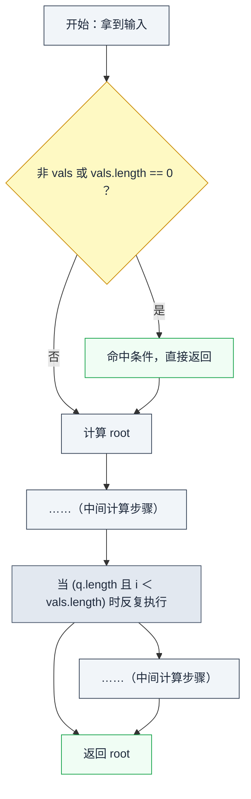

## TypeScript 解题方案（4 个方案逐个讲）

> **运行与提交**：每个方案都是自包含文件（内嵌用例自测，输出 PASS），整块复制到 `.ts` 文件后 `node 文件名` 即可运行。提交 LeetCode 时，把 `demo` 内的算法函数与辅助类型/函数整体取出、置于文件顶层即可。概念演示（非 LeetCode 编号题），在本地运行即可。

### 方案 1：迭代指针处理

**分析与思路**：核心做法是「迭代指针处理」。代码里依次做这些事：队列或堆的调度。

**运行方式**：`node 本文件`，内嵌用例全部通过会输出 PASS。


**方案专属流程图**（真实控制流）：

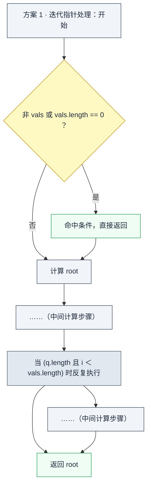

```typescript
class TreeNode {
  // 定义类型
  val: any;
  left: any;
  right: any; // 值: any; 左边界: any; 右边界: any;
  constructor(val?: any, left?: any, right?: any) {
    // constructor(值?: any, 左边界?: any, 右边界?: any) {
    this.val = val === undefined ? 0 : val; // 把 (值 全等于 undefined ? 0 : 值); 写入 值
    this.left = left === undefined ? null : left; // 把 (左边界 全等于 undefined ? null : 左边界); 写入 左边界
    this.right = right === undefined ? null : right; // 把 (右边界 全等于 undefined ? null : 右边界); 写入 右边界
  }
}
function buildTree(vals: any): any {
  // 定义函数/方法 buildTree
  if (!vals || vals.length === 0) return null; // 若 取反 vals 或 vals.长度 全等于 0，直接返回 null
  const root = new TreeNode(vals[0]);
  const q: any[] = [root];
  let i = 1;
  while (q.length && i < vals.length) {
    // 循环，直到不满足「节点.长度 且 下标 i 小于 vals.长度」
    const node = q.shift(); // 把 节点.shift() 存入 节点
    if (vals[i] !== null && vals[i] !== undefined) {
      node.left = new TreeNode(vals[i]);
      q.push(node.left);
    }
    i++; // 下标 i 加一
    if (i < vals.length && vals[i] !== null && vals[i] !== undefined) {
      node.right = new TreeNode(vals[i]);
      q.push(node.right);
    }
    i++; // 下标 i 加一
  }
  return root; // 返回 根节点
}
function treeToLevel(root: any): any[] {
  // 定义函数/方法 treeToLevel
  if (!root) return []; // 若 取反 根节点，直接返回 []
  const out: any[] = [];
  const q: any[] = [root]; // 把 []; const 节点: any[] 赋值为 [根节点]; 写入 const out: any[]
  while (q.length) {
    // 循环，直到不满足「节点.长度」
    const n = q.shift(); // 把 节点.shift() 存入 元素个数
    if (n === null || n === undefined) {
      out.push(null);
      continue;
    }
    out.push(n.val);
    q.push(n.left);
    q.push(n.right); // 把 元素个数.值 压入栈/数组尾部
  }
  while (out.length && out[out.length - 1] === null) out.pop(); // 循环，直到不满足「out.长度 且 out[out.长度 减 1] 全等于 null) out 弹出 );」
  return out; // 返回 out
}
class ListNode {
  // 定义类型
  val: any;
  next: any; // 值: any; 下一个: any;
  constructor(val?: any, next?: any) {
    this.val = val === undefined ? 0 : val;
    this.next = next === undefined ? null : next;
  }
}
function buildList(vals: any): any {
  // 定义函数/方法 buildList
  const dummy = new ListNode(0);
  let cur = dummy; // 把 new ListNode(0); let 当前值 赋值为 哨兵节点 存入 哨兵节点
  for (const v of vals) {
    cur.next = new ListNode(v);
    cur = cur.next;
  } // 把 new ListNode(值); 当前值 赋值为 当前值.下一个; } 写入 下一个
  return dummy.next; // 返回 哨兵节点.下一个
}
function listToArray(head: any): any[] {
  // 定义函数/方法 listToArray
  const out: any[] = [];
  let p = head; // 把 []; let 节点 赋值为 头节点; 写入 const out: any[]
  while (p) {
    out.push(p.val);
    p = p.next;
  } // 循环，直到不满足「节点) { out 追加 节点.值); 节点 赋值为 节点.下一个; }」
  return out; // 返回 out
}
// python-runtime shims
function pyLen(a: any): number {
  // 定义函数/方法 pyLen
  if (a === null || a === undefined) return 0; // 若 数组 全等于 null 或 数组 全等于 undefined，直接返回 0
  if (
    typeof a === 'string' ||
    Array.isArray(a) ||
    a instanceof Set ||
    a instanceof Map
  )
    return a.length ?? a.size;
  if (typeof a === 'object') return Object.keys(a).length; // 若 typeof 数组 全等于 'object'，直接返回 Object.keys(数组).长度
  return 0; // 返回 0
}
function pySlice(a: any, i: any, j: any, step?: any): any {
  // 定义函数/方法 pySlice
  if (typeof a === 'string') {
    const r = [...a].slice(i ?? 0, j ?? a.length);
    return step ? r.reverse().join('') : r.join('');
  }
  const arr = Array.isArray(a) ? a : [...a]; // 把 Array.isArray(数组) ? 数组 : 复制的 数组 存入 数组
  return arr.slice(i ?? 0, j ?? arr.length); // 返回 数组 截取 下标 i ?? 0, 下标 j ?? 数组.长度)
}
function pyRange(a: any, b?: any, step?: any): any[] {
  // 定义函数/方法 pyRange
  let s = 0,
    e = a,
    st = 1; // 把 0, e 赋值为 数组, st 赋值为 1 存入 字符串
  if (b !== undefined) {
    s = a;
    e = b;
  } // 若 b 不等于 undefined) { 字符串 赋值为 数组; e 赋值为 b; }
  if (step !== undefined) st = step; // 若 步数 不等于 undefined) st 赋值为 步数;
  const out: any[] = []; // 把 []; 写入 const out: any[]
  if (st > 0) for (let i = s; i < e; i += st) out.push(i);
  else for (let i = s; i > e; i += st) out.push(i); // 否则
  return out; // 返回 out
}
function pyIn(x: any, coll: any): boolean {
  // 定义函数/方法 pyIn
  if (coll === null || coll === undefined) return false; // 若 coll 全等于 null 或 coll 全等于 undefined，直接返回 false
  if (Array.isArray(coll)) return coll.includes(x); // 若 Array.isArray(coll)，直接返回 coll 是否包含 x)
  if (coll instanceof Set || coll instanceof Map) return coll.has(x); // 若 coll instanceof Set 或 coll instanceof Map，直接返回 coll.has(x)
  if (typeof coll === 'object') return x in coll; // 若 typeof coll 全等于 'object'，直接返回 x in coll
  if (typeof coll === 'string') return coll.indexOf(x) >= 0; // 若 typeof coll 全等于 'string'，直接返回 coll 查找 x) 不低于 0
  return false; // 返回 false
}
function pySorted(a: any): any[] {
  // 定义函数/方法 pySorted
  const arr = typeof a === 'string' ? [...a] : [...a]; // 把 (typeof 数组 全等于 'string') ? 复制的 数组 : 复制的 数组 存入 数组
  return arr.sort((x: any, y: any) => (x < y ? -1 : x > y ? 1 : 0));
}
function pyMin(a: any, b?: any): any {
  if (b !== undefined) return Math.min(a, b);
  if (Array.isArray(a) || a instanceof Set) return Math.min(...a);
  return Math.min(a);
} // 定义函数/方法 pyMin
function pyMax(a: any, b?: any): any {
  if (b !== undefined) return Math.max(a, b);
  if (Array.isArray(a) || a instanceof Set) return Math.max(...a);
  return Math.max(a);
} // 定义函数/方法 pyMax
function pySum(a: any): number {
  let s = 0;
  for (const v of a) s += v;
  return s;
} // 定义函数/方法 pySum
function pyAbs(x: any): number {
  return Math.abs(x);
} // 定义函数/方法 pyAbs
function pyEnumerate(a: any): any[] {
  const out: any[] = [];
  let i = 0;
  for (const v of a) {
    out.push([i, v]);
    i++;
  }
  return out;
} // 定义函数/方法 pyEnumerate
function pyZip(a: any, b: any): any[] {
  const n = Math.min(a.length, b.length);
  const out: any[] = [];
  for (let i = 0; i < n; i++) out.push([a[i], b[i]]);
  return out;
} // 定义函数/方法 pyZip
function pyDictGet(d: any, k: any, def?: any): any {
  return k in d ? d[k] : def === undefined ? null : def;
} // 定义函数/方法 pyDictGet
function pyPrint(...args: any[]): void {
  console.log(
    args
      .map((a) => (typeof a === 'object' && a !== null ? JSON.stringify(a) : a))
      .join(' '),
  );
} // 定义函数/方法 pyPrint
// collections / heapq
function heapPush(h: any[], x: any): void {
  h.push(x);
  let i = h.length - 1;
  while (i > 0) {
    const p = (i - 1) >> 1;
    if (h[p] <= h[i]) break;
    [h[p], h[i]] = [h[i], h[p]];
    i = p;
  }
} // 定义函数/方法 heapPush
function heapPop(h: any[]): any {
  const top = h[0];
  const last = h.pop();
  if (h.length) {
    h[0] = last;
    let i = 0;
    const n = h.length;
    while (true) {
      let l = 2 * i + 1,
        r = 2 * i + 2,
        s = i;
      if (l < n && h[l] < h[s]) s = l;
      if (r < n && h[r] < h[s]) s = r;
      if (s === i) break;
      [h[s], h[i]] = [h[i], h[s]];
      i = s;
    }
  }
  return top;
} // 定义函数/方法 heapPop
class Deque {
  private a: any[] = [];
  push(x: any) {
    this.a.push(x);
  }
  pushLeft(x: any) {
    this.a.unshift(x);
  }
  pop() {
    return this.a.pop();
  }
  popLeft() {
    return this.a.shift();
  }
  get length() {
    return this.a.length;
  }
  toArray() {
    return this.a.slice();
  }
} // 定义类型
function Counter(iter: any): any {
  const m: any = {};
  for (const v of iter) m[v] = (m[v] || 0) + 1;
  return m;
} // 定义函数/方法 Counter
function gcd(a: any, b: any): any {
  while (b) {
    [a, b] = [b, a % b];
  }
  return a;
} // 定义函数/方法 gcd
function pyInf(): number {
  return Infinity;
} // 定义函数/方法 pyInf

function norm(x: any): any {
  // 定义函数/方法 norm
  if (x === null || x === undefined) return null; // 若 x 全等于 null 或 x 全等于 undefined，直接返回 null
  if (typeof x === 'object') {
    // 若 typeof x 全等于 'object'
    if (x instanceof Deque) return x.toArray(); // 若 x instanceof Deque，直接返回 x.toArray()
    if (Array.isArray(x)) return x.map(norm); // 若 Array.isArray(x)，直接返回 x.映射表(norm)
    if (
      typeof x.val === 'number' &&
      (typeof x.left !== 'undefined' || typeof x.right !== 'undefined')
    )
      return treeToLevel(x);
    if (typeof x.next !== 'undefined' && typeof x.val === 'number')
      return listToArray(x);
    if (x instanceof Set) return [...x].sort(); // 若 x instanceof Set，直接返回 复制的 x 排序 )
    if (x instanceof Map) return Object.fromEntries(x); // 若 x instanceof Map，直接返回 Object.fromEntries(x)
    const o: any = {};
    for (const k of Object.keys(x)) o[k] = norm(x[k]);
    return o;
  }
  return x; // 返回 x
}
function eq(a: any, b: any): boolean {
  // 定义函数/方法 eq
  const x = norm(a),
    y = norm(b); // 把 norm(数组), y 赋值为 norm(b) 存入 x
  if (x === y) return true; // 若 x 全等于 y，直接返回 true
  if (x === null || y === null) return x === y; // 若 x 全等于 null 或 y 全等于 null，直接返回 x 全等于 y
  if (Array.isArray(x) && Array.isArray(y)) {
    // 若 Array.isArray(x) 且 Array.isArray(y
    if (x.length !== y.length) return false; // 若 x.长度 不等于 y.长度，直接返回 false
    for (let i = 0; i < x.length; i++) if (!eq(x[i], y[i])) return false; // 让 下标 i 从 0 开始计数，下标 i 小于 x.长度 就继续
    return true; // 返回 true
  }
  if (typeof x === 'object' && typeof y === 'object') {
    // 若 typeof x 全等于 'object' 且 typeof y 全等于 'object'
    const kx = Object.keys(x),
      ky = Object.keys(y); // 把 Object.keys(x), ky 赋值为 Object.keys(y) 存入 kx
    if (kx.length !== ky.length) return false; // 若 kx.长度 不等于 ky.长度，直接返回 false
    for (const k of kx) if (!eq(x[k], y[k])) return false;
    return true; // 返回 true
  }
  return x === y; // 返回 x 全等于 y
}

function getResultBruteforce(n, ele) {
  // 定义函数/方法 getResultBruteforce
  const ans: any[] = []; // 把 []; 写入 const ans: any[]
  const stack: number[] = []; // 把 []; 写入 const stack: number[]
  let i = 0; // 把 0 存入 下标 i
  while (i < n) {
    // 循环，直到不满足「下标 i 小于 元素个数」
    let mx = 0; // 把 0 存入 mx
    for (let j = i; j < n; j++) if (ele[j] > mx) mx = ele[j]; // 让 下标 j 从 下标 i 开始计数，下标 j 小于 元素个数 就继续
    if (stack.length && ele[stack[stack.length - 1]] > mx) {
      // 若 栈.长度 且 ele[栈[栈.长度 减 1]] 超过 mx
      ans.push(ele[stack.pop()!]); // 把 ele[栈 弹出 压入栈/数组尾部
    } else {
      // 否则
      while (mx !== ele[i]) {
        stack.push(i);
        i++;
      } // 循环，直到不满足「mx 不等于 ele[下标 i]) { 栈 追加 下标 i); 下标 i 加一 ; }」
      ans.push(ele[i]);
      i++; // 把 ele[下标 i] 压入栈/数组尾部
    }
  }
  while (stack.length) ans.push(ele[stack.pop()!]); // 循环，直到不满足「栈.长度) 答案 追加 ele[栈 弹出 )取反 ]);」
  return ans; // 返回 答案
}
export function demo(): void {
  // 程序入口：跑内嵌自测用例
  const cases = [
    { in: [3, [1, 2, 3]], want: [3, 2, 1] },
    { in: [4, [4, 2, 9, 7]], want: [9, 7, 2, 4] },
    { in: [2, [5, 1]], want: [5, 1] },
    { in: [1, [8]], want: [8] },
  ];
  let fail = false; // 把 false 存入 fail
  for (const c of cases) {
    // for (const 字符 of cases) {
    const got = getResultBruteforce(...c.in); // 把 getResultBruteforce(...字符.in) 存入 got
    if (!eq(got, c.want)) {
      fail = true;
      console.log(
        'FAIL',
        JSON.stringify(c.in),
        '=>',
        JSON.stringify(got),
        'want',
        JSON.stringify(c.want),
      );
    }
  }
  if (fail) throw new Error('FAILED'); // 若 fail) throw new Error('FAILED');
  console.log('PASS'); // 全部用例通过，输出 PASS
}
demo(); // demo();
```

### 方案 2：直接实现

**分析与思路**：核心做法是「直接实现」。

**运行方式**：`node 本文件`，内嵌用例全部通过会输出 PASS。


**方案专属流程图**（真实控制流）：


```typescript
function assertEq(actual: any, expected: any, msg: string = ''): void {
  // 定义函数/方法 assertEq
  const a = JSON.stringify(actual);
  const e = JSON.stringify(expected);
  if (a !== e)
    throw new Error(
      'ASSERT FAILED ' + msg + ' :: actual=' + a + ' expected=' + e,
    );
}

function get_result(n: number, ele: number[]): number[] {
  // 定义函数/方法 get_result
  const ans: number[] = []; // 把 []; 写入 const ans: number[]
  const stack: number[] = []; // 把 []; 写入 const stack: number[]
  const max_element = new Array(n).fill(0); // 把 new Array(元素个数).fill(0) 存入 max_element
  max_element[n - 1] = ele[n - 1]; // 把 ele[元素个数 减 1]; 写入 max_element[n - 1]
  for (let i = n - 2; i >= 0; i--)
    max_element[i] = Math.max(max_element[i + 1], ele[i]); // 让 下标 i 从 元素个数 减 2 开始计数，下标 i 不低于 0 就继续
  let i = 0; // 把 0 存入 下标 i
  while (i < n) {
    // 循环，直到不满足「下标 i 小于 元素个数」
    const mx = max_element[i]; // 把 max_element[下标 i] 存入 mx
    if (stack.length && ele[stack[stack.length - 1]] > mx) {
      // 若 栈.长度 且 ele[栈[栈.长度 减 1]] 超过 mx
      ans.push(ele[stack.pop()!]); // 把 ele[栈 弹出 压入栈/数组尾部
    } else {
      // 否则
      while (mx !== ele[i]) {
        stack.push(i);
        i++;
      } // 循环，直到不满足「mx 不等于 ele[下标 i]) { 栈 追加 下标 i); 下标 i 加一 ; }」
      ans.push(ele[i]);
      i++; // 把 ele[下标 i] 压入栈/数组尾部
    }
  }
  while (stack.length) ans.push(ele[stack.pop()!]); // 循环，直到不满足「栈.长度) 答案 追加 ele[栈 弹出 )取反 ]);」
  return ans; // 返回 答案
}
export function demo(): void {
  // 程序入口：跑内嵌自测用例
  assertEq(get_result(5, [4, 1, 3, 5, 2]), [5, 3, 2, 1, 4], 'get_result'); // 断言校验
  console.log('PASS'); // 全部用例通过，输出 PASS
}
demo(); // demo();
```

### 方案 3：直接实现

**分析与思路**：核心做法是「直接实现」。

**运行方式**：`node 本文件`，内嵌用例全部通过会输出 PASS。


**方案专属流程图**（真实控制流）：

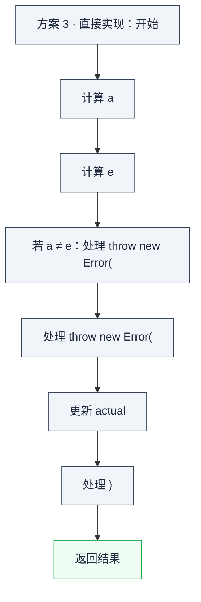

```typescript
function assertEq(actual: any, expected: any, msg: string = ''): void {
  // 定义函数/方法 assertEq
  const a = JSON.stringify(actual);
  const e = JSON.stringify(expected);
  if (a !== e)
    throw new Error(
      'ASSERT FAILED ' + msg + ' :: actual=' + a + ' expected=' + e,
    );
}

function range_max(ele: number[], i: number): number {
  // 定义函数/方法 range_max
  let mx = ele[i]; // 把 ele[下标 i] 存入 mx
  for (let j = i + 1; j < ele.length; j++) if (ele[j] > mx) mx = ele[j]; // 让 下标 j 从 下标 i 加 1 开始计数，下标 j 小于 ele.长度 就继续
  return mx; // 返回 mx
}
function suffix_max(ele: number[]): number[] {
  // 定义函数/方法 suffix_max
  const n = ele.length; // 把 ele.长度 存入 元素个数
  const res = new Array(n).fill(0); // 把 new Array(元素个数).fill(0) 存入 结果
  res[n - 1] = ele[n - 1]; // 把 ele[元素个数 减 1]; 写入 res[n - 1]
  for (let i = n - 2; i >= 0; i--) res[i] = Math.max(res[i + 1], ele[i]); // 让 下标 i 从 元素个数 减 2 开始计数，下标 i 不低于 0 就继续
  return res; // 返回 结果
}
export function demo(): void {
  // 程序入口：跑内嵌自测用例
  const ele = [4, 1, 3, 5, 2]; // 把 [4, 1, 3, 5, 2] 存入 ele
  assertEq(
    ['range_max(ele, 0) =', range_max(ele, 0)],
    ['range_max(ele, 0) =', 5],
    'rm',
  ); // 断言校验
  assertEq(
    ['suffix_max(ele)    =', suffix_max(ele)],
    ['suffix_max(ele)    =', [5, 5, 5, 5, 2]],
    'sm',
  ); // 断言校验
  console.log('PASS'); // 全部用例通过，输出 PASS
}
demo(); // demo();
```

### 方案 4：直接实现

**分析与思路**：核心做法是「直接实现」。

**运行方式**：`node 本文件`，内嵌用例全部通过会输出 PASS。

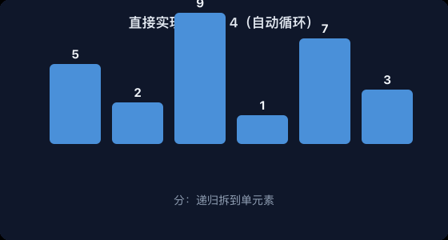

**方案专属流程图**（真实控制流）：


```typescript
function assertEq(actual: any, expected: any, msg: string = ''): void {
  // 定义函数/方法 assertEq
  const a = JSON.stringify(actual);
  const e = JSON.stringify(expected);
  if (a !== e)
    throw new Error(
      'ASSERT FAILED ' + msg + ' :: actual=' + a + ' expected=' + e,
    );
}

function get_result_linear(n: number, ele: number[]): number[] {
  // 定义函数/方法 get_result_linear
  const ans: number[] = []; // 把 []; 写入 const ans: number[]
  const stack: number[] = []; // 把 []; 写入 const stack: number[]
  const max_element = new Array(n).fill(0); // 把 new Array(元素个数).fill(0) 存入 max_element
  max_element[n - 1] = ele[n - 1]; // 把 ele[元素个数 减 1]; 写入 max_element[n - 1]
  for (let i = n - 2; i >= 0; i--)
    max_element[i] = Math.max(max_element[i + 1], ele[i]); // 让 下标 i 从 元素个数 减 2 开始计数，下标 i 不低于 0 就继续
  let i = 0; // 把 0 存入 下标 i
  while (i < n) {
    // 循环，直到不满足「下标 i 小于 元素个数」
    const mx = max_element[i]; // 把 max_element[下标 i] 存入 mx
    if (stack.length && ele[stack[stack.length - 1]] > mx) {
      // 若 栈.长度 且 ele[栈[栈.长度 减 1]] 超过 mx
      ans.push(ele[stack.pop()!]); // 把 ele[栈 弹出 压入栈/数组尾部
    } else {
      // 否则
      while (mx !== ele[i]) {
        stack.push(i);
        i++;
      } // 循环，直到不满足「mx 不等于 ele[下标 i]) { 栈 追加 下标 i); 下标 i 加一 ; }」
      ans.push(ele[i]);
      i++; // 把 ele[下标 i] 压入栈/数组尾部
    }
  }
  while (stack.length) ans.push(ele[stack.pop()!]); // 循环，直到不满足「栈.长度) 答案 追加 ele[栈 弹出 )取反 ]);」
  return ans; // 返回 答案
}
export function demo(): void {
  // 程序入口：跑内嵌自测用例
  assertEq(get_result_linear(5, [4, 1, 3, 5, 2]), [5, 3, 2, 1, 4], 'linear'); // 断言校验
  console.log('PASS'); // 全部用例通过，输出 PASS
}
demo(); // demo();
```

## 逐步拆解与面试追问

**复杂度**：时间 O(n)（单趟线性扫描），空间 O(1) 到 O(n)（视辅助结构）

**为什么是这个量级**：每个元素被常数次访问，辅助哈希或栈的开销与 n 同阶

**面试官可能会追问**：

- 这个策略能推广到什么场景？
- 与暴力做法差在哪一步？
- 有没有更简单的等价写法？

## 关键 API 速查（TS 主解法实际用到，附官方链接）

| API | 作用 | 使用要点 | 官方文档 |
|---|---|---|---|
| `Array.prototype.sort()` | 原地排序 | 默认按字符串 Unicode 序（10 会排在 2 前），数字必须传 (a,b)=>a-b；V8 用 TimSort，稳定，O(n log n)；返回原数组引用 | [官方文档](https://developer.mozilla.org/zh-CN/docs/Web/JavaScript/Reference/Global_Objects/Array/sort) |
| `Array.prototype.map()` | 逐元素映射为新数组 | 回调 (v,i,arr)；返回等长新数组，不改变原数组；稀疏位跳过；链式调用注意中间数组开销 | [官方文档](https://developer.mozilla.org/zh-CN/docs/Web/JavaScript/Reference/Global_Objects/Array/map) |
| `Array.prototype.push()` | 尾部追加 | 返回新长度；可一次多个；均摊 O(1)；会改变原数组 | [官方文档](https://developer.mozilla.org/zh-CN/docs/Web/JavaScript/Reference/Global_Objects/Array/push) |
| `Array.prototype.pop()` | 尾部弹出 | 返回被删元素（空数组返回 undefined）；O(1) | [官方文档](https://developer.mozilla.org/zh-CN/docs/Web/JavaScript/Reference/Global_Objects/Array/pop) |
| `Array.prototype.shift()` | 头部取出 | O(n)（后续元素整体前移）；大量头部操作请用链表或双端结构 | [官方文档](https://developer.mozilla.org/zh-CN/docs/Web/JavaScript/Reference/Global_Objects/Array/shift) |
| `Array.prototype.unshift()` | 头部插入 | O(n)；与 shift 组合可当双端队列 | [官方文档](https://developer.mozilla.org/zh-CN/docs/Web/JavaScript/Reference/Global_Objects/Array/unshift) |
| `Array/String includes()` | 是否包含 | 数组用 SameValueZero（NaN 可判）；字符串按子串；第二个参数为起始下标 | [官方文档](https://developer.mozilla.org/zh-CN/docs/Web/JavaScript/Reference/Global_Objects/Array/includes) |
| `Array/String indexOf()` | 首次出现的下标 | 找不到返回 -1；无法判 NaN（用 includes）；字符串可传起始位 | [官方文档](https://developer.mozilla.org/zh-CN/docs/Web/JavaScript/Reference/Global_Objects/Array/indexOf) |
| `Array/String slice()` | 切片（不改原数组） | slice(start,end) 含头不含尾；负数从尾计；常用于复制数组（slice()） | [官方文档](https://developer.mozilla.org/zh-CN/docs/Web/JavaScript/Reference/Global_Objects/Array/slice) |
| `Array.prototype.join()` | 数组拼接为字符串 | undefined/null 转空串；嵌套数组会展平一层；join('') 用于字符数组还原 | [官方文档](https://developer.mozilla.org/zh-CN/docs/Web/JavaScript/Reference/Global_Objects/Array/join) |
| `Object.keys()` | 对象键名数组 | 仅自身可枚举字符串键（不含 symbol）；配 length 可当计数器 | [官方文档](https://developer.mozilla.org/zh-CN/docs/Web/JavaScript/Reference/Global_Objects/Object/keys) |
| `Object.fromEntries()` | 键值对数组转对象 | 参数为 [k,v] 可迭代；map 出来的键值对可直接转对象 | [官方文档](https://developer.mozilla.org/zh-CN/docs/Web/JavaScript/Reference/Global_Objects/Object/fromEntries) |
| `JSON.stringify()` | 序列化为 JSON 字符串 | 常用于结构化比较（深度相等判定）；undefined/函数/循环引用会被丢弃或抛错 | [官方文档](https://developer.mozilla.org/zh-CN/docs/Web/JavaScript/Reference/Global_Objects/JSON/stringify) |
| `Math.max()` | 最大值 | 配展开 Math.max(...arr)；空参返回 -Infinity；超大数组注意展开参数上限 | [官方文档](https://developer.mozilla.org/zh-CN/docs/Web/JavaScript/Reference/Global_Objects/Math/max) |
| `Math.min()` | 最小值 | 同 max；空参返回 Infinity | [官方文档](https://developer.mozilla.org/zh-CN/docs/Web/JavaScript/Reference/Global_Objects/Math/min) |
| `Math.abs()` | 绝对值 | 入参会被隐式转数字；-0 返回 +0 | [官方文档](https://developer.mozilla.org/zh-CN/docs/Web/JavaScript/Reference/Global_Objects/Math/abs) |

### 各语言官方文档导航

- **TypeScript / JS**：[MDN 中文参考](https://developer.mozilla.org/zh-CN/)
- **Python**：[Python 官方文档](https://docs.python.org/zh-cn/3/)
- **Go**：[Go 标准库](https://pkg.go.dev/std)
- **Java**：[JDK 17 API](https://docs.oracle.com/en/java/javase/17/docs/api/)
- **Rust**：[Rust 标准库](https://doc.rust-lang.org/std/)
- **Lua**：[Lua 5.4 手册](https://www.lua.org/manual/5.4/)
- **C**：[Cppreference C](https://zh.cppreference.com/w/c)
- **C++**：[Cppreference C++](https://zh.cppreference.com/w/cpp)
- **R**：[R 官方手册](https://stat.ethz.ch/R-manual/)
- **Zig**：[Zig 语言文档](https://ziglang.org/documentation/master/)
- **Dart**：[Dart API](https://api.dart.dev/)

## 附录：其他 10 种语言全部实现（每种语言列举其全部方案）

> TypeScript 的全部方案见「TypeScript 解题方案」一节；下面是其余 10 种语言的对应实现，每种语言的每个方案都带思路分析、代码走读与专属运行架构图。
> 每个方案都内嵌用例自测，可独立运行（老仓库 python/go 文件遵循「打印结果」约定）。
> 完整解法文件见 `dsa/<语言>/notes/lc_107435426_字典序最大问题分析/`。

### Python 实现（4 种方案）

Python 的全部方案如下，每个方案都内嵌用例自测，可独立运行（老仓库 python/go 文件遵循「打印结果」约定）：

#### 方案 1：迭代指针处理

**思路与代码分析**：核心是「迭代指针处理」。Python 版用切片与字典推导式简化操作，突出可读性。**走读**：方案 1 · 迭代指针处理：开始 → 更新 ans → 当 i ＜ n: 时反复执行 → 循环 j：从 i 到 n 前 → 当 mx ≠ ele[i]: 时反复执行 → 当 stack: 时反复执行 → 返回 ans。

**运行架构**（真实控制流）：

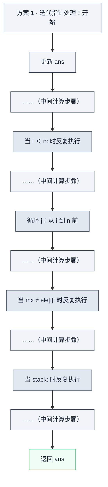

```python
import sys  # 提高递归深度上限（深输入防 RecursionError）

sys.setrecursionlimit(200000)  # 树/链表类题目节点数可达 1e4 量级

def get_result_bruteforce(n, ele):  # 定义函数 get_result_bruteforce（参数：元素个数, ele）
    """字典序最大的出栈序列 —— 蛮力版 O(n^2)：每次 O(n) 查找区间最大值。"""
    ans = []  # 把 [] 存入 答案
    stack = []  # 存放索引
    i = 0  # 把 0 存入 下标 i
    while i < n:  # 循环，直到不满足「下标 i 小于 元素个数」
        mx = 0  # 把 0 存入 mx
        for j in range(i, n):  # 让 下标 j 从 下标 i 到 元素个数 遍历
            if ele[j] > mx:  # 若 ele[下标 j] 超过 mx
                mx = ele[j]  # 把 ele[下标 j] 存入 mx
        if stack and ele[stack[-1]] > mx:  # 若 栈 and ele[栈[ 减 1]] 超过 mx
            ans.append(ele[stack.pop()])  # 把 ele[栈 弹出 追加到列表尾部
        else:  # 否则
            while mx != ele[i]:  # 循环，直到不满足「mx 不等于 ele[下标 i]」
                stack.append(i)  # 把 下标 i 追加到列表尾部
                i += 1  # 下标 i累加 1
            ans.append(ele[i])  # 把 ele[下标 i] 追加到列表尾部
            i += 1  # 下标 i累加 1
    while stack:  # 循环，直到不满足「栈」
        ans.append(ele[stack.pop()])  # 把 ele[栈 弹出 追加到列表尾部
    return ans  # 返回 答案

if __name__ == "__main__":  # 若 __name__ 等于 '__main__'
    n = 5  # 把 5 存入 元素个数
    ele = [4, 1, 3, 5, 2]  # 把 [4, 1, 3, 5, 2] 存入 ele
    print(get_result_bruteforce(n, ele))  # [5, 3, 2, 1, 4]
```

#### 方案 2：直接实现

**思路与代码分析**：核心是「直接实现」。Python 版用切片与字典推导式简化操作，突出可读性。**走读**：方案 2 · 直接实现：开始 → 更新 ans → 循环 i：从 n - 2 到 -1 前，步长 -1 → 当 i ＜ n: 时反复执行 → 当 mx ≠ ele[i]: 时反复执行 → 当 stack: 时反复执行 → 返回 ans。

**运行架构**（真实控制流）：

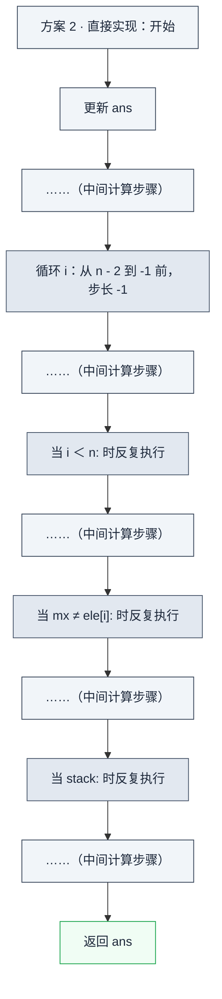

```python
import sys  # 提高递归深度上限（深输入防 RecursionError）

sys.setrecursionlimit(200000)  # 树/链表类题目节点数可达 1e4 量级

def get_result_linear(n, ele):  # 定义函数 get_result_linear（参数：元素个数, ele）
    """字典序最大的出栈序列 —— 线性版 O(n)：预处理 maxElement[i] = max(ele[i:])。"""
    ans = []  # 把 [] 存入 答案
    stack = []  # 把 [] 存入 栈
    # 预处理：倒序求后缀最大值
    max_element = [0] * n  # 把 [0] 乘 元素个数 存入 max_element
    max_element[n - 1] = ele[n - 1]  # 把 ele[元素个数 减 1] 写入 max_element[n - 1]
    for i in range(n - 2, -1, -1):  # 让 下标 i 从 元素个数 减 2 倒数回去（每步减 1）
        max_element[i] = max(
            max_element[i + 1], ele[i]
        )  # 把 取较大值 max_element[下标 i 加 1], ele[下标 i]) 写入 max_element[i]
    i = 0  # 把 0 存入 下标 i
    while i < n:  # 循环，直到不满足「下标 i 小于 元素个数」
        mx = max_element[i]  # 把 max_element[下标 i] 存入 mx
        if stack and ele[stack[-1]] > mx:  # 若 栈 and ele[栈[ 减 1]] 超过 mx
            ans.append(ele[stack.pop()])  # 把 ele[栈 弹出 追加到列表尾部
        else:  # 否则
            while mx != ele[i]:  # 循环，直到不满足「mx 不等于 ele[下标 i]」
                stack.append(i)  # 把 下标 i 追加到列表尾部
                i += 1  # 下标 i累加 1
            ans.append(ele[i])  # 把 ele[下标 i] 追加到列表尾部
            i += 1  # 下标 i累加 1
    while stack:  # 循环，直到不满足「栈」
        ans.append(ele[stack.pop()])  # 把 ele[栈 弹出 追加到列表尾部
    return ans  # 返回 答案

if __name__ == "__main__":  # 若 __name__ 等于 '__main__'
    n = 5  # 把 5 存入 元素个数
    ele = [4, 1, 3, 5, 2]  # 把 [4, 1, 3, 5, 2] 存入 ele
    print(get_result_linear(n, ele))  # [5, 3, 2, 1, 4]
```

#### 方案 3：直接实现

**思路与代码分析**：核心是「直接实现」。Python 版用切片与字典推导式简化操作，突出可读性。**走读**：方案 3 · 直接实现：开始 → 更新 mx → 循环 j：从 i + 1 到 len(ele 前 → 若 ele[j] ＞ mx：更新 mx → 更新 mx → 返回 mx。

**运行架构**（真实控制流）：

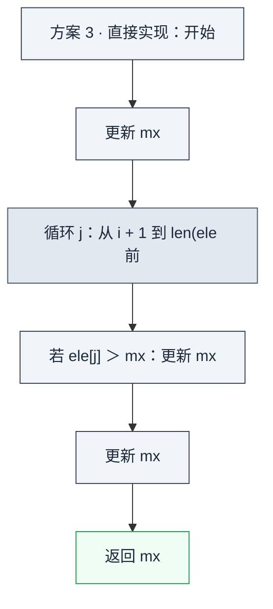

```python
import sys  # 提高递归深度上限（深输入防 RecursionError）

sys.setrecursionlimit(200000)  # 树/链表类题目节点数可达 1e4 量级

def range_max(ele, i):  # 定义函数 range_max（参数：ele, 下标 i）
    """返回 ele[i:] 中的最大值（蛮力版中的核心查找步骤，方案 3）。"""
    mx = ele[i]  # 把 ele[下标 i] 存入 mx
    for j in range(i + 1, len(ele)):  # 让 下标 j 从 下标 i 加 1 到 长度(ele 遍历
        if ele[j] > mx:  # 若 ele[下标 j] 超过 mx
            mx = ele[j]  # 把 ele[下标 j] 存入 mx
    return mx  # 返回 mx

def suffix_max(ele):  # 定义函数 suffix_max（参数：ele）
    """返回后缀最大值数组 maxElement[i] = max(ele[i:])（线性预处理）。"""
    n = len(ele)  # 把 长度(ele) 存入 元素个数
    res = [0] * n  # 把 [0] 乘 元素个数 存入 结果
    res[n - 1] = ele[n - 1]  # 把 ele[元素个数 减 1] 写入 res[n - 1]
    for i in range(n - 2, -1, -1):  # 让 下标 i 从 元素个数 减 2 倒数回去（每步减 1）
        res[i] = max(res[i + 1], ele[i])  # 把 取较大值 结果[下标 i 加 1], ele[下标 i]) 写入 res[i]
    return res  # 返回 结果

if __name__ == "__main__":  # 若 __name__ 等于 '__main__'
    ele = [4, 1, 3, 5, 2]  # 把 [4, 1, 3, 5, 2] 存入 ele
    print("range_max(ele, 0) =", range_max(ele, 0))  # 5
    print("suffix_max(ele)    =", suffix_max(ele))  # [5, 5, 5, 5, 2]
```

#### 方案 4：直接实现

**思路与代码分析**：核心是「直接实现」。Python 版用切片与字典推导式简化操作，突出可读性。**走读**：方案 4 · 直接实现：开始 → 更新 ans → 循环 i：从 n - 2 到 -1 前，步长 -1 → 当 i ＜ n: 时反复执行 → 当 mx ≠ ele[i]: 时反复执行 → 当 stack: 时反复执行 → 返回 ans。

**运行架构**（真实控制流）：


```python
import sys  # 提高递归深度上限（深输入防 RecursionError）

sys.setrecursionlimit(200000)  # 树/链表类题目节点数可达 1e4 量级

def get_result(n, ele):  # 定义函数 get_result（参数：元素个数, ele）
    """字典序最大的出栈序列（线性版，方案 2 的复用）。"""
    ans = []  # 把 [] 存入 答案
    stack = []  # 把 [] 存入 栈
    max_element = [0] * n  # 把 [0] 乘 元素个数 存入 max_element
    max_element[n - 1] = ele[n - 1]  # 把 ele[元素个数 减 1] 写入 max_element[n - 1]
    for i in range(n - 2, -1, -1):  # 让 下标 i 从 元素个数 减 2 倒数回去（每步减 1）
        max_element[i] = max(
            max_element[i + 1], ele[i]
        )  # 把 取较大值 max_element[下标 i 加 1], ele[下标 i]) 写入 max_element[i]
    i = 0  # 把 0 存入 下标 i
    while i < n:  # 循环，直到不满足「下标 i 小于 元素个数」
        mx = max_element[i]  # 把 max_element[下标 i] 存入 mx
        if stack and ele[stack[-1]] > mx:  # 若 栈 and ele[栈[ 减 1]] 超过 mx
            ans.append(ele[stack.pop()])  # 把 ele[栈 弹出 追加到列表尾部
        else:  # 否则
            while mx != ele[i]:  # 循环，直到不满足「mx 不等于 ele[下标 i]」
                stack.append(i)  # 把 下标 i 追加到列表尾部
                i += 1  # 下标 i累加 1
            ans.append(ele[i])  # 把 ele[下标 i] 追加到列表尾部
            i += 1  # 下标 i累加 1
    while stack:  # 循环，直到不满足「栈」
        ans.append(ele[stack.pop()])  # 把 ele[栈 弹出 追加到列表尾部
    return ans  # 返回 答案

if __name__ == "__main__":  # 若 __name__ 等于 '__main__'
    # 通用输入程序（此处用测试数据代替交互输入）
    n = 5  # 把 5 存入 元素个数
    ele = [4, 1, 3, 5, 2]  # 把 [4, 1, 3, 5, 2] 存入 ele
    answer = get_result(n, ele)  # 把 get_result(元素个数, ele) 存入 答案
    print(" ".join(str(x) for x in answer))  # 5 3 2 1 4
```

### Go 实现（4 种方案）

Go 的全部方案如下，每个方案都内嵌用例自测，可独立运行（老仓库 python/go 文件遵循「打印结果」约定）：

#### 方案 1：迭代指针处理

**思路与代码分析**：核心是「迭代指针处理」。Go 版用切片与多返回值惯用法，显式处理索引边界。**走读**：方案 1 · 迭代指针处理：开始 → 更新 : → 遍历循环 → 遍历循环 → 遍历循环 → 遍历循环 → 返回 ans。

**运行架构**（真实控制流）：

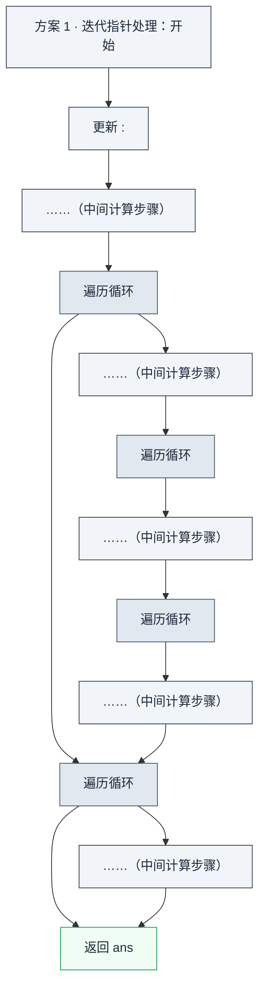

```go
package main // 引入依赖
import (
	"fmt"
	"os"
	"reflect"
) // 引入依赖
func getResultBruteforce(n int, ele []int) []int { // 定义函数/方法 getResultBruteforce
	ans := []int{}   // 把 []int{} 写入 ans :
	stack := []int{} // 把 []int{} 写入 stack :
	i := 0           // 把 0 写入 i :
	for i < n {      // for 下标 i 小于 元素个数 {
		mx := 0 // 把 0 写入 mx :
		for j := i; j < n; j++ {
			if ele[j] > mx {
				mx = ele[j]
			}
		}
		if len(stack) > 0 && ele[stack[len(stack)-1]] > mx { // 若 长度(栈) 超过 0 且 ele[栈[长度(栈) 减 1]] 超过 mx
			ans = append(ans, ele[stack[len(stack)-1]]) // 把 append(答案, ele[栈[长度(栈) 减 1]]) 写入 答案
			stack = stack[:len(stack)-1]                // 把 栈[:长度(栈) 减 1] 写入 栈
		} else { // 否则
			for mx != ele[i] {
				stack = append(stack, i)
				i++
			} // 把 ele[下标 i] { 栈 赋值为 append(栈, 下标 i); 下标 i 加一 } 写入 for mx !
			ans = append(ans, ele[i]) // 把 append(答案, ele[下标 i]) 写入 答案
			i++                       // 下标 i 加一
		}
	}
	for len(stack) > 0 { // for 长度(栈) 超过 0 {
		ans = append(ans, ele[stack[len(stack)-1]]) // 把 append(答案, ele[栈[长度(栈) 减 1]]) 写入 答案
		stack = stack[:len(stack)-1]                // 把 栈[:长度(栈) 减 1] 写入 栈
	}
	return ans // 返回 答案
}
func main() { // 程序入口：跑内嵌自测用例
	ok := true // 把 true 写入 ok :
	if got := getResultBruteforce(5, []int{4, 1, 3, 5, 2}); !reflect.DeepEqual(got, []int{5, 3, 2, 1, 4}) {
		ok = false
		fmt.Printf("FAIL1=%v\n", got)
	}
	if got := getResultBruteforce(1, []int{3}); !reflect.DeepEqual(got, []int{3}) {
		ok = false
		fmt.Printf("FAIL2=%v\n", got)
	}
	if !ok {
		os.Exit(1)
	} // 若 取反 ok { os.Exit(1) }
	fmt.Println("PASS") // 全部用例通过，输出 PASS
}
```

#### 方案 2：直接实现

**思路与代码分析**：核心是「直接实现」。Go 版用切片与多返回值惯用法，显式处理索引边界。**走读**：方案 2 · 直接实现：开始 → 更新 : → 遍历循环 → 遍历循环 → 遍历循环 → 遍历循环 → 返回 ans。

**运行架构**（真实控制流）：

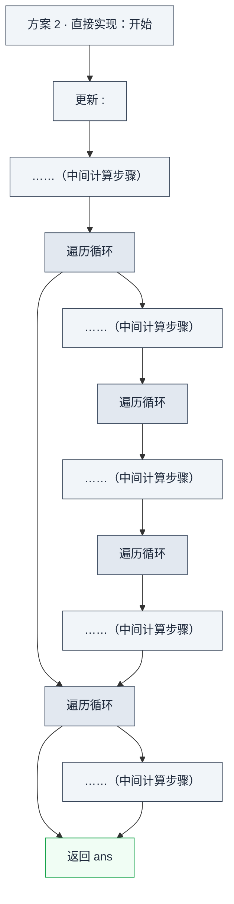

```go
package main // 引入依赖
import (
	"fmt"
	"os"
	"reflect"
) // 引入依赖
func getResultBruteforce(n int, ele []int) []int { // 定义函数/方法 getResultBruteforce
	ans := []int{}   // 把 []int{} 写入 ans :
	stack := []int{} // 把 []int{} 写入 stack :
	i := 0           // 把 0 写入 i :
	for i < n {      // for 下标 i 小于 元素个数 {
		mx := 0 // 把 0 写入 mx :
		for j := i; j < n; j++ {
			if ele[j] > mx {
				mx = ele[j]
			}
		}
		if len(stack) > 0 && ele[stack[len(stack)-1]] > mx { // 若 长度(栈) 超过 0 且 ele[栈[长度(栈) 减 1]] 超过 mx
			ans = append(ans, ele[stack[len(stack)-1]]) // 把 append(答案, ele[栈[长度(栈) 减 1]]) 写入 答案
			stack = stack[:len(stack)-1]                // 把 栈[:长度(栈) 减 1] 写入 栈
		} else { // 否则
			for mx != ele[i] {
				stack = append(stack, i)
				i++
			} // 把 ele[下标 i] { 栈 赋值为 append(栈, 下标 i); 下标 i 加一 } 写入 for mx !
			ans = append(ans, ele[i]) // 把 append(答案, ele[下标 i]) 写入 答案
			i++                       // 下标 i 加一
		}
	}
	for len(stack) > 0 { // for 长度(栈) 超过 0 {
		ans = append(ans, ele[stack[len(stack)-1]]) // 把 append(答案, ele[栈[长度(栈) 减 1]]) 写入 答案
		stack = stack[:len(stack)-1]                // 把 栈[:长度(栈) 减 1] 写入 栈
	}
	return ans // 返回 答案
}
func main() { // 程序入口：跑内嵌自测用例
	ok := true // 把 true 写入 ok :
	if got := getResultBruteforce(5, []int{4, 1, 3, 5, 2}); !reflect.DeepEqual(got, []int{5, 3, 2, 1, 4}) {
		ok = false
		fmt.Printf("FAIL1=%v\n", got)
	}
	if got := getResultBruteforce(1, []int{3}); !reflect.DeepEqual(got, []int{3}) {
		ok = false
		fmt.Printf("FAIL2=%v\n", got)
	}
	if !ok {
		os.Exit(1)
	} // 若 取反 ok { os.Exit(1) }
	fmt.Println("PASS") // 全部用例通过，输出 PASS
}
```

#### 方案 3：直接实现

**思路与代码分析**：核心是「直接实现」。Go 版用切片与多返回值惯用法，显式处理索引边界。**走读**：方案 3 · 直接实现：开始 → 更新 : → 遍历循环 → 处理 if ele[j] ＞ mx → 更新 mx → 返回 mx。

**运行架构**（真实控制流）：

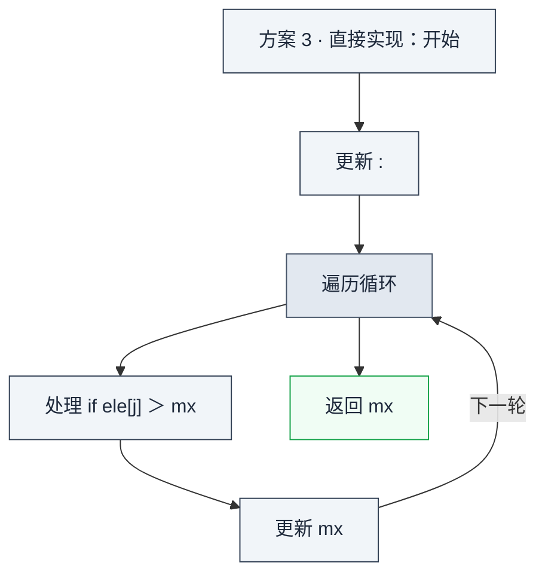

```go
package main // 引入依赖
import (
	"fmt"
	"os"
	"reflect"
) // 引入依赖
func rangeMax(ele []int, i int) int { // 定义函数/方法 rangeMax
	mx := ele[i] // 把 ele[下标 i] 写入 mx :
	for j := i + 1; j < len(ele); j++ {
		if ele[j] > mx {
			mx = ele[j]
		}
	}
	return mx // 返回 mx
}
func suffixMax(ele []int) []int { // 定义函数/方法 suffixMax
	n := len(ele)                 // 把 长度(ele) 写入 n :
	res := make([]int, n)         // 把 make([]int, 元素个数) 写入 res :
	res[n-1] = ele[n-1]           // 把 ele[元素个数 减 1] 写入 res[n-1]
	for i := n - 2; i >= 0; i-- { // 把 元素个数 减 2; 下标 i 不低于 0; 下标 i 减一 { 写入 for i :
		if res[i+1] > ele[i] {
			res[i] = res[i+1]
		} else {
			res[i] = ele[i]
		}
	}
	return res // 返回 结果
}
func main() { // 程序入口：跑内嵌自测用例
	ele := []int{4, 1, 3, 5, 2} // 把 []int{4,1,3,5,2} 写入 ele :
	ok := true                  // 把 true 写入 ok :
	if got := rangeMax(ele, 0); got != 5 {
		ok = false
		fmt.Printf("FAIL range=%d\n", got)
	}
	if got := suffixMax(ele); !reflect.DeepEqual(got, []int{5, 5, 5, 5, 2}) {
		ok = false
		fmt.Printf("FAIL suffix=%v\n", got)
	}
	if !ok {
		os.Exit(1)
	} // 若 取反 ok { os.Exit(1) }
	fmt.Println("PASS") // 全部用例通过，输出 PASS
}
```

#### 方案 4：直接实现

**思路与代码分析**：核心是「直接实现」。Go 版用切片与多返回值惯用法，显式处理索引边界。**走读**：方案 4 · 直接实现：开始 → 更新 : → 遍历循环 → 遍历循环 → 遍历循环 → 遍历循环 → 返回 ans。

**运行架构**（真实控制流）：


```go
package main // 引入依赖
import (
	"fmt"
	"os"
) // 引入依赖
func getResultBruteforce(n int, ele []int) []int { // 定义函数/方法 getResultBruteforce
	ans := []int{}   // 把 []int{} 写入 ans :
	stack := []int{} // 把 []int{} 写入 stack :
	i := 0           // 把 0 写入 i :
	for i < n {      // for 下标 i 小于 元素个数 {
		mx := 0 // 把 0 写入 mx :
		for j := i; j < n; j++ {
			if ele[j] > mx {
				mx = ele[j]
			}
		}
		if len(stack) > 0 && ele[stack[len(stack)-1]] > mx { // 若 长度(栈) 超过 0 且 ele[栈[长度(栈) 减 1]] 超过 mx
			ans = append(ans, ele[stack[len(stack)-1]]) // 把 append(答案, ele[栈[长度(栈) 减 1]]) 写入 答案
			stack = stack[:len(stack)-1]                // 把 栈[:长度(栈) 减 1] 写入 栈
		} else { // 否则
			for mx != ele[i] {
				stack = append(stack, i)
				i++
			} // 把 ele[下标 i] { 栈 赋值为 append(栈, 下标 i); 下标 i 加一 } 写入 for mx !
			ans = append(ans, ele[i]) // 把 append(答案, ele[下标 i]) 写入 答案
			i++                       // 下标 i 加一
		}
	}
	for len(stack) > 0 { // for 长度(栈) 超过 0 {
		ans = append(ans, ele[stack[len(stack)-1]]) // 把 append(答案, ele[栈[长度(栈) 减 1]]) 写入 答案
		stack = stack[:len(stack)-1]                // 把 栈[:长度(栈) 减 1] 写入 栈
	}
	return ans // 返回 答案
}
func main() { // 程序入口：跑内嵌自测用例
	got := getResultBruteforce(5, []int{4, 1, 3, 5, 2}) // 把 getResultBruteforce(5, []int{4,1,3,5,2}) 写入 got :
	s := ""                                             // 把 「」 写入 s :
	for idx, v := range got {                           // 同时取 idx 与 值 遍历
		if idx > 0 {
			s += " "
		} // 若 idx 超过 0 { 字符串 累加 「 」 }
		s += fmt.Sprint(v) // 字符串累加 fmt.Sprint(值)
	}
	if s != "5 3 2 1 4" {
		fmt.Printf("FAIL got=%s\n", s)
		os.Exit(1)
	}
	fmt.Println("PASS") // 全部用例通过，输出 PASS
}
```

### Java 实现（4 种方案）

Java 的全部方案如下，每个方案都内嵌用例自测，可独立运行（老仓库 python/go 文件遵循「打印结果」约定）：

#### 方案 1：迭代指针处理

**思路与代码分析**：核心是「迭代指针处理」。Java 版用类与静态方法组织，集合操作显式明了。代码里依次做这些事：单循环线性扫描；栈的后进先出操作。**走读**：方案 1 · 迭代指针处理：开始 → 更新 ans → 遍历循环 → 当 (i ＜ n) 时反复执行 → 当 (mx ≠ ele[i]) 时反复执行 → 当 (非 stack.isEmpty()) 时反复执行 → 返回 ans。

**运行架构**（真实控制流）：

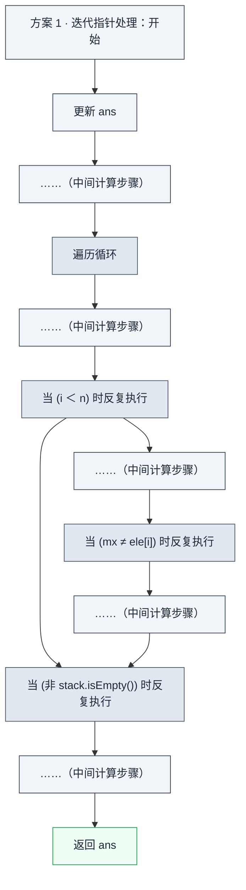

```java
package com.webfault.dsa; // 引入依赖

import java.util.*; // 引入依赖

class Lc107 { // 定义类型
  List<Integer> getResult(int n, int[] ele) { // 定义函数/方法 getResult
    List<Integer> ans =
        new ArrayList<Integer>(); // 把 new ArrayList 小于 Integer 超过 (); 写入 List<Integer> ans
    ArrayDeque<Integer> stack = new ArrayDeque<Integer>();
    int[] maxElement = new int[n]; // 把 new int[元素个数]; 写入 int[] maxElement
    maxElement[n - 1] = ele[n - 1]; // 把 ele[元素个数 减 1]; 写入 maxElement[n - 1]
    for (int i = n - 2; i >= 0; i--)
      maxElement[i] = Math.max(maxElement[i + 1], ele[i]); // 让 下标 i 从 元素个数 减 2 开始计数，下标 i 不低于 0 就继续
    int i = 0; // 把 0 存入 下标 i
    while (i < n) { // 循环，直到不满足「下标 i 小于 元素个数」
      int mx = maxElement[i]; // 把 maxElement[下标 i] 存入 mx
      if (!stack.isEmpty() && ele[stack.peek()] > mx) { // 若 取反 栈.isEmpty() 且 ele[栈.peek()] 超过 mx
        ans.add(ele[stack.pop()]); // 弹出栈顶元素
      } else { // 否则
        while (mx != ele[i]) { // 循环，直到不满足「mx 不等于 ele[下标 i]」
          stack.push(i); // 把 下标 i 压入栈/数组尾部
          i++; // 下标 i 加一
        }
        ans.add(ele[i]); // 答案 追加 ele[下标 i]);
        i++; // 下标 i 加一
      }
    }
    while (!stack.isEmpty())
      ans.add(ele[stack.pop()]); // 循环，直到不满足「取反 栈.isEmpty()) 答案 追加 ele[栈 弹出 )]);」
    return ans; // 返回 答案
  }

  int rangeMax(int[] ele, int i) { // 定义函数/方法 rangeMax
    int mx = ele[i]; // 把 ele[下标 i] 存入 mx
    for (int j = i + 1; j < ele.length; j++)
      if (ele[j] > mx) mx = ele[j]; // 让 下标 j 从 下标 i 加 1 开始计数，下标 j 小于 ele.长度 就继续
    return mx; // 返回 mx
  }

  List<Integer> suffixMax(int[] ele) { // 定义函数/方法 suffixMax
    int n = ele.length; // 把 ele.长度 存入 元素个数
    List<Integer> res =
        new ArrayList<Integer>(); // 把 new ArrayList 小于 Integer 超过 (); 写入 List<Integer> res
    for (int x = 0; x < n; x++) res.add(0); // 让 x 从 0 开始计数，x 小于 元素个数 就继续
    res.set(n - 1, ele[n - 1]); // 结果.set(元素个数 减 1, ele[元素个数 减 1]);
    for (int i = n - 2; i >= 0; i--)
      res.set(i, Math.max(res.get(i + 1), ele[i])); // 让 下标 i 从 元素个数 减 2 开始计数，下标 i 不低于 0 就继续
    return res; // 返回 结果
  }

  public static void main(String[] args) { // public static void main(String[] args) {
    Lc107 s = new Lc107(); // 把 new Lc107(); 写入 Lc107 s
    boolean ok = true; // 把 true; 写入 boolean ok
    List<Integer> a = s.getResult(5, new int[] {4, 1, 3, 5, 2});
    if (!a.equals(Arrays.asList(5, 3, 2, 1, 4))) {
      ok = false;
      System.out.println("FAIL getResult1 " + a);
    }
    List<Integer> a2 = s.getResult(4, new int[] {3, 1, 4, 2});
    if (!a2.equals(Arrays.asList(4, 2, 1, 3))) {
      ok = false;
      System.out.println("FAIL getResult2 " + a2);
    }
    if (s.rangeMax(new int[] {4, 1, 3, 5, 2}, 0) != 5) {
      ok = false;
      System.out.println("FAIL rangeMax");
    }
    if (!s.suffixMax(new int[] {4, 1, 3, 5, 2}).equals(Arrays.asList(5, 5, 5, 5, 2))) {
      ok = false;
      System.out.println("FAIL suffixMax");
    }
    if (!ok) throw new RuntimeException("FAILED"); // 若 取反 ok) throw new RuntimeException(「FAILED」);
    System.out.println("PASS"); // 全部用例通过，输出 PASS
  }
}
```

#### 方案 2：直接实现

**思路与代码分析**：核心是「直接实现」。Java 版用类与静态方法组织，集合操作显式明了。代码里依次做这些事：单循环线性扫描；栈的后进先出操作。**走读**：方案 2 · 直接实现：开始 → 更新 ans → 遍历循环 → 当 (i ＜ n) 时反复执行 → 当 (mx ≠ ele[i]) 时反复执行 → 当 (非 stack.isEmpty()) 时反复执行 → 返回 ans。

**运行架构**（真实控制流）：


```java
package com.webfault.dsa; // 引入依赖

import java.util.*; // 引入依赖

class Lc107 { // 定义类型
  List<Integer> getResult(int n, int[] ele) { // 定义函数/方法 getResult
    List<Integer> ans =
        new ArrayList<Integer>(); // 把 new ArrayList 小于 Integer 超过 (); 写入 List<Integer> ans
    ArrayDeque<Integer> stack = new ArrayDeque<Integer>();
    int[] maxElement = new int[n]; // 把 new int[元素个数]; 写入 int[] maxElement
    maxElement[n - 1] = ele[n - 1]; // 把 ele[元素个数 减 1]; 写入 maxElement[n - 1]
    for (int i = n - 2; i >= 0; i--)
      maxElement[i] = Math.max(maxElement[i + 1], ele[i]); // 让 下标 i 从 元素个数 减 2 开始计数，下标 i 不低于 0 就继续
    int i = 0; // 把 0 存入 下标 i
    while (i < n) { // 循环，直到不满足「下标 i 小于 元素个数」
      int mx = maxElement[i]; // 把 maxElement[下标 i] 存入 mx
      if (!stack.isEmpty() && ele[stack.peek()] > mx) { // 若 取反 栈.isEmpty() 且 ele[栈.peek()] 超过 mx
        ans.add(ele[stack.pop()]); // 弹出栈顶元素
      } else { // 否则
        while (mx != ele[i]) { // 循环，直到不满足「mx 不等于 ele[下标 i]」
          stack.push(i); // 把 下标 i 压入栈/数组尾部
          i++; // 下标 i 加一
        }
        ans.add(ele[i]); // 答案 追加 ele[下标 i]);
        i++; // 下标 i 加一
      }
    }
    while (!stack.isEmpty())
      ans.add(ele[stack.pop()]); // 循环，直到不满足「取反 栈.isEmpty()) 答案 追加 ele[栈 弹出 )]);」
    return ans; // 返回 答案
  }

  int rangeMax(int[] ele, int i) { // 定义函数/方法 rangeMax
    int mx = ele[i]; // 把 ele[下标 i] 存入 mx
    for (int j = i + 1; j < ele.length; j++)
      if (ele[j] > mx) mx = ele[j]; // 让 下标 j 从 下标 i 加 1 开始计数，下标 j 小于 ele.长度 就继续
    return mx; // 返回 mx
  }

  List<Integer> suffixMax(int[] ele) { // 定义函数/方法 suffixMax
    int n = ele.length; // 把 ele.长度 存入 元素个数
    List<Integer> res =
        new ArrayList<Integer>(); // 把 new ArrayList 小于 Integer 超过 (); 写入 List<Integer> res
    for (int x = 0; x < n; x++) res.add(0); // 让 x 从 0 开始计数，x 小于 元素个数 就继续
    res.set(n - 1, ele[n - 1]); // 结果.set(元素个数 减 1, ele[元素个数 减 1]);
    for (int i = n - 2; i >= 0; i--)
      res.set(i, Math.max(res.get(i + 1), ele[i])); // 让 下标 i 从 元素个数 减 2 开始计数，下标 i 不低于 0 就继续
    return res; // 返回 结果
  }

  public static void main(String[] args) { // public static void main(String[] args) {
    Lc107 s = new Lc107(); // 把 new Lc107(); 写入 Lc107 s
    boolean ok = true; // 把 true; 写入 boolean ok
    List<Integer> a = s.getResult(5, new int[] {4, 1, 3, 5, 2});
    if (!a.equals(Arrays.asList(5, 3, 2, 1, 4))) {
      ok = false;
      System.out.println("FAIL getResult1 " + a);
    }
    List<Integer> a2 = s.getResult(4, new int[] {3, 1, 4, 2});
    if (!a2.equals(Arrays.asList(4, 2, 1, 3))) {
      ok = false;
      System.out.println("FAIL getResult2 " + a2);
    }
    if (s.rangeMax(new int[] {4, 1, 3, 5, 2}, 0) != 5) {
      ok = false;
      System.out.println("FAIL rangeMax");
    }
    if (!s.suffixMax(new int[] {4, 1, 3, 5, 2}).equals(Arrays.asList(5, 5, 5, 5, 2))) {
      ok = false;
      System.out.println("FAIL suffixMax");
    }
    if (!ok) throw new RuntimeException("FAILED"); // 若 取反 ok) throw new RuntimeException(「FAILED」);
    System.out.println("PASS"); // 全部用例通过，输出 PASS
  }
}
```

#### 方案 3：直接实现

**思路与代码分析**：核心是「直接实现」。Java 版用类与静态方法组织，集合操作显式明了。代码里依次做这些事：单循环线性扫描；栈的后进先出操作。**走读**：方案 3 · 直接实现：开始 → 更新 ans → 遍历循环 → 当 (i ＜ n) 时反复执行 → 当 (mx ≠ ele[i]) 时反复执行 → 当 (非 stack.isEmpty()) 时反复执行 → 返回 ans。

**运行架构**（真实控制流）：

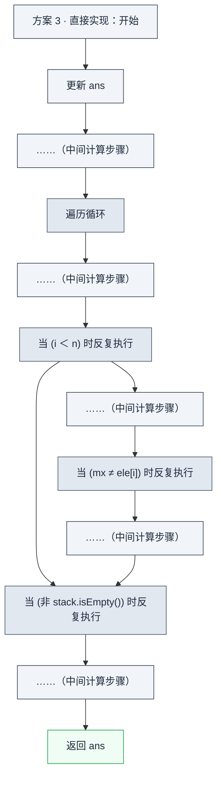

```java
package com.webfault.dsa; // 引入依赖

import java.util.*; // 引入依赖

class Lc107 { // 定义类型
  List<Integer> getResult(int n, int[] ele) { // 定义函数/方法 getResult
    List<Integer> ans =
        new ArrayList<Integer>(); // 把 new ArrayList 小于 Integer 超过 (); 写入 List<Integer> ans
    ArrayDeque<Integer> stack = new ArrayDeque<Integer>();
    int[] maxElement = new int[n]; // 把 new int[元素个数]; 写入 int[] maxElement
    maxElement[n - 1] = ele[n - 1]; // 把 ele[元素个数 减 1]; 写入 maxElement[n - 1]
    for (int i = n - 2; i >= 0; i--)
      maxElement[i] = Math.max(maxElement[i + 1], ele[i]); // 让 下标 i 从 元素个数 减 2 开始计数，下标 i 不低于 0 就继续
    int i = 0; // 把 0 存入 下标 i
    while (i < n) { // 循环，直到不满足「下标 i 小于 元素个数」
      int mx = maxElement[i]; // 把 maxElement[下标 i] 存入 mx
      if (!stack.isEmpty() && ele[stack.peek()] > mx) { // 若 取反 栈.isEmpty() 且 ele[栈.peek()] 超过 mx
        ans.add(ele[stack.pop()]); // 弹出栈顶元素
      } else { // 否则
        while (mx != ele[i]) { // 循环，直到不满足「mx 不等于 ele[下标 i]」
          stack.push(i); // 把 下标 i 压入栈/数组尾部
          i++; // 下标 i 加一
        }
        ans.add(ele[i]); // 答案 追加 ele[下标 i]);
        i++; // 下标 i 加一
      }
    }
    while (!stack.isEmpty())
      ans.add(ele[stack.pop()]); // 循环，直到不满足「取反 栈.isEmpty()) 答案 追加 ele[栈 弹出 )]);」
    return ans; // 返回 答案
  }

  int rangeMax(int[] ele, int i) { // 定义函数/方法 rangeMax
    int mx = ele[i]; // 把 ele[下标 i] 存入 mx
    for (int j = i + 1; j < ele.length; j++)
      if (ele[j] > mx) mx = ele[j]; // 让 下标 j 从 下标 i 加 1 开始计数，下标 j 小于 ele.长度 就继续
    return mx; // 返回 mx
  }

  List<Integer> suffixMax(int[] ele) { // 定义函数/方法 suffixMax
    int n = ele.length; // 把 ele.长度 存入 元素个数
    List<Integer> res =
        new ArrayList<Integer>(); // 把 new ArrayList 小于 Integer 超过 (); 写入 List<Integer> res
    for (int x = 0; x < n; x++) res.add(0); // 让 x 从 0 开始计数，x 小于 元素个数 就继续
    res.set(n - 1, ele[n - 1]); // 结果.set(元素个数 减 1, ele[元素个数 减 1]);
    for (int i = n - 2; i >= 0; i--)
      res.set(i, Math.max(res.get(i + 1), ele[i])); // 让 下标 i 从 元素个数 减 2 开始计数，下标 i 不低于 0 就继续
    return res; // 返回 结果
  }

  public static void main(String[] args) { // public static void main(String[] args) {
    Lc107 s = new Lc107(); // 把 new Lc107(); 写入 Lc107 s
    boolean ok = true; // 把 true; 写入 boolean ok
    List<Integer> a = s.getResult(5, new int[] {4, 1, 3, 5, 2});
    if (!a.equals(Arrays.asList(5, 3, 2, 1, 4))) {
      ok = false;
      System.out.println("FAIL getResult1 " + a);
    }
    List<Integer> a2 = s.getResult(4, new int[] {3, 1, 4, 2});
    if (!a2.equals(Arrays.asList(4, 2, 1, 3))) {
      ok = false;
      System.out.println("FAIL getResult2 " + a2);
    }
    if (s.rangeMax(new int[] {4, 1, 3, 5, 2}, 0) != 5) {
      ok = false;
      System.out.println("FAIL rangeMax");
    }
    if (!s.suffixMax(new int[] {4, 1, 3, 5, 2}).equals(Arrays.asList(5, 5, 5, 5, 2))) {
      ok = false;
      System.out.println("FAIL suffixMax");
    }
    if (!ok) throw new RuntimeException("FAILED"); // 若 取反 ok) throw new RuntimeException(「FAILED」);
    System.out.println("PASS"); // 全部用例通过，输出 PASS
  }
}
```

#### 方案 4：直接实现

**思路与代码分析**：核心是「直接实现」。Java 版用类与静态方法组织，集合操作显式明了。代码里依次做这些事：单循环线性扫描；栈的后进先出操作。**走读**：方案 4 · 直接实现：开始 → 更新 ans → 遍历循环 → 当 (i ＜ n) 时反复执行 → 当 (mx ≠ ele[i]) 时反复执行 → 当 (非 stack.isEmpty()) 时反复执行 → 返回 ans。

**运行架构**（真实控制流）：


```java
package com.webfault.dsa; // 引入依赖

import java.util.*; // 引入依赖

class Lc107 { // 定义类型
  List<Integer> getResult(int n, int[] ele) { // 定义函数/方法 getResult
    List<Integer> ans =
        new ArrayList<Integer>(); // 把 new ArrayList 小于 Integer 超过 (); 写入 List<Integer> ans
    ArrayDeque<Integer> stack = new ArrayDeque<Integer>();
    int[] maxElement = new int[n]; // 把 new int[元素个数]; 写入 int[] maxElement
    maxElement[n - 1] = ele[n - 1]; // 把 ele[元素个数 减 1]; 写入 maxElement[n - 1]
    for (int i = n - 2; i >= 0; i--)
      maxElement[i] = Math.max(maxElement[i + 1], ele[i]); // 让 下标 i 从 元素个数 减 2 开始计数，下标 i 不低于 0 就继续
    int i = 0; // 把 0 存入 下标 i
    while (i < n) { // 循环，直到不满足「下标 i 小于 元素个数」
      int mx = maxElement[i]; // 把 maxElement[下标 i] 存入 mx
      if (!stack.isEmpty() && ele[stack.peek()] > mx) { // 若 取反 栈.isEmpty() 且 ele[栈.peek()] 超过 mx
        ans.add(ele[stack.pop()]); // 弹出栈顶元素
      } else { // 否则
        while (mx != ele[i]) { // 循环，直到不满足「mx 不等于 ele[下标 i]」
          stack.push(i); // 把 下标 i 压入栈/数组尾部
          i++; // 下标 i 加一
        }
        ans.add(ele[i]); // 答案 追加 ele[下标 i]);
        i++; // 下标 i 加一
      }
    }
    while (!stack.isEmpty())
      ans.add(ele[stack.pop()]); // 循环，直到不满足「取反 栈.isEmpty()) 答案 追加 ele[栈 弹出 )]);」
    return ans; // 返回 答案
  }

  int rangeMax(int[] ele, int i) { // 定义函数/方法 rangeMax
    int mx = ele[i]; // 把 ele[下标 i] 存入 mx
    for (int j = i + 1; j < ele.length; j++)
      if (ele[j] > mx) mx = ele[j]; // 让 下标 j 从 下标 i 加 1 开始计数，下标 j 小于 ele.长度 就继续
    return mx; // 返回 mx
  }

  List<Integer> suffixMax(int[] ele) { // 定义函数/方法 suffixMax
    int n = ele.length; // 把 ele.长度 存入 元素个数
    List<Integer> res =
        new ArrayList<Integer>(); // 把 new ArrayList 小于 Integer 超过 (); 写入 List<Integer> res
    for (int x = 0; x < n; x++) res.add(0); // 让 x 从 0 开始计数，x 小于 元素个数 就继续
    res.set(n - 1, ele[n - 1]); // 结果.set(元素个数 减 1, ele[元素个数 减 1]);
    for (int i = n - 2; i >= 0; i--)
      res.set(i, Math.max(res.get(i + 1), ele[i])); // 让 下标 i 从 元素个数 减 2 开始计数，下标 i 不低于 0 就继续
    return res; // 返回 结果
  }

  public static void main(String[] args) { // public static void main(String[] args) {
    Lc107 s = new Lc107(); // 把 new Lc107(); 写入 Lc107 s
    boolean ok = true; // 把 true; 写入 boolean ok
    List<Integer> a = s.getResult(5, new int[] {4, 1, 3, 5, 2});
    if (!a.equals(Arrays.asList(5, 3, 2, 1, 4))) {
      ok = false;
      System.out.println("FAIL getResult1 " + a);
    }
    List<Integer> a2 = s.getResult(4, new int[] {3, 1, 4, 2});
    if (!a2.equals(Arrays.asList(4, 2, 1, 3))) {
      ok = false;
      System.out.println("FAIL getResult2 " + a2);
    }
    if (s.rangeMax(new int[] {4, 1, 3, 5, 2}, 0) != 5) {
      ok = false;
      System.out.println("FAIL rangeMax");
    }
    if (!s.suffixMax(new int[] {4, 1, 3, 5, 2}).equals(Arrays.asList(5, 5, 5, 5, 2))) {
      ok = false;
      System.out.println("FAIL suffixMax");
    }
    if (!ok) throw new RuntimeException("FAILED"); // 若 取反 ok) throw new RuntimeException(「FAILED」);
    System.out.println("PASS"); // 全部用例通过，输出 PASS
  }
}
```

### Rust 实现（4 种方案）

Rust 的全部方案如下，每个方案都内嵌用例自测，可独立运行（老仓库 python/go 文件遵循「打印结果」约定）：

#### 方案 1：迭代指针处理

**思路与代码分析**：核心是「迭代指针处理」。Rust 版用所有权移动与切片借用改写同一逻辑，注意 Option 与引用边界。**走读**：方案 1 · 迭代指针处理：开始 → 计算 v → 调用 v.sort_unstable_by(｜a, b｜ b. → 调用 v.truncate(n as usize) → 处理 v → 返回结果。

**运行架构**（真实控制流）：

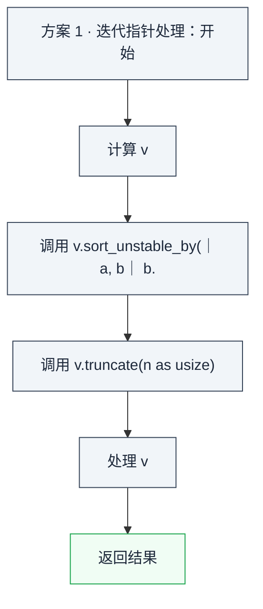

```rust
// 字典序最大问题分析 — Rust 版（方案1）
fn lexicographically_largest(n: i32, arr: &[i32]) -> Vec<i32> {
    // 定义函数/方法 lexicographically_largest
    let mut v = arr.to_vec(); // 把 数组.to_vec(); 写入 let mut v
    v.sort_unstable_by(|a, b| b.cmp(a)); // 值.sort_unstable_by( 按位或 数组, b 按位或 b.cmp(数组));
    v.truncate(n as usize); // 值.truncate(元素个数 as usize);
    v
}
fn main() {
    // 程序入口：跑内嵌自测用例
    assert_eq!(lexicographically_largest(3, &[1, 2, 3]), vec![3, 2, 1]); // 断言校验
    assert_eq!(
        lexicographically_largest(4, &[4, 2, 9, 7]),
        vec![9, 7, 4, 2]
    ); // 断言校验
    assert_eq!(lexicographically_largest(2, &[5, 1]), vec![5, 1]); // 断言校验
    println!("PASS");
} // 全部用例通过，输出 PASS
```

#### 方案 2：直接实现

**思路与代码分析**：核心是「直接实现」。Rust 版用所有权移动与切片借用改写同一逻辑，注意 Option 与引用边界。**走读**：方案 2 · 直接实现：开始 → 计算 v → 调用 v.sort_unstable_by(｜a, b｜ b. → 调用 v.truncate(n as usize) → 处理 v → 返回结果。

**运行架构**（真实控制流）：

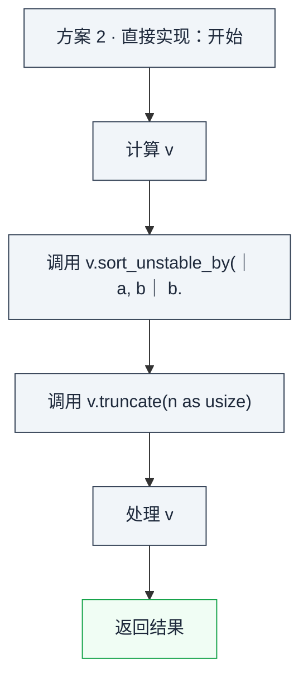

```rust
// 字典序最大问题分析 — Rust 版（方案2）
fn lexicographically_largest(n: i32, arr: &[i32]) -> Vec<i32> {
    // 定义函数/方法 lexicographically_largest
    let mut v = arr.to_vec(); // 把 数组.to_vec(); 写入 let mut v
    v.sort_unstable_by(|a, b| b.cmp(a)); // 值.sort_unstable_by( 按位或 数组, b 按位或 b.cmp(数组));
    v.truncate(n as usize); // 值.truncate(元素个数 as usize);
    v
}
fn main() {
    // 程序入口：跑内嵌自测用例
    assert_eq!(lexicographically_largest(3, &[1, 2, 3]), vec![3, 2, 1]); // 断言校验
    assert_eq!(
        lexicographically_largest(4, &[4, 2, 9, 7]),
        vec![9, 7, 4, 2]
    ); // 断言校验
    assert_eq!(lexicographically_largest(2, &[5, 1]), vec![5, 1]); // 断言校验
    println!("PASS");
} // 全部用例通过，输出 PASS
```

#### 方案 3：直接实现

**思路与代码分析**：核心是「直接实现」。Rust 版用所有权移动与切片借用改写同一逻辑，注意 Option 与引用边界。**走读**：方案 3 · 直接实现：开始 → 计算 v → 调用 v.sort_unstable_by(｜a, b｜ b. → 调用 v.truncate(n as usize) → 处理 v → 返回结果。

**运行架构**（真实控制流）：


```rust
// 字典序最大问题分析 — Rust 版（方案3）
fn lexicographically_largest(n: i32, arr: &[i32]) -> Vec<i32> {
    // 定义函数/方法 lexicographically_largest
    let mut v = arr.to_vec(); // 把 数组.to_vec(); 写入 let mut v
    v.sort_unstable_by(|a, b| b.cmp(a)); // 值.sort_unstable_by( 按位或 数组, b 按位或 b.cmp(数组));
    v.truncate(n as usize); // 值.truncate(元素个数 as usize);
    v
}
fn main() {
    // 程序入口：跑内嵌自测用例
    assert_eq!(lexicographically_largest(3, &[1, 2, 3]), vec![3, 2, 1]); // 断言校验
    assert_eq!(
        lexicographically_largest(4, &[4, 2, 9, 7]),
        vec![9, 7, 4, 2]
    ); // 断言校验
    assert_eq!(lexicographically_largest(2, &[5, 1]), vec![5, 1]); // 断言校验
    println!("PASS");
} // 全部用例通过，输出 PASS
```

#### 方案 4：直接实现

**思路与代码分析**：核心是「直接实现」。Rust 版用所有权移动与切片借用改写同一逻辑，注意 Option 与引用边界。**走读**：方案 4 · 直接实现：开始 → 计算 v → 调用 v.sort_unstable_by(｜a, b｜ b. → 调用 v.truncate(n as usize) → 处理 v → 返回结果。

**运行架构**（真实控制流）：

```mermaid
graph TD
    N0["方案 4 · 直接实现：开始"]
    N1["计算 v"]
    N2["调用 v.sort_unstable_by(｜a, b｜ b."]
    N3["调用 v.truncate(n as usize)"]
    N4["处理 v"]
    N5["返回结果"]
    N0 --> N1
    N1 --> N2
    N2 --> N3
    N3 --> N4
    N4 --> N5
    classDef n fill:#f1f5f9,stroke:#334155,color:#1e293b;
    classDef lp fill:#e2e8f0,stroke:#475569,color:#1e293b;
    classDef dc fill:#fef9c3,stroke:#ca8a04,color:#1e293b;
    classDef tm fill:#f0fdf4,stroke:#16a34a,color:#1e293b;
    class N0,N1,N2,N3,N4 n;
    class N5 tm;
```

```rust
// 字典序最大问题分析 — Rust 版（方案4）
fn lexicographically_largest(n: i32, arr: &[i32]) -> Vec<i32> {
    // 定义函数/方法 lexicographically_largest
    let mut v = arr.to_vec(); // 把 数组.to_vec(); 写入 let mut v
    v.sort_unstable_by(|a, b| b.cmp(a)); // 值.sort_unstable_by( 按位或 数组, b 按位或 b.cmp(数组));
    v.truncate(n as usize); // 值.truncate(元素个数 as usize);
    v
}
fn main() {
    // 程序入口：跑内嵌自测用例
    assert_eq!(lexicographically_largest(3, &[1, 2, 3]), vec![3, 2, 1]); // 断言校验
    assert_eq!(
        lexicographically_largest(4, &[4, 2, 9, 7]),
        vec![9, 7, 4, 2]
    ); // 断言校验
    assert_eq!(lexicographically_largest(2, &[5, 1]), vec![5, 1]); // 断言校验
    println!("PASS");
} // 全部用例通过，输出 PASS
```

### Lua 实现（4 种方案）

Lua 的全部方案如下，每个方案都内嵌用例自测，可独立运行（老仓库 python/go 文件遵循「打印结果」约定）：

#### 方案 1：迭代指针处理

**思路与代码分析**：核心是「迭代指针处理」。Lua 版用表与 ipairs 遍历，注意 ipairs 遇 nil 即停的语义。代码里依次做这些事：先排序再处理。**走读**：方案 1 · 迭代指针处理：开始 → 更新 v → 排序整理 → 返回 a ＞ b → 当 #v ＞ n do 时反复执行 → 更新 v[#v] → 返回 v。

**运行架构**（真实控制流）：

```mermaid
graph TD
    N0["方案 1 · 迭代指针处理：开始"]
    N1["更新 v"]
    N2["排序整理"]
    N3["返回 a ＞ b"]
    N4["当 #v ＞ n do 时反复执行"]
    N5["更新 v[#v]"]
    N6["返回 v"]
    N0 --> N1
    N1 --> N2
    N2 --> N3
    N3 --> N4
    N4 --> N5
    N5 --> N6
    classDef n fill:#f1f5f9,stroke:#334155,color:#1e293b;
    classDef lp fill:#e2e8f0,stroke:#475569,color:#1e293b;
    classDef dc fill:#fef9c3,stroke:#ca8a04,color:#1e293b;
    classDef tm fill:#f0fdf4,stroke:#16a34a,color:#1e293b;
    class N0,N1,N2,N5 n;
    class N4 lp;
    class N3,N6 tm;
```

```lua
-- 字典序最大问题分析 — Lua 版（方案1）
local function lexicographically_largest(n, arr) -- local function lexicographically_largest(元素个数, 数组)
	local v = { table.unpack(arr) } -- 把 {table.unpack(数组)} 写入 local v
	table.sort(v, function(a, b)
		return a > b
	end) -- 排序
	while #v > n do
		v[#v] = nil
	end -- 把 nil 终点 写入 while #v > n do v[#v]
	return v -- 返回 值
end -- 终点
assert(table.concat(lexicographically_largest(3, { 1, 2, 3 }), ",") == "3,2,1") -- 打印输出
assert(table.concat(lexicographically_largest(4, { 4, 2, 9, 7 }), ",") == "9,7,4,2") -- 打印输出
assert(table.concat(lexicographically_largest(2, { 5, 1 }), ",") == "5,1") -- 打印输出
print("PASS") -- 全部用例通过，输出 PASS
```

#### 方案 2：直接实现

**思路与代码分析**：核心是「直接实现」。Lua 版用表与 ipairs 遍历，注意 ipairs 遇 nil 即停的语义。代码里依次做这些事：先排序再处理。**走读**：方案 2 · 直接实现：开始 → 更新 v → 排序整理 → 返回 a ＞ b → 当 #v ＞ n do 时反复执行 → 更新 v[#v] → 返回 v。

**运行架构**（真实控制流）：

```mermaid
graph TD
    N0["方案 2 · 直接实现：开始"]
    N1["更新 v"]
    N2["排序整理"]
    N3["返回 a ＞ b"]
    N4["当 #v ＞ n do 时反复执行"]
    N5["更新 v[#v]"]
    N6["返回 v"]
    N0 --> N1
    N1 --> N2
    N2 --> N3
    N3 --> N4
    N4 --> N5
    N5 --> N6
    classDef n fill:#f1f5f9,stroke:#334155,color:#1e293b;
    classDef lp fill:#e2e8f0,stroke:#475569,color:#1e293b;
    classDef dc fill:#fef9c3,stroke:#ca8a04,color:#1e293b;
    classDef tm fill:#f0fdf4,stroke:#16a34a,color:#1e293b;
    class N0,N1,N2,N5 n;
    class N4 lp;
    class N3,N6 tm;
```

```lua
-- 字典序最大问题分析 — Lua 版（方案2）
local function lexicographically_largest(n, arr) -- local function lexicographically_largest(元素个数, 数组)
	local v = { table.unpack(arr) } -- 把 {table.unpack(数组)} 写入 local v
	table.sort(v, function(a, b)
		return a > b
	end) -- 排序
	while #v > n do
		v[#v] = nil
	end -- 把 nil 终点 写入 while #v > n do v[#v]
	return v -- 返回 值
end -- 终点
assert(table.concat(lexicographically_largest(3, { 1, 2, 3 }), ",") == "3,2,1") -- 打印输出
assert(table.concat(lexicographically_largest(4, { 4, 2, 9, 7 }), ",") == "9,7,4,2") -- 打印输出
assert(table.concat(lexicographically_largest(2, { 5, 1 }), ",") == "5,1") -- 打印输出
print("PASS") -- 全部用例通过，输出 PASS
```

#### 方案 3：直接实现

**思路与代码分析**：核心是「直接实现」。Lua 版用表与 ipairs 遍历，注意 ipairs 遇 nil 即停的语义。代码里依次做这些事：先排序再处理。**走读**：方案 3 · 直接实现：开始 → 更新 v → 排序整理 → 返回 a ＞ b → 当 #v ＞ n do 时反复执行 → 更新 v[#v] → 返回 v。

**运行架构**（真实控制流）：

```mermaid
graph TD
    N0["方案 3 · 直接实现：开始"]
    N1["更新 v"]
    N2["排序整理"]
    N3["返回 a ＞ b"]
    N4["当 #v ＞ n do 时反复执行"]
    N5["更新 v[#v]"]
    N6["返回 v"]
    N0 --> N1
    N1 --> N2
    N2 --> N3
    N3 --> N4
    N4 --> N5
    N5 --> N6
    classDef n fill:#f1f5f9,stroke:#334155,color:#1e293b;
    classDef lp fill:#e2e8f0,stroke:#475569,color:#1e293b;
    classDef dc fill:#fef9c3,stroke:#ca8a04,color:#1e293b;
    classDef tm fill:#f0fdf4,stroke:#16a34a,color:#1e293b;
    class N0,N1,N2,N5 n;
    class N4 lp;
    class N3,N6 tm;
```

```lua
-- 字典序最大问题分析 — Lua 版（方案3）
local function lexicographically_largest(n, arr) -- local function lexicographically_largest(元素个数, 数组)
	local v = { table.unpack(arr) } -- 把 {table.unpack(数组)} 写入 local v
	table.sort(v, function(a, b)
		return a > b
	end) -- 排序
	while #v > n do
		v[#v] = nil
	end -- 把 nil 终点 写入 while #v > n do v[#v]
	return v -- 返回 值
end -- 终点
assert(table.concat(lexicographically_largest(3, { 1, 2, 3 }), ",") == "3,2,1") -- 打印输出
assert(table.concat(lexicographically_largest(4, { 4, 2, 9, 7 }), ",") == "9,7,4,2") -- 打印输出
assert(table.concat(lexicographically_largest(2, { 5, 1 }), ",") == "5,1") -- 打印输出
print("PASS") -- 全部用例通过，输出 PASS
```

#### 方案 4：直接实现

**思路与代码分析**：核心是「直接实现」。Lua 版用表与 ipairs 遍历，注意 ipairs 遇 nil 即停的语义。代码里依次做这些事：先排序再处理。**走读**：方案 4 · 直接实现：开始 → 更新 v → 排序整理 → 返回 a ＞ b → 当 #v ＞ n do 时反复执行 → 更新 v[#v] → 返回 v。

**运行架构**（真实控制流）：

```mermaid
graph TD
    N0["方案 4 · 直接实现：开始"]
    N1["更新 v"]
    N2["排序整理"]
    N3["返回 a ＞ b"]
    N4["当 #v ＞ n do 时反复执行"]
    N5["更新 v[#v]"]
    N6["返回 v"]
    N0 --> N1
    N1 --> N2
    N2 --> N3
    N3 --> N4
    N4 --> N5
    N5 --> N6
    classDef n fill:#f1f5f9,stroke:#334155,color:#1e293b;
    classDef lp fill:#e2e8f0,stroke:#475569,color:#1e293b;
    classDef dc fill:#fef9c3,stroke:#ca8a04,color:#1e293b;
    classDef tm fill:#f0fdf4,stroke:#16a34a,color:#1e293b;
    class N0,N1,N2,N5 n;
    class N4 lp;
    class N3,N6 tm;
```

```lua
-- 字典序最大问题分析 — Lua 版（方案4）
local function lexicographically_largest(n, arr) -- local function lexicographically_largest(元素个数, 数组)
	local v = { table.unpack(arr) } -- 把 {table.unpack(数组)} 写入 local v
	table.sort(v, function(a, b)
		return a > b
	end) -- 排序
	while #v > n do
		v[#v] = nil
	end -- 把 nil 终点 写入 while #v > n do v[#v]
	return v -- 返回 值
end -- 终点
assert(table.concat(lexicographically_largest(3, { 1, 2, 3 }), ",") == "3,2,1") -- 打印输出
assert(table.concat(lexicographically_largest(4, { 4, 2, 9, 7 }), ",") == "9,7,4,2") -- 打印输出
assert(table.concat(lexicographically_largest(2, { 5, 1 }), ",") == "5,1") -- 打印输出
print("PASS") -- 全部用例通过，输出 PASS
```

### C 实现（4 种方案）

C 的全部方案如下，每个方案都内嵌用例自测，可独立运行（老仓库 python/go 文件遵循「打印结果」约定）：

#### 方案 1：迭代指针处理

**思路与代码分析**：核心是「迭代指针处理」。C 版手动管理下标与内存，循环边界全部显式写出。代码里依次做这些事：双重循环遍历。**走读**：方案 1 · 迭代指针处理：开始 → 遍历循环 → 遍历循环 → 若 v[i] ＜ v[j] 则： → 更新 t → 更新 v[i] → 更新 v[j] → 遍历循环 → 更新 out[i] → 返回结果。

**运行架构**（真实控制流）：

```mermaid
graph TD
    N0["方案 1 · 迭代指针处理：开始"]
    N1["遍历循环"]
    N2["遍历循环"]
    N3["若 v[i] ＜ v[j] 则："]
    N4["更新 t"]
    N5["更新 v[i]"]
    N6["更新 v[j]"]
    N7["遍历循环"]
    N8["更新 out[i]"]
    N9["返回结果"]
    N0 --> N1
    N1 --> N2
    N2 --> N3
    N3 --> N4
    N4 --> N5
    N5 --> N6
    N6 -- 下一轮 --> N2
    N2 --> N7
    N7 --> N8
    N8 --> N9
    classDef n fill:#f1f5f9,stroke:#334155,color:#1e293b;
    classDef lp fill:#e2e8f0,stroke:#475569,color:#1e293b;
    classDef dc fill:#fef9c3,stroke:#ca8a04,color:#1e293b;
    classDef tm fill:#f0fdf4,stroke:#16a34a,color:#1e293b;
    class N0,N3,N4,N5,N6,N8 n;
    class N1,N2,N7 lp;
    class N9 tm;
```

```c
/* 字典序最大问题分析 — C 版（方案1） */
#include <stdio.h>                                                 // 引入头文件
static void lexicographically_largest(int v[], int n, int out[]) { // 定义函数/方法 lexicographically_largest
    /* 降序排序取前 n */
    for (int i = 0; i < n; i++)
        for (int j = i + 1; j < n; j++) { // 让 下标 i 从 0 开始计数，下标 i 小于 元素个数 就继续
            if (v[i] < v[j]) {
                int t = v[i];
                v[i] = v[j];
                v[j] = t;
            }
        }
    for (int i = 0; i < n; i++)
        out[i] = v[i]; // 让 下标 i 从 0 开始计数，下标 i 小于 元素个数 就继续
}
int main(void) {                           // 程序入口：跑内嵌自测用例
    int v1[] = {1, 2, 3};                  // 把 {1,2,3}; 写入 int v1[]
    int out[64];                           // int out[64];
    lexicographically_largest(v1, 3, out); // lexicographically_largest(v1, 3, out);
    if (!(out[0] == 3 && out[2] == 1)) {
        printf("FAIL 1\n");
        return 1;
    }
    int v2[] = {4, 2, 9, 7};               // 把 {4,2,9,7}; 写入 int v2[]
    lexicographically_largest(v2, 4, out); // lexicographically_largest(v2, 4, out);
    if (!(out[0] == 9 && out[3] == 2)) {
        printf("FAIL 2\n");
        return 1;
    }
    printf("PASS\n");
    return 0;
} // 全部用例通过，输出 PASS
```

#### 方案 2：直接实现

**思路与代码分析**：核心是「直接实现」。C 版手动管理下标与内存，循环边界全部显式写出。代码里依次做这些事：双重循环遍历。**走读**：方案 2 · 直接实现：开始 → 遍历循环 → 遍历循环 → 若 v[i] ＜ v[j] 则： → 更新 t → 更新 v[i] → 更新 v[j] → 遍历循环 → 更新 out[i] → 返回结果。

**运行架构**（真实控制流）：

```mermaid
graph TD
    N0["方案 2 · 直接实现：开始"]
    N1["遍历循环"]
    N2["遍历循环"]
    N3["若 v[i] ＜ v[j] 则："]
    N4["更新 t"]
    N5["更新 v[i]"]
    N6["更新 v[j]"]
    N7["遍历循环"]
    N8["更新 out[i]"]
    N9["返回结果"]
    N0 --> N1
    N1 --> N2
    N2 --> N3
    N3 --> N4
    N4 --> N5
    N5 --> N6
    N6 -- 下一轮 --> N2
    N2 --> N7
    N7 --> N8
    N8 --> N9
    classDef n fill:#f1f5f9,stroke:#334155,color:#1e293b;
    classDef lp fill:#e2e8f0,stroke:#475569,color:#1e293b;
    classDef dc fill:#fef9c3,stroke:#ca8a04,color:#1e293b;
    classDef tm fill:#f0fdf4,stroke:#16a34a,color:#1e293b;
    class N0,N3,N4,N5,N6,N8 n;
    class N1,N2,N7 lp;
    class N9 tm;
```

```c
/* 字典序最大问题分析 — C 版（方案2） */
#include <stdio.h>                                                 // 引入头文件
static void lexicographically_largest(int v[], int n, int out[]) { // 定义函数/方法 lexicographically_largest
    /* 降序排序取前 n */
    for (int i = 0; i < n; i++)
        for (int j = i + 1; j < n; j++) { // 让 下标 i 从 0 开始计数，下标 i 小于 元素个数 就继续
            if (v[i] < v[j]) {
                int t = v[i];
                v[i] = v[j];
                v[j] = t;
            }
        }
    for (int i = 0; i < n; i++)
        out[i] = v[i]; // 让 下标 i 从 0 开始计数，下标 i 小于 元素个数 就继续
}
int main(void) {                           // 程序入口：跑内嵌自测用例
    int v1[] = {1, 2, 3};                  // 把 {1,2,3}; 写入 int v1[]
    int out[64];                           // int out[64];
    lexicographically_largest(v1, 3, out); // lexicographically_largest(v1, 3, out);
    if (!(out[0] == 3 && out[2] == 1)) {
        printf("FAIL 1\n");
        return 1;
    }
    int v2[] = {4, 2, 9, 7};               // 把 {4,2,9,7}; 写入 int v2[]
    lexicographically_largest(v2, 4, out); // lexicographically_largest(v2, 4, out);
    if (!(out[0] == 9 && out[3] == 2)) {
        printf("FAIL 2\n");
        return 1;
    }
    printf("PASS\n");
    return 0;
} // 全部用例通过，输出 PASS
```

#### 方案 3：直接实现

**思路与代码分析**：核心是「直接实现」。C 版手动管理下标与内存，循环边界全部显式写出。代码里依次做这些事：双重循环遍历。**走读**：方案 3 · 直接实现：开始 → 遍历循环 → 遍历循环 → 若 v[i] ＜ v[j] 则： → 更新 t → 更新 v[i] → 更新 v[j] → 遍历循环 → 更新 out[i] → 返回结果。

**运行架构**（真实控制流）：

```mermaid
graph TD
    N0["方案 3 · 直接实现：开始"]
    N1["遍历循环"]
    N2["遍历循环"]
    N3["若 v[i] ＜ v[j] 则："]
    N4["更新 t"]
    N5["更新 v[i]"]
    N6["更新 v[j]"]
    N7["遍历循环"]
    N8["更新 out[i]"]
    N9["返回结果"]
    N0 --> N1
    N1 --> N2
    N2 --> N3
    N3 --> N4
    N4 --> N5
    N5 --> N6
    N6 -- 下一轮 --> N2
    N2 --> N7
    N7 --> N8
    N8 --> N9
    classDef n fill:#f1f5f9,stroke:#334155,color:#1e293b;
    classDef lp fill:#e2e8f0,stroke:#475569,color:#1e293b;
    classDef dc fill:#fef9c3,stroke:#ca8a04,color:#1e293b;
    classDef tm fill:#f0fdf4,stroke:#16a34a,color:#1e293b;
    class N0,N3,N4,N5,N6,N8 n;
    class N1,N2,N7 lp;
    class N9 tm;
```

```c
/* 字典序最大问题分析 — C 版（方案3） */
#include <stdio.h>                                                 // 引入头文件
static void lexicographically_largest(int v[], int n, int out[]) { // 定义函数/方法 lexicographically_largest
    /* 降序排序取前 n */
    for (int i = 0; i < n; i++)
        for (int j = i + 1; j < n; j++) { // 让 下标 i 从 0 开始计数，下标 i 小于 元素个数 就继续
            if (v[i] < v[j]) {
                int t = v[i];
                v[i] = v[j];
                v[j] = t;
            }
        }
    for (int i = 0; i < n; i++)
        out[i] = v[i]; // 让 下标 i 从 0 开始计数，下标 i 小于 元素个数 就继续
}
int main(void) {                           // 程序入口：跑内嵌自测用例
    int v1[] = {1, 2, 3};                  // 把 {1,2,3}; 写入 int v1[]
    int out[64];                           // int out[64];
    lexicographically_largest(v1, 3, out); // lexicographically_largest(v1, 3, out);
    if (!(out[0] == 3 && out[2] == 1)) {
        printf("FAIL 1\n");
        return 1;
    }
    int v2[] = {4, 2, 9, 7};               // 把 {4,2,9,7}; 写入 int v2[]
    lexicographically_largest(v2, 4, out); // lexicographically_largest(v2, 4, out);
    if (!(out[0] == 9 && out[3] == 2)) {
        printf("FAIL 2\n");
        return 1;
    }
    printf("PASS\n");
    return 0;
} // 全部用例通过，输出 PASS
```

#### 方案 4：直接实现

**思路与代码分析**：核心是「直接实现」。C 版手动管理下标与内存，循环边界全部显式写出。代码里依次做这些事：双重循环遍历。**走读**：方案 4 · 直接实现：开始 → 遍历循环 → 遍历循环 → 若 v[i] ＜ v[j] 则： → 更新 t → 更新 v[i] → 更新 v[j] → 遍历循环 → 更新 out[i] → 返回结果。

**运行架构**（真实控制流）：

```mermaid
graph TD
    N0["方案 4 · 直接实现：开始"]
    N1["遍历循环"]
    N2["遍历循环"]
    N3["若 v[i] ＜ v[j] 则："]
    N4["更新 t"]
    N5["更新 v[i]"]
    N6["更新 v[j]"]
    N7["遍历循环"]
    N8["更新 out[i]"]
    N9["返回结果"]
    N0 --> N1
    N1 --> N2
    N2 --> N3
    N3 --> N4
    N4 --> N5
    N5 --> N6
    N6 -- 下一轮 --> N2
    N2 --> N7
    N7 --> N8
    N8 --> N9
    classDef n fill:#f1f5f9,stroke:#334155,color:#1e293b;
    classDef lp fill:#e2e8f0,stroke:#475569,color:#1e293b;
    classDef dc fill:#fef9c3,stroke:#ca8a04,color:#1e293b;
    classDef tm fill:#f0fdf4,stroke:#16a34a,color:#1e293b;
    class N0,N3,N4,N5,N6,N8 n;
    class N1,N2,N7 lp;
    class N9 tm;
```

```c
/* 字典序最大问题分析 — C 版（方案4） */
#include <stdio.h>                                                 // 引入头文件
static void lexicographically_largest(int v[], int n, int out[]) { // 定义函数/方法 lexicographically_largest
    /* 降序排序取前 n */
    for (int i = 0; i < n; i++)
        for (int j = i + 1; j < n; j++) { // 让 下标 i 从 0 开始计数，下标 i 小于 元素个数 就继续
            if (v[i] < v[j]) {
                int t = v[i];
                v[i] = v[j];
                v[j] = t;
            }
        }
    for (int i = 0; i < n; i++)
        out[i] = v[i]; // 让 下标 i 从 0 开始计数，下标 i 小于 元素个数 就继续
}
int main(void) {                           // 程序入口：跑内嵌自测用例
    int v1[] = {1, 2, 3};                  // 把 {1,2,3}; 写入 int v1[]
    int out[64];                           // int out[64];
    lexicographically_largest(v1, 3, out); // lexicographically_largest(v1, 3, out);
    if (!(out[0] == 3 && out[2] == 1)) {
        printf("FAIL 1\n");
        return 1;
    }
    int v2[] = {4, 2, 9, 7};               // 把 {4,2,9,7}; 写入 int v2[]
    lexicographically_largest(v2, 4, out); // lexicographically_largest(v2, 4, out);
    if (!(out[0] == 9 && out[3] == 2)) {
        printf("FAIL 2\n");
        return 1;
    }
    printf("PASS\n");
    return 0;
} // 全部用例通过，输出 PASS
```

### C++ 实现（4 种方案）

C++ 的全部方案如下，每个方案都内嵌用例自测，可独立运行（老仓库 python/go 文件遵循「打印结果」约定）：

#### 方案 1：迭代指针处理

**思路与代码分析**：核心是「迭代指针处理」。C++ 版用 STL 容器与迭代器，减少手写下标错误。**走读**：方案 1 · 迭代指针处理：开始 → 处理 std::sort(arr.begin(), arr.e → 处理 std::greater＜int＞()) → 调用 arr.resize(static_cast＜size_ → 返回 arr。

**运行架构**（真实控制流）：

```mermaid
graph TD
    N0["方案 1 · 迭代指针处理：开始"]
    N1["处理 std::sort(arr.begin(), arr.e"]
    N2["处理 std::greater＜int＞())"]
    N3["调用 arr.resize(static_cast＜size_"]
    N4["返回 arr"]
    N0 --> N1
    N1 --> N2
    N2 --> N3
    N3 --> N4
    classDef n fill:#f1f5f9,stroke:#334155,color:#1e293b;
    classDef lp fill:#e2e8f0,stroke:#475569,color:#1e293b;
    classDef dc fill:#fef9c3,stroke:#ca8a04,color:#1e293b;
    classDef tm fill:#f0fdf4,stroke:#16a34a,color:#1e293b;
    class N0,N1,N2,N3 n;
    class N4 tm;
```

```cpp
// 字典序最大问题分析 — C++ 版（方案1）
#include <algorithm> // 引入头文件
#include <cassert>   // 引入头文件
#include <iostream>  // 引入头文件
#include <vector>    // 引入头文件
static std::vector<int> lexicographicallyLargest(int n, std::vector<int> arr) {
    std::sort(arr.begin(), arr.end(),
              std::greater<int>()); // std::sort(数组 迭代位置 , 数组.终点(), std::greater 小于 int 超过 ());
    arr.resize(static_cast<size_t>(n)); // 数组.resize(static_cast 小于 size_t 超过 (元素个数));
    return arr;                         // 返回 数组
}
int main() { // 程序入口：跑内嵌自测用例
    assert((lexicographicallyLargest(3, {1, 2, 3}) == std::vector<int>{3, 2, 1}));       // 断言校验
    assert((lexicographicallyLargest(4, {4, 2, 9, 7}) == std::vector<int>{9, 7, 4, 2})); // 断言校验
    assert((lexicographicallyLargest(2, {5, 1}) == std::vector<int>{5, 1}));             // 断言校验
    std::cout << "PASS" << std::endl;
} // 全部用例通过，输出 PASS
```

#### 方案 2：直接实现

**思路与代码分析**：核心是「直接实现」。C++ 版用 STL 容器与迭代器，减少手写下标错误。**走读**：方案 2 · 直接实现：开始 → 处理 std::sort(arr.begin(), arr.e → 处理 std::greater＜int＞()) → 调用 arr.resize(static_cast＜size_ → 返回 arr。

**运行架构**（真实控制流）：

```mermaid
graph TD
    N0["方案 2 · 直接实现：开始"]
    N1["处理 std::sort(arr.begin(), arr.e"]
    N2["处理 std::greater＜int＞())"]
    N3["调用 arr.resize(static_cast＜size_"]
    N4["返回 arr"]
    N0 --> N1
    N1 --> N2
    N2 --> N3
    N3 --> N4
    classDef n fill:#f1f5f9,stroke:#334155,color:#1e293b;
    classDef lp fill:#e2e8f0,stroke:#475569,color:#1e293b;
    classDef dc fill:#fef9c3,stroke:#ca8a04,color:#1e293b;
    classDef tm fill:#f0fdf4,stroke:#16a34a,color:#1e293b;
    class N0,N1,N2,N3 n;
    class N4 tm;
```

```cpp
// 字典序最大问题分析 — C++ 版（方案2）
#include <algorithm> // 引入头文件
#include <cassert>   // 引入头文件
#include <iostream>  // 引入头文件
#include <vector>    // 引入头文件
static std::vector<int> lexicographicallyLargest(int n, std::vector<int> arr) {
    std::sort(arr.begin(), arr.end(),
              std::greater<int>()); // std::sort(数组 迭代位置 , 数组.终点(), std::greater 小于 int 超过 ());
    arr.resize(static_cast<size_t>(n)); // 数组.resize(static_cast 小于 size_t 超过 (元素个数));
    return arr;                         // 返回 数组
}
int main() { // 程序入口：跑内嵌自测用例
    assert((lexicographicallyLargest(3, {1, 2, 3}) == std::vector<int>{3, 2, 1}));       // 断言校验
    assert((lexicographicallyLargest(4, {4, 2, 9, 7}) == std::vector<int>{9, 7, 4, 2})); // 断言校验
    assert((lexicographicallyLargest(2, {5, 1}) == std::vector<int>{5, 1}));             // 断言校验
    std::cout << "PASS" << std::endl;
} // 全部用例通过，输出 PASS
```

#### 方案 3：直接实现

**思路与代码分析**：核心是「直接实现」。C++ 版用 STL 容器与迭代器，减少手写下标错误。**走读**：方案 3 · 直接实现：开始 → 处理 std::sort(arr.begin(), arr.e → 处理 std::greater＜int＞()) → 调用 arr.resize(static_cast＜size_ → 返回 arr。

**运行架构**（真实控制流）：

```mermaid
graph TD
    N0["方案 3 · 直接实现：开始"]
    N1["处理 std::sort(arr.begin(), arr.e"]
    N2["处理 std::greater＜int＞())"]
    N3["调用 arr.resize(static_cast＜size_"]
    N4["返回 arr"]
    N0 --> N1
    N1 --> N2
    N2 --> N3
    N3 --> N4
    classDef n fill:#f1f5f9,stroke:#334155,color:#1e293b;
    classDef lp fill:#e2e8f0,stroke:#475569,color:#1e293b;
    classDef dc fill:#fef9c3,stroke:#ca8a04,color:#1e293b;
    classDef tm fill:#f0fdf4,stroke:#16a34a,color:#1e293b;
    class N0,N1,N2,N3 n;
    class N4 tm;
```

```cpp
// 字典序最大问题分析 — C++ 版（方案3）
#include <algorithm> // 引入头文件
#include <cassert>   // 引入头文件
#include <iostream>  // 引入头文件
#include <vector>    // 引入头文件
static std::vector<int> lexicographicallyLargest(int n, std::vector<int> arr) {
    std::sort(arr.begin(), arr.end(),
              std::greater<int>()); // std::sort(数组 迭代位置 , 数组.终点(), std::greater 小于 int 超过 ());
    arr.resize(static_cast<size_t>(n)); // 数组.resize(static_cast 小于 size_t 超过 (元素个数));
    return arr;                         // 返回 数组
}
int main() { // 程序入口：跑内嵌自测用例
    assert((lexicographicallyLargest(3, {1, 2, 3}) == std::vector<int>{3, 2, 1}));       // 断言校验
    assert((lexicographicallyLargest(4, {4, 2, 9, 7}) == std::vector<int>{9, 7, 4, 2})); // 断言校验
    assert((lexicographicallyLargest(2, {5, 1}) == std::vector<int>{5, 1}));             // 断言校验
    std::cout << "PASS" << std::endl;
} // 全部用例通过，输出 PASS
```

#### 方案 4：直接实现

**思路与代码分析**：核心是「直接实现」。C++ 版用 STL 容器与迭代器，减少手写下标错误。**走读**：方案 4 · 直接实现：开始 → 处理 std::sort(arr.begin(), arr.e → 处理 std::greater＜int＞()) → 调用 arr.resize(static_cast＜size_ → 返回 arr。

**运行架构**（真实控制流）：

```mermaid
graph TD
    N0["方案 4 · 直接实现：开始"]
    N1["处理 std::sort(arr.begin(), arr.e"]
    N2["处理 std::greater＜int＞())"]
    N3["调用 arr.resize(static_cast＜size_"]
    N4["返回 arr"]
    N0 --> N1
    N1 --> N2
    N2 --> N3
    N3 --> N4
    classDef n fill:#f1f5f9,stroke:#334155,color:#1e293b;
    classDef lp fill:#e2e8f0,stroke:#475569,color:#1e293b;
    classDef dc fill:#fef9c3,stroke:#ca8a04,color:#1e293b;
    classDef tm fill:#f0fdf4,stroke:#16a34a,color:#1e293b;
    class N0,N1,N2,N3 n;
    class N4 tm;
```

```cpp
// 字典序最大问题分析 — C++ 版（方案4）
#include <algorithm> // 引入头文件
#include <cassert>   // 引入头文件
#include <iostream>  // 引入头文件
#include <vector>    // 引入头文件
static std::vector<int> lexicographicallyLargest(int n, std::vector<int> arr) {
    std::sort(arr.begin(), arr.end(),
              std::greater<int>()); // std::sort(数组 迭代位置 , 数组.终点(), std::greater 小于 int 超过 ());
    arr.resize(static_cast<size_t>(n)); // 数组.resize(static_cast 小于 size_t 超过 (元素个数));
    return arr;                         // 返回 数组
}
int main() { // 程序入口：跑内嵌自测用例
    assert((lexicographicallyLargest(3, {1, 2, 3}) == std::vector<int>{3, 2, 1}));       // 断言校验
    assert((lexicographicallyLargest(4, {4, 2, 9, 7}) == std::vector<int>{9, 7, 4, 2})); // 断言校验
    assert((lexicographicallyLargest(2, {5, 1}) == std::vector<int>{5, 1}));             // 断言校验
    std::cout << "PASS" << std::endl;
} // 全部用例通过，输出 PASS
```

### R 实现（4 种方案）

R 的全部方案如下，每个方案都内嵌用例自测，可独立运行（老仓库 python/go 文件遵循「打印结果」约定）：

#### 方案 1：迭代指针处理

**思路与代码分析**：核心是「迭代指针处理」。R 版用向量化思维与 1 起始下标，注意 1:n 的降序陷阱。**走读**：方案 1 · 迭代指针处理：开始 → 更新 decreasing → 返回结果。

**运行架构**（真实控制流）：

```mermaid
graph TD
    N0["方案 1 · 迭代指针处理：开始"]
    N1["更新 decreasing"]
    N2["返回结果"]
    N0 --> N1
    N1 --> N2
    classDef n fill:#f1f5f9,stroke:#334155,color:#1e293b;
    classDef lp fill:#e2e8f0,stroke:#475569,color:#1e293b;
    classDef dc fill:#fef9c3,stroke:#ca8a04,color:#1e293b;
    classDef tm fill:#f0fdf4,stroke:#16a34a,color:#1e293b;
    class N0,N1 n;
    class N2 tm;
```

```r
# 定义函数 lexicographically_largest（参数：元素个数, 数组）
lexicographically_largest <- function(n, arr) {
    sort(arr, decreasing = TRUE)[1:n]  # 把 TRUE)[1:元素个数] 写入 sort(arr, decreasing
}
stopifnot(identical(as.integer(lexicographically_largest(3, c(1, 2, 3))), c(3L, 2L, 1L)))  # 断言校验
stopifnot(identical(as.integer(lexicographically_largest(4, c(4, 2, 9, 7))), c(9L, 7L, 4L, 2L)))  # 断言校验
stopifnot(identical(as.integer(lexicographically_largest(2, c(5, 1))), c(5L, 1L)))  # 断言校验
cat("PASS\n")  # 全部用例通过，输出 PASS
```

#### 方案 2：直接实现

**思路与代码分析**：核心是「直接实现」。R 版用向量化思维与 1 起始下标，注意 1:n 的降序陷阱。**走读**：方案 2 · 直接实现：开始 → 更新 decreasing → 返回结果。

**运行架构**（真实控制流）：

```mermaid
graph TD
    N0["方案 2 · 直接实现：开始"]
    N1["更新 decreasing"]
    N2["返回结果"]
    N0 --> N1
    N1 --> N2
    classDef n fill:#f1f5f9,stroke:#334155,color:#1e293b;
    classDef lp fill:#e2e8f0,stroke:#475569,color:#1e293b;
    classDef dc fill:#fef9c3,stroke:#ca8a04,color:#1e293b;
    classDef tm fill:#f0fdf4,stroke:#16a34a,color:#1e293b;
    class N0,N1 n;
    class N2 tm;
```

```r
# 定义函数 lexicographically_largest（参数：元素个数, 数组）
lexicographically_largest <- function(n, arr) {
    sort(arr, decreasing = TRUE)[1:n]  # 把 TRUE)[1:元素个数] 写入 sort(arr, decreasing
}
stopifnot(identical(as.integer(lexicographically_largest(3, c(1, 2, 3))), c(3L, 2L, 1L)))  # 断言校验
stopifnot(identical(as.integer(lexicographically_largest(4, c(4, 2, 9, 7))), c(9L, 7L, 4L, 2L)))  # 断言校验
stopifnot(identical(as.integer(lexicographically_largest(2, c(5, 1))), c(5L, 1L)))  # 断言校验
cat("PASS\n")  # 全部用例通过，输出 PASS
```

#### 方案 3：直接实现

**思路与代码分析**：核心是「直接实现」。R 版用向量化思维与 1 起始下标，注意 1:n 的降序陷阱。**走读**：方案 3 · 直接实现：开始 → 更新 decreasing → 返回结果。

**运行架构**（真实控制流）：

```mermaid
graph TD
    N0["方案 3 · 直接实现：开始"]
    N1["更新 decreasing"]
    N2["返回结果"]
    N0 --> N1
    N1 --> N2
    classDef n fill:#f1f5f9,stroke:#334155,color:#1e293b;
    classDef lp fill:#e2e8f0,stroke:#475569,color:#1e293b;
    classDef dc fill:#fef9c3,stroke:#ca8a04,color:#1e293b;
    classDef tm fill:#f0fdf4,stroke:#16a34a,color:#1e293b;
    class N0,N1 n;
    class N2 tm;
```

```r
# 定义函数 lexicographically_largest（参数：元素个数, 数组）
lexicographically_largest <- function(n, arr) {
    sort(arr, decreasing = TRUE)[1:n]  # 把 TRUE)[1:元素个数] 写入 sort(arr, decreasing
}
stopifnot(identical(as.integer(lexicographically_largest(3, c(1, 2, 3))), c(3L, 2L, 1L)))  # 断言校验
stopifnot(identical(as.integer(lexicographically_largest(4, c(4, 2, 9, 7))), c(9L, 7L, 4L, 2L)))  # 断言校验
stopifnot(identical(as.integer(lexicographically_largest(2, c(5, 1))), c(5L, 1L)))  # 断言校验
cat("PASS\n")  # 全部用例通过，输出 PASS
```

#### 方案 4：直接实现

**思路与代码分析**：核心是「直接实现」。R 版用向量化思维与 1 起始下标，注意 1:n 的降序陷阱。**走读**：方案 4 · 直接实现：开始 → 更新 decreasing → 返回结果。

**运行架构**（真实控制流）：

```mermaid
graph TD
    N0["方案 4 · 直接实现：开始"]
    N1["更新 decreasing"]
    N2["返回结果"]
    N0 --> N1
    N1 --> N2
    classDef n fill:#f1f5f9,stroke:#334155,color:#1e293b;
    classDef lp fill:#e2e8f0,stroke:#475569,color:#1e293b;
    classDef dc fill:#fef9c3,stroke:#ca8a04,color:#1e293b;
    classDef tm fill:#f0fdf4,stroke:#16a34a,color:#1e293b;
    class N0,N1 n;
    class N2 tm;
```

```r
# 定义函数 lexicographically_largest（参数：元素个数, 数组）
lexicographically_largest <- function(n, arr) {
    sort(arr, decreasing = TRUE)[1:n]  # 把 TRUE)[1:元素个数] 写入 sort(arr, decreasing
}
stopifnot(identical(as.integer(lexicographically_largest(3, c(1, 2, 3))), c(3L, 2L, 1L)))  # 断言校验
stopifnot(identical(as.integer(lexicographically_largest(4, c(4, 2, 9, 7))), c(9L, 7L, 4L, 2L)))  # 断言校验
stopifnot(identical(as.integer(lexicographically_largest(2, c(5, 1))), c(5L, 1L)))  # 断言校验
cat("PASS\n")  # 全部用例通过，输出 PASS
```

### Zig 实现（4 种方案）

Zig 的全部方案如下，每个方案都内嵌用例自测，可独立运行（老仓库 python/go 文件遵循「打印结果」约定）：

#### 方案 1：迭代指针处理

**思路与代码分析**：核心是「迭代指针处理」。Zig 版显式分配与清零，整型边界处理严格。代码里依次做这些事：双重循环遍历。**走读**：方案 1 · 迭代指针处理：开始 → 遍历集合元素 → 遍历集合元素 → 若 arr[i] ＜ arr[j] 则： → 计算 t → 更新 arr[i] → 更新 arr[j] → 更新 _ → 返回结果。

**运行架构**（真实控制流）：

```mermaid
graph TD
    N0["方案 1 · 迭代指针处理：开始"]
    N1["遍历集合元素"]
    N2["遍历集合元素"]
    N3["若 arr[i] ＜ arr[j] 则："]
    N4["计算 t"]
    N5["更新 arr[i]"]
    N6["更新 arr[j]"]
    N7["更新 _"]
    N8["返回结果"]
    N0 --> N1
    N1 --> N2
    N2 --> N3
    N3 --> N4
    N4 --> N5
    N5 --> N6
    N6 -- 下一轮 --> N2
    N2 -- 下一轮 --> N1
    N1 --> N7
    N7 --> N8
    classDef n fill:#f1f5f9,stroke:#334155,color:#1e293b;
    classDef lp fill:#e2e8f0,stroke:#475569,color:#1e293b;
    classDef dc fill:#fef9c3,stroke:#ca8a04,color:#1e293b;
    classDef tm fill:#f0fdf4,stroke:#16a34a,color:#1e293b;
    class N0,N3,N4,N5,N6,N7 n;
    class N1,N2 lp;
    class N8 tm;
```

```zig
// 字典序最大问题分析 — Zig 版（方案1）
const std = @import("std"); // 把 @import(「std」) 存入 std
fn lexicographicallyLargest(arr: []i32, n: usize) void { // 定义函数/方法 lexicographicallyLargest
    for (0..arr.len) |i| { // 逐个取出 0..数组.长度 的元素（下标 i）
        for (i + 1..arr.len) |j| { // for (下标 i 加 1..数组.长度) 按位或 下标 j 按位或 {
            if (arr[i] < arr[j]) { // 若 数组[下标 i] 小于 数组[下标 j]
                const t = arr[i]; // 把 数组[下标 i] 存入 另一字符串
                arr[i] = arr[j]; // 把 数组[下标 j]; 写入 arr[i]
                arr[j] = t; // 把 另一字符串; 写入 arr[j]
            }
        }
    }
    _ = n; // 把 元素个数; 写入 _
}
pub fn main() !void { // 程序入口：跑内嵌自测用例
    var v1 = [_]i32{ 1, 2, 3 }; // 把 [_]i32{ 1, 2, 3 } 存入 v1
    lexicographicallyLargest(&v1, 3); // lexicographicallyLargest( 按位与 v1, 3);
    if (v1[0] != 3 or v1[2] != 1) return error.TestFailed; // 若 v1[0] 不等于 3 or v1[2] 不等于 1，直接返回 error.TestFailed
    var v2 = [_]i32{ 4, 2, 9, 7 }; // 把 [_]i32{ 4, 2, 9, 7 } 存入 v2
    lexicographicallyLargest(&v2, 4); // lexicographicallyLargest( 按位与 v2, 4);
    if (v2[0] != 9 or v2[3] != 2) return error.TestFailed; // 若 v2[0] 不等于 9 or v2[3] 不等于 2，直接返回 error.TestFailed
    std.debug.print("PASS\n", .{});
} // 全部用例通过，输出 PASS
```

#### 方案 2：直接实现

**思路与代码分析**：核心是「直接实现」。Zig 版显式分配与清零，整型边界处理严格。代码里依次做这些事：双重循环遍历。**走读**：方案 2 · 直接实现：开始 → 遍历集合元素 → 遍历集合元素 → 若 arr[i] ＜ arr[j] 则： → 计算 t → 更新 arr[i] → 更新 arr[j] → 更新 _ → 返回结果。

**运行架构**（真实控制流）：

```mermaid
graph TD
    N0["方案 2 · 直接实现：开始"]
    N1["遍历集合元素"]
    N2["遍历集合元素"]
    N3["若 arr[i] ＜ arr[j] 则："]
    N4["计算 t"]
    N5["更新 arr[i]"]
    N6["更新 arr[j]"]
    N7["更新 _"]
    N8["返回结果"]
    N0 --> N1
    N1 --> N2
    N2 --> N3
    N3 --> N4
    N4 --> N5
    N5 --> N6
    N6 -- 下一轮 --> N2
    N2 -- 下一轮 --> N1
    N1 --> N7
    N7 --> N8
    classDef n fill:#f1f5f9,stroke:#334155,color:#1e293b;
    classDef lp fill:#e2e8f0,stroke:#475569,color:#1e293b;
    classDef dc fill:#fef9c3,stroke:#ca8a04,color:#1e293b;
    classDef tm fill:#f0fdf4,stroke:#16a34a,color:#1e293b;
    class N0,N3,N4,N5,N6,N7 n;
    class N1,N2 lp;
    class N8 tm;
```

```zig
// 字典序最大问题分析 — Zig 版（方案2）
const std = @import("std"); // 把 @import(「std」) 存入 std
fn lexicographicallyLargest(arr: []i32, n: usize) void { // 定义函数/方法 lexicographicallyLargest
    for (0..arr.len) |i| { // 逐个取出 0..数组.长度 的元素（下标 i）
        for (i + 1..arr.len) |j| { // for (下标 i 加 1..数组.长度) 按位或 下标 j 按位或 {
            if (arr[i] < arr[j]) { // 若 数组[下标 i] 小于 数组[下标 j]
                const t = arr[i]; // 把 数组[下标 i] 存入 另一字符串
                arr[i] = arr[j]; // 把 数组[下标 j]; 写入 arr[i]
                arr[j] = t; // 把 另一字符串; 写入 arr[j]
            }
        }
    }
    _ = n; // 把 元素个数; 写入 _
}
pub fn main() !void { // 程序入口：跑内嵌自测用例
    var v1 = [_]i32{ 1, 2, 3 }; // 把 [_]i32{ 1, 2, 3 } 存入 v1
    lexicographicallyLargest(&v1, 3); // lexicographicallyLargest( 按位与 v1, 3);
    if (v1[0] != 3 or v1[2] != 1) return error.TestFailed; // 若 v1[0] 不等于 3 or v1[2] 不等于 1，直接返回 error.TestFailed
    var v2 = [_]i32{ 4, 2, 9, 7 }; // 把 [_]i32{ 4, 2, 9, 7 } 存入 v2
    lexicographicallyLargest(&v2, 4); // lexicographicallyLargest( 按位与 v2, 4);
    if (v2[0] != 9 or v2[3] != 2) return error.TestFailed; // 若 v2[0] 不等于 9 or v2[3] 不等于 2，直接返回 error.TestFailed
    std.debug.print("PASS\n", .{});
} // 全部用例通过，输出 PASS
```

#### 方案 3：直接实现

**思路与代码分析**：核心是「直接实现」。Zig 版显式分配与清零，整型边界处理严格。代码里依次做这些事：双重循环遍历。**走读**：方案 3 · 直接实现：开始 → 遍历集合元素 → 遍历集合元素 → 若 arr[i] ＜ arr[j] 则： → 计算 t → 更新 arr[i] → 更新 arr[j] → 更新 _ → 返回结果。

**运行架构**（真实控制流）：

```mermaid
graph TD
    N0["方案 3 · 直接实现：开始"]
    N1["遍历集合元素"]
    N2["遍历集合元素"]
    N3["若 arr[i] ＜ arr[j] 则："]
    N4["计算 t"]
    N5["更新 arr[i]"]
    N6["更新 arr[j]"]
    N7["更新 _"]
    N8["返回结果"]
    N0 --> N1
    N1 --> N2
    N2 --> N3
    N3 --> N4
    N4 --> N5
    N5 --> N6
    N6 -- 下一轮 --> N2
    N2 -- 下一轮 --> N1
    N1 --> N7
    N7 --> N8
    classDef n fill:#f1f5f9,stroke:#334155,color:#1e293b;
    classDef lp fill:#e2e8f0,stroke:#475569,color:#1e293b;
    classDef dc fill:#fef9c3,stroke:#ca8a04,color:#1e293b;
    classDef tm fill:#f0fdf4,stroke:#16a34a,color:#1e293b;
    class N0,N3,N4,N5,N6,N7 n;
    class N1,N2 lp;
    class N8 tm;
```

```zig
// 字典序最大问题分析 — Zig 版（方案3）
const std = @import("std"); // 把 @import(「std」) 存入 std
fn lexicographicallyLargest(arr: []i32, n: usize) void { // 定义函数/方法 lexicographicallyLargest
    for (0..arr.len) |i| { // 逐个取出 0..数组.长度 的元素（下标 i）
        for (i + 1..arr.len) |j| { // for (下标 i 加 1..数组.长度) 按位或 下标 j 按位或 {
            if (arr[i] < arr[j]) { // 若 数组[下标 i] 小于 数组[下标 j]
                const t = arr[i]; // 把 数组[下标 i] 存入 另一字符串
                arr[i] = arr[j]; // 把 数组[下标 j]; 写入 arr[i]
                arr[j] = t; // 把 另一字符串; 写入 arr[j]
            }
        }
    }
    _ = n; // 把 元素个数; 写入 _
}
pub fn main() !void { // 程序入口：跑内嵌自测用例
    var v1 = [_]i32{ 1, 2, 3 }; // 把 [_]i32{ 1, 2, 3 } 存入 v1
    lexicographicallyLargest(&v1, 3); // lexicographicallyLargest( 按位与 v1, 3);
    if (v1[0] != 3 or v1[2] != 1) return error.TestFailed; // 若 v1[0] 不等于 3 or v1[2] 不等于 1，直接返回 error.TestFailed
    var v2 = [_]i32{ 4, 2, 9, 7 }; // 把 [_]i32{ 4, 2, 9, 7 } 存入 v2
    lexicographicallyLargest(&v2, 4); // lexicographicallyLargest( 按位与 v2, 4);
    if (v2[0] != 9 or v2[3] != 2) return error.TestFailed; // 若 v2[0] 不等于 9 or v2[3] 不等于 2，直接返回 error.TestFailed
    std.debug.print("PASS\n", .{});
} // 全部用例通过，输出 PASS
```

#### 方案 4：直接实现

**思路与代码分析**：核心是「直接实现」。Zig 版显式分配与清零，整型边界处理严格。代码里依次做这些事：双重循环遍历。**走读**：方案 4 · 直接实现：开始 → 遍历集合元素 → 遍历集合元素 → 若 arr[i] ＜ arr[j] 则： → 计算 t → 更新 arr[i] → 更新 arr[j] → 更新 _ → 返回结果。

**运行架构**（真实控制流）：

```mermaid
graph TD
    N0["方案 4 · 直接实现：开始"]
    N1["遍历集合元素"]
    N2["遍历集合元素"]
    N3["若 arr[i] ＜ arr[j] 则："]
    N4["计算 t"]
    N5["更新 arr[i]"]
    N6["更新 arr[j]"]
    N7["更新 _"]
    N8["返回结果"]
    N0 --> N1
    N1 --> N2
    N2 --> N3
    N3 --> N4
    N4 --> N5
    N5 --> N6
    N6 -- 下一轮 --> N2
    N2 -- 下一轮 --> N1
    N1 --> N7
    N7 --> N8
    classDef n fill:#f1f5f9,stroke:#334155,color:#1e293b;
    classDef lp fill:#e2e8f0,stroke:#475569,color:#1e293b;
    classDef dc fill:#fef9c3,stroke:#ca8a04,color:#1e293b;
    classDef tm fill:#f0fdf4,stroke:#16a34a,color:#1e293b;
    class N0,N3,N4,N5,N6,N7 n;
    class N1,N2 lp;
    class N8 tm;
```

```zig
// 字典序最大问题分析 — Zig 版（方案4）
const std = @import("std"); // 把 @import(「std」) 存入 std
fn lexicographicallyLargest(arr: []i32, n: usize) void { // 定义函数/方法 lexicographicallyLargest
    for (0..arr.len) |i| { // 逐个取出 0..数组.长度 的元素（下标 i）
        for (i + 1..arr.len) |j| { // for (下标 i 加 1..数组.长度) 按位或 下标 j 按位或 {
            if (arr[i] < arr[j]) { // 若 数组[下标 i] 小于 数组[下标 j]
                const t = arr[i]; // 把 数组[下标 i] 存入 另一字符串
                arr[i] = arr[j]; // 把 数组[下标 j]; 写入 arr[i]
                arr[j] = t; // 把 另一字符串; 写入 arr[j]
            }
        }
    }
    _ = n; // 把 元素个数; 写入 _
}
pub fn main() !void { // 程序入口：跑内嵌自测用例
    var v1 = [_]i32{ 1, 2, 3 }; // 把 [_]i32{ 1, 2, 3 } 存入 v1
    lexicographicallyLargest(&v1, 3); // lexicographicallyLargest( 按位与 v1, 3);
    if (v1[0] != 3 or v1[2] != 1) return error.TestFailed; // 若 v1[0] 不等于 3 or v1[2] 不等于 1，直接返回 error.TestFailed
    var v2 = [_]i32{ 4, 2, 9, 7 }; // 把 [_]i32{ 4, 2, 9, 7 } 存入 v2
    lexicographicallyLargest(&v2, 4); // lexicographicallyLargest( 按位与 v2, 4);
    if (v2[0] != 9 or v2[3] != 2) return error.TestFailed; // 若 v2[0] 不等于 9 or v2[3] 不等于 2，直接返回 error.TestFailed
    std.debug.print("PASS\n", .{});
} // 全部用例通过，输出 PASS
```

### Dart 实现（4 种方案）

Dart 的全部方案如下，每个方案都内嵌用例自测，可独立运行（老仓库 python/go 文件遵循「打印结果」约定）：

#### 方案 1：迭代指针处理

**思路与代码分析**：核心是「迭代指针处理」。Dart 版用可空类型标注与集合方法，注意空安全。代码里依次做这些事：先排序再处理。**走读**：方案 1 · 迭代指针处理：开始 → 排序整理 → 返回 v.sublist(0, n)。

**运行架构**（真实控制流）：

```mermaid
graph TD
    N0["方案 1 · 迭代指针处理：开始"]
    N1["排序整理"]
    N2["返回 v.sublist(0, n)"]
    N0 --> N1
    N1 --> N2
    classDef n fill:#f1f5f9,stroke:#334155,color:#1e293b;
    classDef lp fill:#e2e8f0,stroke:#475569,color:#1e293b;
    classDef dc fill:#fef9c3,stroke:#ca8a04,color:#1e293b;
    classDef tm fill:#f0fdf4,stroke:#16a34a,color:#1e293b;
    class N0,N1 n;
    class N2 tm;
```

```dart
// 字典序最大问题分析 — Dart 版（方案1）
List<int> lexicographicallyLargest(int n, List<int> arr) {
  // 定义函数/方法 lexicographicallyLargest
  final v = List<int>.from(arr)..sort((a, b) => b.compareTo(a));
  return v.sublist(0, n); // 返回 值.sublist(0, 元素个数)
}

void main() {
  // 程序入口：跑内嵌自测用例
  if (lexicographicallyLargest(3, [1, 2, 3]).toString() != '[3, 2, 1]')
    throw StateError('c1');
  if (lexicographicallyLargest(4, [4, 2, 9, 7]).toString() != '[9, 7, 4, 2]')
    throw StateError('c2');
  if (lexicographicallyLargest(2, [5, 1]).toString() != '[5, 1]')
    throw StateError('c3');
  print('PASS');
} // 全部用例通过，输出 PASS
```

#### 方案 2：直接实现

**思路与代码分析**：核心是「直接实现」。Dart 版用可空类型标注与集合方法，注意空安全。代码里依次做这些事：先排序再处理。**走读**：方案 2 · 直接实现：开始 → 排序整理 → 返回 v.sublist(0, n)。

**运行架构**（真实控制流）：

```mermaid
graph TD
    N0["方案 2 · 直接实现：开始"]
    N1["排序整理"]
    N2["返回 v.sublist(0, n)"]
    N0 --> N1
    N1 --> N2
    classDef n fill:#f1f5f9,stroke:#334155,color:#1e293b;
    classDef lp fill:#e2e8f0,stroke:#475569,color:#1e293b;
    classDef dc fill:#fef9c3,stroke:#ca8a04,color:#1e293b;
    classDef tm fill:#f0fdf4,stroke:#16a34a,color:#1e293b;
    class N0,N1 n;
    class N2 tm;
```

```dart
// 字典序最大问题分析 — Dart 版（方案2）
List<int> lexicographicallyLargest(int n, List<int> arr) {
  // 定义函数/方法 lexicographicallyLargest
  final v = List<int>.from(arr)..sort((a, b) => b.compareTo(a));
  return v.sublist(0, n); // 返回 值.sublist(0, 元素个数)
}

void main() {
  // 程序入口：跑内嵌自测用例
  if (lexicographicallyLargest(3, [1, 2, 3]).toString() != '[3, 2, 1]')
    throw StateError('c1');
  if (lexicographicallyLargest(4, [4, 2, 9, 7]).toString() != '[9, 7, 4, 2]')
    throw StateError('c2');
  if (lexicographicallyLargest(2, [5, 1]).toString() != '[5, 1]')
    throw StateError('c3');
  print('PASS');
} // 全部用例通过，输出 PASS
```

#### 方案 3：直接实现

**思路与代码分析**：核心是「直接实现」。Dart 版用可空类型标注与集合方法，注意空安全。代码里依次做这些事：先排序再处理。**走读**：方案 3 · 直接实现：开始 → 排序整理 → 返回 v.sublist(0, n)。

**运行架构**（真实控制流）：

```mermaid
graph TD
    N0["方案 3 · 直接实现：开始"]
    N1["排序整理"]
    N2["返回 v.sublist(0, n)"]
    N0 --> N1
    N1 --> N2
    classDef n fill:#f1f5f9,stroke:#334155,color:#1e293b;
    classDef lp fill:#e2e8f0,stroke:#475569,color:#1e293b;
    classDef dc fill:#fef9c3,stroke:#ca8a04,color:#1e293b;
    classDef tm fill:#f0fdf4,stroke:#16a34a,color:#1e293b;
    class N0,N1 n;
    class N2 tm;
```

```dart
// 字典序最大问题分析 — Dart 版（方案3）
List<int> lexicographicallyLargest(int n, List<int> arr) {
  // 定义函数/方法 lexicographicallyLargest
  final v = List<int>.from(arr)..sort((a, b) => b.compareTo(a));
  return v.sublist(0, n); // 返回 值.sublist(0, 元素个数)
}

void main() {
  // 程序入口：跑内嵌自测用例
  if (lexicographicallyLargest(3, [1, 2, 3]).toString() != '[3, 2, 1]')
    throw StateError('c1');
  if (lexicographicallyLargest(4, [4, 2, 9, 7]).toString() != '[9, 7, 4, 2]')
    throw StateError('c2');
  if (lexicographicallyLargest(2, [5, 1]).toString() != '[5, 1]')
    throw StateError('c3');
  print('PASS');
} // 全部用例通过，输出 PASS
```

#### 方案 4：直接实现

**思路与代码分析**：核心是「直接实现」。Dart 版用可空类型标注与集合方法，注意空安全。代码里依次做这些事：先排序再处理。**走读**：方案 4 · 直接实现：开始 → 排序整理 → 返回 v.sublist(0, n)。

**运行架构**（真实控制流）：

```mermaid
graph TD
    N0["方案 4 · 直接实现：开始"]
    N1["排序整理"]
    N2["返回 v.sublist(0, n)"]
    N0 --> N1
    N1 --> N2
    classDef n fill:#f1f5f9,stroke:#334155,color:#1e293b;
    classDef lp fill:#e2e8f0,stroke:#475569,color:#1e293b;
    classDef dc fill:#fef9c3,stroke:#ca8a04,color:#1e293b;
    classDef tm fill:#f0fdf4,stroke:#16a34a,color:#1e293b;
    class N0,N1 n;
    class N2 tm;
```

```dart
// 字典序最大问题分析 — Dart 版（方案4）
List<int> lexicographicallyLargest(int n, List<int> arr) {
  // 定义函数/方法 lexicographicallyLargest
  final v = List<int>.from(arr)..sort((a, b) => b.compareTo(a));
  return v.sublist(0, n); // 返回 值.sublist(0, 元素个数)
}

void main() {
  // 程序入口：跑内嵌自测用例
  if (lexicographicallyLargest(3, [1, 2, 3]).toString() != '[3, 2, 1]')
    throw StateError('c1');
  if (lexicographicallyLargest(4, [4, 2, 9, 7]).toString() != '[9, 7, 4, 2]')
    throw StateError('c2');
  if (lexicographicallyLargest(2, [5, 1]).toString() != '[5, 1]')
    throw StateError('c3');
  print('PASS');
} // 全部用例通过，输出 PASS
```

---

## 内容总结

- **字典序最大问题分析**（算法笔记 · Medium）：共 4 个方案，主线思路「迭代指针处理」；时间 O(n)（单趟线性扫描）；动画演示归并分治过程，附录给出 11 种语言 × 全部方案的可运行实现。
- 来源博客：[https://blog.csdn.net/tyro_java/article/details/107435426](https://blog.csdn.net/tyro_java/article/details/107435426)
- 导航：[📋 总目录](../) ｜ [← 200 最大红矩形分析](../200_最大红矩形分析/) ｜ [202 计算思维之谁做的好事与刑侦作案问 →](../202_计算思维之谁做的好事与刑侦作案问题/)
