# 202 · 计算思维之谁做的好事与刑侦作案问题（第附阶段 · 专题补充 · Medium）

> **难度**：⭐⭐ Medium ｜ **专题**：算法笔记
> **学习定位**：第附阶段 · 专题补充第 202 篇 ｜ **解法数**：3
> **内容总结**：**计算思维之谁做的好事与刑侦作案问题**（算法笔记 · Medium）：共 3 个方案，主线思路「直接实现」；时间 O(n) 量级；动画演示归并分治过程，附录给出 11 种语言 × 全部方案的可运行实现。

---

## 题目描述

计算思维之谁做的好事与刑侦作案问题。具体输入输出约定见函数签名与用例。

- 主函数签名：`function truthCount(thisman: string): number`

**数据范围与注意事项**：

- **易错点**：先看小例子手推一遍再对照代码，比直接读代码快得多。

## 题目分析

**场景是什么**：综合练习：把数据结构与策略组合起来解决一个完整问题。本题就是该场景的 Medium 级练习，主线做法是「直接实现」。

**主线怎么解**：主解法结构简单：读入、处理、返回。

## 解题思路

**方案对比**（共 3 个方案，由浅入深）：

| 方案 | 时间复杂度 | 空间复杂度 |
|---|---|---|
| 方案 1 · 直接实现 | O(n) 量级 | O(n) |
| 方案 2 · 直接实现 | O(n) 量级 | O(n) |
| 方案 3 · 直接实现 | O(n) 量级 | O(n) |

**方案间的取舍**：方案 1（直接实现）；方案 2（直接实现）；方案 3（直接实现）。数据规模小、可读性优先时选靠前的方案；规模大、性能优先时选靠后的方案。

**怎么读这一篇**：

- 🐣 **新手路线**：把「题目描述」的示例 1 在纸上手推一遍 → 读方案 1（最直观的写法）与它的代码走读 → 按「运行方式」本地跑通看 PASS → 回头对比方案 2 之后的写法差在哪
- 🦅 **大佬路线**：直接锁定最优方案 1（直接实现，O(n) 量级）→ 跳读该方案代码与走读 → 用「逐步拆解与面试追问」补齐复杂度推导与边界追问

### 动态算法图（归并分治，GIF 自动循环）


动画演示算法笔记专题里归并分治的典型过程；每个方案在「TypeScript 解题方案」一节还配了专属动画与专属流程图。

### 主解法流程图（真实控制流）

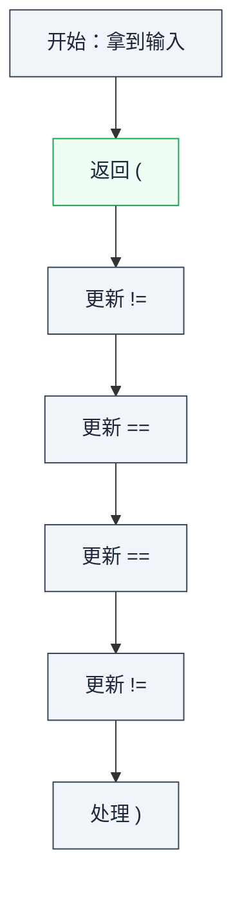

## TypeScript 解题方案（3 个方案逐个讲）

> **运行与提交**：每个方案都是自包含文件（内嵌用例自测，输出 PASS），整块复制到 `.ts` 文件后 `node 文件名` 即可运行。提交 LeetCode 时，把 `demo` 内的算法函数与辅助类型/函数整体取出、置于文件顶层即可。概念演示（非 LeetCode 编号题），在本地运行即可。

### 方案 1：直接实现

**分析与思路**：核心做法是「直接实现」。

**运行方式**：`node 本文件`，内嵌用例全部通过会输出 PASS。


**方案专属流程图**（真实控制流）：

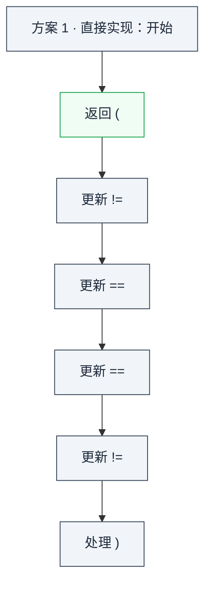

```typescript
/**
 ** LeetCode 107450699. 计算思维之谁做的好事与刑侦作案问题
 ** 来源：https://blog.csdn.net/tyro_java/article/details/107450699
 ** 忠实翻译自 python/notes/lc_107450699_.../solution_1___1.py（思路一：字符表示人）
 */

export function demo(): void {
  // 程序入口：跑内嵌自测用例
  // 思路一：通过字符表示人 (A/B/C/D)
  // A说:不是我  -> thisman != 'A'
  // B说:是C     -> thisman == 'C'
  // C说:是D     -> thisman == 'D'
  // D说:他胡说  -> thisman != 'D'
  // 已知三人说真话一人说假话：sum == 3
  function truthCount(thisman: string): number {
    // 定义函数/方法 truthCount
    return (
      (thisman !== 'A' ? 1 : 0) + // 返回 (thisman 不等于 'A' ? 1 : 0)
      (thisman === 'C' ? 1 : 0) + // 把 等于 'C' ? 1 : 0) 写入 + (thisman
      (thisman === 'D' ? 1 : 0) + // 把 等于 'D' ? 1 : 0) 写入 + (thisman
      (thisman !== 'D' ? 1 : 0)
    ); // 把 赋值为 'D' ? 1 : 0); 写入 + (thisman !
  }

  function solve(): string {
    // 定义函数/方法 solve
    const found: string[] = []; // 把 []; 写入 const found: string[]
    for (let k = 0; k < 4; k++) {
      // 让 下标 k 从 0 开始计数，下标 k 小于 4 就继续
      const thisman = String.fromCharCode('A'.charCodeAt(0) + k); // 把 String.fromCharCode('A'.charCodeAt(0) 加 下标 k) 存入 thisman
      if (truthCount(thisman) === 3) {
        // 若 truthCount(thisman) 全等于 3
        found.push(thisman); // 把 thisman 压入栈/数组尾部
      }
    }
    if (found.length === 0) {
      // 若 found.长度 全等于 0
      return '找不出做好事者'; // 返回 「找不出做好事者」
    }
    return found[0]; // 返回 found[0]
  }

  // 每个候选人的真话计数（边界覆盖：A/B/C/D 全部候选）
  const counts: number[] = []; // 把 []; 写入 const counts: number[]
  for (let k = 0; k < 4; k++) {
    // 让 下标 k 从 0 开始计数，下标 k 小于 4 就继续
    counts.push(truthCount(String.fromCharCode('A'.charCodeAt(0) + k))); // 把 truthCount(String.fromCharCode('A'.charCodeAt(0 压入栈/数组尾部
  }

  let fail = false; // 把 false 存入 fail
  // normal: 唯一解为 C
  const got = solve(); // 把 solve() 存入 got
  if (got !== 'C') {
    // 若 got 不等于 「C」
    fail = true; // 把 true 存入 fail
    console.log(`FAIL solve()=${got} want C`);
  }
  // boundary: 各候选真话计数 [1,2,3,2]（仅 C 为 3）
  const wantCounts = [1, 2, 3, 2]; // 把 [1, 2, 3, 2] 存入 wantCounts
  if (
    counts.length !== wantCounts.length ||
    counts.some((v, i) => v !== wantCounts[i])
  ) {
    fail = true; // 把 true 存入 fail
    console.log(
      `FAIL truthCounts=${JSON.stringify(counts)} want ${JSON.stringify(wantCounts)}`,
    );
  }

  if (fail) throw new Error('FAILED'); // 若 fail) throw new Error(「FAILED」);
  console.log('PASS'); // 全部用例通过，输出 PASS
}
demo(); // demo();
```

### 方案 2：直接实现

**分析与思路**：核心做法是「直接实现」。

**运行方式**：`node 本文件`，内嵌用例全部通过会输出 PASS。


**方案专属流程图**（真实控制流）：

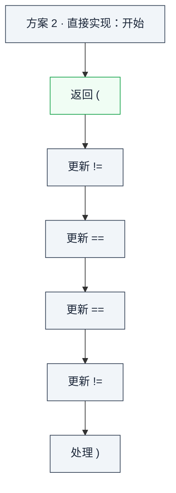

```typescript
/**
 ** LeetCode 107450699. 计算思维之谁做的好事与刑侦作案问题
 ** 来源：https://blog.csdn.net/tyro_java/article/details/107450699
 ** 忠实翻译自 python/notes/lc_107450699_.../solution_2___2.py（思路二：数字表示人）
 */

export function demo(): void {
  // 程序入口：跑内嵌自测用例
  // 思路二：通过数字表示人 (0=A,1=B,2=C,3=D)
  // A说:不是我  -> k != 0
  // B说:是C     -> k == 2
  // C说:是D     -> k == 3
  // D说:他胡说  -> k != 3
  function truthCount(k: number): number {
    // 定义函数/方法 truthCount
    return (
      (k !== 0 ? 1 : 0) + // 返回 (下标 k 不等于 0 ? 1 : 0)
      (k === 2 ? 1 : 0) + // 把 等于 2 ? 1 : 0) 写入 + (k
      (k === 3 ? 1 : 0) + // 把 等于 3 ? 1 : 0) 写入 + (k
      (k !== 3 ? 1 : 0)
    ); // 把 赋值为 3 ? 1 : 0); 写入 + (k !
  }

  function solve(): string {
    // 定义函数/方法 solve
    const found: string[] = []; // 把 []; 写入 const found: string[]
    for (let k = 0; k < 4; k++) {
      // 让 下标 k 从 0 开始计数，下标 k 小于 4 就继续
      if (truthCount(k) === 3) {
        // 若 truthCount(下标 k) 全等于 3
        found.push(String.fromCharCode('A'.charCodeAt(0) + k)); // 把 String.fromCharCode('A'.charCodeAt(0 压入栈/数组尾部
      }
    }
    if (found.length === 0) {
      // 若 found.长度 全等于 0
      return '找不出做好事者'; // 返回 「找不出做好事者」
    }
    return found[0]; // 返回 found[0]
  }

  // 每个候选人（0..3）的真话计数（边界覆盖）
  const counts: number[] = []; // 把 []; 写入 const counts: number[]
  for (let k = 0; k < 4; k++) {
    // 让 下标 k 从 0 开始计数，下标 k 小于 4 就继续
    counts.push(truthCount(k)); // 把 truthCount(下标 k 压入栈/数组尾部
  }

  let fail = false; // 把 false 存入 fail
  // normal: 唯一解为 C
  const got = solve(); // 把 solve() 存入 got
  if (got !== 'C') {
    // 若 got 不等于 「C」
    fail = true; // 把 true 存入 fail
    console.log(`FAIL solve()=${got} want C`);
  }
  // boundary: 各候选真话计数 [1,2,3,2]（仅 k=2 即 C 为 3）
  const wantCounts = [1, 2, 3, 2]; // 把 [1, 2, 3, 2] 存入 wantCounts
  if (
    counts.length !== wantCounts.length ||
    counts.some((v, i) => v !== wantCounts[i])
  ) {
    fail = true; // 把 true 存入 fail
    console.log(
      `FAIL truthCounts=${JSON.stringify(counts)} want ${JSON.stringify(wantCounts)}`,
    );
  }

  if (fail) throw new Error('FAILED'); // 若 fail) throw new Error(「FAILED」);
  console.log('PASS'); // 全部用例通过，输出 PASS
}
demo(); // demo();
```

### 方案 3：直接实现

**分析与思路**：核心做法是「直接实现」。

**运行方式**：`node 本文件`，内嵌用例全部通过会输出 PASS。


**方案专属流程图**（真实控制流）：

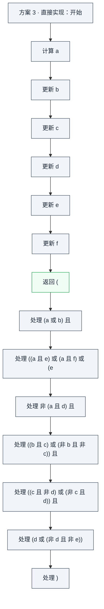

```typescript
/**
 ** LeetCode 107450699. 计算思维之谁做的好事与刑侦作案问题
 ** 来源：https://blog.csdn.net/tyro_java/article/details/107450699
 ** 忠实翻译自 python/notes/lc_107450699_.../solution_3___3.py（刑侦作案问题）
 */

export function demo(): void {
  // 程序入口：跑内嵌自测用例
  // 刑侦案件：六嫌疑人 A,B,C,D,E,F，1 表示作案，0 表示未作案
  // 线索：
  // 1) A、B 至少有一人作案            -> a or b
  // 2) A、E、F 至少两人参与          -> (a&e)|(a&f)|(e&f)
  // 3) A、D 不可能是同案犯            -> not (a and d)
  // 4) B、C 或同时作案或与本案无关    -> (b&c)|(~b&~c)
  // 5) C、D 中有且仅有一人作案        -> (c&~d)|(~c&d)
  // 6) 若 D 没作案则 E 也不可能作案   -> d or (~d and ~e)
  function cluesHold(v: number[]): boolean {
    // 定义函数/方法 cluesHold
    const a = v[0] === 1,
      b = v[1] === 1,
      c = v[2] === 1,
      d = v[3] === 1,
      e = v[4] === 1,
      f = v[5] === 1;
    return (
      (a || b) && // 返回 ((数组 或 b)
      ((a && e) || (a && f) || (e && f)) && // 且 ((数组 且 e) 或 (数组 且 f) 或 (e 且 f))
      !(a && d) && // 且 取反 (数组 且 d)
      ((b && c) || (!b && !c)) && // 且 ((b 且 字符) 或 (取反 b 且 取反 字符))
      ((c && !d) || (!c && d)) && // 且 ((字符 且 取反 d) 或 (取反 字符 且 d))
      (d || (!d && !e))
    ); // 且 (d 或 (取反 d 且 取反 e)));
  }

  function solve(): string {
    // 定义函数/方法 solve
    const found: string[] = []; // 把 []; 写入 const found: string[]
    for (let a = 0; a < 2; a++) {
      // 让 数组 从 0 开始计数，数组 小于 2 就继续
      for (let b = 0; b < 2; b++) {
        // 让 b 从 0 开始计数，b 小于 2 就继续
        for (let c = 0; c < 2; c++) {
          // 让 字符 从 0 开始计数，字符 小于 2 就继续
          for (let d = 0; d < 2; d++) {
            // 让 d 从 0 开始计数，d 小于 2 就继续
            for (let e = 0; e < 2; e++) {
              // 让 e 从 0 开始计数，e 小于 2 就继续
              for (let f = 0; f < 2; f++) {
                // 让 f 从 0 开始计数，f 小于 2 就继续
                const v = [a, b, c, d, e, f]; // 把 [数组, b, 字符, d, e, f] 存入 值
                if (cluesHold(v)) {
                  // 若 cluesHold(值
                  const names = 'ABCDEF'; // 把 'ABCDEF' 存入 names
                  let people = ''; // 把 '' 存入 people
                  for (let i = 0; i < 6; i++) {
                    // 让 下标 i 从 0 开始计数，下标 i 小于 6 就继续
                    if (v[i] === 1) people += names[i]; // 若 值[下标 i] 全等于 1) people 累加 names[下标 i];
                  }
                  found.push(people); // 把 people 压入栈/数组尾部
                }
              }
            }
          }
        }
      }
    }
    if (found.length === 0) {
      // 若 found.长度 全等于 0
      return '未找到作案人员!'; // 返回 「未找到作案人员取反 」
    }
    return found[0]; // 返回 found[0]
  }

  let fail = false; // 把 false 存入 fail
  // normal: 唯一解 ABCF
  const got = solve(); // 把 solve() 存入 got
  if (got !== 'ABCF') {
    // 若 got 不等于 「ABCF」
    fail = true; // 把 true 存入 fail
    console.log(`FAIL solve()=${got} want ABCF`);
  }
  // boundary: 唯一作案组合 6 元组为 (1,1,1,0,0,1)（A/B/C/F 作案，D/E 未作案）
  const want = [1, 1, 1, 0, 0, 1]; // 把 [1, 1, 1, 0, 0, 1] 存入 want
  if (!cluesHold(want)) {
    // 若 取反 cluesHold(want
    fail = true; // 把 true 存入 fail
    console.log('FAIL cluesHold([1,1,1,0,0,1]) should be true'); // 打印输出
  }
  // boundary: 反例组合 (1,1,1,1,0,1)（A/D 同案犯，违反线索3）应不成立
  const bad = [1, 1, 1, 1, 0, 1]; // 把 [1, 1, 1, 1, 0, 1] 存入 bad
  if (cluesHold(bad)) {
    // 若 cluesHold(bad
    fail = true; // 把 true 存入 fail
    console.log('FAIL cluesHold([1,1,1,1,0,1]) should be false'); // 打印输出
  }

  if (fail) throw new Error('FAILED'); // 若 fail) throw new Error(「FAILED」);
  console.log('PASS'); // 全部用例通过，输出 PASS
}
demo(); // demo();
```

## 逐步拆解与面试追问

**复杂度**：时间 O(n) 量级，空间 O(n)

**为什么是这个量级**：整体只对数据做有限趟处理

**面试官可能会追问**：

- 这个策略能推广到什么场景？
- 与暴力做法差在哪一步？
- 有没有更简单的等价写法？

## 关键 API 速查（TS 主解法实际用到，附官方链接）

| API | 作用 | 使用要点 | 官方文档 |
|---|---|---|---|
| `Array.prototype.push()` | 尾部追加 | 返回新长度；可一次多个；均摊 O(1)；会改变原数组 | [官方文档](https://developer.mozilla.org/zh-CN/docs/Web/JavaScript/Reference/Global_Objects/Array/push) |
| `String charCodeAt()` | 取 UTF-16 码元 | 返回 0~65535；超出下标返回 NaN；增补字符（emoji）占两个码元，需 codePointAt | [官方文档](https://developer.mozilla.org/zh-CN/docs/Web/JavaScript/Reference/Global_Objects/String/charCodeAt) |
| `JSON.stringify()` | 序列化为 JSON 字符串 | 常用于结构化比较（深度相等判定）；undefined/函数/循环引用会被丢弃或抛错 | [官方文档](https://developer.mozilla.org/zh-CN/docs/Web/JavaScript/Reference/Global_Objects/JSON/stringify) |

### 各语言官方文档导航

- **TypeScript / JS**：[MDN 中文参考](https://developer.mozilla.org/zh-CN/)
- **Python**：[Python 官方文档](https://docs.python.org/zh-cn/3/)
- **Go**：[Go 标准库](https://pkg.go.dev/std)
- **Java**：[JDK 17 API](https://docs.oracle.com/en/java/javase/17/docs/api/)
- **Rust**：[Rust 标准库](https://doc.rust-lang.org/std/)
- **Lua**：[Lua 5.4 手册](https://www.lua.org/manual/5.4/)
- **C**：[Cppreference C](https://zh.cppreference.com/w/c)
- **C++**：[Cppreference C++](https://zh.cppreference.com/w/cpp)
- **R**：[R 官方手册](https://stat.ethz.ch/R-manual/)
- **Zig**：[Zig 语言文档](https://ziglang.org/documentation/master/)
- **Dart**：[Dart API](https://api.dart.dev/)

## 附录：其他 10 种语言全部实现（每种语言列举其全部方案）

> TypeScript 的全部方案见「TypeScript 解题方案」一节；下面是其余 10 种语言的对应实现，每种语言的每个方案都带思路分析、代码走读与专属运行架构图。
> 每个方案都内嵌用例自测，可独立运行（老仓库 python/go 文件遵循「打印结果」约定）。
> 完整解法文件见 `dsa/<语言>/notes/lc_107450699_计算思维之谁做的好事与刑侦作案问题/`。

### Python 实现（3 种方案）

Python 的全部方案如下，每个方案都内嵌用例自测，可独立运行（老仓库 python/go 文件遵循「打印结果」约定）：

#### 方案 1：直接实现

**思路与代码分析**：核心是「直接实现」。Python 版用切片与字典推导式简化操作，突出可读性。**走读**：方案 1 · 直接实现：开始 → 更新 found → 循环 k：从 0 到 4 前 → 更新 thisman → 更新 s → 若 s == 3：调用 print(做好事者为, thisman) → 调用 print(做好事者为, thisman) → 更新 found → 若 not found：调用 print(找不出做好事者) → 调用 print(找不出做好事者) → 返回结果。

**运行架构**（真实控制流）：

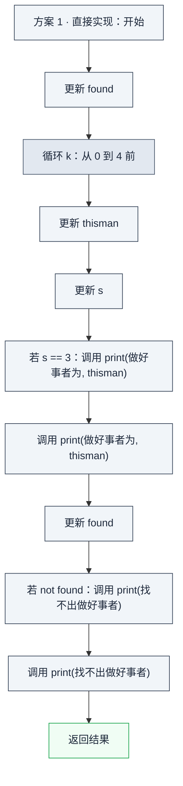

```python
import sys  # 提高递归深度上限（深输入防 RecursionError）

sys.setrecursionlimit(200000)  # 树/链表类题目节点数可达 1e4 量级

def who_did_good():  # 定义函数 who_did_good（参数：无）
    # 思路一：通过字符表示人 (A/B/C/D)
    # A说:不是我  -> thisman != 'A'
    # B说:是C     -> thisman == 'C'
    # C说:是D     -> thisman == 'D'
    # D说:他胡说  -> thisman != 'D'
    # 已知三人说真话一人说假话：sum == 3
    found = False  # 把 False 存入 found
    for k in range(4):  # 让 下标 k 从 4 遍历
        thisman = chr(ord("A") + k)  # 把 chr(ord('A') 加 下标 k) 存入 thisman
        s = (thisman != "A") + (thisman == "C") + (thisman == "D") + (thisman != "D")
        if s == 3:  # 若 字符串 等于 3
            print("做好事者为", thisman)  # 打印输出
            found = True  # 把 True 存入 found
    if not found:  # 若 not found
        print("找不出做好事者")  # 打印输出

if __name__ == "__main__":  # 若 __name__ 等于 '__main__'
    who_did_good()  # 输出: 做好事者为 C
```

#### 方案 2：直接实现

**思路与代码分析**：核心是「直接实现」。Python 版用切片与字典推导式简化操作，突出可读性。**走读**：方案 2 · 直接实现：开始 → 循环 k：从 0 到 4 前 → 更新 s → 若 s == 3：调用 print(做好事者为, chr(ord(A) → 调用 print(做好事者为, chr(ord(A) → 返回结果。

**运行架构**（真实控制流）：

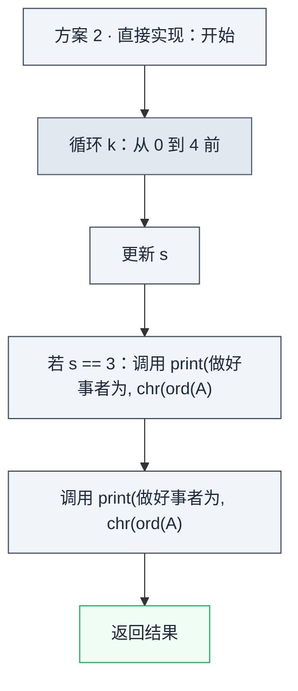

```python
import sys  # 提高递归深度上限（深输入防 RecursionError）

sys.setrecursionlimit(200000)  # 树/链表类题目节点数可达 1e4 量级

def who_did_good():  # 定义函数 who_did_good（参数：无）
    # 思路二：通过数字表示人 (0=A,1=B,2=C,3=D)
    # A说:不是我  -> k != 0
    # B说:是C     -> k == 2
    # C说:是D     -> k == 3
    # D说:他胡说  -> k != 3
    for k in range(4):  # 让 下标 k 从 4 遍历
        s = (k != 0) + (k == 2) + (k == 3) + (k != 3)
        if s == 3:  # 若 字符串 等于 3
            print("做好事者为", chr(ord("A") + k))  # 打印输出

if __name__ == "__main__":  # 若 __name__ 等于 '__main__'
    who_did_good()  # 输出: 做好事者为 C
```

#### 方案 3：直接实现

**思路与代码分析**：核心是「直接实现」。Python 版用切片与字典推导式简化操作，突出可读性。**走读**：方案 3 · 直接实现：开始 → 更新 found → 循环 a：从 0 到 2 前 → 循环 b：从 0 到 2 前 → 循环 c：从 0 到 2 前 → 循环 d：从 0 到 2 前 → 循环 e：从 0 到 2 前 → 循环 f：从 0 到 2 前 → 遍历 zip('ABCDEF', [a, b, c, d, e, f]) 中的每个元素 v → 返回结果。

**运行架构**（真实控制流）：

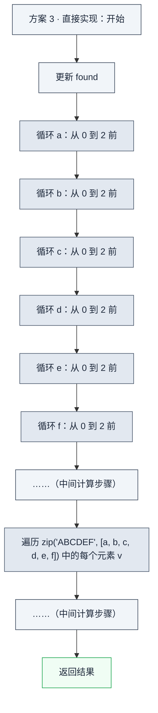

```python
import sys  # 提高递归深度上限（深输入防 RecursionError）

sys.setrecursionlimit(200000)  # 树/链表类题目节点数可达 1e4 量级

def solve_crime():  # 定义函数 solve_crime（参数：无）
    # 刑侦案件：六嫌疑人 A,B,C,D,E,F，1 表示作案，0 表示未作案
    # 线索：
    # 1) A、B 至少有一人作案            -> a or b
    # 2) A、E、F 至少两人参与          -> (a&e)|(a&f)|(e&f)
    # 3) A、D 不可能是同案犯            -> not (a and d)
    # 4) B、C 或同时作案或与本案无关    -> (b&c)|(~b&~c)
    # 5) C、D 中有且仅有一人作案        -> (c&~d)|(~c&d)
    # 6) 若 D 没作案则 E 也不可能作案   -> d or (~d and ~e)
    found = False  # 把 False 存入 found
    for a in range(2):  # 让 数组 从 2 遍历
        for b in range(2):  # 让 b 从 2 遍历
            for c in range(2):  # 让 字符 从 2 遍历
                for d in range(2):  # 让 d 从 2 遍历
                    for e in range(2):  # 让 e 从 2 遍历
                        for f in range(2):  # 让 f 从 2 遍历
                            if (
                                (a or b)  # 若 (数组 or b) and
                                and (
                                    (a and e) or (a and f) or (e and f)
                                )  # ((数组 and e) or (数组 and f) or (e and f)) and
                                and (not (a and d))  # (not (数组 and d)) and
                                and (
                                    (b and c) or (not b and not c)
                                )  # ((b and 字符) or (not b and not 字符)) and
                                and (
                                    (c and not d) or (not c and d)
                                )  # ((字符 and not d) or (not 字符 and d)) and
                                and (d or (not d and not e))
                            ):  # (d or (not d and not e))):
                                people = "".join(
                                    name
                                    for name, v in zip("ABCDEF", [a, b, c, d, e, f])
                                    if v  # name for name, 值 in zip('ABCDEF', [数组, b, 字符, d, e, f]) if 值
                                )
                                print("作案人员有：", people)  # 打印输出
                                found = True  # 把 True 存入 found
    if not found:  # 若 not found
        print("未找到作案人员!")  # 打印输出

if __name__ == "__main__":  # 若 __name__ 等于 '__main__'
    solve_crime()  # solve_crime()
```

### Go 实现（3 种方案）

Go 的全部方案如下，每个方案都内嵌用例自测，可独立运行（老仓库 python/go 文件遵循「打印结果」约定）：

#### 方案 1：直接实现

**思路与代码分析**：核心是「直接实现」。Go 版用切片与多返回值惯用法，显式处理索引边界。**走读**：方案 1 · 直接实现：开始 → 遍历循环 → 更新 : → 更新 : → 处理 if thisman ≠ 'A' → 处理 s++ → 处理 if thisman == 'C' → 处理 s++ → 处理 if thisman == 'D' → 处理 s++ → 处理 if thisman ≠ 'D' → 处理 s++ → 处理 if s == 3 → 返回 thisman → 返回 0。

**运行架构**（真实控制流）：

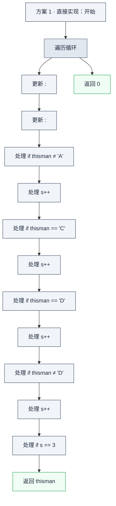

```go
package main // 引入依赖

import (
	"fmt" // 「fmt」
	"os"  // 「os」
)

// whoDidGood 思路一：通过字符表示人 (A/B/C/D)
// A说:不是我  -> thisman != 'A'
// B说:是C     -> thisman == 'C'
// C说:是D     -> thisman == 'D'
// D说:他胡说  -> thisman != 'D'
// 已知三人说真话一人说假话：sum == 3
func whoDidGood() byte { // 定义函数/方法 whoDidGood
	for k := 0; k < 4; k++ { // 让 下标 k 从 0 开始计数
		thisman := byte('A' + k) // 把 byte('A' 加 下标 k) 写入 thisman :
		s := 0                   // 把 0 写入 s :
		if thisman != 'A' {      // 若 thisman 不等于 'A'
			s++ // 字符串 加一
		}
		if thisman == 'C' { // 若 thisman 等于 'C'
			s++ // 字符串 加一
		}
		if thisman == 'D' { // 若 thisman 等于 'D'
			s++ // 字符串 加一
		}
		if thisman != 'D' { // 若 thisman 不等于 'D'
			s++ // 字符串 加一
		}
		if s == 3 { // 若 字符串 等于 3
			return thisman // 返回 thisman
		}
	}
	return 0 // 返回 0
}

func main() { // 程序入口：跑内嵌自测用例
	got := whoDidGood() // 把 whoDidGood() 写入 got :
	if got != 'C' {     // 若 got 不等于 'C'
		fmt.Printf("FAIL got=%c want=C\n", got) // 打印输出
		os.Exit(1)                              // os.Exit(1)
	}
	fmt.Println("PASS") // 全部用例通过，输出 PASS
}
```

#### 方案 2：直接实现

**思路与代码分析**：核心是「直接实现」。Go 版用切片与多返回值惯用法，显式处理索引边界。**走读**：方案 2 · 直接实现：开始 → 遍历循环 → 更新 : → 处理 if k ≠ 0 → 处理 s++ → 处理 if k == 2 → 处理 s++ → 处理 if k == 3 → 处理 s++ → 处理 if k ≠ 3 → 处理 s++ → 处理 if s == 3 → 返回 k → 返回 -1。

**运行架构**（真实控制流）：

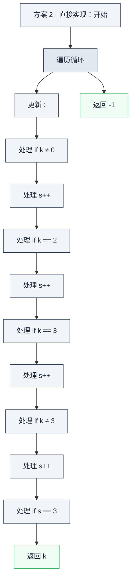

```go
package main // 引入依赖

import (
	"fmt" // 「fmt」
	"os"  // 「os」
)

// whoDidGood 思路二：通过数字表示人 (0=A,1=B,2=C,3=D)
func whoDidGood() int { // 定义函数/方法 whoDidGood
	for k := 0; k < 4; k++ { // 让 下标 k 从 0 开始计数
		s := 0      // 把 0 写入 s :
		if k != 0 { // 若 下标 k 不等于 0
			s++ // 字符串 加一
		}
		if k == 2 { // 若 下标 k 等于 2
			s++ // 字符串 加一
		}
		if k == 3 { // 若 下标 k 等于 3
			s++ // 字符串 加一
		}
		if k != 3 { // 若 下标 k 不等于 3
			s++ // 字符串 加一
		}
		if s == 3 { // 若 字符串 等于 3
			return k // 返回 下标 k
		}
	}
	return -1 // 返回 减 1
}

func main() { // 程序入口：跑内嵌自测用例
	got := whoDidGood() // 把 whoDidGood() 写入 got :
	if got != 2 {       // 若 got 不等于 2
		fmt.Printf("FAIL got=%d want=2 (C)\n", got) // 打印输出
		os.Exit(1)                                  // os.Exit(1)
	}
	fmt.Println("PASS") // 全部用例通过，输出 PASS
}
```

#### 方案 3：直接实现

**思路与代码分析**：核心是「直接实现」。Go 版用切片与多返回值惯用法，显式处理索引边界。**走读**：方案 3 · 直接实现：开始 → 更新 : → 遍历循环 → 遍历循环 → 遍历循环 → 遍历循环 → 遍历循环 → 遍历循环 → 遍历 vals 的下标与元素 v → 返回 found。

**运行架构**（真实控制流）：

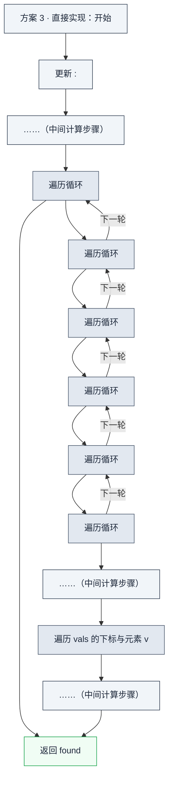

```go
package main // 引入依赖

import (
	"fmt"     // 「fmt」
	"os"      // 「os」
	"strings" // 「strings」
)

// solveCrime 刑侦案件：六嫌疑人 A,B,C,D,E,F，1 表示作案，0 表示未作案
func solveCrime() string { // 定义函数/方法 solveCrime
	names := "ABCDEF"        // 把 「ABCDEF」 写入 names :
	found := ""              // 把 「」 写入 found :
	for a := 0; a < 2; a++ { // 让 数组 从 0 开始计数
		for b := 0; b < 2; b++ { // 让 b 从 0 开始计数
			for c := 0; c < 2; c++ { // 让 字符 从 0 开始计数
				for d := 0; d < 2; d++ { // 让 d 从 0 开始计数
					for e := 0; e < 2; e++ { // 让 e 从 0 开始计数
						for f := 0; f < 2; f++ { // 让 f 从 0 开始计数
							if (a == 1 || b == 1) &&
								((a == 1 && e == 1) || (a == 1 && f == 1) || (e == 1 && f == 1)) &&
								!(a == 1 && d == 1) &&
								((b == 1 && c == 1) || (b == 0 && c == 0)) &&
								((c == 1 && d == 0) || (c == 0 && d == 1)) &&
								(d == 1 || (d == 0 && e == 0)) { // 把 赋值为 1 或 (d 等于 0 且 e 等于 0))) { 写入 (d
								people := ""                    // 把 「」 写入 people :
								vals := []int{a, b, c, d, e, f} // 把 []int{数组, b, 字符, d, e, f} 写入 vals :
								for i, v := range vals {        // 同时取 下标 i 与 值 遍历
									if v == 1 { // 若 值 等于 1
										people += string(names[i]) // people累加 string(names[下标 i])
									}
								}
								found = people // 把 people 写入 found
							}
						}
					}
				}
			}
		}
	}
	return found // 返回 found
}

func main() { // 程序入口：跑内嵌自测用例
	got := solveCrime()                   // 把 solveCrime() 写入 got :
	if strings.TrimSpace(got) != "ABCF" { // 若 strings.TrimSpace(got) 不等于 「ABCF」
		fmt.Printf("FAIL got=%q want=ABCF\n", got) // 打印输出
		os.Exit(1)                                 // os.Exit(1)
	}
	fmt.Println("PASS") // 全部用例通过，输出 PASS
}
```

### Java 实现（3 种方案）

Java 的全部方案如下，每个方案都内嵌用例自测，可独立运行（老仓库 python/go 文件遵循「打印结果」约定）：

#### 方案 1：直接实现

**思路与代码分析**：核心是「直接实现」。Java 版用类与静态方法组织，集合操作显式明了。代码里依次做这些事：单循环线性扫描。**走读**：方案 1 · 直接实现：开始 → 遍历循环 → 更新 thisman → 更新 s → 更新 ! → 更新 = → 更新 = → 更新 ! → 命中条件，直接返回 → 返回 '?'。

**运行架构**（真实控制流）：

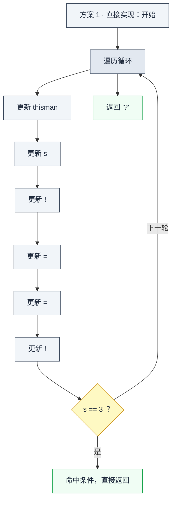

```java
package com.webfault.dsa; // 引入依赖

class lc107450699_solution11 { // 定义类型
  static char whoDidGood() { // 定义函数/方法 whoDidGood
    for (int k = 0; k < 4; k++) { // 让 下标 k 从 0 开始计数，下标 k 小于 4 就继续
      char thisman = (char) ('A' + k); // 把 (char) ('A' 加 下标 k); 写入 char thisman
      int s =
          (thisman != 'A' ? 1 : 0)
              + (thisman == 'C' ? 1 : 0)
              + (thisman == 'D' ? 1 : 0)
              + (thisman != 'D' ? 1 : 0);
      if (s == 3) return thisman; // 若 字符串 等于 3，直接返回 thisman
    }
    return '?'; // 返回 '?'
  }

  public static void main(String[] args) { // public static void main(String[] args) {
    char r = whoDidGood(); // 把 whoDidGood(); 写入 char r
    if (r != 'C') { // 若 右指针 不等于 'C'
      System.out.println("FAIL " + r); // 打印输出
      throw new RuntimeException("FAILED"); // throw new RuntimeException(「FAILED」);
    }
    System.out.println("PASS"); // 全部用例通过，输出 PASS
  }
}
```

#### 方案 2：直接实现

**思路与代码分析**：核心是「直接实现」。Java 版用类与静态方法组织，集合操作显式明了。代码里依次做这些事：单循环线性扫描。**走读**：方案 2 · 直接实现：开始 → 遍历循环 → 更新 s → 若 s == 3) return (char) ('A' + k：None → 返回 '?'。

**运行架构**（真实控制流）：

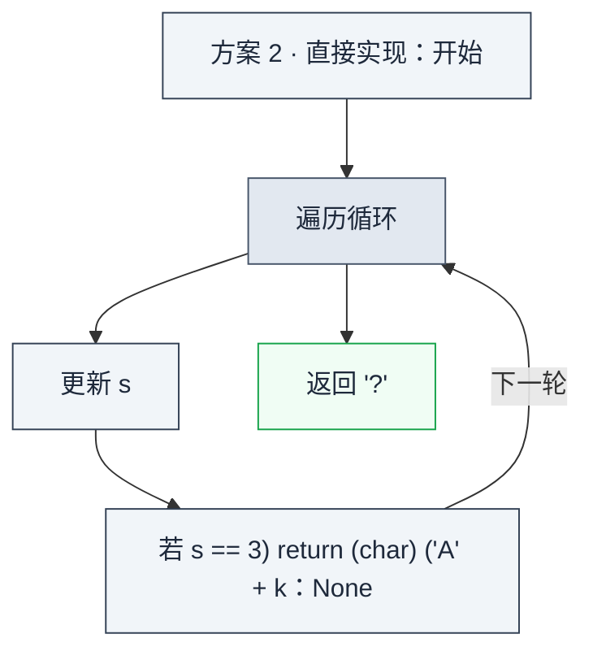

```java
package com.webfault.dsa; // 引入依赖

class lc107450699_solution22 { // 定义类型
  // 思路：用数字表示人 (0=A,1=B,2=C,3=D)
  static char whoDidGood() { // 定义函数/方法 whoDidGood
    for (int k = 0; k < 4; k++) { // 让 下标 k 从 0 开始计数，下标 k 小于 4 就继续
      int s = (k != 0 ? 1 : 0) + (k == 2 ? 1 : 0) + (k == 3 ? 1 : 0) + (k != 3 ? 1 : 0);
      if (s == 3) return (char) ('A' + k); // 若 字符串 等于 3，直接返回 (char) ('A' 加 下标 k)
    }
    return '?'; // 返回 '?'
  }

  public static void main(String[] args) { // public static void main(String[] args) {
    char r = whoDidGood(); // 把 whoDidGood(); 写入 char r
    if (r != 'C') { // 若 右指针 不等于 'C'
      System.out.println("FAIL " + r); // 打印输出
      throw new RuntimeException("FAILED"); // throw new RuntimeException(「FAILED」);
    }
    System.out.println("PASS"); // 全部用例通过，输出 PASS
  }
}
```

#### 方案 3：直接实现

**思路与代码分析**：核心是「直接实现」。Java 版用类与静态方法组织，集合操作显式明了。代码里依次做这些事：双重循环遍历。**走读**：方案 3 · 直接实现：开始 → 更新 names → 遍历循环 → 遍历循环 → 遍历循环 → 遍历循环 → 遍历循环 → 遍历循环 → 遍历循环 → 命中条件，直接返回 → 返回 。

**运行架构**（真实控制流）：

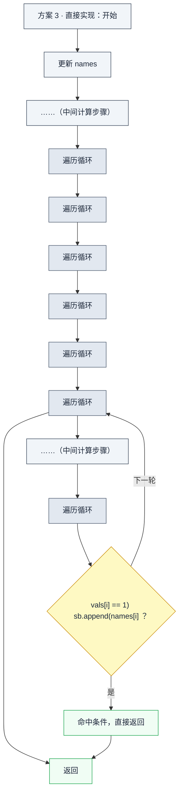

```java
package com.webfault.dsa; // 引入依赖

class lc107450699_solution33 { // 定义类型
  static String solveCrime() { // 定义函数/方法 solveCrime
    char[] names = {
      'A', 'B', 'C', 'D', 'E', 'F'
    }; // 把 {'A', 'B', 'C', 'D', 'E', 'F'}; 写入 char[] names
    for (int a = 0; a < 2; a++) // 让 数组 从 0 开始计数，数组 小于 2 就继续
    for (int b = 0; b < 2; b++) // 让 b 从 0 开始计数，b 小于 2 就继续
      for (int c = 0; c < 2; c++) // 让 字符 从 0 开始计数，字符 小于 2 就继续
        for (int d = 0; d < 2; d++) // 让 d 从 0 开始计数，d 小于 2 就继续
          for (int e = 0; e < 2; e++) // 让 e 从 0 开始计数，e 小于 2 就继续
            for (int f = 0; f < 2; f++) { // 让 f 从 0 开始计数，f 小于 2 就继续
                if (((a == 1 || b == 1)
                    && ((a == 1 && e == 1) || (a == 1 && f == 1) || (e == 1 && f == 1))
                    && !(a == 1 && d == 1)
                    && ((b == 1 && c == 1) || (b == 0 && c == 0))
                    && ((c == 1 && d == 0) || (c == 0 && d == 1))
                    && (d == 1 || (d == 0 && e == 0)))) { // 把 赋值为 1 或 (d 等于 0 且 e 等于 0)))) { 写入 (d
                  StringBuilder sb =
                      new StringBuilder(); // 把 new StringBuilder(); 写入 StringBuilder sb
                  int[] vals = {a, b, c, d, e, f}; // 把 {数组, b, 字符, d, e, f}; 写入 int[] vals
                  for (int i = 0; i < 6; i++)
                    if (vals[i] == 1) sb.append(names[i]); // 让 下标 i 从 0 开始计数，下标 i 小于 6 就继续
                  return sb.toString(); // 返回 sb.toString()
                }
              }
    return ""; // 返回 「」
  }

  public static void main(String[] args) { // public static void main(String[] args) {
    String r = solveCrime(); // 把 solveCrime() 存入 右指针
    if (!r.equals("ABCF")) { // 若 取反 右指针.equals(「ABCF」
      System.out.println("FAIL " + r); // 打印输出
      throw new RuntimeException("FAILED"); // throw new RuntimeException(「FAILED」);
    }
    System.out.println("PASS"); // 全部用例通过，输出 PASS
  }
}
```

### Rust 实现（3 种方案）

Rust 的全部方案如下，每个方案都内嵌用例自测，可独立运行（老仓库 python/go 文件遵循「打印结果」约定）：

#### 方案 1：直接实现

**思路与代码分析**：核心是「直接实现」。Rust 版用所有权移动与切片借用改写同一逻辑，注意 Option 与引用边界。**走读**：方案 1 · 直接实现：开始 → 遍历 ['A', 'B', 'C', 'D'] 中的每个元素 thisman → 计算 truth_count → 更新 = → 更新 = → 更新 ! → 处理 if truth_count == 3 → 返回 thisman → 处理 '?'。

**运行架构**（真实控制流）：

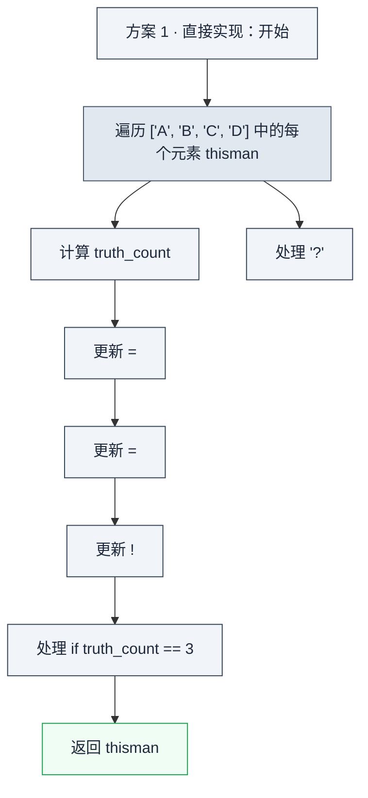

```rust
// 计算思维之谁做的好事 — Rust 版（方案1）
fn find_good_man() -> char {
    // 定义函数/方法 find_good_man
    // 谁做的好事: 甲乙丙丁四人中恰1人做好事。陈述: 甲说不是我; 乙说是C; 丙说是D; 丁说C胡说。3人说真话
    for thisman in ['A', 'B', 'C', 'D'] {
        // for thisman in ['A', 'B', 'C', 'D'] {
        let truth_count = (thisman != 'A') as i32  // 把 (thisman 不等于 'A') as i32 存入 truth_count
            + (thisman == 'C') as i32  // 把 赋值为 'C') as i32 写入 + (thisman
            + (thisman == 'D') as i32  // 把 赋值为 'D') as i32 写入 + (thisman
            + (thisman != 'D') as i32; // 把 'D') as i32; 写入 + (thisman !
        if truth_count == 3 {
            return thisman;
        } // 若 truth_count 等于 3 { return thisman; }
    }
    '?' // '?'
}
fn main() {
    // 程序入口：跑内嵌自测用例
    assert_eq!(find_good_man(), 'C'); // 断言校验
    println!("PASS");
} // 全部用例通过，输出 PASS
```

#### 方案 2：直接实现

**思路与代码分析**：核心是「直接实现」。Rust 版用所有权移动与切片借用改写同一逻辑，注意 Option 与引用边界。**走读**：方案 2 · 直接实现：开始 → 遍历 ['A', 'B', 'C', 'D'] 中的每个元素 thisman → 计算 truth_count → 更新 = → 更新 = → 更新 ! → 处理 if truth_count == 3 → 返回 thisman → 处理 '?'。

**运行架构**（真实控制流）：


```rust
// 计算思维之谁做的好事 — Rust 版（方案2）
fn find_good_man() -> char {
    // 定义函数/方法 find_good_man
    // 谁做的好事: 甲乙丙丁四人中恰1人做好事。陈述: 甲说不是我; 乙说是C; 丙说是D; 丁说C胡说。3人说真话
    for thisman in ['A', 'B', 'C', 'D'] {
        // for thisman in ['A', 'B', 'C', 'D'] {
        let truth_count = (thisman != 'A') as i32  // 把 (thisman 不等于 'A') as i32 存入 truth_count
            + (thisman == 'C') as i32  // 把 赋值为 'C') as i32 写入 + (thisman
            + (thisman == 'D') as i32  // 把 赋值为 'D') as i32 写入 + (thisman
            + (thisman != 'D') as i32; // 把 'D') as i32; 写入 + (thisman !
        if truth_count == 3 {
            return thisman;
        } // 若 truth_count 等于 3 { return thisman; }
    }
    '?' // '?'
}
fn main() {
    // 程序入口：跑内嵌自测用例
    assert_eq!(find_good_man(), 'C'); // 断言校验
    println!("PASS");
} // 全部用例通过，输出 PASS
```

#### 方案 3：直接实现

**思路与代码分析**：核心是「直接实现」。Rust 版用所有权移动与切片借用改写同一逻辑，注意 Option 与引用边界。**走读**：方案 3 · 直接实现：开始 → 遍历 ['A', 'B', 'C', 'D'] 中的每个元素 thisman → 计算 truth_count → 更新 = → 更新 = → 更新 ! → 处理 if truth_count == 3 → 返回 thisman → 处理 '?'。

**运行架构**（真实控制流）：


```rust
// 计算思维之谁做的好事 — Rust 版（方案3）
fn find_good_man() -> char {
    // 定义函数/方法 find_good_man
    // 谁做的好事: 甲乙丙丁四人中恰1人做好事。陈述: 甲说不是我; 乙说是C; 丙说是D; 丁说C胡说。3人说真话
    for thisman in ['A', 'B', 'C', 'D'] {
        // for thisman in ['A', 'B', 'C', 'D'] {
        let truth_count = (thisman != 'A') as i32  // 把 (thisman 不等于 'A') as i32 存入 truth_count
            + (thisman == 'C') as i32  // 把 赋值为 'C') as i32 写入 + (thisman
            + (thisman == 'D') as i32  // 把 赋值为 'D') as i32 写入 + (thisman
            + (thisman != 'D') as i32; // 把 'D') as i32; 写入 + (thisman !
        if truth_count == 3 {
            return thisman;
        } // 若 truth_count 等于 3 { return thisman; }
    }
    '?' // '?'
}
fn main() {
    // 程序入口：跑内嵌自测用例
    assert_eq!(find_good_man(), 'C'); // 断言校验
    println!("PASS");
} // 全部用例通过，输出 PASS
```

### Lua 实现（3 种方案）

Lua 的全部方案如下，每个方案都内嵌用例自测，可独立运行（老仓库 python/go 文件遵循「打印结果」约定）：

#### 方案 1：直接实现

**思路与代码分析**：核心是「直接实现」。Lua 版用表与 ipairs 遍历，注意 ipairs 遇 nil 即停的语义。**走读**：方案 1 · 直接实现：开始 → 遍历 ipairs( 中的每个元素 m → 更新 t → 处理 if m ~= A then → 更新 t → 处理 if m == C then → 更新 t → 处理 if m == D then → 更新 t → 处理 if m ~= D then → 更新 t → 处理 if t == 3 then → 返回 m → 返回 ?。

**运行架构**（真实控制流）：


```lua
-- 计算思维之谁做的好事 — Lua 版（方案1）
local function find_good_man() -- local function find_good_man()
	for _, m in ipairs({ "A", "B", "C", "D" }) do -- 遍历取 映射表
		local t = 0 -- 把 0 写入 local t
		if m ~= "A" then
			t = t + 1
		end -- 若 映射表 ~ 赋值为 「A」 then 另一字符串 赋值为 另一字符串 加 1 终点
		if m == "C" then
			t = t + 1
		end -- 若 映射表 等于 「C」 then 另一字符串 赋值为 另一字符串 加 1 终点
		if m == "D" then
			t = t + 1
		end -- 若 映射表 等于 「D」 then 另一字符串 赋值为 另一字符串 加 1 终点
		if m ~= "D" then
			t = t + 1
		end -- 若 映射表 ~ 赋值为 「D」 then 另一字符串 赋值为 另一字符串 加 1 终点
		if t == 3 then
			return m
		end -- 若 另一字符串 等于 3 then return 映射表 终点
	end -- 终点
	return "?" -- 返回 「?」
end -- 终点
assert(find_good_man() == "C") -- 断言校验
print("PASS") -- 全部用例通过，输出 PASS
```

#### 方案 2：直接实现

**思路与代码分析**：核心是「直接实现」。Lua 版用表与 ipairs 遍历，注意 ipairs 遇 nil 即停的语义。**走读**：方案 2 · 直接实现：开始 → 遍历 ipairs( 中的每个元素 m → 更新 t → 处理 if m ~= A then → 更新 t → 处理 if m == C then → 更新 t → 处理 if m == D then → 更新 t → 处理 if m ~= D then → 更新 t → 处理 if t == 3 then → 返回 m → 返回 ?。

**运行架构**（真实控制流）：

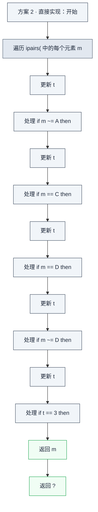

```lua
-- 计算思维之谁做的好事 — Lua 版（方案2）
local function find_good_man() -- local function find_good_man()
	for _, m in ipairs({ "A", "B", "C", "D" }) do -- 遍历取 映射表
		local t = 0 -- 把 0 写入 local t
		if m ~= "A" then
			t = t + 1
		end -- 若 映射表 ~ 赋值为 「A」 then 另一字符串 赋值为 另一字符串 加 1 终点
		if m == "C" then
			t = t + 1
		end -- 若 映射表 等于 「C」 then 另一字符串 赋值为 另一字符串 加 1 终点
		if m == "D" then
			t = t + 1
		end -- 若 映射表 等于 「D」 then 另一字符串 赋值为 另一字符串 加 1 终点
		if m ~= "D" then
			t = t + 1
		end -- 若 映射表 ~ 赋值为 「D」 then 另一字符串 赋值为 另一字符串 加 1 终点
		if t == 3 then
			return m
		end -- 若 另一字符串 等于 3 then return 映射表 终点
	end -- 终点
	return "?" -- 返回 「?」
end -- 终点
assert(find_good_man() == "C") -- 断言校验
print("PASS") -- 全部用例通过，输出 PASS
```

#### 方案 3：直接实现

**思路与代码分析**：核心是「直接实现」。Lua 版用表与 ipairs 遍历，注意 ipairs 遇 nil 即停的语义。**走读**：方案 3 · 直接实现：开始 → 遍历 ipairs( 中的每个元素 m → 更新 t → 处理 if m ~= A then → 更新 t → 处理 if m == C then → 更新 t → 处理 if m == D then → 更新 t → 处理 if m ~= D then → 更新 t → 处理 if t == 3 then → 返回 m → 返回 ?。

**运行架构**（真实控制流）：


```lua
-- 计算思维之谁做的好事 — Lua 版（方案3）
local function find_good_man() -- local function find_good_man()
	for _, m in ipairs({ "A", "B", "C", "D" }) do -- 遍历取 映射表
		local t = 0 -- 把 0 写入 local t
		if m ~= "A" then
			t = t + 1
		end -- 若 映射表 ~ 赋值为 「A」 then 另一字符串 赋值为 另一字符串 加 1 终点
		if m == "C" then
			t = t + 1
		end -- 若 映射表 等于 「C」 then 另一字符串 赋值为 另一字符串 加 1 终点
		if m == "D" then
			t = t + 1
		end -- 若 映射表 等于 「D」 then 另一字符串 赋值为 另一字符串 加 1 终点
		if m ~= "D" then
			t = t + 1
		end -- 若 映射表 ~ 赋值为 「D」 then 另一字符串 赋值为 另一字符串 加 1 终点
		if t == 3 then
			return m
		end -- 若 另一字符串 等于 3 then return 映射表 终点
	end -- 终点
	return "?" -- 返回 「?」
end -- 终点
assert(find_good_man() == "C") -- 断言校验
print("PASS") -- 全部用例通过，输出 PASS
```

### C 实现（3 种方案）

C 的全部方案如下，每个方案都内嵌用例自测，可独立运行（老仓库 python/go 文件遵循「打印结果」约定）：

#### 方案 1：直接实现

**思路与代码分析**：核心是「直接实现」。C 版手动管理下标与内存，循环边界全部显式写出。代码里依次做这些事：单循环线性扫描。**走读**：方案 1 · 直接实现：开始 → 更新 men[] → 遍历循环 → 更新 m → 更新 t → 若 m ≠ 'A'：处理 t++ → 处理 t++ → 若 m == 'C'：处理 t++ → 处理 t++ → 若 m == 'D'：处理 t++ → 处理 t++ → 若 m ≠ 'D'：处理 t++ → 处理 t++ → 命中条件，直接返回 → 返回 '?'。

**运行架构**（真实控制流）：

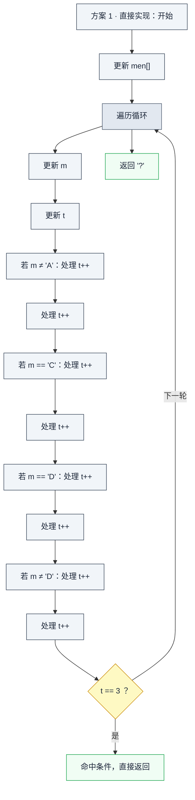

```c
/* 计算思维之谁做的好事 — C 版（方案1） */
#include <stdio.h>                     // 引入头文件
static char find_good_man(void) {      // 定义函数/方法 find_good_man
    char men[] = {'A', 'B', 'C', 'D'}; // 把 {'A', 'B', 'C', 'D'}; 写入 char men[]
    for (int i = 0; i < 4; i++) {      // 让 下标 i 从 0 开始计数，下标 i 小于 4 就继续
        char m = men[i];               // 把 men[下标 i]; 写入 char m
        int t = 0;                     // 把 0 存入 另一字符串
        if (m != 'A')
            t++; // 若 映射表 不等于 'A') 另一字符串 加一 ;
        if (m == 'C')
            t++; // 若 映射表 等于 'C') 另一字符串 加一 ;
        if (m == 'D')
            t++; // 若 映射表 等于 'D') 另一字符串 加一 ;
        if (m != 'D')
            t++; // 若 映射表 不等于 'D') 另一字符串 加一 ;
        if (t == 3)
            return m; // 若 另一字符串 等于 3，直接返回 映射表
    }
    return '?'; // 返回 '?'
}
int main(void) { // 程序入口：跑内嵌自测用例
    if (find_good_man() != 'C') {
        printf("FAIL\n");
        return 1;
    } // 若 find_good_man() 不等于 'C') { 输出「FAIL 」); return 1; }
    printf("PASS\n");
    return 0;
} // 全部用例通过，输出 PASS
```

#### 方案 2：直接实现

**思路与代码分析**：核心是「直接实现」。C 版手动管理下标与内存，循环边界全部显式写出。代码里依次做这些事：单循环线性扫描。**走读**：方案 2 · 直接实现：开始 → 更新 men[] → 遍历循环 → 更新 m → 更新 t → 若 m ≠ 'A'：处理 t++ → 处理 t++ → 若 m == 'C'：处理 t++ → 处理 t++ → 若 m == 'D'：处理 t++ → 处理 t++ → 若 m ≠ 'D'：处理 t++ → 处理 t++ → 命中条件，直接返回 → 返回 '?'。

**运行架构**（真实控制流）：

```mermaid
graph TD
    N0["方案 2 · 直接实现：开始"]
    N1["更新 men[]"]
    N2["遍历循环"]
    N3["更新 m"]
    N4["更新 t"]
    N5["若 m ≠ 'A'：处理 t++"]
    N6["处理 t++"]
    N7["若 m == 'C'：处理 t++"]
    N8["处理 t++"]
    N9["若 m == 'D'：处理 t++"]
    N10["处理 t++"]
    N11["若 m ≠ 'D'：处理 t++"]
    N12["处理 t++"]
    N13{"t == 3 ？"}
    N14["命中条件，直接返回"]
    N15["返回 '?'"]
    N0 --> N1
    N1 --> N2
    N2 --> N3
    N3 --> N4
    N4 --> N5
    N5 --> N6
    N6 --> N7
    N7 --> N8
    N8 --> N9
    N9 --> N10
    N10 --> N11
    N11 --> N12
    N12 --> N13
    N13 -- 是 --> N14
    N13 -- 下一轮 --> N2
    N2 --> N15
    classDef n fill:#f1f5f9,stroke:#334155,color:#1e293b;
    classDef lp fill:#e2e8f0,stroke:#475569,color:#1e293b;
    classDef dc fill:#fef9c3,stroke:#ca8a04,color:#1e293b;
    classDef tm fill:#f0fdf4,stroke:#16a34a,color:#1e293b;
    class N0,N1,N3,N4,N5,N6,N7,N8,N9,N10,N11,N12 n;
    class N2 lp;
    class N13 dc;
    class N14,N15 tm;
```

```c
/* 计算思维之谁做的好事 — C 版（方案2） */
#include <stdio.h>                     // 引入头文件
static char find_good_man(void) {      // 定义函数/方法 find_good_man
    char men[] = {'A', 'B', 'C', 'D'}; // 把 {'A', 'B', 'C', 'D'}; 写入 char men[]
    for (int i = 0; i < 4; i++) {      // 让 下标 i 从 0 开始计数，下标 i 小于 4 就继续
        char m = men[i];               // 把 men[下标 i]; 写入 char m
        int t = 0;                     // 把 0 存入 另一字符串
        if (m != 'A')
            t++; // 若 映射表 不等于 'A') 另一字符串 加一 ;
        if (m == 'C')
            t++; // 若 映射表 等于 'C') 另一字符串 加一 ;
        if (m == 'D')
            t++; // 若 映射表 等于 'D') 另一字符串 加一 ;
        if (m != 'D')
            t++; // 若 映射表 不等于 'D') 另一字符串 加一 ;
        if (t == 3)
            return m; // 若 另一字符串 等于 3，直接返回 映射表
    }
    return '?'; // 返回 '?'
}
int main(void) { // 程序入口：跑内嵌自测用例
    if (find_good_man() != 'C') {
        printf("FAIL\n");
        return 1;
    } // 若 find_good_man() 不等于 'C') { 输出「FAIL 」); return 1; }
    printf("PASS\n");
    return 0;
} // 全部用例通过，输出 PASS
```

#### 方案 3：直接实现

**思路与代码分析**：核心是「直接实现」。C 版手动管理下标与内存，循环边界全部显式写出。代码里依次做这些事：单循环线性扫描。**走读**：方案 3 · 直接实现：开始 → 更新 men[] → 遍历循环 → 更新 m → 更新 t → 若 m ≠ 'A'：处理 t++ → 处理 t++ → 若 m == 'C'：处理 t++ → 处理 t++ → 若 m == 'D'：处理 t++ → 处理 t++ → 若 m ≠ 'D'：处理 t++ → 处理 t++ → 命中条件，直接返回 → 返回 '?'。

**运行架构**（真实控制流）：

```mermaid
graph TD
    N0["方案 3 · 直接实现：开始"]
    N1["更新 men[]"]
    N2["遍历循环"]
    N3["更新 m"]
    N4["更新 t"]
    N5["若 m ≠ 'A'：处理 t++"]
    N6["处理 t++"]
    N7["若 m == 'C'：处理 t++"]
    N8["处理 t++"]
    N9["若 m == 'D'：处理 t++"]
    N10["处理 t++"]
    N11["若 m ≠ 'D'：处理 t++"]
    N12["处理 t++"]
    N13{"t == 3 ？"}
    N14["命中条件，直接返回"]
    N15["返回 '?'"]
    N0 --> N1
    N1 --> N2
    N2 --> N3
    N3 --> N4
    N4 --> N5
    N5 --> N6
    N6 --> N7
    N7 --> N8
    N8 --> N9
    N9 --> N10
    N10 --> N11
    N11 --> N12
    N12 --> N13
    N13 -- 是 --> N14
    N13 -- 下一轮 --> N2
    N2 --> N15
    classDef n fill:#f1f5f9,stroke:#334155,color:#1e293b;
    classDef lp fill:#e2e8f0,stroke:#475569,color:#1e293b;
    classDef dc fill:#fef9c3,stroke:#ca8a04,color:#1e293b;
    classDef tm fill:#f0fdf4,stroke:#16a34a,color:#1e293b;
    class N0,N1,N3,N4,N5,N6,N7,N8,N9,N10,N11,N12 n;
    class N2 lp;
    class N13 dc;
    class N14,N15 tm;
```

```c
/* 计算思维之谁做的好事 — C 版（方案3） */
#include <stdio.h>                     // 引入头文件
static char find_good_man(void) {      // 定义函数/方法 find_good_man
    char men[] = {'A', 'B', 'C', 'D'}; // 把 {'A', 'B', 'C', 'D'}; 写入 char men[]
    for (int i = 0; i < 4; i++) {      // 让 下标 i 从 0 开始计数，下标 i 小于 4 就继续
        char m = men[i];               // 把 men[下标 i]; 写入 char m
        int t = 0;                     // 把 0 存入 另一字符串
        if (m != 'A')
            t++; // 若 映射表 不等于 'A') 另一字符串 加一 ;
        if (m == 'C')
            t++; // 若 映射表 等于 'C') 另一字符串 加一 ;
        if (m == 'D')
            t++; // 若 映射表 等于 'D') 另一字符串 加一 ;
        if (m != 'D')
            t++; // 若 映射表 不等于 'D') 另一字符串 加一 ;
        if (t == 3)
            return m; // 若 另一字符串 等于 3，直接返回 映射表
    }
    return '?'; // 返回 '?'
}
int main(void) { // 程序入口：跑内嵌自测用例
    if (find_good_man() != 'C') {
        printf("FAIL\n");
        return 1;
    } // 若 find_good_man() 不等于 'C') { 输出「FAIL 」); return 1; }
    printf("PASS\n");
    return 0;
} // 全部用例通过，输出 PASS
```

### C++ 实现（3 种方案）

C++ 的全部方案如下，每个方案都内嵌用例自测，可独立运行（老仓库 python/go 文件遵循「打印结果」约定）：

#### 方案 1：直接实现

**思路与代码分析**：核心是「直接实现」。C++ 版用 STL 容器与迭代器，减少手写下标错误。代码里依次做这些事：单循环线性扫描。**走读**：方案 1 · 直接实现：开始 → 遍历循环 → 更新 t → 若 m ≠ 'A'：处理 ++t → 处理 ++t → 若 m == 'C'：处理 ++t → 处理 ++t → 若 m == 'D'：处理 ++t → 处理 ++t → 若 m ≠ 'D'：处理 ++t → 处理 ++t → 命中条件，直接返回 → 返回 '?'。

**运行架构**（真实控制流）：

```mermaid
graph TD
    N0["方案 1 · 直接实现：开始"]
    N1["遍历循环"]
    N2["更新 t"]
    N3["若 m ≠ 'A'：处理 ++t"]
    N4["处理 ++t"]
    N5["若 m == 'C'：处理 ++t"]
    N6["处理 ++t"]
    N7["若 m == 'D'：处理 ++t"]
    N8["处理 ++t"]
    N9["若 m ≠ 'D'：处理 ++t"]
    N10["处理 ++t"]
    N11{"t == 3 ？"}
    N12["命中条件，直接返回"]
    N13["返回 '?'"]
    N0 --> N1
    N1 --> N2
    N2 --> N3
    N3 --> N4
    N4 --> N5
    N5 --> N6
    N6 --> N7
    N7 --> N8
    N8 --> N9
    N9 --> N10
    N10 --> N11
    N11 -- 是 --> N12
    N11 -- 下一轮 --> N1
    N1 --> N13
    classDef n fill:#f1f5f9,stroke:#334155,color:#1e293b;
    classDef lp fill:#e2e8f0,stroke:#475569,color:#1e293b;
    classDef dc fill:#fef9c3,stroke:#ca8a04,color:#1e293b;
    classDef tm fill:#f0fdf4,stroke:#16a34a,color:#1e293b;
    class N0,N2,N3,N4,N5,N6,N7,N8,N9,N10 n;
    class N1 lp;
    class N11 dc;
    class N12,N13 tm;
```

```cpp
// 计算思维之谁做的好事 — C++ 版（方案1）
#include <cassert>                        // 引入头文件
#include <iostream>                       // 引入头文件
static char findGoodMan() {               // 定义函数/方法 findGoodMan
    for (char m : {'A', 'B', 'C', 'D'}) { // for (char 映射表 : {'A', 'B', 'C', 'D'}) {
        int t = 0;                        // 把 0 存入 另一字符串
        if (m != 'A')
            ++t; // 若 映射表 不等于 'A') 加一 另一字符串;
        if (m == 'C')
            ++t; // 若 映射表 等于 'C') 加一 另一字符串;
        if (m == 'D')
            ++t; // 若 映射表 等于 'D') 加一 另一字符串;
        if (m != 'D')
            ++t; // 若 映射表 不等于 'D') 加一 另一字符串;
        if (t == 3)
            return m; // 若 另一字符串 等于 3，直接返回 映射表
    }
    return '?'; // 返回 '?'
}
int main() {
    assert(findGoodMan() == 'C');
    std::cout << "PASS" << std::endl;
} // 全部用例通过，输出 PASS
```

#### 方案 2：直接实现

**思路与代码分析**：核心是「直接实现」。C++ 版用 STL 容器与迭代器，减少手写下标错误。代码里依次做这些事：单循环线性扫描。**走读**：方案 2 · 直接实现：开始 → 遍历循环 → 更新 t → 若 m ≠ 'A'：处理 ++t → 处理 ++t → 若 m == 'C'：处理 ++t → 处理 ++t → 若 m == 'D'：处理 ++t → 处理 ++t → 若 m ≠ 'D'：处理 ++t → 处理 ++t → 命中条件，直接返回 → 返回 '?'。

**运行架构**（真实控制流）：

```mermaid
graph TD
    N0["方案 2 · 直接实现：开始"]
    N1["遍历循环"]
    N2["更新 t"]
    N3["若 m ≠ 'A'：处理 ++t"]
    N4["处理 ++t"]
    N5["若 m == 'C'：处理 ++t"]
    N6["处理 ++t"]
    N7["若 m == 'D'：处理 ++t"]
    N8["处理 ++t"]
    N9["若 m ≠ 'D'：处理 ++t"]
    N10["处理 ++t"]
    N11{"t == 3 ？"}
    N12["命中条件，直接返回"]
    N13["返回 '?'"]
    N0 --> N1
    N1 --> N2
    N2 --> N3
    N3 --> N4
    N4 --> N5
    N5 --> N6
    N6 --> N7
    N7 --> N8
    N8 --> N9
    N9 --> N10
    N10 --> N11
    N11 -- 是 --> N12
    N11 -- 下一轮 --> N1
    N1 --> N13
    classDef n fill:#f1f5f9,stroke:#334155,color:#1e293b;
    classDef lp fill:#e2e8f0,stroke:#475569,color:#1e293b;
    classDef dc fill:#fef9c3,stroke:#ca8a04,color:#1e293b;
    classDef tm fill:#f0fdf4,stroke:#16a34a,color:#1e293b;
    class N0,N2,N3,N4,N5,N6,N7,N8,N9,N10 n;
    class N1 lp;
    class N11 dc;
    class N12,N13 tm;
```

```cpp
// 计算思维之谁做的好事 — C++ 版（方案2）
#include <cassert>                        // 引入头文件
#include <iostream>                       // 引入头文件
static char findGoodMan() {               // 定义函数/方法 findGoodMan
    for (char m : {'A', 'B', 'C', 'D'}) { // for (char 映射表 : {'A', 'B', 'C', 'D'}) {
        int t = 0;                        // 把 0 存入 另一字符串
        if (m != 'A')
            ++t; // 若 映射表 不等于 'A') 加一 另一字符串;
        if (m == 'C')
            ++t; // 若 映射表 等于 'C') 加一 另一字符串;
        if (m == 'D')
            ++t; // 若 映射表 等于 'D') 加一 另一字符串;
        if (m != 'D')
            ++t; // 若 映射表 不等于 'D') 加一 另一字符串;
        if (t == 3)
            return m; // 若 另一字符串 等于 3，直接返回 映射表
    }
    return '?'; // 返回 '?'
}
int main() {
    assert(findGoodMan() == 'C');
    std::cout << "PASS" << std::endl;
} // 全部用例通过，输出 PASS
```

#### 方案 3：直接实现

**思路与代码分析**：核心是「直接实现」。C++ 版用 STL 容器与迭代器，减少手写下标错误。代码里依次做这些事：单循环线性扫描。**走读**：方案 3 · 直接实现：开始 → 遍历循环 → 更新 t → 若 m ≠ 'A'：处理 ++t → 处理 ++t → 若 m == 'C'：处理 ++t → 处理 ++t → 若 m == 'D'：处理 ++t → 处理 ++t → 若 m ≠ 'D'：处理 ++t → 处理 ++t → 命中条件，直接返回 → 返回 '?'。

**运行架构**（真实控制流）：

```mermaid
graph TD
    N0["方案 3 · 直接实现：开始"]
    N1["遍历循环"]
    N2["更新 t"]
    N3["若 m ≠ 'A'：处理 ++t"]
    N4["处理 ++t"]
    N5["若 m == 'C'：处理 ++t"]
    N6["处理 ++t"]
    N7["若 m == 'D'：处理 ++t"]
    N8["处理 ++t"]
    N9["若 m ≠ 'D'：处理 ++t"]
    N10["处理 ++t"]
    N11{"t == 3 ？"}
    N12["命中条件，直接返回"]
    N13["返回 '?'"]
    N0 --> N1
    N1 --> N2
    N2 --> N3
    N3 --> N4
    N4 --> N5
    N5 --> N6
    N6 --> N7
    N7 --> N8
    N8 --> N9
    N9 --> N10
    N10 --> N11
    N11 -- 是 --> N12
    N11 -- 下一轮 --> N1
    N1 --> N13
    classDef n fill:#f1f5f9,stroke:#334155,color:#1e293b;
    classDef lp fill:#e2e8f0,stroke:#475569,color:#1e293b;
    classDef dc fill:#fef9c3,stroke:#ca8a04,color:#1e293b;
    classDef tm fill:#f0fdf4,stroke:#16a34a,color:#1e293b;
    class N0,N2,N3,N4,N5,N6,N7,N8,N9,N10 n;
    class N1 lp;
    class N11 dc;
    class N12,N13 tm;
```

```cpp
// 计算思维之谁做的好事 — C++ 版（方案3）
#include <cassert>                        // 引入头文件
#include <iostream>                       // 引入头文件
static char findGoodMan() {               // 定义函数/方法 findGoodMan
    for (char m : {'A', 'B', 'C', 'D'}) { // for (char 映射表 : {'A', 'B', 'C', 'D'}) {
        int t = 0;                        // 把 0 存入 另一字符串
        if (m != 'A')
            ++t; // 若 映射表 不等于 'A') 加一 另一字符串;
        if (m == 'C')
            ++t; // 若 映射表 等于 'C') 加一 另一字符串;
        if (m == 'D')
            ++t; // 若 映射表 等于 'D') 加一 另一字符串;
        if (m != 'D')
            ++t; // 若 映射表 不等于 'D') 加一 另一字符串;
        if (t == 3)
            return m; // 若 另一字符串 等于 3，直接返回 映射表
    }
    return '?'; // 返回 '?'
}
int main() {
    assert(findGoodMan() == 'C');
    std::cout << "PASS" << std::endl;
} // 全部用例通过，输出 PASS
```

### R 实现（3 种方案）

R 的全部方案如下，每个方案都内嵌用例自测，可独立运行（老仓库 python/go 文件遵循「打印结果」约定）：

#### 方案 1：直接实现

**思路与代码分析**：核心是「直接实现」。R 版用向量化思维与 1 起始下标，注意 1:n 的降序陷阱。代码里依次做这些事：单循环线性扫描。**走读**：方案 1 · 直接实现：开始 → 处理 men ＜- c(A, B, C, D) → 循环 m：遍历 men → 处理 t ＜- 0L → 若 m ≠ A：处理 t ＜- t + 1L → 处理 t ＜- t + 1L → 若 m == C：处理 t ＜- t + 1L → 处理 t ＜- t + 1L → 若 m == D：处理 t ＜- t + 1L → 处理 t ＜- t + 1L → 若 m ≠ D：处理 t ＜- t + 1L → 处理 t ＜- t + 1L → 命中条件，直接返回 → 处理 ?。

**运行架构**（真实控制流）：

```mermaid
graph TD
    N0["方案 1 · 直接实现：开始"]
    N1["处理 men ＜- c(A, B, C, D)"]
    N2["循环 m：遍历 men"]
    N3["处理 t ＜- 0L"]
    N4["若 m ≠ A：处理 t ＜- t + 1L"]
    N5["处理 t ＜- t + 1L"]
    N6["若 m == C：处理 t ＜- t + 1L"]
    N7["处理 t ＜- t + 1L"]
    N8["若 m == D：处理 t ＜- t + 1L"]
    N9["处理 t ＜- t + 1L"]
    N10["若 m ≠ D：处理 t ＜- t + 1L"]
    N11["处理 t ＜- t + 1L"]
    N12{"t == 3L ？"}
    N13["命中条件，直接返回"]
    N14["处理 ?"]
    N0 --> N1
    N1 --> N2
    N2 --> N3
    N3 --> N4
    N4 --> N5
    N5 --> N6
    N6 --> N7
    N7 --> N8
    N8 --> N9
    N9 --> N10
    N10 --> N11
    N11 --> N12
    N12 -- 是 --> N13
    N12 -- 下一轮 --> N2
    N2 --> N14
    classDef n fill:#f1f5f9,stroke:#334155,color:#1e293b;
    classDef lp fill:#e2e8f0,stroke:#475569,color:#1e293b;
    classDef dc fill:#fef9c3,stroke:#ca8a04,color:#1e293b;
    classDef tm fill:#f0fdf4,stroke:#16a34a,color:#1e293b;
    class N0,N1,N3,N4,N5,N6,N7,N8,N9,N10,N11,N14 n;
    class N2 lp;
    class N12 dc;
    class N13 tm;
```

```r
# 版（方案1） 定义函数 find_good_man（参数：无）
find_good_man <- function() {
    men <- c("A", "B", "C", "D")  # 把 字符(「A」, 「A」, 「A」, 「A」) 存入 men
    for (m in men) {
        # for (映射表 in men) {
        t <- 0L  # 把 0L 存入 另一字符串
        if (m != "A")
            t <- t + 1L  # 若 映射表 不等于 「A」) 另一字符串 小于 减 另一字符串 加 1L
        if (m == "C")
            t <- t + 1L  # 若 映射表 等于 「C」) 另一字符串 小于 减 另一字符串 加 1L
        if (m == "D")
            t <- t + 1L  # 若 映射表 等于 「D」) 另一字符串 小于 减 另一字符串 加 1L
        if (m != "D")
            t <- t + 1L  # 若 映射表 不等于 「D」) 另一字符串 小于 减 另一字符串 加 1L
        if (t == 3L)
            return(m)  # 若 另一字符串 等于 3L) return(映射表
    }
    "?"  # 「?」
}
stopifnot(find_good_man() == "C")  # 断言校验
cat("PASS\n")  # 全部用例通过，输出 PASS
```

#### 方案 2：直接实现

**思路与代码分析**：核心是「直接实现」。R 版用向量化思维与 1 起始下标，注意 1:n 的降序陷阱。代码里依次做这些事：单循环线性扫描。**走读**：方案 2 · 直接实现：开始 → 处理 men ＜- c(A, B, C, D) → 循环 m：遍历 men → 处理 t ＜- 0L → 若 m ≠ A：处理 t ＜- t + 1L → 处理 t ＜- t + 1L → 若 m == C：处理 t ＜- t + 1L → 处理 t ＜- t + 1L → 若 m == D：处理 t ＜- t + 1L → 处理 t ＜- t + 1L → 若 m ≠ D：处理 t ＜- t + 1L → 处理 t ＜- t + 1L → 命中条件，直接返回 → 处理 ?。

**运行架构**（真实控制流）：

```mermaid
graph TD
    N0["方案 2 · 直接实现：开始"]
    N1["处理 men ＜- c(A, B, C, D)"]
    N2["循环 m：遍历 men"]
    N3["处理 t ＜- 0L"]
    N4["若 m ≠ A：处理 t ＜- t + 1L"]
    N5["处理 t ＜- t + 1L"]
    N6["若 m == C：处理 t ＜- t + 1L"]
    N7["处理 t ＜- t + 1L"]
    N8["若 m == D：处理 t ＜- t + 1L"]
    N9["处理 t ＜- t + 1L"]
    N10["若 m ≠ D：处理 t ＜- t + 1L"]
    N11["处理 t ＜- t + 1L"]
    N12{"t == 3L ？"}
    N13["命中条件，直接返回"]
    N14["处理 ?"]
    N0 --> N1
    N1 --> N2
    N2 --> N3
    N3 --> N4
    N4 --> N5
    N5 --> N6
    N6 --> N7
    N7 --> N8
    N8 --> N9
    N9 --> N10
    N10 --> N11
    N11 --> N12
    N12 -- 是 --> N13
    N12 -- 下一轮 --> N2
    N2 --> N14
    classDef n fill:#f1f5f9,stroke:#334155,color:#1e293b;
    classDef lp fill:#e2e8f0,stroke:#475569,color:#1e293b;
    classDef dc fill:#fef9c3,stroke:#ca8a04,color:#1e293b;
    classDef tm fill:#f0fdf4,stroke:#16a34a,color:#1e293b;
    class N0,N1,N3,N4,N5,N6,N7,N8,N9,N10,N11,N14 n;
    class N2 lp;
    class N12 dc;
    class N13 tm;
```

```r
# 版（方案2） 定义函数 find_good_man（参数：无）
find_good_man <- function() {
    men <- c("A", "B", "C", "D")  # 把 字符(「A」, 「A」, 「A」, 「A」) 存入 men
    for (m in men) {
        # for (映射表 in men) {
        t <- 0L  # 把 0L 存入 另一字符串
        if (m != "A")
            t <- t + 1L  # 若 映射表 不等于 「A」) 另一字符串 小于 减 另一字符串 加 1L
        if (m == "C")
            t <- t + 1L  # 若 映射表 等于 「C」) 另一字符串 小于 减 另一字符串 加 1L
        if (m == "D")
            t <- t + 1L  # 若 映射表 等于 「D」) 另一字符串 小于 减 另一字符串 加 1L
        if (m != "D")
            t <- t + 1L  # 若 映射表 不等于 「D」) 另一字符串 小于 减 另一字符串 加 1L
        if (t == 3L)
            return(m)  # 若 另一字符串 等于 3L) return(映射表
    }
    "?"  # 「?」
}
stopifnot(find_good_man() == "C")  # 断言校验
cat("PASS\n")  # 全部用例通过，输出 PASS
```

#### 方案 3：直接实现

**思路与代码分析**：核心是「直接实现」。R 版用向量化思维与 1 起始下标，注意 1:n 的降序陷阱。代码里依次做这些事：单循环线性扫描。**走读**：方案 3 · 直接实现：开始 → 处理 men ＜- c(A, B, C, D) → 循环 m：遍历 men → 处理 t ＜- 0L → 若 m ≠ A：处理 t ＜- t + 1L → 处理 t ＜- t + 1L → 若 m == C：处理 t ＜- t + 1L → 处理 t ＜- t + 1L → 若 m == D：处理 t ＜- t + 1L → 处理 t ＜- t + 1L → 若 m ≠ D：处理 t ＜- t + 1L → 处理 t ＜- t + 1L → 命中条件，直接返回 → 处理 ?。

**运行架构**（真实控制流）：

```mermaid
graph TD
    N0["方案 3 · 直接实现：开始"]
    N1["处理 men ＜- c(A, B, C, D)"]
    N2["循环 m：遍历 men"]
    N3["处理 t ＜- 0L"]
    N4["若 m ≠ A：处理 t ＜- t + 1L"]
    N5["处理 t ＜- t + 1L"]
    N6["若 m == C：处理 t ＜- t + 1L"]
    N7["处理 t ＜- t + 1L"]
    N8["若 m == D：处理 t ＜- t + 1L"]
    N9["处理 t ＜- t + 1L"]
    N10["若 m ≠ D：处理 t ＜- t + 1L"]
    N11["处理 t ＜- t + 1L"]
    N12{"t == 3L ？"}
    N13["命中条件，直接返回"]
    N14["处理 ?"]
    N0 --> N1
    N1 --> N2
    N2 --> N3
    N3 --> N4
    N4 --> N5
    N5 --> N6
    N6 --> N7
    N7 --> N8
    N8 --> N9
    N9 --> N10
    N10 --> N11
    N11 --> N12
    N12 -- 是 --> N13
    N12 -- 下一轮 --> N2
    N2 --> N14
    classDef n fill:#f1f5f9,stroke:#334155,color:#1e293b;
    classDef lp fill:#e2e8f0,stroke:#475569,color:#1e293b;
    classDef dc fill:#fef9c3,stroke:#ca8a04,color:#1e293b;
    classDef tm fill:#f0fdf4,stroke:#16a34a,color:#1e293b;
    class N0,N1,N3,N4,N5,N6,N7,N8,N9,N10,N11,N14 n;
    class N2 lp;
    class N12 dc;
    class N13 tm;
```

```r
# 版（方案3） 定义函数 find_good_man（参数：无）
find_good_man <- function() {
    men <- c("A", "B", "C", "D")  # 把 字符(「A」, 「A」, 「A」, 「A」) 存入 men
    for (m in men) {
        # for (映射表 in men) {
        t <- 0L  # 把 0L 存入 另一字符串
        if (m != "A")
            t <- t + 1L  # 若 映射表 不等于 「A」) 另一字符串 小于 减 另一字符串 加 1L
        if (m == "C")
            t <- t + 1L  # 若 映射表 等于 「C」) 另一字符串 小于 减 另一字符串 加 1L
        if (m == "D")
            t <- t + 1L  # 若 映射表 等于 「D」) 另一字符串 小于 减 另一字符串 加 1L
        if (m != "D")
            t <- t + 1L  # 若 映射表 不等于 「D」) 另一字符串 小于 减 另一字符串 加 1L
        if (t == 3L)
            return(m)  # 若 另一字符串 等于 3L) return(映射表
    }
    "?"  # 「?」
}
stopifnot(find_good_man() == "C")  # 断言校验
cat("PASS\n")  # 全部用例通过，输出 PASS
```

### Zig 实现（3 种方案）

Zig 的全部方案如下，每个方案都内嵌用例自测，可独立运行（老仓库 python/go 文件遵循「打印结果」约定）：

#### 方案 1：直接实现

**思路与代码分析**：核心是「直接实现」。Zig 版显式分配与清零，整型边界处理严格。代码里依次做这些事：单循环线性扫描。**走读**：方案 1 · 直接实现：开始 → 计算 men → 遍历集合元素 → 计算 t → 若 m ≠ 'A'：更新 + → 若 m == 'C'：更新 + → 若 m == 'D'：更新 + → 命中条件，直接返回 → 返回 '?'。

**运行架构**（真实控制流）：

```mermaid
graph TD
    N0["方案 1 · 直接实现：开始"]
    N1["计算 men"]
    N2["遍历集合元素"]
    N3["计算 t"]
    N4["若 m ≠ 'A'：更新 +"]
    N5["若 m == 'C'：更新 +"]
    N6["若 m == 'D'：更新 +"]
    N7{"m ≠ 'D' ？"}
    N8["命中条件，直接返回"]
    N9["返回 '?'"]
    N0 --> N1
    N1 --> N2
    N2 --> N3
    N3 --> N4
    N4 --> N5
    N5 --> N6
    N6 --> N7
    N7 -- 是 --> N8
    N7 -- 下一轮 --> N2
    N2 --> N9
    classDef n fill:#f1f5f9,stroke:#334155,color:#1e293b;
    classDef lp fill:#e2e8f0,stroke:#475569,color:#1e293b;
    classDef dc fill:#fef9c3,stroke:#ca8a04,color:#1e293b;
    classDef tm fill:#f0fdf4,stroke:#16a34a,color:#1e293b;
    class N0,N1,N3,N4,N5,N6 n;
    class N2 lp;
    class N7 dc;
    class N8,N9 tm;
```

```zig
// 计算思维之谁做的好事 — Zig 版（方案1）
const std = @import("std"); // 把 @import(「std」) 存入 std
fn findGoodMan() u8 { // 定义函数/方法 findGoodMan
    const men = [_]u8{ 'A', 'B', 'C', 'D' }; // 把 [_]u8{ 'A', 'B', 'C', 'D' } 存入 men
    for (men) |m| { // 逐个取出 men 的元素（映射表）
        var t: i32 = 0; // 把 0; 写入 var t: i32
        if (m != 'A') t += 1; // 若 映射表 不等于 'A') 另一字符串 累加 1;
        if (m == 'C') t += 1; // 若 映射表 等于 'C') 另一字符串 累加 1;
        if (m == 'D') t += 1; // 若 映射表 等于 'D') 另一字符串 累加 1;
        if (m != 'D') t += 1; // 若 映射表 不等于 'D') 另一字符串 累加 1;
        if (t == 3) return m; // 若 另一字符串 等于 3，直接返回 映射表
    }
    return '?'; // 返回 '?'
}
pub fn main() !void { // 程序入口：跑内嵌自测用例
    if (findGoodMan() != 'C') return error.TestFailed; // 若 findGoodMan() 不等于 'C'，直接返回 error.TestFailed
    std.debug.print("PASS\n", .{});
} // 全部用例通过，输出 PASS
```

#### 方案 2：直接实现

**思路与代码分析**：核心是「直接实现」。Zig 版显式分配与清零，整型边界处理严格。代码里依次做这些事：单循环线性扫描。**走读**：方案 2 · 直接实现：开始 → 计算 men → 遍历集合元素 → 计算 t → 若 m ≠ 'A'：更新 + → 若 m == 'C'：更新 + → 若 m == 'D'：更新 + → 命中条件，直接返回 → 返回 '?'。

**运行架构**（真实控制流）：

```mermaid
graph TD
    N0["方案 2 · 直接实现：开始"]
    N1["计算 men"]
    N2["遍历集合元素"]
    N3["计算 t"]
    N4["若 m ≠ 'A'：更新 +"]
    N5["若 m == 'C'：更新 +"]
    N6["若 m == 'D'：更新 +"]
    N7{"m ≠ 'D' ？"}
    N8["命中条件，直接返回"]
    N9["返回 '?'"]
    N0 --> N1
    N1 --> N2
    N2 --> N3
    N3 --> N4
    N4 --> N5
    N5 --> N6
    N6 --> N7
    N7 -- 是 --> N8
    N7 -- 下一轮 --> N2
    N2 --> N9
    classDef n fill:#f1f5f9,stroke:#334155,color:#1e293b;
    classDef lp fill:#e2e8f0,stroke:#475569,color:#1e293b;
    classDef dc fill:#fef9c3,stroke:#ca8a04,color:#1e293b;
    classDef tm fill:#f0fdf4,stroke:#16a34a,color:#1e293b;
    class N0,N1,N3,N4,N5,N6 n;
    class N2 lp;
    class N7 dc;
    class N8,N9 tm;
```

```zig
// 计算思维之谁做的好事 — Zig 版（方案2）
const std = @import("std"); // 把 @import(「std」) 存入 std
fn findGoodMan() u8 { // 定义函数/方法 findGoodMan
    const men = [_]u8{ 'A', 'B', 'C', 'D' }; // 把 [_]u8{ 'A', 'B', 'C', 'D' } 存入 men
    for (men) |m| { // 逐个取出 men 的元素（映射表）
        var t: i32 = 0; // 把 0; 写入 var t: i32
        if (m != 'A') t += 1; // 若 映射表 不等于 'A') 另一字符串 累加 1;
        if (m == 'C') t += 1; // 若 映射表 等于 'C') 另一字符串 累加 1;
        if (m == 'D') t += 1; // 若 映射表 等于 'D') 另一字符串 累加 1;
        if (m != 'D') t += 1; // 若 映射表 不等于 'D') 另一字符串 累加 1;
        if (t == 3) return m; // 若 另一字符串 等于 3，直接返回 映射表
    }
    return '?'; // 返回 '?'
}
pub fn main() !void { // 程序入口：跑内嵌自测用例
    if (findGoodMan() != 'C') return error.TestFailed; // 若 findGoodMan() 不等于 'C'，直接返回 error.TestFailed
    std.debug.print("PASS\n", .{});
} // 全部用例通过，输出 PASS
```

#### 方案 3：直接实现

**思路与代码分析**：核心是「直接实现」。Zig 版显式分配与清零，整型边界处理严格。代码里依次做这些事：单循环线性扫描。**走读**：方案 3 · 直接实现：开始 → 计算 men → 遍历集合元素 → 计算 t → 若 m ≠ 'A'：更新 + → 若 m == 'C'：更新 + → 若 m == 'D'：更新 + → 命中条件，直接返回 → 返回 '?'。

**运行架构**（真实控制流）：

```mermaid
graph TD
    N0["方案 3 · 直接实现：开始"]
    N1["计算 men"]
    N2["遍历集合元素"]
    N3["计算 t"]
    N4["若 m ≠ 'A'：更新 +"]
    N5["若 m == 'C'：更新 +"]
    N6["若 m == 'D'：更新 +"]
    N7{"m ≠ 'D' ？"}
    N8["命中条件，直接返回"]
    N9["返回 '?'"]
    N0 --> N1
    N1 --> N2
    N2 --> N3
    N3 --> N4
    N4 --> N5
    N5 --> N6
    N6 --> N7
    N7 -- 是 --> N8
    N7 -- 下一轮 --> N2
    N2 --> N9
    classDef n fill:#f1f5f9,stroke:#334155,color:#1e293b;
    classDef lp fill:#e2e8f0,stroke:#475569,color:#1e293b;
    classDef dc fill:#fef9c3,stroke:#ca8a04,color:#1e293b;
    classDef tm fill:#f0fdf4,stroke:#16a34a,color:#1e293b;
    class N0,N1,N3,N4,N5,N6 n;
    class N2 lp;
    class N7 dc;
    class N8,N9 tm;
```

```zig
// 计算思维之谁做的好事 — Zig 版（方案3）
const std = @import("std"); // 把 @import(「std」) 存入 std
fn findGoodMan() u8 { // 定义函数/方法 findGoodMan
    const men = [_]u8{ 'A', 'B', 'C', 'D' }; // 把 [_]u8{ 'A', 'B', 'C', 'D' } 存入 men
    for (men) |m| { // 逐个取出 men 的元素（映射表）
        var t: i32 = 0; // 把 0; 写入 var t: i32
        if (m != 'A') t += 1; // 若 映射表 不等于 'A') 另一字符串 累加 1;
        if (m == 'C') t += 1; // 若 映射表 等于 'C') 另一字符串 累加 1;
        if (m == 'D') t += 1; // 若 映射表 等于 'D') 另一字符串 累加 1;
        if (m != 'D') t += 1; // 若 映射表 不等于 'D') 另一字符串 累加 1;
        if (t == 3) return m; // 若 另一字符串 等于 3，直接返回 映射表
    }
    return '?'; // 返回 '?'
}
pub fn main() !void { // 程序入口：跑内嵌自测用例
    if (findGoodMan() != 'C') return error.TestFailed; // 若 findGoodMan() 不等于 'C'，直接返回 error.TestFailed
    std.debug.print("PASS\n", .{});
} // 全部用例通过，输出 PASS
```

### Dart 实现（3 种方案）

Dart 的全部方案如下，每个方案都内嵌用例自测，可独立运行（老仓库 python/go 文件遵循「打印结果」约定）：

#### 方案 1：直接实现

**思路与代码分析**：核心是「直接实现」。Dart 版用可空类型标注与集合方法，注意空安全。代码里依次做这些事：单循环线性扫描。**走读**：方案 1 · 直接实现：开始 → 遍历循环 → 计算 t → 若 m ≠ 'A'：处理 t++ → 若 m == 'C'：处理 t++ → 若 m == 'D'：处理 t++ → 命中条件，直接返回 → 返回 '?'。

**运行架构**（真实控制流）：

```mermaid
graph TD
    N0["方案 1 · 直接实现：开始"]
    N1["遍历循环"]
    N2["计算 t"]
    N3["若 m ≠ 'A'：处理 t++"]
    N4["若 m == 'C'：处理 t++"]
    N5["若 m == 'D'：处理 t++"]
    N6{"m ≠ 'D' ？"}
    N7["命中条件，直接返回"]
    N8["返回 '?'"]
    N0 --> N1
    N1 --> N2
    N2 --> N3
    N3 --> N4
    N4 --> N5
    N5 --> N6
    N6 -- 是 --> N7
    N6 -- 下一轮 --> N1
    N1 --> N8
    classDef n fill:#f1f5f9,stroke:#334155,color:#1e293b;
    classDef lp fill:#e2e8f0,stroke:#475569,color:#1e293b;
    classDef dc fill:#fef9c3,stroke:#ca8a04,color:#1e293b;
    classDef tm fill:#f0fdf4,stroke:#16a34a,color:#1e293b;
    class N0,N2,N3,N4,N5 n;
    class N1 lp;
    class N6 dc;
    class N7,N8 tm;
```

```dart
// 计算思维之谁做的好事 — Dart 版（方案1）
String findGoodMan() {
  // 定义函数/方法 findGoodMan
  for (final m in ['A', 'B', 'C', 'D']) {
    // for (final 映射表 in ['A', 'B', 'C', 'D']) {
    var t = 0; // 把 0 存入 另一字符串
    if (m != 'A') t++; // 若 映射表 不等于 'A') 另一字符串 加一 ;
    if (m == 'C') t++; // 若 映射表 等于 'C') 另一字符串 加一 ;
    if (m == 'D') t++; // 若 映射表 等于 'D') 另一字符串 加一 ;
    if (m != 'D') t++; // 若 映射表 不等于 'D') 另一字符串 加一 ;
    if (t == 3) return m; // 若 另一字符串 等于 3，直接返回 映射表
  }
  return '?'; // 返回 '?'
}

void main() {
  if (findGoodMan() != 'C') throw StateError('x');
  print('PASS');
} // 全部用例通过，输出 PASS
```

#### 方案 2：直接实现

**思路与代码分析**：核心是「直接实现」。Dart 版用可空类型标注与集合方法，注意空安全。代码里依次做这些事：单循环线性扫描。**走读**：方案 2 · 直接实现：开始 → 遍历循环 → 计算 t → 若 m ≠ 'A'：处理 t++ → 若 m == 'C'：处理 t++ → 若 m == 'D'：处理 t++ → 命中条件，直接返回 → 返回 '?'。

**运行架构**（真实控制流）：

```mermaid
graph TD
    N0["方案 2 · 直接实现：开始"]
    N1["遍历循环"]
    N2["计算 t"]
    N3["若 m ≠ 'A'：处理 t++"]
    N4["若 m == 'C'：处理 t++"]
    N5["若 m == 'D'：处理 t++"]
    N6{"m ≠ 'D' ？"}
    N7["命中条件，直接返回"]
    N8["返回 '?'"]
    N0 --> N1
    N1 --> N2
    N2 --> N3
    N3 --> N4
    N4 --> N5
    N5 --> N6
    N6 -- 是 --> N7
    N6 -- 下一轮 --> N1
    N1 --> N8
    classDef n fill:#f1f5f9,stroke:#334155,color:#1e293b;
    classDef lp fill:#e2e8f0,stroke:#475569,color:#1e293b;
    classDef dc fill:#fef9c3,stroke:#ca8a04,color:#1e293b;
    classDef tm fill:#f0fdf4,stroke:#16a34a,color:#1e293b;
    class N0,N2,N3,N4,N5 n;
    class N1 lp;
    class N6 dc;
    class N7,N8 tm;
```

```dart
// 计算思维之谁做的好事 — Dart 版（方案2）
String findGoodMan() {
  // 定义函数/方法 findGoodMan
  for (final m in ['A', 'B', 'C', 'D']) {
    // for (final 映射表 in ['A', 'B', 'C', 'D']) {
    var t = 0; // 把 0 存入 另一字符串
    if (m != 'A') t++; // 若 映射表 不等于 'A') 另一字符串 加一 ;
    if (m == 'C') t++; // 若 映射表 等于 'C') 另一字符串 加一 ;
    if (m == 'D') t++; // 若 映射表 等于 'D') 另一字符串 加一 ;
    if (m != 'D') t++; // 若 映射表 不等于 'D') 另一字符串 加一 ;
    if (t == 3) return m; // 若 另一字符串 等于 3，直接返回 映射表
  }
  return '?'; // 返回 '?'
}

void main() {
  if (findGoodMan() != 'C') throw StateError('x');
  print('PASS');
} // 全部用例通过，输出 PASS
```

#### 方案 3：直接实现

**思路与代码分析**：核心是「直接实现」。Dart 版用可空类型标注与集合方法，注意空安全。代码里依次做这些事：单循环线性扫描。**走读**：方案 3 · 直接实现：开始 → 遍历循环 → 计算 t → 若 m ≠ 'A'：处理 t++ → 若 m == 'C'：处理 t++ → 若 m == 'D'：处理 t++ → 命中条件，直接返回 → 返回 '?'。

**运行架构**（真实控制流）：

```mermaid
graph TD
    N0["方案 3 · 直接实现：开始"]
    N1["遍历循环"]
    N2["计算 t"]
    N3["若 m ≠ 'A'：处理 t++"]
    N4["若 m == 'C'：处理 t++"]
    N5["若 m == 'D'：处理 t++"]
    N6{"m ≠ 'D' ？"}
    N7["命中条件，直接返回"]
    N8["返回 '?'"]
    N0 --> N1
    N1 --> N2
    N2 --> N3
    N3 --> N4
    N4 --> N5
    N5 --> N6
    N6 -- 是 --> N7
    N6 -- 下一轮 --> N1
    N1 --> N8
    classDef n fill:#f1f5f9,stroke:#334155,color:#1e293b;
    classDef lp fill:#e2e8f0,stroke:#475569,color:#1e293b;
    classDef dc fill:#fef9c3,stroke:#ca8a04,color:#1e293b;
    classDef tm fill:#f0fdf4,stroke:#16a34a,color:#1e293b;
    class N0,N2,N3,N4,N5 n;
    class N1 lp;
    class N6 dc;
    class N7,N8 tm;
```

```dart
// 计算思维之谁做的好事 — Dart 版（方案3）
String findGoodMan() {
  // 定义函数/方法 findGoodMan
  for (final m in ['A', 'B', 'C', 'D']) {
    // for (final 映射表 in ['A', 'B', 'C', 'D']) {
    var t = 0; // 把 0 存入 另一字符串
    if (m != 'A') t++; // 若 映射表 不等于 'A') 另一字符串 加一 ;
    if (m == 'C') t++; // 若 映射表 等于 'C') 另一字符串 加一 ;
    if (m == 'D') t++; // 若 映射表 等于 'D') 另一字符串 加一 ;
    if (m != 'D') t++; // 若 映射表 不等于 'D') 另一字符串 加一 ;
    if (t == 3) return m; // 若 另一字符串 等于 3，直接返回 映射表
  }
  return '?'; // 返回 '?'
}

void main() {
  if (findGoodMan() != 'C') throw StateError('x');
  print('PASS');
} // 全部用例通过，输出 PASS
```

---

## 内容总结

- **计算思维之谁做的好事与刑侦作案问题**（算法笔记 · Medium）：共 3 个方案，主线思路「直接实现」；时间 O(n) 量级；动画演示归并分治过程，附录给出 11 种语言 × 全部方案的可运行实现。
- 来源博客：[https://blog.csdn.net/tyro_java/article/details/107450699](https://blog.csdn.net/tyro_java/article/details/107450699)
- 导航：[📋 总目录](../) ｜ [← 201 字典序最大问题分析](../201_字典序最大问题分析/) ｜ [203 计算思维之下楼梯台阶和象棋跳马问 →](../203_计算思维之下楼梯台阶和象棋跳马问题/)
