# 203 · 计算思维之下楼梯台阶和象棋跳马问题（第附阶段 · 专题补充 · Medium）

> **难度**：⭐⭐ Medium ｜ **专题**：算法笔记
> **学习定位**：第附阶段 · 专题补充第 203 篇 ｜ **解法数**：6
> **内容总结**：**计算思维之下楼梯台阶和象棋跳马问题**（算法笔记 · Medium）：共 6 个方案，主线思路「迭代指针处理」；时间 O(n)（单趟线性扫描）；动画演示归并分治过程，附录给出 11 种语言 × 全部方案的可运行实现。

---

## 题目描述

计算思维之下楼梯台阶和象棋跳马问题。具体输入输出约定见函数签名与用例。

- 主函数签名：`function treeToLevel(root: any): any[]`

**用例演示**（摘自主解法内嵌自测，输入到输出一目了然）：

```typescript
  const cases = [
    { in: [5], want: 13 },
    { in: [10], want: 274 },
    { in: [1], want: 1 },
    { in: [8], want: 81 },
  ];
```

**数据范围与注意事项**：

- **易错点**：先看小例子手推一遍再对照代码，比直接读代码快得多。

## 题目分析

**场景是什么**：综合练习：把数据结构与策略组合起来解决一个完整问题。本题就是该场景的 Medium 级练习，主线做法是「迭代指针处理」。

**主线怎么解**：把主解法从头到尾过一遍，它其实在依次做这几件事：队列或堆的调度。

## 解题思路

**方案对比**（共 6 个方案，由浅入深）：

| 方案 | 时间复杂度 | 空间复杂度 |
|---|---|---|
| 方案 1 · 迭代指针处理 | O(n)（单趟线性扫描） | O(1) 到 O(n)（视辅助结构） |
| 方案 2 · 直接实现 | O(n) 量级 | O(n) |
| 方案 3 · 迭代指针处理 | O(n)（单趟线性扫描） | O(1) 到 O(n)（视辅助结构） |
| 方案 4 · 迭代指针处理 | O(n)（单趟线性扫描） | O(1) 到 O(n)（视辅助结构） |
| 方案 5 · 直接实现 | O(n) 量级 | O(n) |
| 方案 6 · 迭代指针处理 | O(n)（单趟线性扫描） | O(1) 到 O(n)（视辅助结构） |

**由浅入深的路径**：迭代指针处理 → 直接实现；每往右一步，都在补上一步的短板。

**方案间的取舍**：方案 1（迭代指针处理）；方案 2（直接实现）；方案 3（迭代指针处理）；方案 4（迭代指针处理）；方案 5（直接实现）；方案 6（迭代指针处理）。数据规模小、可读性优先时选靠前的方案；规模大、性能优先时选靠后的方案。

**怎么读这一篇**：

- 🐣 **新手路线**：把「题目描述」的示例 1 在纸上手推一遍 → 读方案 1（最直观的写法）与它的代码走读 → 按「运行方式」本地跑通看 PASS → 回头对比方案 2 之后的写法差在哪
- 🦅 **大佬路线**：直接锁定最优方案 1（迭代指针处理，O(n)（单趟线性扫描））→ 跳读该方案代码与走读 → 用「逐步拆解与面试追问」补齐复杂度推导与边界追问

### 动态算法图（归并分治，GIF 自动循环）


动画演示算法笔记专题里归并分治的典型过程；每个方案在「TypeScript 解题方案」一节还配了专属动画与专属流程图。

### 主解法流程图（真实控制流）

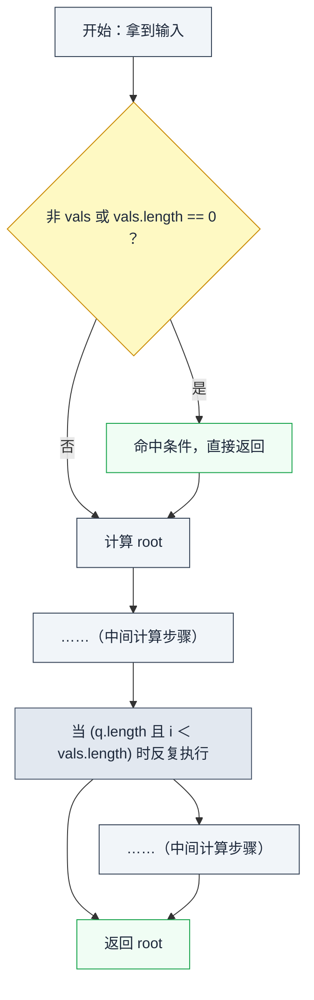

## TypeScript 解题方案（6 个方案逐个讲）

> **运行与提交**：每个方案都是自包含文件（内嵌用例自测，输出 PASS），整块复制到 `.ts` 文件后 `node 文件名` 即可运行。提交 LeetCode 时，把 `demo` 内的算法函数与辅助类型/函数整体取出、置于文件顶层即可。概念演示（非 LeetCode 编号题），在本地运行即可。

### 方案 1：迭代指针处理

**分析与思路**：核心做法是「迭代指针处理」。代码里依次做这些事：队列或堆的调度。

**运行方式**：`node 本文件`，内嵌用例全部通过会输出 PASS。


**方案专属流程图**（真实控制流）：


```typescript
class TreeNode {
  // 定义类型
  val: any;
  left: any;
  right: any; // 值: any; 左边界: any; 右边界: any;
  constructor(val?: any, left?: any, right?: any) {
    // constructor(值?: any, 左边界?: any, 右边界?: any) {
    this.val = val === undefined ? 0 : val; // 把 (值 全等于 undefined ? 0 : 值); 写入 值
    this.left = left === undefined ? null : left; // 把 (左边界 全等于 undefined ? null : 左边界); 写入 左边界
    this.right = right === undefined ? null : right; // 把 (右边界 全等于 undefined ? null : 右边界); 写入 右边界
  }
}
function buildTree(vals: any): any {
  // 定义函数/方法 buildTree
  if (!vals || vals.length === 0) return null; // 若 取反 vals 或 vals.长度 全等于 0，直接返回 null
  const root = new TreeNode(vals[0]);
  const q: any[] = [root];
  let i = 1;
  while (q.length && i < vals.length) {
    // 循环，直到不满足「节点.长度 且 下标 i 小于 vals.长度」
    const node = q.shift(); // 把 节点.shift() 存入 节点
    if (vals[i] !== null && vals[i] !== undefined) {
      node.left = new TreeNode(vals[i]);
      q.push(node.left);
    }
    i++; // 下标 i 加一
    if (i < vals.length && vals[i] !== null && vals[i] !== undefined) {
      node.right = new TreeNode(vals[i]);
      q.push(node.right);
    }
    i++; // 下标 i 加一
  }
  return root; // 返回 根节点
}
function treeToLevel(root: any): any[] {
  // 定义函数/方法 treeToLevel
  if (!root) return []; // 若 取反 根节点，直接返回 []
  const out: any[] = [];
  const q: any[] = [root]; // 把 []; const 节点: any[] 赋值为 [根节点]; 写入 const out: any[]
  while (q.length) {
    // 循环，直到不满足「节点.长度」
    const n = q.shift(); // 把 节点.shift() 存入 元素个数
    if (n === null || n === undefined) {
      out.push(null);
      continue;
    }
    out.push(n.val);
    q.push(n.left);
    q.push(n.right); // 把 元素个数.值 压入栈/数组尾部
  }
  while (out.length && out[out.length - 1] === null) out.pop(); // 循环，直到不满足「out.长度 且 out[out.长度 减 1] 全等于 null) out 弹出 );」
  return out; // 返回 out
}
class ListNode {
  // 定义类型
  val: any;
  next: any; // 值: any; 下一个: any;
  constructor(val?: any, next?: any) {
    this.val = val === undefined ? 0 : val;
    this.next = next === undefined ? null : next;
  }
}
function buildList(vals: any): any {
  // 定义函数/方法 buildList
  const dummy = new ListNode(0);
  let cur = dummy; // 把 new ListNode(0); let 当前值 赋值为 哨兵节点 存入 哨兵节点
  for (const v of vals) {
    cur.next = new ListNode(v);
    cur = cur.next;
  } // 把 new ListNode(值); 当前值 赋值为 当前值.下一个; } 写入 下一个
  return dummy.next; // 返回 哨兵节点.下一个
}
function listToArray(head: any): any[] {
  // 定义函数/方法 listToArray
  const out: any[] = [];
  let p = head; // 把 []; let 节点 赋值为 头节点; 写入 const out: any[]
  while (p) {
    out.push(p.val);
    p = p.next;
  } // 循环，直到不满足「节点) { out 追加 节点.值); 节点 赋值为 节点.下一个; }」
  return out; // 返回 out
}
// python-runtime shims
function pyLen(a: any): number {
  // 定义函数/方法 pyLen
  if (a === null || a === undefined) return 0; // 若 数组 全等于 null 或 数组 全等于 undefined，直接返回 0
  if (
    typeof a === 'string' ||
    Array.isArray(a) ||
    a instanceof Set ||
    a instanceof Map
  )
    return a.length ?? a.size;
  if (typeof a === 'object') return Object.keys(a).length; // 若 typeof 数组 全等于 'object'，直接返回 Object.keys(数组).长度
  return 0; // 返回 0
}
function pySlice(a: any, i: any, j: any, step?: any): any {
  // 定义函数/方法 pySlice
  if (typeof a === 'string') {
    const r = [...a].slice(i ?? 0, j ?? a.length);
    return step ? r.reverse().join('') : r.join('');
  }
  const arr = Array.isArray(a) ? a : [...a]; // 把 Array.isArray(数组) ? 数组 : 复制的 数组 存入 数组
  return arr.slice(i ?? 0, j ?? arr.length); // 返回 数组 截取 下标 i ?? 0, 下标 j ?? 数组.长度)
}
function pyRange(a: any, b?: any, step?: any): any[] {
  // 定义函数/方法 pyRange
  let s = 0,
    e = a,
    st = 1; // 把 0, e 赋值为 数组, st 赋值为 1 存入 字符串
  if (b !== undefined) {
    s = a;
    e = b;
  } // 若 b 不等于 undefined) { 字符串 赋值为 数组; e 赋值为 b; }
  if (step !== undefined) st = step; // 若 步数 不等于 undefined) st 赋值为 步数;
  const out: any[] = []; // 把 []; 写入 const out: any[]
  if (st > 0) for (let i = s; i < e; i += st) out.push(i);
  else for (let i = s; i > e; i += st) out.push(i); // 否则
  return out; // 返回 out
}
function pyIn(x: any, coll: any): boolean {
  // 定义函数/方法 pyIn
  if (coll === null || coll === undefined) return false; // 若 coll 全等于 null 或 coll 全等于 undefined，直接返回 false
  if (Array.isArray(coll)) return coll.includes(x); // 若 Array.isArray(coll)，直接返回 coll 是否包含 x)
  if (coll instanceof Set || coll instanceof Map) return coll.has(x); // 若 coll instanceof Set 或 coll instanceof Map，直接返回 coll.has(x)
  if (typeof coll === 'object') return x in coll; // 若 typeof coll 全等于 'object'，直接返回 x in coll
  if (typeof coll === 'string') return coll.indexOf(x) >= 0; // 若 typeof coll 全等于 'string'，直接返回 coll 查找 x) 不低于 0
  return false; // 返回 false
}
function pySorted(a: any): any[] {
  // 定义函数/方法 pySorted
  const arr = typeof a === 'string' ? [...a] : [...a]; // 把 (typeof 数组 全等于 'string') ? 复制的 数组 : 复制的 数组 存入 数组
  return arr.sort((x: any, y: any) => (x < y ? -1 : x > y ? 1 : 0));
}
function pyMin(a: any, b?: any): any {
  if (b !== undefined) return Math.min(a, b);
  if (Array.isArray(a) || a instanceof Set) return Math.min(...a);
  return Math.min(a);
} // 定义函数/方法 pyMin
function pyMax(a: any, b?: any): any {
  if (b !== undefined) return Math.max(a, b);
  if (Array.isArray(a) || a instanceof Set) return Math.max(...a);
  return Math.max(a);
} // 定义函数/方法 pyMax
function pySum(a: any): number {
  let s = 0;
  for (const v of a) s += v;
  return s;
} // 定义函数/方法 pySum
function pyAbs(x: any): number {
  return Math.abs(x);
} // 定义函数/方法 pyAbs
function pyEnumerate(a: any): any[] {
  const out: any[] = [];
  let i = 0;
  for (const v of a) {
    out.push([i, v]);
    i++;
  }
  return out;
} // 定义函数/方法 pyEnumerate
function pyZip(a: any, b: any): any[] {
  const n = Math.min(a.length, b.length);
  const out: any[] = [];
  for (let i = 0; i < n; i++) out.push([a[i], b[i]]);
  return out;
} // 定义函数/方法 pyZip
function pyDictGet(d: any, k: any, def?: any): any {
  return k in d ? d[k] : def === undefined ? null : def;
} // 定义函数/方法 pyDictGet
function pyPrint(...args: any[]): void {
  console.log(
    args
      .map((a) => (typeof a === 'object' && a !== null ? JSON.stringify(a) : a))
      .join(' '),
  );
} // 定义函数/方法 pyPrint
// collections / heapq
function heapPush(h: any[], x: any): void {
  h.push(x);
  let i = h.length - 1;
  while (i > 0) {
    const p = (i - 1) >> 1;
    if (h[p] <= h[i]) break;
    [h[p], h[i]] = [h[i], h[p]];
    i = p;
  }
} // 定义函数/方法 heapPush
function heapPop(h: any[]): any {
  const top = h[0];
  const last = h.pop();
  if (h.length) {
    h[0] = last;
    let i = 0;
    const n = h.length;
    while (true) {
      let l = 2 * i + 1,
        r = 2 * i + 2,
        s = i;
      if (l < n && h[l] < h[s]) s = l;
      if (r < n && h[r] < h[s]) s = r;
      if (s === i) break;
      [h[s], h[i]] = [h[i], h[s]];
      i = s;
    }
  }
  return top;
} // 定义函数/方法 heapPop
class Deque {
  private a: any[] = [];
  push(x: any) {
    this.a.push(x);
  }
  pushLeft(x: any) {
    this.a.unshift(x);
  }
  pop() {
    return this.a.pop();
  }
  popLeft() {
    return this.a.shift();
  }
  get length() {
    return this.a.length;
  }
  toArray() {
    return this.a.slice();
  }
} // 定义类型
function Counter(iter: any): any {
  const m: any = {};
  for (const v of iter) m[v] = (m[v] || 0) + 1;
  return m;
} // 定义函数/方法 Counter
function gcd(a: any, b: any): any {
  while (b) {
    [a, b] = [b, a % b];
  }
  return a;
} // 定义函数/方法 gcd
function pyInf(): number {
  return Infinity;
} // 定义函数/方法 pyInf

function norm(x: any): any {
  // 定义函数/方法 norm
  if (x === null || x === undefined) return null; // 若 x 全等于 null 或 x 全等于 undefined，直接返回 null
  if (typeof x === 'object') {
    // 若 typeof x 全等于 'object'
    if (x instanceof Deque) return x.toArray(); // 若 x instanceof Deque，直接返回 x.toArray()
    if (Array.isArray(x)) return x.map(norm); // 若 Array.isArray(x)，直接返回 x.映射表(norm)
    if (
      typeof x.val === 'number' &&
      (typeof x.left !== 'undefined' || typeof x.right !== 'undefined')
    )
      return treeToLevel(x);
    if (typeof x.next !== 'undefined' && typeof x.val === 'number')
      return listToArray(x);
    if (x instanceof Set) return [...x].sort(); // 若 x instanceof Set，直接返回 复制的 x 排序 )
    if (x instanceof Map) return Object.fromEntries(x); // 若 x instanceof Map，直接返回 Object.fromEntries(x)
    const o: any = {};
    for (const k of Object.keys(x)) o[k] = norm(x[k]);
    return o;
  }
  return x; // 返回 x
}
function eq(a: any, b: any): boolean {
  // 定义函数/方法 eq
  const x = norm(a),
    y = norm(b); // 把 norm(数组), y 赋值为 norm(b) 存入 x
  if (x === y) return true; // 若 x 全等于 y，直接返回 true
  if (x === null || y === null) return x === y; // 若 x 全等于 null 或 y 全等于 null，直接返回 x 全等于 y
  if (Array.isArray(x) && Array.isArray(y)) {
    // 若 Array.isArray(x) 且 Array.isArray(y
    if (x.length !== y.length) return false; // 若 x.长度 不等于 y.长度，直接返回 false
    for (let i = 0; i < x.length; i++) if (!eq(x[i], y[i])) return false; // 让 下标 i 从 0 开始计数，下标 i 小于 x.长度 就继续
    return true; // 返回 true
  }
  if (typeof x === 'object' && typeof y === 'object') {
    // 若 typeof x 全等于 'object' 且 typeof y 全等于 'object'
    const kx = Object.keys(x),
      ky = Object.keys(y); // 把 Object.keys(x), ky 赋值为 Object.keys(y) 存入 kx
    if (kx.length !== ky.length) return false; // 若 kx.长度 不等于 ky.长度，直接返回 false
    for (const k of kx) if (!eq(x[k], y[k])) return false;
    return true; // 返回 true
  }
  return x === y; // 返回 x 全等于 y
}

function climbStairs(h) {
  // 定义函数/方法 climbStairs
  if (h < 0) return 0; // 若 h 小于 0，直接返回 0
  if (h === 0) return 1; // 若 h 全等于 0，直接返回 1
  if (h <= 2) return h; // 若 h 不超过 2，直接返回 h
  let a = 1,
    b = 1,
    c = 2; // 把 1, b 赋值为 1, 字符 赋值为 2 存入 数组
  for (let i = 3; i <= h; i++) {
    const t = a + b + c;
    a = b;
    b = c;
    c = t;
  } // 让 下标 i 从 3 开始计数，下标 i 不超过 h 就继续
  return c; // 返回 字符
}
export function demo(): void {
  // 程序入口：跑内嵌自测用例
  const cases = [
    { in: [5], want: 13 },
    { in: [10], want: 274 },
    { in: [1], want: 1 },
    { in: [8], want: 81 },
  ];
  let fail = false; // 把 false 存入 fail
  for (const c of cases) {
    // for (const 字符 of cases) {
    const got = climbStairs(...c.in); // 把 climbStairs(...字符.in) 存入 got
    if (!eq(got, c.want)) {
      fail = true;
      console.log(
        'FAIL',
        JSON.stringify(c.in),
        '=>',
        JSON.stringify(got),
        'want',
        JSON.stringify(c.want),
      );
    }
  }
  if (fail) throw new Error('FAILED'); // 若 fail) throw new Error('FAILED');
  console.log('PASS'); // 全部用例通过，输出 PASS
}
demo(); // demo();
```

### 方案 2：直接实现

**分析与思路**：核心做法是「直接实现」。

**运行方式**：`node 本文件`，内嵌用例全部通过会输出 PASS。


**方案专属流程图**（真实控制流）：

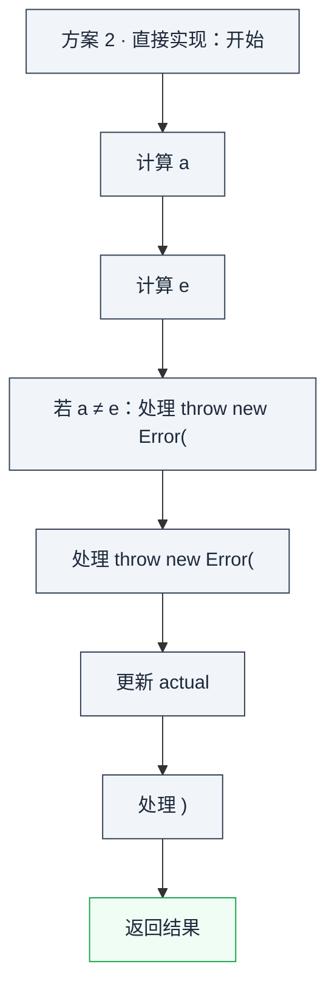

```typescript
function assertEq(actual: any, expected: any, msg: string = ''): void {
  // 定义函数/方法 assertEq
  const a = JSON.stringify(actual);
  const e = JSON.stringify(expected);
  if (a !== e)
    throw new Error(
      'ASSERT FAILED ' + msg + ' :: actual=' + a + ' expected=' + e,
    );
}

function climb_stairs_count(h: number): number {
  // 定义函数/方法 climb_stairs_count
  if (h < 0) return 0; // 若 h 小于 0，直接返回 0
  if (h === 0) return 1; // 若 h 全等于 0，直接返回 1
  if (h === 1) return 1; // 若 h 全等于 1，直接返回 1
  if (h === 2) return 2; // 若 h 全等于 2，直接返回 2
  const dp = new Array(h + 1).fill(0); // 把 new Array(h 加 1).fill(0) 存入 DP 表
  dp[0] = 1;
  dp[1] = 1;
  dp[2] = 2; // 把 1; DP 表[1] 赋值为 1; DP 表[2] 赋值为 2; 写入 dp[0]
  for (let i = 3; i <= h; i++) dp[i] = dp[i - 1] + dp[i - 2] + dp[i - 3]; // 让 下标 i 从 3 开始计数，下标 i 不超过 h 就继续
  return dp[h]; // 返回 DP 表[h]
}
export function demo(): void {
  // 程序入口：跑内嵌自测用例
  assertEq(climb_stairs_count(4), 7, 's4'); // 断言校验
  assertEq(climb_stairs_count(6), 24, 's6'); // 断言校验
  assertEq(climb_stairs_count(10), 274, 's10'); // 断言校验
  console.log('PASS'); // 全部用例通过，输出 PASS
}
demo(); // demo();
```

### 方案 3：迭代指针处理

**分析与思路**：核心做法是「迭代指针处理」。代码里依次做这些事：队列或堆的调度。

**运行方式**：`node 本文件`，内嵌用例全部通过会输出 PASS。


**方案专属流程图**（真实控制流）：


```typescript
class TreeNode {
  // 定义类型
  val: any;
  left: any;
  right: any; // 值: any; 左边界: any; 右边界: any;
  constructor(val?: any, left?: any, right?: any) {
    // constructor(值?: any, 左边界?: any, 右边界?: any) {
    this.val = val === undefined ? 0 : val; // 把 (值 全等于 undefined ? 0 : 值); 写入 值
    this.left = left === undefined ? null : left; // 把 (左边界 全等于 undefined ? null : 左边界); 写入 左边界
    this.right = right === undefined ? null : right; // 把 (右边界 全等于 undefined ? null : 右边界); 写入 右边界
  }
}
function buildTree(vals: any): any {
  // 定义函数/方法 buildTree
  if (!vals || vals.length === 0) return null; // 若 取反 vals 或 vals.长度 全等于 0，直接返回 null
  const root = new TreeNode(vals[0]);
  const q: any[] = [root];
  let i = 1;
  while (q.length && i < vals.length) {
    // 循环，直到不满足「节点.长度 且 下标 i 小于 vals.长度」
    const node = q.shift(); // 把 节点.shift() 存入 节点
    if (vals[i] !== null && vals[i] !== undefined) {
      node.left = new TreeNode(vals[i]);
      q.push(node.left);
    }
    i++; // 下标 i 加一
    if (i < vals.length && vals[i] !== null && vals[i] !== undefined) {
      node.right = new TreeNode(vals[i]);
      q.push(node.right);
    }
    i++; // 下标 i 加一
  }
  return root; // 返回 根节点
}
function treeToLevel(root: any): any[] {
  // 定义函数/方法 treeToLevel
  if (!root) return []; // 若 取反 根节点，直接返回 []
  const out: any[] = [];
  const q: any[] = [root]; // 把 []; const 节点: any[] 赋值为 [根节点]; 写入 const out: any[]
  while (q.length) {
    // 循环，直到不满足「节点.长度」
    const n = q.shift(); // 把 节点.shift() 存入 元素个数
    if (n === null || n === undefined) {
      out.push(null);
      continue;
    }
    out.push(n.val);
    q.push(n.left);
    q.push(n.right); // 把 元素个数.值 压入栈/数组尾部
  }
  while (out.length && out[out.length - 1] === null) out.pop(); // 循环，直到不满足「out.长度 且 out[out.长度 减 1] 全等于 null) out 弹出 );」
  return out; // 返回 out
}
class ListNode {
  // 定义类型
  val: any;
  next: any; // 值: any; 下一个: any;
  constructor(val?: any, next?: any) {
    this.val = val === undefined ? 0 : val;
    this.next = next === undefined ? null : next;
  }
}
function buildList(vals: any): any {
  // 定义函数/方法 buildList
  const dummy = new ListNode(0);
  let cur = dummy; // 把 new ListNode(0); let 当前值 赋值为 哨兵节点 存入 哨兵节点
  for (const v of vals) {
    cur.next = new ListNode(v);
    cur = cur.next;
  } // 把 new ListNode(值); 当前值 赋值为 当前值.下一个; } 写入 下一个
  return dummy.next; // 返回 哨兵节点.下一个
}
function listToArray(head: any): any[] {
  // 定义函数/方法 listToArray
  const out: any[] = [];
  let p = head; // 把 []; let 节点 赋值为 头节点; 写入 const out: any[]
  while (p) {
    out.push(p.val);
    p = p.next;
  } // 循环，直到不满足「节点) { out 追加 节点.值); 节点 赋值为 节点.下一个; }」
  return out; // 返回 out
}
// python-runtime shims
function pyLen(a: any): number {
  // 定义函数/方法 pyLen
  if (a === null || a === undefined) return 0; // 若 数组 全等于 null 或 数组 全等于 undefined，直接返回 0
  if (
    typeof a === 'string' ||
    Array.isArray(a) ||
    a instanceof Set ||
    a instanceof Map
  )
    return a.length ?? a.size;
  if (typeof a === 'object') return Object.keys(a).length; // 若 typeof 数组 全等于 'object'，直接返回 Object.keys(数组).长度
  return 0; // 返回 0
}
function pySlice(a: any, i: any, j: any, step?: any): any {
  // 定义函数/方法 pySlice
  if (typeof a === 'string') {
    const r = [...a].slice(i ?? 0, j ?? a.length);
    return step ? r.reverse().join('') : r.join('');
  }
  const arr = Array.isArray(a) ? a : [...a]; // 把 Array.isArray(数组) ? 数组 : 复制的 数组 存入 数组
  return arr.slice(i ?? 0, j ?? arr.length); // 返回 数组 截取 下标 i ?? 0, 下标 j ?? 数组.长度)
}
function pyRange(a: any, b?: any, step?: any): any[] {
  // 定义函数/方法 pyRange
  let s = 0,
    e = a,
    st = 1; // 把 0, e 赋值为 数组, st 赋值为 1 存入 字符串
  if (b !== undefined) {
    s = a;
    e = b;
  } // 若 b 不等于 undefined) { 字符串 赋值为 数组; e 赋值为 b; }
  if (step !== undefined) st = step; // 若 步数 不等于 undefined) st 赋值为 步数;
  const out: any[] = []; // 把 []; 写入 const out: any[]
  if (st > 0) for (let i = s; i < e; i += st) out.push(i);
  else for (let i = s; i > e; i += st) out.push(i); // 否则
  return out; // 返回 out
}
function pyIn(x: any, coll: any): boolean {
  // 定义函数/方法 pyIn
  if (coll === null || coll === undefined) return false; // 若 coll 全等于 null 或 coll 全等于 undefined，直接返回 false
  if (Array.isArray(coll)) return coll.includes(x); // 若 Array.isArray(coll)，直接返回 coll 是否包含 x)
  if (coll instanceof Set || coll instanceof Map) return coll.has(x); // 若 coll instanceof Set 或 coll instanceof Map，直接返回 coll.has(x)
  if (typeof coll === 'object') return x in coll; // 若 typeof coll 全等于 'object'，直接返回 x in coll
  if (typeof coll === 'string') return coll.indexOf(x) >= 0; // 若 typeof coll 全等于 'string'，直接返回 coll 查找 x) 不低于 0
  return false; // 返回 false
}
function pySorted(a: any): any[] {
  // 定义函数/方法 pySorted
  const arr = typeof a === 'string' ? [...a] : [...a]; // 把 (typeof 数组 全等于 'string') ? 复制的 数组 : 复制的 数组 存入 数组
  return arr.sort((x: any, y: any) => (x < y ? -1 : x > y ? 1 : 0));
}
function pyMin(a: any, b?: any): any {
  if (b !== undefined) return Math.min(a, b);
  if (Array.isArray(a) || a instanceof Set) return Math.min(...a);
  return Math.min(a);
} // 定义函数/方法 pyMin
function pyMax(a: any, b?: any): any {
  if (b !== undefined) return Math.max(a, b);
  if (Array.isArray(a) || a instanceof Set) return Math.max(...a);
  return Math.max(a);
} // 定义函数/方法 pyMax
function pySum(a: any): number {
  let s = 0;
  for (const v of a) s += v;
  return s;
} // 定义函数/方法 pySum
function pyAbs(x: any): number {
  return Math.abs(x);
} // 定义函数/方法 pyAbs
function pyEnumerate(a: any): any[] {
  const out: any[] = [];
  let i = 0;
  for (const v of a) {
    out.push([i, v]);
    i++;
  }
  return out;
} // 定义函数/方法 pyEnumerate
function pyZip(a: any, b: any): any[] {
  const n = Math.min(a.length, b.length);
  const out: any[] = [];
  for (let i = 0; i < n; i++) out.push([a[i], b[i]]);
  return out;
} // 定义函数/方法 pyZip
function pyDictGet(d: any, k: any, def?: any): any {
  return k in d ? d[k] : def === undefined ? null : def;
} // 定义函数/方法 pyDictGet
function pyPrint(...args: any[]): void {
  console.log(
    args
      .map((a) => (typeof a === 'object' && a !== null ? JSON.stringify(a) : a))
      .join(' '),
  );
} // 定义函数/方法 pyPrint
// collections / heapq
function heapPush(h: any[], x: any): void {
  h.push(x);
  let i = h.length - 1;
  while (i > 0) {
    const p = (i - 1) >> 1;
    if (h[p] <= h[i]) break;
    [h[p], h[i]] = [h[i], h[p]];
    i = p;
  }
} // 定义函数/方法 heapPush
function heapPop(h: any[]): any {
  const top = h[0];
  const last = h.pop();
  if (h.length) {
    h[0] = last;
    let i = 0;
    const n = h.length;
    while (true) {
      let l = 2 * i + 1,
        r = 2 * i + 2,
        s = i;
      if (l < n && h[l] < h[s]) s = l;
      if (r < n && h[r] < h[s]) s = r;
      if (s === i) break;
      [h[s], h[i]] = [h[i], h[s]];
      i = s;
    }
  }
  return top;
} // 定义函数/方法 heapPop
class Deque {
  private a: any[] = [];
  push(x: any) {
    this.a.push(x);
  }
  pushLeft(x: any) {
    this.a.unshift(x);
  }
  pop() {
    return this.a.pop();
  }
  popLeft() {
    return this.a.shift();
  }
  get length() {
    return this.a.length;
  }
  toArray() {
    return this.a.slice();
  }
} // 定义类型
function Counter(iter: any): any {
  const m: any = {};
  for (const v of iter) m[v] = (m[v] || 0) + 1;
  return m;
} // 定义函数/方法 Counter
function gcd(a: any, b: any): any {
  while (b) {
    [a, b] = [b, a % b];
  }
  return a;
} // 定义函数/方法 gcd
function pyInf(): number {
  return Infinity;
} // 定义函数/方法 pyInf

function norm(x: any): any {
  // 定义函数/方法 norm
  if (x === null || x === undefined) return null; // 若 x 全等于 null 或 x 全等于 undefined，直接返回 null
  if (typeof x === 'object') {
    // 若 typeof x 全等于 'object'
    if (x instanceof Deque) return x.toArray(); // 若 x instanceof Deque，直接返回 x.toArray()
    if (Array.isArray(x)) return x.map(norm); // 若 Array.isArray(x)，直接返回 x.映射表(norm)
    if (
      typeof x.val === 'number' &&
      (typeof x.left !== 'undefined' || typeof x.right !== 'undefined')
    )
      return treeToLevel(x);
    if (typeof x.next !== 'undefined' && typeof x.val === 'number')
      return listToArray(x);
    if (x instanceof Set) return [...x].sort(); // 若 x instanceof Set，直接返回 复制的 x 排序 )
    if (x instanceof Map) return Object.fromEntries(x); // 若 x instanceof Map，直接返回 Object.fromEntries(x)
    const o: any = {};
    for (const k of Object.keys(x)) o[k] = norm(x[k]);
    return o;
  }
  return x; // 返回 x
}
function eq(a: any, b: any): boolean {
  // 定义函数/方法 eq
  const x = norm(a),
    y = norm(b); // 把 norm(数组), y 赋值为 norm(b) 存入 x
  if (x === y) return true; // 若 x 全等于 y，直接返回 true
  if (x === null || y === null) return x === y; // 若 x 全等于 null 或 y 全等于 null，直接返回 x 全等于 y
  if (Array.isArray(x) && Array.isArray(y)) {
    // 若 Array.isArray(x) 且 Array.isArray(y
    if (x.length !== y.length) return false; // 若 x.长度 不等于 y.长度，直接返回 false
    for (let i = 0; i < x.length; i++) if (!eq(x[i], y[i])) return false; // 让 下标 i 从 0 开始计数，下标 i 小于 x.长度 就继续
    return true; // 返回 true
  }
  if (typeof x === 'object' && typeof y === 'object') {
    // 若 typeof x 全等于 'object' 且 typeof y 全等于 'object'
    const kx = Object.keys(x),
      ky = Object.keys(y); // 把 Object.keys(x), ky 赋值为 Object.keys(y) 存入 kx
    if (kx.length !== ky.length) return false; // 若 kx.长度 不等于 ky.长度，直接返回 false
    for (const k of kx) if (!eq(x[k], y[k])) return false;
    return true; // 返回 true
  }
  return x === y; // 返回 x 全等于 y
}

function climbStairs(h) {
  // 定义函数/方法 climbStairs
  if (h < 0) return 0; // 若 h 小于 0，直接返回 0
  if (h === 0) return 1; // 若 h 全等于 0，直接返回 1
  if (h <= 2) return h; // 若 h 不超过 2，直接返回 h
  let a = 1,
    b = 1,
    c = 2; // 把 1, b 赋值为 1, 字符 赋值为 2 存入 数组
  for (let i = 3; i <= h; i++) {
    const t = a + b + c;
    a = b;
    b = c;
    c = t;
  } // 让 下标 i 从 3 开始计数，下标 i 不超过 h 就继续
  return c; // 返回 字符
}
export function demo(): void {
  // 程序入口：跑内嵌自测用例
  const cases = [
    { in: [5], want: 13 },
    { in: [10], want: 274 },
    { in: [1], want: 1 },
    { in: [8], want: 81 },
  ];
  let fail = false; // 把 false 存入 fail
  for (const c of cases) {
    // for (const 字符 of cases) {
    const got = climbStairs(...c.in); // 把 climbStairs(...字符.in) 存入 got
    if (!eq(got, c.want)) {
      fail = true;
      console.log(
        'FAIL',
        JSON.stringify(c.in),
        '=>',
        JSON.stringify(got),
        'want',
        JSON.stringify(c.want),
      );
    }
  }
  if (fail) throw new Error('FAILED'); // 若 fail) throw new Error('FAILED');
  console.log('PASS'); // 全部用例通过，输出 PASS
}
demo(); // demo();
```

### 方案 4：迭代指针处理

**分析与思路**：核心做法是「迭代指针处理」。代码里依次做这些事：队列或堆的调度。

**运行方式**：`node 本文件`，内嵌用例全部通过会输出 PASS。


**方案专属流程图**（真实控制流）：

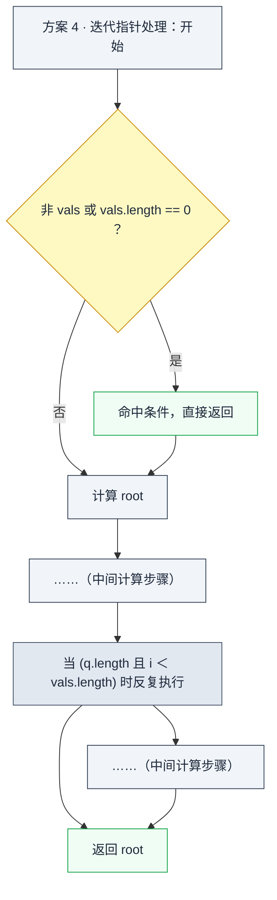

```typescript
class TreeNode {
  // 定义类型
  val: any;
  left: any;
  right: any; // 值: any; 左边界: any; 右边界: any;
  constructor(val?: any, left?: any, right?: any) {
    // constructor(值?: any, 左边界?: any, 右边界?: any) {
    this.val = val === undefined ? 0 : val; // 把 (值 全等于 undefined ? 0 : 值); 写入 值
    this.left = left === undefined ? null : left; // 把 (左边界 全等于 undefined ? null : 左边界); 写入 左边界
    this.right = right === undefined ? null : right; // 把 (右边界 全等于 undefined ? null : 右边界); 写入 右边界
  }
}
function buildTree(vals: any): any {
  // 定义函数/方法 buildTree
  if (!vals || vals.length === 0) return null; // 若 取反 vals 或 vals.长度 全等于 0，直接返回 null
  const root = new TreeNode(vals[0]);
  const q: any[] = [root];
  let i = 1;
  while (q.length && i < vals.length) {
    // 循环，直到不满足「节点.长度 且 下标 i 小于 vals.长度」
    const node = q.shift(); // 把 节点.shift() 存入 节点
    if (vals[i] !== null && vals[i] !== undefined) {
      node.left = new TreeNode(vals[i]);
      q.push(node.left);
    }
    i++; // 下标 i 加一
    if (i < vals.length && vals[i] !== null && vals[i] !== undefined) {
      node.right = new TreeNode(vals[i]);
      q.push(node.right);
    }
    i++; // 下标 i 加一
  }
  return root; // 返回 根节点
}
function treeToLevel(root: any): any[] {
  // 定义函数/方法 treeToLevel
  if (!root) return []; // 若 取反 根节点，直接返回 []
  const out: any[] = [];
  const q: any[] = [root]; // 把 []; const 节点: any[] 赋值为 [根节点]; 写入 const out: any[]
  while (q.length) {
    // 循环，直到不满足「节点.长度」
    const n = q.shift(); // 把 节点.shift() 存入 元素个数
    if (n === null || n === undefined) {
      out.push(null);
      continue;
    }
    out.push(n.val);
    q.push(n.left);
    q.push(n.right); // 把 元素个数.值 压入栈/数组尾部
  }
  while (out.length && out[out.length - 1] === null) out.pop(); // 循环，直到不满足「out.长度 且 out[out.长度 减 1] 全等于 null) out 弹出 );」
  return out; // 返回 out
}
class ListNode {
  // 定义类型
  val: any;
  next: any; // 值: any; 下一个: any;
  constructor(val?: any, next?: any) {
    this.val = val === undefined ? 0 : val;
    this.next = next === undefined ? null : next;
  }
}
function buildList(vals: any): any {
  // 定义函数/方法 buildList
  const dummy = new ListNode(0);
  let cur = dummy; // 把 new ListNode(0); let 当前值 赋值为 哨兵节点 存入 哨兵节点
  for (const v of vals) {
    cur.next = new ListNode(v);
    cur = cur.next;
  } // 把 new ListNode(值); 当前值 赋值为 当前值.下一个; } 写入 下一个
  return dummy.next; // 返回 哨兵节点.下一个
}
function listToArray(head: any): any[] {
  // 定义函数/方法 listToArray
  const out: any[] = [];
  let p = head; // 把 []; let 节点 赋值为 头节点; 写入 const out: any[]
  while (p) {
    out.push(p.val);
    p = p.next;
  } // 循环，直到不满足「节点) { out 追加 节点.值); 节点 赋值为 节点.下一个; }」
  return out; // 返回 out
}
// python-runtime shims
function pyLen(a: any): number {
  // 定义函数/方法 pyLen
  if (a === null || a === undefined) return 0; // 若 数组 全等于 null 或 数组 全等于 undefined，直接返回 0
  if (
    typeof a === 'string' ||
    Array.isArray(a) ||
    a instanceof Set ||
    a instanceof Map
  )
    return a.length ?? a.size;
  if (typeof a === 'object') return Object.keys(a).length; // 若 typeof 数组 全等于 'object'，直接返回 Object.keys(数组).长度
  return 0; // 返回 0
}
function pySlice(a: any, i: any, j: any, step?: any): any {
  // 定义函数/方法 pySlice
  if (typeof a === 'string') {
    const r = [...a].slice(i ?? 0, j ?? a.length);
    return step ? r.reverse().join('') : r.join('');
  }
  const arr = Array.isArray(a) ? a : [...a]; // 把 Array.isArray(数组) ? 数组 : 复制的 数组 存入 数组
  return arr.slice(i ?? 0, j ?? arr.length); // 返回 数组 截取 下标 i ?? 0, 下标 j ?? 数组.长度)
}
function pyRange(a: any, b?: any, step?: any): any[] {
  // 定义函数/方法 pyRange
  let s = 0,
    e = a,
    st = 1; // 把 0, e 赋值为 数组, st 赋值为 1 存入 字符串
  if (b !== undefined) {
    s = a;
    e = b;
  } // 若 b 不等于 undefined) { 字符串 赋值为 数组; e 赋值为 b; }
  if (step !== undefined) st = step; // 若 步数 不等于 undefined) st 赋值为 步数;
  const out: any[] = []; // 把 []; 写入 const out: any[]
  if (st > 0) for (let i = s; i < e; i += st) out.push(i);
  else for (let i = s; i > e; i += st) out.push(i); // 否则
  return out; // 返回 out
}
function pyIn(x: any, coll: any): boolean {
  // 定义函数/方法 pyIn
  if (coll === null || coll === undefined) return false; // 若 coll 全等于 null 或 coll 全等于 undefined，直接返回 false
  if (Array.isArray(coll)) return coll.includes(x); // 若 Array.isArray(coll)，直接返回 coll 是否包含 x)
  if (coll instanceof Set || coll instanceof Map) return coll.has(x); // 若 coll instanceof Set 或 coll instanceof Map，直接返回 coll.has(x)
  if (typeof coll === 'object') return x in coll; // 若 typeof coll 全等于 'object'，直接返回 x in coll
  if (typeof coll === 'string') return coll.indexOf(x) >= 0; // 若 typeof coll 全等于 'string'，直接返回 coll 查找 x) 不低于 0
  return false; // 返回 false
}
function pySorted(a: any): any[] {
  // 定义函数/方法 pySorted
  const arr = typeof a === 'string' ? [...a] : [...a]; // 把 (typeof 数组 全等于 'string') ? 复制的 数组 : 复制的 数组 存入 数组
  return arr.sort((x: any, y: any) => (x < y ? -1 : x > y ? 1 : 0));
}
function pyMin(a: any, b?: any): any {
  if (b !== undefined) return Math.min(a, b);
  if (Array.isArray(a) || a instanceof Set) return Math.min(...a);
  return Math.min(a);
} // 定义函数/方法 pyMin
function pyMax(a: any, b?: any): any {
  if (b !== undefined) return Math.max(a, b);
  if (Array.isArray(a) || a instanceof Set) return Math.max(...a);
  return Math.max(a);
} // 定义函数/方法 pyMax
function pySum(a: any): number {
  let s = 0;
  for (const v of a) s += v;
  return s;
} // 定义函数/方法 pySum
function pyAbs(x: any): number {
  return Math.abs(x);
} // 定义函数/方法 pyAbs
function pyEnumerate(a: any): any[] {
  const out: any[] = [];
  let i = 0;
  for (const v of a) {
    out.push([i, v]);
    i++;
  }
  return out;
} // 定义函数/方法 pyEnumerate
function pyZip(a: any, b: any): any[] {
  const n = Math.min(a.length, b.length);
  const out: any[] = [];
  for (let i = 0; i < n; i++) out.push([a[i], b[i]]);
  return out;
} // 定义函数/方法 pyZip
function pyDictGet(d: any, k: any, def?: any): any {
  return k in d ? d[k] : def === undefined ? null : def;
} // 定义函数/方法 pyDictGet
function pyPrint(...args: any[]): void {
  console.log(
    args
      .map((a) => (typeof a === 'object' && a !== null ? JSON.stringify(a) : a))
      .join(' '),
  );
} // 定义函数/方法 pyPrint
// collections / heapq
function heapPush(h: any[], x: any): void {
  h.push(x);
  let i = h.length - 1;
  while (i > 0) {
    const p = (i - 1) >> 1;
    if (h[p] <= h[i]) break;
    [h[p], h[i]] = [h[i], h[p]];
    i = p;
  }
} // 定义函数/方法 heapPush
function heapPop(h: any[]): any {
  const top = h[0];
  const last = h.pop();
  if (h.length) {
    h[0] = last;
    let i = 0;
    const n = h.length;
    while (true) {
      let l = 2 * i + 1,
        r = 2 * i + 2,
        s = i;
      if (l < n && h[l] < h[s]) s = l;
      if (r < n && h[r] < h[s]) s = r;
      if (s === i) break;
      [h[s], h[i]] = [h[i], h[s]];
      i = s;
    }
  }
  return top;
} // 定义函数/方法 heapPop
class Deque {
  private a: any[] = [];
  push(x: any) {
    this.a.push(x);
  }
  pushLeft(x: any) {
    this.a.unshift(x);
  }
  pop() {
    return this.a.pop();
  }
  popLeft() {
    return this.a.shift();
  }
  get length() {
    return this.a.length;
  }
  toArray() {
    return this.a.slice();
  }
} // 定义类型
function Counter(iter: any): any {
  const m: any = {};
  for (const v of iter) m[v] = (m[v] || 0) + 1;
  return m;
} // 定义函数/方法 Counter
function gcd(a: any, b: any): any {
  while (b) {
    [a, b] = [b, a % b];
  }
  return a;
} // 定义函数/方法 gcd
function pyInf(): number {
  return Infinity;
} // 定义函数/方法 pyInf

function norm(x: any): any {
  // 定义函数/方法 norm
  if (x === null || x === undefined) return null; // 若 x 全等于 null 或 x 全等于 undefined，直接返回 null
  if (typeof x === 'object') {
    // 若 typeof x 全等于 'object'
    if (x instanceof Deque) return x.toArray(); // 若 x instanceof Deque，直接返回 x.toArray()
    if (Array.isArray(x)) return x.map(norm); // 若 Array.isArray(x)，直接返回 x.映射表(norm)
    if (
      typeof x.val === 'number' &&
      (typeof x.left !== 'undefined' || typeof x.right !== 'undefined')
    )
      return treeToLevel(x);
    if (typeof x.next !== 'undefined' && typeof x.val === 'number')
      return listToArray(x);
    if (x instanceof Set) return [...x].sort(); // 若 x instanceof Set，直接返回 复制的 x 排序 )
    if (x instanceof Map) return Object.fromEntries(x); // 若 x instanceof Map，直接返回 Object.fromEntries(x)
    const o: any = {};
    for (const k of Object.keys(x)) o[k] = norm(x[k]);
    return o;
  }
  return x; // 返回 x
}
function eq(a: any, b: any): boolean {
  // 定义函数/方法 eq
  const x = norm(a),
    y = norm(b); // 把 norm(数组), y 赋值为 norm(b) 存入 x
  if (x === y) return true; // 若 x 全等于 y，直接返回 true
  if (x === null || y === null) return x === y; // 若 x 全等于 null 或 y 全等于 null，直接返回 x 全等于 y
  if (Array.isArray(x) && Array.isArray(y)) {
    // 若 Array.isArray(x) 且 Array.isArray(y
    if (x.length !== y.length) return false; // 若 x.长度 不等于 y.长度，直接返回 false
    for (let i = 0; i < x.length; i++) if (!eq(x[i], y[i])) return false; // 让 下标 i 从 0 开始计数，下标 i 小于 x.长度 就继续
    return true; // 返回 true
  }
  if (typeof x === 'object' && typeof y === 'object') {
    // 若 typeof x 全等于 'object' 且 typeof y 全等于 'object'
    const kx = Object.keys(x),
      ky = Object.keys(y); // 把 Object.keys(x), ky 赋值为 Object.keys(y) 存入 kx
    if (kx.length !== ky.length) return false; // 若 kx.长度 不等于 ky.长度，直接返回 false
    for (const k of kx) if (!eq(x[k], y[k])) return false;
    return true; // 返回 true
  }
  return x === y; // 返回 x 全等于 y
}

function climbStairs(h) {
  // 定义函数/方法 climbStairs
  if (h < 0) return 0; // 若 h 小于 0，直接返回 0
  if (h === 0) return 1; // 若 h 全等于 0，直接返回 1
  if (h <= 2) return h; // 若 h 不超过 2，直接返回 h
  let a = 1,
    b = 1,
    c = 2; // 把 1, b 赋值为 1, 字符 赋值为 2 存入 数组
  for (let i = 3; i <= h; i++) {
    const t = a + b + c;
    a = b;
    b = c;
    c = t;
  } // 让 下标 i 从 3 开始计数，下标 i 不超过 h 就继续
  return c; // 返回 字符
}
export function demo(): void {
  // 程序入口：跑内嵌自测用例
  const cases = [
    { in: [5], want: 13 },
    { in: [10], want: 274 },
    { in: [1], want: 1 },
    { in: [8], want: 81 },
  ];
  let fail = false; // 把 false 存入 fail
  for (const c of cases) {
    // for (const 字符 of cases) {
    const got = climbStairs(...c.in); // 把 climbStairs(...字符.in) 存入 got
    if (!eq(got, c.want)) {
      fail = true;
      console.log(
        'FAIL',
        JSON.stringify(c.in),
        '=>',
        JSON.stringify(got),
        'want',
        JSON.stringify(c.want),
      );
    }
  }
  if (fail) throw new Error('FAILED'); // 若 fail) throw new Error('FAILED');
  console.log('PASS'); // 全部用例通过，输出 PASS
}
demo(); // demo();
```

### 方案 5：直接实现

**分析与思路**：核心做法是「直接实现」。

**运行方式**：`node 本文件`，内嵌用例全部通过会输出 PASS。

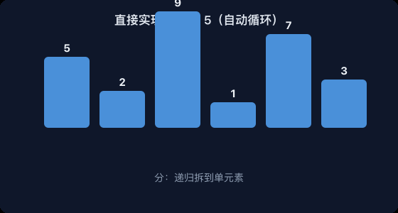

**方案专属流程图**（真实控制流）：


```typescript
function assertEq(actual: any, expected: any, msg: string = ''): void {
  // 定义函数/方法 assertEq
  const a = JSON.stringify(actual);
  const e = JSON.stringify(expected);
  if (a !== e)
    throw new Error(
      'ASSERT FAILED ' + msg + ' :: actual=' + a + ' expected=' + e,
    );
}

function horse_jump_count(): number {
  // 定义函数/方法 horse_jump_count
  const moves = [
    [1, 2],
    [2, 1],
    [2, -1],
    [1, -2],
  ]; // 把 [[1, 2], [2, 1], [2, 减 1], [1, 减 2]] 存入 moves
  let count = 0; // 把 0 存入 计数
  function jump(x: number, y: number): void {
    // 定义函数/方法 jump
    if (x === 8 && y === 4) {
      count++;
      return;
    } // 若 x 全等于 8 且 y 全等于 4) { 计数 加一 ; return; }
    for (const mv of moves) {
      // for (const mv of moves) {
      const nx = x + mv[0],
        ny = y + mv[1]; // 把 x 加 mv[0], ny 赋值为 y 加 mv[1] 存入 nx
      if (nx < 0 || nx > 8 || ny < 0 || ny > 4) continue; // 若 nx 小于 0 或 nx 超过 8 或 ny 小于 0 或 ny 超过 4) continue;
      jump(nx, ny); // jump(nx, ny);
    }
  }
  jump(0, 0); // jump(0, 0);
  return count; // 返回 计数
}
export function demo(): void {
  // 程序入口：跑内嵌自测用例
  assertEq(horse_jump_count(), 37, 'horse'); // 断言校验
  console.log('PASS'); // 全部用例通过，输出 PASS
}
demo(); // demo();
```

### 方案 6：迭代指针处理

**分析与思路**：核心做法是「迭代指针处理」。代码里依次做这些事：队列或堆的调度。

**运行方式**：`node 本文件`，内嵌用例全部通过会输出 PASS。


**方案专属流程图**（真实控制流）：


```typescript
class TreeNode {
  // 定义类型
  val: any;
  left: any;
  right: any; // 值: any; 左边界: any; 右边界: any;
  constructor(val?: any, left?: any, right?: any) {
    // constructor(值?: any, 左边界?: any, 右边界?: any) {
    this.val = val === undefined ? 0 : val; // 把 (值 全等于 undefined ? 0 : 值); 写入 值
    this.left = left === undefined ? null : left; // 把 (左边界 全等于 undefined ? null : 左边界); 写入 左边界
    this.right = right === undefined ? null : right; // 把 (右边界 全等于 undefined ? null : 右边界); 写入 右边界
  }
}
function buildTree(vals: any): any {
  // 定义函数/方法 buildTree
  if (!vals || vals.length === 0) return null; // 若 取反 vals 或 vals.长度 全等于 0，直接返回 null
  const root = new TreeNode(vals[0]);
  const q: any[] = [root];
  let i = 1;
  while (q.length && i < vals.length) {
    // 循环，直到不满足「节点.长度 且 下标 i 小于 vals.长度」
    const node = q.shift(); // 把 节点.shift() 存入 节点
    if (vals[i] !== null && vals[i] !== undefined) {
      node.left = new TreeNode(vals[i]);
      q.push(node.left);
    }
    i++; // 下标 i 加一
    if (i < vals.length && vals[i] !== null && vals[i] !== undefined) {
      node.right = new TreeNode(vals[i]);
      q.push(node.right);
    }
    i++; // 下标 i 加一
  }
  return root; // 返回 根节点
}
function treeToLevel(root: any): any[] {
  // 定义函数/方法 treeToLevel
  if (!root) return []; // 若 取反 根节点，直接返回 []
  const out: any[] = [];
  const q: any[] = [root]; // 把 []; const 节点: any[] 赋值为 [根节点]; 写入 const out: any[]
  while (q.length) {
    // 循环，直到不满足「节点.长度」
    const n = q.shift(); // 把 节点.shift() 存入 元素个数
    if (n === null || n === undefined) {
      out.push(null);
      continue;
    }
    out.push(n.val);
    q.push(n.left);
    q.push(n.right); // 把 元素个数.值 压入栈/数组尾部
  }
  while (out.length && out[out.length - 1] === null) out.pop(); // 循环，直到不满足「out.长度 且 out[out.长度 减 1] 全等于 null) out 弹出 );」
  return out; // 返回 out
}
class ListNode {
  // 定义类型
  val: any;
  next: any; // 值: any; 下一个: any;
  constructor(val?: any, next?: any) {
    this.val = val === undefined ? 0 : val;
    this.next = next === undefined ? null : next;
  }
}
function buildList(vals: any): any {
  // 定义函数/方法 buildList
  const dummy = new ListNode(0);
  let cur = dummy; // 把 new ListNode(0); let 当前值 赋值为 哨兵节点 存入 哨兵节点
  for (const v of vals) {
    cur.next = new ListNode(v);
    cur = cur.next;
  } // 把 new ListNode(值); 当前值 赋值为 当前值.下一个; } 写入 下一个
  return dummy.next; // 返回 哨兵节点.下一个
}
function listToArray(head: any): any[] {
  // 定义函数/方法 listToArray
  const out: any[] = [];
  let p = head; // 把 []; let 节点 赋值为 头节点; 写入 const out: any[]
  while (p) {
    out.push(p.val);
    p = p.next;
  } // 循环，直到不满足「节点) { out 追加 节点.值); 节点 赋值为 节点.下一个; }」
  return out; // 返回 out
}
// python-runtime shims
function pyLen(a: any): number {
  // 定义函数/方法 pyLen
  if (a === null || a === undefined) return 0; // 若 数组 全等于 null 或 数组 全等于 undefined，直接返回 0
  if (
    typeof a === 'string' ||
    Array.isArray(a) ||
    a instanceof Set ||
    a instanceof Map
  )
    return a.length ?? a.size;
  if (typeof a === 'object') return Object.keys(a).length; // 若 typeof 数组 全等于 'object'，直接返回 Object.keys(数组).长度
  return 0; // 返回 0
}
function pySlice(a: any, i: any, j: any, step?: any): any {
  // 定义函数/方法 pySlice
  if (typeof a === 'string') {
    const r = [...a].slice(i ?? 0, j ?? a.length);
    return step ? r.reverse().join('') : r.join('');
  }
  const arr = Array.isArray(a) ? a : [...a]; // 把 Array.isArray(数组) ? 数组 : 复制的 数组 存入 数组
  return arr.slice(i ?? 0, j ?? arr.length); // 返回 数组 截取 下标 i ?? 0, 下标 j ?? 数组.长度)
}
function pyRange(a: any, b?: any, step?: any): any[] {
  // 定义函数/方法 pyRange
  let s = 0,
    e = a,
    st = 1; // 把 0, e 赋值为 数组, st 赋值为 1 存入 字符串
  if (b !== undefined) {
    s = a;
    e = b;
  } // 若 b 不等于 undefined) { 字符串 赋值为 数组; e 赋值为 b; }
  if (step !== undefined) st = step; // 若 步数 不等于 undefined) st 赋值为 步数;
  const out: any[] = []; // 把 []; 写入 const out: any[]
  if (st > 0) for (let i = s; i < e; i += st) out.push(i);
  else for (let i = s; i > e; i += st) out.push(i); // 否则
  return out; // 返回 out
}
function pyIn(x: any, coll: any): boolean {
  // 定义函数/方法 pyIn
  if (coll === null || coll === undefined) return false; // 若 coll 全等于 null 或 coll 全等于 undefined，直接返回 false
  if (Array.isArray(coll)) return coll.includes(x); // 若 Array.isArray(coll)，直接返回 coll 是否包含 x)
  if (coll instanceof Set || coll instanceof Map) return coll.has(x); // 若 coll instanceof Set 或 coll instanceof Map，直接返回 coll.has(x)
  if (typeof coll === 'object') return x in coll; // 若 typeof coll 全等于 'object'，直接返回 x in coll
  if (typeof coll === 'string') return coll.indexOf(x) >= 0; // 若 typeof coll 全等于 'string'，直接返回 coll 查找 x) 不低于 0
  return false; // 返回 false
}
function pySorted(a: any): any[] {
  // 定义函数/方法 pySorted
  const arr = typeof a === 'string' ? [...a] : [...a]; // 把 (typeof 数组 全等于 'string') ? 复制的 数组 : 复制的 数组 存入 数组
  return arr.sort((x: any, y: any) => (x < y ? -1 : x > y ? 1 : 0));
}
function pyMin(a: any, b?: any): any {
  if (b !== undefined) return Math.min(a, b);
  if (Array.isArray(a) || a instanceof Set) return Math.min(...a);
  return Math.min(a);
} // 定义函数/方法 pyMin
function pyMax(a: any, b?: any): any {
  if (b !== undefined) return Math.max(a, b);
  if (Array.isArray(a) || a instanceof Set) return Math.max(...a);
  return Math.max(a);
} // 定义函数/方法 pyMax
function pySum(a: any): number {
  let s = 0;
  for (const v of a) s += v;
  return s;
} // 定义函数/方法 pySum
function pyAbs(x: any): number {
  return Math.abs(x);
} // 定义函数/方法 pyAbs
function pyEnumerate(a: any): any[] {
  const out: any[] = [];
  let i = 0;
  for (const v of a) {
    out.push([i, v]);
    i++;
  }
  return out;
} // 定义函数/方法 pyEnumerate
function pyZip(a: any, b: any): any[] {
  const n = Math.min(a.length, b.length);
  const out: any[] = [];
  for (let i = 0; i < n; i++) out.push([a[i], b[i]]);
  return out;
} // 定义函数/方法 pyZip
function pyDictGet(d: any, k: any, def?: any): any {
  return k in d ? d[k] : def === undefined ? null : def;
} // 定义函数/方法 pyDictGet
function pyPrint(...args: any[]): void {
  console.log(
    args
      .map((a) => (typeof a === 'object' && a !== null ? JSON.stringify(a) : a))
      .join(' '),
  );
} // 定义函数/方法 pyPrint
// collections / heapq
function heapPush(h: any[], x: any): void {
  h.push(x);
  let i = h.length - 1;
  while (i > 0) {
    const p = (i - 1) >> 1;
    if (h[p] <= h[i]) break;
    [h[p], h[i]] = [h[i], h[p]];
    i = p;
  }
} // 定义函数/方法 heapPush
function heapPop(h: any[]): any {
  const top = h[0];
  const last = h.pop();
  if (h.length) {
    h[0] = last;
    let i = 0;
    const n = h.length;
    while (true) {
      let l = 2 * i + 1,
        r = 2 * i + 2,
        s = i;
      if (l < n && h[l] < h[s]) s = l;
      if (r < n && h[r] < h[s]) s = r;
      if (s === i) break;
      [h[s], h[i]] = [h[i], h[s]];
      i = s;
    }
  }
  return top;
} // 定义函数/方法 heapPop
class Deque {
  private a: any[] = [];
  push(x: any) {
    this.a.push(x);
  }
  pushLeft(x: any) {
    this.a.unshift(x);
  }
  pop() {
    return this.a.pop();
  }
  popLeft() {
    return this.a.shift();
  }
  get length() {
    return this.a.length;
  }
  toArray() {
    return this.a.slice();
  }
} // 定义类型
function Counter(iter: any): any {
  const m: any = {};
  for (const v of iter) m[v] = (m[v] || 0) + 1;
  return m;
} // 定义函数/方法 Counter
function gcd(a: any, b: any): any {
  while (b) {
    [a, b] = [b, a % b];
  }
  return a;
} // 定义函数/方法 gcd
function pyInf(): number {
  return Infinity;
} // 定义函数/方法 pyInf

function norm(x: any): any {
  // 定义函数/方法 norm
  if (x === null || x === undefined) return null; // 若 x 全等于 null 或 x 全等于 undefined，直接返回 null
  if (typeof x === 'object') {
    // 若 typeof x 全等于 'object'
    if (x instanceof Deque) return x.toArray(); // 若 x instanceof Deque，直接返回 x.toArray()
    if (Array.isArray(x)) return x.map(norm); // 若 Array.isArray(x)，直接返回 x.映射表(norm)
    if (
      typeof x.val === 'number' &&
      (typeof x.left !== 'undefined' || typeof x.right !== 'undefined')
    )
      return treeToLevel(x);
    if (typeof x.next !== 'undefined' && typeof x.val === 'number')
      return listToArray(x);
    if (x instanceof Set) return [...x].sort(); // 若 x instanceof Set，直接返回 复制的 x 排序 )
    if (x instanceof Map) return Object.fromEntries(x); // 若 x instanceof Map，直接返回 Object.fromEntries(x)
    const o: any = {};
    for (const k of Object.keys(x)) o[k] = norm(x[k]);
    return o;
  }
  return x; // 返回 x
}
function eq(a: any, b: any): boolean {
  // 定义函数/方法 eq
  const x = norm(a),
    y = norm(b); // 把 norm(数组), y 赋值为 norm(b) 存入 x
  if (x === y) return true; // 若 x 全等于 y，直接返回 true
  if (x === null || y === null) return x === y; // 若 x 全等于 null 或 y 全等于 null，直接返回 x 全等于 y
  if (Array.isArray(x) && Array.isArray(y)) {
    // 若 Array.isArray(x) 且 Array.isArray(y
    if (x.length !== y.length) return false; // 若 x.长度 不等于 y.长度，直接返回 false
    for (let i = 0; i < x.length; i++) if (!eq(x[i], y[i])) return false; // 让 下标 i 从 0 开始计数，下标 i 小于 x.长度 就继续
    return true; // 返回 true
  }
  if (typeof x === 'object' && typeof y === 'object') {
    // 若 typeof x 全等于 'object' 且 typeof y 全等于 'object'
    const kx = Object.keys(x),
      ky = Object.keys(y); // 把 Object.keys(x), ky 赋值为 Object.keys(y) 存入 kx
    if (kx.length !== ky.length) return false; // 若 kx.长度 不等于 ky.长度，直接返回 false
    for (const k of kx) if (!eq(x[k], y[k])) return false;
    return true; // 返回 true
  }
  return x === y; // 返回 x 全等于 y
}

function climbStairs(h) {
  // 定义函数/方法 climbStairs
  if (h < 0) return 0; // 若 h 小于 0，直接返回 0
  if (h === 0) return 1; // 若 h 全等于 0，直接返回 1
  if (h <= 2) return h; // 若 h 不超过 2，直接返回 h
  let a = 1,
    b = 1,
    c = 2; // 把 1, b 赋值为 1, 字符 赋值为 2 存入 数组
  for (let i = 3; i <= h; i++) {
    const t = a + b + c;
    a = b;
    b = c;
    c = t;
  } // 让 下标 i 从 3 开始计数，下标 i 不超过 h 就继续
  return c; // 返回 字符
}
export function demo(): void {
  // 程序入口：跑内嵌自测用例
  const cases = [
    { in: [5], want: 13 },
    { in: [10], want: 274 },
    { in: [1], want: 1 },
    { in: [8], want: 81 },
  ];
  let fail = false; // 把 false 存入 fail
  for (const c of cases) {
    // for (const 字符 of cases) {
    const got = climbStairs(...c.in); // 把 climbStairs(...字符.in) 存入 got
    if (!eq(got, c.want)) {
      fail = true;
      console.log(
        'FAIL',
        JSON.stringify(c.in),
        '=>',
        JSON.stringify(got),
        'want',
        JSON.stringify(c.want),
      );
    }
  }
  if (fail) throw new Error('FAILED'); // 若 fail) throw new Error('FAILED');
  console.log('PASS'); // 全部用例通过，输出 PASS
}
demo(); // demo();
```

## 逐步拆解与面试追问

**复杂度**：时间 O(n)（单趟线性扫描），空间 O(1) 到 O(n)（视辅助结构）

**为什么是这个量级**：每个元素被常数次访问，辅助哈希或栈的开销与 n 同阶

**面试官可能会追问**：

- 这个策略能推广到什么场景？
- 与暴力做法差在哪一步？
- 有没有更简单的等价写法？

## 关键 API 速查（TS 主解法实际用到，附官方链接）

| API | 作用 | 使用要点 | 官方文档 |
|---|---|---|---|
| `Array.prototype.sort()` | 原地排序 | 默认按字符串 Unicode 序（10 会排在 2 前），数字必须传 (a,b)=>a-b；V8 用 TimSort，稳定，O(n log n)；返回原数组引用 | [官方文档](https://developer.mozilla.org/zh-CN/docs/Web/JavaScript/Reference/Global_Objects/Array/sort) |
| `Array.prototype.map()` | 逐元素映射为新数组 | 回调 (v,i,arr)；返回等长新数组，不改变原数组；稀疏位跳过；链式调用注意中间数组开销 | [官方文档](https://developer.mozilla.org/zh-CN/docs/Web/JavaScript/Reference/Global_Objects/Array/map) |
| `Array.prototype.push()` | 尾部追加 | 返回新长度；可一次多个；均摊 O(1)；会改变原数组 | [官方文档](https://developer.mozilla.org/zh-CN/docs/Web/JavaScript/Reference/Global_Objects/Array/push) |
| `Array.prototype.pop()` | 尾部弹出 | 返回被删元素（空数组返回 undefined）；O(1) | [官方文档](https://developer.mozilla.org/zh-CN/docs/Web/JavaScript/Reference/Global_Objects/Array/pop) |
| `Array.prototype.shift()` | 头部取出 | O(n)（后续元素整体前移）；大量头部操作请用链表或双端结构 | [官方文档](https://developer.mozilla.org/zh-CN/docs/Web/JavaScript/Reference/Global_Objects/Array/shift) |
| `Array.prototype.unshift()` | 头部插入 | O(n)；与 shift 组合可当双端队列 | [官方文档](https://developer.mozilla.org/zh-CN/docs/Web/JavaScript/Reference/Global_Objects/Array/unshift) |
| `Array/String includes()` | 是否包含 | 数组用 SameValueZero（NaN 可判）；字符串按子串；第二个参数为起始下标 | [官方文档](https://developer.mozilla.org/zh-CN/docs/Web/JavaScript/Reference/Global_Objects/Array/includes) |
| `Array/String indexOf()` | 首次出现的下标 | 找不到返回 -1；无法判 NaN（用 includes）；字符串可传起始位 | [官方文档](https://developer.mozilla.org/zh-CN/docs/Web/JavaScript/Reference/Global_Objects/Array/indexOf) |
| `Array/String slice()` | 切片（不改原数组） | slice(start,end) 含头不含尾；负数从尾计；常用于复制数组（slice()） | [官方文档](https://developer.mozilla.org/zh-CN/docs/Web/JavaScript/Reference/Global_Objects/Array/slice) |
| `Array.prototype.join()` | 数组拼接为字符串 | undefined/null 转空串；嵌套数组会展平一层；join('') 用于字符数组还原 | [官方文档](https://developer.mozilla.org/zh-CN/docs/Web/JavaScript/Reference/Global_Objects/Array/join) |
| `Object.keys()` | 对象键名数组 | 仅自身可枚举字符串键（不含 symbol）；配 length 可当计数器 | [官方文档](https://developer.mozilla.org/zh-CN/docs/Web/JavaScript/Reference/Global_Objects/Object/keys) |
| `Object.fromEntries()` | 键值对数组转对象 | 参数为 [k,v] 可迭代；map 出来的键值对可直接转对象 | [官方文档](https://developer.mozilla.org/zh-CN/docs/Web/JavaScript/Reference/Global_Objects/Object/fromEntries) |
| `JSON.stringify()` | 序列化为 JSON 字符串 | 常用于结构化比较（深度相等判定）；undefined/函数/循环引用会被丢弃或抛错 | [官方文档](https://developer.mozilla.org/zh-CN/docs/Web/JavaScript/Reference/Global_Objects/JSON/stringify) |
| `Math.max()` | 最大值 | 配展开 Math.max(...arr)；空参返回 -Infinity；超大数组注意展开参数上限 | [官方文档](https://developer.mozilla.org/zh-CN/docs/Web/JavaScript/Reference/Global_Objects/Math/max) |
| `Math.min()` | 最小值 | 同 max；空参返回 Infinity | [官方文档](https://developer.mozilla.org/zh-CN/docs/Web/JavaScript/Reference/Global_Objects/Math/min) |
| `Math.abs()` | 绝对值 | 入参会被隐式转数字；-0 返回 +0 | [官方文档](https://developer.mozilla.org/zh-CN/docs/Web/JavaScript/Reference/Global_Objects/Math/abs) |

### 各语言官方文档导航

- **TypeScript / JS**：[MDN 中文参考](https://developer.mozilla.org/zh-CN/)
- **Python**：[Python 官方文档](https://docs.python.org/zh-cn/3/)
- **Go**：[Go 标准库](https://pkg.go.dev/std)
- **Java**：[JDK 17 API](https://docs.oracle.com/en/java/javase/17/docs/api/)
- **Rust**：[Rust 标准库](https://doc.rust-lang.org/std/)
- **Lua**：[Lua 5.4 手册](https://www.lua.org/manual/5.4/)
- **C**：[Cppreference C](https://zh.cppreference.com/w/c)
- **C++**：[Cppreference C++](https://zh.cppreference.com/w/cpp)
- **R**：[R 官方手册](https://stat.ethz.ch/R-manual/)
- **Zig**：[Zig 语言文档](https://ziglang.org/documentation/master/)
- **Dart**：[Dart API](https://api.dart.dev/)

## 附录：其他 10 种语言全部实现（每种语言列举其全部方案）

> TypeScript 的全部方案见「TypeScript 解题方案」一节；下面是其余 10 种语言的对应实现，每种语言的每个方案都带思路分析、代码走读与专属运行架构图。
> 每个方案都内嵌用例自测，可独立运行（老仓库 python/go 文件遵循「打印结果」约定）。
> 完整解法文件见 `dsa/<语言>/notes/lc_107475776_计算思维之下楼梯台阶和象棋跳马问题/`。

### Python 实现（6 种方案）

Python 的全部方案如下，每个方案都内嵌用例自测，可独立运行（老仓库 python/go 文件遵循「打印结果」约定）：

#### 方案 1：迭代指针处理

**思路与代码分析**：核心是「迭代指针处理」。Python 版用切片与字典推导式简化操作，突出可读性。**走读**：方案 1 · 迭代指针处理：开始 → 更新 plans → 更新 path → 若 remaining == 0：向 plans 追加记录 → 向 plans 追加记录 → 返回  → 遍历 (3, 2, 1): 中的每个元素 step → 若 remaining ≥ step：向 path 追加记录 → 向 path 追加记录 → 调用 dfs(remaining - step) → 从 path 弹出 → 调用 dfs(h) → 返回 plans。

**运行架构**（真实控制流）：

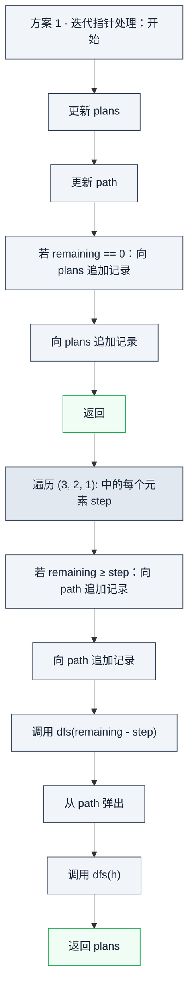

```python
import sys  # 提高递归深度上限（深输入防 RecursionError）

sys.setrecursionlimit(200000)  # 树/链表类题目节点数可达 1e4 量级

def climb_stairs(h):  # 定义函数 climb_stairs（参数：h）
    # 下楼梯问题：每步可走 1/2/3 级，递归枚举所有方案并计数（方案1）
    plans = []  # 把 [] 存入 plans
    path = []  # 把 [] 存入 当前路径

    def dfs(remaining):  # 定义函数 dfs（参数：remaining）
        if remaining == 0:  # 若 remaining 等于 0
            plans.append(path[:])  # 把 复制 当前路径 追加到列表尾部
            return  # return
        for step in (3, 2, 1):  # 先尝试大步，与博客一致
            if remaining >= step:  # 若 remaining 不低于 步数
                path.append(step)  # 把 步数 追加到列表尾部
                dfs(remaining - step)  # dfs(remaining 减 步数)
                path.pop()  # 弹出栈顶元素

    dfs(h)  # dfs(h)
    return plans  # 返回 plans

if __name__ == "__main__":  # 若 __name__ 等于 '__main__'
    h = 6  # 把 6 存入 h
    plans = climb_stairs(h)  # 把 climb_stairs(h) 存入 plans
    print(f"台阶数 {h}，总方案数: {len(plans)}")  # 打印输出
    for i, p in enumerate(plans[:10], 1):  # 同时取 下标 i 与 节点 遍历
        print(f"方案{i}: {p}")  # 打印输出
```

#### 方案 2：直接实现

**思路与代码分析**：核心是「直接实现」。Python 版用切片与字典推导式简化操作，突出可读性。代码里依次做这些事：DP 表逐项填充。**走读**：方案 2 · 直接实现：开始 → 命中条件，直接返回 → 命中条件，直接返回 → 命中条件，直接返回 → 命中条件，直接返回 → 填写 DP 表 → 填写 DP 表 → 循环 i：从 3 到 h + 1 前 → 填写 DP 表 → 填写 DP 表 → 处理 ) → 返回 dp[h]。

**运行架构**（真实控制流）：

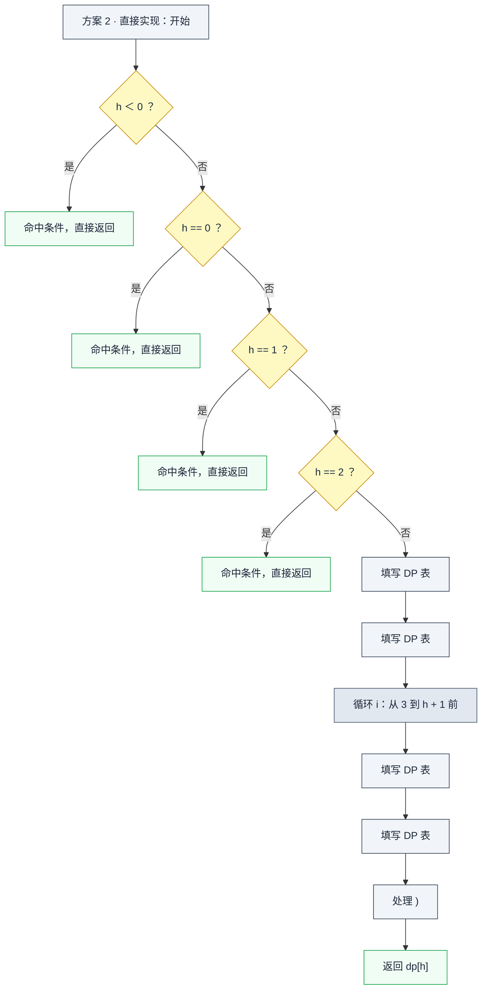

```python
import sys  # 提高递归深度上限（深输入防 RecursionError）

sys.setrecursionlimit(200000)  # 树/链表类题目节点数可达 1e4 量级

def climb_stairs_count(h):  # 定义函数 climb_stairs_count（参数：h）
    # 下楼梯问题：每步可走 1/2/3 级（方案2，自底向上 DP / 递推计数）
    if h < 0:  # 若 h 小于 0
        return 0  # 返回 0
    if h == 0:  # 若 h 等于 0
        return 1  # 返回 1
    if h == 1:  # 若 h 等于 1
        return 1  # 返回 1
    if h == 2:  # 若 h 等于 2
        return 2  # 返回 2
    dp = [0] * (h + 1)  # 把 [0] 乘 (h 加 1) 存入 DP 表
    dp[0], dp[1], dp[2] = 1, 1, 2  # 把 1, 1, 2 写入 dp[0], dp[1], dp[2]
    for i in range(3, h + 1):  # 让 下标 i 从 3 到 h 加 1 遍历
        dp[i] = (
            dp[i - 1] + dp[i - 2] + dp[i - 3]
        )  # 把 DP 表[下标 i 减 1] 加 DP 表[下标 i 减 2] 加 DP 表[下标 i 减 3] 写入 dp[i]
    return dp[h]  # 返回 DP 表[h]

if __name__ == "__main__":  # 若 __name__ 等于 '__main__'
    for h in (4, 6, 10):  # for h in (4, 6, 10):
        print(f"台阶数 {h}，总方案数: {climb_stairs_count(h)}")  # 打印输出
```

#### 方案 3：迭代指针处理

**思路与代码分析**：核心是「迭代指针处理」。Python 版用切片与字典推导式简化操作，突出可读性。**走读**：方案 3 · 迭代指针处理：开始 → 更新 dx → 更新 dy → 更新 count → 处理 nonlocal count → 若 x == 8 and y == 4：更新 + → 更新 + → 返回  → 循环 k：从 0 到 4 前 → 更新 ny → 若 0 ≤ nx ≤ 8 and 0 ≤ ny ≤ 4：调用 dfs(nx, ny) → 调用 dfs(nx, ny) → 调用 dfs(0, 0) → 返回 count。

**运行架构**（真实控制流）：

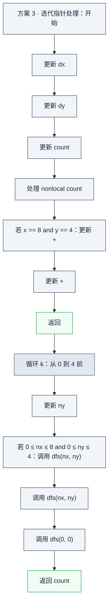

```python
import sys  # 提高递归深度上限（深输入防 RecursionError）

sys.setrecursionlimit(200000)  # 树/链表类题目节点数可达 1e4 量级

def horse_jump_count():  # 定义函数 horse_jump_count（参数：无）
    # 象棋跳马问题：从 (0,0) 跳到 (8,4)，只允许向右的四种马步（方案3 枚举）
    dx = (1, 2, 2, 1)  # 把 (1, 2, 2, 1) 存入 dx
    dy = (2, 1, -1, -2)  # 把 (2, 1, 减 1, 减 2) 存入 dy
    count = 0  # 把 0 存入 计数

    def dfs(x, y):  # 定义函数 dfs（参数：x, y）
        nonlocal count  # nonlocal 计数
        if x == 8 and y == 4:  # 若 x 等于 8 and y 等于 4
            count += 1  # 计数累加 1
            return  # return
        for k in range(4):  # 让 下标 k 从 4 遍历
            nx, ny = x + dx[k], y + dy[k]  # 把 x 加 dx[下标 k], y 加 dy[下标 k] 写入 nx, ny
            if 0 <= nx <= 8 and 0 <= ny <= 4:  # 若 0 不超过 nx 不超过 8 and 0 不超过 ny 不超过 4
                dfs(nx, ny)  # dfs(nx, ny)

    dfs(0, 0)  # dfs(0, 0)
    return count  # 返回 计数

if __name__ == "__main__":  # 若 __name__ 等于 '__main__'
    print("跳马方案总数(0,0)->(8,4):", horse_jump_count())  # 打印输出
```

#### 方案 4：迭代指针处理

**思路与代码分析**：核心是「迭代指针处理」。Python 版用切片与字典推导式简化操作，突出可读性。**走读**：方案 4 · 迭代指针处理：开始 → 更新 dx → 更新 dy → 更新 count → 处理 nonlocal count → 若 x == 8 and y == 4：更新 + → 更新 + → 返回  → 循环 k：从 0 到 4 前 → 更新 y1 → 若 x1 ＜ 0 or x1 ＞ 8 or y1 ＜ 0 or y1 ＞ 4：处理 continue → 调用 jump(x1, y1) → 调用 jump(0, 0) → 返回 count。

**运行架构**（真实控制流）：

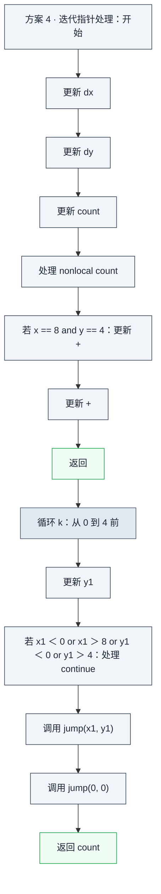

```python
import sys  # 提高递归深度上限（深输入防 RecursionError）

sys.setrecursionlimit(200000)  # 树/链表类题目节点数可达 1e4 量级

def horse_jump_count():  # 定义函数 horse_jump_count（参数：无）
    # 象棋跳马问题（方案4）：使用平行数组 dx/dy 描述四种马步
    dx = [1, 2, 2, 1]  # 把 [1, 2, 2, 1] 存入 dx
    dy = [2, 1, -1, -2]  # 把 [2, 1, 减 1, 减 2] 存入 dy
    count = 0  # 把 0 存入 计数

    def jump(x, y):  # 定义函数 jump（参数：x, y）
        nonlocal count  # nonlocal 计数
        if x == 8 and y == 4:  # 若 x 等于 8 and y 等于 4
            count += 1  # 计数累加 1
            return  # return
        for k in range(4):  # 让 下标 k 从 4 遍历
            x1, y1 = x + dx[k], y + dy[k]  # 把 x 加 dx[下标 k], y 加 dy[下标 k] 写入 x1, y1
            if x1 < 0 or x1 > 8 or y1 < 0 or y1 > 4:  # 若 x1 小于 0 or x1 超过 8 or y1 小于 0 or y1 超过 4
                continue  # 跳过本轮，进入下一次
            jump(x1, y1)  # jump(x1, y1)

    jump(0, 0)  # jump(0, 0)
    return count  # 返回 计数

if __name__ == "__main__":  # 若 __name__ 等于 '__main__'
    print("跳马方案总数(0,0)->(8,4):", horse_jump_count())  # 打印输出
```

#### 方案 5：直接实现

**思路与代码分析**：核心是「直接实现」。Python 版用切片与字典推导式简化操作，突出可读性。**走读**：方案 5 · 直接实现：开始 → 更新 moves → 更新 count → 处理 nonlocal count → 若 pos.x == 8 and pos.y == 4：更新 + → 更新 + → 返回  → 遍历 moves: 中的每个元素 mv → 更新 nxt → 处理 if ( → 处理 nxt.x ＜ 0 or nxt.x ＞ 8 or nx → 处理 ): → 调用 jump(nxt) → 调用 jump(Position(0, 0)) → 返回 count。

**运行架构**（真实控制流）：

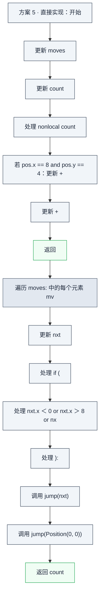

```python
import sys  # 提高递归深度上限（深输入防 RecursionError）

sys.setrecursionlimit(200000)  # 树/链表类题目节点数可达 1e4 量级
from collections import namedtuple  # from collections import namedtuple

Position = namedtuple("Position", ["x", "y"])  # 把 namedtuple('Position', ['x', 'y']) 存入 Position

def horse_jump_count():  # 定义函数 horse_jump_count（参数：无）
    # 象棋跳马问题（方案5）：用结构(命名元组)表示落点坐标
    moves = [Position(1, 2), Position(2, 1), Position(2, -1), Position(1, -2)]
    count = 0  # 把 0 存入 计数

    def jump(pos):  # 定义函数 jump（参数：pos）
        nonlocal count  # nonlocal 计数
        if pos.x == 8 and pos.y == 4:  # 若 pos.x 等于 8 and pos.y 等于 4
            count += 1  # 计数累加 1
            return  # return
        for mv in moves:  # 逐个取出 moves 的元素（mv）
            nxt = Position(pos.x + mv.x, pos.y + mv.y)  # 把 Position(pos.x 加 mv.x, pos.y 加 mv.y) 存入 nxt
            if (
                nxt.x < 0 or nxt.x > 8 or nxt.y < 0 or nxt.y > 4
            ):  # 若 nxt.x 小于 0 or nxt.x 超过 8 or nxt.y 小于 0 or nxt.y 超过 4
                continue  # 跳过本轮，进入下一次
            jump(nxt)  # jump(nxt)

    jump(Position(0, 0))  # jump(Position(0, 0))
    return count  # 返回 计数

if __name__ == "__main__":  # 若 __name__ 等于 '__main__'
    print("跳马方案总数(0,0)->(8,4):", horse_jump_count())  # 打印输出
```

#### 方案 6：迭代指针处理

**思路与代码分析**：核心是「迭代指针处理」。Python 版用切片与字典推导式简化操作，突出可读性。**走读**：方案 6 · 迭代指针处理：开始 → 返回 0 ≤ pos.x ≤ 8 and 0 ≤ pos.y ≤ 4。

**运行架构**（真实控制流）：

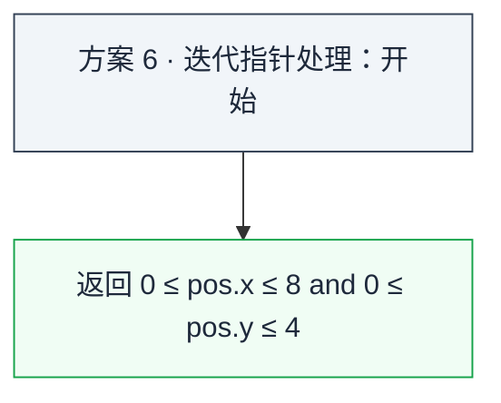

```python
import sys  # 提高递归深度上限（深输入防 RecursionError）

sys.setrecursionlimit(200000)  # 树/链表类题目节点数可达 1e4 量级
from collections import namedtuple  # from collections import namedtuple

Position = namedtuple("Position", ["x", "y"])  # 把 namedtuple('Position', ['x', 'y']) 存入 Position
MOVES = [Position(1, 2), Position(2, 1), Position(2, -1), Position(1, -2)]
START = Position(0, 0)  # 把 Position(0, 0) 存入 START
GOAL = Position(8, 4)  # 把 Position(8, 4) 存入 GOAL

def is_valid(pos):  # 定义函数 is_valid（参数：pos）
    return 0 <= pos.x <= 8 and 0 <= pos.y <= 4  # 返回 0 不超过 pos.x 不超过 8 and 0 不超过 pos.y 不超过 4

def is_goal(pos):  # 定义函数 is_goal（参数：pos）
    return pos.x == GOAL.x and pos.y == GOAL.y  # 返回 pos.x 等于 GOAL.x and pos.y 等于 GOAL.y

def horse_jump_count():  # 定义函数 horse_jump_count（参数：无）
    # 象棋跳马问题（方案6）：将合法性/终止判断隔离为辅助函数
    count = 0  # 把 0 存入 计数

    def jump(pos):  # 定义函数 jump（参数：pos）
        nonlocal count  # nonlocal 计数
        if is_goal(pos):  # 若 is_goal(pos
            count += 1  # 计数累加 1
            return  # return
        for mv in MOVES:  # 逐个取出 MOVES 的元素（mv）
            nxt = Position(pos.x + mv.x, pos.y + mv.y)  # 把 Position(pos.x 加 mv.x, pos.y 加 mv.y) 存入 nxt
            if not is_valid(nxt):  # 若 not is_valid(nxt
                continue  # 跳过本轮，进入下一次
            jump(nxt)  # jump(nxt)

    jump(START)  # jump(START)
    return count  # 返回 计数

if __name__ == "__main__":  # 若 __name__ 等于 '__main__'
    print("跳马方案总数(0,0)->(8,4):", horse_jump_count())  # 打印输出
```

### Go 实现（6 种方案）

Go 的全部方案如下，每个方案都内嵌用例自测，可独立运行（老仓库 python/go 文件遵循「打印结果」约定）：

#### 方案 1：迭代指针处理

**思路与代码分析**：核心是「迭代指针处理」。Go 版用切片与多返回值惯用法，显式处理索引边界。**走读**：方案 1 · 迭代指针处理：开始 → 计算 plans → 返回  → 遍历 []int 的下标与元素 step → 返回 plans。

**运行架构**（真实控制流）：

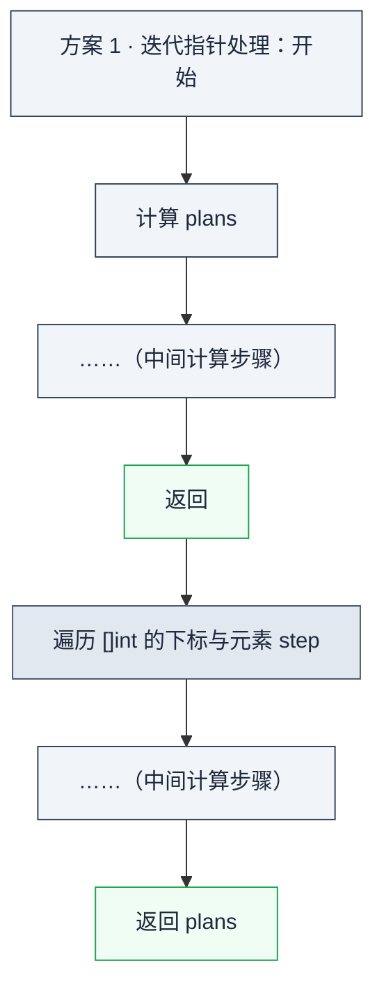

```go
package main // 引入依赖
import (
	"fmt"
	"os"
	"reflect"
) // 引入依赖
func climbStairs(h int) [][]int { // 定义函数/方法 climbStairs
	var plans [][]int           // var plans [][]int
	var path []int              // var 当前路径 []int
	var dfs func(int)           // var dfs func(int)
	dfs = func(remaining int) { // 把 func(remaining int) { 写入 dfs
		if remaining == 0 { // 若 remaining 等于 0
			p := make([]int, len(path)) // 把 make([]int, 长度(当前路径)) 写入 p :
			copy(p, path)               // copy(节点, 当前路径)
			plans = append(plans, p)    // 把 append(plans, 节点) 写入 plans
			return                      // return
		}
		for _, step := range []int{3, 2, 1} { // 同时取 _ 与 步数 遍历
			if remaining >= step { // 若 remaining 不低于 步数
				path = append(path, step) // 把 append(当前路径, 步数) 写入 当前路径
				dfs(remaining - step)     // dfs(remaining 减 步数)
				path = path[:len(path)-1] // 把 当前路径[:长度(当前路径) 减 1] 写入 当前路径
			}
		}
	}
	dfs(h)       // dfs(h)
	return plans // 返回 plans
}
func main() { // 程序入口：跑内嵌自测用例
	plans := climbStairs(6) // 把 climbStairs(6) 写入 plans :
	ok := true              // 把 true 写入 ok :
	if len(plans) != 24 {   // 若 长度(plans) 不等于 24
		ok = false
		fmt.Printf("FAIL len plans=%d want 24\n", len(plans)) // 打印输出
	}
	if !(len(plans) > 0 && reflect.DeepEqual(plans[0], []int{3, 3})) {
		ok = false
		fmt.Printf("FAIL first plan=%v want [3 3]\n", plans[0]) // 打印输出
	}
	if !ok {
		os.Exit(1)
	} // 若 取反 ok { os.Exit(1) }
	fmt.Println("PASS") // 全部用例通过，输出 PASS
}
```

#### 方案 2：直接实现

**思路与代码分析**：核心是「直接实现」。Go 版用切片与多返回值惯用法，显式处理索引边界。代码里依次做这些事：DP 表逐项填充。**走读**：方案 2 · 直接实现：开始 → 处理 if h ＜ 0 → 返回 0 → 处理 if h == 0 → 返回 1 → 处理 if h == 1 → 返回 1 → 处理 if h == 2 → 返回 2 → 更新 : → 填写 DP 表 → 遍历循环 → 填写 DP 表 → 返回 dp[h]。

**运行架构**（真实控制流）：

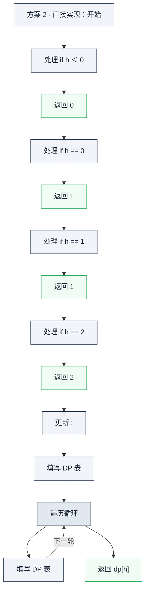

```go
package main // 引入依赖
import (
	"fmt"
	"os"
) // 引入依赖
func climbStairsCount(h int) int { // 定义函数/方法 climbStairsCount
	if h < 0 {
		return 0
	} // 若 h 小于 0 { return 0 }
	if h == 0 {
		return 1
	} // 若 h 等于 0 { return 1 }
	if h == 1 {
		return 1
	} // 若 h 等于 1 { return 1 }
	if h == 2 {
		return 2
	} // 若 h 等于 2 { return 2 }
	dp := make([]int, h+1)        // 把 make([]int, h 加 1) 写入 dp :
	dp[0], dp[1], dp[2] = 1, 1, 2 // 把 1, 1, 2 写入 dp[0], dp[1], dp[2]
	for i := 3; i <= h; i++ {     // 让 下标 i 从 3 开始计数
		dp[i] = dp[i-1] + dp[i-2] + dp[i-3] // 把 DP 表[下标 i 减 1] 加 DP 表[下标 i 减 2] 加 DP 表[下标 i 减 3] 写入 dp[i]
	}
	return dp[h] // 返回 DP 表[h]
}
func main() { // 程序入口：跑内嵌自测用例
	cases := []struct {
		h    int
		want int
	}{ // 把 []struct{ h int; want int }{ 写入 cases :
		{4, 7},
		{6, 24},
		{10, 274},
	}
	ok := true                // 把 true 写入 ok :
	for _, c := range cases { // 同时取 _ 与 字符 遍历
		if got := climbStairsCount(c.h); got != c.want { // 若 got : 赋值为 climbStairsCount(字符.h); got 不等于 字符.want
			ok = false
			fmt.Printf("FAIL h=%d got %d want %d\n", c.h, got, c.want) // 打印输出
		}
	}
	if !ok {
		os.Exit(1)
	} // 若 取反 ok { os.Exit(1) }
	fmt.Println("PASS") // 全部用例通过，输出 PASS
}
```

#### 方案 3：迭代指针处理

**思路与代码分析**：核心是「迭代指针处理」。Go 版用切片与多返回值惯用法，显式处理索引边界。**走读**：方案 3 · 迭代指针处理：开始 → 更新 : → 更新 : → 更新 : → 计算 jump → 更新 jump → 处理 if x == 8 且 y == 4 → 处理 count++ → 返回  → 遍历循环 → 更新 : → 处理 if nx ≥ 0 且 nx ≤ 8 且 ny → 调用 jump(nx, ny) → 调用 jump(0, 0) → 返回 count。

**运行架构**（真实控制流）：


```go
package main // 引入依赖
import (
	"fmt"
	"os"
) // 引入依赖
func horseJumpCount() int { // 定义函数/方法 horseJumpCount
	dx := []int{1, 2, 2, 1}   // 把 []int{1, 2, 2, 1} 写入 dx :
	dy := []int{2, 1, -1, -2} // 把 []int{2, 1, 减 1, 减 2} 写入 dy :
	count := 0                // 把 0 写入 count :
	var jump func(int, int)   // var jump func(int, int)
	jump = func(x, y int) {   // 把 func(x, y int) { 写入 jump
		if x == 8 && y == 4 { // 若 x 等于 8 且 y 等于 4
			count++ // 计数 加一
			return  // return
		}
		for k := 0; k < 4; k++ { // 让 下标 k 从 0 开始计数
			nx, ny := x+dx[k], y+dy[k]                    // 把 x 加 dx[下标 k], y 加 dy[下标 k] 写入 nx, ny :
			if nx >= 0 && nx <= 8 && ny >= 0 && ny <= 4 { // 若 nx 不低于 0 且 nx 不超过 8 且 ny 不低于 0 且 ny 不超过 4
				jump(nx, ny) // jump(nx, ny)
			}
		}
	}
	jump(0, 0)   // jump(0, 0)
	return count // 返回 计数
}
func main() { // 程序入口：跑内嵌自测用例
	cases := []struct{ want int }{{37}, {37}} // 把 []struct{ want int }{ {37}, {37} } 写入 cases :
	got := horseJumpCount()                   // 把 horseJumpCount() 写入 got :
	ok := true                                // 把 true 写入 ok :
	for _, c := range cases {                 // 同时取 _ 与 字符 遍历
		if got != c.want {
			ok = false
			fmt.Printf("FAIL got %d want %d\n", got, c.want)
		}
	}
	if !ok {
		os.Exit(1)
	} // 若 取反 ok { os.Exit(1) }
	fmt.Println("PASS") // 全部用例通过，输出 PASS
}
```

#### 方案 4：迭代指针处理

**思路与代码分析**：核心是「迭代指针处理」。Go 版用切片与多返回值惯用法，显式处理索引边界。**走读**：方案 4 · 迭代指针处理：开始 → 更新 : → 更新 : → 更新 : → 计算 jump → 更新 jump → 处理 if x == 8 且 y == 4 → 处理 count++ → 返回  → 遍历循环 → 更新 : → 处理 if nx ≥ 0 且 nx ≤ 8 且 ny → 调用 jump(nx, ny) → 调用 jump(0, 0) → 返回 count。

**运行架构**（真实控制流）：

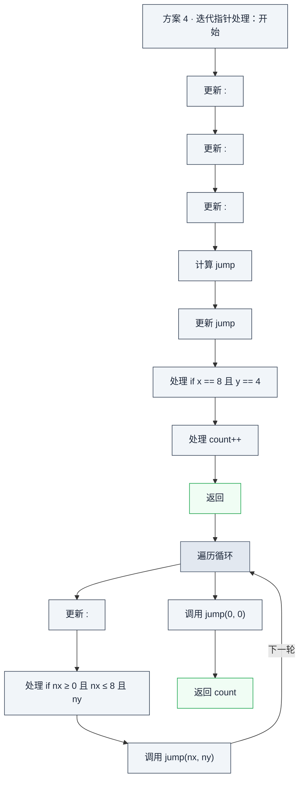

```go
package main // 引入依赖
import (
	"fmt"
	"os"
) // 引入依赖
func horseJumpCount() int { // 定义函数/方法 horseJumpCount
	dx := []int{1, 2, 2, 1}   // 把 []int{1, 2, 2, 1} 写入 dx :
	dy := []int{2, 1, -1, -2} // 把 []int{2, 1, 减 1, 减 2} 写入 dy :
	count := 0                // 把 0 写入 count :
	var jump func(int, int)   // var jump func(int, int)
	jump = func(x, y int) {   // 把 func(x, y int) { 写入 jump
		if x == 8 && y == 4 { // 若 x 等于 8 且 y 等于 4
			count++ // 计数 加一
			return  // return
		}
		for k := 0; k < 4; k++ { // 让 下标 k 从 0 开始计数
			nx, ny := x+dx[k], y+dy[k]                    // 把 x 加 dx[下标 k], y 加 dy[下标 k] 写入 nx, ny :
			if nx >= 0 && nx <= 8 && ny >= 0 && ny <= 4 { // 若 nx 不低于 0 且 nx 不超过 8 且 ny 不低于 0 且 ny 不超过 4
				jump(nx, ny) // jump(nx, ny)
			}
		}
	}
	jump(0, 0)   // jump(0, 0)
	return count // 返回 计数
}
func main() { // 程序入口：跑内嵌自测用例
	cases := []struct{ want int }{{37}, {37}} // 把 []struct{ want int }{ {37}, {37} } 写入 cases :
	got := horseJumpCount()                   // 把 horseJumpCount() 写入 got :
	ok := true                                // 把 true 写入 ok :
	for _, c := range cases {                 // 同时取 _ 与 字符 遍历
		if got != c.want {
			ok = false
			fmt.Printf("FAIL got %d want %d\n", got, c.want)
		}
	}
	if !ok {
		os.Exit(1)
	} // 若 取反 ok { os.Exit(1) }
	fmt.Println("PASS") // 全部用例通过，输出 PASS
}
```

#### 方案 5：直接实现

**思路与代码分析**：核心是「直接实现」。Go 版用切片与多返回值惯用法，显式处理索引边界。**走读**：方案 5 · 直接实现：开始 → 处理 type Position struct → 更新 : → 更新 : → 计算 jump → 更新 jump → 处理 if pos.x == 8 且 pos.y == 4 → 处理 count++ → 返回  → 遍历 moves 的下标与元素 mv → 更新 : → 处理 if nxt.x ≥ 0 且 nxt.x ≤ 8 → 调用 jump(nxt) → 调用 jump(Position → 返回 count。

**运行架构**（真实控制流）：

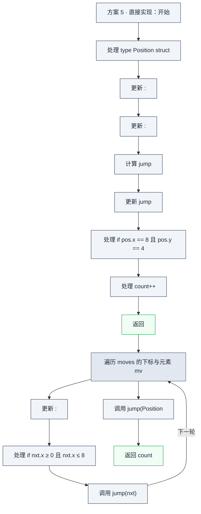

```go
package main // 引入依赖
import (
	"fmt"
	"os"
) // 引入依赖
func horseJumpCount() int { // 定义函数/方法 horseJumpCount
	type Position struct{ x, y int }                      // 定义类型
	moves := []Position{{1, 2}, {2, 1}, {2, -1}, {1, -2}} // 把 []Position{{1, 2}, {2, 1}, {2, 减 1}, {1, 减 2}} 写入 moves :
	count := 0                                            // 把 0 写入 count :
	var jump func(Position)                               // var jump func(Position)
	jump = func(pos Position) {                           // 把 func(pos Position) { 写入 jump
		if pos.x == 8 && pos.y == 4 { // 若 pos.x 等于 8 且 pos.y 等于 4
			count++ // 计数 加一
			return  // return
		}
		for _, mv := range moves { // 同时取 _ 与 mv 遍历
			nxt := Position{pos.x + mv.x, pos.y + mv.y}               // 把 Position{pos.x 加 mv.x, pos.y 加 mv.y} 写入 nxt :
			if nxt.x >= 0 && nxt.x <= 8 && nxt.y >= 0 && nxt.y <= 4 { // 若 nxt.x 不低于 0 且 nxt.x 不超过 8 且 nxt.y 不低于 0 且 nxt.y 不超过 4
				jump(nxt) // jump(nxt)
			}
		}
	}
	jump(Position{0, 0}) // jump(Position{0, 0})
	return count         // 返回 计数
}
func main() { // 程序入口：跑内嵌自测用例
	cases := []struct{ want int }{{37}, {37}} // 把 []struct{ want int }{ {37}, {37} } 写入 cases :
	got := horseJumpCount()                   // 把 horseJumpCount() 写入 got :
	ok := true                                // 把 true 写入 ok :
	for _, c := range cases {                 // 同时取 _ 与 字符 遍历
		if got != c.want {
			ok = false
			fmt.Printf("FAIL got %d want %d\n", got, c.want)
		}
	}
	if !ok {
		os.Exit(1)
	} // 若 取反 ok { os.Exit(1) }
	fmt.Println("PASS") // 全部用例通过，输出 PASS
}
```

#### 方案 6：迭代指针处理

**思路与代码分析**：核心是「迭代指针处理」。Go 版用切片与多返回值惯用法，显式处理索引边界。**走读**：方案 6 · 迭代指针处理：开始 → 处理 type Position struct → 返回  → 遍历 moves 的下标与元素 mv → 返回 count。

**运行架构**（真实控制流）：

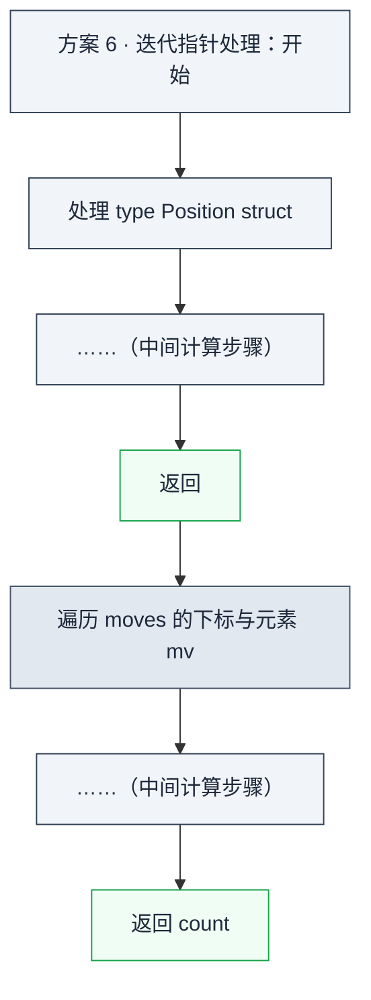

```go
package main // 引入依赖
import (
	"fmt"
	"os"
) // 引入依赖
func horseJumpCount() int { // 定义函数/方法 horseJumpCount
	type Position struct{ x, y int }                      // 定义类型
	moves := []Position{{1, 2}, {2, 1}, {2, -1}, {1, -2}} // 把 []Position{{1, 2}, {2, 1}, {2, 减 1}, {1, 减 2}} 写入 moves :
	start := Position{0, 0}                               // 把 Position{0, 0} 写入 start :
	goal := Position{8, 4}                                // 把 Position{8, 4} 写入 goal :
	isValid := func(p Position) bool { return p.x >= 0 && p.x <= 8 && p.y >= 0 && p.y <= 4 }
	isGoal := func(p Position) bool { return p.x == goal.x && p.y == goal.y }
	count := 0                  // 把 0 写入 count :
	var jump func(Position)     // var jump func(Position)
	jump = func(pos Position) { // 把 func(pos Position) { 写入 jump
		if isGoal(pos) { // 定义判定函数 isGoal
			count++ // 计数 加一
			return  // return
		}
		for _, mv := range moves { // 同时取 _ 与 mv 遍历
			nxt := Position{pos.x + mv.x, pos.y + mv.y} // 把 Position{pos.x 加 mv.x, pos.y 加 mv.y} 写入 nxt :
			if !isValid(nxt) {                          // 若 取反 isValid(nxt
				continue // 跳过本轮，进入下一次
			}
			jump(nxt) // jump(nxt)
		}
	}
	jump(start)  // jump(起点)
	return count // 返回 计数
}
func main() { // 程序入口：跑内嵌自测用例
	cases := []struct{ want int }{{37}, {37}} // 把 []struct{ want int }{ {37}, {37} } 写入 cases :
	got := horseJumpCount()                   // 把 horseJumpCount() 写入 got :
	ok := true                                // 把 true 写入 ok :
	for _, c := range cases {                 // 同时取 _ 与 字符 遍历
		if got != c.want {
			ok = false
			fmt.Printf("FAIL got %d want %d\n", got, c.want)
		}
	}
	if !ok {
		os.Exit(1)
	} // 若 取反 ok { os.Exit(1) }
	fmt.Println("PASS") // 全部用例通过，输出 PASS
}
```

### Java 实现（6 种方案）

Java 的全部方案如下，每个方案都内嵌用例自测，可独立运行（老仓库 python/go 文件遵循「打印结果」约定）：

#### 方案 1：迭代指针处理

**思路与代码分析**：核心是「迭代指针处理」。Java 版用类与静态方法组织，集合操作显式明了。**走读**：方案 1 · 迭代指针处理：开始 → 更新 plans → 处理 new ArrayList＜＞() → 更新 path → 调用 dfs(plans, path, h) → 返回 plans。

**运行架构**（真实控制流）：

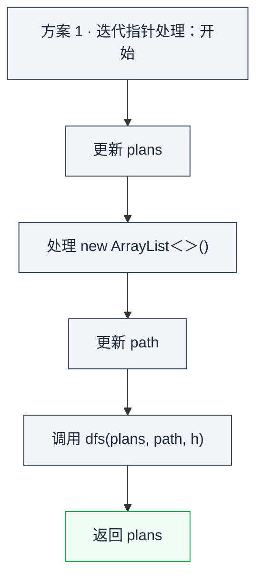

```java
package com.webfault.dsa; // 引入依赖

import java.util.ArrayList; // 引入依赖
import java.util.List; // 引入依赖

// 下楼梯问题：每步可走 1/2/3 级，递归枚举所有方案并计数（方案1）
class Main { // 定义类型
  static List<List<Integer>> climbStairs(int h) { // 定义函数/方法 climbStairs
    List<List<Integer>> plans =
        new ArrayList<>(); // 把 new ArrayList 小于 超过 (); 写入 List<List<Integer>> plans
    List<Integer> path = new ArrayList<>(); // 把 new ArrayList 小于 超过 (); 写入 List<Integer> path
    dfs(plans, path, h); // dfs(plans, 当前路径, h);
    return plans; // 返回 plans
  }

  static void dfs(List<List<Integer>> plans, List<Integer> path, int remaining) { // 定义函数/方法 dfs
    if (remaining == 0) { // 若 remaining 等于 0
      plans.add(new ArrayList<>(path)); // plans 追加 new ArrayList 小于 超过 (当前路径));
      return; // return;
    }
    for (int step : new int[] {3, 2, 1}) { // 先尝试大步，与博客一致
      if (remaining >= step) { // 若 remaining 不低于 步数
        path.add(step); // 当前路径 追加 步数);
        dfs(plans, path, remaining - step); // dfs(plans, 当前路径, remaining 减 步数);
        path.remove(path.size() - 1); // 当前路径 弹出 当前路径.大小() 减 1);
      }
    }
  }

  static boolean eqPlan(List<Integer> a, List<Integer> b) { // 定义函数/方法 eqPlan
    return a.equals(b); // 返回 数组.equals(b)
  }

  public static void main(String[] args) { // public static void main(String[] args) {
    List<List<Integer>> p6 = climbStairs(6); // 把 climbStairs(6); 写入 List<List<Integer>> p6
    List<List<Integer>> p0 = climbStairs(0); // 把 climbStairs(0); 写入 List<List<Integer>> p0
    List<List<Integer>> p3 = climbStairs(3); // 把 climbStairs(3); 写入 List<List<Integer>> p3
    boolean ok = true; // 把 true; 写入 boolean ok
    if (p6.size() != 24) { // 若 p6.大小() 不等于 24
      ok = false; // 把 false; 写入 ok
      System.out.println("FAIL climb_stairs(6).size=" + p6.size() + " want 24"); // 打印输出
    }
    if (!eqPlan(p6.get(0), List.of(3, 3))) { // 若 取反 eqPlan(p6 查找 0), List.of(3, 3
      ok = false; // 把 false; 写入 ok
      System.out.println("FAIL climb_stairs(6)[0]=" + p6.get(0) + " want [3, 3]"); // 打印输出
    }
    if (p0.size() != 1 || !p0.get(0).isEmpty()) { // 若 p0.大小() 不等于 1 或 取反 p0 查找 0).isEmpty(
      ok = false; // 把 false; 写入 ok
      System.out.println("FAIL climb_stairs(0)=" + p0 + " want [[]]"); // 打印输出
    }
    if (p3.size() != 4) { // 若 p3.大小() 不等于 4
      ok = false; // 把 false; 写入 ok
      System.out.println("FAIL climb_stairs(3).size=" + p3.size() + " want 4"); // 打印输出
    }
    if (!ok) throw new RuntimeException("FAILED"); // 若 取反 ok) throw new RuntimeException(「FAILED」);
    System.out.println("PASS"); // 全部用例通过，输出 PASS
  }
}
```

#### 方案 2：直接实现

**思路与代码分析**：核心是「直接实现」。Java 版用类与静态方法组织，集合操作显式明了。代码里依次做这些事：DP 表逐项填充；单循环线性扫描。**走读**：方案 2 · 直接实现：开始 → 命中条件，直接返回 → 命中条件，直接返回 → 命中条件，直接返回 → 命中条件，直接返回 → 填写 DP 表 → 填写 DP 表 → 填写 DP 表 → 填写 DP 表 → 遍历循环 → 填写 DP 表 → 返回 dp[h]。

**运行架构**（真实控制流）：

```mermaid
graph TD
    N0["方案 2 · 直接实现：开始"]
    N1{"h ＜ 0 ？"}
    N2["命中条件，直接返回"]
    N3{"h == 0 ？"}
    N4["命中条件，直接返回"]
    N5{"h == 1 ？"}
    N6["命中条件，直接返回"]
    N7{"h == 2 ？"}
    N8["命中条件，直接返回"]
    N9["填写 DP 表"]
    N10["填写 DP 表"]
    N11["填写 DP 表"]
    N12["填写 DP 表"]
    N13["遍历循环"]
    N14["填写 DP 表"]
    N15["返回 dp[h]"]
    N0 --> N1
    N1 -- 是 --> N2
    N1 -- 否 --> N3
    N3 -- 是 --> N4
    N3 -- 否 --> N5
    N5 -- 是 --> N6
    N5 -- 否 --> N7
    N7 -- 是 --> N8
    N7 -- 否 --> N9
    N9 --> N10
    N10 --> N11
    N11 --> N12
    N12 --> N13
    N13 --> N14
    N14 --> N15
    classDef n fill:#f1f5f9,stroke:#334155,color:#1e293b;
    classDef lp fill:#e2e8f0,stroke:#475569,color:#1e293b;
    classDef dc fill:#fef9c3,stroke:#ca8a04,color:#1e293b;
    classDef tm fill:#f0fdf4,stroke:#16a34a,color:#1e293b;
    class N0,N9,N10,N11,N12,N14 n;
    class N13 lp;
    class N1,N3,N5,N7 dc;
    class N2,N4,N6,N8,N15 tm;
```

```java
package com.webfault.dsa; // 引入依赖

// 下楼梯问题：每步可走 1/2/3 级（方案2，自底向上 DP / 递推计数）
class Main { // 定义类型
  static int climbStairsCount(int h) { // 定义函数/方法 climbStairsCount
    if (h < 0) return 0; // 若 h 小于 0，直接返回 0
    if (h == 0) return 1; // 若 h 等于 0，直接返回 1
    if (h == 1) return 1; // 若 h 等于 1，直接返回 1
    if (h == 2) return 2; // 若 h 等于 2，直接返回 2
    int[] dp = new int[h + 1]; // 把 new int[h 加 1]; 写入 int[] dp
    dp[0] = 1;
    dp[1] = 1;
    dp[2] = 2; // 把 1; DP 表[1] 赋值为 1; DP 表[2] 赋值为 2; 写入 dp[0]
    for (int i = 3; i <= h; i++)
      dp[i] = dp[i - 1] + dp[i - 2] + dp[i - 3]; // 让 下标 i 从 3 开始计数，下标 i 不超过 h 就继续
    return dp[h]; // 返回 DP 表[h]
  }

  public static void main(String[] args) { // public static void main(String[] args) {
    int[][] cases = {{4, 7}, {6, 24}, {10, 274}, {0, 1}, {1, 1}, {2, 2}, {3, 4}, {-1, 0}};
    boolean ok = true; // 把 true; 写入 boolean ok
    for (int[] c : cases) { // for (int[] 字符 : cases) {
      int got = climbStairsCount(c[0]); // 把 climbStairsCount(字符[0]) 存入 got
      if (got != c[1]) { // 若 got 不等于 字符[1]
        ok = false; // 把 false; 写入 ok
        System.out.println("FAIL climbStairsCount(" + c[0] + ")=" + got + " want " + c[1]); // 打印输出
      }
    }
    if (!ok) throw new RuntimeException("FAILED"); // 若 取反 ok) throw new RuntimeException(「FAILED」);
    System.out.println("PASS"); // 全部用例通过，输出 PASS
  }
}
```

#### 方案 3：迭代指针处理

**思路与代码分析**：核心是「迭代指针处理」。Java 版用类与静态方法组织，集合操作显式明了。**走读**：方案 3 · 迭代指针处理：开始 → 更新 count → 调用 dfs(0, 0, gx, gy, count) → 返回 count[0]。

**运行架构**（真实控制流）：

```mermaid
graph TD
    N0["方案 3 · 迭代指针处理：开始"]
    N1["更新 count"]
    N2["调用 dfs(0, 0, gx, gy, count)"]
    N3["返回 count[0]"]
    N0 --> N1
    N1 --> N2
    N2 --> N3
    classDef n fill:#f1f5f9,stroke:#334155,color:#1e293b;
    classDef lp fill:#e2e8f0,stroke:#475569,color:#1e293b;
    classDef dc fill:#fef9c3,stroke:#ca8a04,color:#1e293b;
    classDef tm fill:#f0fdf4,stroke:#16a34a,color:#1e293b;
    class N0,N1,N2 n;
    class N3 tm;
```

```java
package com.webfault.dsa; // 引入依赖

// 象棋跳马问题：从 (0,0) 跳到 (8,4)，只允许向右的四种马步（方案3 枚举）
class Main { // 定义类型
  static final int[] DX = {1, 2, 2, 1}; // 把 {1, 2, 2, 1}; 写入 static final int[] DX
  static final int[] DY = {2, 1, -1, -2}; // 把 {2, 1, 减 1, 减 2}; 写入 static final int[] DY

  static int horseJumpCount(int gx, int gy) { // 定义函数/方法 horseJumpCount
    int[] count = {0}; // 把 {0}; 写入 int[] count
    dfs(0, 0, gx, gy, count); // dfs(0, 0, gx, gy, 计数);
    return count[0]; // 返回 计数[0]
  }

  static void dfs(int x, int y, int gx, int gy, int[] count) { // 定义函数/方法 dfs
    if (x == gx && y == gy) { // 若 x 等于 gx 且 y 等于 gy
      count[0]++; // 计数[0] 加一 ;
      return; // return;
    }
    for (int k = 0; k < 4; k++) { // 让 下标 k 从 0 开始计数，下标 k 小于 4 就继续
      int nx = x + DX[k], ny = y + DY[k]; // 把 x 加 DX[下标 k], ny 赋值为 y 加 DY[下标 k] 存入 nx
      if (0 <= nx && nx <= 8 && 0 <= ny && ny <= 4) { // 若 0 不超过 nx 且 nx 不超过 8 且 0 不超过 ny 且 ny 不超过 4
        dfs(nx, ny, gx, gy, count); // dfs(nx, ny, gx, gy, 计数);
      }
    }
  }

  public static void main(String[] args) { // public static void main(String[] args) {
    int normal = horseJumpCount(8, 4); // (0,0)->(8,4)
    int boundary = horseJumpCount(0, 0); // 起点即终点，只有 1 种方案
    boolean ok = true; // 把 true; 写入 boolean ok
    if (normal != 37) { // 若 normal 不等于 37
      ok = false; // 把 false; 写入 ok
      System.out.println("FAIL horseJumpCount(8,4)=" + normal + " want 37"); // 打印输出
    }
    if (boundary != 1) { // 若 boundary 不等于 1
      ok = false; // 把 false; 写入 ok
      System.out.println("FAIL horseJumpCount(0,0)=" + boundary + " want 1"); // 打印输出
    }
    if (!ok) throw new RuntimeException("FAILED"); // 若 取反 ok) throw new RuntimeException(「FAILED」);
    System.out.println("PASS"); // 全部用例通过，输出 PASS
  }
}
```

#### 方案 4：迭代指针处理

**思路与代码分析**：核心是「迭代指针处理」。Java 版用类与静态方法组织，集合操作显式明了。**走读**：方案 4 · 迭代指针处理：开始 → 更新 dx → 更新 dy → 更新 count → 调用 jump(0, 0, gx, gy, dx, dy, c → 返回 count[0]。

**运行架构**（真实控制流）：

```mermaid
graph TD
    N0["方案 4 · 迭代指针处理：开始"]
    N1["更新 dx"]
    N2["更新 dy"]
    N3["更新 count"]
    N4["调用 jump(0, 0, gx, gy, dx, dy, c"]
    N5["返回 count[0]"]
    N0 --> N1
    N1 --> N2
    N2 --> N3
    N3 --> N4
    N4 --> N5
    classDef n fill:#f1f5f9,stroke:#334155,color:#1e293b;
    classDef lp fill:#e2e8f0,stroke:#475569,color:#1e293b;
    classDef dc fill:#fef9c3,stroke:#ca8a04,color:#1e293b;
    classDef tm fill:#f0fdf4,stroke:#16a34a,color:#1e293b;
    class N0,N1,N2,N3,N4 n;
    class N5 tm;
```

```java
package com.webfault.dsa; // 引入依赖

// 象棋跳马问题（方案4）：使用平行数组 dx/dy 描述四种马步
class Main { // 定义类型
  static int horseJumpCount(int gx, int gy) { // 定义函数/方法 horseJumpCount
    int[] dx = {1, 2, 2, 1}; // 把 {1, 2, 2, 1}; 写入 int[] dx
    int[] dy = {2, 1, -1, -2}; // 把 {2, 1, 减 1, 减 2}; 写入 int[] dy
    int[] count = {0}; // 把 {0}; 写入 int[] count
    jump(0, 0, gx, gy, dx, dy, count); // jump(0, 0, gx, gy, dx, dy, 计数);
    return count[0]; // 返回 计数[0]
  }

  static void jump(int x, int y, int gx, int gy, int[] dx, int[] dy, int[] count) { // 定义函数/方法 jump
    if (x == gx && y == gy) { // 若 x 等于 gx 且 y 等于 gy
      count[0]++; // 计数[0] 加一 ;
      return; // return;
    }
    for (int k = 0; k < 4; k++) { // 让 下标 k 从 0 开始计数，下标 k 小于 4 就继续
      int x1 = x + dx[k], y1 = y + dy[k]; // 把 x 加 dx[下标 k], y1 赋值为 y 加 dy[下标 k] 存入 x1
      if (x1 < 0 || x1 > 8 || y1 < 0 || y1 > 4) { // 若 x1 小于 0 或 x1 超过 8 或 y1 小于 0 或 y1 超过 4
        continue; // 跳过本轮，进入下一次
      }
      jump(x1, y1, gx, gy, dx, dy, count); // jump(x1, y1, gx, gy, dx, dy, 计数);
    }
  }

  public static void main(String[] args) { // public static void main(String[] args) {
    int normal = horseJumpCount(8, 4); // (0,0)->(8,4)
    int boundary = horseJumpCount(0, 0); // 起点即终点，只有 1 种方案
    boolean ok = true; // 把 true; 写入 boolean ok
    if (normal != 37) { // 若 normal 不等于 37
      ok = false; // 把 false; 写入 ok
      System.out.println("FAIL horseJumpCount(8,4)=" + normal + " want 37"); // 打印输出
    }
    if (boundary != 1) { // 若 boundary 不等于 1
      ok = false; // 把 false; 写入 ok
      System.out.println("FAIL horseJumpCount(0,0)=" + boundary + " want 1"); // 打印输出
    }
    if (!ok) throw new RuntimeException("FAILED"); // 若 取反 ok) throw new RuntimeException(「FAILED」);
    System.out.println("PASS"); // 全部用例通过，输出 PASS
  }
}
```

#### 方案 5：直接实现

**思路与代码分析**：核心是「直接实现」。Java 版用类与静态方法组织，集合操作显式明了。**走读**：方案 5 · 直接实现：开始 → 更新 moves → 调用 moves.add(new Position(1, 2) → 调用 moves.add(new Position(2, 1) → 调用 moves.add(new Position(2, -1 → 调用 moves.add(new Position(1, -2 → 更新 count → 调用 jump( → 处理 new Position(0, 0), → 处理 new Position(gx, gy), → 处理 moves, → 处理 count) → 返回 count[0]。

**运行架构**（真实控制流）：

```mermaid
graph TD
    N0["方案 5 · 直接实现：开始"]
    N1["更新 moves"]
    N2["调用 moves.add(new Position(1, 2)"]
    N3["调用 moves.add(new Position(2, 1)"]
    N4["调用 moves.add(new Position(2, -1"]
    N5["调用 moves.add(new Position(1, -2"]
    N6["更新 count"]
    N7["调用 jump("]
    N8["处理 new Position(0, 0),"]
    N9["处理 new Position(gx, gy),"]
    N10["处理 moves,"]
    N11["处理 count)"]
    N12["返回 count[0]"]
    N0 --> N1
    N1 --> N2
    N2 --> N3
    N3 --> N4
    N4 --> N5
    N5 --> N6
    N6 --> N7
    N7 --> N8
    N8 --> N9
    N9 --> N10
    N10 --> N11
    N11 --> N12
    classDef n fill:#f1f5f9,stroke:#334155,color:#1e293b;
    classDef lp fill:#e2e8f0,stroke:#475569,color:#1e293b;
    classDef dc fill:#fef9c3,stroke:#ca8a04,color:#1e293b;
    classDef tm fill:#f0fdf4,stroke:#16a34a,color:#1e293b;
    class N0,N1,N2,N3,N4,N5,N6,N7,N8,N9,N10,N11 n;
    class N12 tm;
```

```java
package com.webfault.dsa; // 引入依赖

import java.util.ArrayList; // 引入依赖
import java.util.List; // 引入依赖

// 象棋跳马问题（方案5）：用结构(命名元组)表示落点坐标
class Main { // 定义类型
  static class Position { // static class Position {
    final int x, y; // final int x, y;

    Position(int x, int y) {
      this.x = x;
      this.y = y;
    } // 把 x; this.y 赋值为 y; } 写入 x
  }

  static int horseJumpCount(int gx, int gy) { // 定义函数/方法 horseJumpCount
    List<Position> moves = new ArrayList<>(); // 把 new ArrayList 小于 超过 (); 写入 List<Position> moves
    moves.add(new Position(1, 2)); // moves 追加 new Position(1, 2));
    moves.add(new Position(2, 1)); // moves 追加 new Position(2, 1));
    moves.add(new Position(2, -1)); // moves 追加 new Position(2, 减 1));
    moves.add(new Position(1, -2)); // moves 追加 new Position(1, 减 2));
    int[] count = {0}; // 把 {0}; 写入 int[] count
    jump(
        new Position(0, 0),
        new Position(gx, gy),
        moves,
        count); // jump(new Position(0, 0), new Position(gx, gy), moves, 计数);
    return count[0]; // 返回 计数[0]
  }

  static void jump(Position pos, Position goal, List<Position> moves, int[] count) { // 定义函数/方法 jump
    if (pos.x == goal.x && pos.y == goal.y) { // 若 pos.x 等于 goal.x 且 pos.y 等于 goal.y
      count[0]++; // 计数[0] 加一 ;
      return; // return;
    }
    for (Position mv : moves) { // for (Position mv : moves) {
      Position nxt =
          new Position(
              pos.x + mv.x,
              pos.y + mv.y); // 把 new Position(pos.x 加 mv.x, pos.y 加 mv.y); 写入 Position nxt
      if (nxt.x < 0 || nxt.x > 8 || nxt.y < 0
          || nxt.y > 4) { // 若 nxt.x 小于 0 或 nxt.x 超过 8 或 nxt.y 小于 0 或 nxt.y 超过 4
        continue; // 跳过本轮，进入下一次
      }
      jump(nxt, goal, moves, count); // jump(nxt, goal, moves, 计数);
    }
  }

  public static void main(String[] args) { // public static void main(String[] args) {
    int normal = horseJumpCount(8, 4); // (0,0)->(8,4)
    int boundary = horseJumpCount(0, 0); // 起点即终点，只有 1 种方案
    boolean ok = true; // 把 true; 写入 boolean ok
    if (normal != 37) { // 若 normal 不等于 37
      ok = false; // 把 false; 写入 ok
      System.out.println("FAIL horseJumpCount(8,4)=" + normal + " want 37"); // 打印输出
    }
    if (boundary != 1) { // 若 boundary 不等于 1
      ok = false; // 把 false; 写入 ok
      System.out.println("FAIL horseJumpCount(0,0)=" + boundary + " want 1"); // 打印输出
    }
    if (!ok) throw new RuntimeException("FAILED"); // 若 取反 ok) throw new RuntimeException(「FAILED」);
    System.out.println("PASS"); // 全部用例通过，输出 PASS
  }
}
```

#### 方案 6：迭代指针处理

**思路与代码分析**：核心是「迭代指针处理」。Java 版用类与静态方法组织，集合操作显式明了。**走读**：方案 6 · 迭代指针处理：开始 → 更新 count → 调用 jump( → 处理 new Position(0, 0), → 处理 new Position(gx, gy), → 处理 count) → 返回 count[0]。

**运行架构**（真实控制流）：

```mermaid
graph TD
    N0["方案 6 · 迭代指针处理：开始"]
    N1["更新 count"]
    N2["调用 jump("]
    N3["处理 new Position(0, 0),"]
    N4["处理 new Position(gx, gy),"]
    N5["处理 count)"]
    N6["返回 count[0]"]
    N0 --> N1
    N1 --> N2
    N2 --> N3
    N3 --> N4
    N4 --> N5
    N5 --> N6
    classDef n fill:#f1f5f9,stroke:#334155,color:#1e293b;
    classDef lp fill:#e2e8f0,stroke:#475569,color:#1e293b;
    classDef dc fill:#fef9c3,stroke:#ca8a04,color:#1e293b;
    classDef tm fill:#f0fdf4,stroke:#16a34a,color:#1e293b;
    class N0,N1,N2,N3,N4,N5 n;
    class N6 tm;
```

```java
package com.webfault.dsa; // 引入依赖

import java.util.ArrayList; // 引入依赖
import java.util.List; // 引入依赖

// 象棋跳马问题（方案6）：将合法性/终止判断隔离为辅助函数
class Main { // 定义类型
  static class Position { // static class Position {
    final int x, y; // final int x, y;

    Position(int x, int y) {
      this.x = x;
      this.y = y;
    } // 把 x; this.y 赋值为 y; } 写入 x
  }

  static final List<Position> MOVES = new ArrayList<>();

  static { // static {
    MOVES.add(new Position(1, 2)); // MOVES 追加 new Position(1, 2));
    MOVES.add(new Position(2, 1)); // MOVES 追加 new Position(2, 1));
    MOVES.add(new Position(2, -1)); // MOVES 追加 new Position(2, 减 1));
    MOVES.add(new Position(1, -2)); // MOVES 追加 new Position(1, 减 2));
  }

  static boolean isValid(Position pos) { // 定义判定函数 isValid
    return 0 <= pos.x
        && pos.x <= 8
        && 0 <= pos.y
        && pos.y <= 4; // 返回 0 不超过 pos.x 且 pos.x 不超过 8 且 0 不超过 pos.y 且 pos.y 不超过 4
  }

  static boolean isGoal(Position pos, Position goal) { // 定义判定函数 isGoal
    return pos.x == goal.x && pos.y == goal.y; // 返回 pos.x 等于 goal.x 且 pos.y 等于 goal.y
  }

  static int horseJumpCount(int gx, int gy) { // 定义函数/方法 horseJumpCount
    int[] count = {0}; // 把 {0}; 写入 int[] count
    jump(
        new Position(0, 0),
        new Position(gx, gy),
        count); // jump(new Position(0, 0), new Position(gx, gy), 计数);
    return count[0]; // 返回 计数[0]
  }

  static void jump(Position pos, Position goal, int[] count) { // 定义函数/方法 jump
    if (isGoal(pos, goal)) { // 若 isGoal(pos, goal
      count[0]++; // 计数[0] 加一 ;
      return; // return;
    }
    for (Position mv : MOVES) { // for (Position mv : MOVES) {
      Position nxt =
          new Position(
              pos.x + mv.x,
              pos.y + mv.y); // 把 new Position(pos.x 加 mv.x, pos.y 加 mv.y); 写入 Position nxt
      if (!isValid(nxt)) { // 若 取反 isValid(nxt
        continue; // 跳过本轮，进入下一次
      }
      jump(nxt, goal, count); // jump(nxt, goal, 计数);
    }
  }

  public static void main(String[] args) { // public static void main(String[] args) {
    int normal = horseJumpCount(8, 4); // (0,0)->(8,4)
    int boundary = horseJumpCount(0, 0); // 起点即终点，只有 1 种方案
    boolean ok = true; // 把 true; 写入 boolean ok
    if (normal != 37) { // 若 normal 不等于 37
      ok = false; // 把 false; 写入 ok
      System.out.println("FAIL horseJumpCount(8,4)=" + normal + " want 37"); // 打印输出
    }
    if (boundary != 1) { // 若 boundary 不等于 1
      ok = false; // 把 false; 写入 ok
      System.out.println("FAIL horseJumpCount(0,0)=" + boundary + " want 1"); // 打印输出
    }
    if (!ok) throw new RuntimeException("FAILED"); // 若 取反 ok) throw new RuntimeException(「FAILED」);
    System.out.println("PASS"); // 全部用例通过，输出 PASS
  }
}
```

### Rust 实现（6 种方案）

Rust 的全部方案如下，每个方案都内嵌用例自测，可独立运行（老仓库 python/go 文件遵循「打印结果」约定）：

#### 方案 1：迭代指针处理

**思路与代码分析**：核心是「迭代指针处理」。Rust 版用所有权移动与切片借用改写同一逻辑，注意 Option 与引用边界。**走读**：方案 1 · 迭代指针处理：开始 → 处理 if n ≤ 1 → 返回 1 → 计算 let (mut a, mut b) = (1i → 遍历 2..=n 中的每个元素 _ → 计算 t → 更新 a → 更新 b → 处理 b。

**运行架构**（真实控制流）：

```mermaid
graph TD
    N0["方案 1 · 迭代指针处理：开始"]
    N1["处理 if n ≤ 1"]
    N2["返回 1"]
    N3["计算 let (mut a, mut b) = (1i"]
    N4["遍历 2..=n 中的每个元素 _"]
    N5["计算 t"]
    N6["更新 a"]
    N7["更新 b"]
    N8["处理 b"]
    N0 --> N1
    N1 --> N2
    N2 --> N3
    N3 --> N4
    N4 --> N5
    N5 --> N6
    N6 --> N7
    N7 -- 下一轮 --> N4
    N4 --> N8
    classDef n fill:#f1f5f9,stroke:#334155,color:#1e293b;
    classDef lp fill:#e2e8f0,stroke:#475569,color:#1e293b;
    classDef dc fill:#fef9c3,stroke:#ca8a04,color:#1e293b;
    classDef tm fill:#f0fdf4,stroke:#16a34a,color:#1e293b;
    class N0,N1,N3,N5,N6,N7,N8 n;
    class N4 lp;
    class N2 tm;
```

```rust
// 计算思维之下楼梯台阶和象棋跳马问题 — Rust 版（方案1）
fn climb_stairs_variants(n: i32) -> i64 {
    // 定义函数/方法 climb_stairs_variants
    // 下楼梯 + 象棋跳马: 每步 1/2 阶 → fib 计数（方案数）
    if n <= 1 {
        return 1;
    } // 若 元素个数 不超过 1 { return 1; }
    let (mut a, mut b) = (1i64, 1i64); // 把 (1i64, 1i64); 写入 let (mut a, mut b)
    for _ in 2..=n {
        let t = a + b;
        a = b;
        b = t;
    } // 逐个取出 2 的元素（_）
    b
}
fn main() {
    // 程序入口：跑内嵌自测用例
    assert_eq!(climb_stairs_variants(10), 89); // 断言校验
    assert_eq!(climb_stairs_variants(1), 1); // 断言校验
    assert_eq!(climb_stairs_variants(2), 2); // 断言校验
    println!("PASS");
} // 全部用例通过，输出 PASS
```

#### 方案 2：直接实现

**思路与代码分析**：核心是「直接实现」。Rust 版用所有权移动与切片借用改写同一逻辑，注意 Option 与引用边界。**走读**：方案 2 · 直接实现：开始 → 处理 if n ≤ 1 → 返回 1 → 计算 let (mut a, mut b) = (1i → 遍历 2..=n 中的每个元素 _ → 计算 t → 更新 a → 更新 b → 处理 b。

**运行架构**（真实控制流）：

```mermaid
graph TD
    N0["方案 2 · 直接实现：开始"]
    N1["处理 if n ≤ 1"]
    N2["返回 1"]
    N3["计算 let (mut a, mut b) = (1i"]
    N4["遍历 2..=n 中的每个元素 _"]
    N5["计算 t"]
    N6["更新 a"]
    N7["更新 b"]
    N8["处理 b"]
    N0 --> N1
    N1 --> N2
    N2 --> N3
    N3 --> N4
    N4 --> N5
    N5 --> N6
    N6 --> N7
    N7 -- 下一轮 --> N4
    N4 --> N8
    classDef n fill:#f1f5f9,stroke:#334155,color:#1e293b;
    classDef lp fill:#e2e8f0,stroke:#475569,color:#1e293b;
    classDef dc fill:#fef9c3,stroke:#ca8a04,color:#1e293b;
    classDef tm fill:#f0fdf4,stroke:#16a34a,color:#1e293b;
    class N0,N1,N3,N5,N6,N7,N8 n;
    class N4 lp;
    class N2 tm;
```

```rust
// 计算思维之下楼梯台阶和象棋跳马问题 — Rust 版（方案2）
fn climb_stairs_variants(n: i32) -> i64 {
    // 定义函数/方法 climb_stairs_variants
    // 下楼梯 + 象棋跳马: 每步 1/2 阶 → fib 计数（方案数）
    if n <= 1 {
        return 1;
    } // 若 元素个数 不超过 1 { return 1; }
    let (mut a, mut b) = (1i64, 1i64); // 把 (1i64, 1i64); 写入 let (mut a, mut b)
    for _ in 2..=n {
        let t = a + b;
        a = b;
        b = t;
    } // 逐个取出 2 的元素（_）
    b
}
fn main() {
    // 程序入口：跑内嵌自测用例
    assert_eq!(climb_stairs_variants(10), 89); // 断言校验
    assert_eq!(climb_stairs_variants(1), 1); // 断言校验
    assert_eq!(climb_stairs_variants(2), 2); // 断言校验
    println!("PASS");
} // 全部用例通过，输出 PASS
```

#### 方案 3：迭代指针处理

**思路与代码分析**：核心是「迭代指针处理」。Rust 版用所有权移动与切片借用改写同一逻辑，注意 Option 与引用边界。**走读**：方案 3 · 迭代指针处理：开始 → 处理 if n ≤ 1 → 返回 1 → 计算 let (mut a, mut b) = (1i → 遍历 2..=n 中的每个元素 _ → 计算 t → 更新 a → 更新 b → 处理 b。

**运行架构**（真实控制流）：

```mermaid
graph TD
    N0["方案 3 · 迭代指针处理：开始"]
    N1["处理 if n ≤ 1"]
    N2["返回 1"]
    N3["计算 let (mut a, mut b) = (1i"]
    N4["遍历 2..=n 中的每个元素 _"]
    N5["计算 t"]
    N6["更新 a"]
    N7["更新 b"]
    N8["处理 b"]
    N0 --> N1
    N1 --> N2
    N2 --> N3
    N3 --> N4
    N4 --> N5
    N5 --> N6
    N6 --> N7
    N7 -- 下一轮 --> N4
    N4 --> N8
    classDef n fill:#f1f5f9,stroke:#334155,color:#1e293b;
    classDef lp fill:#e2e8f0,stroke:#475569,color:#1e293b;
    classDef dc fill:#fef9c3,stroke:#ca8a04,color:#1e293b;
    classDef tm fill:#f0fdf4,stroke:#16a34a,color:#1e293b;
    class N0,N1,N3,N5,N6,N7,N8 n;
    class N4 lp;
    class N2 tm;
```

```rust
// 计算思维之下楼梯台阶和象棋跳马问题 — Rust 版（方案3）
fn climb_stairs_variants(n: i32) -> i64 {
    // 定义函数/方法 climb_stairs_variants
    // 下楼梯 + 象棋跳马: 每步 1/2 阶 → fib 计数（方案数）
    if n <= 1 {
        return 1;
    } // 若 元素个数 不超过 1 { return 1; }
    let (mut a, mut b) = (1i64, 1i64); // 把 (1i64, 1i64); 写入 let (mut a, mut b)
    for _ in 2..=n {
        let t = a + b;
        a = b;
        b = t;
    } // 逐个取出 2 的元素（_）
    b
}
fn main() {
    // 程序入口：跑内嵌自测用例
    assert_eq!(climb_stairs_variants(10), 89); // 断言校验
    assert_eq!(climb_stairs_variants(1), 1); // 断言校验
    assert_eq!(climb_stairs_variants(2), 2); // 断言校验
    println!("PASS");
} // 全部用例通过，输出 PASS
```

#### 方案 4：迭代指针处理

**思路与代码分析**：核心是「迭代指针处理」。Rust 版用所有权移动与切片借用改写同一逻辑，注意 Option 与引用边界。**走读**：方案 4 · 迭代指针处理：开始 → 处理 if n ≤ 1 → 返回 1 → 计算 let (mut a, mut b) = (1i → 遍历 2..=n 中的每个元素 _ → 计算 t → 更新 a → 更新 b → 处理 b。

**运行架构**（真实控制流）：

```mermaid
graph TD
    N0["方案 4 · 迭代指针处理：开始"]
    N1["处理 if n ≤ 1"]
    N2["返回 1"]
    N3["计算 let (mut a, mut b) = (1i"]
    N4["遍历 2..=n 中的每个元素 _"]
    N5["计算 t"]
    N6["更新 a"]
    N7["更新 b"]
    N8["处理 b"]
    N0 --> N1
    N1 --> N2
    N2 --> N3
    N3 --> N4
    N4 --> N5
    N5 --> N6
    N6 --> N7
    N7 -- 下一轮 --> N4
    N4 --> N8
    classDef n fill:#f1f5f9,stroke:#334155,color:#1e293b;
    classDef lp fill:#e2e8f0,stroke:#475569,color:#1e293b;
    classDef dc fill:#fef9c3,stroke:#ca8a04,color:#1e293b;
    classDef tm fill:#f0fdf4,stroke:#16a34a,color:#1e293b;
    class N0,N1,N3,N5,N6,N7,N8 n;
    class N4 lp;
    class N2 tm;
```

```rust
// 计算思维之下楼梯台阶和象棋跳马问题 — Rust 版（方案4）
fn climb_stairs_variants(n: i32) -> i64 {
    // 定义函数/方法 climb_stairs_variants
    // 下楼梯 + 象棋跳马: 每步 1/2 阶 → fib 计数（方案数）
    if n <= 1 {
        return 1;
    } // 若 元素个数 不超过 1 { return 1; }
    let (mut a, mut b) = (1i64, 1i64); // 把 (1i64, 1i64); 写入 let (mut a, mut b)
    for _ in 2..=n {
        let t = a + b;
        a = b;
        b = t;
    } // 逐个取出 2 的元素（_）
    b
}
fn main() {
    // 程序入口：跑内嵌自测用例
    assert_eq!(climb_stairs_variants(10), 89); // 断言校验
    assert_eq!(climb_stairs_variants(1), 1); // 断言校验
    assert_eq!(climb_stairs_variants(2), 2); // 断言校验
    println!("PASS");
} // 全部用例通过，输出 PASS
```

#### 方案 5：直接实现

**思路与代码分析**：核心是「直接实现」。Rust 版用所有权移动与切片借用改写同一逻辑，注意 Option 与引用边界。**走读**：方案 5 · 直接实现：开始 → 处理 if n ≤ 1 → 返回 1 → 计算 let (mut a, mut b) = (1i → 遍历 2..=n 中的每个元素 _ → 计算 t → 更新 a → 更新 b → 处理 b。

**运行架构**（真实控制流）：

```mermaid
graph TD
    N0["方案 5 · 直接实现：开始"]
    N1["处理 if n ≤ 1"]
    N2["返回 1"]
    N3["计算 let (mut a, mut b) = (1i"]
    N4["遍历 2..=n 中的每个元素 _"]
    N5["计算 t"]
    N6["更新 a"]
    N7["更新 b"]
    N8["处理 b"]
    N0 --> N1
    N1 --> N2
    N2 --> N3
    N3 --> N4
    N4 --> N5
    N5 --> N6
    N6 --> N7
    N7 -- 下一轮 --> N4
    N4 --> N8
    classDef n fill:#f1f5f9,stroke:#334155,color:#1e293b;
    classDef lp fill:#e2e8f0,stroke:#475569,color:#1e293b;
    classDef dc fill:#fef9c3,stroke:#ca8a04,color:#1e293b;
    classDef tm fill:#f0fdf4,stroke:#16a34a,color:#1e293b;
    class N0,N1,N3,N5,N6,N7,N8 n;
    class N4 lp;
    class N2 tm;
```

```rust
// 计算思维之下楼梯台阶和象棋跳马问题 — Rust 版（方案5）
fn climb_stairs_variants(n: i32) -> i64 {
    // 定义函数/方法 climb_stairs_variants
    // 下楼梯 + 象棋跳马: 每步 1/2 阶 → fib 计数（方案数）
    if n <= 1 {
        return 1;
    } // 若 元素个数 不超过 1 { return 1; }
    let (mut a, mut b) = (1i64, 1i64); // 把 (1i64, 1i64); 写入 let (mut a, mut b)
    for _ in 2..=n {
        let t = a + b;
        a = b;
        b = t;
    } // 逐个取出 2 的元素（_）
    b
}
fn main() {
    // 程序入口：跑内嵌自测用例
    assert_eq!(climb_stairs_variants(10), 89); // 断言校验
    assert_eq!(climb_stairs_variants(1), 1); // 断言校验
    assert_eq!(climb_stairs_variants(2), 2); // 断言校验
    println!("PASS");
} // 全部用例通过，输出 PASS
```

#### 方案 6：迭代指针处理

**思路与代码分析**：核心是「迭代指针处理」。Rust 版用所有权移动与切片借用改写同一逻辑，注意 Option 与引用边界。**走读**：方案 6 · 迭代指针处理：开始 → 处理 if n ≤ 1 → 返回 1 → 计算 let (mut a, mut b) = (1i → 遍历 2..=n 中的每个元素 _ → 计算 t → 更新 a → 更新 b → 处理 b。

**运行架构**（真实控制流）：

```mermaid
graph TD
    N0["方案 6 · 迭代指针处理：开始"]
    N1["处理 if n ≤ 1"]
    N2["返回 1"]
    N3["计算 let (mut a, mut b) = (1i"]
    N4["遍历 2..=n 中的每个元素 _"]
    N5["计算 t"]
    N6["更新 a"]
    N7["更新 b"]
    N8["处理 b"]
    N0 --> N1
    N1 --> N2
    N2 --> N3
    N3 --> N4
    N4 --> N5
    N5 --> N6
    N6 --> N7
    N7 -- 下一轮 --> N4
    N4 --> N8
    classDef n fill:#f1f5f9,stroke:#334155,color:#1e293b;
    classDef lp fill:#e2e8f0,stroke:#475569,color:#1e293b;
    classDef dc fill:#fef9c3,stroke:#ca8a04,color:#1e293b;
    classDef tm fill:#f0fdf4,stroke:#16a34a,color:#1e293b;
    class N0,N1,N3,N5,N6,N7,N8 n;
    class N4 lp;
    class N2 tm;
```

```rust
// 计算思维之下楼梯台阶和象棋跳马问题 — Rust 版（方案6）
fn climb_stairs_variants(n: i32) -> i64 {
    // 定义函数/方法 climb_stairs_variants
    // 下楼梯 + 象棋跳马: 每步 1/2 阶 → fib 计数（方案数）
    if n <= 1 {
        return 1;
    } // 若 元素个数 不超过 1 { return 1; }
    let (mut a, mut b) = (1i64, 1i64); // 把 (1i64, 1i64); 写入 let (mut a, mut b)
    for _ in 2..=n {
        let t = a + b;
        a = b;
        b = t;
    } // 逐个取出 2 的元素（_）
    b
}
fn main() {
    // 程序入口：跑内嵌自测用例
    assert_eq!(climb_stairs_variants(10), 89); // 断言校验
    assert_eq!(climb_stairs_variants(1), 1); // 断言校验
    assert_eq!(climb_stairs_variants(2), 2); // 断言校验
    println!("PASS");
} // 全部用例通过，输出 PASS
```

### Lua 实现（6 种方案）

Lua 的全部方案如下，每个方案都内嵌用例自测，可独立运行（老仓库 python/go 文件遵循「打印结果」约定）：

#### 方案 1：迭代指针处理

**思路与代码分析**：核心是「迭代指针处理」。Lua 版用表与 ipairs 遍历，注意 ipairs 遇 nil 即停的语义。**走读**：方案 1 · 迭代指针处理：开始 → 处理 if n ≤ 1 then → 返回 1 → 更新 b → 循环 _：从 2 到 n do → 更新 b → 返回 b。

**运行架构**（真实控制流）：

```mermaid
graph TD
    N0["方案 1 · 迭代指针处理：开始"]
    N1["处理 if n ≤ 1 then"]
    N2["返回 1"]
    N3["更新 b"]
    N4["循环 _：从 2 到 n do"]
    N5["更新 b"]
    N6["返回 b"]
    N0 --> N1
    N1 --> N2
    N2 --> N3
    N3 --> N4
    N4 --> N5
    N5 --> N6
    classDef n fill:#f1f5f9,stroke:#334155,color:#1e293b;
    classDef lp fill:#e2e8f0,stroke:#475569,color:#1e293b;
    classDef dc fill:#fef9c3,stroke:#ca8a04,color:#1e293b;
    classDef tm fill:#f0fdf4,stroke:#16a34a,color:#1e293b;
    class N0,N1,N3,N5 n;
    class N4 lp;
    class N2,N6 tm;
```

```lua
-- 计算思维之下楼梯台阶和象棋跳马问题 — Lua 版（方案1）
local function climb_stairs_variants(n) -- local function climb_stairs_variants(元素个数)
	if n <= 1 then
		return 1
	end -- 若 元素个数 不超过 1 then return 1 终点
	local a, b = 1, 1 -- 把 1, 1 写入 local a, b
	for _ = 2, n do
		a, b = b, a + b
	end -- 让 _ 从 2 走到 元素个数（Lua 1 基）
	return b -- 返回 b
end -- 终点
assert(climb_stairs_variants(10) == 89) -- 断言校验
assert(climb_stairs_variants(1) == 1) -- 断言校验
assert(climb_stairs_variants(2) == 2) -- 断言校验
print("PASS") -- 全部用例通过，输出 PASS
```

#### 方案 2：直接实现

**思路与代码分析**：核心是「直接实现」。Lua 版用表与 ipairs 遍历，注意 ipairs 遇 nil 即停的语义。**走读**：方案 2 · 直接实现：开始 → 处理 if n ≤ 1 then → 返回 1 → 更新 b → 循环 _：从 2 到 n do → 更新 b → 返回 b。

**运行架构**（真实控制流）：

```mermaid
graph TD
    N0["方案 2 · 直接实现：开始"]
    N1["处理 if n ≤ 1 then"]
    N2["返回 1"]
    N3["更新 b"]
    N4["循环 _：从 2 到 n do"]
    N5["更新 b"]
    N6["返回 b"]
    N0 --> N1
    N1 --> N2
    N2 --> N3
    N3 --> N4
    N4 --> N5
    N5 --> N6
    classDef n fill:#f1f5f9,stroke:#334155,color:#1e293b;
    classDef lp fill:#e2e8f0,stroke:#475569,color:#1e293b;
    classDef dc fill:#fef9c3,stroke:#ca8a04,color:#1e293b;
    classDef tm fill:#f0fdf4,stroke:#16a34a,color:#1e293b;
    class N0,N1,N3,N5 n;
    class N4 lp;
    class N2,N6 tm;
```

```lua
-- 计算思维之下楼梯台阶和象棋跳马问题 — Lua 版（方案2）
local function climb_stairs_variants(n) -- local function climb_stairs_variants(元素个数)
	if n <= 1 then
		return 1
	end -- 若 元素个数 不超过 1 then return 1 终点
	local a, b = 1, 1 -- 把 1, 1 写入 local a, b
	for _ = 2, n do
		a, b = b, a + b
	end -- 让 _ 从 2 走到 元素个数（Lua 1 基）
	return b -- 返回 b
end -- 终点
assert(climb_stairs_variants(10) == 89) -- 断言校验
assert(climb_stairs_variants(1) == 1) -- 断言校验
assert(climb_stairs_variants(2) == 2) -- 断言校验
print("PASS") -- 全部用例通过，输出 PASS
```

#### 方案 3：迭代指针处理

**思路与代码分析**：核心是「迭代指针处理」。Lua 版用表与 ipairs 遍历，注意 ipairs 遇 nil 即停的语义。**走读**：方案 3 · 迭代指针处理：开始 → 处理 if n ≤ 1 then → 返回 1 → 更新 b → 循环 _：从 2 到 n do → 更新 b → 返回 b。

**运行架构**（真实控制流）：

```mermaid
graph TD
    N0["方案 3 · 迭代指针处理：开始"]
    N1["处理 if n ≤ 1 then"]
    N2["返回 1"]
    N3["更新 b"]
    N4["循环 _：从 2 到 n do"]
    N5["更新 b"]
    N6["返回 b"]
    N0 --> N1
    N1 --> N2
    N2 --> N3
    N3 --> N4
    N4 --> N5
    N5 --> N6
    classDef n fill:#f1f5f9,stroke:#334155,color:#1e293b;
    classDef lp fill:#e2e8f0,stroke:#475569,color:#1e293b;
    classDef dc fill:#fef9c3,stroke:#ca8a04,color:#1e293b;
    classDef tm fill:#f0fdf4,stroke:#16a34a,color:#1e293b;
    class N0,N1,N3,N5 n;
    class N4 lp;
    class N2,N6 tm;
```

```lua
-- 计算思维之下楼梯台阶和象棋跳马问题 — Lua 版（方案3）
local function climb_stairs_variants(n) -- local function climb_stairs_variants(元素个数)
	if n <= 1 then
		return 1
	end -- 若 元素个数 不超过 1 then return 1 终点
	local a, b = 1, 1 -- 把 1, 1 写入 local a, b
	for _ = 2, n do
		a, b = b, a + b
	end -- 让 _ 从 2 走到 元素个数（Lua 1 基）
	return b -- 返回 b
end -- 终点
assert(climb_stairs_variants(10) == 89) -- 断言校验
assert(climb_stairs_variants(1) == 1) -- 断言校验
assert(climb_stairs_variants(2) == 2) -- 断言校验
print("PASS") -- 全部用例通过，输出 PASS
```

#### 方案 4：迭代指针处理

**思路与代码分析**：核心是「迭代指针处理」。Lua 版用表与 ipairs 遍历，注意 ipairs 遇 nil 即停的语义。**走读**：方案 4 · 迭代指针处理：开始 → 处理 if n ≤ 1 then → 返回 1 → 更新 b → 循环 _：从 2 到 n do → 更新 b → 返回 b。

**运行架构**（真实控制流）：

```mermaid
graph TD
    N0["方案 4 · 迭代指针处理：开始"]
    N1["处理 if n ≤ 1 then"]
    N2["返回 1"]
    N3["更新 b"]
    N4["循环 _：从 2 到 n do"]
    N5["更新 b"]
    N6["返回 b"]
    N0 --> N1
    N1 --> N2
    N2 --> N3
    N3 --> N4
    N4 --> N5
    N5 --> N6
    classDef n fill:#f1f5f9,stroke:#334155,color:#1e293b;
    classDef lp fill:#e2e8f0,stroke:#475569,color:#1e293b;
    classDef dc fill:#fef9c3,stroke:#ca8a04,color:#1e293b;
    classDef tm fill:#f0fdf4,stroke:#16a34a,color:#1e293b;
    class N0,N1,N3,N5 n;
    class N4 lp;
    class N2,N6 tm;
```

```lua
-- 计算思维之下楼梯台阶和象棋跳马问题 — Lua 版（方案4）
local function climb_stairs_variants(n) -- local function climb_stairs_variants(元素个数)
	if n <= 1 then
		return 1
	end -- 若 元素个数 不超过 1 then return 1 终点
	local a, b = 1, 1 -- 把 1, 1 写入 local a, b
	for _ = 2, n do
		a, b = b, a + b
	end -- 让 _ 从 2 走到 元素个数（Lua 1 基）
	return b -- 返回 b
end -- 终点
assert(climb_stairs_variants(10) == 89) -- 断言校验
assert(climb_stairs_variants(1) == 1) -- 断言校验
assert(climb_stairs_variants(2) == 2) -- 断言校验
print("PASS") -- 全部用例通过，输出 PASS
```

#### 方案 5：直接实现

**思路与代码分析**：核心是「直接实现」。Lua 版用表与 ipairs 遍历，注意 ipairs 遇 nil 即停的语义。**走读**：方案 5 · 直接实现：开始 → 处理 if n ≤ 1 then → 返回 1 → 更新 b → 循环 _：从 2 到 n do → 更新 b → 返回 b。

**运行架构**（真实控制流）：

```mermaid
graph TD
    N0["方案 5 · 直接实现：开始"]
    N1["处理 if n ≤ 1 then"]
    N2["返回 1"]
    N3["更新 b"]
    N4["循环 _：从 2 到 n do"]
    N5["更新 b"]
    N6["返回 b"]
    N0 --> N1
    N1 --> N2
    N2 --> N3
    N3 --> N4
    N4 --> N5
    N5 --> N6
    classDef n fill:#f1f5f9,stroke:#334155,color:#1e293b;
    classDef lp fill:#e2e8f0,stroke:#475569,color:#1e293b;
    classDef dc fill:#fef9c3,stroke:#ca8a04,color:#1e293b;
    classDef tm fill:#f0fdf4,stroke:#16a34a,color:#1e293b;
    class N0,N1,N3,N5 n;
    class N4 lp;
    class N2,N6 tm;
```

```lua
-- 计算思维之下楼梯台阶和象棋跳马问题 — Lua 版（方案5）
local function climb_stairs_variants(n) -- local function climb_stairs_variants(元素个数)
	if n <= 1 then
		return 1
	end -- 若 元素个数 不超过 1 then return 1 终点
	local a, b = 1, 1 -- 把 1, 1 写入 local a, b
	for _ = 2, n do
		a, b = b, a + b
	end -- 让 _ 从 2 走到 元素个数（Lua 1 基）
	return b -- 返回 b
end -- 终点
assert(climb_stairs_variants(10) == 89) -- 断言校验
assert(climb_stairs_variants(1) == 1) -- 断言校验
assert(climb_stairs_variants(2) == 2) -- 断言校验
print("PASS") -- 全部用例通过，输出 PASS
```

#### 方案 6：迭代指针处理

**思路与代码分析**：核心是「迭代指针处理」。Lua 版用表与 ipairs 遍历，注意 ipairs 遇 nil 即停的语义。**走读**：方案 6 · 迭代指针处理：开始 → 处理 if n ≤ 1 then → 返回 1 → 更新 b → 循环 _：从 2 到 n do → 更新 b → 返回 b。

**运行架构**（真实控制流）：

```mermaid
graph TD
    N0["方案 6 · 迭代指针处理：开始"]
    N1["处理 if n ≤ 1 then"]
    N2["返回 1"]
    N3["更新 b"]
    N4["循环 _：从 2 到 n do"]
    N5["更新 b"]
    N6["返回 b"]
    N0 --> N1
    N1 --> N2
    N2 --> N3
    N3 --> N4
    N4 --> N5
    N5 --> N6
    classDef n fill:#f1f5f9,stroke:#334155,color:#1e293b;
    classDef lp fill:#e2e8f0,stroke:#475569,color:#1e293b;
    classDef dc fill:#fef9c3,stroke:#ca8a04,color:#1e293b;
    classDef tm fill:#f0fdf4,stroke:#16a34a,color:#1e293b;
    class N0,N1,N3,N5 n;
    class N4 lp;
    class N2,N6 tm;
```

```lua
-- 计算思维之下楼梯台阶和象棋跳马问题 — Lua 版（方案6）
local function climb_stairs_variants(n) -- local function climb_stairs_variants(元素个数)
	if n <= 1 then
		return 1
	end -- 若 元素个数 不超过 1 then return 1 终点
	local a, b = 1, 1 -- 把 1, 1 写入 local a, b
	for _ = 2, n do
		a, b = b, a + b
	end -- 让 _ 从 2 走到 元素个数（Lua 1 基）
	return b -- 返回 b
end -- 终点
assert(climb_stairs_variants(10) == 89) -- 断言校验
assert(climb_stairs_variants(1) == 1) -- 断言校验
assert(climb_stairs_variants(2) == 2) -- 断言校验
print("PASS") -- 全部用例通过，输出 PASS
```

### C 实现（6 种方案）

C 的全部方案如下，每个方案都内嵌用例自测，可独立运行（老仓库 python/go 文件遵循「打印结果」约定）：

#### 方案 1：迭代指针处理

**思路与代码分析**：核心是「迭代指针处理」。C 版手动管理下标与内存，循环边界全部显式写出。代码里依次做这些事：单循环线性扫描。**走读**：方案 1 · 迭代指针处理：开始 → 命中条件，直接返回 → 更新 a → 遍历循环 → 更新 t → 更新 a → 更新 b → 返回 b。

**运行架构**（真实控制流）：

```mermaid
graph TD
    N0["方案 1 · 迭代指针处理：开始"]
    N1{"n ≤ 1 ？"}
    N2["命中条件，直接返回"]
    N3["更新 a"]
    N4["遍历循环"]
    N5["更新 t"]
    N6["更新 a"]
    N7["更新 b"]
    N8["返回 b"]
    N0 --> N1
    N1 -- 是 --> N2
    N1 -- 否 --> N3
    N3 --> N4
    N4 --> N5
    N5 --> N6
    N6 --> N7
    N7 -- 下一轮 --> N4
    N4 --> N8
    classDef n fill:#f1f5f9,stroke:#334155,color:#1e293b;
    classDef lp fill:#e2e8f0,stroke:#475569,color:#1e293b;
    classDef dc fill:#fef9c3,stroke:#ca8a04,color:#1e293b;
    classDef tm fill:#f0fdf4,stroke:#16a34a,color:#1e293b;
    class N0,N3,N5,N6,N7 n;
    class N4 lp;
    class N1 dc;
    class N2,N8 tm;
```

```c
/* 计算思维之下楼梯台阶和象棋跳马问题 — C 版（方案1） */
#include <stdio.h>                         // 引入头文件
static long climb_stairs_variants(int n) { // 定义函数/方法 climb_stairs_variants
    if (n <= 1)
        return 1;      // 若 元素个数 不超过 1，直接返回 1
    long a = 1, b = 1; // 把 1, b 赋值为 1; 写入 long a
    for (int i = 2; i <= n; i++) {
        long t = a + b;
        a = b;
        b = t;
    }         // 让 下标 i 从 2 开始计数，下标 i 不超过 元素个数 就继续
    return b; // 返回 b
}
int main(void) { // 程序入口：跑内嵌自测用例
    if (climb_stairs_variants(10) != 89 || climb_stairs_variants(1) != 1 || climb_stairs_variants(2) != 2) {
        printf("FAIL\n");
        return 1;
    }
    printf("PASS\n");
    return 0;
} // 全部用例通过，输出 PASS
```

#### 方案 2：直接实现

**思路与代码分析**：核心是「直接实现」。C 版手动管理下标与内存，循环边界全部显式写出。代码里依次做这些事：单循环线性扫描。**走读**：方案 2 · 直接实现：开始 → 命中条件，直接返回 → 更新 a → 遍历循环 → 更新 t → 更新 a → 更新 b → 返回 b。

**运行架构**（真实控制流）：

```mermaid
graph TD
    N0["方案 2 · 直接实现：开始"]
    N1{"n ≤ 1 ？"}
    N2["命中条件，直接返回"]
    N3["更新 a"]
    N4["遍历循环"]
    N5["更新 t"]
    N6["更新 a"]
    N7["更新 b"]
    N8["返回 b"]
    N0 --> N1
    N1 -- 是 --> N2
    N1 -- 否 --> N3
    N3 --> N4
    N4 --> N5
    N5 --> N6
    N6 --> N7
    N7 -- 下一轮 --> N4
    N4 --> N8
    classDef n fill:#f1f5f9,stroke:#334155,color:#1e293b;
    classDef lp fill:#e2e8f0,stroke:#475569,color:#1e293b;
    classDef dc fill:#fef9c3,stroke:#ca8a04,color:#1e293b;
    classDef tm fill:#f0fdf4,stroke:#16a34a,color:#1e293b;
    class N0,N3,N5,N6,N7 n;
    class N4 lp;
    class N1 dc;
    class N2,N8 tm;
```

```c
/* 计算思维之下楼梯台阶和象棋跳马问题 — C 版（方案2） */
#include <stdio.h>                         // 引入头文件
static long climb_stairs_variants(int n) { // 定义函数/方法 climb_stairs_variants
    if (n <= 1)
        return 1;      // 若 元素个数 不超过 1，直接返回 1
    long a = 1, b = 1; // 把 1, b 赋值为 1; 写入 long a
    for (int i = 2; i <= n; i++) {
        long t = a + b;
        a = b;
        b = t;
    }         // 让 下标 i 从 2 开始计数，下标 i 不超过 元素个数 就继续
    return b; // 返回 b
}
int main(void) { // 程序入口：跑内嵌自测用例
    if (climb_stairs_variants(10) != 89 || climb_stairs_variants(1) != 1 || climb_stairs_variants(2) != 2) {
        printf("FAIL\n");
        return 1;
    }
    printf("PASS\n");
    return 0;
} // 全部用例通过，输出 PASS
```

#### 方案 3：迭代指针处理

**思路与代码分析**：核心是「迭代指针处理」。C 版手动管理下标与内存，循环边界全部显式写出。代码里依次做这些事：单循环线性扫描。**走读**：方案 3 · 迭代指针处理：开始 → 命中条件，直接返回 → 更新 a → 遍历循环 → 更新 t → 更新 a → 更新 b → 返回 b。

**运行架构**（真实控制流）：

```mermaid
graph TD
    N0["方案 3 · 迭代指针处理：开始"]
    N1{"n ≤ 1 ？"}
    N2["命中条件，直接返回"]
    N3["更新 a"]
    N4["遍历循环"]
    N5["更新 t"]
    N6["更新 a"]
    N7["更新 b"]
    N8["返回 b"]
    N0 --> N1
    N1 -- 是 --> N2
    N1 -- 否 --> N3
    N3 --> N4
    N4 --> N5
    N5 --> N6
    N6 --> N7
    N7 -- 下一轮 --> N4
    N4 --> N8
    classDef n fill:#f1f5f9,stroke:#334155,color:#1e293b;
    classDef lp fill:#e2e8f0,stroke:#475569,color:#1e293b;
    classDef dc fill:#fef9c3,stroke:#ca8a04,color:#1e293b;
    classDef tm fill:#f0fdf4,stroke:#16a34a,color:#1e293b;
    class N0,N3,N5,N6,N7 n;
    class N4 lp;
    class N1 dc;
    class N2,N8 tm;
```

```c
/* 计算思维之下楼梯台阶和象棋跳马问题 — C 版（方案3） */
#include <stdio.h>                         // 引入头文件
static long climb_stairs_variants(int n) { // 定义函数/方法 climb_stairs_variants
    if (n <= 1)
        return 1;      // 若 元素个数 不超过 1，直接返回 1
    long a = 1, b = 1; // 把 1, b 赋值为 1; 写入 long a
    for (int i = 2; i <= n; i++) {
        long t = a + b;
        a = b;
        b = t;
    }         // 让 下标 i 从 2 开始计数，下标 i 不超过 元素个数 就继续
    return b; // 返回 b
}
int main(void) { // 程序入口：跑内嵌自测用例
    if (climb_stairs_variants(10) != 89 || climb_stairs_variants(1) != 1 || climb_stairs_variants(2) != 2) {
        printf("FAIL\n");
        return 1;
    }
    printf("PASS\n");
    return 0;
} // 全部用例通过，输出 PASS
```

#### 方案 4：迭代指针处理

**思路与代码分析**：核心是「迭代指针处理」。C 版手动管理下标与内存，循环边界全部显式写出。代码里依次做这些事：单循环线性扫描。**走读**：方案 4 · 迭代指针处理：开始 → 命中条件，直接返回 → 更新 a → 遍历循环 → 更新 t → 更新 a → 更新 b → 返回 b。

**运行架构**（真实控制流）：

```mermaid
graph TD
    N0["方案 4 · 迭代指针处理：开始"]
    N1{"n ≤ 1 ？"}
    N2["命中条件，直接返回"]
    N3["更新 a"]
    N4["遍历循环"]
    N5["更新 t"]
    N6["更新 a"]
    N7["更新 b"]
    N8["返回 b"]
    N0 --> N1
    N1 -- 是 --> N2
    N1 -- 否 --> N3
    N3 --> N4
    N4 --> N5
    N5 --> N6
    N6 --> N7
    N7 -- 下一轮 --> N4
    N4 --> N8
    classDef n fill:#f1f5f9,stroke:#334155,color:#1e293b;
    classDef lp fill:#e2e8f0,stroke:#475569,color:#1e293b;
    classDef dc fill:#fef9c3,stroke:#ca8a04,color:#1e293b;
    classDef tm fill:#f0fdf4,stroke:#16a34a,color:#1e293b;
    class N0,N3,N5,N6,N7 n;
    class N4 lp;
    class N1 dc;
    class N2,N8 tm;
```

```c
/* 计算思维之下楼梯台阶和象棋跳马问题 — C 版（方案4） */
#include <stdio.h>                         // 引入头文件
static long climb_stairs_variants(int n) { // 定义函数/方法 climb_stairs_variants
    if (n <= 1)
        return 1;      // 若 元素个数 不超过 1，直接返回 1
    long a = 1, b = 1; // 把 1, b 赋值为 1; 写入 long a
    for (int i = 2; i <= n; i++) {
        long t = a + b;
        a = b;
        b = t;
    }         // 让 下标 i 从 2 开始计数，下标 i 不超过 元素个数 就继续
    return b; // 返回 b
}
int main(void) { // 程序入口：跑内嵌自测用例
    if (climb_stairs_variants(10) != 89 || climb_stairs_variants(1) != 1 || climb_stairs_variants(2) != 2) {
        printf("FAIL\n");
        return 1;
    }
    printf("PASS\n");
    return 0;
} // 全部用例通过，输出 PASS
```

#### 方案 5：直接实现

**思路与代码分析**：核心是「直接实现」。C 版手动管理下标与内存，循环边界全部显式写出。代码里依次做这些事：单循环线性扫描。**走读**：方案 5 · 直接实现：开始 → 命中条件，直接返回 → 更新 a → 遍历循环 → 更新 t → 更新 a → 更新 b → 返回 b。

**运行架构**（真实控制流）：

```mermaid
graph TD
    N0["方案 5 · 直接实现：开始"]
    N1{"n ≤ 1 ？"}
    N2["命中条件，直接返回"]
    N3["更新 a"]
    N4["遍历循环"]
    N5["更新 t"]
    N6["更新 a"]
    N7["更新 b"]
    N8["返回 b"]
    N0 --> N1
    N1 -- 是 --> N2
    N1 -- 否 --> N3
    N3 --> N4
    N4 --> N5
    N5 --> N6
    N6 --> N7
    N7 -- 下一轮 --> N4
    N4 --> N8
    classDef n fill:#f1f5f9,stroke:#334155,color:#1e293b;
    classDef lp fill:#e2e8f0,stroke:#475569,color:#1e293b;
    classDef dc fill:#fef9c3,stroke:#ca8a04,color:#1e293b;
    classDef tm fill:#f0fdf4,stroke:#16a34a,color:#1e293b;
    class N0,N3,N5,N6,N7 n;
    class N4 lp;
    class N1 dc;
    class N2,N8 tm;
```

```c
/* 计算思维之下楼梯台阶和象棋跳马问题 — C 版（方案5） */
#include <stdio.h>                         // 引入头文件
static long climb_stairs_variants(int n) { // 定义函数/方法 climb_stairs_variants
    if (n <= 1)
        return 1;      // 若 元素个数 不超过 1，直接返回 1
    long a = 1, b = 1; // 把 1, b 赋值为 1; 写入 long a
    for (int i = 2; i <= n; i++) {
        long t = a + b;
        a = b;
        b = t;
    }         // 让 下标 i 从 2 开始计数，下标 i 不超过 元素个数 就继续
    return b; // 返回 b
}
int main(void) { // 程序入口：跑内嵌自测用例
    if (climb_stairs_variants(10) != 89 || climb_stairs_variants(1) != 1 || climb_stairs_variants(2) != 2) {
        printf("FAIL\n");
        return 1;
    }
    printf("PASS\n");
    return 0;
} // 全部用例通过，输出 PASS
```

#### 方案 6：迭代指针处理

**思路与代码分析**：核心是「迭代指针处理」。C 版手动管理下标与内存，循环边界全部显式写出。代码里依次做这些事：单循环线性扫描。**走读**：方案 6 · 迭代指针处理：开始 → 命中条件，直接返回 → 更新 a → 遍历循环 → 更新 t → 更新 a → 更新 b → 返回 b。

**运行架构**（真实控制流）：

```mermaid
graph TD
    N0["方案 6 · 迭代指针处理：开始"]
    N1{"n ≤ 1 ？"}
    N2["命中条件，直接返回"]
    N3["更新 a"]
    N4["遍历循环"]
    N5["更新 t"]
    N6["更新 a"]
    N7["更新 b"]
    N8["返回 b"]
    N0 --> N1
    N1 -- 是 --> N2
    N1 -- 否 --> N3
    N3 --> N4
    N4 --> N5
    N5 --> N6
    N6 --> N7
    N7 -- 下一轮 --> N4
    N4 --> N8
    classDef n fill:#f1f5f9,stroke:#334155,color:#1e293b;
    classDef lp fill:#e2e8f0,stroke:#475569,color:#1e293b;
    classDef dc fill:#fef9c3,stroke:#ca8a04,color:#1e293b;
    classDef tm fill:#f0fdf4,stroke:#16a34a,color:#1e293b;
    class N0,N3,N5,N6,N7 n;
    class N4 lp;
    class N1 dc;
    class N2,N8 tm;
```

```c
/* 计算思维之下楼梯台阶和象棋跳马问题 — C 版（方案6） */
#include <stdio.h>                         // 引入头文件
static long climb_stairs_variants(int n) { // 定义函数/方法 climb_stairs_variants
    if (n <= 1)
        return 1;      // 若 元素个数 不超过 1，直接返回 1
    long a = 1, b = 1; // 把 1, b 赋值为 1; 写入 long a
    for (int i = 2; i <= n; i++) {
        long t = a + b;
        a = b;
        b = t;
    }         // 让 下标 i 从 2 开始计数，下标 i 不超过 元素个数 就继续
    return b; // 返回 b
}
int main(void) { // 程序入口：跑内嵌自测用例
    if (climb_stairs_variants(10) != 89 || climb_stairs_variants(1) != 1 || climb_stairs_variants(2) != 2) {
        printf("FAIL\n");
        return 1;
    }
    printf("PASS\n");
    return 0;
} // 全部用例通过，输出 PASS
```

### C++ 实现（6 种方案）

C++ 的全部方案如下，每个方案都内嵌用例自测，可独立运行（老仓库 python/go 文件遵循「打印结果」约定）：

#### 方案 1：迭代指针处理

**思路与代码分析**：核心是「迭代指针处理」。C++ 版用 STL 容器与迭代器，减少手写下标错误。代码里依次做这些事：单循环线性扫描。**走读**：方案 1 · 迭代指针处理：开始 → 命中条件，直接返回 → 更新 a → 遍历循环 → 更新 t → 更新 a → 更新 b → 返回 b。

**运行架构**（真实控制流）：

```mermaid
graph TD
    N0["方案 1 · 迭代指针处理：开始"]
    N1{"n ≤ 1 ？"}
    N2["命中条件，直接返回"]
    N3["更新 a"]
    N4["遍历循环"]
    N5["更新 t"]
    N6["更新 a"]
    N7["更新 b"]
    N8["返回 b"]
    N0 --> N1
    N1 -- 是 --> N2
    N1 -- 否 --> N3
    N3 --> N4
    N4 --> N5
    N5 --> N6
    N6 --> N7
    N7 -- 下一轮 --> N4
    N4 --> N8
    classDef n fill:#f1f5f9,stroke:#334155,color:#1e293b;
    classDef lp fill:#e2e8f0,stroke:#475569,color:#1e293b;
    classDef dc fill:#fef9c3,stroke:#ca8a04,color:#1e293b;
    classDef tm fill:#f0fdf4,stroke:#16a34a,color:#1e293b;
    class N0,N3,N5,N6,N7 n;
    class N4 lp;
    class N1 dc;
    class N2,N8 tm;
```

```cpp
// 计算思维之下楼梯台阶和象棋跳马问题 — C++ 版（方案1）
#include <cassert>                            // 引入头文件
#include <iostream>                           // 引入头文件
static long long climbStairsVariants(int n) { // static long long climbStairsVariants(int 元素个数) {
    if (n <= 1)
        return 1;           // 若 元素个数 不超过 1，直接返回 1
    long long a = 1, b = 1; // 把 1, b 赋值为 1 存入 数组
    for (int i = 2; i <= n; ++i) {
        long long t = a + b;
        a = b;
        b = t;
    }         // 让 下标 i 从 2 开始计数，下标 i 不超过 元素个数 就继续
    return b; // 返回 b
}
int main() {
    assert(climbStairsVariants(10) == 89);
    assert(climbStairsVariants(1) == 1);
    assert(climbStairsVariants(2) == 2);
    std::cout << "PASS" << std::endl;
} // 全部用例通过，输出 PASS
```

#### 方案 2：直接实现

**思路与代码分析**：核心是「直接实现」。C++ 版用 STL 容器与迭代器，减少手写下标错误。代码里依次做这些事：单循环线性扫描。**走读**：方案 2 · 直接实现：开始 → 命中条件，直接返回 → 更新 a → 遍历循环 → 更新 t → 更新 a → 更新 b → 返回 b。

**运行架构**（真实控制流）：

```mermaid
graph TD
    N0["方案 2 · 直接实现：开始"]
    N1{"n ≤ 1 ？"}
    N2["命中条件，直接返回"]
    N3["更新 a"]
    N4["遍历循环"]
    N5["更新 t"]
    N6["更新 a"]
    N7["更新 b"]
    N8["返回 b"]
    N0 --> N1
    N1 -- 是 --> N2
    N1 -- 否 --> N3
    N3 --> N4
    N4 --> N5
    N5 --> N6
    N6 --> N7
    N7 -- 下一轮 --> N4
    N4 --> N8
    classDef n fill:#f1f5f9,stroke:#334155,color:#1e293b;
    classDef lp fill:#e2e8f0,stroke:#475569,color:#1e293b;
    classDef dc fill:#fef9c3,stroke:#ca8a04,color:#1e293b;
    classDef tm fill:#f0fdf4,stroke:#16a34a,color:#1e293b;
    class N0,N3,N5,N6,N7 n;
    class N4 lp;
    class N1 dc;
    class N2,N8 tm;
```

```cpp
// 计算思维之下楼梯台阶和象棋跳马问题 — C++ 版（方案2）
#include <cassert>                            // 引入头文件
#include <iostream>                           // 引入头文件
static long long climbStairsVariants(int n) { // static long long climbStairsVariants(int 元素个数) {
    if (n <= 1)
        return 1;           // 若 元素个数 不超过 1，直接返回 1
    long long a = 1, b = 1; // 把 1, b 赋值为 1 存入 数组
    for (int i = 2; i <= n; ++i) {
        long long t = a + b;
        a = b;
        b = t;
    }         // 让 下标 i 从 2 开始计数，下标 i 不超过 元素个数 就继续
    return b; // 返回 b
}
int main() {
    assert(climbStairsVariants(10) == 89);
    assert(climbStairsVariants(1) == 1);
    assert(climbStairsVariants(2) == 2);
    std::cout << "PASS" << std::endl;
} // 全部用例通过，输出 PASS
```

#### 方案 3：迭代指针处理

**思路与代码分析**：核心是「迭代指针处理」。C++ 版用 STL 容器与迭代器，减少手写下标错误。代码里依次做这些事：单循环线性扫描。**走读**：方案 3 · 迭代指针处理：开始 → 命中条件，直接返回 → 更新 a → 遍历循环 → 更新 t → 更新 a → 更新 b → 返回 b。

**运行架构**（真实控制流）：

```mermaid
graph TD
    N0["方案 3 · 迭代指针处理：开始"]
    N1{"n ≤ 1 ？"}
    N2["命中条件，直接返回"]
    N3["更新 a"]
    N4["遍历循环"]
    N5["更新 t"]
    N6["更新 a"]
    N7["更新 b"]
    N8["返回 b"]
    N0 --> N1
    N1 -- 是 --> N2
    N1 -- 否 --> N3
    N3 --> N4
    N4 --> N5
    N5 --> N6
    N6 --> N7
    N7 -- 下一轮 --> N4
    N4 --> N8
    classDef n fill:#f1f5f9,stroke:#334155,color:#1e293b;
    classDef lp fill:#e2e8f0,stroke:#475569,color:#1e293b;
    classDef dc fill:#fef9c3,stroke:#ca8a04,color:#1e293b;
    classDef tm fill:#f0fdf4,stroke:#16a34a,color:#1e293b;
    class N0,N3,N5,N6,N7 n;
    class N4 lp;
    class N1 dc;
    class N2,N8 tm;
```

```cpp
// 计算思维之下楼梯台阶和象棋跳马问题 — C++ 版（方案3）
#include <cassert>                            // 引入头文件
#include <iostream>                           // 引入头文件
static long long climbStairsVariants(int n) { // static long long climbStairsVariants(int 元素个数) {
    if (n <= 1)
        return 1;           // 若 元素个数 不超过 1，直接返回 1
    long long a = 1, b = 1; // 把 1, b 赋值为 1 存入 数组
    for (int i = 2; i <= n; ++i) {
        long long t = a + b;
        a = b;
        b = t;
    }         // 让 下标 i 从 2 开始计数，下标 i 不超过 元素个数 就继续
    return b; // 返回 b
}
int main() {
    assert(climbStairsVariants(10) == 89);
    assert(climbStairsVariants(1) == 1);
    assert(climbStairsVariants(2) == 2);
    std::cout << "PASS" << std::endl;
} // 全部用例通过，输出 PASS
```

#### 方案 4：迭代指针处理

**思路与代码分析**：核心是「迭代指针处理」。C++ 版用 STL 容器与迭代器，减少手写下标错误。代码里依次做这些事：单循环线性扫描。**走读**：方案 4 · 迭代指针处理：开始 → 命中条件，直接返回 → 更新 a → 遍历循环 → 更新 t → 更新 a → 更新 b → 返回 b。

**运行架构**（真实控制流）：

```mermaid
graph TD
    N0["方案 4 · 迭代指针处理：开始"]
    N1{"n ≤ 1 ？"}
    N2["命中条件，直接返回"]
    N3["更新 a"]
    N4["遍历循环"]
    N5["更新 t"]
    N6["更新 a"]
    N7["更新 b"]
    N8["返回 b"]
    N0 --> N1
    N1 -- 是 --> N2
    N1 -- 否 --> N3
    N3 --> N4
    N4 --> N5
    N5 --> N6
    N6 --> N7
    N7 -- 下一轮 --> N4
    N4 --> N8
    classDef n fill:#f1f5f9,stroke:#334155,color:#1e293b;
    classDef lp fill:#e2e8f0,stroke:#475569,color:#1e293b;
    classDef dc fill:#fef9c3,stroke:#ca8a04,color:#1e293b;
    classDef tm fill:#f0fdf4,stroke:#16a34a,color:#1e293b;
    class N0,N3,N5,N6,N7 n;
    class N4 lp;
    class N1 dc;
    class N2,N8 tm;
```

```cpp
// 计算思维之下楼梯台阶和象棋跳马问题 — C++ 版（方案4）
#include <cassert>                            // 引入头文件
#include <iostream>                           // 引入头文件
static long long climbStairsVariants(int n) { // static long long climbStairsVariants(int 元素个数) {
    if (n <= 1)
        return 1;           // 若 元素个数 不超过 1，直接返回 1
    long long a = 1, b = 1; // 把 1, b 赋值为 1 存入 数组
    for (int i = 2; i <= n; ++i) {
        long long t = a + b;
        a = b;
        b = t;
    }         // 让 下标 i 从 2 开始计数，下标 i 不超过 元素个数 就继续
    return b; // 返回 b
}
int main() {
    assert(climbStairsVariants(10) == 89);
    assert(climbStairsVariants(1) == 1);
    assert(climbStairsVariants(2) == 2);
    std::cout << "PASS" << std::endl;
} // 全部用例通过，输出 PASS
```

#### 方案 5：直接实现

**思路与代码分析**：核心是「直接实现」。C++ 版用 STL 容器与迭代器，减少手写下标错误。代码里依次做这些事：单循环线性扫描。**走读**：方案 5 · 直接实现：开始 → 命中条件，直接返回 → 更新 a → 遍历循环 → 更新 t → 更新 a → 更新 b → 返回 b。

**运行架构**（真实控制流）：

```mermaid
graph TD
    N0["方案 5 · 直接实现：开始"]
    N1{"n ≤ 1 ？"}
    N2["命中条件，直接返回"]
    N3["更新 a"]
    N4["遍历循环"]
    N5["更新 t"]
    N6["更新 a"]
    N7["更新 b"]
    N8["返回 b"]
    N0 --> N1
    N1 -- 是 --> N2
    N1 -- 否 --> N3
    N3 --> N4
    N4 --> N5
    N5 --> N6
    N6 --> N7
    N7 -- 下一轮 --> N4
    N4 --> N8
    classDef n fill:#f1f5f9,stroke:#334155,color:#1e293b;
    classDef lp fill:#e2e8f0,stroke:#475569,color:#1e293b;
    classDef dc fill:#fef9c3,stroke:#ca8a04,color:#1e293b;
    classDef tm fill:#f0fdf4,stroke:#16a34a,color:#1e293b;
    class N0,N3,N5,N6,N7 n;
    class N4 lp;
    class N1 dc;
    class N2,N8 tm;
```

```cpp
// 计算思维之下楼梯台阶和象棋跳马问题 — C++ 版（方案5）
#include <cassert>                            // 引入头文件
#include <iostream>                           // 引入头文件
static long long climbStairsVariants(int n) { // static long long climbStairsVariants(int 元素个数) {
    if (n <= 1)
        return 1;           // 若 元素个数 不超过 1，直接返回 1
    long long a = 1, b = 1; // 把 1, b 赋值为 1 存入 数组
    for (int i = 2; i <= n; ++i) {
        long long t = a + b;
        a = b;
        b = t;
    }         // 让 下标 i 从 2 开始计数，下标 i 不超过 元素个数 就继续
    return b; // 返回 b
}
int main() {
    assert(climbStairsVariants(10) == 89);
    assert(climbStairsVariants(1) == 1);
    assert(climbStairsVariants(2) == 2);
    std::cout << "PASS" << std::endl;
} // 全部用例通过，输出 PASS
```

#### 方案 6：迭代指针处理

**思路与代码分析**：核心是「迭代指针处理」。C++ 版用 STL 容器与迭代器，减少手写下标错误。代码里依次做这些事：单循环线性扫描。**走读**：方案 6 · 迭代指针处理：开始 → 命中条件，直接返回 → 更新 a → 遍历循环 → 更新 t → 更新 a → 更新 b → 返回 b。

**运行架构**（真实控制流）：

```mermaid
graph TD
    N0["方案 6 · 迭代指针处理：开始"]
    N1{"n ≤ 1 ？"}
    N2["命中条件，直接返回"]
    N3["更新 a"]
    N4["遍历循环"]
    N5["更新 t"]
    N6["更新 a"]
    N7["更新 b"]
    N8["返回 b"]
    N0 --> N1
    N1 -- 是 --> N2
    N1 -- 否 --> N3
    N3 --> N4
    N4 --> N5
    N5 --> N6
    N6 --> N7
    N7 -- 下一轮 --> N4
    N4 --> N8
    classDef n fill:#f1f5f9,stroke:#334155,color:#1e293b;
    classDef lp fill:#e2e8f0,stroke:#475569,color:#1e293b;
    classDef dc fill:#fef9c3,stroke:#ca8a04,color:#1e293b;
    classDef tm fill:#f0fdf4,stroke:#16a34a,color:#1e293b;
    class N0,N3,N5,N6,N7 n;
    class N4 lp;
    class N1 dc;
    class N2,N8 tm;
```

```cpp
// 计算思维之下楼梯台阶和象棋跳马问题 — C++ 版（方案6）
#include <cassert>                            // 引入头文件
#include <iostream>                           // 引入头文件
static long long climbStairsVariants(int n) { // static long long climbStairsVariants(int 元素个数) {
    if (n <= 1)
        return 1;           // 若 元素个数 不超过 1，直接返回 1
    long long a = 1, b = 1; // 把 1, b 赋值为 1 存入 数组
    for (int i = 2; i <= n; ++i) {
        long long t = a + b;
        a = b;
        b = t;
    }         // 让 下标 i 从 2 开始计数，下标 i 不超过 元素个数 就继续
    return b; // 返回 b
}
int main() {
    assert(climbStairsVariants(10) == 89);
    assert(climbStairsVariants(1) == 1);
    assert(climbStairsVariants(2) == 2);
    std::cout << "PASS" << std::endl;
} // 全部用例通过，输出 PASS
```

### R 实现（6 种方案）

R 的全部方案如下，每个方案都内嵌用例自测，可独立运行（老仓库 python/go 文件遵循「打印结果」约定）：

#### 方案 1：迭代指针处理

**思路与代码分析**：核心是「迭代指针处理」。R 版用向量化思维与 1 起始下标，注意 1:n 的降序陷阱。代码里依次做这些事：单循环线性扫描。**走读**：方案 1 · 迭代指针处理：开始 → 命中条件，直接返回 → 处理 a ＜- 1 → 处理 b ＜- 1 → 循环 i：遍历 2:n → 处理 t ＜- a + b → 处理 a ＜- b → 处理 b ＜- t → 处理 b。

**运行架构**（真实控制流）：

```mermaid
graph TD
    N0["方案 1 · 迭代指针处理：开始"]
    N1{"n ≤ 1 ？"}
    N2["命中条件，直接返回"]
    N3["处理 a ＜- 1"]
    N4["处理 b ＜- 1"]
    N5["循环 i：遍历 2:n"]
    N6["处理 t ＜- a + b"]
    N7["处理 a ＜- b"]
    N8["处理 b ＜- t"]
    N9["处理 b"]
    N0 --> N1
    N1 -- 是 --> N2
    N1 -- 否 --> N3
    N3 --> N4
    N4 --> N5
    N5 --> N6
    N6 --> N7
    N7 --> N8
    N8 -- 下一轮 --> N5
    N5 --> N9
    classDef n fill:#f1f5f9,stroke:#334155,color:#1e293b;
    classDef lp fill:#e2e8f0,stroke:#475569,color:#1e293b;
    classDef dc fill:#fef9c3,stroke:#ca8a04,color:#1e293b;
    classDef tm fill:#f0fdf4,stroke:#16a34a,color:#1e293b;
    class N0,N3,N4,N6,N7,N8,N9 n;
    class N5 lp;
    class N1 dc;
    class N2 tm;
```

```r
# — R 版（方案1） 定义函数 climb_stairs_variants（参数：元素个数）
climb_stairs_variants <- function(n) {
    if (n <= 1)
        return(1)  # 若 元素个数 不超过 1) return(1
    a <- 1
    b <- 1  # 把 1; b 小于 减 1 存入 数组
    for (i in 2:n) {
        t <- a + b
        a <- b
        b <- t
    }
    b
}
stopifnot(climb_stairs_variants(10) == 89, climb_stairs_variants(1) == 1, climb_stairs_variants(2) == 2)  # 断言校验
cat("PASS\n")  # 全部用例通过，输出 PASS
```

#### 方案 2：直接实现

**思路与代码分析**：核心是「直接实现」。R 版用向量化思维与 1 起始下标，注意 1:n 的降序陷阱。代码里依次做这些事：单循环线性扫描。**走读**：方案 2 · 直接实现：开始 → 命中条件，直接返回 → 处理 a ＜- 1 → 处理 b ＜- 1 → 循环 i：遍历 2:n → 处理 t ＜- a + b → 处理 a ＜- b → 处理 b ＜- t → 处理 b。

**运行架构**（真实控制流）：

```mermaid
graph TD
    N0["方案 2 · 直接实现：开始"]
    N1{"n ≤ 1 ？"}
    N2["命中条件，直接返回"]
    N3["处理 a ＜- 1"]
    N4["处理 b ＜- 1"]
    N5["循环 i：遍历 2:n"]
    N6["处理 t ＜- a + b"]
    N7["处理 a ＜- b"]
    N8["处理 b ＜- t"]
    N9["处理 b"]
    N0 --> N1
    N1 -- 是 --> N2
    N1 -- 否 --> N3
    N3 --> N4
    N4 --> N5
    N5 --> N6
    N6 --> N7
    N7 --> N8
    N8 -- 下一轮 --> N5
    N5 --> N9
    classDef n fill:#f1f5f9,stroke:#334155,color:#1e293b;
    classDef lp fill:#e2e8f0,stroke:#475569,color:#1e293b;
    classDef dc fill:#fef9c3,stroke:#ca8a04,color:#1e293b;
    classDef tm fill:#f0fdf4,stroke:#16a34a,color:#1e293b;
    class N0,N3,N4,N6,N7,N8,N9 n;
    class N5 lp;
    class N1 dc;
    class N2 tm;
```

```r
# — R 版（方案2） 定义函数 climb_stairs_variants（参数：元素个数）
climb_stairs_variants <- function(n) {
    if (n <= 1)
        return(1)  # 若 元素个数 不超过 1) return(1
    a <- 1
    b <- 1  # 把 1; b 小于 减 1 存入 数组
    for (i in 2:n) {
        t <- a + b
        a <- b
        b <- t
    }
    b
}
stopifnot(climb_stairs_variants(10) == 89, climb_stairs_variants(1) == 1, climb_stairs_variants(2) == 2)  # 断言校验
cat("PASS\n")  # 全部用例通过，输出 PASS
```

#### 方案 3：迭代指针处理

**思路与代码分析**：核心是「迭代指针处理」。R 版用向量化思维与 1 起始下标，注意 1:n 的降序陷阱。代码里依次做这些事：单循环线性扫描。**走读**：方案 3 · 迭代指针处理：开始 → 命中条件，直接返回 → 处理 a ＜- 1 → 处理 b ＜- 1 → 循环 i：遍历 2:n → 处理 t ＜- a + b → 处理 a ＜- b → 处理 b ＜- t → 处理 b。

**运行架构**（真实控制流）：

```mermaid
graph TD
    N0["方案 3 · 迭代指针处理：开始"]
    N1{"n ≤ 1 ？"}
    N2["命中条件，直接返回"]
    N3["处理 a ＜- 1"]
    N4["处理 b ＜- 1"]
    N5["循环 i：遍历 2:n"]
    N6["处理 t ＜- a + b"]
    N7["处理 a ＜- b"]
    N8["处理 b ＜- t"]
    N9["处理 b"]
    N0 --> N1
    N1 -- 是 --> N2
    N1 -- 否 --> N3
    N3 --> N4
    N4 --> N5
    N5 --> N6
    N6 --> N7
    N7 --> N8
    N8 -- 下一轮 --> N5
    N5 --> N9
    classDef n fill:#f1f5f9,stroke:#334155,color:#1e293b;
    classDef lp fill:#e2e8f0,stroke:#475569,color:#1e293b;
    classDef dc fill:#fef9c3,stroke:#ca8a04,color:#1e293b;
    classDef tm fill:#f0fdf4,stroke:#16a34a,color:#1e293b;
    class N0,N3,N4,N6,N7,N8,N9 n;
    class N5 lp;
    class N1 dc;
    class N2 tm;
```

```r
# — R 版（方案3） 定义函数 climb_stairs_variants（参数：元素个数）
climb_stairs_variants <- function(n) {
    if (n <= 1)
        return(1)  # 若 元素个数 不超过 1) return(1
    a <- 1
    b <- 1  # 把 1; b 小于 减 1 存入 数组
    for (i in 2:n) {
        t <- a + b
        a <- b
        b <- t
    }
    b
}
stopifnot(climb_stairs_variants(10) == 89, climb_stairs_variants(1) == 1, climb_stairs_variants(2) == 2)  # 断言校验
cat("PASS\n")  # 全部用例通过，输出 PASS
```

#### 方案 4：迭代指针处理

**思路与代码分析**：核心是「迭代指针处理」。R 版用向量化思维与 1 起始下标，注意 1:n 的降序陷阱。代码里依次做这些事：单循环线性扫描。**走读**：方案 4 · 迭代指针处理：开始 → 命中条件，直接返回 → 处理 a ＜- 1 → 处理 b ＜- 1 → 循环 i：遍历 2:n → 处理 t ＜- a + b → 处理 a ＜- b → 处理 b ＜- t → 处理 b。

**运行架构**（真实控制流）：

```mermaid
graph TD
    N0["方案 4 · 迭代指针处理：开始"]
    N1{"n ≤ 1 ？"}
    N2["命中条件，直接返回"]
    N3["处理 a ＜- 1"]
    N4["处理 b ＜- 1"]
    N5["循环 i：遍历 2:n"]
    N6["处理 t ＜- a + b"]
    N7["处理 a ＜- b"]
    N8["处理 b ＜- t"]
    N9["处理 b"]
    N0 --> N1
    N1 -- 是 --> N2
    N1 -- 否 --> N3
    N3 --> N4
    N4 --> N5
    N5 --> N6
    N6 --> N7
    N7 --> N8
    N8 -- 下一轮 --> N5
    N5 --> N9
    classDef n fill:#f1f5f9,stroke:#334155,color:#1e293b;
    classDef lp fill:#e2e8f0,stroke:#475569,color:#1e293b;
    classDef dc fill:#fef9c3,stroke:#ca8a04,color:#1e293b;
    classDef tm fill:#f0fdf4,stroke:#16a34a,color:#1e293b;
    class N0,N3,N4,N6,N7,N8,N9 n;
    class N5 lp;
    class N1 dc;
    class N2 tm;
```

```r
# — R 版（方案4） 定义函数 climb_stairs_variants（参数：元素个数）
climb_stairs_variants <- function(n) {
    if (n <= 1)
        return(1)  # 若 元素个数 不超过 1) return(1
    a <- 1
    b <- 1  # 把 1; b 小于 减 1 存入 数组
    for (i in 2:n) {
        t <- a + b
        a <- b
        b <- t
    }
    b
}
stopifnot(climb_stairs_variants(10) == 89, climb_stairs_variants(1) == 1, climb_stairs_variants(2) == 2)  # 断言校验
cat("PASS\n")  # 全部用例通过，输出 PASS
```

#### 方案 5：直接实现

**思路与代码分析**：核心是「直接实现」。R 版用向量化思维与 1 起始下标，注意 1:n 的降序陷阱。代码里依次做这些事：单循环线性扫描。**走读**：方案 5 · 直接实现：开始 → 命中条件，直接返回 → 处理 a ＜- 1 → 处理 b ＜- 1 → 循环 i：遍历 2:n → 处理 t ＜- a + b → 处理 a ＜- b → 处理 b ＜- t → 处理 b。

**运行架构**（真实控制流）：

```mermaid
graph TD
    N0["方案 5 · 直接实现：开始"]
    N1{"n ≤ 1 ？"}
    N2["命中条件，直接返回"]
    N3["处理 a ＜- 1"]
    N4["处理 b ＜- 1"]
    N5["循环 i：遍历 2:n"]
    N6["处理 t ＜- a + b"]
    N7["处理 a ＜- b"]
    N8["处理 b ＜- t"]
    N9["处理 b"]
    N0 --> N1
    N1 -- 是 --> N2
    N1 -- 否 --> N3
    N3 --> N4
    N4 --> N5
    N5 --> N6
    N6 --> N7
    N7 --> N8
    N8 -- 下一轮 --> N5
    N5 --> N9
    classDef n fill:#f1f5f9,stroke:#334155,color:#1e293b;
    classDef lp fill:#e2e8f0,stroke:#475569,color:#1e293b;
    classDef dc fill:#fef9c3,stroke:#ca8a04,color:#1e293b;
    classDef tm fill:#f0fdf4,stroke:#16a34a,color:#1e293b;
    class N0,N3,N4,N6,N7,N8,N9 n;
    class N5 lp;
    class N1 dc;
    class N2 tm;
```

```r
# — R 版（方案5） 定义函数 climb_stairs_variants（参数：元素个数）
climb_stairs_variants <- function(n) {
    if (n <= 1)
        return(1)  # 若 元素个数 不超过 1) return(1
    a <- 1
    b <- 1  # 把 1; b 小于 减 1 存入 数组
    for (i in 2:n) {
        t <- a + b
        a <- b
        b <- t
    }
    b
}
stopifnot(climb_stairs_variants(10) == 89, climb_stairs_variants(1) == 1, climb_stairs_variants(2) == 2)  # 断言校验
cat("PASS\n")  # 全部用例通过，输出 PASS
```

#### 方案 6：迭代指针处理

**思路与代码分析**：核心是「迭代指针处理」。R 版用向量化思维与 1 起始下标，注意 1:n 的降序陷阱。代码里依次做这些事：单循环线性扫描。**走读**：方案 6 · 迭代指针处理：开始 → 命中条件，直接返回 → 处理 a ＜- 1 → 处理 b ＜- 1 → 循环 i：遍历 2:n → 处理 t ＜- a + b → 处理 a ＜- b → 处理 b ＜- t → 处理 b。

**运行架构**（真实控制流）：

```mermaid
graph TD
    N0["方案 6 · 迭代指针处理：开始"]
    N1{"n ≤ 1 ？"}
    N2["命中条件，直接返回"]
    N3["处理 a ＜- 1"]
    N4["处理 b ＜- 1"]
    N5["循环 i：遍历 2:n"]
    N6["处理 t ＜- a + b"]
    N7["处理 a ＜- b"]
    N8["处理 b ＜- t"]
    N9["处理 b"]
    N0 --> N1
    N1 -- 是 --> N2
    N1 -- 否 --> N3
    N3 --> N4
    N4 --> N5
    N5 --> N6
    N6 --> N7
    N7 --> N8
    N8 -- 下一轮 --> N5
    N5 --> N9
    classDef n fill:#f1f5f9,stroke:#334155,color:#1e293b;
    classDef lp fill:#e2e8f0,stroke:#475569,color:#1e293b;
    classDef dc fill:#fef9c3,stroke:#ca8a04,color:#1e293b;
    classDef tm fill:#f0fdf4,stroke:#16a34a,color:#1e293b;
    class N0,N3,N4,N6,N7,N8,N9 n;
    class N5 lp;
    class N1 dc;
    class N2 tm;
```

```r
# — R 版（方案6） 定义函数 climb_stairs_variants（参数：元素个数）
climb_stairs_variants <- function(n) {
    if (n <= 1)
        return(1)  # 若 元素个数 不超过 1) return(1
    a <- 1
    b <- 1  # 把 1; b 小于 减 1 存入 数组
    for (i in 2:n) {
        t <- a + b
        a <- b
        b <- t
    }
    b
}
stopifnot(climb_stairs_variants(10) == 89, climb_stairs_variants(1) == 1, climb_stairs_variants(2) == 2)  # 断言校验
cat("PASS\n")  # 全部用例通过，输出 PASS
```

### Zig 实现（6 种方案）

Zig 的全部方案如下，每个方案都内嵌用例自测，可独立运行（老仓库 python/go 文件遵循「打印结果」约定）：

#### 方案 1：迭代指针处理

**思路与代码分析**：核心是「迭代指针处理」。Zig 版显式分配与清零，整型边界处理严格。**走读**：方案 1 · 迭代指针处理：开始 → 命中条件，直接返回 → 计算 a → 计算 b → 计算 i → 当 (i ≤ n) : (i += 1) 时反复执行 → 计算 t → 更新 a → 更新 b → 返回 b。

**运行架构**（真实控制流）：

```mermaid
graph TD
    N0["方案 1 · 迭代指针处理：开始"]
    N1{"n ≤ 1 ？"}
    N2["命中条件，直接返回"]
    N3["计算 a"]
    N4["计算 b"]
    N5["计算 i"]
    N6["当 (i ≤ n) : (i += 1) 时反复执行"]
    N7["计算 t"]
    N8["更新 a"]
    N9["更新 b"]
    N10["返回 b"]
    N0 --> N1
    N1 -- 是 --> N2
    N1 -- 否 --> N3
    N3 --> N4
    N4 --> N5
    N5 --> N6
    N6 --> N7
    N7 --> N8
    N8 --> N9
    N9 -- 下一轮 --> N6
    N6 --> N10
    classDef n fill:#f1f5f9,stroke:#334155,color:#1e293b;
    classDef lp fill:#e2e8f0,stroke:#475569,color:#1e293b;
    classDef dc fill:#fef9c3,stroke:#ca8a04,color:#1e293b;
    classDef tm fill:#f0fdf4,stroke:#16a34a,color:#1e293b;
    class N0,N3,N4,N5,N7,N8,N9 n;
    class N6 lp;
    class N1 dc;
    class N2,N10 tm;
```

```zig
// 计算思维之下楼梯台阶和象棋跳马问题 — Zig 版（方案1）
const std = @import("std"); // 把 @import(「std」) 存入 std
fn climbStairsVariants(n: i32) i64 { // 定义函数/方法 climbStairsVariants
    if (n <= 1) return 1; // 若 元素个数 不超过 1，直接返回 1
    var a: i64 = 1; // 把 1; 写入 var a: i64
    var b: i64 = 1; // 把 1; 写入 var b: i64
    var i: i32 = 2; // 把 2; 写入 var i: i32
    while (i <= n) : (i += 1) { // 循环，直到不满足「下标 i 不超过 元素个数) : (下标 i 累加 1」
        const t = a + b; // 把 数组 加 b 存入 另一字符串
        a = b; // 把 b; 写入 数组
        b = t; // 把 另一字符串; 写入 b
    }
    return b; // 返回 b
}
pub fn main() !void { // 程序入口：跑内嵌自测用例
    if (climbStairsVariants(10) != 89 or climbStairsVariants(1) != 1 or climbStairsVariants(2) != 2) return error.TestFailed;
    std.debug.print("PASS\n", .{});
} // 全部用例通过，输出 PASS
```

#### 方案 2：直接实现

**思路与代码分析**：核心是「直接实现」。Zig 版显式分配与清零，整型边界处理严格。**走读**：方案 2 · 直接实现：开始 → 命中条件，直接返回 → 计算 a → 计算 b → 计算 i → 当 (i ≤ n) : (i += 1) 时反复执行 → 计算 t → 更新 a → 更新 b → 返回 b。

**运行架构**（真实控制流）：

```mermaid
graph TD
    N0["方案 2 · 直接实现：开始"]
    N1{"n ≤ 1 ？"}
    N2["命中条件，直接返回"]
    N3["计算 a"]
    N4["计算 b"]
    N5["计算 i"]
    N6["当 (i ≤ n) : (i += 1) 时反复执行"]
    N7["计算 t"]
    N8["更新 a"]
    N9["更新 b"]
    N10["返回 b"]
    N0 --> N1
    N1 -- 是 --> N2
    N1 -- 否 --> N3
    N3 --> N4
    N4 --> N5
    N5 --> N6
    N6 --> N7
    N7 --> N8
    N8 --> N9
    N9 -- 下一轮 --> N6
    N6 --> N10
    classDef n fill:#f1f5f9,stroke:#334155,color:#1e293b;
    classDef lp fill:#e2e8f0,stroke:#475569,color:#1e293b;
    classDef dc fill:#fef9c3,stroke:#ca8a04,color:#1e293b;
    classDef tm fill:#f0fdf4,stroke:#16a34a,color:#1e293b;
    class N0,N3,N4,N5,N7,N8,N9 n;
    class N6 lp;
    class N1 dc;
    class N2,N10 tm;
```

```zig
// 计算思维之下楼梯台阶和象棋跳马问题 — Zig 版（方案2）
const std = @import("std"); // 把 @import(「std」) 存入 std
fn climbStairsVariants(n: i32) i64 { // 定义函数/方法 climbStairsVariants
    if (n <= 1) return 1; // 若 元素个数 不超过 1，直接返回 1
    var a: i64 = 1; // 把 1; 写入 var a: i64
    var b: i64 = 1; // 把 1; 写入 var b: i64
    var i: i32 = 2; // 把 2; 写入 var i: i32
    while (i <= n) : (i += 1) { // 循环，直到不满足「下标 i 不超过 元素个数) : (下标 i 累加 1」
        const t = a + b; // 把 数组 加 b 存入 另一字符串
        a = b; // 把 b; 写入 数组
        b = t; // 把 另一字符串; 写入 b
    }
    return b; // 返回 b
}
pub fn main() !void { // 程序入口：跑内嵌自测用例
    if (climbStairsVariants(10) != 89 or climbStairsVariants(1) != 1 or climbStairsVariants(2) != 2) return error.TestFailed;
    std.debug.print("PASS\n", .{});
} // 全部用例通过，输出 PASS
```

#### 方案 3：迭代指针处理

**思路与代码分析**：核心是「迭代指针处理」。Zig 版显式分配与清零，整型边界处理严格。**走读**：方案 3 · 迭代指针处理：开始 → 命中条件，直接返回 → 计算 a → 计算 b → 计算 i → 当 (i ≤ n) : (i += 1) 时反复执行 → 计算 t → 更新 a → 更新 b → 返回 b。

**运行架构**（真实控制流）：

```mermaid
graph TD
    N0["方案 3 · 迭代指针处理：开始"]
    N1{"n ≤ 1 ？"}
    N2["命中条件，直接返回"]
    N3["计算 a"]
    N4["计算 b"]
    N5["计算 i"]
    N6["当 (i ≤ n) : (i += 1) 时反复执行"]
    N7["计算 t"]
    N8["更新 a"]
    N9["更新 b"]
    N10["返回 b"]
    N0 --> N1
    N1 -- 是 --> N2
    N1 -- 否 --> N3
    N3 --> N4
    N4 --> N5
    N5 --> N6
    N6 --> N7
    N7 --> N8
    N8 --> N9
    N9 -- 下一轮 --> N6
    N6 --> N10
    classDef n fill:#f1f5f9,stroke:#334155,color:#1e293b;
    classDef lp fill:#e2e8f0,stroke:#475569,color:#1e293b;
    classDef dc fill:#fef9c3,stroke:#ca8a04,color:#1e293b;
    classDef tm fill:#f0fdf4,stroke:#16a34a,color:#1e293b;
    class N0,N3,N4,N5,N7,N8,N9 n;
    class N6 lp;
    class N1 dc;
    class N2,N10 tm;
```

```zig
// 计算思维之下楼梯台阶和象棋跳马问题 — Zig 版（方案3）
const std = @import("std"); // 把 @import(「std」) 存入 std
fn climbStairsVariants(n: i32) i64 { // 定义函数/方法 climbStairsVariants
    if (n <= 1) return 1; // 若 元素个数 不超过 1，直接返回 1
    var a: i64 = 1; // 把 1; 写入 var a: i64
    var b: i64 = 1; // 把 1; 写入 var b: i64
    var i: i32 = 2; // 把 2; 写入 var i: i32
    while (i <= n) : (i += 1) { // 循环，直到不满足「下标 i 不超过 元素个数) : (下标 i 累加 1」
        const t = a + b; // 把 数组 加 b 存入 另一字符串
        a = b; // 把 b; 写入 数组
        b = t; // 把 另一字符串; 写入 b
    }
    return b; // 返回 b
}
pub fn main() !void { // 程序入口：跑内嵌自测用例
    if (climbStairsVariants(10) != 89 or climbStairsVariants(1) != 1 or climbStairsVariants(2) != 2) return error.TestFailed;
    std.debug.print("PASS\n", .{});
} // 全部用例通过，输出 PASS
```

#### 方案 4：迭代指针处理

**思路与代码分析**：核心是「迭代指针处理」。Zig 版显式分配与清零，整型边界处理严格。**走读**：方案 4 · 迭代指针处理：开始 → 命中条件，直接返回 → 计算 a → 计算 b → 计算 i → 当 (i ≤ n) : (i += 1) 时反复执行 → 计算 t → 更新 a → 更新 b → 返回 b。

**运行架构**（真实控制流）：

```mermaid
graph TD
    N0["方案 4 · 迭代指针处理：开始"]
    N1{"n ≤ 1 ？"}
    N2["命中条件，直接返回"]
    N3["计算 a"]
    N4["计算 b"]
    N5["计算 i"]
    N6["当 (i ≤ n) : (i += 1) 时反复执行"]
    N7["计算 t"]
    N8["更新 a"]
    N9["更新 b"]
    N10["返回 b"]
    N0 --> N1
    N1 -- 是 --> N2
    N1 -- 否 --> N3
    N3 --> N4
    N4 --> N5
    N5 --> N6
    N6 --> N7
    N7 --> N8
    N8 --> N9
    N9 -- 下一轮 --> N6
    N6 --> N10
    classDef n fill:#f1f5f9,stroke:#334155,color:#1e293b;
    classDef lp fill:#e2e8f0,stroke:#475569,color:#1e293b;
    classDef dc fill:#fef9c3,stroke:#ca8a04,color:#1e293b;
    classDef tm fill:#f0fdf4,stroke:#16a34a,color:#1e293b;
    class N0,N3,N4,N5,N7,N8,N9 n;
    class N6 lp;
    class N1 dc;
    class N2,N10 tm;
```

```zig
// 计算思维之下楼梯台阶和象棋跳马问题 — Zig 版（方案4）
const std = @import("std"); // 把 @import(「std」) 存入 std
fn climbStairsVariants(n: i32) i64 { // 定义函数/方法 climbStairsVariants
    if (n <= 1) return 1; // 若 元素个数 不超过 1，直接返回 1
    var a: i64 = 1; // 把 1; 写入 var a: i64
    var b: i64 = 1; // 把 1; 写入 var b: i64
    var i: i32 = 2; // 把 2; 写入 var i: i32
    while (i <= n) : (i += 1) { // 循环，直到不满足「下标 i 不超过 元素个数) : (下标 i 累加 1」
        const t = a + b; // 把 数组 加 b 存入 另一字符串
        a = b; // 把 b; 写入 数组
        b = t; // 把 另一字符串; 写入 b
    }
    return b; // 返回 b
}
pub fn main() !void { // 程序入口：跑内嵌自测用例
    if (climbStairsVariants(10) != 89 or climbStairsVariants(1) != 1 or climbStairsVariants(2) != 2) return error.TestFailed;
    std.debug.print("PASS\n", .{});
} // 全部用例通过，输出 PASS
```

#### 方案 5：直接实现

**思路与代码分析**：核心是「直接实现」。Zig 版显式分配与清零，整型边界处理严格。**走读**：方案 5 · 直接实现：开始 → 命中条件，直接返回 → 计算 a → 计算 b → 计算 i → 当 (i ≤ n) : (i += 1) 时反复执行 → 计算 t → 更新 a → 更新 b → 返回 b。

**运行架构**（真实控制流）：

```mermaid
graph TD
    N0["方案 5 · 直接实现：开始"]
    N1{"n ≤ 1 ？"}
    N2["命中条件，直接返回"]
    N3["计算 a"]
    N4["计算 b"]
    N5["计算 i"]
    N6["当 (i ≤ n) : (i += 1) 时反复执行"]
    N7["计算 t"]
    N8["更新 a"]
    N9["更新 b"]
    N10["返回 b"]
    N0 --> N1
    N1 -- 是 --> N2
    N1 -- 否 --> N3
    N3 --> N4
    N4 --> N5
    N5 --> N6
    N6 --> N7
    N7 --> N8
    N8 --> N9
    N9 -- 下一轮 --> N6
    N6 --> N10
    classDef n fill:#f1f5f9,stroke:#334155,color:#1e293b;
    classDef lp fill:#e2e8f0,stroke:#475569,color:#1e293b;
    classDef dc fill:#fef9c3,stroke:#ca8a04,color:#1e293b;
    classDef tm fill:#f0fdf4,stroke:#16a34a,color:#1e293b;
    class N0,N3,N4,N5,N7,N8,N9 n;
    class N6 lp;
    class N1 dc;
    class N2,N10 tm;
```

```zig
// 计算思维之下楼梯台阶和象棋跳马问题 — Zig 版（方案5）
const std = @import("std"); // 把 @import(「std」) 存入 std
fn climbStairsVariants(n: i32) i64 { // 定义函数/方法 climbStairsVariants
    if (n <= 1) return 1; // 若 元素个数 不超过 1，直接返回 1
    var a: i64 = 1; // 把 1; 写入 var a: i64
    var b: i64 = 1; // 把 1; 写入 var b: i64
    var i: i32 = 2; // 把 2; 写入 var i: i32
    while (i <= n) : (i += 1) { // 循环，直到不满足「下标 i 不超过 元素个数) : (下标 i 累加 1」
        const t = a + b; // 把 数组 加 b 存入 另一字符串
        a = b; // 把 b; 写入 数组
        b = t; // 把 另一字符串; 写入 b
    }
    return b; // 返回 b
}
pub fn main() !void { // 程序入口：跑内嵌自测用例
    if (climbStairsVariants(10) != 89 or climbStairsVariants(1) != 1 or climbStairsVariants(2) != 2) return error.TestFailed;
    std.debug.print("PASS\n", .{});
} // 全部用例通过，输出 PASS
```

#### 方案 6：迭代指针处理

**思路与代码分析**：核心是「迭代指针处理」。Zig 版显式分配与清零，整型边界处理严格。**走读**：方案 6 · 迭代指针处理：开始 → 命中条件，直接返回 → 计算 a → 计算 b → 计算 i → 当 (i ≤ n) : (i += 1) 时反复执行 → 计算 t → 更新 a → 更新 b → 返回 b。

**运行架构**（真实控制流）：

```mermaid
graph TD
    N0["方案 6 · 迭代指针处理：开始"]
    N1{"n ≤ 1 ？"}
    N2["命中条件，直接返回"]
    N3["计算 a"]
    N4["计算 b"]
    N5["计算 i"]
    N6["当 (i ≤ n) : (i += 1) 时反复执行"]
    N7["计算 t"]
    N8["更新 a"]
    N9["更新 b"]
    N10["返回 b"]
    N0 --> N1
    N1 -- 是 --> N2
    N1 -- 否 --> N3
    N3 --> N4
    N4 --> N5
    N5 --> N6
    N6 --> N7
    N7 --> N8
    N8 --> N9
    N9 -- 下一轮 --> N6
    N6 --> N10
    classDef n fill:#f1f5f9,stroke:#334155,color:#1e293b;
    classDef lp fill:#e2e8f0,stroke:#475569,color:#1e293b;
    classDef dc fill:#fef9c3,stroke:#ca8a04,color:#1e293b;
    classDef tm fill:#f0fdf4,stroke:#16a34a,color:#1e293b;
    class N0,N3,N4,N5,N7,N8,N9 n;
    class N6 lp;
    class N1 dc;
    class N2,N10 tm;
```

```zig
// 计算思维之下楼梯台阶和象棋跳马问题 — Zig 版（方案6）
const std = @import("std"); // 把 @import(「std」) 存入 std
fn climbStairsVariants(n: i32) i64 { // 定义函数/方法 climbStairsVariants
    if (n <= 1) return 1; // 若 元素个数 不超过 1，直接返回 1
    var a: i64 = 1; // 把 1; 写入 var a: i64
    var b: i64 = 1; // 把 1; 写入 var b: i64
    var i: i32 = 2; // 把 2; 写入 var i: i32
    while (i <= n) : (i += 1) { // 循环，直到不满足「下标 i 不超过 元素个数) : (下标 i 累加 1」
        const t = a + b; // 把 数组 加 b 存入 另一字符串
        a = b; // 把 b; 写入 数组
        b = t; // 把 另一字符串; 写入 b
    }
    return b; // 返回 b
}
pub fn main() !void { // 程序入口：跑内嵌自测用例
    if (climbStairsVariants(10) != 89 or climbStairsVariants(1) != 1 or climbStairsVariants(2) != 2) return error.TestFailed;
    std.debug.print("PASS\n", .{});
} // 全部用例通过，输出 PASS
```

### Dart 实现（6 种方案）

Dart 的全部方案如下，每个方案都内嵌用例自测，可独立运行（老仓库 python/go 文件遵循「打印结果」约定）：

#### 方案 1：迭代指针处理

**思路与代码分析**：核心是「迭代指针处理」。Dart 版用可空类型标注与集合方法，注意空安全。代码里依次做这些事：单循环线性扫描。**走读**：方案 1 · 迭代指针处理：开始 → 命中条件，直接返回 → 计算 a → 遍历循环 → 更新 t → 更新 a → 更新 b → 返回 b。

**运行架构**（真实控制流）：

```mermaid
graph TD
    N0["方案 1 · 迭代指针处理：开始"]
    N1{"n ≤ 1 ？"}
    N2["命中条件，直接返回"]
    N3["计算 a"]
    N4["遍历循环"]
    N5["更新 t"]
    N6["更新 a"]
    N7["更新 b"]
    N8["返回 b"]
    N0 --> N1
    N1 -- 是 --> N2
    N1 -- 否 --> N3
    N3 --> N4
    N4 --> N5
    N5 --> N6
    N6 --> N7
    N7 -- 下一轮 --> N4
    N4 --> N8
    classDef n fill:#f1f5f9,stroke:#334155,color:#1e293b;
    classDef lp fill:#e2e8f0,stroke:#475569,color:#1e293b;
    classDef dc fill:#fef9c3,stroke:#ca8a04,color:#1e293b;
    classDef tm fill:#f0fdf4,stroke:#16a34a,color:#1e293b;
    class N0,N3,N5,N6,N7 n;
    class N4 lp;
    class N1 dc;
    class N2,N8 tm;
```

```dart
// 计算思维之下楼梯台阶和象棋跳马问题 — Dart 版（方案1）
int climbStairsVariants(int n) {
  // 定义函数/方法 climbStairsVariants
  if (n <= 1) return 1; // 若 元素个数 不超过 1，直接返回 1
  var a = 1, b = 1; // 把 1, b 赋值为 1 存入 数组
  for (var i = 2; i <= n; i++) {
    final t = a + b;
    a = b;
    b = t;
  } // 让 下标 i 从 2 开始计数，下标 i 不超过 元素个数 就继续
  return b; // 返回 b
}

void main() {
  if (climbStairsVariants(10) != 89 ||
      climbStairsVariants(1) != 1 ||
      climbStairsVariants(2) != 2)
    throw StateError('x');
  print('PASS');
} // 全部用例通过，输出 PASS
```

#### 方案 2：直接实现

**思路与代码分析**：核心是「直接实现」。Dart 版用可空类型标注与集合方法，注意空安全。代码里依次做这些事：单循环线性扫描。**走读**：方案 2 · 直接实现：开始 → 命中条件，直接返回 → 计算 a → 遍历循环 → 更新 t → 更新 a → 更新 b → 返回 b。

**运行架构**（真实控制流）：

```mermaid
graph TD
    N0["方案 2 · 直接实现：开始"]
    N1{"n ≤ 1 ？"}
    N2["命中条件，直接返回"]
    N3["计算 a"]
    N4["遍历循环"]
    N5["更新 t"]
    N6["更新 a"]
    N7["更新 b"]
    N8["返回 b"]
    N0 --> N1
    N1 -- 是 --> N2
    N1 -- 否 --> N3
    N3 --> N4
    N4 --> N5
    N5 --> N6
    N6 --> N7
    N7 -- 下一轮 --> N4
    N4 --> N8
    classDef n fill:#f1f5f9,stroke:#334155,color:#1e293b;
    classDef lp fill:#e2e8f0,stroke:#475569,color:#1e293b;
    classDef dc fill:#fef9c3,stroke:#ca8a04,color:#1e293b;
    classDef tm fill:#f0fdf4,stroke:#16a34a,color:#1e293b;
    class N0,N3,N5,N6,N7 n;
    class N4 lp;
    class N1 dc;
    class N2,N8 tm;
```

```dart
// 计算思维之下楼梯台阶和象棋跳马问题 — Dart 版（方案2）
int climbStairsVariants(int n) {
  // 定义函数/方法 climbStairsVariants
  if (n <= 1) return 1; // 若 元素个数 不超过 1，直接返回 1
  var a = 1, b = 1; // 把 1, b 赋值为 1 存入 数组
  for (var i = 2; i <= n; i++) {
    final t = a + b;
    a = b;
    b = t;
  } // 让 下标 i 从 2 开始计数，下标 i 不超过 元素个数 就继续
  return b; // 返回 b
}

void main() {
  if (climbStairsVariants(10) != 89 ||
      climbStairsVariants(1) != 1 ||
      climbStairsVariants(2) != 2)
    throw StateError('x');
  print('PASS');
} // 全部用例通过，输出 PASS
```

#### 方案 3：迭代指针处理

**思路与代码分析**：核心是「迭代指针处理」。Dart 版用可空类型标注与集合方法，注意空安全。代码里依次做这些事：单循环线性扫描。**走读**：方案 3 · 迭代指针处理：开始 → 命中条件，直接返回 → 计算 a → 遍历循环 → 更新 t → 更新 a → 更新 b → 返回 b。

**运行架构**（真实控制流）：

```mermaid
graph TD
    N0["方案 3 · 迭代指针处理：开始"]
    N1{"n ≤ 1 ？"}
    N2["命中条件，直接返回"]
    N3["计算 a"]
    N4["遍历循环"]
    N5["更新 t"]
    N6["更新 a"]
    N7["更新 b"]
    N8["返回 b"]
    N0 --> N1
    N1 -- 是 --> N2
    N1 -- 否 --> N3
    N3 --> N4
    N4 --> N5
    N5 --> N6
    N6 --> N7
    N7 -- 下一轮 --> N4
    N4 --> N8
    classDef n fill:#f1f5f9,stroke:#334155,color:#1e293b;
    classDef lp fill:#e2e8f0,stroke:#475569,color:#1e293b;
    classDef dc fill:#fef9c3,stroke:#ca8a04,color:#1e293b;
    classDef tm fill:#f0fdf4,stroke:#16a34a,color:#1e293b;
    class N0,N3,N5,N6,N7 n;
    class N4 lp;
    class N1 dc;
    class N2,N8 tm;
```

```dart
// 计算思维之下楼梯台阶和象棋跳马问题 — Dart 版（方案3）
int climbStairsVariants(int n) {
  // 定义函数/方法 climbStairsVariants
  if (n <= 1) return 1; // 若 元素个数 不超过 1，直接返回 1
  var a = 1, b = 1; // 把 1, b 赋值为 1 存入 数组
  for (var i = 2; i <= n; i++) {
    final t = a + b;
    a = b;
    b = t;
  } // 让 下标 i 从 2 开始计数，下标 i 不超过 元素个数 就继续
  return b; // 返回 b
}

void main() {
  if (climbStairsVariants(10) != 89 ||
      climbStairsVariants(1) != 1 ||
      climbStairsVariants(2) != 2)
    throw StateError('x');
  print('PASS');
} // 全部用例通过，输出 PASS
```

#### 方案 4：迭代指针处理

**思路与代码分析**：核心是「迭代指针处理」。Dart 版用可空类型标注与集合方法，注意空安全。代码里依次做这些事：单循环线性扫描。**走读**：方案 4 · 迭代指针处理：开始 → 命中条件，直接返回 → 计算 a → 遍历循环 → 更新 t → 更新 a → 更新 b → 返回 b。

**运行架构**（真实控制流）：

```mermaid
graph TD
    N0["方案 4 · 迭代指针处理：开始"]
    N1{"n ≤ 1 ？"}
    N2["命中条件，直接返回"]
    N3["计算 a"]
    N4["遍历循环"]
    N5["更新 t"]
    N6["更新 a"]
    N7["更新 b"]
    N8["返回 b"]
    N0 --> N1
    N1 -- 是 --> N2
    N1 -- 否 --> N3
    N3 --> N4
    N4 --> N5
    N5 --> N6
    N6 --> N7
    N7 -- 下一轮 --> N4
    N4 --> N8
    classDef n fill:#f1f5f9,stroke:#334155,color:#1e293b;
    classDef lp fill:#e2e8f0,stroke:#475569,color:#1e293b;
    classDef dc fill:#fef9c3,stroke:#ca8a04,color:#1e293b;
    classDef tm fill:#f0fdf4,stroke:#16a34a,color:#1e293b;
    class N0,N3,N5,N6,N7 n;
    class N4 lp;
    class N1 dc;
    class N2,N8 tm;
```

```dart
// 计算思维之下楼梯台阶和象棋跳马问题 — Dart 版（方案4）
int climbStairsVariants(int n) {
  // 定义函数/方法 climbStairsVariants
  if (n <= 1) return 1; // 若 元素个数 不超过 1，直接返回 1
  var a = 1, b = 1; // 把 1, b 赋值为 1 存入 数组
  for (var i = 2; i <= n; i++) {
    final t = a + b;
    a = b;
    b = t;
  } // 让 下标 i 从 2 开始计数，下标 i 不超过 元素个数 就继续
  return b; // 返回 b
}

void main() {
  if (climbStairsVariants(10) != 89 ||
      climbStairsVariants(1) != 1 ||
      climbStairsVariants(2) != 2)
    throw StateError('x');
  print('PASS');
} // 全部用例通过，输出 PASS
```

#### 方案 5：直接实现

**思路与代码分析**：核心是「直接实现」。Dart 版用可空类型标注与集合方法，注意空安全。代码里依次做这些事：单循环线性扫描。**走读**：方案 5 · 直接实现：开始 → 命中条件，直接返回 → 计算 a → 遍历循环 → 更新 t → 更新 a → 更新 b → 返回 b。

**运行架构**（真实控制流）：

```mermaid
graph TD
    N0["方案 5 · 直接实现：开始"]
    N1{"n ≤ 1 ？"}
    N2["命中条件，直接返回"]
    N3["计算 a"]
    N4["遍历循环"]
    N5["更新 t"]
    N6["更新 a"]
    N7["更新 b"]
    N8["返回 b"]
    N0 --> N1
    N1 -- 是 --> N2
    N1 -- 否 --> N3
    N3 --> N4
    N4 --> N5
    N5 --> N6
    N6 --> N7
    N7 -- 下一轮 --> N4
    N4 --> N8
    classDef n fill:#f1f5f9,stroke:#334155,color:#1e293b;
    classDef lp fill:#e2e8f0,stroke:#475569,color:#1e293b;
    classDef dc fill:#fef9c3,stroke:#ca8a04,color:#1e293b;
    classDef tm fill:#f0fdf4,stroke:#16a34a,color:#1e293b;
    class N0,N3,N5,N6,N7 n;
    class N4 lp;
    class N1 dc;
    class N2,N8 tm;
```

```dart
// 计算思维之下楼梯台阶和象棋跳马问题 — Dart 版（方案5）
int climbStairsVariants(int n) {
  // 定义函数/方法 climbStairsVariants
  if (n <= 1) return 1; // 若 元素个数 不超过 1，直接返回 1
  var a = 1, b = 1; // 把 1, b 赋值为 1 存入 数组
  for (var i = 2; i <= n; i++) {
    final t = a + b;
    a = b;
    b = t;
  } // 让 下标 i 从 2 开始计数，下标 i 不超过 元素个数 就继续
  return b; // 返回 b
}

void main() {
  if (climbStairsVariants(10) != 89 ||
      climbStairsVariants(1) != 1 ||
      climbStairsVariants(2) != 2)
    throw StateError('x');
  print('PASS');
} // 全部用例通过，输出 PASS
```

#### 方案 6：迭代指针处理

**思路与代码分析**：核心是「迭代指针处理」。Dart 版用可空类型标注与集合方法，注意空安全。代码里依次做这些事：单循环线性扫描。**走读**：方案 6 · 迭代指针处理：开始 → 命中条件，直接返回 → 计算 a → 遍历循环 → 更新 t → 更新 a → 更新 b → 返回 b。

**运行架构**（真实控制流）：

```mermaid
graph TD
    N0["方案 6 · 迭代指针处理：开始"]
    N1{"n ≤ 1 ？"}
    N2["命中条件，直接返回"]
    N3["计算 a"]
    N4["遍历循环"]
    N5["更新 t"]
    N6["更新 a"]
    N7["更新 b"]
    N8["返回 b"]
    N0 --> N1
    N1 -- 是 --> N2
    N1 -- 否 --> N3
    N3 --> N4
    N4 --> N5
    N5 --> N6
    N6 --> N7
    N7 -- 下一轮 --> N4
    N4 --> N8
    classDef n fill:#f1f5f9,stroke:#334155,color:#1e293b;
    classDef lp fill:#e2e8f0,stroke:#475569,color:#1e293b;
    classDef dc fill:#fef9c3,stroke:#ca8a04,color:#1e293b;
    classDef tm fill:#f0fdf4,stroke:#16a34a,color:#1e293b;
    class N0,N3,N5,N6,N7 n;
    class N4 lp;
    class N1 dc;
    class N2,N8 tm;
```

```dart
// 计算思维之下楼梯台阶和象棋跳马问题 — Dart 版（方案6）
int climbStairsVariants(int n) {
  // 定义函数/方法 climbStairsVariants
  if (n <= 1) return 1; // 若 元素个数 不超过 1，直接返回 1
  var a = 1, b = 1; // 把 1, b 赋值为 1 存入 数组
  for (var i = 2; i <= n; i++) {
    final t = a + b;
    a = b;
    b = t;
  } // 让 下标 i 从 2 开始计数，下标 i 不超过 元素个数 就继续
  return b; // 返回 b
}

void main() {
  if (climbStairsVariants(10) != 89 ||
      climbStairsVariants(1) != 1 ||
      climbStairsVariants(2) != 2)
    throw StateError('x');
  print('PASS');
} // 全部用例通过，输出 PASS
```

---

## 内容总结

- **计算思维之下楼梯台阶和象棋跳马问题**（算法笔记 · Medium）：共 6 个方案，主线思路「迭代指针处理」；时间 O(n)（单趟线性扫描）；动画演示归并分治过程，附录给出 11 种语言 × 全部方案的可运行实现。
- 来源博客：[https://blog.csdn.net/tyro_java/article/details/107475776](https://blog.csdn.net/tyro_java/article/details/107475776)
- 导航：[📋 总目录](../) ｜ [← 202 计算思维之谁做的好事与刑侦作案问](../202_计算思维之谁做的好事与刑侦作案问题/) ｜ [204 计算思维之分书和八皇后问题 →](../204_计算思维之分书和八皇后问题/)
