# 204 · 计算思维之分书和八皇后问题（第附阶段 · 专题补充 · Medium）

> **难度**：⭐⭐ Medium ｜ **专题**：算法笔记
> **学习定位**：第附阶段 · 专题补充第 204 篇 ｜ **解法数**：7
> **内容总结**：**计算思维之分书和八皇后问题**（算法笔记 · Medium）：共 7 个方案，主线思路「单趟扫描」；时间 O(n)（单趟线性扫描）；动画演示归并分治过程，附录给出 11 种语言 × 全部方案的可运行实现。

---

## 题目描述

计算思维之分书和八皇后问题。具体输入输出约定见函数签名与用例。

- 主函数签名：`function tryAssign(reader: number): void`

**数据范围与注意事项**：

- **易错点**：先看小例子手推一遍再对照代码，比直接读代码快得多。

## 题目分析

**场景是什么**：综合练习：把数据结构与策略组合起来解决一个完整问题。本题就是该场景的 Medium 级练习，主线做法是「单趟扫描」。

**主线怎么解**：把主解法从头到尾过一遍，它其实在依次做这几件事：单循环线性扫描。

## 解题思路

**方案对比**（共 7 个方案，由浅入深）：

| 方案 | 时间复杂度 | 空间复杂度 |
|---|---|---|
| 方案 1 · 单趟扫描 | O(n)（单趟线性扫描） | O(1) 到 O(n)（视辅助结构） |
| 方案 2 · 单趟扫描 | O(n)（单趟线性扫描） | O(1) 到 O(n)（视辅助结构） |
| 方案 3 · 双重循环枚举 | O(n)（单趟线性扫描） | O(1) 到 O(n)（视辅助结构） |
| 方案 4 · 双重循环枚举 | O(n²)（两层嵌套扫描） | O(1) 到 O(n) |
| 方案 5 · 单趟扫描 | O(n)（单趟线性扫描） | O(1) 到 O(n)（视辅助结构） |
| 方案 6 · 单趟扫描 | O(n)（单趟线性扫描） | O(1) 到 O(n)（视辅助结构） |
| 方案 7 · 双重循环枚举 | O(n)（单趟线性扫描） | O(1) 到 O(n)（视辅助结构） |

**由浅入深的路径**：单趟扫描 → 双重循环枚举；每往右一步，都在补上一步的短板。

**方案间的取舍**：方案 1（单趟扫描）；方案 2（单趟扫描）；方案 3（双重循环枚举）；方案 4（双重循环枚举）；方案 5（单趟扫描）；方案 6（单趟扫描）；方案 7（双重循环枚举）。数据规模小、可读性优先时选靠前的方案；规模大、性能优先时选靠后的方案。

**怎么读这一篇**：

- 🐣 **新手路线**：把「题目描述」的示例 1 在纸上手推一遍 → 读方案 1（最直观的写法）与它的代码走读 → 按「运行方式」本地跑通看 PASS → 回头对比方案 2 之后的写法差在哪
- 🦅 **大佬路线**：直接锁定最优方案 1（单趟扫描，O(n)（单趟线性扫描））→ 跳读该方案代码与走读 → 用「逐步拆解与面试追问」补齐复杂度推导与边界追问

### 动态算法图（归并分治，GIF 自动循环）


动画演示算法笔记专题里归并分治的典型过程；每个方案在「TypeScript 解题方案」一节还配了专属动画与专属流程图。

### 主解法流程图（真实控制流）

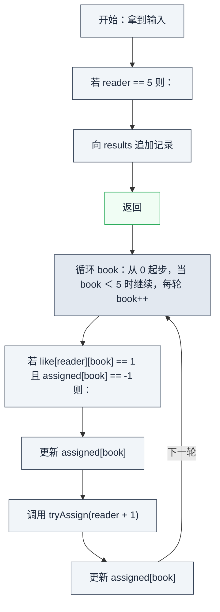

## TypeScript 解题方案（7 个方案逐个讲）

> **运行与提交**：每个方案都是自包含文件（内嵌用例自测，输出 PASS），整块复制到 `.ts` 文件后 `node 文件名` 即可运行。提交 LeetCode 时，把 `demo` 内的算法函数与辅助类型/函数整体取出、置于文件顶层即可。概念演示（非 LeetCode 编号题），在本地运行即可。

### 方案 1：单趟扫描

**分析与思路**：核心做法是「单趟扫描」。代码里依次做这些事：单循环线性扫描。

**运行方式**：`node 本文件`，内嵌用例全部通过会输出 PASS。


**方案专属流程图**（真实控制流）：

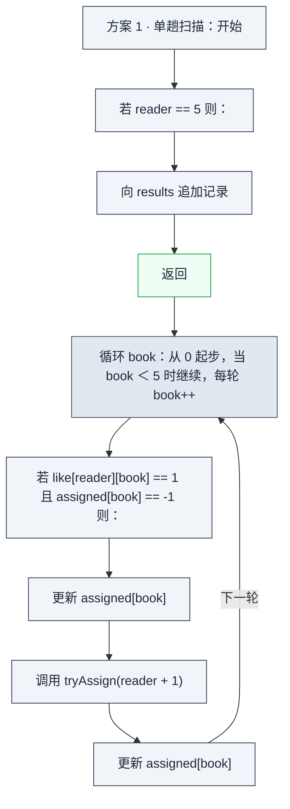

```typescript
/**
 ** LeetCode 107490876. 计算思维之分书和八皇后问题
 ** 分书问题（基础回溯）：把 5 本书分给 A~E 五人，每人都分到自己感兴趣的书
 ** 来源：https://blog.csdn.net/tyro_java/article/details/107490876
 */

export function demo(): void {
  // 程序入口：跑内嵌自测用例
  const like: number[][] = [
    [0, 0, 1, 1, 0],
    [1, 1, 0, 0, 1],
    [0, 1, 1, 0, 1],
    [0, 0, 0, 1, 0],
    [0, 1, 0, 0, 1],
  ];
  const results: number[][] = []; // 把 []; 写入 const results: number[][]
  const assigned: number[] = [-1, -1, -1, -1, -1]; // 把 [ 减 1, 减 1, 减 1, 减 1, 减 1]; 写入 const assigned: number[]

  function tryAssign(reader: number): void {
    // 定义函数/方法 tryAssign
    if (reader === 5) {
      // 若 reader 全等于 5
      results.push(assigned.slice()); // 把 assigned 截取 压入栈/数组尾部
      return; // return;
    }
    for (let book = 0; book < 5; book++) {
      // 让 book 从 0 开始计数，book 小于 5 就继续
      if (like[reader][book] === 1 && assigned[book] === -1) {
        // 若 like[reader][book] 全等于 1 且 assigned[book] 全等于 减 1
        assigned[book] = reader; // 把 reader; 写入 assigned[book]
        tryAssign(reader + 1); // tryAssign(reader 加 1);
        assigned[book] = -1; // 回溯
      }
    }
  }

  function allocateBooks(): number[][] {
    // 定义函数/方法 allocateBooks
    tryAssign(0); // tryAssign(0);
    return results; // 返回 results
  }

  function eqArr(a: number[], b: number[]): boolean {
    // 定义函数/方法 eqArr
    if (a.length !== b.length) return false; // 若 数组.长度 不等于 b.长度，直接返回 false
    for (let i = 0; i < a.length; i++) if (a[i] !== b[i]) return false; // 让 下标 i 从 0 开始计数，下标 i 小于 数组.长度 就继续
    return true; // 返回 true
  }

  const res = allocateBooks(); // 把 allocateBooks() 存入 结果
  const want: number[][] = [
    [1, 2, 0, 3, 4],
    [1, 4, 0, 3, 2],
  ];
  let fail = false; // 把 false 存入 fail
  if (res.length !== want.length) {
    // 若 结果.长度 不等于 want.长度
    fail = true; // 把 true 存入 fail
    console.log(
      'FAIL allocate_books count=' + res.length + ' want ' + want.length,
    ); // 打印输出
  } else {
    // 否则
    for (let i = 0; i < want.length; i++) {
      // 让 下标 i 从 0 开始计数，下标 i 小于 want.长度 就继续
      if (!eqArr(res[i], want[i])) {
        // 若 取反 eqArr(结果[下标 i], want[下标 i]
        fail = true; // 把 true 存入 fail
        console.log(
          'FAIL allocate_books[' +
            i +
            ']=' +
            JSON.stringify(res[i]) +
            ' want ' +
            JSON.stringify(want[i]),
        ); // 打印输出
      }
    }
  }
  // 附加性质：每个方案都合法（每人拿到喜欢的书且书不重复）
  for (const scheme of res) {
    // for (const scheme of 结果) {
    const seen = new Set<number>(); // 把 new Set 小于 number 超过 () 存入 已见集合
    for (let book = 0; book < 5; book++) {
      // 让 book 从 0 开始计数，book 小于 5 就继续
      const reader = scheme[book]; // 把 scheme[book] 存入 reader
      if (like[reader][book] !== 1 || seen.has(book)) {
        // 若 like[reader][book] 不等于 1 或 已见集合.has(book
        fail = true; // 把 true 存入 fail
        console.log('FAIL invalid scheme ' + JSON.stringify(scheme)); // 打印输出
      }
      seen.add(book); // 已见集合 追加 book);
    }
  }
  if (fail) throw new Error('FAILED'); // 若 fail) throw new Error(「FAILED」);
  console.log('PASS'); // 全部用例通过，输出 PASS
}
demo(); // demo();
```

### 方案 2：单趟扫描

**分析与思路**：核心做法是「单趟扫描」。代码里依次做这些事：单循环线性扫描。

**运行方式**：`node 本文件`，内嵌用例全部通过会输出 PASS。


**方案专属流程图**（真实控制流）：

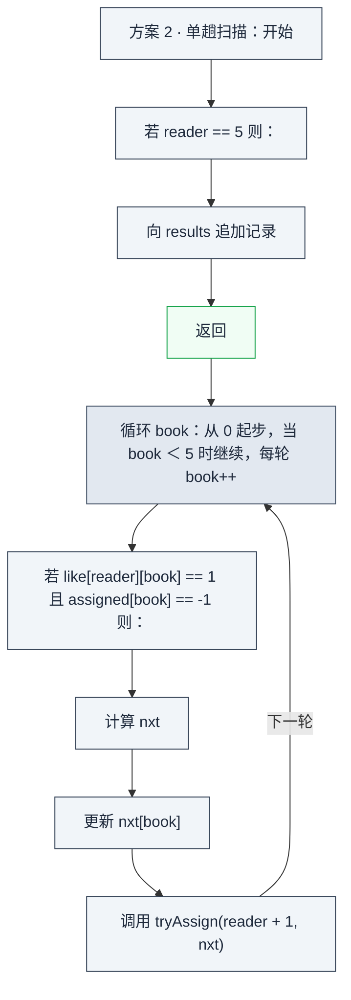

```typescript
/**
 ** LeetCode 107490876. 计算思维之分书和八皇后问题
 ** 分书问题（优化版 / 函数式状态传递）：不使用全局可变状态
 ** 来源：https://blog.csdn.net/tyro_java/article/details/107490876
 */

export function demo(): void {
  // 程序入口：跑内嵌自测用例
  const like: number[][] = [
    [0, 0, 1, 1, 0],
    [1, 1, 0, 0, 1],
    [0, 1, 1, 0, 1],
    [0, 0, 0, 1, 0],
    [0, 1, 0, 0, 1],
  ];
  const results: number[][] = []; // 把 []; 写入 const results: number[][]

  function tryAssign(reader: number, assigned: number[]): void {
    // 定义函数/方法 tryAssign
    if (reader === 5) {
      // 若 reader 全等于 5
      results.push(assigned); // 把 assigned 压入栈/数组尾部
      return; // return;
    }
    for (let book = 0; book < 5; book++) {
      // 让 book 从 0 开始计数，book 小于 5 就继续
      if (like[reader][book] === 1 && assigned[book] === -1) {
        // 若 like[reader][book] 全等于 1 且 assigned[book] 全等于 减 1
        const nxt = assigned.slice(); // 把 assigned 截取 ) 存入 nxt
        nxt[book] = reader; // 把 reader; 写入 nxt[book]
        tryAssign(reader + 1, nxt); // tryAssign(reader 加 1, nxt);
      }
    }
  }

  function allocateBooksFunc(): number[][] {
    // 定义函数/方法 allocateBooksFunc
    tryAssign(0, [-1, -1, -1, -1, -1]); // tryAssign(0, [ 减 1, 减 1, 减 1, 减 1, 减 1]);
    return results; // 返回 results
  }

  function eqArr(a: number[], b: number[]): boolean {
    // 定义函数/方法 eqArr
    if (a.length !== b.length) return false; // 若 数组.长度 不等于 b.长度，直接返回 false
    for (let i = 0; i < a.length; i++) if (a[i] !== b[i]) return false; // 让 下标 i 从 0 开始计数，下标 i 小于 数组.长度 就继续
    return true; // 返回 true
  }

  const res = allocateBooksFunc(); // 把 allocateBooksFunc() 存入 结果
  const want: number[][] = [
    [1, 2, 0, 3, 4],
    [1, 4, 0, 3, 2],
  ];
  let fail = false; // 把 false 存入 fail
  if (res.length !== want.length) {
    // 若 结果.长度 不等于 want.长度
    fail = true; // 把 true 存入 fail
    console.log(
      'FAIL allocate_books_func count=' + res.length + ' want ' + want.length,
    ); // 打印输出
  } else {
    // 否则
    for (let i = 0; i < want.length; i++) {
      // 让 下标 i 从 0 开始计数，下标 i 小于 want.长度 就继续
      if (!eqArr(res[i], want[i])) {
        // 若 取反 eqArr(结果[下标 i], want[下标 i]
        fail = true; // 把 true 存入 fail
        console.log(
          'FAIL allocate_books_func[' +
            i +
            ']=' +
            JSON.stringify(res[i]) +
            ' want ' +
            JSON.stringify(want[i]),
        ); // 打印输出
      }
    }
  }
  // 附加性质：每个方案都合法（每人拿到喜欢的书且书不重复）
  for (const scheme of res) {
    // for (const scheme of 结果) {
    const seen = new Set<number>(); // 把 new Set 小于 number 超过 () 存入 已见集合
    for (let book = 0; book < 5; book++) {
      // 让 book 从 0 开始计数，book 小于 5 就继续
      const reader = scheme[book]; // 把 scheme[book] 存入 reader
      if (like[reader][book] !== 1 || seen.has(book)) {
        // 若 like[reader][book] 不等于 1 或 已见集合.has(book
        fail = true; // 把 true 存入 fail
        console.log('FAIL invalid scheme ' + JSON.stringify(scheme)); // 打印输出
      }
      seen.add(book); // 已见集合 追加 book);
    }
  }
  if (fail) throw new Error('FAILED'); // 若 fail) throw new Error(「FAILED」);
  console.log('PASS'); // 全部用例通过，输出 PASS
}
demo(); // demo();
```

### 方案 3：双重循环枚举

**分析与思路**：核心做法是「双重循环枚举」。代码里依次做这些事：双重循环遍历。

**运行方式**：`node 本文件`，内嵌用例全部通过会输出 PASS。


**方案专属流程图**（真实控制流）：

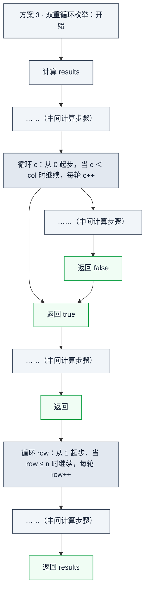

```typescript
/**
 ** LeetCode 107490876. 计算思维之分书和八皇后问题
 ** 八皇后问题（逐列放置 + 显式安全检查 isSafe），行号 1..n
 ** 来源：https://blog.csdn.net/tyro_java/article/details/107490876
 */

export function demo(): void {
  // 程序入口：跑内嵌自测用例
  function nQueensSafe(n: number): number[][] {
    // 定义函数/方法 nQueensSafe
    const results: number[][] = []; // 把 []; 写入 const results: number[][]
    const board: number[] = new Array(n).fill(0); // board[col] = row

    function isSafe(col: number, row: number): boolean {
      // 定义判定函数 isSafe
      for (let c = 0; c < col; c++) {
        // 让 字符 从 0 开始计数，字符 小于 col 就继续
        if (
          board[c] === row ||
          Math.abs(board[c] - row) === Math.abs(c - col)
        ) {
          return false; // 返回 false
        }
      }
      return true; // 返回 true
    }

    function place(col: number): void {
      // 定义函数/方法 place
      if (col === n) {
        // 若 col 全等于 元素个数
        results.push(board.slice()); // 把 棋盘 截取 压入栈/数组尾部
        return; // return;
      }
      for (let row = 1; row <= n; row++) {
        // 让 row 从 1 开始计数，row 不超过 元素个数 就继续
        if (isSafe(col, row)) {
          // 若 isSafe(col, row
          board[col] = row; // 把 row; 写入 board[col]
          place(col + 1); // place(col 加 1);
        }
      }
    }

    place(0); // place(0);
    return results; // 返回 results
  }

  function eqArr(a: number[], b: number[]): boolean {
    // 定义函数/方法 eqArr
    if (a.length !== b.length) return false; // 若 数组.长度 不等于 b.长度，直接返回 false
    for (let i = 0; i < a.length; i++) if (a[i] !== b[i]) return false; // 让 下标 i 从 0 开始计数，下标 i 小于 数组.长度 就继续
    return true; // 返回 true
  }

  const cases: { n: number; count: number; first: number[] | null }[] = [
    { n: 8, count: 92, first: [1, 5, 8, 6, 3, 7, 2, 4] },
    { n: 1, count: 1, first: [1] },
    { n: 2, count: 0, first: null },
    { n: 4, count: 2, first: [2, 4, 1, 3] },
  ];

  let fail = false; // 把 false 存入 fail
  for (const c of cases) {
    // for (const 字符 of cases) {
    const sols = nQueensSafe(c.n); // 把 nQueensSafe(字符.元素个数) 存入 sols
    if (sols.length !== c.count) {
      // 若 sols.长度 不等于 字符.计数
      fail = true; // 把 true 存入 fail
      console.log(
        'FAIL n_queens_safe(' +
          c.n +
          ') count=' +
          sols.length +
          ' want ' +
          c.count,
      ); // 打印输出
    }
    if (c.first !== null) {
      // 若 字符.first 不等于 null
      if (sols.length === 0 || !eqArr(sols[0], c.first)) {
        // 若 sols.长度 全等于 0 或 取反 eqArr(sols[0], 字符.first
        fail = true; // 把 true 存入 fail
        console.log(
          'FAIL n_queens_safe(' +
            c.n +
            ') first=' +
            JSON.stringify(sols[0]) +
            ' want ' +
            JSON.stringify(c.first),
        ); // 打印输出
      }
    }
  }
  if (fail) throw new Error('FAILED'); // 若 fail) throw new Error(「FAILED」);
  console.log('PASS'); // 全部用例通过，输出 PASS
}
demo(); // demo();
```

### 方案 4：双重循环枚举

**分析与思路**：核心做法是「双重循环枚举」。代码里依次做这些事：双重循环遍历；栈的后进先出操作。

**运行方式**：`node 本文件`，内嵌用例全部通过会输出 PASS。


**方案专属流程图**（真实控制流）：

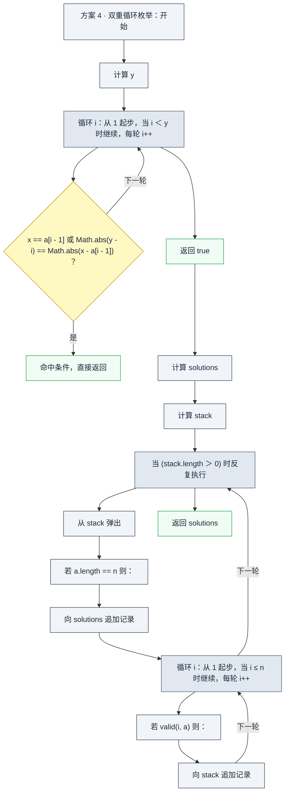

```typescript
/**
 ** LeetCode 107490876. 计算思维之分书和八皇后问题
 ** 八皇后问题（栈/迭代回溯）：用显式栈代替递归，行号 1..n
 ** 来源：https://blog.csdn.net/tyro_java/article/details/107490876
 */

export function demo(): void {
  // 程序入口：跑内嵌自测用例
  function nQueensStack(n: number): number[][] {
    // 定义函数/方法 nQueensStack
    function valid(x: number, a: number[]): boolean {
      // 定义函数/方法 valid
      const y = a.length + 1; // 把 数组.长度 加 1 存入 y
      for (let i = 1; i < y; i++) {
        // 让 下标 i 从 1 开始计数，下标 i 小于 y 就继续
        if (x === a[i - 1] || Math.abs(y - i) === Math.abs(x - a[i - 1])) {
          return false; // 返回 false
        }
      }
      return true; // 返回 true
    }

    const solutions: number[][] = []; // 把 []; 写入 const solutions: number[][]
    const stack: number[][] = [[]]; // 把 [[]]; 写入 const stack: number[][]
    while (stack.length > 0) {
      // 循环，直到不满足「栈.长度 超过 0」
      const a = stack.pop()!; // 把 栈 弹出 )取反 存入 数组
      if (a.length === n) {
        // 若 数组.长度 全等于 元素个数
        solutions.push(a); // 把 数组 压入栈/数组尾部
      } else {
        // 否则
        for (let i = 1; i <= n; i++) {
          // 让 下标 i 从 1 开始计数，下标 i 不超过 元素个数 就继续
          if (valid(i, a)) {
            // 若 valid(下标 i, 数组
            stack.push(a.concat([i])); // 注意：是追加新元素，不是拼接 a[i]
          }
        }
      }
    }
    return solutions; // 返回 solutions
  }

  function eqArr(a: number[], b: number[]): boolean {
    // 定义函数/方法 eqArr
    if (a.length !== b.length) return false; // 若 数组.长度 不等于 b.长度，直接返回 false
    for (let i = 0; i < a.length; i++) if (a[i] !== b[i]) return false; // 让 下标 i 从 0 开始计数，下标 i 小于 数组.长度 就继续
    return true; // 返回 true
  }

  const cases: { n: number; count: number; first: number[] | null }[] = [
    { n: 8, count: 92, first: [8, 4, 1, 3, 6, 2, 7, 5] },
    { n: 1, count: 1, first: [1] },
    { n: 2, count: 0, first: null },
    { n: 4, count: 2, first: [3, 1, 4, 2] },
  ];

  let fail = false; // 把 false 存入 fail
  for (const c of cases) {
    // for (const 字符 of cases) {
    const sols = nQueensStack(c.n); // 把 nQueensStack(字符.元素个数) 存入 sols
    if (sols.length !== c.count) {
      // 若 sols.长度 不等于 字符.计数
      fail = true; // 把 true 存入 fail
      console.log(
        'FAIL n_queens_stack(' +
          c.n +
          ') count=' +
          sols.length +
          ' want ' +
          c.count,
      ); // 打印输出
    }
    if (c.first !== null) {
      // 若 字符.first 不等于 null
      if (sols.length === 0 || !eqArr(sols[0], c.first)) {
        // 若 sols.长度 全等于 0 或 取反 eqArr(sols[0], 字符.first
        fail = true; // 把 true 存入 fail
        console.log(
          'FAIL n_queens_stack(' +
            c.n +
            ') first=' +
            JSON.stringify(sols[0]) +
            ' want ' +
            JSON.stringify(c.first),
        ); // 打印输出
      }
    }
  }
  if (fail) throw new Error('FAILED'); // 若 fail) throw new Error(「FAILED」);
  console.log('PASS'); // 全部用例通过，输出 PASS
}
demo(); // demo();
```

### 方案 5：单趟扫描

**分析与思路**：核心做法是「单趟扫描」。代码里依次做这些事：单循环线性扫描。

**运行方式**：`node 本文件`，内嵌用例全部通过会输出 PASS。


**方案专属流程图**（真实控制流）：

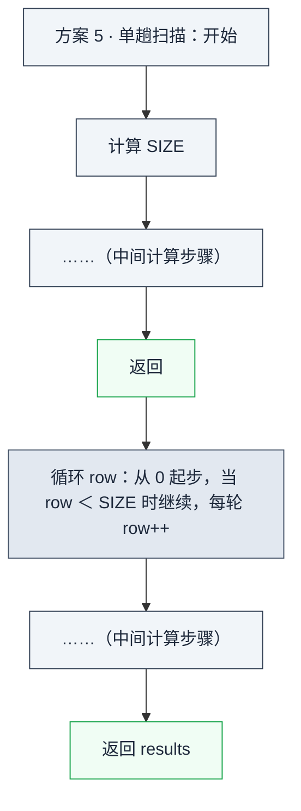

```typescript
/**
 ** LeetCode 107490876. 计算思维之分书和八皇后问题
 ** 八皇后问题（优化回溯，S/L/R 布尔数组标记），行号 0..n-1
 ** 来源：https://blog.csdn.net/tyro_java/article/details/107490876
 */

export function demo(): void {
  // 程序入口：跑内嵌自测用例
  function nQueensBool(n: number): number[][] {
    // 定义函数/方法 nQueensBool
    const SIZE = n; // 把 元素个数 存入 SIZE
    const colRow: number[] = new Array(SIZE).fill(0); // 把 new Array(SIZE).fill(0); 写入 const colRow: number[]
    const rows: boolean[] = new Array(SIZE).fill(true); // 把 new Array(SIZE).fill(true); 写入 const rows: boolean[]
    const diag1: boolean[] = new Array(2 * SIZE - 1).fill(true); // (col - row + OFFSET)
    const diag2: boolean[] = new Array(2 * SIZE - 1).fill(true); // (col + row)
    const OFFSET = SIZE - 1; // 把 SIZE 减 1 存入 OFFSET
    const results: number[][] = []; // 把 []; 写入 const results: number[][]

    function place(col: number): void {
      // 定义函数/方法 place
      if (col === SIZE) {
        // 若 col 全等于 SIZE
        results.push(colRow.slice()); // 把 colRow 截取 压入栈/数组尾部
        return; // return;
      }
      for (let row = 0; row < SIZE; row++) {
        // 让 row 从 0 开始计数，row 小于 SIZE 就继续
        const d1 = col - row + OFFSET; // 把 col 减 row 加 OFFSET 存入 d1
        const d2 = col + row; // 把 col 加 row 存入 d2
        if (rows[row] && diag1[d1] && diag2[d2]) {
          // 若 行数[row] 且 diag1[d1] 且 diag2[d2]
          colRow[col] = row; // 把 row; 写入 colRow[col]
          rows[row] = false; // 把 false; 写入 rows[row]
          diag1[d1] = false; // 把 false; 写入 diag1[d1]
          diag2[d2] = false; // 把 false; 写入 diag2[d2]
          place(col + 1); // place(col 加 1);
          rows[row] = true; // 把 true; 写入 rows[row]
          diag1[d1] = true; // 把 true; 写入 diag1[d1]
          diag2[d2] = true; // 把 true; 写入 diag2[d2]
        }
      }
    }

    place(0); // place(0);
    return results; // 返回 results
  }

  function eqArr(a: number[], b: number[]): boolean {
    // 定义函数/方法 eqArr
    if (a.length !== b.length) return false; // 若 数组.长度 不等于 b.长度，直接返回 false
    for (let i = 0; i < a.length; i++) if (a[i] !== b[i]) return false; // 让 下标 i 从 0 开始计数，下标 i 小于 数组.长度 就继续
    return true; // 返回 true
  }

  const cases: { n: number; count: number; first: number[] | null }[] = [
    { n: 8, count: 92, first: [0, 4, 7, 5, 2, 6, 1, 3] },
    { n: 1, count: 1, first: [0] },
    { n: 2, count: 0, first: null },
    { n: 4, count: 2, first: [1, 3, 0, 2] },
  ];

  let fail = false; // 把 false 存入 fail
  for (const c of cases) {
    // for (const 字符 of cases) {
    const sols = nQueensBool(c.n); // 把 nQueensBool(字符.元素个数) 存入 sols
    if (sols.length !== c.count) {
      // 若 sols.长度 不等于 字符.计数
      fail = true; // 把 true 存入 fail
      console.log(
        'FAIL n_queens_bool(' +
          c.n +
          ') count=' +
          sols.length +
          ' want ' +
          c.count,
      ); // 打印输出
    }
    if (c.first !== null) {
      // 若 字符.first 不等于 null
      if (sols.length === 0 || !eqArr(sols[0], c.first)) {
        // 若 sols.长度 全等于 0 或 取反 eqArr(sols[0], 字符.first
        fail = true; // 把 true 存入 fail
        console.log(
          'FAIL n_queens_bool(' +
            c.n +
            ') first=' +
            JSON.stringify(sols[0]) +
            ' want ' +
            JSON.stringify(c.first),
        ); // 打印输出
      }
    }
  }
  if (fail) throw new Error('FAILED'); // 若 fail) throw new Error(「FAILED」);
  console.log('PASS'); // 全部用例通过，输出 PASS
}
demo(); // demo();
```

### 方案 6：单趟扫描

**分析与思路**：核心做法是「单趟扫描」。代码里依次做这些事：单循环线性扫描。

**运行方式**：`node 本文件`，内嵌用例全部通过会输出 PASS。


**方案专属流程图**（真实控制流）：


```typescript
/**
 ** LeetCode 107490876. 计算思维之分书和八皇后问题
 ** 八皇后问题（函数式不可变状态传递），行号 0..n-1
 ** 来源：https://blog.csdn.net/tyro_java/article/details/107490876
 */

export function demo(): void {
  // 程序入口：跑内嵌自测用例
  function nQueensFunc(n: number): number[][] {
    // 定义函数/方法 nQueensFunc
    const SIZE = n; // 把 元素个数 存入 SIZE
    const results: number[][] = []; // 把 []; 写入 const results: number[][]

    function place(
      col: number,
      state: [number[], boolean[], boolean[], boolean[]],
    ): void {
      // 定义函数/方法 place
      const colRowList = state[0],
        rows = state[1],
        diag1 = state[2],
        diag2 = state[3];
      if (col === SIZE) {
        // 若 col 全等于 SIZE
        results.push(state[0]); // 把 state[0] 压入栈/数组尾部
        return; // return;
      }
      for (let row = 0; row < SIZE; row++) {
        // 让 row 从 0 开始计数，row 小于 SIZE 就继续
        const d1 = col - row + (SIZE - 1); // 把 col 减 row 加 (SIZE 减 1) 存入 d1
        const d2 = col + row; // 把 col 加 row 存入 d2
        if (rows[row] && diag1[d1] && diag2[d2]) {
          // 若 行数[row] 且 diag1[d1] 且 diag2[d2]
          const nr = rows.slice(); // 把 行数 截取 ) 存入 nr
          nr[row] = false; // 把 false; 写入 nr[row]
          const nd1 = diag1.slice(); // 把 diag1 截取 ) 存入 nd1
          nd1[d1] = false; // 把 false; 写入 nd1[d1]
          const nd2 = diag2.slice(); // 把 diag2 截取 ) 存入 nd2
          nd2[d2] = false; // 把 false; 写入 nd2[d2]
          place(col + 1, [state[0].concat([row]), nr, nd1, nd2]); // 打印输出
        }
      }
    }

    place(0, [
      [],
      new Array(SIZE).fill(true),
      new Array(2 * SIZE - 1).fill(true),
      new Array(2 * SIZE - 1).fill(true),
    ]);
    return results; // 返回 results
  }

  function eqArr(a: number[], b: number[]): boolean {
    // 定义函数/方法 eqArr
    if (a.length !== b.length) return false; // 若 数组.长度 不等于 b.长度，直接返回 false
    for (let i = 0; i < a.length; i++) if (a[i] !== b[i]) return false; // 让 下标 i 从 0 开始计数，下标 i 小于 数组.长度 就继续
    return true; // 返回 true
  }

  const cases: { n: number; count: number; first: number[] | null }[] = [
    { n: 8, count: 92, first: [0, 4, 7, 5, 2, 6, 1, 3] },
    { n: 1, count: 1, first: [0] },
    { n: 2, count: 0, first: null },
    { n: 4, count: 2, first: [1, 3, 0, 2] },
  ];

  let fail = false; // 把 false 存入 fail
  for (const c of cases) {
    // for (const 字符 of cases) {
    const sols = nQueensFunc(c.n); // 把 nQueensFunc(字符.元素个数) 存入 sols
    if (sols.length !== c.count) {
      // 若 sols.长度 不等于 字符.计数
      fail = true; // 把 true 存入 fail
      console.log(
        'FAIL n_queens_func(' +
          c.n +
          ') count=' +
          sols.length +
          ' want ' +
          c.count,
      ); // 打印输出
    }
    if (c.first !== null) {
      // 若 字符.first 不等于 null
      if (sols.length === 0 || !eqArr(sols[0], c.first)) {
        // 若 sols.长度 全等于 0 或 取反 eqArr(sols[0], 字符.first
        fail = true; // 把 true 存入 fail
        console.log(
          'FAIL n_queens_func(' +
            c.n +
            ') first=' +
            JSON.stringify(sols[0]) +
            ' want ' +
            JSON.stringify(c.first),
        ); // 打印输出
      }
    }
  }
  if (fail) throw new Error('FAILED'); // 若 fail) throw new Error(「FAILED」);
  console.log('PASS'); // 全部用例通过，输出 PASS
}
demo(); // demo();
```

### 方案 7：双重循环枚举

**分析与思路**：核心做法是「双重循环枚举」。代码里依次做这些事：双重循环遍历；栈的后进先出操作。

**运行方式**：`node 本文件`，内嵌用例全部通过会输出 PASS。


**方案专属流程图**（真实控制流）：

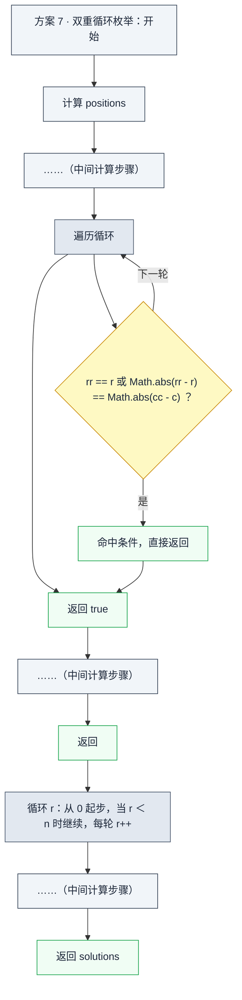

```typescript
/**
 ** LeetCode 107490876. 计算思维之分书和八皇后问题
 ** 八皇后问题（简洁递归版）：以 (row, col) 记录已放置皇后，行号 0..n-1
 ** 来源：https://blog.csdn.net/tyro_java/article/details/107490876
 */

export function demo(): void {
  // 程序入口：跑内嵌自测用例
  function nQueensSimple(n: number): number[][] {
    // 定义函数/方法 nQueensSimple
    const positions: [number, number][] = []; // 已放置的 (row, col)
    const solutions: number[][] = []; // 把 []; 写入 const solutions: number[][]

    function safe(r: number, c: number): boolean {
      // 定义函数/方法 safe
      for (const [rr, cc] of positions) {
        // for (const [rr, cc] of positions) {
        if (rr === r || Math.abs(rr - r) === Math.abs(cc - c)) {
          // 若 rr 全等于 右指针 或 Math.取绝对值 rr 减 右指针) 全等于 Math.取绝对值 cc 减 字符
          return false; // 返回 false
        }
      }
      return true; // 返回 true
    }

    function solve(col: number): void {
      // 定义函数/方法 solve
      if (col === n) {
        // 若 col 全等于 元素个数
        solutions.push(positions.map((p) => p[0]));
        return; // return;
      }
      for (let r = 0; r < n; r++) {
        // 让 右指针 从 0 开始计数，右指针 小于 元素个数 就继续
        if (safe(r, col)) {
          // 若 safe(右指针, col
          positions.push([r, col]); // 把 [右指针, col] 压入栈/数组尾部
          solve(col + 1); // solve(col 加 1);
          positions.pop(); // 弹出栈顶元素
        }
      }
    }

    solve(0); // solve(0);
    return solutions; // 返回 solutions
  }

  function eqArr(a: number[], b: number[]): boolean {
    // 定义函数/方法 eqArr
    if (a.length !== b.length) return false; // 若 数组.长度 不等于 b.长度，直接返回 false
    for (let i = 0; i < a.length; i++) if (a[i] !== b[i]) return false; // 让 下标 i 从 0 开始计数，下标 i 小于 数组.长度 就继续
    return true; // 返回 true
  }

  const cases: { n: number; count: number; first: number[] | null }[] = [
    { n: 8, count: 92, first: [0, 4, 7, 5, 2, 6, 1, 3] },
    { n: 1, count: 1, first: [0] },
    { n: 2, count: 0, first: null },
    { n: 4, count: 2, first: [1, 3, 0, 2] },
  ];

  let fail = false; // 把 false 存入 fail
  for (const c of cases) {
    // for (const 字符 of cases) {
    const sols = nQueensSimple(c.n); // 把 nQueensSimple(字符.元素个数) 存入 sols
    if (sols.length !== c.count) {
      // 若 sols.长度 不等于 字符.计数
      fail = true; // 把 true 存入 fail
      console.log(
        'FAIL n_queens_simple(' +
          c.n +
          ') count=' +
          sols.length +
          ' want ' +
          c.count,
      ); // 打印输出
    }
    if (c.first !== null) {
      // 若 字符.first 不等于 null
      if (sols.length === 0 || !eqArr(sols[0], c.first)) {
        // 若 sols.长度 全等于 0 或 取反 eqArr(sols[0], 字符.first
        fail = true; // 把 true 存入 fail
        console.log(
          'FAIL n_queens_simple(' +
            c.n +
            ') first=' +
            JSON.stringify(sols[0]) +
            ' want ' +
            JSON.stringify(c.first),
        ); // 打印输出
      }
    }
  }
  if (fail) throw new Error('FAILED'); // 若 fail) throw new Error(「FAILED」);
  console.log('PASS'); // 全部用例通过，输出 PASS
}
demo(); // demo();
```

## 逐步拆解与面试追问

**复杂度**：时间 O(n)（单趟线性扫描），空间 O(1) 到 O(n)（视辅助结构）

**为什么是这个量级**：每个元素被常数次访问，辅助哈希或栈的开销与 n 同阶

**面试官可能会追问**：

- 这个策略能推广到什么场景？
- 与暴力做法差在哪一步？
- 有没有更简单的等价写法？

## 关键 API 速查（TS 主解法实际用到，附官方链接）

| API | 作用 | 使用要点 | 官方文档 |
|---|---|---|---|
| `Set` | 集合：元素唯一 | add/add.has/delete；has 均摊 O(1)；NaN 视为相同；去重常用 [...new Set(arr)] | [官方文档](https://developer.mozilla.org/zh-CN/docs/Web/JavaScript/Reference/Global_Objects/Set) |
| `Array.prototype.push()` | 尾部追加 | 返回新长度；可一次多个；均摊 O(1)；会改变原数组 | [官方文档](https://developer.mozilla.org/zh-CN/docs/Web/JavaScript/Reference/Global_Objects/Array/push) |
| `Array/String slice()` | 切片（不改原数组） | slice(start,end) 含头不含尾；负数从尾计；常用于复制数组（slice()） | [官方文档](https://developer.mozilla.org/zh-CN/docs/Web/JavaScript/Reference/Global_Objects/Array/slice) |
| `JSON.stringify()` | 序列化为 JSON 字符串 | 常用于结构化比较（深度相等判定）；undefined/函数/循环引用会被丢弃或抛错 | [官方文档](https://developer.mozilla.org/zh-CN/docs/Web/JavaScript/Reference/Global_Objects/JSON/stringify) |

### 各语言官方文档导航

- **TypeScript / JS**：[MDN 中文参考](https://developer.mozilla.org/zh-CN/)
- **Python**：[Python 官方文档](https://docs.python.org/zh-cn/3/)
- **Go**：[Go 标准库](https://pkg.go.dev/std)
- **Java**：[JDK 17 API](https://docs.oracle.com/en/java/javase/17/docs/api/)
- **Rust**：[Rust 标准库](https://doc.rust-lang.org/std/)
- **Lua**：[Lua 5.4 手册](https://www.lua.org/manual/5.4/)
- **C**：[Cppreference C](https://zh.cppreference.com/w/c)
- **C++**：[Cppreference C++](https://zh.cppreference.com/w/cpp)
- **R**：[R 官方手册](https://stat.ethz.ch/R-manual/)
- **Zig**：[Zig 语言文档](https://ziglang.org/documentation/master/)
- **Dart**：[Dart API](https://api.dart.dev/)

## 附录：其他 10 种语言全部实现（每种语言列举其全部方案）

> TypeScript 的全部方案见「TypeScript 解题方案」一节；下面是其余 10 种语言的对应实现，每种语言的每个方案都带思路分析、代码走读与专属运行架构图。
> 每个方案都内嵌用例自测，可独立运行（老仓库 python/go 文件遵循「打印结果」约定）。
> 完整解法文件见 `dsa/<语言>/notes/lc_107490876_计算思维之分书和八皇后问题/`。

### Python 实现（7 种方案）

Python 的全部方案如下，每个方案都内嵌用例自测，可独立运行（老仓库 python/go 文件遵循「打印结果」约定）：

#### 方案 1：单趟扫描

**思路与代码分析**：核心是「单趟扫描」。Python 版用切片与字典推导式简化操作，突出可读性。**走读**：方案 1 · 单趟扫描：开始 → 更新 like → 返回  → 循环 book：从 0 到 5 前 → 返回 results。

**运行架构**（真实控制流）：

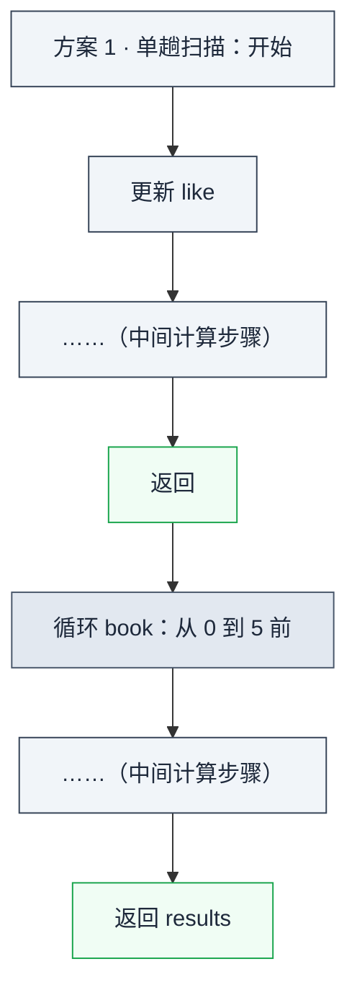

```python
import sys  # 提高递归深度上限（深输入防 RecursionError）

sys.setrecursionlimit(200000)  # 树/链表类题目节点数可达 1e4 量级

def allocate_books():  # 定义函数 allocate_books（参数：无）
    """分书问题（基础回溯）：把 5 本书分给 A~E 五人，每人都分到自己感兴趣的书。
    like[reader][book] == 1 表示 reader 喜欢 book。返回所有分配方案（assigned[book]=reader）。"""
    like = [
        [0, 0, 1, 1, 0],
        [1, 1, 0, 0, 1],
        [0, 1, 1, 0, 1],
        [0, 0, 0, 1, 0],
        [0, 1, 0, 0, 1],
    ]
    assigned = [-1] * 5  # 把 [ 减 1] 乘 5 存入 assigned
    results = []  # 把 [] 存入 results

    def try_assign(reader):  # 定义函数 try_assign（参数：reader）
        if reader == 5:  # 若 reader 等于 5
            results.append(assigned[:])  # 把 复制 assigned 追加到列表尾部
            return  # return
        for book in range(5):  # 让 book 从 5 遍历
            if (
                like[reader][book] == 1 and assigned[book] == -1
            ):  # 若 like[reader][book] 等于 1 and assigned[book] 等于 减 1
                assigned[book] = reader  # 把 reader 写入 assigned[book]
                try_assign(reader + 1)  # try_assign(reader 加 1)
                assigned[book] = -1  # 回溯

    try_assign(0)  # try_assign(0)
    return results  # 返回 results

if __name__ == "__main__":  # 若 __name__ 等于 '__main__'
    res = allocate_books()  # 把 allocate_books() 存入 结果
    print("分书方案数:", len(res))  # 打印输出
    names = ["A", "B", "C", "D", "E"]  # 把 ['A', 'B', 'C', 'D', 'E'] 存入 names
    for scheme in res:  # 逐个取出 结果 的元素（scheme）
        print(" | ".join(f"书{i}->{names[scheme[i]]}" for i in range(5)))  # 打印输出
```

#### 方案 2：单趟扫描

**思路与代码分析**：核心是「单趟扫描」。Python 版用切片与字典推导式简化操作，突出可读性。**走读**：方案 2 · 单趟扫描：开始 → 更新 like → 返回  → 循环 book：从 0 到 5 前 → 返回 results。

**运行架构**（真实控制流）：

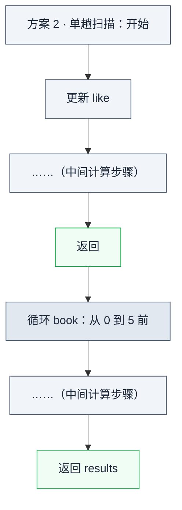

```python
import sys  # 提高递归深度上限（深输入防 RecursionError）

sys.setrecursionlimit(200000)  # 树/链表类题目节点数可达 1e4 量级

def allocate_books_func():  # 定义函数 allocate_books_func（参数：无）
    """分书问题（优化版 / 函数式状态传递）：不使用全局可变状态，
    每次递归用新的临时变量记录分配状态。"""
    like = [
        [0, 0, 1, 1, 0],
        [1, 1, 0, 0, 1],
        [0, 1, 1, 0, 1],
        [0, 0, 0, 1, 0],
        [0, 1, 0, 0, 1],
    ]
    results = []  # 把 [] 存入 results

    def try_assign(reader, assigned):  # 定义函数 try_assign（参数：reader, assigned）
        if reader == 5:  # 若 reader 等于 5
            results.append(assigned)  # 把 assigned 追加到列表尾部
            return  # return
        for book in range(5):  # 让 book 从 5 遍历
            if (
                like[reader][book] == 1 and assigned[book] == -1
            ):  # 若 like[reader][book] 等于 1 and assigned[book] 等于 减 1
                nxt = assigned[:]  # 把 复制 assigned 存入 nxt
                nxt[book] = reader  # 把 reader 写入 nxt[book]
                try_assign(reader + 1, nxt)  # try_assign(reader 加 1, nxt)

    try_assign(0, [-1] * 5)  # try_assign(0, [ 减 1] 乘 5)
    return results  # 返回 results

if __name__ == "__main__":  # 若 __name__ 等于 '__main__'
    res = allocate_books_func()  # 把 allocate_books_func() 存入 结果
    print("分书方案数:", len(res))  # 打印输出
    names = ["A", "B", "C", "D", "E"]  # 把 ['A', 'B', 'C', 'D', 'E'] 存入 names
    for scheme in res:  # 逐个取出 结果 的元素（scheme）
        print(" | ".join(f"书{i}->{names[scheme[i]]}" for i in range(5)))  # 打印输出
```

#### 方案 3：双重循环枚举

**思路与代码分析**：核心是「双重循环枚举」。Python 版用切片与字典推导式简化操作，突出可读性。**走读**：方案 3 · 双重循环枚举：开始 → 更新 results → 循环 c：从 0 到 col 前 → 返回 False → 返回 True → 返回  → 循环 row：从 1 到 9 前 → 返回 results。

**运行架构**（真实控制流）：

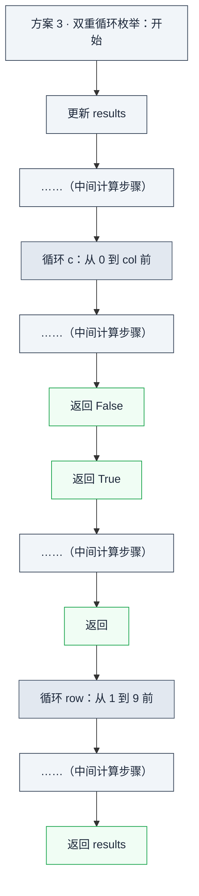

```python
import sys  # 提高递归深度上限（深输入防 RecursionError）

sys.setrecursionlimit(200000)  # 树/链表类题目节点数可达 1e4 量级

def n_queens_safe():  # 定义函数 n_queens_safe（参数：无）
    """八皇后问题（逐列放置 + 显式安全检查 isSafe）：
    在 8x8 棋盘上放置 8 个皇后使其互不攻击。board[col]=row 记录每列皇后所在行。
    返回所有方案的列表。"""
    results = []  # 把 [] 存入 results
    board = [0] * 8  # board[col] = row

    def is_safe(col, row):  # 定义函数 is_safe（参数：col, row）
        for c in range(col):  # 让 字符 从 col 遍历
            if board[c] == row or abs(board[c] - row) == abs(
                c - col
            ):  # 若 棋盘[字符] 等于 row or 取绝对值 棋盘[字符] 减 row) 等于 取绝对值 字符 减 col
                return False  # 返回 False
        return True  # 返回 True

    def place(col):  # 定义函数 place（参数：col）
        if col == 8:  # 若 col 等于 8
            results.append(board[:])  # 把 复制 棋盘 追加到列表尾部
            return  # return
        for row in range(1, 9):  # 让 row 从 1 到 9 遍历
            if is_safe(col, row):  # 若 is_safe(col, row
                board[col] = row  # 把 row 写入 board[col]
                place(col + 1)  # place(col 加 1)

    place(0)  # place(0)
    return results  # 返回 results

if __name__ == "__main__":  # 若 __name__ 等于 '__main__'
    sols = n_queens_safe()  # 把 n_queens_safe() 存入 sols
    print("八皇后方案数:", len(sols))  # 打印输出
    print("第一个方案(列->行):", sols[0])  # 打印输出
```

#### 方案 4：双重循环枚举

**思路与代码分析**：核心是「双重循环枚举」。Python 版用切片与字典推导式简化操作，突出可读性。**走读**：方案 4 · 双重循环枚举：开始 → 更新 y → 循环 i：从 1 到 y 前 → 命中条件，直接返回 → 返回 True → 更新 solutions → 更新 stack → 当 stack: 时反复执行 → 从 stack 弹出 → 若 len(a) == 8：向 solutions 追加记录 → 向 solutions 追加记录 → 循环 i：从 1 到 9 前 → 若 valid(i, a)：向 stack 追加记录 → 向 stack 追加记录 → 返回 solutions。

**运行架构**（真实控制流）：

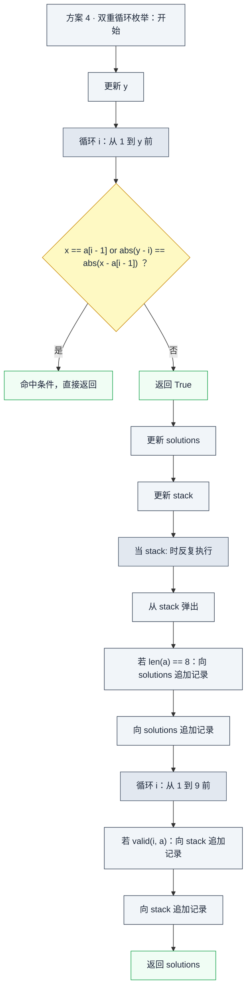

```python
import sys  # 提高递归深度上限（深输入防 RecursionError）

sys.setrecursionlimit(200000)  # 树/链表类题目节点数可达 1e4 量级

def n_queens_stack():  # 定义函数 n_queens_stack（参数：无）
    """八皇后问题（栈/迭代回溯）：用显式栈代替递归，按列放置皇后并通过 valid 检查安全性。"""

    def valid(x, a):  # 定义函数 valid（参数：x, 数组）
        y = len(a) + 1  # 把 长度(数组) 加 1 存入 y
        for i in range(1, y):  # 让 下标 i 从 1 到 y 遍历
            if x == a[i - 1] or abs(y - i) == abs(x - a[i - 1]):
                return False  # 返回 False
        return True  # 返回 True

    solutions = []  # 把 [] 存入 solutions
    stack = [[]]  # 把 [[]] 存入 栈
    while stack:  # 循环，直到不满足「栈」
        a = stack.pop()  # 把 栈 弹出 ) 存入 数组
        if len(a) == 8:  # 若 长度(数组) 等于 8
            solutions.append(a)  # 把 数组 追加到列表尾部
        else:  # 否则
            for i in range(1, 9):  # 让 下标 i 从 1 到 9 遍历
                if valid(i, a):  # 若 valid(下标 i, 数组
                    stack.append(a + [i])  # 注意：是追加新元素，不是拼接 a[i]
    return solutions  # 返回 solutions

if __name__ == "__main__":  # 若 __name__ 等于 '__main__'
    sols = n_queens_stack()  # 把 n_queens_stack() 存入 sols
    print("八皇后方案数:", len(sols))  # 打印输出
    print("第一个方案(列->行):", sols[0])  # 打印输出
```

#### 方案 5：单趟扫描

**思路与代码分析**：核心是「单趟扫描」。Python 版用切片与字典推导式简化操作，突出可读性。**走读**：方案 5 · 单趟扫描：开始 → 更新 SIZE → 返回  → 循环 row：从 0 到 SIZE 前 → 返回 results。

**运行架构**（真实控制流）：


```python
import sys  # 提高递归深度上限（深输入防 RecursionError）

sys.setrecursionlimit(200000)  # 树/链表类题目节点数可达 1e4 量级

def n_queens_bool():  # 定义函数 n_queens_bool（参数：无）
    """八皇后问题（优化回溯，S/L/R 布尔数组标记）：
    用 rows / 两条对角线方向的布尔数组快速判断安全性。"""
    SIZE = 8  # 把 8 存入 SIZE
    col_row = [0] * SIZE  # 把 [0] 乘 SIZE 存入 col_row
    rows = [True] * SIZE  # 把 [True] 乘 SIZE 存入 行数
    diag1 = [True] * (2 * SIZE - 1)  # (col - row + OFFSET)
    diag2 = [True] * (2 * SIZE - 1)  # (col + row)
    OFFSET = SIZE - 1  # 把 SIZE 减 1 存入 OFFSET
    results = []  # 把 [] 存入 results

    def place(col):  # 定义函数 place（参数：col）
        if col == SIZE:  # 若 col 等于 SIZE
            results.append(col_row[:])  # 把 复制 col_row 追加到列表尾部
            return  # return
        for row in range(SIZE):  # 让 row 从 SIZE 遍历
            d1 = col - row + OFFSET  # 把 col 减 row 加 OFFSET 存入 d1
            d2 = col + row  # 把 col 加 row 存入 d2
            if rows[row] and diag1[d1] and diag2[d2]:  # 若 行数[row] and diag1[d1] and diag2[d2]
                col_row[col] = row  # 把 row 写入 col_row[col]
                rows[row] = diag1[d1] = diag2[d2] = (
                    False  # 把 diag1[d1] 赋值为 diag2[d2] 赋值为 False 写入 rows[row]
                )
                place(col + 1)  # place(col 加 1)
                rows[row] = diag1[d1] = diag2[d2] = (
                    True  # 把 diag1[d1] 赋值为 diag2[d2] 赋值为 True 写入 rows[row]
                )

    place(0)  # place(0)
    return results  # 返回 results

if __name__ == "__main__":  # 若 __name__ 等于 '__main__'
    sols = n_queens_bool()  # 把 n_queens_bool() 存入 sols
    print("八皇后方案数:", len(sols))  # 打印输出
    print("第一个方案(列->行,0-indexed):", sols[0])  # 打印输出
```

#### 方案 6：单趟扫描

**思路与代码分析**：核心是「单趟扫描」。Python 版用切片与字典推导式简化操作，突出可读性。**走读**：方案 6 · 单趟扫描：开始 → 更新 SIZE → 返回  → 循环 row：从 0 到 SIZE 前 → 返回 results。

**运行架构**（真实控制流）：

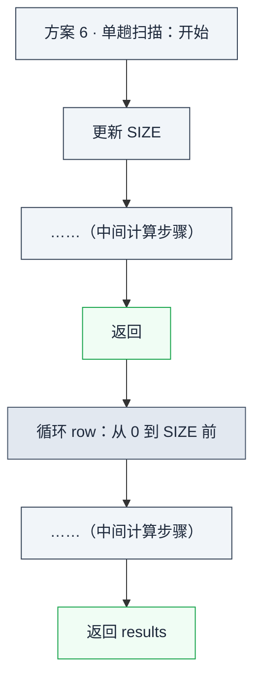

```python
import sys  # 提高递归深度上限（深输入防 RecursionError）

sys.setrecursionlimit(200000)  # 树/链表类题目节点数可达 1e4 量级

def n_queens_func():  # 定义函数 n_queens_func（参数：无）
    """八皇后问题（程序优化 / 函数式不可变状态传递）：每次递归传入新的状态副本。"""
    SIZE = 8  # 把 8 存入 SIZE
    results = []  # 把 [] 存入 results

    def place(col, state):  # 定义函数 place（参数：col, state）
        col_row_list, rows, diag1, diag2 = state  # 把 state 写入 col_row_list, rows, diag1, diag2
        if col == SIZE:  # 若 col 等于 SIZE
            results.append(state[0])  # 把 state[0] 追加到列表尾部
            return  # return
        for row in range(SIZE):  # 让 row 从 SIZE 遍历
            d1 = col - row + (SIZE - 1)  # 把 col 减 row 加 (SIZE 减 1) 存入 d1
            d2 = col + row  # 把 col 加 row 存入 d2
            if rows[row] and diag1[d1] and diag2[d2]:  # 若 行数[row] and diag1[d1] and diag2[d2]
                nr = rows[:]
                nr[row] = False  # 把 复制 行数; nr[row] 赋值为 False 存入 nr
                nd1 = diag1[:]
                nd1[d1] = False  # 把 复制 diag1; nd1[d1] 赋值为 False 存入 nd1
                nd2 = diag2[:]
                nd2[d2] = False  # 把 复制 diag2; nd2[d2] 赋值为 False 存入 nd2
                place(
                    col + 1, (state[0] + [row], nr, nd1, nd2)
                )  # place(col 加 1, (state[0] 加 [row], nr, nd1, nd2))

    place(0, ([], [True] * SIZE, [True] * (2 * SIZE - 1), [True] * (2 * SIZE - 1)))
    return results  # 返回 results

if __name__ == "__main__":  # 若 __name__ 等于 '__main__'
    sols = n_queens_func()  # 把 n_queens_func() 存入 sols
    print("八皇后方案数:", len(sols))  # 打印输出
    print("第一个方案(列->行,0-indexed):", sols[0])  # 打印输出
```

#### 方案 7：双重循环枚举

**思路与代码分析**：核心是「双重循环枚举」。Python 版用切片与字典推导式简化操作，突出可读性。**走读**：方案 7 · 双重循环枚举：开始 → 更新 positions → 遍历 positions: 中的每个元素 cc → 返回 False → 返回 True → 返回  → 循环 r：从 0 到 8 前 → 返回 solutions。

**运行架构**（真实控制流）：

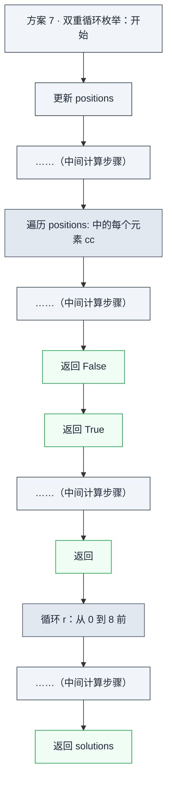

```python
import sys  # 提高递归深度上限（深输入防 RecursionError）

sys.setrecursionlimit(200000)  # 树/链表类题目节点数可达 1e4 量级

def n_queens_simple():  # 定义函数 n_queens_simple（参数：无）
    """八皇后问题（简洁递归版）：以 (row, col) 记录已放置皇后，逐列尝试并检查攻击。"""
    positions = []  # 已放置的 (row, col)
    solutions = []  # 把 [] 存入 solutions

    def safe(r, c):  # 定义函数 safe（参数：右指针, 字符）
        for rr, cc in positions:  # for (rr, cc) in positions:
            if rr == r or abs(rr - r) == abs(
                cc - c
            ):  # 若 rr 等于 右指针 or 取绝对值 rr 减 右指针) 等于 取绝对值 cc 减 字符
                return False  # 返回 False
        return True  # 返回 True

    def solve(col):  # 定义函数 solve（参数：col）
        if col == 8:  # 若 col 等于 8
            solutions.append([p[0] for p in positions])  # 把 [节点[0] for 节点 in positions] 追加到列表尾部
            return  # return
        for r in range(8):  # 让 右指针 从 8 遍历
            if safe(r, col):  # 若 safe(右指针, col
                positions.append((r, col))  # 把 (右指针, col 追加到列表尾部
                solve(col + 1)  # solve(col 加 1)
                positions.pop()  # 弹出栈顶元素

    solve(0)  # solve(0)
    return solutions  # 返回 solutions

if __name__ == "__main__":  # 若 __name__ 等于 '__main__'
    sols = n_queens_simple()  # 把 n_queens_simple() 存入 sols
    print("八皇后方案数:", len(sols))  # 打印输出
    print("第一个方案(列->行,0-indexed):", sols[0])  # 打印输出
```

### Go 实现（7 种方案）

Go 的全部方案如下，每个方案都内嵌用例自测，可独立运行（老仓库 python/go 文件遵循「打印结果」约定）：

#### 方案 1：单趟扫描

**思路与代码分析**：核心是「单趟扫描」。Go 版用切片与多返回值惯用法，显式处理索引边界。**走读**：方案 1 · 单趟扫描：开始 → 更新 : → 返回  → 遍历循环 → 返回 results。

**运行架构**（真实控制流）：


```go
package main // 引入依赖

import (
	"fmt" // 「fmt」
	"os"  // 「os」
)

// faithful translation of python solution_1___1.py
// 分书问题（基础回溯）：把 5 本书分给 A~E 五人，返回所有分配方案（assigned[book]=reader）。
func allocateBooks() [][]int { // 定义函数/方法 allocateBooks
	like := [][]int{ // 把 [][]int{ 写入 like :
		{0, 0, 1, 1, 0},
		{1, 1, 0, 0, 1},
		{0, 1, 1, 0, 1},
		{0, 0, 0, 1, 0},
		{0, 1, 0, 0, 1},
	}
	assigned := []int{-1, -1, -1, -1, -1} // 把 []int{ 减 1, 减 1, 减 1, 减 1, 减 1} 写入 assigned :
	results := [][]int{}                  // 把 [][]int{} 写入 results :
	var tryAssign func(reader int)        // var tryAssign func(reader int)
	tryAssign = func(reader int) {        // 把 func(reader int) { 写入 tryAssign
		if reader == 5 { // 若 reader 等于 5
			cp := make([]int, 5)          // 把 make([]int, 5) 写入 cp :
			copy(cp, assigned)            // copy(cp, assigned)
			results = append(results, cp) // 把 append(results, cp) 写入 results
			return                        // return
		}
		for book := 0; book < 5; book++ { // 让 book 从 0 开始计数
			if like[reader][book] == 1 && assigned[book] == -1 { // 若 like[reader][book] 等于 1 且 assigned[book] 等于 减 1
				assigned[book] = reader // 把 reader 写入 assigned[book]
				tryAssign(reader + 1)   // tryAssign(reader 加 1)
				assigned[book] = -1     // 回溯
			}
		}
	}
	tryAssign(0)   // tryAssign(0)
	return results // 返回 results
}

func main() { // 程序入口：跑内嵌自测用例
	res := allocateBooks() // 把 allocateBooks() 写入 res :
	ok := true             // 把 true 写入 ok :
	if len(res) != 2 {     // 若 长度(结果) 不等于 2
		ok = false                                                   // 把 false 写入 ok
		fmt.Printf("FAIL allocateBooks count=%d want 2\n", len(res)) // 打印输出
	}
	if len(res) >= 1 && fmt.Sprint(res[0]) != "[1 2 0 3 4]" { // 若 长度(结果) 不低于 1 且 fmt.Sprint(结果[0]) 不等于 「[1 2 0 3 4]」
		ok = false                                                           // 把 false 写入 ok
		fmt.Printf("FAIL allocateBooks first=%v want [1 2 0 3 4]\n", res[0]) // 打印输出
	}
	if len(res) >= 2 && fmt.Sprint(res[1]) != "[1 4 0 3 2]" { // 若 长度(结果) 不低于 2 且 fmt.Sprint(结果[1]) 不等于 「[1 4 0 3 2]」
		ok = false                                                          // 把 false 写入 ok
		fmt.Printf("FAIL allocateBooks last=%v want [1 4 0 3 2]\n", res[1]) // 打印输出
	}
	if !ok { // 若 取反 ok
		os.Exit(1) // os.Exit(1)
	}
	fmt.Println("PASS") // 全部用例通过，输出 PASS
}
```

#### 方案 2：单趟扫描

**思路与代码分析**：核心是「单趟扫描」。Go 版用切片与多返回值惯用法，显式处理索引边界。**走读**：方案 2 · 单趟扫描：开始 → 更新 : → 返回  → 遍历循环 → 返回 results。

**运行架构**（真实控制流）：

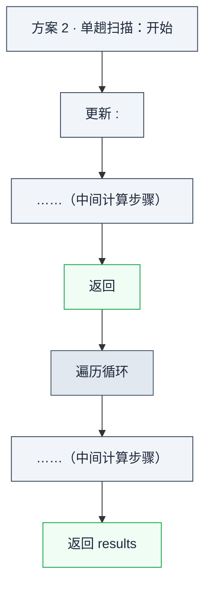

```go
package main // 引入依赖

import (
	"fmt" // 「fmt」
	"os"  // 「os」
)

// faithful translation of python solution_2___2.py
// 分书问题（优化版 / 函数式状态传递）：每次递归传入新的分配状态副本。
func allocateBooksFunc() [][]int { // 定义函数/方法 allocateBooksFunc
	like := [][]int{ // 把 [][]int{ 写入 like :
		{0, 0, 1, 1, 0},
		{1, 1, 0, 0, 1},
		{0, 1, 1, 0, 1},
		{0, 0, 0, 1, 0},
		{0, 1, 0, 0, 1},
	}
	results := [][]int{}                           // 把 [][]int{} 写入 results :
	var tryAssign func(reader int, assigned []int) // var tryAssign func(reader int, assigned []int)
	tryAssign = func(reader int, assigned []int) { // 把 func(reader int, assigned []int) { 写入 tryAssign
		if reader == 5 { // 若 reader 等于 5
			cp := make([]int, 5)          // 把 make([]int, 5) 写入 cp :
			copy(cp, assigned)            // copy(cp, assigned)
			results = append(results, cp) // 把 append(results, cp) 写入 results
			return                        // return
		}
		for book := 0; book < 5; book++ { // 让 book 从 0 开始计数
			if like[reader][book] == 1 && assigned[book] == -1 { // 若 like[reader][book] 等于 1 且 assigned[book] 等于 减 1
				nxt := make([]int, 5)    // 把 make([]int, 5) 写入 nxt :
				copy(nxt, assigned)      // copy(nxt, assigned)
				nxt[book] = reader       // 把 reader 写入 nxt[book]
				tryAssign(reader+1, nxt) // tryAssign(reader 加 1, nxt)
			}
		}
	}
	tryAssign(0, []int{-1, -1, -1, -1, -1}) // tryAssign(0, []int{ 减 1, 减 1, 减 1, 减 1, 减 1})
	return results                          // 返回 results
}

func main() { // 程序入口：跑内嵌自测用例
	res := allocateBooksFunc() // 把 allocateBooksFunc() 写入 res :
	ok := true                 // 把 true 写入 ok :
	if len(res) != 2 {         // 若 长度(结果) 不等于 2
		ok = false                                                       // 把 false 写入 ok
		fmt.Printf("FAIL allocateBooksFunc count=%d want 2\n", len(res)) // 打印输出
	}
	if len(res) >= 1 && fmt.Sprint(res[0]) != "[1 2 0 3 4]" { // 若 长度(结果) 不低于 1 且 fmt.Sprint(结果[0]) 不等于 「[1 2 0 3 4]」
		ok = false                                                               // 把 false 写入 ok
		fmt.Printf("FAIL allocateBooksFunc first=%v want [1 2 0 3 4]\n", res[0]) // 打印输出
	}
	if len(res) >= 2 && fmt.Sprint(res[1]) != "[1 4 0 3 2]" { // 若 长度(结果) 不低于 2 且 fmt.Sprint(结果[1]) 不等于 「[1 4 0 3 2]」
		ok = false                                                              // 把 false 写入 ok
		fmt.Printf("FAIL allocateBooksFunc last=%v want [1 4 0 3 2]\n", res[1]) // 打印输出
	}
	if !ok { // 若 取反 ok
		os.Exit(1) // os.Exit(1)
	}
	fmt.Println("PASS") // 全部用例通过，输出 PASS
}
```

#### 方案 3：双重循环枚举

**思路与代码分析**：核心是「双重循环枚举」。Go 版用切片与多返回值惯用法，显式处理索引边界。**走读**：方案 3 · 双重循环枚举：开始 → 更新 : → 遍历循环 → 返回 false → 返回 true → 返回  → 遍历循环 → 返回 results。

**运行架构**（真实控制流）：

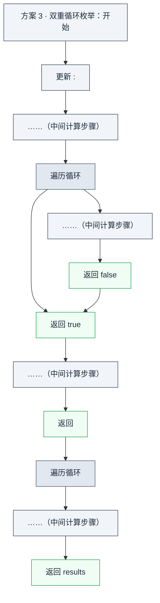

```go
package main // 引入依赖

import (
	"fmt" // 「fmt」
	"os"  // 「os」
)

func absInt(x int) int { // 定义函数/方法 absInt
	if x < 0 { // 若 x 小于 0
		return -x // 返回 减 x
	}
	return x // 返回 x
}

// faithful translation of python solution_3___3.py
// 八皇后问题（逐列放置 + 显式安全检查 isSafe）：board[col]=row 记录每列皇后所在行（1..8）。
func nQueensSafe() [][]int { // 定义函数/方法 nQueensSafe
	results := [][]int{}                // 把 [][]int{} 写入 results :
	board := make([]int, 8)             // 把 make([]int, 8) 写入 board :
	isSafe := func(col, row int) bool { // 把 func(col, row int) bool { 写入 isSafe :
		for c := 0; c < col; c++ { // 让 字符 从 0 开始计数
			if board[c] == row || absInt(board[c]-row) == absInt(c-col) { // 若 棋盘[字符] 等于 row 或 absInt(棋盘[字符] 减 row) 等于 absInt(字符 减 col
				return false // 返回 false
			}
		}
		return true // 返回 true
	}
	var place func(col int) // var place func(col int)
	place = func(col int) { // 把 func(col int) { 写入 place
		if col == 8 { // 若 col 等于 8
			cp := make([]int, 8)          // 把 make([]int, 8) 写入 cp :
			copy(cp, board)               // copy(cp, 棋盘)
			results = append(results, cp) // 把 append(results, cp) 写入 results
			return                        // return
		}
		for row := 1; row <= 8; row++ { // 让 row 从 1 开始计数
			if isSafe(col, row) { // 定义判定函数 isSafe
				board[col] = row // 把 row 写入 board[col]
				place(col + 1)   // place(col 加 1)
			}
		}
	}
	place(0)       // place(0)
	return results // 返回 results
}

func main() { // 程序入口：跑内嵌自测用例
	sols := nQueensSafe() // 把 nQueensSafe() 写入 sols :
	ok := true            // 把 true 写入 ok :
	if len(sols) != 92 {  // 若 长度(sols) 不等于 92
		ok = false                                                   // 把 false 写入 ok
		fmt.Printf("FAIL nQueensSafe count=%d want 92\n", len(sols)) // 打印输出
	}
	if len(sols) >= 1 && fmt.Sprint(sols[0]) != "[1 5 8 6 3 7 2 4]" {
		ok = false                                                                // 把 false 写入 ok
		fmt.Printf("FAIL nQueensSafe first=%v want [1 5 8 6 3 7 2 4]\n", sols[0]) // 打印输出
	}
	if len(sols) >= 2 && fmt.Sprint(sols[len(sols)-1]) != "[8 4 1 3 6 2 7 5]" {
		ok = false                                                                         // 把 false 写入 ok
		fmt.Printf("FAIL nQueensSafe last=%v want [8 4 1 3 6 2 7 5]\n", sols[len(sols)-1]) // 打印输出
	}
	if !ok { // 若 取反 ok
		os.Exit(1) // os.Exit(1)
	}
	fmt.Println("PASS") // 全部用例通过，输出 PASS
}
```

#### 方案 4：双重循环枚举

**思路与代码分析**：核心是「双重循环枚举」。Go 版用切片与多返回值惯用法，显式处理索引边界。**走读**：方案 4 · 双重循环枚举：开始 → 更新 : → 遍历循环 → 返回 false → 返回 true → 遍历循环 → 遍历循环 → 返回 solutions。

**运行架构**（真实控制流）：

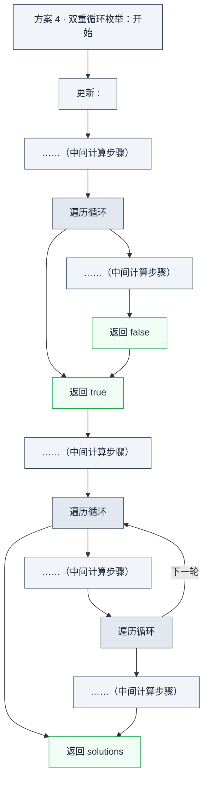

```go
package main // 引入依赖

import (
	"fmt" // 「fmt」
	"os"  // 「os」
)

func absInt2(x int) int { // 定义函数/方法 absInt2
	if x < 0 { // 若 x 小于 0
		return -x // 返回 减 x
	}
	return x // 返回 x
}

// faithful translation of python solution_4___4.py
// 八皇后问题（栈/迭代回溯）：用显式栈代替递归，按列放置皇后并通过 valid 检查安全性。
func nQueensStack() [][]int { // 定义函数/方法 nQueensStack
	valid := func(x int, a []int) bool { // 把 func(x int, 数组 []int) bool { 写入 valid :
		y := len(a) + 1          // 把 长度(数组) 加 1 写入 y :
		for i := 1; i < y; i++ { // 让 下标 i 从 1 开始计数
			if x == a[i-1] || absInt2(y-i) == absInt2(x-a[i-1]) {
				return false // 返回 false
			}
		}
		return true // 返回 true
	}
	solutions := [][]int{} // 把 [][]int{} 写入 solutions :
	stack := [][]int{{}}   // 把 [][]int{{}} 写入 stack :
	for len(stack) > 0 {   // for 长度(栈) 超过 0 {
		a := stack[len(stack)-1]     // 把 栈[长度(栈) 减 1] 写入 a :
		stack = stack[:len(stack)-1] // 把 栈[:长度(栈) 减 1] 写入 栈
		if len(a) == 8 {             // 若 长度(数组) 等于 8
			cp := make([]int, 8)              // 把 make([]int, 8) 写入 cp :
			copy(cp, a)                       // copy(cp, 数组)
			solutions = append(solutions, cp) // 把 append(solutions, cp) 写入 solutions
		} else { // 否则
			for i := 1; i <= 8; i++ { // 让 下标 i 从 1 开始计数
				if valid(i, a) { // 定义函数/方法 valid
					nxt := make([]int, len(a), len(a)+1) // 把 make([]int, 长度(数组), 长度(数组) 加 1) 写入 nxt :
					copy(nxt, a)                         // copy(nxt, 数组)
					nxt = append(nxt, i)                 // 追加新元素
					stack = append(stack, nxt)           // 把 append(栈, nxt) 写入 栈
				}
			}
		}
	}
	return solutions // 返回 solutions
}

func main() { // 程序入口：跑内嵌自测用例
	sols := nQueensStack() // 把 nQueensStack() 写入 sols :
	ok := true             // 把 true 写入 ok :
	if len(sols) != 92 {   // 若 长度(sols) 不等于 92
		ok = false                                                    // 把 false 写入 ok
		fmt.Printf("FAIL nQueensStack count=%d want 92\n", len(sols)) // 打印输出
	}
	if len(sols) >= 1 && fmt.Sprint(sols[0]) != "[8 4 1 3 6 2 7 5]" {
		ok = false                                                                 // 把 false 写入 ok
		fmt.Printf("FAIL nQueensStack first=%v want [8 4 1 3 6 2 7 5]\n", sols[0]) // 打印输出
	}
	if len(sols) >= 2 && fmt.Sprint(sols[len(sols)-1]) != "[1 5 8 6 3 7 2 4]" {
		ok = false                                                                          // 把 false 写入 ok
		fmt.Printf("FAIL nQueensStack last=%v want [1 5 8 6 3 7 2 4]\n", sols[len(sols)-1]) // 打印输出
	}
	if !ok { // 若 取反 ok
		os.Exit(1) // os.Exit(1)
	}
	fmt.Println("PASS") // 全部用例通过，输出 PASS
}
```

#### 方案 5：单趟扫描

**思路与代码分析**：核心是「单趟扫描」。Go 版用切片与多返回值惯用法，显式处理索引边界。**走读**：方案 5 · 单趟扫描：开始 → 计算 SIZE → 遍历 rows 的下标与元素 i → 遍历 diag1 的下标与元素 i → 返回  → 遍历循环 → 返回 results。

**运行架构**（真实控制流）：

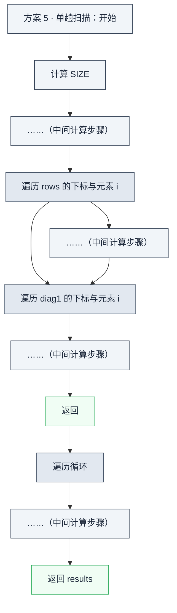

```go
package main // 引入依赖

import (
	"fmt" // 「fmt」
	"os"  // 「os」
)

// faithful translation of python solution_5___5.py
// 八皇后问题（优化回溯，rows/diag1/diag2 布尔数组标记），0-indexed。
func nQueensBool() [][]int { // 定义函数/方法 nQueensBool
	const SIZE = 8                  // 把 8 存入 SIZE
	colRow := make([]int, SIZE)     // 把 make([]int, SIZE) 写入 colRow :
	rows := make([]bool, SIZE)      // 把 make([]bool, SIZE) 写入 rows :
	diag1 := make([]bool, 2*SIZE-1) // col - row + OFFSET
	diag2 := make([]bool, 2*SIZE-1) // col + row
	const OFFSET = SIZE - 1         // 把 SIZE 减 1 存入 OFFSET
	for i := range rows {           // 把 range 行数 { 写入 for i :
		rows[i] = true // 把 true 写入 rows[i]
	}
	for i := range diag1 { // 把 range diag1 { 写入 for i :
		diag1[i] = true // 把 true 写入 diag1[i]
		diag2[i] = true // 把 true 写入 diag2[i]
	}
	results := [][]int{}    // 把 [][]int{} 写入 results :
	var place func(col int) // var place func(col int)
	place = func(col int) { // 把 func(col int) { 写入 place
		if col == SIZE { // 若 col 等于 SIZE
			cp := make([]int, SIZE)       // 把 make([]int, SIZE) 写入 cp :
			copy(cp, colRow)              // copy(cp, colRow)
			results = append(results, cp) // 把 append(results, cp) 写入 results
			return                        // return
		}
		for row := 0; row < SIZE; row++ { // 让 row 从 0 开始计数
			d1 := col - row + OFFSET                 // 把 col 减 row 加 OFFSET 写入 d1 :
			d2 := col + row                          // 把 col 加 row 写入 d2 :
			if rows[row] && diag1[d1] && diag2[d2] { // 若 行数[row] 且 diag1[d1] 且 diag2[d2]
				colRow[col] = row // 把 row 写入 colRow[col]
				rows[row] = false // 把 false 写入 rows[row]
				diag1[d1] = false // 把 false 写入 diag1[d1]
				diag2[d2] = false // 把 false 写入 diag2[d2]
				place(col + 1)    // place(col 加 1)
				rows[row] = true  // 把 true 写入 rows[row]
				diag1[d1] = true  // 把 true 写入 diag1[d1]
				diag2[d2] = true  // 把 true 写入 diag2[d2]
			}
		}
	}
	place(0)       // place(0)
	return results // 返回 results
}

func main() { // 程序入口：跑内嵌自测用例
	sols := nQueensBool() // 把 nQueensBool() 写入 sols :
	ok := true            // 把 true 写入 ok :
	if len(sols) != 92 {  // 若 长度(sols) 不等于 92
		ok = false                                                   // 把 false 写入 ok
		fmt.Printf("FAIL nQueensBool count=%d want 92\n", len(sols)) // 打印输出
	}
	if len(sols) >= 1 && fmt.Sprint(sols[0]) != "[0 4 7 5 2 6 1 3]" {
		ok = false                                                                // 把 false 写入 ok
		fmt.Printf("FAIL nQueensBool first=%v want [0 4 7 5 2 6 1 3]\n", sols[0]) // 打印输出
	}
	if len(sols) >= 2 && fmt.Sprint(sols[len(sols)-1]) != "[7 3 0 2 5 1 6 4]" {
		ok = false                                                                         // 把 false 写入 ok
		fmt.Printf("FAIL nQueensBool last=%v want [7 3 0 2 5 1 6 4]\n", sols[len(sols)-1]) // 打印输出
	}
	if !ok { // 若 取反 ok
		os.Exit(1) // os.Exit(1)
	}
	fmt.Println("PASS") // 全部用例通过，输出 PASS
}
```

#### 方案 6：单趟扫描

**思路与代码分析**：核心是「单趟扫描」。Go 版用切片与多返回值惯用法，显式处理索引边界。**走读**：方案 6 · 单趟扫描：开始 → 计算 SIZE → 返回  → 遍历循环 → 返回 results。

**运行架构**（真实控制流）：

```mermaid
graph TD
    N0["方案 6 · 单趟扫描：开始"]
    N1["计算 SIZE"]
    D1["……（中间计算步骤）"]
    N9["返回 "]
    N10["遍历循环"]
    D2["……（中间计算步骤）"]
    N28["返回 results"]
    N0 --> N1
    N9 --> N10
    N1 --> D1
    D1 --> N9
    N10 --> D2
    D2 --> N28
    classDef n fill:#f1f5f9,stroke:#334155,color:#1e293b;
    classDef lp fill:#e2e8f0,stroke:#475569,color:#1e293b;
    classDef dc fill:#fef9c3,stroke:#ca8a04,color:#1e293b;
    classDef tm fill:#f0fdf4,stroke:#16a34a,color:#1e293b;
    class N0,N1,D1,D2 n;
    class N10 lp;
    class N9,N28 tm;
```

```go
package main // 引入依赖

import (
	"fmt" // 「fmt」
	"os"  // 「os」
)

// faithful translation of python solution_6___6.py
// 八皇后问题（程序优化 / 函数式不可变状态传递）：每次递归传入新的状态副本。
func nQueensFunc() [][]int { // 定义函数/方法 nQueensFunc
	const SIZE = 8       // 把 8 存入 SIZE
	results := [][]int{} // 把 [][]int{} 写入 results :
	// place(col, state): state = (colRowList, rows, diag1, diag2)
	var place func(col int, colRow []int, rows []bool, diag1 []bool, diag2 []bool)
	place = func(col int, colRow []int, rows []bool, diag1 []bool, diag2 []bool) {
		if col == SIZE { // 若 col 等于 SIZE
			cp := make([]int, SIZE)       // 把 make([]int, SIZE) 写入 cp :
			copy(cp, colRow)              // copy(cp, colRow)
			results = append(results, cp) // 把 append(results, cp) 写入 results
			return                        // return
		}
		for row := 0; row < SIZE; row++ { // 让 row 从 0 开始计数
			d1 := col - row + (SIZE - 1)             // 把 col 减 row 加 (SIZE 减 1) 写入 d1 :
			d2 := col + row                          // 把 col 加 row 写入 d2 :
			if rows[row] && diag1[d1] && diag2[d2] { // 若 行数[row] 且 diag1[d1] 且 diag2[d2]
				nr := make([]bool, SIZE)                       // 把 make([]bool, SIZE) 写入 nr :
				copy(nr, rows)                                 // copy(nr, 行数)
				nr[row] = false                                // 把 false 写入 nr[row]
				nd1 := make([]bool, 2*SIZE-1)                  // 把 make([]bool, 2 乘 SIZE 减 1) 写入 nd1 :
				copy(nd1, diag1)                               // copy(nd1, diag1)
				nd1[d1] = false                                // 把 false 写入 nd1[d1]
				nd2 := make([]bool, 2*SIZE-1)                  // 把 make([]bool, 2 乘 SIZE 减 1) 写入 nd2 :
				copy(nd2, diag2)                               // copy(nd2, diag2)
				nd2[d2] = false                                // 把 false 写入 nd2[d2]
				ncr := make([]int, len(colRow), len(colRow)+1) // 把 make([]int, 长度(colRow), 长度(colRow) 加 1) 写入 ncr :
				copy(ncr, colRow)                              // copy(ncr, colRow)
				ncr = append(ncr, row)                         // 把 append(ncr, row) 写入 ncr
				place(col+1, ncr, nr, nd1, nd2)                // place(col 加 1, ncr, nr, nd1, nd2)
			}
		}
	}
	place(0, []int{}, boolsTrue(SIZE), boolsTrue(2*SIZE-1), boolsTrue(2*SIZE-1))
	return results // 返回 results
}

func boolsTrue(n int) []bool { // 定义函数/方法 boolsTrue
	b := make([]bool, n) // 把 make([]bool, 元素个数) 写入 b :
	for i := range b {   // 把 range b { 写入 for i :
		b[i] = true // 把 true 写入 b[i]
	}
	return b // 返回 b
}

func main() { // 程序入口：跑内嵌自测用例
	sols := nQueensFunc() // 把 nQueensFunc() 写入 sols :
	ok := true            // 把 true 写入 ok :
	if len(sols) != 92 {  // 若 长度(sols) 不等于 92
		ok = false                                                   // 把 false 写入 ok
		fmt.Printf("FAIL nQueensFunc count=%d want 92\n", len(sols)) // 打印输出
	}
	if len(sols) >= 1 && fmt.Sprint(sols[0]) != "[0 4 7 5 2 6 1 3]" {
		ok = false                                                                // 把 false 写入 ok
		fmt.Printf("FAIL nQueensFunc first=%v want [0 4 7 5 2 6 1 3]\n", sols[0]) // 打印输出
	}
	if len(sols) >= 2 && fmt.Sprint(sols[len(sols)-1]) != "[7 3 0 2 5 1 6 4]" {
		ok = false                                                                         // 把 false 写入 ok
		fmt.Printf("FAIL nQueensFunc last=%v want [7 3 0 2 5 1 6 4]\n", sols[len(sols)-1]) // 打印输出
	}
	if !ok { // 若 取反 ok
		os.Exit(1) // os.Exit(1)
	}
	fmt.Println("PASS") // 全部用例通过，输出 PASS
}
```

#### 方案 7：双重循环枚举

**思路与代码分析**：核心是「双重循环枚举」。Go 版用切片与多返回值惯用法，显式处理索引边界。**走读**：方案 7 · 双重循环枚举：开始 → 处理 type pos struct → 遍历 positions 的下标与元素 p → 返回 false → 返回 true → 遍历 positions 的下标与元素 p → 返回  → 遍历循环 → 返回 solutions。

**运行架构**（真实控制流）：

```mermaid
graph TD
    N0["方案 7 · 双重循环枚举：开始"]
    N1["处理 type pos struct"]
    D1["……（中间计算步骤）"]
    N5["遍历 positions 的下标与元素 p"]
    D2["……（中间计算步骤）"]
    N7["返回 false"]
    N8["返回 true"]
    D3["……（中间计算步骤）"]
    N13["遍历 positions 的下标与元素 p"]
    D4["……（中间计算步骤）"]
    N16["返回 "]
    N17["遍历循环"]
    D5["……（中间计算步骤）"]
    N23["返回 solutions"]
    N0 --> N1
    N5 --> N8
    N16 --> N17
    N1 --> D1
    D1 --> N5
    N5 --> D2
    D2 --> N7
    N7 --> N8
    N8 --> D3
    D3 --> N13
    N13 --> D4
    D4 --> N16
    N17 --> D5
    D5 --> N23
    classDef n fill:#f1f5f9,stroke:#334155,color:#1e293b;
    classDef lp fill:#e2e8f0,stroke:#475569,color:#1e293b;
    classDef dc fill:#fef9c3,stroke:#ca8a04,color:#1e293b;
    classDef tm fill:#f0fdf4,stroke:#16a34a,color:#1e293b;
    class N0,N1,D1,D2,D3,D4,D5 n;
    class N5,N13,N17 lp;
    class N7,N8,N16,N23 tm;
```

```go
package main // 引入依赖

import (
	"fmt" // 「fmt」
	"os"  // 「os」
)

func absInt3(x int) int { // 定义函数/方法 absInt3
	if x < 0 { // 若 x 小于 0
		return -x // 返回 减 x
	}
	return x // 返回 x
}

// faithful translation of python solution_7___7.py
// 八皇后问题（简洁递归版）：以 (row, col) 记录已放置皇后，逐列尝试并检查攻击。
func nQueensSimple() [][]int { // 定义函数/方法 nQueensSimple
	type pos struct{ r, c int }   // 定义类型
	positions := []pos{}          // 把 []pos{} 写入 positions :
	solutions := [][]int{}        // 把 [][]int{} 写入 solutions :
	safe := func(r, c int) bool { // 把 func(右指针, 字符 int) bool { 写入 safe :
		for _, p := range positions { // 同时取 _ 与 节点 遍历
			if p.r == r || absInt3(p.r-r) == absInt3(p.c-c) {
				return false // 返回 false
			}
		}
		return true // 返回 true
	}
	var solve func(col int) // var solve func(col int)
	solve = func(col int) { // 把 func(col int) { 写入 solve
		if col == 8 { // 若 col 等于 8
			s := make([]int, 8)           // 把 make([]int, 8) 写入 s :
			for i, p := range positions { // 同时取 下标 i 与 节点 遍历
				s[i] = p.r // 把 节点.右指针 写入 s[i]
			}
			solutions = append(solutions, s) // 把 append(solutions, 字符串) 写入 solutions
			return                           // return
		}
		for r := 0; r < 8; r++ { // 让 右指针 从 0 开始计数
			if safe(r, col) { // 定义函数/方法 safe
				positions = append(positions, pos{r, col}) // 把 append(positions, pos{右指针, col}) 写入 positions
				solve(col + 1)                             // solve(col 加 1)
				positions = positions[:len(positions)-1]   // 把 positions[:长度(positions) 减 1] 写入 positions
			}
		}
	}
	solve(0)         // solve(0)
	return solutions // 返回 solutions
}

func main() { // 程序入口：跑内嵌自测用例
	sols := nQueensSimple() // 把 nQueensSimple() 写入 sols :
	ok := true              // 把 true 写入 ok :
	if len(sols) != 92 {    // 若 长度(sols) 不等于 92
		ok = false                                                     // 把 false 写入 ok
		fmt.Printf("FAIL nQueensSimple count=%d want 92\n", len(sols)) // 打印输出
	}
	if len(sols) >= 1 && fmt.Sprint(sols[0]) != "[0 4 7 5 2 6 1 3]" {
		ok = false                                                                  // 把 false 写入 ok
		fmt.Printf("FAIL nQueensSimple first=%v want [0 4 7 5 2 6 1 3]\n", sols[0]) // 打印输出
	}
	if len(sols) >= 2 && fmt.Sprint(sols[len(sols)-1]) != "[7 3 0 2 5 1 6 4]" {
		ok = false                                                                           // 把 false 写入 ok
		fmt.Printf("FAIL nQueensSimple last=%v want [7 3 0 2 5 1 6 4]\n", sols[len(sols)-1]) // 打印输出
	}
	if !ok { // 若 取反 ok
		os.Exit(1) // os.Exit(1)
	}
	fmt.Println("PASS") // 全部用例通过，输出 PASS
}
```

### Java 实现（7 种方案）

Java 的全部方案如下，每个方案都内嵌用例自测，可独立运行（老仓库 python/go 文件遵循「打印结果」约定）：

#### 方案 1：单趟扫描

**思路与代码分析**：核心是「单趟扫描」。Java 版用类与静态方法组织，集合操作显式明了。代码里依次做这些事：单循环线性扫描。**走读**：方案 1 · 单趟扫描：开始 → 若 reader == 5 则： → 调用 results.add(assigned.clone() → 返回  → 遍历循环 → 处理 if (like[reader][book] == 1 → 更新 = → 更新 assigned[book] → 调用 tryAssign(reader + 1) → 更新 assigned[book]。

**运行架构**（真实控制流）：

```mermaid
graph TD
    N0["方案 1 · 单趟扫描：开始"]
    N1["若 reader == 5 则："]
    N2["调用 results.add(assigned.clone()"]
    N3["返回 "]
    N4["遍历循环"]
    N5["处理 if (like[reader][book] == 1"]
    N6["更新 ="]
    N7["更新 assigned[book]"]
    N8["调用 tryAssign(reader + 1)"]
    N9["更新 assigned[book]"]
    N0 --> N1
    N1 --> N2
    N2 --> N3
    N3 --> N4
    N4 --> N5
    N5 --> N6
    N6 --> N7
    N7 --> N8
    N8 --> N9
    N9 -- 下一轮 --> N4
    classDef n fill:#f1f5f9,stroke:#334155,color:#1e293b;
    classDef lp fill:#e2e8f0,stroke:#475569,color:#1e293b;
    classDef dc fill:#fef9c3,stroke:#ca8a04,color:#1e293b;
    classDef tm fill:#f0fdf4,stroke:#16a34a,color:#1e293b;
    class N0,N1,N2,N5,N6,N7,N8,N9 n;
    class N4 lp;
    class N3 tm;
```

```java
package com.webfault.dsa; // 引入依赖

import java.util.*; // 引入依赖

class Main { // 定义类型
  int[][] like = { // 把 { 写入 int[][] like
    {0, 0, 1, 1, 0},
    {1, 1, 0, 0, 1},
    {0, 1, 1, 0, 1},
    {0, 0, 0, 1, 0},
    {0, 1, 0, 0, 1},
  };
  int[] assigned; // int[] assigned;
  List<int[]> results; // List 小于 int[] 超过 results;

  void tryAssign(int reader) { // 定义函数/方法 tryAssign
    if (reader == 5) {
      results.add(assigned.clone());
      return;
    } // 若 reader 等于 5) { results 追加 assigned.clone()); return; }
    for (int book = 0; book < 5; book++) { // 让 book 从 0 开始计数，book 小于 5 就继续
      if (like[reader][book] == 1
          && assigned[book] == -1) { // 若 like[reader][book] 等于 1 且 assigned[book] 等于 减 1
        assigned[book] = reader; // 把 reader; 写入 assigned[book]
        tryAssign(reader + 1); // tryAssign(reader 加 1);
        assigned[book] = -1; // 把 减 1; 写入 assigned[book]
      }
    }
  }

  List<int[]> allocateBooks() { // 定义函数/方法 allocateBooks
    assigned = new int[] {-1, -1, -1, -1, -1}; // 把 new int[]{ 减 1, 减 1, 减 1, 减 1, 减 1}; 写入 assigned
    results = new ArrayList<>(); // 把 new ArrayList 小于 超过 (); 写入 results
    tryAssign(0); // tryAssign(0);
    return results; // 返回 results
  }

  public static void main(String[] args) { // public static void main(String[] args) {
    Main s = new Main(); // 把 new Main(); 写入 Main s
    List<int[]> res = s.allocateBooks(); // 把 字符串.allocateBooks(); 写入 List<int[]> res
    boolean ok = true; // 把 true; 写入 boolean ok
    if (res.size() != 2) {
      ok = false;
      System.out.println("FAIL count=" + res.size());
    }
    Set<String> got = new HashSet<>(); // 把 new HashSet 小于 超过 (); 写入 Set<String> got
    for (int[] a : res)
      got.add(Arrays.toString(a)); // for (int[] 数组 : 结果) got 追加 Arrays.toString(数组));
    Set<String> want = new HashSet<>(Arrays.asList("[1, 2, 0, 3, 4]", "[1, 4, 0, 3, 2]"));
    if (!got.equals(want)) {
      ok = false;
      System.out.println("FAIL set=" + got);
    }
    if (!ok) throw new RuntimeException("FAILED"); // 若 取反 ok) throw new RuntimeException(「FAILED」);
    System.out.println("PASS"); // 全部用例通过，输出 PASS
  }
}
```

#### 方案 2：单趟扫描

**思路与代码分析**：核心是「单趟扫描」。Java 版用类与静态方法组织，集合操作显式明了。代码里依次做这些事：单循环线性扫描。**走读**：方案 2 · 单趟扫描：开始 → 若 reader == 5 则： → 调用 results.add(assigned) → 返回  → 遍历循环 → 处理 if (like[reader][book] == 1 → 更新 = → 更新 nxt → 更新 nxt[book] → 调用 tryAssign(reader + 1, nxt)。

**运行架构**（真实控制流）：

```mermaid
graph TD
    N0["方案 2 · 单趟扫描：开始"]
    N1["若 reader == 5 则："]
    N2["调用 results.add(assigned)"]
    N3["返回 "]
    N4["遍历循环"]
    N5["处理 if (like[reader][book] == 1"]
    N6["更新 ="]
    N7["更新 nxt"]
    N8["更新 nxt[book]"]
    N9["调用 tryAssign(reader + 1, nxt)"]
    N0 --> N1
    N1 --> N2
    N2 --> N3
    N3 --> N4
    N4 --> N5
    N5 --> N6
    N6 --> N7
    N7 --> N8
    N8 --> N9
    N9 -- 下一轮 --> N4
    classDef n fill:#f1f5f9,stroke:#334155,color:#1e293b;
    classDef lp fill:#e2e8f0,stroke:#475569,color:#1e293b;
    classDef dc fill:#fef9c3,stroke:#ca8a04,color:#1e293b;
    classDef tm fill:#f0fdf4,stroke:#16a34a,color:#1e293b;
    class N0,N1,N2,N5,N6,N7,N8,N9 n;
    class N4 lp;
    class N3 tm;
```

```java
package com.webfault.dsa; // 引入依赖

import java.util.*; // 引入依赖

class Main { // 定义类型
  int[][] like = { // 把 { 写入 int[][] like
    {0, 0, 1, 1, 0},
    {1, 1, 0, 0, 1},
    {0, 1, 1, 0, 1},
    {0, 0, 0, 1, 0},
    {0, 1, 0, 0, 1},
  };
  List<int[]> results; // List 小于 int[] 超过 results;

  void tryAssign(int reader, int[] assigned) { // 定义函数/方法 tryAssign
    if (reader == 5) {
      results.add(assigned);
      return;
    } // 若 reader 等于 5) { results 追加 assigned); return; }
    for (int book = 0; book < 5; book++) { // 让 book 从 0 开始计数，book 小于 5 就继续
      if (like[reader][book] == 1
          && assigned[book] == -1) { // 若 like[reader][book] 等于 1 且 assigned[book] 等于 减 1
        int[] nxt = assigned.clone(); // 把 assigned.clone(); 写入 int[] nxt
        nxt[book] = reader; // 把 reader; 写入 nxt[book]
        tryAssign(reader + 1, nxt); // tryAssign(reader 加 1, nxt);
      }
    }
  }

  List<int[]> allocateBooks() { // 定义函数/方法 allocateBooks
    results = new ArrayList<>(); // 把 new ArrayList 小于 超过 (); 写入 results
    tryAssign(
        0, new int[] {-1, -1, -1, -1, -1}); // tryAssign(0, new int[]{ 减 1, 减 1, 减 1, 减 1, 减 1});
    return results; // 返回 results
  }

  public static void main(String[] args) { // public static void main(String[] args) {
    Main s = new Main(); // 把 new Main(); 写入 Main s
    List<int[]> res = s.allocateBooks(); // 把 字符串.allocateBooks(); 写入 List<int[]> res
    boolean ok = true; // 把 true; 写入 boolean ok
    if (res.size() != 2) {
      ok = false;
      System.out.println("FAIL count=" + res.size());
    }
    Set<String> got = new HashSet<>(); // 把 new HashSet 小于 超过 (); 写入 Set<String> got
    for (int[] a : res)
      got.add(Arrays.toString(a)); // for (int[] 数组 : 结果) got 追加 Arrays.toString(数组));
    Set<String> want = new HashSet<>(Arrays.asList("[1, 2, 0, 3, 4]", "[1, 4, 0, 3, 2]"));
    if (!got.equals(want)) {
      ok = false;
      System.out.println("FAIL set=" + got);
    }
    if (!ok) throw new RuntimeException("FAILED"); // 若 取反 ok) throw new RuntimeException(「FAILED」);
    System.out.println("PASS"); // 全部用例通过，输出 PASS
  }
}
```

#### 方案 3：双重循环枚举

**思路与代码分析**：核心是「双重循环枚举」。Java 版用类与静态方法组织，集合操作显式明了。代码里依次做这些事：单循环线性扫描。**走读**：方案 3 · 双重循环枚举：开始 → 遍历循环 → 命中条件，直接返回 → 返回 true。

**运行架构**（真实控制流）：

```mermaid
graph TD
    N0["方案 3 · 双重循环枚举：开始"]
    N1["遍历循环"]
    N2{"board[c] == row 或 Math.abs(board[c] - row) == Math.abs(c - col) ？"}
    N3["命中条件，直接返回"]
    N4["返回 true"]
    N0 --> N1
    N1 --> N2
    N2 -- 是 --> N3
    N2 -- 否 --> N4
    classDef n fill:#f1f5f9,stroke:#334155,color:#1e293b;
    classDef lp fill:#e2e8f0,stroke:#475569,color:#1e293b;
    classDef dc fill:#fef9c3,stroke:#ca8a04,color:#1e293b;
    classDef tm fill:#f0fdf4,stroke:#16a34a,color:#1e293b;
    class N0 n;
    class N1 lp;
    class N2 dc;
    class N3,N4 tm;
```

```java
package com.webfault.dsa; // 引入依赖

import java.util.*; // 引入依赖

class Main { // 定义类型
  int[] board = new int[8]; // 把 new int[8]; 写入 int[] board
  List<int[]> results; // List 小于 int[] 超过 results;

  boolean isSafe(int col, int row) { // 定义判定函数 isSafe
    for (int c = 0; c < col; c++) // 让 字符 从 0 开始计数，字符 小于 col 就继续
    if (board[c] == row || Math.abs(board[c] - row) == Math.abs(c - col)) return false;
    return true; // 返回 true
  }

  void place(int col) { // 定义函数/方法 place
    if (col == 8) {
      results.add(board.clone());
      return;
    } // 若 col 等于 8) { results 追加 棋盘.clone()); return; }
    for (int row = 1; row <= 8; row++) { // 让 row 从 1 开始计数，row 不超过 8 就继续
      if (isSafe(col, row)) {
        board[col] = row;
        place(col + 1);
      } // 若 isSafe(col, row)) { 棋盘[col] 赋值为 row; place(col 加 1); }
    }
  }

  List<int[]> nQueens() { // 定义函数/方法 nQueens
    results = new ArrayList<>(); // 把 new ArrayList 小于 超过 (); 写入 results
    board = new int[8]; // 把 new int[8]; 写入 棋盘
    place(0); // place(0);
    return results; // 返回 results
  }

  public static void main(String[] args) { // public static void main(String[] args) {
    Main s = new Main(); // 把 new Main(); 写入 Main s
    List<int[]> sols = s.nQueens(); // 把 字符串.nQueens(); 写入 List<int[]> sols
    boolean ok = true; // 把 true; 写入 boolean ok
    if (sols.size() != 92) {
      ok = false;
      System.out.println("FAIL count=" + sols.size());
    }
    if (!Arrays.equals(sols.get(0), new int[] {1, 5, 8, 6, 3, 7, 2, 4})) {
      ok = false;
      System.out.println("FAIL first=" + Arrays.toString(sols.get(0)));
    }
    if (!ok) throw new RuntimeException("FAILED"); // 若 取反 ok) throw new RuntimeException(「FAILED」);
    System.out.println("PASS"); // 全部用例通过，输出 PASS
  }
}
```

#### 方案 4：双重循环枚举

**思路与代码分析**：核心是「双重循环枚举」。Java 版用类与静态方法组织，集合操作显式明了。代码里依次做这些事：单循环线性扫描。**走读**：方案 4 · 双重循环枚举：开始 → 更新 y → 遍历循环 → 命中条件，直接返回 → 返回 true。

**运行架构**（真实控制流）：

```mermaid
graph TD
    N0["方案 4 · 双重循环枚举：开始"]
    N1["更新 y"]
    N2["遍历循环"]
    N3{"x == a.get(i - 1) 或 Math.abs(y - i) == Math.abs(x - a.get(i - 1)) ？"}
    N4["命中条件，直接返回"]
    N5["返回 true"]
    N0 --> N1
    N1 --> N2
    N2 --> N3
    N3 -- 是 --> N4
    N3 -- 否 --> N5
    classDef n fill:#f1f5f9,stroke:#334155,color:#1e293b;
    classDef lp fill:#e2e8f0,stroke:#475569,color:#1e293b;
    classDef dc fill:#fef9c3,stroke:#ca8a04,color:#1e293b;
    classDef tm fill:#f0fdf4,stroke:#16a34a,color:#1e293b;
    class N0,N1 n;
    class N2 lp;
    class N3 dc;
    class N4,N5 tm;
```

```java
package com.webfault.dsa; // 引入依赖

import java.util.*; // 引入依赖

class Main { // 定义类型
  boolean valid(int x, List<Integer> a) { // 定义函数/方法 valid
    int y = a.size() + 1; // 把 数组.大小() 加 1 存入 y
    for (int i = 1; i < y; i++) // 让 下标 i 从 1 开始计数，下标 i 小于 y 就继续
    if (x == a.get(i - 1) || Math.abs(y - i) == Math.abs(x - a.get(i - 1))) return false;
    return true; // 返回 true
  }

  List<List<Integer>> nQueens() { // 定义函数/方法 nQueens
    List<List<Integer>> solutions =
        new ArrayList<>(); // 把 new ArrayList 小于 超过 (); 写入 List<List<Integer>> solutions
    Deque<List<Integer>> stack =
        new ArrayDeque<>(); // 把 new ArrayDeque 小于 超过 (); 写入 Deque<List<Integer>> stack
    stack.push(new ArrayList<>()); // 把 new ArrayList 小于 超过 ( 压入栈/数组尾部
    while (!stack.isEmpty()) { // 循环，直到不满足「取反 栈.isEmpty(」
      List<Integer> a = stack.pop(); // 弹出栈顶元素
      if (a.size() == 8) solutions.add(a); // 若 数组.大小() 等于 8) solutions 追加 数组);
      else { // 否则
        for (int i = 1; i <= 8; i++) { // 让 下标 i 从 1 开始计数，下标 i 不超过 8 就继续
          if (valid(i, a)) { // 若 valid(下标 i, 数组
            List<Integer> na =
                new ArrayList<>(a); // 把 new ArrayList 小于 超过 (数组); 写入 List<Integer> na
            na.add(i); // na 追加 下标 i);
            stack.push(na); // 把 na 压入栈/数组尾部
          }
        }
      }
    }
    return solutions; // 返回 solutions
  }

  public static void main(String[] args) { // public static void main(String[] args) {
    Main s = new Main(); // 把 new Main(); 写入 Main s
    List<List<Integer>> sols = s.nQueens(); // 把 字符串.nQueens(); 写入 List<List<Integer>> sols
    boolean ok = true; // 把 true; 写入 boolean ok
    if (sols.size() != 92) {
      ok = false;
      System.out.println("FAIL count=" + sols.size());
    }
    List<Integer> first = sols.get(0); // 把 sols 查找 0); 写入 List<Integer> first
    List<Integer> want =
        Arrays.asList(
            8, 4, 1, 3, 6, 2, 7, 5); // 把 Arrays.asList(8,4,1,3,6,2,7,5); 写入 List<Integer> want
    if (!first.equals(want)) {
      ok = false;
      System.out.println("FAIL first=" + first);
    }
    if (!ok) throw new RuntimeException("FAILED"); // 若 取反 ok) throw new RuntimeException(「FAILED」);
    System.out.println("PASS"); // 全部用例通过，输出 PASS
  }
}
```

#### 方案 5：单趟扫描

**思路与代码分析**：核心是「单趟扫描」。Java 版用类与静态方法组织，集合操作显式明了。代码里依次做这些事：单循环线性扫描。**走读**：方案 5 · 单趟扫描：开始 → 若 col == SIZE 则： → 调用 results.add(colRow.clone()) → 返回  → 遍历循环 → 更新 d1 → 更新 d2 → 若 rows[row] 且 diag1[d1] 且 diag2[d2] 则： → 更新 colRow[col] → 更新 rows[row] → 更新 diag1[d1] → 调用 place(col + 1) → 更新 rows[row] → 更新 diag1[d1]。

**运行架构**（真实控制流）：

```mermaid
graph TD
    N0["方案 5 · 单趟扫描：开始"]
    N1["若 col == SIZE 则："]
    N2["调用 results.add(colRow.clone())"]
    N3["返回 "]
    N4["遍历循环"]
    N5["更新 d1"]
    N6["更新 d2"]
    N7["若 rows[row] 且 diag1[d1] 且 diag2[d2] 则："]
    N8["更新 colRow[col]"]
    N9["更新 rows[row]"]
    N10["更新 diag1[d1]"]
    N11["调用 place(col + 1)"]
    N12["更新 rows[row]"]
    N13["更新 diag1[d1]"]
    N0 --> N1
    N1 --> N2
    N2 --> N3
    N3 --> N4
    N4 --> N5
    N5 --> N6
    N6 --> N7
    N7 --> N8
    N8 --> N9
    N9 --> N10
    N10 --> N11
    N11 --> N12
    N12 --> N13
    N13 -- 下一轮 --> N4
    classDef n fill:#f1f5f9,stroke:#334155,color:#1e293b;
    classDef lp fill:#e2e8f0,stroke:#475569,color:#1e293b;
    classDef dc fill:#fef9c3,stroke:#ca8a04,color:#1e293b;
    classDef tm fill:#f0fdf4,stroke:#16a34a,color:#1e293b;
    class N0,N1,N2,N5,N6,N7,N8,N9,N10,N11,N12,N13 n;
    class N4 lp;
    class N3 tm;
```

```java
package com.webfault.dsa; // 引入依赖

import java.util.*; // 引入依赖

class Main { // 定义类型
  int SIZE = 8; // 把 8 存入 SIZE
  int[] colRow; // int[] colRow;
  boolean[] rows, diag1, diag2; // boolean[] 行数, diag1, diag2;
  List<int[]> results; // List 小于 int[] 超过 results;

  void place(int col) { // 定义函数/方法 place
    if (col == SIZE) {
      results.add(colRow.clone());
      return;
    } // 若 col 等于 SIZE) { results 追加 colRow.clone()); return; }
    for (int row = 0; row < SIZE; row++) { // 让 row 从 0 开始计数，row 小于 SIZE 就继续
      int d1 = col - row + (SIZE - 1); // 把 col 减 row 加 (SIZE 减 1) 存入 d1
      int d2 = col + row; // 把 col 加 row 存入 d2
      if (rows[row] && diag1[d1] && diag2[d2]) { // 若 行数[row] 且 diag1[d1] 且 diag2[d2]
        colRow[col] = row; // 把 row; 写入 colRow[col]
        rows[row] =
            diag1[d1] = diag2[d2] = false; // 把 diag1[d1] 赋值为 diag2[d2] 赋值为 false; 写入 rows[row]
        place(col + 1); // place(col 加 1);
        rows[row] =
            diag1[d1] = diag2[d2] = true; // 把 diag1[d1] 赋值为 diag2[d2] 赋值为 true; 写入 rows[row]
      }
    }
  }

  List<int[]> nQueens() { // 定义函数/方法 nQueens
    colRow = new int[SIZE]; // 把 new int[SIZE]; 写入 colRow
    rows = new boolean[SIZE]; // 把 new boolean[SIZE]; 写入 行数
    diag1 = new boolean[2 * SIZE - 1]; // 把 new boolean[2 乘 SIZE 减 1]; 写入 diag1
    diag2 = new boolean[2 * SIZE - 1]; // 把 new boolean[2 乘 SIZE 减 1]; 写入 diag2
    Arrays.fill(rows, true); // Arrays.fill(行数, true);
    Arrays.fill(diag1, true); // Arrays.fill(diag1, true);
    Arrays.fill(diag2, true); // Arrays.fill(diag2, true);
    results = new ArrayList<>(); // 把 new ArrayList 小于 超过 (); 写入 results
    place(0); // place(0);
    return results; // 返回 results
  }

  public static void main(String[] args) { // public static void main(String[] args) {
    Main s = new Main(); // 把 new Main(); 写入 Main s
    List<int[]> sols = s.nQueens(); // 把 字符串.nQueens(); 写入 List<int[]> sols
    boolean ok = true; // 把 true; 写入 boolean ok
    if (sols.size() != 92) {
      ok = false;
      System.out.println("FAIL count=" + sols.size());
    }
    if (!Arrays.equals(sols.get(0), new int[] {0, 4, 7, 5, 2, 6, 1, 3})) {
      ok = false;
      System.out.println("FAIL first=" + Arrays.toString(sols.get(0)));
    }
    if (!ok) throw new RuntimeException("FAILED"); // 若 取反 ok) throw new RuntimeException(「FAILED」);
    System.out.println("PASS"); // 全部用例通过，输出 PASS
  }
}
```

#### 方案 6：单趟扫描

**思路与代码分析**：核心是「单趟扫描」。Java 版用类与静态方法组织，集合操作显式明了。代码里依次做这些事：单循环线性扫描。**走读**：方案 6 · 单趟扫描：开始 → 若 col == SIZE 则： → 返回  → 遍历循环。

**运行架构**（真实控制流）：

```mermaid
graph TD
    N0["方案 6 · 单趟扫描：开始"]
    N1["若 col == SIZE 则："]
    D1["……（中间计算步骤）"]
    N3["返回 "]
    N4["遍历循环"]
    Dend["……（中间计算步骤）"]
    N0 --> N1
    N3 --> N4
    N1 --> D1
    D1 --> N3
    N4 --> Dend
    classDef n fill:#f1f5f9,stroke:#334155,color:#1e293b;
    classDef lp fill:#e2e8f0,stroke:#475569,color:#1e293b;
    classDef dc fill:#fef9c3,stroke:#ca8a04,color:#1e293b;
    classDef tm fill:#f0fdf4,stroke:#16a34a,color:#1e293b;
    class N0,N1,D1,Dend n;
    class N4 lp;
    class N3 tm;
```

```java
package com.webfault.dsa; // 引入依赖

import java.util.*; // 引入依赖

class Main { // 定义类型
  int SIZE = 8; // 把 8 存入 SIZE
  List<int[]> results; // List 小于 int[] 超过 results;

  void place(
      int col, int[] colRow, boolean[] rows, boolean[] diag1, boolean[] diag2) { // 定义函数/方法 place
    if (col == SIZE) {
      results.add(colRow);
      return;
    } // 若 col 等于 SIZE) { results 追加 colRow); return; }
    for (int row = 0; row < SIZE; row++) { // 让 row 从 0 开始计数，row 小于 SIZE 就继续
      int d1 = col - row + (SIZE - 1); // 把 col 减 row 加 (SIZE 减 1) 存入 d1
      int d2 = col + row; // 把 col 加 row 存入 d2
      if (rows[row] && diag1[d1] && diag2[d2]) { // 若 行数[row] 且 diag1[d1] 且 diag2[d2]
        boolean[] nr = rows.clone();
        nr[row] = false; // 把 行数.clone(); nr[row] 赋值为 false; 写入 boolean[] nr
        boolean[] nd1 = diag1.clone();
        nd1[d1] = false; // 把 diag1.clone(); nd1[d1] 赋值为 false; 写入 boolean[] nd1
        boolean[] nd2 = diag2.clone();
        nd2[d2] = false; // 把 diag2.clone(); nd2[d2] 赋值为 false; 写入 boolean[] nd2
        int[] ncr = colRow.clone();
        ncr[col] = row; // 把 colRow.clone(); ncr[col] 赋值为 row; 写入 int[] ncr
        place(col + 1, ncr, nr, nd1, nd2); // place(col 加 1, ncr, nr, nd1, nd2);
      }
    }
  }

  List<int[]> nQueens() { // 定义函数/方法 nQueens
    results = new ArrayList<>(); // 把 new ArrayList 小于 超过 (); 写入 results
    boolean[] r = new boolean[SIZE]; // 把 new boolean[SIZE]; 写入 boolean[] r
    boolean[] d1 = new boolean[2 * SIZE - 1]; // 把 new boolean[2 乘 SIZE 减 1]; 写入 boolean[] d1
    boolean[] d2 = new boolean[2 * SIZE - 1]; // 把 new boolean[2 乘 SIZE 减 1]; 写入 boolean[] d2
    Arrays.fill(r, true);
    Arrays.fill(d1, true);
    Arrays.fill(d2, true);
    place(0, new int[SIZE], r, d1, d2); // place(0, new int[SIZE], 右指针, d1, d2);
    return results; // 返回 results
  }

  public static void main(String[] args) { // public static void main(String[] args) {
    Main s = new Main(); // 把 new Main(); 写入 Main s
    List<int[]> sols = s.nQueens(); // 把 字符串.nQueens(); 写入 List<int[]> sols
    boolean ok = true; // 把 true; 写入 boolean ok
    if (sols.size() != 92) {
      ok = false;
      System.out.println("FAIL count=" + sols.size());
    }
    if (!Arrays.equals(sols.get(0), new int[] {0, 4, 7, 5, 2, 6, 1, 3})) {
      ok = false;
      System.out.println("FAIL first=" + Arrays.toString(sols.get(0)));
    }
    if (!ok) throw new RuntimeException("FAILED"); // 若 取反 ok) throw new RuntimeException(「FAILED」);
    System.out.println("PASS"); // 全部用例通过，输出 PASS
  }
}
```

#### 方案 7：双重循环枚举

**思路与代码分析**：核心是「双重循环枚举」。Java 版用类与静态方法组织，集合操作显式明了。代码里依次做这些事：单循环线性扫描。**走读**：方案 7 · 双重循环枚举：开始 → 遍历循环 → 命中条件，直接返回 → 返回 true。

**运行架构**（真实控制流）：

```mermaid
graph TD
    N0["方案 7 · 双重循环枚举：开始"]
    N1["遍历循环"]
    N2{"p[0] == r 或 Math.abs(p[0] - r) == Math.abs(p[1] - c) ？"}
    N3["命中条件，直接返回"]
    N4["返回 true"]
    N0 --> N1
    N1 --> N2
    N2 -- 是 --> N3
    N2 -- 否 --> N4
    classDef n fill:#f1f5f9,stroke:#334155,color:#1e293b;
    classDef lp fill:#e2e8f0,stroke:#475569,color:#1e293b;
    classDef dc fill:#fef9c3,stroke:#ca8a04,color:#1e293b;
    classDef tm fill:#f0fdf4,stroke:#16a34a,color:#1e293b;
    class N0 n;
    class N1 lp;
    class N2 dc;
    class N3,N4 tm;
```

```java
package com.webfault.dsa; // 引入依赖

import java.util.*; // 引入依赖

class Main { // 定义类型
  List<int[]> positions; // List 小于 int[] 超过 positions;
  List<int[]> solutions; // List 小于 int[] 超过 solutions;

  boolean safe(int r, int c) { // 定义函数/方法 safe
    for (int[] p : positions) // for (int[] 节点 : positions)
    if (p[0] == r || Math.abs(p[0] - r) == Math.abs(p[1] - c)) return false;
    return true; // 返回 true
  }

  void solve(int col) { // 定义函数/方法 solve
    if (col == 8) { // 若 col 等于 8
      int[] rows = new int[8]; // 把 new int[8]; 写入 int[] rows
      for (int i = 0; i < 8; i++) rows[i] = positions.get(i)[0]; // 让 下标 i 从 0 开始计数，下标 i 小于 8 就继续
      solutions.add(rows); // solutions 追加 行数);
      return; // return;
    }
    for (int r = 0; r < 8; r++) { // 让 右指针 从 0 开始计数，右指针 小于 8 就继续
      if (safe(r, col)) { // 若 safe(右指针, col
        positions.add(new int[] {r, col}); // positions 追加 new int[]{右指针, col});
        solve(col + 1); // solve(col 加 1);
        positions.remove(positions.size() - 1); // positions 弹出 positions.大小() 减 1);
      }
    }
  }

  List<int[]> nQueens() { // 定义函数/方法 nQueens
    positions = new ArrayList<>(); // 把 new ArrayList 小于 超过 (); 写入 positions
    solutions = new ArrayList<>(); // 把 new ArrayList 小于 超过 (); 写入 solutions
    solve(0); // solve(0);
    return solutions; // 返回 solutions
  }

  public static void main(String[] args) { // public static void main(String[] args) {
    Main s = new Main(); // 把 new Main(); 写入 Main s
    List<int[]> sols = s.nQueens(); // 把 字符串.nQueens(); 写入 List<int[]> sols
    boolean ok = true; // 把 true; 写入 boolean ok
    if (sols.size() != 92) {
      ok = false;
      System.out.println("FAIL count=" + sols.size());
    }
    if (!Arrays.equals(sols.get(0), new int[] {0, 4, 7, 5, 2, 6, 1, 3})) {
      ok = false;
      System.out.println("FAIL first=" + Arrays.toString(sols.get(0)));
    }
    if (!ok) throw new RuntimeException("FAILED"); // 若 取反 ok) throw new RuntimeException(「FAILED」);
    System.out.println("PASS"); // 全部用例通过，输出 PASS
  }
}
```

### Rust 实现（7 种方案）

Rust 的全部方案如下，每个方案都内嵌用例自测，可独立运行（老仓库 python/go 文件遵循「打印结果」约定）：

#### 方案 1：单趟扫描

**思路与代码分析**：核心是「单趟扫描」。Rust 版用所有权移动与切片借用改写同一逻辑，注意 Option 与引用边界。**走读**：方案 1 · 单趟扫描：开始 → 计算 results → 计算 assigned → 处理 if reader == 5 → 向 results 追加记录 → 返回  → 遍历 0..5usize 中的每个元素 book → 处理 if LIKE[reader][book] == 1 & → 更新 assigned[book] → 调用 try_assign(reader + 1, assig → 更新 assigned[book] → 调用 try_assign(0, &mut assigned, → 处理 results。

**运行架构**（真实控制流）：

```mermaid
graph TD
    N0["方案 1 · 单趟扫描：开始"]
    N1["计算 results"]
    N2["计算 assigned"]
    N3["处理 if reader == 5"]
    N4["向 results 追加记录"]
    N5["返回 "]
    N6["遍历 0..5usize 中的每个元素 book"]
    N7["处理 if LIKE[reader][book] == 1 &"]
    N8["更新 assigned[book]"]
    N9["调用 try_assign(reader + 1, assig"]
    N10["更新 assigned[book]"]
    N11["调用 try_assign(0, &mut assigned,"]
    N12["处理 results"]
    N0 --> N1
    N1 --> N2
    N2 --> N3
    N3 --> N4
    N4 --> N5
    N5 --> N6
    N6 --> N7
    N7 --> N8
    N8 --> N9
    N9 --> N10
    N10 -- 下一轮 --> N6
    N6 --> N11
    N11 --> N12
    classDef n fill:#f1f5f9,stroke:#334155,color:#1e293b;
    classDef lp fill:#e2e8f0,stroke:#475569,color:#1e293b;
    classDef dc fill:#fef9c3,stroke:#ca8a04,color:#1e293b;
    classDef tm fill:#f0fdf4,stroke:#16a34a,color:#1e293b;
    class N0,N1,N2,N3,N4,N7,N8,N9,N10,N11,N12 n;
    class N6 lp;
    class N5 tm;
```

```rust
// LeetCode 107490876. 分书和八皇后问题 — Rust 版（方案1：分书，共享 assigned + 回溯）
const LIKE: [[i32; 5]; 5] = [
    [0, 0, 1, 1, 0],
    [1, 1, 0, 0, 1],
    [0, 1, 1, 0, 1],
    [0, 0, 0, 1, 0],
    [0, 1, 0, 0, 1],
];

fn allocate_books() -> Vec<Vec<i32>> {
    // 定义函数/方法 allocate_books
    let mut results: Vec<Vec<i32>> = vec![]; // 把 vec取反 []; 写入 let mut results: Vec<Vec<i32>>
    let mut assigned = vec![-1i32; 5]; // 把 vec取反 [ 减 1i32; 5]; 写入 let mut assigned

    fn try_assign(reader: usize, assigned: &mut Vec<i32>, results: &mut Vec<Vec<i32>>) {
        // 定义函数/方法 try_assign
        if reader == 5 {
            // 若 reader 等于 5
            results.push(assigned.clone()); // 把 assigned.clone( 压入栈/数组尾部
            return; // return;
        }
        for book in 0..5usize {
            // 逐个取出 0 的元素（book）
            if LIKE[reader][book] == 1 && assigned[book] == -1 {
                // 若 LIKE[reader][book] 等于 1 且 assigned[book] 等于 减 1
                assigned[book] = reader as i32; // 把 reader as i32; 写入 assigned[book]
                try_assign(reader + 1, assigned, results); // try_assign(reader 加 1, assigned, results);
                assigned[book] = -1; // 回溯
            }
        }
    }

    try_assign(0, &mut assigned, &mut results); // try_assign(0, 按位与 mut assigned, 按位与 mut results);
    results // results
}

fn main() {
    // 程序入口：跑内嵌自测用例
    let want: Vec<Vec<i32>> = vec![vec![1, 2, 0, 3, 4], vec![1, 4, 0, 3, 2]];
    let res = allocate_books(); // 把 allocate_books() 存入 结果
    assert_eq!(res.len(), want.len(), "count mismatch"); // 断言校验
    for i in 0..want.len() {
        // 逐个取出 0 的元素（下标 i）
        assert_eq!(res[i], want[i], "scheme {} mismatch", i); // 断言校验
    }
    // 附加性质：每人都拿到喜欢的书且书不重复（assigned[book]=reader 语义下天然成立）
    println!("PASS"); // 全部用例通过，输出 PASS
}
```

#### 方案 2：单趟扫描

**思路与代码分析**：核心是「单趟扫描」。Rust 版用所有权移动与切片借用改写同一逻辑，注意 Option 与引用边界。**走读**：方案 2 · 单趟扫描：开始 → 计算 results → 处理 if reader == 5 → 向 results 追加记录 → 返回  → 遍历 0..5usize 中的每个元素 book → 处理 if LIKE[reader][book] == 1 & → 计算 nxt → 更新 nxt[book] → 调用 try_assign(reader + 1, nxt, → 调用 try_assign(0, vec非 [-1i32; 5] → 处理 results。

**运行架构**（真实控制流）：

```mermaid
graph TD
    N0["方案 2 · 单趟扫描：开始"]
    N1["计算 results"]
    N2["处理 if reader == 5"]
    N3["向 results 追加记录"]
    N4["返回 "]
    N5["遍历 0..5usize 中的每个元素 book"]
    N6["处理 if LIKE[reader][book] == 1 &"]
    N7["计算 nxt"]
    N8["更新 nxt[book]"]
    N9["调用 try_assign(reader + 1, nxt,"]
    N10["调用 try_assign(0, vec非 [-1i32; 5]"]
    N11["处理 results"]
    N0 --> N1
    N1 --> N2
    N2 --> N3
    N3 --> N4
    N4 --> N5
    N5 --> N6
    N6 --> N7
    N7 --> N8
    N8 --> N9
    N9 -- 下一轮 --> N5
    N5 --> N10
    N10 --> N11
    classDef n fill:#f1f5f9,stroke:#334155,color:#1e293b;
    classDef lp fill:#e2e8f0,stroke:#475569,color:#1e293b;
    classDef dc fill:#fef9c3,stroke:#ca8a04,color:#1e293b;
    classDef tm fill:#f0fdf4,stroke:#16a34a,color:#1e293b;
    class N0,N1,N2,N3,N6,N7,N8,N9,N10,N11 n;
    class N5 lp;
    class N4 tm;
```

```rust
// LeetCode 107490876. 分书和八皇后问题 — Rust 版（方案2：分书，函数式不可变副本）
const LIKE: [[i32; 5]; 5] = [
    [0, 0, 1, 1, 0],
    [1, 1, 0, 0, 1],
    [0, 1, 1, 0, 1],
    [0, 0, 0, 1, 0],
    [0, 1, 0, 0, 1],
];

fn allocate_books_func() -> Vec<Vec<i32>> {
    // 定义函数/方法 allocate_books_func
    let mut results: Vec<Vec<i32>> = vec![]; // 把 vec取反 []; 写入 let mut results: Vec<Vec<i32>>

    fn try_assign(reader: usize, assigned: Vec<i32>, results: &mut Vec<Vec<i32>>) {
        // 定义函数/方法 try_assign
        if reader == 5 {
            // 若 reader 等于 5
            results.push(assigned); // 把 assigned 压入栈/数组尾部
            return; // return;
        }
        for book in 0..5usize {
            // 逐个取出 0 的元素（book）
            if LIKE[reader][book] == 1 && assigned[book] == -1 {
                // 若 LIKE[reader][book] 等于 1 且 assigned[book] 等于 减 1
                let mut nxt = assigned.clone(); // 把 assigned.clone(); 写入 let mut nxt
                nxt[book] = reader as i32; // 把 reader as i32; 写入 nxt[book]
                try_assign(reader + 1, nxt, results); // try_assign(reader 加 1, nxt, results);
            }
        }
    }

    try_assign(0, vec![-1i32; 5], &mut results); // try_assign(0, vec取反 [ 减 1i32; 5], 按位与 mut results);
    results // results
}

fn main() {
    // 程序入口：跑内嵌自测用例
    let want: Vec<Vec<i32>> = vec![vec![1, 2, 0, 3, 4], vec![1, 4, 0, 3, 2]];
    let res = allocate_books_func(); // 把 allocate_books_func() 存入 结果
    assert_eq!(res, want, "mismatch"); // 断言校验
    println!("PASS"); // 全部用例通过，输出 PASS
}
```

#### 方案 3：双重循环枚举

**思路与代码分析**：核心是「双重循环枚举」。Rust 版用所有权移动与切片借用改写同一逻辑，注意 Option 与引用边界。**走读**：方案 3 · 双重循环枚举：开始 → 计算 results → 计算 board → 遍历 0..col 中的每个元素 c → 处理 if board[c] == row 或 (board → 返回 false → 处理 true → 处理 if col == n → 向 results 追加记录 → 返回  → 遍历 1..=n as i32 中的每个元素 row → 处理 if is_safe(board, col, row) → 更新 board[col] → 调用 place(col + 1, n, board, res → 调用 place(0, n, &mut board, &mut → 处理 results。

**运行架构**（真实控制流）：

```mermaid
graph TD
    N0["方案 3 · 双重循环枚举：开始"]
    N1["计算 results"]
    N2["计算 board"]
    N3["遍历 0..col 中的每个元素 c"]
    N4["处理 if board[c] == row 或 (board"]
    N5["返回 false"]
    N6["处理 true"]
    N7["处理 if col == n"]
    N8["向 results 追加记录"]
    N9["返回 "]
    N10["遍历 1..=n as i32 中的每个元素 row"]
    N11["处理 if is_safe(board, col, row)"]
    N12["更新 board[col]"]
    N13["调用 place(col + 1, n, board, res"]
    N14["调用 place(0, n, &mut board, &mut"]
    N15["处理 results"]
    N0 --> N1
    N1 --> N2
    N2 --> N3
    N3 --> N4
    N4 --> N5
    N3 --> N6
    N6 --> N7
    N7 --> N8
    N8 --> N9
    N9 --> N10
    N10 --> N11
    N11 --> N12
    N12 --> N13
    N13 -- 下一轮 --> N10
    N10 --> N14
    N14 --> N15
    classDef n fill:#f1f5f9,stroke:#334155,color:#1e293b;
    classDef lp fill:#e2e8f0,stroke:#475569,color:#1e293b;
    classDef dc fill:#fef9c3,stroke:#ca8a04,color:#1e293b;
    classDef tm fill:#f0fdf4,stroke:#16a34a,color:#1e293b;
    class N0,N1,N2,N4,N6,N7,N8,N11,N12,N13,N14,N15 n;
    class N3,N10 lp;
    class N5,N9 tm;
```

```rust
// LeetCode 107490876. 分书和八皇后问题 — Rust 版（方案3：八皇后递归 isSafe，行号 1..n）
fn n_queens_safe(n: usize) -> Vec<Vec<i32>> {
    // 定义函数/方法 n_queens_safe
    let mut results: Vec<Vec<i32>> = vec![]; // 把 vec取反 []; 写入 let mut results: Vec<Vec<i32>>
    let mut board = vec![0i32; n]; // 把 vec取反 [0i32; 元素个数]; 写入 let mut board

    fn is_safe(board: &[i32], col: usize, row: i32) -> bool {
        // 定义判定函数 is_safe
        for c in 0..col {
            // 逐个取出 0 的元素（字符）
            if board[c] == row || (board[c] - row).abs() == (c as i32 - col as i32).abs() {
                return false; // 返回 false
            }
        }
        true // true
    }

    fn place(col: usize, n: usize, board: &mut Vec<i32>, results: &mut Vec<Vec<i32>>) {
        // 定义函数/方法 place
        if col == n {
            // 若 col 等于 元素个数
            results.push(board.clone()); // 把 棋盘.clone( 压入栈/数组尾部
            return; // return;
        }
        for row in 1..=n as i32 {
            // 逐个取出 1 的元素（row）
            if is_safe(board, col, row) {
                // 定义判定函数 is_safe
                board[col] = row; // 把 row; 写入 board[col]
                place(col + 1, n, board, results); // place(col 加 1, 元素个数, 棋盘, results);
            }
        }
    }

    place(0, n, &mut board, &mut results); // place(0, 元素个数, 按位与 mut 棋盘, 按位与 mut results);
    results // results
}

fn main() {
    // 程序入口：跑内嵌自测用例
    // (n, 期望解数, 期望首解)
    let cases: Vec<(usize, usize, Option<Vec<i32>>)> = vec![
        (8, 92, Some(vec![1, 5, 8, 6, 3, 7, 2, 4])),
        (1, 1, Some(vec![1])),
        (2, 0, None),
        (4, 2, Some(vec![2, 4, 1, 3])),
    ];
    for (idx, (n, count, first)) in cases.iter().enumerate() {
        // for (idx, (元素个数, 计数, first)) in cases.iter().enumerate() {
        let sols = n_queens_safe(*n); // 把 n_queens_safe( 乘 元素个数) 存入 sols
        assert_eq!(sols.len(), *count, "case {} count mismatch", idx); // 断言校验
        if let Some(w) = first {
            // 若 let Some(权重) 赋值为 first
            assert_eq!(&sols[0], w, "case {} first mismatch", idx); // 断言校验
        }
    }
    println!("PASS"); // 全部用例通过，输出 PASS
}
```

#### 方案 4：双重循环枚举

**思路与代码分析**：核心是「双重循环枚举」。Rust 版用所有权移动与切片借用改写同一逻辑，注意 Option 与引用边界。代码里依次做这些事：栈的后进先出操作。**走读**：方案 4 · 双重循环枚举：开始 → 计算 y → 遍历 1..=a.len() as i32 中的每个元素 i → 返回 false → 当 let Some(a) = stack.pop() 时反复执行 → 遍历 1..=n as i32 中的每个元素 i。

**运行架构**（真实控制流）：

```mermaid
graph TD
    N0["方案 4 · 双重循环枚举：开始"]
    N1["计算 y"]
    N2["遍历 1..=a.len() as i32 中的每个元素 i"]
    D1["……（中间计算步骤）"]
    N5["返回 false"]
    D2["……（中间计算步骤）"]
    N9["当 let Some(a) = stack.pop() 时反复执行"]
    D3["……（中间计算步骤）"]
    N12["遍历 1..=n as i32 中的每个元素 i"]
    Dend["……（中间计算步骤）"]
    N0 --> N1
    N1 --> N2
    N12 -- 下一轮 --> N9
    N2 --> D1
    D1 --> N5
    N5 --> D2
    D2 --> N9
    N9 --> D3
    D3 --> N12
    N12 --> Dend
    classDef n fill:#f1f5f9,stroke:#334155,color:#1e293b;
    classDef lp fill:#e2e8f0,stroke:#475569,color:#1e293b;
    classDef dc fill:#fef9c3,stroke:#ca8a04,color:#1e293b;
    classDef tm fill:#f0fdf4,stroke:#16a34a,color:#1e293b;
    class N0,N1,D1,D2,D3,Dend n;
    class N2,N9,N12 lp;
    class N5 tm;
```

```rust
// LeetCode 107490876. 分书和八皇后问题 — Rust 版（方案4：八皇后显式栈迭代）
fn n_queens_stack(n: usize) -> Vec<Vec<i32>> {
    // 定义函数/方法 n_queens_stack
    fn valid(x: i32, a: &[i32]) -> bool {
        // 定义函数/方法 valid
        let y = a.len() as i32 + 1; // 把 数组.长度() as i32 加 1 存入 y
        for i in 1..=a.len() as i32 {
            // 逐个取出 1 的元素（下标 i）
            let prev = a[(i - 1) as usize]; // 把 数组[(下标 i 减 1) as usize] 存入 前一个
            if x == prev || (y - i).abs() == (x - prev).abs() {
                // 若 x 等于 前一个 或 (y 减 下标 i).取绝对值 ) 等于 (x 减 前一个).取绝对值
                return false; // 返回 false
            }
        }
        true // true
    }

    let mut solutions: Vec<Vec<i32>> = vec![]; // 把 vec取反 []; 写入 let mut solutions: Vec<Vec<i32>>
    let mut stack: Vec<Vec<i32>> = vec![vec![]]; // 把 vec取反 [vec取反 []]; 写入 let mut stack: Vec<Vec<i32>>
    while let Some(a) = stack.pop() {
        // 边取边处理，取空即停
        if a.len() == n {
            // 若 数组.长度() 等于 元素个数
            solutions.push(a); // 把 数组 压入栈/数组尾部
        } else {
            // 否则
            for i in 1..=n as i32 {
                // 逐个取出 1 的元素（下标 i）
                if valid(i, &a) {
                    // 定义函数/方法 valid
                    let mut b = a.clone(); // 把 数组.clone(); 写入 let mut b
                    b.push(i); // 把 下标 i 压入栈/数组尾部
                    stack.push(b); // 把 b 压入栈/数组尾部
                }
            }
        }
    }
    solutions // solutions
}

fn main() {
    // 程序入口：跑内嵌自测用例
    let cases: Vec<(usize, usize, Option<Vec<i32>>)> = vec![
        (8, 92, Some(vec![8, 4, 1, 3, 6, 2, 7, 5])),
        (1, 1, Some(vec![1])),
        (2, 0, None),
        (4, 2, Some(vec![3, 1, 4, 2])),
    ];
    for (idx, (n, count, first)) in cases.iter().enumerate() {
        // for (idx, (元素个数, 计数, first)) in cases.iter().enumerate() {
        let sols = n_queens_stack(*n); // 把 n_queens_stack( 乘 元素个数) 存入 sols
        assert_eq!(sols.len(), *count, "case {} count mismatch", idx); // 断言校验
        if let Some(w) = first {
            // 若 let Some(权重) 赋值为 first
            assert_eq!(&sols[0], w, "case {} first mismatch", idx); // 断言校验
        }
    }
    println!("PASS"); // 全部用例通过，输出 PASS
}
```

#### 方案 5：单趟扫描

**思路与代码分析**：核心是「单趟扫描」。Rust 版用所有权移动与切片借用改写同一逻辑，注意 Option 与引用边界。**走读**：方案 5 · 单趟扫描：开始 → 计算 col_row → 返回  → 遍历 0..n 中的每个元素 row。

**运行架构**（真实控制流）：

```mermaid
graph TD
    N0["方案 5 · 单趟扫描：开始"]
    N1["计算 col_row"]
    D1["……（中间计算步骤）"]
    N18["返回 "]
    N19["遍历 0..n 中的每个元素 row"]
    Dend["……（中间计算步骤）"]
    N0 --> N1
    N18 --> N19
    N1 --> D1
    D1 --> N18
    N19 --> Dend
    classDef n fill:#f1f5f9,stroke:#334155,color:#1e293b;
    classDef lp fill:#e2e8f0,stroke:#475569,color:#1e293b;
    classDef dc fill:#fef9c3,stroke:#ca8a04,color:#1e293b;
    classDef tm fill:#f0fdf4,stroke:#16a34a,color:#1e293b;
    class N0,N1,D1,Dend n;
    class N19 lp;
    class N18 tm;
```

```rust
// LeetCode 107490876. 分书和八皇后问题 — Rust 版（方案5：八皇后布尔数组标记，行号 0..n-1）
fn n_queens_bool(n: usize) -> Vec<Vec<i32>> {
    // 定义函数/方法 n_queens_bool
    let mut col_row = vec![0i32; n]; // 把 vec取反 [0i32; 元素个数]; 写入 let mut col_row
    let mut rows = vec![true; n]; // 把 vec取反 [true; 元素个数]; 写入 let mut rows
    let mut diag1 = vec![true; 2 * n - 1]; // col - row + OFFSET
    let mut diag2 = vec![true; 2 * n - 1]; // col + row
    let offset = n - 1; // 把 元素个数 减 1 存入 offset
    let mut results: Vec<Vec<i32>> = vec![]; // 把 vec取反 []; 写入 let mut results: Vec<Vec<i32>>

    fn place(
        col: usize,
        n: usize,
        offset: usize,
        col_row: &mut Vec<i32>,
        rows: &mut Vec<bool>,
        diag1: &mut Vec<bool>,
        diag2: &mut Vec<bool>,
        results: &mut Vec<Vec<i32>>,
    ) {
        // ) {
        if col == n {
            // 若 col 等于 元素个数
            results.push(col_row.clone()); // 把 col_row.clone( 压入栈/数组尾部
            return; // return;
        }
        for row in 0..n {
            // 逐个取出 0 的元素（row）
            let d1 = col - row + offset; // 把 col 减 row 加 offset 存入 d1
            let d2 = col + row; // 把 col 加 row 存入 d2
            if rows[row] && diag1[d1] && diag2[d2] {
                // 若 行数[row] 且 diag1[d1] 且 diag2[d2]
                col_row[col] = row as i32; // 把 row as i32; 写入 col_row[col]
                rows[row] = false; // 把 false; 写入 rows[row]
                diag1[d1] = false; // 把 false; 写入 diag1[d1]
                diag2[d2] = false; // 把 false; 写入 diag2[d2]
                place(col + 1, n, offset, col_row, rows, diag1, diag2, results);
                rows[row] = true; // 把 true; 写入 rows[row]
                diag1[d1] = true; // 把 true; 写入 diag1[d1]
                diag2[d2] = true; // 把 true; 写入 diag2[d2]
            }
        }
    }

    place(
        0,
        n,
        offset,
        &mut col_row,
        &mut rows,
        &mut diag1,
        &mut diag2,
        &mut results,
    );
    results // results
}

fn main() {
    // 程序入口：跑内嵌自测用例
    let cases: Vec<(usize, usize, Option<Vec<i32>>)> = vec![
        (8, 92, Some(vec![0, 4, 7, 5, 2, 6, 1, 3])),
        (1, 1, Some(vec![0])),
        (2, 0, None),
        (4, 2, Some(vec![1, 3, 0, 2])),
    ];
    for (idx, (n, count, first)) in cases.iter().enumerate() {
        // for (idx, (元素个数, 计数, first)) in cases.iter().enumerate() {
        let sols = n_queens_bool(*n); // 把 n_queens_bool( 乘 元素个数) 存入 sols
        assert_eq!(sols.len(), *count, "case {} count mismatch", idx); // 断言校验
        if let Some(w) = first {
            // 若 let Some(权重) 赋值为 first
            assert_eq!(&sols[0], w, "case {} first mismatch", idx); // 断言校验
        }
    }
    println!("PASS"); // 全部用例通过，输出 PASS
}
```

#### 方案 6：单趟扫描

**思路与代码分析**：核心是「单趟扫描」。Rust 版用所有权移动与切片借用改写同一逻辑，注意 Option 与引用边界。**走读**：方案 6 · 单趟扫描：开始 → 处理 col: usize, → 返回  → 遍历 0..n 中的每个元素 row。

**运行架构**（真实控制流）：

```mermaid
graph TD
    N0["方案 6 · 单趟扫描：开始"]
    N1["处理 col: usize,"]
    D1["……（中间计算步骤）"]
    N11["返回 "]
    N12["遍历 0..n 中的每个元素 row"]
    Dend["……（中间计算步骤）"]
    N0 --> N1
    N11 --> N12
    N1 --> D1
    D1 --> N11
    N12 --> Dend
    classDef n fill:#f1f5f9,stroke:#334155,color:#1e293b;
    classDef lp fill:#e2e8f0,stroke:#475569,color:#1e293b;
    classDef dc fill:#fef9c3,stroke:#ca8a04,color:#1e293b;
    classDef tm fill:#f0fdf4,stroke:#16a34a,color:#1e293b;
    class N0,N1,D1,Dend n;
    class N12 lp;
    class N11 tm;
```

```rust
// LeetCode 107490876. 分书和八皇后问题 — Rust 版（方案6：八皇后不可变状态函数式）
fn n_queens_func(n: usize) -> Vec<Vec<i32>> {
    // 定义函数/方法 n_queens_func
    fn place(
        col: usize,
        n: usize,
        col_row: Vec<i32>,
        rows: Vec<bool>,
        diag1: Vec<bool>,
        diag2: Vec<bool>,
        results: &mut Vec<Vec<i32>>,
    ) {
        // ) {
        if col == n {
            // 若 col 等于 元素个数
            results.push(col_row); // 把 col_row 压入栈/数组尾部
            return; // return;
        }
        for row in 0..n {
            // 逐个取出 0 的元素（row）
            let d1 = col + n - 1 - row; // 把 col 加 元素个数 减 1 减 row 存入 d1
            let d2 = col + row; // 把 col 加 row 存入 d2
            if rows[row] && diag1[d1] && diag2[d2] {
                // 若 行数[row] 且 diag1[d1] 且 diag2[d2]
                let mut cr = col_row.clone(); // 把 col_row.clone(); 写入 let mut cr
                cr.push(row as i32); // 把 row as i32 压入栈/数组尾部
                let mut nr = rows.clone(); // 把 行数.clone(); 写入 let mut nr
                nr[row] = false; // 把 false; 写入 nr[row]
                let mut nd1 = diag1.clone(); // 把 diag1.clone(); 写入 let mut nd1
                nd1[d1] = false; // 把 false; 写入 nd1[d1]
                let mut nd2 = diag2.clone(); // 把 diag2.clone(); 写入 let mut nd2
                nd2[d2] = false; // 把 false; 写入 nd2[d2]
                place(col + 1, n, cr, nr, nd1, nd2, results); // place(col 加 1, 元素个数, cr, nr, nd1, nd2, results);
            }
        }
    }

    let mut results: Vec<Vec<i32>> = vec![]; // 把 vec取反 []; 写入 let mut results: Vec<Vec<i32>>
    place(
        0,
        n,
        vec![],
        vec![true; n],
        vec![true; 2 * n - 1],
        vec![true; 2 * n - 1],
        &mut results,
    );
    results // results
}

fn main() {
    // 程序入口：跑内嵌自测用例
    let cases: Vec<(usize, usize, Option<Vec<i32>>)> = vec![
        (8, 92, Some(vec![0, 4, 7, 5, 2, 6, 1, 3])),
        (1, 1, Some(vec![0])),
        (2, 0, None),
        (4, 2, Some(vec![1, 3, 0, 2])),
    ];
    for (idx, (n, count, first)) in cases.iter().enumerate() {
        // for (idx, (元素个数, 计数, first)) in cases.iter().enumerate() {
        let sols = n_queens_func(*n); // 把 n_queens_func( 乘 元素个数) 存入 sols
        assert_eq!(sols.len(), *count, "case {} count mismatch", idx); // 断言校验
        if let Some(w) = first {
            // 若 let Some(权重) 赋值为 first
            assert_eq!(&sols[0], w, "case {} first mismatch", idx); // 断言校验
        }
    }
    println!("PASS"); // 全部用例通过，输出 PASS
}
```

#### 方案 7：双重循环枚举

**思路与代码分析**：核心是「双重循环枚举」。Rust 版用所有权移动与切片借用改写同一逻辑，注意 Option 与引用边界。代码里依次做这些事：栈的后进先出操作。**走读**：方案 7 · 双重循环枚举：开始 → 计算 solutions → 遍历循环 → 处理 if rr == r 或 (rr - r).abs() → 返回 false → 处理 true → 处理 if col == n → 向 solutions 追加记录 → 返回  → 遍历 0..n as i32 中的每个元素 r → 处理 if safe(positions, r, col as → 向 positions 追加记录 → 调用 solve(col + 1, n, positions, → 从 positions 弹出 → 调用 solve(0, n, &mut vec非 [], &mu → 处理 solutions。

**运行架构**（真实控制流）：

```mermaid
graph TD
    N0["方案 7 · 双重循环枚举：开始"]
    N1["计算 solutions"]
    N2["遍历循环"]
    N3["处理 if rr == r 或 (rr - r).abs()"]
    N4["返回 false"]
    N5["处理 true"]
    N6["处理 if col == n"]
    N7["向 solutions 追加记录"]
    N8["返回 "]
    N9["遍历 0..n as i32 中的每个元素 r"]
    N10["处理 if safe(positions, r, col as"]
    N11["向 positions 追加记录"]
    N12["调用 solve(col + 1, n, positions,"]
    N13["从 positions 弹出"]
    N14["调用 solve(0, n, &mut vec非 [], &mu"]
    N15["处理 solutions"]
    N0 --> N1
    N1 --> N2
    N2 --> N3
    N3 --> N4
    N2 --> N5
    N5 --> N6
    N6 --> N7
    N7 --> N8
    N8 --> N9
    N9 --> N10
    N10 --> N11
    N11 --> N12
    N12 --> N13
    N13 -- 下一轮 --> N9
    N9 --> N14
    N14 --> N15
    classDef n fill:#f1f5f9,stroke:#334155,color:#1e293b;
    classDef lp fill:#e2e8f0,stroke:#475569,color:#1e293b;
    classDef dc fill:#fef9c3,stroke:#ca8a04,color:#1e293b;
    classDef tm fill:#f0fdf4,stroke:#16a34a,color:#1e293b;
    class N0,N1,N3,N5,N6,N7,N10,N11,N12,N13,N14,N15 n;
    class N2,N9 lp;
    class N4,N8 tm;
```

```rust
// LeetCode 107490876. 分书和八皇后问题 — Rust 版（方案7：八皇后位置对列表）
fn n_queens_simple(n: usize) -> Vec<Vec<i32>> {
    // 定义函数/方法 n_queens_simple
    let mut solutions: Vec<Vec<i32>> = vec![]; // 把 vec取反 []; 写入 let mut solutions: Vec<Vec<i32>>

    fn safe(positions: &[(i32, i32)], r: i32, c: i32) -> bool {
        // 定义函数/方法 safe
        for &(rr, cc) in positions {
            // for 按位与 (rr, cc) in positions {
            if rr == r || (rr - r).abs() == (cc - c).abs() {
                // 若 rr 等于 右指针 或 (rr 减 右指针).取绝对值 ) 等于 (cc 减 字符).取绝对值
                return false; // 返回 false
            }
        }
        true // true
    }

    fn solve(col: usize, n: usize, positions: &mut Vec<(i32, i32)>, solutions: &mut Vec<Vec<i32>>) {
        // 定义函数/方法 solve
        if col == n {
            // 若 col 等于 元素个数
            solutions.push(positions.iter().map(|p| p.0).collect()); // 把 positions.iter( 压入栈/数组尾部
            return; // return;
        }
        for r in 0..n as i32 {
            // 逐个取出 0 的元素（右指针）
            if safe(positions, r, col as i32) {
                // 定义函数/方法 safe
                positions.push((r, col as i32)); // 把 (右指针, col as i32 压入栈/数组尾部
                solve(col + 1, n, positions, solutions); // solve(col 加 1, 元素个数, positions, solutions);
                positions.pop(); // 弹出栈顶元素
            }
        }
    }

    solve(0, n, &mut vec![], &mut solutions); // solve(0, 元素个数, 按位与 mut vec取反 [], 按位与 mut solutions);
    solutions // solutions
}

fn main() {
    // 程序入口：跑内嵌自测用例
    let cases: Vec<(usize, usize, Option<Vec<i32>>)> = vec![
        (8, 92, Some(vec![0, 4, 7, 5, 2, 6, 1, 3])),
        (1, 1, Some(vec![0])),
        (2, 0, None),
        (4, 2, Some(vec![1, 3, 0, 2])),
    ];
    for (idx, (n, count, first)) in cases.iter().enumerate() {
        // for (idx, (元素个数, 计数, first)) in cases.iter().enumerate() {
        let sols = n_queens_simple(*n); // 把 n_queens_simple( 乘 元素个数) 存入 sols
        assert_eq!(sols.len(), *count, "case {} count mismatch", idx); // 断言校验
        if let Some(w) = first {
            // 若 let Some(权重) 赋值为 first
            assert_eq!(&sols[0], w, "case {} first mismatch", idx); // 断言校验
        }
    }
    println!("PASS"); // 全部用例通过，输出 PASS
}
```

### Lua 实现（7 种方案）

Lua 的全部方案如下，每个方案都内嵌用例自测，可独立运行（老仓库 python/go 文件遵循「打印结果」约定）：

#### 方案 1：单趟扫描

**思路与代码分析**：核心是「单趟扫描」。Lua 版用表与 ipairs 遍历，注意 ipairs 遇 nil 即停的语义。代码里依次做这些事：递归求解子问题。**走读**：方案 1 · 单趟扫描：开始 → 更新 results → 循环 i：从 1 到 5 do → 返回  → 循环 book：从 1 到 5 do → 返回 results。

**运行架构**（真实控制流）：

```mermaid
graph TD
    N0["方案 1 · 单趟扫描：开始"]
    N1["更新 results"]
    D1["……（中间计算步骤）"]
    N6["循环 i：从 1 到 5 do"]
    D2["……（中间计算步骤）"]
    N9["返回 "]
    N10["循环 book：从 1 到 5 do"]
    D3["……（中间计算步骤）"]
    N16["返回 results"]
    N0 --> N1
    N9 --> N10
    N1 --> D1
    D1 --> N6
    N6 --> D2
    D2 --> N9
    N10 --> D3
    D3 --> N16
    classDef n fill:#f1f5f9,stroke:#334155,color:#1e293b;
    classDef lp fill:#e2e8f0,stroke:#475569,color:#1e293b;
    classDef dc fill:#fef9c3,stroke:#ca8a04,color:#1e293b;
    classDef tm fill:#f0fdf4,stroke:#16a34a,color:#1e293b;
    class N0,N1,D1,D2,D3 n;
    class N6,N10 lp;
    class N9,N16 tm;
```

```lua
-- LeetCode 107490876. 分书和八皇后问题 — Lua 版（方案1：分书，共享 assigned + 回溯）
local like = { -- 把 { 写入 local like
	{ 0, 0, 1, 1, 0 },
	{ 1, 1, 0, 0, 1 },
	{ 0, 1, 1, 0, 1 },
	{ 0, 0, 0, 1, 0 },
	{ 0, 1, 0, 0, 1 },
}

local function allocate_books() -- local function allocate_books()
	local results = {} -- 把 {} 写入 local results
	local assigned = { -1, -1, -1, -1, -1 } -- assigned[book] = reader（1 基）

	local function try_assign(reader) -- local function try_assign(reader)
		if reader > 5 then -- 若 reader 超过 5 then
			local snap = {} -- 把 {} 写入 local snap
			for i = 1, 5 do
				snap[i] = assigned[i] - 1
			end -- 转 0 基输出
			results[#results + 1] = snap -- 把 snap 写入 results[#results + 1]
			return -- return
		end -- 终点
		for book = 1, 5 do -- 让 book 从 1 走到 5（Lua 1 基）
			if like[reader][book] == 1 and assigned[book] == -1 then -- 若 like[reader][book] 等于 1 and assigned[book] 等于 减 1 then
				assigned[book] = reader -- 把 reader 写入 assigned[book]
				try_assign(reader + 1) -- try_assign(reader 加 1)
				assigned[book] = -1 -- 回溯
			end -- 终点
		end -- 终点
	end -- 终点

	try_assign(1) -- try_assign(1)
	return results -- 返回 results
end -- 终点

local want = { { 1, 2, 0, 3, 4 }, { 1, 4, 0, 3, 2 } } -- 把 {{1, 2, 0, 3, 4}, {1, 4, 0, 3, 2}} 写入 local want
local res = allocate_books() -- 把 allocate_books() 写入 local res
assert(#res == #want, "count mismatch") -- 断言校验
for i = 1, #want do -- 把 1, #want do 写入 for i
	for j = 1, 5 do -- 让 下标 j 从 1 走到 5（Lua 1 基）
		assert(res[i][j] == want[i][j], "scheme " .. i .. " mismatch") -- 断言校验
	end -- 终点
end -- 终点
print("PASS") -- 全部用例通过，输出 PASS
```

#### 方案 2：单趟扫描

**思路与代码分析**：核心是「单趟扫描」。Lua 版用表与 ipairs 遍历，注意 ipairs 遇 nil 即停的语义。代码里依次做这些事：递归求解子问题。**走读**：方案 2 · 单趟扫描：开始 → 更新 results → 循环 i：从 1 到 5 do → 返回  → 循环 book：从 1 到 5 do → 循环 i：从 1 到 5 do → 返回 results。

**运行架构**（真实控制流）：

```mermaid
graph TD
    N0["方案 2 · 单趟扫描：开始"]
    N1["更新 results"]
    D1["……（中间计算步骤）"]
    N5["循环 i：从 1 到 5 do"]
    D2["……（中间计算步骤）"]
    N8["返回 "]
    N9["循环 book：从 1 到 5 do"]
    D3["……（中间计算步骤）"]
    N12["循环 i：从 1 到 5 do"]
    D4["……（中间计算步骤）"]
    N17["返回 results"]
    N0 --> N1
    N8 --> N9
    N1 --> D1
    D1 --> N5
    N5 --> D2
    D2 --> N8
    N9 --> D3
    D3 --> N12
    N12 --> D4
    D4 --> N17
    classDef n fill:#f1f5f9,stroke:#334155,color:#1e293b;
    classDef lp fill:#e2e8f0,stroke:#475569,color:#1e293b;
    classDef dc fill:#fef9c3,stroke:#ca8a04,color:#1e293b;
    classDef tm fill:#f0fdf4,stroke:#16a34a,color:#1e293b;
    class N0,N1,D1,D2,D3,D4 n;
    class N5,N9,N12 lp;
    class N8,N17 tm;
```

```lua
-- LeetCode 107490876. 分书和八皇后问题 — Lua 版（方案2：分书，函数式不可变副本）
local like = { -- 把 { 写入 local like
	{ 0, 0, 1, 1, 0 },
	{ 1, 1, 0, 0, 1 },
	{ 0, 1, 1, 0, 1 },
	{ 0, 0, 0, 1, 0 },
	{ 0, 1, 0, 0, 1 },
}

local function allocate_books_func() -- local function allocate_books_func()
	local results = {} -- 把 {} 写入 local results

	local function try_assign(reader, assigned) -- local function try_assign(reader, assigned)
		if reader > 5 then -- 若 reader 超过 5 then
			local snap = {} -- 把 {} 写入 local snap
			for i = 1, 5 do
				snap[i] = assigned[i] - 1
			end -- 让 下标 i 从 1 走到 5（Lua 1 基）
			results[#results + 1] = snap -- 把 snap 写入 results[#results + 1]
			return -- return
		end -- 终点
		for book = 1, 5 do -- 让 book 从 1 走到 5（Lua 1 基）
			if like[reader][book] == 1 and assigned[book] == -1 then -- 若 like[reader][book] 等于 1 and assigned[book] 等于 减 1 then
				local nxt = {} -- 把 {} 写入 local nxt
				for i = 1, 5 do
					nxt[i] = assigned[i]
				end -- 让 下标 i 从 1 走到 5（Lua 1 基）
				nxt[book] = reader -- 把 reader 写入 nxt[book]
				try_assign(reader + 1, nxt) -- try_assign(reader 加 1, nxt)
			end -- 终点
		end -- 终点
	end -- 终点

	try_assign(1, { -1, -1, -1, -1, -1 }) -- try_assign(1, { 减 1, 减 1, 减 1, 减 1, 减 1})
	return results -- 返回 results
end -- 终点

local want = { { 1, 2, 0, 3, 4 }, { 1, 4, 0, 3, 2 } } -- 把 {{1, 2, 0, 3, 4}, {1, 4, 0, 3, 2}} 写入 local want
local res = allocate_books_func() -- 把 allocate_books_func() 写入 local res
assert(#res == #want, "count mismatch") -- 断言校验
for i = 1, #want do -- 把 1, #want do 写入 for i
	for j = 1, 5 do -- 让 下标 j 从 1 走到 5（Lua 1 基）
		assert(res[i][j] == want[i][j], "scheme " .. i .. " mismatch") -- 断言校验
	end -- 终点
end -- 终点
print("PASS") -- 全部用例通过，输出 PASS
```

#### 方案 3：双重循环枚举

**思路与代码分析**：核心是「双重循环枚举」。Lua 版用表与 ipairs 遍历，注意 ipairs 遇 nil 即停的语义。代码里依次做这些事：递归求解子问题。**走读**：方案 3 · 双重循环枚举：开始 → 更新 results → 循环 i：从 1 到 n do → 循环 c：从 1 到 col - 1 do → 返回 false → 返回 true → 循环 i：从 1 到 n do → 返回  → 循环 row：从 1 到 n do → 返回 results。

**运行架构**（真实控制流）：

```mermaid
graph TD
    N0["方案 3 · 双重循环枚举：开始"]
    N1["更新 results"]
    D1["……（中间计算步骤）"]
    N3["循环 i：从 1 到 n do"]
    D2["……（中间计算步骤）"]
    N6["循环 c：从 1 到 col - 1 do"]
    D3["……（中间计算步骤）"]
    N8["返回 false"]
    N9["返回 true"]
    D4["……（中间计算步骤）"]
    N13["循环 i：从 1 到 n do"]
    D5["……（中间计算步骤）"]
    N16["返回 "]
    N17["循环 row：从 1 到 n do"]
    D6["……（中间计算步骤）"]
    N22["返回 results"]
    N0 --> N1
    N8 --> N9
    N16 --> N17
    N1 --> D1
    D1 --> N3
    N3 --> D2
    D2 --> N6
    N6 --> D3
    D3 --> N8
    N9 --> D4
    D4 --> N13
    N13 --> D5
    D5 --> N16
    N17 --> D6
    D6 --> N22
    classDef n fill:#f1f5f9,stroke:#334155,color:#1e293b;
    classDef lp fill:#e2e8f0,stroke:#475569,color:#1e293b;
    classDef dc fill:#fef9c3,stroke:#ca8a04,color:#1e293b;
    classDef tm fill:#f0fdf4,stroke:#16a34a,color:#1e293b;
    class N0,N1,D1,D2,D3,D4,D5,D6 n;
    class N3,N6,N13,N17 lp;
    class N8,N9,N16,N22 tm;
```

```lua
-- LeetCode 107490876. 分书和八皇后问题 — Lua 版（方案3：八皇后递归 isSafe，行号 1..n）
local function n_queens_safe(n) -- local function n_queens_safe(元素个数)
	local results = {} -- 把 {} 写入 local results
	local board = {} -- 把 {} 写入 local board
	for i = 1, n do
		board[i] = 0
	end -- 让 下标 i 从 1 走到 元素个数（Lua 1 基）

	local function is_safe(col, row) -- local function is_safe(col, row)
		for c = 1, col - 1 do -- 让 字符 从 1 走到 col（Lua 1 基）
			if board[c] == row or math.abs(board[c] - row) == math.abs(c - col) then
				return false -- 返回 false
			end -- 终点
		end -- 终点
		return true -- 返回 true
	end -- 终点

	local function place(col) -- local function place(col)
		if col > n then -- 若 col 超过 元素个数 then
			local snap = {} -- 把 {} 写入 local snap
			for i = 1, n do
				snap[i] = board[i]
			end -- 让 下标 i 从 1 走到 元素个数（Lua 1 基）
			results[#results + 1] = snap -- 把 snap 写入 results[#results + 1]
			return -- return
		end -- 终点
		for row = 1, n do -- 让 row 从 1 走到 元素个数（Lua 1 基）
			if is_safe(col, row) then -- 若 is_safe(col, row) then
				board[col] = row -- 把 row 写入 board[col]
				place(col + 1) -- place(col 加 1)
			end -- 终点
		end -- 终点
	end -- 终点

	place(1) -- place(1)
	return results -- 返回 results
end -- 终点

local cases = { -- 把 { 写入 local cases
	{ 8, 92, { 1, 5, 8, 6, 3, 7, 2, 4 } },
	{ 1, 1, { 1 } },
	{ 2, 0, nil },
	{ 4, 2, { 2, 4, 1, 3 } },
}
for idx, c in ipairs(cases) do -- 遍历取 字符
	local sols = n_queens_safe(c[1]) -- 把 n_queens_safe(字符[1]) 写入 local sols
	assert(#sols == c[2], "case " .. idx .. " count mismatch: " .. #sols) -- 断言校验
	if c[3] then -- 若 字符[3] then
		for j = 1, #c[3] do -- 把 1, #字符[3] do 写入 for j
			assert(sols[1][j] == c[3][j], "case " .. idx .. " first mismatch") -- 断言校验
		end -- 终点
	end -- 终点
end -- 终点
print("PASS") -- 全部用例通过，输出 PASS
```

#### 方案 4：双重循环枚举

**思路与代码分析**：核心是「双重循环枚举」。Lua 版用表与 ipairs 遍历，注意 ipairs 遇 nil 即停的语义。**走读**：方案 4 · 双重循环枚举：开始 → 更新 y → 循环 i：从 1 到 #a do → 处理 if x == a[i] or math.abs(y - → 返回 false → 返回 true。

**运行架构**（真实控制流）：

```mermaid
graph TD
    N0["方案 4 · 双重循环枚举：开始"]
    N1["更新 y"]
    N2["循环 i：从 1 到 #a do"]
    N3["处理 if x == a[i] or math.abs(y -"]
    N4["返回 false"]
    N5["返回 true"]
    N0 --> N1
    N1 --> N2
    N2 --> N3
    N3 --> N4
    N4 --> N5
    classDef n fill:#f1f5f9,stroke:#334155,color:#1e293b;
    classDef lp fill:#e2e8f0,stroke:#475569,color:#1e293b;
    classDef dc fill:#fef9c3,stroke:#ca8a04,color:#1e293b;
    classDef tm fill:#f0fdf4,stroke:#16a34a,color:#1e293b;
    class N0,N1,N3 n;
    class N2 lp;
    class N4,N5 tm;
```

```lua
-- LeetCode 107490876. 分书和八皇后问题 — Lua 版（方案4：八皇后显式栈迭代）
local function valid(x, a) -- local function valid(x, 数组)
	local y = #a + 1 -- 把 #数组 加 1 写入 local y
	for i = 1, #a do -- 把 1, #数组 do 写入 for i
		if x == a[i] or math.abs(y - i) == math.abs(x - a[i]) then
			return false -- 返回 false
		end -- 终点
	end -- 终点
	return true -- 返回 true
end -- 终点

local function n_queens_stack(n) -- local function n_queens_stack(元素个数)
	local solutions = {} -- 把 {} 写入 local solutions
	local stack = { {} } -- 把 {{}} 写入 local stack
	while #stack > 0 do -- while #栈 超过 0 do
		local a = table.remove(stack) -- 弹栈（LIFO）
		if #a == n then -- 若 #数组 等于 元素个数 then
			solutions[#solutions + 1] = a -- 把 数组 写入 solutions[#solutions + 1]
		else -- 否则
			for i = 1, n do -- 让 下标 i 从 1 走到 元素个数（Lua 1 基）
				if valid(i, a) then -- 若 valid(下标 i, 数组) then
					local b = {} -- 把 {} 写入 local b
					for k = 1, #a do
						b[k] = a[k]
					end -- 把 1, #数组 do b[下标 k] 赋值为 数组[下标 k] 终点 写入 for k
					b[#b + 1] = i -- 把 下标 i 写入 b[#b + 1]
					stack[#stack + 1] = b -- 把 b 写入 stack[#stack + 1]
				end -- 终点
			end -- 终点
		end -- 终点
	end -- 终点
	return solutions -- 返回 solutions
end -- 终点

local cases = { -- 把 { 写入 local cases
	{ 8, 92, { 8, 4, 1, 3, 6, 2, 7, 5 } },
	{ 1, 1, { 1 } },
	{ 2, 0, nil },
	{ 4, 2, { 3, 1, 4, 2 } },
}
for idx, c in ipairs(cases) do -- 遍历取 字符
	local sols = n_queens_stack(c[1]) -- 把 n_queens_stack(字符[1]) 写入 local sols
	assert(#sols == c[2], "case " .. idx .. " count mismatch: " .. #sols) -- 断言校验
	if c[3] then -- 若 字符[3] then
		for j = 1, #c[3] do -- 把 1, #字符[3] do 写入 for j
			assert(sols[1][j] == c[3][j], "case " .. idx .. " first mismatch") -- 断言校验
		end -- 终点
	end -- 终点
end -- 终点
print("PASS") -- 全部用例通过，输出 PASS
```

#### 方案 5：单趟扫描

**思路与代码分析**：核心是「单趟扫描」。Lua 版用表与 ipairs 遍历，注意 ipairs 遇 nil 即停的语义。代码里依次做这些事：递归求解子问题。**走读**：方案 5 · 单趟扫描：开始 → 更新 SIZE → 循环 i：从 0 到 SIZE - 1 do → 循环 i：从 0 到 SIZE - 1 do → 循环 i：从 0 到 2 * SIZE - 2 do → 循环 i：从 0 到 SIZE - 1 do → 返回  → 循环 row：从 0 到 SIZE - 1 do → 返回 results。

**运行架构**（真实控制流）：

```mermaid
graph TD
    N0["方案 5 · 单趟扫描：开始"]
    N1["更新 SIZE"]
    D1["……（中间计算步骤）"]
    N5["循环 i：从 0 到 SIZE - 1 do"]
    D2["……（中间计算步骤）"]
    N7["循环 i：从 0 到 SIZE - 1 do"]
    D3["……（中间计算步骤）"]
    N9["循环 i：从 0 到 2 * SIZE - 2 do"]
    D4["……（中间计算步骤）"]
    N16["循环 i：从 0 到 SIZE - 1 do"]
    D5["……（中间计算步骤）"]
    N19["返回 "]
    N20["循环 row：从 0 到 SIZE - 1 do"]
    D6["……（中间计算步骤）"]
    N33["返回 results"]
    N0 --> N1
    N19 --> N20
    N1 --> D1
    D1 --> N5
    N5 --> D2
    D2 --> N7
    N7 --> D3
    D3 --> N9
    N9 --> D4
    D4 --> N16
    N16 --> D5
    D5 --> N19
    N20 --> D6
    D6 --> N33
    classDef n fill:#f1f5f9,stroke:#334155,color:#1e293b;
    classDef lp fill:#e2e8f0,stroke:#475569,color:#1e293b;
    classDef dc fill:#fef9c3,stroke:#ca8a04,color:#1e293b;
    classDef tm fill:#f0fdf4,stroke:#16a34a,color:#1e293b;
    class N0,N1,D1,D2,D3,D4,D5,D6 n;
    class N5,N7,N9,N16,N20 lp;
    class N19,N33 tm;
```

```lua
-- LeetCode 107490876. 分书和八皇后问题 — Lua 版（方案5：八皇后布尔数组标记，行号 0..n-1）
local function n_queens_bool(n) -- local function n_queens_bool(元素个数)
	local SIZE = n -- 把 元素个数 写入 local SIZE
	local col_row = {} -- 把 {} 写入 local col_row
	local rows, diag1, diag2 = {}, {}, {} -- 把 {}, {}, {} 写入 local rows, diag1, diag2
	local OFFSET = SIZE - 1 -- 把 SIZE 减 1 写入 local OFFSET
	for i = 0, SIZE - 1 do
		col_row[i] = 0
	end -- 让 下标 i 从 0 走到 SIZE（Lua 1 基）
	for i = 0, SIZE - 1 do
		rows[i] = true
	end -- 让 下标 i 从 0 走到 SIZE（Lua 1 基）
	for i = 0, 2 * SIZE - 2 do -- 让 下标 i 从 0 走到 2（Lua 1 基）
		diag1[i] = true -- 把 true 写入 diag1[i]
		diag2[i] = true -- 把 true 写入 diag2[i]
	end -- 终点
	local results = {} -- 把 {} 写入 local results

	local function place(col) -- local function place(col)
		if col == SIZE then -- 若 col 等于 SIZE then
			local snap = {} -- 把 {} 写入 local snap
			for i = 0, SIZE - 1 do
				snap[i + 1] = col_row[i]
			end -- 让 下标 i 从 0 走到 SIZE（Lua 1 基）
			results[#results + 1] = snap -- 把 snap 写入 results[#results + 1]
			return -- return
		end -- 终点
		for row = 0, SIZE - 1 do -- 让 row 从 0 走到 SIZE（Lua 1 基）
			local d1 = col - row + OFFSET -- 把 col 减 row 加 OFFSET 写入 local d1
			local d2 = col + row -- 把 col 加 row 写入 local d2
			if rows[row] and diag1[d1] and diag2[d2] then -- 若 行数[row] and diag1[d1] and diag2[d2] then
				col_row[col] = row -- 把 row 写入 col_row[col]
				rows[row] = false -- 把 false 写入 rows[row]
				diag1[d1] = false -- 把 false 写入 diag1[d1]
				diag2[d2] = false -- 把 false 写入 diag2[d2]
				place(col + 1) -- place(col 加 1)
				rows[row] = true -- 把 true 写入 rows[row]
				diag1[d1] = true -- 把 true 写入 diag1[d1]
				diag2[d2] = true -- 把 true 写入 diag2[d2]
			end -- 终点
		end -- 终点
	end -- 终点

	place(0) -- place(0)
	return results -- 返回 results
end -- 终点

local cases = { -- 把 { 写入 local cases
	{ 8, 92, { 0, 4, 7, 5, 2, 6, 1, 3 } },
	{ 1, 1, { 0 } },
	{ 2, 0, nil },
	{ 4, 2, { 1, 3, 0, 2 } },
}
for idx, c in ipairs(cases) do -- 遍历取 字符
	local sols = n_queens_bool(c[1]) -- 把 n_queens_bool(字符[1]) 写入 local sols
	assert(#sols == c[2], "case " .. idx .. " count mismatch: " .. #sols) -- 断言校验
	if c[3] then -- 若 字符[3] then
		for j = 1, #c[3] do -- 把 1, #字符[3] do 写入 for j
			assert(sols[1][j] == c[3][j], "case " .. idx .. " first mismatch") -- 断言校验
		end -- 终点
	end -- 终点
end -- 终点
print("PASS") -- 全部用例通过，输出 PASS
```

#### 方案 6：单趟扫描

**思路与代码分析**：核心是「单趟扫描」。Lua 版用表与 ipairs 遍历，注意 ipairs 遇 nil 即停的语义。代码里依次做这些事：递归求解子问题。

**运行架构**（真实控制流）：

```mermaid
graph TD
    A["开始：读取输入"]
    F0["递归求解子问题"]
    A --> F0
    Z["返回结果"]
    F0 --> Z
```

```lua
-- LeetCode 107490876. 分书和八皇后问题 — Lua 版（方案6：八皇后不可变状态函数式）
local function n_queens_func(n) -- local function n_queens_func(元素个数)
	local SIZE = n -- 把 元素个数 写入 local SIZE
	local results = {} -- 把 {} 写入 local results

	local function place(col, col_row, rows, diag1, diag2) -- local function place(col, col_row, 行数, diag1, diag2)
		if col == SIZE then -- 若 col 等于 SIZE then
			local snap = {} -- 把 {} 写入 local snap
			for i = 1, #col_row do
				snap[i] = col_row[i]
			end -- 把 1, #col_row do snap[下标 i] 赋值为 col_row[下标 i] 终点 写入 for i
			results[#results + 1] = snap -- 把 snap 写入 results[#results + 1]
			return -- return
		end -- 终点
		for row = 0, SIZE - 1 do -- 让 row 从 0 走到 SIZE（Lua 1 基）
			local d1 = col - row + (SIZE - 1) -- 把 col 减 row 加 (SIZE 减 1) 写入 local d1
			local d2 = col + row -- 把 col 加 row 写入 local d2
			if rows[row] and diag1[d1] and diag2[d2] then -- 若 行数[row] and diag1[d1] and diag2[d2] then
				local nr = {} -- 把 {} 写入 local nr
				for k, v in pairs(rows) do
					nr[k] = v
				end -- 遍历取 值
				nr[row] = false -- 把 false 写入 nr[row]
				local nd1 = {} -- 把 {} 写入 local nd1
				for k, v in pairs(diag1) do
					nd1[k] = v
				end -- 遍历取 值
				nd1[d1] = false -- 把 false 写入 nd1[d1]
				local nd2 = {} -- 把 {} 写入 local nd2
				for k, v in pairs(diag2) do
					nd2[k] = v
				end -- 遍历取 值
				nd2[d2] = false -- 把 false 写入 nd2[d2]
				local ncol = {} -- 把 {} 写入 local ncol
				for i = 1, #col_row do
					ncol[i] = col_row[i]
				end -- 把 1, #col_row do ncol[下标 i] 赋值为 col_row[下标 i] 终点 写入 for i
				ncol[#ncol + 1] = row -- 把 row 写入 ncol[#ncol + 1]
				place(col + 1, ncol, nr, nd1, nd2) -- place(col 加 1, ncol, nr, nd1, nd2)
			end -- 终点
		end -- 终点
	end -- 终点

	local rows0, diag0 = {}, {} -- 把 {}, {} 写入 local rows0, diag0
	for i = 0, SIZE - 1 do
		rows0[i] = true
	end -- 让 下标 i 从 0 走到 SIZE（Lua 1 基）
	for i = 0, 2 * SIZE - 2 do
		diag0[i] = true
	end -- 让 下标 i 从 0 走到 2（Lua 1 基）
	place(0, {}, rows0, diag0, {}) -- place(0, {}, rows0, diag0, {})
	-- diag2 与 diag1 同构，占位用同一初始表
	return results -- 返回 results
end -- 终点

-- 修正：diag2 需独立初始表
local function n_queens_func_fixed(n) -- local function n_queens_func_fixed(元素个数)
	local SIZE = n -- 把 元素个数 写入 local SIZE
	local results = {} -- 把 {} 写入 local results

	local function place(col, col_row, rows, diag1, diag2) -- local function place(col, col_row, 行数, diag1, diag2)
		if col == SIZE then -- 若 col 等于 SIZE then
			local snap = {} -- 把 {} 写入 local snap
			for i = 1, #col_row do
				snap[i] = col_row[i]
			end -- 把 1, #col_row do snap[下标 i] 赋值为 col_row[下标 i] 终点 写入 for i
			results[#results + 1] = snap -- 把 snap 写入 results[#results + 1]
			return -- return
		end -- 终点
		for row = 0, SIZE - 1 do -- 让 row 从 0 走到 SIZE（Lua 1 基）
			local d1 = col - row + (SIZE - 1) -- 把 col 减 row 加 (SIZE 减 1) 写入 local d1
			local d2 = col + row -- 把 col 加 row 写入 local d2
			if rows[row] and diag1[d1] and diag2[d2] then -- 若 行数[row] and diag1[d1] and diag2[d2] then
				local function copy(t) -- local function copy(另一字符串)
					local c = {} -- 把 {} 写入 local c
					for k, v in pairs(t) do
						c[k] = v
					end -- 遍历取 值
					return c -- 返回 字符
				end -- 终点
				local nr = copy(rows)
				nr[row] = false -- 把 copy(行数); nr[row] 赋值为 false 写入 local nr
				local nd1 = copy(diag1)
				nd1[d1] = false -- 把 copy(diag1); nd1[d1] 赋值为 false 写入 local nd1
				local nd2 = copy(diag2)
				nd2[d2] = false -- 把 copy(diag2); nd2[d2] 赋值为 false 写入 local nd2
				local ncol = {} -- 把 {} 写入 local ncol
				for i = 1, #col_row do
					ncol[i] = col_row[i]
				end -- 把 1, #col_row do ncol[下标 i] 赋值为 col_row[下标 i] 终点 写入 for i
				ncol[#ncol + 1] = row -- 把 row 写入 ncol[#ncol + 1]
				place(col + 1, ncol, nr, nd1, nd2) -- place(col 加 1, ncol, nr, nd1, nd2)
			end -- 终点
		end -- 终点
	end -- 终点

	local rows0, diag10, diag20 = {}, {}, {} -- 把 {}, {}, {} 写入 local rows0, diag10, diag20
	for i = 0, SIZE - 1 do
		rows0[i] = true
	end -- 让 下标 i 从 0 走到 SIZE（Lua 1 基）
	for i = 0, 2 * SIZE - 2 do -- 让 下标 i 从 0 走到 2（Lua 1 基）
		diag10[i] = true -- 把 true 写入 diag10[i]
		diag20[i] = true -- 把 true 写入 diag20[i]
	end -- 终点
	place(0, {}, rows0, diag10, diag20) -- place(0, {}, rows0, diag10, diag20)
	return results -- 返回 results
end -- 终点

local cases = { -- 把 { 写入 local cases
	{ 8, 92, { 0, 4, 7, 5, 2, 6, 1, 3 } },
	{ 1, 1, { 0 } },
	{ 2, 0, nil },
	{ 4, 2, { 1, 3, 0, 2 } },
}
for idx, c in ipairs(cases) do -- 遍历取 字符
	local sols = n_queens_func_fixed(c[1]) -- 把 n_queens_func_fixed(字符[1]) 写入 local sols
	assert(#sols == c[2], "case " .. idx .. " count mismatch: " .. #sols) -- 断言校验
	if c[3] then -- 若 字符[3] then
		for j = 1, #c[3] do -- 把 1, #字符[3] do 写入 for j
			assert(sols[1][j] == c[3][j], "case " .. idx .. " first mismatch") -- 断言校验
		end -- 终点
	end -- 终点
end -- 终点
print("PASS") -- 全部用例通过，输出 PASS
```

#### 方案 7：双重循环枚举

**思路与代码分析**：核心是「双重循环枚举」。Lua 版用表与 ipairs 遍历，注意 ipairs 遇 nil 即停的语义。代码里依次做这些事：递归求解子问题。**走读**：方案 7 · 双重循环枚举：开始 → 更新 positions → 遍历 ipairs(positions) do 中的每个元素 p → 返回 false → 返回 true → 遍历 ipairs(positions) do 中的每个元素 p → 返回  → 循环 r：从 0 到 n - 1 do → 返回 solutions。

**运行架构**（真实控制流）：

```mermaid
graph TD
    N0["方案 7 · 双重循环枚举：开始"]
    N1["更新 positions"]
    D1["……（中间计算步骤）"]
    N4["遍历 ipairs(positions) do 中的每个元素 p"]
    D2["……（中间计算步骤）"]
    N6["返回 false"]
    N7["返回 true"]
    D3["……（中间计算步骤）"]
    N11["遍历 ipairs(positions) do 中的每个元素 p"]
    D4["……（中间计算步骤）"]
    N14["返回 "]
    N15["循环 r：从 0 到 n - 1 do"]
    D5["……（中间计算步骤）"]
    N21["返回 solutions"]
    N0 --> N1
    N6 --> N7
    N14 --> N15
    N1 --> D1
    D1 --> N4
    N4 --> D2
    D2 --> N6
    N7 --> D3
    D3 --> N11
    N11 --> D4
    D4 --> N14
    N15 --> D5
    D5 --> N21
    classDef n fill:#f1f5f9,stroke:#334155,color:#1e293b;
    classDef lp fill:#e2e8f0,stroke:#475569,color:#1e293b;
    classDef dc fill:#fef9c3,stroke:#ca8a04,color:#1e293b;
    classDef tm fill:#f0fdf4,stroke:#16a34a,color:#1e293b;
    class N0,N1,D1,D2,D3,D4,D5 n;
    class N4,N11,N15 lp;
    class N6,N7,N14,N21 tm;
```

```lua
-- LeetCode 107490876. 分书和八皇后问题 — Lua 版（方案7：八皇后位置对列表）
local function n_queens_simple(n) -- local function n_queens_simple(元素个数)
	local positions = {} -- { {row, col}, ... }
	local solutions = {} -- 把 {} 写入 local solutions

	local function safe(r, c) -- local function safe(右指针, 字符)
		for _, p in ipairs(positions) do -- 遍历取 节点
			if p[1] == r or math.abs(p[1] - r) == math.abs(p[2] - c) then
				return false -- 返回 false
			end -- 终点
		end -- 终点
		return true -- 返回 true
	end -- 终点

	local function solve(col) -- local function solve(col)
		if col == n then -- 若 col 等于 元素个数 then
			local snap = {} -- 把 {} 写入 local snap
			for i, p in ipairs(positions) do
				snap[i] = p[1]
			end -- 遍历取 节点
			solutions[#solutions + 1] = snap -- 把 snap 写入 solutions[#solutions + 1]
			return -- return
		end -- 终点
		for r = 0, n - 1 do -- 让 右指针 从 0 走到 元素个数（Lua 1 基）
			if safe(r, col) then -- 若 safe(右指针, col) then
				positions[#positions + 1] = { r, col } -- 把 {右指针, col} 写入 positions[#positions + 1]
				solve(col + 1) -- solve(col 加 1)
				table.remove(positions) -- table 弹出 positions)
			end -- 终点
		end -- 终点
	end -- 终点

	solve(0) -- solve(0)
	return solutions -- 返回 solutions
end -- 终点

local cases = { -- 把 { 写入 local cases
	{ 8, 92, { 0, 4, 7, 5, 2, 6, 1, 3 } },
	{ 1, 1, { 0 } },
	{ 2, 0, nil },
	{ 4, 2, { 1, 3, 0, 2 } },
}
for idx, c in ipairs(cases) do -- 遍历取 字符
	local sols = n_queens_simple(c[1]) -- 把 n_queens_simple(字符[1]) 写入 local sols
	assert(#sols == c[2], "case " .. idx .. " count mismatch: " .. #sols) -- 断言校验
	if c[3] then -- 若 字符[3] then
		for j = 1, #c[3] do -- 把 1, #字符[3] do 写入 for j
			assert(sols[1][j] == c[3][j], "case " .. idx .. " first mismatch") -- 断言校验
		end -- 终点
	end -- 终点
end -- 终点
print("PASS") -- 全部用例通过，输出 PASS
```

### C 实现（7 种方案）

C 的全部方案如下，每个方案都内嵌用例自测，可独立运行（老仓库 python/go 文件遵循「打印结果」约定）：

#### 方案 1：单趟扫描

**思路与代码分析**：核心是「单趟扫描」。C 版手动管理下标与内存，循环边界全部显式写出。代码里依次做这些事：双重循环遍历。**走读**：方案 1 · 单趟扫描：开始 → 若 reader == 5 则： → 遍历循环 → 更新 results[result_count][i] → 处理 result_count++ → 返回  → 遍历循环 → 处理 if (LIKE[reader][book] == 1 → 更新 = → 更新 assigned[book] → 调用 try_assign(reader + 1) → 更新 assigned[book]。

**运行架构**（真实控制流）：

```mermaid
graph TD
    N0["方案 1 · 单趟扫描：开始"]
    N1["若 reader == 5 则："]
    N2["遍历循环"]
    N3["更新 results[result_count][i]"]
    N4["处理 result_count++"]
    N5["返回 "]
    N6["遍历循环"]
    N7["处理 if (LIKE[reader][book] == 1"]
    N8["更新 ="]
    N9["更新 assigned[book]"]
    N10["调用 try_assign(reader + 1)"]
    N11["更新 assigned[book]"]
    N0 --> N1
    N1 --> N2
    N2 --> N3
    N3 --> N4
    N4 --> N5
    N5 --> N6
    N6 --> N7
    N7 --> N8
    N8 --> N9
    N9 --> N10
    N10 --> N11
    N11 -- 下一轮 --> N6
    classDef n fill:#f1f5f9,stroke:#334155,color:#1e293b;
    classDef lp fill:#e2e8f0,stroke:#475569,color:#1e293b;
    classDef dc fill:#fef9c3,stroke:#ca8a04,color:#1e293b;
    classDef tm fill:#f0fdf4,stroke:#16a34a,color:#1e293b;
    class N0,N1,N3,N4,N7,N8,N9,N10,N11 n;
    class N2,N6 lp;
    class N5 tm;
```

```c
* LeetCode 107490876. 分书和八皇后问题 — C 版（方案1：分书，共享 assigned + 回溯）
 */
#include <stdio.h>  // 引入头文件
#include <string.h> // 引入头文件

static const int LIKE[5][5] = {
    // 把 { 写入 static const int LIKE[5][5]
    {0, 0, 1, 1, 0}, {1, 1, 0, 0, 1}, {0, 1, 1, 0, 1}, {0, 0, 0, 1, 0}, {0, 1, 0, 0, 1},
};

static int assigned[5];      // static int assigned[5];
static int results[16][5];   // static int results[16][5];
static int result_count = 0; // 把 0; 写入 static int result_count

static void try_assign(int reader) { // 定义函数/方法 try_assign
    if (reader == 5) {               // 若 reader 等于 5
        for (int i = 0; i < 5; i++)
            results[result_count][i] = assigned[i]; // 让 下标 i 从 0 开始计数，下标 i 小于 5 就继续
        result_count++;                             // result_count 加一
        return;                                     // return;
    }
    for (int book = 0; book < 5; book++) { // 让 book 从 0 开始计数，book 小于 5 就继续
        if (LIKE[reader][book] == 1 &&
            assigned[book] == -1) {         // 若 LIKE[reader][book] 等于 1 且 assigned[book] 等于 减 1
            assigned[book] = reader;        // 把 reader; 写入 assigned[book]
            try_assign(reader + 1);         // try_assign(reader 加 1);
            assigned[book] = -1; /* 回溯 */ // 把 减 1; 除以 乘 回溯 乘 除以 写入 assigned[book]
        }
    }
}

int main(void) { // 程序入口：跑内嵌自测用例
    int want[2][5] = {{1, 2, 0, 3, 4},
                      {1, 4, 0, 3, 2}}; // 把 {{1, 2, 0, 3, 4}, {1, 4, 0, 3, 2}}; 写入 int want[2][5]
    for (int i = 0; i < 5; i++)
        assigned[i] = -1; // 让 下标 i 从 0 开始计数，下标 i 小于 5 就继续
    try_assign(0);        // try_assign(0);
    if (result_count != 2) {
        printf("count mismatch %d\n", result_count);
        return 1;
    }
    for (int i = 0; i < 2; i++)     // 让 下标 i 从 0 开始计数，下标 i 小于 2 就继续
        for (int j = 0; j < 5; j++) // 让 下标 j 从 0 开始计数，下标 j 小于 5 就继续
            if (results[i][j] != want[i][j]) {
                printf("scheme %d mismatch\n", i);
                return 1;
            }
    printf("PASS\n"); // 全部用例通过，输出 PASS
    return 0;         // 返回 0
}
```

#### 方案 2：单趟扫描

**思路与代码分析**：核心是「单趟扫描」。C 版手动管理下标与内存，循环边界全部显式写出。代码里依次做这些事：单循环线性扫描。**走读**：方案 2 · 单趟扫描：开始 → 若 reader == 5 则： → 调用 memcpy(results[result_count] → 调用 sizeof(int) * 5) → 处理 result_count++ → 返回  → 遍历循环 → 处理 if (LIKE[reader][book] == 1 → 更新 = → 处理 int nxt[5] → 调用 memcpy(nxt, assigned, sizeof → 更新 nxt[book] → 调用 try_assign(reader + 1, nxt)。

**运行架构**（真实控制流）：

```mermaid
graph TD
    N0["方案 2 · 单趟扫描：开始"]
    N1["若 reader == 5 则："]
    N2["调用 memcpy(results[result_count]"]
    N3["调用 sizeof(int) * 5)"]
    N4["处理 result_count++"]
    N5["返回 "]
    N6["遍历循环"]
    N7["处理 if (LIKE[reader][book] == 1"]
    N8["更新 ="]
    N9["处理 int nxt[5]"]
    N10["调用 memcpy(nxt, assigned, sizeof"]
    N11["更新 nxt[book]"]
    N12["调用 try_assign(reader + 1, nxt)"]
    N0 --> N1
    N1 --> N2
    N2 --> N3
    N3 --> N4
    N4 --> N5
    N5 --> N6
    N6 --> N7
    N7 --> N8
    N8 --> N9
    N9 --> N10
    N10 --> N11
    N11 --> N12
    N12 -- 下一轮 --> N6
    classDef n fill:#f1f5f9,stroke:#334155,color:#1e293b;
    classDef lp fill:#e2e8f0,stroke:#475569,color:#1e293b;
    classDef dc fill:#fef9c3,stroke:#ca8a04,color:#1e293b;
    classDef tm fill:#f0fdf4,stroke:#16a34a,color:#1e293b;
    class N0,N1,N2,N3,N4,N7,N8,N9,N10,N11,N12 n;
    class N6 lp;
    class N5 tm;
```

```c
* LeetCode 107490876. 分书和八皇后问题 — C 版（方案2：分书，函数式不可变副本）
 */
#include <stdio.h>  // 引入头文件
#include <string.h> // 引入头文件

static const int LIKE[5][5] = {
    // 把 { 写入 static const int LIKE[5][5]
    {0, 0, 1, 1, 0}, {1, 1, 0, 0, 1}, {0, 1, 1, 0, 1}, {0, 0, 0, 1, 0}, {0, 1, 0, 0, 1},
};

static int results[16][5];   // static int results[16][5];
static int result_count = 0; // 把 0; 写入 static int result_count

static void try_assign(int reader, const int assigned[5]) { // 定义函数/方法 try_assign
    if (reader == 5) {                                      // 若 reader 等于 5
        memcpy(results[result_count], assigned,
               sizeof(int) * 5); // memcpy(results[result_count], assigned, sizeof(int) 乘 5);
        result_count++;          // result_count 加一
        return;                  // return;
    }
    for (int book = 0; book < 5; book++) { // 让 book 从 0 开始计数，book 小于 5 就继续
        if (LIKE[reader][book] == 1 &&
            assigned[book] == -1) { // 若 LIKE[reader][book] 等于 1 且 assigned[book] 等于 减 1
            int nxt[5];             // int nxt[5];
            memcpy(nxt, assigned, sizeof(int) * 5); // memcpy(nxt, assigned, sizeof(int) 乘 5);
            nxt[book] = reader;                     // 把 reader; 写入 nxt[book]
            try_assign(reader + 1, nxt);            // try_assign(reader 加 1, nxt);
        }
    }
}

int main(void) { // 程序入口：跑内嵌自测用例
    int want[2][5] = {{1, 2, 0, 3, 4},
                      {1, 4, 0, 3, 2}}; // 把 {{1, 2, 0, 3, 4}, {1, 4, 0, 3, 2}}; 写入 int want[2][5]
    int init[5] = {-1, -1, -1, -1, -1}; // 把 { 减 1, 减 1, 减 1, 减 1, 减 1}; 写入 int init[5]
    try_assign(0, init);                // try_assign(0, init);
    if (result_count != 2) {
        printf("count mismatch\n");
        return 1;
    }                           // 若 result_count 不等于 2) { 输出「计数 mismatch 」); return 1; }
    for (int i = 0; i < 2; i++) // 让 下标 i 从 0 开始计数，下标 i 小于 2 就继续
        for (int j = 0; j < 5; j++) // 让 下标 j 从 0 开始计数，下标 j 小于 5 就继续
            if (results[i][j] != want[i][j]) {
                printf("scheme %d mismatch\n", i);
                return 1;
            }
    printf("PASS\n"); // 全部用例通过，输出 PASS
    return 0;         // 返回 0
}
```

#### 方案 3：双重循环枚举

**思路与代码分析**：核心是「双重循环枚举」。C 版手动管理下标与内存，循环边界全部显式写出。**走读**：方案 3 · 双重循环枚举：开始 → 更新 N → 更新 sol_count → 调用 place(0) → 返回 sol_count。

**运行架构**（真实控制流）：

```mermaid
graph TD
    N0["方案 3 · 双重循环枚举：开始"]
    N1["更新 N"]
    N2["更新 sol_count"]
    N3["调用 place(0)"]
    N4["返回 sol_count"]
    N0 --> N1
    N1 --> N2
    N2 --> N3
    N3 --> N4
    classDef n fill:#f1f5f9,stroke:#334155,color:#1e293b;
    classDef lp fill:#e2e8f0,stroke:#475569,color:#1e293b;
    classDef dc fill:#fef9c3,stroke:#ca8a04,color:#1e293b;
    classDef tm fill:#f0fdf4,stroke:#16a34a,color:#1e293b;
    class N0,N1,N2,N3 n;
    class N4 tm;
```

```c
* LeetCode 107490876. 分书和八皇后问题 — C 版（方案3：八皇后递归 isSafe，行号 1..n）
 */
#include <stdio.h>  // 引入头文件
#include <stdlib.h> // 引入头文件

static int board[8];      // static int 棋盘[8];
static int sols[100][8];  // static int sols[100][8];
static int sol_count = 0; // 把 0; 写入 static int sol_count
static int N;             // static int N;

static int is_safe(int col, int row) { // 定义判定函数 is_safe
    for (int c = 0; c < col; c++) {    // 让 字符 从 0 开始计数，字符 小于 col 就继续
        if (board[c] == row || abs(board[c] - row) == abs(c - col))
            return 0;
    }
    return 1; // 返回 1
}

static void place(int col) { // 定义函数/方法 place
    if (col == N) {          // 若 col 等于 N
        for (int i = 0; i < N; i++)
            sols[sol_count][i] = board[i]; // 让 下标 i 从 0 开始计数，下标 i 小于 N 就继续
        sol_count++;                       // sol_count 加一
        return;                            // return;
    }
    for (int row = 1; row <= N; row++) { // 让 row 从 1 开始计数，row 不超过 N 就继续
        if (is_safe(col, row)) {         // 若 is_safe(col, row
            board[col] = row;            // 把 row; 写入 board[col]
            place(col + 1);              // place(col 加 1);
        }
    }
}

static int n_queens_safe(int n) { // 定义函数/方法 n_queens_safe
    N = n;                        // 把 元素个数; 写入 N
    sol_count = 0;                // 把 0; 写入 sol_count
    place(0);                     // place(0);
    return sol_count;             // 返回 sol_count
}

int main(void) { // 程序入口：跑内嵌自测用例
    struct {
        int n;
        int count;
        int has_first;
        int first[8];
    } cases[] = {
        {8, 92, 1, {1, 5, 8, 6, 3, 7, 2, 4}},
        {1, 1, 1, {1}},
        {2, 0, 0, {0}},
        {4, 2, 1, {2, 4, 1, 3}},
    };
    for (int idx = 0; idx < 4; idx++) {          // 让 idx 从 0 开始计数，idx 小于 4 就继续
        int count = n_queens_safe(cases[idx].n); // 把 n_queens_safe(cases[idx].元素个数) 存入 计数
        if (count != cases[idx].count) {
            printf("case %d count %d\n", idx, count);
            return 1;
        }
        if (cases[idx].has_first) { // 若 cases[idx].has_first
            for (int j = 0; j < cases[idx].n;
                 j++) { // 让 下标 j 从 0 开始计数，下标 j 小于 cases[idx].元素个数 就继续
                if (sols[0][j] != cases[idx].first[j]) {
                    printf("case %d first\n", idx);
                    return 1;
                }
            }
        }
    }
    printf("PASS\n"); // 全部用例通过，输出 PASS
    return 0;         // 返回 0
}
```

#### 方案 4：双重循环枚举

**思路与代码分析**：核心是「双重循环枚举」。C 版手动管理下标与内存，循环边界全部显式写出。代码里依次做这些事：单循环线性扫描。**走读**：方案 4 · 双重循环枚举：开始 → 处理 static int stack[STACK_MAX][ → 当 (top ＞ 0) 时反复执行 → 遍历循环 → 返回 sol_count。

**运行架构**（真实控制流）：

```mermaid
graph TD
    N0["方案 4 · 双重循环枚举：开始"]
    N1["处理 static int stack[STACK_MAX]["]
    D1["……（中间计算步骤）"]
    N7["当 (top ＞ 0) 时反复执行"]
    D2["……（中间计算步骤）"]
    N15["遍历循环"]
    D3["……（中间计算步骤）"]
    N21["返回 sol_count"]
    N0 --> N1
    N15 -- 下一轮 --> N7
    N7 --> N21
    N1 --> D1
    D1 --> N7
    N7 --> D2
    D2 --> N15
    N15 --> D3
    D3 --> N21
    classDef n fill:#f1f5f9,stroke:#334155,color:#1e293b;
    classDef lp fill:#e2e8f0,stroke:#475569,color:#1e293b;
    classDef dc fill:#fef9c3,stroke:#ca8a04,color:#1e293b;
    classDef tm fill:#f0fdf4,stroke:#16a34a,color:#1e293b;
    class N0,N1,D1,D2,D3 n;
    class N7,N15 lp;
    class N21 tm;
```

```c
* LeetCode 107490876. 分书和八皇后问题 — C 版（方案4：八皇后显式栈迭代）
 */
#include <stdio.h>  // 引入头文件
#include <stdlib.h> // 引入头文件
#include <string.h> // 引入头文件

#define STACK_MAX 8192 // #define STACK_MAX 8192

static int valid(int x, const int *a, int len) { // 定义函数/方法 valid
    int y = len + 1;                             // 把 长度 加 1 存入 y
    for (int i = 1; i <= len; i++) { // 让 下标 i 从 1 开始计数，下标 i 不超过 长度 就继续
        if (x == a[i - 1] || abs(y - i) == abs(x - a[i - 1]))
            return 0;
    }
    return 1; // 返回 1
}

static int run_case(int n, int sols[][8]) { // 定义函数/方法 run_case
    static int stack[STACK_MAX][9];         // static int 栈[STACK_MAX][9];
    static int slen[STACK_MAX];             // static int slen[STACK_MAX];
    int top = 0;                            // 把 0 存入 top
    slen[top] = 0; /* 空盘入栈 */           // 把 0; 除以 乘 空盘入栈 乘 除以 写入 slen[top]
    top++;                                  // top 加一
    int sol_count = 0;                      // 把 0 存入 sol_count
    while (top > 0) {                       // 循环，直到不满足「top 超过 0」
        top--;                              // top 减一
        const int *a = stack[top];          // 把 栈[top]; 写入 const int *a
        int alen = slen[top];               // 把 slen[top] 存入 alen
        if (alen == n) {                    // 若 alen 等于 元素个数
            memcpy(sols[sol_count], a,
                   sizeof(int) * n); // memcpy(sols[sol_count], 数组, sizeof(int) 乘 元素个数);
            sol_count++;             // sol_count 加一
        } else {                     // 否则
            for (int i = 1; i <= n; i++) { // 让 下标 i 从 1 开始计数，下标 i 不超过 元素个数 就继续
                if (valid(i, a, alen)) {                       // 若 valid(下标 i, 数组, alen
                    memcpy(stack[top], a, sizeof(int) * alen); // memcpy(栈[top], 数组, sizeof(int) 乘 alen);
                    stack[top][alen] = i;                      // 把 下标 i; 写入 stack[top][alen]
                    slen[top] = alen + 1;                      // 把 alen 加 1; 写入 slen[top]
                    top++;                                     // top 加一
                }
            }
        }
    }
    return sol_count; // 返回 sol_count
}

int main(void) {             // 程序入口：跑内嵌自测用例
    static int sols[100][8]; // static int sols[100][8];
    struct {
        int n;
        int count;
        int has_first;
        int first[8];
    } cases[] = {
        {8, 92, 1, {8, 4, 1, 3, 6, 2, 7, 5}},
        {1, 1, 1, {1}},
        {2, 0, 0, {0}},
        {4, 2, 1, {3, 1, 4, 2}},
    };
    for (int idx = 0; idx < 4; idx++) {           // 让 idx 从 0 开始计数，idx 小于 4 就继续
        int count = run_case(cases[idx].n, sols); // 把 run_case(cases[idx].元素个数, sols) 存入 计数
        if (count != cases[idx].count) {
            printf("case %d count %d\n", idx, count);
            return 1;
        }
        if (cases[idx].has_first) { // 若 cases[idx].has_first
            for (int j = 0; j < cases[idx].n;
                 j++) { // 让 下标 j 从 0 开始计数，下标 j 小于 cases[idx].元素个数 就继续
                if (sols[0][j] != cases[idx].first[j]) {
                    printf("case %d first\n", idx);
                    return 1;
                }
            }
        }
    }
    printf("PASS\n"); // 全部用例通过，输出 PASS
    return 0;         // 返回 0
}
```

#### 方案 5：单趟扫描

**思路与代码分析**：核心是「单趟扫描」。C 版手动管理下标与内存，循环边界全部显式写出。**走读**：方案 5 · 单趟扫描：开始 → 更新 N → 更新 OFFSET → 调用 memset(rows, 1, sizeof(int) → 调用 memset(diag1, 1, sizeof(int) → 调用 memset(diag2, 1, sizeof(int) → 更新 sol_count → 调用 place(0) → 返回 sol_count。

**运行架构**（真实控制流）：

```mermaid
graph TD
    N0["方案 5 · 单趟扫描：开始"]
    N1["更新 N"]
    N2["更新 OFFSET"]
    N3["调用 memset(rows, 1, sizeof(int)"]
    N4["调用 memset(diag1, 1, sizeof(int)"]
    N5["调用 memset(diag2, 1, sizeof(int)"]
    N6["更新 sol_count"]
    N7["调用 place(0)"]
    N8["返回 sol_count"]
    N0 --> N1
    N1 --> N2
    N2 --> N3
    N3 --> N4
    N4 --> N5
    N5 --> N6
    N6 --> N7
    N7 --> N8
    classDef n fill:#f1f5f9,stroke:#334155,color:#1e293b;
    classDef lp fill:#e2e8f0,stroke:#475569,color:#1e293b;
    classDef dc fill:#fef9c3,stroke:#ca8a04,color:#1e293b;
    classDef tm fill:#f0fdf4,stroke:#16a34a,color:#1e293b;
    class N0,N1,N2,N3,N4,N5,N6,N7 n;
    class N8 tm;
```

```c
* LeetCode 107490876. 分书和八皇后问题 — C 版（方案5：八皇后布尔数组标记，行号 0..n-1）
 */
#include <stdio.h>  // 引入头文件
#include <string.h> // 引入头文件

static int col_row[8];    // static int col_row[8];
static int rows[8];       // static int 行数[8];
static int diag1[16];     // static int diag1[16];
static int diag2[16];     // static int diag2[16];
static int sols[100][8];  // static int sols[100][8];
static int sol_count = 0; // 把 0; 写入 static int sol_count
static int N;             // static int N;
static int OFFSET;        // static int OFFSET;

static void place(int col) { // 定义函数/方法 place
    if (col == N) {          // 若 col 等于 N
        memcpy(sols[sol_count], col_row,
               sizeof(int) * N); // memcpy(sols[sol_count], col_row, sizeof(int) 乘 N);
        sol_count++;             // sol_count 加一
        return;                  // return;
    }
    for (int row = 0; row < N; row++) {            // 让 row 从 0 开始计数，row 小于 N 就继续
        int d1 = col - row + OFFSET;               // 把 col 减 row 加 OFFSET 存入 d1
        int d2 = col + row;                        // 把 col 加 row 存入 d2
        if (rows[row] && diag1[d1] && diag2[d2]) { // 若 行数[row] 且 diag1[d1] 且 diag2[d2]
            col_row[col] = row;                    // 把 row; 写入 col_row[col]
            rows[row] = 0;                         // 把 0; 写入 rows[row]
            diag1[d1] = 0;                         // 把 0; 写入 diag1[d1]
            diag2[d2] = 0;                         // 把 0; 写入 diag2[d2]
            place(col + 1);                        // place(col 加 1);
            rows[row] = 1;                         // 把 1; 写入 rows[row]
            diag1[d1] = 1;                         // 把 1; 写入 diag1[d1]
            diag2[d2] = 1;                         // 把 1; 写入 diag2[d2]
        }
    }
}

static int n_queens_bool(int n) {                // 定义函数/方法 n_queens_bool
    N = n;                                       // 把 元素个数; 写入 N
    OFFSET = n - 1;                              // 把 元素个数 减 1; 写入 OFFSET
    memset(rows, 1, sizeof(int) * n);            // memset(行数, 1, sizeof(int) 乘 元素个数);
    memset(diag1, 1, sizeof(int) * (2 * n - 1)); // memset(diag1, 1, sizeof(int) 乘 (2 乘 元素个数 减 1));
    memset(diag2, 1, sizeof(int) * (2 * n - 1)); // memset(diag2, 1, sizeof(int) 乘 (2 乘 元素个数 减 1));
    sol_count = 0;                               // 把 0; 写入 sol_count
    place(0);                                    // place(0);
    return sol_count;                            // 返回 sol_count
}

int main(void) { // 程序入口：跑内嵌自测用例
    struct {
        int n;
        int count;
        int has_first;
        int first[8];
    } cases[] = {
        {8, 92, 1, {0, 4, 7, 5, 2, 6, 1, 3}},
        {1, 1, 1, {0}},
        {2, 0, 0, {0}},
        {4, 2, 1, {1, 3, 0, 2}},
    };
    for (int idx = 0; idx < 4; idx++) {          // 让 idx 从 0 开始计数，idx 小于 4 就继续
        int count = n_queens_bool(cases[idx].n); // 把 n_queens_bool(cases[idx].元素个数) 存入 计数
        if (count != cases[idx].count) {
            printf("case %d count %d\n", idx, count);
            return 1;
        }
        if (cases[idx].has_first) { // 若 cases[idx].has_first
            for (int j = 0; j < cases[idx].n;
                 j++) { // 让 下标 j 从 0 开始计数，下标 j 小于 cases[idx].元素个数 就继续
                if (sols[0][j] != cases[idx].first[j]) {
                    printf("case %d first\n", idx);
                    return 1;
                }
            }
        }
    }
    printf("PASS\n"); // 全部用例通过，输出 PASS
    return 0;         // 返回 0
}
```

#### 方案 6：单趟扫描

**思路与代码分析**：核心是「单趟扫描」。C 版手动管理下标与内存，循环边界全部显式写出。**走读**：方案 6 · 单趟扫描：开始 → 处理 State init → 调用 memset(&init, 0, sizeof(init → 调用 memset(init.rows, 1, sizeof( → 调用 memset(init.diag1, 1, → 调用 sizeof(int) * (2 * n - 1)) → 调用 memset(init.diag2, 1, → 调用 sizeof(int) * (2 * n - 1)) → 更新 sol_count → 调用 place(0, n, init) → 返回 sol_count。

**运行架构**（真实控制流）：

```mermaid
graph TD
    N0["方案 6 · 单趟扫描：开始"]
    N1["处理 State init"]
    N2["调用 memset(&init, 0, sizeof(init"]
    N3["调用 memset(init.rows, 1, sizeof("]
    N4["调用 memset(init.diag1, 1,"]
    N5["调用 sizeof(int) * (2 * n - 1))"]
    N6["调用 memset(init.diag2, 1,"]
    N7["调用 sizeof(int) * (2 * n - 1))"]
    N8["更新 sol_count"]
    N9["调用 place(0, n, init)"]
    N10["返回 sol_count"]
    N0 --> N1
    N1 --> N2
    N2 --> N3
    N3 --> N4
    N4 --> N5
    N5 --> N6
    N6 --> N7
    N7 --> N8
    N8 --> N9
    N9 --> N10
    classDef n fill:#f1f5f9,stroke:#334155,color:#1e293b;
    classDef lp fill:#e2e8f0,stroke:#475569,color:#1e293b;
    classDef dc fill:#fef9c3,stroke:#ca8a04,color:#1e293b;
    classDef tm fill:#f0fdf4,stroke:#16a34a,color:#1e293b;
    class N0,N1,N2,N3,N4,N5,N6,N7,N8,N9 n;
    class N10 tm;
```

```c
* LeetCode 107490876. 分书和八皇后问题 — C 版（方案6：八皇后不可变状态函数式）
 */
#include <stdio.h>  // 引入头文件
#include <string.h> // 引入头文件

static const int LIKE_UNUSED = 0; // 把 0; 写入 static const int LIKE_UNUSED

typedef struct {    // typedef struct {
    int col_row[8]; // int col_row[8];
    int rows[8];    // int 行数[8];
    int diag1[16];  // int diag1[16];
    int diag2[16];  // int diag2[16];
} State;            // } State;

static int sols[100][8];  // static int sols[100][8];
static int sol_count = 0; // 把 0; 写入 static int sol_count

static void place(int col, int n, State st) { // 定义函数/方法 place
    if (col == n) {                           // 若 col 等于 元素个数
        memcpy(sols[sol_count], st.col_row,
               sizeof(int) * n); // memcpy(sols[sol_count], st.col_row, sizeof(int) 乘 元素个数);
        sol_count++;             // sol_count 加一
        return;                  // return;
    }
    for (int row = 0; row < n; row++) { // 让 row 从 0 开始计数，row 小于 元素个数 就继续
        int d1 = col - row + (n - 1);   // 把 col 减 row 加 (元素个数 减 1) 存入 d1
        int d2 = col + row;             // 把 col 加 row 存入 d2
        if (st.rows[row] && st.diag1[d1] && st.diag2[d2]) { // 若 st.行数[row] 且 st.diag1[d1] 且 st.diag2[d2]
            State ns = st;
                /* 值拷贝 = 不可变语义 */ // 把 st; 除以 乘 值拷贝 赋值为 不可变语义 乘 除以 写入 State ns
            ns.col_row[col] = row; // 把 row; 写入 ns.col_row[col]
            ns.rows[row] = 0;      // 把 0; 写入 ns.rows[row]
            ns.diag1[d1] = 0;      // 把 0; 写入 ns.diag1[d1]
            ns.diag2[d2] = 0;      // 把 0; 写入 ns.diag2[d2]
            place(col + 1, n, ns); // place(col 加 1, 元素个数, ns);
        }
    }
}

static int n_queens_func(int n) {          // 定义函数/方法 n_queens_func
    State init;                            // State init;
    memset(&init, 0, sizeof(init));        // memset( 按位与 init, 0, sizeof(init));
    memset(init.rows, 1, sizeof(int) * n); // memset(init.行数, 1, sizeof(int) 乘 元素个数);
    memset(init.diag1, 1,
           sizeof(int) * (2 * n - 1)); // memset(init.diag1, 1, sizeof(int) 乘 (2 乘 元素个数 减 1));
    memset(init.diag2, 1,
           sizeof(int) * (2 * n - 1)); // memset(init.diag2, 1, sizeof(int) 乘 (2 乘 元素个数 减 1));
    sol_count = 0;                     // 把 0; 写入 sol_count
    place(0, n, init);                 // place(0, 元素个数, init);
    return sol_count;                  // 返回 sol_count
}

int main(void) { // 程序入口：跑内嵌自测用例
    struct {
        int n;
        int count;
        int has_first;
        int first[8];
    } cases[] = {
        {8, 92, 1, {0, 4, 7, 5, 2, 6, 1, 3}},
        {1, 1, 1, {0}},
        {2, 0, 0, {0}},
        {4, 2, 1, {1, 3, 0, 2}},
    };
    for (int idx = 0; idx < 4; idx++) {          // 让 idx 从 0 开始计数，idx 小于 4 就继续
        int count = n_queens_func(cases[idx].n); // 把 n_queens_func(cases[idx].元素个数) 存入 计数
        if (count != cases[idx].count) {
            printf("case %d count %d\n", idx, count);
            return 1;
        }
        if (cases[idx].has_first) { // 若 cases[idx].has_first
            for (int j = 0; j < cases[idx].n;
                 j++) { // 让 下标 j 从 0 开始计数，下标 j 小于 cases[idx].元素个数 就继续
                if (sols[0][j] != cases[idx].first[j]) {
                    printf("case %d first\n", idx);
                    return 1;
                }
            }
        }
    }
    printf("PASS\n"); // 全部用例通过，输出 PASS
    return 0;         // 返回 0
}
```

#### 方案 7：双重循环枚举

**思路与代码分析**：核心是「双重循环枚举」。C 版手动管理下标与内存，循环边界全部显式写出。**走读**：方案 7 · 双重循环枚举：开始 → 更新 N → 更新 plen → 更新 sol_count → 调用 solve(0) → 返回 sol_count。

**运行架构**（真实控制流）：

```mermaid
graph TD
    N0["方案 7 · 双重循环枚举：开始"]
    N1["更新 N"]
    N2["更新 plen"]
    N3["更新 sol_count"]
    N4["调用 solve(0)"]
    N5["返回 sol_count"]
    N0 --> N1
    N1 --> N2
    N2 --> N3
    N3 --> N4
    N4 --> N5
    classDef n fill:#f1f5f9,stroke:#334155,color:#1e293b;
    classDef lp fill:#e2e8f0,stroke:#475569,color:#1e293b;
    classDef dc fill:#fef9c3,stroke:#ca8a04,color:#1e293b;
    classDef tm fill:#f0fdf4,stroke:#16a34a,color:#1e293b;
    class N0,N1,N2,N3,N4 n;
    class N5 tm;
```

```c
* LeetCode 107490876. 分书和八皇后问题 — C 版（方案7：八皇后位置对列表）
 */
#include <stdio.h>  // 引入头文件
#include <stdlib.h> // 引入头文件

typedef struct {  // typedef struct {
    int row, col; // int row, col;
} Pair;           // } Pair;

static Pair positions[8]; // static Pair positions[8];
static int plen = 0;      // 把 0; 写入 static int plen
static int sols[100][8];  // static int sols[100][8];
static int sol_count = 0; // 把 0; 写入 static int sol_count
static int N;             // static int N;

static int safe(int r, int c) {      // 定义函数/方法 safe
    for (int i = 0; i < plen; i++) { // 让 下标 i 从 0 开始计数，下标 i 小于 plen 就继续
        if (positions[i].row == r || abs(positions[i].row - r) == abs(positions[i].col - c))
            return 0;
    }
    return 1; // 返回 1
}

static void solve(int col) { // 定义函数/方法 solve
    if (col == N) {          // 若 col 等于 N
        for (int i = 0; i < N; i++)
            sols[sol_count][i] = positions[i].row; // 让 下标 i 从 0 开始计数，下标 i 小于 N 就继续
        sol_count++;                               // sol_count 加一
        return;                                    // return;
    }
    for (int r = 0; r < N; r++) {      // 让 右指针 从 0 开始计数，右指针 小于 N 就继续
        if (safe(r, col)) {            // 若 safe(右指针, col
            positions[plen].row = r;   // 把 右指针; 写入 positions[plen].row
            positions[plen].col = col; // 把 col; 写入 positions[plen].col
            plen++;                    // plen 加一
            solve(col + 1);            // solve(col 加 1);
            plen--;                    // plen 减一
        }
    }
}

static int n_queens_simple(int n) { // 定义函数/方法 n_queens_simple
    N = n;                          // 把 元素个数; 写入 N
    plen = 0;                       // 把 0; 写入 plen
    sol_count = 0;                  // 把 0; 写入 sol_count
    solve(0);                       // solve(0);
    return sol_count;               // 返回 sol_count
}

int main(void) { // 程序入口：跑内嵌自测用例
    struct {
        int n;
        int count;
        int has_first;
        int first[8];
    } cases[] = {
        {8, 92, 1, {0, 4, 7, 5, 2, 6, 1, 3}},
        {1, 1, 1, {0}},
        {2, 0, 0, {0}},
        {4, 2, 1, {1, 3, 0, 2}},
    };
    for (int idx = 0; idx < 4; idx++) {            // 让 idx 从 0 开始计数，idx 小于 4 就继续
        int count = n_queens_simple(cases[idx].n); // 把 n_queens_simple(cases[idx].元素个数) 存入 计数
        if (count != cases[idx].count) {
            printf("case %d count %d\n", idx, count);
            return 1;
        }
        if (cases[idx].has_first) { // 若 cases[idx].has_first
            for (int j = 0; j < cases[idx].n;
                 j++) { // 让 下标 j 从 0 开始计数，下标 j 小于 cases[idx].元素个数 就继续
                if (sols[0][j] != cases[idx].first[j]) {
                    printf("case %d first\n", idx);
                    return 1;
                }
            }
        }
    }
    printf("PASS\n"); // 全部用例通过，输出 PASS
    return 0;         // 返回 0
}
```

### C++ 实现（7 种方案）

C++ 的全部方案如下，每个方案都内嵌用例自测，可独立运行（老仓库 python/go 文件遵循「打印结果」约定）：

#### 方案 1：单趟扫描

**思路与代码分析**：核心是「单趟扫描」。C++ 版用 STL 容器与迭代器，减少手写下标错误。代码里依次做这些事：单循环线性扫描。**走读**：方案 1 · 单趟扫描：开始 → 处理 std::vector＜std::vector＜int＞ → 处理 std::vector＜int＞ assigned(5, → 更新 try_assign → 若 reader == 5 则： → 调用 results.push_back(assigned) → 返回  → 遍历循环 → 处理 if (LIKE[reader][book] == 1 → 更新 = → 更新 assigned[book] → 调用 try_assign(reader + 1) → 更新 assigned[book] → 调用 try_assign(0) → 返回 results。

**运行架构**（真实控制流）：

```mermaid
graph TD
    N0["方案 1 · 单趟扫描：开始"]
    N1["处理 std::vector＜std::vector＜int＞"]
    N2["处理 std::vector＜int＞ assigned(5,"]
    N3["更新 try_assign"]
    N4["若 reader == 5 则："]
    N5["调用 results.push_back(assigned)"]
    N6["返回 "]
    N7["遍历循环"]
    N8["处理 if (LIKE[reader][book] == 1"]
    N9["更新 ="]
    N10["更新 assigned[book]"]
    N11["调用 try_assign(reader + 1)"]
    N12["更新 assigned[book]"]
    N13["调用 try_assign(0)"]
    N14["返回 results"]
    N0 --> N1
    N1 --> N2
    N2 --> N3
    N3 --> N4
    N4 --> N5
    N5 --> N6
    N6 --> N7
    N7 --> N8
    N8 --> N9
    N9 --> N10
    N10 --> N11
    N11 --> N12
    N12 -- 下一轮 --> N7
    N7 --> N13
    N13 --> N14
    classDef n fill:#f1f5f9,stroke:#334155,color:#1e293b;
    classDef lp fill:#e2e8f0,stroke:#475569,color:#1e293b;
    classDef dc fill:#fef9c3,stroke:#ca8a04,color:#1e293b;
    classDef tm fill:#f0fdf4,stroke:#16a34a,color:#1e293b;
    class N0,N1,N2,N3,N4,N5,N8,N9,N10,N11,N12,N13 n;
    class N7 lp;
    class N6,N14 tm;
```

```cpp
// LeetCode 107490876. 分书和八皇后问题 — C++ 版（方案1：分书，共享 assigned + 回溯）
#include <iostream> // 引入头文件
#include <vector>   // 引入头文件

static const int LIKE[5][5] = {
    // 把 { 写入 static const int LIKE[5][5]
    {0, 0, 1, 1, 0}, {1, 1, 0, 0, 1}, {0, 1, 1, 0, 1}, {0, 0, 0, 1, 0}, {0, 1, 0, 0, 1},
};

static std::vector<std::vector<int>> allocate_books() {
    std::vector<std::vector<int>> results; // std::vector 小于 std::vector 小于 int 超过 超过 results;
    std::vector<int> assigned(5, -1);      // std::vector 小于 int 超过 assigned(5, 减 1);

    std::function<void(int)> try_assign = [&](int reader) {
        if (reader == 5) {               // 若 reader 等于 5
            results.push_back(assigned); // results 追加 assigned);
            return;                      // return;
        }
        for (int book = 0; book < 5; ++book) { // 让 book 从 0 开始计数，book 小于 5 就继续
            if (LIKE[reader][book] == 1 &&
                assigned[book] == -1) {  // 若 LIKE[reader][book] 等于 1 且 assigned[book] 等于 减 1
                assigned[book] = reader; // 把 reader; 写入 assigned[book]
                try_assign(reader + 1);  // try_assign(reader 加 1);
                assigned[book] = -1;     // 回溯
            }
        }
    };

    try_assign(0);  // try_assign(0);
    return results; // 返回 results
}

int main() { // 程序入口：跑内嵌自测用例
    std::vector<std::vector<int>> want = {{1, 2, 0, 3, 4}, {1, 4, 0, 3, 2}};
    std::vector<std::vector<int>> res =
        allocate_books(); // 把 allocate_books(); 写入 std::vector<std::vector<int>> res
    if (res != want) {
        std::cout << "mismatch" << std::endl;
        return 1;
    }
    std::cout << "PASS" << std::endl; // 全部用例通过，输出 PASS
    return 0;                         // 返回 0
}
```

#### 方案 2：单趟扫描

**思路与代码分析**：核心是「单趟扫描」。C++ 版用 STL 容器与迭代器，减少手写下标错误。代码里依次做这些事：单循环线性扫描。**走读**：方案 2 · 单趟扫描：开始 → 若 reader == 5 则： → 调用 results.push_back(assigned) → 返回  → 遍历循环 → 处理 if (LIKE[reader][book] == 1 → 更新 = → 更新 nxt → 更新 nxt[book] → 调用 try_assign(reader + 1, nxt,。

**运行架构**（真实控制流）：

```mermaid
graph TD
    N0["方案 2 · 单趟扫描：开始"]
    N1["若 reader == 5 则："]
    N2["调用 results.push_back(assigned)"]
    N3["返回 "]
    N4["遍历循环"]
    N5["处理 if (LIKE[reader][book] == 1"]
    N6["更新 ="]
    N7["更新 nxt"]
    N8["更新 nxt[book]"]
    N9["调用 try_assign(reader + 1, nxt,"]
    N0 --> N1
    N1 --> N2
    N2 --> N3
    N3 --> N4
    N4 --> N5
    N5 --> N6
    N6 --> N7
    N7 --> N8
    N8 --> N9
    N9 -- 下一轮 --> N4
    classDef n fill:#f1f5f9,stroke:#334155,color:#1e293b;
    classDef lp fill:#e2e8f0,stroke:#475569,color:#1e293b;
    classDef dc fill:#fef9c3,stroke:#ca8a04,color:#1e293b;
    classDef tm fill:#f0fdf4,stroke:#16a34a,color:#1e293b;
    class N0,N1,N2,N5,N6,N7,N8,N9 n;
    class N4 lp;
    class N3 tm;
```

```cpp
// LeetCode 107490876. 分书和八皇后问题 — C++ 版（方案2：分书，函数式不可变副本）
#include <iostream> // 引入头文件
#include <vector>   // 引入头文件

static const int LIKE[5][5] = {
    // 把 { 写入 static const int LIKE[5][5]
    {0, 0, 1, 1, 0}, {1, 1, 0, 0, 1}, {0, 1, 1, 0, 1}, {0, 0, 0, 1, 0}, {0, 1, 0, 0, 1},
};

static void try_assign(int reader, std::vector<int> assigned,
                       std::vector<std::vector<int>>
                           &results) { // std::vector 小于 std::vector 小于 int 超过 超过 按位与 results) {
    if (reader == 5) {                 // 若 reader 等于 5
        results.push_back(assigned); // results 追加 assigned);
        return;                      // return;
    }
    for (int book = 0; book < 5; ++book) { // 让 book 从 0 开始计数，book 小于 5 就继续
        if (LIKE[reader][book] == 1 &&
            assigned[book] == -1) { // 若 LIKE[reader][book] 等于 1 且 assigned[book] 等于 减 1
            std::vector<int> nxt = assigned;      // 把 assigned; 写入 std::vector<int> nxt
            nxt[book] = reader;                   // 把 reader; 写入 nxt[book]
            try_assign(reader + 1, nxt, results); // try_assign(reader 加 1, nxt, results);
        }
    }
}

int main() {                               // 程序入口：跑内嵌自测用例
    std::vector<std::vector<int>> results; // std::vector 小于 std::vector 小于 int 超过 超过 results;
    try_assign(0, std::vector<int>(5, -1),
               results); // try_assign(0, std::vector 小于 int 超过 (5, 减 1), results);
    std::vector<std::vector<int>> want = {{1, 2, 0, 3, 4}, {1, 4, 0, 3, 2}};
    if (results != want) {
        std::cout << "mismatch" << std::endl;
        return 1;
    }
    std::cout << "PASS" << std::endl; // 全部用例通过，输出 PASS
    return 0;                         // 返回 0
}
```

#### 方案 3：双重循环枚举

**思路与代码分析**：核心是「双重循环枚举」。C++ 版用 STL 容器与迭代器，减少手写下标错误。代码里依次做这些事：双重循环遍历。**走读**：方案 3 · 双重循环枚举：开始 → 处理 std::vector＜std::vector＜int＞ → 遍历循环 → 命中条件，直接返回 → 返回 true → 返回  → 遍历循环 → 返回 results。

**运行架构**（真实控制流）：

```mermaid
graph TD
    N0["方案 3 · 双重循环枚举：开始"]
    N1["处理 std::vector＜std::vector＜int＞"]
    D1["……（中间计算步骤）"]
    N4["遍历循环"]
    N5{"board[c] == row 或 std::abs(board[c] - row) == std::abs(c - col) ？"}
    N6["命中条件，直接返回"]
    N7["返回 true"]
    D2["……（中间计算步骤）"]
    N12["返回 "]
    N13["遍历循环"]
    D3["……（中间计算步骤）"]
    N18["返回 results"]
    N0 --> N1
    N4 --> N5
    N5 -- 是 --> N6
    N5 -- 下一轮 --> N4
    N4 --> N7
    N12 --> N13
    N1 --> D1
    D1 --> N4
    N6 --> N7
    N7 --> D2
    D2 --> N12
    N13 --> D3
    D3 --> N18
    classDef n fill:#f1f5f9,stroke:#334155,color:#1e293b;
    classDef lp fill:#e2e8f0,stroke:#475569,color:#1e293b;
    classDef dc fill:#fef9c3,stroke:#ca8a04,color:#1e293b;
    classDef tm fill:#f0fdf4,stroke:#16a34a,color:#1e293b;
    class N0,N1,D1,D2,D3 n;
    class N4,N13 lp;
    class N5 dc;
    class N6,N7,N12,N18 tm;
```

```cpp
// LeetCode 107490876. 分书和八皇后问题 — C++ 版（方案3：八皇后递归 isSafe，行号 1..n）
#include <cmath>    // 引入头文件
#include <iostream> // 引入头文件
#include <vector>   // 引入头文件

static std::vector<std::vector<int>> n_queens_safe(int n) {
    std::vector<std::vector<int>> results; // std::vector 小于 std::vector 小于 int 超过 超过 results;
    std::vector<int> board(n, 0);          // std::vector 小于 int 超过 棋盘(元素个数, 0);

    std::function<bool(int, int)> is_safe = [&](int col, int row) {
        for (int c = 0; c < col; ++c) { // 让 字符 从 0 开始计数，字符 小于 col 就继续
            if (board[c] == row || std::abs(board[c] - row) == std::abs(c - col))
                return false;
        }
        return true; // 返回 true
    };

    std::function<void(int)> place =
        [&](int col) {      // 把 [ 按位与 ](int col) { 写入 std::function<void(int)> place
            if (col == n) { // 若 col 等于 元素个数
                results.push_back(board); // results 追加 棋盘);
                return;                   // return;
            }
            for (int row = 1; row <= n; ++row) { // 让 row 从 1 开始计数，row 不超过 元素个数 就继续
                if (is_safe(col, row)) {         // 若 is_safe(col, row
                    board[col] = row;            // 把 row; 写入 board[col]
                    place(col + 1);              // place(col 加 1);
                }
            }
        };

    place(0);       // place(0);
    return results; // 返回 results
}

int main() { // 程序入口：跑内嵌自测用例
    struct Case {
        int n;
        int count;
        bool has_first;
        std::vector<int> first;
    }; // 定义类型
    std::vector<Case> cases = {
        // 把 { 写入 std::vector<Case> cases
        {8, 92, true, {1, 5, 8, 6, 3, 7, 2, 4}},
        {1, 1, true, {1}},
        {2, 0, false, {}},
        {4, 2, true, {2, 4, 1, 3}},
    };
    for (size_t idx = 0; idx < cases.size(); ++idx) { // 让 idx 从 0 开始计数，idx 小于 cases.大小() 就继续
        auto sols = n_queens_safe(cases[idx].n); // 把 n_queens_safe(cases[idx].元素个数) 存入 sols
        if (static_cast<int>(sols.size()) != cases[idx].count) {
            std::cout << "case " << idx << " count" << std::endl;
            return 1;
        }
        if (cases[idx].has_first && sols[0] != cases[idx].first) {
            std::cout << "case " << idx << " first" << std::endl;
            return 1;
        }
    }
    std::cout << "PASS" << std::endl; // 全部用例通过，输出 PASS
    return 0;                         // 返回 0
}
```

#### 方案 4：双重循环枚举

**思路与代码分析**：核心是「双重循环枚举」。C++ 版用 STL 容器与迭代器，减少手写下标错误。代码里依次做这些事：单循环线性扫描。**走读**：方案 4 · 双重循环枚举：开始 → 处理 std::vector＜std::vector＜int＞ → 处理 std::vector＜std::vector＜int＞ → 当 (非 stack.empty()) 时反复执行 → 更新 a → 调用 stack.pop_back() → 若 static_cast＜int＞(a.size()) == n 则： → 调用 solutions.push_back(a) → 遍历循环 → 若 valid(i, a) 则： → 更新 b → 调用 b.push_back(i) → 调用 stack.push_back(b) → 返回 solutions。

**运行架构**（真实控制流）：

```mermaid
graph TD
    N0["方案 4 · 双重循环枚举：开始"]
    N1["处理 std::vector＜std::vector＜int＞"]
    N2["处理 std::vector＜std::vector＜int＞"]
    N3["当 (非 stack.empty()) 时反复执行"]
    N4["更新 a"]
    N5["调用 stack.pop_back()"]
    N6["若 static_cast＜int＞(a.size()) == n 则："]
    N7["调用 solutions.push_back(a)"]
    N8["遍历循环"]
    N9["若 valid(i, a) 则："]
    N10["更新 b"]
    N11["调用 b.push_back(i)"]
    N12["调用 stack.push_back(b)"]
    N13["返回 solutions"]
    N0 --> N1
    N1 --> N2
    N2 --> N3
    N3 --> N4
    N4 --> N5
    N5 --> N6
    N6 --> N7
    N7 --> N8
    N8 --> N9
    N9 --> N10
    N10 --> N11
    N11 --> N12
    N12 -- 下一轮 --> N8
    N8 -- 下一轮 --> N3
    N3 --> N13
    classDef n fill:#f1f5f9,stroke:#334155,color:#1e293b;
    classDef lp fill:#e2e8f0,stroke:#475569,color:#1e293b;
    classDef dc fill:#fef9c3,stroke:#ca8a04,color:#1e293b;
    classDef tm fill:#f0fdf4,stroke:#16a34a,color:#1e293b;
    class N0,N1,N2,N4,N5,N6,N7,N9,N10,N11,N12 n;
    class N3,N8 lp;
    class N13 tm;
```

```cpp
// LeetCode 107490876. 分书和八皇后问题 — C++ 版（方案4：八皇后显式栈迭代）
#include <cmath>    // 引入头文件
#include <iostream> // 引入头文件
#include <vector>   // 引入头文件

static bool valid(int x, const std::vector<int> &a) { // 定义函数/方法 valid
    int y = static_cast<int>(a.size()) + 1; // 把 static_cast 小于 int 超过 (数组.大小()) 加 1 存入 y
    for (int i = 1; i <= static_cast<int>(a.size());
         ++i) { // 让 下标 i 从 1 开始计数，下标 i 不超过 static_cast 小于 int 超过 (数组.大小()) 就继续
        if (x == a[i - 1] || std::abs(y - i) == std::abs(x - a[i - 1]))
            return false;
    }
    return true; // 返回 true
}

static std::vector<std::vector<int>> n_queens_stack(int n) {
    std::vector<std::vector<int>> solutions; // std::vector 小于 std::vector 小于 int 超过 超过 solutions;
    std::vector<std::vector<int>> stack{{}}; // std::vector 小于 std::vector 小于 int 超过 超过 栈{ {} };
    while (!stack.empty()) {                 // 循环，直到不满足「取反 栈.empty(」
        std::vector<int> a = stack.back(); // 把 栈.back(); 写入 std::vector<int> a
        stack.pop_back();                  // 弹出栈顶元素
        if (static_cast<int>(a.size()) == n) { // 若 static_cast 小于 int 超过 (数组.大小()) 等于 元素个数
            solutions.push_back(a);            // solutions 追加 数组);
        } else {                               // 否则
            for (int i = 1; i <= n; ++i) { // 让 下标 i 从 1 开始计数，下标 i 不超过 元素个数 就继续
                if (valid(i, a)) {          // 若 valid(下标 i, 数组
                    std::vector<int> b = a; // 把 数组; 写入 std::vector<int> b
                    b.push_back(i);         // b 追加 下标 i);
                    stack.push_back(b);     // 栈 追加 b);
                }
            }
        }
    }
    return solutions; // 返回 solutions
}

int main() { // 程序入口：跑内嵌自测用例
    struct Case {
        int n;
        int count;
        bool has_first;
        std::vector<int> first;
    }; // 定义类型
    std::vector<Case> cases = {
        // 把 { 写入 std::vector<Case> cases
        {8, 92, true, {8, 4, 1, 3, 6, 2, 7, 5}},
        {1, 1, true, {1}},
        {2, 0, false, {}},
        {4, 2, true, {3, 1, 4, 2}},
    };
    for (size_t idx = 0; idx < cases.size(); ++idx) { // 让 idx 从 0 开始计数，idx 小于 cases.大小() 就继续
        auto sols = n_queens_stack(cases[idx].n); // 把 n_queens_stack(cases[idx].元素个数) 存入 sols
        if (static_cast<int>(sols.size()) != cases[idx].count) {
            std::cout << "case " << idx << " count" << std::endl;
            return 1;
        }
        if (cases[idx].has_first && sols[0] != cases[idx].first) {
            std::cout << "case " << idx << " first" << std::endl;
            return 1;
        }
    }
    std::cout << "PASS" << std::endl; // 全部用例通过，输出 PASS
    return 0;                         // 返回 0
}
```

#### 方案 5：单趟扫描

**思路与代码分析**：核心是「单趟扫描」。C++ 版用 STL 容器与迭代器，减少手写下标错误。代码里依次做这些事：单循环线性扫描。**走读**：方案 5 · 单趟扫描：开始 → 处理 std::vector＜int＞ col_row(n, → 返回  → 遍历循环 → 返回 results。

**运行架构**（真实控制流）：

```mermaid
graph TD
    N0["方案 5 · 单趟扫描：开始"]
    N1["处理 std::vector＜int＞ col_row(n,"]
    D1["……（中间计算步骤）"]
    N11["返回 "]
    N12["遍历循环"]
    D2["……（中间计算步骤）"]
    N25["返回 results"]
    N0 --> N1
    N11 --> N12
    N1 --> D1
    D1 --> N11
    N12 --> D2
    D2 --> N25
    classDef n fill:#f1f5f9,stroke:#334155,color:#1e293b;
    classDef lp fill:#e2e8f0,stroke:#475569,color:#1e293b;
    classDef dc fill:#fef9c3,stroke:#ca8a04,color:#1e293b;
    classDef tm fill:#f0fdf4,stroke:#16a34a,color:#1e293b;
    class N0,N1,D1,D2 n;
    class N12 lp;
    class N11,N25 tm;
```

```cpp
// LeetCode 107490876. 分书和八皇后问题 — C++ 版（方案5：八皇后布尔数组标记，行号 0..n-1）
#include <iostream> // 引入头文件
#include <vector>   // 引入头文件

static std::vector<std::vector<int>> n_queens_bool(int n) {
    std::vector<int> col_row(n, 0);           // std::vector 小于 int 超过 col_row(元素个数, 0);
    std::vector<bool> rows(n, true);          // std::vector 小于 bool 超过 行数(元素个数, true);
    std::vector<bool> diag1(2 * n - 1, true); // std::vector 小于 bool 超过 diag1(2 乘 元素个数 减 1, true);
    std::vector<bool> diag2(2 * n - 1, true); // std::vector 小于 bool 超过 diag2(2 乘 元素个数 减 1, true);
    int offset = n - 1;                       // 把 元素个数 减 1 存入 offset
    std::vector<std::vector<int>> results; // std::vector 小于 std::vector 小于 int 超过 超过 results;

    std::function<void(int)> place =
        [&](int col) {      // 把 [ 按位与 ](int col) { 写入 std::function<void(int)> place
            if (col == n) { // 若 col 等于 元素个数
                results.push_back(col_row); // results 追加 col_row);
                return;                     // return;
            }
            for (int row = 0; row < n; ++row) { // 让 row 从 0 开始计数，row 小于 元素个数 就继续
                int d1 = col - row + offset;    // 把 col 减 row 加 offset 存入 d1
                int d2 = col + row;             // 把 col 加 row 存入 d2
                if (rows[row] && diag1[d1] && diag2[d2]) { // 若 行数[row] 且 diag1[d1] 且 diag2[d2]
                    col_row[col] = row;                    // 把 row; 写入 col_row[col]
                    rows[row] = false;                     // 把 false; 写入 rows[row]
                    diag1[d1] = false;                     // 把 false; 写入 diag1[d1]
                    diag2[d2] = false;                     // 把 false; 写入 diag2[d2]
                    place(col + 1);                        // place(col 加 1);
                    rows[row] = true;                      // 把 true; 写入 rows[row]
                    diag1[d1] = true;                      // 把 true; 写入 diag1[d1]
                    diag2[d2] = true;                      // 把 true; 写入 diag2[d2]
                }
            }
        };

    place(0);       // place(0);
    return results; // 返回 results
}

int main() { // 程序入口：跑内嵌自测用例
    struct Case {
        int n;
        int count;
        bool has_first;
        std::vector<int> first;
    }; // 定义类型
    std::vector<Case> cases = {
        // 把 { 写入 std::vector<Case> cases
        {8, 92, true, {0, 4, 7, 5, 2, 6, 1, 3}},
        {1, 1, true, {0}},
        {2, 0, false, {}},
        {4, 2, true, {1, 3, 0, 2}},
    };
    for (size_t idx = 0; idx < cases.size(); ++idx) { // 让 idx 从 0 开始计数，idx 小于 cases.大小() 就继续
        auto sols = n_queens_bool(cases[idx].n); // 把 n_queens_bool(cases[idx].元素个数) 存入 sols
        if (static_cast<int>(sols.size()) != cases[idx].count) {
            std::cout << "case " << idx << " count" << std::endl;
            return 1;
        }
        if (cases[idx].has_first && sols[0] != cases[idx].first) {
            std::cout << "case " << idx << " first" << std::endl;
            return 1;
        }
    }
    std::cout << "PASS" << std::endl; // 全部用例通过，输出 PASS
    return 0;                         // 返回 0
}
```

#### 方案 6：单趟扫描

**思路与代码分析**：核心是「单趟扫描」。C++ 版用 STL 容器与迭代器，减少手写下标错误。**走读**：方案 6 · 单趟扫描：开始 → 处理 State init → 处理 init.col_row.reserve(n) → 处理 init.rows.assign(n, true) → 处理 init.diag1.assign(2 * n - 1, → 处理 init.diag2.assign(2 * n - 1, → 处理 std::vector＜std::vector＜int＞ → 调用 place(0, n, init, results) → 返回 results。

**运行架构**（真实控制流）：

```mermaid
graph TD
    N0["方案 6 · 单趟扫描：开始"]
    N1["处理 State init"]
    N2["处理 init.col_row.reserve(n)"]
    N3["处理 init.rows.assign(n, true)"]
    N4["处理 init.diag1.assign(2 * n - 1,"]
    N5["处理 init.diag2.assign(2 * n - 1,"]
    N6["处理 std::vector＜std::vector＜int＞"]
    N7["调用 place(0, n, init, results)"]
    N8["返回 results"]
    N0 --> N1
    N1 --> N2
    N2 --> N3
    N3 --> N4
    N4 --> N5
    N5 --> N6
    N6 --> N7
    N7 --> N8
    classDef n fill:#f1f5f9,stroke:#334155,color:#1e293b;
    classDef lp fill:#e2e8f0,stroke:#475569,color:#1e293b;
    classDef dc fill:#fef9c3,stroke:#ca8a04,color:#1e293b;
    classDef tm fill:#f0fdf4,stroke:#16a34a,color:#1e293b;
    class N0,N1,N2,N3,N4,N5,N6,N7 n;
    class N8 tm;
```

```cpp
// LeetCode 107490876. 分书和八皇后问题 — C++ 版（方案6：八皇后不可变状态函数式）
#include <functional> // 引入头文件
#include <iostream>   // 引入头文件
#include <vector>     // 引入头文件

struct State {                // 定义类型
    std::vector<int> col_row; // std::vector 小于 int 超过 col_row;
    std::vector<bool> rows;   // std::vector 小于 bool 超过 行数;
    std::vector<bool> diag1;  // std::vector 小于 bool 超过 diag1;
    std::vector<bool> diag2;  // std::vector 小于 bool 超过 diag2;
};

static void place(int col, int n, State st, std::vector<std::vector<int>> &results) { // 定义函数/方法 place
    if (col == n) {                    // 若 col 等于 元素个数
        results.push_back(st.col_row); // results 追加 st.col_row);
        return;                        // return;
    }
    for (int row = 0; row < n; ++row) { // 让 row 从 0 开始计数，row 小于 元素个数 就继续
        int d1 = col - row + (n - 1);   // 把 col 减 row 加 (元素个数 减 1) 存入 d1
        int d2 = col + row;             // 把 col 加 row 存入 d2
        if (st.rows[row] && st.diag1[d1] && st.diag2[d2]) { // 若 st.行数[row] 且 st.diag1[d1] 且 st.diag2[d2]
            State ns = st;
                /* 值拷贝 = 不可变语义 */ // 把 st; 除以 乘 值拷贝 赋值为 不可变语义 乘 除以 写入 State ns
            ns.col_row.push_back(row);      // ns.col_row 追加 row);
            ns.rows[row] = false;           // 把 false; 写入 ns.rows[row]
            ns.diag1[d1] = false;           // 把 false; 写入 ns.diag1[d1]
            ns.diag2[d2] = false;           // 把 false; 写入 ns.diag2[d2]
            place(col + 1, n, ns, results); // place(col 加 1, 元素个数, ns, results);
        }
    }
}

static std::vector<std::vector<int>> n_queens_func(int n) {
    State init;                            // State init;
    init.col_row.reserve(n);               // init.col_row.reserve(元素个数);
    init.rows.assign(n, true);             // init.行数.assign(元素个数, true);
    init.diag1.assign(2 * n - 1, true);    // init.diag1.assign(2 乘 元素个数 减 1, true);
    init.diag2.assign(2 * n - 1, true);    // init.diag2.assign(2 乘 元素个数 减 1, true);
    std::vector<std::vector<int>> results; // std::vector 小于 std::vector 小于 int 超过 超过 results;
    place(0, n, init, results);            // place(0, 元素个数, init, results);
    return results;                        // 返回 results
}

int main() { // 程序入口：跑内嵌自测用例
    struct Case {
        int n;
        int count;
        bool has_first;
        std::vector<int> first;
    }; // 定义类型
    std::vector<Case> cases = {
        // 把 { 写入 std::vector<Case> cases
        {8, 92, true, {0, 4, 7, 5, 2, 6, 1, 3}},
        {1, 1, true, {0}},
        {2, 0, false, {}},
        {4, 2, true, {1, 3, 0, 2}},
    };
    for (size_t idx = 0; idx < cases.size(); ++idx) { // 让 idx 从 0 开始计数，idx 小于 cases.大小() 就继续
        auto sols = n_queens_func(cases[idx].n); // 把 n_queens_func(cases[idx].元素个数) 存入 sols
        if (static_cast<int>(sols.size()) != cases[idx].count) {
            std::cout << "case " << idx << " count" << std::endl;
            return 1;
        }
        if (cases[idx].has_first && sols[0] != cases[idx].first) {
            std::cout << "case " << idx << " first" << std::endl;
            return 1;
        }
    }
    std::cout << "PASS" << std::endl; // 全部用例通过，输出 PASS
    return 0;                         // 返回 0
}
```

#### 方案 7：双重循环枚举

**思路与代码分析**：核心是「双重循环枚举」。C++ 版用 STL 容器与迭代器，减少手写下标错误。代码里依次做这些事：双重循环遍历。**走读**：方案 7 · 双重循环枚举：开始 → 处理 std::vector＜std::pair＜int, i → 遍历循环 → 命中条件，直接返回 → 返回 true → 遍历循环 → 返回  → 遍历循环 → 返回 solutions。

**运行架构**（真实控制流）：

```mermaid
graph TD
    N0["方案 7 · 双重循环枚举：开始"]
    N1["处理 std::vector＜std::pair＜int, i"]
    D1["……（中间计算步骤）"]
    N5["遍历循环"]
    N6{"p.first == r 或 std::abs(p.first - r) == std::abs(p.second - c) ？"}
    N7["命中条件，直接返回"]
    N8["返回 true"]
    D2["……（中间计算步骤）"]
    N13["遍历循环"]
    D3["……（中间计算步骤）"]
    N16["返回 "]
    N17["遍历循环"]
    D4["……（中间计算步骤）"]
    N23["返回 solutions"]
    N0 --> N1
    N5 --> N6
    N6 -- 是 --> N7
    N6 -- 下一轮 --> N5
    N5 --> N8
    N16 --> N17
    N1 --> D1
    D1 --> N5
    N7 --> N8
    N8 --> D2
    D2 --> N13
    N13 --> D3
    D3 --> N16
    N17 --> D4
    D4 --> N23
    classDef n fill:#f1f5f9,stroke:#334155,color:#1e293b;
    classDef lp fill:#e2e8f0,stroke:#475569,color:#1e293b;
    classDef dc fill:#fef9c3,stroke:#ca8a04,color:#1e293b;
    classDef tm fill:#f0fdf4,stroke:#16a34a,color:#1e293b;
    class N0,N1,D1,D2,D3,D4 n;
    class N5,N13,N17 lp;
    class N6 dc;
    class N7,N8,N16,N23 tm;
```

```cpp
// LeetCode 107490876. 分书和八皇后问题 — C++ 版（方案7：八皇后位置对列表）
#include <cmath>    // 引入头文件
#include <iostream> // 引入头文件
#include <vector>   // 引入头文件

static std::vector<std::vector<int>> n_queens_simple(int n) {
    std::vector<std::pair<int, int>>
        positions; // std::vector 小于 std::pair 小于 int, int 超过 超过 positions;
    std::vector<std::vector<int>> solutions; // std::vector 小于 std::vector 小于 int 超过 超过 solutions;

    std::function<bool(int, int)> safe = [&](int r, int c) {
        for (const auto &p : positions) { // 逐个取出 positions 的元素（节点）
            if (p.first == r || std::abs(p.first - r) == std::abs(p.second - c))
                return false;
        }
        return true; // 返回 true
    };

    std::function<void(int)> solve =
        [&](int col) {                 // 把 [ 按位与 ](int col) { 写入 std::function<void(int)> solve
            if (col == n) {            // 若 col 等于 元素个数
                std::vector<int> rows; // std::vector 小于 int 超过 行数;
                for (const auto &p : positions)
                    rows.push_back(p.first); // 逐个取出 positions 的元素（节点）
                solutions.push_back(rows);   // solutions 追加 行数);
                return;                      // return;
            }
            for (int r = 0; r < n; ++r) { // 让 右指针 从 0 开始计数，右指针 小于 元素个数 就继续
                if (safe(r, col)) {                // 若 safe(右指针, col
                    positions.push_back({r, col}); // positions 追加 {右指针, col});
                    solve(col + 1);                // solve(col 加 1);
                    positions.pop_back();          // 弹出栈顶元素
                }
            }
        };

    solve(0);         // solve(0);
    return solutions; // 返回 solutions
}

int main() { // 程序入口：跑内嵌自测用例
    struct Case {
        int n;
        int count;
        bool has_first;
        std::vector<int> first;
    }; // 定义类型
    std::vector<Case> cases = {
        // 把 { 写入 std::vector<Case> cases
        {8, 92, true, {0, 4, 7, 5, 2, 6, 1, 3}},
        {1, 1, true, {0}},
        {2, 0, false, {}},
        {4, 2, true, {1, 3, 0, 2}},
    };
    for (size_t idx = 0; idx < cases.size(); ++idx) { // 让 idx 从 0 开始计数，idx 小于 cases.大小() 就继续
        auto sols = n_queens_simple(cases[idx].n); // 把 n_queens_simple(cases[idx].元素个数) 存入 sols
        if (static_cast<int>(sols.size()) != cases[idx].count) {
            std::cout << "case " << idx << " count" << std::endl;
            return 1;
        }
        if (cases[idx].has_first && sols[0] != cases[idx].first) {
            std::cout << "case " << idx << " first" << std::endl;
            return 1;
        }
    }
    std::cout << "PASS" << std::endl; // 全部用例通过，输出 PASS
    return 0;                         // 返回 0
}
```

### R 实现（7 种方案）

R 的全部方案如下，每个方案都内嵌用例自测，可独立运行（老仓库 python/go 文件遵循「打印结果」约定）：

#### 方案 1：单趟扫描

**思路与代码分析**：核心是「单趟扫描」。R 版用向量化思维与 1 起始下标，注意 1:n 的降序陷阱。代码里依次做这些事：单循环线性扫描。**走读**：方案 1 · 单趟扫描：开始 → 处理 results ＜- list() → 处理 assigned ＜- rep(-1L, 5) → 处理 try_assign ＜- function(reade → 若 reader == 5L 则： → 处理 results ＜＜- c(results, list( → 返回 (invisible(NULL)) → 循环 book：遍历 0:4 → 若 LIKE[reader + 1L, book + 1L] == 1 且 assigned[book + 1L] == -1L 则： → 处理 assigned[book + 1L] ＜＜- read → 调用 try_assign(reader + 1L) → 处理 assigned[book + 1L] ＜＜- -1L → 调用 try_assign(0L) → 处理 results。

**运行架构**（真实控制流）：

```mermaid
graph TD
    N0["方案 1 · 单趟扫描：开始"]
    N1["处理 results ＜- list()"]
    N2["处理 assigned ＜- rep(-1L, 5)"]
    N3["处理 try_assign ＜- function(reade"]
    N4["若 reader == 5L 则："]
    N5["处理 results ＜＜- c(results, list("]
    N6["返回 (invisible(NULL))"]
    N7["循环 book：遍历 0:4"]
    N8["若 LIKE[reader + 1L, book + 1L] == 1 且 assigned[book + 1L] == -1L 则："]
    N9["处理 assigned[book + 1L] ＜＜- read"]
    N10["调用 try_assign(reader + 1L)"]
    N11["处理 assigned[book + 1L] ＜＜- -1L"]
    N12["调用 try_assign(0L)"]
    N13["处理 results"]
    N0 --> N1
    N1 --> N2
    N2 --> N3
    N3 --> N4
    N4 --> N5
    N5 --> N6
    N6 --> N7
    N7 --> N8
    N8 --> N9
    N9 --> N10
    N10 --> N11
    N11 -- 下一轮 --> N7
    N7 --> N12
    N12 --> N13
    classDef n fill:#f1f5f9,stroke:#334155,color:#1e293b;
    classDef lp fill:#e2e8f0,stroke:#475569,color:#1e293b;
    classDef dc fill:#fef9c3,stroke:#ca8a04,color:#1e293b;
    classDef tm fill:#f0fdf4,stroke:#16a34a,color:#1e293b;
    class N0,N1,N2,N3,N4,N5,N8,N9,N10,N11,N12,N13 n;
    class N7 lp;
    class N6 tm;
```

```r
# 版（方案1：分书，共享 assigned + 回溯）
LIKE <- matrix(c(0, 0, 1, 1, 0, 1, 1, 0, 0, 1, 0, 1, 1, 0, 1, 0, 0, 0, 1, 0, 0, 1, 0, 0, 1  # 0, 1, 0, 0, 1
),
    nrow = 5, byrow = TRUE)  # 把 5, byrow 赋值为 TRUE) 写入 ), nrow
allocate_books <- function() {
    # 定义函数 allocate_books（参数：无）
    results <- list()  # 把 列表() 存入 results
    assigned <- rep(-1L, 5)  # 把 rep( 减 1L, 5) 存入 assigned
    try_assign <- function(reader) {
        # 定义函数 try_assign（参数：reader） 若 reader 等于 5L
        if (reader == 5L) {
            results <<- c(results, list(assigned))  # results 小于 小于 减 字符(results, 列表(assigned))
            return(invisible(NULL))  # 返回 invisible(NULL
        }
        for (book in 0:4) {
            # for (book in 0:4) {
            if (LIKE[reader + 1L, book + 1L] == 1 && assigned[book + 1L] == -1L) {
                assigned[book + 1L] <<- reader  # assigned[book 加 1L] 小于 小于 减 reader
                try_assign(reader + 1L)  # try_assign(reader 加 1L)
                assigned[book + 1L] <<- -1L  # 回溯
            }
        }
    }
    try_assign(0L)  # try_assign(0L)
    results  # results
}
want <- list(c(1L, 2L, 0L, 3L, 4L), c(1L, 4L, 0L, 3L, 2L))  # 把 列表(字符(1L, 2L, 0L, 3L, 4L), 字符(1L, 4L, 0L, 3L, 2L)) 存入 want
res <- allocate_books()  # 把 allocate_books() 存入 结果
stopifnot(length(res) == 2L)  # 断言校验
for (i in 1:2) {
    # for (下标 i in 1:2) {
    stopifnot(identical(as.integer(res[[i]]), as.integer(want[[i]])))  # 断言校验
}
cat("PASS\n")  # 全部用例通过，输出 PASS
```

#### 方案 2：单趟扫描

**思路与代码分析**：核心是「单趟扫描」。R 版用向量化思维与 1 起始下标，注意 1:n 的降序陷阱。代码里依次做这些事：单循环线性扫描。**走读**：方案 2 · 单趟扫描：开始 → 处理 results ＜- list() → 处理 try_assign ＜- function(reade → 若 reader == 5L 则： → 处理 results ＜＜- c(results, list( → 返回 (invisible(NULL)) → 循环 book：遍历 0:4 → 若 LIKE[reader + 1L, book + 1L] == 1 且 assigned[book + 1L] == -1L 则： → 处理 nxt ＜- assigned → 处理 nxt[book + 1L] ＜- reader → 调用 try_assign(reader + 1L, nxt) → 调用 try_assign(0L, rep(-1L, 5)) → 处理 results。

**运行架构**（真实控制流）：

```mermaid
graph TD
    N0["方案 2 · 单趟扫描：开始"]
    N1["处理 results ＜- list()"]
    N2["处理 try_assign ＜- function(reade"]
    N3["若 reader == 5L 则："]
    N4["处理 results ＜＜- c(results, list("]
    N5["返回 (invisible(NULL))"]
    N6["循环 book：遍历 0:4"]
    N7["若 LIKE[reader + 1L, book + 1L] == 1 且 assigned[book + 1L] == -1L 则："]
    N8["处理 nxt ＜- assigned"]
    N9["处理 nxt[book + 1L] ＜- reader"]
    N10["调用 try_assign(reader + 1L, nxt)"]
    N11["调用 try_assign(0L, rep(-1L, 5))"]
    N12["处理 results"]
    N0 --> N1
    N1 --> N2
    N2 --> N3
    N3 --> N4
    N4 --> N5
    N5 --> N6
    N6 --> N7
    N7 --> N8
    N8 --> N9
    N9 --> N10
    N10 -- 下一轮 --> N6
    N6 --> N11
    N11 --> N12
    classDef n fill:#f1f5f9,stroke:#334155,color:#1e293b;
    classDef lp fill:#e2e8f0,stroke:#475569,color:#1e293b;
    classDef dc fill:#fef9c3,stroke:#ca8a04,color:#1e293b;
    classDef tm fill:#f0fdf4,stroke:#16a34a,color:#1e293b;
    class N0,N1,N2,N3,N4,N7,N8,N9,N10,N11,N12 n;
    class N6 lp;
    class N5 tm;
```

```r
# 版（方案2：分书，函数式不可变副本）
LIKE <- matrix(c(0, 0, 1, 1, 0, 1, 1, 0, 0, 1, 0, 1, 1, 0, 1, 0, 0, 0, 1, 0, 0, 1, 0, 0, 1  # 0, 1, 0, 0, 1
),
    nrow = 5, byrow = TRUE)  # 把 5, byrow 赋值为 TRUE) 写入 ), nrow
allocate_books_func <- function() {
    # 定义函数 allocate_books_func（参数：无）
    results <- list()  # 把 列表() 存入 results
    try_assign <- function(reader, assigned) {
        # 定义函数 try_assign（参数：reader, assigned） 若 reader 等于 5L
        if (reader == 5L) {
            results <<- c(results, list(assigned))  # results 小于 小于 减 字符(results, 列表(assigned))
            return(invisible(NULL))  # 返回 invisible(NULL
        }
        for (book in 0:4) {
            # for (book in 0:4) {
            if (LIKE[reader + 1L, book + 1L] == 1 && assigned[book + 1L] == -1L) {
                nxt <- assigned  # 把 assigned 存入 nxt
                nxt[book + 1L] <- reader  # nxt[book 加 1L] 小于 减 reader
                try_assign(reader + 1L, nxt)  # try_assign(reader 加 1L, nxt)
            }
        }
    }
    try_assign(0L, rep(-1L, 5))  # try_assign(0L, rep( 减 1L, 5))
    results  # results
}
want <- list(c(1L, 2L, 0L, 3L, 4L), c(1L, 4L, 0L, 3L, 2L))  # 把 列表(字符(1L, 2L, 0L, 3L, 4L), 字符(1L, 4L, 0L, 3L, 2L)) 存入 want
res <- allocate_books_func()  # 把 allocate_books_func() 存入 结果
stopifnot(length(res) == 2L)  # 断言校验
for (i in 1:2) {
    # for (下标 i in 1:2) {
    stopifnot(identical(as.integer(res[[i]]), as.integer(want[[i]])))  # 断言校验
}
cat("PASS\n")  # 全部用例通过，输出 PASS
```

#### 方案 3：双重循环枚举

**思路与代码分析**：核心是「双重循环枚举」。R 版用向量化思维与 1 起始下标，注意 1:n 的降序陷阱。代码里依次做这些事：双重循环遍历。**走读**：方案 3 · 双重循环枚举：开始 → 处理 results ＜- list() → 命中条件，直接返回 → 循环 c：遍历 1:(col - 1L) → 命中条件，直接返回 → 返回 (invisible(NULL)) → 循环 row：遍历 1:n。

**运行架构**（真实控制流）：

```mermaid
graph TD
    N0["方案 3 · 双重循环枚举：开始"]
    N1["处理 results ＜- list()"]
    D1["……（中间计算步骤）"]
    N4{"col == 1L ？"}
    N5["命中条件，直接返回"]
    N6["循环 c：遍历 1:(col - 1L)"]
    N7{"board[c] == row 或 abs(board[c] - row) == abs(c - col) ？"}
    N8["命中条件，直接返回"]
    D2["……（中间计算步骤）"]
    N13["返回 (invisible(NULL))"]
    N14["循环 row：遍历 1:n"]
    Dend["……（中间计算步骤）"]
    N0 --> N1
    N4 -- 是 --> N5
    N4 -- 否 --> N6
    N6 --> N7
    N7 -- 是 --> N8
    N7 -- 下一轮 --> N6
    N13 --> N14
    N1 --> D1
    D1 --> N4
    N5 --> N6
    N8 --> D2
    D2 --> N13
    N14 --> Dend
    classDef n fill:#f1f5f9,stroke:#334155,color:#1e293b;
    classDef lp fill:#e2e8f0,stroke:#475569,color:#1e293b;
    classDef dc fill:#fef9c3,stroke:#ca8a04,color:#1e293b;
    classDef tm fill:#f0fdf4,stroke:#16a34a,color:#1e293b;
    class N0,N1,D1,D2,Dend n;
    class N6,N14 lp;
    class N4,N7 dc;
    class N5,N8,N13 tm;
```

```r
# 版（方案3：八皇后递归 isSafe，行号 1..n） 定义函数 n_queens_safe（参数：元素个数）
n_queens_safe <- function(n) {
    results <- list()  # 把 列表() 存入 results
    board <- rep(0L, n)  # 把 rep(0L, 元素个数) 存入 棋盘
    is_safe <- function(col, row) {
        # 定义函数 is_safe（参数：col, row）
        if (col == 1L)
            return(TRUE)  # 若 col 等于 1L) return(TRUE
        for (c in 1:(col - 1L)) {
            # for (字符 in 1:(col 减 1L)) {
            if (board[c] == row || abs(board[c] - row) == abs(c - col))
                return(FALSE)
        }
        TRUE  # TRUE
    }
    place <- function(col) {
        # 定义函数 place（参数：col） 若 col 超过 元素个数
        if (col > n) {
            results <<- c(results, list(board))  # results 小于 小于 减 字符(results, 列表(棋盘))
            return(invisible(NULL))  # 返回 invisible(NULL
        }
        for (row in 1:n) {
            # for (row in 1:元素个数) { 若 is_safe(col, row
            if (is_safe(col, row)) {
                board[col] <<- row  # 棋盘[col] 小于 小于 减 row
                place(col + 1L)  # place(col 加 1L)
            }
        }
    }
    place(1L)  # place(1L)
    results  # results
}
cases <- list(list(8L, 92L, c(1, 5, 8, 6, 3, 7, 2, 4)), list(1L, 1L, c(1)), list(2L, 0L, NULL), list(4L, 2L, c(2,
    4, 1, 3))  # 列表(4L, 2L, 字符(2, 4, 1, 3))
)
for (idx in seq_along(cases)) {
    # for (idx in seq_along(cases)) {
    sols <- n_queens_safe(cases[[idx]][[1]])  # 把 n_queens_safe(cases[[idx]][[1]]) 存入 sols
    stopifnot(length(sols) == cases[[idx]][[2]])  # 断言校验
    if (!is.null(cases[[idx]][[3]])) {
        # 若 取反 is.null(cases[[idx]][[3]]
        stopifnot(identical(as.integer(sols[[1]]), as.integer(cases[[idx]][[3]])))  # 断言校验
    }
}
cat("PASS\n")  # 全部用例通过，输出 PASS
```

#### 方案 4：双重循环枚举

**思路与代码分析**：核心是「双重循环枚举」。R 版用向量化思维与 1 起始下标，注意 1:n 的降序陷阱。代码里依次做这些事：单循环线性扫描。**走读**：方案 4 · 双重循环枚举：开始 → 处理 y ＜- length(a) + 1L → 循环 i：遍历 seq_along(a) → 命中条件，直接返回 → 处理 TRUE。

**运行架构**（真实控制流）：

```mermaid
graph TD
    N0["方案 4 · 双重循环枚举：开始"]
    N1["处理 y ＜- length(a) + 1L"]
    N2["循环 i：遍历 seq_along(a)"]
    N3{"x == a[i] 或 abs(y - i) == abs(x - a[i]) ？"}
    N4["命中条件，直接返回"]
    N5["处理 TRUE"]
    N0 --> N1
    N1 --> N2
    N2 --> N3
    N3 -- 是 --> N4
    N3 -- 下一轮 --> N2
    N2 --> N5
    classDef n fill:#f1f5f9,stroke:#334155,color:#1e293b;
    classDef lp fill:#e2e8f0,stroke:#475569,color:#1e293b;
    classDef dc fill:#fef9c3,stroke:#ca8a04,color:#1e293b;
    classDef tm fill:#f0fdf4,stroke:#16a34a,color:#1e293b;
    class N0,N1,N5 n;
    class N2 lp;
    class N3 dc;
    class N4 tm;
```

```r
# 版（方案4：八皇后显式栈迭代） 定义函数 valid_q（参数：x, 数组）
valid_q <- function(x, a) {
    y <- length(a) + 1L  # 把 长度(数组) 加 1L 存入 y
    for (i in seq_along(a)) {
        # for (下标 i in seq_along(数组)) {
        if (x == a[i] || abs(y - i) == abs(x - a[i]))
            return(FALSE)
    }
    TRUE  # TRUE
}
n_queens_stack <- function(n) {
    # 定义函数 n_queens_stack（参数：元素个数）
    solutions <- list()  # 把 列表() 存入 solutions
    stack <- list(integer(0))  # 把 列表(integer(0)) 存入 栈
    while (length(stack) > 0L) {
        # 循环，直到不满足「长度(栈) 超过 0L」
        a <- stack[[length(stack)]]  # 把 栈[[长度(栈)]] 存入 数组
        stack <- stack[-length(stack)]  # 把 栈[ 减 长度(栈)] 存入 栈
        if (length(a) == n) {
            # 若 长度(数组) 等于 元素个数
            solutions[[length(solutions) + 1L]] <- a  # solutions[[长度(solutions) 加 1L]] 小于 减 数组
        } else {
            # 否则 for (下标 i in 1:元素个数) { 若 valid_q(下标 i, 数组
            for (i in 1:n) {
                if (valid_q(i, a)) {
                  stack[[length(stack) + 1L]] <- c(a, i)  # 栈[[长度(栈) 加 1L]] 小于 减 字符(数组, 下标 i)
                }
            }
        }
    }
    solutions  # solutions
}
cases <- list(list(8L, 92L, c(8, 4, 1, 3, 6, 2, 7, 5)), list(1L, 1L, c(1)), list(2L, 0L, NULL), list(4L, 2L, c(3,
    1, 4, 2))  # 列表(4L, 2L, 字符(3, 1, 4, 2))
)
for (idx in seq_along(cases)) {
    # for (idx in seq_along(cases)) {
    sols <- n_queens_stack(cases[[idx]][[1]])  # 把 n_queens_stack(cases[[idx]][[1]]) 存入 sols
    stopifnot(length(sols) == cases[[idx]][[2]])  # 断言校验
    if (!is.null(cases[[idx]][[3]])) {
        # 若 取反 is.null(cases[[idx]][[3]]
        stopifnot(identical(as.integer(sols[[1]]), as.integer(cases[[idx]][[3]])))  # 断言校验
    }
}
cat("PASS\n")  # 全部用例通过，输出 PASS
```

#### 方案 5：单趟扫描

**思路与代码分析**：核心是「单趟扫描」。R 版用向量化思维与 1 起始下标，注意 1:n 的降序陷阱。代码里依次做这些事：单循环线性扫描。**走读**：方案 5 · 单趟扫描：开始 → 处理 SIZE ＜- n → 返回 (invisible(NULL)) → 循环 row：遍历 0:(SIZE - 1L)。

**运行架构**（真实控制流）：

```mermaid
graph TD
    N0["方案 5 · 单趟扫描：开始"]
    N1["处理 SIZE ＜- n"]
    D1["……（中间计算步骤）"]
    N12["返回 (invisible(NULL))"]
    N13["循环 row：遍历 0:(SIZE - 1L)"]
    Dend["……（中间计算步骤）"]
    N0 --> N1
    N12 --> N13
    N1 --> D1
    D1 --> N12
    N13 --> Dend
    classDef n fill:#f1f5f9,stroke:#334155,color:#1e293b;
    classDef lp fill:#e2e8f0,stroke:#475569,color:#1e293b;
    classDef dc fill:#fef9c3,stroke:#ca8a04,color:#1e293b;
    classDef tm fill:#f0fdf4,stroke:#16a34a,color:#1e293b;
    class N0,N1,D1,Dend n;
    class N13 lp;
    class N12 tm;
```

```r
# 版（方案5：八皇后布尔数组标记，行号 0..n-1） 定义函数 n_queens_bool（参数：元素个数）
n_queens_bool <- function(n) {
    SIZE <- n  # 把 元素个数 存入 SIZE
    OFFSET <- SIZE - 1L  # 把 SIZE 减 1L 存入 OFFSET
    ctx <- new.env(parent = emptyenv())  # 把 new.env(parent 赋值为 emptyenv()) 存入 ctx
    ctx$col_row <- rep(0L, SIZE)  # 把 rep(0L, SIZE) 存入 ctx$col_row
    ctx$rows <- rep(TRUE, SIZE)  # 把 rep(TRUE, SIZE) 存入 ctx$rows
    ctx$diag1 <- rep(TRUE, 2L * SIZE - 1L)  # 把 rep(TRUE, 2L 乘 SIZE 减 1L) 存入 ctx$diag1
    ctx$diag2 <- rep(TRUE, 2L * SIZE - 1L)  # 把 rep(TRUE, 2L 乘 SIZE 减 1L) 存入 ctx$diag2
    results <- list()  # 把 列表() 存入 results
    place <- function(col) {
        # 定义函数 place（参数：col） 若 col 等于 SIZE
        if (col == SIZE) {
            results <<- c(results, list(ctx$col_row))  # results 小于 小于 减 字符(results, 列表(ctx$col_row))
            return(invisible(NULL))  # 返回 invisible(NULL
        }
        for (row in 0:(SIZE - 1L)) {
            # for (row in 0:(SIZE 减 1L)) {
            d1 <- col - row + OFFSET + 1L  # R 1 基
            d2 <- col + row + 1L  # 把 col 加 row 加 1L 存入 d2
            if (ctx$rows[row + 1L] && ctx$diag1[d1] && ctx$diag2[d2]) {
                # 若 ctx$行数[row 加 1L] 且 ctx$diag1[d1] 且 ctx$diag2[d2]
                ctx$col_row[col + 1L] <- row  # ctx$col_row[col 加 1L] 小于 减 row
                ctx$rows[row + 1L] <- FALSE  # ctx$行数[row 加 1L] 小于 减 FALSE
                ctx$diag1[d1] <- FALSE  # 把 FALSE 存入 ctx$diag1[d1]
                ctx$diag2[d2] <- FALSE  # 把 FALSE 存入 ctx$diag2[d2]
                place(col + 1L)  # place(col 加 1L)
                ctx$rows[row + 1L] <- TRUE  # ctx$行数[row 加 1L] 小于 减 TRUE
                ctx$diag1[d1] <- TRUE  # 把 TRUE 存入 ctx$diag1[d1]
                ctx$diag2[d2] <- TRUE  # 把 TRUE 存入 ctx$diag2[d2]
            }
        }
    }
    place(0L)  # place(0L)
    results  # results
}
cases <- list(list(8L, 92L, c(0, 4, 7, 5, 2, 6, 1, 3)), list(1L, 1L, c(0)), list(2L, 0L, NULL), list(4L, 2L, c(1,
    3, 0, 2))  # 列表(4L, 2L, 字符(1, 3, 0, 2))
)
for (idx in seq_along(cases)) {
    # for (idx in seq_along(cases)) {
    sols <- n_queens_bool(cases[[idx]][[1]])  # 把 n_queens_bool(cases[[idx]][[1]]) 存入 sols
    stopifnot(length(sols) == cases[[idx]][[2]])  # 断言校验
    if (!is.null(cases[[idx]][[3]])) {
        # 若 取反 is.null(cases[[idx]][[3]]
        stopifnot(identical(as.integer(sols[[1]]), as.integer(cases[[idx]][[3]])))  # 断言校验
    }
}
cat("PASS\n")  # 全部用例通过，输出 PASS
```

#### 方案 6：单趟扫描

**思路与代码分析**：核心是「单趟扫描」。R 版用向量化思维与 1 起始下标，注意 1:n 的降序陷阱。代码里依次做这些事：单循环线性扫描。**走读**：方案 6 · 单趟扫描：开始 → 处理 SIZE ＜- n → 返回 (invisible(NULL)) → 循环 row：遍历 0:(SIZE - 1L)。

**运行架构**（真实控制流）：

```mermaid
graph TD
    N0["方案 6 · 单趟扫描：开始"]
    N1["处理 SIZE ＜- n"]
    D1["……（中间计算步骤）"]
    N6["返回 (invisible(NULL))"]
    N7["循环 row：遍历 0:(SIZE - 1L)"]
    Dend["……（中间计算步骤）"]
    N0 --> N1
    N6 --> N7
    N1 --> D1
    D1 --> N6
    N7 --> Dend
    classDef n fill:#f1f5f9,stroke:#334155,color:#1e293b;
    classDef lp fill:#e2e8f0,stroke:#475569,color:#1e293b;
    classDef dc fill:#fef9c3,stroke:#ca8a04,color:#1e293b;
    classDef tm fill:#f0fdf4,stroke:#16a34a,color:#1e293b;
    class N0,N1,D1,Dend n;
    class N7 lp;
    class N6 tm;
```

```r
# 版（方案6：八皇后不可变状态函数式） 定义函数 n_queens_func（参数：元素个数）
n_queens_func <- function(n) {
    SIZE <- n  # 把 元素个数 存入 SIZE
    results <- list()  # 把 列表() 存入 results
    place <- function(col, col_row, rows, diag1, diag2) {
        # 定义函数 place（参数：col, col_row, 行数, diag1, diag2） 若 col 等于 SIZE
        if (col == SIZE) {
            results <<- c(results, list(col_row))  # results 小于 小于 减 字符(results, 列表(col_row))
            return(invisible(NULL))  # 返回 invisible(NULL
        }
        for (row in 0:(SIZE - 1L)) {
            # for (row in 0:(SIZE 减 1L)) {
            d1 <- col - row + SIZE  # R 1 基
            d2 <- col + row + 1L  # 把 col 加 row 加 1L 存入 d2
            if (rows[row + 1L] && diag1[d1] && diag2[d2]) {
                # 若 行数[row 加 1L] 且 diag1[d1] 且 diag2[d2]
                nr <- rows
                nr[row + 1L] <- FALSE  # 把 行数; nr[row 加 1L] 小于 减 FALSE 存入 nr
                nd1 <- diag1
                nd1[d1] <- FALSE  # 把 diag1; nd1[d1] 小于 减 FALSE 存入 nd1
                nd2 <- diag2
                nd2[d2] <- FALSE  # 把 diag2; nd2[d2] 小于 减 FALSE 存入 nd2
                place(col + 1L, c(col_row, row), nr, nd1, nd2)  # place(col 加 1L, 字符(col_row, row), nr, nd1, nd2)
            }
        }
    }
    rows0 <- rep(TRUE, SIZE)  # 把 rep(TRUE, SIZE) 存入 rows0
    diag0 <- rep(TRUE, 2L * SIZE - 1L)  # 把 rep(TRUE, 2L 乘 SIZE 减 1L) 存入 diag0
    place(0L, integer(0), rows0, diag0, diag0)  # place(0L, integer(0), rows0, diag0, diag0)
    results  # results
}
cases <- list(list(8L, 92L, c(0, 4, 7, 5, 2, 6, 1, 3)), list(1L, 1L, c(0)), list(2L, 0L, NULL), list(4L, 2L, c(1,
    3, 0, 2))  # 列表(4L, 2L, 字符(1, 3, 0, 2))
)
for (idx in seq_along(cases)) {
    # for (idx in seq_along(cases)) {
    sols <- n_queens_func(cases[[idx]][[1]])  # 把 n_queens_func(cases[[idx]][[1]]) 存入 sols
    stopifnot(length(sols) == cases[[idx]][[2]])  # 断言校验
    if (!is.null(cases[[idx]][[3]])) {
        # 若 取反 is.null(cases[[idx]][[3]]
        stopifnot(identical(as.integer(sols[[1]]), as.integer(cases[[idx]][[3]])))  # 断言校验
    }
}
cat("PASS\n")  # 全部用例通过，输出 PASS
```

#### 方案 7：双重循环枚举

**思路与代码分析**：核心是「双重循环枚举」。R 版用向量化思维与 1 起始下标，注意 1:n 的降序陷阱。代码里依次做这些事：双重循环遍历。**走读**：方案 7 · 双重循环枚举：开始 → 处理 positions ＜- list() → 循环 p：遍历 positions → 命中条件，直接返回 → 返回 (invisible(NULL)) → 循环 r：遍历 0:(n - 1L)。

**运行架构**（真实控制流）：

```mermaid
graph TD
    N0["方案 7 · 双重循环枚举：开始"]
    N1["处理 positions ＜- list()"]
    D1["……（中间计算步骤）"]
    N4["循环 p：遍历 positions"]
    N5{"p[1] == r 或 abs(p[1] - r) == abs(p[2] - c) ？"}
    N6["命中条件，直接返回"]
    D2["……（中间计算步骤）"]
    N11["返回 (invisible(NULL))"]
    N12["循环 r：遍历 0:(n - 1L)"]
    Dend["……（中间计算步骤）"]
    N0 --> N1
    N4 --> N5
    N5 -- 是 --> N6
    N5 -- 下一轮 --> N4
    N11 --> N12
    N1 --> D1
    D1 --> N4
    N6 --> D2
    D2 --> N11
    N12 --> Dend
    classDef n fill:#f1f5f9,stroke:#334155,color:#1e293b;
    classDef lp fill:#e2e8f0,stroke:#475569,color:#1e293b;
    classDef dc fill:#fef9c3,stroke:#ca8a04,color:#1e293b;
    classDef tm fill:#f0fdf4,stroke:#16a34a,color:#1e293b;
    class N0,N1,D1,D2,Dend n;
    class N4,N12 lp;
    class N5 dc;
    class N6,N11 tm;
```

```r
# 版（方案7：八皇后位置对列表） 定义函数 n_queens_simple（参数：元素个数）
n_queens_simple <- function(n) {
    positions <- list()  # list(c(row, col), ...)
    solutions <- list()  # 把 列表() 存入 solutions
    safe <- function(r, c) {
        # 定义函数 safe（参数：右指针, 字符） for (节点 in positions) {
        for (p in positions) {
            if (p[1] == r || abs(p[1] - r) == abs(p[2] - c))
                return(FALSE)
        }
        TRUE  # TRUE
    }
    solve <- function(col) {
        # 定义函数 solve（参数：col） 若 col 等于 元素个数
        if (col == n) {
            solutions <<- c(solutions, list(vapply(positions, function(p) p[1], integer(1))))
            return(invisible(NULL))  # 返回 invisible(NULL
        }
        for (r in 0:(n - 1L)) {
            # for (右指针 in 0:(元素个数 减 1L)) { 若 safe(右指针, col
            if (safe(r, col)) {
                positions <<- c(positions, list(c(r, col)))  # positions 小于 小于 减 字符(positions, 列表(字符(右指针, col)))
                solve(col + 1L)  # solve(col 加 1L)
                positions <<- positions[-length(positions)]  # positions 小于 小于 减 positions[ 减 长度(positions)]
            }
        }
    }
    solve(0L)  # solve(0L)
    solutions  # solutions
}
cases <- list(list(8L, 92L, c(0, 4, 7, 5, 2, 6, 1, 3)), list(1L, 1L, c(0)), list(2L, 0L, NULL), list(4L, 2L, c(1,
    3, 0, 2))  # 列表(4L, 2L, 字符(1, 3, 0, 2))
)
for (idx in seq_along(cases)) {
    # for (idx in seq_along(cases)) {
    sols <- n_queens_simple(cases[[idx]][[1]])  # 把 n_queens_simple(cases[[idx]][[1]]) 存入 sols
    stopifnot(length(sols) == cases[[idx]][[2]])  # 断言校验
    if (!is.null(cases[[idx]][[3]])) {
        # 若 取反 is.null(cases[[idx]][[3]]
        stopifnot(identical(as.integer(sols[[1]]), as.integer(cases[[idx]][[3]])))  # 断言校验
    }
}
cat("PASS\n")  # 全部用例通过，输出 PASS
```

### Zig 实现（7 种方案）

Zig 的全部方案如下，每个方案都内嵌用例自测，可独立运行（老仓库 python/go 文件遵循「打印结果」约定）：

#### 方案 1：单趟扫描

**思路与代码分析**：核心是「单趟扫描」。Zig 版显式分配与清零，整型边界处理严格。**走读**：方案 1 · 单趟扫描：开始 → 若 reader == 5 则： → 更新 results[result_count] → 更新 + → 返回  → 计算 book → 当 (book ＜ 5) : (book += 1) 时反复执行 → 若 LIKE[reader][book] == 1 and assigned[book] == -1 则： → 更新 assigned[book] → 调用 tryAssign(reader + 1) → 更新 assigned[book]。

**运行架构**（真实控制流）：

```mermaid
graph TD
    N0["方案 1 · 单趟扫描：开始"]
    N1["若 reader == 5 则："]
    N2["更新 results[result_count]"]
    N3["更新 +"]
    N4["返回 "]
    N5["计算 book"]
    N6["当 (book ＜ 5) : (book += 1) 时反复执行"]
    N7["若 LIKE[reader][book] == 1 and assigned[book] == -1 则："]
    N8["更新 assigned[book]"]
    N9["调用 tryAssign(reader + 1)"]
    N10["更新 assigned[book]"]
    N0 --> N1
    N1 --> N2
    N2 --> N3
    N3 --> N4
    N4 --> N5
    N5 --> N6
    N6 --> N7
    N7 --> N8
    N8 --> N9
    N9 --> N10
    N10 -- 下一轮 --> N6
    classDef n fill:#f1f5f9,stroke:#334155,color:#1e293b;
    classDef lp fill:#e2e8f0,stroke:#475569,color:#1e293b;
    classDef dc fill:#fef9c3,stroke:#ca8a04,color:#1e293b;
    classDef tm fill:#f0fdf4,stroke:#16a34a,color:#1e293b;
    class N0,N1,N2,N3,N5,N7,N8,N9,N10 n;
    class N6 lp;
    class N4 tm;
```

```zig
// LeetCode 107490876. 分书和八皇后问题 — Zig 版（方案1：分书，共享 assigned + 回溯）
const std = @import("std"); // 把 @import(「std」) 存入 std

const LIKE = [5][5]i32{ // 把 [5][5]i32{ 存入 LIKE
    .{ 0, 0, 1, 1, 0 },
    .{ 1, 1, 0, 0, 1 },
    .{ 0, 1, 1, 0, 1 },
    .{ 0, 0, 0, 1, 0 },
    .{ 0, 1, 0, 0, 1 },
};

var assigned: [5]i32 = undefined; // 把 undefined; 写入 var assigned: [5]i32
var results: [16][5]i32 = undefined; // 把 undefined; 写入 var results: [16][5]i32
var result_count: usize = 0; // 把 0; 写入 var result_count: usize

fn tryAssign(reader: usize) void { // 定义函数/方法 tryAssign
    if (reader == 5) { // 若 reader 等于 5
        results[result_count] = assigned; // 把 assigned; 写入 results[result_count]
        result_count += 1; // result_count累加 1
        return; // return;
    }
    var book: usize = 0; // 把 0; 写入 var book: usize
    while (book < 5) : (book += 1) { // 循环，直到不满足「book 小于 5) : (book 累加 1」
        if (LIKE[reader][book] == 1 and assigned[book] == -1) { // 若 LIKE[reader][book] 等于 1 and assigned[book] 等于 减 1
            assigned[book] = @intCast(reader); // 把 @intCast(reader); 写入 assigned[book]
            tryAssign(reader + 1); // tryAssign(reader 加 1);
            assigned[book] = -1; // 回溯
        }
    }
}

pub fn main() !void { // 程序入口：跑内嵌自测用例
    const want = [2][5]i32{ .{ 1, 2, 0, 3, 4 }, .{ 1, 4, 0, 3, 2 } };
    assigned = .{ -1, -1, -1, -1, -1 }; // 把 { 减 1, 减 1, 减 1, 减 1, 减 1 }; 写入 assigned
    tryAssign(0); // tryAssign(0);
    if (result_count != 2) { // 若 result_count 不等于 2
        std.debug.print("count mismatch {d}\n", .{result_count}); // 打印输出
        return error.TestFailed; // 返回 error.TestFailed
    }
    for (want, 0..) |w, i| { // for (want, 0..) 按位或 权重, 下标 i 按位或 {
        for (w, 0..) |x, j| { // for (权重, 0..) 按位或 x, 下标 j 按位或 {
            if (results[i][j] != x) { // 若 results[下标 i][下标 j] 不等于 x
                std.debug.print("scheme {d} mismatch\n", .{i}); // 打印输出
                return error.TestFailed; // 返回 error.TestFailed
            }
        }
    }
    std.debug.print("PASS\n", .{}); // 全部用例通过，输出 PASS
}
```

#### 方案 2：单趟扫描

**思路与代码分析**：核心是「单趟扫描」。Zig 版显式分配与清零，整型边界处理严格。**走读**：方案 2 · 单趟扫描：开始 → 若 reader == 5 则： → 更新 results[result_count] → 更新 + → 返回  → 计算 book → 当 (book ＜ 5) : (book += 1) 时反复执行 → 若 LIKE[reader][book] == 1 and assigned[book] == -1 则： → 计算 nxt → 更新 nxt[book] → 调用 tryAssign(reader + 1, nxt)。

**运行架构**（真实控制流）：

```mermaid
graph TD
    N0["方案 2 · 单趟扫描：开始"]
    N1["若 reader == 5 则："]
    N2["更新 results[result_count]"]
    N3["更新 +"]
    N4["返回 "]
    N5["计算 book"]
    N6["当 (book ＜ 5) : (book += 1) 时反复执行"]
    N7["若 LIKE[reader][book] == 1 and assigned[book] == -1 则："]
    N8["计算 nxt"]
    N9["更新 nxt[book]"]
    N10["调用 tryAssign(reader + 1, nxt)"]
    N0 --> N1
    N1 --> N2
    N2 --> N3
    N3 --> N4
    N4 --> N5
    N5 --> N6
    N6 --> N7
    N7 --> N8
    N8 --> N9
    N9 --> N10
    N10 -- 下一轮 --> N6
    classDef n fill:#f1f5f9,stroke:#334155,color:#1e293b;
    classDef lp fill:#e2e8f0,stroke:#475569,color:#1e293b;
    classDef dc fill:#fef9c3,stroke:#ca8a04,color:#1e293b;
    classDef tm fill:#f0fdf4,stroke:#16a34a,color:#1e293b;
    class N0,N1,N2,N3,N5,N7,N8,N9,N10 n;
    class N6 lp;
    class N4 tm;
```

```zig
// LeetCode 107490876. 分书和八皇后问题 — Zig 版（方案2：分书，函数式不可变副本）
const std = @import("std"); // 把 @import(「std」) 存入 std

const LIKE = [5][5]i32{ // 把 [5][5]i32{ 存入 LIKE
    .{ 0, 0, 1, 1, 0 },
    .{ 1, 1, 0, 0, 1 },
    .{ 0, 1, 1, 0, 1 },
    .{ 0, 0, 0, 1, 0 },
    .{ 0, 1, 0, 0, 1 },
};

var results: [16][5]i32 = undefined; // 把 undefined; 写入 var results: [16][5]i32
var result_count: usize = 0; // 把 0; 写入 var result_count: usize

fn tryAssign(reader: usize, assigned: [5]i32) void { // 定义函数/方法 tryAssign
    if (reader == 5) { // 若 reader 等于 5
        results[result_count] = assigned; // 把 assigned; 写入 results[result_count]
        result_count += 1; // result_count累加 1
        return; // return;
    }
    var book: usize = 0; // 把 0; 写入 var book: usize
    while (book < 5) : (book += 1) { // 循环，直到不满足「book 小于 5) : (book 累加 1」
        if (LIKE[reader][book] == 1 and assigned[book] == -1) { // 若 LIKE[reader][book] 等于 1 and assigned[book] 等于 减 1
            var nxt = assigned; // 把 assigned 存入 nxt
            nxt[book] = @intCast(reader); // 把 @intCast(reader); 写入 nxt[book]
            tryAssign(reader + 1, nxt); // tryAssign(reader 加 1, nxt);
        }
    }
}

pub fn main() !void { // 程序入口：跑内嵌自测用例
    const want = [2][5]i32{ .{ 1, 2, 0, 3, 4 }, .{ 1, 4, 0, 3, 2 } };
    tryAssign(0, .{ -1, -1, -1, -1, -1 }); // tryAssign(0, .{ 减 1, 减 1, 减 1, 减 1, 减 1 });
    if (result_count != 2) return error.TestFailed; // 若 result_count 不等于 2，直接返回 error.TestFailed
    for (want, 0..) |w, i| { // for (want, 0..) 按位或 权重, 下标 i 按位或 {
        for (w, 0..) |x, j| { // for (权重, 0..) 按位或 x, 下标 j 按位或 {
            if (results[i][j] != x) return error.TestFailed; // 若 results[下标 i][下标 j] 不等于 x，直接返回 error.TestFailed
        }
    }
    std.debug.print("PASS\n", .{}); // 全部用例通过，输出 PASS
}
```

#### 方案 3：双重循环枚举

**思路与代码分析**：核心是「双重循环枚举」。Zig 版显式分配与清零，整型边界处理严格。**走读**：方案 3 · 双重循环枚举：开始 → 若 col == cur_n 则： → 更新 sols[sol_count] → 更新 + → 返回  → 计算 row → 当 (row ≤ @as(i32, @intCast(cur_n))) : (row += 1) 时反复执行 → 若 isSafe(col, row) 则： → 更新 board[col] → 调用 place(col + 1)。

**运行架构**（真实控制流）：

```mermaid
graph TD
    N0["方案 3 · 双重循环枚举：开始"]
    N1["若 col == cur_n 则："]
    N2["更新 sols[sol_count]"]
    N3["更新 +"]
    N4["返回 "]
    N5["计算 row"]
    N6["当 (row ≤ @as(i32, @intCast(cur_n))) : (row += 1) 时反复执行"]
    N7["若 isSafe(col, row) 则："]
    N8["更新 board[col]"]
    N9["调用 place(col + 1)"]
    N0 --> N1
    N1 --> N2
    N2 --> N3
    N3 --> N4
    N4 --> N5
    N5 --> N6
    N6 --> N7
    N7 --> N8
    N8 --> N9
    N9 -- 下一轮 --> N6
    classDef n fill:#f1f5f9,stroke:#334155,color:#1e293b;
    classDef lp fill:#e2e8f0,stroke:#475569,color:#1e293b;
    classDef dc fill:#fef9c3,stroke:#ca8a04,color:#1e293b;
    classDef tm fill:#f0fdf4,stroke:#16a34a,color:#1e293b;
    class N0,N1,N2,N3,N5,N7,N8,N9 n;
    class N6 lp;
    class N4 tm;
```

```zig
// LeetCode 107490876. 分书和八皇后问题 — Zig 版（方案3：八皇后递归 isSafe，行号 1..n）
const std = @import("std"); // 把 @import(「std」) 存入 std

var board: [8]i32 = undefined; // 把 undefined; 写入 var board: [8]i32
var sols: [100][8]i32 = undefined; // 把 undefined; 写入 var sols: [100][8]i32
var sol_count: usize = 0; // 把 0; 写入 var sol_count: usize
var cur_n: usize = 0; // 把 0; 写入 var cur_n: usize

fn isSafe(col: usize, row: i32) bool { // 定义判定函数 isSafe
    var c: usize = 0; // 把 0; 写入 var c: usize
    while (c < col) : (c += 1) { // 循环，直到不满足「字符 小于 col) : (字符 累加 1」
        const dc: i32 = @as(i32, @intCast(c)) - @as(i32, @intCast(col));
        if (board[c] == row or @abs(board[c] - row) == @abs(dc)) return false;
    }
    return true; // 返回 true
}

fn place(col: usize) void { // 定义函数/方法 place
    if (col == cur_n) { // 若 col 等于 cur_n
        sols[sol_count] = board; // 把 棋盘; 写入 sols[sol_count]
        sol_count += 1; // sol_count累加 1
        return; // return;
    }
    var row: i32 = 1; // 把 1; 写入 var row: i32
    while (row <= @as(i32, @intCast(cur_n))) : (row += 1) { // 循环，直到不满足「row 不超过 @as(i32, @intCast(cur_n))) : (row 累加 1」
        if (isSafe(col, row)) { // 若 isSafe(col, row
            board[col] = row; // 把 row; 写入 board[col]
            place(col + 1); // place(col 加 1);
        }
    }
}

pub fn main() !void { // 程序入口：跑内嵌自测用例
    const Case = struct { n: usize, count: usize, first: ?[8]i32, flen: usize };
    const cases = [_]Case{ // 把 [_]Case{ 存入 cases
        .{ .n = 8, .count = 92, .first = .{ 1, 5, 8, 6, 3, 7, 2, 4 }, .flen = 8 },
        .{ .n = 1, .count = 1, .first = .{ 1, 0, 0, 0, 0, 0, 0, 0 }, .flen = 1 },
        .{ .n = 2, .count = 0, .first = null, .flen = 0 },
        .{ .n = 4, .count = 2, .first = .{ 2, 4, 1, 3, 0, 0, 0, 0 }, .flen = 4 },
    };
    for (cases, 0..) |c, idx| { // for (cases, 0..) 按位或 字符, idx 按位或 {
        cur_n = c.n; // 把 字符.元素个数; 写入 cur_n
        sol_count = 0; // 把 0; 写入 sol_count
        place(0); // place(0);
        if (sol_count != c.count) { // 若 sol_count 不等于 字符.计数
            std.debug.print("case {d} count {d}\n", .{ idx, sol_count }); // 打印输出
            return error.TestFailed; // 返回 error.TestFailed
        }
        if (c.first) |f| { // 若 字符.first) 按位或 f 按位或
            var j: usize = 0; // 把 0; 写入 var j: usize
            while (j < c.flen) : (j += 1) { // 循环，直到不满足「下标 j 小于 字符.flen) : (下标 j 累加 1」
                if (sols[0][j] != f[j]) { // 若 sols[0][下标 j] 不等于 f[下标 j]
                    std.debug.print("case {d} first\n", .{idx}); // 打印输出
                    return error.TestFailed; // 返回 error.TestFailed
                }
            }
        }
    }
    std.debug.print("PASS\n", .{}); // 全部用例通过，输出 PASS
}
```

#### 方案 4：双重循环枚举

**思路与代码分析**：核心是「双重循环枚举」。Zig 版显式分配与清零，整型边界处理严格。代码里依次做这些事：单循环线性扫描。**走读**：方案 4 · 双重循环枚举：开始 → 计算 y → 遍历集合元素 → 计算 ii → 命中条件，直接返回 → 返回 true。

**运行架构**（真实控制流）：

```mermaid
graph TD
    N0["方案 4 · 双重循环枚举：开始"]
    N1["计算 y"]
    N2["遍历集合元素"]
    N3["计算 ii"]
    N4{"x == prev or @abs(y - ii) == @abs(x - prev) ？"}
    N5["命中条件，直接返回"]
    N6["返回 true"]
    N0 --> N1
    N1 --> N2
    N2 --> N3
    N3 --> N4
    N4 -- 是 --> N5
    N4 -- 下一轮 --> N2
    N2 --> N6
    classDef n fill:#f1f5f9,stroke:#334155,color:#1e293b;
    classDef lp fill:#e2e8f0,stroke:#475569,color:#1e293b;
    classDef dc fill:#fef9c3,stroke:#ca8a04,color:#1e293b;
    classDef tm fill:#f0fdf4,stroke:#16a34a,color:#1e293b;
    class N0,N1,N3 n;
    class N2 lp;
    class N4 dc;
    class N5,N6 tm;
```

```zig
// LeetCode 107490876. 分书和八皇后问题 — Zig 版（方案4：八皇后显式栈迭代）
const std = @import("std"); // 把 @import(「std」) 存入 std

fn valid(x: i32, a: []const i32) bool { // 定义函数/方法 valid
    const y: i32 = @intCast(a.len + 1); // 把 @intCast(数组.长度 加 1); 写入 const y: i32
    for (a, 1..) |prev, i| { // for (数组, 1..) 按位或 前一个, 下标 i 按位或 {
        const ii: i32 = @intCast(i); // 把 @intCast(下标 i); 写入 const ii: i32
        if (x == prev or @abs(y - ii) == @abs(x - prev)) return false; // 若 x 等于 前一个 or @取绝对值 y 减 ii) 等于 @取绝对值 x 减 前一个)，直接返回 false
    }
    return true; // 返回 true
}

fn runCase(n: usize, sols: *[100][8]i32) usize { // 定义函数/方法 runCase
    var stack: [8192][9]i32 = undefined; // 把 undefined; 写入 var stack: [8192][9]i32
    var slen: [8192]usize = undefined; // 把 undefined; 写入 var slen: [8192]usize
    var top: usize = 0; // 把 0; 写入 var top: usize
    slen[top] = 0; // 把 0; 写入 slen[top]
    top += 1; // top累加 1
    var sol_count: usize = 0; // 把 0; 写入 var sol_count: usize
    while (top > 0) { // 循环，直到不满足「top 超过 0」
        top -= 1; // top累减 1
        const a = stack[top]; // 把 栈[top] 存入 数组
        const alen = slen[top]; // 把 slen[top] 存入 alen
        if (alen == n) { // 若 alen 等于 元素个数
            var j: usize = 0; // 把 0; 写入 var j: usize
            while (j < n) : (j += 1) sols[sol_count][j] = a[j];
            sol_count += 1; // sol_count累加 1
        } else { // 否则
            var i: usize = 1; // 把 1; 写入 var i: usize
            while (i <= n) : (i += 1) { // 循环，直到不满足「下标 i 不超过 元素个数) : (下标 i 累加 1」
                if (valid(@intCast(i), a[0..alen])) { // 若 valid(@intCast(下标 i), 数组[0..alen]
                    var j: usize = 0; // 把 0; 写入 var j: usize
                    while (j < alen) : (j += 1) stack[top][j] = a[j];
                    stack[top][alen] = @intCast(i); // 把 @intCast(下标 i); 写入 stack[top][alen]
                    slen[top] = alen + 1; // 把 alen 加 1; 写入 slen[top]
                    top += 1; // top累加 1
                }
            }
        }
    }
    return sol_count; // 返回 sol_count
}

pub fn main() !void { // 程序入口：跑内嵌自测用例
    var sols: [100][8]i32 = undefined; // 把 undefined; 写入 var sols: [100][8]i32
    const Case = struct { n: usize, count: usize, first: ?[8]i32, flen: usize };
    const cases = [_]Case{ // 把 [_]Case{ 存入 cases
        .{ .n = 8, .count = 92, .first = .{ 8, 4, 1, 3, 6, 2, 7, 5 }, .flen = 8 },
        .{ .n = 1, .count = 1, .first = .{ 1, 0, 0, 0, 0, 0, 0, 0 }, .flen = 1 },
        .{ .n = 2, .count = 0, .first = null, .flen = 0 },
        .{ .n = 4, .count = 2, .first = .{ 3, 1, 4, 2, 0, 0, 0, 0 }, .flen = 4 },
    };
    for (cases, 0..) |c, idx| { // for (cases, 0..) 按位或 字符, idx 按位或 {
        const count = runCase(c.n, &sols); // 把 runCase(字符.元素个数, 按位与 sols) 存入 计数
        if (count != c.count) { // 若 计数 不等于 字符.计数
            std.debug.print("case {d} count {d}\n", .{ idx, count }); // 打印输出
            return error.TestFailed; // 返回 error.TestFailed
        }
        if (c.first) |f| { // 若 字符.first) 按位或 f 按位或
            var j: usize = 0; // 把 0; 写入 var j: usize
            while (j < c.flen) : (j += 1) { // 循环，直到不满足「下标 j 小于 字符.flen) : (下标 j 累加 1」
                if (sols[0][j] != f[j]) return error.TestFailed; // 若 sols[0][下标 j] 不等于 f[下标 j]，直接返回 error.TestFailed
            }
        }
    }
    std.debug.print("PASS\n", .{}); // 全部用例通过，输出 PASS
}
```

#### 方案 5：单趟扫描

**思路与代码分析**：核心是「单趟扫描」。Zig 版显式分配与清零，整型边界处理严格。代码里依次做这些事：双重循环遍历。**走读**：方案 5 · 单趟扫描：开始 → 更新 N → 更新 OFFSET → 遍历集合元素 → 更新 rows[i] → 更新 col_row[i] → 遍历集合元素 → 更新 diag1[i] → 更新 diag2[i] → 更新 sol_count → 调用 place(0) → 返回 sol_count。

**运行架构**（真实控制流）：

```mermaid
graph TD
    N0["方案 5 · 单趟扫描：开始"]
    N1["更新 N"]
    N2["更新 OFFSET"]
    N3["遍历集合元素"]
    N4["更新 rows[i]"]
    N5["更新 col_row[i]"]
    N6["遍历集合元素"]
    N7["更新 diag1[i]"]
    N8["更新 diag2[i]"]
    N9["更新 sol_count"]
    N10["调用 place(0)"]
    N11["返回 sol_count"]
    N0 --> N1
    N1 --> N2
    N2 --> N3
    N3 --> N4
    N4 --> N5
    N5 -- 下一轮 --> N3
    N3 --> N6
    N6 --> N7
    N7 --> N8
    N8 -- 下一轮 --> N6
    N6 --> N9
    N9 --> N10
    N10 --> N11
    classDef n fill:#f1f5f9,stroke:#334155,color:#1e293b;
    classDef lp fill:#e2e8f0,stroke:#475569,color:#1e293b;
    classDef dc fill:#fef9c3,stroke:#ca8a04,color:#1e293b;
    classDef tm fill:#f0fdf4,stroke:#16a34a,color:#1e293b;
    class N0,N1,N2,N4,N5,N7,N8,N9,N10 n;
    class N3,N6 lp;
    class N11 tm;
```

```zig
// LeetCode 107490876. 分书和八皇后问题 — Zig 版（方案5：八皇后布尔数组标记，行号 0..n-1）
const std = @import("std"); // 把 @import(「std」) 存入 std

var col_row: [8]i32 = undefined; // 把 undefined; 写入 var col_row: [8]i32
var rows: [8]bool = undefined; // 把 undefined; 写入 var rows: [8]bool
var diag1: [16]bool = undefined; // 把 undefined; 写入 var diag1: [16]bool
var diag2: [16]bool = undefined; // 把 undefined; 写入 var diag2: [16]bool
var sols: [100][8]i32 = undefined; // 把 undefined; 写入 var sols: [100][8]i32
var sol_count: usize = 0; // 把 0; 写入 var sol_count: usize
var N: usize = 0; // 把 0; 写入 var N: usize
var OFFSET: usize = 0; // 把 0; 写入 var OFFSET: usize

fn place(col: usize) void { // 定义函数/方法 place
    if (col == N) { // 若 col 等于 N
        sols[sol_count] = col_row; // 把 col_row; 写入 sols[sol_count]
        sol_count += 1; // sol_count累加 1
        return; // return;
    }
    var row: usize = 0; // 把 0; 写入 var row: usize
    while (row < N) : (row += 1) { // 循环，直到不满足「row 小于 N) : (row 累加 1」
        const d1: i32 = @as(i32, @intCast(col)) - @as(i32, @intCast(row)) + @as(i32, @intCast(OFFSET));
        const d2: i32 = @as(i32, @intCast(col)) + @as(i32, @intCast(row));
        if (rows[row] and diag1[@intCast(d1)] and diag2[@intCast(d2)]) { // 若 行数[row] and diag1[@intCast(d1)] and diag2[@intCast(d2)]
            col_row[col] = @intCast(row); // 把 @intCast(row); 写入 col_row[col]
            rows[row] = false; // 把 false; 写入 rows[row]
            diag1[@intCast(d1)] = false; // 把 false; 写入 diag1[@intCast(d1)]
            diag2[@intCast(d2)] = false; // 把 false; 写入 diag2[@intCast(d2)]
            place(col + 1); // place(col 加 1);
            rows[row] = true; // 把 true; 写入 rows[row]
            diag1[@intCast(d1)] = true; // 把 true; 写入 diag1[@intCast(d1)]
            diag2[@intCast(d2)] = true; // 把 true; 写入 diag2[@intCast(d2)]
        }
    }
}

fn nQueensBool(n: usize) usize { // 定义函数/方法 nQueensBool
    N = n; // 把 元素个数; 写入 N
    OFFSET = n - 1; // 把 元素个数 减 1; 写入 OFFSET
    for (0..n) |i| { // 让 下标 i 从 0 走到 元素个数 减一
        rows[i] = true; // 把 true; 写入 rows[i]
        col_row[i] = 0; // 把 0; 写入 col_row[i]
    }
    for (0..2 * n - 1) |i| { // for (0..2 乘 元素个数 减 1) 按位或 下标 i 按位或 {
        diag1[i] = true; // 把 true; 写入 diag1[i]
        diag2[i] = true; // 把 true; 写入 diag2[i]
    }
    sol_count = 0; // 把 0; 写入 sol_count
    place(0); // place(0);
    return sol_count; // 返回 sol_count
}

pub fn main() !void { // 程序入口：跑内嵌自测用例
    const Case = struct { n: usize, count: usize, first: ?[8]i32, flen: usize };
    const cases = [_]Case{ // 把 [_]Case{ 存入 cases
        .{ .n = 8, .count = 92, .first = .{ 0, 4, 7, 5, 2, 6, 1, 3 }, .flen = 8 },
        .{ .n = 1, .count = 1, .first = .{ 0, 0, 0, 0, 0, 0, 0, 0 }, .flen = 1 },
        .{ .n = 2, .count = 0, .first = null, .flen = 0 },
        .{ .n = 4, .count = 2, .first = .{ 1, 3, 0, 2, 0, 0, 0, 0 }, .flen = 4 },
    };
    for (cases, 0..) |c, idx| { // for (cases, 0..) 按位或 字符, idx 按位或 {
        const count = nQueensBool(c.n); // 把 nQueensBool(字符.元素个数) 存入 计数
        if (count != c.count) { // 若 计数 不等于 字符.计数
            std.debug.print("case {d} count {d}\n", .{ idx, count }); // 打印输出
            return error.TestFailed; // 返回 error.TestFailed
        }
        if (c.first) |f| { // 若 字符.first) 按位或 f 按位或
            var j: usize = 0; // 把 0; 写入 var j: usize
            while (j < c.flen) : (j += 1) { // 循环，直到不满足「下标 j 小于 字符.flen) : (下标 j 累加 1」
                if (sols[0][j] != f[j]) return error.TestFailed; // 若 sols[0][下标 j] 不等于 f[下标 j]，直接返回 error.TestFailed
            }
        }
    }
    std.debug.print("PASS\n", .{}); // 全部用例通过，输出 PASS
}
```

#### 方案 6：单趟扫描

**思路与代码分析**：核心是「单趟扫描」。Zig 版显式分配与清零，整型边界处理严格。**走读**：方案 6 · 单趟扫描：开始 → 更新 sol_count → 调用 place(0, n, State → 返回 sol_count。

**运行架构**（真实控制流）：

```mermaid
graph TD
    N0["方案 6 · 单趟扫描：开始"]
    N1["更新 sol_count"]
    N2["调用 place(0, n, State"]
    N3["返回 sol_count"]
    N0 --> N1
    N1 --> N2
    N2 --> N3
    classDef n fill:#f1f5f9,stroke:#334155,color:#1e293b;
    classDef lp fill:#e2e8f0,stroke:#475569,color:#1e293b;
    classDef dc fill:#fef9c3,stroke:#ca8a04,color:#1e293b;
    classDef tm fill:#f0fdf4,stroke:#16a34a,color:#1e293b;
    class N0,N1,N2 n;
    class N3 tm;
```

```zig
// LeetCode 107490876. 分书和八皇后问题 — Zig 版（方案6：八皇后不可变状态函数式）
const std = @import("std"); // 把 @import(「std」) 存入 std

const State = struct { // 把 struct { 存入 State
    col_row: [8]i32 = [_]i32{0} ** 8,
    col_len: usize = 0,
    rows: [8]bool = [_]bool{true} ** 8,
    diag1: [16]bool = [_]bool{true} ** 16,
    diag2: [16]bool = [_]bool{true} ** 16,
};

var sols: [100][8]i32 = undefined; // 把 undefined; 写入 var sols: [100][8]i32
var sol_count: usize = 0; // 把 0; 写入 var sol_count: usize

fn place(col: usize, n: usize, st: State) void { // 定义函数/方法 place
    if (col == n) { // 若 col 等于 元素个数
        var j: usize = 0; // 把 0; 写入 var j: usize
        while (j < st.col_len) : (j += 1) sols[sol_count][j] = st.col_row[j];
        sol_count += 1; // sol_count累加 1
        return; // return;
    }
    var row: usize = 0; // 把 0; 写入 var row: usize
    while (row < n) : (row += 1) { // 循环，直到不满足「row 小于 元素个数) : (row 累加 1」
        const d1 = col + n - 1 - row; // 把 col 加 元素个数 减 1 减 row 存入 d1
        const d2 = col + row; // 把 col 加 row 存入 d2
        if (st.rows[row] and st.diag1[d1] and st.diag2[d2]) { // 若 st.行数[row] and st.diag1[d1] and st.diag2[d2]
            // 值拷贝 = 不可变语义
            var ns = st; // 把 st 存入 ns
            ns.col_row[st.col_len] = @intCast(row); // 把 @intCast(row); 写入 ns.col_row[st.col_len]
            ns.col_len = st.col_len + 1; // 把 st.col_len 加 1; 写入 ns.col_len
            ns.rows[row] = false; // 把 false; 写入 ns.rows[row]
            ns.diag1[d1] = false; // 把 false; 写入 ns.diag1[d1]
            ns.diag2[d2] = false; // 把 false; 写入 ns.diag2[d2]
            place(col + 1, n, ns); // place(col 加 1, 元素个数, ns);
        }
    }
}

fn nQueensFunc(n: usize) usize { // 定义函数/方法 nQueensFunc
    sol_count = 0; // 把 0; 写入 sol_count
    place(0, n, State{}); // place(0, 元素个数, State{});
    return sol_count; // 返回 sol_count
}

pub fn main() !void { // 程序入口：跑内嵌自测用例
    const Case = struct { n: usize, count: usize, first: ?[8]i32, flen: usize };
    const cases = [_]Case{ // 把 [_]Case{ 存入 cases
        .{ .n = 8, .count = 92, .first = .{ 0, 4, 7, 5, 2, 6, 1, 3 }, .flen = 8 },
        .{ .n = 1, .count = 1, .first = .{ 0, 0, 0, 0, 0, 0, 0, 0 }, .flen = 1 },
        .{ .n = 2, .count = 0, .first = null, .flen = 0 },
        .{ .n = 4, .count = 2, .first = .{ 1, 3, 0, 2, 0, 0, 0, 0 }, .flen = 4 },
    };
    for (cases, 0..) |c, idx| { // for (cases, 0..) 按位或 字符, idx 按位或 {
        const count = nQueensFunc(c.n); // 把 nQueensFunc(字符.元素个数) 存入 计数
        if (count != c.count) { // 若 计数 不等于 字符.计数
            std.debug.print("case {d} count {d}\n", .{ idx, count }); // 打印输出
            return error.TestFailed; // 返回 error.TestFailed
        }
        if (c.first) |f| { // 若 字符.first) 按位或 f 按位或
            var j: usize = 0; // 把 0; 写入 var j: usize
            while (j < c.flen) : (j += 1) { // 循环，直到不满足「下标 j 小于 字符.flen) : (下标 j 累加 1」
                if (sols[0][j] != f[j]) return error.TestFailed; // 若 sols[0][下标 j] 不等于 f[下标 j]，直接返回 error.TestFailed
            }
        }
    }
    std.debug.print("PASS\n", .{}); // 全部用例通过，输出 PASS
}
```

#### 方案 7：双重循环枚举

**思路与代码分析**：核心是「双重循环枚举」。Zig 版显式分配与清零，整型边界处理严格。**走读**：方案 7 · 双重循环枚举：开始 → 更新 N → 更新 plen → 更新 sol_count → 调用 solve(0) → 返回 sol_count。

**运行架构**（真实控制流）：

```mermaid
graph TD
    N0["方案 7 · 双重循环枚举：开始"]
    N1["更新 N"]
    N2["更新 plen"]
    N3["更新 sol_count"]
    N4["调用 solve(0)"]
    N5["返回 sol_count"]
    N0 --> N1
    N1 --> N2
    N2 --> N3
    N3 --> N4
    N4 --> N5
    classDef n fill:#f1f5f9,stroke:#334155,color:#1e293b;
    classDef lp fill:#e2e8f0,stroke:#475569,color:#1e293b;
    classDef dc fill:#fef9c3,stroke:#ca8a04,color:#1e293b;
    classDef tm fill:#f0fdf4,stroke:#16a34a,color:#1e293b;
    class N0,N1,N2,N3,N4 n;
    class N5 tm;
```

```zig
// LeetCode 107490876. 分书和八皇后问题 — Zig 版（方案7：八皇后位置对列表）
const std = @import("std"); // 把 @import(「std」) 存入 std

const Pair = struct { row: i32, col: i32 }; // 把 struct { row: i32, col: i32 } 存入 Pair

var positions: [8]Pair = undefined; // 把 undefined; 写入 var positions: [8]Pair
var plen: usize = 0; // 把 0; 写入 var plen: usize
var sols: [100][8]i32 = undefined; // 把 undefined; 写入 var sols: [100][8]i32
var sol_count: usize = 0; // 把 0; 写入 var sol_count: usize
var N: usize = 0; // 把 0; 写入 var N: usize

fn safe(r: i32, c: i32) bool { // 定义函数/方法 safe
    var i: usize = 0; // 把 0; 写入 var i: usize
    while (i < plen) : (i += 1) { // 循环，直到不满足「下标 i 小于 plen) : (下标 i 累加 1」
        if (positions[i].row == r or @abs(positions[i].row - r) == @abs(positions[i].col - c)) return false;
    }
    return true; // 返回 true
}

fn solve(col: usize) void { // 定义函数/方法 solve
    if (col == N) { // 若 col 等于 N
        var i: usize = 0; // 把 0; 写入 var i: usize
        while (i < N) : (i += 1) sols[sol_count][i] = positions[i].row;
        sol_count += 1; // sol_count累加 1
        return; // return;
    }
    var r: i32 = 0; // 把 0; 写入 var r: i32
    while (r < @as(i32, @intCast(N))) : (r += 1) { // 循环，直到不满足「右指针 小于 @as(i32, @intCast(N))) : (右指针 累加 1」
        if (safe(r, @intCast(col))) { // 若 safe(右指针, @intCast(col
            positions[plen] = .{ .row = r, .col = @intCast(col) };
            plen += 1; // plen累加 1
            solve(col + 1); // solve(col 加 1);
            plen -= 1; // plen累减 1
        }
    }
}

fn nQueensSimple(n: usize) usize { // 定义函数/方法 nQueensSimple
    N = n; // 把 元素个数; 写入 N
    plen = 0; // 把 0; 写入 plen
    sol_count = 0; // 把 0; 写入 sol_count
    solve(0); // solve(0);
    return sol_count; // 返回 sol_count
}

pub fn main() !void { // 程序入口：跑内嵌自测用例
    const Case = struct { n: usize, count: usize, first: ?[8]i32, flen: usize };
    const cases = [_]Case{ // 把 [_]Case{ 存入 cases
        .{ .n = 8, .count = 92, .first = .{ 0, 4, 7, 5, 2, 6, 1, 3 }, .flen = 8 },
        .{ .n = 1, .count = 1, .first = .{ 0, 0, 0, 0, 0, 0, 0, 0 }, .flen = 1 },
        .{ .n = 2, .count = 0, .first = null, .flen = 0 },
        .{ .n = 4, .count = 2, .first = .{ 1, 3, 0, 2, 0, 0, 0, 0 }, .flen = 4 },
    };
    for (cases, 0..) |c, idx| { // for (cases, 0..) 按位或 字符, idx 按位或 {
        const count = nQueensSimple(c.n); // 把 nQueensSimple(字符.元素个数) 存入 计数
        if (count != c.count) { // 若 计数 不等于 字符.计数
            std.debug.print("case {d} count {d}\n", .{ idx, count }); // 打印输出
            return error.TestFailed; // 返回 error.TestFailed
        }
        if (c.first) |f| { // 若 字符.first) 按位或 f 按位或
            var j: usize = 0; // 把 0; 写入 var j: usize
            while (j < c.flen) : (j += 1) { // 循环，直到不满足「下标 j 小于 字符.flen) : (下标 j 累加 1」
                if (sols[0][j] != f[j]) return error.TestFailed; // 若 sols[0][下标 j] 不等于 f[下标 j]，直接返回 error.TestFailed
            }
        }
    }
    std.debug.print("PASS\n", .{}); // 全部用例通过，输出 PASS
}
```

### Dart 实现（7 种方案）

Dart 的全部方案如下，每个方案都内嵌用例自测，可独立运行（老仓库 python/go 文件遵循「打印结果」约定）：

#### 方案 1：单趟扫描

**思路与代码分析**：核心是「单趟扫描」。Dart 版用可空类型标注与集合方法，注意空安全。代码里依次做这些事：单循环线性扫描。**走读**：方案 1 · 单趟扫描：开始 → 更新 results → 返回  → 遍历循环 → 返回 results。

**运行架构**（真实控制流）：

```mermaid
graph TD
    N0["方案 1 · 单趟扫描：开始"]
    N1["更新 results"]
    D1["……（中间计算步骤）"]
    N14["返回 "]
    N15["遍历循环"]
    D2["……（中间计算步骤）"]
    N21["返回 results"]
    N0 --> N1
    N14 --> N15
    N1 --> D1
    D1 --> N14
    N15 --> D2
    D2 --> N21
    classDef n fill:#f1f5f9,stroke:#334155,color:#1e293b;
    classDef lp fill:#e2e8f0,stroke:#475569,color:#1e293b;
    classDef dc fill:#fef9c3,stroke:#ca8a04,color:#1e293b;
    classDef tm fill:#f0fdf4,stroke:#16a34a,color:#1e293b;
    class N0,N1,D1,D2 n;
    class N15 lp;
    class N14,N21 tm;
```

```dart
// LeetCode 107490876. 分书和八皇后问题 — Dart 版（方案1：分书，共享 assigned + 回溯）
const like = [
  [0, 0, 1, 1, 0],
  [1, 1, 0, 0, 1],
  [0, 1, 1, 0, 1],
  [0, 0, 0, 1, 0],
  [0, 1, 0, 0, 1],
];

List<List<int>> allocateBooks() {
  // 定义函数/方法 allocateBooks
  final results = <List<int>>[]; // 把 小于 List 小于 int 超过 超过 [] 存入 results
  final assigned = <int>[
    -1,
    -1,
    -1,
    -1,
    -1,
  ]; // 把 小于 int 超过 [ 减 1, 减 1, 减 1, 减 1, 减 1] 存入 assigned

  void tryAssign(int reader) {
    // 定义函数/方法 tryAssign
    if (reader == 5) {
      // 若 reader 等于 5
      results.add(
        List<int>.from(assigned),
      ); // results 追加 List 小于 int 超过 .from(assigned));
      return; // return;
    }
    for (var book = 0; book < 5; book++) {
      // 让 book 从 0 开始计数，book 小于 5 就继续
      if (like[reader][book] == 1 && assigned[book] == -1) {
        // 若 like[reader][book] 等于 1 且 assigned[book] 等于 减 1
        assigned[book] = reader; // 把 reader; 写入 assigned[book]
        tryAssign(reader + 1); // tryAssign(reader 加 1);
        assigned[book] = -1; // 回溯
      }
    }
  }

  tryAssign(0); // tryAssign(0);
  return results; // 返回 results
}

void main() {
  // 程序入口：跑内嵌自测用例
  final want = <List<int>>[
    [1, 2, 0, 3, 4],
    [1, 4, 0, 3, 2],
  ];
  final res = allocateBooks(); // 把 allocateBooks() 存入 结果
  if (res.toString() != want.toString()) {
    // 若 结果.toString() 不等于 want.toString(
    throw StateError(
      'mismatch: ' + res.toString(),
    ); // throw StateError('mismatch: ' 加 结果.toString());
  }
  print('PASS'); // 全部用例通过，输出 PASS
}
```

#### 方案 2：单趟扫描

**思路与代码分析**：核心是「单趟扫描」。Dart 版用可空类型标注与集合方法，注意空安全。代码里依次做这些事：单循环线性扫描。**走读**：方案 2 · 单趟扫描：开始 → 更新 results → 返回  → 遍历循环 → 返回 results。

**运行架构**（真实控制流）：

```mermaid
graph TD
    N0["方案 2 · 单趟扫描：开始"]
    N1["更新 results"]
    D1["……（中间计算步骤）"]
    N5["返回 "]
    N6["遍历循环"]
    D2["……（中间计算步骤）"]
    N20["返回 results"]
    N0 --> N1
    N5 --> N6
    N1 --> D1
    D1 --> N5
    N6 --> D2
    D2 --> N20
    classDef n fill:#f1f5f9,stroke:#334155,color:#1e293b;
    classDef lp fill:#e2e8f0,stroke:#475569,color:#1e293b;
    classDef dc fill:#fef9c3,stroke:#ca8a04,color:#1e293b;
    classDef tm fill:#f0fdf4,stroke:#16a34a,color:#1e293b;
    class N0,N1,D1,D2 n;
    class N6 lp;
    class N5,N20 tm;
```

```dart
// LeetCode 107490876. 分书和八皇后问题 — Dart 版（方案2：分书，函数式不可变副本）
const like = [
  [0, 0, 1, 1, 0],
  [1, 1, 0, 0, 1],
  [0, 1, 1, 0, 1],
  [0, 0, 0, 1, 0],
  [0, 1, 0, 0, 1],
];

List<List<int>> allocateBooksFunc() {
  // 定义函数/方法 allocateBooksFunc
  final results = <List<int>>[]; // 把 小于 List 小于 int 超过 超过 [] 存入 results

  void tryAssign(int reader, List<int> assigned) {
    // 定义函数/方法 tryAssign
    if (reader == 5) {
      // 若 reader 等于 5
      results.add(assigned); // results 追加 assigned);
      return; // return;
    }
    for (var book = 0; book < 5; book++) {
      // 让 book 从 0 开始计数，book 小于 5 就继续
      if (like[reader][book] == 1 && assigned[book] == -1) {
        // 若 like[reader][book] 等于 1 且 assigned[book] 等于 减 1
        final nxt = List<int>.from(
          assigned,
        ); // 把 List 小于 int 超过 .from(assigned) 存入 nxt
        nxt[book] = reader; // 把 reader; 写入 nxt[book]
        tryAssign(reader + 1, nxt); // tryAssign(reader 加 1, nxt);
      }
    }
  }

  tryAssign(0, <int>[
    -1,
    -1,
    -1,
    -1,
    -1,
  ]); // tryAssign(0, 小于 int 超过 [ 减 1, 减 1, 减 1, 减 1, 减 1]);
  return results; // 返回 results
}

void main() {
  // 程序入口：跑内嵌自测用例
  final want = <List<int>>[
    [1, 2, 0, 3, 4],
    [1, 4, 0, 3, 2],
  ];
  final res = allocateBooksFunc(); // 把 allocateBooksFunc() 存入 结果
  if (res.toString() != want.toString()) throw StateError('mismatch');
  print('PASS'); // 全部用例通过，输出 PASS
}
```

#### 方案 3：双重循环枚举

**思路与代码分析**：核心是「双重循环枚举」。Dart 版用可空类型标注与集合方法，注意空安全。代码里依次做这些事：双重循环遍历。**走读**：方案 3 · 双重循环枚举：开始 → 更新 results → 遍历循环 → 命中条件，直接返回 → 返回 true → 返回  → 遍历循环 → 返回 results。

**运行架构**（真实控制流）：

```mermaid
graph TD
    N0["方案 3 · 双重循环枚举：开始"]
    N1["更新 results"]
    D1["……（中间计算步骤）"]
    N7["遍历循环"]
    N8{"board[c] == row 或 (board[c] - row).abs() == (c - col).abs() ？"}
    N9["命中条件，直接返回"]
    N10["返回 true"]
    D2["……（中间计算步骤）"]
    N16["返回 "]
    N17["遍历循环"]
    D3["……（中间计算步骤）"]
    N22["返回 results"]
    N0 --> N1
    N7 --> N8
    N8 -- 是 --> N9
    N8 -- 下一轮 --> N7
    N7 --> N10
    N16 --> N17
    N1 --> D1
    D1 --> N7
    N9 --> N10
    N10 --> D2
    D2 --> N16
    N17 --> D3
    D3 --> N22
    classDef n fill:#f1f5f9,stroke:#334155,color:#1e293b;
    classDef lp fill:#e2e8f0,stroke:#475569,color:#1e293b;
    classDef dc fill:#fef9c3,stroke:#ca8a04,color:#1e293b;
    classDef tm fill:#f0fdf4,stroke:#16a34a,color:#1e293b;
    class N0,N1,D1,D2,D3 n;
    class N7,N17 lp;
    class N8 dc;
    class N9,N10,N16,N22 tm;
```

```dart
// LeetCode 107490876. 分书和八皇后问题 — Dart 版（方案3：八皇后递归 isSafe，行号 1..n）
List<List<int>> nQueensSafe(int n) {
  // 定义函数/方法 nQueensSafe
  final results = <List<int>>[]; // 把 小于 List 小于 int 超过 超过 [] 存入 results
  final board = List<int>.filled(
    n,
    0,
  ); // 把 List 小于 int 超过 .filled(元素个数, 0) 存入 棋盘

  bool isSafe(int col, int row) {
    // 定义判定函数 isSafe
    for (var c = 0; c < col; c++) {
      // 让 字符 从 0 开始计数，字符 小于 col 就继续
      if (board[c] == row || (board[c] - row).abs() == (c - col).abs()) {
        // 若 棋盘[字符] 等于 row 或 (棋盘[字符] 减 row).取绝对值 ) 等于 (字符 减 col).取绝对值
        return false; // 返回 false
      }
    }
    return true; // 返回 true
  }

  void place(int col) {
    // 定义函数/方法 place
    if (col == n) {
      // 若 col 等于 元素个数
      results.add(
        List<int>.from(board),
      ); // results 追加 List 小于 int 超过 .from(棋盘));
      return; // return;
    }
    for (var row = 1; row <= n; row++) {
      // 让 row 从 1 开始计数，row 不超过 元素个数 就继续
      if (isSafe(col, row)) {
        // 若 isSafe(col, row
        board[col] = row; // 把 row; 写入 board[col]
        place(col + 1); // place(col 加 1);
      }
    }
  }

  place(0); // place(0);
  return results; // 返回 results
}

void main() {
  // 程序入口：跑内嵌自测用例
  final cases = <List<dynamic>>[
    [
      8,
      92,
      [1, 5, 8, 6, 3, 7, 2, 4],
    ],
    [
      1,
      1,
      [1],
    ],
    [2, 0, null],
    [
      4,
      2,
      [2, 4, 1, 3],
    ],
  ];
  for (var idx = 0; idx < cases.length; idx++) {
    // 让 idx 从 0 开始计数，idx 小于 cases.长度 就继续
    final c = cases[idx]; // 把 cases[idx] 存入 字符
    final sols = nQueensSafe(
      c[0] as int,
    ); // 把 nQueensSafe(字符[0] as int) 存入 sols
    if (sols.length != c[1] as int) throw StateError('case $idx count');
    if (c[2] != null && sols[0].toString() != c[2].toString()) {
      // 若 字符[2] 不等于 null 且 sols[0].toString() 不等于 字符[2].toString(
      throw StateError(
        'case $idx first',
      ); // throw StateError('case $idx first');
    }
  }
  print('PASS'); // 全部用例通过，输出 PASS
}
```

#### 方案 4：双重循环枚举

**思路与代码分析**：核心是「双重循环枚举」。Dart 版用可空类型标注与集合方法，注意空安全。代码里依次做这些事：单循环线性扫描。**走读**：方案 4 · 双重循环枚举：开始 → 更新 solutions → 更新 stack → 处理 ＜int＞[], → 处理 ] → 当 (stack.isNotEmpty) 时反复执行 → 更新 a → 若 a.length == n 则： → 调用 solutions.add(a) → 遍历循环 → 若 valid(i, a) 则： → 更新 b → 调用 b.add(i) → 调用 stack.add(b) → 返回 solutions。

**运行架构**（真实控制流）：

```mermaid
graph TD
    N0["方案 4 · 双重循环枚举：开始"]
    N1["更新 solutions"]
    N2["更新 stack"]
    N3["处理 ＜int＞[],"]
    N4["处理 ]"]
    N5["当 (stack.isNotEmpty) 时反复执行"]
    N6["更新 a"]
    N7["若 a.length == n 则："]
    N8["调用 solutions.add(a)"]
    N9["遍历循环"]
    N10["若 valid(i, a) 则："]
    N11["更新 b"]
    N12["调用 b.add(i)"]
    N13["调用 stack.add(b)"]
    N14["返回 solutions"]
    N0 --> N1
    N1 --> N2
    N2 --> N3
    N3 --> N4
    N4 --> N5
    N5 --> N6
    N6 --> N7
    N7 --> N8
    N8 --> N9
    N9 --> N10
    N10 --> N11
    N11 --> N12
    N12 --> N13
    N13 -- 下一轮 --> N9
    N9 -- 下一轮 --> N5
    N5 --> N14
    classDef n fill:#f1f5f9,stroke:#334155,color:#1e293b;
    classDef lp fill:#e2e8f0,stroke:#475569,color:#1e293b;
    classDef dc fill:#fef9c3,stroke:#ca8a04,color:#1e293b;
    classDef tm fill:#f0fdf4,stroke:#16a34a,color:#1e293b;
    class N0,N1,N2,N3,N4,N6,N7,N8,N10,N11,N12,N13 n;
    class N5,N9 lp;
    class N14 tm;
```

```dart
// LeetCode 107490876. 分书和八皇后问题 — Dart 版（方案4：八皇后显式栈迭代）
bool valid(int x, List<int> a) {
  // 定义函数/方法 valid
  final y = a.length + 1; // 把 数组.长度 加 1 存入 y
  for (var i = 1; i <= a.length; i++) {
    // 让 下标 i 从 1 开始计数，下标 i 不超过 数组.长度 就继续
    if (x == a[i - 1] || (y - i).abs() == (x - a[i - 1]).abs()) {
      return false; // 返回 false
    }
  }
  return true; // 返回 true
}

List<List<int>> nQueensStack(int n) {
  // 定义函数/方法 nQueensStack
  final solutions = <List<int>>[]; // 把 小于 List 小于 int 超过 超过 [] 存入 solutions
  final stack = <List<int>>[
    <int>[],
  ]; // 把 小于 List 小于 int 超过 超过 [ 小于 int 超过 []] 存入 栈
  while (stack.isNotEmpty) {
    // 循环，直到不满足「栈.isNotEmpty」
    final a = stack.removeLast(); // 把 栈.removeLast() 存入 数组
    if (a.length == n) {
      // 若 数组.长度 等于 元素个数
      solutions.add(a); // solutions 追加 数组);
    } else {
      // 否则
      for (var i = 1; i <= n; i++) {
        // 让 下标 i 从 1 开始计数，下标 i 不超过 元素个数 就继续
        if (valid(i, a)) {
          // 若 valid(下标 i, 数组
          final b = List<int>.from(a); // 把 List 小于 int 超过 .from(数组) 存入 b
          b.add(i); // b 追加 下标 i);
          stack.add(b); // 栈 追加 b);
        }
      }
    }
  }
  return solutions; // 返回 solutions
}

void main() {
  // 程序入口：跑内嵌自测用例
  final cases = <List<dynamic>>[
    [
      8,
      92,
      [8, 4, 1, 3, 6, 2, 7, 5],
    ],
    [
      1,
      1,
      [1],
    ],
    [2, 0, null],
    [
      4,
      2,
      [3, 1, 4, 2],
    ],
  ];
  for (var idx = 0; idx < cases.length; idx++) {
    // 让 idx 从 0 开始计数，idx 小于 cases.长度 就继续
    final c = cases[idx]; // 把 cases[idx] 存入 字符
    final sols = nQueensStack(
      c[0] as int,
    ); // 把 nQueensStack(字符[0] as int) 存入 sols
    if (sols.length != c[1] as int) throw StateError('case $idx count');
    if (c[2] != null && sols[0].toString() != c[2].toString()) {
      // 若 字符[2] 不等于 null 且 sols[0].toString() 不等于 字符[2].toString(
      throw StateError(
        'case $idx first',
      ); // throw StateError('case $idx first');
    }
  }
  print('PASS'); // 全部用例通过，输出 PASS
}
```

#### 方案 5：单趟扫描

**思路与代码分析**：核心是「单趟扫描」。Dart 版用可空类型标注与集合方法，注意空安全。代码里依次做这些事：单循环线性扫描。**走读**：方案 5 · 单趟扫描：开始 → 更新 colRow → 返回  → 遍历循环 → 返回 results。

**运行架构**（真实控制流）：

```mermaid
graph TD
    N0["方案 5 · 单趟扫描：开始"]
    N1["更新 colRow"]
    D1["……（中间计算步骤）"]
    N24["返回 "]
    N25["遍历循环"]
    D2["……（中间计算步骤）"]
    N38["返回 results"]
    N0 --> N1
    N24 --> N25
    N1 --> D1
    D1 --> N24
    N25 --> D2
    D2 --> N38
    classDef n fill:#f1f5f9,stroke:#334155,color:#1e293b;
    classDef lp fill:#e2e8f0,stroke:#475569,color:#1e293b;
    classDef dc fill:#fef9c3,stroke:#ca8a04,color:#1e293b;
    classDef tm fill:#f0fdf4,stroke:#16a34a,color:#1e293b;
    class N0,N1,D1,D2 n;
    class N25 lp;
    class N24,N38 tm;
```

```dart
// LeetCode 107490876. 分书和八皇后问题 — Dart 版（方案5：八皇后布尔数组标记，行号 0..n-1）
List<List<int>> nQueensBool(int n) {
  // 定义函数/方法 nQueensBool
  final colRow = List<int>.filled(
    n,
    0,
  ); // 把 List 小于 int 超过 .filled(元素个数, 0) 存入 colRow
  final rows = List<bool>.filled(
    n,
    true,
  ); // 把 List 小于 bool 超过 .filled(元素个数, true) 存入 行数
  final diag1 = List<bool>.filled(
    2 * n - 1,
    true,
  ); // 把 List 小于 bool 超过 .filled(2 乘 元素个数 减 1, true) 存入 diag1
  final diag2 = List<bool>.filled(
    2 * n - 1,
    true,
  ); // 把 List 小于 bool 超过 .filled(2 乘 元素个数 减 1, true) 存入 diag2
  final offset = n - 1; // 把 元素个数 减 1 存入 offset
  final results = <List<int>>[]; // 把 小于 List 小于 int 超过 超过 [] 存入 results

  void place(int col) {
    // 定义函数/方法 place
    if (col == n) {
      // 若 col 等于 元素个数
      results.add(
        List<int>.from(colRow),
      ); // results 追加 List 小于 int 超过 .from(colRow));
      return; // return;
    }
    for (var row = 0; row < n; row++) {
      // 让 row 从 0 开始计数，row 小于 元素个数 就继续
      final d1 = col - row + offset; // 把 col 减 row 加 offset 存入 d1
      final d2 = col + row; // 把 col 加 row 存入 d2
      if (rows[row] && diag1[d1] && diag2[d2]) {
        // 若 行数[row] 且 diag1[d1] 且 diag2[d2]
        colRow[col] = row; // 把 row; 写入 colRow[col]
        rows[row] = false; // 把 false; 写入 rows[row]
        diag1[d1] = false; // 把 false; 写入 diag1[d1]
        diag2[d2] = false; // 把 false; 写入 diag2[d2]
        place(col + 1); // place(col 加 1);
        rows[row] = true; // 把 true; 写入 rows[row]
        diag1[d1] = true; // 把 true; 写入 diag1[d1]
        diag2[d2] = true; // 把 true; 写入 diag2[d2]
      }
    }
  }

  place(0); // place(0);
  return results; // 返回 results
}

void main() {
  // 程序入口：跑内嵌自测用例
  final cases = <List<dynamic>>[
    [
      8,
      92,
      [0, 4, 7, 5, 2, 6, 1, 3],
    ],
    [
      1,
      1,
      [0],
    ],
    [2, 0, null],
    [
      4,
      2,
      [1, 3, 0, 2],
    ],
  ];
  for (var idx = 0; idx < cases.length; idx++) {
    // 让 idx 从 0 开始计数，idx 小于 cases.长度 就继续
    final c = cases[idx]; // 把 cases[idx] 存入 字符
    final sols = nQueensBool(
      c[0] as int,
    ); // 把 nQueensBool(字符[0] as int) 存入 sols
    if (sols.length != c[1] as int) throw StateError('case $idx count');
    if (c[2] != null && sols[0].toString() != c[2].toString()) {
      // 若 字符[2] 不等于 null 且 sols[0].toString() 不等于 字符[2].toString(
      throw StateError(
        'case $idx first',
      ); // throw StateError('case $idx first');
    }
  }
  print('PASS'); // 全部用例通过，输出 PASS
}
```

#### 方案 6：单趟扫描

**思路与代码分析**：核心是「单趟扫描」。Dart 版用可空类型标注与集合方法，注意空安全。代码里依次做这些事：单循环线性扫描。**走读**：方案 6 · 单趟扫描：开始 → 更新 results → 返回  → 遍历循环 → 返回 results。

**运行架构**（真实控制流）：

```mermaid
graph TD
    N0["方案 6 · 单趟扫描：开始"]
    N1["更新 results"]
    D1["……（中间计算步骤）"]
    N11["返回 "]
    N12["遍历循环"]
    D2["……（中间计算步骤）"]
    N40["返回 results"]
    N0 --> N1
    N11 --> N12
    N1 --> D1
    D1 --> N11
    N12 --> D2
    D2 --> N40
    classDef n fill:#f1f5f9,stroke:#334155,color:#1e293b;
    classDef lp fill:#e2e8f0,stroke:#475569,color:#1e293b;
    classDef dc fill:#fef9c3,stroke:#ca8a04,color:#1e293b;
    classDef tm fill:#f0fdf4,stroke:#16a34a,color:#1e293b;
    class N0,N1,D1,D2 n;
    class N12 lp;
    class N11,N40 tm;
```

```dart
// LeetCode 107490876. 分书和八皇后问题 — Dart 版（方案6：八皇后不可变状态函数式）
List<List<int>> nQueensFunc(int n) {
  // 定义函数/方法 nQueensFunc
  final results = <List<int>>[]; // 把 小于 List 小于 int 超过 超过 [] 存入 results

  void place(
    int col,
    List<int> colRow,
    List<bool> rows,
    List<bool> diag1,
    List<bool> diag2,
  ) {
    // 定义函数/方法 place
    if (col == n) {
      // 若 col 等于 元素个数
      results.add(colRow); // results 追加 colRow);
      return; // return;
    }
    for (var row = 0; row < n; row++) {
      // 让 row 从 0 开始计数，row 小于 元素个数 就继续
      final d1 = col - row + (n - 1); // 把 col 减 row 加 (元素个数 减 1) 存入 d1
      final d2 = col + row; // 把 col 加 row 存入 d2
      if (rows[row] && diag1[d1] && diag2[d2]) {
        // 若 行数[row] 且 diag1[d1] 且 diag2[d2]
        final nr = List<bool>.from(rows); // 把 List 小于 bool 超过 .from(行数) 存入 nr
        nr[row] = false; // 把 false; 写入 nr[row]
        final nd1 = List<bool>.from(
          diag1,
        ); // 把 List 小于 bool 超过 .from(diag1) 存入 nd1
        nd1[d1] = false; // 把 false; 写入 nd1[d1]
        final nd2 = List<bool>.from(
          diag2,
        ); // 把 List 小于 bool 超过 .from(diag2) 存入 nd2
        nd2[d2] = false; // 把 false; 写入 nd2[d2]
        place(
          col + 1,
          [...colRow, row],
          nr,
          nd1,
          nd2,
        ); // place(col 加 1, [...colRow, row], nr, nd1, nd2);
      }
    }
  }

  place(
    0,
    <int>[],
    List<bool>.filled(n, true),
    List<bool>.filled(2 * n - 1, true),
    List<bool>.filled(2 * n - 1, true),
  );
  return results; // 返回 results
}

void main() {
  // 程序入口：跑内嵌自测用例
  final cases = <List<dynamic>>[
    [
      8,
      92,
      [0, 4, 7, 5, 2, 6, 1, 3],
    ],
    [
      1,
      1,
      [0],
    ],
    [2, 0, null],
    [
      4,
      2,
      [1, 3, 0, 2],
    ],
  ];
  for (var idx = 0; idx < cases.length; idx++) {
    // 让 idx 从 0 开始计数，idx 小于 cases.长度 就继续
    final c = cases[idx]; // 把 cases[idx] 存入 字符
    final sols = nQueensFunc(
      c[0] as int,
    ); // 把 nQueensFunc(字符[0] as int) 存入 sols
    if (sols.length != c[1] as int) throw StateError('case $idx count');
    if (c[2] != null && sols[0].toString() != c[2].toString()) {
      // 若 字符[2] 不等于 null 且 sols[0].toString() 不等于 字符[2].toString(
      throw StateError(
        'case $idx first',
      ); // throw StateError('case $idx first');
    }
  }
  print('PASS'); // 全部用例通过，输出 PASS
}
```

#### 方案 7：双重循环枚举

**思路与代码分析**：核心是「双重循环枚举」。Dart 版用可空类型标注与集合方法，注意空安全。代码里依次做这些事：双重循环遍历。**走读**：方案 7 · 双重循环枚举：开始 → 更新 positions → 遍历循环 → 命中条件，直接返回 → 返回 true → 返回  → 遍历循环 → 返回 solutions。

**运行架构**（真实控制流）：

```mermaid
graph TD
    N0["方案 7 · 双重循环枚举：开始"]
    N1["更新 positions"]
    D1["……（中间计算步骤）"]
    N4["遍历循环"]
    N5{"p[0] == r 或 (p[0] - r).abs() == (p[1] - c).abs() ？"}
    N6["命中条件，直接返回"]
    N7["返回 true"]
    D2["……（中间计算步骤）"]
    N11["返回 "]
    N12["遍历循环"]
    D3["……（中间计算步骤）"]
    N18["返回 solutions"]
    N0 --> N1
    N4 --> N5
    N5 -- 是 --> N6
    N5 -- 下一轮 --> N4
    N4 --> N7
    N11 --> N12
    N1 --> D1
    D1 --> N4
    N6 --> N7
    N7 --> D2
    D2 --> N11
    N12 --> D3
    D3 --> N18
    classDef n fill:#f1f5f9,stroke:#334155,color:#1e293b;
    classDef lp fill:#e2e8f0,stroke:#475569,color:#1e293b;
    classDef dc fill:#fef9c3,stroke:#ca8a04,color:#1e293b;
    classDef tm fill:#f0fdf4,stroke:#16a34a,color:#1e293b;
    class N0,N1,D1,D2,D3 n;
    class N4,N12 lp;
    class N5 dc;
    class N6,N7,N11,N18 tm;
```

```dart
// LeetCode 107490876. 分书和八皇后问题 — Dart 版（方案7：八皇后位置对列表）
List<List<int>> nQueensSimple(int n) {
  // 定义函数/方法 nQueensSimple
  final positions = <List<int>>[]; // [row, col]
  final solutions = <List<int>>[]; // 把 小于 List 小于 int 超过 超过 [] 存入 solutions

  bool safe(int r, int c) {
    // 定义函数/方法 safe
    for (final p in positions) {
      // for (final 节点 in positions) {
      if (p[0] == r || (p[0] - r).abs() == (p[1] - c).abs()) {
        // 若 节点[0] 等于 右指针 或 (节点[0] 减 右指针).取绝对值 ) 等于 (节点[1] 减 字符).取绝对值
        return false; // 返回 false
      }
    }
    return true; // 返回 true
  }

  void solve(int col) {
    // 定义函数/方法 solve
    if (col == n) {
      // 若 col 等于 元素个数
      solutions.add(positions.map((p) => p[0]).toList());
      return; // return;
    }
    for (var r = 0; r < n; r++) {
      // 让 右指针 从 0 开始计数，右指针 小于 元素个数 就继续
      if (safe(r, col)) {
        // 若 safe(右指针, col
        positions.add([r, col]); // positions 追加 [右指针, col]);
        solve(col + 1); // solve(col 加 1);
        positions.removeLast(); // positions.removeLast();
      }
    }
  }

  solve(0); // solve(0);
  return solutions; // 返回 solutions
}

void main() {
  // 程序入口：跑内嵌自测用例
  final cases = <List<dynamic>>[
    [
      8,
      92,
      [0, 4, 7, 5, 2, 6, 1, 3],
    ],
    [
      1,
      1,
      [0],
    ],
    [2, 0, null],
    [
      4,
      2,
      [1, 3, 0, 2],
    ],
  ];
  for (var idx = 0; idx < cases.length; idx++) {
    // 让 idx 从 0 开始计数，idx 小于 cases.长度 就继续
    final c = cases[idx]; // 把 cases[idx] 存入 字符
    final sols = nQueensSimple(
      c[0] as int,
    ); // 把 nQueensSimple(字符[0] as int) 存入 sols
    if (sols.length != c[1] as int) throw StateError('case $idx count');
    if (c[2] != null && sols[0].toString() != c[2].toString()) {
      // 若 字符[2] 不等于 null 且 sols[0].toString() 不等于 字符[2].toString(
      throw StateError(
        'case $idx first',
      ); // throw StateError('case $idx first');
    }
  }
  print('PASS'); // 全部用例通过，输出 PASS
}
```

---

## 内容总结

- **计算思维之分书和八皇后问题**（算法笔记 · Medium）：共 7 个方案，主线思路「单趟扫描」；时间 O(n)（单趟线性扫描）；动画演示归并分治过程，附录给出 11 种语言 × 全部方案的可运行实现。
- 来源博客：[https://blog.csdn.net/tyro_java/article/details/107490876](https://blog.csdn.net/tyro_java/article/details/107490876)
- 导航：[📋 总目录](../) ｜ [← 203 计算思维之下楼梯台阶和象棋跳马问](../203_计算思维之下楼梯台阶和象棋跳马问题/) ｜ [205 计算思维之人鬼渡河问题 →](../205_计算思维之人鬼渡河问题/)
