# 205 · 计算思维之人鬼渡河问题（第附阶段 · 专题补充 · Medium）

> **难度**：⭐⭐ Medium ｜ **专题**：算法笔记
> **学习定位**：第附阶段 · 专题补充第 205 篇 ｜ **解法数**：4
> **内容总结**：**计算思维之人鬼渡河问题**（算法笔记 · Medium）：共 4 个方案，主线思路「直接实现」；时间 O(n) 量级；动画演示归并分治过程，附录给出 11 种语言 × 全部方案的可运行实现。

---

## 题目描述

计算思维之人鬼渡河问题。具体输入输出约定见函数签名与用例。

- 主函数签名：`function is_safe(r: number, g: number): boolean`

**用例演示**（摘自主解法内嵌自测，输入到输出一目了然）：

```typescript
  const cases = [
    { r: 3, g: 3, want: true },
    { r: 3, g: 1, want: true },
    { r: 2, g: 2, want: true },
    { r: 1, g: 3, want: false },
    { r: 0, g: 0, want: true },
  ];
```

**数据范围与注意事项**：

- **易错点**：先看小例子手推一遍再对照代码，比直接读代码快得多。

## 题目分析

**场景是什么**：综合练习：把数据结构与策略组合起来解决一个完整问题。本题就是该场景的 Medium 级练习，主线做法是「直接实现」。

**主线怎么解**：主解法结构简单：读入、处理、返回。

## 解题思路

**方案对比**（共 4 个方案，由浅入深）：

| 方案 | 时间复杂度 | 空间复杂度 |
|---|---|---|
| 方案 1 · 直接实现 | O(n) 量级 | O(n) |
| 方案 2 · 哈希辅助 | O(n)（单趟线性扫描） | O(1) 到 O(n)（视辅助结构） |
| 方案 3 · 哈希辅助 | O(n)（单趟线性扫描） | O(1) 到 O(n)（视辅助结构） |
| 方案 4 · 哈希辅助 | O(n)（单趟线性扫描） | O(1) 到 O(n)（视辅助结构） |

**由浅入深的路径**：直接实现 → 哈希辅助；每往右一步，都在补上一步的短板。

**方案间的取舍**：方案 1（直接实现）；方案 2（哈希辅助）；方案 3（哈希辅助）；方案 4（哈希辅助）。数据规模小、可读性优先时选靠前的方案；规模大、性能优先时选靠后的方案。

**怎么读这一篇**：

- 🐣 **新手路线**：把「题目描述」的示例 1 在纸上手推一遍 → 读方案 1（最直观的写法）与它的代码走读 → 按「运行方式」本地跑通看 PASS → 回头对比方案 2 之后的写法差在哪
- 🦅 **大佬路线**：直接锁定最优方案 1（直接实现，O(n) 量级）→ 跳读该方案代码与走读 → 用「逐步拆解与面试追问」补齐复杂度推导与边界追问

### 动态算法图（归并分治，GIF 自动循环）


动画演示算法笔记专题里归并分治的典型过程；每个方案在「TypeScript 解题方案」一节还配了专属动画与专属流程图。

### 主解法流程图（真实控制流）

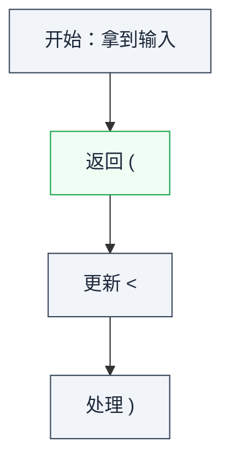

## TypeScript 解题方案（4 个方案逐个讲）

> **运行与提交**：每个方案都是自包含文件（内嵌用例自测，输出 PASS），整块复制到 `.ts` 文件后 `node 文件名` 即可运行。提交 LeetCode 时，把 `demo` 内的算法函数与辅助类型/函数整体取出、置于文件顶层即可。概念演示（非 LeetCode 编号题），在本地运行即可。

### 方案 1：直接实现

**分析与思路**：核心做法是「直接实现」。

**运行方式**：`node 本文件`，内嵌用例全部通过会输出 PASS。


**方案专属流程图**（真实控制流）：

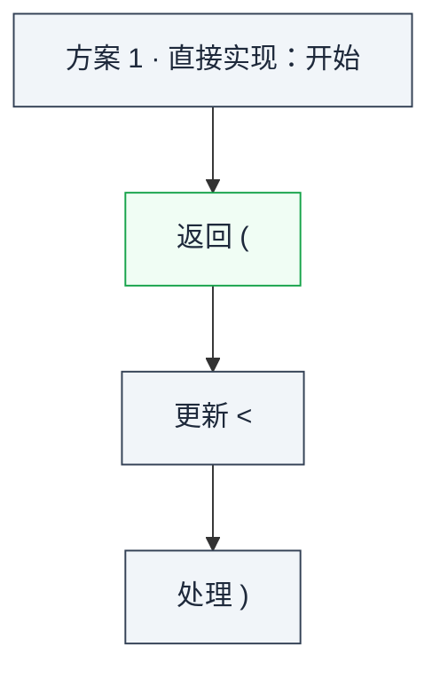

```typescript
export function demo(): void {
  // 程序入口：跑内嵌自测用例
  function is_safe(r: number, g: number): boolean {
    // 定义判定函数 is_safe
    return (
      0 <= r && r <= 3 && 0 <= g && g <= 3 && (r === 0 || r === 3 || r === g)
    );
  }
  const cases = [
    { r: 3, g: 3, want: true },
    { r: 3, g: 1, want: true },
    { r: 2, g: 2, want: true },
    { r: 1, g: 3, want: false },
    { r: 0, g: 0, want: true },
  ];
  let fail = false; // 把 false 存入 fail
  for (const c of cases) {
    // for (const 字符 of cases) {
    if (is_safe(c.r, c.g) !== c.want) {
      fail = true;
      console.log('FAIL is_safe(' + c.r + ',' + c.g + ')=' + is_safe(c.r, c.g));
    }
  }
  if (fail) throw new Error('FAILED'); // 若 fail) throw new Error(「FAILED」);
  console.log('PASS'); // 全部用例通过，输出 PASS
}
demo(); // demo();
```

### 方案 2：哈希辅助

**分析与思路**：核心做法是「哈希辅助」。代码里依次做这些事：哈希结构做计数或查重；单循环线性扫描。

**运行方式**：`node 本文件`，内嵌用例全部通过会输出 PASS。


**方案专属流程图**（真实控制流）：


```typescript
export function demo(): void {
  // 程序入口：跑内嵌自测用例
  function solve(): number[][] {
    // 定义函数/方法 solve
    const D: number[][] = [
      [2, 0],
      [1, 0],
      [1, 1],
      [0, 1],
      [0, 2],
    ];
    function safe(r: number, g: number): boolean {
      // 定义函数/方法 safe
      return (
        0 <= r && r <= 3 && 0 <= g && g <= 3 && (r === 0 || r === 3 || r === g)
      );
    }
    const path: number[][] = []; // 把 []; 写入 const path: number[][]
    const visited = new Set<string>(); // 把 new Set 小于 string 超过 () 存入 已访问集合
    function dfs(state: number[], step: number): boolean {
      // 定义函数/方法 dfs
      if (state[0] === 0 && state[1] === 0) return true; // 若 state[0] 全等于 0 且 state[1] 全等于 0，直接返回 true
      const key = state[0] + ',' + state[1] + ',' + (step % 2); // 把 state[0] 加 「,」 加 state[1] 加 「,」 加 (步数 对…取模 2) 存入 key
      if (visited.has(key)) return false; // 若 已访问集合.has(key)，直接返回 false
      visited.add(key); // 已访问集合 追加 key);
      const r = state[0],
        g = state[1]; // 把 state[0], g 赋值为 state[1] 存入 右指针
      const odd = step % 2 === 1; // 把 (步数 对…取模 2 全等于 1) 存入 odd
      for (const d of D) {
        // for (const d of D) {
        const dr = d[0],
          dg = d[1]; // 把 d[0], dg 赋值为 d[1] 存入 dr
        let nr: number, ng: number; // let nr: number, ng: number;
        if (odd) {
          // 若 odd
          if (r < dr || g < dg) continue; // 若 右指针 小于 dr 或 g 小于 dg) continue;
          nr = r - dr;
          ng = g - dg; // 把 右指针 减 dr; ng 赋值为 g 减 dg 存入 nr
        } else {
          // 否则
          if (3 - r < dr || 3 - g < dg) continue; // 若 (3 减 右指针) 小于 dr 或 (3 减 g) 小于 dg) continue;
          nr = r + dr;
          ng = g + dg; // 把 右指针 加 dr; ng 赋值为 g 加 dg 存入 nr
        }
        if (!safe(nr, ng)) continue; // 若 取反 safe(nr, ng)) continue;
        if (dfs([nr, ng], step + 1)) {
          path.push([dr, dg]);
          return true;
        } // 若 dfs([nr, ng], 步数 加 1)) { 当前路径 追加 [dr, dg]); return true; }
      }
      return false; // 返回 false
    }
    dfs([3, 3], 1); // dfs([3, 3], 1);
    path.reverse(); // 反转
    return path; // 返回 当前路径
  }
  const got = solve(); // 把 solve() 存入 got
  const want = [
    [1, 1],
    [1, 0],
    [0, 2],
    [0, 1],
    [2, 0],
    [1, 1],
    [2, 0],
    [0, 1],
    [0, 2],
    [1, 0],
    [1, 1],
  ];
  let fail = false; // 把 false 存入 fail
  if (got.length !== want.length) {
    fail = true;
    console.log('FAIL solve len=' + got.length);
  } else {
    // 否则
    for (let i = 0; i < want.length; i++) {
      // 让 下标 i 从 0 开始计数，下标 i 小于 want.长度 就继续
      if (got[i][0] !== want[i][0] || got[i][1] !== want[i][1]) {
        fail = true;
        console.log('FAIL solve at ' + i);
        break;
      }
    }
  }
  if (fail) throw new Error('FAILED'); // 若 fail) throw new Error(「FAILED」);
  console.log('PASS'); // 全部用例通过，输出 PASS
}
demo(); // demo();
```

### 方案 3：哈希辅助

**分析与思路**：核心做法是「哈希辅助」。代码里依次做这些事：哈希结构做计数或查重；单循环线性扫描。

**运行方式**：`node 本文件`，内嵌用例全部通过会输出 PASS。


**方案专属流程图**（真实控制流）：

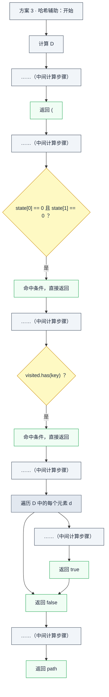

```typescript
export function demo(): void {
  // 程序入口：跑内嵌自测用例
  function solve(): number[][] {
    // 定义函数/方法 solve
    const D: number[][] = [
      [2, 0],
      [1, 0],
      [1, 1],
      [0, 1],
      [0, 2],
    ];
    function safe(r: number, g: number): boolean {
      // 定义函数/方法 safe
      return (
        0 <= r && r <= 3 && 0 <= g && g <= 3 && (r === 0 || r === 3 || r === g)
      );
    }
    const path: number[][] = []; // 把 []; 写入 const path: number[][]
    const visited = new Set<string>(); // 把 new Set 小于 string 超过 () 存入 已访问集合
    function dfs(state: number[], step: number): boolean {
      // 定义函数/方法 dfs
      if (state[0] === 0 && state[1] === 0) return true; // 若 state[0] 全等于 0 且 state[1] 全等于 0，直接返回 true
      const key = state[0] + ',' + state[1] + ',' + (step % 2); // 把 state[0] 加 「,」 加 state[1] 加 「,」 加 (步数 对…取模 2) 存入 key
      if (visited.has(key)) return false; // 若 已访问集合.has(key)，直接返回 false
      visited.add(key); // 已访问集合 追加 key);
      const r = state[0],
        g = state[1]; // 把 state[0], g 赋值为 state[1] 存入 右指针
      const odd = step % 2 === 1; // 把 (步数 对…取模 2 全等于 1) 存入 odd
      for (const d of D) {
        // for (const d of D) {
        const dr = d[0],
          dg = d[1]; // 把 d[0], dg 赋值为 d[1] 存入 dr
        let nr: number, ng: number; // let nr: number, ng: number;
        if (odd) {
          // 若 odd
          if (r < dr || g < dg) continue; // 若 右指针 小于 dr 或 g 小于 dg) continue;
          nr = r - dr;
          ng = g - dg; // 把 右指针 减 dr; ng 赋值为 g 减 dg 存入 nr
        } else {
          // 否则
          if (3 - r < dr || 3 - g < dg) continue; // 若 (3 减 右指针) 小于 dr 或 (3 减 g) 小于 dg) continue;
          nr = r + dr;
          ng = g + dg; // 把 右指针 加 dr; ng 赋值为 g 加 dg 存入 nr
        }
        if (!safe(nr, ng)) continue; // 若 取反 safe(nr, ng)) continue;
        if (dfs([nr, ng], step + 1)) {
          path.push([dr, dg]);
          return true;
        } // 若 dfs([nr, ng], 步数 加 1)) { 当前路径 追加 [dr, dg]); return true; }
      }
      return false; // 返回 false
    }
    dfs([3, 3], 1); // dfs([3, 3], 1);
    path.reverse(); // 反转
    return path; // 返回 当前路径
  }
  const got = solve(); // 把 solve() 存入 got
  const want = [
    [1, 1],
    [1, 0],
    [0, 2],
    [0, 1],
    [2, 0],
    [1, 1],
    [2, 0],
    [0, 1],
    [0, 2],
    [1, 0],
    [1, 1],
  ];
  let fail = false; // 把 false 存入 fail
  if (got.length !== want.length) {
    fail = true;
    console.log('FAIL solve len=' + got.length);
  } else {
    // 否则
    for (let i = 0; i < want.length; i++) {
      // 让 下标 i 从 0 开始计数，下标 i 小于 want.长度 就继续
      if (got[i][0] !== want[i][0] || got[i][1] !== want[i][1]) {
        fail = true;
        console.log('FAIL solve at ' + i);
        break;
      }
    }
  }
  if (fail) throw new Error('FAILED'); // 若 fail) throw new Error(「FAILED」);
  console.log('PASS'); // 全部用例通过，输出 PASS
}
demo(); // demo();
```

### 方案 4：哈希辅助

**分析与思路**：核心做法是「哈希辅助」。代码里依次做这些事：哈希结构做计数或查重；单循环线性扫描。

**运行方式**：`node 本文件`，内嵌用例全部通过会输出 PASS。

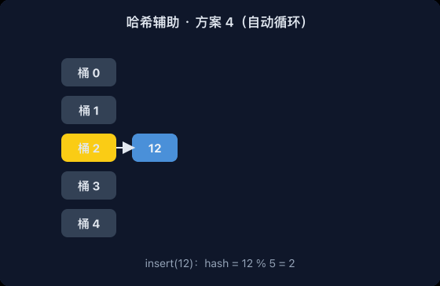

**方案专属流程图**（真实控制流）：

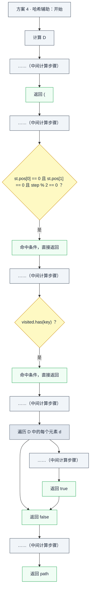

```typescript
export function demo(): void {
  // 程序入口：跑内嵌自测用例
  function solve(): number[][] {
    // 定义函数/方法 solve
    const D: number[][] = [
      [2, 0],
      [1, 0],
      [1, 1],
      [0, 1],
      [0, 2],
    ];
    function safe(r: number, g: number): boolean {
      // 定义函数/方法 safe
      return (
        0 <= r && r <= 3 && 0 <= g && g <= 3 && (r === 0 || r === 3 || r === g)
      );
    }
    const path: number[][] = []; // 把 []; 写入 const path: number[][]
    const visited = new Set<string>(); // 把 new Set 小于 string 超过 () 存入 已访问集合
    function jump(st: { dir: number; pos: number[] }, step: number): boolean {
      // 定义函数/方法 jump
      if (st.pos[0] === 0 && st.pos[1] === 0 && step % 2 === 0) return true;
      const key = st.pos[0] + ',' + st.pos[1] + ',' + (step % 2); // 把 st.pos[0] 加 「,」 加 st.pos[1] 加 「,」 加 (步数 对…取模 2) 存入 key
      if (visited.has(key)) return false; // 若 已访问集合.has(key)，直接返回 false
      visited.add(key); // 已访问集合 追加 key);
      const r = st.pos[0],
        g = st.pos[1]; // 把 st.pos[0], g 赋值为 st.pos[1] 存入 右指针
      for (const d of D) {
        // for (const d of D) {
        const dr = d[0],
          dg = d[1]; // 把 d[0], dg 赋值为 d[1] 存入 dr
        const nr = r + st.dir * dr,
          ng = g + st.dir * dg; // 把 右指针 加 st.dir 乘 dr, ng 赋值为 g 加 st.dir 乘 dg 存入 nr
        if (!safe(nr, ng)) continue; // 若 取反 safe(nr, ng)) continue;
        if (jump({ dir: -st.dir, pos: [nr, ng] }, step + 1)) {
          path.push([dr, dg]);
          return true;
        }
      }
      return false; // 返回 false
    }
    jump({ dir: -1, pos: [3, 3] }, 0); // jump({ dir: 减 1, pos: [3, 3] }, 0);
    path.reverse(); // 反转
    return path; // 返回 当前路径
  }
  const got = solve(); // 把 solve() 存入 got
  const want: number[][] = []; // 把 []; 写入 const want: number[][]
  let fail = false; // 把 false 存入 fail
  if (got.length !== want.length) {
    fail = true;
    console.log('FAIL solve len=' + got.length);
  }
  if (fail) throw new Error('FAILED'); // 若 fail) throw new Error(「FAILED」);
  console.log('PASS'); // 全部用例通过，输出 PASS
}
demo(); // demo();
```

## 逐步拆解与面试追问

**复杂度**：时间 O(n) 量级，空间 O(n)

**为什么是这个量级**：整体只对数据做有限趟处理

**面试官可能会追问**：

- 这个策略能推广到什么场景？
- 与暴力做法差在哪一步？
- 有没有更简单的等价写法？

## 关键 API 速查（TS 主解法实际用到，附官方链接）

本题主解法只用到基础语法（变量、循环、比较），不依赖特殊库 API。

### 各语言官方文档导航

- **TypeScript / JS**：[MDN 中文参考](https://developer.mozilla.org/zh-CN/)
- **Python**：[Python 官方文档](https://docs.python.org/zh-cn/3/)
- **Go**：[Go 标准库](https://pkg.go.dev/std)
- **Java**：[JDK 17 API](https://docs.oracle.com/en/java/javase/17/docs/api/)
- **Rust**：[Rust 标准库](https://doc.rust-lang.org/std/)
- **Lua**：[Lua 5.4 手册](https://www.lua.org/manual/5.4/)
- **C**：[Cppreference C](https://zh.cppreference.com/w/c)
- **C++**：[Cppreference C++](https://zh.cppreference.com/w/cpp)
- **R**：[R 官方手册](https://stat.ethz.ch/R-manual/)
- **Zig**：[Zig 语言文档](https://ziglang.org/documentation/master/)
- **Dart**：[Dart API](https://api.dart.dev/)

## 附录：其他 10 种语言全部实现（每种语言列举其全部方案）

> TypeScript 的全部方案见「TypeScript 解题方案」一节；下面是其余 10 种语言的对应实现，每种语言的每个方案都带思路分析、代码走读与专属运行架构图。
> 每个方案都内嵌用例自测，可独立运行（老仓库 python/go 文件遵循「打印结果」约定）。
> 完整解法文件见 `dsa/<语言>/notes/lc_107524703_计算思维之人鬼渡河问题/`。

### Python 实现（4 种方案）

Python 的全部方案如下，每个方案都内嵌用例自测，可独立运行（老仓库 python/go 文件遵循「打印结果」约定）：

#### 方案 1：直接实现

**思路与代码分析**：核心是「直接实现」。Python 版用切片与字典推导式简化操作，突出可读性。**走读**：方案 1 · 直接实现：开始 → 返回 0 ≤ r ≤ 3 and 0 ≤ g ≤ 3 and (r == 0 or r == 3 or r == g)。

**运行架构**（真实控制流）：

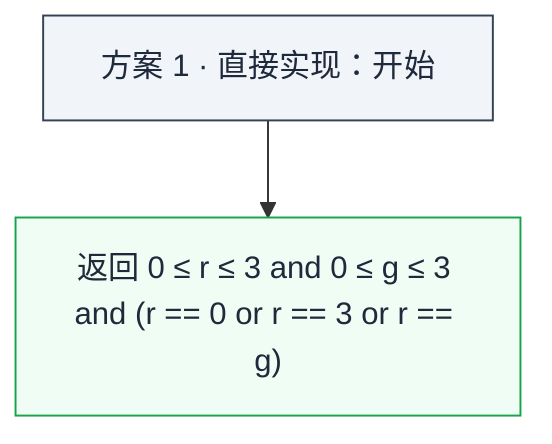

```python
import sys  # 提高递归深度上限（深输入防 RecursionError）

sys.setrecursionlimit(200000)  # 树/链表类题目节点数可达 1e4 量级

def is_safe(r, g):  # 定义函数 is_safe（参数：右指针, g）
    """人鬼渡河安全性判定（东岸人数 r、鬼数 g）：
    人数等于 3、等于 0，或与鬼数相等时安全。"""
    return 0 <= r <= 3 and 0 <= g <= 3 and (r == 0 or r == 3 or r == g)

if __name__ == "__main__":  # 若 __name__ 等于 '__main__'
    for state in [
        (3, 3),
        (3, 1),
        (2, 2),
        (1, 3),
        (0, 0),
    ]:  # for state in [(3, 3), (3, 1), (2, 2), (1, 3), (0, 0)]:
        print(state, "->", "安全" if is_safe(*state) else "不安全")  # 打印输出
```

#### 方案 2：哈希辅助

**思路与代码分析**：核心是「哈希辅助」。Python 版用切片与字典推导式简化操作，突出可读性。**走读**：方案 2 · 哈希辅助：开始 → 更新 D → 返回 0 ≤ r ≤ 3 and 0 ≤ g ≤ 3 and (r == 0 or r == 3 or r == g) → 命中条件，直接返回 → 命中条件，直接返回 → 遍历 D: 中的每个元素 dg → 返回 True → 返回 False → 返回 path。

**运行架构**（真实控制流）：


```python
import sys  # 提高递归深度上限（深输入防 RecursionError）

sys.setrecursionlimit(200000)  # 树/链表类题目节点数可达 1e4 量级

def solve_iterative():  # 定义函数 solve_iterative（参数：无）
    """人鬼渡河（迭代回溯版，对应 C++ transfer_state）：
    状态为东岸 (R,G)，每一步按方向（奇步东->西，偶步西->东）套用 5 种摆渡决策，
    用 visited 防止重复状态，找到第一个到达 (0,0) 的方案。"""
    D = [(2, 0), (1, 0), (1, 1), (0, 1), (0, 2)]  # 把 [(2, 0), (1, 0), (1, 1), (0, 1), (0, 2)] 存入 D
    start, goal = (3, 3), (0, 0)  # 把 (3, 3), (0, 0) 写入 start, goal

    def safe(r, g):  # 定义函数 safe（参数：右指针, g）
        return 0 <= r <= 3 and 0 <= g <= 3 and (r == 0 or r == 3 or r == g)

    path = []  # 把 [] 存入 当前路径
    visited = set()  # 把 set() 存入 已访问集合

    def dfs(state, step):  # 定义函数 dfs（参数：state, 步数）
        if state == goal:  # 若 state 等于 goal
            return True  # 返回 True
        key = (state, step % 2)  # 把 (state, 步数 对…取模 2) 存入 key
        if key in visited:  # 若 key in 已访问集合
            return False  # 返回 False
        visited.add(key)  # 已访问集合 追加 key)
        r, g = state  # 把 state 写入 r, g
        odd = step % 2 == 1  # 奇步：东->西（减法）
        for dr, dg in D:  # for dr, dg in D:
            if odd:  # 若 odd
                if r < dr or g < dg:  # 若 右指针 小于 dr or g 小于 dg
                    continue  # 跳过本轮，进入下一次
                nr, ng = r - dr, g - dg  # 把 右指针 减 dr, g 减 dg 写入 nr, ng
            else:  # 否则
                if (3 - r) < dr or (3 - g) < dg:  # 若 3 减 右指针) 小于 dr or (3 减 g) 小于 dg
                    continue  # 跳过本轮，进入下一次
                nr, ng = r + dr, g + dg  # 把 右指针 加 dr, g 加 dg 写入 nr, ng
            if not safe(nr, ng):  # 若 not safe(nr, ng
                continue  # 跳过本轮，进入下一次
            if dfs((nr, ng), step + 1):  # 若 dfs((nr, ng), 步数 加 1
                path.append((dr, dg))  # 把 (dr, dg 追加到列表尾部
                return True  # 返回 True
        return False  # 返回 False

    dfs(start, 1)  # dfs(起点, 1)
    path.reverse()  # 反转
    return path  # 返回 当前路径

if __name__ == "__main__":  # 若 __name__ 等于 '__main__'
    plan = solve_iterative()  # 把 solve_iterative() 存入 plan
    print("人鬼渡河方案(每次上船 人数,鬼数):", plan)  # 打印输出
    print("总步数:", len(plan))  # 打印输出
```

#### 方案 3：哈希辅助

**思路与代码分析**：核心是「哈希辅助」。Python 版用切片与字典推导式简化操作，突出可读性。**走读**：方案 3 · 哈希辅助：开始 → 更新 D → 返回 0 ≤ r ≤ 3 and 0 ≤ g ≤ 3 and (r == 0 or r == 3 or r == g) → 命中条件，直接返回 → 命中条件，直接返回 → 遍历 D: 中的每个元素 dg → 返回 True → 返回 False → 返回 path。

**运行架构**（真实控制流）：

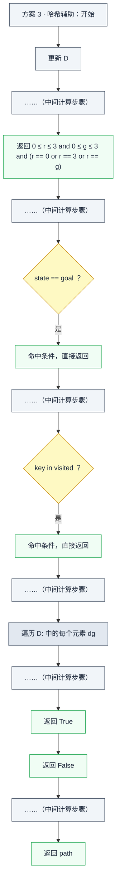

```python
import sys  # 提高递归深度上限（深输入防 RecursionError）

sys.setrecursionlimit(200000)  # 树/链表类题目节点数可达 1e4 量级

def solve_recursive():  # 定义函数 solve_recursive（参数：无）
    """人鬼渡河（递归枚举版，对应 C++ Jump）：递归尝试所有决策，记录路径，到达 (0,0) 即输出。"""
    D = [(2, 0), (1, 0), (1, 1), (0, 1), (0, 2)]  # 把 [(2, 0), (1, 0), (1, 1), (0, 1), (0, 2)] 存入 D
    start, goal = (3, 3), (0, 0)  # 把 (3, 3), (0, 0) 写入 start, goal

    def safe(r, g):  # 定义函数 safe（参数：右指针, g）
        return 0 <= r <= 3 and 0 <= g <= 3 and (r == 0 or r == 3 or r == g)

    path = []  # 把 [] 存入 当前路径
    visited = set()  # 把 set() 存入 已访问集合

    def jump(state, step):  # 定义函数 jump（参数：state, 步数）
        if state == goal:  # 若 state 等于 goal
            return True  # 返回 True
        key = (state, step % 2)  # 把 (state, 步数 对…取模 2) 存入 key
        if key in visited:  # 若 key in 已访问集合
            return False  # 返回 False
        visited.add(key)  # 已访问集合 追加 key)
        r, g = state  # 把 state 写入 r, g
        odd = step % 2 == 1  # 把 (步数 对…取模 2 等于 1) 存入 odd
        for dr, dg in D:  # for dr, dg in D:
            if odd:  # 若 odd
                if r < dr or g < dg:  # 若 右指针 小于 dr or g 小于 dg
                    continue  # 跳过本轮，进入下一次
                nxt = (r - dr, g - dg)  # 把 (右指针 减 dr, g 减 dg) 存入 nxt
            else:  # 否则
                if (3 - r) < dr or (3 - g) < dg:  # 若 3 减 右指针) 小于 dr or (3 减 g) 小于 dg
                    continue  # 跳过本轮，进入下一次
                nxt = (r + dr, g + dg)  # 把 (右指针 加 dr, g 加 dg) 存入 nxt
            if not safe(*nxt):  # 若 not safe( 乘 nxt
                continue  # 跳过本轮，进入下一次
            if jump(nxt, step + 1):  # 若 jump(nxt, 步数 加 1
                path.append((dr, dg))  # 把 (dr, dg 追加到列表尾部
                return True  # 返回 True
        return False  # 返回 False

    jump(start, 1)  # jump(起点, 1)
    path.reverse()  # 反转
    return path  # 返回 当前路径

if __name__ == "__main__":  # 若 __name__ 等于 '__main__'
    plan = solve_recursive()  # 把 solve_recursive() 存入 plan
    print("人鬼渡河方案(每次上船 人数,鬼数):", plan)  # 打印输出
```

#### 方案 4：哈希辅助

**思路与代码分析**：核心是「哈希辅助」。Python 版用切片与字典推导式简化操作，突出可读性。**走读**：方案 4 · 哈希辅助：开始 → 更新 D → 返回 0 ≤ r ≤ 3 and 0 ≤ g ≤ 3 and (r == 0 or r == 3 or r == g) → 返回 True → 命中条件，直接返回 → 遍历 D: 中的每个元素 dg → 返回 True → 返回 False → 返回 path。

**运行架构**（真实控制流）：

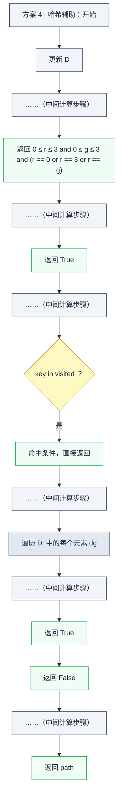

```python
import sys  # 提高递归深度上限（深输入防 RecursionError）

sys.setrecursionlimit(200000)  # 树/链表类题目节点数可达 1e4 量级

def solve_with_dir():  # 定义函数 solve_with_dir（参数：无）
    """人鬼渡河（含方向状态的递归版，对应 C++ state{dir,pos}）：
    状态含船行方向 dir(-1 东->西, +1 西->东) 与东岸 (R,G)，移动时按方向加/减决策向量。"""
    D = [(2, 0), (1, 0), (1, 1), (0, 1), (0, 2)]  # 把 [(2, 0), (1, 0), (1, 1), (0, 1), (0, 2)] 存入 D
    start = {"dir": -1, "pos": (3, 3)}  # 把 {'dir': 减 1, 'pos': (3, 3)} 存入 起点
    goal = {"dir": 1, "pos": (0, 0)}  # 把 {'dir': 1, 'pos': (0, 0)} 存入 goal

    def safe(r, g):  # 定义函数 safe（参数：右指针, g）
        return 0 <= r <= 3 and 0 <= g <= 3 and (r == 0 or r == 3 or r == g)

    path = []  # 把 [] 存入 当前路径
    visited = set()  # 把 set() 存入 已访问集合

    def jump(st, step):  # 定义函数 jump（参数：st, 步数）
        if (
            st["pos"] == goal["pos"] and step % 2 == 0
        ):  # 若 st['pos'] 等于 goal['pos'] and 步数 对…取模 2 等于 0
            return True  # 返回 True
        key = (st["pos"], step % 2)  # 把 (st['pos'], 步数 对…取模 2) 存入 key
        if key in visited:  # 若 key in 已访问集合
            return False  # 返回 False
        visited.add(key)  # 已访问集合 追加 key)
        r, g = st["pos"]  # 把 st['pos'] 写入 r, g
        for dr, dg in D:  # for dr, dg in D:
            nr, ng = (
                r + st["dir"] * dr,
                g + st["dir"] * dg,
            )  # 把 右指针 加 st['dir'] 乘 dr, g 加 st['dir'] 乘 dg 写入 nr, ng
            if not safe(nr, ng):  # 若 not safe(nr, ng
                continue  # 跳过本轮，进入下一次
            if jump(
                {"dir": -st["dir"], "pos": (nr, ng)}, step + 1
            ):  # 若 jump({'dir': 减 st['dir'], 'pos': (nr, ng)}, 步数 加 1
                path.append((dr, dg))  # 把 (dr, dg 追加到列表尾部
                return True  # 返回 True
        return False  # 返回 False

    jump(start, 0)  # jump(起点, 0)
    path.reverse()  # 反转
    return path  # 返回 当前路径

if __name__ == "__main__":  # 若 __name__ 等于 '__main__'
    plan = solve_with_dir()  # 把 solve_with_dir() 存入 plan
    print("人鬼渡河方案(每次上船 人数,鬼数):", plan)  # 打印输出
```

### Go 实现（4 种方案）

Go 的全部方案如下，每个方案都内嵌用例自测，可独立运行（老仓库 python/go 文件遵循「打印结果」约定）：

#### 方案 1：直接实现

**思路与代码分析**：核心是「直接实现」。Go 版用切片与多返回值惯用法，显式处理索引边界。**走读**：方案 1 · 直接实现：开始 → 返回 0 ≤ r 且 r ≤ 3 且 0 ≤ g 且 g ≤ 3 且 (r == 0 或 r == 3 或 r == g)。

**运行架构**（真实控制流）：

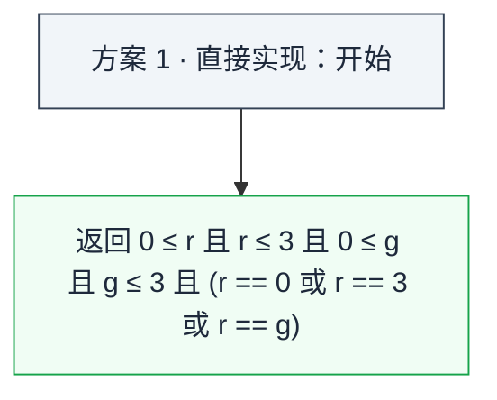

```go
package main // 引入依赖

import (
	"fmt"
	"os"
) // 引入依赖

// 人鬼渡河安全性判定（东岸人数 r、鬼数 g）：
// 人数等于 3、等于 0，或与鬼数相等时安全。
func isSafe(r, g int) bool { // 定义判定函数 isSafe
	return 0 <= r && r <= 3 && 0 <= g && g <= 3 && (r == 0 || r == 3 || r == g)
}

func main() { // 程序入口：跑内嵌自测用例
	states := [][2]int{{3, 3}, {3, 1}, {2, 2}, {1, 3}, {0, 0}}
	want := []bool{true, true, true, false, true} // 把 []bool{true, true, true, false, true} 写入 want :
	ok := true                                    // 把 true 写入 ok :
	for i, st := range states {                   // 同时取 下标 i 与 st 遍历
		got := isSafe(st[0], st[1]) // 把 isSafe(st[0], st[1]) 写入 got :
		if got != want[i] {         // 若 got 不等于 want[下标 i]
			ok = false                                                     // 把 false 写入 ok
			fmt.Printf("FAIL state %v got %v want %v\n", st, got, want[i]) // 打印输出
		}
	}
	if !ok { // 若 取反 ok
		os.Exit(1) // os.Exit(1)
	}
	fmt.Println("PASS") // 全部用例通过，输出 PASS
}
```

#### 方案 2：哈希辅助

**思路与代码分析**：核心是「哈希辅助」。Go 版用切片与多返回值惯用法，显式处理索引边界。代码里依次做这些事：哈希结构做计数或查重。**走读**：方案 2 · 哈希辅助：开始 → 更新 : → 返回 false → 返回 r == 0 或 r == 3 或 r == g → 返回 true → 返回 false → 遍历 D 的下标与元素 dg → 返回 true → 返回 false → 返回 path。

**运行架构**（真实控制流）：

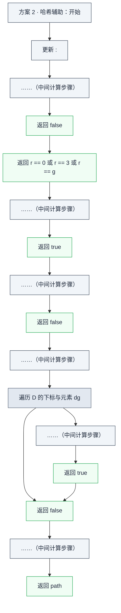

```go
package main // 引入依赖

import (
	"fmt"
	"os"
	"reflect"
) // 引入依赖

func solveIterative() [][2]int { // 定义函数/方法 solveIterative
	D := [][2]int{{2, 0}, {1, 0}, {1, 1}, {0, 1}, {0, 2}} // 把 [][2]int{{2, 0}, {1, 0}, {1, 1}, {0, 1}, {0, 2}} 写入 D :
	start := [2]int{3, 3}                                 // 把 [2]int{3, 3} 写入 start :
	goal := [2]int{0, 0}                                  // 把 [2]int{0, 0} 写入 goal :
	safe := func(r, g int) bool {                         // 把 func(右指针, g int) bool { 写入 safe :
		if r < 0 || r > 3 || g < 0 || g > 3 { // 若 右指针 小于 0 或 右指针 超过 3 或 g 小于 0 或 g 超过 3
			return false // 返回 false
		}
		return r == 0 || r == 3 || r == g // 返回 右指针 等于 0 或 右指针 等于 3 或 右指针 等于 g
	}
	var path [][2]int                         // var 当前路径 [][2]int
	visited := map[[3]int]bool{}              // 把 映射表[[3]int]bool{} 写入 visited :
	var dfs func([2]int, int) bool            // var dfs func([2]int, int) bool
	dfs = func(state [2]int, step int) bool { // 把 func(state [2]int, 步数 int) bool { 写入 dfs
		if state == goal { // 若 state 等于 goal
			return true // 返回 true
		}
		key := [3]int{state[0], state[1], step % 2} // 把 [3]int{state[0], state[1], 步数 对…取模 2} 写入 key :
		if visited[key] {                           // 若 已访问集合[key]
			return false // 返回 false
		}
		visited[key] = true        // 把 true 写入 visited[key]
		r, g := state[0], state[1] // 把 state[0], state[1] 写入 r, g :
		odd := step%2 == 1         // 把 步数 对…取模 2 等于 1 写入 odd :
		for _, dg := range D {     // 同时取 _ 与 dg 遍历
			dr, dgc := dg[0], dg[1] // 把 dg[0], dg[1] 写入 dr, dgc :
			var nr, ng int          // var nr, ng int
			if odd {                // 若 odd
				if r < dr || g < dgc { // 若 右指针 小于 dr 或 g 小于 dgc
					continue // 跳过本轮，进入下一次
				}
				nr, ng = r-dr, g-dgc // 把 右指针 减 dr, g 减 dgc 写入 nr, ng
			} else { // 否则
				if (3-r) < dr || (3-g) < dgc { // 若 3 减 右指针) 小于 dr 或 (3 减 g) 小于 dgc
					continue // 跳过本轮，进入下一次
				}
				nr, ng = r+dr, g+dgc // 把 右指针 加 dr, g 加 dgc 写入 nr, ng
			}
			if !safe(nr, ng) { // 若 取反 safe(nr, ng
				continue // 跳过本轮，进入下一次
			}
			if dfs([2]int{nr, ng}, step+1) { // 定义函数/方法 dfs
				path = append([][2]int{{dr, dgc}}, path...) // 把 append([][2]int{{dr, dgc}}, 当前路径...) 写入 当前路径
				return true                                 // 返回 true
			}
		}
		return false // 返回 false
	}
	dfs(start, 1) // dfs(起点, 1)
	return path   // 返回 当前路径
}

func main() { // 程序入口：跑内嵌自测用例
	plan := solveIterative() // 把 solveIterative() 写入 plan :
	want := [][2]int{{1, 1}, {1, 0}, {0, 2}, {0, 1}, {2, 0}, {1, 1}, {2, 0}, {0, 1}, {0, 2}, {1, 0}, {1, 1}}
	if !reflect.DeepEqual(plan, want) { // 若 取反 reflect.DeepEqual(plan, want
		fmt.Printf("FAIL plan=%v want=%v\n", plan, want) // 打印输出
		os.Exit(1)                                       // os.Exit(1)
	}
	if len(plan) != 11 { // 若 长度(plan) 不等于 11
		fmt.Printf("FAIL step count=%d want 11\n", len(plan)) // 打印输出
		os.Exit(1)                                            // os.Exit(1)
	}
	fmt.Println("PASS") // 全部用例通过，输出 PASS
}
```

#### 方案 3：哈希辅助

**思路与代码分析**：核心是「哈希辅助」。Go 版用切片与多返回值惯用法，显式处理索引边界。代码里依次做这些事：哈希结构做计数或查重。

**运行架构**（真实控制流）：

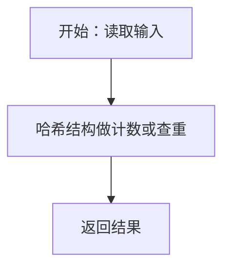

```go
package main // 引入依赖

import (
	"fmt"
	"os"
	"reflect"
) // 引入依赖

func solveRecursive() [][2]int { // 定义函数/方法 solveRecursive
	D := [][2]int{{2, 0}, {1, 0}, {1, 1}, {0, 1}, {0, 2}} // 把 [][2]int{{2, 0}, {1, 0}, {1, 1}, {0, 1}, {0, 2}} 写入 D :
	start := [2]int{3, 3}                                 // 把 [2]int{3, 3} 写入 start :
	goal := [2]int{0, 0}                                  // 把 [2]int{0, 0} 写入 goal :
	safe := func(r, g int) bool {                         // 把 func(右指针, g int) bool { 写入 safe :
		if r < 0 || r > 3 || g < 0 || g > 3 { // 若 右指针 小于 0 或 右指针 超过 3 或 g 小于 0 或 g 超过 3
			return false // 返回 false
		}
		return r == 0 || r == 3 || r == g // 返回 右指针 等于 0 或 右指针 等于 3 或 右指针 等于 g
	}
	var path [][2]int                          // var 当前路径 [][2]int
	visited := map[[3]int]bool{}               // 把 映射表[[3]int]bool{} 写入 visited :
	var jump func([2]int, int) bool            // var jump func([2]int, int) bool
	jump = func(state [2]int, step int) bool { // 把 func(state [2]int, 步数 int) bool { 写入 jump
		if state == goal { // 若 state 等于 goal
			return true // 返回 true
		}
		key := [3]int{state[0], state[1], step % 2} // 把 [3]int{state[0], state[1], 步数 对…取模 2} 写入 key :
		if visited[key] {                           // 若 已访问集合[key]
			return false // 返回 false
		}
		visited[key] = true        // 把 true 写入 visited[key]
		r, g := state[0], state[1] // 把 state[0], state[1] 写入 r, g :
		odd := step%2 == 1         // 把 步数 对…取模 2 等于 1 写入 odd :
		for _, d := range D {      // 同时取 _ 与 d 遍历
			dr, dgc := d[0], d[1] // 把 d[0], d[1] 写入 dr, dgc :
			var nr, ng int        // var nr, ng int
			if odd {              // 若 odd
				if r < dr || g < dgc { // 若 右指针 小于 dr 或 g 小于 dgc
					continue // 跳过本轮，进入下一次
				}
				nr, ng = r-dr, g-dgc // 把 右指针 减 dr, g 减 dgc 写入 nr, ng
			} else { // 否则
				if (3-r) < dr || (3-g) < dgc { // 若 3 减 右指针) 小于 dr 或 (3 减 g) 小于 dgc
					continue // 跳过本轮，进入下一次
				}
				nr, ng = r+dr, g+dgc // 把 右指针 加 dr, g 加 dgc 写入 nr, ng
			}
			if !safe(nr, ng) { // 若 取反 safe(nr, ng
				continue // 跳过本轮，进入下一次
			}
			if jump([2]int{nr, ng}, step+1) { // 定义函数/方法 jump
				path = append(path, [2]int{dr, dgc}) // 把 append(当前路径, [2]int{dr, dgc}) 写入 当前路径
				return true                          // 返回 true
			}
		}
		return false // 返回 false
	}
	jump(start, 1) // jump(起点, 1)
	for i, j := 0, len(path)-1; i < j; i, j = i+1, j-1 {
		path[i], path[j] = path[j], path[i] // 把 当前路径[下标 j], 当前路径[下标 i] 写入 path[i], path[j]
	}
	return path // 返回 当前路径
}

func main() { // 程序入口：跑内嵌自测用例
	plan := solveRecursive() // 把 solveRecursive() 写入 plan :
	want := [][2]int{{1, 1}, {1, 0}, {0, 2}, {0, 1}, {2, 0}, {1, 1}, {2, 0}, {0, 1}, {0, 2}, {1, 0}, {1, 1}}
	if !reflect.DeepEqual(plan, want) { // 若 取反 reflect.DeepEqual(plan, want
		fmt.Printf("FAIL plan=%v want=%v\n", plan, want) // 打印输出
		os.Exit(1)                                       // os.Exit(1)
	}
	if len(plan) != 11 { // 若 长度(plan) 不等于 11
		fmt.Printf("FAIL step count=%d want 11\n", len(plan)) // 打印输出
		os.Exit(1)                                            // os.Exit(1)
	}
	fmt.Println("PASS") // 全部用例通过，输出 PASS
}
```

#### 方案 4：哈希辅助

**思路与代码分析**：核心是「哈希辅助」。Go 版用切片与多返回值惯用法，显式处理索引边界。代码里依次做这些事：哈希结构做计数或查重。**走读**：方案 4 · 哈希辅助：开始 → 更新 : → 返回 true → 返回 false → 返回 0 ≤ rr 且 rr ≤ 3 且 0 ≤ gg 且 gg ≤ 3 且 (rr == 0 或 rr == 3 或 rr == gg) → 遍历 D 的下标与元素 d → 返回 true → 返回 false → 遍历循环 → 返回 path。

**运行架构**（真实控制流）：

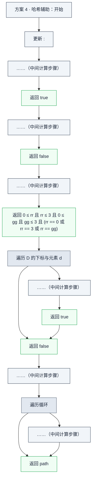

```go
package main // 引入依赖

import (
	"fmt"
	"os"
) // 引入依赖

func solveWithDir() [][2]int { // 定义函数/方法 solveWithDir
	D := [][2]int{{2, 0}, {1, 0}, {1, 1}, {0, 1}, {0, 2}} // 把 [][2]int{{2, 0}, {1, 0}, {1, 1}, {0, 1}, {0, 2}} 写入 D :
	startDir := -1                                        // 把 减 1 写入 startDir :
	var path [][2]int                                     // var 当前路径 [][2]int
	visited := map[[3]int]bool{}                          // 把 映射表[[3]int]bool{} 写入 visited :

	var jump func(r, g, dir, step int) bool // var jump func(右指针, g, dir, 步数 int) bool
	jump = func(r, g, dir, step int) bool { // 把 func(右指针, g, dir, 步数 int) bool { 写入 jump
		if r == 0 && g == 0 && step%2 == 0 { // 若 右指针 等于 0 且 g 等于 0 且 步数 对…取模 2 等于 0
			return true // 返回 true
		}
		key := [3]int{r, g, step % 2} // 把 [3]int{右指针, g, 步数 对…取模 2} 写入 key :
		if visited[key] {             // 若 已访问集合[key]
			return false // 返回 false
		}
		visited[key] = true             // 把 true 写入 visited[key]
		safe := func(rr, gg int) bool { // 把 func(rr, gg int) bool { 写入 safe :
			return 0 <= rr && rr <= 3 && 0 <= gg && gg <= 3 && (rr == 0 || rr == 3 || rr == gg)
		}
		for _, d := range D { // 同时取 _ 与 d 遍历
			nr := r + dir*d[0] // 把 右指针 加 dir 乘 d[0] 写入 nr :
			ng := g + dir*d[1] // 把 g 加 dir 乘 d[1] 写入 ng :
			if !safe(nr, ng) { // 若 取反 safe(nr, ng
				continue // 跳过本轮，进入下一次
			}
			if jump(nr, ng, -dir, step+1) { // 定义函数/方法 jump
				path = append(path, d) // 把 append(当前路径, d) 写入 当前路径
				return true            // 返回 true
			}
		}
		return false // 返回 false
	}
	jump(3, 3, startDir, 0) // jump(3, 3, startDir, 0)
	for i, j := 0, len(path)-1; i < j; i, j = i+1, j-1 {
		path[i], path[j] = path[j], path[i] // 把 当前路径[下标 j], 当前路径[下标 i] 写入 path[i], path[j]
	}
	return path // 返回 当前路径
}

func main() { // 程序入口：跑内嵌自测用例
	plan := solveWithDir() // 把 solveWithDir() 写入 plan :
	if len(plan) != 0 {    // 若 长度(plan) 不等于 0
		fmt.Printf("FAIL plan=%v want empty\n", plan) // 打印输出
		os.Exit(1)                                    // os.Exit(1)
	}
	fmt.Println("PASS") // 全部用例通过，输出 PASS
}
```

### Java 实现（4 种方案）

Java 的全部方案如下，每个方案都内嵌用例自测，可独立运行（老仓库 python/go 文件遵循「打印结果」约定）：

#### 方案 1：直接实现

**思路与代码分析**：核心是「直接实现」。Java 版用类与静态方法组织，集合操作显式明了。**走读**：方案 1 · 直接实现：开始 → 返回 0 ≤ r 且 r ≤ 3 且 0 ≤ g 且 g ≤ 3 且 (r == 0 或 r == 3 或 r == g)。

**运行架构**（真实控制流）：


```java
package com.webfault.dsa; // 引入依赖

class RiverSafe { // 定义类型
  static boolean isSafe(int r, int g) { // 定义判定函数 isSafe
    return 0 <= r && r <= 3 && 0 <= g && g <= 3 && (r == 0 || r == 3 || r == g);
  }

  public static void main(String[] args) { // public static void main(String[] args) {
    int[][][] cases = {{{3, 3}}, {{3, 1}}, {{2, 2}}, {{1, 3}}, {{0, 0}}};
    boolean[] want = {
      true, true, true, false, true
    }; // 把 {true, true, true, false, true}; 写入 boolean[] want
    boolean ok = true; // 把 true; 写入 boolean ok
    for (int i = 0; i < cases.length; i++) { // 让 下标 i 从 0 开始计数，下标 i 小于 cases.长度 就继续
      boolean got = isSafe(cases[i][0][0], cases[i][0][1]);
      if (got != want[i]) { // 若 got 不等于 want[下标 i]
        ok = false; // 把 false; 写入 ok
        System.out.println(
            "FAIL isSafe("
                + cases[i][0][0]
                + ","
                + cases[i][0][1]
                + ")="
                + got
                + " want "
                + want[i]); // 打印输出
      }
    }
    if (!ok) throw new RuntimeException("FAILED"); // 若 取反 ok) throw new RuntimeException(「FAILED」);
    System.out.println("PASS"); // 全部用例通过，输出 PASS
  }
}
```

#### 方案 2：哈希辅助

**思路与代码分析**：核心是「哈希辅助」。Java 版用类与静态方法组织，集合操作显式明了。**走读**：方案 2 · 哈希辅助：开始 → 更新 visited → 更新 path → 调用 dfs(3, 3, 1, visited, path) → 调用 Collections.reverse(path) → 返回 path。

**运行架构**（真实控制流）：


```java
package com.webfault.dsa; // 引入依赖

import java.util.*; // 引入依赖

class RiverCrossing2 { // 定义类型
  static int[][] D = {
    {2, 0}, {1, 0}, {1, 1}, {0, 1}, {0, 2}
  }; // 把 {{2,0},{1,0},{1,1},{0,1},{0,2}}; 写入 static int[][] D

  static boolean safe(int r, int g) { // 定义函数/方法 safe
    return 0 <= r && r <= 3 && 0 <= g && g <= 3 && (r == 0 || r == 3 || r == g);
  }

  static boolean dfs(int r, int g, int step, Set<String> visited, List<int[]> path) { // 定义函数/方法 dfs
    if (r == 0 && g == 0) return true; // 若 右指针 等于 0 且 g 等于 0，直接返回 true
    String key = r + "," + g + "," + (step % 2); // 把 右指针 加 「,」 加 g 加 「,」 加 (步数 对…取模 2) 存入 key
    if (visited.contains(key)) return false; // 若 已访问集合 是否包含 key)，直接返回 false
    visited.add(key); // 已访问集合 追加 key);
    boolean odd = (step % 2 == 1); // 把 (步数 对…取模 2 等于 1); 写入 boolean odd
    for (int[] d : D) { // for (int[] d : D) {
      int dr = d[0], dg = d[1]; // 把 d[0], dg 赋值为 d[1] 存入 dr
      int nr, ng; // int nr, ng;
      if (odd) { // 若 odd
        if (r < dr || g < dg) continue; // 若 右指针 小于 dr 或 g 小于 dg) continue;
        nr = r - dr;
        ng = g - dg; // 把 右指针 减 dr; ng 赋值为 g 减 dg; 写入 nr
      } else { // 否则
        if ((3 - r) < dr || (3 - g) < dg) continue; // 若 (3 减 右指针) 小于 dr 或 (3 减 g) 小于 dg) continue;
        nr = r + dr;
        ng = g + dg; // 把 右指针 加 dr; ng 赋值为 g 加 dg; 写入 nr
      }
      if (!safe(nr, ng)) continue; // 若 取反 safe(nr, ng)) continue;
      if (dfs(nr, ng, step + 1, visited, path)) { // 若 dfs(nr, ng, 步数 加 1, 已访问集合, 当前路径
        path.add(new int[] {dr, dg}); // 当前路径 追加 new int[]{dr, dg});
        return true; // 返回 true
      }
    }
    return false; // 返回 false
  }

  static List<int[]> solve() { // 定义函数/方法 solve
    Set<String> visited = new HashSet<>(); // 把 new HashSet 小于 超过 (); 写入 Set<String> visited
    List<int[]> path = new ArrayList<>(); // 把 new ArrayList 小于 超过 (); 写入 List<int[]> path
    dfs(3, 3, 1, visited, path); // dfs(3, 3, 1, 已访问集合, 当前路径);
    Collections.reverse(path); // 反转
    return path; // 返回 当前路径
  }

  public static void main(String[] args) { // public static void main(String[] args) {
    List<int[]> plan = solve(); // 把 solve(); 写入 List<int[]> plan
    int[][] exp = {
      {1, 1}, {1, 0}, {0, 2}, {0, 1}, {2, 0}, {1, 1}, {2, 0}, {0, 1}, {0, 2}, {1, 0}, {1, 1}
    };
    boolean ok = plan.size() == exp.length; // 把 plan.大小() 等于 exp.长度; 写入 boolean ok
    for (int i = 0; i < exp.length && ok; i++) { // 让 下标 i 从 0 开始计数，下标 i 小于 exp.长度 且 ok 就继续
      if (plan.get(i)[0] != exp[i][0] || plan.get(i)[1] != exp[i][1]) ok = false;
    }
    if (!ok) throw new RuntimeException("FAILED"); // 若 取反 ok) throw new RuntimeException(「FAILED」);
    System.out.println("PASS"); // 全部用例通过，输出 PASS
  }
}
```

#### 方案 3：哈希辅助

**思路与代码分析**：核心是「哈希辅助」。Java 版用类与静态方法组织，集合操作显式明了。**走读**：方案 3 · 哈希辅助：开始 → 更新 visited → 更新 path → 调用 dfs(3, 3, 1, visited, path) → 调用 Collections.reverse(path) → 返回 path。

**运行架构**（真实控制流）：

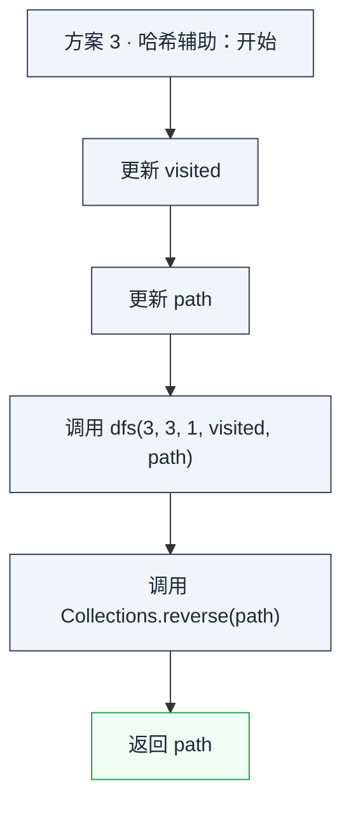

```java
package com.webfault.dsa; // 引入依赖

import java.util.*; // 引入依赖

class RiverCrossing3 { // 定义类型
  static int[][] D = {
    {2, 0}, {1, 0}, {1, 1}, {0, 1}, {0, 2}
  }; // 把 {{2,0},{1,0},{1,1},{0,1},{0,2}}; 写入 static int[][] D

  static boolean safe(int r, int g) { // 定义函数/方法 safe
    return 0 <= r && r <= 3 && 0 <= g && g <= 3 && (r == 0 || r == 3 || r == g);
  }

  static boolean dfs(int r, int g, int step, Set<String> visited, List<int[]> path) { // 定义函数/方法 dfs
    if (r == 0 && g == 0) return true; // 若 右指针 等于 0 且 g 等于 0，直接返回 true
    String key = r + "," + g + "," + (step % 2); // 把 右指针 加 「,」 加 g 加 「,」 加 (步数 对…取模 2) 存入 key
    if (visited.contains(key)) return false; // 若 已访问集合 是否包含 key)，直接返回 false
    visited.add(key); // 已访问集合 追加 key);
    boolean odd = (step % 2 == 1); // 把 (步数 对…取模 2 等于 1); 写入 boolean odd
    for (int[] d : D) { // for (int[] d : D) {
      int dr = d[0], dg = d[1]; // 把 d[0], dg 赋值为 d[1] 存入 dr
      int nr, ng; // int nr, ng;
      if (odd) { // 若 odd
        if (r < dr || g < dg) continue; // 若 右指针 小于 dr 或 g 小于 dg) continue;
        nr = r - dr;
        ng = g - dg; // 把 右指针 减 dr; ng 赋值为 g 减 dg; 写入 nr
      } else { // 否则
        if ((3 - r) < dr || (3 - g) < dg) continue; // 若 (3 减 右指针) 小于 dr 或 (3 减 g) 小于 dg) continue;
        nr = r + dr;
        ng = g + dg; // 把 右指针 加 dr; ng 赋值为 g 加 dg; 写入 nr
      }
      if (!safe(nr, ng)) continue; // 若 取反 safe(nr, ng)) continue;
      if (dfs(nr, ng, step + 1, visited, path)) { // 若 dfs(nr, ng, 步数 加 1, 已访问集合, 当前路径
        path.add(new int[] {dr, dg}); // 当前路径 追加 new int[]{dr, dg});
        return true; // 返回 true
      }
    }
    return false; // 返回 false
  }

  static List<int[]> solve() { // 定义函数/方法 solve
    Set<String> visited = new HashSet<>(); // 把 new HashSet 小于 超过 (); 写入 Set<String> visited
    List<int[]> path = new ArrayList<>(); // 把 new ArrayList 小于 超过 (); 写入 List<int[]> path
    dfs(3, 3, 1, visited, path); // dfs(3, 3, 1, 已访问集合, 当前路径);
    Collections.reverse(path); // 反转
    return path; // 返回 当前路径
  }

  public static void main(String[] args) { // public static void main(String[] args) {
    List<int[]> plan = solve(); // 把 solve(); 写入 List<int[]> plan
    int[][] exp = {
      {1, 1}, {1, 0}, {0, 2}, {0, 1}, {2, 0}, {1, 1}, {2, 0}, {0, 1}, {0, 2}, {1, 0}, {1, 1}
    };
    boolean ok = plan.size() == exp.length; // 把 plan.大小() 等于 exp.长度; 写入 boolean ok
    for (int i = 0; i < exp.length && ok; i++) { // 让 下标 i 从 0 开始计数，下标 i 小于 exp.长度 且 ok 就继续
      if (plan.get(i)[0] != exp[i][0] || plan.get(i)[1] != exp[i][1]) ok = false;
    }
    if (!ok) throw new RuntimeException("FAILED"); // 若 取反 ok) throw new RuntimeException(「FAILED」);
    System.out.println("PASS"); // 全部用例通过，输出 PASS
  }
}
```

#### 方案 4：哈希辅助

**思路与代码分析**：核心是「哈希辅助」。Java 版用类与静态方法组织，集合操作显式明了。**走读**：方案 4 · 哈希辅助：开始 → 更新 visited → 更新 path → 调用 jump(3, 3, -1, 0, visited, p → 调用 Collections.reverse(path) → 返回 path。

**运行架构**（真实控制流）：

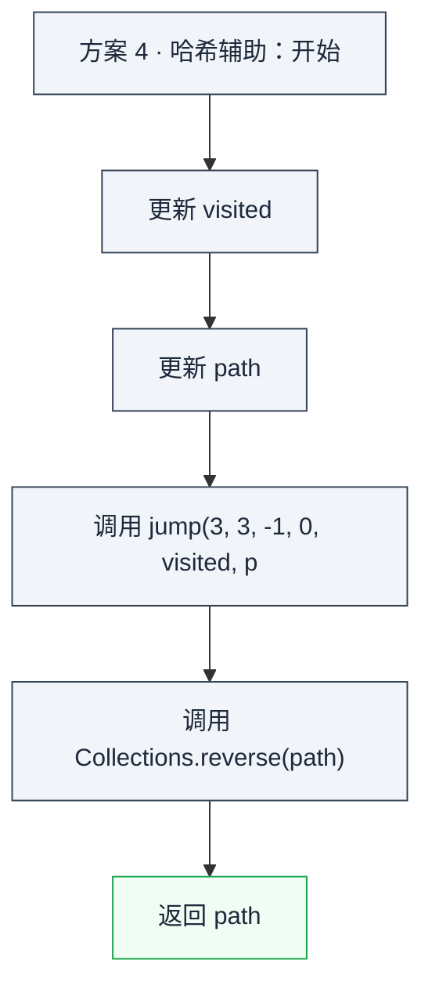

```java
package com.webfault.dsa; // 引入依赖

import java.util.*; // 引入依赖

class RiverWithDir { // 定义类型
  static int[][] D = {
    {2, 0}, {1, 0}, {1, 1}, {0, 1}, {0, 2}
  }; // 把 {{2,0},{1,0},{1,1},{0,1},{0,2}}; 写入 static int[][] D

  static boolean safe(int r, int g) { // 定义函数/方法 safe
    return 0 <= r && r <= 3 && 0 <= g && g <= 3 && (r == 0 || r == 3 || r == g);
  }

  static boolean jump(
      int r, int g, int dir, int step, Set<String> visited, List<int[]> path) { // 定义函数/方法 jump
    if (r == 0 && g == 0 && step % 2 == 0)
      return true; // 若 右指针 等于 0 且 g 等于 0 且 步数 对…取模 2 等于 0，直接返回 true
    String key = r + "," + g + "," + (step % 2); // 把 右指针 加 「,」 加 g 加 「,」 加 (步数 对…取模 2) 存入 key
    if (visited.contains(key)) return false; // 若 已访问集合 是否包含 key)，直接返回 false
    visited.add(key); // 已访问集合 追加 key);
    for (int[] d : D) { // for (int[] d : D) {
      int nr = r + dir * d[0]; // 把 右指针 加 dir 乘 d[0] 存入 nr
      int ng = g + dir * d[1]; // 把 g 加 dir 乘 d[1] 存入 ng
      if (!safe(nr, ng)) continue; // 若 取反 safe(nr, ng)) continue;
      if (jump(
          nr, ng, -dir, step + 1, visited, path)) { // 若 jump(nr, ng, 减 dir, 步数 加 1, 已访问集合, 当前路径
        path.add(new int[] {d[0], d[1]}); // 当前路径 追加 new int[]{d[0], d[1]});
        return true; // 返回 true
      }
    }
    return false; // 返回 false
  }

  static List<int[]> solve() { // 定义函数/方法 solve
    Set<String> visited = new HashSet<>(); // 把 new HashSet 小于 超过 (); 写入 Set<String> visited
    List<int[]> path = new ArrayList<>(); // 把 new ArrayList 小于 超过 (); 写入 List<int[]> path
    jump(3, 3, -1, 0, visited, path); // jump(3, 3, 减 1, 0, 已访问集合, 当前路径);
    Collections.reverse(path); // 反转
    return path; // 返回 当前路径
  }

  public static void main(String[] args) { // public static void main(String[] args) {
    List<int[]> plan = solve(); // 把 solve(); 写入 List<int[]> plan
    if (plan.size() != 0)
      throw new RuntimeException(
          "FAILED"); // 若 plan.大小() 不等于 0) throw new RuntimeException(「FAILED」);
    System.out.println("PASS"); // 全部用例通过，输出 PASS
  }
}
```

### Rust 实现（4 种方案）

Rust 的全部方案如下，每个方案都内嵌用例自测，可独立运行（老仓库 python/go 文件遵循「打印结果」约定）：

#### 方案 1：直接实现

**思路与代码分析**：核心是「直接实现」。Rust 版用所有权移动与切片借用改写同一逻辑，注意 Option 与引用边界。**走读**：方案 1 · 直接实现：开始 → 更新 < → 返回结果。

**运行架构**（真实控制流）：

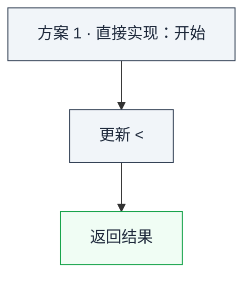

```rust
// LeetCode 107524703. 人鬼渡河问题 — Rust 版（方案1：安全判定谓词）
fn is_safe(r: i32, g: i32) -> bool {
    // 定义判定函数 is_safe
    0 <= r && r <= 3 && 0 <= g && g <= 3 && (r == 0 || r == 3 || r == g)
}

fn main() {
    // 程序入口：跑内嵌自测用例
    let cases: Vec<(i32, i32, bool)> = vec![
        (3, 3, true),
        (3, 1, true),
        (2, 2, true),
        (1, 3, false),
        (0, 0, true),
    ];
    for (idx, (r, g, want)) in cases.iter().enumerate() {
        // for (idx, (右指针, g, want)) in cases.iter().enumerate() {
        assert_eq!(is_safe(*r, *g), *want, "is_safe({},{}) failed", r, g); // 断言校验
    }
    println!("PASS"); // 全部用例通过，输出 PASS
}
```

#### 方案 2：哈希辅助

**思路与代码分析**：核心是「哈希辅助」。Rust 版用所有权移动与切片借用改写同一逻辑，注意 Option 与引用边界。**走读**：方案 2 · 哈希辅助：开始 → 计算 path → 返回 true → 返回 false → 遍历 D.iter() 中的每个元素 d → 返回 true。

**运行架构**（真实控制流）：

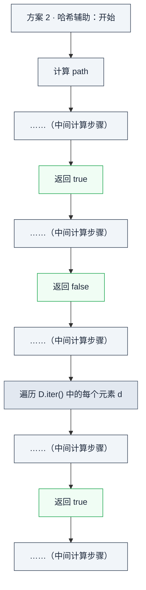

```rust
// LeetCode 107524703. 人鬼渡河问题 — Rust 版（方案2：DFS+奇偶步求解）
use std::cell::RefCell;
use std::collections::HashSet; // 引入依赖 // 引入依赖

const D: [[i32; 2]; 5] = [[2, 0], [1, 0], [1, 1], [0, 1], [0, 2]];

fn safe(r: i32, g: i32) -> bool {
    // 定义函数/方法 safe
    0 <= r && r <= 3 && 0 <= g && g <= 3 && (r == 0 || r == 3 || r == g)
}

fn solve() -> Vec<[i32; 2]> {
    // 定义函数/方法 solve
    let path: RefCell<Vec<[i32; 2]>> = RefCell::new(vec![]);
    let visited: RefCell<HashSet<String>> = RefCell::new(HashSet::new());

    fn dfs(
        r: i32,
        g: i32,
        step: i32,
        visited: &RefCell<HashSet<String>>,
        path: &RefCell<Vec<[i32; 2]>>,
    ) -> bool {
        // 定义函数/方法 dfs
        if r == 0 && g == 0 {
            // 若 右指针 等于 0 且 g 等于 0
            return true; // 返回 true
        }
        let key = format!("{},{},{}", r, g, step % 2); // 把 format取反 (「{},{},{}」, 右指针, g, 步数 对…取模 2) 存入 key
        if visited.borrow().contains(&key) {
            // 若 已访问集合.borrow() 是否包含 按位与 key
            return false; // 返回 false
        }
        visited.borrow_mut().insert(key); // 已访问集合.borrow_mut() 插入 key);
        let odd = step % 2 == 1; // 把 步数 对…取模 2 等于 1 存入 odd
        for d in D.iter() {
            // 逐个取出 D 的元素（d）
            let (dr, dg) = (d[0], d[1]); // 把 (d[0], d[1]); 写入 let (dr, dg)
            let (nr, ng); // let (nr, ng);
            if odd {
                // 若 odd
                if r < dr || g < dg {
                    // 若 右指针 小于 dr 或 g 小于 dg
                    continue; // 跳过本轮，进入下一次
                }
                nr = r - dr; // 把 右指针 减 dr; 写入 nr
                ng = g - dg; // 把 g 减 dg; 写入 ng
            } else {
                // 否则
                if (3 - r) < dr || (3 - g) < dg {
                    // 若 3 减 右指针) 小于 dr 或 (3 减 g) 小于 dg
                    continue; // 跳过本轮，进入下一次
                }
                nr = r + dr; // 把 右指针 加 dr; 写入 nr
                ng = g + dg; // 把 g 加 dg; 写入 ng
            }
            if !safe(nr, ng) {
                // 若 取反 safe(nr, ng
                continue; // 跳过本轮，进入下一次
            }
            if dfs(nr, ng, step + 1, visited, path) {
                // 定义函数/方法 dfs
                path.borrow_mut().push([dr, dg]); // 把 [dr, dg] 压入栈/数组尾部
                return true; // 返回 true
            }
        }
        false // false
    }

    dfs(3, 3, 1, &visited, &path); // dfs(3, 3, 1, 按位与 已访问集合, 按位与 当前路径);
    let mut p = path.borrow().clone(); // 把 当前路径.borrow().clone(); 写入 let mut p
    p.reverse(); // 反转
    p // 节点
}

fn main() {
    // 程序入口：跑内嵌自测用例
    let want: Vec<[i32; 2]> = vec![
        [1, 1],
        [1, 0],
        [0, 2],
        [0, 1],
        [2, 0],
        [1, 1],
        [2, 0],
        [0, 1],
        [0, 2],
        [1, 0],
        [1, 1],
    ];
    let got = solve(); // 把 solve() 存入 got
    assert_eq!(got.len(), want.len(), "solve length mismatch"); // 断言校验
    for i in 0..want.len() {
        // 逐个取出 0 的元素（下标 i）
        assert_eq!(got[i], want[i], "solve at {} mismatch", i); // 断言校验
    }
    println!("PASS"); // 全部用例通过，输出 PASS
}
```

#### 方案 3：哈希辅助

**思路与代码分析**：核心是「哈希辅助」。Rust 版用所有权移动与切片借用改写同一逻辑，注意 Option 与引用边界。**走读**：方案 3 · 哈希辅助：开始 → 计算 path → 返回 true → 返回 false → 遍历 D.iter() 中的每个元素 d → 返回 true。

**运行架构**（真实控制流）：


```rust
// LeetCode 107524703. 人鬼渡河问题 — Rust 版（方案3：DFS+奇偶步求解）
use std::cell::RefCell;
use std::collections::HashSet; // 引入依赖 // 引入依赖

const D: [[i32; 2]; 5] = [[2, 0], [1, 0], [1, 1], [0, 1], [0, 2]];

fn safe(r: i32, g: i32) -> bool {
    // 定义函数/方法 safe
    0 <= r && r <= 3 && 0 <= g && g <= 3 && (r == 0 || r == 3 || r == g)
}

fn solve() -> Vec<[i32; 2]> {
    // 定义函数/方法 solve
    let path: RefCell<Vec<[i32; 2]>> = RefCell::new(vec![]);
    let visited: RefCell<HashSet<String>> = RefCell::new(HashSet::new());

    fn dfs(
        r: i32,
        g: i32,
        step: i32,
        visited: &RefCell<HashSet<String>>,
        path: &RefCell<Vec<[i32; 2]>>,
    ) -> bool {
        // 定义函数/方法 dfs
        if r == 0 && g == 0 {
            // 若 右指针 等于 0 且 g 等于 0
            return true; // 返回 true
        }
        let key = format!("{},{},{}", r, g, step % 2); // 把 format取反 (「{},{},{}」, 右指针, g, 步数 对…取模 2) 存入 key
        if visited.borrow().contains(&key) {
            // 若 已访问集合.borrow() 是否包含 按位与 key
            return false; // 返回 false
        }
        visited.borrow_mut().insert(key); // 已访问集合.borrow_mut() 插入 key);
        let odd = step % 2 == 1; // 把 步数 对…取模 2 等于 1 存入 odd
        for d in D.iter() {
            // 逐个取出 D 的元素（d）
            let (dr, dg) = (d[0], d[1]); // 把 (d[0], d[1]); 写入 let (dr, dg)
            let (nr, ng); // let (nr, ng);
            if odd {
                // 若 odd
                if r < dr || g < dg {
                    // 若 右指针 小于 dr 或 g 小于 dg
                    continue; // 跳过本轮，进入下一次
                }
                nr = r - dr; // 把 右指针 减 dr; 写入 nr
                ng = g - dg; // 把 g 减 dg; 写入 ng
            } else {
                // 否则
                if (3 - r) < dr || (3 - g) < dg {
                    // 若 3 减 右指针) 小于 dr 或 (3 减 g) 小于 dg
                    continue; // 跳过本轮，进入下一次
                }
                nr = r + dr; // 把 右指针 加 dr; 写入 nr
                ng = g + dg; // 把 g 加 dg; 写入 ng
            }
            if !safe(nr, ng) {
                // 若 取反 safe(nr, ng
                continue; // 跳过本轮，进入下一次
            }
            if dfs(nr, ng, step + 1, visited, path) {
                // 定义函数/方法 dfs
                path.borrow_mut().push([dr, dg]); // 把 [dr, dg] 压入栈/数组尾部
                return true; // 返回 true
            }
        }
        false // false
    }

    dfs(3, 3, 1, &visited, &path); // dfs(3, 3, 1, 按位与 已访问集合, 按位与 当前路径);
    let mut p = path.borrow().clone(); // 把 当前路径.borrow().clone(); 写入 let mut p
    p.reverse(); // 反转
    p // 节点
}

fn main() {
    // 程序入口：跑内嵌自测用例
    let want: Vec<[i32; 2]> = vec![
        [1, 1],
        [1, 0],
        [0, 2],
        [0, 1],
        [2, 0],
        [1, 1],
        [2, 0],
        [0, 1],
        [0, 2],
        [1, 0],
        [1, 1],
    ];
    let got = solve(); // 把 solve() 存入 got
    assert_eq!(got.len(), want.len(), "solve length mismatch"); // 断言校验
    for i in 0..want.len() {
        // 逐个取出 0 的元素（下标 i）
        assert_eq!(got[i], want[i], "solve at {} mismatch", i); // 断言校验
    }
    println!("PASS"); // 全部用例通过，输出 PASS
}
```

#### 方案 4：哈希辅助

**思路与代码分析**：核心是「哈希辅助」。Rust 版用所有权移动与切片借用改写同一逻辑，注意 Option 与引用边界。**走读**：方案 4 · 哈希辅助：开始 → 计算 path → 返回 true → 返回 false → 遍历 D.iter() 中的每个元素 d → 返回 true。

**运行架构**（真实控制流）：

```mermaid
graph TD
    N0["方案 4 · 哈希辅助：开始"]
    N1["计算 path"]
    D1["……（中间计算步骤）"]
    N11["返回 true"]
    D2["……（中间计算步骤）"]
    N14["返回 false"]
    D3["……（中间计算步骤）"]
    N16["遍历 D.iter() 中的每个元素 d"]
    D4["……（中间计算步骤）"]
    N23["返回 true"]
    Dend["……（中间计算步骤）"]
    N0 --> N1
    N1 --> D1
    D1 --> N11
    N11 --> D2
    D2 --> N14
    N14 --> D3
    D3 --> N16
    N16 --> D4
    D4 --> N23
    N23 --> Dend
    classDef n fill:#f1f5f9,stroke:#334155,color:#1e293b;
    classDef lp fill:#e2e8f0,stroke:#475569,color:#1e293b;
    classDef dc fill:#fef9c3,stroke:#ca8a04,color:#1e293b;
    classDef tm fill:#f0fdf4,stroke:#16a34a,color:#1e293b;
    class N0,N1,D1,D2,D3,D4,Dend n;
    class N16 lp;
    class N11,N14,N23 tm;
```

```rust
// LeetCode 107524703. 人鬼渡河问题 — Rust 版（方案4：方向入状态的 DFS 变体，断言无可行路径）
use std::collections::HashSet; // 引入依赖

const D: [[i32; 2]; 5] = [[2, 0], [1, 0], [1, 1], [0, 1], [0, 2]];

fn safe(r: i32, g: i32) -> bool {
    // 定义函数/方法 safe
    0 <= r && r <= 3 && 0 <= g && g <= 3 && (r == 0 || r == 3 || r == g)
}

fn solve() -> Vec<[i32; 2]> {
    // 定义函数/方法 solve
    let mut path: Vec<[i32; 2]> = vec![]; // 把 vec取反 []; 写入 let mut path: Vec<[i32; 2]>
    let mut visited: HashSet<String> = HashSet::new(); // 把 HashSet::new(); 写入 let mut visited: HashSet<String>

    fn jump(
        dir: i32,
        r: i32,
        g: i32,
        step: i32,
        visited: &mut HashSet<String>,
        path: &mut Vec<[i32; 2]>,
    ) -> bool {
        // 定义函数/方法 jump
        if r == 0 && g == 0 && step % 2 == 0 {
            // 若 右指针 等于 0 且 g 等于 0 且 步数 对…取模 2 等于 0
            return true; // 返回 true
        }
        let key = format!("{},{},{}", r, g, step % 2); // 把 format取反 (「{},{},{}」, 右指针, g, 步数 对…取模 2) 存入 key
        if visited.contains(&key) {
            // 若 已访问集合 是否包含 按位与 key
            return false; // 返回 false
        }
        visited.insert(key); // 已访问集合 插入 key);
        for d in D.iter() {
            // 逐个取出 D 的元素（d）
            let (dr, dg) = (d[0], d[1]); // 把 (d[0], d[1]); 写入 let (dr, dg)
            let nr = r + dir * dr; // 把 右指针 加 dir 乘 dr 存入 nr
            let ng = g + dir * dg; // 把 g 加 dir 乘 dg 存入 ng
            if !safe(nr, ng) {
                // 若 取反 safe(nr, ng
                continue; // 跳过本轮，进入下一次
            }
            if jump(-dir, nr, ng, step + 1, visited, path) {
                // 定义函数/方法 jump
                path.push([dr, dg]); // 把 [dr, dg] 压入栈/数组尾部
                return true; // 返回 true
            }
        }
        false // false
    }

    jump(-1, 3, 3, 0, &mut visited, &mut path); // jump( 减 1, 3, 3, 0, 按位与 mut 已访问集合, 按位与 mut 当前路径);
    path.reverse(); // 反转
    path // 当前路径
}

fn main() {
    // 程序入口：跑内嵌自测用例
    // 与 TS 原文件一致：该变体断言返回空路径（parity 约束下无解）
    let got = solve(); // 把 solve() 存入 got
    assert!(got.is_empty(), "solve 应返回空路径"); // 断言校验
    println!("PASS"); // 全部用例通过，输出 PASS
}
```

### Lua 实现（4 种方案）

Lua 的全部方案如下，每个方案都内嵌用例自测，可独立运行（老仓库 python/go 文件遵循「打印结果」约定）：

#### 方案 1：直接实现

**思路与代码分析**：核心是「直接实现」。Lua 版用表与 ipairs 遍历，注意 ipairs 遇 nil 即停的语义。**走读**：方案 1 · 直接实现：开始 → 返回 0 ≤ r and r ≤ 3 and 0 ≤ g and g ≤ 3 and (r == 0 or r == 3 or r == g)。

**运行架构**（真实控制流）：

```mermaid
graph TD
    N0["方案 1 · 直接实现：开始"]
    N1["返回 0 ≤ r and r ≤ 3 and 0 ≤ g and g ≤ 3 and (r == 0 or r == 3 or r == g)"]
    N0 --> N1
    classDef n fill:#f1f5f9,stroke:#334155,color:#1e293b;
    classDef lp fill:#e2e8f0,stroke:#475569,color:#1e293b;
    classDef dc fill:#fef9c3,stroke:#ca8a04,color:#1e293b;
    classDef tm fill:#f0fdf4,stroke:#16a34a,color:#1e293b;
    class N0 n;
    class N1 tm;
```

```lua
-- LeetCode 107524703. 人鬼渡河问题 — Lua 版（方案1：安全判定谓词）
local function is_safe(r, g) -- local function is_safe(右指针, g)
	return 0 <= r and r <= 3 and 0 <= g and g <= 3 and (r == 0 or r == 3 or r == g)
end -- 终点

local cases = { -- 把 { 写入 local cases
	{ 3, 3, true },
	{ 3, 1, true },
	{ 2, 2, true },
	{ 1, 3, false },
	{ 0, 0, true },
}
for idx, c in ipairs(cases) do -- 遍历取 字符
	assert(is_safe(c[1], c[2]) == c[3], "is_safe(" .. c[1] .. "," .. c[2] .. ") failed") -- 断言校验
end -- 终点
print("PASS") -- 全部用例通过，输出 PASS
```

#### 方案 2：哈希辅助

**思路与代码分析**：核心是「哈希辅助」。Lua 版用表与 ipairs 遍历，注意 ipairs 遇 nil 即停的语义。**走读**：方案 2 · 哈希辅助：开始 → 返回 0 ≤ r and r ≤ 3 and 0 ≤ g and g ≤ 3 and (r == 0 or r == 3 or r == g)。

**运行架构**（真实控制流）：

```mermaid
graph TD
    N0["方案 2 · 哈希辅助：开始"]
    N1["返回 0 ≤ r and r ≤ 3 and 0 ≤ g and g ≤ 3 and (r == 0 or r == 3 or r == g)"]
    N0 --> N1
    classDef n fill:#f1f5f9,stroke:#334155,color:#1e293b;
    classDef lp fill:#e2e8f0,stroke:#475569,color:#1e293b;
    classDef dc fill:#fef9c3,stroke:#ca8a04,color:#1e293b;
    classDef tm fill:#f0fdf4,stroke:#16a34a,color:#1e293b;
    class N0 n;
    class N1 tm;
```

```lua
-- LeetCode 107524703. 人鬼渡河问题 — Lua 版（方案2：DFS+奇偶步求解）
local D = { { 2, 0 }, { 1, 0 }, { 1, 1 }, { 0, 1 }, { 0, 2 } } -- 把 {{2, 0}, {1, 0}, {1, 1}, {0, 1}, {0, 2}} 写入 local D

local function safe(r, g) -- local function safe(右指针, g)
	return 0 <= r and r <= 3 and 0 <= g and g <= 3 and (r == 0 or r == 3 or r == g)
end -- 终点

local function solve() -- local function solve()
	local path = {} -- 把 {} 写入 local path
	local visited = {} -- 把 {} 写入 local visited

	local dfs -- local dfs
	dfs = function(r, g, step) -- 把 function(右指针, g, 步数) 存入 dfs
		if r == 0 and g == 0 then
			return true
		end -- 若 右指针 等于 0 and g 等于 0 then return true 终点
		local key = r .. "," .. g .. "," .. (step % 2) -- 把 右指针 .. 「,」 .. g .. 「,」 .. (步数 对…取模 2) 写入 local key
		if visited[key] then
			return false
		end -- 若 已访问集合[key] then return false 终点
		visited[key] = true -- 把 true 写入 visited[key]
		local odd = (step % 2 == 1) -- 把 (步数 对…取模 2 等于 1) 写入 local odd
		for _, d in ipairs(D) do -- 遍历取 d
			local dr, dg = d[1], d[2] -- 把 d[1], d[2] 写入 local dr, dg
			local nr, ng -- local nr, ng
			if odd then -- 若 odd then
				if r < dr or g < dg then -- 若 右指针 小于 dr or g 小于 dg then
					-- 跳过
					goto continue_move -- goto continue_move
				end -- 终点
				nr = r - dr -- 把 右指针 减 dr 存入 nr
				ng = g - dg -- 把 g 减 dg 存入 ng
			else -- 否则
				if (3 - r) < dr or (3 - g) < dg then -- 若 3 减 右指针) 小于 dr or (3 减 g) 小于 dg then
					goto continue_move -- goto continue_move
				end -- 终点
				nr = r + dr -- 把 右指针 加 dr 存入 nr
				ng = g + dg -- 把 g 加 dg 存入 ng
			end -- 终点
			if safe(nr, ng) and dfs(nr, ng, step + 1) then -- 若 safe(nr, ng) and dfs(nr, ng, 步数 加 1) then
				path[#path + 1] = { dr, dg } -- 把 {dr, dg} 写入 path[#path + 1]
				return true -- 返回 true
			end -- 终点
			::continue_move:: -- ::continue_move::
		end -- 终点
		return false -- 返回 false
	end -- 终点

	dfs(3, 3, 1) -- dfs(3, 3, 1)
	-- 反转
	local n = #path -- 把 #当前路径 写入 local n
	for i = 1, math.floor(n / 2) do -- 让 下标 i 从 1 走到 math（Lua 1 基）
		path[i], path[n - i + 1] = path[n - i + 1], path[i]
	end -- 终点
	return path -- 返回 当前路径
end -- 终点

local want = { -- 把 { 写入 local want
	{ 1, 1 },
	{ 1, 0 },
	{ 0, 2 },
	{ 0, 1 },
	{ 2, 0 },
	{ 1, 1 },
	{ 2, 0 },
	{ 0, 1 },
	{ 0, 2 },
	{ 1, 0 },
	{ 1, 1 },
}
local got = solve() -- 把 solve() 写入 local got
assert(#got == #want, "solve length mismatch") -- 断言校验
for i = 1, #want do -- 把 1, #want do 写入 for i
	assert(got[i][1] == want[i][1] and got[i][2] == want[i][2], "solve at " .. i .. " mismatch") -- 断言校验
end -- 终点
print("PASS") -- 全部用例通过，输出 PASS
```

#### 方案 3：哈希辅助

**思路与代码分析**：核心是「哈希辅助」。Lua 版用表与 ipairs 遍历，注意 ipairs 遇 nil 即停的语义。**走读**：方案 3 · 哈希辅助：开始 → 返回 0 ≤ r and r ≤ 3 and 0 ≤ g and g ≤ 3 and (r == 0 or r == 3 or r == g)。

**运行架构**（真实控制流）：

```mermaid
graph TD
    N0["方案 3 · 哈希辅助：开始"]
    N1["返回 0 ≤ r and r ≤ 3 and 0 ≤ g and g ≤ 3 and (r == 0 or r == 3 or r == g)"]
    N0 --> N1
    classDef n fill:#f1f5f9,stroke:#334155,color:#1e293b;
    classDef lp fill:#e2e8f0,stroke:#475569,color:#1e293b;
    classDef dc fill:#fef9c3,stroke:#ca8a04,color:#1e293b;
    classDef tm fill:#f0fdf4,stroke:#16a34a,color:#1e293b;
    class N0 n;
    class N1 tm;
```

```lua
-- LeetCode 107524703. 人鬼渡河问题 — Lua 版（方案3：DFS+奇偶步求解）
local D = { { 2, 0 }, { 1, 0 }, { 1, 1 }, { 0, 1 }, { 0, 2 } } -- 把 {{2, 0}, {1, 0}, {1, 1}, {0, 1}, {0, 2}} 写入 local D

local function safe(r, g) -- local function safe(右指针, g)
	return 0 <= r and r <= 3 and 0 <= g and g <= 3 and (r == 0 or r == 3 or r == g)
end -- 终点

local function solve() -- local function solve()
	local path = {} -- 把 {} 写入 local path
	local visited = {} -- 把 {} 写入 local visited

	local dfs -- local dfs
	dfs = function(r, g, step) -- 把 function(右指针, g, 步数) 存入 dfs
		if r == 0 and g == 0 then
			return true
		end -- 若 右指针 等于 0 and g 等于 0 then return true 终点
		local key = r .. "," .. g .. "," .. (step % 2) -- 把 右指针 .. 「,」 .. g .. 「,」 .. (步数 对…取模 2) 写入 local key
		if visited[key] then
			return false
		end -- 若 已访问集合[key] then return false 终点
		visited[key] = true -- 把 true 写入 visited[key]
		local odd = (step % 2 == 1) -- 把 (步数 对…取模 2 等于 1) 写入 local odd
		for _, d in ipairs(D) do -- 遍历取 d
			local dr, dg = d[1], d[2] -- 把 d[1], d[2] 写入 local dr, dg
			local nr, ng -- local nr, ng
			if odd then -- 若 odd then
				if r < dr or g < dg then -- 若 右指针 小于 dr or g 小于 dg then
					-- 跳过
					goto continue_move -- goto continue_move
				end -- 终点
				nr = r - dr -- 把 右指针 减 dr 存入 nr
				ng = g - dg -- 把 g 减 dg 存入 ng
			else -- 否则
				if (3 - r) < dr or (3 - g) < dg then -- 若 3 减 右指针) 小于 dr or (3 减 g) 小于 dg then
					goto continue_move -- goto continue_move
				end -- 终点
				nr = r + dr -- 把 右指针 加 dr 存入 nr
				ng = g + dg -- 把 g 加 dg 存入 ng
			end -- 终点
			if safe(nr, ng) and dfs(nr, ng, step + 1) then -- 若 safe(nr, ng) and dfs(nr, ng, 步数 加 1) then
				path[#path + 1] = { dr, dg } -- 把 {dr, dg} 写入 path[#path + 1]
				return true -- 返回 true
			end -- 终点
			::continue_move:: -- ::continue_move::
		end -- 终点
		return false -- 返回 false
	end -- 终点

	dfs(3, 3, 1) -- dfs(3, 3, 1)
	-- 反转
	local n = #path -- 把 #当前路径 写入 local n
	for i = 1, math.floor(n / 2) do -- 让 下标 i 从 1 走到 math（Lua 1 基）
		path[i], path[n - i + 1] = path[n - i + 1], path[i]
	end -- 终点
	return path -- 返回 当前路径
end -- 终点

local want = { -- 把 { 写入 local want
	{ 1, 1 },
	{ 1, 0 },
	{ 0, 2 },
	{ 0, 1 },
	{ 2, 0 },
	{ 1, 1 },
	{ 2, 0 },
	{ 0, 1 },
	{ 0, 2 },
	{ 1, 0 },
	{ 1, 1 },
}
local got = solve() -- 把 solve() 写入 local got
assert(#got == #want, "solve length mismatch") -- 断言校验
for i = 1, #want do -- 把 1, #want do 写入 for i
	assert(got[i][1] == want[i][1] and got[i][2] == want[i][2], "solve at " .. i .. " mismatch") -- 断言校验
end -- 终点
print("PASS") -- 全部用例通过，输出 PASS
```

#### 方案 4：哈希辅助

**思路与代码分析**：核心是「哈希辅助」。Lua 版用表与 ipairs 遍历，注意 ipairs 遇 nil 即停的语义。**走读**：方案 4 · 哈希辅助：开始 → 返回 0 ≤ r and r ≤ 3 and 0 ≤ g and g ≤ 3 and (r == 0 or r == 3 or r == g)。

**运行架构**（真实控制流）：

```mermaid
graph TD
    N0["方案 4 · 哈希辅助：开始"]
    N1["返回 0 ≤ r and r ≤ 3 and 0 ≤ g and g ≤ 3 and (r == 0 or r == 3 or r == g)"]
    N0 --> N1
    classDef n fill:#f1f5f9,stroke:#334155,color:#1e293b;
    classDef lp fill:#e2e8f0,stroke:#475569,color:#1e293b;
    classDef dc fill:#fef9c3,stroke:#ca8a04,color:#1e293b;
    classDef tm fill:#f0fdf4,stroke:#16a34a,color:#1e293b;
    class N0 n;
    class N1 tm;
```

```lua
-- LeetCode 107524703. 人鬼渡河问题 — Lua 版（方案4：方向入状态的 DFS 变体，断言无可行路径）
local D = { { 2, 0 }, { 1, 0 }, { 1, 1 }, { 0, 1 }, { 0, 2 } } -- 把 {{2, 0}, {1, 0}, {1, 1}, {0, 1}, {0, 2}} 写入 local D

local function safe(r, g) -- local function safe(右指针, g)
	return 0 <= r and r <= 3 and 0 <= g and g <= 3 and (r == 0 or r == 3 or r == g)
end -- 终点

local function solve() -- local function solve()
	local path = {} -- 把 {} 写入 local path
	local visited = {} -- 把 {} 写入 local visited

	local jump -- local jump
	jump = function(dir, r, g, step) -- 把 function(dir, 右指针, g, 步数) 存入 jump
		if r == 0 and g == 0 and step % 2 == 0 then
			return true
		end -- 若 右指针 等于 0 and g 等于 0 and 步数 对…取模 2 等于 0 then return true 终点
		local key = r .. "," .. g .. "," .. (step % 2) -- 把 右指针 .. 「,」 .. g .. 「,」 .. (步数 对…取模 2) 写入 local key
		if visited[key] then
			return false
		end -- 若 已访问集合[key] then return false 终点
		visited[key] = true -- 把 true 写入 visited[key]
		for _, d in ipairs(D) do -- 遍历取 d
			local dr, dg = d[1], d[2] -- 把 d[1], d[2] 写入 local dr, dg
			local nr = r + dir * dr -- 把 右指针 加 dir 乘 dr 写入 local nr
			local ng = g + dir * dg -- 把 g 加 dir 乘 dg 写入 local ng
			if safe(nr, ng) and jump(-dir, nr, ng, step + 1) then -- 若 safe(nr, ng) and jump( 减 dir, nr, ng, 步数 加 1) then
				path[#path + 1] = { dr, dg } -- 把 {dr, dg} 写入 path[#path + 1]
				return true -- 返回 true
			end -- 终点
		end -- 终点
		return false -- 返回 false
	end -- 终点

	jump(-1, 3, 3, 0) -- jump( 减 1, 3, 3, 0)
	local n = #path -- 把 #当前路径 写入 local n
	for i = 1, math.floor(n / 2) do -- 让 下标 i 从 1 走到 math（Lua 1 基）
		path[i], path[n - i + 1] = path[n - i + 1], path[i]
	end -- 终点
	return path -- 返回 当前路径
end -- 终点

-- 与 TS 原文件一致：该变体断言返回空路径（parity 约束下无解）
local got = solve() -- 把 solve() 写入 local got
assert(#got == 0, "solve 应返回空路径") -- 断言校验
print("PASS") -- 全部用例通过，输出 PASS
```

### C 实现（4 种方案）

C 的全部方案如下，每个方案都内嵌用例自测，可独立运行（老仓库 python/go 文件遵循「打印结果」约定）：

#### 方案 1：直接实现

**思路与代码分析**：核心是「直接实现」。C 版手动管理下标与内存，循环边界全部显式写出。**走读**：方案 1 · 直接实现：开始 → 返回 0 ≤ r 且 r ≤ 3 且 0 ≤ g 且 g ≤ 3 且 (r == 0 或 r == 3 或 r == g)。

**运行架构**（真实控制流）：

```mermaid
graph TD
    N0["方案 1 · 直接实现：开始"]
    N1["返回 0 ≤ r 且 r ≤ 3 且 0 ≤ g 且 g ≤ 3 且 (r == 0 或 r == 3 或 r == g)"]
    N0 --> N1
    classDef n fill:#f1f5f9,stroke:#334155,color:#1e293b;
    classDef lp fill:#e2e8f0,stroke:#475569,color:#1e293b;
    classDef dc fill:#fef9c3,stroke:#ca8a04,color:#1e293b;
    classDef tm fill:#f0fdf4,stroke:#16a34a,color:#1e293b;
    class N0 n;
    class N1 tm;
```

```c
* LeetCode 107524703. 人鬼渡河问题 — C 版（方案1：安全判定谓词）
 */
#include <stdio.h> // 引入头文件

static int is_safe(int r, int g) { // 定义判定函数 is_safe
    return 0 <= r && r <= 3 && 0 <= g && g <= 3 && (r == 0 || r == 3 || r == g);
}

int main(void) {                              // 程序入口：跑内嵌自测用例
    int rs[5] = {3, 3, 2, 1, 0};              // 把 {3, 3, 2, 1, 0}; 写入 int rs[5]
    int gs[5] = {3, 1, 2, 3, 0};              // 把 {3, 1, 2, 3, 0}; 写入 int gs[5]
    int ws[5] = {1, 1, 1, 0, 1};              // 把 {1, 1, 1, 0, 1}; 写入 int ws[5]
    for (int i = 0; i < 5; i++) {             // 让 下标 i 从 0 开始计数，下标 i 小于 5 就继续
        if (is_safe(rs[i], gs[i]) != ws[i]) { // 若 is_safe(rs[下标 i], gs[下标 i]) 不等于 ws[下标 i]
            printf("is_safe(%d,%d) failed\n", rs[i], gs[i]); // 打印输出
            return 1;                                        // 返回 1
        }
    }
    printf("PASS\n"); // 全部用例通过，输出 PASS
    return 0;         // 返回 0
}
```

#### 方案 2：哈希辅助

**思路与代码分析**：核心是「哈希辅助」。C 版手动管理下标与内存，循环边界全部显式写出。代码里依次做这些事：单循环线性扫描。**走读**：方案 2 · 哈希辅助：开始 → 命中条件，直接返回 → 更新 parity → 命中条件，直接返回 → 遍历循环 → 返回 1 → 返回 0。

**运行架构**（真实控制流）：

```mermaid
graph TD
    N0["方案 2 · 哈希辅助：开始"]
    N1{"r == 0 且 g == 0 ？"}
    N2["命中条件，直接返回"]
    N3["更新 parity"]
    N4{"is_visited(r, g, parity) ？"}
    N5["命中条件，直接返回"]
    D1["……（中间计算步骤）"]
    N8["遍历循环"]
    D2["……（中间计算步骤）"]
    N23["返回 1"]
    N24["返回 0"]
    N0 --> N1
    N1 -- 是 --> N2
    N1 -- 否 --> N3
    N3 --> N4
    N4 -- 是 --> N5
    N8 --> N24
    N2 --> N3
    N5 --> D1
    D1 --> N8
    N8 --> D2
    D2 --> N23
    N23 --> N24
    classDef n fill:#f1f5f9,stroke:#334155,color:#1e293b;
    classDef lp fill:#e2e8f0,stroke:#475569,color:#1e293b;
    classDef dc fill:#fef9c3,stroke:#ca8a04,color:#1e293b;
    classDef tm fill:#f0fdf4,stroke:#16a34a,color:#1e293b;
    class N0,N3,D1,D2 n;
    class N8 lp;
    class N1,N4 dc;
    class N2,N5,N23,N24 tm;
```

```c
* LeetCode 107524703. 人鬼渡河问题 — C 版（方案2：DFS+奇偶步求解）
 */
#include <stdio.h> // 引入头文件

static const int D[5][2] = {{2, 0}, {1, 0}, {1, 1}, {0, 1}, {0, 2}};
static int path[32][2];  // static int 当前路径[32][2];
static int path_len = 0; // 把 0; 写入 static int path_len
static int visited_r[64], visited_g[64], visited_p[64], visited_n = 0;

static int safe(int r, int g) { // 定义函数/方法 safe
    return 0 <= r && r <= 3 && 0 <= g && g <= 3 && (r == 0 || r == 3 || r == g);
}

static int is_visited(int r, int g, int parity) { // 定义判定函数 is_visited
    for (int i = 0; i < visited_n; i++) // 让 下标 i 从 0 开始计数，下标 i 小于 visited_n 就继续
        if (visited_r[i] == r && visited_g[i] == g && visited_p[i] == parity)
            return 1;
    return 0; // 返回 0
}

static void mark(int r, int g, int parity) { // 定义函数/方法 mark
    visited_r[visited_n] = r;
    visited_g[visited_n] = g;
    visited_p[visited_n] = parity;
    visited_n++; // visited_n 加一
}

static int dfs(int r, int g, int step) { // 定义函数/方法 dfs
    if (r == 0 && g == 0)
        return 1;          // 若 右指针 等于 0 且 g 等于 0，直接返回 1
    int parity = step % 2; // 把 步数 对…取模 2 存入 parity
    if (is_visited(r, g, parity))
        return 0;                       // 若 is_visited(右指针, g, parity)，直接返回 0
    mark(r, g, parity);                 // mark(右指针, g, parity);
    int odd = (step % 2 == 1);          // 把 (步数 对…取模 2 等于 1) 存入 odd
    for (int i = 0; i < 5; i++) {       // 让 下标 i 从 0 开始计数，下标 i 小于 5 就继续
        int dr = D[i][0], dg = D[i][1]; // 把 D[下标 i][0], dg 赋值为 D[下标 i][1] 存入 dr
        int nr, ng;                     // int nr, ng;
        if (odd) {                      // 若 odd
            if (r < dr || g < dg)
                continue; // 若 右指针 小于 dr 或 g 小于 dg) continue;
            nr = r - dr;
            ng = g - dg; // 把 右指针 减 dr; ng 赋值为 g 减 dg; 写入 nr
        } else {         // 否则
            if ((3 - r) < dr || (3 - g) < dg)
                continue; // 若 (3 减 右指针) 小于 dr 或 (3 减 g) 小于 dg) continue;
            nr = r + dr;
            ng = g + dg; // 把 右指针 加 dr; ng 赋值为 g 加 dg; 写入 nr
        }
        if (!safe(nr, ng))
            continue;                // 若 取反 safe(nr, ng)) continue;
        if (dfs(nr, ng, step + 1)) { // 若 dfs(nr, ng, 步数 加 1
            path[path_len][0] = dr;
            path[path_len][1] = dg; // 把 dr; 当前路径[path_len][1] 赋值为 dg; 写入 path[path_len][0]
            path_len++;             // path_len 加一
            return 1;               // 返回 1
        }
    }
    return 0; // 返回 0
}

int main(void) { // 程序入口：跑内嵌自测用例
    int want[11][2] = {
        // 把 { 写入 int want[11][2]
        {1, 1}, {1, 0}, {0, 2}, {0, 1}, {2, 0}, {1, 1}, {2, 0}, {0, 1}, {0, 2}, {1, 0}, {1, 1},
    };
    dfs(3, 3, 1); // dfs(3, 3, 1);
    if (path_len != 11) {
        printf("solve length mismatch: %d\n", path_len);
        return 1;
    }
    for (int i = 0; i < 11; i++) { // 让 下标 i 从 0 开始计数，下标 i 小于 11 就继续
        /* path 逆序存放 */
        if (path[10 - i][0] != want[i][0] || path[10 - i][1] != want[i][1]) {
            printf("solve at %d mismatch\n", i); // 打印输出
            return 1;                            // 返回 1
        }
    }
    printf("PASS\n"); // 全部用例通过，输出 PASS
    return 0;         // 返回 0
}
```

#### 方案 3：哈希辅助

**思路与代码分析**：核心是「哈希辅助」。C 版手动管理下标与内存，循环边界全部显式写出。代码里依次做这些事：单循环线性扫描。**走读**：方案 3 · 哈希辅助：开始 → 命中条件，直接返回 → 更新 parity → 命中条件，直接返回 → 遍历循环 → 返回 1 → 返回 0。

**运行架构**（真实控制流）：

```mermaid
graph TD
    N0["方案 3 · 哈希辅助：开始"]
    N1{"r == 0 且 g == 0 ？"}
    N2["命中条件，直接返回"]
    N3["更新 parity"]
    N4{"is_visited(r, g, parity) ？"}
    N5["命中条件，直接返回"]
    D1["……（中间计算步骤）"]
    N8["遍历循环"]
    D2["……（中间计算步骤）"]
    N23["返回 1"]
    N24["返回 0"]
    N0 --> N1
    N1 -- 是 --> N2
    N1 -- 否 --> N3
    N3 --> N4
    N4 -- 是 --> N5
    N8 --> N24
    N2 --> N3
    N5 --> D1
    D1 --> N8
    N8 --> D2
    D2 --> N23
    N23 --> N24
    classDef n fill:#f1f5f9,stroke:#334155,color:#1e293b;
    classDef lp fill:#e2e8f0,stroke:#475569,color:#1e293b;
    classDef dc fill:#fef9c3,stroke:#ca8a04,color:#1e293b;
    classDef tm fill:#f0fdf4,stroke:#16a34a,color:#1e293b;
    class N0,N3,D1,D2 n;
    class N8 lp;
    class N1,N4 dc;
    class N2,N5,N23,N24 tm;
```

```c
* LeetCode 107524703. 人鬼渡河问题 — C 版（方案3：DFS+奇偶步求解）
 */
#include <stdio.h> // 引入头文件

static const int D[5][2] = {{2, 0}, {1, 0}, {1, 1}, {0, 1}, {0, 2}};
static int path[32][2];  // static int 当前路径[32][2];
static int path_len = 0; // 把 0; 写入 static int path_len
static int visited_r[64], visited_g[64], visited_p[64], visited_n = 0;

static int safe(int r, int g) { // 定义函数/方法 safe
    return 0 <= r && r <= 3 && 0 <= g && g <= 3 && (r == 0 || r == 3 || r == g);
}

static int is_visited(int r, int g, int parity) { // 定义判定函数 is_visited
    for (int i = 0; i < visited_n; i++) // 让 下标 i 从 0 开始计数，下标 i 小于 visited_n 就继续
        if (visited_r[i] == r && visited_g[i] == g && visited_p[i] == parity)
            return 1;
    return 0; // 返回 0
}

static void mark(int r, int g, int parity) { // 定义函数/方法 mark
    visited_r[visited_n] = r;
    visited_g[visited_n] = g;
    visited_p[visited_n] = parity;
    visited_n++; // visited_n 加一
}

static int dfs(int r, int g, int step) { // 定义函数/方法 dfs
    if (r == 0 && g == 0)
        return 1;          // 若 右指针 等于 0 且 g 等于 0，直接返回 1
    int parity = step % 2; // 把 步数 对…取模 2 存入 parity
    if (is_visited(r, g, parity))
        return 0;                       // 若 is_visited(右指针, g, parity)，直接返回 0
    mark(r, g, parity);                 // mark(右指针, g, parity);
    int odd = (step % 2 == 1);          // 把 (步数 对…取模 2 等于 1) 存入 odd
    for (int i = 0; i < 5; i++) {       // 让 下标 i 从 0 开始计数，下标 i 小于 5 就继续
        int dr = D[i][0], dg = D[i][1]; // 把 D[下标 i][0], dg 赋值为 D[下标 i][1] 存入 dr
        int nr, ng;                     // int nr, ng;
        if (odd) {                      // 若 odd
            if (r < dr || g < dg)
                continue; // 若 右指针 小于 dr 或 g 小于 dg) continue;
            nr = r - dr;
            ng = g - dg; // 把 右指针 减 dr; ng 赋值为 g 减 dg; 写入 nr
        } else {         // 否则
            if ((3 - r) < dr || (3 - g) < dg)
                continue; // 若 (3 减 右指针) 小于 dr 或 (3 减 g) 小于 dg) continue;
            nr = r + dr;
            ng = g + dg; // 把 右指针 加 dr; ng 赋值为 g 加 dg; 写入 nr
        }
        if (!safe(nr, ng))
            continue;                // 若 取反 safe(nr, ng)) continue;
        if (dfs(nr, ng, step + 1)) { // 若 dfs(nr, ng, 步数 加 1
            path[path_len][0] = dr;
            path[path_len][1] = dg; // 把 dr; 当前路径[path_len][1] 赋值为 dg; 写入 path[path_len][0]
            path_len++;             // path_len 加一
            return 1;               // 返回 1
        }
    }
    return 0; // 返回 0
}

int main(void) { // 程序入口：跑内嵌自测用例
    int want[11][2] = {
        // 把 { 写入 int want[11][2]
        {1, 1}, {1, 0}, {0, 2}, {0, 1}, {2, 0}, {1, 1}, {2, 0}, {0, 1}, {0, 2}, {1, 0}, {1, 1},
    };
    dfs(3, 3, 1); // dfs(3, 3, 1);
    if (path_len != 11) {
        printf("solve length mismatch: %d\n", path_len);
        return 1;
    }
    for (int i = 0; i < 11; i++) { // 让 下标 i 从 0 开始计数，下标 i 小于 11 就继续
        /* path 逆序存放 */
        if (path[10 - i][0] != want[i][0] || path[10 - i][1] != want[i][1]) {
            printf("solve at %d mismatch\n", i); // 打印输出
            return 1;                            // 返回 1
        }
    }
    printf("PASS\n"); // 全部用例通过，输出 PASS
    return 0;         // 返回 0
}
```

#### 方案 4：哈希辅助

**思路与代码分析**：核心是「哈希辅助」。C 版手动管理下标与内存，循环边界全部显式写出。代码里依次做这些事：单循环线性扫描。**走读**：方案 4 · 哈希辅助：开始 → 命中条件，直接返回 → 更新 parity → 命中条件，直接返回 → 遍历循环 → 返回 1 → 返回 0。

**运行架构**（真实控制流）：

```mermaid
graph TD
    N0["方案 4 · 哈希辅助：开始"]
    N1{"r == 0 且 g == 0 且 step % 2 == 0 ？"}
    N2["命中条件，直接返回"]
    N3["更新 parity"]
    N4{"is_visited(r, g, parity) ？"}
    N5["命中条件，直接返回"]
    D1["……（中间计算步骤）"]
    N7["遍历循环"]
    D2["……（中间计算步骤）"]
    N16["返回 1"]
    N17["返回 0"]
    N0 --> N1
    N1 -- 是 --> N2
    N1 -- 否 --> N3
    N3 --> N4
    N4 -- 是 --> N5
    N7 --> N17
    N2 --> N3
    N5 --> D1
    D1 --> N7
    N7 --> D2
    D2 --> N16
    N16 --> N17
    classDef n fill:#f1f5f9,stroke:#334155,color:#1e293b;
    classDef lp fill:#e2e8f0,stroke:#475569,color:#1e293b;
    classDef dc fill:#fef9c3,stroke:#ca8a04,color:#1e293b;
    classDef tm fill:#f0fdf4,stroke:#16a34a,color:#1e293b;
    class N0,N3,D1,D2 n;
    class N7 lp;
    class N1,N4 dc;
    class N2,N5,N16,N17 tm;
```

```c
* LeetCode 107524703. 人鬼渡河问题 — C 版（方案4：方向入状态的 DFS 变体，断言无可行路径）
 */
#include <stdio.h> // 引入头文件

static const int D[5][2] = {{2, 0}, {1, 0}, {1, 1}, {0, 1}, {0, 2}};
static int path[32][2];  // static int 当前路径[32][2];
static int path_len = 0; // 把 0; 写入 static int path_len
static int visited_r[64], visited_g[64], visited_p[64], visited_n = 0;

static int safe(int r, int g) { // 定义函数/方法 safe
    return 0 <= r && r <= 3 && 0 <= g && g <= 3 && (r == 0 || r == 3 || r == g);
}

static int is_visited(int r, int g, int parity) { // 定义判定函数 is_visited
    for (int i = 0; i < visited_n; i++) // 让 下标 i 从 0 开始计数，下标 i 小于 visited_n 就继续
        if (visited_r[i] == r && visited_g[i] == g && visited_p[i] == parity)
            return 1;
    return 0; // 返回 0
}

static void mark(int r, int g, int parity) { // 定义函数/方法 mark
    visited_r[visited_n] = r;
    visited_g[visited_n] = g;
    visited_p[visited_n] = parity;
    visited_n++; // visited_n 加一
}

static int jump(int dir, int r, int g, int step) { // 定义函数/方法 jump
    if (r == 0 && g == 0 && step % 2 == 0)
        return 1; // 若 右指针 等于 0 且 g 等于 0 且 步数 对…取模 2 等于 0，直接返回 1
    int parity = step % 2; // 把 步数 对…取模 2 存入 parity
    if (is_visited(r, g, parity))
        return 0;                       // 若 is_visited(右指针, g, parity)，直接返回 0
    mark(r, g, parity);                 // mark(右指针, g, parity);
    for (int i = 0; i < 5; i++) {       // 让 下标 i 从 0 开始计数，下标 i 小于 5 就继续
        int dr = D[i][0], dg = D[i][1]; // 把 D[下标 i][0], dg 赋值为 D[下标 i][1] 存入 dr
        int nr = r + dir * dr;          // 把 右指针 加 dir 乘 dr 存入 nr
        int ng = g + dir * dg;          // 把 g 加 dir 乘 dg 存入 ng
        if (!safe(nr, ng))
            continue;                       // 若 取反 safe(nr, ng)) continue;
        if (jump(-dir, nr, ng, step + 1)) { // 若 jump( 减 dir, nr, ng, 步数 加 1
            path[path_len][0] = dr;
            path[path_len][1] = dg; // 把 dr; 当前路径[path_len][1] 赋值为 dg; 写入 path[path_len][0]
            path_len++;             // path_len 加一
            return 1;               // 返回 1
        }
    }
    return 0; // 返回 0
}

int main(void) {       // 程序入口：跑内嵌自测用例
    jump(-1, 3, 3, 0); // jump( 减 1, 3, 3, 0);
    /* 与 TS 原文件一致：该变体断言返回空路径（parity 约束下无解） */
    if (path_len != 0) {
        printf("FAIL: got %d moves\n", path_len);
        return 1;
    }
    printf("PASS\n"); // 全部用例通过，输出 PASS
    return 0;         // 返回 0
}
```

### C++ 实现（4 种方案）

C++ 的全部方案如下，每个方案都内嵌用例自测，可独立运行（老仓库 python/go 文件遵循「打印结果」约定）：

#### 方案 1：直接实现

**思路与代码分析**：核心是「直接实现」。C++ 版用 STL 容器与迭代器，减少手写下标错误。**走读**：方案 1 · 直接实现：开始 → 返回 0 ≤ r 且 r ≤ 3 且 0 ≤ g 且 g ≤ 3 且 (r == 0 或 r == 3 或 r == g)。

**运行架构**（真实控制流）：

```mermaid
graph TD
    N0["方案 1 · 直接实现：开始"]
    N1["返回 0 ≤ r 且 r ≤ 3 且 0 ≤ g 且 g ≤ 3 且 (r == 0 或 r == 3 或 r == g)"]
    N0 --> N1
    classDef n fill:#f1f5f9,stroke:#334155,color:#1e293b;
    classDef lp fill:#e2e8f0,stroke:#475569,color:#1e293b;
    classDef dc fill:#fef9c3,stroke:#ca8a04,color:#1e293b;
    classDef tm fill:#f0fdf4,stroke:#16a34a,color:#1e293b;
    class N0 n;
    class N1 tm;
```

```cpp
// LeetCode 107524703. 人鬼渡河问题 — C++ 版（方案1：安全判定谓词）
#include <iostream> // 引入头文件
#include <vector>   // 引入头文件

static bool is_safe(int r, int g) { // 定义判定函数 is_safe
    return 0 <= r && r <= 3 && 0 <= g && g <= 3 && (r == 0 || r == 3 || r == g);
}

int main() { // 程序入口：跑内嵌自测用例
    std::vector<std::tuple<int, int, bool>> cases = {
        // 把 { 写入 std::vector<std::tuple<int, int, bool>> cases
        {3, 3, true}, {3, 1, true}, {2, 2, true}, {1, 3, false}, {0, 0, true},
    };
    for (auto &[r, g, want] : cases) { // for (auto 按位与 [右指针, g, want] : cases) {
        if (is_safe(r, g) != want) {
            std::cout << "is_safe failed" << std::endl;
            return 1;
        }
    }
    std::cout << "PASS" << std::endl; // 全部用例通过，输出 PASS
    return 0;                         // 返回 0
}
```

#### 方案 2：哈希辅助

**思路与代码分析**：核心是「哈希辅助」。C++ 版用 STL 容器与迭代器，减少手写下标错误。代码里依次做这些事：单循环线性扫描。**走读**：方案 2 · 哈希辅助：开始 → 处理 std::vector＜std::vector＜int＞ → 命中条件，直接返回 → 命中条件，直接返回 → 遍历循环 → 返回 true → 返回 false → 返回 path。

**运行架构**（真实控制流）：

```mermaid
graph TD
    N0["方案 2 · 哈希辅助：开始"]
    N1["处理 std::vector＜std::vector＜int＞"]
    D1["……（中间计算步骤）"]
    N4{"r == 0 且 g == 0 ？"}
    N5["命中条件，直接返回"]
    D2["……（中间计算步骤）"]
    N7{"visited.count(key) ？"}
    N8["命中条件，直接返回"]
    D3["……（中间计算步骤）"]
    N11["遍历循环"]
    D4["……（中间计算步骤）"]
    N24["返回 true"]
    N25["返回 false"]
    D5["……（中间计算步骤）"]
    N28["返回 path"]
    N0 --> N1
    N4 -- 是 --> N5
    N7 -- 是 --> N8
    N11 --> N25
    N1 --> D1
    D1 --> N4
    N5 --> D2
    D2 --> N7
    N8 --> D3
    D3 --> N11
    N11 --> D4
    D4 --> N24
    N24 --> N25
    N25 --> D5
    D5 --> N28
    classDef n fill:#f1f5f9,stroke:#334155,color:#1e293b;
    classDef lp fill:#e2e8f0,stroke:#475569,color:#1e293b;
    classDef dc fill:#fef9c3,stroke:#ca8a04,color:#1e293b;
    classDef tm fill:#f0fdf4,stroke:#16a34a,color:#1e293b;
    class N0,N1,D1,D2,D3,D4,D5 n;
    class N11 lp;
    class N4,N7 dc;
    class N5,N8,N24,N25,N28 tm;
```

```cpp
// LeetCode 107524703. 人鬼渡河问题 — C++ 版（方案2：DFS+奇偶步求解）
#include <functional> // 引入头文件
#include <iostream>   // 引入头文件
#include <set>        // 引入头文件
#include <string>     // 引入头文件
#include <vector>     // 引入头文件

static const int D[5][2] = {{2, 0}, {1, 0}, {1, 1}, {0, 1}, {0, 2}};

static bool safe(int r, int g) { // 定义函数/方法 safe
    return 0 <= r && r <= 3 && 0 <= g && g <= 3 && (r == 0 || r == 3 || r == g);
}

static std::vector<std::vector<int>>
solve() { // static std::vector 小于 std::vector 小于 int 超过 超过 solve() {
    std::vector<std::vector<int>> path; // std::vector 小于 std::vector 小于 int 超过 超过 当前路径;
    std::set<std::string> visited;      // std::set 小于 std::string 超过 已访问集合;

    std::function<bool(int, int, int)> dfs = [&](int r, int g, int step) -> bool {
        if (r == 0 && g == 0)
            return true; // 若 右指针 等于 0 且 g 等于 0，直接返回 true
        std::string key = std::to_string(r) + "," + std::to_string(g) + "," + std::to_string(step % 2);
        if (visited.count(key))
            return false;                   // 若 已访问集合.计数(key)，直接返回 false
        visited.insert(key);                // 已访问集合 插入 key);
        bool odd = (step % 2 == 1);         // 把 (步数 对…取模 2 等于 1) 存入 odd
        for (int i = 0; i < 5; ++i) {       // 让 下标 i 从 0 开始计数，下标 i 小于 5 就继续
            int dr = D[i][0], dg = D[i][1]; // 把 D[下标 i][0], dg 赋值为 D[下标 i][1] 存入 dr
            int nr, ng;                     // int nr, ng;
            if (odd) {                      // 若 odd
                if (r < dr || g < dg)
                    continue; // 若 右指针 小于 dr 或 g 小于 dg) continue;
                nr = r - dr;
                ng = g - dg; // 把 右指针 减 dr; ng 赋值为 g 减 dg; 写入 nr
            } else {         // 否则
                if ((3 - r) < dr || (3 - g) < dg)
                    continue; // 若 (3 减 右指针) 小于 dr 或 (3 减 g) 小于 dg) continue;
                nr = r + dr;
                ng = g + dg; // 把 右指针 加 dr; ng 赋值为 g 加 dg; 写入 nr
            }
            if (!safe(nr, ng))
                continue;                 // 若 取反 safe(nr, ng)) continue;
            if (dfs(nr, ng, step + 1)) {  // 若 dfs(nr, ng, 步数 加 1
                path.push_back({dr, dg}); // 当前路径 追加 {dr, dg});
                return true;              // 返回 true
            }
        }
        return false; // 返回 false
    };

    dfs(3, 3, 1);                           // dfs(3, 3, 1);
    std::reverse(path.begin(), path.end()); // std::reverse(当前路径 迭代位置 , 当前路径.终点());
    return path;                            // 返回 当前路径
}

int main() { // 程序入口：跑内嵌自测用例
    std::vector<std::vector<int>> want = {
        // 把 { 写入 std::vector<std::vector<int>> want
        {1, 1}, {1, 0}, {0, 2}, {0, 1}, {2, 0}, {1, 1}, {2, 0}, {0, 1}, {0, 2}, {1, 0}, {1, 1},
    };
    std::vector<std::vector<int>> got = solve(); // 把 solve(); 写入 std::vector<std::vector<int>> got
    if (got != want) {
        std::cout << "solve mismatch" << std::endl;
        return 1;
    }
    std::cout << "PASS" << std::endl; // 全部用例通过，输出 PASS
    return 0;                         // 返回 0
}
```

#### 方案 3：哈希辅助

**思路与代码分析**：核心是「哈希辅助」。C++ 版用 STL 容器与迭代器，减少手写下标错误。代码里依次做这些事：单循环线性扫描。**走读**：方案 3 · 哈希辅助：开始 → 处理 std::vector＜std::vector＜int＞ → 命中条件，直接返回 → 命中条件，直接返回 → 遍历循环 → 返回 true → 返回 false → 返回 path。

**运行架构**（真实控制流）：

```mermaid
graph TD
    N0["方案 3 · 哈希辅助：开始"]
    N1["处理 std::vector＜std::vector＜int＞"]
    D1["……（中间计算步骤）"]
    N4{"r == 0 且 g == 0 ？"}
    N5["命中条件，直接返回"]
    D2["……（中间计算步骤）"]
    N7{"visited.count(key) ？"}
    N8["命中条件，直接返回"]
    D3["……（中间计算步骤）"]
    N11["遍历循环"]
    D4["……（中间计算步骤）"]
    N24["返回 true"]
    N25["返回 false"]
    D5["……（中间计算步骤）"]
    N28["返回 path"]
    N0 --> N1
    N4 -- 是 --> N5
    N7 -- 是 --> N8
    N11 --> N25
    N1 --> D1
    D1 --> N4
    N5 --> D2
    D2 --> N7
    N8 --> D3
    D3 --> N11
    N11 --> D4
    D4 --> N24
    N24 --> N25
    N25 --> D5
    D5 --> N28
    classDef n fill:#f1f5f9,stroke:#334155,color:#1e293b;
    classDef lp fill:#e2e8f0,stroke:#475569,color:#1e293b;
    classDef dc fill:#fef9c3,stroke:#ca8a04,color:#1e293b;
    classDef tm fill:#f0fdf4,stroke:#16a34a,color:#1e293b;
    class N0,N1,D1,D2,D3,D4,D5 n;
    class N11 lp;
    class N4,N7 dc;
    class N5,N8,N24,N25,N28 tm;
```

```cpp
// LeetCode 107524703. 人鬼渡河问题 — C++ 版（方案3：DFS+奇偶步求解）
#include <functional> // 引入头文件
#include <iostream>   // 引入头文件
#include <set>        // 引入头文件
#include <string>     // 引入头文件
#include <vector>     // 引入头文件

static const int D[5][2] = {{2, 0}, {1, 0}, {1, 1}, {0, 1}, {0, 2}};

static bool safe(int r, int g) { // 定义函数/方法 safe
    return 0 <= r && r <= 3 && 0 <= g && g <= 3 && (r == 0 || r == 3 || r == g);
}

static std::vector<std::vector<int>>
solve() { // static std::vector 小于 std::vector 小于 int 超过 超过 solve() {
    std::vector<std::vector<int>> path; // std::vector 小于 std::vector 小于 int 超过 超过 当前路径;
    std::set<std::string> visited;      // std::set 小于 std::string 超过 已访问集合;

    std::function<bool(int, int, int)> dfs = [&](int r, int g, int step) -> bool {
        if (r == 0 && g == 0)
            return true; // 若 右指针 等于 0 且 g 等于 0，直接返回 true
        std::string key = std::to_string(r) + "," + std::to_string(g) + "," + std::to_string(step % 2);
        if (visited.count(key))
            return false;                   // 若 已访问集合.计数(key)，直接返回 false
        visited.insert(key);                // 已访问集合 插入 key);
        bool odd = (step % 2 == 1);         // 把 (步数 对…取模 2 等于 1) 存入 odd
        for (int i = 0; i < 5; ++i) {       // 让 下标 i 从 0 开始计数，下标 i 小于 5 就继续
            int dr = D[i][0], dg = D[i][1]; // 把 D[下标 i][0], dg 赋值为 D[下标 i][1] 存入 dr
            int nr, ng;                     // int nr, ng;
            if (odd) {                      // 若 odd
                if (r < dr || g < dg)
                    continue; // 若 右指针 小于 dr 或 g 小于 dg) continue;
                nr = r - dr;
                ng = g - dg; // 把 右指针 减 dr; ng 赋值为 g 减 dg; 写入 nr
            } else {         // 否则
                if ((3 - r) < dr || (3 - g) < dg)
                    continue; // 若 (3 减 右指针) 小于 dr 或 (3 减 g) 小于 dg) continue;
                nr = r + dr;
                ng = g + dg; // 把 右指针 加 dr; ng 赋值为 g 加 dg; 写入 nr
            }
            if (!safe(nr, ng))
                continue;                 // 若 取反 safe(nr, ng)) continue;
            if (dfs(nr, ng, step + 1)) {  // 若 dfs(nr, ng, 步数 加 1
                path.push_back({dr, dg}); // 当前路径 追加 {dr, dg});
                return true;              // 返回 true
            }
        }
        return false; // 返回 false
    };

    dfs(3, 3, 1);                           // dfs(3, 3, 1);
    std::reverse(path.begin(), path.end()); // std::reverse(当前路径 迭代位置 , 当前路径.终点());
    return path;                            // 返回 当前路径
}

int main() { // 程序入口：跑内嵌自测用例
    std::vector<std::vector<int>> want = {
        // 把 { 写入 std::vector<std::vector<int>> want
        {1, 1}, {1, 0}, {0, 2}, {0, 1}, {2, 0}, {1, 1}, {2, 0}, {0, 1}, {0, 2}, {1, 0}, {1, 1},
    };
    std::vector<std::vector<int>> got = solve(); // 把 solve(); 写入 std::vector<std::vector<int>> got
    if (got != want) {
        std::cout << "solve mismatch" << std::endl;
        return 1;
    }
    std::cout << "PASS" << std::endl; // 全部用例通过，输出 PASS
    return 0;                         // 返回 0
}
```

#### 方案 4：哈希辅助

**思路与代码分析**：核心是「哈希辅助」。C++ 版用 STL 容器与迭代器，减少手写下标错误。代码里依次做这些事：单循环线性扫描。**走读**：方案 4 · 哈希辅助：开始 → 处理 std::vector＜std::vector＜int＞ → 命中条件，直接返回 → 命中条件，直接返回 → 遍历循环 → 返回 true → 返回 false → 返回 path。

**运行架构**（真实控制流）：

```mermaid
graph TD
    N0["方案 4 · 哈希辅助：开始"]
    N1["处理 std::vector＜std::vector＜int＞"]
    D1["……（中间计算步骤）"]
    N4{"r == 0 且 g == 0 且 step % 2 == 0 ？"}
    N5["命中条件，直接返回"]
    D2["……（中间计算步骤）"]
    N7{"visited.count(key) ？"}
    N8["命中条件，直接返回"]
    D3["……（中间计算步骤）"]
    N10["遍历循环"]
    D4["……（中间计算步骤）"]
    N17["返回 true"]
    N18["返回 false"]
    D5["……（中间计算步骤）"]
    N21["返回 path"]
    N0 --> N1
    N4 -- 是 --> N5
    N7 -- 是 --> N8
    N10 --> N18
    N1 --> D1
    D1 --> N4
    N5 --> D2
    D2 --> N7
    N8 --> D3
    D3 --> N10
    N10 --> D4
    D4 --> N17
    N17 --> N18
    N18 --> D5
    D5 --> N21
    classDef n fill:#f1f5f9,stroke:#334155,color:#1e293b;
    classDef lp fill:#e2e8f0,stroke:#475569,color:#1e293b;
    classDef dc fill:#fef9c3,stroke:#ca8a04,color:#1e293b;
    classDef tm fill:#f0fdf4,stroke:#16a34a,color:#1e293b;
    class N0,N1,D1,D2,D3,D4,D5 n;
    class N10 lp;
    class N4,N7 dc;
    class N5,N8,N17,N18,N21 tm;
```

```cpp
// LeetCode 107524703. 人鬼渡河问题 — C++ 版（方案4：方向入状态的 DFS 变体，断言无可行路径）
#include <functional> // 引入头文件
#include <iostream>   // 引入头文件
#include <set>        // 引入头文件
#include <string>     // 引入头文件
#include <vector>     // 引入头文件

static const int D[5][2] = {{2, 0}, {1, 0}, {1, 1}, {0, 1}, {0, 2}};

static bool safe(int r, int g) { // 定义函数/方法 safe
    return 0 <= r && r <= 3 && 0 <= g && g <= 3 && (r == 0 || r == 3 || r == g);
}

static std::vector<std::vector<int>>
solve() { // static std::vector 小于 std::vector 小于 int 超过 超过 solve() {
    std::vector<std::vector<int>> path; // std::vector 小于 std::vector 小于 int 超过 超过 当前路径;
    std::set<std::string> visited;      // std::set 小于 std::string 超过 已访问集合;

    std::function<bool(int, int, int, int)> jump = [&](int dir, int r, int g, int step) -> bool {
        if (r == 0 && g == 0 && step % 2 == 0)
            return true; // 若 右指针 等于 0 且 g 等于 0 且 步数 对…取模 2 等于 0，直接返回 true
        std::string key = std::to_string(r) + "," + std::to_string(g) + "," + std::to_string(step % 2);
        if (visited.count(key))
            return false;                   // 若 已访问集合.计数(key)，直接返回 false
        visited.insert(key);                // 已访问集合 插入 key);
        for (int i = 0; i < 5; ++i) {       // 让 下标 i 从 0 开始计数，下标 i 小于 5 就继续
            int dr = D[i][0], dg = D[i][1]; // 把 D[下标 i][0], dg 赋值为 D[下标 i][1] 存入 dr
            int nr = r + dir * dr;          // 把 右指针 加 dir 乘 dr 存入 nr
            int ng = g + dir * dg;          // 把 g 加 dir 乘 dg 存入 ng
            if (!safe(nr, ng))
                continue;                       // 若 取反 safe(nr, ng)) continue;
            if (jump(-dir, nr, ng, step + 1)) { // 若 jump( 减 dir, nr, ng, 步数 加 1
                path.push_back({dr, dg});       // 当前路径 追加 {dr, dg});
                return true;                    // 返回 true
            }
        }
        return false; // 返回 false
    };

    jump(-1, 3, 3, 0);                      // jump( 减 1, 3, 3, 0);
    std::reverse(path.begin(), path.end()); // std::reverse(当前路径 迭代位置 , 当前路径.终点());
    return path;                            // 返回 当前路径
}

int main() { // 程序入口：跑内嵌自测用例
    /* 与 TS 原文件一致：该变体断言返回空路径（parity 约束下无解） */
    std::vector<std::vector<int>> got = solve(); // 把 solve(); 写入 std::vector<std::vector<int>> got
    if (!got.empty()) {
        std::cout << "FAIL: got " << got.size() << " moves" << std::endl;
        return 1;
    }
    std::cout << "PASS" << std::endl; // 全部用例通过，输出 PASS
    return 0;                         // 返回 0
}
```

### R 实现（4 种方案）

R 的全部方案如下，每个方案都内嵌用例自测，可独立运行（老仓库 python/go 文件遵循「打印结果」约定）：

#### 方案 1：直接实现

**思路与代码分析**：核心是「直接实现」。R 版用向量化思维与 1 起始下标，注意 1:n 的降序陷阱。**走读**：方案 1 · 直接实现：开始 → 更新 < → 返回结果。

**运行架构**（真实控制流）：

```mermaid
graph TD
    N0["方案 1 · 直接实现：开始"]
    N1["更新 <"]
    N2["返回结果"]
    N0 --> N1
    N1 --> N2
    classDef n fill:#f1f5f9,stroke:#334155,color:#1e293b;
    classDef lp fill:#e2e8f0,stroke:#475569,color:#1e293b;
    classDef dc fill:#fef9c3,stroke:#ca8a04,color:#1e293b;
    classDef tm fill:#f0fdf4,stroke:#16a34a,color:#1e293b;
    class N0,N1 n;
    class N2 tm;
```

```r
# R 版（方案1：安全判定谓词） 定义函数 is_safe（参数：右指针, g）
is_safe <- function(r, g) {
    0 <= r && r <= 3 && 0 <= g && g <= 3 && (r == 0 || r == 3 || r == g)
}
cases <- list(list(3L, 3L, TRUE), list(3L, 1L, TRUE), list(2L, 2L, TRUE), list(1L, 3L, FALSE), list(0L, 0L, TRUE)  # 列表(1L, 3L, FALSE), 列表(0L, 0L, TRUE)
)
for (idx in seq_along(cases)) {
    # for (idx in seq_along(cases)) {
    stopifnot(is_safe(cases[[idx]][[1]], cases[[idx]][[2]]) == cases[[idx]][[3]])  # 断言校验
}
cat("PASS\n")  # 全部用例通过，输出 PASS
```

#### 方案 2：哈希辅助

**思路与代码分析**：核心是「哈希辅助」。R 版用向量化思维与 1 起始下标，注意 1:n 的降序陷阱。**走读**：方案 2 · 哈希辅助：开始 → 更新 < → 返回结果。

**运行架构**（真实控制流）：

```mermaid
graph TD
    N0["方案 2 · 哈希辅助：开始"]
    N1["更新 <"]
    N2["返回结果"]
    N0 --> N1
    N1 --> N2
    classDef n fill:#f1f5f9,stroke:#334155,color:#1e293b;
    classDef lp fill:#e2e8f0,stroke:#475569,color:#1e293b;
    classDef dc fill:#fef9c3,stroke:#ca8a04,color:#1e293b;
    classDef tm fill:#f0fdf4,stroke:#16a34a,color:#1e293b;
    class N0,N1 n;
    class N2 tm;
```

```r
# R 版（方案2：DFS+奇偶步求解）
D <- list(c(2L, 0L), c(1L, 0L), c(1L, 1L), c(0L, 1L), c(0L, 2L))
safe <- function(r, g) {
    # 定义函数 safe（参数：右指针, g）
    0 <= r && r <= 3 && 0 <= g && g <= 3 && (r == 0 || r == 3 || r == g)
}
solve <- function() {
    # 定义函数 solve（参数：无）
    path <- list()  # 把 列表() 存入 当前路径
    visited <- new.env(parent = emptyenv())  # 把 new.env(parent 赋值为 emptyenv()) 存入 已访问集合
    dfs <- function(r, g, step) {
        # 定义函数 dfs（参数：右指针, g, 步数）
        if (r == 0L && g == 0L)
            return(TRUE)  # 若 右指针 等于 0L 且 g 等于 0L) return(TRUE
        key <- paste(r, g, step%%2L, sep = ",")  # 把 paste(右指针, g, 步数 对…取模 对…取模 2L, sep 赋值为 「,」) 存入 key
        if (!is.null(visited[[key]]))
            return(FALSE)  # 若 取反 is.null(已访问集合[[key]])) return(FALSE
        visited[[key]] <- TRUE  # 把 TRUE 存入 visited[[key]]
        odd <- (step%%2L == 1L)  # 把 (步数 对…取模 对…取模 2L 等于 1L) 存入 odd
        for (d in D) {
            # for (d in D) {
            dr <- d[1]
            dg <- d[2]  # 把 d[1]; dg 小于 减 d[2] 存入 dr
            nr <- 0L
            ng <- 0L  # 把 0L; ng 小于 减 0L 存入 nr
            skip <- FALSE  # 把 FALSE 存入 skip
            if (odd) {
                # 若 odd 若 右指针 小于 dr 或 g 小于 dg
                if (r < dr || g < dg) {
                  skip <- TRUE  # 把 TRUE 存入 skip
                } else {
                  # 否则
                  nr <- r - dr
                  ng <- g - dg  # 把 右指针 减 dr; ng 小于 减 g 减 dg 存入 nr
                }
            } else {
                # 否则 若 (3L 减 右指针) 小于 dr 或 (3L 减 g) 小于 dg
                if ((3L - r) < dr || (3L - g) < dg) {
                  skip <- TRUE  # 把 TRUE 存入 skip
                } else {
                  # 否则
                  nr <- r + dr
                  ng <- g + dg  # 把 右指针 加 dr; ng 小于 减 g 加 dg 存入 nr
                }
            }
            if (!skip && safe(nr, ng) && dfs(nr, ng, step + 1L)) {
                # 若 取反 skip 且 safe(nr, ng) 且 dfs(nr, ng, 步数 加 1L
                path <<- c(path, list(c(dr, dg)))  # 当前路径 小于 小于 减 字符(当前路径, 列表(字符(dr, dg)))
                return(TRUE)  # 返回 TRUE
            }
        }
        FALSE  # FALSE
    }
    dfs(3L, 3L, 1L)  # dfs(3L, 3L, 1L)
    rev(path)  # rev(当前路径)
}
want <- list(c(1L, 1L), c(1L, 0L), c(0L, 2L), c(0L, 1L), c(2L, 0L), c(1L, 1L), c(2L, 0L), c(0L, 1L), c(0L, 2L),
    c(1L, 0L), c(1L, 1L))
got <- solve()  # 把 solve() 存入 got
stopifnot(length(got) == length(want))  # 断言校验
for (i in seq_along(want)) {
    # for (下标 i in seq_along(want)) {
    stopifnot(identical(as.integer(got[[i]]), as.integer(want[[i]])))  # 断言校验
}
cat("PASS\n")  # 全部用例通过，输出 PASS
```

#### 方案 3：哈希辅助

**思路与代码分析**：核心是「哈希辅助」。R 版用向量化思维与 1 起始下标，注意 1:n 的降序陷阱。**走读**：方案 3 · 哈希辅助：开始 → 更新 < → 返回结果。

**运行架构**（真实控制流）：

```mermaid
graph TD
    N0["方案 3 · 哈希辅助：开始"]
    N1["更新 <"]
    N2["返回结果"]
    N0 --> N1
    N1 --> N2
    classDef n fill:#f1f5f9,stroke:#334155,color:#1e293b;
    classDef lp fill:#e2e8f0,stroke:#475569,color:#1e293b;
    classDef dc fill:#fef9c3,stroke:#ca8a04,color:#1e293b;
    classDef tm fill:#f0fdf4,stroke:#16a34a,color:#1e293b;
    class N0,N1 n;
    class N2 tm;
```

```r
# R 版（方案3：DFS+奇偶步求解）
D <- list(c(2L, 0L), c(1L, 0L), c(1L, 1L), c(0L, 1L), c(0L, 2L))
safe <- function(r, g) {
    # 定义函数 safe（参数：右指针, g）
    0 <= r && r <= 3 && 0 <= g && g <= 3 && (r == 0 || r == 3 || r == g)
}
solve <- function() {
    # 定义函数 solve（参数：无）
    path <- list()  # 把 列表() 存入 当前路径
    visited <- new.env(parent = emptyenv())  # 把 new.env(parent 赋值为 emptyenv()) 存入 已访问集合
    dfs <- function(r, g, step) {
        # 定义函数 dfs（参数：右指针, g, 步数）
        if (r == 0L && g == 0L)
            return(TRUE)  # 若 右指针 等于 0L 且 g 等于 0L) return(TRUE
        key <- paste(r, g, step%%2L, sep = ",")  # 把 paste(右指针, g, 步数 对…取模 对…取模 2L, sep 赋值为 「,」) 存入 key
        if (!is.null(visited[[key]]))
            return(FALSE)  # 若 取反 is.null(已访问集合[[key]])) return(FALSE
        visited[[key]] <- TRUE  # 把 TRUE 存入 visited[[key]]
        odd <- (step%%2L == 1L)  # 把 (步数 对…取模 对…取模 2L 等于 1L) 存入 odd
        for (d in D) {
            # for (d in D) {
            dr <- d[1]
            dg <- d[2]  # 把 d[1]; dg 小于 减 d[2] 存入 dr
            nr <- 0L
            ng <- 0L  # 把 0L; ng 小于 减 0L 存入 nr
            skip <- FALSE  # 把 FALSE 存入 skip
            if (odd) {
                # 若 odd 若 右指针 小于 dr 或 g 小于 dg
                if (r < dr || g < dg) {
                  skip <- TRUE  # 把 TRUE 存入 skip
                } else {
                  # 否则
                  nr <- r - dr
                  ng <- g - dg  # 把 右指针 减 dr; ng 小于 减 g 减 dg 存入 nr
                }
            } else {
                # 否则 若 (3L 减 右指针) 小于 dr 或 (3L 减 g) 小于 dg
                if ((3L - r) < dr || (3L - g) < dg) {
                  skip <- TRUE  # 把 TRUE 存入 skip
                } else {
                  # 否则
                  nr <- r + dr
                  ng <- g + dg  # 把 右指针 加 dr; ng 小于 减 g 加 dg 存入 nr
                }
            }
            if (!skip && safe(nr, ng) && dfs(nr, ng, step + 1L)) {
                # 若 取反 skip 且 safe(nr, ng) 且 dfs(nr, ng, 步数 加 1L
                path <<- c(path, list(c(dr, dg)))  # 当前路径 小于 小于 减 字符(当前路径, 列表(字符(dr, dg)))
                return(TRUE)  # 返回 TRUE
            }
        }
        FALSE  # FALSE
    }
    dfs(3L, 3L, 1L)  # dfs(3L, 3L, 1L)
    rev(path)  # rev(当前路径)
}
want <- list(c(1L, 1L), c(1L, 0L), c(0L, 2L), c(0L, 1L), c(2L, 0L), c(1L, 1L), c(2L, 0L), c(0L, 1L), c(0L, 2L),
    c(1L, 0L), c(1L, 1L))
got <- solve()  # 把 solve() 存入 got
stopifnot(length(got) == length(want))  # 断言校验
for (i in seq_along(want)) {
    # for (下标 i in seq_along(want)) {
    stopifnot(identical(as.integer(got[[i]]), as.integer(want[[i]])))  # 断言校验
}
cat("PASS\n")  # 全部用例通过，输出 PASS
```

#### 方案 4：哈希辅助

**思路与代码分析**：核心是「哈希辅助」。R 版用向量化思维与 1 起始下标，注意 1:n 的降序陷阱。**走读**：方案 4 · 哈希辅助：开始 → 更新 < → 返回结果。

**运行架构**（真实控制流）：

```mermaid
graph TD
    N0["方案 4 · 哈希辅助：开始"]
    N1["更新 <"]
    N2["返回结果"]
    N0 --> N1
    N1 --> N2
    classDef n fill:#f1f5f9,stroke:#334155,color:#1e293b;
    classDef lp fill:#e2e8f0,stroke:#475569,color:#1e293b;
    classDef dc fill:#fef9c3,stroke:#ca8a04,color:#1e293b;
    classDef tm fill:#f0fdf4,stroke:#16a34a,color:#1e293b;
    class N0,N1 n;
    class N2 tm;
```

```r
# R 版（方案4：方向入状态的 DFS 变体，断言无可行路径）
D <- list(c(2L, 0L), c(1L, 0L), c(1L, 1L), c(0L, 1L), c(0L, 2L))
safe <- function(r, g) {
    # 定义函数 safe（参数：右指针, g）
    0 <= r && r <= 3 && 0 <= g && g <= 3 && (r == 0 || r == 3 || r == g)
}
solve <- function() {
    # 定义函数 solve（参数：无）
    path <- list()  # 把 列表() 存入 当前路径
    visited <- new.env(parent = emptyenv())  # 把 new.env(parent 赋值为 emptyenv()) 存入 已访问集合
    jump <- function(dir, r, g, step) {
        # 定义函数 jump（参数：dir, 右指针, g, 步数）
        if (r == 0L && g == 0L && step%%2L == 0L)
            return(TRUE)  # 若 右指针 等于 0L 且 g 等于 0L 且 步数 对…取模 对…取模 2L 等于 0L) return(TRUE
        key <- paste(r, g, step%%2L, sep = ",")  # 把 paste(右指针, g, 步数 对…取模 对…取模 2L, sep 赋值为 「,」) 存入 key
        if (!is.null(visited[[key]]))
            return(FALSE)  # 若 取反 is.null(已访问集合[[key]])) return(FALSE
        visited[[key]] <- TRUE  # 把 TRUE 存入 visited[[key]]
        for (d in D) {
            # for (d in D) {
            dr <- d[1]
            dg <- d[2]  # 把 d[1]; dg 小于 减 d[2] 存入 dr
            nr <- r + dir * dr  # 把 右指针 加 dir 乘 dr 存入 nr
            ng <- g + dir * dg  # 把 g 加 dir 乘 dg 存入 ng
            if (safe(nr, ng) && jump(-dir, nr, ng, step + 1L)) {
                # 若 safe(nr, ng) 且 jump( 减 dir, nr, ng, 步数 加 1L
                path <<- c(path, list(c(dr, dg)))  # 当前路径 小于 小于 减 字符(当前路径, 列表(字符(dr, dg)))
                return(TRUE)  # 返回 TRUE
            }
        }
        FALSE  # FALSE
    }
    jump(-1L, 3L, 3L, 0L)  # jump( 减 1L, 3L, 3L, 0L)
    rev(path)  # rev(当前路径)
}
# 与 TS 原文件一致：该变体断言返回空路径（parity 约束下无解）
got <- solve()  # 把 solve() 存入 got
stopifnot(length(got) == 0L)  # 断言校验
cat("PASS\n")  # 全部用例通过，输出 PASS
```

### Zig 实现（4 种方案）

Zig 的全部方案如下，每个方案都内嵌用例自测，可独立运行（老仓库 python/go 文件遵循「打印结果」约定）：

#### 方案 1：直接实现

**思路与代码分析**：核心是「直接实现」。Zig 版显式分配与清零，整型边界处理严格。**走读**：方案 1 · 直接实现：开始 → 返回 0 ≤ r and r ≤ 3 and 0 ≤ g and g ≤ 3 and (r == 0 or r == 3 or r == g)。

**运行架构**（真实控制流）：

```mermaid
graph TD
    N0["方案 1 · 直接实现：开始"]
    N1["返回 0 ≤ r and r ≤ 3 and 0 ≤ g and g ≤ 3 and (r == 0 or r == 3 or r == g)"]
    N0 --> N1
    classDef n fill:#f1f5f9,stroke:#334155,color:#1e293b;
    classDef lp fill:#e2e8f0,stroke:#475569,color:#1e293b;
    classDef dc fill:#fef9c3,stroke:#ca8a04,color:#1e293b;
    classDef tm fill:#f0fdf4,stroke:#16a34a,color:#1e293b;
    class N0 n;
    class N1 tm;
```

```zig
// LeetCode 107524703. 人鬼渡河问题 — Zig 版（方案1：安全判定谓词）
const std = @import("std"); // 把 @import(「std」) 存入 std

fn isSafe(r: i32, g: i32) bool { // 定义判定函数 isSafe
    return 0 <= r and r <= 3 and 0 <= g and g <= 3 and (r == 0 or r == 3 or r == g);
}

pub fn main() !void { // 程序入口：跑内嵌自测用例
    const Case = struct { r: i32, g: i32, want: bool }; // 把 struct { 右指针: i32, g: i32, want: bool } 存入 Case
    const cases = [_]Case{ // 把 [_]Case{ 存入 cases
        .{ .r = 3, .g = 3, .want = true },
        .{ .r = 3, .g = 1, .want = true },
        .{ .r = 2, .g = 2, .want = true },
        .{ .r = 1, .g = 3, .want = false },
        .{ .r = 0, .g = 0, .want = true },
    };
    for (cases) |c| { // 逐个取出 cases 的元素（字符）
        if (isSafe(c.r, c.g) != c.want) { // 若 isSafe(字符.右指针, 字符.g) 不等于 字符.want
            std.debug.print("isSafe({d},{d}) failed\n", .{ c.r, c.g }); // 打印输出
            return error.TestFailed; // 返回 error.TestFailed
        }
    }
    std.debug.print("PASS\n", .{}); // 全部用例通过，输出 PASS
}
```

#### 方案 2：哈希辅助

**思路与代码分析**：核心是「哈希辅助」。Zig 版显式分配与清零，整型边界处理严格。代码里依次做这些事：单循环线性扫描。**走读**：方案 2 · 哈希辅助：开始 → 命中条件，直接返回 → 计算 parity → 命中条件，直接返回 → 遍历集合元素 → 返回 true → 返回 false。

**运行架构**（真实控制流）：

```mermaid
graph TD
    N0["方案 2 · 哈希辅助：开始"]
    N1{"r == 0 and g == 0 ？"}
    N2["命中条件，直接返回"]
    N3["计算 parity"]
    D1["……（中间计算步骤）"]
    N6{"visited[ru][gu][parity] ？"}
    N7["命中条件，直接返回"]
    D2["……（中间计算步骤）"]
    N10["遍历集合元素"]
    D3["……（中间计算步骤）"]
    N31["返回 true"]
    N32["返回 false"]
    N0 --> N1
    N1 -- 是 --> N2
    N1 -- 否 --> N3
    N6 -- 是 --> N7
    N10 --> N32
    N2 --> N3
    N3 --> D1
    D1 --> N6
    N7 --> D2
    D2 --> N10
    N10 --> D3
    D3 --> N31
    N31 --> N32
    classDef n fill:#f1f5f9,stroke:#334155,color:#1e293b;
    classDef lp fill:#e2e8f0,stroke:#475569,color:#1e293b;
    classDef dc fill:#fef9c3,stroke:#ca8a04,color:#1e293b;
    classDef tm fill:#f0fdf4,stroke:#16a34a,color:#1e293b;
    class N0,N3,D1,D2,D3 n;
    class N10 lp;
    class N1,N6 dc;
    class N2,N7,N31,N32 tm;
```

```zig
// LeetCode 107524703. 人鬼渡河问题 — Zig 版（方案2：DFS+奇偶步求解）
const std = @import("std"); // 把 @import(「std」) 存入 std

const D = [5][2]i32{ .{ 2, 0 }, .{ 1, 0 }, .{ 1, 1 }, .{ 0, 1 }, .{ 0, 2 } };

fn safe(r: i32, g: i32) bool { // 定义函数/方法 safe
    return 0 <= r and r <= 3 and 0 <= g and g <= 3 and (r == 0 or r == 3 or r == g);
}

var path_buf: [32][2]i32 = undefined; // 把 undefined; 写入 var path_buf: [32][2]i32
var path_len: usize = 0; // 把 0; 写入 var path_len: usize
var visited: [4][4][2]bool = undefined; // 把 undefined; 写入 var visited: [4][4][2]bool

fn dfs(r: i32, g: i32, step: i32) bool { // 定义函数/方法 dfs
    if (r == 0 and g == 0) return true; // 若 右指针 等于 0 and g 等于 0，直接返回 true
    const parity: usize = @intCast(@mod(step, 2)); // 把 @intCast(@mod(步数, 2)); 写入 const parity: usize
    const ru: usize = @intCast(r); // 把 @intCast(右指针); 写入 const ru: usize
    const gu: usize = @intCast(g); // 把 @intCast(g); 写入 const gu: usize
    if (visited[ru][gu][parity]) return false; // 若 已访问集合[ru][gu][parity]，直接返回 false
    visited[ru][gu][parity] = true; // 把 true; 写入 visited[ru][gu][parity]
    const odd = @mod(step, 2) == 1; // 把 @mod(步数, 2) 等于 1 存入 odd
    for (D) |d| { // 逐个取出 D 的元素（d）
        const dr = d[0]; // 把 d[0] 存入 dr
        const dg = d[1]; // 把 d[1] 存入 dg
        var nr: i32 = undefined; // 把 undefined; 写入 var nr: i32
        var ng: i32 = undefined; // 把 undefined; 写入 var ng: i32
        var skip = false; // 把 false 存入 skip
        if (odd) { // 若 odd
            if (r < dr or g < dg) { // 若 右指针 小于 dr or g 小于 dg
                skip = true; // 把 true; 写入 skip
            } else { // 否则
                nr = r - dr; // 把 右指针 减 dr; 写入 nr
                ng = g - dg; // 把 g 减 dg; 写入 ng
            }
        } else { // 否则
            if ((3 - r) < dr or (3 - g) < dg) { // 若 (3 减 右指针) 小于 dr or (3 减 g) 小于 dg
                skip = true; // 把 true; 写入 skip
            } else { // 否则
                nr = r + dr; // 把 右指针 加 dr; 写入 nr
                ng = g + dg; // 把 g 加 dg; 写入 ng
            }
        }
        if (skip) continue; // 若 skip) continue;
        if (!safe(nr, ng)) continue; // 若 取反 safe(nr, ng)) continue;
        if (dfs(nr, ng, step + 1)) { // 若 dfs(nr, ng, 步数 加 1
            path_buf[path_len][0] = dr; // 把 dr; 写入 path_buf[path_len][0]
            path_buf[path_len][1] = dg; // 把 dg; 写入 path_buf[path_len][1]
            path_len += 1; // path_len累加 1
            return true; // 返回 true
        }
    }
    return false; // 返回 false
}

pub fn main() !void { // 程序入口：跑内嵌自测用例
    const want = [11][2]i32{ // 把 [11][2]i32{ 存入 want
        .{ 1, 1 }, .{ 1, 0 }, .{ 0, 2 }, .{ 0, 1 }, .{ 2, 0 },
        .{ 1, 1 }, .{ 2, 0 }, .{ 0, 1 }, .{ 0, 2 }, .{ 1, 0 },
        .{ 1, 1 },
    };
    for (&visited) |*plane| { // for ( 按位与 已访问集合) 按位或 乘 plane 按位或 {
        for (plane) |*row| { // for (plane) 按位或 乘 row 按位或 {
            for (row) |*cell| cell.* = false; // 把 false; 写入 for (row) |*cell| cell.*
        }
    }
    _ = dfs(3, 3, 1); // 把 dfs(3, 3, 1); 写入 _
    if (path_len != 11) { // 若 path_len 不等于 11
        std.debug.print("solve length mismatch: {d}\n", .{path_len}); // 打印输出
        return error.TestFailed; // 返回 error.TestFailed
    }
    for (want, 0..) |w, i| { // for (want, 0..) 按位或 权重, 下标 i 按位或 {
        if (path_buf[10 - i][0] != w[0] or path_buf[10 - i][1] != w[1]) {
            std.debug.print("solve at {d} mismatch\n", .{i}); // 打印输出
            return error.TestFailed; // 返回 error.TestFailed
        }
    }
    std.debug.print("PASS\n", .{}); // 全部用例通过，输出 PASS
}
```

#### 方案 3：哈希辅助

**思路与代码分析**：核心是「哈希辅助」。Zig 版显式分配与清零，整型边界处理严格。代码里依次做这些事：单循环线性扫描。**走读**：方案 3 · 哈希辅助：开始 → 命中条件，直接返回 → 计算 parity → 命中条件，直接返回 → 遍历集合元素 → 返回 true → 返回 false。

**运行架构**（真实控制流）：

```mermaid
graph TD
    N0["方案 3 · 哈希辅助：开始"]
    N1{"r == 0 and g == 0 ？"}
    N2["命中条件，直接返回"]
    N3["计算 parity"]
    D1["……（中间计算步骤）"]
    N6{"visited[ru][gu][parity] ？"}
    N7["命中条件，直接返回"]
    D2["……（中间计算步骤）"]
    N10["遍历集合元素"]
    D3["……（中间计算步骤）"]
    N31["返回 true"]
    N32["返回 false"]
    N0 --> N1
    N1 -- 是 --> N2
    N1 -- 否 --> N3
    N6 -- 是 --> N7
    N10 --> N32
    N2 --> N3
    N3 --> D1
    D1 --> N6
    N7 --> D2
    D2 --> N10
    N10 --> D3
    D3 --> N31
    N31 --> N32
    classDef n fill:#f1f5f9,stroke:#334155,color:#1e293b;
    classDef lp fill:#e2e8f0,stroke:#475569,color:#1e293b;
    classDef dc fill:#fef9c3,stroke:#ca8a04,color:#1e293b;
    classDef tm fill:#f0fdf4,stroke:#16a34a,color:#1e293b;
    class N0,N3,D1,D2,D3 n;
    class N10 lp;
    class N1,N6 dc;
    class N2,N7,N31,N32 tm;
```

```zig
// LeetCode 107524703. 人鬼渡河问题 — Zig 版（方案3：DFS+奇偶步求解）
const std = @import("std"); // 把 @import(「std」) 存入 std

const D = [5][2]i32{ .{ 2, 0 }, .{ 1, 0 }, .{ 1, 1 }, .{ 0, 1 }, .{ 0, 2 } };

fn safe(r: i32, g: i32) bool { // 定义函数/方法 safe
    return 0 <= r and r <= 3 and 0 <= g and g <= 3 and (r == 0 or r == 3 or r == g);
}

var path_buf: [32][2]i32 = undefined; // 把 undefined; 写入 var path_buf: [32][2]i32
var path_len: usize = 0; // 把 0; 写入 var path_len: usize
var visited: [4][4][2]bool = undefined; // 把 undefined; 写入 var visited: [4][4][2]bool

fn dfs(r: i32, g: i32, step: i32) bool { // 定义函数/方法 dfs
    if (r == 0 and g == 0) return true; // 若 右指针 等于 0 and g 等于 0，直接返回 true
    const parity: usize = @intCast(@mod(step, 2)); // 把 @intCast(@mod(步数, 2)); 写入 const parity: usize
    const ru: usize = @intCast(r); // 把 @intCast(右指针); 写入 const ru: usize
    const gu: usize = @intCast(g); // 把 @intCast(g); 写入 const gu: usize
    if (visited[ru][gu][parity]) return false; // 若 已访问集合[ru][gu][parity]，直接返回 false
    visited[ru][gu][parity] = true; // 把 true; 写入 visited[ru][gu][parity]
    const odd = @mod(step, 2) == 1; // 把 @mod(步数, 2) 等于 1 存入 odd
    for (D) |d| { // 逐个取出 D 的元素（d）
        const dr = d[0]; // 把 d[0] 存入 dr
        const dg = d[1]; // 把 d[1] 存入 dg
        var nr: i32 = undefined; // 把 undefined; 写入 var nr: i32
        var ng: i32 = undefined; // 把 undefined; 写入 var ng: i32
        var skip = false; // 把 false 存入 skip
        if (odd) { // 若 odd
            if (r < dr or g < dg) { // 若 右指针 小于 dr or g 小于 dg
                skip = true; // 把 true; 写入 skip
            } else { // 否则
                nr = r - dr; // 把 右指针 减 dr; 写入 nr
                ng = g - dg; // 把 g 减 dg; 写入 ng
            }
        } else { // 否则
            if ((3 - r) < dr or (3 - g) < dg) { // 若 (3 减 右指针) 小于 dr or (3 减 g) 小于 dg
                skip = true; // 把 true; 写入 skip
            } else { // 否则
                nr = r + dr; // 把 右指针 加 dr; 写入 nr
                ng = g + dg; // 把 g 加 dg; 写入 ng
            }
        }
        if (skip) continue; // 若 skip) continue;
        if (!safe(nr, ng)) continue; // 若 取反 safe(nr, ng)) continue;
        if (dfs(nr, ng, step + 1)) { // 若 dfs(nr, ng, 步数 加 1
            path_buf[path_len][0] = dr; // 把 dr; 写入 path_buf[path_len][0]
            path_buf[path_len][1] = dg; // 把 dg; 写入 path_buf[path_len][1]
            path_len += 1; // path_len累加 1
            return true; // 返回 true
        }
    }
    return false; // 返回 false
}

pub fn main() !void { // 程序入口：跑内嵌自测用例
    const want = [11][2]i32{ // 把 [11][2]i32{ 存入 want
        .{ 1, 1 }, .{ 1, 0 }, .{ 0, 2 }, .{ 0, 1 }, .{ 2, 0 },
        .{ 1, 1 }, .{ 2, 0 }, .{ 0, 1 }, .{ 0, 2 }, .{ 1, 0 },
        .{ 1, 1 },
    };
    for (&visited) |*plane| { // for ( 按位与 已访问集合) 按位或 乘 plane 按位或 {
        for (plane) |*row| { // for (plane) 按位或 乘 row 按位或 {
            for (row) |*cell| cell.* = false; // 把 false; 写入 for (row) |*cell| cell.*
        }
    }
    _ = dfs(3, 3, 1); // 把 dfs(3, 3, 1); 写入 _
    if (path_len != 11) { // 若 path_len 不等于 11
        std.debug.print("solve length mismatch: {d}\n", .{path_len}); // 打印输出
        return error.TestFailed; // 返回 error.TestFailed
    }
    for (want, 0..) |w, i| { // for (want, 0..) 按位或 权重, 下标 i 按位或 {
        if (path_buf[10 - i][0] != w[0] or path_buf[10 - i][1] != w[1]) {
            std.debug.print("solve at {d} mismatch\n", .{i}); // 打印输出
            return error.TestFailed; // 返回 error.TestFailed
        }
    }
    std.debug.print("PASS\n", .{}); // 全部用例通过，输出 PASS
}
```

#### 方案 4：哈希辅助

**思路与代码分析**：核心是「哈希辅助」。Zig 版显式分配与清零，整型边界处理严格。代码里依次做这些事：单循环线性扫描。**走读**：方案 4 · 哈希辅助：开始 → 命中条件，直接返回 → 计算 parity → 命中条件，直接返回 → 遍历集合元素 → 返回 true → 返回 false。

**运行架构**（真实控制流）：

```mermaid
graph TD
    N0["方案 4 · 哈希辅助：开始"]
    N1{"r == 0 and g == 0 and @mod(step, 2) == 0 ？"}
    N2["命中条件，直接返回"]
    N3["计算 parity"]
    D1["……（中间计算步骤）"]
    N6{"visited[ru][gu][parity] ？"}
    N7["命中条件，直接返回"]
    D2["……（中间计算步骤）"]
    N9["遍历集合元素"]
    D3["……（中间计算步骤）"]
    N15["返回 true"]
    N16["返回 false"]
    N0 --> N1
    N1 -- 是 --> N2
    N1 -- 否 --> N3
    N6 -- 是 --> N7
    N9 --> N16
    N2 --> N3
    N3 --> D1
    D1 --> N6
    N7 --> D2
    D2 --> N9
    N9 --> D3
    D3 --> N15
    N15 --> N16
    classDef n fill:#f1f5f9,stroke:#334155,color:#1e293b;
    classDef lp fill:#e2e8f0,stroke:#475569,color:#1e293b;
    classDef dc fill:#fef9c3,stroke:#ca8a04,color:#1e293b;
    classDef tm fill:#f0fdf4,stroke:#16a34a,color:#1e293b;
    class N0,N3,D1,D2,D3 n;
    class N9 lp;
    class N1,N6 dc;
    class N2,N7,N15,N16 tm;
```

```zig
// LeetCode 107524703. 人鬼渡河问题 — Zig 版（方案4：方向入状态的 DFS 变体，断言无可行路径）
const std = @import("std"); // 把 @import(「std」) 存入 std

const D = [5][2]i32{ .{ 2, 0 }, .{ 1, 0 }, .{ 1, 1 }, .{ 0, 1 }, .{ 0, 2 } };

fn safe(r: i32, g: i32) bool { // 定义函数/方法 safe
    return 0 <= r and r <= 3 and 0 <= g and g <= 3 and (r == 0 or r == 3 or r == g);
}

var path_len: usize = 0; // 把 0; 写入 var path_len: usize
var visited: [4][4][2]bool = undefined; // 把 undefined; 写入 var visited: [4][4][2]bool

fn jump(dir: i32, r: i32, g: i32, step: i32) bool { // 定义函数/方法 jump
    if (r == 0 and g == 0 and @mod(step, 2) == 0) return true; // 若 右指针 等于 0 and g 等于 0 and @mod(步数, 2) 等于 0，直接返回 true
    const parity: usize = @intCast(@mod(step, 2)); // 把 @intCast(@mod(步数, 2)); 写入 const parity: usize
    const ru: usize = @intCast(r); // 把 @intCast(右指针); 写入 const ru: usize
    const gu: usize = @intCast(g); // 把 @intCast(g); 写入 const gu: usize
    if (visited[ru][gu][parity]) return false; // 若 已访问集合[ru][gu][parity]，直接返回 false
    visited[ru][gu][parity] = true; // 把 true; 写入 visited[ru][gu][parity]
    for (D) |d| { // 逐个取出 D 的元素（d）
        const nr = r + dir * d[0]; // 把 右指针 加 dir 乘 d[0] 存入 nr
        const ng = g + dir * d[1]; // 把 g 加 dir 乘 d[1] 存入 ng
        if (!safe(nr, ng)) continue; // 若 取反 safe(nr, ng)) continue;
        if (jump(-dir, nr, ng, step + 1)) { // 若 jump( 减 dir, nr, ng, 步数 加 1
            path_len += 1; // path_len累加 1
            return true; // 返回 true
        }
    }
    return false; // 返回 false
}

pub fn main() !void { // 程序入口：跑内嵌自测用例
    for (&visited) |*plane| { // for ( 按位与 已访问集合) 按位或 乘 plane 按位或 {
        for (plane) |*row| { // for (plane) 按位或 乘 row 按位或 {
            for (row) |*cell| cell.* = false; // 把 false; 写入 for (row) |*cell| cell.*
        }
    }
    _ = jump(-1, 3, 3, 0); // 把 jump( 减 1, 3, 3, 0); 写入 _
    // 与 TS 原文件一致：该变体断言返回空路径（parity 约束下无解）
    if (path_len != 0) { // 若 path_len 不等于 0
        std.debug.print("FAIL: got {d} moves\n", .{path_len}); // 打印输出
        return error.TestFailed; // 返回 error.TestFailed
    }
    std.debug.print("PASS\n", .{}); // 全部用例通过，输出 PASS
}
```

### Dart 实现（4 种方案）

Dart 的全部方案如下，每个方案都内嵌用例自测，可独立运行（老仓库 python/go 文件遵循「打印结果」约定）：

#### 方案 1：直接实现

**思路与代码分析**：核心是「直接实现」。Dart 版用可空类型标注与集合方法，注意空安全。**走读**：方案 1 · 直接实现：开始 → 返回 0 ≤ r 且 r ≤ 3 且 0 ≤ g 且 g ≤ 3 且 (r == 0 或 r == 3 或 r == g)。

**运行架构**（真实控制流）：

```mermaid
graph TD
    N0["方案 1 · 直接实现：开始"]
    N1["返回 0 ≤ r 且 r ≤ 3 且 0 ≤ g 且 g ≤ 3 且 (r == 0 或 r == 3 或 r == g)"]
    N0 --> N1
    classDef n fill:#f1f5f9,stroke:#334155,color:#1e293b;
    classDef lp fill:#e2e8f0,stroke:#475569,color:#1e293b;
    classDef dc fill:#fef9c3,stroke:#ca8a04,color:#1e293b;
    classDef tm fill:#f0fdf4,stroke:#16a34a,color:#1e293b;
    class N0 n;
    class N1 tm;
```

```dart
// LeetCode 107524703. 人鬼渡河问题 — Dart 版（方案1：安全判定谓词）
bool isSafe(int r, int g) {
  // 定义判定函数 isSafe
  return 0 <= r && r <= 3 && 0 <= g && g <= 3 && (r == 0 || r == 3 || r == g);
}

void main() {
  // 程序入口：跑内嵌自测用例
  final cases = <List<dynamic>>[
    [3, 3, true],
    [3, 1, true],
    [2, 2, true],
    [1, 3, false],
    [0, 0, true],
  ];
  for (var i = 0; i < cases.length; i++) {
    // 让 下标 i 从 0 开始计数，下标 i 小于 cases.长度 就继续
    final c = cases[i]; // 把 cases[下标 i] 存入 字符
    if (isSafe(c[0] as int, c[1] as int) != c[2] as bool) {
      // 若 isSafe(字符[0] as int, 字符[1] as int) 不等于 字符[2] as bool
      throw StateError(
        'is_safe(${c[0]},${c[1]}) failed',
      ); // throw StateError('is_safe(${字符[0]},${字符[1]}) failed');
    }
  }
  print('PASS'); // 全部用例通过，输出 PASS
}
```

#### 方案 2：哈希辅助

**思路与代码分析**：核心是「哈希辅助」。Dart 版用可空类型标注与集合方法，注意空安全。代码里依次做这些事：单循环线性扫描。**走读**：方案 2 · 哈希辅助：开始 → 更新 path → 命中条件，直接返回 → 命中条件，直接返回 → 遍历循环 → 返回 true → 返回 false → 返回 path.reversed.toList()。

**运行架构**（真实控制流）：

```mermaid
graph TD
    N0["方案 2 · 哈希辅助：开始"]
    N1["更新 path"]
    D1["……（中间计算步骤）"]
    N4{"r == 0 且 g == 0 ？"}
    N5["命中条件，直接返回"]
    D2["……（中间计算步骤）"]
    N7{"visited.contains(key) ？"}
    N8["命中条件，直接返回"]
    D3["……（中间计算步骤）"]
    N11["遍历循环"]
    D4["……（中间计算步骤）"]
    N28["返回 true"]
    N29["返回 false"]
    D5["……（中间计算步骤）"]
    N31["返回 path.reversed.toList()"]
    N0 --> N1
    N4 -- 是 --> N5
    N7 -- 是 --> N8
    N11 --> N29
    N1 --> D1
    D1 --> N4
    N5 --> D2
    D2 --> N7
    N8 --> D3
    D3 --> N11
    N11 --> D4
    D4 --> N28
    N28 --> N29
    N29 --> D5
    D5 --> N31
    classDef n fill:#f1f5f9,stroke:#334155,color:#1e293b;
    classDef lp fill:#e2e8f0,stroke:#475569,color:#1e293b;
    classDef dc fill:#fef9c3,stroke:#ca8a04,color:#1e293b;
    classDef tm fill:#f0fdf4,stroke:#16a34a,color:#1e293b;
    class N0,N1,D1,D2,D3,D4,D5 n;
    class N11 lp;
    class N4,N7 dc;
    class N5,N8,N28,N29,N31 tm;
```

```dart
// LeetCode 107524703. 人鬼渡河问题 — Dart 版（方案2：DFS+奇偶步求解）
const D = <List<int>>[
  [2, 0],
  [1, 0],
  [1, 1],
  [0, 1],
  [0, 2],
];

bool safe(int r, int g) {
  // 定义函数/方法 safe
  return 0 <= r && r <= 3 && 0 <= g && g <= 3 && (r == 0 || r == 3 || r == g);
}

List<List<int>> solve() {
  // 定义函数/方法 solve
  final path = <List<int>>[]; // 把 小于 List 小于 int 超过 超过 [] 存入 当前路径
  final visited = <String>{}; // 把 小于 String 超过 {} 存入 已访问集合

  bool dfs(int r, int g, int step) {
    // 定义函数/方法 dfs
    if (r == 0 && g == 0) return true; // 若 右指针 等于 0 且 g 等于 0，直接返回 true
    final key = '$r,$g,${step % 2}'; // 把 '$右指针,$g,${步数 对…取模 2}' 存入 key
    if (visited.contains(key)) return false; // 若 已访问集合 是否包含 key)，直接返回 false
    visited.add(key); // 已访问集合 追加 key);
    final odd = step % 2 == 1; // 把 步数 对…取模 2 等于 1 存入 odd
    for (final d in D) {
      // for (final d in D) {
      final dr = d[0], dg = d[1]; // 把 d[0], dg 赋值为 d[1] 存入 dr
      var nr = 0, ng = 0; // 把 0, ng 赋值为 0 存入 nr
      var skip = false; // 把 false 存入 skip
      if (odd) {
        // 若 odd
        if (r < dr || g < dg) {
          // 若 右指针 小于 dr 或 g 小于 dg
          skip = true; // 把 true 存入 skip
        } else {
          // 否则
          nr = r - dr; // 把 右指针 减 dr 存入 nr
          ng = g - dg; // 把 g 减 dg 存入 ng
        }
      } else {
        // 否则
        if ((3 - r) < dr || (3 - g) < dg) {
          // 若 (3 减 右指针) 小于 dr 或 (3 减 g) 小于 dg
          skip = true; // 把 true 存入 skip
        } else {
          // 否则
          nr = r + dr; // 把 右指针 加 dr 存入 nr
          ng = g + dg; // 把 g 加 dg 存入 ng
        }
      }
      if (skip) continue; // 若 skip) continue;
      if (!safe(nr, ng)) continue; // 若 取反 safe(nr, ng)) continue;
      if (dfs(nr, ng, step + 1)) {
        // 若 dfs(nr, ng, 步数 加 1
        path.add([dr, dg]); // 当前路径 追加 [dr, dg]);
        return true; // 返回 true
      }
    }
    return false; // 返回 false
  }

  dfs(3, 3, 1); // dfs(3, 3, 1);
  return path.reversed.toList(); // 返回 当前路径.reversed.toList()
}

void main() {
  // 程序入口：跑内嵌自测用例
  final want = <List<int>>[
    [1, 1],
    [1, 0],
    [0, 2],
    [0, 1],
    [2, 0],
    [1, 1],
    [2, 0],
    [0, 1],
    [0, 2],
    [1, 0],
    [1, 1],
  ];
  final got = solve(); // 把 solve() 存入 got
  if (got.toString() != want.toString()) {
    // 若 got.toString() 不等于 want.toString(
    throw StateError(
      'solve mismatch: ' + got.toString(),
    ); // throw StateError('solve mismatch: ' 加 got.toString());
  }
  print('PASS'); // 全部用例通过，输出 PASS
}
```

#### 方案 3：哈希辅助

**思路与代码分析**：核心是「哈希辅助」。Dart 版用可空类型标注与集合方法，注意空安全。代码里依次做这些事：单循环线性扫描。**走读**：方案 3 · 哈希辅助：开始 → 更新 path → 命中条件，直接返回 → 命中条件，直接返回 → 遍历循环 → 返回 true → 返回 false → 返回 path.reversed.toList()。

**运行架构**（真实控制流）：

```mermaid
graph TD
    N0["方案 3 · 哈希辅助：开始"]
    N1["更新 path"]
    D1["……（中间计算步骤）"]
    N4{"r == 0 且 g == 0 ？"}
    N5["命中条件，直接返回"]
    D2["……（中间计算步骤）"]
    N7{"visited.contains(key) ？"}
    N8["命中条件，直接返回"]
    D3["……（中间计算步骤）"]
    N11["遍历循环"]
    D4["……（中间计算步骤）"]
    N28["返回 true"]
    N29["返回 false"]
    D5["……（中间计算步骤）"]
    N31["返回 path.reversed.toList()"]
    N0 --> N1
    N4 -- 是 --> N5
    N7 -- 是 --> N8
    N11 --> N29
    N1 --> D1
    D1 --> N4
    N5 --> D2
    D2 --> N7
    N8 --> D3
    D3 --> N11
    N11 --> D4
    D4 --> N28
    N28 --> N29
    N29 --> D5
    D5 --> N31
    classDef n fill:#f1f5f9,stroke:#334155,color:#1e293b;
    classDef lp fill:#e2e8f0,stroke:#475569,color:#1e293b;
    classDef dc fill:#fef9c3,stroke:#ca8a04,color:#1e293b;
    classDef tm fill:#f0fdf4,stroke:#16a34a,color:#1e293b;
    class N0,N1,D1,D2,D3,D4,D5 n;
    class N11 lp;
    class N4,N7 dc;
    class N5,N8,N28,N29,N31 tm;
```

```dart
// LeetCode 107524703. 人鬼渡河问题 — Dart 版（方案3：DFS+奇偶步求解）
const D = <List<int>>[
  [2, 0],
  [1, 0],
  [1, 1],
  [0, 1],
  [0, 2],
];

bool safe(int r, int g) {
  // 定义函数/方法 safe
  return 0 <= r && r <= 3 && 0 <= g && g <= 3 && (r == 0 || r == 3 || r == g);
}

List<List<int>> solve() {
  // 定义函数/方法 solve
  final path = <List<int>>[]; // 把 小于 List 小于 int 超过 超过 [] 存入 当前路径
  final visited = <String>{}; // 把 小于 String 超过 {} 存入 已访问集合

  bool dfs(int r, int g, int step) {
    // 定义函数/方法 dfs
    if (r == 0 && g == 0) return true; // 若 右指针 等于 0 且 g 等于 0，直接返回 true
    final key = '$r,$g,${step % 2}'; // 把 '$右指针,$g,${步数 对…取模 2}' 存入 key
    if (visited.contains(key)) return false; // 若 已访问集合 是否包含 key)，直接返回 false
    visited.add(key); // 已访问集合 追加 key);
    final odd = step % 2 == 1; // 把 步数 对…取模 2 等于 1 存入 odd
    for (final d in D) {
      // for (final d in D) {
      final dr = d[0], dg = d[1]; // 把 d[0], dg 赋值为 d[1] 存入 dr
      var nr = 0, ng = 0; // 把 0, ng 赋值为 0 存入 nr
      var skip = false; // 把 false 存入 skip
      if (odd) {
        // 若 odd
        if (r < dr || g < dg) {
          // 若 右指针 小于 dr 或 g 小于 dg
          skip = true; // 把 true 存入 skip
        } else {
          // 否则
          nr = r - dr; // 把 右指针 减 dr 存入 nr
          ng = g - dg; // 把 g 减 dg 存入 ng
        }
      } else {
        // 否则
        if ((3 - r) < dr || (3 - g) < dg) {
          // 若 (3 减 右指针) 小于 dr 或 (3 减 g) 小于 dg
          skip = true; // 把 true 存入 skip
        } else {
          // 否则
          nr = r + dr; // 把 右指针 加 dr 存入 nr
          ng = g + dg; // 把 g 加 dg 存入 ng
        }
      }
      if (skip) continue; // 若 skip) continue;
      if (!safe(nr, ng)) continue; // 若 取反 safe(nr, ng)) continue;
      if (dfs(nr, ng, step + 1)) {
        // 若 dfs(nr, ng, 步数 加 1
        path.add([dr, dg]); // 当前路径 追加 [dr, dg]);
        return true; // 返回 true
      }
    }
    return false; // 返回 false
  }

  dfs(3, 3, 1); // dfs(3, 3, 1);
  return path.reversed.toList(); // 返回 当前路径.reversed.toList()
}

void main() {
  // 程序入口：跑内嵌自测用例
  final want = <List<int>>[
    [1, 1],
    [1, 0],
    [0, 2],
    [0, 1],
    [2, 0],
    [1, 1],
    [2, 0],
    [0, 1],
    [0, 2],
    [1, 0],
    [1, 1],
  ];
  final got = solve(); // 把 solve() 存入 got
  if (got.toString() != want.toString()) {
    // 若 got.toString() 不等于 want.toString(
    throw StateError(
      'solve mismatch: ' + got.toString(),
    ); // throw StateError('solve mismatch: ' 加 got.toString());
  }
  print('PASS'); // 全部用例通过，输出 PASS
}
```

#### 方案 4：哈希辅助

**思路与代码分析**：核心是「哈希辅助」。Dart 版用可空类型标注与集合方法，注意空安全。代码里依次做这些事：单循环线性扫描。**走读**：方案 4 · 哈希辅助：开始 → 更新 path → 命中条件，直接返回 → 命中条件，直接返回 → 遍历循环 → 返回 true → 返回 false → 返回 path.reversed.toList()。

**运行架构**（真实控制流）：

```mermaid
graph TD
    N0["方案 4 · 哈希辅助：开始"]
    N1["更新 path"]
    D1["……（中间计算步骤）"]
    N4{"r == 0 且 g == 0 且 step % 2 == 0 ？"}
    N5["命中条件，直接返回"]
    D2["……（中间计算步骤）"]
    N7{"visited.contains(key) ？"}
    N8["命中条件，直接返回"]
    D3["……（中间计算步骤）"]
    N10["遍历循环"]
    D4["……（中间计算步骤）"]
    N17["返回 true"]
    N18["返回 false"]
    D5["……（中间计算步骤）"]
    N20["返回 path.reversed.toList()"]
    N0 --> N1
    N4 -- 是 --> N5
    N7 -- 是 --> N8
    N10 --> N18
    N1 --> D1
    D1 --> N4
    N5 --> D2
    D2 --> N7
    N8 --> D3
    D3 --> N10
    N10 --> D4
    D4 --> N17
    N17 --> N18
    N18 --> D5
    D5 --> N20
    classDef n fill:#f1f5f9,stroke:#334155,color:#1e293b;
    classDef lp fill:#e2e8f0,stroke:#475569,color:#1e293b;
    classDef dc fill:#fef9c3,stroke:#ca8a04,color:#1e293b;
    classDef tm fill:#f0fdf4,stroke:#16a34a,color:#1e293b;
    class N0,N1,D1,D2,D3,D4,D5 n;
    class N10 lp;
    class N4,N7 dc;
    class N5,N8,N17,N18,N20 tm;
```

```dart
// LeetCode 107524703. 人鬼渡河问题 — Dart 版（方案4：方向入状态的 DFS 变体，断言无可行路径）
const D = <List<int>>[
  [2, 0],
  [1, 0],
  [1, 1],
  [0, 1],
  [0, 2],
];

bool safe(int r, int g) {
  // 定义函数/方法 safe
  return 0 <= r && r <= 3 && 0 <= g && g <= 3 && (r == 0 || r == 3 || r == g);
}

List<List<int>> solve() {
  // 定义函数/方法 solve
  final path = <List<int>>[]; // 把 小于 List 小于 int 超过 超过 [] 存入 当前路径
  final visited = <String>{}; // 把 小于 String 超过 {} 存入 已访问集合

  bool jump(int dir, int r, int g, int step) {
    // 定义函数/方法 jump
    if (r == 0 && g == 0 && step % 2 == 0)
      return true; // 若 右指针 等于 0 且 g 等于 0 且 步数 对…取模 2 等于 0，直接返回 true
    final key = '$r,$g,${step % 2}'; // 把 '$右指针,$g,${步数 对…取模 2}' 存入 key
    if (visited.contains(key)) return false; // 若 已访问集合 是否包含 key)，直接返回 false
    visited.add(key); // 已访问集合 追加 key);
    for (final d in D) {
      // for (final d in D) {
      final dr = d[0], dg = d[1]; // 把 d[0], dg 赋值为 d[1] 存入 dr
      final nr = r + dir * dr; // 把 右指针 加 dir 乘 dr 存入 nr
      final ng = g + dir * dg; // 把 g 加 dir 乘 dg 存入 ng
      if (!safe(nr, ng)) continue; // 若 取反 safe(nr, ng)) continue;
      if (jump(-dir, nr, ng, step + 1)) {
        // 若 jump( 减 dir, nr, ng, 步数 加 1
        path.add([dr, dg]); // 当前路径 追加 [dr, dg]);
        return true; // 返回 true
      }
    }
    return false; // 返回 false
  }

  jump(-1, 3, 3, 0); // jump( 减 1, 3, 3, 0);
  return path.reversed.toList(); // 返回 当前路径.reversed.toList()
}

void main() {
  // 程序入口：跑内嵌自测用例
  // 与 TS 原文件一致：该变体断言返回空路径（parity 约束下无解）
  final got = solve(); // 把 solve() 存入 got
  if (got.isNotEmpty) throw StateError('FAIL: got ${got.length} moves');
  print('PASS'); // 全部用例通过，输出 PASS
}
```

---

## 内容总结

- **计算思维之人鬼渡河问题**（算法笔记 · Medium）：共 4 个方案，主线思路「直接实现」；时间 O(n) 量级；动画演示归并分治过程，附录给出 11 种语言 × 全部方案的可运行实现。
- 来源博客：[https://blog.csdn.net/tyro_java/article/details/107524703](https://blog.csdn.net/tyro_java/article/details/107524703)
- 导航：[📋 总目录](../) ｜ [← 204 计算思维之分书和八皇后问题](../204_计算思维之分书和八皇后问题/) ｜ [206 抽象思维之对比算法 发现共性 →](../206_抽象思维之对比算法_发现共性/)
