# 206 · 抽象思维之对比算法 发现共性（第附阶段 · 专题补充 · Medium）

> **难度**：⭐⭐ Medium ｜ **专题**：算法笔记
> **学习定位**：第附阶段 · 专题补充第 206 篇 ｜ **解法数**：3
> **内容总结**：**抽象思维之对比算法 发现共性**（算法笔记 · Medium）：共 3 个方案，主线思路「直接实现」；时间 O(n) 量级；动画演示归并分治过程，附录给出 11 种语言 × 全部方案的可运行实现。

---

## 题目描述

抽象思维之对比算法 发现共性。具体输入输出约定见函数签名与用例。

- 主函数签名：`function assertEq(actual: any, expected: any, msg: string = ''): void`

**数据范围与注意事项**：

- **易错点**：先看小例子手推一遍再对照代码，比直接读代码快得多。

## 题目分析

**场景是什么**：综合练习：把数据结构与策略组合起来解决一个完整问题。本题就是该场景的 Medium 级练习，主线做法是「直接实现」。

**主线怎么解**：主解法结构简单：读入、处理、返回。

## 解题思路

**方案对比**（共 3 个方案，由浅入深）：

| 方案 | 时间复杂度 | 空间复杂度 |
|---|---|---|
| 方案 1 · 直接实现 | O(n) 量级 | O(n) |
| 方案 2 · 迭代指针处理 | O(n)（单趟线性扫描） | O(1) 到 O(n)（视辅助结构） |
| 方案 3 · 迭代指针处理 | O(n)（单趟线性扫描） | O(1) 到 O(n)（视辅助结构） |

**由浅入深的路径**：直接实现 → 迭代指针处理；每往右一步，都在补上一步的短板。

**方案间的取舍**：方案 1（直接实现）；方案 2（迭代指针处理）；方案 3（迭代指针处理）。数据规模小、可读性优先时选靠前的方案；规模大、性能优先时选靠后的方案。

**怎么读这一篇**：

- 🐣 **新手路线**：把「题目描述」的示例 1 在纸上手推一遍 → 读方案 1（最直观的写法）与它的代码走读 → 按「运行方式」本地跑通看 PASS → 回头对比方案 2 之后的写法差在哪
- 🦅 **大佬路线**：直接锁定最优方案 1（直接实现，O(n) 量级）→ 跳读该方案代码与走读 → 用「逐步拆解与面试追问」补齐复杂度推导与边界追问

### 动态算法图（归并分治，GIF 自动循环）


动画演示算法笔记专题里归并分治的典型过程；每个方案在「TypeScript 解题方案」一节还配了专属动画与专属流程图。

### 主解法流程图（真实控制流）

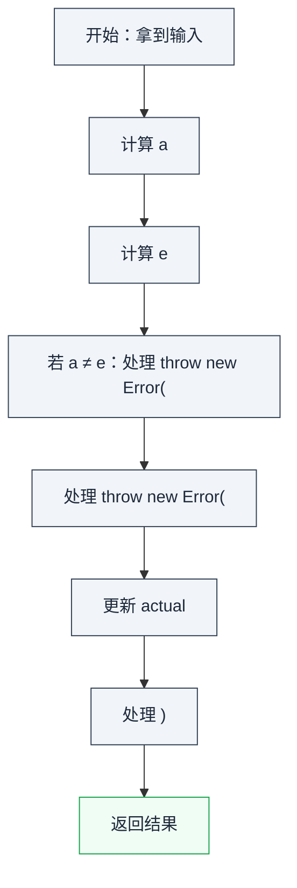

## TypeScript 解题方案（3 个方案逐个讲）

> **运行与提交**：每个方案都是自包含文件（内嵌用例自测，输出 PASS），整块复制到 `.ts` 文件后 `node 文件名` 即可运行。提交 LeetCode 时，把 `demo` 内的算法函数与辅助类型/函数整体取出、置于文件顶层即可。概念演示（非 LeetCode 编号题），在本地运行即可。

### 方案 1：直接实现

**分析与思路**：核心做法是「直接实现」。

**运行方式**：`node 本文件`，内嵌用例全部通过会输出 PASS。


**方案专属流程图**（真实控制流）：

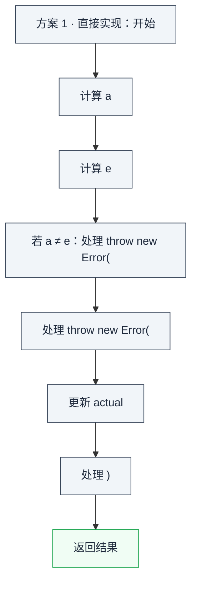

```typescript
function assertEq(actual: any, expected: any, msg: string = ''): void {
  // 定义函数/方法 assertEq
  const a = JSON.stringify(actual);
  const e = JSON.stringify(expected);
  if (a !== e)
    throw new Error(
      'ASSERT FAILED ' + msg + ' :: actual=' + a + ' expected=' + e,
    );
}

function climb_stairs_refactored(h: number): number {
  // 定义函数/方法 climb_stairs_refactored
  const goal = h;
  let count = 0; // 把 h; let 计数 赋值为 0 存入 goal
  function is_done(pos: number): boolean {
    return pos === goal;
  } // 定义判定函数 is_done
  function is_valid(pos: number): boolean {
    return 0 <= pos && pos <= goal;
  } // 定义判定函数 is_valid
  function get_new_pos(pos: number, k: number): number {
    return pos + (k + 1);
  } // 定义函数/方法 get_new_pos
  function dfs(pos: number): void {
    // 定义函数/方法 dfs
    if (is_done(pos)) {
      count++;
      return;
    } // 若 is_done(pos)) { 计数 加一 ; return; }
    for (let k = 0; k < 3; k++) {
      const nxt = get_new_pos(pos, k);
      if (!is_valid(nxt)) continue;
      dfs(nxt);
    } // 让 下标 k 从 0 开始计数，下标 k 小于 3 就继续
  }
  dfs(0); // dfs(0);
  return count; // 返回 计数
}
export function demo(): void {
  // 程序入口：跑内嵌自测用例
  assertEq(climb_stairs_refactored(10), 274, 'sr'); // 断言校验
  console.log('PASS'); // 全部用例通过，输出 PASS
}
demo(); // demo();
```

### 方案 2：迭代指针处理

**分析与思路**：核心做法是「迭代指针处理」。代码里依次做这些事：队列或堆的调度。

**运行方式**：`node 本文件`，内嵌用例全部通过会输出 PASS。


**方案专属流程图**（真实控制流）：


```typescript
class TreeNode {
  // 定义类型
  val: any;
  left: any;
  right: any; // 值: any; 左边界: any; 右边界: any;
  constructor(val?: any, left?: any, right?: any) {
    // constructor(值?: any, 左边界?: any, 右边界?: any) {
    this.val = val === undefined ? 0 : val; // 把 (值 全等于 undefined ? 0 : 值); 写入 值
    this.left = left === undefined ? null : left; // 把 (左边界 全等于 undefined ? null : 左边界); 写入 左边界
    this.right = right === undefined ? null : right; // 把 (右边界 全等于 undefined ? null : 右边界); 写入 右边界
  }
}
function buildTree(vals: any): any {
  // 定义函数/方法 buildTree
  if (!vals || vals.length === 0) return null; // 若 取反 vals 或 vals.长度 全等于 0，直接返回 null
  const root = new TreeNode(vals[0]);
  const q: any[] = [root];
  let i = 1;
  while (q.length && i < vals.length) {
    // 循环，直到不满足「节点.长度 且 下标 i 小于 vals.长度」
    const node = q.shift(); // 把 节点.shift() 存入 节点
    if (vals[i] !== null && vals[i] !== undefined) {
      node.left = new TreeNode(vals[i]);
      q.push(node.left);
    }
    i++; // 下标 i 加一
    if (i < vals.length && vals[i] !== null && vals[i] !== undefined) {
      node.right = new TreeNode(vals[i]);
      q.push(node.right);
    }
    i++; // 下标 i 加一
  }
  return root; // 返回 根节点
}
function treeToLevel(root: any): any[] {
  // 定义函数/方法 treeToLevel
  if (!root) return []; // 若 取反 根节点，直接返回 []
  const out: any[] = [];
  const q: any[] = [root]; // 把 []; const 节点: any[] 赋值为 [根节点]; 写入 const out: any[]
  while (q.length) {
    // 循环，直到不满足「节点.长度」
    const n = q.shift(); // 把 节点.shift() 存入 元素个数
    if (n === null || n === undefined) {
      out.push(null);
      continue;
    }
    out.push(n.val);
    q.push(n.left);
    q.push(n.right); // 把 元素个数.值 压入栈/数组尾部
  }
  while (out.length && out[out.length - 1] === null) out.pop(); // 循环，直到不满足「out.长度 且 out[out.长度 减 1] 全等于 null) out 弹出 );」
  return out; // 返回 out
}
class ListNode {
  // 定义类型
  val: any;
  next: any; // 值: any; 下一个: any;
  constructor(val?: any, next?: any) {
    this.val = val === undefined ? 0 : val;
    this.next = next === undefined ? null : next;
  }
}
function buildList(vals: any): any {
  // 定义函数/方法 buildList
  const dummy = new ListNode(0);
  let cur = dummy; // 把 new ListNode(0); let 当前值 赋值为 哨兵节点 存入 哨兵节点
  for (const v of vals) {
    cur.next = new ListNode(v);
    cur = cur.next;
  } // 把 new ListNode(值); 当前值 赋值为 当前值.下一个; } 写入 下一个
  return dummy.next; // 返回 哨兵节点.下一个
}
function listToArray(head: any): any[] {
  // 定义函数/方法 listToArray
  const out: any[] = [];
  let p = head; // 把 []; let 节点 赋值为 头节点; 写入 const out: any[]
  while (p) {
    out.push(p.val);
    p = p.next;
  } // 循环，直到不满足「节点) { out 追加 节点.值); 节点 赋值为 节点.下一个; }」
  return out; // 返回 out
}
// python-runtime shims
function pyLen(a: any): number {
  // 定义函数/方法 pyLen
  if (a === null || a === undefined) return 0; // 若 数组 全等于 null 或 数组 全等于 undefined，直接返回 0
  if (
    typeof a === 'string' ||
    Array.isArray(a) ||
    a instanceof Set ||
    a instanceof Map
  )
    return a.length ?? a.size;
  if (typeof a === 'object') return Object.keys(a).length; // 若 typeof 数组 全等于 'object'，直接返回 Object.keys(数组).长度
  return 0; // 返回 0
}
function pySlice(a: any, i: any, j: any, step?: any): any {
  // 定义函数/方法 pySlice
  if (typeof a === 'string') {
    const r = [...a].slice(i ?? 0, j ?? a.length);
    return step ? r.reverse().join('') : r.join('');
  }
  const arr = Array.isArray(a) ? a : [...a]; // 把 Array.isArray(数组) ? 数组 : 复制的 数组 存入 数组
  return arr.slice(i ?? 0, j ?? arr.length); // 返回 数组 截取 下标 i ?? 0, 下标 j ?? 数组.长度)
}
function pyRange(a: any, b?: any, step?: any): any[] {
  // 定义函数/方法 pyRange
  let s = 0,
    e = a,
    st = 1; // 把 0, e 赋值为 数组, st 赋值为 1 存入 字符串
  if (b !== undefined) {
    s = a;
    e = b;
  } // 若 b 不等于 undefined) { 字符串 赋值为 数组; e 赋值为 b; }
  if (step !== undefined) st = step; // 若 步数 不等于 undefined) st 赋值为 步数;
  const out: any[] = []; // 把 []; 写入 const out: any[]
  if (st > 0) for (let i = s; i < e; i += st) out.push(i);
  else for (let i = s; i > e; i += st) out.push(i); // 否则
  return out; // 返回 out
}
function pyIn(x: any, coll: any): boolean {
  // 定义函数/方法 pyIn
  if (coll === null || coll === undefined) return false; // 若 coll 全等于 null 或 coll 全等于 undefined，直接返回 false
  if (Array.isArray(coll)) return coll.includes(x); // 若 Array.isArray(coll)，直接返回 coll 是否包含 x)
  if (coll instanceof Set || coll instanceof Map) return coll.has(x); // 若 coll instanceof Set 或 coll instanceof Map，直接返回 coll.has(x)
  if (typeof coll === 'object') return x in coll; // 若 typeof coll 全等于 'object'，直接返回 x in coll
  if (typeof coll === 'string') return coll.indexOf(x) >= 0; // 若 typeof coll 全等于 'string'，直接返回 coll 查找 x) 不低于 0
  return false; // 返回 false
}
function pySorted(a: any): any[] {
  // 定义函数/方法 pySorted
  const arr = typeof a === 'string' ? [...a] : [...a]; // 把 (typeof 数组 全等于 'string') ? 复制的 数组 : 复制的 数组 存入 数组
  return arr.sort((x: any, y: any) => (x < y ? -1 : x > y ? 1 : 0));
}
function pyMin(a: any, b?: any): any {
  if (b !== undefined) return Math.min(a, b);
  if (Array.isArray(a) || a instanceof Set) return Math.min(...a);
  return Math.min(a);
} // 定义函数/方法 pyMin
function pyMax(a: any, b?: any): any {
  if (b !== undefined) return Math.max(a, b);
  if (Array.isArray(a) || a instanceof Set) return Math.max(...a);
  return Math.max(a);
} // 定义函数/方法 pyMax
function pySum(a: any): number {
  let s = 0;
  for (const v of a) s += v;
  return s;
} // 定义函数/方法 pySum
function pyAbs(x: any): number {
  return Math.abs(x);
} // 定义函数/方法 pyAbs
function pyEnumerate(a: any): any[] {
  const out: any[] = [];
  let i = 0;
  for (const v of a) {
    out.push([i, v]);
    i++;
  }
  return out;
} // 定义函数/方法 pyEnumerate
function pyZip(a: any, b: any): any[] {
  const n = Math.min(a.length, b.length);
  const out: any[] = [];
  for (let i = 0; i < n; i++) out.push([a[i], b[i]]);
  return out;
} // 定义函数/方法 pyZip
function pyDictGet(d: any, k: any, def?: any): any {
  return k in d ? d[k] : def === undefined ? null : def;
} // 定义函数/方法 pyDictGet
function pyPrint(...args: any[]): void {
  console.log(
    args
      .map((a) => (typeof a === 'object' && a !== null ? JSON.stringify(a) : a))
      .join(' '),
  );
} // 定义函数/方法 pyPrint
// collections / heapq
function heapPush(h: any[], x: any): void {
  h.push(x);
  let i = h.length - 1;
  while (i > 0) {
    const p = (i - 1) >> 1;
    if (h[p] <= h[i]) break;
    [h[p], h[i]] = [h[i], h[p]];
    i = p;
  }
} // 定义函数/方法 heapPush
function heapPop(h: any[]): any {
  const top = h[0];
  const last = h.pop();
  if (h.length) {
    h[0] = last;
    let i = 0;
    const n = h.length;
    while (true) {
      let l = 2 * i + 1,
        r = 2 * i + 2,
        s = i;
      if (l < n && h[l] < h[s]) s = l;
      if (r < n && h[r] < h[s]) s = r;
      if (s === i) break;
      [h[s], h[i]] = [h[i], h[s]];
      i = s;
    }
  }
  return top;
} // 定义函数/方法 heapPop
class Deque {
  private a: any[] = [];
  push(x: any) {
    this.a.push(x);
  }
  pushLeft(x: any) {
    this.a.unshift(x);
  }
  pop() {
    return this.a.pop();
  }
  popLeft() {
    return this.a.shift();
  }
  get length() {
    return this.a.length;
  }
  toArray() {
    return this.a.slice();
  }
} // 定义类型
function Counter(iter: any): any {
  const m: any = {};
  for (const v of iter) m[v] = (m[v] || 0) + 1;
  return m;
} // 定义函数/方法 Counter
function gcd(a: any, b: any): any {
  while (b) {
    [a, b] = [b, a % b];
  }
  return a;
} // 定义函数/方法 gcd
function pyInf(): number {
  return Infinity;
} // 定义函数/方法 pyInf

function norm(x: any): any {
  // 定义函数/方法 norm
  if (x === null || x === undefined) return null; // 若 x 全等于 null 或 x 全等于 undefined，直接返回 null
  if (typeof x === 'object') {
    // 若 typeof x 全等于 'object'
    if (x instanceof Deque) return x.toArray(); // 若 x instanceof Deque，直接返回 x.toArray()
    if (Array.isArray(x)) return x.map(norm); // 若 Array.isArray(x)，直接返回 x.映射表(norm)
    if (
      typeof x.val === 'number' &&
      (typeof x.left !== 'undefined' || typeof x.right !== 'undefined')
    )
      return treeToLevel(x);
    if (typeof x.next !== 'undefined' && typeof x.val === 'number')
      return listToArray(x);
    if (x instanceof Set) return [...x].sort(); // 若 x instanceof Set，直接返回 复制的 x 排序 )
    if (x instanceof Map) return Object.fromEntries(x); // 若 x instanceof Map，直接返回 Object.fromEntries(x)
    const o: any = {};
    for (const k of Object.keys(x)) o[k] = norm(x[k]);
    return o;
  }
  return x; // 返回 x
}
function eq(a: any, b: any): boolean {
  // 定义函数/方法 eq
  const x = norm(a),
    y = norm(b); // 把 norm(数组), y 赋值为 norm(b) 存入 x
  if (x === y) return true; // 若 x 全等于 y，直接返回 true
  if (x === null || y === null) return x === y; // 若 x 全等于 null 或 y 全等于 null，直接返回 x 全等于 y
  if (Array.isArray(x) && Array.isArray(y)) {
    // 若 Array.isArray(x) 且 Array.isArray(y
    if (x.length !== y.length) return false; // 若 x.长度 不等于 y.长度，直接返回 false
    for (let i = 0; i < x.length; i++) if (!eq(x[i], y[i])) return false; // 让 下标 i 从 0 开始计数，下标 i 小于 x.长度 就继续
    return true; // 返回 true
  }
  if (typeof x === 'object' && typeof y === 'object') {
    // 若 typeof x 全等于 'object' 且 typeof y 全等于 'object'
    const kx = Object.keys(x),
      ky = Object.keys(y); // 把 Object.keys(x), ky 赋值为 Object.keys(y) 存入 kx
    if (kx.length !== ky.length) return false; // 若 kx.长度 不等于 ky.长度，直接返回 false
    for (const k of kx) if (!eq(x[k], y[k])) return false;
    return true; // 返回 true
  }
  return x === y; // 返回 x 全等于 y
}

function climbStairsRefactored(h) {
  // 定义函数/方法 climbStairsRefactored
  if (h < 0) return 0; // 若 h 小于 0，直接返回 0
  if (h === 0) return 1; // 若 h 全等于 0，直接返回 1
  if (h <= 2) return h; // 若 h 不超过 2，直接返回 h
  let a = 1,
    b = 1,
    c = 2; // 把 1, b 赋值为 1, 字符 赋值为 2 存入 数组
  for (let i = 3; i <= h; i++) {
    const t = a + b + c;
    a = b;
    b = c;
    c = t;
  } // 让 下标 i 从 3 开始计数，下标 i 不超过 h 就继续
  return c; // 返回 字符
}
export function demo(): void {
  // 程序入口：跑内嵌自测用例
  const cases = [
    { in: [5], want: 13 },
    { in: [10], want: 274 },
    { in: [1], want: 1 },
    { in: [6], want: 24 },
  ];
  let fail = false; // 把 false 存入 fail
  for (const c of cases) {
    // for (const 字符 of cases) {
    const got = climbStairsRefactored(...c.in); // 把 climbStairsRefactored(...字符.in) 存入 got
    if (!eq(got, c.want)) {
      fail = true;
      console.log(
        'FAIL',
        JSON.stringify(c.in),
        '=>',
        JSON.stringify(got),
        'want',
        JSON.stringify(c.want),
      );
    }
  }
  if (fail) throw new Error('FAILED'); // 若 fail) throw new Error('FAILED');
  console.log('PASS'); // 全部用例通过，输出 PASS
}
demo(); // demo();
```

### 方案 3：迭代指针处理

**分析与思路**：核心做法是「迭代指针处理」。代码里依次做这些事：队列或堆的调度。

**运行方式**：`node 本文件`，内嵌用例全部通过会输出 PASS。

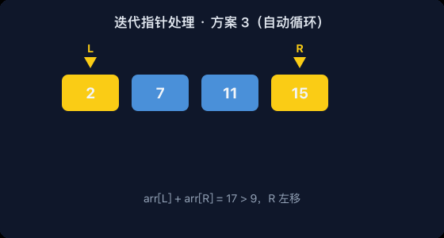

**方案专属流程图**（真实控制流）：

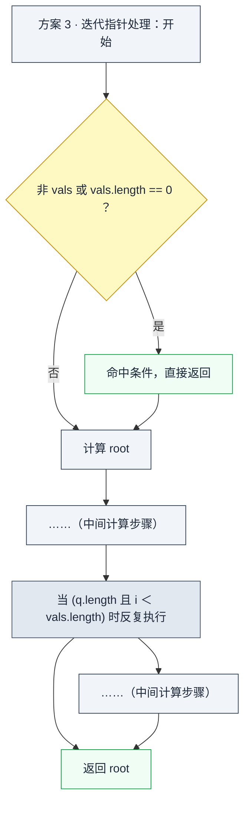

```typescript
class TreeNode {
  // 定义类型
  val: any;
  left: any;
  right: any; // 值: any; 左边界: any; 右边界: any;
  constructor(val?: any, left?: any, right?: any) {
    // constructor(值?: any, 左边界?: any, 右边界?: any) {
    this.val = val === undefined ? 0 : val; // 把 (值 全等于 undefined ? 0 : 值); 写入 值
    this.left = left === undefined ? null : left; // 把 (左边界 全等于 undefined ? null : 左边界); 写入 左边界
    this.right = right === undefined ? null : right; // 把 (右边界 全等于 undefined ? null : 右边界); 写入 右边界
  }
}
function buildTree(vals: any): any {
  // 定义函数/方法 buildTree
  if (!vals || vals.length === 0) return null; // 若 取反 vals 或 vals.长度 全等于 0，直接返回 null
  const root = new TreeNode(vals[0]);
  const q: any[] = [root];
  let i = 1;
  while (q.length && i < vals.length) {
    // 循环，直到不满足「节点.长度 且 下标 i 小于 vals.长度」
    const node = q.shift(); // 把 节点.shift() 存入 节点
    if (vals[i] !== null && vals[i] !== undefined) {
      node.left = new TreeNode(vals[i]);
      q.push(node.left);
    }
    i++; // 下标 i 加一
    if (i < vals.length && vals[i] !== null && vals[i] !== undefined) {
      node.right = new TreeNode(vals[i]);
      q.push(node.right);
    }
    i++; // 下标 i 加一
  }
  return root; // 返回 根节点
}
function treeToLevel(root: any): any[] {
  // 定义函数/方法 treeToLevel
  if (!root) return []; // 若 取反 根节点，直接返回 []
  const out: any[] = [];
  const q: any[] = [root]; // 把 []; const 节点: any[] 赋值为 [根节点]; 写入 const out: any[]
  while (q.length) {
    // 循环，直到不满足「节点.长度」
    const n = q.shift(); // 把 节点.shift() 存入 元素个数
    if (n === null || n === undefined) {
      out.push(null);
      continue;
    }
    out.push(n.val);
    q.push(n.left);
    q.push(n.right); // 把 元素个数.值 压入栈/数组尾部
  }
  while (out.length && out[out.length - 1] === null) out.pop(); // 循环，直到不满足「out.长度 且 out[out.长度 减 1] 全等于 null) out 弹出 );」
  return out; // 返回 out
}
class ListNode {
  // 定义类型
  val: any;
  next: any; // 值: any; 下一个: any;
  constructor(val?: any, next?: any) {
    this.val = val === undefined ? 0 : val;
    this.next = next === undefined ? null : next;
  }
}
function buildList(vals: any): any {
  // 定义函数/方法 buildList
  const dummy = new ListNode(0);
  let cur = dummy; // 把 new ListNode(0); let 当前值 赋值为 哨兵节点 存入 哨兵节点
  for (const v of vals) {
    cur.next = new ListNode(v);
    cur = cur.next;
  } // 把 new ListNode(值); 当前值 赋值为 当前值.下一个; } 写入 下一个
  return dummy.next; // 返回 哨兵节点.下一个
}
function listToArray(head: any): any[] {
  // 定义函数/方法 listToArray
  const out: any[] = [];
  let p = head; // 把 []; let 节点 赋值为 头节点; 写入 const out: any[]
  while (p) {
    out.push(p.val);
    p = p.next;
  } // 循环，直到不满足「节点) { out 追加 节点.值); 节点 赋值为 节点.下一个; }」
  return out; // 返回 out
}
// python-runtime shims
function pyLen(a: any): number {
  // 定义函数/方法 pyLen
  if (a === null || a === undefined) return 0; // 若 数组 全等于 null 或 数组 全等于 undefined，直接返回 0
  if (
    typeof a === 'string' ||
    Array.isArray(a) ||
    a instanceof Set ||
    a instanceof Map
  )
    return a.length ?? a.size;
  if (typeof a === 'object') return Object.keys(a).length; // 若 typeof 数组 全等于 'object'，直接返回 Object.keys(数组).长度
  return 0; // 返回 0
}
function pySlice(a: any, i: any, j: any, step?: any): any {
  // 定义函数/方法 pySlice
  if (typeof a === 'string') {
    const r = [...a].slice(i ?? 0, j ?? a.length);
    return step ? r.reverse().join('') : r.join('');
  }
  const arr = Array.isArray(a) ? a : [...a]; // 把 Array.isArray(数组) ? 数组 : 复制的 数组 存入 数组
  return arr.slice(i ?? 0, j ?? arr.length); // 返回 数组 截取 下标 i ?? 0, 下标 j ?? 数组.长度)
}
function pyRange(a: any, b?: any, step?: any): any[] {
  // 定义函数/方法 pyRange
  let s = 0,
    e = a,
    st = 1; // 把 0, e 赋值为 数组, st 赋值为 1 存入 字符串
  if (b !== undefined) {
    s = a;
    e = b;
  } // 若 b 不等于 undefined) { 字符串 赋值为 数组; e 赋值为 b; }
  if (step !== undefined) st = step; // 若 步数 不等于 undefined) st 赋值为 步数;
  const out: any[] = []; // 把 []; 写入 const out: any[]
  if (st > 0) for (let i = s; i < e; i += st) out.push(i);
  else for (let i = s; i > e; i += st) out.push(i); // 否则
  return out; // 返回 out
}
function pyIn(x: any, coll: any): boolean {
  // 定义函数/方法 pyIn
  if (coll === null || coll === undefined) return false; // 若 coll 全等于 null 或 coll 全等于 undefined，直接返回 false
  if (Array.isArray(coll)) return coll.includes(x); // 若 Array.isArray(coll)，直接返回 coll 是否包含 x)
  if (coll instanceof Set || coll instanceof Map) return coll.has(x); // 若 coll instanceof Set 或 coll instanceof Map，直接返回 coll.has(x)
  if (typeof coll === 'object') return x in coll; // 若 typeof coll 全等于 'object'，直接返回 x in coll
  if (typeof coll === 'string') return coll.indexOf(x) >= 0; // 若 typeof coll 全等于 'string'，直接返回 coll 查找 x) 不低于 0
  return false; // 返回 false
}
function pySorted(a: any): any[] {
  // 定义函数/方法 pySorted
  const arr = typeof a === 'string' ? [...a] : [...a]; // 把 (typeof 数组 全等于 'string') ? 复制的 数组 : 复制的 数组 存入 数组
  return arr.sort((x: any, y: any) => (x < y ? -1 : x > y ? 1 : 0));
}
function pyMin(a: any, b?: any): any {
  if (b !== undefined) return Math.min(a, b);
  if (Array.isArray(a) || a instanceof Set) return Math.min(...a);
  return Math.min(a);
} // 定义函数/方法 pyMin
function pyMax(a: any, b?: any): any {
  if (b !== undefined) return Math.max(a, b);
  if (Array.isArray(a) || a instanceof Set) return Math.max(...a);
  return Math.max(a);
} // 定义函数/方法 pyMax
function pySum(a: any): number {
  let s = 0;
  for (const v of a) s += v;
  return s;
} // 定义函数/方法 pySum
function pyAbs(x: any): number {
  return Math.abs(x);
} // 定义函数/方法 pyAbs
function pyEnumerate(a: any): any[] {
  const out: any[] = [];
  let i = 0;
  for (const v of a) {
    out.push([i, v]);
    i++;
  }
  return out;
} // 定义函数/方法 pyEnumerate
function pyZip(a: any, b: any): any[] {
  const n = Math.min(a.length, b.length);
  const out: any[] = [];
  for (let i = 0; i < n; i++) out.push([a[i], b[i]]);
  return out;
} // 定义函数/方法 pyZip
function pyDictGet(d: any, k: any, def?: any): any {
  return k in d ? d[k] : def === undefined ? null : def;
} // 定义函数/方法 pyDictGet
function pyPrint(...args: any[]): void {
  console.log(
    args
      .map((a) => (typeof a === 'object' && a !== null ? JSON.stringify(a) : a))
      .join(' '),
  );
} // 定义函数/方法 pyPrint
// collections / heapq
function heapPush(h: any[], x: any): void {
  h.push(x);
  let i = h.length - 1;
  while (i > 0) {
    const p = (i - 1) >> 1;
    if (h[p] <= h[i]) break;
    [h[p], h[i]] = [h[i], h[p]];
    i = p;
  }
} // 定义函数/方法 heapPush
function heapPop(h: any[]): any {
  const top = h[0];
  const last = h.pop();
  if (h.length) {
    h[0] = last;
    let i = 0;
    const n = h.length;
    while (true) {
      let l = 2 * i + 1,
        r = 2 * i + 2,
        s = i;
      if (l < n && h[l] < h[s]) s = l;
      if (r < n && h[r] < h[s]) s = r;
      if (s === i) break;
      [h[s], h[i]] = [h[i], h[s]];
      i = s;
    }
  }
  return top;
} // 定义函数/方法 heapPop
class Deque {
  private a: any[] = [];
  push(x: any) {
    this.a.push(x);
  }
  pushLeft(x: any) {
    this.a.unshift(x);
  }
  pop() {
    return this.a.pop();
  }
  popLeft() {
    return this.a.shift();
  }
  get length() {
    return this.a.length;
  }
  toArray() {
    return this.a.slice();
  }
} // 定义类型
function Counter(iter: any): any {
  const m: any = {};
  for (const v of iter) m[v] = (m[v] || 0) + 1;
  return m;
} // 定义函数/方法 Counter
function gcd(a: any, b: any): any {
  while (b) {
    [a, b] = [b, a % b];
  }
  return a;
} // 定义函数/方法 gcd
function pyInf(): number {
  return Infinity;
} // 定义函数/方法 pyInf

function norm(x: any): any {
  // 定义函数/方法 norm
  if (x === null || x === undefined) return null; // 若 x 全等于 null 或 x 全等于 undefined，直接返回 null
  if (typeof x === 'object') {
    // 若 typeof x 全等于 'object'
    if (x instanceof Deque) return x.toArray(); // 若 x instanceof Deque，直接返回 x.toArray()
    if (Array.isArray(x)) return x.map(norm); // 若 Array.isArray(x)，直接返回 x.映射表(norm)
    if (
      typeof x.val === 'number' &&
      (typeof x.left !== 'undefined' || typeof x.right !== 'undefined')
    )
      return treeToLevel(x);
    if (typeof x.next !== 'undefined' && typeof x.val === 'number')
      return listToArray(x);
    if (x instanceof Set) return [...x].sort(); // 若 x instanceof Set，直接返回 复制的 x 排序 )
    if (x instanceof Map) return Object.fromEntries(x); // 若 x instanceof Map，直接返回 Object.fromEntries(x)
    const o: any = {};
    for (const k of Object.keys(x)) o[k] = norm(x[k]);
    return o;
  }
  return x; // 返回 x
}
function eq(a: any, b: any): boolean {
  // 定义函数/方法 eq
  const x = norm(a),
    y = norm(b); // 把 norm(数组), y 赋值为 norm(b) 存入 x
  if (x === y) return true; // 若 x 全等于 y，直接返回 true
  if (x === null || y === null) return x === y; // 若 x 全等于 null 或 y 全等于 null，直接返回 x 全等于 y
  if (Array.isArray(x) && Array.isArray(y)) {
    // 若 Array.isArray(x) 且 Array.isArray(y
    if (x.length !== y.length) return false; // 若 x.长度 不等于 y.长度，直接返回 false
    for (let i = 0; i < x.length; i++) if (!eq(x[i], y[i])) return false; // 让 下标 i 从 0 开始计数，下标 i 小于 x.长度 就继续
    return true; // 返回 true
  }
  if (typeof x === 'object' && typeof y === 'object') {
    // 若 typeof x 全等于 'object' 且 typeof y 全等于 'object'
    const kx = Object.keys(x),
      ky = Object.keys(y); // 把 Object.keys(x), ky 赋值为 Object.keys(y) 存入 kx
    if (kx.length !== ky.length) return false; // 若 kx.长度 不等于 ky.长度，直接返回 false
    for (const k of kx) if (!eq(x[k], y[k])) return false;
    return true; // 返回 true
  }
  return x === y; // 返回 x 全等于 y
}

function climbStairsRefactored(h) {
  // 定义函数/方法 climbStairsRefactored
  if (h < 0) return 0; // 若 h 小于 0，直接返回 0
  if (h === 0) return 1; // 若 h 全等于 0，直接返回 1
  if (h <= 2) return h; // 若 h 不超过 2，直接返回 h
  let a = 1,
    b = 1,
    c = 2; // 把 1, b 赋值为 1, 字符 赋值为 2 存入 数组
  for (let i = 3; i <= h; i++) {
    const t = a + b + c;
    a = b;
    b = c;
    c = t;
  } // 让 下标 i 从 3 开始计数，下标 i 不超过 h 就继续
  return c; // 返回 字符
}
export function demo(): void {
  // 程序入口：跑内嵌自测用例
  const cases = [
    { in: [5], want: 13 },
    { in: [10], want: 274 },
    { in: [1], want: 1 },
    { in: [6], want: 24 },
  ];
  let fail = false; // 把 false 存入 fail
  for (const c of cases) {
    // for (const 字符 of cases) {
    const got = climbStairsRefactored(...c.in); // 把 climbStairsRefactored(...字符.in) 存入 got
    if (!eq(got, c.want)) {
      fail = true;
      console.log(
        'FAIL',
        JSON.stringify(c.in),
        '=>',
        JSON.stringify(got),
        'want',
        JSON.stringify(c.want),
      );
    }
  }
  if (fail) throw new Error('FAILED'); // 若 fail) throw new Error('FAILED');
  console.log('PASS'); // 全部用例通过，输出 PASS
}
demo(); // demo();
```

## 逐步拆解与面试追问

**复杂度**：时间 O(n) 量级，空间 O(n)

**为什么是这个量级**：整体只对数据做有限趟处理

**面试官可能会追问**：

- 这个策略能推广到什么场景？
- 与暴力做法差在哪一步？
- 有没有更简单的等价写法？

## 关键 API 速查（TS 主解法实际用到，附官方链接）

| API | 作用 | 使用要点 | 官方文档 |
|---|---|---|---|
| `JSON.stringify()` | 序列化为 JSON 字符串 | 常用于结构化比较（深度相等判定）；undefined/函数/循环引用会被丢弃或抛错 | [官方文档](https://developer.mozilla.org/zh-CN/docs/Web/JavaScript/Reference/Global_Objects/JSON/stringify) |

### 各语言官方文档导航

- **TypeScript / JS**：[MDN 中文参考](https://developer.mozilla.org/zh-CN/)
- **Python**：[Python 官方文档](https://docs.python.org/zh-cn/3/)
- **Go**：[Go 标准库](https://pkg.go.dev/std)
- **Java**：[JDK 17 API](https://docs.oracle.com/en/java/javase/17/docs/api/)
- **Rust**：[Rust 标准库](https://doc.rust-lang.org/std/)
- **Lua**：[Lua 5.4 手册](https://www.lua.org/manual/5.4/)
- **C**：[Cppreference C](https://zh.cppreference.com/w/c)
- **C++**：[Cppreference C++](https://zh.cppreference.com/w/cpp)
- **R**：[R 官方手册](https://stat.ethz.ch/R-manual/)
- **Zig**：[Zig 语言文档](https://ziglang.org/documentation/master/)
- **Dart**：[Dart API](https://api.dart.dev/)

## 附录：其他 10 种语言全部实现（每种语言列举其全部方案）

> TypeScript 的全部方案见「TypeScript 解题方案」一节；下面是其余 10 种语言的对应实现，每种语言的每个方案都带思路分析、代码走读与专属运行架构图。
> 每个方案都内嵌用例自测，可独立运行（老仓库 python/go 文件遵循「打印结果」约定）。
> 完整解法文件见 `dsa/<语言>/notes/lc_107573690_抽象思维之对比算法_发现共性/`。

### Python 实现（3 种方案）

Python 的全部方案如下，每个方案都内嵌用例自测，可独立运行（老仓库 python/go 文件遵循「打印结果」约定）：

#### 方案 1：直接实现

**思路与代码分析**：核心是「直接实现」。Python 版用切片与字典推导式简化操作，突出可读性。**走读**：方案 1 · 直接实现：开始 → 更新 goal → 返回 pos == goal → 返回 0 ≤ pos ≤ goal → 返回 pos + (k + 1) → 返回  → 循环 k：从 0 到 3 前 → 返回 count。

**运行架构**（真实控制流）：

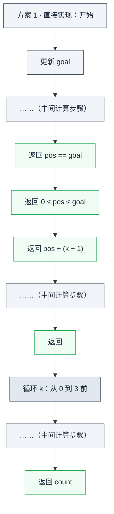

```python
import sys  # 提高递归深度上限（深输入防 RecursionError）

sys.setrecursionlimit(200000)  # 树/链表类题目节点数可达 1e4 量级

def climb_stairs_refactored(h):  # 定义函数 climb_stairs_refactored（参数：h）
    # 下楼问题算法重构：用辅助函数隔离"目标/合法性/生成新状态"的差异
    goal = h  # 把 h 存入 goal
    count = 0  # 把 0 存入 计数
    path = []  # 把 [] 存入 当前路径

    def is_done(pos):  # 定义函数 is_done（参数：pos）
        return pos == goal  # 返回 pos 等于 goal

    def is_valid(pos):  # 定义函数 is_valid（参数：pos）
        return 0 <= pos <= goal  # 返回 0 不超过 pos 不超过 goal

    def get_new_pos(pos, k):  # 定义函数 get_new_pos（参数：pos, 下标 k）
        return pos + (k + 1)  # k=0,1,2 -> 步长 1,2,3

    def dfs(pos):  # 定义函数 dfs（参数：pos）
        nonlocal count  # nonlocal 计数
        if is_done(pos):  # 若 is_done(pos
            count += 1  # 计数累加 1
            return  # return
        for k in range(3):  # 让 下标 k 从 3 遍历
            nxt = get_new_pos(pos, k)  # 把 get_new_pos(pos, 下标 k) 存入 nxt
            if not is_valid(nxt):  # 若 not is_valid(nxt
                continue  # 跳过本轮，进入下一次
            path.append(k + 1)  # 把 下标 k 加 1 追加到列表尾部
            dfs(nxt)  # dfs(nxt)
            path.pop()  # 弹出栈顶元素

    dfs(0)  # dfs(0)
    return count  # 返回 计数

if __name__ == "__main__":  # 若 __name__ 等于 '__main__'
    print("重构版下楼方案总数(h=10):", climb_stairs_refactored(10))  # 打印输出
```

#### 方案 2：迭代指针处理

**思路与代码分析**：核心是「迭代指针处理」。Python 版用切片与字典推导式简化操作，突出可读性。**走读**：方案 2 · 迭代指针处理：开始 → 更新 count → 返回 pos.x == GOAL.x and pos.y == GOAL.y → 返回 0 ≤ pos.x ≤ 8 and 0 ≤ pos.y ≤ 4 → 返回 Position( → 返回  → 循环 k：从 0 到 4 前 → 返回 count。

**运行架构**（真实控制流）：

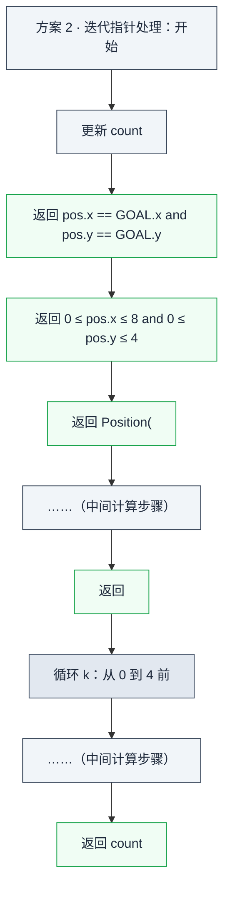

```python
import sys  # 提高递归深度上限（深输入防 RecursionError）

sys.setrecursionlimit(200000)  # 树/链表类题目节点数可达 1e4 量级
from collections import namedtuple  # from collections import namedtuple

Position = namedtuple("Position", ["x", "y"])  # 把 namedtuple('Position', ['x', 'y']) 存入 Position
MOVES = [Position(1, 2), Position(2, 1), Position(2, -1), Position(1, -2)]
GOAL = Position(8, 4)  # 把 Position(8, 4) 存入 GOAL

def horse_jump_refactored():  # 定义函数 horse_jump_refactored（参数：无）
    # 跳马问题算法重构：与下楼共用同一套递归框架，仅差异部分由辅助函数隔离
    count = 0  # 把 0 存入 计数

    def is_done(pos):  # 定义函数 is_done（参数：pos）
        return pos.x == GOAL.x and pos.y == GOAL.y  # 返回 pos.x 等于 GOAL.x and pos.y 等于 GOAL.y

    def is_valid(pos):  # 定义函数 is_valid（参数：pos）
        return 0 <= pos.x <= 8 and 0 <= pos.y <= 4  # 返回 0 不超过 pos.x 不超过 8 and 0 不超过 pos.y 不超过 4

    def get_new_pos(pos, k):  # 定义函数 get_new_pos（参数：pos, 下标 k）
        return Position(
            pos.x + MOVES[k].x, pos.y + MOVES[k].y
        )  # 返回 Position(pos.x 加 MOVES[下标 k].x, pos.y 加 MOVES[下标 k].y)

    def dfs(pos):  # 定义函数 dfs（参数：pos）
        nonlocal count  # nonlocal 计数
        if is_done(pos):  # 若 is_done(pos
            count += 1  # 计数累加 1
            return  # return
        for k in range(4):  # 让 下标 k 从 4 遍历
            nxt = get_new_pos(pos, k)  # 把 get_new_pos(pos, 下标 k) 存入 nxt
            if not is_valid(nxt):  # 若 not is_valid(nxt
                continue  # 跳过本轮，进入下一次
            dfs(nxt)  # dfs(nxt)

    dfs(Position(0, 0))  # dfs(Position(0, 0))
    return count  # 返回 计数

if __name__ == "__main__":  # 若 __name__ 等于 '__main__'
    print("重构版跳马方案总数(0,0)->(8,4):", horse_jump_refactored())  # 打印输出
```

#### 方案 3：迭代指针处理

**思路与代码分析**：核心是「迭代指针处理」。Python 版用切片与字典推导式简化操作，突出可读性。**走读**：方案 3 · 迭代指针处理：开始 → 更新 count → 处理 nonlocal count → 若 is_done(pos)：更新 + → 更新 + → 返回  → 循环 k：从 0 到 n_moves 前 → 更新 nxt → 若 not is_valid(nxt)：处理 continue → 调用 dfs(nxt) → 调用 dfs(start) → 返回 count。

**运行架构**（真实控制流）：

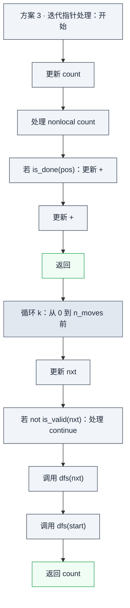

```python
import sys  # 提高递归深度上限（深输入防 RecursionError）

sys.setrecursionlimit(200000)  # 树/链表类题目节点数可达 1e4 量级
from collections import namedtuple  # from collections import namedtuple

# 通用算法框架：把"判断结束 / 产生新状态 / 判断是否合法"抽象为参数，与或图递归求解
Position = namedtuple("Position", ["x", "y"])  # 把 namedtuple('Position', ['x', 'y']) 存入 Position
MOVES = [Position(1, 2), Position(2, 1), Position(2, -1), Position(1, -2)]
GOAL = Position(8, 4)  # 把 Position(8, 4) 存入 GOAL

def generic_search(start, is_done, is_valid, get_new_pos, n_moves):
    # 通用递归枚举框架：返回从 start 到达目标的方案总数
    count = 0  # 把 0 存入 计数

    def dfs(pos):  # 定义函数 dfs（参数：pos）
        nonlocal count  # nonlocal 计数
        if is_done(pos):  # 若 is_done(pos
            count += 1  # 计数累加 1
            return  # return
        for k in range(n_moves):  # 让 下标 k 从 n_moves 遍历
            nxt = get_new_pos(pos, k)  # 把 get_new_pos(pos, 下标 k) 存入 nxt
            if not is_valid(nxt):  # 若 not is_valid(nxt
                continue  # 跳过本轮，进入下一次
            dfs(nxt)  # dfs(nxt)

    dfs(start)  # dfs(起点)
    return count  # 返回 计数

if __name__ == "__main__":  # 若 __name__ 等于 '__main__'
    start = Position(0, 0)  # 把 Position(0, 0) 存入 起点
    total = generic_search(
        start,
        is_done=lambda p: p.x == GOAL.x and p.y == GOAL.y,
        is_valid=lambda p: 0 <= p.x <= 8 and 0 <= p.y <= 4,
        get_new_pos=lambda p, k: Position(p.x + MOVES[k].x, p.y + MOVES[k].y),
        n_moves=4,
    )
    print("通用框架求解跳马方案总数:", total)  # 打印输出
```

### Go 实现（3 种方案）

Go 的全部方案如下，每个方案都内嵌用例自测，可独立运行（老仓库 python/go 文件遵循「打印结果」约定）：

#### 方案 1：直接实现

**思路与代码分析**：核心是「直接实现」。Go 版用切片与多返回值惯用法，显式处理索引边界。**走读**：方案 1 · 直接实现：开始 → 更新 : → 返回  → 遍历循环 → 返回 count。

**运行架构**（真实控制流）：

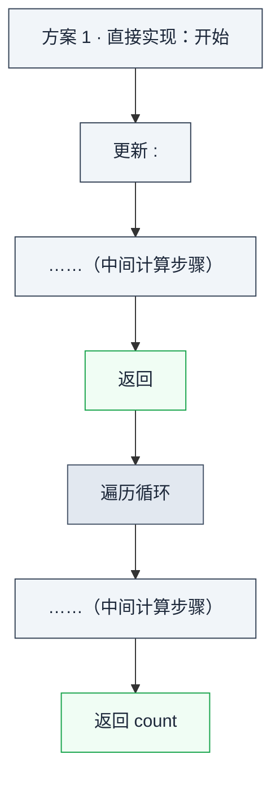

```go
package main // 引入依赖

import (
	"fmt" // 「fmt」
	"os"  // 「os」
)

// climbStairsRefactored 下楼问题算法重构：用辅助函数隔离差异
// 步长 1/2/3，从 0 走到 goal，统计方案总数
func climbStairsRefactored(h int) int { // 定义函数/方法 climbStairsRefactored
	goal := h  // 把 h 写入 goal :
	count := 0 // 把 0 写入 count :

	isDone := func(pos int) bool { return pos == goal } // 把 func(pos int) bool { return pos 等于 goal } 写入 isDone :
	isValid := func(pos int) bool { return pos >= 0 && pos <= goal }
	getNewPos := func(pos, k int) int { return pos + (k + 1) }

	var dfs func(pos int) // var dfs func(pos int)
	dfs = func(pos int) { // 把 func(pos int) { 写入 dfs
		if isDone(pos) { // 定义判定函数 isDone
			count++ // 计数 加一
			return  // return
		}
		for k := 0; k < 3; k++ { // 让 下标 k 从 0 开始计数
			nxt := getNewPos(pos, k) // 把 getNewPos(pos, 下标 k) 写入 nxt :
			if !isValid(nxt) {       // 若 取反 isValid(nxt
				continue // 跳过本轮，进入下一次
			}
			dfs(nxt) // dfs(nxt)
		}
	}
	dfs(0)       // dfs(0)
	return count // 返回 计数
}

func main() { // 程序入口：跑内嵌自测用例
	got := climbStairsRefactored(10) // 把 climbStairsRefactored(10) 写入 got :
	if got != 274 {                  // 若 got 不等于 274
		fmt.Printf("FAIL climbStairs(10)=%d want=274\n", got) // 打印输出
		os.Exit(1)                                            // os.Exit(1)
	}
	fmt.Println("PASS") // 全部用例通过，输出 PASS
}
```

#### 方案 2：迭代指针处理

**思路与代码分析**：核心是「迭代指针处理」。Go 版用切片与多返回值惯用法，显式处理索引边界。**走读**：方案 2 · 迭代指针处理：开始 → 更新 : → 返回 position → 返回  → 遍历循环 → 返回 count。

**运行架构**（真实控制流）：

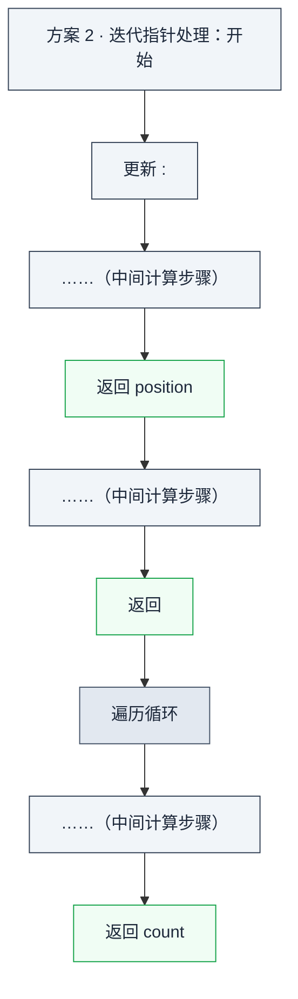

```go
package main // 引入依赖

import (
	"fmt" // 「fmt」
	"os"  // 「os」
)

type position struct { // 定义类型
	x, y int // x, y int
}

var horseMoves = []position{ // 把 []position{ 存入 horseMoves
	{1, 2}, {2, 1}, {2, -1}, {1, -2},
}
var horseGoal = position{8, 4} // 把 position{8, 4} 存入 horseGoal

// horseJumpRefactored 跳马问题算法重构：与下楼共用同一套递归框架
// 从 (0,0) 走到 (8,4)，统计方案总数
func horseJumpRefactored() int { // 定义函数/方法 horseJumpRefactored
	count := 0 // 把 0 写入 count :

	isDone := func(p position) bool { return p.x == horseGoal.x && p.y == horseGoal.y }
	isValid := func(p position) bool { return p.x >= 0 && p.x <= 8 && p.y >= 0 && p.y <= 4 }
	getNewPos := func(p position, k int) position { // 把 func(节点 position, 下标 k int) position { 写入 getNewPos :
		return position{p.x + horseMoves[k].x, p.y + horseMoves[k].y}
	}

	var dfs func(p position) // var dfs func(节点 position)
	dfs = func(p position) { // 把 func(节点 position) { 写入 dfs
		if isDone(p) { // 定义判定函数 isDone
			count++ // 计数 加一
			return  // return
		}
		for k := 0; k < 4; k++ { // 让 下标 k 从 0 开始计数
			nxt := getNewPos(p, k) // 把 getNewPos(节点, 下标 k) 写入 nxt :
			if !isValid(nxt) {     // 若 取反 isValid(nxt
				continue // 跳过本轮，进入下一次
			}
			dfs(nxt) // dfs(nxt)
		}
	}
	dfs(position{0, 0}) // dfs(position{0, 0})
	return count        // 返回 计数
}

func main() { // 程序入口：跑内嵌自测用例
	got := horseJumpRefactored() // 把 horseJumpRefactored() 写入 got :
	if got != 37 {               // 若 got 不等于 37
		fmt.Printf("FAIL horseJump=%d want=37\n", got) // 打印输出
		os.Exit(1)                                     // os.Exit(1)
	}
	fmt.Println("PASS") // 全部用例通过，输出 PASS
}
```

#### 方案 3：迭代指针处理

**思路与代码分析**：核心是「迭代指针处理」。Go 版用切片与多返回值惯用法，显式处理索引边界。**走读**：方案 3 · 迭代指针处理：开始 → 更新 : → 计算 dfs → 更新 dfs → 处理 if isDone(p) → 处理 count++ → 返回  → 遍历循环 → 更新 : → 处理 if 非 isValid(nxt) → 调用 dfs(nxt) → 调用 dfs(start) → 返回 count。

**运行架构**（真实控制流）：

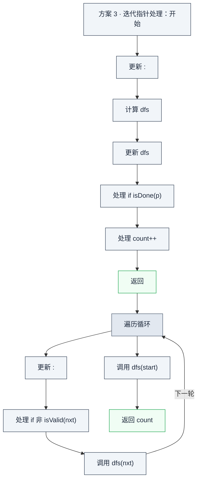

```go
package main // 引入依赖

import (
	"fmt" // 「fmt」
	"os"  // 「os」
)

type gposition struct { // 定义类型
	x, y int // x, y int
}

var gMoves = []gposition{ // 把 []gposition{ 存入 gMoves
	{1, 2}, {2, 1}, {2, -1}, {1, -2},
}
var gGoal = gposition{8, 4} // 把 gposition{8, 4} 存入 gGoal

// genericSearch 通用递归枚举框架：返回从 start 到达目标的方案总数
func genericSearch(start gposition, isDone func(gposition) bool, isValid func(gposition) bool,
	getNewPos func(gposition, int) gposition, nMoves int) int { // getNewPos func(gposition, int) gposition, nMoves int) int {
	count := 0 // 把 0 写入 count :

	var dfs func(p gposition) // var dfs func(节点 gposition)
	dfs = func(p gposition) { // 把 func(节点 gposition) { 写入 dfs
		if isDone(p) { // 定义判定函数 isDone
			count++ // 计数 加一
			return  // return
		}
		for k := 0; k < nMoves; k++ { // 让 下标 k 从 0 开始计数
			nxt := getNewPos(p, k) // 把 getNewPos(节点, 下标 k) 写入 nxt :
			if !isValid(nxt) {     // 若 取反 isValid(nxt
				continue // 跳过本轮，进入下一次
			}
			dfs(nxt) // dfs(nxt)
		}
	}
	dfs(start)   // dfs(起点)
	return count // 返回 计数
}

func main() { // 程序入口：跑内嵌自测用例
	start := gposition{0, 0} // 把 gposition{0, 0} 写入 start :
	total := genericSearch(
		start,
		func(p gposition) bool { return p.x == gGoal.x && p.y == gGoal.y },
		func(p gposition) bool { return p.x >= 0 && p.x <= 8 && p.y >= 0 && p.y <= 4 },
		func(p gposition, k int) gposition { // func(节点 gposition, 下标 k int) gposition {
			return gposition{p.x + gMoves[k].x, p.y + gMoves[k].y} // 返回 gposition{节点.x 加 gMoves[下标 k].x, 节点.y 加 gMoves[下标 k].y}
		},
		4,
	)
	if total != 37 { // 若 总和 不等于 37
		fmt.Printf("FAIL genericSearch=%d want=37\n", total) // 打印输出
		os.Exit(1)                                           // os.Exit(1)
	}
	fmt.Println("PASS") // 全部用例通过，输出 PASS
}
```

### Java 实现（3 种方案）

Java 的全部方案如下，每个方案都内嵌用例自测，可独立运行（老仓库 python/go 文件遵循「打印结果」约定）：

#### 方案 1：直接实现

**思路与代码分析**：核心是「直接实现」。Java 版用类与静态方法组织，集合操作显式明了。**走读**：方案 1 · 直接实现：开始 → 更新 count → 调用 dfs(0, h, count) → 返回 count[0]。

**运行架构**（真实控制流）：

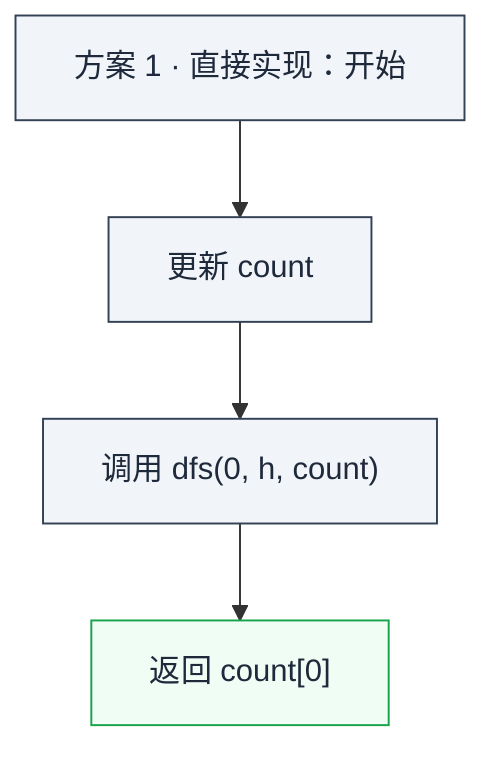

```java
package com.webfault.dsa; // 引入依赖

import java.util.*; // 引入依赖

class Main { // 定义类型
  static int climbStairsRefactored(int h) { // 定义函数/方法 climbStairsRefactored
    int[] count = {0}; // 把 {0}; 写入 int[] count
    dfs(0, h, count); // dfs(0, h, 计数);
    return count[0]; // 返回 计数[0]
  }

  static void dfs(int pos, int goal, int[] count) { // 定义函数/方法 dfs
    if (pos == goal) {
      count[0]++;
      return;
    } // 若 pos 等于 goal) { 计数[0] 加一 ; return; }
    for (int k = 0; k < 3; k++) { // 让 下标 k 从 0 开始计数，下标 k 小于 3 就继续
      int nxt = pos + (k + 1); // 把 pos 加 (下标 k 加 1) 存入 nxt
      if (!(0 <= nxt && nxt <= goal)) continue; // 若 取反 (0 不超过 nxt 且 nxt 不超过 goal)) continue;
      dfs(nxt, goal, count); // dfs(nxt, goal, 计数);
    }
  }

  public static void main(String[] args) { // public static void main(String[] args) {
    int got = climbStairsRefactored(10); // 把 climbStairsRefactored(10) 存入 got
    if (got != 274) {
      System.out.println("FAIL got " + got + " want 274");
      throw new RuntimeException("FAILED");
    }
    System.out.println("PASS"); // 全部用例通过，输出 PASS
  }
}
```

#### 方案 2：迭代指针处理

**思路与代码分析**：核心是「迭代指针处理」。Java 版用类与静态方法组织，集合操作显式明了。**走读**：方案 2 · 迭代指针处理：开始 → 更新 count → 调用 dfs(0, 0, count) → 返回 count[0]。

**运行架构**（真实控制流）：

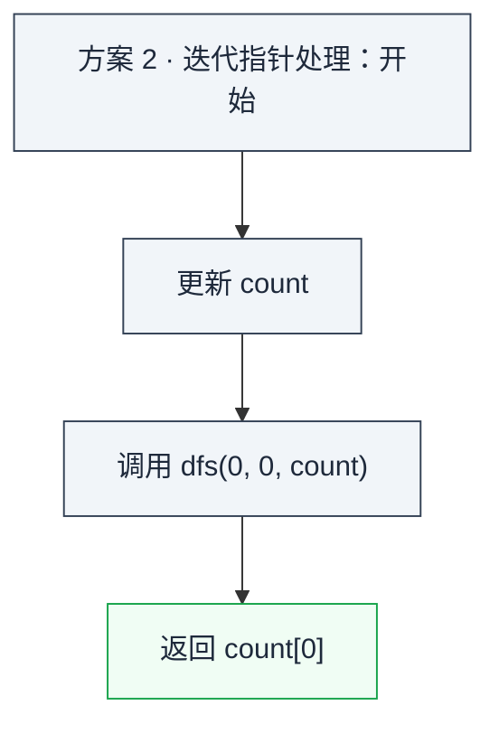

```java
package com.webfault.dsa; // 引入依赖

import java.util.*; // 引入依赖

class Main { // 定义类型
  static final int[][] MOVES = {{1, 2}, {2, 1}, {2, -1}, {1, -2}};

  static int horseJumpRefactored() { // 定义函数/方法 horseJumpRefactored
    int[] count = {0}; // 把 {0}; 写入 int[] count
    dfs(0, 0, count); // dfs(0, 0, 计数);
    return count[0]; // 返回 计数[0]
  }

  static void dfs(int x, int y, int[] count) { // 定义函数/方法 dfs
    if (x == 8 && y == 4) {
      count[0]++;
      return;
    } // 若 x 等于 8 且 y 等于 4) { 计数[0] 加一 ; return; }
    if (!(0 <= x && x <= 8 && 0 <= y && y <= 4))
      return; // 若 取反 (0 不超过 x 且 x 不超过 8 且 0 不超过 y 且 y 不超过 4)) return;
    for (int k = 0; k < 4; k++) { // 让 下标 k 从 0 开始计数，下标 k 小于 4 就继续
      int nx = x + MOVES[k][0]; // 把 x 加 MOVES[下标 k][0] 存入 nx
      int ny = y + MOVES[k][1]; // 把 y 加 MOVES[下标 k][1] 存入 ny
      dfs(nx, ny, count); // dfs(nx, ny, 计数);
    }
  }

  public static void main(String[] args) { // public static void main(String[] args) {
    int got = horseJumpRefactored(); // 把 horseJumpRefactored() 存入 got
    if (got != 37) {
      System.out.println("FAIL got " + got + " want 37");
      throw new RuntimeException("FAILED");
    }
    System.out.println("PASS"); // 全部用例通过，输出 PASS
  }
}
```

#### 方案 3：迭代指针处理

**思路与代码分析**：核心是「迭代指针处理」。Java 版用类与静态方法组织，集合操作显式明了。**走读**：方案 3 · 迭代指针处理：开始 → 更新 count → 调用 dfs(sx, sy, count) → 返回 count[0]。

**运行架构**（真实控制流）：

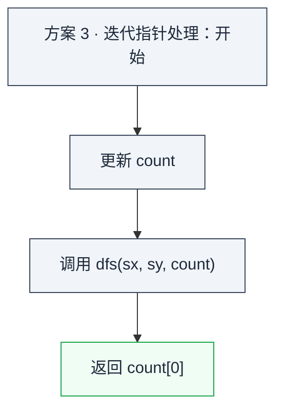

```java
package com.webfault.dsa; // 引入依赖

import java.util.*; // 引入依赖

class Main { // 定义类型
  static final int[][] MOVES = {{1, 2}, {2, 1}, {2, -1}, {1, -2}};

  static int genericSearch(int sx, int sy) { // 定义函数/方法 genericSearch
    int[] count = {0}; // 把 {0}; 写入 int[] count
    dfs(sx, sy, count); // dfs(sx, sy, 计数);
    return count[0]; // 返回 计数[0]
  }

  static void dfs(int x, int y, int[] count) { // 定义函数/方法 dfs
    if (x == 8 && y == 4) {
      count[0]++;
      return;
    } // 若 x 等于 8 且 y 等于 4) { 计数[0] 加一 ; return; }
    if (!(0 <= x && x <= 8 && 0 <= y && y <= 4))
      return; // 若 取反 (0 不超过 x 且 x 不超过 8 且 0 不超过 y 且 y 不超过 4)) return;
    for (int k = 0; k < 4; k++) { // 让 下标 k 从 0 开始计数，下标 k 小于 4 就继续
      int nx = x + MOVES[k][0]; // 把 x 加 MOVES[下标 k][0] 存入 nx
      int ny = y + MOVES[k][1]; // 把 y 加 MOVES[下标 k][1] 存入 ny
      dfs(nx, ny, count); // dfs(nx, ny, 计数);
    }
  }

  public static void main(String[] args) { // public static void main(String[] args) {
    int got = genericSearch(0, 0); // 把 genericSearch(0, 0) 存入 got
    if (got != 37) {
      System.out.println("FAIL got " + got + " want 37");
      throw new RuntimeException("FAILED");
    }
    System.out.println("PASS"); // 全部用例通过，输出 PASS
  }
}
```

### Rust 实现（3 种方案）

Rust 的全部方案如下，每个方案都内嵌用例自测，可独立运行（老仓库 python/go 文件遵循「打印结果」约定）：

#### 方案 1：直接实现

**思路与代码分析**：核心是「直接实现」。Rust 版用所有权移动与切片借用改写同一逻辑，注意 Option 与引用边界。代码里依次做这些事：DP 表逐项填充。**走读**：方案 1 · 直接实现：开始 → 处理 if n ＜ 0 → 返回 0 → 处理 if n == 0 → 返回 1 → 填写 DP 表 → 填写 DP 表 → 遍历 1..=n as usize 中的每个元素 i → 填写 DP 表 → 处理 if i ≥ 2 → 填写 DP 表 → 处理 if i ≥ 3 → 填写 DP 表 → 填写 DP 表。

**运行架构**（真实控制流）：

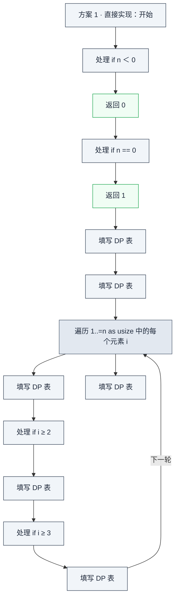

```rust
// 抽象思维之对比算法 发现共性 — Rust 版（方案1）
fn climb_stairs_refactored(n: i32) -> i64 {
    // 定义函数/方法 climb_stairs_refactored
    // 变体：每次 1/2/3 阶（对比算法 共性提炼）
    if n < 0 {
        return 0;
    } // 若 元素个数 小于 0 { return 0; }
    if n == 0 {
        return 1;
    } // 若 元素个数 等于 0 { return 1; }
    let mut dp = vec![0i64; (n + 1) as usize]; // 把 vec取反 [0i64; (元素个数 加 1) as usize]; 写入 let mut dp
    dp[0] = 1; // 把 1; 写入 dp[0]
    for i in 1..=n as usize {
        // 逐个取出 1 的元素（下标 i）
        dp[i] = dp[i - 1]; // 把 DP 表[下标 i 减 1]; 写入 dp[i]
        if i >= 2 {
            dp[i] += dp[i - 2];
        } // 若 下标 i 不低于 2 { DP 表[下标 i] 累加 DP 表[下标 i 减 2]; }
        if i >= 3 {
            dp[i] += dp[i - 3];
        } // 若 下标 i 不低于 3 { DP 表[下标 i] 累加 DP 表[下标 i 减 3]; }
    }
    dp[n as usize] // DP 表[元素个数 as usize]
}
fn main() {
    // 程序入口：跑内嵌自测用例
    assert_eq!(climb_stairs_refactored(10), 274); // 断言校验
    assert_eq!(climb_stairs_refactored(3), 4); // 断言校验
    println!("PASS");
} // 全部用例通过，输出 PASS
```

#### 方案 2：迭代指针处理

**思路与代码分析**：核心是「迭代指针处理」。Rust 版用所有权移动与切片借用改写同一逻辑，注意 Option 与引用边界。代码里依次做这些事：DP 表逐项填充。**走读**：方案 2 · 迭代指针处理：开始 → 处理 if n ＜ 0 → 返回 0 → 处理 if n == 0 → 返回 1 → 填写 DP 表 → 填写 DP 表 → 遍历 1..=n as usize 中的每个元素 i → 填写 DP 表 → 处理 if i ≥ 2 → 填写 DP 表 → 处理 if i ≥ 3 → 填写 DP 表 → 填写 DP 表。

**运行架构**（真实控制流）：

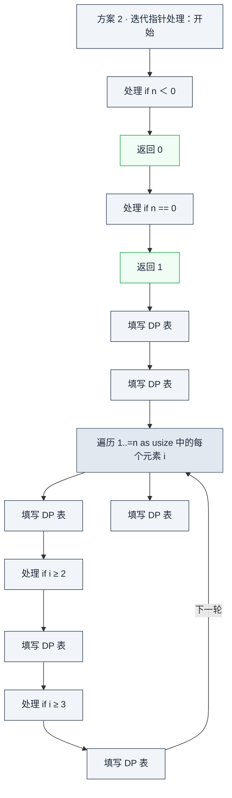

```rust
// 抽象思维之对比算法 发现共性 — Rust 版（方案2）
fn climb_stairs_refactored(n: i32) -> i64 {
    // 定义函数/方法 climb_stairs_refactored
    // 变体：每次 1/2/3 阶（对比算法 共性提炼）
    if n < 0 {
        return 0;
    } // 若 元素个数 小于 0 { return 0; }
    if n == 0 {
        return 1;
    } // 若 元素个数 等于 0 { return 1; }
    let mut dp = vec![0i64; (n + 1) as usize]; // 把 vec取反 [0i64; (元素个数 加 1) as usize]; 写入 let mut dp
    dp[0] = 1; // 把 1; 写入 dp[0]
    for i in 1..=n as usize {
        // 逐个取出 1 的元素（下标 i）
        dp[i] = dp[i - 1]; // 把 DP 表[下标 i 减 1]; 写入 dp[i]
        if i >= 2 {
            dp[i] += dp[i - 2];
        } // 若 下标 i 不低于 2 { DP 表[下标 i] 累加 DP 表[下标 i 减 2]; }
        if i >= 3 {
            dp[i] += dp[i - 3];
        } // 若 下标 i 不低于 3 { DP 表[下标 i] 累加 DP 表[下标 i 减 3]; }
    }
    dp[n as usize] // DP 表[元素个数 as usize]
}
fn main() {
    // 程序入口：跑内嵌自测用例
    assert_eq!(climb_stairs_refactored(10), 274); // 断言校验
    assert_eq!(climb_stairs_refactored(3), 4); // 断言校验
    println!("PASS");
} // 全部用例通过，输出 PASS
```

#### 方案 3：迭代指针处理

**思路与代码分析**：核心是「迭代指针处理」。Rust 版用所有权移动与切片借用改写同一逻辑，注意 Option 与引用边界。代码里依次做这些事：DP 表逐项填充。**走读**：方案 3 · 迭代指针处理：开始 → 处理 if n ＜ 0 → 返回 0 → 处理 if n == 0 → 返回 1 → 填写 DP 表 → 填写 DP 表 → 遍历 1..=n as usize 中的每个元素 i → 填写 DP 表 → 处理 if i ≥ 2 → 填写 DP 表 → 处理 if i ≥ 3 → 填写 DP 表 → 填写 DP 表。

**运行架构**（真实控制流）：


```rust
// 抽象思维之对比算法 发现共性 — Rust 版（方案3）
fn climb_stairs_refactored(n: i32) -> i64 {
    // 定义函数/方法 climb_stairs_refactored
    // 变体：每次 1/2/3 阶（对比算法 共性提炼）
    if n < 0 {
        return 0;
    } // 若 元素个数 小于 0 { return 0; }
    if n == 0 {
        return 1;
    } // 若 元素个数 等于 0 { return 1; }
    let mut dp = vec![0i64; (n + 1) as usize]; // 把 vec取反 [0i64; (元素个数 加 1) as usize]; 写入 let mut dp
    dp[0] = 1; // 把 1; 写入 dp[0]
    for i in 1..=n as usize {
        // 逐个取出 1 的元素（下标 i）
        dp[i] = dp[i - 1]; // 把 DP 表[下标 i 减 1]; 写入 dp[i]
        if i >= 2 {
            dp[i] += dp[i - 2];
        } // 若 下标 i 不低于 2 { DP 表[下标 i] 累加 DP 表[下标 i 减 2]; }
        if i >= 3 {
            dp[i] += dp[i - 3];
        } // 若 下标 i 不低于 3 { DP 表[下标 i] 累加 DP 表[下标 i 减 3]; }
    }
    dp[n as usize] // DP 表[元素个数 as usize]
}
fn main() {
    // 程序入口：跑内嵌自测用例
    assert_eq!(climb_stairs_refactored(10), 274); // 断言校验
    assert_eq!(climb_stairs_refactored(3), 4); // 断言校验
    println!("PASS");
} // 全部用例通过，输出 PASS
```

### Lua 实现（3 种方案）

Lua 的全部方案如下，每个方案都内嵌用例自测，可独立运行（老仓库 python/go 文件遵循「打印结果」约定）：

#### 方案 1：直接实现

**思路与代码分析**：核心是「直接实现」。Lua 版用表与 ipairs 遍历，注意 ipairs 遇 nil 即停的语义。代码里依次做这些事：DP 表逐项填充。**走读**：方案 1 · 直接实现：开始 → 处理 if n == 0 then → 返回 1 → 处理 if n ＜ 0 then → 返回 0 → 填写 DP 表 → 填写 DP 表 → 循环 i：从 1 到 n do → 填写 DP 表 → 处理 if i ≥ 2 then → 填写 DP 表 → 处理 if i ≥ 3 then → 填写 DP 表 → 返回 dp[n]。

**运行架构**（真实控制流）：

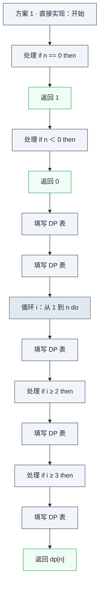

```lua
-- 抽象思维之对比算法 发现共性 — Lua 版（方案1）
local function climb_stairs_refactored(n) -- local function climb_stairs_refactored(元素个数)
	if n == 0 then
		return 1
	end -- 若 元素个数 等于 0 then return 1 终点
	if n < 0 then
		return 0
	end -- 若 元素个数 小于 0 then return 0 终点
	local dp = {} -- 把 {} 写入 local dp
	dp[0] = 1 -- 把 1 写入 dp[0]
	for i = 1, n do -- 让 下标 i 从 1 走到 元素个数（Lua 1 基）
		dp[i] = dp[i - 1] -- 把 DP 表[下标 i 减 1] 写入 dp[i]
		if i >= 2 then
			dp[i] = dp[i] + dp[i - 2]
		end
		if i >= 3 then
			dp[i] = dp[i] + dp[i - 3]
		end
	end -- 终点
	return dp[n] -- 返回 DP 表[元素个数]
end -- 终点
assert(climb_stairs_refactored(10) == 274) -- 断言校验
assert(climb_stairs_refactored(3) == 4) -- 断言校验
print("PASS") -- 全部用例通过，输出 PASS
```

#### 方案 2：迭代指针处理

**思路与代码分析**：核心是「迭代指针处理」。Lua 版用表与 ipairs 遍历，注意 ipairs 遇 nil 即停的语义。代码里依次做这些事：DP 表逐项填充。**走读**：方案 2 · 迭代指针处理：开始 → 处理 if n == 0 then → 返回 1 → 处理 if n ＜ 0 then → 返回 0 → 填写 DP 表 → 填写 DP 表 → 循环 i：从 1 到 n do → 填写 DP 表 → 处理 if i ≥ 2 then → 填写 DP 表 → 处理 if i ≥ 3 then → 填写 DP 表 → 返回 dp[n]。

**运行架构**（真实控制流）：

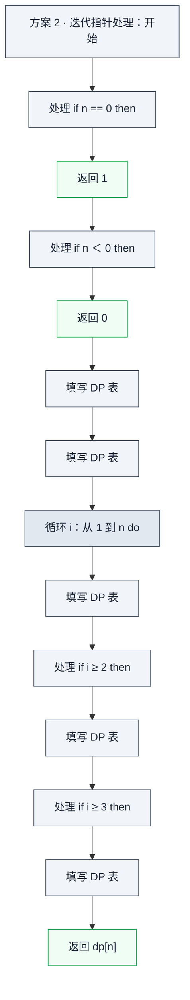

```lua
-- 抽象思维之对比算法 发现共性 — Lua 版（方案2）
local function climb_stairs_refactored(n) -- local function climb_stairs_refactored(元素个数)
	if n == 0 then
		return 1
	end -- 若 元素个数 等于 0 then return 1 终点
	if n < 0 then
		return 0
	end -- 若 元素个数 小于 0 then return 0 终点
	local dp = {} -- 把 {} 写入 local dp
	dp[0] = 1 -- 把 1 写入 dp[0]
	for i = 1, n do -- 让 下标 i 从 1 走到 元素个数（Lua 1 基）
		dp[i] = dp[i - 1] -- 把 DP 表[下标 i 减 1] 写入 dp[i]
		if i >= 2 then
			dp[i] = dp[i] + dp[i - 2]
		end
		if i >= 3 then
			dp[i] = dp[i] + dp[i - 3]
		end
	end -- 终点
	return dp[n] -- 返回 DP 表[元素个数]
end -- 终点
assert(climb_stairs_refactored(10) == 274) -- 断言校验
assert(climb_stairs_refactored(3) == 4) -- 断言校验
print("PASS") -- 全部用例通过，输出 PASS
```

#### 方案 3：迭代指针处理

**思路与代码分析**：核心是「迭代指针处理」。Lua 版用表与 ipairs 遍历，注意 ipairs 遇 nil 即停的语义。代码里依次做这些事：DP 表逐项填充。**走读**：方案 3 · 迭代指针处理：开始 → 处理 if n == 0 then → 返回 1 → 处理 if n ＜ 0 then → 返回 0 → 填写 DP 表 → 填写 DP 表 → 循环 i：从 1 到 n do → 填写 DP 表 → 处理 if i ≥ 2 then → 填写 DP 表 → 处理 if i ≥ 3 then → 填写 DP 表 → 返回 dp[n]。

**运行架构**（真实控制流）：

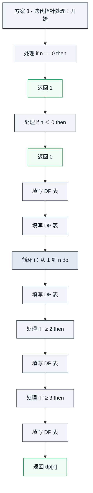

```lua
-- 抽象思维之对比算法 发现共性 — Lua 版（方案3）
local function climb_stairs_refactored(n) -- local function climb_stairs_refactored(元素个数)
	if n == 0 then
		return 1
	end -- 若 元素个数 等于 0 then return 1 终点
	if n < 0 then
		return 0
	end -- 若 元素个数 小于 0 then return 0 终点
	local dp = {} -- 把 {} 写入 local dp
	dp[0] = 1 -- 把 1 写入 dp[0]
	for i = 1, n do -- 让 下标 i 从 1 走到 元素个数（Lua 1 基）
		dp[i] = dp[i - 1] -- 把 DP 表[下标 i 减 1] 写入 dp[i]
		if i >= 2 then
			dp[i] = dp[i] + dp[i - 2]
		end
		if i >= 3 then
			dp[i] = dp[i] + dp[i - 3]
		end
	end -- 终点
	return dp[n] -- 返回 DP 表[元素个数]
end -- 终点
assert(climb_stairs_refactored(10) == 274) -- 断言校验
assert(climb_stairs_refactored(3) == 4) -- 断言校验
print("PASS") -- 全部用例通过，输出 PASS
```

### C 实现（3 种方案）

C 的全部方案如下，每个方案都内嵌用例自测，可独立运行（老仓库 python/go 文件遵循「打印结果」约定）：

#### 方案 1：直接实现

**思路与代码分析**：核心是「直接实现」。C 版手动管理下标与内存，循环边界全部显式写出。代码里依次做这些事：DP 表逐项填充；单循环线性扫描。**走读**：方案 1 · 直接实现：开始 → 命中条件，直接返回 → 命中条件，直接返回 → 填写 DP 表 → 填写 DP 表 → 遍历循环 → 填写 DP 表 → 若 i ≥ 2：填写 DP 表 → 填写 DP 表 → 若 i ≥ 3：填写 DP 表 → 填写 DP 表 → 返回 dp[n]。

**运行架构**（真实控制流）：

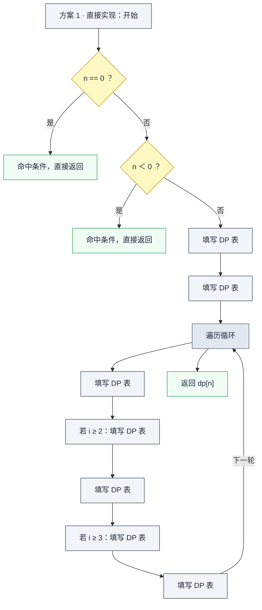

```c
/* 抽象思维之对比算法 发现共性 — C 版（方案1） */
#include <stdio.h>                           // 引入头文件
static long climb_stairs_refactored(int n) { // 定义函数/方法 climb_stairs_refactored
    if (n == 0)
        return 1; // 若 元素个数 等于 0，直接返回 1
    if (n < 0)
        return 0;                  // 若 元素个数 小于 0，直接返回 0
    long dp[64] = {0};             // 把 {0}; 写入 long dp[64]
    dp[0] = 1;                     // 把 1; 写入 dp[0]
    for (int i = 1; i <= n; i++) { // 让 下标 i 从 1 开始计数，下标 i 不超过 元素个数 就继续
        dp[i] = dp[i - 1];         // 把 DP 表[下标 i 减 1]; 写入 dp[i]
        if (i >= 2)
            dp[i] += dp[i - 2]; // 若 下标 i 不低于 2) DP 表[下标 i] 累加 DP 表[下标 i 减 2];
        if (i >= 3)
            dp[i] += dp[i - 3]; // 若 下标 i 不低于 3) DP 表[下标 i] 累加 DP 表[下标 i 减 3];
    }
    return dp[n]; // 返回 DP 表[元素个数]
}
int main(void) { // 程序入口：跑内嵌自测用例
    if (climb_stairs_refactored(10) != 274 || climb_stairs_refactored(3) != 4) {
        printf("FAIL\n");
        return 1;
    }
    printf("PASS\n");
    return 0;
} // 全部用例通过，输出 PASS
```

#### 方案 2：迭代指针处理

**思路与代码分析**：核心是「迭代指针处理」。C 版手动管理下标与内存，循环边界全部显式写出。代码里依次做这些事：DP 表逐项填充；单循环线性扫描。**走读**：方案 2 · 迭代指针处理：开始 → 命中条件，直接返回 → 命中条件，直接返回 → 填写 DP 表 → 填写 DP 表 → 遍历循环 → 填写 DP 表 → 若 i ≥ 2：填写 DP 表 → 填写 DP 表 → 若 i ≥ 3：填写 DP 表 → 填写 DP 表 → 返回 dp[n]。

**运行架构**（真实控制流）：

```mermaid
graph TD
    N0["方案 2 · 迭代指针处理：开始"]
    N1{"n == 0 ？"}
    N2["命中条件，直接返回"]
    N3{"n ＜ 0 ？"}
    N4["命中条件，直接返回"]
    N5["填写 DP 表"]
    N6["填写 DP 表"]
    N7["遍历循环"]
    N8["填写 DP 表"]
    N9["若 i ≥ 2：填写 DP 表"]
    N10["填写 DP 表"]
    N11["若 i ≥ 3：填写 DP 表"]
    N12["填写 DP 表"]
    N13["返回 dp[n]"]
    N0 --> N1
    N1 -- 是 --> N2
    N1 -- 否 --> N3
    N3 -- 是 --> N4
    N3 -- 否 --> N5
    N5 --> N6
    N6 --> N7
    N7 --> N8
    N8 --> N9
    N9 --> N10
    N10 --> N11
    N11 --> N12
    N12 -- 下一轮 --> N7
    N7 --> N13
    classDef n fill:#f1f5f9,stroke:#334155,color:#1e293b;
    classDef lp fill:#e2e8f0,stroke:#475569,color:#1e293b;
    classDef dc fill:#fef9c3,stroke:#ca8a04,color:#1e293b;
    classDef tm fill:#f0fdf4,stroke:#16a34a,color:#1e293b;
    class N0,N5,N6,N8,N9,N10,N11,N12 n;
    class N7 lp;
    class N1,N3 dc;
    class N2,N4,N13 tm;
```

```c
/* 抽象思维之对比算法 发现共性 — C 版（方案2） */
#include <stdio.h>                           // 引入头文件
static long climb_stairs_refactored(int n) { // 定义函数/方法 climb_stairs_refactored
    if (n == 0)
        return 1; // 若 元素个数 等于 0，直接返回 1
    if (n < 0)
        return 0;                  // 若 元素个数 小于 0，直接返回 0
    long dp[64] = {0};             // 把 {0}; 写入 long dp[64]
    dp[0] = 1;                     // 把 1; 写入 dp[0]
    for (int i = 1; i <= n; i++) { // 让 下标 i 从 1 开始计数，下标 i 不超过 元素个数 就继续
        dp[i] = dp[i - 1];         // 把 DP 表[下标 i 减 1]; 写入 dp[i]
        if (i >= 2)
            dp[i] += dp[i - 2]; // 若 下标 i 不低于 2) DP 表[下标 i] 累加 DP 表[下标 i 减 2];
        if (i >= 3)
            dp[i] += dp[i - 3]; // 若 下标 i 不低于 3) DP 表[下标 i] 累加 DP 表[下标 i 减 3];
    }
    return dp[n]; // 返回 DP 表[元素个数]
}
int main(void) { // 程序入口：跑内嵌自测用例
    if (climb_stairs_refactored(10) != 274 || climb_stairs_refactored(3) != 4) {
        printf("FAIL\n");
        return 1;
    }
    printf("PASS\n");
    return 0;
} // 全部用例通过，输出 PASS
```

#### 方案 3：迭代指针处理

**思路与代码分析**：核心是「迭代指针处理」。C 版手动管理下标与内存，循环边界全部显式写出。代码里依次做这些事：DP 表逐项填充；单循环线性扫描。**走读**：方案 3 · 迭代指针处理：开始 → 命中条件，直接返回 → 命中条件，直接返回 → 填写 DP 表 → 填写 DP 表 → 遍历循环 → 填写 DP 表 → 若 i ≥ 2：填写 DP 表 → 填写 DP 表 → 若 i ≥ 3：填写 DP 表 → 填写 DP 表 → 返回 dp[n]。

**运行架构**（真实控制流）：

```mermaid
graph TD
    N0["方案 3 · 迭代指针处理：开始"]
    N1{"n == 0 ？"}
    N2["命中条件，直接返回"]
    N3{"n ＜ 0 ？"}
    N4["命中条件，直接返回"]
    N5["填写 DP 表"]
    N6["填写 DP 表"]
    N7["遍历循环"]
    N8["填写 DP 表"]
    N9["若 i ≥ 2：填写 DP 表"]
    N10["填写 DP 表"]
    N11["若 i ≥ 3：填写 DP 表"]
    N12["填写 DP 表"]
    N13["返回 dp[n]"]
    N0 --> N1
    N1 -- 是 --> N2
    N1 -- 否 --> N3
    N3 -- 是 --> N4
    N3 -- 否 --> N5
    N5 --> N6
    N6 --> N7
    N7 --> N8
    N8 --> N9
    N9 --> N10
    N10 --> N11
    N11 --> N12
    N12 -- 下一轮 --> N7
    N7 --> N13
    classDef n fill:#f1f5f9,stroke:#334155,color:#1e293b;
    classDef lp fill:#e2e8f0,stroke:#475569,color:#1e293b;
    classDef dc fill:#fef9c3,stroke:#ca8a04,color:#1e293b;
    classDef tm fill:#f0fdf4,stroke:#16a34a,color:#1e293b;
    class N0,N5,N6,N8,N9,N10,N11,N12 n;
    class N7 lp;
    class N1,N3 dc;
    class N2,N4,N13 tm;
```

```c
/* 抽象思维之对比算法 发现共性 — C 版（方案3） */
#include <stdio.h>                           // 引入头文件
static long climb_stairs_refactored(int n) { // 定义函数/方法 climb_stairs_refactored
    if (n == 0)
        return 1; // 若 元素个数 等于 0，直接返回 1
    if (n < 0)
        return 0;                  // 若 元素个数 小于 0，直接返回 0
    long dp[64] = {0};             // 把 {0}; 写入 long dp[64]
    dp[0] = 1;                     // 把 1; 写入 dp[0]
    for (int i = 1; i <= n; i++) { // 让 下标 i 从 1 开始计数，下标 i 不超过 元素个数 就继续
        dp[i] = dp[i - 1];         // 把 DP 表[下标 i 减 1]; 写入 dp[i]
        if (i >= 2)
            dp[i] += dp[i - 2]; // 若 下标 i 不低于 2) DP 表[下标 i] 累加 DP 表[下标 i 减 2];
        if (i >= 3)
            dp[i] += dp[i - 3]; // 若 下标 i 不低于 3) DP 表[下标 i] 累加 DP 表[下标 i 减 3];
    }
    return dp[n]; // 返回 DP 表[元素个数]
}
int main(void) { // 程序入口：跑内嵌自测用例
    if (climb_stairs_refactored(10) != 274 || climb_stairs_refactored(3) != 4) {
        printf("FAIL\n");
        return 1;
    }
    printf("PASS\n");
    return 0;
} // 全部用例通过，输出 PASS
```

### C++ 实现（3 种方案）

C++ 的全部方案如下，每个方案都内嵌用例自测，可独立运行（老仓库 python/go 文件遵循「打印结果」约定）：

#### 方案 1：直接实现

**思路与代码分析**：核心是「直接实现」。C++ 版用 STL 容器与迭代器，减少手写下标错误。代码里依次做这些事：DP 表逐项填充；单循环线性扫描。**走读**：方案 1 · 直接实现：开始 → 命中条件，直接返回 → 命中条件，直接返回 → 处理 std::vector＜long long＞ dp(n → 填写 DP 表 → 遍历循环 → 填写 DP 表 → 若 i ≥ 2：填写 DP 表 → 填写 DP 表 → 若 i ≥ 3：填写 DP 表 → 填写 DP 表 → 返回 dp[n]。

**运行架构**（真实控制流）：

```mermaid
graph TD
    N0["方案 1 · 直接实现：开始"]
    N1{"n == 0 ？"}
    N2["命中条件，直接返回"]
    N3{"n ＜ 0 ？"}
    N4["命中条件，直接返回"]
    N5["处理 std::vector＜long long＞ dp(n"]
    N6["填写 DP 表"]
    N7["遍历循环"]
    N8["填写 DP 表"]
    N9["若 i ≥ 2：填写 DP 表"]
    N10["填写 DP 表"]
    N11["若 i ≥ 3：填写 DP 表"]
    N12["填写 DP 表"]
    N13["返回 dp[n]"]
    N0 --> N1
    N1 -- 是 --> N2
    N1 -- 否 --> N3
    N3 -- 是 --> N4
    N3 -- 否 --> N5
    N5 --> N6
    N6 --> N7
    N7 --> N8
    N8 --> N9
    N9 --> N10
    N10 --> N11
    N11 --> N12
    N12 -- 下一轮 --> N7
    N7 --> N13
    classDef n fill:#f1f5f9,stroke:#334155,color:#1e293b;
    classDef lp fill:#e2e8f0,stroke:#475569,color:#1e293b;
    classDef dc fill:#fef9c3,stroke:#ca8a04,color:#1e293b;
    classDef tm fill:#f0fdf4,stroke:#16a34a,color:#1e293b;
    class N0,N5,N6,N8,N9,N10,N11,N12 n;
    class N7 lp;
    class N1,N3 dc;
    class N2,N4,N13 tm;
```

```cpp
// 抽象思维之对比算法 发现共性 — C++ 版（方案1）
#include <cassert>                              // 引入头文件
#include <iostream>                             // 引入头文件
#include <vector>                               // 引入头文件
static long long climbStairsRefactored(int n) { // static long long climbStairsRefactored(int 元素个数) {
    if (n == 0)
        return 1; // 若 元素个数 等于 0，直接返回 1
    if (n < 0)
        return 0;                        // 若 元素个数 小于 0，直接返回 0
    std::vector<long long> dp(n + 1, 0); // std::vector 小于 long long 超过 DP 表(元素个数 加 1, 0);
    dp[0] = 1;                           // 把 1; 写入 dp[0]
    for (int i = 1; i <= n; ++i) { // 让 下标 i 从 1 开始计数，下标 i 不超过 元素个数 就继续
        dp[i] = dp[i - 1];         // 把 DP 表[下标 i 减 1]; 写入 dp[i]
        if (i >= 2)
            dp[i] += dp[i - 2]; // 若 下标 i 不低于 2) DP 表[下标 i] 累加 DP 表[下标 i 减 2];
        if (i >= 3)
            dp[i] += dp[i - 3]; // 若 下标 i 不低于 3) DP 表[下标 i] 累加 DP 表[下标 i 减 3];
    }
    return dp[n]; // 返回 DP 表[元素个数]
}
int main() {
    assert(climbStairsRefactored(10) == 274);
    assert(climbStairsRefactored(3) == 4);
    std::cout << "PASS" << std::endl;
} // 全部用例通过，输出 PASS
```

#### 方案 2：迭代指针处理

**思路与代码分析**：核心是「迭代指针处理」。C++ 版用 STL 容器与迭代器，减少手写下标错误。代码里依次做这些事：DP 表逐项填充；单循环线性扫描。**走读**：方案 2 · 迭代指针处理：开始 → 命中条件，直接返回 → 命中条件，直接返回 → 处理 std::vector＜long long＞ dp(n → 填写 DP 表 → 遍历循环 → 填写 DP 表 → 若 i ≥ 2：填写 DP 表 → 填写 DP 表 → 若 i ≥ 3：填写 DP 表 → 填写 DP 表 → 返回 dp[n]。

**运行架构**（真实控制流）：

```mermaid
graph TD
    N0["方案 2 · 迭代指针处理：开始"]
    N1{"n == 0 ？"}
    N2["命中条件，直接返回"]
    N3{"n ＜ 0 ？"}
    N4["命中条件，直接返回"]
    N5["处理 std::vector＜long long＞ dp(n"]
    N6["填写 DP 表"]
    N7["遍历循环"]
    N8["填写 DP 表"]
    N9["若 i ≥ 2：填写 DP 表"]
    N10["填写 DP 表"]
    N11["若 i ≥ 3：填写 DP 表"]
    N12["填写 DP 表"]
    N13["返回 dp[n]"]
    N0 --> N1
    N1 -- 是 --> N2
    N1 -- 否 --> N3
    N3 -- 是 --> N4
    N3 -- 否 --> N5
    N5 --> N6
    N6 --> N7
    N7 --> N8
    N8 --> N9
    N9 --> N10
    N10 --> N11
    N11 --> N12
    N12 -- 下一轮 --> N7
    N7 --> N13
    classDef n fill:#f1f5f9,stroke:#334155,color:#1e293b;
    classDef lp fill:#e2e8f0,stroke:#475569,color:#1e293b;
    classDef dc fill:#fef9c3,stroke:#ca8a04,color:#1e293b;
    classDef tm fill:#f0fdf4,stroke:#16a34a,color:#1e293b;
    class N0,N5,N6,N8,N9,N10,N11,N12 n;
    class N7 lp;
    class N1,N3 dc;
    class N2,N4,N13 tm;
```

```cpp
// 抽象思维之对比算法 发现共性 — C++ 版（方案2）
#include <cassert>                              // 引入头文件
#include <iostream>                             // 引入头文件
#include <vector>                               // 引入头文件
static long long climbStairsRefactored(int n) { // static long long climbStairsRefactored(int 元素个数) {
    if (n == 0)
        return 1; // 若 元素个数 等于 0，直接返回 1
    if (n < 0)
        return 0;                        // 若 元素个数 小于 0，直接返回 0
    std::vector<long long> dp(n + 1, 0); // std::vector 小于 long long 超过 DP 表(元素个数 加 1, 0);
    dp[0] = 1;                           // 把 1; 写入 dp[0]
    for (int i = 1; i <= n; ++i) { // 让 下标 i 从 1 开始计数，下标 i 不超过 元素个数 就继续
        dp[i] = dp[i - 1];         // 把 DP 表[下标 i 减 1]; 写入 dp[i]
        if (i >= 2)
            dp[i] += dp[i - 2]; // 若 下标 i 不低于 2) DP 表[下标 i] 累加 DP 表[下标 i 减 2];
        if (i >= 3)
            dp[i] += dp[i - 3]; // 若 下标 i 不低于 3) DP 表[下标 i] 累加 DP 表[下标 i 减 3];
    }
    return dp[n]; // 返回 DP 表[元素个数]
}
int main() {
    assert(climbStairsRefactored(10) == 274);
    assert(climbStairsRefactored(3) == 4);
    std::cout << "PASS" << std::endl;
} // 全部用例通过，输出 PASS
```

#### 方案 3：迭代指针处理

**思路与代码分析**：核心是「迭代指针处理」。C++ 版用 STL 容器与迭代器，减少手写下标错误。代码里依次做这些事：DP 表逐项填充；单循环线性扫描。**走读**：方案 3 · 迭代指针处理：开始 → 命中条件，直接返回 → 命中条件，直接返回 → 处理 std::vector＜long long＞ dp(n → 填写 DP 表 → 遍历循环 → 填写 DP 表 → 若 i ≥ 2：填写 DP 表 → 填写 DP 表 → 若 i ≥ 3：填写 DP 表 → 填写 DP 表 → 返回 dp[n]。

**运行架构**（真实控制流）：

```mermaid
graph TD
    N0["方案 3 · 迭代指针处理：开始"]
    N1{"n == 0 ？"}
    N2["命中条件，直接返回"]
    N3{"n ＜ 0 ？"}
    N4["命中条件，直接返回"]
    N5["处理 std::vector＜long long＞ dp(n"]
    N6["填写 DP 表"]
    N7["遍历循环"]
    N8["填写 DP 表"]
    N9["若 i ≥ 2：填写 DP 表"]
    N10["填写 DP 表"]
    N11["若 i ≥ 3：填写 DP 表"]
    N12["填写 DP 表"]
    N13["返回 dp[n]"]
    N0 --> N1
    N1 -- 是 --> N2
    N1 -- 否 --> N3
    N3 -- 是 --> N4
    N3 -- 否 --> N5
    N5 --> N6
    N6 --> N7
    N7 --> N8
    N8 --> N9
    N9 --> N10
    N10 --> N11
    N11 --> N12
    N12 -- 下一轮 --> N7
    N7 --> N13
    classDef n fill:#f1f5f9,stroke:#334155,color:#1e293b;
    classDef lp fill:#e2e8f0,stroke:#475569,color:#1e293b;
    classDef dc fill:#fef9c3,stroke:#ca8a04,color:#1e293b;
    classDef tm fill:#f0fdf4,stroke:#16a34a,color:#1e293b;
    class N0,N5,N6,N8,N9,N10,N11,N12 n;
    class N7 lp;
    class N1,N3 dc;
    class N2,N4,N13 tm;
```

```cpp
// 抽象思维之对比算法 发现共性 — C++ 版（方案3）
#include <cassert>                              // 引入头文件
#include <iostream>                             // 引入头文件
#include <vector>                               // 引入头文件
static long long climbStairsRefactored(int n) { // static long long climbStairsRefactored(int 元素个数) {
    if (n == 0)
        return 1; // 若 元素个数 等于 0，直接返回 1
    if (n < 0)
        return 0;                        // 若 元素个数 小于 0，直接返回 0
    std::vector<long long> dp(n + 1, 0); // std::vector 小于 long long 超过 DP 表(元素个数 加 1, 0);
    dp[0] = 1;                           // 把 1; 写入 dp[0]
    for (int i = 1; i <= n; ++i) { // 让 下标 i 从 1 开始计数，下标 i 不超过 元素个数 就继续
        dp[i] = dp[i - 1];         // 把 DP 表[下标 i 减 1]; 写入 dp[i]
        if (i >= 2)
            dp[i] += dp[i - 2]; // 若 下标 i 不低于 2) DP 表[下标 i] 累加 DP 表[下标 i 减 2];
        if (i >= 3)
            dp[i] += dp[i - 3]; // 若 下标 i 不低于 3) DP 表[下标 i] 累加 DP 表[下标 i 减 3];
    }
    return dp[n]; // 返回 DP 表[元素个数]
}
int main() {
    assert(climbStairsRefactored(10) == 274);
    assert(climbStairsRefactored(3) == 4);
    std::cout << "PASS" << std::endl;
} // 全部用例通过，输出 PASS
```

### R 实现（3 种方案）

R 的全部方案如下，每个方案都内嵌用例自测，可独立运行（老仓库 python/go 文件遵循「打印结果」约定）：

#### 方案 1：直接实现

**思路与代码分析**：核心是「直接实现」。R 版用向量化思维与 1 起始下标，注意 1:n 的降序陷阱。代码里依次做这些事：DP 表逐项填充；单循环线性扫描。**走读**：方案 1 · 直接实现：开始 → 命中条件，直接返回 → 命中条件，直接返回 → 处理 dp ＜- rep(0, n + 1) → 填写 DP 表 → 循环 i：遍历 1:n → 填写 DP 表 → 若 i ≥ 2：填写 DP 表 → 填写 DP 表 → 若 i ≥ 3：填写 DP 表 → 填写 DP 表 → 填写 DP 表。

**运行架构**（真实控制流）：

```mermaid
graph TD
    N0["方案 1 · 直接实现：开始"]
    N1{"n == 0 ？"}
    N2["命中条件，直接返回"]
    N3{"n ＜ 0 ？"}
    N4["命中条件，直接返回"]
    N5["处理 dp ＜- rep(0, n + 1)"]
    N6["填写 DP 表"]
    N7["循环 i：遍历 1:n"]
    N8["填写 DP 表"]
    N9["若 i ≥ 2：填写 DP 表"]
    N10["填写 DP 表"]
    N11["若 i ≥ 3：填写 DP 表"]
    N12["填写 DP 表"]
    N13["填写 DP 表"]
    N0 --> N1
    N1 -- 是 --> N2
    N1 -- 否 --> N3
    N3 -- 是 --> N4
    N3 -- 否 --> N5
    N5 --> N6
    N6 --> N7
    N7 --> N8
    N8 --> N9
    N9 --> N10
    N10 --> N11
    N11 --> N12
    N12 -- 下一轮 --> N7
    N7 --> N13
    classDef n fill:#f1f5f9,stroke:#334155,color:#1e293b;
    classDef lp fill:#e2e8f0,stroke:#475569,color:#1e293b;
    classDef dc fill:#fef9c3,stroke:#ca8a04,color:#1e293b;
    classDef tm fill:#f0fdf4,stroke:#16a34a,color:#1e293b;
    class N0,N5,N6,N8,N9,N10,N11,N12,N13 n;
    class N7 lp;
    class N1,N3 dc;
    class N2,N4 tm;
```

```r
# 版（方案1） 定义函数 climb_stairs_refactored（参数：元素个数）
climb_stairs_refactored <- function(n) {
    if (n == 0)
        return(1)  # 若 元素个数 等于 0) return(1
    if (n < 0)
        return(0)  # 若 元素个数 小于 0) return(0
    dp <- rep(0, n + 1)  # 把 rep(0, 元素个数 加 1) 存入 DP 表
    dp[1] <- 1  # 把 1 存入 dp[1]
    for (i in 1:n) {
        # for (下标 i in 1:元素个数) {
        dp[i + 1] <- dp[i]  # DP 表[下标 i 加 1] 小于 减 DP 表[下标 i]
        if (i >= 2)
            dp[i + 1] <- dp[i + 1] + dp[i - 1]
        if (i >= 3)
            dp[i + 1] <- dp[i + 1] + dp[i - 2]
    }
    dp[n + 1]  # DP 表[元素个数 加 1]
}
stopifnot(climb_stairs_refactored(10) == 274, climb_stairs_refactored(3) == 4)  # 断言校验
cat("PASS\n")  # 全部用例通过，输出 PASS
```

#### 方案 2：迭代指针处理

**思路与代码分析**：核心是「迭代指针处理」。R 版用向量化思维与 1 起始下标，注意 1:n 的降序陷阱。代码里依次做这些事：DP 表逐项填充；单循环线性扫描。**走读**：方案 2 · 迭代指针处理：开始 → 命中条件，直接返回 → 命中条件，直接返回 → 处理 dp ＜- rep(0, n + 1) → 填写 DP 表 → 循环 i：遍历 1:n → 填写 DP 表 → 若 i ≥ 2：填写 DP 表 → 填写 DP 表 → 若 i ≥ 3：填写 DP 表 → 填写 DP 表 → 填写 DP 表。

**运行架构**（真实控制流）：

```mermaid
graph TD
    N0["方案 2 · 迭代指针处理：开始"]
    N1{"n == 0 ？"}
    N2["命中条件，直接返回"]
    N3{"n ＜ 0 ？"}
    N4["命中条件，直接返回"]
    N5["处理 dp ＜- rep(0, n + 1)"]
    N6["填写 DP 表"]
    N7["循环 i：遍历 1:n"]
    N8["填写 DP 表"]
    N9["若 i ≥ 2：填写 DP 表"]
    N10["填写 DP 表"]
    N11["若 i ≥ 3：填写 DP 表"]
    N12["填写 DP 表"]
    N13["填写 DP 表"]
    N0 --> N1
    N1 -- 是 --> N2
    N1 -- 否 --> N3
    N3 -- 是 --> N4
    N3 -- 否 --> N5
    N5 --> N6
    N6 --> N7
    N7 --> N8
    N8 --> N9
    N9 --> N10
    N10 --> N11
    N11 --> N12
    N12 -- 下一轮 --> N7
    N7 --> N13
    classDef n fill:#f1f5f9,stroke:#334155,color:#1e293b;
    classDef lp fill:#e2e8f0,stroke:#475569,color:#1e293b;
    classDef dc fill:#fef9c3,stroke:#ca8a04,color:#1e293b;
    classDef tm fill:#f0fdf4,stroke:#16a34a,color:#1e293b;
    class N0,N5,N6,N8,N9,N10,N11,N12,N13 n;
    class N7 lp;
    class N1,N3 dc;
    class N2,N4 tm;
```

```r
# 版（方案2） 定义函数 climb_stairs_refactored（参数：元素个数）
climb_stairs_refactored <- function(n) {
    if (n == 0)
        return(1)  # 若 元素个数 等于 0) return(1
    if (n < 0)
        return(0)  # 若 元素个数 小于 0) return(0
    dp <- rep(0, n + 1)  # 把 rep(0, 元素个数 加 1) 存入 DP 表
    dp[1] <- 1  # 把 1 存入 dp[1]
    for (i in 1:n) {
        # for (下标 i in 1:元素个数) {
        dp[i + 1] <- dp[i]  # DP 表[下标 i 加 1] 小于 减 DP 表[下标 i]
        if (i >= 2)
            dp[i + 1] <- dp[i + 1] + dp[i - 1]
        if (i >= 3)
            dp[i + 1] <- dp[i + 1] + dp[i - 2]
    }
    dp[n + 1]  # DP 表[元素个数 加 1]
}
stopifnot(climb_stairs_refactored(10) == 274, climb_stairs_refactored(3) == 4)  # 断言校验
cat("PASS\n")  # 全部用例通过，输出 PASS
```

#### 方案 3：迭代指针处理

**思路与代码分析**：核心是「迭代指针处理」。R 版用向量化思维与 1 起始下标，注意 1:n 的降序陷阱。代码里依次做这些事：DP 表逐项填充；单循环线性扫描。**走读**：方案 3 · 迭代指针处理：开始 → 命中条件，直接返回 → 命中条件，直接返回 → 处理 dp ＜- rep(0, n + 1) → 填写 DP 表 → 循环 i：遍历 1:n → 填写 DP 表 → 若 i ≥ 2：填写 DP 表 → 填写 DP 表 → 若 i ≥ 3：填写 DP 表 → 填写 DP 表 → 填写 DP 表。

**运行架构**（真实控制流）：

```mermaid
graph TD
    N0["方案 3 · 迭代指针处理：开始"]
    N1{"n == 0 ？"}
    N2["命中条件，直接返回"]
    N3{"n ＜ 0 ？"}
    N4["命中条件，直接返回"]
    N5["处理 dp ＜- rep(0, n + 1)"]
    N6["填写 DP 表"]
    N7["循环 i：遍历 1:n"]
    N8["填写 DP 表"]
    N9["若 i ≥ 2：填写 DP 表"]
    N10["填写 DP 表"]
    N11["若 i ≥ 3：填写 DP 表"]
    N12["填写 DP 表"]
    N13["填写 DP 表"]
    N0 --> N1
    N1 -- 是 --> N2
    N1 -- 否 --> N3
    N3 -- 是 --> N4
    N3 -- 否 --> N5
    N5 --> N6
    N6 --> N7
    N7 --> N8
    N8 --> N9
    N9 --> N10
    N10 --> N11
    N11 --> N12
    N12 -- 下一轮 --> N7
    N7 --> N13
    classDef n fill:#f1f5f9,stroke:#334155,color:#1e293b;
    classDef lp fill:#e2e8f0,stroke:#475569,color:#1e293b;
    classDef dc fill:#fef9c3,stroke:#ca8a04,color:#1e293b;
    classDef tm fill:#f0fdf4,stroke:#16a34a,color:#1e293b;
    class N0,N5,N6,N8,N9,N10,N11,N12,N13 n;
    class N7 lp;
    class N1,N3 dc;
    class N2,N4 tm;
```

```r
# 版（方案3） 定义函数 climb_stairs_refactored（参数：元素个数）
climb_stairs_refactored <- function(n) {
    if (n == 0)
        return(1)  # 若 元素个数 等于 0) return(1
    if (n < 0)
        return(0)  # 若 元素个数 小于 0) return(0
    dp <- rep(0, n + 1)  # 把 rep(0, 元素个数 加 1) 存入 DP 表
    dp[1] <- 1  # 把 1 存入 dp[1]
    for (i in 1:n) {
        # for (下标 i in 1:元素个数) {
        dp[i + 1] <- dp[i]  # DP 表[下标 i 加 1] 小于 减 DP 表[下标 i]
        if (i >= 2)
            dp[i + 1] <- dp[i + 1] + dp[i - 1]
        if (i >= 3)
            dp[i + 1] <- dp[i + 1] + dp[i - 2]
    }
    dp[n + 1]  # DP 表[元素个数 加 1]
}
stopifnot(climb_stairs_refactored(10) == 274, climb_stairs_refactored(3) == 4)  # 断言校验
cat("PASS\n")  # 全部用例通过，输出 PASS
```

### Zig 实现（3 种方案）

Zig 的全部方案如下，每个方案都内嵌用例自测，可独立运行（老仓库 python/go 文件遵循「打印结果」约定）：

#### 方案 1：直接实现

**思路与代码分析**：核心是「直接实现」。Zig 版显式分配与清零，整型边界处理严格。代码里依次做这些事：DP 表逐项填充；单循环线性扫描。**走读**：方案 1 · 直接实现：开始 → 命中条件，直接返回 → 命中条件，直接返回 → 计算 dp → 填写 DP 表 → 遍历集合元素 → 填写 DP 表 → 若 i ≥ 2：填写 DP 表 → 若 i ≥ 3：填写 DP 表 → 返回 dp[@intCast(n)]。

**运行架构**（真实控制流）：

```mermaid
graph TD
    N0["方案 1 · 直接实现：开始"]
    N1{"n == 0 ？"}
    N2["命中条件，直接返回"]
    N3{"n ＜ 0 ？"}
    N4["命中条件，直接返回"]
    N5["计算 dp"]
    N6["填写 DP 表"]
    N7["遍历集合元素"]
    N8["填写 DP 表"]
    N9["若 i ≥ 2：填写 DP 表"]
    N10["若 i ≥ 3：填写 DP 表"]
    N11["返回 dp[@intCast(n)]"]
    N0 --> N1
    N1 -- 是 --> N2
    N1 -- 否 --> N3
    N3 -- 是 --> N4
    N3 -- 否 --> N5
    N5 --> N6
    N6 --> N7
    N7 --> N8
    N8 --> N9
    N9 --> N10
    N10 -- 下一轮 --> N7
    N7 --> N11
    classDef n fill:#f1f5f9,stroke:#334155,color:#1e293b;
    classDef lp fill:#e2e8f0,stroke:#475569,color:#1e293b;
    classDef dc fill:#fef9c3,stroke:#ca8a04,color:#1e293b;
    classDef tm fill:#f0fdf4,stroke:#16a34a,color:#1e293b;
    class N0,N5,N6,N8,N9,N10 n;
    class N7 lp;
    class N1,N3 dc;
    class N2,N4,N11 tm;
```

```zig
// 抽象思维之对比算法 发现共性 — Zig 版（方案1）
const std = @import("std"); // 把 @import(「std」) 存入 std
fn climbStairsRefactored(n: i32) i64 { // 定义函数/方法 climbStairsRefactored
    if (n == 0) return 1; // 若 元素个数 等于 0，直接返回 1
    if (n < 0) return 0; // 若 元素个数 小于 0，直接返回 0
    var dp: [64]i64 = undefined; // 把 undefined; 写入 var dp: [64]i64
    dp[0] = 1; // 把 1; 写入 dp[0]
    for (1..@intCast(n + 1)) |i| { // for (1..@intCast(元素个数 加 1)) 按位或 下标 i 按位或 {
        dp[i] = dp[i - 1]; // 把 DP 表[下标 i 减 1]; 写入 dp[i]
        if (i >= 2) dp[i] += dp[i - 2]; // 若 下标 i 不低于 2) DP 表[下标 i] 累加 DP 表[下标 i 减 2];
        if (i >= 3) dp[i] += dp[i - 3]; // 若 下标 i 不低于 3) DP 表[下标 i] 累加 DP 表[下标 i 减 3];
    }
    return dp[@intCast(n)]; // 返回 DP 表[@intCast(元素个数)]
}
pub fn main() !void { // 程序入口：跑内嵌自测用例
    if (climbStairsRefactored(10) != 274 or climbStairsRefactored(3) != 4) return error.TestFailed;
    std.debug.print("PASS\n", .{});
} // 全部用例通过，输出 PASS
```

#### 方案 2：迭代指针处理

**思路与代码分析**：核心是「迭代指针处理」。Zig 版显式分配与清零，整型边界处理严格。代码里依次做这些事：DP 表逐项填充；单循环线性扫描。**走读**：方案 2 · 迭代指针处理：开始 → 命中条件，直接返回 → 命中条件，直接返回 → 计算 dp → 填写 DP 表 → 遍历集合元素 → 填写 DP 表 → 若 i ≥ 2：填写 DP 表 → 若 i ≥ 3：填写 DP 表 → 返回 dp[@intCast(n)]。

**运行架构**（真实控制流）：

```mermaid
graph TD
    N0["方案 2 · 迭代指针处理：开始"]
    N1{"n == 0 ？"}
    N2["命中条件，直接返回"]
    N3{"n ＜ 0 ？"}
    N4["命中条件，直接返回"]
    N5["计算 dp"]
    N6["填写 DP 表"]
    N7["遍历集合元素"]
    N8["填写 DP 表"]
    N9["若 i ≥ 2：填写 DP 表"]
    N10["若 i ≥ 3：填写 DP 表"]
    N11["返回 dp[@intCast(n)]"]
    N0 --> N1
    N1 -- 是 --> N2
    N1 -- 否 --> N3
    N3 -- 是 --> N4
    N3 -- 否 --> N5
    N5 --> N6
    N6 --> N7
    N7 --> N8
    N8 --> N9
    N9 --> N10
    N10 -- 下一轮 --> N7
    N7 --> N11
    classDef n fill:#f1f5f9,stroke:#334155,color:#1e293b;
    classDef lp fill:#e2e8f0,stroke:#475569,color:#1e293b;
    classDef dc fill:#fef9c3,stroke:#ca8a04,color:#1e293b;
    classDef tm fill:#f0fdf4,stroke:#16a34a,color:#1e293b;
    class N0,N5,N6,N8,N9,N10 n;
    class N7 lp;
    class N1,N3 dc;
    class N2,N4,N11 tm;
```

```zig
// 抽象思维之对比算法 发现共性 — Zig 版（方案2）
const std = @import("std"); // 把 @import(「std」) 存入 std
fn climbStairsRefactored(n: i32) i64 { // 定义函数/方法 climbStairsRefactored
    if (n == 0) return 1; // 若 元素个数 等于 0，直接返回 1
    if (n < 0) return 0; // 若 元素个数 小于 0，直接返回 0
    var dp: [64]i64 = undefined; // 把 undefined; 写入 var dp: [64]i64
    dp[0] = 1; // 把 1; 写入 dp[0]
    for (1..@intCast(n + 1)) |i| { // for (1..@intCast(元素个数 加 1)) 按位或 下标 i 按位或 {
        dp[i] = dp[i - 1]; // 把 DP 表[下标 i 减 1]; 写入 dp[i]
        if (i >= 2) dp[i] += dp[i - 2]; // 若 下标 i 不低于 2) DP 表[下标 i] 累加 DP 表[下标 i 减 2];
        if (i >= 3) dp[i] += dp[i - 3]; // 若 下标 i 不低于 3) DP 表[下标 i] 累加 DP 表[下标 i 减 3];
    }
    return dp[@intCast(n)]; // 返回 DP 表[@intCast(元素个数)]
}
pub fn main() !void { // 程序入口：跑内嵌自测用例
    if (climbStairsRefactored(10) != 274 or climbStairsRefactored(3) != 4) return error.TestFailed;
    std.debug.print("PASS\n", .{});
} // 全部用例通过，输出 PASS
```

#### 方案 3：迭代指针处理

**思路与代码分析**：核心是「迭代指针处理」。Zig 版显式分配与清零，整型边界处理严格。代码里依次做这些事：DP 表逐项填充；单循环线性扫描。**走读**：方案 3 · 迭代指针处理：开始 → 命中条件，直接返回 → 命中条件，直接返回 → 计算 dp → 填写 DP 表 → 遍历集合元素 → 填写 DP 表 → 若 i ≥ 2：填写 DP 表 → 若 i ≥ 3：填写 DP 表 → 返回 dp[@intCast(n)]。

**运行架构**（真实控制流）：

```mermaid
graph TD
    N0["方案 3 · 迭代指针处理：开始"]
    N1{"n == 0 ？"}
    N2["命中条件，直接返回"]
    N3{"n ＜ 0 ？"}
    N4["命中条件，直接返回"]
    N5["计算 dp"]
    N6["填写 DP 表"]
    N7["遍历集合元素"]
    N8["填写 DP 表"]
    N9["若 i ≥ 2：填写 DP 表"]
    N10["若 i ≥ 3：填写 DP 表"]
    N11["返回 dp[@intCast(n)]"]
    N0 --> N1
    N1 -- 是 --> N2
    N1 -- 否 --> N3
    N3 -- 是 --> N4
    N3 -- 否 --> N5
    N5 --> N6
    N6 --> N7
    N7 --> N8
    N8 --> N9
    N9 --> N10
    N10 -- 下一轮 --> N7
    N7 --> N11
    classDef n fill:#f1f5f9,stroke:#334155,color:#1e293b;
    classDef lp fill:#e2e8f0,stroke:#475569,color:#1e293b;
    classDef dc fill:#fef9c3,stroke:#ca8a04,color:#1e293b;
    classDef tm fill:#f0fdf4,stroke:#16a34a,color:#1e293b;
    class N0,N5,N6,N8,N9,N10 n;
    class N7 lp;
    class N1,N3 dc;
    class N2,N4,N11 tm;
```

```zig
// 抽象思维之对比算法 发现共性 — Zig 版（方案3）
const std = @import("std"); // 把 @import(「std」) 存入 std
fn climbStairsRefactored(n: i32) i64 { // 定义函数/方法 climbStairsRefactored
    if (n == 0) return 1; // 若 元素个数 等于 0，直接返回 1
    if (n < 0) return 0; // 若 元素个数 小于 0，直接返回 0
    var dp: [64]i64 = undefined; // 把 undefined; 写入 var dp: [64]i64
    dp[0] = 1; // 把 1; 写入 dp[0]
    for (1..@intCast(n + 1)) |i| { // for (1..@intCast(元素个数 加 1)) 按位或 下标 i 按位或 {
        dp[i] = dp[i - 1]; // 把 DP 表[下标 i 减 1]; 写入 dp[i]
        if (i >= 2) dp[i] += dp[i - 2]; // 若 下标 i 不低于 2) DP 表[下标 i] 累加 DP 表[下标 i 减 2];
        if (i >= 3) dp[i] += dp[i - 3]; // 若 下标 i 不低于 3) DP 表[下标 i] 累加 DP 表[下标 i 减 3];
    }
    return dp[@intCast(n)]; // 返回 DP 表[@intCast(元素个数)]
}
pub fn main() !void { // 程序入口：跑内嵌自测用例
    if (climbStairsRefactored(10) != 274 or climbStairsRefactored(3) != 4) return error.TestFailed;
    std.debug.print("PASS\n", .{});
} // 全部用例通过，输出 PASS
```

### Dart 实现（3 种方案）

Dart 的全部方案如下，每个方案都内嵌用例自测，可独立运行（老仓库 python/go 文件遵循「打印结果」约定）：

#### 方案 1：直接实现

**思路与代码分析**：核心是「直接实现」。Dart 版用可空类型标注与集合方法，注意空安全。代码里依次做这些事：DP 表逐项填充；单循环线性扫描。**走读**：方案 1 · 直接实现：开始 → 命中条件，直接返回 → 命中条件，直接返回 → 填写 DP 表 → 遍历循环 → 返回 dp[n]。

**运行架构**（真实控制流）：

```mermaid
graph TD
    N0["方案 1 · 直接实现：开始"]
    N1{"n == 0 ？"}
    N2["命中条件，直接返回"]
    N3{"n ＜ 0 ？"}
    N4["命中条件，直接返回"]
    N5["填写 DP 表"]
    D1["……（中间计算步骤）"]
    N10["遍历循环"]
    D2["……（中间计算步骤）"]
    N16["返回 dp[n]"]
    N0 --> N1
    N1 -- 是 --> N2
    N1 -- 否 --> N3
    N3 -- 是 --> N4
    N3 -- 否 --> N5
    N10 --> N16
    N2 --> N3
    N4 --> N5
    N5 --> D1
    D1 --> N10
    N10 --> D2
    D2 --> N16
    classDef n fill:#f1f5f9,stroke:#334155,color:#1e293b;
    classDef lp fill:#e2e8f0,stroke:#475569,color:#1e293b;
    classDef dc fill:#fef9c3,stroke:#ca8a04,color:#1e293b;
    classDef tm fill:#f0fdf4,stroke:#16a34a,color:#1e293b;
    class N0,N5,D1,D2 n;
    class N10 lp;
    class N1,N3 dc;
    class N2,N4,N16 tm;
```

```dart
// 抽象思维之对比算法 发现共性 — Dart 版（方案1）
int climbStairsRefactored(int n) {
  // 定义函数/方法 climbStairsRefactored
  if (n == 0) return 1; // 若 元素个数 等于 0，直接返回 1
  if (n < 0) return 0; // 若 元素个数 小于 0，直接返回 0
  final dp = List<int>.filled(
    n + 1,
    0,
  ); // 把 List 小于 int 超过 .filled(元素个数 加 1, 0) 存入 DP 表
  dp[0] = 1; // 把 1; 写入 dp[0]
  for (var i = 1; i <= n; i++) {
    // 让 下标 i 从 1 开始计数，下标 i 不超过 元素个数 就继续
    dp[i] = dp[i - 1]; // 把 DP 表[下标 i 减 1]; 写入 dp[i]
    if (i >= 2)
      dp[i] += dp[i - 2]; // 若 下标 i 不低于 2) DP 表[下标 i] 累加 DP 表[下标 i 减 2];
    if (i >= 3)
      dp[i] += dp[i - 3]; // 若 下标 i 不低于 3) DP 表[下标 i] 累加 DP 表[下标 i 减 3];
  }
  return dp[n]; // 返回 DP 表[元素个数]
}

void main() {
  if (climbStairsRefactored(10) != 274 || climbStairsRefactored(3) != 4)
    throw StateError('x');
  print('PASS');
} // 全部用例通过，输出 PASS
```

#### 方案 2：迭代指针处理

**思路与代码分析**：核心是「迭代指针处理」。Dart 版用可空类型标注与集合方法，注意空安全。代码里依次做这些事：DP 表逐项填充；单循环线性扫描。**走读**：方案 2 · 迭代指针处理：开始 → 命中条件，直接返回 → 命中条件，直接返回 → 填写 DP 表 → 遍历循环 → 返回 dp[n]。

**运行架构**（真实控制流）：

```mermaid
graph TD
    N0["方案 2 · 迭代指针处理：开始"]
    N1{"n == 0 ？"}
    N2["命中条件，直接返回"]
    N3{"n ＜ 0 ？"}
    N4["命中条件，直接返回"]
    N5["填写 DP 表"]
    D1["……（中间计算步骤）"]
    N10["遍历循环"]
    D2["……（中间计算步骤）"]
    N16["返回 dp[n]"]
    N0 --> N1
    N1 -- 是 --> N2
    N1 -- 否 --> N3
    N3 -- 是 --> N4
    N3 -- 否 --> N5
    N10 --> N16
    N2 --> N3
    N4 --> N5
    N5 --> D1
    D1 --> N10
    N10 --> D2
    D2 --> N16
    classDef n fill:#f1f5f9,stroke:#334155,color:#1e293b;
    classDef lp fill:#e2e8f0,stroke:#475569,color:#1e293b;
    classDef dc fill:#fef9c3,stroke:#ca8a04,color:#1e293b;
    classDef tm fill:#f0fdf4,stroke:#16a34a,color:#1e293b;
    class N0,N5,D1,D2 n;
    class N10 lp;
    class N1,N3 dc;
    class N2,N4,N16 tm;
```

```dart
// 抽象思维之对比算法 发现共性 — Dart 版（方案2）
int climbStairsRefactored(int n) {
  // 定义函数/方法 climbStairsRefactored
  if (n == 0) return 1; // 若 元素个数 等于 0，直接返回 1
  if (n < 0) return 0; // 若 元素个数 小于 0，直接返回 0
  final dp = List<int>.filled(
    n + 1,
    0,
  ); // 把 List 小于 int 超过 .filled(元素个数 加 1, 0) 存入 DP 表
  dp[0] = 1; // 把 1; 写入 dp[0]
  for (var i = 1; i <= n; i++) {
    // 让 下标 i 从 1 开始计数，下标 i 不超过 元素个数 就继续
    dp[i] = dp[i - 1]; // 把 DP 表[下标 i 减 1]; 写入 dp[i]
    if (i >= 2)
      dp[i] += dp[i - 2]; // 若 下标 i 不低于 2) DP 表[下标 i] 累加 DP 表[下标 i 减 2];
    if (i >= 3)
      dp[i] += dp[i - 3]; // 若 下标 i 不低于 3) DP 表[下标 i] 累加 DP 表[下标 i 减 3];
  }
  return dp[n]; // 返回 DP 表[元素个数]
}

void main() {
  if (climbStairsRefactored(10) != 274 || climbStairsRefactored(3) != 4)
    throw StateError('x');
  print('PASS');
} // 全部用例通过，输出 PASS
```

#### 方案 3：迭代指针处理

**思路与代码分析**：核心是「迭代指针处理」。Dart 版用可空类型标注与集合方法，注意空安全。代码里依次做这些事：DP 表逐项填充；单循环线性扫描。**走读**：方案 3 · 迭代指针处理：开始 → 命中条件，直接返回 → 命中条件，直接返回 → 填写 DP 表 → 遍历循环 → 返回 dp[n]。

**运行架构**（真实控制流）：

```mermaid
graph TD
    N0["方案 3 · 迭代指针处理：开始"]
    N1{"n == 0 ？"}
    N2["命中条件，直接返回"]
    N3{"n ＜ 0 ？"}
    N4["命中条件，直接返回"]
    N5["填写 DP 表"]
    D1["……（中间计算步骤）"]
    N10["遍历循环"]
    D2["……（中间计算步骤）"]
    N16["返回 dp[n]"]
    N0 --> N1
    N1 -- 是 --> N2
    N1 -- 否 --> N3
    N3 -- 是 --> N4
    N3 -- 否 --> N5
    N10 --> N16
    N2 --> N3
    N4 --> N5
    N5 --> D1
    D1 --> N10
    N10 --> D2
    D2 --> N16
    classDef n fill:#f1f5f9,stroke:#334155,color:#1e293b;
    classDef lp fill:#e2e8f0,stroke:#475569,color:#1e293b;
    classDef dc fill:#fef9c3,stroke:#ca8a04,color:#1e293b;
    classDef tm fill:#f0fdf4,stroke:#16a34a,color:#1e293b;
    class N0,N5,D1,D2 n;
    class N10 lp;
    class N1,N3 dc;
    class N2,N4,N16 tm;
```

```dart
// 抽象思维之对比算法 发现共性 — Dart 版（方案3）
int climbStairsRefactored(int n) {
  // 定义函数/方法 climbStairsRefactored
  if (n == 0) return 1; // 若 元素个数 等于 0，直接返回 1
  if (n < 0) return 0; // 若 元素个数 小于 0，直接返回 0
  final dp = List<int>.filled(
    n + 1,
    0,
  ); // 把 List 小于 int 超过 .filled(元素个数 加 1, 0) 存入 DP 表
  dp[0] = 1; // 把 1; 写入 dp[0]
  for (var i = 1; i <= n; i++) {
    // 让 下标 i 从 1 开始计数，下标 i 不超过 元素个数 就继续
    dp[i] = dp[i - 1]; // 把 DP 表[下标 i 减 1]; 写入 dp[i]
    if (i >= 2)
      dp[i] += dp[i - 2]; // 若 下标 i 不低于 2) DP 表[下标 i] 累加 DP 表[下标 i 减 2];
    if (i >= 3)
      dp[i] += dp[i - 3]; // 若 下标 i 不低于 3) DP 表[下标 i] 累加 DP 表[下标 i 减 3];
  }
  return dp[n]; // 返回 DP 表[元素个数]
}

void main() {
  if (climbStairsRefactored(10) != 274 || climbStairsRefactored(3) != 4)
    throw StateError('x');
  print('PASS');
} // 全部用例通过，输出 PASS
```

---

## 内容总结

- **抽象思维之对比算法 发现共性**（算法笔记 · Medium）：共 3 个方案，主线思路「直接实现」；时间 O(n) 量级；动画演示归并分治过程，附录给出 11 种语言 × 全部方案的可运行实现。
- 来源博客：[https://blog.csdn.net/tyro_java/article/details/107573690](https://blog.csdn.net/tyro_java/article/details/107573690)
- 导航：[📋 总目录](../) ｜ [← 205 计算思维之人鬼渡河问题](../205_计算思维之人鬼渡河问题/) ｜ [207 抽象思维之转换视角 提炼共性 →](../207_抽象思维之转换视角_提炼共性/)
