# 207 · 抽象思维之转换视角 提炼共性（第附阶段 · 专题补充 · Medium）

> **难度**：⭐⭐ Medium ｜ **专题**：算法笔记
> **学习定位**：第附阶段 · 专题补充第 207 篇 ｜ **解法数**：1
> **内容总结**：**抽象思维之转换视角 提炼共性**（算法笔记 · Medium）：共 1 个方案，主线思路「迭代指针处理」；时间 O(n)（单趟线性扫描）；动画演示归并分治过程，附录给出 11 种语言 × 全部方案的可运行实现。

---

## 题目描述

抽象思维之转换视角 提炼共性。具体输入输出约定见函数签名与用例。

- 主函数签名：`function treeToLevel(root: any): any[]`

**用例演示**（摘自主解法内嵌自测，输入到输出一目了然）：

```typescript
  const cases = [
    {
      got: solveUnified(false),
      want: [
        [1, 2, 0, 3, 4],
        [1, 4, 0, 3, 2],
      ],
    },
  ];
```

**数据范围与注意事项**：

- **易错点**：先看小例子手推一遍再对照代码，比直接读代码快得多。

## 题目分析

**场景是什么**：综合练习：把数据结构与策略组合起来解决一个完整问题。本题就是该场景的 Medium 级练习，主线做法是「迭代指针处理」。

**主线怎么解**：把主解法从头到尾过一遍，它其实在依次做这几件事：队列或堆的调度。

## 解题思路

**方案对比**（共 1 个方案，由浅入深）：

| 方案 | 时间复杂度 | 空间复杂度 |
|---|---|---|
| 方案 1 · 迭代指针处理 | O(n)（单趟线性扫描） | O(1) 到 O(n)（视辅助结构） |

**怎么读这一篇**：

- 🐣 **新手路线**：把「题目描述」的示例 1 在纸上手推一遍 → 读方案 1（最直观的写法）与它的代码走读 → 按「运行方式」本地跑通看 PASS → 回头对比方案 2 之后的写法差在哪
- 🦅 **大佬路线**：直接锁定最优方案 1（迭代指针处理，O(n)（单趟线性扫描））→ 跳读该方案代码与走读 → 用「逐步拆解与面试追问」补齐复杂度推导与边界追问

### 动态算法图（归并分治，GIF 自动循环）


动画演示算法笔记专题里归并分治的典型过程；每个方案在「TypeScript 解题方案」一节还配了专属动画与专属流程图。

### 主解法流程图（真实控制流）

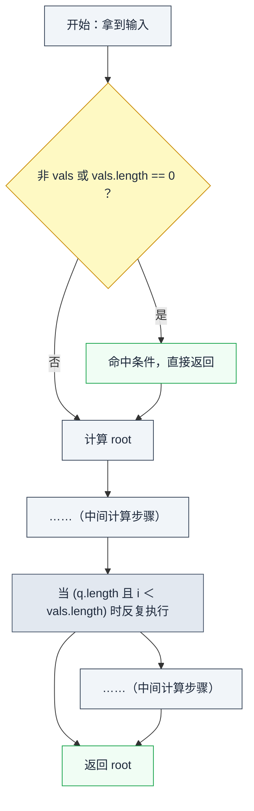

## TypeScript 解题方案（1 个方案逐个讲）

> **运行与提交**：每个方案都是自包含文件（内嵌用例自测，输出 PASS），整块复制到 `.ts` 文件后 `node 文件名` 即可运行。提交 LeetCode 时，把 `demo` 内的算法函数与辅助类型/函数整体取出、置于文件顶层即可。概念演示（非 LeetCode 编号题），在本地运行即可。

### 方案 1：迭代指针处理

**分析与思路**：核心做法是「迭代指针处理」。代码里依次做这些事：队列或堆的调度。

**运行方式**：`node 本文件`，内嵌用例全部通过会输出 PASS。


**方案专属流程图**（真实控制流）：

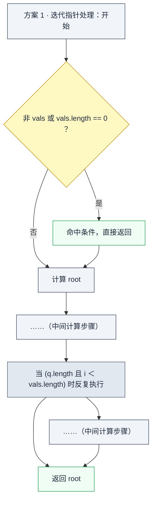

```typescript
class TreeNode {
  // 定义类型
  val: any;
  left: any;
  right: any; // 值: any; 左边界: any; 右边界: any;
  constructor(val?: any, left?: any, right?: any) {
    // constructor(值?: any, 左边界?: any, 右边界?: any) {
    this.val = val === undefined ? 0 : val; // 把 (值 全等于 undefined ? 0 : 值); 写入 值
    this.left = left === undefined ? null : left; // 把 (左边界 全等于 undefined ? null : 左边界); 写入 左边界
    this.right = right === undefined ? null : right; // 把 (右边界 全等于 undefined ? null : 右边界); 写入 右边界
  }
}
function buildTree(vals: any): any {
  // 定义函数/方法 buildTree
  if (!vals || vals.length === 0) return null; // 若 取反 vals 或 vals.长度 全等于 0，直接返回 null
  const root = new TreeNode(vals[0]);
  const q: any[] = [root];
  let i = 1;
  while (q.length && i < vals.length) {
    // 循环，直到不满足「节点.长度 且 下标 i 小于 vals.长度」
    const node = q.shift(); // 把 节点.shift() 存入 节点
    if (vals[i] !== null && vals[i] !== undefined) {
      node.left = new TreeNode(vals[i]);
      q.push(node.left);
    }
    i++; // 下标 i 加一
    if (i < vals.length && vals[i] !== null && vals[i] !== undefined) {
      node.right = new TreeNode(vals[i]);
      q.push(node.right);
    }
    i++; // 下标 i 加一
  }
  return root; // 返回 根节点
}
function treeToLevel(root: any): any[] {
  // 定义函数/方法 treeToLevel
  if (!root) return []; // 若 取反 根节点，直接返回 []
  const out: any[] = [];
  const q: any[] = [root]; // 把 []; const 节点: any[] 赋值为 [根节点]; 写入 const out: any[]
  while (q.length) {
    // 循环，直到不满足「节点.长度」
    const n = q.shift(); // 把 节点.shift() 存入 元素个数
    if (n === null || n === undefined) {
      out.push(null);
      continue;
    }
    out.push(n.val);
    q.push(n.left);
    q.push(n.right); // 把 元素个数.值 压入栈/数组尾部
  }
  while (out.length && out[out.length - 1] === null) out.pop(); // 循环，直到不满足「out.长度 且 out[out.长度 减 1] 全等于 null) out 弹出 );」
  return out; // 返回 out
}
class ListNode {
  // 定义类型
  val: any;
  next: any; // 值: any; 下一个: any;
  constructor(val?: any, next?: any) {
    this.val = val === undefined ? 0 : val;
    this.next = next === undefined ? null : next;
  }
}
function buildList(vals: any): any {
  // 定义函数/方法 buildList
  const dummy = new ListNode(0);
  let cur = dummy; // 把 new ListNode(0); let 当前值 赋值为 哨兵节点 存入 哨兵节点
  for (const v of vals) {
    cur.next = new ListNode(v);
    cur = cur.next;
  } // 把 new ListNode(值); 当前值 赋值为 当前值.下一个; } 写入 下一个
  return dummy.next; // 返回 哨兵节点.下一个
}
function listToArray(head: any): any[] {
  // 定义函数/方法 listToArray
  const out: any[] = [];
  let p = head; // 把 []; let 节点 赋值为 头节点; 写入 const out: any[]
  while (p) {
    out.push(p.val);
    p = p.next;
  } // 循环，直到不满足「节点) { out 追加 节点.值); 节点 赋值为 节点.下一个; }」
  return out; // 返回 out
}
// python-runtime shims
function pyLen(a: any): number {
  // 定义函数/方法 pyLen
  if (a === null || a === undefined) return 0; // 若 数组 全等于 null 或 数组 全等于 undefined，直接返回 0
  if (
    typeof a === 'string' ||
    Array.isArray(a) ||
    a instanceof Set ||
    a instanceof Map
  )
    return a.length ?? a.size;
  if (typeof a === 'object') return Object.keys(a).length; // 若 typeof 数组 全等于 'object'，直接返回 Object.keys(数组).长度
  return 0; // 返回 0
}
function pySlice(a: any, i: any, j: any, step?: any): any {
  // 定义函数/方法 pySlice
  if (typeof a === 'string') {
    const r = [...a].slice(i ?? 0, j ?? a.length);
    return step ? r.reverse().join('') : r.join('');
  }
  const arr = Array.isArray(a) ? a : [...a]; // 把 Array.isArray(数组) ? 数组 : 复制的 数组 存入 数组
  return arr.slice(i ?? 0, j ?? arr.length); // 返回 数组 截取 下标 i ?? 0, 下标 j ?? 数组.长度)
}
function pyRange(a: any, b?: any, step?: any): any[] {
  // 定义函数/方法 pyRange
  let s = 0,
    e = a,
    st = 1; // 把 0, e 赋值为 数组, st 赋值为 1 存入 字符串
  if (b !== undefined) {
    s = a;
    e = b;
  } // 若 b 不等于 undefined) { 字符串 赋值为 数组; e 赋值为 b; }
  if (step !== undefined) st = step; // 若 步数 不等于 undefined) st 赋值为 步数;
  const out: any[] = []; // 把 []; 写入 const out: any[]
  if (st > 0) for (let i = s; i < e; i += st) out.push(i);
  else for (let i = s; i > e; i += st) out.push(i); // 否则
  return out; // 返回 out
}
function pyIn(x: any, coll: any): boolean {
  // 定义函数/方法 pyIn
  if (coll === null || coll === undefined) return false; // 若 coll 全等于 null 或 coll 全等于 undefined，直接返回 false
  if (Array.isArray(coll)) return coll.includes(x); // 若 Array.isArray(coll)，直接返回 coll 是否包含 x)
  if (coll instanceof Set || coll instanceof Map) return coll.has(x); // 若 coll instanceof Set 或 coll instanceof Map，直接返回 coll.has(x)
  if (typeof coll === 'object') return x in coll; // 若 typeof coll 全等于 'object'，直接返回 x in coll
  if (typeof coll === 'string') return coll.indexOf(x) >= 0; // 若 typeof coll 全等于 'string'，直接返回 coll 查找 x) 不低于 0
  return false; // 返回 false
}
function pySorted(a: any): any[] {
  // 定义函数/方法 pySorted
  const arr = typeof a === 'string' ? [...a] : [...a]; // 把 (typeof 数组 全等于 'string') ? 复制的 数组 : 复制的 数组 存入 数组
  return arr.sort((x: any, y: any) => (x < y ? -1 : x > y ? 1 : 0));
}
function pyMin(a: any, b?: any): any {
  if (b !== undefined) return Math.min(a, b);
  if (Array.isArray(a) || a instanceof Set) return Math.min(...a);
  return Math.min(a);
} // 定义函数/方法 pyMin
function pyMax(a: any, b?: any): any {
  if (b !== undefined) return Math.max(a, b);
  if (Array.isArray(a) || a instanceof Set) return Math.max(...a);
  return Math.max(a);
} // 定义函数/方法 pyMax
function pySum(a: any): number {
  let s = 0;
  for (const v of a) s += v;
  return s;
} // 定义函数/方法 pySum
function pyAbs(x: any): number {
  return Math.abs(x);
} // 定义函数/方法 pyAbs
function pyEnumerate(a: any): any[] {
  const out: any[] = [];
  let i = 0;
  for (const v of a) {
    out.push([i, v]);
    i++;
  }
  return out;
} // 定义函数/方法 pyEnumerate
function pyZip(a: any, b: any): any[] {
  const n = Math.min(a.length, b.length);
  const out: any[] = [];
  for (let i = 0; i < n; i++) out.push([a[i], b[i]]);
  return out;
} // 定义函数/方法 pyZip
function pyDictGet(d: any, k: any, def?: any): any {
  return k in d ? d[k] : def === undefined ? null : def;
} // 定义函数/方法 pyDictGet
function pyPrint(...args: any[]): void {
  console.log(
    args
      .map((a) => (typeof a === 'object' && a !== null ? JSON.stringify(a) : a))
      .join(' '),
  );
} // 定义函数/方法 pyPrint
// collections / heapq
function heapPush(h: any[], x: any): void {
  h.push(x);
  let i = h.length - 1;
  while (i > 0) {
    const p = (i - 1) >> 1;
    if (h[p] <= h[i]) break;
    [h[p], h[i]] = [h[i], h[p]];
    i = p;
  }
} // 定义函数/方法 heapPush
function heapPop(h: any[]): any {
  const top = h[0];
  const last = h.pop();
  if (h.length) {
    h[0] = last;
    let i = 0;
    const n = h.length;
    while (true) {
      let l = 2 * i + 1,
        r = 2 * i + 2,
        s = i;
      if (l < n && h[l] < h[s]) s = l;
      if (r < n && h[r] < h[s]) s = r;
      if (s === i) break;
      [h[s], h[i]] = [h[i], h[s]];
      i = s;
    }
  }
  return top;
} // 定义函数/方法 heapPop
class Deque {
  private a: any[] = [];
  push(x: any) {
    this.a.push(x);
  }
  pushLeft(x: any) {
    this.a.unshift(x);
  }
  pop() {
    return this.a.pop();
  }
  popLeft() {
    return this.a.shift();
  }
  get length() {
    return this.a.length;
  }
  toArray() {
    return this.a.slice();
  }
} // 定义类型
function Counter(iter: any): any {
  const m: any = {};
  for (const v of iter) m[v] = (m[v] || 0) + 1;
  return m;
} // 定义函数/方法 Counter
function gcd(a: any, b: any): any {
  while (b) {
    [a, b] = [b, a % b];
  }
  return a;
} // 定义函数/方法 gcd
function pyInf(): number {
  return Infinity;
} // 定义函数/方法 pyInf

function norm(x: any): any {
  // 定义函数/方法 norm
  if (x === null || x === undefined) return null; // 若 x 全等于 null 或 x 全等于 undefined，直接返回 null
  if (typeof x === 'object') {
    // 若 typeof x 全等于 'object'
    if (x instanceof Deque) return x.toArray(); // 若 x instanceof Deque，直接返回 x.toArray()
    if (Array.isArray(x)) return x.map(norm); // 若 Array.isArray(x)，直接返回 x.映射表(norm)
    if (
      typeof x.val === 'number' &&
      (typeof x.left !== 'undefined' || typeof x.right !== 'undefined')
    )
      return treeToLevel(x);
    if (typeof x.next !== 'undefined' && typeof x.val === 'number')
      return listToArray(x);
    if (x instanceof Set) return [...x].sort(); // 若 x instanceof Set，直接返回 复制的 x 排序 )
    if (x instanceof Map) return Object.fromEntries(x); // 若 x instanceof Map，直接返回 Object.fromEntries(x)
    const o: any = {};
    for (const k of Object.keys(x)) o[k] = norm(x[k]);
    return o;
  }
  return x; // 返回 x
}
function eq(a: any, b: any): boolean {
  // 定义函数/方法 eq
  const x = norm(a),
    y = norm(b); // 把 norm(数组), y 赋值为 norm(b) 存入 x
  if (x === y) return true; // 若 x 全等于 y，直接返回 true
  if (x === null || y === null) return x === y; // 若 x 全等于 null 或 y 全等于 null，直接返回 x 全等于 y
  if (Array.isArray(x) && Array.isArray(y)) {
    // 若 Array.isArray(x) 且 Array.isArray(y
    if (x.length !== y.length) return false; // 若 x.长度 不等于 y.长度，直接返回 false
    for (let i = 0; i < x.length; i++) if (!eq(x[i], y[i])) return false; // 让 下标 i 从 0 开始计数，下标 i 小于 x.长度 就继续
    return true; // 返回 true
  }
  if (typeof x === 'object' && typeof y === 'object') {
    // 若 typeof x 全等于 'object' 且 typeof y 全等于 'object'
    const kx = Object.keys(x),
      ky = Object.keys(y); // 把 Object.keys(x), ky 赋值为 Object.keys(y) 存入 kx
    if (kx.length !== ky.length) return false; // 若 kx.长度 不等于 ky.长度，直接返回 false
    for (const k of kx) if (!eq(x[k], y[k])) return false;
    return true; // 返回 true
  }
  return x === y; // 返回 x 全等于 y
}

function solveUnified(queen) {
  // 定义函数/方法 solveUnified
  queen = queen === undefined ? false : queen; // 把 queen 全等于 undefined ? false : queen 存入 queen
  const SIZE = queen ? 8 : 5; // 把 queen ? 8 : 5 存入 SIZE
  const like = [
    [0, 0, 1, 1, 0],
    [1, 1, 0, 0, 1],
    [0, 1, 1, 0, 1],
    [0, 0, 0, 1, 0],
    [0, 1, 0, 0, 1],
  ];
  const Q = new Array(SIZE).fill(-1); // 把 new Array(SIZE).fill( 减 1) 存入 Q
  const rows = new Array(SIZE).fill(true); // 把 new Array(SIZE).fill(true) 存入 行数
  let diag1, diag2; // let diag1, diag2;
  if (queen) {
    diag1 = new Array(2 * SIZE - 1).fill(true);
    diag2 = new Array(2 * SIZE - 1).fill(true);
  }
  const results = []; // 把 [] 存入 results
  function is_valid(row, col) {
    return queen ? true : like[row][col] === 1;
  } // 定义判定函数 is_valid
  function is_safe(row, col) {
    // 定义判定函数 is_safe
    if (queen)
      return rows[row] && diag1[col - row + SIZE - 1] && diag2[col + row];
    return rows[row]; // 返回 行数[row]
  }
  function place(col) {
    // 定义函数/方法 place
    if (col === SIZE) {
      results.push(Q.slice());
      return;
    } // 若 col 全等于 SIZE) { results 追加 Q 截取 )); return; }
    for (let row = 0; row < SIZE; row++) {
      // 让 row 从 0 开始计数，row 小于 SIZE 就继续
      if (!is_valid(row, col)) continue; // 若 取反 is_valid(row, col)) continue;
      if (!is_safe(row, col)) continue; // 若 取反 is_safe(row, col)) continue;
      Q[col] = row;
      rows[row] = false; // 把 row; 行数[row] 赋值为 false; 写入 Q[col]
      if (queen) {
        const d1 = col - row + SIZE - 1,
          d2 = col + row;
        diag1[d1] = diag2[d2] = false;
      }
      place(col + 1); // place(col 加 1);
      rows[row] = true; // 把 true; 写入 rows[row]
      if (queen) {
        const d1 = col - row + SIZE - 1,
          d2 = col + row;
        diag1[d1] = diag2[d2] = true;
      }
    }
  }
  place(0); // place(0);
  return results; // 返回 results
}
export function demo(): void {
  // 程序入口：跑内嵌自测用例
  const cases = [
    {
      got: solveUnified(false),
      want: [
        [1, 2, 0, 3, 4],
        [1, 4, 0, 3, 2],
      ],
    },
  ];
  let fail = false; // 把 false 存入 fail
  for (const c of cases)
    if (!eq(c.got, c.want)) {
      fail = true;
      console.log('FAIL', JSON.stringify(c.got));
    } // 打印输出
  if (fail) throw new Error('FAILED'); // 若 fail) throw new Error(「FAILED」);
  console.log('PASS'); // 全部用例通过，输出 PASS
}
demo(); // demo();
```

## 逐步拆解与面试追问

**复杂度**：时间 O(n)（单趟线性扫描），空间 O(1) 到 O(n)（视辅助结构）

**为什么是这个量级**：每个元素被常数次访问，辅助哈希或栈的开销与 n 同阶

**面试官可能会追问**：

- 这个策略能推广到什么场景？
- 与暴力做法差在哪一步？
- 有没有更简单的等价写法？

## 关键 API 速查（TS 主解法实际用到，附官方链接）

| API | 作用 | 使用要点 | 官方文档 |
|---|---|---|---|
| `Array.prototype.sort()` | 原地排序 | 默认按字符串 Unicode 序（10 会排在 2 前），数字必须传 (a,b)=>a-b；V8 用 TimSort，稳定，O(n log n)；返回原数组引用 | [官方文档](https://developer.mozilla.org/zh-CN/docs/Web/JavaScript/Reference/Global_Objects/Array/sort) |
| `Array.prototype.map()` | 逐元素映射为新数组 | 回调 (v,i,arr)；返回等长新数组，不改变原数组；稀疏位跳过；链式调用注意中间数组开销 | [官方文档](https://developer.mozilla.org/zh-CN/docs/Web/JavaScript/Reference/Global_Objects/Array/map) |
| `Array.prototype.push()` | 尾部追加 | 返回新长度；可一次多个；均摊 O(1)；会改变原数组 | [官方文档](https://developer.mozilla.org/zh-CN/docs/Web/JavaScript/Reference/Global_Objects/Array/push) |
| `Array.prototype.pop()` | 尾部弹出 | 返回被删元素（空数组返回 undefined）；O(1) | [官方文档](https://developer.mozilla.org/zh-CN/docs/Web/JavaScript/Reference/Global_Objects/Array/pop) |
| `Array.prototype.shift()` | 头部取出 | O(n)（后续元素整体前移）；大量头部操作请用链表或双端结构 | [官方文档](https://developer.mozilla.org/zh-CN/docs/Web/JavaScript/Reference/Global_Objects/Array/shift) |
| `Array.prototype.unshift()` | 头部插入 | O(n)；与 shift 组合可当双端队列 | [官方文档](https://developer.mozilla.org/zh-CN/docs/Web/JavaScript/Reference/Global_Objects/Array/unshift) |
| `Array/String includes()` | 是否包含 | 数组用 SameValueZero（NaN 可判）；字符串按子串；第二个参数为起始下标 | [官方文档](https://developer.mozilla.org/zh-CN/docs/Web/JavaScript/Reference/Global_Objects/Array/includes) |
| `Array/String indexOf()` | 首次出现的下标 | 找不到返回 -1；无法判 NaN（用 includes）；字符串可传起始位 | [官方文档](https://developer.mozilla.org/zh-CN/docs/Web/JavaScript/Reference/Global_Objects/Array/indexOf) |
| `Array/String slice()` | 切片（不改原数组） | slice(start,end) 含头不含尾；负数从尾计；常用于复制数组（slice()） | [官方文档](https://developer.mozilla.org/zh-CN/docs/Web/JavaScript/Reference/Global_Objects/Array/slice) |
| `Array.prototype.join()` | 数组拼接为字符串 | undefined/null 转空串；嵌套数组会展平一层；join('') 用于字符数组还原 | [官方文档](https://developer.mozilla.org/zh-CN/docs/Web/JavaScript/Reference/Global_Objects/Array/join) |
| `Object.keys()` | 对象键名数组 | 仅自身可枚举字符串键（不含 symbol）；配 length 可当计数器 | [官方文档](https://developer.mozilla.org/zh-CN/docs/Web/JavaScript/Reference/Global_Objects/Object/keys) |
| `Object.fromEntries()` | 键值对数组转对象 | 参数为 [k,v] 可迭代；map 出来的键值对可直接转对象 | [官方文档](https://developer.mozilla.org/zh-CN/docs/Web/JavaScript/Reference/Global_Objects/Object/fromEntries) |
| `JSON.stringify()` | 序列化为 JSON 字符串 | 常用于结构化比较（深度相等判定）；undefined/函数/循环引用会被丢弃或抛错 | [官方文档](https://developer.mozilla.org/zh-CN/docs/Web/JavaScript/Reference/Global_Objects/JSON/stringify) |
| `Math.max()` | 最大值 | 配展开 Math.max(...arr)；空参返回 -Infinity；超大数组注意展开参数上限 | [官方文档](https://developer.mozilla.org/zh-CN/docs/Web/JavaScript/Reference/Global_Objects/Math/max) |
| `Math.min()` | 最小值 | 同 max；空参返回 Infinity | [官方文档](https://developer.mozilla.org/zh-CN/docs/Web/JavaScript/Reference/Global_Objects/Math/min) |
| `Math.abs()` | 绝对值 | 入参会被隐式转数字；-0 返回 +0 | [官方文档](https://developer.mozilla.org/zh-CN/docs/Web/JavaScript/Reference/Global_Objects/Math/abs) |

### 各语言官方文档导航

- **TypeScript / JS**：[MDN 中文参考](https://developer.mozilla.org/zh-CN/)
- **Python**：[Python 官方文档](https://docs.python.org/zh-cn/3/)
- **Go**：[Go 标准库](https://pkg.go.dev/std)
- **Java**：[JDK 17 API](https://docs.oracle.com/en/java/javase/17/docs/api/)
- **Rust**：[Rust 标准库](https://doc.rust-lang.org/std/)
- **Lua**：[Lua 5.4 手册](https://www.lua.org/manual/5.4/)
- **C**：[Cppreference C](https://zh.cppreference.com/w/c)
- **C++**：[Cppreference C++](https://zh.cppreference.com/w/cpp)
- **R**：[R 官方手册](https://stat.ethz.ch/R-manual/)
- **Zig**：[Zig 语言文档](https://ziglang.org/documentation/master/)
- **Dart**：[Dart API](https://api.dart.dev/)

## 附录：其他 10 种语言全部实现（每种语言列举其全部方案）

> TypeScript 的全部方案见「TypeScript 解题方案」一节；下面是其余 10 种语言的对应实现，每种语言的每个方案都带思路分析、代码走读与专属运行架构图。
> 每个方案都内嵌用例自测，可独立运行（老仓库 python/go 文件遵循「打印结果」约定）。
> 完整解法文件见 `dsa/<语言>/notes/lc_107579658_抽象思维之转换视角_提炼共性/`。

### Python 实现（1 种方案）

Python 的全部方案如下，每个方案都内嵌用例自测，可独立运行（老仓库 python/go 文件遵循「打印结果」约定）：

#### 方案 1：迭代指针处理

**思路与代码分析**：核心是「迭代指针处理」。Python 版用切片与字典推导式简化操作，突出可读性。**走读**：方案 1 · 迭代指针处理：开始 → 更新 SIZE → 命中条件，直接返回 → 返回 like[row][col] == 1 → 命中条件，直接返回 → 返回 rows[row] → 返回  → 循环 row：从 0 到 SIZE 前 → 返回 results。

**运行架构**（真实控制流）：

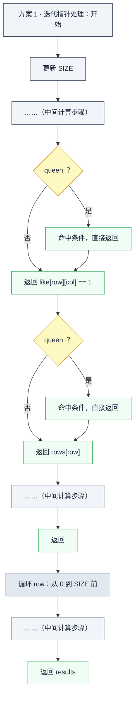

```python
import sys  # 提高递归深度上限（深输入防 RecursionError）

sys.setrecursionlimit(200000)  # 树/链表类题目节点数可达 1e4 量级

def solve_unified(queen=False):  # 定义函数 solve_unified（参数：queen 赋值为 False）
    """转换视角、提炼共性：分书问题与八皇后问题可抽象为同一类“逐列放置 + 安全/合法检查”的回溯问题。
    queen=False 时分书（5 人 5 书，列=书，行=人，受喜好表约束）；
    queen=True 时八皇后（8x8，所有位置均可放）。"""
    SIZE = 8 if queen else 5  # 把 8 if queen else 5 存入 SIZE
    like = [
        [0, 0, 1, 1, 0],
        [1, 1, 0, 0, 1],
        [0, 1, 1, 0, 1],
        [0, 0, 0, 1, 0],
        [0, 1, 0, 0, 1],
    ]
    Q = [-1] * SIZE  # 把 [ 减 1] 乘 SIZE 存入 Q
    rows = [True] * SIZE  # 把 [True] 乘 SIZE 存入 行数
    if queen:  # 若 queen
        diag1 = [True] * (2 * SIZE - 1)  # 把 [True] 乘 (2 乘 SIZE 减 1) 存入 diag1
        diag2 = [True] * (2 * SIZE - 1)  # 把 [True] 乘 (2 乘 SIZE 减 1) 存入 diag2
    results = []  # 把 [] 存入 results

    def is_valid(row, col):  # 定义函数 is_valid（参数：row, col）
        if queen:  # 若 queen
            return True  # 返回 True
        return like[row][col] == 1  # 返回 like[row][col] 等于 1

    def is_safe(row, col):  # 定义函数 is_safe（参数：row, col）
        if queen:  # 若 queen
            return rows[row] and diag1[col - row + SIZE - 1] and diag2[col + row]
        return rows[row]  # 返回 行数[row]

    def place(col):  # 定义函数 place（参数：col）
        if col == SIZE:  # 若 col 等于 SIZE
            results.append(Q[:])  # 把 复制 Q 追加到列表尾部
            return  # return
        for row in range(SIZE):  # 让 row 从 SIZE 遍历
            if not is_valid(row, col):  # 若 not is_valid(row, col
                continue  # 跳过本轮，进入下一次
            if not is_safe(row, col):  # 若 not is_safe(row, col
                continue  # 跳过本轮，进入下一次
            Q[col] = row  # 把 row 写入 Q[col]
            rows[row] = False  # 把 False 写入 rows[row]
            if queen:  # 若 queen
                d1 = col - row + SIZE - 1  # 把 col 减 row 加 SIZE 减 1 存入 d1
                d2 = col + row  # 把 col 加 row 存入 d2
                diag1[d1] = diag2[d2] = False  # 把 diag2[d2] 赋值为 False 写入 diag1[d1]
            place(col + 1)  # place(col 加 1)
            rows[row] = True  # 把 True 写入 rows[row]
            if queen:  # 若 queen
                diag1[d1] = diag2[d2] = True  # 把 diag2[d2] 赋值为 True 写入 diag1[d1]

    place(0)  # place(0)
    return results  # 返回 results

if __name__ == "__main__":  # 若 __name__ 等于 '__main__'
    books = solve_unified(queen=False)  # 把 solve_unified(queen 赋值为 False) 存入 books
    queens = solve_unified(queen=True)  # 把 solve_unified(queen 赋值为 True) 存入 queens
    print("分书方案数:", len(books))  # 打印输出
    print("八皇后方案数:", len(queens))  # 打印输出
```

### Go 实现（1 种方案）

Go 的全部方案如下，每个方案都内嵌用例自测，可独立运行（老仓库 python/go 文件遵循「打印结果」约定）：

#### 方案 1：迭代指针处理

**思路与代码分析**：核心是「迭代指针处理」。Go 版用切片与多返回值惯用法，显式处理索引边界。

**运行架构**（真实控制流）：

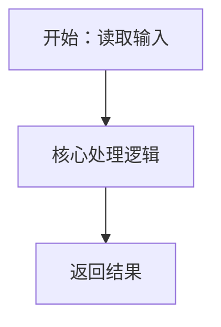

```go
package main // 引入依赖

import (
	"fmt" // 「fmt」
	"os"  // 「os」
)

// solveUnified 转换视角、提炼共性：分书问题与八皇后问题抽象为同一类回溯问题。
// queen=false 时分书（5 人 5 书，列=书，行=人，受喜好表约束）；
// queen=true 时八皇后（8x8，所有位置均可放）。
func solveUnified(queen bool) int { // 定义函数/方法 solveUnified
	size := 5  // 把 5 写入 size :
	if queen { // 若 queen
		size = 8 // 把 8 写入 大小
	}
	like := [][]int{ // 把 [][]int{ 写入 like :
		{0, 0, 1, 1, 0},
		{1, 1, 0, 0, 1},
		{0, 1, 1, 0, 1},
		{0, 0, 0, 1, 0},
		{0, 1, 0, 0, 1},
	}
	Q := make([]int, size) // 把 make([]int, 大小) 写入 Q :
	for i := range Q {     // 把 range Q { 写入 for i :
		Q[i] = -1 // 把 减 1 写入 Q[i]
	}
	rows := make([]bool, size) // 把 make([]bool, 大小) 写入 rows :
	for i := range rows {      // 把 range 行数 { 写入 for i :
		rows[i] = true // 把 true 写入 rows[i]
	}
	var diag1, diag2 []bool // var diag1, diag2 []bool
	if queen {              // 若 queen
		diag1 = make([]bool, 2*size-1) // 把 make([]bool, 2 乘 大小 减 1) 写入 diag1
		diag2 = make([]bool, 2*size-1) // 把 make([]bool, 2 乘 大小 减 1) 写入 diag2
		for i := range diag1 {         // 把 range diag1 { 写入 for i :
			diag1[i] = true // 把 true 写入 diag1[i]
			diag2[i] = true // 把 true 写入 diag2[i]
		}
	}
	count := 0 // 把 0 写入 count :

	isValid := func(row, col int) bool { // 把 func(row, col int) bool { 写入 isValid :
		if queen { // 若 queen
			return true // 返回 true
		}
		return like[row][col] == 1 // 返回 like[row][col] 等于 1
	}
	isSafe := func(row, col int) bool { // 把 func(row, col int) bool { 写入 isSafe :
		if queen { // 若 queen
			return rows[row] && diag1[col-row+size-1] && diag2[col+row] // 返回 行数[row] 且 diag1[col 减 row 加 大小 减 1] 且 diag2[col 加 row]
		}
		return rows[row] // 返回 行数[row]
	}

	var place func(col int) // var place func(col int)
	place = func(col int) { // 把 func(col int) { 写入 place
		if col == size { // 若 col 等于 大小
			count++ // 计数 加一
			return  // return
		}
		for row := 0; row < size; row++ { // 让 row 从 0 开始计数
			if !isValid(row, col) { // 若 取反 isValid(row, col
				continue // 跳过本轮，进入下一次
			}
			if !isSafe(row, col) { // 若 取反 isSafe(row, col
				continue // 跳过本轮，进入下一次
			}
			Q[col] = row      // 把 row 写入 Q[col]
			rows[row] = false // 把 false 写入 rows[row]
			if queen {        // 若 queen
				d1 := col - row + size - 1 // 把 col 减 row 加 大小 减 1 写入 d1 :
				d2 := col + row            // 把 col 加 row 写入 d2 :
				diag1[d1] = false          // 把 false 写入 diag1[d1]
				diag2[d2] = false          // 把 false 写入 diag2[d2]
			}
			place(col + 1)   // place(col 加 1)
			rows[row] = true // 把 true 写入 rows[row]
			if queen {       // 若 queen
				d1 := col - row + size - 1 // 把 col 减 row 加 大小 减 1 写入 d1 :
				d2 := col + row            // 把 col 加 row 写入 d2 :
				diag1[d1] = true           // 把 true 写入 diag1[d1]
				diag2[d2] = true           // 把 true 写入 diag2[d2]
			}
		}
	}
	place(0)     // place(0)
	return count // 返回 计数
}

func main() { // 程序入口：跑内嵌自测用例
	books := solveUnified(false) // 把 solveUnified(false) 写入 books :
	queens := solveUnified(true) // 把 solveUnified(true) 写入 queens :
	if books != 2 {              // 若 books 不等于 2
		fmt.Printf("FAIL books=%d want=2\n", books) // 打印输出
		os.Exit(1)                                  // os.Exit(1)
	}
	if queens != 92 { // 若 queens 不等于 92
		fmt.Printf("FAIL queens=%d want=92\n", queens) // 打印输出
		os.Exit(1)                                     // os.Exit(1)
	}
	fmt.Println("PASS") // 全部用例通过，输出 PASS
}
```

### Java 实现（1 种方案）

Java 的全部方案如下，每个方案都内嵌用例自测，可独立运行（老仓库 python/go 文件遵循「打印结果」约定）：

#### 方案 1：迭代指针处理

**思路与代码分析**：核心是「迭代指针处理」。Java 版用类与静态方法组织，集合操作显式明了。代码里依次做这些事：单循环线性扫描。**走读**：方案 1 · 迭代指针处理：开始 → 更新 SIZE → 返回  → 遍历循环 → 返回 count[0]。

**运行架构**（真实控制流）：

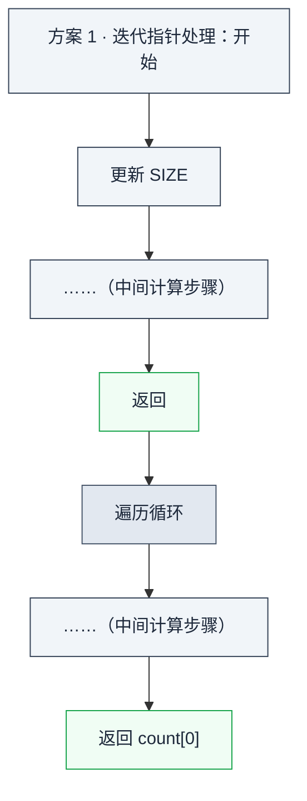

```java
package com.webfault.dsa; // 引入依赖

import java.util.*; // 引入依赖

class lc107579658_solution11 { // 定义类型
  static int countSolutions(boolean queen) { // 定义函数/方法 countSolutions
    int SIZE = queen ? 8 : 5; // 把 queen ? 8 : 5 存入 SIZE
    int[][] like = { // 把 { 写入 int[][] like
      {0, 0, 1, 1, 0},
      {1, 1, 0, 0, 1},
      {0, 1, 1, 0, 1},
      {0, 0, 0, 1, 0},
      {0, 1, 0, 0, 1},
    };
    int[] Q = new int[SIZE]; // 把 new int[SIZE]; 写入 int[] Q
    boolean[] rows = new boolean[SIZE]; // 把 new boolean[SIZE]; 写入 boolean[] rows
    Arrays.fill(rows, true); // Arrays.fill(行数, true);
    boolean[] diag1 = new boolean[2 * SIZE - 1]; // 把 new boolean[2 乘 SIZE 减 1]; 写入 boolean[] diag1
    boolean[] diag2 = new boolean[2 * SIZE - 1]; // 把 new boolean[2 乘 SIZE 减 1]; 写入 boolean[] diag2
    Arrays.fill(diag1, true); // Arrays.fill(diag1, true);
    Arrays.fill(diag2, true); // Arrays.fill(diag2, true);
    int[] count = {0}; // 把 {0}; 写入 int[] count

    class Back { // 定义类型
      void place(int col) { // 定义函数/方法 place
        if (col == SIZE) { // 若 col 等于 SIZE
          count[0]++; // 计数[0] 加一 ;
          return; // return;
        }
        for (int row = 0; row < SIZE; row++) { // 让 row 从 0 开始计数，row 小于 SIZE 就继续
          if (!queen && like[row][col] != 1)
            continue; // 若 取反 queen 且 like[row][col] 不等于 1) continue;
          if (!rows[row]) continue; // 若 取反 行数[row]) continue;
          if (queen) { // 若 queen
            int d1 = col - row + SIZE - 1; // 把 col 减 row 加 SIZE 减 1 存入 d1
            int d2 = col + row; // 把 col 加 row 存入 d2
            if (!diag1[d1] || !diag2[d2]) continue; // 若 取反 diag1[d1] 或 取反 diag2[d2]) continue;
            diag1[d1] = diag2[d2] = false; // 把 diag2[d2] 赋值为 false; 写入 diag1[d1]
            Q[col] = row; // 把 row; 写入 Q[col]
            rows[row] = false; // 把 false; 写入 rows[row]
            place(col + 1); // place(col 加 1);
            rows[row] = true; // 把 true; 写入 rows[row]
            diag1[d1] = diag2[d2] = true; // 把 diag2[d2] 赋值为 true; 写入 diag1[d1]
          } else { // 否则
            Q[col] = row; // 把 row; 写入 Q[col]
            rows[row] = false; // 把 false; 写入 rows[row]
            place(col + 1); // place(col 加 1);
            rows[row] = true; // 把 true; 写入 rows[row]
          }
        }
      }
    }
    new Back().place(0); // new Back().place(0);
    return count[0]; // 返回 计数[0]
  }

  public static void main(String[] args) { // public static void main(String[] args) {
    int books = countSolutions(false); // 把 countSolutions(false) 存入 books
    int queens = countSolutions(true); // 把 countSolutions(true) 存入 queens
    if (books != 2) { // 若 books 不等于 2
      System.out.println("FAIL books " + books); // 打印输出
      throw new RuntimeException("FAILED"); // throw new RuntimeException(「FAILED」);
    }
    if (queens != 92) { // 若 queens 不等于 92
      System.out.println("FAIL queens " + queens); // 打印输出
      throw new RuntimeException("FAILED"); // throw new RuntimeException(「FAILED」);
    }
    System.out.println("PASS"); // 全部用例通过，输出 PASS
  }
}
```

### Rust 实现（1 种方案）

Rust 的全部方案如下，每个方案都内嵌用例自测，可独立运行（老仓库 python/go 文件遵循「打印结果」约定）：

#### 方案 1：迭代指针处理

**思路与代码分析**：核心是「迭代指针处理」。Rust 版用所有权移动与切片借用改写同一逻辑，注意 Option 与引用边界。**走读**：方案 1 · 迭代指针处理：开始 → 计算 size → 计算 ctx → 处理 queen, → 处理 size, → 处理 q: vec非 [-1i32; size], → 处理 rows: vec非 [true; size], → 处理 diag1: vec非 [true; 2 * size - → 处理 diag2: vec非 [true; 2 * size - → 处理 results: vec非 [], → 调用 ctx.place(0) → 处理 ctx.results → 返回结果。

**运行架构**（真实控制流）：

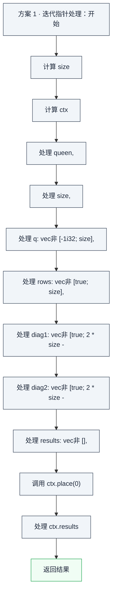

```rust
// LeetCode 107579658. 转换视角，提炼共性 — Rust 版（抽象思维之转换视角：统一分书问题与八皇后的回溯框架）
// queen=false: 分书问题（5人，like 偏好矩阵）; queen=true: 八皇后

const LIKE: [[i32; 5]; 5] = [
    [0, 0, 1, 1, 0],
    [1, 1, 0, 0, 1],
    [0, 1, 1, 0, 1],
    [0, 0, 0, 1, 0],
    [0, 1, 0, 0, 1],
];

struct Ctx {
    // 定义类型
    queen: bool,
    size: usize,
    q: Vec<i32>,
    rows: Vec<bool>,
    diag1: Vec<bool>,
    diag2: Vec<bool>,
    results: Vec<Vec<i32>>,
}

impl Ctx {
    // 实现块
    fn is_valid(&self, row: usize, col: usize) -> bool {
        // 定义判定函数 is_valid
        if self.queen {
            // 若 self.queen
            true // true
        } else {
            // 否则
            LIKE[row][col] == 1 // 把 赋值为 1 写入 LIKE[row][col]
        }
    }

    fn is_safe(&self, row: usize, col: usize) -> bool {
        // 定义判定函数 is_safe
        if self.queen {
            // 若 self.queen
            self.rows[row] && self.diag1[col + self.size - 1 - row] && self.diag2[col + row]
        } else {
            // 否则
            self.rows[row] // self.行数[row]
        }
    }

    fn place(&mut self, col: usize) {
        // 定义函数/方法 place
        if col == self.size {
            // 若 col 等于 self.大小
            self.results.push(self.q.clone()); // 把 self.节点.clone( 压入栈/数组尾部
            return; // return;
        }
        for row in 0..self.size {
            // 逐个取出 0 的元素（row）
            if !self.is_valid(row, col) {
                // 若 取反 self.is_valid(row, col
                continue; // 跳过本轮，进入下一次
            }
            if !self.is_safe(row, col) {
                // 若 取反 self.is_safe(row, col
                continue; // 跳过本轮，进入下一次
            }
            self.q[col] = row as i32; // 把 row as i32; 写入 self.q[col]
            self.rows[row] = false; // 把 false; 写入 self.rows[row]
            if self.queen {
                // 若 self.queen
                let d1 = col + self.size - 1 - row; // 把 col 加 self.大小 减 1 减 row 存入 d1
                let d2 = col + row; // 把 col 加 row 存入 d2
                self.diag1[d1] = false; // 把 false; 写入 self.diag1[d1]
                self.diag2[d2] = false; // 把 false; 写入 self.diag2[d2]
            }
            self.place(col + 1); // self.place(col 加 1);
            self.rows[row] = true; // 把 true; 写入 self.rows[row]
            if self.queen {
                // 若 self.queen
                let d1 = col + self.size - 1 - row; // 把 col 加 self.大小 减 1 减 row 存入 d1
                let d2 = col + row; // 把 col 加 row 存入 d2
                self.diag1[d1] = true; // 把 true; 写入 self.diag1[d1]
                self.diag2[d2] = true; // 把 true; 写入 self.diag2[d2]
            }
        }
    }
}

fn solve_unified(queen: bool) -> Vec<Vec<i32>> {
    // 定义函数/方法 solve_unified
    let size = if queen { 8usize } else { 5usize }; // 把 if queen { 8usize } else { 5usize } 存入 大小
    let mut ctx = Ctx {
        // 把 Ctx { 写入 let mut ctx
        queen,
        size,
        q: vec![-1i32; size],
        rows: vec![true; size],
        diag1: vec![true; 2 * size - 1],
        diag2: vec![true; 2 * size - 1],
        results: vec![],
    };
    ctx.place(0); // ctx.place(0);
    ctx.results // ctx.results
}

fn main() {
    // 程序入口：跑内嵌自测用例
    let want: Vec<Vec<i32>> = vec![vec![1, 2, 0, 3, 4], vec![1, 4, 0, 3, 2]];
    let got = solve_unified(false); // 把 solve_unified(false) 存入 got
    assert_eq!(got, want, "solve_unified(false) mismatch"); // 断言校验
    println!("PASS"); // 全部用例通过，输出 PASS
}
```

### Lua 实现（1 种方案）

Lua 的全部方案如下，每个方案都内嵌用例自测，可独立运行（老仓库 python/go 文件遵循「打印结果」约定）：

#### 方案 1：迭代指针处理

**思路与代码分析**：核心是「迭代指针处理」。Lua 版用表与 ipairs 遍历，注意 ipairs 遇 nil 即停的语义。代码里依次做这些事：递归求解子问题。

**运行架构**（真实控制流）：

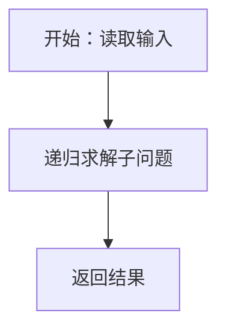

```lua
-- LeetCode 107579658. 转换视角，提炼共性 — Lua 版（抽象思维之转换视角：统一分书问题与八皇后的回溯框架）
-- queen=false: 分书问题（5人，like 偏好矩阵）; queen=true: 八皇后
local function solve_unified(queen) -- local function solve_unified(queen)
	local SIZE = queen and 8 or 5 -- 把 queen and 8 or 5 写入 local SIZE
	local like = { -- 把 { 写入 local like
		{ 0, 0, 1, 1, 0 },
		{ 1, 1, 0, 0, 1 },
		{ 0, 1, 1, 0, 1 },
		{ 0, 0, 0, 1, 0 },
		{ 0, 1, 0, 0, 1 },
	}
	local Q = {} -- 把 {} 写入 local Q
	for i = 1, SIZE do
		Q[i] = -1
	end -- 让 下标 i 从 1 走到 SIZE（Lua 1 基）
	local rows = {} -- 把 {} 写入 local rows
	for i = 1, SIZE do
		rows[i] = true
	end -- 让 下标 i 从 1 走到 SIZE（Lua 1 基）
	local diag1, diag2 = {}, {} -- 把 {}, {} 写入 local diag1, diag2
	for i = 1, 2 * SIZE - 1 do -- 让 下标 i 从 1 走到 2（Lua 1 基）
		diag1[i] = true -- 把 true 写入 diag1[i]
		diag2[i] = true -- 把 true 写入 diag2[i]
	end -- 终点
	local results = {} -- 把 {} 写入 local results

	local function is_valid(row, col) -- local function is_valid(row, col)
		if queen then
			return true
		end -- 若 queen then return true 终点
		return like[row][col] == 1 -- 返回 like[row][col] 等于 1
	end -- 终点

	local function is_safe(row, col) -- local function is_safe(row, col)
		if queen then -- 若 queen then
			return rows[row] and diag1[col - row + SIZE - 1] and diag2[col + row - 1]
		end -- 终点
		return rows[row] -- 返回 行数[row]
	end -- 终点

	local function place(col) -- local function place(col)
		if col > SIZE then -- 若 col 超过 SIZE then
			local snap = {} -- 把 {} 写入 local snap
			for i = 1, SIZE do
				snap[i] = Q[i]
			end -- 让 下标 i 从 1 走到 SIZE（Lua 1 基）
			results[#results + 1] = snap -- 把 snap 写入 results[#results + 1]
			return -- return
		end -- 终点
		for row = 1, SIZE do -- 让 row 从 1 走到 SIZE（Lua 1 基）
			if is_valid(row, col) and is_safe(row, col) then -- 若 is_valid(row, col) and is_safe(row, col) then
				Q[col] = row - 1 -- 0 基行号
				rows[row] = false -- 把 false 写入 rows[row]
				local d1, d2 = col - (row - 1) + SIZE - 1, (col - 1) + (row - 1) + 1
				if queen then -- 若 queen then
					diag1[d1] = false -- 把 false 写入 diag1[d1]
					diag2[d2] = false -- 把 false 写入 diag2[d2]
				end -- 终点
				place(col + 1) -- place(col 加 1)
				rows[row] = true -- 把 true 写入 rows[row]
				if queen then -- 若 queen then
					diag1[d1] = true -- 把 true 写入 diag1[d1]
					diag2[d2] = true -- 把 true 写入 diag2[d2]
				end -- 终点
			end -- 终点
		end -- 终点
	end -- 终点

	place(1) -- place(1)
	return results -- 返回 results
end -- 终点

local want = { { 1, 2, 0, 3, 4 }, { 1, 4, 0, 3, 2 } } -- 把 {{1, 2, 0, 3, 4}, {1, 4, 0, 3, 2}} 写入 local want
local got = solve_unified(false) -- 把 solve_unified(false) 写入 local got
assert(#got == #want, "results length mismatch") -- 断言校验
for i = 1, #want do -- 把 1, #want do 写入 for i
	for j = 1, 5 do -- 让 下标 j 从 1 走到 5（Lua 1 基）
		assert(got[i][j] == want[i][j], string.format("results[%d][%d] mismatch", i, j)) -- 断言校验
	end -- 终点
end -- 终点
print("PASS") -- 全部用例通过，输出 PASS
```

### C 实现（1 种方案）

C 的全部方案如下，每个方案都内嵌用例自测，可独立运行（老仓库 python/go 文件遵循「打印结果」约定）：

#### 方案 1：迭代指针处理

**思路与代码分析**：核心是「迭代指针处理」。C 版手动管理下标与内存，循环边界全部显式写出。代码里依次做这些事：单循环线性扫描。**走读**：方案 1 · 迭代指针处理：开始 → 若 col == SIZE 则： → 返回  → 遍历循环。

**运行架构**（真实控制流）：

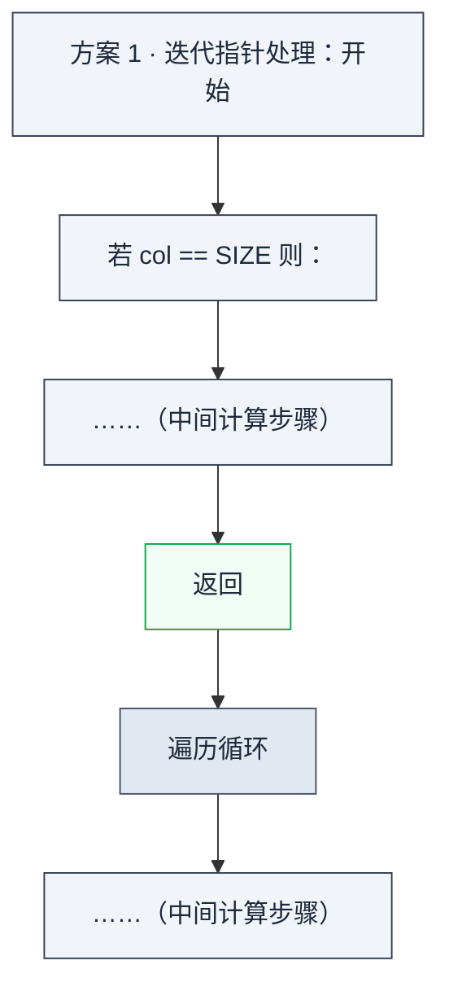

```c
* LeetCode 107579658. 转换视角，提炼共性 — C 版（抽象思维之转换视角：统一分书问题与八皇后的回溯框架）
 * queen=false: 分书问题（5人，like 偏好矩阵）; queen=true: 八皇后
 */
#include <stdio.h>  // 引入头文件
#include <string.h> // 引入头文件

static const int LIKE[5][5] = {
    // 把 { 写入 static const int LIKE[5][5]
    {0, 0, 1, 1, 0}, {1, 1, 0, 0, 1}, {0, 1, 1, 0, 1}, {0, 0, 0, 1, 0}, {0, 1, 0, 0, 1},
};

#define MAX_SIZE 8                // #define MAX_SIZE 8
static int queen_flag;            // static int queen_flag;
static int SIZE;                  // static int SIZE;
static int Q[MAX_SIZE];           // static int Q[MAX_SIZE];
static int rows[MAX_SIZE];        // static int 行数[MAX_SIZE];
static int diag1[2 * MAX_SIZE];   // static int diag1[2 乘 MAX_SIZE];
static int diag2[2 * MAX_SIZE];   // static int diag2[2 乘 MAX_SIZE];
static int results[64][MAX_SIZE]; // static int results[64][MAX_SIZE];
static int result_count;          // static int result_count;

static int is_valid(int row, int col) { // 定义判定函数 is_valid
    if (queen_flag)
        return 1;               // 若 queen_flag，直接返回 1
    return LIKE[row][col] == 1; // 返回 LIKE[row][col] 等于 1
}

static int is_safe(int row, int col) { // 定义判定函数 is_safe
    if (queen_flag)
        return rows[row] && diag1[col - row + SIZE - 1] && diag2[col + row];
    return rows[row]; // 返回 行数[row]
}

static void place(int col) { // 定义函数/方法 place
    if (col == SIZE) {       // 若 col 等于 SIZE
        memcpy(results[result_count], Q,
               sizeof(int) * SIZE); // memcpy(results[result_count], Q, sizeof(int) 乘 SIZE);
        result_count++;             // result_count 加一
        return;                     // return;
    }
    for (int row = 0; row < SIZE; row++) { // 让 row 从 0 开始计数，row 小于 SIZE 就继续
        if (!is_valid(row, col))
            continue; // 若 取反 is_valid(row, col)) continue;
        if (!is_safe(row, col))
            continue;                        // 若 取反 is_safe(row, col)) continue;
        Q[col] = row;                        // 把 row; 写入 Q[col]
        rows[row] = 0;                       // 把 0; 写入 rows[row]
        if (queen_flag) {                    // 若 queen_flag
            diag1[col - row + SIZE - 1] = 0; // 把 0; 写入 diag1[col - row + SIZE - 1]
            diag2[col + row] = 0;            // 把 0; 写入 diag2[col + row]
        }
        place(col + 1);                      // place(col 加 1);
        rows[row] = 1;                       // 把 1; 写入 rows[row]
        if (queen_flag) {                    // 若 queen_flag
            diag1[col - row + SIZE - 1] = 1; // 把 1; 写入 diag1[col - row + SIZE - 1]
            diag2[col + row] = 1;            // 把 1; 写入 diag2[col + row]
        }
    }
}

int main(void) { // 程序入口：跑内嵌自测用例
    int want[2][5] = {{1, 2, 0, 3, 4},
                      {1, 4, 0, 3, 2}}; // 把 {{1, 2, 0, 3, 4}, {1, 4, 0, 3, 2}}; 写入 int want[2][5]

    queen_flag = 0;                  // 把 0; 写入 queen_flag
    SIZE = 5;                        // 把 5; 写入 SIZE
    memset(rows, 1, sizeof(rows));   // memset(行数, 1, sizeof(行数));
    memset(diag1, 1, sizeof(diag1)); // memset(diag1, 1, sizeof(diag1));
    memset(diag2, 1, sizeof(diag2)); // memset(diag2, 1, sizeof(diag2));
    result_count = 0;                // 把 0; 写入 result_count
    place(0);                        // place(0);

    if (result_count != 2) {
        printf("FAIL count %d\n", result_count);
        return 1;
    }
    for (int i = 0; i < 2; i++)     // 让 下标 i 从 0 开始计数，下标 i 小于 2 就继续
        for (int j = 0; j < 5; j++) // 让 下标 j 从 0 开始计数，下标 j 小于 5 就继续
            if (results[i][j] != want[i][j]) { // 若 results[下标 i][下标 j] 不等于 want[下标 i][下标 j]
                printf("FAIL results[%d][%d]\n", i, j); // 打印输出
                return 1;                               // 返回 1
            }
    printf("PASS\n"); // 全部用例通过，输出 PASS
    return 0;         // 返回 0
}
```

### C++ 实现（1 种方案）

C++ 的全部方案如下，每个方案都内嵌用例自测，可独立运行（老仓库 python/go 文件遵循「打印结果」约定）：

#### 方案 1：迭代指针处理

**思路与代码分析**：核心是「迭代指针处理」。C++ 版用 STL 容器与迭代器，减少手写下标错误。**走读**：方案 1 · 迭代指针处理：开始 → 调用 q_.assign(size_, -1) → 调用 rows_.assign(size_, true) → 调用 diag1_.assign(2 * size_ - 1, → 调用 diag2_.assign(2 * size_ - 1, → 返回结果。

**运行架构**（真实控制流）：

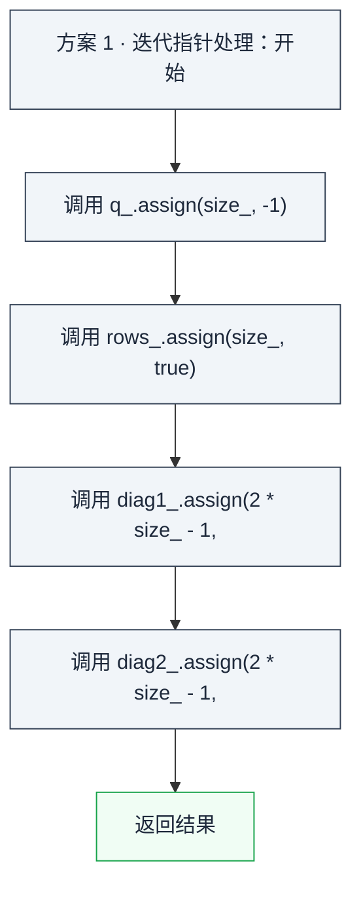

```cpp
// LeetCode 107579658. 转换视角，提炼共性 — C++ 版（抽象思维之转换视角：统一分书问题与八皇后的回溯框架）
// queen=false: 分书问题（5人，like 偏好矩阵）; queen=true: 八皇后
#include <iostream> // 引入头文件
#include <vector>   // 引入头文件

class Unified {                                                          // 定义类型
  public:                                                                // public:
    explicit Unified(bool queen) : queen_(queen), size_(queen ? 8 : 5) { // 定义函数/方法 Unified
        q_.assign(size_, -1);                                            // q_.assign(size_, 减 1);
        rows_.assign(size_, true);                                       // rows_.assign(size_, true);
        diag1_.assign(2 * size_ - 1, true); // diag1_.assign(2 乘 size_ 减 1, true);
        diag2_.assign(2 * size_ - 1, true); // diag2_.assign(2 乘 size_ 减 1, true);
    }

    std::vector<std::vector<int>> solve() { // std::vector 小于 std::vector 小于 int 超过 超过 solve() {
        place(0);                           // place(0);
        return results_;                    // 返回 results_
    }

  private: // private:
    static const std::vector<std::vector<int>>
        LIKE; // static const std::vector 小于 std::vector 小于 int 超过 超过 LIKE;

    bool is_valid(int row, int col) const { // bool is_valid(int row, int col) const {
        if (queen_)
            return true;            // 若 queen_，直接返回 true
        return LIKE[row][col] == 1; // 返回 LIKE[row][col] 等于 1
    }

    bool is_safe(int row, int col) const { // bool is_safe(int row, int col) const {
        if (queen_)
            return rows_[row] && diag1_[col - row + size_ - 1] && diag2_[col + row];
        return rows_[row]; // 返回 rows_[row]
    }

    void place(int col) {                     // 定义函数/方法 place
        if (col == static_cast<int>(size_)) { // 若 col 等于 static_cast 小于 int 超过 (size_
            results_.push_back(q_);           // results_ 追加 q_);
            return;                           // return;
        }
        for (int row = 0; row < static_cast<int>(size_);
             ++row) { // 让 row 从 0 开始计数，row 小于 static_cast 小于 int 超过 (size_) 就继续
            if (!is_valid(row, col))
                continue; // 若 取反 is_valid(row, col)) continue;
            if (!is_safe(row, col))
                continue;                              // 若 取反 is_safe(row, col)) continue;
            q_[col] = row;                             // 把 row; 写入 q_[col]
            rows_[row] = false;                        // 把 false; 写入 rows_[row]
            if (queen_) {                              // 若 queen_
                diag1_[col - row + size_ - 1] = false; // 把 false; 写入 diag1_[col - row + size_ - 1]
                diag2_[col + row] = false;             // 把 false; 写入 diag2_[col + row]
            }
            place(col + 1);                           // place(col 加 1);
            rows_[row] = true;                        // 把 true; 写入 rows_[row]
            if (queen_) {                             // 若 queen_
                diag1_[col - row + size_ - 1] = true; // 把 true; 写入 diag1_[col - row + size_ - 1]
                diag2_[col + row] = true;             // 把 true; 写入 diag2_[col + row]
            }
        }
    }

    bool queen_;                            // bool queen_;
    size_t size_;                           // size_t size_;
    std::vector<int> q_;                    // std::vector 小于 int 超过 q_;
    std::vector<bool> rows_;                // std::vector 小于 bool 超过 rows_;
    std::vector<bool> diag1_, diag2_;       // std::vector 小于 bool 超过 diag1_, diag2_;
    std::vector<std::vector<int>> results_; // std::vector 小于 std::vector 小于 int 超过 超过 results_;
};

const std::vector<std::vector<int>> Unified::LIKE = {
    // 把 { 写入 const std::vector<std::vector<int>> Unified::LIKE
    {0, 0, 1, 1, 0}, {1, 1, 0, 0, 1}, {0, 1, 1, 0, 1}, {0, 0, 0, 1, 0}, {0, 1, 0, 0, 1},
};

int main() { // 程序入口：跑内嵌自测用例
    std::vector<std::vector<int>> want = {{1, 2, 0, 3, 4}, {1, 4, 0, 3, 2}};
    Unified solver(false); // Unified solver(false);
    std::vector<std::vector<int>> got =
        solver.solve(); // 把 solver.solve(); 写入 std::vector<std::vector<int>> got
    if (got != want) {
        std::cout << "FAIL mismatch" << std::endl;
        return 1;
    }
    std::cout << "PASS" << std::endl; // 全部用例通过，输出 PASS
    return 0;                         // 返回 0
}
```

### R 实现（1 种方案）

R 的全部方案如下，每个方案都内嵌用例自测，可独立运行（老仓库 python/go 文件遵循「打印结果」约定）：

#### 方案 1：迭代指针处理

**思路与代码分析**：核心是「迭代指针处理」。R 版用向量化思维与 1 起始下标，注意 1:n 的降序陷阱。代码里依次做这些事：单循环线性扫描。**走读**：方案 1 · 迭代指针处理：开始 → 处理 SIZE ＜- if (queen) → 命中条件，直接返回 → 返回 (invisible(NULL)) → 循环 row：遍历 0:(SIZE - 1L)。

**运行架构**（真实控制流）：

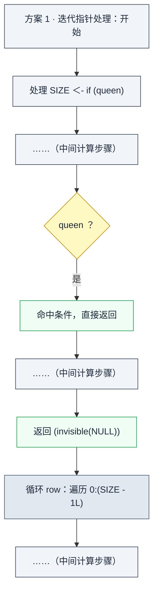

```r
# 转换视角，提炼共性 — R 版（抽象思维之转换视角：统一分书问题与八皇后的回溯框架） queen=FALSE:
# 分书问题（5人，like 偏好矩阵）; queen=TRUE: 八皇后
LIKE <- matrix(c(0, 0, 1, 1, 0, 1, 1, 0, 0, 1, 0, 1, 1, 0, 1, 0, 0, 0, 1, 0, 0, 1, 0, 0, 1  # 0, 1, 0, 0, 1
),
    nrow = 5, byrow = TRUE)  # 把 5, byrow 赋值为 TRUE) 写入 ), nrow
solve_unified <- function(queen) {
    # 定义函数 solve_unified（参数：queen）
    SIZE <- if (queen)
        8L else 5L  # 把 if (queen) 8L else 5L 存入 SIZE
    ctx <- new.env(parent = emptyenv())  # 把 new.env(parent 赋值为 emptyenv()) 存入 ctx
    ctx$Q <- rep(-1L, SIZE)  # 把 rep( 减 1L, SIZE) 存入 ctx$Q
    ctx$rows <- rep(TRUE, SIZE)  # 把 rep(TRUE, SIZE) 存入 ctx$rows
    ctx$diag1 <- rep(TRUE, 2L * SIZE - 1L)  # 把 rep(TRUE, 2L 乘 SIZE 减 1L) 存入 ctx$diag1
    ctx$diag2 <- rep(TRUE, 2L * SIZE - 1L)  # 把 rep(TRUE, 2L 乘 SIZE 减 1L) 存入 ctx$diag2
    results <- list()  # 把 列表() 存入 results
    is_valid <- function(row, col) {
        # 定义函数 is_valid（参数：row, col）
        if (queen)
            return(TRUE)  # 若 queen) return(TRUE
        LIKE[row + 1L, col + 1L] == 1  # 把 赋值为 1 写入 LIKE[row + 1L, col + 1L]
    }
    is_safe <- function(row, col) {
        # 定义函数 is_safe（参数：row, col） 若 queen
        if (queen) {
            ctx$rows[row + 1L] && ctx$diag1[col - row + SIZE] && ctx$diag2[col + row + 1L]
        } else {
            # 否则
            ctx$rows[row + 1L]  # ctx$行数[row 加 1L]
        }
    }
    place <- function(col) {
        # 定义函数 place（参数：col） 若 col 等于 SIZE
        if (col == SIZE) {
            results <<- c(results, list(ctx$Q))  # results 小于 小于 减 字符(results, 列表(ctx$Q))
            return(invisible(NULL))  # 返回 invisible(NULL
        }
        for (row in 0:(SIZE - 1L)) {
            # for (row in 0:(SIZE 减 1L)) {
            if (!is_valid(row, col))
                next  # 若 取反 is_valid(row, col)) 下一个
            if (!is_safe(row, col))
                next  # 若 取反 is_safe(row, col)) 下一个
            ctx$Q[col + 1L] <- row  # ctx$Q[col 加 1L] 小于 减 row
            ctx$rows[row + 1L] <- FALSE  # ctx$行数[row 加 1L] 小于 减 FALSE
            if (queen) {
                # 若 queen
                ctx$diag1[col - row + SIZE] <- FALSE  # ctx$diag1[col 减 row 加 SIZE] 小于 减 FALSE
                ctx$diag2[col + row + 1L] <- FALSE  # ctx$diag2[col 加 row 加 1L] 小于 减 FALSE
            }
            place(col + 1L)  # place(col 加 1L)
            ctx$rows[row + 1L] <- TRUE  # ctx$行数[row 加 1L] 小于 减 TRUE
            if (queen) {
                # 若 queen
                ctx$diag1[col - row + SIZE] <- TRUE  # ctx$diag1[col 减 row 加 SIZE] 小于 减 TRUE
                ctx$diag2[col + row + 1L] <- TRUE  # ctx$diag2[col 加 row 加 1L] 小于 减 TRUE
            }
        }
    }
    place(0L)  # place(0L)
    results  # results
}
want <- list(c(1L, 2L, 0L, 3L, 4L), c(1L, 4L, 0L, 3L, 2L))  # 把 列表(字符(1L, 2L, 0L, 3L, 4L), 字符(1L, 4L, 0L, 3L, 2L)) 存入 want
got <- solve_unified(FALSE)  # 把 solve_unified(FALSE) 存入 got
stopifnot(length(got) == 2L)  # 断言校验
for (i in 1:2) {
    # for (下标 i in 1:2) {
    stopifnot(identical(as.integer(got[[i]]), as.integer(want[[i]])))  # 断言校验
}
cat("PASS\n")  # 全部用例通过，输出 PASS
```

### Zig 实现（1 种方案）

Zig 的全部方案如下，每个方案都内嵌用例自测，可独立运行（老仓库 python/go 文件遵循「打印结果」约定）：

#### 方案 1：迭代指针处理

**思路与代码分析**：核心是「迭代指针处理」。Zig 版显式分配与清零，整型边界处理严格。**走读**：方案 1 · 迭代指针处理：开始 → 计算 size → 计算 ctx → 更新 .queen → 更新 .size → 更新 .q → 更新 .rows → 更新 .diag1 → 更新 .diag2 → 调用 ctx.place(0) → 返回 ctx。

**运行架构**（真实控制流）：

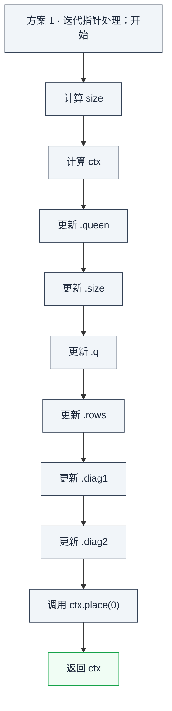

```zig
// LeetCode 107579658. 转换视角，提炼共性 — Zig 版（抽象思维之转换视角：统一分书问题与八皇后的回溯框架）
// queen=false: 分书问题（5人，like 偏好矩阵）; queen=true: 八皇后
const std = @import("std"); // 把 @import(「std」) 存入 std

const LIKE = [5][5]i32{ // 把 [5][5]i32{ 存入 LIKE
    .{ 0, 0, 1, 1, 0 },
    .{ 1, 1, 0, 0, 1 },
    .{ 0, 1, 1, 0, 1 },
    .{ 0, 0, 0, 1, 0 },
    .{ 0, 1, 0, 0, 1 },
};

const Ctx = struct { // 把 struct { 存入 Ctx
    queen: bool,
    size: usize,
    q: [8]i32,
    rows: [8]bool,
    diag1: [16]bool,
    diag2: [16]bool,
    results: [64][8]i32 = undefined,
    result_count: usize = 0,

    fn isValid(self: *const Ctx, row: usize, col: usize) bool { // 定义判定函数 isValid
        if (self.queen) return true; // 若 self.queen，直接返回 true
        return LIKE[row][col] == 1; // 返回 LIKE[row][col] 等于 1
    }

    fn isSafe(self: *const Ctx, row: usize, col: usize) bool { // 定义判定函数 isSafe
        if (self.queen) { // 若 self.queen
            return self.rows[row] and self.diag1[col + self.size - 1 - row] and self.diag2[col + row];
        }
        return self.rows[row]; // 返回 self.行数[row]
    }

    fn place(self: *Ctx, col: usize) void { // 定义函数/方法 place
        if (col == self.size) { // 若 col 等于 self.大小
            self.results[self.result_count] = self.q; // 把 self.节点; 写入 self.results[self.result_count]
            self.result_count += 1; // self.result_count累加 1
            return; // return;
        }
        var row: usize = 0; // 把 0; 写入 var row: usize
        while (row < self.size) : (row += 1) { // 循环，直到不满足「row 小于 self.大小) : (row 累加 1」
            if (!self.isValid(row, col)) continue; // 若 取反 self.isValid(row, col)) continue;
            if (!self.isSafe(row, col)) continue; // 若 取反 self.isSafe(row, col)) continue;
            self.q[col] = @intCast(row); // 把 @intCast(row); 写入 self.q[col]
            self.rows[row] = false; // 把 false; 写入 self.rows[row]
            if (self.queen) { // 若 self.queen
                self.diag1[col + self.size - 1 - row] = false; // 把 false; 写入 self.diag1[col + self.size - 1 - row]
                self.diag2[col + row] = false; // 把 false; 写入 self.diag2[col + row]
            }
            self.place(col + 1); // self.place(col 加 1);
            self.rows[row] = true; // 把 true; 写入 self.rows[row]
            if (self.queen) { // 若 self.queen
                self.diag1[col + self.size - 1 - row] = true; // 把 true; 写入 self.diag1[col + self.size - 1 - row]
                self.diag2[col + row] = true; // 把 true; 写入 self.diag2[col + row]
            }
        }
    }
};

fn solveUnified(queen: bool) Ctx { // 定义函数/方法 solveUnified
    const size: usize = if (queen) 8 else 5; // 把 if (queen) 8 else 5; 写入 const size: usize
    var ctx = Ctx{ // 把 Ctx{ 存入 ctx
        .queen = queen,
        .size = size,
        .q = [_]i32{-1} ** 8,
        .rows = [_]bool{true} ** 8,
        .diag1 = [_]bool{true} ** 16,
        .diag2 = [_]bool{true} ** 16,
    };
    ctx.place(0); // ctx.place(0);
    return ctx; // 返回 ctx
}

pub fn main() !void { // 程序入口：跑内嵌自测用例
    const want = [2][5]i32{ .{ 1, 2, 0, 3, 4 }, .{ 1, 4, 0, 3, 2 } };
    const ctx = solveUnified(false); // 把 solveUnified(false) 存入 ctx
    if (ctx.result_count != 2) { // 若 ctx.result_count 不等于 2
        std.debug.print("FAIL count {d}\n", .{ctx.result_count}); // 打印输出
        return error.TestFailed; // 返回 error.TestFailed
    }
    for (want, 0..) |w, i| { // for (want, 0..) 按位或 权重, 下标 i 按位或 {
        for (w, 0..) |x, j| { // for (权重, 0..) 按位或 x, 下标 j 按位或 {
            if (ctx.results[i][j] != x) { // 若 ctx.results[下标 i][下标 j] 不等于 x
                std.debug.print("FAIL results[{d}][{d}]\n", .{ i, j }); // 打印输出
                return error.TestFailed; // 返回 error.TestFailed
            }
        }
    }
    std.debug.print("PASS\n", .{}); // 全部用例通过，输出 PASS
}
```

### Dart 实现（1 种方案）

Dart 的全部方案如下，每个方案都内嵌用例自测，可独立运行（老仓库 python/go 文件遵循「打印结果」约定）：

#### 方案 1：迭代指针处理

**思路与代码分析**：核心是「迭代指针处理」。Dart 版用可空类型标注与集合方法，注意空安全。代码里依次做这些事：单循环线性扫描。**走读**：方案 1 · 迭代指针处理：开始 → 更新 size → 命中条件，直接返回 → 返回 LIKE[row][col] == 1 → 命中条件，直接返回 → 返回 rows[row] → 返回  → 遍历循环 → 返回 results。

**运行架构**（真实控制流）：

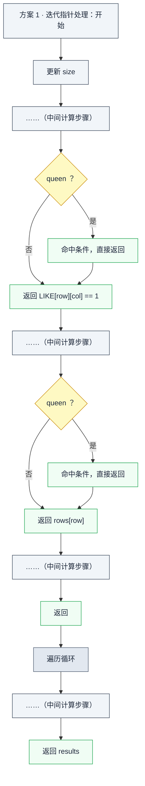

```dart
// LeetCode 107579658. 转换视角，提炼共性 — Dart 版（抽象思维之转换视角：统一分书问题与八皇后的回溯框架）
// queen=false: 分书问题（5人，like 偏好矩阵）; queen=true: 八皇后
const LIKE = [
  [0, 0, 1, 1, 0],
  [1, 1, 0, 0, 1],
  [0, 1, 1, 0, 1],
  [0, 0, 0, 1, 0],
  [0, 1, 0, 0, 1],
];

List<List<int>> solveUnified(bool queen) {
  // 定义函数/方法 solveUnified
  final size = queen ? 8 : 5; // 把 queen ? 8 : 5 存入 大小
  final q = List<int>.filled(
    size,
    -1,
  ); // 把 List 小于 int 超过 .filled(大小, 减 1) 存入 节点
  final rows = List<bool>.filled(
    size,
    true,
  ); // 把 List 小于 bool 超过 .filled(大小, true) 存入 行数
  final diag1 = List<bool>.filled(
    2 * size - 1,
    true,
  ); // 把 List 小于 bool 超过 .filled(2 乘 大小 减 1, true) 存入 diag1
  final diag2 = List<bool>.filled(
    2 * size - 1,
    true,
  ); // 把 List 小于 bool 超过 .filled(2 乘 大小 减 1, true) 存入 diag2
  final results = <List<int>>[]; // 把 小于 List 小于 int 超过 超过 [] 存入 results

  bool isValid(int row, int col) {
    // 定义判定函数 isValid
    if (queen) return true; // 若 queen，直接返回 true
    return LIKE[row][col] == 1; // 返回 LIKE[row][col] 等于 1
  }

  bool isSafe(int row, int col) {
    // 定义判定函数 isSafe
    if (queen)
      return rows[row] && diag1[col + size - 1 - row] && diag2[col + row];
    return rows[row]; // 返回 行数[row]
  }

  void place(int col) {
    // 定义函数/方法 place
    if (col == size) {
      // 若 col 等于 大小
      results.add(List<int>.from(q)); // results 追加 List 小于 int 超过 .from(节点));
      return; // return;
    }
    for (var row = 0; row < size; row++) {
      // 让 row 从 0 开始计数，row 小于 大小 就继续
      if (!isValid(row, col)) continue; // 若 取反 isValid(row, col)) continue;
      if (!isSafe(row, col)) continue; // 若 取反 isSafe(row, col)) continue;
      q[col] = row; // 把 row; 写入 q[col]
      rows[row] = false; // 把 false; 写入 rows[row]
      if (queen) {
        // 若 queen
        diag1[col + size - 1 - row] =
            false; // 把 false; 写入 diag1[col + size - 1 - row]
        diag2[col + row] = false; // 把 false; 写入 diag2[col + row]
      }
      place(col + 1); // place(col 加 1);
      rows[row] = true; // 把 true; 写入 rows[row]
      if (queen) {
        // 若 queen
        diag1[col + size - 1 - row] =
            true; // 把 true; 写入 diag1[col + size - 1 - row]
        diag2[col + row] = true; // 把 true; 写入 diag2[col + row]
      }
    }
  }

  place(0); // place(0);
  return results; // 返回 results
}

void main() {
  // 程序入口：跑内嵌自测用例
  final want = <List<int>>[
    [1, 2, 0, 3, 4],
    [1, 4, 0, 3, 2],
  ];
  final got = solveUnified(false); // 把 solveUnified(false) 存入 got
  if (got.toString() != want.toString()) {
    // 若 got.toString() 不等于 want.toString(
    throw StateError('solveUnified(false) mismatch: ' + got.toString());
  }
  print('PASS'); // 全部用例通过，输出 PASS
}
```

---

## 内容总结

- **抽象思维之转换视角 提炼共性**（算法笔记 · Medium）：共 1 个方案，主线思路「迭代指针处理」；时间 O(n)（单趟线性扫描）；动画演示归并分治过程，附录给出 11 种语言 × 全部方案的可运行实现。
- 来源博客：[https://blog.csdn.net/tyro_java/article/details/107579658](https://blog.csdn.net/tyro_java/article/details/107579658)
- 导航：[📋 总目录](../) ｜ [← 206 抽象思维之对比算法 发现共性](../206_抽象思维之对比算法_发现共性/) ｜ [208 抽象思维之代码重构 隔离变化 →](../208_抽象思维之代码重构_隔离变化/)
