# 208 · 抽象思维之代码重构 隔离变化（第附阶段 · 专题补充 · Medium）

> **难度**：⭐⭐ Medium ｜ **专题**：算法笔记
> **学习定位**：第附阶段 · 专题补充第 208 篇 ｜ **解法数**：13
> **内容总结**：**抽象思维之代码重构 隔离变化**（算法笔记 · Medium）：共 13 个方案，主线思路「直接实现」；时间 O(n) 量级；动画演示归并分治过程，附录给出 11 种语言 × 全部方案的可运行实现。

---

## 题目描述

抽象思维之代码重构 隔离变化。具体输入输出约定见函数签名与用例。

- 主函数签名：`function assertEq(actual: any, expected: any, msg: string = ''): void`

**数据范围与注意事项**：

- **易错点**：先看小例子手推一遍再对照代码，比直接读代码快得多。

## 题目分析

**场景是什么**：综合练习：把数据结构与策略组合起来解决一个完整问题。本题就是该场景的 Medium 级练习，主线做法是「直接实现」。

**主线怎么解**：主解法结构简单：读入、处理、返回。

## 解题思路

**方案对比**（共 13 个方案，由浅入深）：

| 方案 | 时间复杂度 | 空间复杂度 |
|---|---|---|
| 方案 1 · 直接实现 | O(n) 量级 | O(n) |
| 方案 2 · 直接实现 | O(n) 量级 | O(n) |
| 方案 3 · 直接实现 | O(n) 量级 | O(n) |
| 方案 4 · 迭代指针处理 | O(n)（单趟线性扫描） | O(1) 到 O(n)（视辅助结构） |
| 方案 5 · 迭代指针处理 | O(n)（单趟线性扫描） | O(1) 到 O(n)（视辅助结构） |
| 方案 6 · 迭代指针处理 | O(n)（单趟线性扫描） | O(1) 到 O(n)（视辅助结构） |
| 方案 7 · 迭代指针处理 | O(n)（单趟线性扫描） | O(1) 到 O(n)（视辅助结构） |
| 方案 8 · 方案8（Filler 迭代器式旋转填充） | O(n)（单趟线性扫描） | O(1) 到 O(n)（视辅助结构） |
| 方案 9 · 直接实现 | O(n) 量级 | O(n) |
| 方案 10 · 直接实现 | O(n) 量级 | O(n) |
| 方案 11 · 迭代指针处理 | O(n)（单趟线性扫描） | O(1) 到 O(n)（视辅助结构） |
| 方案 12 · 直接实现 | O(n) 量级 | O(n) |
| 方案 13 · 直接实现 | O(n) 量级 | O(n) |

**由浅入深的路径**：直接实现 → 迭代指针处理 → 方案8（Filler 迭代器式旋转填充）；每往右一步，都在补上一步的短板。

**方案间的取舍**：方案 1（直接实现）；方案 2（直接实现）；方案 3（直接实现）；方案 4（迭代指针处理）；方案 5（迭代指针处理）；方案 6（迭代指针处理）；方案 7（迭代指针处理）；方案 8（方案8（Filler 迭代器式旋转填充））；方案 9（直接实现）；方案 10（直接实现）；方案 11（迭代指针处理）；方案 12（直接实现）；方案 13（直接实现）。数据规模小、可读性优先时选靠前的方案；规模大、性能优先时选靠后的方案。

**怎么读这一篇**：

- 🐣 **新手路线**：把「题目描述」的示例 1 在纸上手推一遍 → 读方案 1（最直观的写法）与它的代码走读 → 按「运行方式」本地跑通看 PASS → 回头对比方案 2 之后的写法差在哪
- 🦅 **大佬路线**：直接锁定最优方案 1（直接实现，O(n) 量级）→ 跳读该方案代码与走读 → 用「逐步拆解与面试追问」补齐复杂度推导与边界追问

### 动态算法图（归并分治，GIF 自动循环）


动画演示算法笔记专题里归并分治的典型过程；每个方案在「TypeScript 解题方案」一节还配了专属动画与专属流程图。

### 主解法流程图（真实控制流）

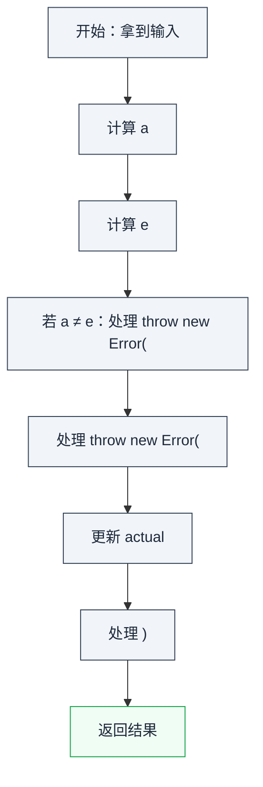

## TypeScript 解题方案（13 个方案逐个讲）

> **运行与提交**：每个方案都是自包含文件（内嵌用例自测，输出 PASS），整块复制到 `.ts` 文件后 `node 文件名` 即可运行。提交 LeetCode 时，把 `demo` 内的算法函数与辅助类型/函数整体取出、置于文件顶层即可。概念演示（非 LeetCode 编号题），在本地运行即可。

### 方案 1：直接实现

**分析与思路**：核心做法是「直接实现」。

**运行方式**：`node 本文件`，内嵌用例全部通过会输出 PASS。


**方案专属流程图**（真实控制流）：


```typescript
function assertEq(actual: any, expected: any, msg: string = ''): void {
  // 定义函数/方法 assertEq
  const a = JSON.stringify(actual);
  const e = JSON.stringify(expected);
  if (a !== e)
    throw new Error(
      'ASSERT FAILED ' + msg + ' :: actual=' + a + ' expected=' + e,
    );
}

class Matrix {
  // 定义类型
  N: number;
  M: number[][]; // N: number; M: number[][];
  constructor(size: number) {
    this.N = size;
    this.M = Array.from({ length: size }, () => new Array(size).fill(0));
  }
  fill(num: number, begin: number, size: number): void {
    // fill(num: number, begin: number, 大小: number): void {
    if (size === 0) return; // 若 大小 全等于 0) return;
    if (size === 1) {
      this.M[begin][begin] = num;
      return;
    } // 若 大小 全等于 1) { this.M[begin][begin] 赋值为 num; return; }
    for (let j = 0; j < size - 1; j++) {
      this.M[begin + j][begin] = num;
      num++;
    } // 让 下标 j 从 0 开始计数，下标 j 小于 大小 减 1 就继续
    for (let j = 0; j < size - 1; j++) {
      this.M[begin + size - 1][begin + j] = num;
      num++;
    } // 让 下标 j 从 0 开始计数，下标 j 小于 大小 减 1 就继续
    for (let j = size - 1; j > 0; j--) {
      this.M[begin + j][begin + size - 1] = num;
      num++;
    } // 让 下标 j 从 大小 减 1 开始计数，下标 j 超过 0 就继续
    for (let j = size - 1; j > 0; j--) {
      this.M[begin][begin + j] = num;
      num++;
    } // 让 下标 j 从 大小 减 1 开始计数，下标 j 超过 0 就继续
    this.fill(num, begin + 1, size - 2); // this.fill(num, begin 加 1, 大小 减 2);
  }
}
function fmtRow(row: number[]): string {
  return row.map((x) => x.toString().padStart(2, ' ')).join(' ');
} // 定义函数/方法 fmtRow
export function demo(): void {
  // 程序入口：跑内嵌自测用例
  const m = new Matrix(6);
  m.fill(1, 0, 6); // 把 new Matrix(6); 映射表.fill(1, 0, 6) 存入 映射表
  assertEq(
    m.M.map(fmtRow),
    [
      ' 1 20 19 18 17 16',
      ' 2 21 32 31 30 15',
      ' 3 22 33 36 29 14',
      ' 4 23 34 35 28 13',
      ' 5 24 25 26 27 12',
      ' 6  7  8  9 10 11',
    ],
    'spiral6',
  ); // 断言校验
  console.log('PASS'); // 全部用例通过，输出 PASS
}
demo(); // demo();
```

### 方案 2：直接实现

**分析与思路**：核心做法是「直接实现」。

**运行方式**：`node 本文件`，内嵌用例全部通过会输出 PASS。


**方案专属流程图**（真实控制流）：


```typescript
function assertEq(actual: any, expected: any, msg: string = ''): void {
  // 定义函数/方法 assertEq
  const a = JSON.stringify(actual);
  const e = JSON.stringify(expected);
  if (a !== e)
    throw new Error(
      'ASSERT FAILED ' + msg + ' :: actual=' + a + ' expected=' + e,
    );
}

class Matrix {
  // 定义类型
  N: number;
  M: number[][]; // N: number; M: number[][];
  constructor(size: number) {
    this.N = size;
    this.M = Array.from({ length: size }, () => new Array(size).fill(0));
  }
  fill(num: number, begin: number, size: number): void {
    // fill(num: number, begin: number, 大小: number): void {
    if (size === 0) return; // 若 大小 全等于 0) return;
    if (size === 1) {
      this.M[begin][begin] = num;
      return;
    } // 若 大小 全等于 1) { this.M[begin][begin] 赋值为 num; return; }
    for (let j = 0; j < size - 1; j++) {
      this.M[begin + j][begin] = num;
      num++;
    } // 让 下标 j 从 0 开始计数，下标 j 小于 大小 减 1 就继续
    for (let j = 0; j < size - 1; j++) {
      this.M[begin + size - 1][begin + j] = num;
      num++;
    } // 让 下标 j 从 0 开始计数，下标 j 小于 大小 减 1 就继续
    for (let j = size - 1; j > 0; j--) {
      this.M[begin + j][begin + size - 1] = num;
      num++;
    } // 让 下标 j 从 大小 减 1 开始计数，下标 j 超过 0 就继续
    for (let j = size - 1; j > 0; j--) {
      this.M[begin][begin + j] = num;
      num++;
    } // 让 下标 j 从 大小 减 1 开始计数，下标 j 超过 0 就继续
    this.fill(num, begin + 1, size - 2); // this.fill(num, begin 加 1, 大小 减 2);
  }
}
function fmtRow(row: number[]): string {
  return row.map((x) => x.toString().padStart(2, ' ')).join(' ');
} // 定义函数/方法 fmtRow
export function demo(): void {
  // 程序入口：跑内嵌自测用例
  const m = new Matrix(6);
  m.fill(1, 0, 6); // 把 new Matrix(6); 映射表.fill(1, 0, 6) 存入 映射表
  assertEq(
    m.M.map(fmtRow),
    [
      ' 1 20 19 18 17 16',
      ' 2 21 32 31 30 15',
      ' 3 22 33 36 29 14',
      ' 4 23 34 35 28 13',
      ' 5 24 25 26 27 12',
      ' 6  7  8  9 10 11',
    ],
    'spiral6',
  ); // 断言校验
  console.log('PASS'); // 全部用例通过，输出 PASS
}
demo(); // demo();
```

### 方案 3：直接实现

**分析与思路**：核心做法是「直接实现」。

**运行方式**：`node 本文件`，内嵌用例全部通过会输出 PASS。


**方案专属流程图**（真实控制流）：

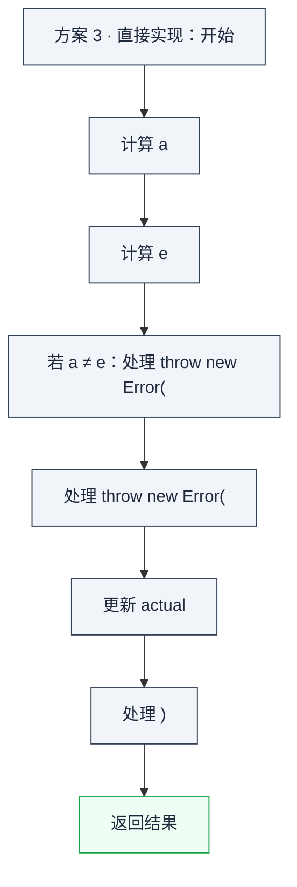

```typescript
function assertEq(actual: any, expected: any, msg: string = ''): void {
  // 定义函数/方法 assertEq
  const a = JSON.stringify(actual);
  const e = JSON.stringify(expected);
  if (a !== e)
    throw new Error(
      'ASSERT FAILED ' + msg + ' :: actual=' + a + ' expected=' + e,
    );
}

class Matrix {
  // 定义类型
  N: number; // N: number;
  M: number[][]; // M: number[][];
  constructor(size: number) {
    // constructor(大小: number) {
    this.N = size; // 把 大小; 写入 this.N
    this.M = Array.from({ length: size }, () => new Array(size).fill(0));
  }
  fill(num: number, begin: number, size: number): void {
    // fill(num: number, begin: number, 大小: number): void {
    if (size === 0) return; // 若 大小 全等于 0) return;
    if (size === 1) {
      this.M[begin][begin] = num;
      return;
    } // 若 大小 全等于 1) { this.M[begin][begin] 赋值为 num; return; }
    for (let j = 0; j < size - 1; j++) {
      this.M[begin + j][begin] = num;
      num++;
    } // 让 下标 j 从 0 开始计数，下标 j 小于 大小 减 1 就继续
    for (let j = 0; j < size - 1; j++) {
      this.M[begin + size - 1][begin + j] = num;
      num++;
    } // 让 下标 j 从 0 开始计数，下标 j 小于 大小 减 1 就继续
    for (let j = size - 1; j > 0; j--) {
      this.M[begin + j][begin + size - 1] = num;
      num++;
    } // 让 下标 j 从 大小 减 1 开始计数，下标 j 超过 0 就继续
    for (let j = size - 1; j > 0; j--) {
      this.M[begin][begin + j] = num;
      num++;
    } // 让 下标 j 从 大小 减 1 开始计数，下标 j 超过 0 就继续
    this.fill(num, begin + 1, size - 2); // this.fill(num, begin 加 1, 大小 减 2);
  }
}
function fmtRow(row: number[]): string {
  // 定义函数/方法 fmtRow
  return row.map((x) => x.toString().padStart(2, ' ')).join(' ');
}
export function demo(): void {
  // 程序入口：跑内嵌自测用例
  const m = new Matrix(6); // 把 new Matrix(6) 存入 映射表
  m.fill(1, 0, 6); // 映射表.fill(1, 0, 6);
  const rows = m.M.map(fmtRow); // 把 映射表.M.映射表(fmtRow) 存入 行数
  assertEq(
    rows,
    [
      ' 1 20 19 18 17 16',
      ' 2 21 32 31 30 15',
      ' 3 22 33 36 29 14',
      ' 4 23 34 35 28 13',
      ' 5 24 25 26 27 12',
      ' 6  7  8  9 10 11',
    ],
    'matrix6',
  ); // 断言校验
  console.log('PASS'); // 全部用例通过，输出 PASS
}
demo(); // demo();
```

### 方案 4：迭代指针处理

**分析与思路**：核心做法是「迭代指针处理」。代码里依次做这些事：队列或堆的调度。

**运行方式**：`node 本文件`，内嵌用例全部通过会输出 PASS。


**方案专属流程图**（真实控制流）：


```typescript
class TreeNode {
  // 定义类型
  val: any;
  left: any;
  right: any; // 值: any; 左边界: any; 右边界: any;
  constructor(val?: any, left?: any, right?: any) {
    // constructor(值?: any, 左边界?: any, 右边界?: any) {
    this.val = val === undefined ? 0 : val; // 把 (值 全等于 undefined ? 0 : 值); 写入 值
    this.left = left === undefined ? null : left; // 把 (左边界 全等于 undefined ? null : 左边界); 写入 左边界
    this.right = right === undefined ? null : right; // 把 (右边界 全等于 undefined ? null : 右边界); 写入 右边界
  }
}
function buildTree(vals: any): any {
  // 定义函数/方法 buildTree
  if (!vals || vals.length === 0) return null; // 若 取反 vals 或 vals.长度 全等于 0，直接返回 null
  const root = new TreeNode(vals[0]);
  const q: any[] = [root];
  let i = 1;
  while (q.length && i < vals.length) {
    // 循环，直到不满足「节点.长度 且 下标 i 小于 vals.长度」
    const node = q.shift(); // 把 节点.shift() 存入 节点
    if (vals[i] !== null && vals[i] !== undefined) {
      node.left = new TreeNode(vals[i]);
      q.push(node.left);
    }
    i++; // 下标 i 加一
    if (i < vals.length && vals[i] !== null && vals[i] !== undefined) {
      node.right = new TreeNode(vals[i]);
      q.push(node.right);
    }
    i++; // 下标 i 加一
  }
  return root; // 返回 根节点
}
function treeToLevel(root: any): any[] {
  // 定义函数/方法 treeToLevel
  if (!root) return []; // 若 取反 根节点，直接返回 []
  const out: any[] = [];
  const q: any[] = [root]; // 把 []; const 节点: any[] 赋值为 [根节点]; 写入 const out: any[]
  while (q.length) {
    // 循环，直到不满足「节点.长度」
    const n = q.shift(); // 把 节点.shift() 存入 元素个数
    if (n === null || n === undefined) {
      out.push(null);
      continue;
    }
    out.push(n.val);
    q.push(n.left);
    q.push(n.right); // 把 元素个数.值 压入栈/数组尾部
  }
  while (out.length && out[out.length - 1] === null) out.pop(); // 循环，直到不满足「out.长度 且 out[out.长度 减 1] 全等于 null) out 弹出 );」
  return out; // 返回 out
}
class ListNode {
  // 定义类型
  val: any;
  next: any; // 值: any; 下一个: any;
  constructor(val?: any, next?: any) {
    this.val = val === undefined ? 0 : val;
    this.next = next === undefined ? null : next;
  }
}
function buildList(vals: any): any {
  // 定义函数/方法 buildList
  const dummy = new ListNode(0);
  let cur = dummy; // 把 new ListNode(0); let 当前值 赋值为 哨兵节点 存入 哨兵节点
  for (const v of vals) {
    cur.next = new ListNode(v);
    cur = cur.next;
  } // 把 new ListNode(值); 当前值 赋值为 当前值.下一个; } 写入 下一个
  return dummy.next; // 返回 哨兵节点.下一个
}
function listToArray(head: any): any[] {
  // 定义函数/方法 listToArray
  const out: any[] = [];
  let p = head; // 把 []; let 节点 赋值为 头节点; 写入 const out: any[]
  while (p) {
    out.push(p.val);
    p = p.next;
  } // 循环，直到不满足「节点) { out 追加 节点.值); 节点 赋值为 节点.下一个; }」
  return out; // 返回 out
}
// python-runtime shims
function pyLen(a: any): number {
  // 定义函数/方法 pyLen
  if (a === null || a === undefined) return 0; // 若 数组 全等于 null 或 数组 全等于 undefined，直接返回 0
  if (
    typeof a === 'string' ||
    Array.isArray(a) ||
    a instanceof Set ||
    a instanceof Map
  )
    return a.length ?? a.size;
  if (typeof a === 'object') return Object.keys(a).length; // 若 typeof 数组 全等于 'object'，直接返回 Object.keys(数组).长度
  return 0; // 返回 0
}
function pySlice(a: any, i: any, j: any, step?: any): any {
  // 定义函数/方法 pySlice
  if (typeof a === 'string') {
    const r = [...a].slice(i ?? 0, j ?? a.length);
    return step ? r.reverse().join('') : r.join('');
  }
  const arr = Array.isArray(a) ? a : [...a]; // 把 Array.isArray(数组) ? 数组 : 复制的 数组 存入 数组
  return arr.slice(i ?? 0, j ?? arr.length); // 返回 数组 截取 下标 i ?? 0, 下标 j ?? 数组.长度)
}
function pyRange(a: any, b?: any, step?: any): any[] {
  // 定义函数/方法 pyRange
  let s = 0,
    e = a,
    st = 1; // 把 0, e 赋值为 数组, st 赋值为 1 存入 字符串
  if (b !== undefined) {
    s = a;
    e = b;
  } // 若 b 不等于 undefined) { 字符串 赋值为 数组; e 赋值为 b; }
  if (step !== undefined) st = step; // 若 步数 不等于 undefined) st 赋值为 步数;
  const out: any[] = []; // 把 []; 写入 const out: any[]
  if (st > 0) for (let i = s; i < e; i += st) out.push(i);
  else for (let i = s; i > e; i += st) out.push(i); // 否则
  return out; // 返回 out
}
function pyIn(x: any, coll: any): boolean {
  // 定义函数/方法 pyIn
  if (coll === null || coll === undefined) return false; // 若 coll 全等于 null 或 coll 全等于 undefined，直接返回 false
  if (Array.isArray(coll)) return coll.includes(x); // 若 Array.isArray(coll)，直接返回 coll 是否包含 x)
  if (coll instanceof Set || coll instanceof Map) return coll.has(x); // 若 coll instanceof Set 或 coll instanceof Map，直接返回 coll.has(x)
  if (typeof coll === 'object') return x in coll; // 若 typeof coll 全等于 'object'，直接返回 x in coll
  if (typeof coll === 'string') return coll.indexOf(x) >= 0; // 若 typeof coll 全等于 'string'，直接返回 coll 查找 x) 不低于 0
  return false; // 返回 false
}
function pySorted(a: any): any[] {
  // 定义函数/方法 pySorted
  const arr = typeof a === 'string' ? [...a] : [...a]; // 把 (typeof 数组 全等于 'string') ? 复制的 数组 : 复制的 数组 存入 数组
  return arr.sort((x: any, y: any) => (x < y ? -1 : x > y ? 1 : 0));
}
function pyMin(a: any, b?: any): any {
  if (b !== undefined) return Math.min(a, b);
  if (Array.isArray(a) || a instanceof Set) return Math.min(...a);
  return Math.min(a);
} // 定义函数/方法 pyMin
function pyMax(a: any, b?: any): any {
  if (b !== undefined) return Math.max(a, b);
  if (Array.isArray(a) || a instanceof Set) return Math.max(...a);
  return Math.max(a);
} // 定义函数/方法 pyMax
function pySum(a: any): number {
  let s = 0;
  for (const v of a) s += v;
  return s;
} // 定义函数/方法 pySum
function pyAbs(x: any): number {
  return Math.abs(x);
} // 定义函数/方法 pyAbs
function pyEnumerate(a: any): any[] {
  const out: any[] = [];
  let i = 0;
  for (const v of a) {
    out.push([i, v]);
    i++;
  }
  return out;
} // 定义函数/方法 pyEnumerate
function pyZip(a: any, b: any): any[] {
  const n = Math.min(a.length, b.length);
  const out: any[] = [];
  for (let i = 0; i < n; i++) out.push([a[i], b[i]]);
  return out;
} // 定义函数/方法 pyZip
function pyDictGet(d: any, k: any, def?: any): any {
  return k in d ? d[k] : def === undefined ? null : def;
} // 定义函数/方法 pyDictGet
function pyPrint(...args: any[]): void {
  console.log(
    args
      .map((a) => (typeof a === 'object' && a !== null ? JSON.stringify(a) : a))
      .join(' '),
  );
} // 定义函数/方法 pyPrint
// collections / heapq
function heapPush(h: any[], x: any): void {
  h.push(x);
  let i = h.length - 1;
  while (i > 0) {
    const p = (i - 1) >> 1;
    if (h[p] <= h[i]) break;
    [h[p], h[i]] = [h[i], h[p]];
    i = p;
  }
} // 定义函数/方法 heapPush
function heapPop(h: any[]): any {
  const top = h[0];
  const last = h.pop();
  if (h.length) {
    h[0] = last;
    let i = 0;
    const n = h.length;
    while (true) {
      let l = 2 * i + 1,
        r = 2 * i + 2,
        s = i;
      if (l < n && h[l] < h[s]) s = l;
      if (r < n && h[r] < h[s]) s = r;
      if (s === i) break;
      [h[s], h[i]] = [h[i], h[s]];
      i = s;
    }
  }
  return top;
} // 定义函数/方法 heapPop
class Deque {
  private a: any[] = [];
  push(x: any) {
    this.a.push(x);
  }
  pushLeft(x: any) {
    this.a.unshift(x);
  }
  pop() {
    return this.a.pop();
  }
  popLeft() {
    return this.a.shift();
  }
  get length() {
    return this.a.length;
  }
  toArray() {
    return this.a.slice();
  }
} // 定义类型
function Counter(iter: any): any {
  const m: any = {};
  for (const v of iter) m[v] = (m[v] || 0) + 1;
  return m;
} // 定义函数/方法 Counter
function gcd(a: any, b: any): any {
  while (b) {
    [a, b] = [b, a % b];
  }
  return a;
} // 定义函数/方法 gcd
function pyInf(): number {
  return Infinity;
} // 定义函数/方法 pyInf

function norm(x: any): any {
  // 定义函数/方法 norm
  if (x === null || x === undefined) return null; // 若 x 全等于 null 或 x 全等于 undefined，直接返回 null
  if (typeof x === 'object') {
    // 若 typeof x 全等于 'object'
    if (x instanceof Deque) return x.toArray(); // 若 x instanceof Deque，直接返回 x.toArray()
    if (Array.isArray(x)) return x.map(norm); // 若 Array.isArray(x)，直接返回 x.映射表(norm)
    if (
      typeof x.val === 'number' &&
      (typeof x.left !== 'undefined' || typeof x.right !== 'undefined')
    )
      return treeToLevel(x);
    if (typeof x.next !== 'undefined' && typeof x.val === 'number')
      return listToArray(x);
    if (x instanceof Set) return [...x].sort(); // 若 x instanceof Set，直接返回 复制的 x 排序 )
    if (x instanceof Map) return Object.fromEntries(x); // 若 x instanceof Map，直接返回 Object.fromEntries(x)
    const o: any = {};
    for (const k of Object.keys(x)) o[k] = norm(x[k]);
    return o;
  }
  return x; // 返回 x
}
function eq(a: any, b: any): boolean {
  // 定义函数/方法 eq
  const x = norm(a),
    y = norm(b); // 把 norm(数组), y 赋值为 norm(b) 存入 x
  if (x === y) return true; // 若 x 全等于 y，直接返回 true
  if (x === null || y === null) return x === y; // 若 x 全等于 null 或 y 全等于 null，直接返回 x 全等于 y
  if (Array.isArray(x) && Array.isArray(y)) {
    // 若 Array.isArray(x) 且 Array.isArray(y
    if (x.length !== y.length) return false; // 若 x.长度 不等于 y.长度，直接返回 false
    for (let i = 0; i < x.length; i++) if (!eq(x[i], y[i])) return false; // 让 下标 i 从 0 开始计数，下标 i 小于 x.长度 就继续
    return true; // 返回 true
  }
  if (typeof x === 'object' && typeof y === 'object') {
    // 若 typeof x 全等于 'object' 且 typeof y 全等于 'object'
    const kx = Object.keys(x),
      ky = Object.keys(y); // 把 Object.keys(x), ky 赋值为 Object.keys(y) 存入 kx
    if (kx.length !== ky.length) return false; // 若 kx.长度 不等于 ky.长度，直接返回 false
    for (const k of kx) if (!eq(x[k], y[k])) return false;
    return true; // 返回 true
  }
  return x === y; // 返回 x 全等于 y
}

function placeFill(n) {
  // 定义函数/方法 placeFill
  const m = Array.from({ length: n }, () => new Array(n).fill(0));
  let row = 0,
    col = 0,
    direction = 'D',
    num = 1;
  const total = n * n;
  while (num <= total) {
    // 循环，直到不满足「num 不超过 总和」
    m[row][col] = num;
    num++; // 把 num; num 加一 ; 写入 m[row][col]
    if (direction === 'D') {
      // 若 direction 全等于 'D'
      if (row + 1 < n && m[row + 1][col] === 0)
        row++; // 若 row 加 1 小于 元素个数 且 映射表[row 加 1][col] 全等于 0) row 加一 ;
      else {
        direction = 'R';
        col++;
      } // 否则
    } else if (direction === 'R') {
      // 否则，若 direction 全等于 'R'
      if (col + 1 < n && m[row][col + 1] === 0)
        col++; // 若 col 加 1 小于 元素个数 且 映射表[row][col 加 1] 全等于 0) col 加一 ;
      else {
        direction = 'U';
        row--;
      } // 否则
    } else if (direction === 'U') {
      // 否则，若 direction 全等于 'U'
      if (row - 1 >= 0 && m[row - 1][col] === 0)
        row--; // 若 row 减 1 不低于 0 且 映射表[row 减 1][col] 全等于 0) row 减一 ;
      else {
        direction = 'L';
        col--;
      } // 否则
    } else {
      // 否则
      if (col - 1 >= 0 && m[row][col - 1] === 0)
        col--; // 若 col 减 1 不低于 0 且 映射表[row][col 减 1] 全等于 0) col 减一 ;
      else {
        direction = 'D';
        row++;
      } // 否则
    }
  }
  return m; // 返回 映射表
}
export function demo(): void {
  // 程序入口：跑内嵌自测用例
  const cases = [
    {
      got: placeFill(3),
      want: [
        [1, 8, 7],
        [2, 9, 6],
        [3, 4, 5],
      ],
    },
    {
      got: placeFill(4),
      want: [
        [1, 12, 11, 10],
        [2, 13, 16, 9],
        [3, 14, 15, 8],
        [4, 5, 6, 7],
      ],
    },
  ];
  let fail = false; // 把 false 存入 fail
  for (const c of cases)
    if (!eq(c.got, c.want)) {
      fail = true;
      console.log('FAIL', JSON.stringify(c.got));
    } // 打印输出
  if (fail) throw new Error('FAILED'); // 若 fail) throw new Error(「FAILED」);
  console.log('PASS'); // 全部用例通过，输出 PASS
}
demo(); // demo();
```

### 方案 5：迭代指针处理

**分析与思路**：核心做法是「迭代指针处理」。代码里依次做这些事：队列或堆的调度。

**运行方式**：`node 本文件`，内嵌用例全部通过会输出 PASS。


**方案专属流程图**（真实控制流）：


```typescript
class TreeNode {
  // 定义类型
  val: any;
  left: any;
  right: any; // 值: any; 左边界: any; 右边界: any;
  constructor(val?: any, left?: any, right?: any) {
    // constructor(值?: any, 左边界?: any, 右边界?: any) {
    this.val = val === undefined ? 0 : val; // 把 (值 全等于 undefined ? 0 : 值); 写入 值
    this.left = left === undefined ? null : left; // 把 (左边界 全等于 undefined ? null : 左边界); 写入 左边界
    this.right = right === undefined ? null : right; // 把 (右边界 全等于 undefined ? null : 右边界); 写入 右边界
  }
}
function buildTree(vals: any): any {
  // 定义函数/方法 buildTree
  if (!vals || vals.length === 0) return null; // 若 取反 vals 或 vals.长度 全等于 0，直接返回 null
  const root = new TreeNode(vals[0]);
  const q: any[] = [root];
  let i = 1;
  while (q.length && i < vals.length) {
    // 循环，直到不满足「节点.长度 且 下标 i 小于 vals.长度」
    const node = q.shift(); // 把 节点.shift() 存入 节点
    if (vals[i] !== null && vals[i] !== undefined) {
      node.left = new TreeNode(vals[i]);
      q.push(node.left);
    }
    i++; // 下标 i 加一
    if (i < vals.length && vals[i] !== null && vals[i] !== undefined) {
      node.right = new TreeNode(vals[i]);
      q.push(node.right);
    }
    i++; // 下标 i 加一
  }
  return root; // 返回 根节点
}
function treeToLevel(root: any): any[] {
  // 定义函数/方法 treeToLevel
  if (!root) return []; // 若 取反 根节点，直接返回 []
  const out: any[] = [];
  const q: any[] = [root]; // 把 []; const 节点: any[] 赋值为 [根节点]; 写入 const out: any[]
  while (q.length) {
    // 循环，直到不满足「节点.长度」
    const n = q.shift(); // 把 节点.shift() 存入 元素个数
    if (n === null || n === undefined) {
      out.push(null);
      continue;
    }
    out.push(n.val);
    q.push(n.left);
    q.push(n.right); // 把 元素个数.值 压入栈/数组尾部
  }
  while (out.length && out[out.length - 1] === null) out.pop(); // 循环，直到不满足「out.长度 且 out[out.长度 减 1] 全等于 null) out 弹出 );」
  return out; // 返回 out
}
class ListNode {
  // 定义类型
  val: any;
  next: any; // 值: any; 下一个: any;
  constructor(val?: any, next?: any) {
    this.val = val === undefined ? 0 : val;
    this.next = next === undefined ? null : next;
  }
}
function buildList(vals: any): any {
  // 定义函数/方法 buildList
  const dummy = new ListNode(0);
  let cur = dummy; // 把 new ListNode(0); let 当前值 赋值为 哨兵节点 存入 哨兵节点
  for (const v of vals) {
    cur.next = new ListNode(v);
    cur = cur.next;
  } // 把 new ListNode(值); 当前值 赋值为 当前值.下一个; } 写入 下一个
  return dummy.next; // 返回 哨兵节点.下一个
}
function listToArray(head: any): any[] {
  // 定义函数/方法 listToArray
  const out: any[] = [];
  let p = head; // 把 []; let 节点 赋值为 头节点; 写入 const out: any[]
  while (p) {
    out.push(p.val);
    p = p.next;
  } // 循环，直到不满足「节点) { out 追加 节点.值); 节点 赋值为 节点.下一个; }」
  return out; // 返回 out
}
// python-runtime shims
function pyLen(a: any): number {
  // 定义函数/方法 pyLen
  if (a === null || a === undefined) return 0; // 若 数组 全等于 null 或 数组 全等于 undefined，直接返回 0
  if (
    typeof a === 'string' ||
    Array.isArray(a) ||
    a instanceof Set ||
    a instanceof Map
  )
    return a.length ?? a.size;
  if (typeof a === 'object') return Object.keys(a).length; // 若 typeof 数组 全等于 'object'，直接返回 Object.keys(数组).长度
  return 0; // 返回 0
}
function pySlice(a: any, i: any, j: any, step?: any): any {
  // 定义函数/方法 pySlice
  if (typeof a === 'string') {
    const r = [...a].slice(i ?? 0, j ?? a.length);
    return step ? r.reverse().join('') : r.join('');
  }
  const arr = Array.isArray(a) ? a : [...a]; // 把 Array.isArray(数组) ? 数组 : 复制的 数组 存入 数组
  return arr.slice(i ?? 0, j ?? arr.length); // 返回 数组 截取 下标 i ?? 0, 下标 j ?? 数组.长度)
}
function pyRange(a: any, b?: any, step?: any): any[] {
  // 定义函数/方法 pyRange
  let s = 0,
    e = a,
    st = 1; // 把 0, e 赋值为 数组, st 赋值为 1 存入 字符串
  if (b !== undefined) {
    s = a;
    e = b;
  } // 若 b 不等于 undefined) { 字符串 赋值为 数组; e 赋值为 b; }
  if (step !== undefined) st = step; // 若 步数 不等于 undefined) st 赋值为 步数;
  const out: any[] = []; // 把 []; 写入 const out: any[]
  if (st > 0) for (let i = s; i < e; i += st) out.push(i);
  else for (let i = s; i > e; i += st) out.push(i); // 否则
  return out; // 返回 out
}
function pyIn(x: any, coll: any): boolean {
  // 定义函数/方法 pyIn
  if (coll === null || coll === undefined) return false; // 若 coll 全等于 null 或 coll 全等于 undefined，直接返回 false
  if (Array.isArray(coll)) return coll.includes(x); // 若 Array.isArray(coll)，直接返回 coll 是否包含 x)
  if (coll instanceof Set || coll instanceof Map) return coll.has(x); // 若 coll instanceof Set 或 coll instanceof Map，直接返回 coll.has(x)
  if (typeof coll === 'object') return x in coll; // 若 typeof coll 全等于 'object'，直接返回 x in coll
  if (typeof coll === 'string') return coll.indexOf(x) >= 0; // 若 typeof coll 全等于 'string'，直接返回 coll 查找 x) 不低于 0
  return false; // 返回 false
}
function pySorted(a: any): any[] {
  // 定义函数/方法 pySorted
  const arr = typeof a === 'string' ? [...a] : [...a]; // 把 (typeof 数组 全等于 'string') ? 复制的 数组 : 复制的 数组 存入 数组
  return arr.sort((x: any, y: any) => (x < y ? -1 : x > y ? 1 : 0));
}
function pyMin(a: any, b?: any): any {
  if (b !== undefined) return Math.min(a, b);
  if (Array.isArray(a) || a instanceof Set) return Math.min(...a);
  return Math.min(a);
} // 定义函数/方法 pyMin
function pyMax(a: any, b?: any): any {
  if (b !== undefined) return Math.max(a, b);
  if (Array.isArray(a) || a instanceof Set) return Math.max(...a);
  return Math.max(a);
} // 定义函数/方法 pyMax
function pySum(a: any): number {
  let s = 0;
  for (const v of a) s += v;
  return s;
} // 定义函数/方法 pySum
function pyAbs(x: any): number {
  return Math.abs(x);
} // 定义函数/方法 pyAbs
function pyEnumerate(a: any): any[] {
  const out: any[] = [];
  let i = 0;
  for (const v of a) {
    out.push([i, v]);
    i++;
  }
  return out;
} // 定义函数/方法 pyEnumerate
function pyZip(a: any, b: any): any[] {
  const n = Math.min(a.length, b.length);
  const out: any[] = [];
  for (let i = 0; i < n; i++) out.push([a[i], b[i]]);
  return out;
} // 定义函数/方法 pyZip
function pyDictGet(d: any, k: any, def?: any): any {
  return k in d ? d[k] : def === undefined ? null : def;
} // 定义函数/方法 pyDictGet
function pyPrint(...args: any[]): void {
  console.log(
    args
      .map((a) => (typeof a === 'object' && a !== null ? JSON.stringify(a) : a))
      .join(' '),
  );
} // 定义函数/方法 pyPrint
// collections / heapq
function heapPush(h: any[], x: any): void {
  h.push(x);
  let i = h.length - 1;
  while (i > 0) {
    const p = (i - 1) >> 1;
    if (h[p] <= h[i]) break;
    [h[p], h[i]] = [h[i], h[p]];
    i = p;
  }
} // 定义函数/方法 heapPush
function heapPop(h: any[]): any {
  const top = h[0];
  const last = h.pop();
  if (h.length) {
    h[0] = last;
    let i = 0;
    const n = h.length;
    while (true) {
      let l = 2 * i + 1,
        r = 2 * i + 2,
        s = i;
      if (l < n && h[l] < h[s]) s = l;
      if (r < n && h[r] < h[s]) s = r;
      if (s === i) break;
      [h[s], h[i]] = [h[i], h[s]];
      i = s;
    }
  }
  return top;
} // 定义函数/方法 heapPop
class Deque {
  private a: any[] = [];
  push(x: any) {
    this.a.push(x);
  }
  pushLeft(x: any) {
    this.a.unshift(x);
  }
  pop() {
    return this.a.pop();
  }
  popLeft() {
    return this.a.shift();
  }
  get length() {
    return this.a.length;
  }
  toArray() {
    return this.a.slice();
  }
} // 定义类型
function Counter(iter: any): any {
  const m: any = {};
  for (const v of iter) m[v] = (m[v] || 0) + 1;
  return m;
} // 定义函数/方法 Counter
function gcd(a: any, b: any): any {
  while (b) {
    [a, b] = [b, a % b];
  }
  return a;
} // 定义函数/方法 gcd
function pyInf(): number {
  return Infinity;
} // 定义函数/方法 pyInf

function norm(x: any): any {
  // 定义函数/方法 norm
  if (x === null || x === undefined) return null; // 若 x 全等于 null 或 x 全等于 undefined，直接返回 null
  if (typeof x === 'object') {
    // 若 typeof x 全等于 'object'
    if (x instanceof Deque) return x.toArray(); // 若 x instanceof Deque，直接返回 x.toArray()
    if (Array.isArray(x)) return x.map(norm); // 若 Array.isArray(x)，直接返回 x.映射表(norm)
    if (
      typeof x.val === 'number' &&
      (typeof x.left !== 'undefined' || typeof x.right !== 'undefined')
    )
      return treeToLevel(x);
    if (typeof x.next !== 'undefined' && typeof x.val === 'number')
      return listToArray(x);
    if (x instanceof Set) return [...x].sort(); // 若 x instanceof Set，直接返回 复制的 x 排序 )
    if (x instanceof Map) return Object.fromEntries(x); // 若 x instanceof Map，直接返回 Object.fromEntries(x)
    const o: any = {};
    for (const k of Object.keys(x)) o[k] = norm(x[k]);
    return o;
  }
  return x; // 返回 x
}
function eq(a: any, b: any): boolean {
  // 定义函数/方法 eq
  const x = norm(a),
    y = norm(b); // 把 norm(数组), y 赋值为 norm(b) 存入 x
  if (x === y) return true; // 若 x 全等于 y，直接返回 true
  if (x === null || y === null) return x === y; // 若 x 全等于 null 或 y 全等于 null，直接返回 x 全等于 y
  if (Array.isArray(x) && Array.isArray(y)) {
    // 若 Array.isArray(x) 且 Array.isArray(y
    if (x.length !== y.length) return false; // 若 x.长度 不等于 y.长度，直接返回 false
    for (let i = 0; i < x.length; i++) if (!eq(x[i], y[i])) return false; // 让 下标 i 从 0 开始计数，下标 i 小于 x.长度 就继续
    return true; // 返回 true
  }
  if (typeof x === 'object' && typeof y === 'object') {
    // 若 typeof x 全等于 'object' 且 typeof y 全等于 'object'
    const kx = Object.keys(x),
      ky = Object.keys(y); // 把 Object.keys(x), ky 赋值为 Object.keys(y) 存入 kx
    if (kx.length !== ky.length) return false; // 若 kx.长度 不等于 ky.长度，直接返回 false
    for (const k of kx) if (!eq(x[k], y[k])) return false;
    return true; // 返回 true
  }
  return x === y; // 返回 x 全等于 y
}

class Matrix {
  // 定义类型
  row: number;
  col: number;
  buf: any[][]; // row:number; col:number; buf:any[][];
  constructor(r: number, c: number) {
    this.row = r;
    this.col = c;
    this.buf = Array.from({ length: r }, () => new Array(c).fill(0));
  }
  call(r: number, c: number) {
    return this.buf[r][c];
  } // call(右指针:number,字符:number){ return this.buf[右指针][字符]; }
  set(r: number, c: number, v: number) {
    this.buf[r][c] = v;
  } // 把 值; } 写入 set(r:number,c:number,v:number){ this.buf[r][c]
}
export function demo(): void {
  // 程序入口：跑内嵌自测用例
  const m = new Matrix(4, 5); // 把 new Matrix(4,5) 存入 映射表
  for (let i = 0; i < 4; i++) for (let j = 0; j < 5; j++) m.set(i, j, i * j); // 让 下标 i 从 0 开始计数，下标 i 小于 4 就继续
  const cases = [{ got: m.call(2, 3), want: 6 }]; // 把 [ { got: 映射表.call(2,3), want: 6 } ] 存入 cases
  let fail = false; // 把 false 存入 fail
  for (const c of cases)
    if (!eq(c.got, c.want)) {
      fail = true;
      console.log('FAIL', JSON.stringify(c.got));
    } // 打印输出
  if (fail) throw new Error('FAILED'); // 若 fail) throw new Error(「FAILED」);
  console.log('PASS'); // 全部用例通过，输出 PASS
}
demo(); // demo();
```

### 方案 6：迭代指针处理

**分析与思路**：核心做法是「迭代指针处理」。代码里依次做这些事：队列或堆的调度。

**运行方式**：`node 本文件`，内嵌用例全部通过会输出 PASS。


**方案专属流程图**（真实控制流）：


```typescript
class TreeNode {
  // 定义类型
  val: any;
  left: any;
  right: any; // 值: any; 左边界: any; 右边界: any;
  constructor(val?: any, left?: any, right?: any) {
    // constructor(值?: any, 左边界?: any, 右边界?: any) {
    this.val = val === undefined ? 0 : val; // 把 (值 全等于 undefined ? 0 : 值); 写入 值
    this.left = left === undefined ? null : left; // 把 (左边界 全等于 undefined ? null : 左边界); 写入 左边界
    this.right = right === undefined ? null : right; // 把 (右边界 全等于 undefined ? null : 右边界); 写入 右边界
  }
}
function buildTree(vals: any): any {
  // 定义函数/方法 buildTree
  if (!vals || vals.length === 0) return null; // 若 取反 vals 或 vals.长度 全等于 0，直接返回 null
  const root = new TreeNode(vals[0]);
  const q: any[] = [root];
  let i = 1;
  while (q.length && i < vals.length) {
    // 循环，直到不满足「节点.长度 且 下标 i 小于 vals.长度」
    const node = q.shift(); // 把 节点.shift() 存入 节点
    if (vals[i] !== null && vals[i] !== undefined) {
      node.left = new TreeNode(vals[i]);
      q.push(node.left);
    }
    i++; // 下标 i 加一
    if (i < vals.length && vals[i] !== null && vals[i] !== undefined) {
      node.right = new TreeNode(vals[i]);
      q.push(node.right);
    }
    i++; // 下标 i 加一
  }
  return root; // 返回 根节点
}
function treeToLevel(root: any): any[] {
  // 定义函数/方法 treeToLevel
  if (!root) return []; // 若 取反 根节点，直接返回 []
  const out: any[] = [];
  const q: any[] = [root]; // 把 []; const 节点: any[] 赋值为 [根节点]; 写入 const out: any[]
  while (q.length) {
    // 循环，直到不满足「节点.长度」
    const n = q.shift(); // 把 节点.shift() 存入 元素个数
    if (n === null || n === undefined) {
      out.push(null);
      continue;
    }
    out.push(n.val);
    q.push(n.left);
    q.push(n.right); // 把 元素个数.值 压入栈/数组尾部
  }
  while (out.length && out[out.length - 1] === null) out.pop(); // 循环，直到不满足「out.长度 且 out[out.长度 减 1] 全等于 null) out 弹出 );」
  return out; // 返回 out
}
class ListNode {
  // 定义类型
  val: any;
  next: any; // 值: any; 下一个: any;
  constructor(val?: any, next?: any) {
    this.val = val === undefined ? 0 : val;
    this.next = next === undefined ? null : next;
  }
}
function buildList(vals: any): any {
  // 定义函数/方法 buildList
  const dummy = new ListNode(0);
  let cur = dummy; // 把 new ListNode(0); let 当前值 赋值为 哨兵节点 存入 哨兵节点
  for (const v of vals) {
    cur.next = new ListNode(v);
    cur = cur.next;
  } // 把 new ListNode(值); 当前值 赋值为 当前值.下一个; } 写入 下一个
  return dummy.next; // 返回 哨兵节点.下一个
}
function listToArray(head: any): any[] {
  // 定义函数/方法 listToArray
  const out: any[] = [];
  let p = head; // 把 []; let 节点 赋值为 头节点; 写入 const out: any[]
  while (p) {
    out.push(p.val);
    p = p.next;
  } // 循环，直到不满足「节点) { out 追加 节点.值); 节点 赋值为 节点.下一个; }」
  return out; // 返回 out
}
// python-runtime shims
function pyLen(a: any): number {
  // 定义函数/方法 pyLen
  if (a === null || a === undefined) return 0; // 若 数组 全等于 null 或 数组 全等于 undefined，直接返回 0
  if (
    typeof a === 'string' ||
    Array.isArray(a) ||
    a instanceof Set ||
    a instanceof Map
  )
    return a.length ?? a.size;
  if (typeof a === 'object') return Object.keys(a).length; // 若 typeof 数组 全等于 'object'，直接返回 Object.keys(数组).长度
  return 0; // 返回 0
}
function pySlice(a: any, i: any, j: any, step?: any): any {
  // 定义函数/方法 pySlice
  if (typeof a === 'string') {
    const r = [...a].slice(i ?? 0, j ?? a.length);
    return step ? r.reverse().join('') : r.join('');
  }
  const arr = Array.isArray(a) ? a : [...a]; // 把 Array.isArray(数组) ? 数组 : 复制的 数组 存入 数组
  return arr.slice(i ?? 0, j ?? arr.length); // 返回 数组 截取 下标 i ?? 0, 下标 j ?? 数组.长度)
}
function pyRange(a: any, b?: any, step?: any): any[] {
  // 定义函数/方法 pyRange
  let s = 0,
    e = a,
    st = 1; // 把 0, e 赋值为 数组, st 赋值为 1 存入 字符串
  if (b !== undefined) {
    s = a;
    e = b;
  } // 若 b 不等于 undefined) { 字符串 赋值为 数组; e 赋值为 b; }
  if (step !== undefined) st = step; // 若 步数 不等于 undefined) st 赋值为 步数;
  const out: any[] = []; // 把 []; 写入 const out: any[]
  if (st > 0) for (let i = s; i < e; i += st) out.push(i);
  else for (let i = s; i > e; i += st) out.push(i); // 否则
  return out; // 返回 out
}
function pyIn(x: any, coll: any): boolean {
  // 定义函数/方法 pyIn
  if (coll === null || coll === undefined) return false; // 若 coll 全等于 null 或 coll 全等于 undefined，直接返回 false
  if (Array.isArray(coll)) return coll.includes(x); // 若 Array.isArray(coll)，直接返回 coll 是否包含 x)
  if (coll instanceof Set || coll instanceof Map) return coll.has(x); // 若 coll instanceof Set 或 coll instanceof Map，直接返回 coll.has(x)
  if (typeof coll === 'object') return x in coll; // 若 typeof coll 全等于 'object'，直接返回 x in coll
  if (typeof coll === 'string') return coll.indexOf(x) >= 0; // 若 typeof coll 全等于 'string'，直接返回 coll 查找 x) 不低于 0
  return false; // 返回 false
}
function pySorted(a: any): any[] {
  // 定义函数/方法 pySorted
  const arr = typeof a === 'string' ? [...a] : [...a]; // 把 (typeof 数组 全等于 'string') ? 复制的 数组 : 复制的 数组 存入 数组
  return arr.sort((x: any, y: any) => (x < y ? -1 : x > y ? 1 : 0));
}
function pyMin(a: any, b?: any): any {
  if (b !== undefined) return Math.min(a, b);
  if (Array.isArray(a) || a instanceof Set) return Math.min(...a);
  return Math.min(a);
} // 定义函数/方法 pyMin
function pyMax(a: any, b?: any): any {
  if (b !== undefined) return Math.max(a, b);
  if (Array.isArray(a) || a instanceof Set) return Math.max(...a);
  return Math.max(a);
} // 定义函数/方法 pyMax
function pySum(a: any): number {
  let s = 0;
  for (const v of a) s += v;
  return s;
} // 定义函数/方法 pySum
function pyAbs(x: any): number {
  return Math.abs(x);
} // 定义函数/方法 pyAbs
function pyEnumerate(a: any): any[] {
  const out: any[] = [];
  let i = 0;
  for (const v of a) {
    out.push([i, v]);
    i++;
  }
  return out;
} // 定义函数/方法 pyEnumerate
function pyZip(a: any, b: any): any[] {
  const n = Math.min(a.length, b.length);
  const out: any[] = [];
  for (let i = 0; i < n; i++) out.push([a[i], b[i]]);
  return out;
} // 定义函数/方法 pyZip
function pyDictGet(d: any, k: any, def?: any): any {
  return k in d ? d[k] : def === undefined ? null : def;
} // 定义函数/方法 pyDictGet
function pyPrint(...args: any[]): void {
  console.log(
    args
      .map((a) => (typeof a === 'object' && a !== null ? JSON.stringify(a) : a))
      .join(' '),
  );
} // 定义函数/方法 pyPrint
// collections / heapq
function heapPush(h: any[], x: any): void {
  h.push(x);
  let i = h.length - 1;
  while (i > 0) {
    const p = (i - 1) >> 1;
    if (h[p] <= h[i]) break;
    [h[p], h[i]] = [h[i], h[p]];
    i = p;
  }
} // 定义函数/方法 heapPush
function heapPop(h: any[]): any {
  const top = h[0];
  const last = h.pop();
  if (h.length) {
    h[0] = last;
    let i = 0;
    const n = h.length;
    while (true) {
      let l = 2 * i + 1,
        r = 2 * i + 2,
        s = i;
      if (l < n && h[l] < h[s]) s = l;
      if (r < n && h[r] < h[s]) s = r;
      if (s === i) break;
      [h[s], h[i]] = [h[i], h[s]];
      i = s;
    }
  }
  return top;
} // 定义函数/方法 heapPop
class Deque {
  private a: any[] = [];
  push(x: any) {
    this.a.push(x);
  }
  pushLeft(x: any) {
    this.a.unshift(x);
  }
  pop() {
    return this.a.pop();
  }
  popLeft() {
    return this.a.shift();
  }
  get length() {
    return this.a.length;
  }
  toArray() {
    return this.a.slice();
  }
} // 定义类型
function Counter(iter: any): any {
  const m: any = {};
  for (const v of iter) m[v] = (m[v] || 0) + 1;
  return m;
} // 定义函数/方法 Counter
function gcd(a: any, b: any): any {
  while (b) {
    [a, b] = [b, a % b];
  }
  return a;
} // 定义函数/方法 gcd
function pyInf(): number {
  return Infinity;
} // 定义函数/方法 pyInf

function norm(x: any): any {
  // 定义函数/方法 norm
  if (x === null || x === undefined) return null; // 若 x 全等于 null 或 x 全等于 undefined，直接返回 null
  if (typeof x === 'object') {
    // 若 typeof x 全等于 'object'
    if (x instanceof Deque) return x.toArray(); // 若 x instanceof Deque，直接返回 x.toArray()
    if (Array.isArray(x)) return x.map(norm); // 若 Array.isArray(x)，直接返回 x.映射表(norm)
    if (
      typeof x.val === 'number' &&
      (typeof x.left !== 'undefined' || typeof x.right !== 'undefined')
    )
      return treeToLevel(x);
    if (typeof x.next !== 'undefined' && typeof x.val === 'number')
      return listToArray(x);
    if (x instanceof Set) return [...x].sort(); // 若 x instanceof Set，直接返回 复制的 x 排序 )
    if (x instanceof Map) return Object.fromEntries(x); // 若 x instanceof Map，直接返回 Object.fromEntries(x)
    const o: any = {};
    for (const k of Object.keys(x)) o[k] = norm(x[k]);
    return o;
  }
  return x; // 返回 x
}
function eq(a: any, b: any): boolean {
  // 定义函数/方法 eq
  const x = norm(a),
    y = norm(b); // 把 norm(数组), y 赋值为 norm(b) 存入 x
  if (x === y) return true; // 若 x 全等于 y，直接返回 true
  if (x === null || y === null) return x === y; // 若 x 全等于 null 或 y 全等于 null，直接返回 x 全等于 y
  if (Array.isArray(x) && Array.isArray(y)) {
    // 若 Array.isArray(x) 且 Array.isArray(y
    if (x.length !== y.length) return false; // 若 x.长度 不等于 y.长度，直接返回 false
    for (let i = 0; i < x.length; i++) if (!eq(x[i], y[i])) return false; // 让 下标 i 从 0 开始计数，下标 i 小于 x.长度 就继续
    return true; // 返回 true
  }
  if (typeof x === 'object' && typeof y === 'object') {
    // 若 typeof x 全等于 'object' 且 typeof y 全等于 'object'
    const kx = Object.keys(x),
      ky = Object.keys(y); // 把 Object.keys(x), ky 赋值为 Object.keys(y) 存入 kx
    if (kx.length !== ky.length) return false; // 若 kx.长度 不等于 ky.长度，直接返回 false
    for (const k of kx) if (!eq(x[k], y[k])) return false;
    return true; // 返回 true
  }
  return x === y; // 返回 x 全等于 y
}

class Matrix {
  // 定义类型
  row: number;
  col: number;
  buf: any[][]; // row:number; col:number; buf:any[][];
  constructor(r: number, c: number) {
    this.row = r;
    this.col = c;
    this.buf = Array.from({ length: r }, () => new Array(c).fill(0));
  }
  call(r: number, c: number) {
    return this.buf[r][c];
  } // call(右指针:number,字符:number){ return this.buf[右指针][字符]; }
}
export function demo(): void {
  // 程序入口：跑内嵌自测用例
  const m = new Matrix(4, 5); // 把 new Matrix(4,5) 存入 映射表
  for (let i = 0; i < 4; i++) for (let j = 0; j < 5; j++) m.buf[i][j] = i * j; // 让 下标 i 从 0 开始计数，下标 i 小于 4 就继续
  const cases = [{ got: m.call(2, 3), want: 6 }]; // 把 [ { got: 映射表.call(2,3), want: 6 } ] 存入 cases
  let fail = false; // 把 false 存入 fail
  for (const c of cases)
    if (!eq(c.got, c.want)) {
      fail = true;
      console.log('FAIL', JSON.stringify(c.got));
    } // 打印输出
  if (fail) throw new Error('FAILED'); // 若 fail) throw new Error(「FAILED」);
  console.log('PASS'); // 全部用例通过，输出 PASS
}
demo(); // demo();
```

### 方案 7：迭代指针处理

**分析与思路**：核心做法是「迭代指针处理」。代码里依次做这些事：队列或堆的调度。

**运行方式**：`node 本文件`，内嵌用例全部通过会输出 PASS。


**方案专属流程图**（真实控制流）：

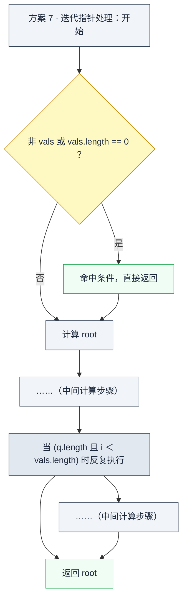

```typescript
class TreeNode {
  // 定义类型
  val: any;
  left: any;
  right: any; // 值: any; 左边界: any; 右边界: any;
  constructor(val?: any, left?: any, right?: any) {
    // constructor(值?: any, 左边界?: any, 右边界?: any) {
    this.val = val === undefined ? 0 : val; // 把 (值 全等于 undefined ? 0 : 值); 写入 值
    this.left = left === undefined ? null : left; // 把 (左边界 全等于 undefined ? null : 左边界); 写入 左边界
    this.right = right === undefined ? null : right; // 把 (右边界 全等于 undefined ? null : 右边界); 写入 右边界
  }
}
function buildTree(vals: any): any {
  // 定义函数/方法 buildTree
  if (!vals || vals.length === 0) return null; // 若 取反 vals 或 vals.长度 全等于 0，直接返回 null
  const root = new TreeNode(vals[0]);
  const q: any[] = [root];
  let i = 1;
  while (q.length && i < vals.length) {
    // 循环，直到不满足「节点.长度 且 下标 i 小于 vals.长度」
    const node = q.shift(); // 把 节点.shift() 存入 节点
    if (vals[i] !== null && vals[i] !== undefined) {
      node.left = new TreeNode(vals[i]);
      q.push(node.left);
    }
    i++; // 下标 i 加一
    if (i < vals.length && vals[i] !== null && vals[i] !== undefined) {
      node.right = new TreeNode(vals[i]);
      q.push(node.right);
    }
    i++; // 下标 i 加一
  }
  return root; // 返回 根节点
}
function treeToLevel(root: any): any[] {
  // 定义函数/方法 treeToLevel
  if (!root) return []; // 若 取反 根节点，直接返回 []
  const out: any[] = [];
  const q: any[] = [root]; // 把 []; const 节点: any[] 赋值为 [根节点]; 写入 const out: any[]
  while (q.length) {
    // 循环，直到不满足「节点.长度」
    const n = q.shift(); // 把 节点.shift() 存入 元素个数
    if (n === null || n === undefined) {
      out.push(null);
      continue;
    }
    out.push(n.val);
    q.push(n.left);
    q.push(n.right); // 把 元素个数.值 压入栈/数组尾部
  }
  while (out.length && out[out.length - 1] === null) out.pop(); // 循环，直到不满足「out.长度 且 out[out.长度 减 1] 全等于 null) out 弹出 );」
  return out; // 返回 out
}
class ListNode {
  // 定义类型
  val: any;
  next: any; // 值: any; 下一个: any;
  constructor(val?: any, next?: any) {
    this.val = val === undefined ? 0 : val;
    this.next = next === undefined ? null : next;
  }
}
function buildList(vals: any): any {
  // 定义函数/方法 buildList
  const dummy = new ListNode(0);
  let cur = dummy; // 把 new ListNode(0); let 当前值 赋值为 哨兵节点 存入 哨兵节点
  for (const v of vals) {
    cur.next = new ListNode(v);
    cur = cur.next;
  } // 把 new ListNode(值); 当前值 赋值为 当前值.下一个; } 写入 下一个
  return dummy.next; // 返回 哨兵节点.下一个
}
function listToArray(head: any): any[] {
  // 定义函数/方法 listToArray
  const out: any[] = [];
  let p = head; // 把 []; let 节点 赋值为 头节点; 写入 const out: any[]
  while (p) {
    out.push(p.val);
    p = p.next;
  } // 循环，直到不满足「节点) { out 追加 节点.值); 节点 赋值为 节点.下一个; }」
  return out; // 返回 out
}
// python-runtime shims
function pyLen(a: any): number {
  // 定义函数/方法 pyLen
  if (a === null || a === undefined) return 0; // 若 数组 全等于 null 或 数组 全等于 undefined，直接返回 0
  if (
    typeof a === 'string' ||
    Array.isArray(a) ||
    a instanceof Set ||
    a instanceof Map
  )
    return a.length ?? a.size;
  if (typeof a === 'object') return Object.keys(a).length; // 若 typeof 数组 全等于 'object'，直接返回 Object.keys(数组).长度
  return 0; // 返回 0
}
function pySlice(a: any, i: any, j: any, step?: any): any {
  // 定义函数/方法 pySlice
  if (typeof a === 'string') {
    const r = [...a].slice(i ?? 0, j ?? a.length);
    return step ? r.reverse().join('') : r.join('');
  }
  const arr = Array.isArray(a) ? a : [...a]; // 把 Array.isArray(数组) ? 数组 : 复制的 数组 存入 数组
  return arr.slice(i ?? 0, j ?? arr.length); // 返回 数组 截取 下标 i ?? 0, 下标 j ?? 数组.长度)
}
function pyRange(a: any, b?: any, step?: any): any[] {
  // 定义函数/方法 pyRange
  let s = 0,
    e = a,
    st = 1; // 把 0, e 赋值为 数组, st 赋值为 1 存入 字符串
  if (b !== undefined) {
    s = a;
    e = b;
  } // 若 b 不等于 undefined) { 字符串 赋值为 数组; e 赋值为 b; }
  if (step !== undefined) st = step; // 若 步数 不等于 undefined) st 赋值为 步数;
  const out: any[] = []; // 把 []; 写入 const out: any[]
  if (st > 0) for (let i = s; i < e; i += st) out.push(i);
  else for (let i = s; i > e; i += st) out.push(i); // 否则
  return out; // 返回 out
}
function pyIn(x: any, coll: any): boolean {
  // 定义函数/方法 pyIn
  if (coll === null || coll === undefined) return false; // 若 coll 全等于 null 或 coll 全等于 undefined，直接返回 false
  if (Array.isArray(coll)) return coll.includes(x); // 若 Array.isArray(coll)，直接返回 coll 是否包含 x)
  if (coll instanceof Set || coll instanceof Map) return coll.has(x); // 若 coll instanceof Set 或 coll instanceof Map，直接返回 coll.has(x)
  if (typeof coll === 'object') return x in coll; // 若 typeof coll 全等于 'object'，直接返回 x in coll
  if (typeof coll === 'string') return coll.indexOf(x) >= 0; // 若 typeof coll 全等于 'string'，直接返回 coll 查找 x) 不低于 0
  return false; // 返回 false
}
function pySorted(a: any): any[] {
  // 定义函数/方法 pySorted
  const arr = typeof a === 'string' ? [...a] : [...a]; // 把 (typeof 数组 全等于 'string') ? 复制的 数组 : 复制的 数组 存入 数组
  return arr.sort((x: any, y: any) => (x < y ? -1 : x > y ? 1 : 0));
}
function pyMin(a: any, b?: any): any {
  if (b !== undefined) return Math.min(a, b);
  if (Array.isArray(a) || a instanceof Set) return Math.min(...a);
  return Math.min(a);
} // 定义函数/方法 pyMin
function pyMax(a: any, b?: any): any {
  if (b !== undefined) return Math.max(a, b);
  if (Array.isArray(a) || a instanceof Set) return Math.max(...a);
  return Math.max(a);
} // 定义函数/方法 pyMax
function pySum(a: any): number {
  let s = 0;
  for (const v of a) s += v;
  return s;
} // 定义函数/方法 pySum
function pyAbs(x: any): number {
  return Math.abs(x);
} // 定义函数/方法 pyAbs
function pyEnumerate(a: any): any[] {
  const out: any[] = [];
  let i = 0;
  for (const v of a) {
    out.push([i, v]);
    i++;
  }
  return out;
} // 定义函数/方法 pyEnumerate
function pyZip(a: any, b: any): any[] {
  const n = Math.min(a.length, b.length);
  const out: any[] = [];
  for (let i = 0; i < n; i++) out.push([a[i], b[i]]);
  return out;
} // 定义函数/方法 pyZip
function pyDictGet(d: any, k: any, def?: any): any {
  return k in d ? d[k] : def === undefined ? null : def;
} // 定义函数/方法 pyDictGet
function pyPrint(...args: any[]): void {
  console.log(
    args
      .map((a) => (typeof a === 'object' && a !== null ? JSON.stringify(a) : a))
      .join(' '),
  );
} // 定义函数/方法 pyPrint
// collections / heapq
function heapPush(h: any[], x: any): void {
  h.push(x);
  let i = h.length - 1;
  while (i > 0) {
    const p = (i - 1) >> 1;
    if (h[p] <= h[i]) break;
    [h[p], h[i]] = [h[i], h[p]];
    i = p;
  }
} // 定义函数/方法 heapPush
function heapPop(h: any[]): any {
  const top = h[0];
  const last = h.pop();
  if (h.length) {
    h[0] = last;
    let i = 0;
    const n = h.length;
    while (true) {
      let l = 2 * i + 1,
        r = 2 * i + 2,
        s = i;
      if (l < n && h[l] < h[s]) s = l;
      if (r < n && h[r] < h[s]) s = r;
      if (s === i) break;
      [h[s], h[i]] = [h[i], h[s]];
      i = s;
    }
  }
  return top;
} // 定义函数/方法 heapPop
class Deque {
  private a: any[] = [];
  push(x: any) {
    this.a.push(x);
  }
  pushLeft(x: any) {
    this.a.unshift(x);
  }
  pop() {
    return this.a.pop();
  }
  popLeft() {
    return this.a.shift();
  }
  get length() {
    return this.a.length;
  }
  toArray() {
    return this.a.slice();
  }
} // 定义类型
function Counter(iter: any): any {
  const m: any = {};
  for (const v of iter) m[v] = (m[v] || 0) + 1;
  return m;
} // 定义函数/方法 Counter
function gcd(a: any, b: any): any {
  while (b) {
    [a, b] = [b, a % b];
  }
  return a;
} // 定义函数/方法 gcd
function pyInf(): number {
  return Infinity;
} // 定义函数/方法 pyInf

function norm(x: any): any {
  // 定义函数/方法 norm
  if (x === null || x === undefined) return null; // 若 x 全等于 null 或 x 全等于 undefined，直接返回 null
  if (typeof x === 'object') {
    // 若 typeof x 全等于 'object'
    if (x instanceof Deque) return x.toArray(); // 若 x instanceof Deque，直接返回 x.toArray()
    if (Array.isArray(x)) return x.map(norm); // 若 Array.isArray(x)，直接返回 x.映射表(norm)
    if (
      typeof x.val === 'number' &&
      (typeof x.left !== 'undefined' || typeof x.right !== 'undefined')
    )
      return treeToLevel(x);
    if (typeof x.next !== 'undefined' && typeof x.val === 'number')
      return listToArray(x);
    if (x instanceof Set) return [...x].sort(); // 若 x instanceof Set，直接返回 复制的 x 排序 )
    if (x instanceof Map) return Object.fromEntries(x); // 若 x instanceof Map，直接返回 Object.fromEntries(x)
    const o: any = {};
    for (const k of Object.keys(x)) o[k] = norm(x[k]);
    return o;
  }
  return x; // 返回 x
}
function eq(a: any, b: any): boolean {
  // 定义函数/方法 eq
  const x = norm(a),
    y = norm(b); // 把 norm(数组), y 赋值为 norm(b) 存入 x
  if (x === y) return true; // 若 x 全等于 y，直接返回 true
  if (x === null || y === null) return x === y; // 若 x 全等于 null 或 y 全等于 null，直接返回 x 全等于 y
  if (Array.isArray(x) && Array.isArray(y)) {
    // 若 Array.isArray(x) 且 Array.isArray(y
    if (x.length !== y.length) return false; // 若 x.长度 不等于 y.长度，直接返回 false
    for (let i = 0; i < x.length; i++) if (!eq(x[i], y[i])) return false; // 让 下标 i 从 0 开始计数，下标 i 小于 x.长度 就继续
    return true; // 返回 true
  }
  if (typeof x === 'object' && typeof y === 'object') {
    // 若 typeof x 全等于 'object' 且 typeof y 全等于 'object'
    const kx = Object.keys(x),
      ky = Object.keys(y); // 把 Object.keys(x), ky 赋值为 Object.keys(y) 存入 kx
    if (kx.length !== ky.length) return false; // 若 kx.长度 不等于 ky.长度，直接返回 false
    for (const k of kx) if (!eq(x[k], y[k])) return false;
    return true; // 返回 true
  }
  return x === y; // 返回 x 全等于 y
}

function place(num, row, col, direction, n, m) {
  // 定义函数/方法 place
  const handlers = {
    // 把 { 存入 handlers
    D: () =>
      row + 1 < n && m[row + 1][col] === 0
        ? [row + 1, col]
        : [row, col + 1, 'R'],
    R: () =>
      col + 1 < n && m[row][col + 1] === 0
        ? [row, col + 1]
        : [row - 1, col, 'U'],
    U: () =>
      row - 1 >= 0 && m[row - 1][col] === 0
        ? [row - 1, col]
        : [row, col - 1, 'L'],
    L: () =>
      col - 1 >= 0 && m[row][col - 1] === 0
        ? [row, col - 1]
        : [row + 1, col, 'D'],
  };
  return handlers[direction](); // 返回 handlers[direction]()
}
function fillSpiral(n) {
  // 定义函数/方法 fillSpiral
  const m = Array.from({ length: n }, () => new Array(n).fill(0));
  let row = 0,
    col = 0,
    direction = 'D',
    num = 1; // 把 0,col 赋值为 0,direction 赋值为 'D',num 赋值为 1 存入 row
  while (num <= n * n) {
    // 循环，直到不满足「num 不超过 元素个数 乘 元素个数」
    m[row][col] = num;
    num++; // 把 num; num 加一 ; 写入 m[row][col]
    const res = place(num, row, col, direction, n, m); // 把 place(num,row,col,direction,元素个数,映射表) 存入 结果
    row = res[0];
    col = res[1]; // 把 结果[0]; col 赋值为 结果[1] 存入 row
    if (res.length === 3) direction = res[2]; // 若 结果.长度 全等于 3) direction 赋值为 结果[2];
  }
  return m; // 返回 映射表
}
export function demo(): void {
  // 程序入口：跑内嵌自测用例
  const cases = [
    {
      got: fillSpiral(3),
      want: [
        [1, 8, 7],
        [2, 9, 6],
        [3, 4, 5],
      ],
    },
    {
      got: fillSpiral(4),
      want: [
        [1, 12, 11, 10],
        [2, 13, 16, 9],
        [3, 14, 15, 8],
        [4, 5, 6, 7],
      ],
    },
  ];
  let fail = false; // 把 false 存入 fail
  for (const c of cases)
    if (!eq(c.got, c.want)) {
      fail = true;
      console.log('FAIL', JSON.stringify(c.got));
    } // 打印输出
  if (fail) throw new Error('FAILED'); // 若 fail) throw new Error(「FAILED」);
  console.log('PASS'); // 全部用例通过，输出 PASS
}
demo(); // demo();
```

### 方案 8：方案8（Filler 迭代器式旋转填充）

**分析与思路**：核心做法是「方案8（Filler 迭代器式旋转填充）」。

**运行方式**：`node 本文件`，内嵌用例全部通过会输出 PASS。

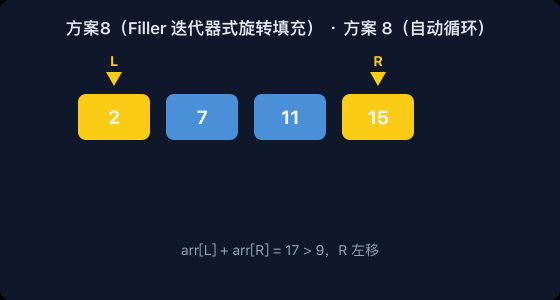

**方案专属流程图**（真实控制流）：

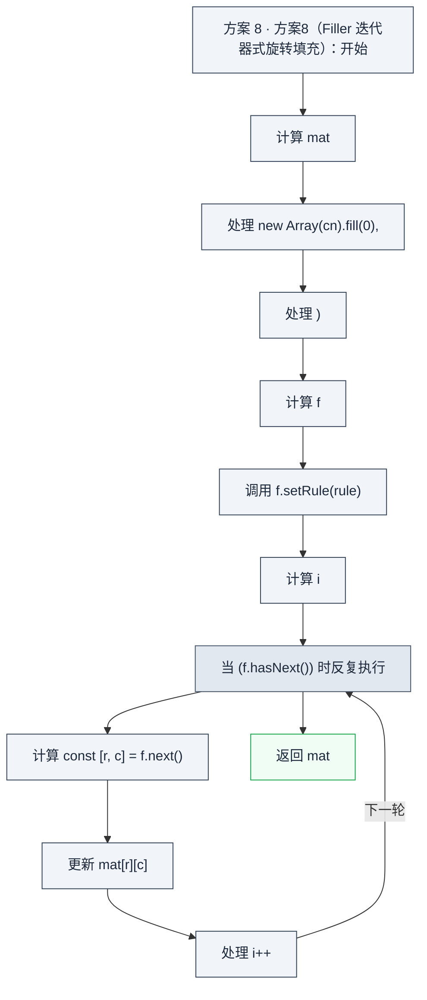

```typescript
/**
 ** 笔记：抽象思维之代码重构_隔离变化
 ** 方案：方案8（Filler 迭代器式旋转填充）
 ** 来源：python 参考忠实移植
 */

class Filler {
  // 定义类型
  rowNum: number; // rowNum: number;
  colNum: number; // colNum: number;
  rule: string; // rule: string;
  pos: { row: number; col: number }; // pos: { row: number; col: number };
  idx: number; // idx: number;
  rMin: number; // rMin: number;
  cMin: number; // cMin: number;
  rMax: number; // rMax: number;
  cMax: number; // cMax: number;
  constructor(rn: number, cn: number) {
    // constructor(rn: number, cn: number) {
    this.rowNum = rn; // 把 rn; 写入 this.rowNum
    this.colNum = cn; // 把 cn; 写入 this.colNum
    this.rule = 'ESVM'; // 把 「ESVM」; 写入 this.rule
    this.reset(); // this.reset();
  }
  reset(): void {
    // reset(): void {
    this.pos = { row: 0, col: 0 }; // 把 { row: 0, col: 0 }; 写入 this.pos
    this.idx = 0; // 把 0; 写入 this.idx
    this.rMin = 0; // 把 0; 写入 this.rMin
    this.cMin = 0; // 把 0; 写入 this.cMin
    this.rMax = this.rowNum - 1; // 把 this.rowNum 减 1; 写入 this.rMax
    this.cMax = this.colNum - 1; // 把 this.colNum 减 1; 写入 this.cMax
  }
  setRule(r: string): void {
    this.rule = r;
  } // 把 右指针; } 写入 setRule(r: string): void { this.rule
  hasNext(): boolean {
    // hasNext(): boolean {
    return (
      this.rMin <= this.pos.row &&
      this.pos.row <= this.rMax &&
      this.cMin <= this.pos.col &&
      this.pos.col <= this.cMax
    ); // 把 this.pos.col 且 this.pos.col 不超过 this.cMax; 写入 this.cMin <
  }
  next(): [number, number] {
    // 下一个(): [number, number] {
    const r = this.pos.row; // 把 this.pos.row 存入 右指针
    const c = this.pos.col; // 把 this.pos.col 存入 字符
    this._advance(); // this._advance();
    return [r, c]; // 返回 [右指针, 字符]
  }
  _advance(): void {
    // _advance(): void {
    const cmd = this.rule[this.idx % 4]; // 把 this.rule[this.idx 对…取模 4] 存入 cmd
    if (cmd === 'E') {
      // 若 cmd 全等于 「E」
      this.pos.row += 1; // this.pos.row累加 1
      if (this.pos.row === this.rMax) {
        this.idx += 1;
        this.cMin += 1;
      }
    } else if (cmd === 'S') {
      // 否则，若 cmd 全等于 「S」
      this.pos.col += 1; // this.pos.col累加 1
      if (this.pos.col === this.cMax) {
        this.idx += 1;
        this.rMax -= 1;
      }
    } else if (cmd === 'V') {
      // 否则，若 cmd 全等于 「V」
      this.pos.row -= 1; // this.pos.row累减 1
      if (this.pos.row === this.rMin) {
        this.idx += 1;
        this.cMax -= 1;
      }
    } else if (cmd === 'M') {
      // 否则，若 cmd 全等于 「M」
      this.pos.col -= 1; // this.pos.col累减 1
      if (this.pos.col === this.cMin) {
        this.idx += 1;
        this.rMin += 1;
      }
    }
  }
}

function fillMatrix(rn: number, cn: number, rule: string = 'ESVM'): number[][] {
  // 定义函数/方法 fillMatrix
  const mat: number[][] = Array.from({ length: rn }, () =>
    new Array(cn).fill(0),
  );
  const f = new Filler(rn, cn); // 把 new Filler(rn, cn) 存入 f
  f.setRule(rule); // f.setRule(rule);
  let i = 1; // 把 1 存入 下标 i
  while (f.hasNext()) {
    // 循环，直到不满足「f.hasNext(」
    const [r, c] = f.next(); // 把 f.下一个(); 写入 const [r, c]
    mat[r][c] = i; // 把 下标 i; 写入 mat[r][c]
    i++; // 下标 i 加一
  }
  return mat; // 返回 mat
}

export function demo(): void {
  // 程序入口：跑内嵌自测用例
  function eqMat(a: number[][], b: number[][]): boolean {
    // 定义函数/方法 eqMat
    if (a.length !== b.length) return false; // 若 数组.长度 不等于 b.长度，直接返回 false
    for (let i = 0; i < a.length; i++) {
      // 让 下标 i 从 0 开始计数，下标 i 小于 数组.长度 就继续
      if (a[i].length !== b[i].length) return false; // 若 数组[下标 i].长度 不等于 b[下标 i].长度，直接返回 false
      for (let j = 0; j < a[i].length; j++)
        if (a[i][j] !== b[i][j]) return false; // 让 下标 j 从 0 开始计数，下标 j 小于 数组[下标 i].长度 就继续
    }
    return true; // 返回 true
  }
  const cases: { in: [number, number, string]; want: number[][] }[] = [
    {
      in: [6, 6, 'ESVM'],
      want: [
        [1, 0, 0, 0, 0, 0],
        [2, 0, 0, 0, 0, 0],
        [3, 0, 0, 0, 0, 0],
        [4, 0, 0, 0, 0, 0],
        [5, 0, 0, 0, 0, 0],
        [0, 0, 0, 0, 0, 0],
      ],
    },
    {
      in: [3, 3, 'ESVM'],
      want: [
        [1, 0, 0],
        [2, 0, 0],
        [0, 0, 0],
      ],
    },
  ];
  let fail = false; // 把 false 存入 fail
  for (const c of cases) {
    // for (const 字符 of cases) {
    const got = fillMatrix(c.in[0], c.in[1], c.in[2]); // 把 fillMatrix(字符.in[0], 字符.in[1], 字符.in[2]) 存入 got
    if (!eqMat(got, c.want)) {
      // 若 取反 eqMat(got, 字符.want
      fail = true; // 把 true 存入 fail
      console.log(
        'FAIL',
        JSON.stringify(c.in),
        'want',
        JSON.stringify(c.want),
        'got',
        JSON.stringify(got),
      ); // 打印输出
    }
  }
  if (fail) throw new Error('FAILED'); // 若 fail) throw new Error(「FAILED」);
  console.log('PASS'); // 全部用例通过，输出 PASS
}
demo(); // demo();
```

### 方案 9：直接实现

**分析与思路**：核心做法是「直接实现」。

**运行方式**：`node 本文件`，内嵌用例全部通过会输出 PASS。


**方案专属流程图**（真实控制流）：


```typescript
function assertEq(actual: any, expected: any, msg: string = ''): void {
  // 定义函数/方法 assertEq
  const a = JSON.stringify(actual);
  const e = JSON.stringify(expected);
  if (a !== e)
    throw new Error(
      'ASSERT FAILED ' + msg + ' :: actual=' + a + ' expected=' + e,
    );
}

class Location {
  // 定义类型
  row: number;
  col: number; // row: number; col: number;
  constructor(row: number = 0, col: number = 0) {
    this.row = row;
    this.col = col;
  }
}
class Filler {
  // 定义类型
  row_num: number;
  col_num: number; // row_num: number; col_num: number;
  pos: Location;
  idx: number;
  r_min: number;
  c_min: number;
  r_max: number;
  c_max: number;
  rule: string;
  constructor(rn: number, cn: number) {
    this.row_num = rn;
    this.col_num = cn;
    this.reset();
  }
  reset(): void {
    // reset(): void {
    this.pos = new Location(0, 0);
    this.idx = 0;
    this.r_min = this.c_min = 0;
    this.r_max = this.row_num - 1;
    this.c_max = this.col_num - 1;
    this.rule = 'ESVM';
  }
  setRule(rule: string): void {
    this.rule = rule;
  } // 把 rule; } 写入 setRule(rule: string): void { this.rule
  next(): Location {
    // 下一个(): Location {
    const res = new Location(this.pos.row, this.pos.col); // 把 new Location(this.pos.row, this.pos.col) 存入 结果
    const ch = this.rule[this.idx % this.rule.length]; // 把 this.rule[this.idx 对…取模 this.rule.长度] 存入 字符
    if (ch === 'E') {
      this.pos.row++;
      if (this.pos.row === this.r_max) {
        this.idx++;
        this.c_min++;
      }
    } else if (ch === 'S') {
      this.pos.col++;
      if (this.pos.col === this.c_max) {
        this.idx++;
        this.r_max--;
      }
    } else if (ch === 'V') {
      this.pos.row--;
      if (this.pos.row === this.r_min) {
        this.idx++;
        this.c_max--;
      }
    } else if (ch === 'M') {
      this.pos.col--;
      if (this.pos.col === this.c_min) {
        this.idx++;
        this.r_min++;
      }
    } else if (ch === 'e') {
      this.pos.row++;
      if (this.pos.row === this.r_max) {
        this.idx++;
        this.c_max--;
      }
    } else if (ch === 's') {
      this.pos.col++;
      if (this.pos.col === this.c_max) {
        this.idx++;
        this.r_min++;
      }
    } else if (ch === 'v') {
      this.pos.row--;
      if (this.pos.row === this.r_min) {
        this.idx++;
        this.c_min++;
      }
    } else if (ch === 'm') {
      this.pos.col--;
      if (this.pos.col === this.c_min) {
        this.idx++;
        this.r_max--;
      }
    }
    return res; // 返回 结果
  }
}
function testFiller(rule: string, rn: number, cn: number): number[][] {
  // 定义函数/方法 testFiller
  const obj = new Filler(rn, cn);
  obj.setRule(rule); // 把 new Filler(rn, cn); obj.setRule(rule) 存入 obj
  const seq: number[][] = []; // 把 []; 写入 const seq: number[][]
  for (let i = 0; i < rn * cn; i++) {
    const p = obj.next();
    seq.push([p.row, p.col]);
  } // 让 下标 i 从 0 开始计数，下标 i 小于 rn 乘 cn 就继续
  return seq; // 返回 seq
}
export function demo(): void {
  // 程序入口：跑内嵌自测用例
  assertEq(
    testFiller('ESVM', 4, 4),
    [
      [0, 0],
      [1, 0],
      [2, 0],
      [3, 0],
      [3, 1],
      [3, 2],
      [3, 3],
      [2, 3],
      [1, 3],
      [0, 3],
      [0, 2],
      [0, 1],
      [1, 1],
      [2, 1],
      [2, 2],
      [1, 2],
    ],
    'ESVM',
  ); // 断言校验
  assertEq(
    testFiller('semv', 4, 4),
    [
      [0, 0],
      [0, 1],
      [0, 2],
      [0, 3],
      [1, 3],
      [2, 3],
      [3, 3],
      [3, 2],
      [3, 1],
      [3, 0],
      [2, 0],
      [1, 0],
      [1, 1],
      [1, 2],
      [2, 2],
      [2, 1],
    ],
    'semv',
  ); // 断言校验
  console.log('PASS'); // 全部用例通过，输出 PASS
}
demo(); // demo();
```

### 方案 10：直接实现

**分析与思路**：核心做法是「直接实现」。

**运行方式**：`node 本文件`，内嵌用例全部通过会输出 PASS。

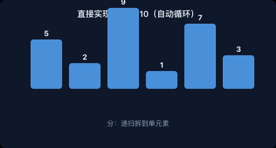

**方案专属流程图**（真实控制流）：

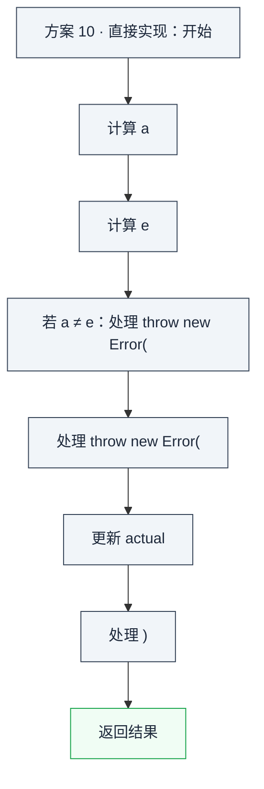

```typescript
function assertEq(actual: any, expected: any, msg: string = ''): void {
  // 定义函数/方法 assertEq
  const a = JSON.stringify(actual);
  const e = JSON.stringify(expected);
  if (a !== e)
    throw new Error(
      'ASSERT FAILED ' + msg + ' :: actual=' + a + ' expected=' + e,
    );
}

class Location {
  // 定义类型
  row: number;
  col: number; // row: number; col: number;
  constructor(row: number = 0, col: number = 0) {
    this.row = row;
    this.col = col;
  }
}
class Filler {
  // 定义类型
  row_num: number;
  col_num: number; // row_num: number; col_num: number;
  pos: Location;
  idx: number;
  r_min: number;
  c_min: number;
  r_max: number;
  c_max: number;
  rule: string;
  constructor(rn: number, cn: number) {
    this.row_num = rn;
    this.col_num = cn;
    this.reset();
  }
  reset(): void {
    // reset(): void {
    this.pos = new Location(0, 0);
    this.idx = 0;
    this.r_min = this.c_min = 0;
    this.r_max = this.row_num - 1;
    this.c_max = this.col_num - 1;
    this.rule = 'ESVM';
  }
  setRule(rule: string): void {
    this.rule = rule;
  } // 把 rule; } 写入 setRule(rule: string): void { this.rule
  next(): Location {
    // 下一个(): Location {
    const res = new Location(this.pos.row, this.pos.col); // 把 new Location(this.pos.row, this.pos.col) 存入 结果
    const ch = this.rule[this.idx % this.rule.length]; // 把 this.rule[this.idx 对…取模 this.rule.长度] 存入 字符
    if (ch === 'E') {
      this.pos.row++;
      if (this.pos.row === this.r_max) {
        this.idx++;
        this.c_min++;
      }
    } else if (ch === 'S') {
      this.pos.col++;
      if (this.pos.col === this.c_max) {
        this.idx++;
        this.r_max--;
      }
    } else if (ch === 'V') {
      this.pos.row--;
      if (this.pos.row === this.r_min) {
        this.idx++;
        this.c_max--;
      }
    } else if (ch === 'M') {
      this.pos.col--;
      if (this.pos.col === this.c_min) {
        this.idx++;
        this.r_min++;
      }
    }
    return res; // 返回 结果
  }
}
class Matrix {
  // 定义类型
  row: number;
  col: number;
  buf: number[][]; // row: number; col: number; buf: number[][];
  constructor(r: number, c: number) {
    this.row = r;
    this.col = c;
    this.buf = Array.from({ length: r }, () => new Array(c).fill(0));
  }
  get(r: number, c: number): number {
    return this.buf[r][c];
  }
  set(r: number, c: number, v: number): void {
    this.buf[r][c] = v;
  }
}
function fmtRow(row: number[]): string {
  // 定义函数/方法 fmtRow
  return row.map((x) => x.toString().padStart(2, ' ')).join(' ');
}
export function demo(): void {
  // 程序入口：跑内嵌自测用例
  const rn = 9,
    cn = 9; // 把 9, cn 赋值为 9 存入 rn
  const obj = new Filler(rn, cn);
  obj.setRule('ESVM'); // 把 new Filler(rn, cn); obj.setRule(「ESVM」) 存入 obj
  const m = new Matrix(rn, cn); // 把 new Matrix(rn, cn) 存入 映射表
  for (let i = 0; i < rn * cn; i++) {
    const p = obj.next();
    m.set(p.row, p.col, i + 1);
  } // 让 下标 i 从 0 开始计数，下标 i 小于 rn 乘 cn 就继续
  const rows = m.buf.map(fmtRow); // 把 映射表.buf.映射表(fmtRow) 存入 行数
  assertEq(
    rows,
    [
      ' 1 32 31 30 29 28 27 26 25',
      ' 2 33 56 55 54 53 52 51 24',
      ' 3 34 57 72 71 70 69 50 23',
      ' 4 35 58 73 80 79 68 49 22',
      ' 5 36 59 74 81 78 67 48 21',
      ' 6 37 60 75 76 77 66 47 20',
      ' 7 38 61 62 63 64 65 46 19',
      ' 8 39 40 41 42 43 44 45 18',
      ' 9 10 11 12 13 14 15 16 17',
    ],
    'matrix9',
  ); // 断言校验
  console.log('PASS'); // 全部用例通过，输出 PASS
}
demo(); // demo();
```

### 方案 11：迭代指针处理

**分析与思路**：核心做法是「迭代指针处理」。代码里依次做这些事：队列或堆的调度。

**运行方式**：`node 本文件`，内嵌用例全部通过会输出 PASS。

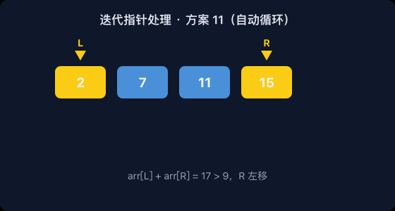

**方案专属流程图**（真实控制流）：

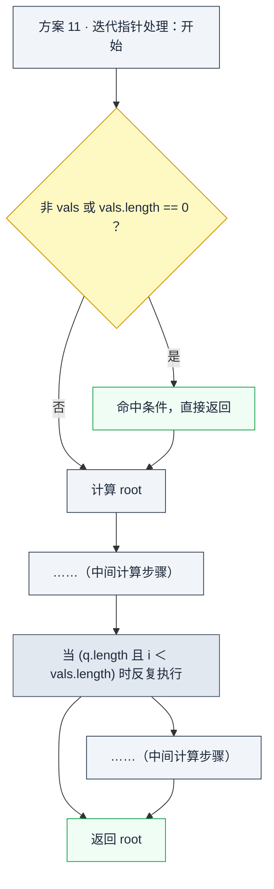

```typescript
class TreeNode {
  // 定义类型
  val: any;
  left: any;
  right: any; // 值: any; 左边界: any; 右边界: any;
  constructor(val?: any, left?: any, right?: any) {
    // constructor(值?: any, 左边界?: any, 右边界?: any) {
    this.val = val === undefined ? 0 : val; // 把 (值 全等于 undefined ? 0 : 值); 写入 值
    this.left = left === undefined ? null : left; // 把 (左边界 全等于 undefined ? null : 左边界); 写入 左边界
    this.right = right === undefined ? null : right; // 把 (右边界 全等于 undefined ? null : 右边界); 写入 右边界
  }
}
function buildTree(vals: any): any {
  // 定义函数/方法 buildTree
  if (!vals || vals.length === 0) return null; // 若 取反 vals 或 vals.长度 全等于 0，直接返回 null
  const root = new TreeNode(vals[0]);
  const q: any[] = [root];
  let i = 1;
  while (q.length && i < vals.length) {
    // 循环，直到不满足「节点.长度 且 下标 i 小于 vals.长度」
    const node = q.shift(); // 把 节点.shift() 存入 节点
    if (vals[i] !== null && vals[i] !== undefined) {
      node.left = new TreeNode(vals[i]);
      q.push(node.left);
    }
    i++; // 下标 i 加一
    if (i < vals.length && vals[i] !== null && vals[i] !== undefined) {
      node.right = new TreeNode(vals[i]);
      q.push(node.right);
    }
    i++; // 下标 i 加一
  }
  return root; // 返回 根节点
}
function treeToLevel(root: any): any[] {
  // 定义函数/方法 treeToLevel
  if (!root) return []; // 若 取反 根节点，直接返回 []
  const out: any[] = [];
  const q: any[] = [root]; // 把 []; const 节点: any[] 赋值为 [根节点]; 写入 const out: any[]
  while (q.length) {
    // 循环，直到不满足「节点.长度」
    const n = q.shift(); // 把 节点.shift() 存入 元素个数
    if (n === null || n === undefined) {
      out.push(null);
      continue;
    }
    out.push(n.val);
    q.push(n.left);
    q.push(n.right); // 把 元素个数.值 压入栈/数组尾部
  }
  while (out.length && out[out.length - 1] === null) out.pop(); // 循环，直到不满足「out.长度 且 out[out.长度 减 1] 全等于 null) out 弹出 );」
  return out; // 返回 out
}
class ListNode {
  // 定义类型
  val: any;
  next: any; // 值: any; 下一个: any;
  constructor(val?: any, next?: any) {
    this.val = val === undefined ? 0 : val;
    this.next = next === undefined ? null : next;
  }
}
function buildList(vals: any): any {
  // 定义函数/方法 buildList
  const dummy = new ListNode(0);
  let cur = dummy; // 把 new ListNode(0); let 当前值 赋值为 哨兵节点 存入 哨兵节点
  for (const v of vals) {
    cur.next = new ListNode(v);
    cur = cur.next;
  } // 把 new ListNode(值); 当前值 赋值为 当前值.下一个; } 写入 下一个
  return dummy.next; // 返回 哨兵节点.下一个
}
function listToArray(head: any): any[] {
  // 定义函数/方法 listToArray
  const out: any[] = [];
  let p = head; // 把 []; let 节点 赋值为 头节点; 写入 const out: any[]
  while (p) {
    out.push(p.val);
    p = p.next;
  } // 循环，直到不满足「节点) { out 追加 节点.值); 节点 赋值为 节点.下一个; }」
  return out; // 返回 out
}
// python-runtime shims
function pyLen(a: any): number {
  // 定义函数/方法 pyLen
  if (a === null || a === undefined) return 0; // 若 数组 全等于 null 或 数组 全等于 undefined，直接返回 0
  if (
    typeof a === 'string' ||
    Array.isArray(a) ||
    a instanceof Set ||
    a instanceof Map
  )
    return a.length ?? a.size;
  if (typeof a === 'object') return Object.keys(a).length; // 若 typeof 数组 全等于 'object'，直接返回 Object.keys(数组).长度
  return 0; // 返回 0
}
function pySlice(a: any, i: any, j: any, step?: any): any {
  // 定义函数/方法 pySlice
  if (typeof a === 'string') {
    const r = [...a].slice(i ?? 0, j ?? a.length);
    return step ? r.reverse().join('') : r.join('');
  }
  const arr = Array.isArray(a) ? a : [...a]; // 把 Array.isArray(数组) ? 数组 : 复制的 数组 存入 数组
  return arr.slice(i ?? 0, j ?? arr.length); // 返回 数组 截取 下标 i ?? 0, 下标 j ?? 数组.长度)
}
function pyRange(a: any, b?: any, step?: any): any[] {
  // 定义函数/方法 pyRange
  let s = 0,
    e = a,
    st = 1; // 把 0, e 赋值为 数组, st 赋值为 1 存入 字符串
  if (b !== undefined) {
    s = a;
    e = b;
  } // 若 b 不等于 undefined) { 字符串 赋值为 数组; e 赋值为 b; }
  if (step !== undefined) st = step; // 若 步数 不等于 undefined) st 赋值为 步数;
  const out: any[] = []; // 把 []; 写入 const out: any[]
  if (st > 0) for (let i = s; i < e; i += st) out.push(i);
  else for (let i = s; i > e; i += st) out.push(i); // 否则
  return out; // 返回 out
}
function pyIn(x: any, coll: any): boolean {
  // 定义函数/方法 pyIn
  if (coll === null || coll === undefined) return false; // 若 coll 全等于 null 或 coll 全等于 undefined，直接返回 false
  if (Array.isArray(coll)) return coll.includes(x); // 若 Array.isArray(coll)，直接返回 coll 是否包含 x)
  if (coll instanceof Set || coll instanceof Map) return coll.has(x); // 若 coll instanceof Set 或 coll instanceof Map，直接返回 coll.has(x)
  if (typeof coll === 'object') return x in coll; // 若 typeof coll 全等于 'object'，直接返回 x in coll
  if (typeof coll === 'string') return coll.indexOf(x) >= 0; // 若 typeof coll 全等于 'string'，直接返回 coll 查找 x) 不低于 0
  return false; // 返回 false
}
function pySorted(a: any): any[] {
  // 定义函数/方法 pySorted
  const arr = typeof a === 'string' ? [...a] : [...a]; // 把 (typeof 数组 全等于 'string') ? 复制的 数组 : 复制的 数组 存入 数组
  return arr.sort((x: any, y: any) => (x < y ? -1 : x > y ? 1 : 0));
}
function pyMin(a: any, b?: any): any {
  if (b !== undefined) return Math.min(a, b);
  if (Array.isArray(a) || a instanceof Set) return Math.min(...a);
  return Math.min(a);
} // 定义函数/方法 pyMin
function pyMax(a: any, b?: any): any {
  if (b !== undefined) return Math.max(a, b);
  if (Array.isArray(a) || a instanceof Set) return Math.max(...a);
  return Math.max(a);
} // 定义函数/方法 pyMax
function pySum(a: any): number {
  let s = 0;
  for (const v of a) s += v;
  return s;
} // 定义函数/方法 pySum
function pyAbs(x: any): number {
  return Math.abs(x);
} // 定义函数/方法 pyAbs
function pyEnumerate(a: any): any[] {
  const out: any[] = [];
  let i = 0;
  for (const v of a) {
    out.push([i, v]);
    i++;
  }
  return out;
} // 定义函数/方法 pyEnumerate
function pyZip(a: any, b: any): any[] {
  const n = Math.min(a.length, b.length);
  const out: any[] = [];
  for (let i = 0; i < n; i++) out.push([a[i], b[i]]);
  return out;
} // 定义函数/方法 pyZip
function pyDictGet(d: any, k: any, def?: any): any {
  return k in d ? d[k] : def === undefined ? null : def;
} // 定义函数/方法 pyDictGet
function pyPrint(...args: any[]): void {
  console.log(
    args
      .map((a) => (typeof a === 'object' && a !== null ? JSON.stringify(a) : a))
      .join(' '),
  );
} // 定义函数/方法 pyPrint
// collections / heapq
function heapPush(h: any[], x: any): void {
  h.push(x);
  let i = h.length - 1;
  while (i > 0) {
    const p = (i - 1) >> 1;
    if (h[p] <= h[i]) break;
    [h[p], h[i]] = [h[i], h[p]];
    i = p;
  }
} // 定义函数/方法 heapPush
function heapPop(h: any[]): any {
  const top = h[0];
  const last = h.pop();
  if (h.length) {
    h[0] = last;
    let i = 0;
    const n = h.length;
    while (true) {
      let l = 2 * i + 1,
        r = 2 * i + 2,
        s = i;
      if (l < n && h[l] < h[s]) s = l;
      if (r < n && h[r] < h[s]) s = r;
      if (s === i) break;
      [h[s], h[i]] = [h[i], h[s]];
      i = s;
    }
  }
  return top;
} // 定义函数/方法 heapPop
class Deque {
  private a: any[] = [];
  push(x: any) {
    this.a.push(x);
  }
  pushLeft(x: any) {
    this.a.unshift(x);
  }
  pop() {
    return this.a.pop();
  }
  popLeft() {
    return this.a.shift();
  }
  get length() {
    return this.a.length;
  }
  toArray() {
    return this.a.slice();
  }
} // 定义类型
function Counter(iter: any): any {
  const m: any = {};
  for (const v of iter) m[v] = (m[v] || 0) + 1;
  return m;
} // 定义函数/方法 Counter
function gcd(a: any, b: any): any {
  while (b) {
    [a, b] = [b, a % b];
  }
  return a;
} // 定义函数/方法 gcd
function pyInf(): number {
  return Infinity;
} // 定义函数/方法 pyInf

function norm(x: any): any {
  // 定义函数/方法 norm
  if (x === null || x === undefined) return null; // 若 x 全等于 null 或 x 全等于 undefined，直接返回 null
  if (typeof x === 'object') {
    // 若 typeof x 全等于 'object'
    if (x instanceof Deque) return x.toArray(); // 若 x instanceof Deque，直接返回 x.toArray()
    if (Array.isArray(x)) return x.map(norm); // 若 Array.isArray(x)，直接返回 x.映射表(norm)
    if (
      typeof x.val === 'number' &&
      (typeof x.left !== 'undefined' || typeof x.right !== 'undefined')
    )
      return treeToLevel(x);
    if (typeof x.next !== 'undefined' && typeof x.val === 'number')
      return listToArray(x);
    if (x instanceof Set) return [...x].sort(); // 若 x instanceof Set，直接返回 复制的 x 排序 )
    if (x instanceof Map) return Object.fromEntries(x); // 若 x instanceof Map，直接返回 Object.fromEntries(x)
    const o: any = {};
    for (const k of Object.keys(x)) o[k] = norm(x[k]);
    return o;
  }
  return x; // 返回 x
}
function eq(a: any, b: any): boolean {
  // 定义函数/方法 eq
  const x = norm(a),
    y = norm(b); // 把 norm(数组), y 赋值为 norm(b) 存入 x
  if (x === y) return true; // 若 x 全等于 y，直接返回 true
  if (x === null || y === null) return x === y; // 若 x 全等于 null 或 y 全等于 null，直接返回 x 全等于 y
  if (Array.isArray(x) && Array.isArray(y)) {
    // 若 Array.isArray(x) 且 Array.isArray(y
    if (x.length !== y.length) return false; // 若 x.长度 不等于 y.长度，直接返回 false
    for (let i = 0; i < x.length; i++) if (!eq(x[i], y[i])) return false; // 让 下标 i 从 0 开始计数，下标 i 小于 x.长度 就继续
    return true; // 返回 true
  }
  if (typeof x === 'object' && typeof y === 'object') {
    // 若 typeof x 全等于 'object' 且 typeof y 全等于 'object'
    const kx = Object.keys(x),
      ky = Object.keys(y); // 把 Object.keys(x), ky 赋值为 Object.keys(y) 存入 kx
    if (kx.length !== ky.length) return false; // 若 kx.长度 不等于 ky.长度，直接返回 false
    for (const k of kx) if (!eq(x[k], y[k])) return false;
    return true; // 返回 true
  }
  return x === y; // 返回 x 全等于 y
}

class Rule {
  // 定义类型
  data: string[];
  idx: number;
  length: number; // data:string[]; idx:number; 长度:number;
  constructor(r: string) {
    this.data = r.split('');
    this.idx = 0;
    this.length = r.length;
  }
  next() {
    const ch = this.data[this.idx];
    this.idx = (this.idx + 1) % this.length;
    return ch;
  }
  peek() {
    return this.data[this.idx];
  } // peek(){ return this.data[this.idx]; }
}
export function demo(): void {
  // 程序入口：跑内嵌自测用例
  const r = new Rule('ESVM'); // 把 new Rule(「ESVM」) 存入 右指针
  const s1 = Array.from({ length: 10 }, () => r.next()).join('');
  const r2 = new Rule('semv'); // 把 new Rule(「semv」) 存入 r2
  const s2 = Array.from({ length: 6 }, () => r2.next()).join('');
  const cases = [
    { got: s1, want: 'ESVMESVMES' },
    { got: s2, want: 'semvse' },
  ];
  let fail = false; // 把 false 存入 fail
  for (const c of cases)
    if (!eq(c.got, c.want)) {
      fail = true;
      console.log('FAIL', JSON.stringify(c.got));
    } // 打印输出
  if (fail) throw new Error('FAILED'); // 若 fail) throw new Error(「FAILED」);
  console.log('PASS'); // 全部用例通过，输出 PASS
}
demo(); // demo();
```

### 方案 12：直接实现

**分析与思路**：核心做法是「直接实现」。

**运行方式**：`node 本文件`，内嵌用例全部通过会输出 PASS。


**方案专属流程图**（真实控制流）：


```typescript
function assertEq(actual: any, expected: any, msg: string = ''): void {
  // 定义函数/方法 assertEq
  const a = JSON.stringify(actual);
  const e = JSON.stringify(expected);
  if (a !== e)
    throw new Error(
      'ASSERT FAILED ' + msg + ' :: actual=' + a + ' expected=' + e,
    );
}

class Location {
  row: number;
  col: number;
  constructor(row = 0, col = 0) {
    this.row = row;
    this.col = col;
  }
} // 定义类型
class Rule {
  data: string[];
  idx: number;
  length: number;
  constructor(r: string) {
    this.data = r.split('');
    this.idx = 0;
    this.length = this.data.length;
  }
  current(): string {
    return this.data[this.idx];
  }
  advance(): void {
    this.idx = (this.idx + 1) % this.length;
  }
} // 定义类型
class Filler {
  // 定义类型
  row_num: number;
  col_num: number;
  pos: Location;
  r_min: number;
  c_min: number;
  r_max: number;
  c_max: number;
  cmd: Rule | null;
  constructor(rn: number, cn: number) {
    this.row_num = rn;
    this.col_num = cn;
    this.reset();
  }
  reset(): void {
    this.pos = new Location(0, 0);
    this.r_min = this.c_min = 0;
    this.r_max = this.row_num - 1;
    this.c_max = this.col_num - 1;
    this.cmd = null;
  }
  setRule(rule: Rule): void {
    this.cmd = rule;
  } // 把 rule; } 写入 setRule(rule: Rule): void { this.cmd
  next(): Location {
    // 下一个(): Location {
    const res = new Location(this.pos.row, this.pos.col); // 把 new Location(this.pos.row, this.pos.col) 存入 结果
    const ch = (this.cmd as Rule).current(); // 把 (this.cmd as Rule).current() 存入 字符
    if (ch === 'E') {
      this.pos.row++;
      if (this.pos.row === this.r_max) {
        (this.cmd as Rule).advance();
        this.c_min++;
      }
    } else if (ch === 'S') {
      this.pos.col++;
      if (this.pos.col === this.c_max) {
        (this.cmd as Rule).advance();
        this.r_max--;
      }
    } else if (ch === 'V') {
      this.pos.row--;
      if (this.pos.row === this.r_min) {
        (this.cmd as Rule).advance();
        this.c_max--;
      }
    } else if (ch === 'M') {
      this.pos.col--;
      if (this.pos.col === this.c_min) {
        (this.cmd as Rule).advance();
        this.r_min++;
      }
    }
    return res; // 返回 结果
  }
}
function testFiller(rule: string, rn: number, cn: number): number[][] {
  // 定义函数/方法 testFiller
  const obj = new Filler(rn, cn);
  obj.setRule(new Rule(rule)); // 把 new Filler(rn, cn); obj.setRule(new Rule(rule)) 存入 obj
  const seq: number[][] = []; // 把 []; 写入 const seq: number[][]
  for (let i = 0; i < rn * cn; i++) {
    const p = obj.next();
    seq.push([p.row, p.col]);
  } // 让 下标 i 从 0 开始计数，下标 i 小于 rn 乘 cn 就继续
  return seq; // 返回 seq
}
export function demo(): void {
  // 程序入口：跑内嵌自测用例
  assertEq(
    testFiller('ESVM', 4, 4),
    [
      [0, 0],
      [1, 0],
      [2, 0],
      [3, 0],
      [3, 1],
      [3, 2],
      [3, 3],
      [2, 3],
      [1, 3],
      [0, 3],
      [0, 2],
      [0, 1],
      [1, 1],
      [2, 1],
      [2, 2],
      [1, 2],
    ],
    'filler4',
  ); // 断言校验
  console.log('PASS'); // 全部用例通过，输出 PASS
}
demo(); // demo();
```

### 方案 13：直接实现

**分析与思路**：核心做法是「直接实现」。

**运行方式**：`node 本文件`，内嵌用例全部通过会输出 PASS。


**方案专属流程图**（真实控制流）：


```typescript
function assertEq(actual: any, expected: any, msg: string = ''): void {
  // 定义函数/方法 assertEq
  const a = JSON.stringify(actual);
  const e = JSON.stringify(expected);
  if (a !== e)
    throw new Error(
      'ASSERT FAILED ' + msg + ' :: actual=' + a + ' expected=' + e,
    );
}

function match(regexp: string, text: string): boolean {
  // 定义函数/方法 match
  if (regexp && regexp[0] === '^') return matchhere(regexp.slice(1), text);
  let i = 0; // 把 0 存入 下标 i
  while (true) {
    // 循环，直到不满足「true」
    if (matchhere(regexp, text.slice(i))) return true; // 若 matchhere(regexp, text 截取 下标 i))，直接返回 true
    if (i >= text.length) break; // 若 下标 i 不低于 text.长度) break;
    i++; // 下标 i 加一
  }
  return false; // 返回 false
}
function matchhere(regexp: string, text: string): boolean {
  // 定义函数/方法 matchhere
  if (regexp === '') return true; // 若 regexp 全等于 ''，直接返回 true
  if (regexp.length >= 2 && regexp[1] === '*')
    return matchstar(regexp[0], regexp.slice(2), text);
  if (regexp[0] === '$' && regexp.length === 1) return text === ''; // 若 regexp[0] 全等于 '$' 且 regexp.长度 全等于 1，直接返回 text 全等于 ''
  if (text && (regexp[0] === '.' || regexp[0] === text[0]))
    return matchhere(regexp.slice(1), text.slice(1));
  return false; // 返回 false
}
function matchstar(c: string, regexp: string, text: string): boolean {
  // 定义函数/方法 matchstar
  let i = 0; // 把 0 存入 下标 i
  while (true) {
    // 循环，直到不满足「true」
    if (matchhere(regexp, text.slice(i))) return true; // 若 matchhere(regexp, text 截取 下标 i))，直接返回 true
    if (i >= text.length) break; // 若 下标 i 不低于 text.长度) break;
    if (text[i] !== c && c !== '.') break; // 若 text[下标 i] 不等于 字符 且 字符 不等于 '.') break;
    i++; // 下标 i 加一
  }
  return false; // 返回 false
}
export function demo(): void {
  // 程序入口：跑内嵌自测用例
  assertEq(match('abc', 'xxabcxx'), true, 'm1'); // 断言校验
  assertEq(match('a.c', 'axc'), true, 'm2'); // 断言校验
  assertEq(match('a*', 'aaaa'), true, 'm3'); // 断言校验
  assertEq(match('^a', 'ba'), false, 'm4'); // 断言校验
  assertEq(match('c$', 'abc'), true, 'm5'); // 断言校验
  assertEq(match('a.*c', 'aXYZc'), true, 'm6'); // 断言校验
  console.log('PASS'); // 全部用例通过，输出 PASS
}
demo(); // demo();
```

## 逐步拆解与面试追问

**复杂度**：时间 O(n) 量级，空间 O(n)

**为什么是这个量级**：整体只对数据做有限趟处理

**面试官可能会追问**：

- 这个策略能推广到什么场景？
- 与暴力做法差在哪一步？
- 有没有更简单的等价写法？

## 关键 API 速查（TS 主解法实际用到，附官方链接）

| API | 作用 | 使用要点 | 官方文档 |
|---|---|---|---|
| `Array.from()` | 类数组/可迭代对象转数组 | Array.from(iterable, mapFn) 可同时映射；对 Set 去重、对字符串按码元拆分；稀疏位会被 undefined 填充 | [官方文档](https://developer.mozilla.org/zh-CN/docs/Web/JavaScript/Reference/Global_Objects/Array/from) |
| `Array.prototype.map()` | 逐元素映射为新数组 | 回调 (v,i,arr)；返回等长新数组，不改变原数组；稀疏位跳过；链式调用注意中间数组开销 | [官方文档](https://developer.mozilla.org/zh-CN/docs/Web/JavaScript/Reference/Global_Objects/Array/map) |
| `Array.prototype.join()` | 数组拼接为字符串 | undefined/null 转空串；嵌套数组会展平一层；join('') 用于字符数组还原 | [官方文档](https://developer.mozilla.org/zh-CN/docs/Web/JavaScript/Reference/Global_Objects/Array/join) |
| `String.prototype.padStart()` | 左侧补齐到指定长度 | padStart(len, '0') 常用于定长编号；超长则原样返回 | [官方文档](https://developer.mozilla.org/zh-CN/docs/Web/JavaScript/Reference/Global_Objects/String/padStart) |
| `JSON.stringify()` | 序列化为 JSON 字符串 | 常用于结构化比较（深度相等判定）；undefined/函数/循环引用会被丢弃或抛错 | [官方文档](https://developer.mozilla.org/zh-CN/docs/Web/JavaScript/Reference/Global_Objects/JSON/stringify) |

### 各语言官方文档导航

- **TypeScript / JS**：[MDN 中文参考](https://developer.mozilla.org/zh-CN/)
- **Python**：[Python 官方文档](https://docs.python.org/zh-cn/3/)
- **Go**：[Go 标准库](https://pkg.go.dev/std)
- **Java**：[JDK 17 API](https://docs.oracle.com/en/java/javase/17/docs/api/)
- **Rust**：[Rust 标准库](https://doc.rust-lang.org/std/)
- **Lua**：[Lua 5.4 手册](https://www.lua.org/manual/5.4/)
- **C**：[Cppreference C](https://zh.cppreference.com/w/c)
- **C++**：[Cppreference C++](https://zh.cppreference.com/w/cpp)
- **R**：[R 官方手册](https://stat.ethz.ch/R-manual/)
- **Zig**：[Zig 语言文档](https://ziglang.org/documentation/master/)
- **Dart**：[Dart API](https://api.dart.dev/)

## 附录：其他 10 种语言全部实现（每种语言列举其全部方案）

> TypeScript 的全部方案见「TypeScript 解题方案」一节；下面是其余 10 种语言的对应实现，每种语言的每个方案都带思路分析、代码走读与专属运行架构图。
> 每个方案都内嵌用例自测，可独立运行（老仓库 python/go 文件遵循「打印结果」约定）。
> 完整解法文件见 `dsa/<语言>/notes/lc_107737496_抽象思维之代码重构_隔离变化/`。

### Python 实现（13 种方案）

Python 的全部方案如下，每个方案都内嵌用例自测，可独立运行（老仓库 python/go 文件遵循「打印结果」约定）：

#### 方案 1：直接实现

**思路与代码分析**：核心是「直接实现」。Python 版用切片与字典推导式简化操作，突出可读性。**走读**：方案 1 · 直接实现：开始 → 命中条件，直接返回 → 若 size == 1：更新 matrix[begin][begin] → 返回  → 循环 j：从 0 到 size - 1 前 → 循环 j：从 0 到 size - 1 前 → 循环 j：从 size - 1 到 -1 前，步长 0 → 循环 j：从 size - 1 到 -1 前，步长 0。

**运行架构**（真实控制流）：

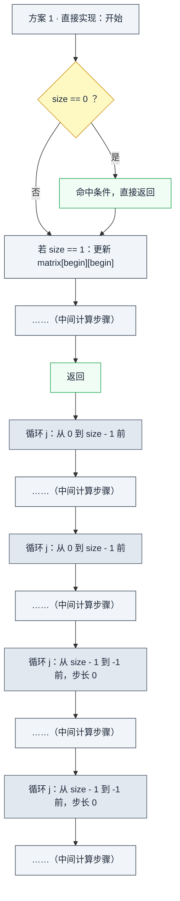

```python
import sys  # 提高递归深度上限（深输入防 RecursionError）

sys.setrecursionlimit(200000)  # 树/链表类题目节点数可达 1e4 量级

def fill(matrix, num, begin, size):  # 定义函数 fill（参数：矩阵, num, begin, 大小）
    """将 num 开头的数，从 (begin, begin) 开始逆时针旋转填充 size*size 的子矩阵。"""
    if size == 0:  # 若 大小 等于 0
        return  # return
    if size == 1:  # 若 大小 等于 1
        matrix[begin][begin] = num  # 把 num 写入 matrix[begin][begin]
        return  # return
    # 左列向下
    for j in range(size - 1):  # 让 下标 j 从 大小 减 1 遍历
        matrix[begin + j][begin] = num  # 把 num 写入 matrix[begin + j][begin]
        num += 1  # num累加 1
    # 底行向右
    for j in range(size - 1):  # 让 下标 j 从 大小 减 1 遍历
        matrix[begin + size - 1][begin + j] = num  # 把 num 写入 matrix[begin + size - 1][begin + j]
        num += 1  # num累加 1
    # 右列向上
    for j in range(size - 1, 0, -1):  # 让 下标 j 从 大小 减 1 倒数回去（每步减 1）
        matrix[begin + j][begin + size - 1] = num  # 把 num 写入 matrix[begin + j][begin + size - 1]
        num += 1  # num累加 1
    # 顶行向左
    for j in range(size - 1, 0, -1):  # 让 下标 j 从 大小 减 1 倒数回去（每步减 1）
        matrix[begin][begin + j] = num  # 把 num 写入 matrix[begin][begin + j]
        num += 1  # num累加 1
    fill(matrix, num, begin + 1, size - 2)  # fill(矩阵, num, begin 加 1, 大小 减 2)

def generate_square_matrix(n):  # 定义函数 generate_square_matrix（参数：元素个数）
    m = [[0] * n for _ in range(n)]  # 把 [[0] 乘 元素个数 for _ in range(元素个数)] 存入 映射表
    fill(m, 1, 0, n)  # fill(映射表, 1, 0, 元素个数)
    return m  # 返回 映射表

def print_matrix(m):  # 定义函数 print_matrix（参数：映射表）
    for row in m:  # 逐个取出 映射表 的元素（row）
        print(" ".join(f"{x:2d}" for x in row))  # 打印输出

if __name__ == "__main__":  # 若 __name__ 等于 '__main__'
    print_matrix(generate_square_matrix(6))  # print_matrix(generate_square_matrix(6))
```

#### 方案 2：直接实现

**思路与代码分析**：核心是「直接实现」。Python 版用切片与字典推导式简化操作，突出可读性。**走读**：方案 2 · 直接实现：开始 → 更新 m → 命中条件，直接返回 → 返回  → 循环 j：从 0 到 size - 1 前 → 循环 j：从 0 到 size - 1 前 → 循环 j：从 size - 1 到 -1 前，步长 0 → 循环 j：从 size - 1 到 -1 前，步长 0 → 返回 m。

**运行架构**（真实控制流）：

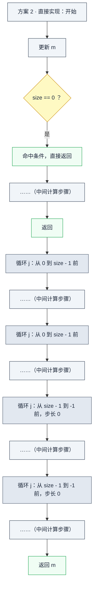

```python
import sys  # 提高递归深度上限（深输入防 RecursionError）

sys.setrecursionlimit(200000)  # 树/链表类题目节点数可达 1e4 量级

def spiral_fill(n):  # 定义函数 spiral_fill（参数：元素个数）
    """逆时针旋转填充 n*n 数字方阵：从 (0,0) 开始按 左列向下 -> 底行向右 -> 右列向上 -> 顶行向左 螺旋填充 1..n^2。"""
    m = [[0] * n for _ in range(n)]  # 把 [[0] 乘 元素个数 for _ in range(元素个数)] 存入 映射表

    def fill(num, begin, size):  # 定义函数 fill（参数：num, begin, 大小）
        if size == 0:  # 若 大小 等于 0
            return  # return
        if size == 1:  # 若 大小 等于 1
            m[begin][begin] = num  # 把 num 写入 m[begin][begin]
            return  # return
        for j in range(size - 1):  # 让 下标 j 从 大小 减 1 遍历
            m[begin + j][begin] = num
            num += 1  # 把 num; num 累加 1 写入 m[begin + j][begin]
        for j in range(size - 1):  # 让 下标 j 从 大小 减 1 遍历
            m[begin + size - 1][begin + j] = num
            num += 1  # 把 num; num 累加 1 写入 m[begin + size - 1][begin + j]
        for j in range(size - 1, 0, -1):  # 让 下标 j 从 大小 减 1 倒数回去（每步减 1）
            m[begin + j][begin + size - 1] = num
            num += 1  # 把 num; num 累加 1 写入 m[begin + j][begin + size - 1]
        for j in range(size - 1, 0, -1):  # 让 下标 j 从 大小 减 1 倒数回去（每步减 1）
            m[begin][begin + j] = num
            num += 1  # 把 num; num 累加 1 写入 m[begin][begin + j]
        fill(num, begin + 1, size - 2)  # fill(num, begin 加 1, 大小 减 2)

    fill(1, 0, n)  # fill(1, 0, 元素个数)
    return m  # 返回 映射表

if __name__ == "__main__":  # 若 __name__ 等于 '__main__'
    for row in spiral_fill(6):  # 逐个取出 spiral_fill 的元素（row）
        print(" ".join("%2d" % v for v in row))  # 打印输出
```

#### 方案 3：直接实现

**思路与代码分析**：核心是「直接实现」。Python 版用切片与字典推导式简化操作，突出可读性。

**运行架构**（真实控制流）：

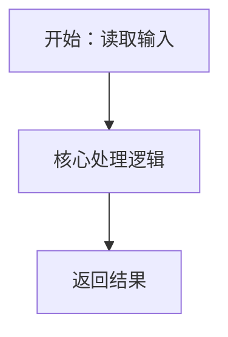

```python
import sys  # 提高递归深度上限（深输入防 RecursionError）

sys.setrecursionlimit(200000)  # 树/链表类题目节点数可达 1e4 量级

class Matrix:  # 定义类
    """面向对象版：矩阵类，封装填充与打印（方案 3）。"""

    def __init__(self, size):  # 构造函数：初始化成员
        self.N = size  # 把 大小 写入 self.N
        self.M = [[0] * size for _ in range(size)]  # 把 [[0] 乘 大小 for _ in range(大小)] 写入 self.M

    def fill(self, num, begin, size):  # 定义函数 fill（参数：self, num, begin, 大小）
        if size == 0:  # 若 大小 等于 0
            return  # return
        if size == 1:  # 若 大小 等于 1
            self.M[begin][begin] = num  # 把 num 写入 self.M[begin][begin]
            return  # return
        for j in range(size - 1):  # 让 下标 j 从 大小 减 1 遍历
            self.M[begin + j][begin] = num  # 把 num 写入 self.M[begin + j][begin]
            num += 1  # num累加 1
        for j in range(size - 1):  # 让 下标 j 从 大小 减 1 遍历
            self.M[begin + size - 1][begin + j] = num  # 把 num 写入 self.M[begin + size - 1][begin + j]
            num += 1  # num累加 1
        for j in range(size - 1, 0, -1):  # 让 下标 j 从 大小 减 1 倒数回去（每步减 1）
            self.M[begin + j][begin + size - 1] = num  # 把 num 写入 self.M[begin + j][begin + size - 1]
            num += 1  # num累加 1
        for j in range(size - 1, 0, -1):  # 让 下标 j 从 大小 减 1 倒数回去（每步减 1）
            self.M[begin][begin + j] = num  # 把 num 写入 self.M[begin][begin + j]
            num += 1  # num累加 1
        self.fill(num, begin + 1, size - 2)  # self.fill(num, begin 加 1, 大小 减 2)

    def show(self):  # 定义函数 show（参数：self）
        for row in self.M:  # 逐个取出 self 的元素（row）
            print(" ".join(f"{x:2d}" for x in row))  # 打印输出

    def clear(self):  # 定义函数 clear（参数：self）
        self.M = [
            [0] * self.N for _ in range(self.N)
        ]  # 把 [[0] 乘 self.N for _ in range(self.N)] 写入 self.M

if __name__ == "__main__":  # 若 __name__ 等于 '__main__'
    size = 6  # 把 6 存入 大小
    obj = Matrix(size)  # 把 Matrix(大小) 存入 obj
    obj.fill(1, 0, size)  # obj.fill(1, 0, 大小)
    obj.show()  # obj.show()
    obj.clear()  # obj.clear()
```

#### 方案 4：迭代指针处理

**思路与代码分析**：核心是「迭代指针处理」。Python 版用切片与字典推导式简化操作，突出可读性。**走读**：方案 4 · 迭代指针处理：开始 → 更新 m → 当 num ≤ total: 时反复执行 → 返回 m。

**运行架构**（真实控制流）：

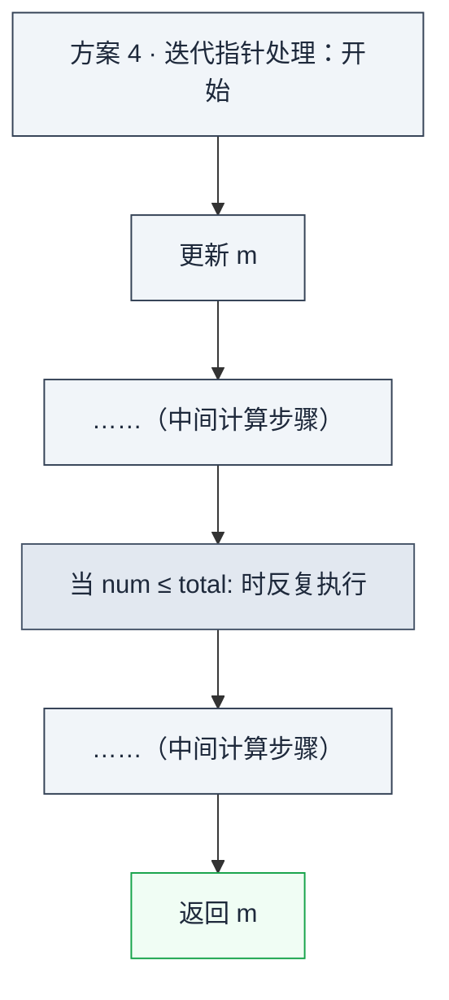

```python
import sys  # 提高递归深度上限（深输入防 RecursionError）

sys.setrecursionlimit(200000)  # 树/链表类题目节点数可达 1e4 量级

def place_fill(n):  # 定义函数 place_fill（参数：元素个数）
    """依据前一位置、方向（DRUL 逆时针）与边界规则确定下一个摆放位置（方案 4）。"""
    m = [[0] * n for _ in range(n)]  # 把 [[0] 乘 元素个数 for _ in range(元素个数)] 存入 映射表
    row = col = 0  # 把 col 赋值为 0 存入 row
    direction = "D"  # D 向下, R 向右, U 向上, L 向左（逆时针）
    num = 1  # 把 1 存入 num
    total = n * n  # 把 元素个数 乘 元素个数 存入 总和
    while num <= total:  # 循环，直到不满足「num 不超过 总和」
        m[row][col] = num  # 把 num 写入 m[row][col]
        num += 1  # num累加 1
        if direction == "D":  # 若 direction 等于 'D'
            if (
                row + 1 < n and m[row + 1][col] == 0
            ):  # 若 row 加 1 小于 元素个数 and 映射表[row 加 1][col] 等于 0
                row += 1  # row累加 1
            else:  # 否则
                direction = "R"  # 把 'R' 存入 direction
                col += 1  # col累加 1
        elif direction == "R":  # 否则，若 direction 等于 'R'
            if (
                col + 1 < n and m[row][col + 1] == 0
            ):  # 若 col 加 1 小于 元素个数 and 映射表[row][col 加 1] 等于 0
                col += 1  # col累加 1
            else:  # 否则
                direction = "U"  # 把 'U' 存入 direction
                row -= 1  # row累减 1
        elif direction == "U":  # 否则，若 direction 等于 'U'
            if row - 1 >= 0 and m[row - 1][col] == 0:  # 若 row 减 1 不低于 0 and 映射表[row 减 1][col] 等于 0
                row -= 1  # row累减 1
            else:  # 否则
                direction = "L"  # 把 'L' 存入 direction
                col -= 1  # col累减 1
        else:  # 'L'
            if col - 1 >= 0 and m[row][col - 1] == 0:  # 若 col 减 1 不低于 0 and 映射表[row][col 减 1] 等于 0
                col -= 1  # col累减 1
            else:  # 否则
                direction = "D"  # 把 'D' 存入 direction
                row += 1  # row累加 1
    return m  # 返回 映射表

def print_matrix(m):  # 定义函数 print_matrix（参数：映射表）
    for row in m:  # 逐个取出 映射表 的元素（row）
        print(" ".join(f"{x:2d}" for x in row))  # 打印输出

if __name__ == "__main__":  # 若 __name__ 等于 '__main__'
    print_matrix(place_fill(6))  # print_matrix(place_fill(6))
```

#### 方案 5：迭代指针处理

**思路与代码分析**：核心是「迭代指针处理」。Python 版用切片与字典推导式简化操作，突出可读性。

**运行架构**：与方案 3 的控制流相同（同算法在该语言的等价实现），图见上。

```python
import sys  # 提高递归深度上限（深输入防 RecursionError）

sys.setrecursionlimit(200000)  # 树/链表类题目节点数可达 1e4 量级

class Matrix:  # 定义类
    """矩阵类（含 operator() 风格访问）：m(r, c) 取值，set(r, c, v) 赋值。"""

    def __init__(self, r, c):  # 构造函数：初始化成员
        self.row = r  # 把 右指针 写入 self.row
        self.col = c  # 把 字符 写入 self.col
        self.buf = [[0] * c for _ in range(r)]  # 把 [[0] 乘 字符 for _ in range(右指针)] 写入 self.buf

    def __call__(self, r, c):  # 定义函数 __call__（参数：self, 右指针, 字符）
        return self.buf[r][c]  # 返回 self.buf[右指针][字符]

    def set(self, r, c, v):  # 定义函数 set（参数：self, 右指针, 字符, 值）
        self.buf[r][c] = v  # 把 值 写入 self.buf[r][c]

    def __str__(self):  # 定义函数 __str__（参数：self）
        return "\n".join(" ".join("%2d" % v for v in row) for row in self.buf)

if __name__ == "__main__":  # 若 __name__ 等于 '__main__'
    m = Matrix(4, 5)  # 把 Matrix(4, 5) 存入 映射表
    for i in range(4):  # 让 下标 i 从 4 遍历
        for j in range(5):  # 让 下标 j 从 5 遍历
            m.set(i, j, i * j)  # 映射表.set(下标 i, 下标 j, 下标 i 乘 下标 j)
    print("Matrix 4X5:")  # 打印输出
    print(m)  # 打印输出
```

#### 方案 6：迭代指针处理

**思路与代码分析**：核心是「迭代指针处理」。Python 版用切片与字典推导式简化操作，突出可读性。

**运行架构**：与方案 3 的控制流相同（同算法在该语言的等价实现），图见上。

```python
class Matrix:  # 定义类
    """矩阵类：用 __call__ 支持多下标访问 m(r, c)，并支持打印（方案 6）。"""

    def __init__(self, r, c):  # 构造函数：初始化成员
        self.row = r  # 把 右指针 写入 self.row
        self.col = c  # 把 字符 写入 self.col
        self.buf = [[0] * c for _ in range(r)]  # 把 [[0] 乘 字符 for _ in range(右指针)] 写入 self.buf

    def __call__(self, r, c):  # 定义函数 __call__（参数：self, 右指针, 字符）
        return self.buf[r][c]  # 返回 self.buf[右指针][字符]

    def __str__(self):  # 定义函数 __str__（参数：self）
        return "\n".join(" ".join(f"{x:2d}" for x in row) for row in self.buf)

if __name__ == "__main__":  # 若 __name__ 等于 '__main__'
    m = Matrix(4, 5)  # 把 Matrix(4, 5) 存入 映射表
    for i in range(4):  # 让 下标 i 从 4 遍历
        for j in range(5):  # 让 下标 j 从 5 遍历
            m.buf[i][j] = i * j  # 把 下标 i 乘 下标 j 写入 m.buf[i][j]
    print("Matrix 4X5:")  # 打印输出
    print(m)  # 打印输出
    print("m(2, 3) =", m(2, 3))  # 打印输出
```

#### 方案 7：迭代指针处理

**思路与代码分析**：核心是「迭代指针处理」。Python 版用切片与字典推导式简化操作，突出可读性。**走读**：方案 7 · 迭代指针处理：开始 → 更新 handlers → 更新 = → 更新 = → 更新 > → 更新 > → 返回 handlers[direction] ()。

**运行架构**（真实控制流）：

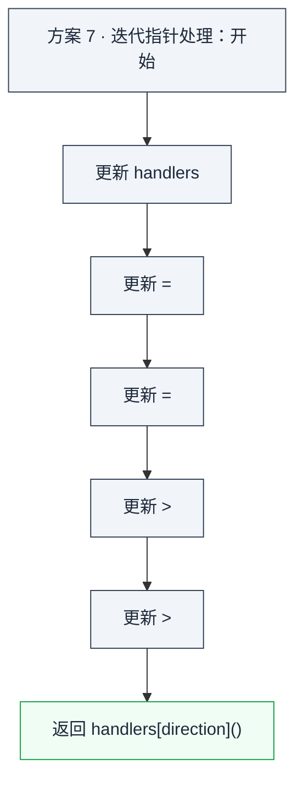

```python
import sys  # 提高递归深度上限（深输入防 RecursionError）

sys.setrecursionlimit(200000)  # 树/链表类题目节点数可达 1e4 量级

def place(
    num, row, col, direction, n, m
):  # 定义函数 place（参数：num, row, col, direction, 元素个数, 映射表）
    """根据前一位置、方向(DRUL)与边界规则确定下一个摆放数据的位置（方案 7）。

    使用 dict 模拟 C++ 的 switch 分派。
    """
    handlers = {  # 把 { 存入 handlers
        "D": lambda: (row + 1, col) if (row + 1 < n and m[row + 1][col] == 0) else (row, col + 1, "R"),
        "R": lambda: (row, col + 1) if (col + 1 < n and m[row][col + 1] == 0) else (row - 1, col, "U"),
        "U": lambda: (row - 1, col) if (row - 1 >= 0 and m[row - 1][col] == 0) else (row, col - 1, "L"),
        "L": lambda: (row, col - 1) if (col - 1 >= 0 and m[row][col - 1] == 0) else (row + 1, col, "D"),
    }
    return handlers[direction]()  # 返回 handlers[direction]()

def fill_spiral(n):  # 定义函数 fill_spiral（参数：元素个数）
    m = [[0] * n for _ in range(n)]  # 把 [[0] 乘 元素个数 for _ in range(元素个数)] 存入 映射表
    row = col = 0  # 把 col 赋值为 0 存入 row
    direction = "D"  # 把 'D' 存入 direction
    num = 1  # 把 1 存入 num
    while num <= n * n:  # 循环，直到不满足「num 不超过 元素个数 乘 元素个数」
        m[row][col] = num  # 把 num 写入 m[row][col]
        num += 1  # num累加 1
        res = place(
            num, row, col, direction, n, m
        )  # 把 place(num, row, col, direction, 元素个数, 映射表) 存入 结果
        row, col = res[0], res[1]  # 把 结果[0], 结果[1] 写入 row, col
        if len(res) == 3:  # 若 长度(结果) 等于 3
            direction = res[2]  # 把 结果[2] 存入 direction
    return m  # 返回 映射表

def print_matrix(m):  # 定义函数 print_matrix（参数：映射表）
    for row in m:  # 逐个取出 映射表 的元素（row）
        print(" ".join(f"{x:2d}" for x in row))  # 打印输出

if __name__ == "__main__":  # 若 __name__ 等于 '__main__'
    print_matrix(fill_spiral(6))  # print_matrix(fill_spiral(6))
```

#### 方案 8：方案8（Filler 迭代器式旋转填充）

**思路与代码分析**：核心是「方案8（Filler 迭代器式旋转填充）」。Python 版用切片与字典推导式简化操作，突出可读性。**走读**：方案 8 · 方案8（Filler 迭代器式旋转填充）：开始 → 更新 mat → 更新 f → 调用 f.set_rule(rule) → 更新 i → 遍历 f: 中的每个元素 c → 更新 mat[r][c] → 更新 + → 返回 mat。

**运行架构**（真实控制流）：

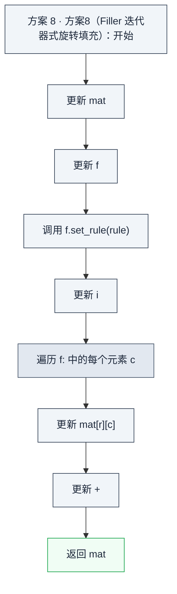

```python
import sys  # 提高递归深度上限（深输入防 RecursionError）

sys.setrecursionlimit(200000)  # 树/链表类题目节点数可达 1e4 量级

class Filler:  # 定义类
    """填充器（迭代器风格）：按规则串（如 'ESVM' 逆时针 / 'semv' 顺时针）在 matrix 上逐格前进。
    规则字母：E/S/V/M 表示 下/右/上/左；遇到边界后收缩对应的最小/最大行列，实现旋转填充。"""

    def __init__(self, rn, cn):  # 构造函数：初始化成员
        self.row_num = rn  # 把 rn 写入 self.row_num
        self.col_num = cn  # 把 cn 写入 self.col_num
        self.rule = "ESVM"  # 把 'ESVM' 写入 self.rule
        self.reset()  # self.reset()

    def reset(self):  # 定义函数 reset（参数：self）
        self.pos = {"row": 0, "col": 0}  # 把 {'row': 0, 'col': 0} 写入 self.pos
        self.idx = 0  # 把 0 写入 self.idx
        self.r_min = self.c_min = 0  # 把 self.c_min 赋值为 0 写入 self.r_min
        self.r_max = self.row_num - 1  # 把 self.row_num 减 1 写入 self.r_max
        self.c_max = self.col_num - 1  # 把 self.col_num 减 1 写入 self.c_max

    def set_rule(self, r):  # 定义函数 set_rule（参数：self, 右指针）
        self.rule = r  # 把 右指针 写入 self.rule

    def __iter__(self):  # 定义函数 __iter__（参数：self）
        while (
            self.r_min
            <= self.pos["row"]
            <= self.r_max  # 循环，直到不满足「self.r_min 不超过 self.pos['row'] 不超过 self.r_max and」
            and self.c_min <= self.pos["col"] <= self.c_max
        ):  # 把 self.pos['col'] 不超过 self.c_max): 写入 self.c_min <
            yield (self.pos["row"], self.pos["col"])  # yield (self.pos['row'], self.pos['col'])
            self._advance()  # self._advance()

    def _advance(self):  # 定义函数 _advance（参数：self）
        cmd = self.rule[self.idx % 4]  # 把 self.rule[self.idx 对…取模 4] 存入 cmd
        if cmd == "E":  # 向下
            self.pos["row"] += 1  # 把 1 写入 self.pos['row'] +
            if self.pos["row"] == self.r_max:  # 若 self.pos['row'] 等于 self.r_max
                self.idx += 1  # self.idx累加 1
                self.c_min += 1  # self.c_min累加 1
        elif cmd == "S":  # 向右
            self.pos["col"] += 1  # 把 1 写入 self.pos['col'] +
            if self.pos["col"] == self.c_max:  # 若 self.pos['col'] 等于 self.c_max
                self.idx += 1  # self.idx累加 1
                self.r_max -= 1  # self.r_max累减 1
        elif cmd == "V":  # 向上
            self.pos["row"] -= 1  # 把 1 写入 self.pos['row'] -
            if self.pos["row"] == self.r_min:  # 若 self.pos['row'] 等于 self.r_min
                self.idx += 1  # self.idx累加 1
                self.c_max -= 1  # self.c_max累减 1
        elif cmd == "M":  # 向左
            self.pos["col"] -= 1  # 把 1 写入 self.pos['col'] -
            if self.pos["col"] == self.c_min:  # 若 self.pos['col'] 等于 self.c_min
                self.idx += 1  # self.idx累加 1
                self.r_min += 1  # self.r_min累加 1

def fill_matrix(rn, cn, rule="ESVM"):  # 定义函数 fill_matrix（参数：rn, cn, rule 赋值为 'ESVM'）
    mat = [[0] * cn for _ in range(rn)]  # 把 [[0] 乘 cn for _ in range(rn)] 存入 mat
    f = Filler(rn, cn)  # 把 Filler(rn, cn) 存入 f
    f.set_rule(rule)  # f.set_rule(rule)
    i = 1  # 把 1 存入 下标 i
    for r, c in f:  # for (右指针, 字符) in f:
        mat[r][c] = i  # 把 下标 i 写入 mat[r][c]
        i += 1  # 下标 i累加 1
    return mat  # 返回 mat

if __name__ == "__main__":  # 若 __name__ 等于 '__main__'
    for row in fill_matrix(6, 6, "ESVM"):  # 逐个取出 fill_matrix 的元素（row）
        print(" ".join("%2d" % v for v in row))  # 打印输出
```

#### 方案 9：直接实现

**思路与代码分析**：核心是「直接实现」。Python 版用切片与字典推导式简化操作，突出可读性。**走读**：方案 9 · 直接实现：开始 → 更新 obj → 调用 obj.set_rule(rule) → 更新 seq → 调用 print(rule, -＞, [(p.row, p → 返回结果。

**运行架构**（真实控制流）：

```mermaid
graph TD
    N0["方案 9 · 直接实现：开始"]
    N1["更新 obj"]
    N2["调用 obj.set_rule(rule)"]
    N3["更新 seq"]
    N4["调用 print(rule, -＞, [(p.row, p"]
    N5["返回结果"]
    N0 --> N1
    N1 --> N2
    N2 --> N3
    N3 --> N4
    N4 --> N5
    classDef n fill:#f1f5f9,stroke:#334155,color:#1e293b;
    classDef lp fill:#e2e8f0,stroke:#475569,color:#1e293b;
    classDef dc fill:#fef9c3,stroke:#ca8a04,color:#1e293b;
    classDef tm fill:#f0fdf4,stroke:#16a34a,color:#1e293b;
    class N0,N1,N2,N3,N4 n;
    class N5 tm;
```

```python
import sys  # 提高递归深度上限（深输入防 RecursionError）

sys.setrecursionlimit(200000)  # 树/链表类题目节点数可达 1e4 量级

class Location:  # 定义类
    def __init__(self, row=0, col=0):  # 构造函数：初始化成员
        self.row = row  # 把 row 写入 self.row
        self.col = col  # 把 col 写入 self.col

class Filler:  # 定义类
    """填充器：依据规则串（如 ESVM 逆时针 / semv 顺时针）逐位置前进（方案 9）。"""

    def __init__(self, rn, cn):  # 构造函数：初始化成员
        self.row_num = rn  # 把 rn 写入 self.row_num
        self.col_num = cn  # 把 cn 写入 self.col_num
        self.reset()  # self.reset()

    def reset(self):  # 定义函数 reset（参数：self）
        self.pos = Location(0, 0)  # 把 Location(0, 0) 写入 self.pos
        self.idx = 0  # 把 0 写入 self.idx
        self.r_min = self.c_min = 0  # 把 self.c_min 赋值为 0 写入 self.r_min
        self.r_max = self.row_num - 1  # 把 self.row_num 减 1 写入 self.r_max
        self.c_max = self.col_num - 1  # 把 self.col_num 减 1 写入 self.c_max
        self.rule = "ESVM"  # 把 「ESVM」 写入 self.rule

    def set_rule(self, rule):  # 定义函数 set_rule（参数：self, rule）
        self.rule = rule  # 把 rule 写入 self.rule

    def current(self):  # 定义函数 current（参数：self）
        return self.pos  # 返回 self.pos

    def __iter__(self):  # 定义函数 __iter__（参数：self）
        return self  # 返回 self

    def __next__(self):  # 定义函数 __next__（参数：self）
        res = Location(self.pos.row, self.pos.col)  # 把 Location(self.pos.row, self.pos.col) 存入 结果
        ch = self.rule[self.idx % len(self.rule)]  # 把 self.rule[self.idx 对…取模 长度(self.rule)] 存入 字符
        if ch == "E":  # 向下
            self.pos.row += 1  # self.pos.row累加 1
            if self.pos.row == self.r_max:  # 若 self.pos.row 等于 self.r_max
                self.idx += 1  # self.idx累加 1
                self.c_min += 1  # self.c_min累加 1
        elif ch == "S":  # 向右
            self.pos.col += 1  # self.pos.col累加 1
            if self.pos.col == self.c_max:  # 若 self.pos.col 等于 self.c_max
                self.idx += 1  # self.idx累加 1
                self.r_max -= 1  # self.r_max累减 1
        elif ch == "V":  # 向上
            self.pos.row -= 1  # self.pos.row累减 1
            if self.pos.row == self.r_min:  # 若 self.pos.row 等于 self.r_min
                self.idx += 1  # self.idx累加 1
                self.c_max -= 1  # self.c_max累减 1
        elif ch == "M":  # 向左
            self.pos.col -= 1  # self.pos.col累减 1
            if self.pos.col == self.c_min:  # 若 self.pos.col 等于 self.c_min
                self.idx += 1  # self.idx累加 1
                self.r_min += 1  # self.r_min累加 1
        elif ch == "e":  # 顺时针：向下
            self.pos.row += 1  # self.pos.row累加 1
            if self.pos.row == self.r_max:  # 若 self.pos.row 等于 self.r_max
                self.idx += 1  # self.idx累加 1
                self.c_max -= 1  # self.c_max累减 1
        elif ch == "s":  # 顺时针：向右
            self.pos.col += 1  # self.pos.col累加 1
            if self.pos.col == self.c_max:  # 若 self.pos.col 等于 self.c_max
                self.idx += 1  # self.idx累加 1
                self.r_min += 1  # self.r_min累加 1
        elif ch == "v":  # 顺时针：向上
            self.pos.row -= 1  # self.pos.row累减 1
            if self.pos.row == self.r_min:  # 若 self.pos.row 等于 self.r_min
                self.idx += 1  # self.idx累加 1
                self.c_min += 1  # self.c_min累加 1
        elif ch == "m":  # 顺时针：向左
            self.pos.col -= 1  # self.pos.col累减 1
            if self.pos.col == self.c_min:  # 若 self.pos.col 等于 self.c_min
                self.idx += 1  # self.idx累加 1
                self.r_max -= 1  # self.r_max累减 1
        return res  # 返回 结果

def test(rule, rn, cn):  # 定义函数 test（参数：rule, rn, cn）
    obj = Filler(rn, cn)  # 把 Filler(rn, cn) 存入 obj
    obj.set_rule(rule)  # obj.set_rule(rule)
    seq = [next(obj) for _ in range(rn * cn)]  # 把 [下一个(obj) for _ in range(rn 乘 cn)] 存入 seq
    print(rule, "->", [(p.row, p.col) for p in seq])  # 打印输出

if __name__ == "__main__":  # 若 __name__ 等于 '__main__'
    test("ESVM", 4, 4)  # test(「ESVM」, 4, 4)
    test("semv", 4, 4)  # test(「semv」, 4, 4)
```

#### 方案 10：直接实现

**思路与代码分析**：核心是「直接实现」。Python 版用切片与字典推导式简化操作，突出可读性。

**运行架构**：与方案 3 的控制流相同（同算法在该语言的等价实现），图见上。

```python
import sys  # 提高递归深度上限（深输入防 RecursionError）

sys.setrecursionlimit(200000)  # 树/链表类题目节点数可达 1e4 量级

class Location:  # 定义类
    def __init__(self, row=0, col=0):  # 构造函数：初始化成员
        self.row = row  # 把 row 写入 self.row
        self.col = col  # 把 col 写入 self.col

class Filler:  # 定义类
    def __init__(self, rn, cn):  # 构造函数：初始化成员
        self.row_num = rn  # 把 rn 写入 self.row_num
        self.col_num = cn  # 把 cn 写入 self.col_num
        self.reset()  # self.reset()

    def reset(self):  # 定义函数 reset（参数：self）
        self.pos = Location(0, 0)  # 把 Location(0, 0) 写入 self.pos
        self.idx = 0  # 把 0 写入 self.idx
        self.r_min = self.c_min = 0  # 把 self.c_min 赋值为 0 写入 self.r_min
        self.r_max = self.row_num - 1  # 把 self.row_num 减 1 写入 self.r_max
        self.c_max = self.col_num - 1  # 把 self.col_num 减 1 写入 self.c_max
        self.rule = "ESVM"  # 把 「ESVM」 写入 self.rule

    def set_rule(self, rule):  # 定义函数 set_rule（参数：self, rule）
        self.rule = rule  # 把 rule 写入 self.rule

    def __iter__(self):  # 定义函数 __iter__（参数：self）
        return self  # 返回 self

    def __next__(self):  # 定义函数 __next__（参数：self）
        res = Location(self.pos.row, self.pos.col)  # 把 Location(self.pos.row, self.pos.col) 存入 结果
        ch = self.rule[self.idx % len(self.rule)]  # 把 self.rule[self.idx 对…取模 长度(self.rule)] 存入 字符
        if ch == "E":  # 若 字符 等于 'E'
            self.pos.row += 1  # self.pos.row累加 1
            if self.pos.row == self.r_max:  # 若 self.pos.row 等于 self.r_max
                self.idx += 1  # self.idx累加 1
                self.c_min += 1  # self.c_min累加 1
        elif ch == "S":  # 否则，若 字符 等于 'S'
            self.pos.col += 1  # self.pos.col累加 1
            if self.pos.col == self.c_max:  # 若 self.pos.col 等于 self.c_max
                self.idx += 1  # self.idx累加 1
                self.r_max -= 1  # self.r_max累减 1
        elif ch == "V":  # 否则，若 字符 等于 'V'
            self.pos.row -= 1  # self.pos.row累减 1
            if self.pos.row == self.r_min:  # 若 self.pos.row 等于 self.r_min
                self.idx += 1  # self.idx累加 1
                self.c_max -= 1  # self.c_max累减 1
        elif ch == "M":  # 否则，若 字符 等于 'M'
            self.pos.col -= 1  # self.pos.col累减 1
            if self.pos.col == self.c_min:  # 若 self.pos.col 等于 self.c_min
                self.idx += 1  # self.idx累加 1
                self.r_min += 1  # self.r_min累加 1
        return res  # 返回 结果

class Matrix:  # 定义类
    def __init__(self, r, c):  # 构造函数：初始化成员
        self.row = r  # 把 右指针 写入 self.row
        self.col = c  # 把 字符 写入 self.col
        self.buf = [[0] * c for _ in range(r)]  # 把 [[0] 乘 字符 for _ in range(右指针)] 写入 self.buf

    def __call__(self, r, c):  # 定义函数 __call__（参数：self, 右指针, 字符）
        return self.buf[r][c]  # 返回 self.buf[右指针][字符]

    def __setitem__(self, key, value):  # 定义函数 __setitem__（参数：self, key, value）
        r, c = key  # 把 key 写入 r, c
        self.buf[r][c] = value  # 把 value 写入 self.buf[r][c]

if __name__ == "__main__":  # 若 __name__ 等于 '__main__'
    rn = cn = 9  # 把 cn 赋值为 9 存入 rn
    obj = Filler(rn, cn)  # 把 Filler(rn, cn) 存入 obj
    obj.set_rule("ESVM")  # 逆时针
    m = Matrix(rn, cn)  # 把 Matrix(rn, cn) 存入 映射表
    for i in range(rn * cn):  # 让 下标 i 从 rn 乘 cn 遍历
        p = next(obj)  # 把 下一个(obj) 存入 节点
        m[p.row, p.col] = i + 1  # 把 下标 i 加 1 写入 m[p.row, p.col]
    for row in m.buf:  # 逐个取出 映射表 的元素（row）
        print(" ".join(f"{x:2d}" for x in row))  # 打印输出
```

#### 方案 11：迭代指针处理

**思路与代码分析**：核心是「迭代指针处理」。Python 版用切片与字典推导式简化操作，突出可读性。

**运行架构**：与方案 3 的控制流相同（同算法在该语言的等价实现），图见上。

```python
class Rule:  # 定义类
    """规则类：规则串中的不同字符表示不同的前进命令，循环使用（方案 11）。"""

    def __init__(self, r):  # 构造函数：初始化成员
        self.data = list(r)  # 把 列表(右指针) 写入 self.data
        self.idx = 0  # 把 0 写入 self.idx
        self.length = len(self.data)  # 把 长度(self.data) 写入 长度

    def __iter__(self):  # 定义函数 __iter__（参数：self）
        return self  # 返回 self

    def __next__(self):  # 定义函数 __next__（参数：self）
        ch = self.data[self.idx]  # 把 self.data[self.idx] 存入 字符
        self.idx = (self.idx + 1) % self.length  # 把 (self.idx 加 1) 对…取模 self.长度 写入 self.idx
        return ch  # 返回 字符

    def peek(self):  # 定义函数 peek（参数：self）
        return self.data[self.idx]  # 返回 self.data[self.idx]

if __name__ == "__main__":  # 若 __name__ 等于 '__main__'
    r = Rule("ESVM")  # 把 Rule(「ESVM」) 存入 右指针
    print("".join(next(r) for _ in range(10)))  # ESVMESVMES
    r2 = Rule("semv")  # 把 Rule(「semv」) 存入 r2
    print("".join(next(r2) for _ in range(6)))  # semvse
```

#### 方案 12：直接实现

**思路与代码分析**：核心是「直接实现」。Python 版用切片与字典推导式简化操作，突出可读性。**走读**：方案 12 · 直接实现：开始 → 更新 obj → 调用 obj.set_rule(Rule(rule)) → 更新 seq → 调用 print(rule, -＞, [(p.row, p → 返回结果。

**运行架构**（真实控制流）：

```mermaid
graph TD
    N0["方案 12 · 直接实现：开始"]
    N1["更新 obj"]
    N2["调用 obj.set_rule(Rule(rule))"]
    N3["更新 seq"]
    N4["调用 print(rule, -＞, [(p.row, p"]
    N5["返回结果"]
    N0 --> N1
    N1 --> N2
    N2 --> N3
    N3 --> N4
    N4 --> N5
    classDef n fill:#f1f5f9,stroke:#334155,color:#1e293b;
    classDef lp fill:#e2e8f0,stroke:#475569,color:#1e293b;
    classDef dc fill:#fef9c3,stroke:#ca8a04,color:#1e293b;
    classDef tm fill:#f0fdf4,stroke:#16a34a,color:#1e293b;
    class N0,N1,N2,N3,N4 n;
    class N5 tm;
```

```python
import sys  # 提高递归深度上限（深输入防 RecursionError）

sys.setrecursionlimit(200000)  # 树/链表类题目节点数可达 1e4 量级

class Location:  # 定义类
    def __init__(self, row=0, col=0):  # 构造函数：初始化成员
        self.row = row  # 把 row 写入 self.row
        self.col = col  # 把 col 写入 self.col

class Rule:  # 定义类
    """规则对象：供 Filler 通过指针 (*cmd) 读取/推进当前命令。"""

    def __init__(self, r):  # 构造函数：初始化成员
        self.data = list(r)  # 把 列表(右指针) 写入 self.data
        self.idx = 0  # 把 0 写入 self.idx
        self.length = len(self.data)  # 把 长度(self.data) 写入 长度

    def current(self):  # 定义函数 current（参数：self）
        return self.data[self.idx]  # 返回 self.data[self.idx]

    def advance(self):  # 定义函数 advance（参数：self）
        self.idx = (self.idx + 1) % self.length  # 把 (self.idx 加 1) 对…取模 self.长度 写入 self.idx

class Filler:  # 定义类
    """填充器：持有 Rule 对象，依据规则逐位置前进（方案 12）。"""

    def __init__(self, rn, cn):  # 构造函数：初始化成员
        self.row_num = rn  # 把 rn 写入 self.row_num
        self.col_num = cn  # 把 cn 写入 self.col_num
        self.reset()  # self.reset()

    def reset(self):  # 定义函数 reset（参数：self）
        self.pos = Location(0, 0)  # 把 Location(0, 0) 写入 self.pos
        self.r_min = self.c_min = 0  # 把 self.c_min 赋值为 0 写入 self.r_min
        self.r_max = self.row_num - 1  # 把 self.row_num 减 1 写入 self.r_max
        self.c_max = self.col_num - 1  # 把 self.col_num 减 1 写入 self.c_max
        self.cmd = None  # 把 None 写入 self.cmd

    def set_rule(self, rule):  # 定义函数 set_rule（参数：self, rule）
        self.cmd = rule  # 把 rule 写入 self.cmd

    def __iter__(self):  # 定义函数 __iter__（参数：self）
        return self  # 返回 self

    def __next__(self):  # 定义函数 __next__（参数：self）
        res = Location(self.pos.row, self.pos.col)  # 把 Location(self.pos.row, self.pos.col) 存入 结果
        ch = self.cmd.current()  # 把 self.cmd.current() 存入 字符
        if ch == "E":  # 若 字符 等于 'E'
            self.pos.row += 1  # self.pos.row累加 1
            if self.pos.row == self.r_max:  # 若 self.pos.row 等于 self.r_max
                self.cmd.advance()  # self.cmd.advance()
                self.c_min += 1  # self.c_min累加 1
        elif ch == "S":  # 否则，若 字符 等于 'S'
            self.pos.col += 1  # self.pos.col累加 1
            if self.pos.col == self.c_max:  # 若 self.pos.col 等于 self.c_max
                self.cmd.advance()  # self.cmd.advance()
                self.r_max -= 1  # self.r_max累减 1
        elif ch == "V":  # 否则，若 字符 等于 'V'
            self.pos.row -= 1  # self.pos.row累减 1
            if self.pos.row == self.r_min:  # 若 self.pos.row 等于 self.r_min
                self.cmd.advance()  # self.cmd.advance()
                self.c_max -= 1  # self.c_max累减 1
        elif ch == "M":  # 否则，若 字符 等于 'M'
            self.pos.col -= 1  # self.pos.col累减 1
            if self.pos.col == self.c_min:  # 若 self.pos.col 等于 self.c_min
                self.cmd.advance()  # self.cmd.advance()
                self.r_min += 1  # self.r_min累加 1
        return res  # 返回 结果

def test(rule, rn, cn):  # 定义函数 test（参数：rule, rn, cn）
    obj = Filler(rn, cn)  # 把 Filler(rn, cn) 存入 obj
    obj.set_rule(Rule(rule))  # obj.set_rule(Rule(rule))
    seq = [next(obj) for _ in range(rn * cn)]  # 把 [下一个(obj) for _ in range(rn 乘 cn)] 存入 seq
    print(rule, "->", [(p.row, p.col) for p in seq])  # 打印输出

if __name__ == "__main__":  # 若 __name__ 等于 '__main__'
    test("ESVM", 4, 4)  # test(「ESVM」, 4, 4)
```

#### 方案 13：直接实现

**思路与代码分析**：核心是「直接实现」。Python 版用切片与字典推导式简化操作，突出可读性。**走读**：方案 13 · 直接实现：开始 → 命中条件，直接返回 → 更新 i → 当 True: 时反复执行 → 命中条件，直接返回 → 若 i ≥ len(text)：处理 break → 跳出循环（break） → 更新 + → 返回 False。

**运行架构**（真实控制流）：

```mermaid
graph TD
    N0["方案 13 · 直接实现：开始"]
    N1{"regexp and regexp[0] == ^ ？"}
    N2["命中条件，直接返回"]
    N3["更新 i"]
    N4["当 True: 时反复执行"]
    N5{"matchhere(regexp, text[i ？"}
    N6["命中条件，直接返回"]
    N7["若 i ≥ len(text)：处理 break"]
    N8["跳出循环（break）"]
    N9["更新 +"]
    N10["返回 False"]
    N0 --> N1
    N1 -- 是 --> N2
    N1 -- 否 --> N3
    N3 --> N4
    N4 --> N5
    N5 -- 是 --> N6
    N5 -- 否 --> N7
    N7 --> N8
    N8 --> N9
    N9 --> N10
    classDef n fill:#f1f5f9,stroke:#334155,color:#1e293b;
    classDef lp fill:#e2e8f0,stroke:#475569,color:#1e293b;
    classDef dc fill:#fef9c3,stroke:#ca8a04,color:#1e293b;
    classDef tm fill:#f0fdf4,stroke:#16a34a,color:#1e293b;
    class N0,N3,N7,N8,N9 n;
    class N4 lp;
    class N1,N5 dc;
    class N2,N6,N10 tm;
```

```python
import sys  # 提高递归深度上限（深输入防 RecursionError）

sys.setrecursionlimit(200000)  # 树/链表类题目节点数可达 1e4 量级

def match(regexp, text):  # 定义函数 match（参数：regexp, text）
    """扫描 text，若任一位置匹配 regexp 则返回 True（同 grep，方案 13）。"""
    if regexp and regexp[0] == "^":  # 若 regexp and regexp[0] 等于 ' 按位异或 '
        return matchhere(regexp[1:], text)  # 返回 matchhere(regexp[1:], text)
    i = 0  # 把 0 存入 下标 i
    while True:  # 循环，直到不满足「True」
        if matchhere(regexp, text[i:]):  # 若 matchhere(regexp, text[下标 i:]
            return True  # 返回 True
        if i >= len(text):  # 若 下标 i 不低于 长度(text
            break  # 跳出循环
        i += 1  # 下标 i累加 1
    return False  # 返回 False

def matchhere(regexp, text):  # 定义函数 matchhere（参数：regexp, text）
    if regexp == "":  # 若 regexp 等于 ''
        return True  # 返回 True
    if len(regexp) >= 2 and regexp[1] == "*":  # 若 长度(regexp) 不低于 2 and regexp[1] 等于 ' 乘 '
        return matchstar(regexp[0], regexp[2:], text)  # 返回 matchstar(regexp[0], regexp[2:], text)
    if regexp[0] == "$" and len(regexp) == 1:  # 若 regexp[0] 等于 '$' and 长度(regexp) 等于 1
        return text == ""  # 返回 text 等于 ''
    if text and (
        regexp[0] == "." or regexp[0] == text[0]
    ):  # 若 text and (regexp[0] 等于 '.' or regexp[0] 等于 text[0]
        return matchhere(regexp[1:], text[1:])  # 返回 matchhere(regexp[1:], text[1:])
    return False  # 返回 False

def matchstar(c, regexp, text):  # 定义函数 matchstar（参数：字符, regexp, text）
    i = 0  # 把 0 存入 下标 i
    while True:  # 循环，直到不满足「True」
        if matchhere(regexp, text[i:]):  # 若 matchhere(regexp, text[下标 i:]
            return True  # 返回 True
        if i >= len(text):  # 若 下标 i 不低于 长度(text
            break  # 跳出循环
        if text[i] != c and c != ".":  # 若 text[下标 i] 不等于 字符 and 字符 不等于 '.'
            break  # 跳出循环
        i += 1  # 下标 i累加 1
    return False  # 返回 False

if __name__ == "__main__":  # 若 __name__ 等于 '__main__'
    print(match("abc", "xxabcxx"))  # True
    print(match("a.c", "axc"))  # True
    print(match("a*", "aaaa"))  # True
    print(match("^a", "ba"))  # False
    print(match("c$", "abc"))  # True
    print(match("a.*c", "aXYZc"))  # True
```

### Go 实现（13 种方案）

Go 的全部方案如下，每个方案都内嵌用例自测，可独立运行（老仓库 python/go 文件遵循「打印结果」约定）：

#### 方案 1：直接实现

**思路与代码分析**：核心是「直接实现」。Go 版用切片与多返回值惯用法，显式处理索引边界。**走读**：方案 1 · 直接实现：开始 → 更新 : → 遍历 m 的下标与元素 i → 更新 m[i] → 调用 fill(m, 1, 0, n) → 返回 m。

**运行架构**（真实控制流）：

```mermaid
graph TD
    N0["方案 1 · 直接实现：开始"]
    N1["更新 :"]
    N2["遍历 m 的下标与元素 i"]
    N3["更新 m[i]"]
    N4["调用 fill(m, 1, 0, n)"]
    N5["返回 m"]
    N0 --> N1
    N1 --> N2
    N2 --> N3
    N3 -- 下一轮 --> N2
    N2 --> N4
    N4 --> N5
    classDef n fill:#f1f5f9,stroke:#334155,color:#1e293b;
    classDef lp fill:#e2e8f0,stroke:#475569,color:#1e293b;
    classDef dc fill:#fef9c3,stroke:#ca8a04,color:#1e293b;
    classDef tm fill:#f0fdf4,stroke:#16a34a,color:#1e293b;
    class N0,N1,N3,N4 n;
    class N2 lp;
    class N5 tm;
```

```go
package main // 引入依赖

import (
	"fmt" // 「fmt」
	"os"  // 「os」
)

// 将 num 开头的数，从 (begin, begin) 开始逆时针旋转填充 size*size 的子矩阵。
func fill(matrix [][]int, num, begin, size int) int { // 定义函数/方法 fill
	if size == 0 { // 若 大小 等于 0
		return num // 返回 num
	}
	if size == 1 { // 若 大小 等于 1
		matrix[begin][begin] = num // 把 num 写入 matrix[begin][begin]
		return num + 1             // 返回 num 加 1
	}
	// 左列向下
	for j := 0; j < size-1; j++ { // 让 下标 j 从 0 开始计数
		matrix[begin+j][begin] = num // 把 num 写入 matrix[begin+j][begin]
		num++                        // num 加一
	}
	// 底行向右
	for j := 0; j < size-1; j++ { // 让 下标 j 从 0 开始计数
		matrix[begin+size-1][begin+j] = num // 把 num 写入 matrix[begin+size-1][begin+j]
		num++                               // num 加一
	}
	// 右列向上
	for j := size - 1; j > 0; j-- { // 把 大小 减 1; 下标 j 超过 0; 下标 j 减一 { 写入 for j :
		matrix[begin+j][begin+size-1] = num // 把 num 写入 matrix[begin+j][begin+size-1]
		num++                               // num 加一
	}
	// 顶行向左
	for j := size - 1; j > 0; j-- { // 把 大小 减 1; 下标 j 超过 0; 下标 j 减一 { 写入 for j :
		matrix[begin][begin+j] = num // 把 num 写入 matrix[begin][begin+j]
		num++                        // num 加一
	}
	return fill(matrix, num, begin+1, size-2) // 定义函数/方法 fill
}

func generateSquareMatrix(n int) [][]int { // 定义函数/方法 generateSquareMatrix
	m := make([][]int, n) // 把 make([][]int, 元素个数) 写入 m :
	for i := range m {    // 把 range 映射表 { 写入 for i :
		m[i] = make([]int, n) // 把 make([]int, 元素个数) 写入 m[i]
	}
	fill(m, 1, 0, n) // fill(映射表, 1, 0, 元素个数)
	return m         // 返回 映射表
}

func eqMat(a, b [][]int) bool { // 定义函数/方法 eqMat
	if len(a) != len(b) { // 定义函数/方法 len
		return false // 返回 false
	}
	for i := range a { // 把 range 数组 { 写入 for i :
		if len(a[i]) != len(b[i]) { // 定义函数/方法 len
			return false // 返回 false
		}
		for j := range a[i] { // 把 range 数组[下标 i] { 写入 for j :
			if a[i][j] != b[i][j] { // 若 数组[下标 i][下标 j] 不等于 b[下标 i][下标 j]
				return false // 返回 false
			}
		}
	}
	return true // 返回 true
}

func main() { // 程序入口：跑内嵌自测用例
	cases := []struct { // 把 []struct { 写入 cases :
		n    int     // 元素个数 int
		want [][]int // want [][]int
	}{ // }{
		{6, [][]int{ // {6, [][]int{
			{1, 20, 19, 18, 17, 16},
			{2, 21, 32, 31, 30, 15},
			{3, 22, 33, 36, 29, 14},
			{4, 23, 34, 35, 28, 13},
			{5, 24, 25, 26, 27, 12},
			{6, 7, 8, 9, 10, 11},
		}},
		{1, [][]int{{1}}},
		{2, [][]int{{1, 4}, {2, 3}}},
		{3, [][]int{{1, 8, 7}, {2, 9, 6}, {3, 4, 5}}},
	}
	ok := true                // 把 true 写入 ok :
	for _, c := range cases { // 同时取 _ 与 字符 遍历
		if got := generateSquareMatrix(c.n); !eqMat(got, c.want) {
			ok = false                                                                 // 把 false 写入 ok
			fmt.Printf("FAIL generateSquareMatrix(%d)=%v want %v\n", c.n, got, c.want) // 打印输出
		}
	}
	if !ok { // 若 取反 ok
		os.Exit(1) // os.Exit(1)
	}
	fmt.Println("PASS") // 全部用例通过，输出 PASS
}
```

#### 方案 2：直接实现

**思路与代码分析**：核心是「直接实现」。Go 版用切片与多返回值惯用法，显式处理索引边界。**走读**：方案 2 · 直接实现：开始 → 更新 : → 遍历 m 的下标与元素 i → 返回  → 返回  → 遍历循环 → 遍历循环 → 遍历循环 → 遍历循环 → 返回 m。

**运行架构**（真实控制流）：

```mermaid
graph TD
    N0["方案 2 · 直接实现：开始"]
    N1["更新 :"]
    N2["遍历 m 的下标与元素 i"]
    D1["……（中间计算步骤）"]
    N7["返回 "]
    D2["……（中间计算步骤）"]
    N10["返回 "]
    N11["遍历循环"]
    D3["……（中间计算步骤）"]
    N14["遍历循环"]
    D4["……（中间计算步骤）"]
    N17["遍历循环"]
    D5["……（中间计算步骤）"]
    N20["遍历循环"]
    D6["……（中间计算步骤）"]
    N25["返回 m"]
    N0 --> N1
    N1 --> N2
    N10 --> N11
    N11 --> N14
    N14 --> N17
    N17 --> N20
    N2 --> D1
    D1 --> N7
    N7 --> D2
    D2 --> N10
    N11 --> D3
    D3 --> N14
    N14 --> D4
    D4 --> N17
    N17 --> D5
    D5 --> N20
    N20 --> D6
    D6 --> N25
    classDef n fill:#f1f5f9,stroke:#334155,color:#1e293b;
    classDef lp fill:#e2e8f0,stroke:#475569,color:#1e293b;
    classDef dc fill:#fef9c3,stroke:#ca8a04,color:#1e293b;
    classDef tm fill:#f0fdf4,stroke:#16a34a,color:#1e293b;
    class N0,N1,D1,D2,D3,D4,D5,D6 n;
    class N2,N11,N14,N17,N20 lp;
    class N7,N10,N25 tm;
```

```go
package main // 引入依赖

import (
	"fmt" // 「fmt」
	"os"  // 「os」
)

// 逆时针旋转填充 n*n 数字方阵：从 (0,0) 开始按 左列向下 -> 底行向右 -> 右列向上 -> 顶行向左 螺旋填充 1..n^2。
func spiralFill(n int) [][]int { // 定义函数/方法 spiralFill
	m := make([][]int, n) // 把 make([][]int, 元素个数) 写入 m :
	for i := range m {    // 把 range 映射表 { 写入 for i :
		m[i] = make([]int, n) // 把 make([]int, 元素个数) 写入 m[i]
	}

	var fill func(num, begin, size int) // var fill func(num, begin, 大小 int)
	fill = func(num, begin, size int) { // 把 func(num, begin, 大小 int) { 写入 fill
		if size == 0 { // 若 大小 等于 0
			return // return
		}
		if size == 1 { // 若 大小 等于 1
			m[begin][begin] = num // 把 num 写入 m[begin][begin]
			return                // return
		}
		for j := 0; j < size-1; j++ { // 让 下标 j 从 0 开始计数
			m[begin+j][begin] = num // 把 num 写入 m[begin+j][begin]
			num++                   // num 加一
		}
		for j := 0; j < size-1; j++ { // 让 下标 j 从 0 开始计数
			m[begin+size-1][begin+j] = num // 把 num 写入 m[begin+size-1][begin+j]
			num++                          // num 加一
		}
		for j := size - 1; j > 0; j-- { // 把 大小 减 1; 下标 j 超过 0; 下标 j 减一 { 写入 for j :
			m[begin+j][begin+size-1] = num // 把 num 写入 m[begin+j][begin+size-1]
			num++                          // num 加一
		}
		for j := size - 1; j > 0; j-- { // 把 大小 减 1; 下标 j 超过 0; 下标 j 减一 { 写入 for j :
			m[begin][begin+j] = num // 把 num 写入 m[begin][begin+j]
			num++                   // num 加一
		}
		fill(num, begin+1, size-2) // fill(num, begin 加 1, 大小 减 2)
	}

	fill(1, 0, n) // fill(1, 0, 元素个数)
	return m      // 返回 映射表
}

func eqMat(a, b [][]int) bool { // 定义函数/方法 eqMat
	if len(a) != len(b) { // 定义函数/方法 len
		return false // 返回 false
	}
	for i := range a { // 把 range 数组 { 写入 for i :
		if len(a[i]) != len(b[i]) { // 定义函数/方法 len
			return false // 返回 false
		}
		for j := range a[i] { // 把 range 数组[下标 i] { 写入 for j :
			if a[i][j] != b[i][j] { // 若 数组[下标 i][下标 j] 不等于 b[下标 i][下标 j]
				return false // 返回 false
			}
		}
	}
	return true // 返回 true
}

func main() { // 程序入口：跑内嵌自测用例
	cases := []struct { // 把 []struct { 写入 cases :
		n    int     // 元素个数 int
		want [][]int // want [][]int
	}{ // }{
		{6, [][]int{ // {6, [][]int{
			{1, 20, 19, 18, 17, 16},
			{2, 21, 32, 31, 30, 15},
			{3, 22, 33, 36, 29, 14},
			{4, 23, 34, 35, 28, 13},
			{5, 24, 25, 26, 27, 12},
			{6, 7, 8, 9, 10, 11},
		}},
		{1, [][]int{{1}}},
		{2, [][]int{{1, 4}, {2, 3}}},
		{3, [][]int{{1, 8, 7}, {2, 9, 6}, {3, 4, 5}}},
	}
	ok := true                // 把 true 写入 ok :
	for _, c := range cases { // 同时取 _ 与 字符 遍历
		if got := spiralFill(c.n); !eqMat(got, c.want) { // 若 got : 赋值为 spiralFill(字符.元素个数); 取反 eqMat(got, 字符.want
			ok = false                                                       // 把 false 写入 ok
			fmt.Printf("FAIL spiralFill(%d)=%v want %v\n", c.n, got, c.want) // 打印输出
		}
	}
	if !ok { // 若 取反 ok
		os.Exit(1) // os.Exit(1)
	}
	fmt.Println("PASS") // 全部用例通过，输出 PASS
}
```

#### 方案 3：直接实现

**思路与代码分析**：核心是「直接实现」。Go 版用切片与多返回值惯用法，显式处理索引边界。**走读**：方案 3 · 直接实现：开始 → 更新 : → 遍历 m 的下标与元素 i → 更新 m[i] → 返回 &Matrix。

**运行架构**（真实控制流）：

```mermaid
graph TD
    N0["方案 3 · 直接实现：开始"]
    N1["更新 :"]
    N2["遍历 m 的下标与元素 i"]
    N3["更新 m[i]"]
    N4["返回 &Matrix"]
    N0 --> N1
    N1 --> N2
    N2 --> N3
    N3 -- 下一轮 --> N2
    N2 --> N4
    classDef n fill:#f1f5f9,stroke:#334155,color:#1e293b;
    classDef lp fill:#e2e8f0,stroke:#475569,color:#1e293b;
    classDef dc fill:#fef9c3,stroke:#ca8a04,color:#1e293b;
    classDef tm fill:#f0fdf4,stroke:#16a34a,color:#1e293b;
    class N0,N1,N3 n;
    class N2 lp;
    class N4 tm;
```

```go
package main // 引入依赖

import (
	"fmt" // 「fmt」
	"os"  // 「os」
)

// Matrix 面向对象版：矩阵类，封装填充与打印（方案 3）。
type Matrix struct { // 定义类型
	N int     // N int
	M [][]int // M [][]int
}

func NewMatrix(size int) *Matrix { // 定义函数/方法 NewMatrix
	m := make([][]int, size) // 把 make([][]int, 大小) 写入 m :
	for i := range m {       // 把 range 映射表 { 写入 for i :
		m[i] = make([]int, size) // 把 make([]int, 大小) 写入 m[i]
	}
	return &Matrix{N: size, M: m} // 返回 按位与 Matrix{N: 大小, M: 映射表}
}

func (mx *Matrix) fill(num, begin, size int) int { // 定义函数/方法 fill
	if size == 0 { // 若 大小 等于 0
		return num // 返回 num
	}
	if size == 1 { // 若 大小 等于 1
		mx.M[begin][begin] = num // 把 num 写入 mx.M[begin][begin]
		return num + 1           // 返回 num 加 1
	}
	for j := 0; j < size-1; j++ { // 让 下标 j 从 0 开始计数
		mx.M[begin+j][begin] = num // 把 num 写入 mx.M[begin+j][begin]
		num++                      // num 加一
	}
	for j := 0; j < size-1; j++ { // 让 下标 j 从 0 开始计数
		mx.M[begin+size-1][begin+j] = num // 把 num 写入 mx.M[begin+size-1][begin+j]
		num++                             // num 加一
	}
	for j := size - 1; j > 0; j-- { // 把 大小 减 1; 下标 j 超过 0; 下标 j 减一 { 写入 for j :
		mx.M[begin+j][begin+size-1] = num // 把 num 写入 mx.M[begin+j][begin+size-1]
		num++                             // num 加一
	}
	for j := size - 1; j > 0; j-- { // 把 大小 减 1; 下标 j 超过 0; 下标 j 减一 { 写入 for j :
		mx.M[begin][begin+j] = num // 把 num 写入 mx.M[begin][begin+j]
		num++                      // num 加一
	}
	return mx.fill(num, begin+1, size-2) // 返回 mx.fill(num, begin 加 1, 大小 减 2)
}

func (mx *Matrix) clear() { // 定义函数/方法 clear
	mx.M = make([][]int, mx.N) // 把 make([][]int, mx.N) 写入 mx.M
	for i := range mx.M {      // 把 range mx.M { 写入 for i :
		mx.M[i] = make([]int, mx.N) // 把 make([]int, mx.N) 写入 mx.M[i]
	}
}

func eqMat(a, b [][]int) bool { // 定义函数/方法 eqMat
	if len(a) != len(b) { // 定义函数/方法 len
		return false // 返回 false
	}
	for i := range a { // 把 range 数组 { 写入 for i :
		if len(a[i]) != len(b[i]) { // 定义函数/方法 len
			return false // 返回 false
		}
		for j := range a[i] { // 把 range 数组[下标 i] { 写入 for j :
			if a[i][j] != b[i][j] { // 若 数组[下标 i][下标 j] 不等于 b[下标 i][下标 j]
				return false // 返回 false
			}
		}
	}
	return true // 返回 true
}

func main() { // 程序入口：跑内嵌自测用例
	want6 := [][]int{ // 把 [][]int{ 写入 want6 :
		{1, 20, 19, 18, 17, 16},
		{2, 21, 32, 31, 30, 15},
		{3, 22, 33, 36, 29, 14},
		{4, 23, 34, 35, 28, 13},
		{5, 24, 25, 26, 27, 12},
		{6, 7, 8, 9, 10, 11},
	}
	ok := true // 把 true 写入 ok :

	// 正常用例：6x6 逆时针螺旋填充
	obj := NewMatrix(6)       // 把 NewMatrix(6) 写入 obj :
	obj.fill(1, 0, 6)         // obj.fill(1, 0, 6)
	if !eqMat(obj.M, want6) { // 若 取反 eqMat(obj.M, want6
		ok = false                                                // 把 false 写入 ok
		fmt.Printf("FAIL Matrix.fill=%v want %v\n", obj.M, want6) // 打印输出
	}

	// clear 后全部归零
	obj.clear()                 // obj.clear()
	for _, row := range obj.M { // 同时取 _ 与 row 遍历
		for _, v := range row { // 同时取 _ 与 值 遍历
			if v != 0 { // 若 值 不等于 0
				ok = false                                             // 把 false 写入 ok
				fmt.Println("FAIL Matrix.clear did not reset to zero") // 打印输出
			}
		}
	}

	// 边界用例：1x1
	one := NewMatrix(1)              // 把 NewMatrix(1) 写入 one :
	one.fill(1, 0, 1)                // one.fill(1, 0, 1)
	if !eqMat(one.M, [][]int{{1}}) { // 若 取反 eqMat(one.M, [][]int{{1}}
		ok = false                                               // 把 false 写入 ok
		fmt.Printf("FAIL Matrix(1).fill=%v want [[1]]\n", one.M) // 打印输出
	}

	if !ok { // 若 取反 ok
		os.Exit(1) // os.Exit(1)
	}
	fmt.Println("PASS") // 全部用例通过，输出 PASS
}
```

#### 方案 4：迭代指针处理

**思路与代码分析**：核心是「迭代指针处理」。Go 版用切片与多返回值惯用法，显式处理索引边界。**走读**：方案 4 · 迭代指针处理：开始 → 更新 : → 遍历 m 的下标与元素 i → 遍历循环 → 返回 m。

**运行架构**（真实控制流）：

```mermaid
graph TD
    N0["方案 4 · 迭代指针处理：开始"]
    N1["更新 :"]
    N2["遍历 m 的下标与元素 i"]
    D1["……（中间计算步骤）"]
    N8["遍历循环"]
    D2["……（中间计算步骤）"]
    N28["返回 m"]
    N0 --> N1
    N1 --> N2
    N8 --> N28
    N2 --> D1
    D1 --> N8
    N8 --> D2
    D2 --> N28
    classDef n fill:#f1f5f9,stroke:#334155,color:#1e293b;
    classDef lp fill:#e2e8f0,stroke:#475569,color:#1e293b;
    classDef dc fill:#fef9c3,stroke:#ca8a04,color:#1e293b;
    classDef tm fill:#f0fdf4,stroke:#16a34a,color:#1e293b;
    class N0,N1,D1,D2 n;
    class N2,N8 lp;
    class N28 tm;
```

```go
package main // 引入依赖

import (
	"fmt" // 「fmt」
	"os"  // 「os」
)

// placeFill 依据前一位置、方向（DRUL 逆时针）与边界规则确定下一个摆放位置（方案 4）。
func placeFill(n int) [][]int { // 定义函数/方法 placeFill
	m := make([][]int, n) // 把 make([][]int, 元素个数) 写入 m :
	for i := range m {    // 把 range 映射表 { 写入 for i :
		m[i] = make([]int, n) // 把 make([]int, 元素个数) 写入 m[i]
	}
	row, col := 0, 0   // 把 0, 0 写入 row, col :
	direction := "D"   // D 向下, R 向右, U 向上, L 向左（逆时针）
	num := 1           // 把 1 写入 num :
	total := n * n     // 把 元素个数 乘 元素个数 写入 total :
	for num <= total { // 把 总和 { 写入 for num <
		m[row][col] = num     // 把 num 写入 m[row][col]
		num++                 // num 加一
		if direction == "D" { // 若 direction 等于 「D」
			if row+1 < n && m[row+1][col] == 0 { // 若 row 加 1 小于 元素个数 且 映射表[row 加 1][col] 等于 0
				row++ // row 加一
			} else { // 否则
				direction = "R" // 把 「R」 写入 direction
				col++           // col 加一
			}
		} else if direction == "R" { // 否则，若 direction 等于 「R」
			if col+1 < n && m[row][col+1] == 0 { // 若 col 加 1 小于 元素个数 且 映射表[row][col 加 1] 等于 0
				col++ // col 加一
			} else { // 否则
				direction = "U" // 把 「U」 写入 direction
				row--           // row 减一
			}
		} else if direction == "U" { // 否则，若 direction 等于 「U」
			if row-1 >= 0 && m[row-1][col] == 0 { // 若 row 减 1 不低于 0 且 映射表[row 减 1][col] 等于 0
				row-- // row 减一
			} else { // 否则
				direction = "L" // 把 「L」 写入 direction
				col--           // col 减一
			}
		} else { // 'L'
			if col-1 >= 0 && m[row][col-1] == 0 { // 若 col 减 1 不低于 0 且 映射表[row][col 减 1] 等于 0
				col-- // col 减一
			} else { // 否则
				direction = "D" // 把 「D」 写入 direction
				row++           // row 加一
			}
		}
	}
	return m // 返回 映射表
}

func eqMat(a, b [][]int) bool { // 定义函数/方法 eqMat
	if len(a) != len(b) { // 定义函数/方法 len
		return false // 返回 false
	}
	for i := range a { // 把 range 数组 { 写入 for i :
		if len(a[i]) != len(b[i]) { // 定义函数/方法 len
			return false // 返回 false
		}
		for j := range a[i] { // 把 range 数组[下标 i] { 写入 for j :
			if a[i][j] != b[i][j] { // 若 数组[下标 i][下标 j] 不等于 b[下标 i][下标 j]
				return false // 返回 false
			}
		}
	}
	return true // 返回 true
}

func main() { // 程序入口：跑内嵌自测用例
	cases := []struct { // 把 []struct { 写入 cases :
		n    int     // 元素个数 int
		want [][]int // want [][]int
	}{ // }{
		{6, [][]int{ // {6, [][]int{
			{1, 20, 19, 18, 17, 16},
			{2, 21, 32, 31, 30, 15},
			{3, 22, 33, 36, 29, 14},
			{4, 23, 34, 35, 28, 13},
			{5, 24, 25, 26, 27, 12},
			{6, 7, 8, 9, 10, 11},
		}},
		{1, [][]int{{1}}},
		{2, [][]int{{1, 4}, {2, 3}}},
		{3, [][]int{{1, 8, 7}, {2, 9, 6}, {3, 4, 5}}},
	}
	ok := true                // 把 true 写入 ok :
	for _, c := range cases { // 同时取 _ 与 字符 遍历
		if got := placeFill(c.n); !eqMat(got, c.want) { // 若 got : 赋值为 placeFill(字符.元素个数); 取反 eqMat(got, 字符.want
			ok = false                                                      // 把 false 写入 ok
			fmt.Printf("FAIL placeFill(%d)=%v want %v\n", c.n, got, c.want) // 打印输出
		}
	}
	if !ok { // 若 取反 ok
		os.Exit(1) // os.Exit(1)
	}
	fmt.Println("PASS") // 全部用例通过，输出 PASS
}
```

#### 方案 5：迭代指针处理

**思路与代码分析**：核心是「迭代指针处理」。Go 版用切片与多返回值惯用法，显式处理索引边界。**走读**：方案 5 · 迭代指针处理：开始 → 更新 : → 遍历 buf 的下标与元素 i → 更新 buf[i] → 返回 &Matrix。

**运行架构**（真实控制流）：

```mermaid
graph TD
    N0["方案 5 · 迭代指针处理：开始"]
    N1["更新 :"]
    N2["遍历 buf 的下标与元素 i"]
    N3["更新 buf[i]"]
    N4["返回 &Matrix"]
    N0 --> N1
    N1 --> N2
    N2 --> N3
    N3 -- 下一轮 --> N2
    N2 --> N4
    classDef n fill:#f1f5f9,stroke:#334155,color:#1e293b;
    classDef lp fill:#e2e8f0,stroke:#475569,color:#1e293b;
    classDef dc fill:#fef9c3,stroke:#ca8a04,color:#1e293b;
    classDef tm fill:#f0fdf4,stroke:#16a34a,color:#1e293b;
    class N0,N1,N3 n;
    class N2 lp;
    class N4 tm;
```

```go
package main // 引入依赖

import (
	"fmt"     // 「fmt」
	"os"      // 「os」
	"strings" // 「strings」
)

// Matrix 矩阵类（含 operator() 风格访问）：Get(r, c) 取值，Set(r, c, v) 赋值。
type Matrix struct { // 定义类型
	row int     // row int
	col int     // col int
	buf [][]int // buf [][]int
}

func NewMatrix(r, c int) *Matrix { // 定义函数/方法 NewMatrix
	buf := make([][]int, r) // 把 make([][]int, 右指针) 写入 buf :
	for i := range buf {    // 把 range buf { 写入 for i :
		buf[i] = make([]int, c) // 把 make([]int, 字符) 写入 buf[i]
	}
	return &Matrix{row: r, col: c, buf: buf} // 返回 按位与 Matrix{row: 右指针, col: 字符, buf: buf}
}

func (m *Matrix) Get(r, c int) int { // 定义函数/方法 Get
	return m.buf[r][c] // 返回 映射表.buf[右指针][字符]
}

func (m *Matrix) Set(r, c, v int) { // 定义函数/方法 Set
	m.buf[r][c] = v // 把 值 写入 m.buf[r][c]
}

func (m *Matrix) String() string { // 定义函数/方法 String
	lines := []string{}         // 把 []string{} 写入 lines :
	for _, row := range m.buf { // 同时取 _ 与 row 遍历
		parts := []string{}     // 把 []string{} 写入 parts :
		for _, v := range row { // 同时取 _ 与 值 遍历
			parts = append(parts, fmt.Sprintf("%2d", v)) // 打印输出
		}
		lines = append(lines, strings.Join(parts, " ")) // 把 append(lines, strings.Join(parts, 「 」)) 写入 lines
	}
	return strings.Join(lines, "\n") // 返回 strings.Join(lines, 「 」)
}

func main() { // 程序入口：跑内嵌自测用例
	ok := true // 把 true 写入 ok :

	// 正常用例：4x5 矩阵，m[i][j] = i*j
	m := NewMatrix(4, 5)     // 把 NewMatrix(4, 5) 写入 m :
	for i := 0; i < 4; i++ { // 让 下标 i 从 0 开始计数
		for j := 0; j < 5; j++ { // 让 下标 j 从 0 开始计数
			m.Set(i, j, i*j) // 映射表.Set(下标 i, 下标 j, 下标 i 乘 下标 j)
		}
	}
	if m.Get(2, 3) != 6 { // 若 映射表.Get(2, 3) 不等于 6
		ok = false                                         // 把 false 写入 ok
		fmt.Printf("FAIL m(2,3)=%d want 6\n", m.Get(2, 3)) // 打印输出
	}
	if m.Get(0, 0) != 0 { // 若 映射表.Get(0, 0) 不等于 0
		ok = false                                         // 把 false 写入 ok
		fmt.Printf("FAIL m(0,0)=%d want 0\n", m.Get(0, 0)) // 打印输出
	}
	if m.Get(3, 4) != 12 { // 若 映射表.Get(3, 4) 不等于 12
		ok = false                                          // 把 false 写入 ok
		fmt.Printf("FAIL m(3,4)=%d want 12\n", m.Get(3, 4)) // 打印输出
	}
	wantStr := " 0  0  0  0  0\n 0  1  2  3  4\n 0  2  4  6  8\n 0  3  6  9 12" // 把 「 0 0 0 0 0 0 1 2 3 4 0 2 4 6 8 0 3 6 9 12」 写入 wantStr :
	if m.String() != wantStr {                                                  // 若 映射表.String() 不等于 wantStr
		ok = false                                                    // 把 false 写入 ok
		fmt.Printf("FAIL String()=%q want %q\n", m.String(), wantStr) // 打印输出
	}

	// 边界用例：1x1
	one := NewMatrix(1, 1)   // 把 NewMatrix(1, 1) 写入 one :
	one.Set(0, 0, 42)        // one.Set(0, 0, 42)
	if one.Get(0, 0) != 42 { // 若 one.Get(0, 0) 不等于 42
		ok = false                                                  // 把 false 写入 ok
		fmt.Printf("FAIL one.Get(0,0)=%d want 42\n", one.Get(0, 0)) // 打印输出
	}

	if !ok { // 若 取反 ok
		os.Exit(1) // os.Exit(1)
	}
	fmt.Println("PASS") // 全部用例通过，输出 PASS
}
```

#### 方案 6：迭代指针处理

**思路与代码分析**：核心是「迭代指针处理」。Go 版用切片与多返回值惯用法，显式处理索引边界。**走读**：方案 6 · 迭代指针处理：开始 → 更新 : → 遍历 buf 的下标与元素 i → 更新 buf[i] → 返回 &Matrix。

**运行架构**（真实控制流）：

```mermaid
graph TD
    N0["方案 6 · 迭代指针处理：开始"]
    N1["更新 :"]
    N2["遍历 buf 的下标与元素 i"]
    N3["更新 buf[i]"]
    N4["返回 &Matrix"]
    N0 --> N1
    N1 --> N2
    N2 --> N3
    N3 -- 下一轮 --> N2
    N2 --> N4
    classDef n fill:#f1f5f9,stroke:#334155,color:#1e293b;
    classDef lp fill:#e2e8f0,stroke:#475569,color:#1e293b;
    classDef dc fill:#fef9c3,stroke:#ca8a04,color:#1e293b;
    classDef tm fill:#f0fdf4,stroke:#16a34a,color:#1e293b;
    class N0,N1,N3 n;
    class N2 lp;
    class N4 tm;
```

```go
package main // 引入依赖

import (
	"fmt"     // 「fmt」
	"os"      // 「os」
	"strings" // 「strings」
)

// Matrix 矩阵类：用 Get 支持多下标访问 m(r, c)，并支持打印（方案 6）。
type Matrix struct { // 定义类型
	row, col int     // row, col int
	buf      [][]int // buf [][]int
}

func NewMatrix(r, c int) *Matrix { // 定义函数/方法 NewMatrix
	buf := make([][]int, r) // 把 make([][]int, 右指针) 写入 buf :
	for i := range buf {    // 把 range buf { 写入 for i :
		buf[i] = make([]int, c) // 把 make([]int, 字符) 写入 buf[i]
	}
	return &Matrix{row: r, col: c, buf: buf} // 返回 按位与 Matrix{row: 右指针, col: 字符, buf: buf}
}

func (m *Matrix) Get(rr, cc int) int { return m.buf[rr][cc] } // 定义函数/方法 Get

func (m *Matrix) str() string { // 定义函数/方法 str
	lines := []string{}         // 把 []string{} 写入 lines :
	for _, row := range m.buf { // 同时取 _ 与 row 遍历
		cells := []string{}     // 把 []string{} 写入 cells :
		for _, x := range row { // 同时取 _ 与 x 遍历
			cells = append(cells, fmt.Sprintf("%2d", x)) // 打印输出
		}
		lines = append(lines, strings.Join(cells, " ")) // 把 append(lines, strings.Join(cells, 「 」)) 写入 lines
	}
	return strings.Join(lines, "\n") // 返回 strings.Join(lines, 「 」)
}

func main() { // 程序入口：跑内嵌自测用例
	ok := true // 把 true 写入 ok :

	// 正常用例：4x5 矩阵，m[i][j] = i*j（直接写 buf，与 python 参考一致）
	m := NewMatrix(4, 5)     // 把 NewMatrix(4, 5) 写入 m :
	for i := 0; i < 4; i++ { // 让 下标 i 从 0 开始计数
		for j := 0; j < 5; j++ { // 让 下标 j 从 0 开始计数
			m.buf[i][j] = i * j // 把 下标 i 乘 下标 j 写入 m.buf[i][j]
		}
	}
	if m.Get(2, 3) != 6 { // 若 映射表.Get(2, 3) 不等于 6
		ok = false                                          // 把 false 写入 ok
		fmt.Printf("FAIL m(2, 3)=%d want 6\n", m.Get(2, 3)) // 打印输出
	}
	if m.Get(1, 4) != 4 { // 若 映射表.Get(1, 4) 不等于 4
		ok = false                                          // 把 false 写入 ok
		fmt.Printf("FAIL m(1, 4)=%d want 4\n", m.Get(1, 4)) // 打印输出
	}
	wantStr := " 0  0  0  0  0\n 0  1  2  3  4\n 0  2  4  6  8\n 0  3  6  9 12" // 把 「 0 0 0 0 0 0 1 2 3 4 0 2 4 6 8 0 3 6 9 12」 写入 wantStr :
	if m.str() != wantStr {                                                     // 若 映射表.str() 不等于 wantStr
		ok = false                                              // 把 false 写入 ok
		fmt.Printf("FAIL str()=%q want %q\n", m.str(), wantStr) // 打印输出
	}

	// 边界用例：1x1
	one := NewMatrix(1, 1)  // 把 NewMatrix(1, 1) 写入 one :
	one.buf[0][0] = 7       // 把 7 写入 one.buf[0][0]
	if one.Get(0, 0) != 7 { // 若 one.Get(0, 0) 不等于 7
		ok = false                                                 // 把 false 写入 ok
		fmt.Printf("FAIL one.Get(0,0)=%d want 7\n", one.Get(0, 0)) // 打印输出
	}

	if !ok { // 若 取反 ok
		os.Exit(1) // os.Exit(1)
	}
	fmt.Println("PASS") // 全部用例通过，输出 PASS
}
```

#### 方案 7：迭代指针处理

**思路与代码分析**：核心是「迭代指针处理」。Go 版用切片与多返回值惯用法，显式处理索引边界。**走读**：方案 7 · 迭代指针处理：开始 → 更新 : → 遍历 m 的下标与元素 i → 更新 m[i] → 更新 : → 更新 : → 更新 : → 遍历循环 → 更新 m[row][col] → 处理 num++ → 更新 : → 更新 col → 处理 if changed → 更新 direction → 返回 m。

**运行架构**（真实控制流）：

```mermaid
graph TD
    N0["方案 7 · 迭代指针处理：开始"]
    N1["更新 :"]
    N2["遍历 m 的下标与元素 i"]
    N3["更新 m[i]"]
    N4["更新 :"]
    N5["更新 :"]
    N6["更新 :"]
    N7["遍历循环"]
    N8["更新 m[row][col]"]
    N9["处理 num++"]
    N10["更新 :"]
    N11["更新 col"]
    N12["处理 if changed"]
    N13["更新 direction"]
    N14["返回 m"]
    N0 --> N1
    N1 --> N2
    N2 --> N3
    N3 -- 下一轮 --> N2
    N2 --> N4
    N4 --> N5
    N5 --> N6
    N6 --> N7
    N7 --> N8
    N8 --> N9
    N9 --> N10
    N10 --> N11
    N11 --> N12
    N12 --> N13
    N13 -- 下一轮 --> N7
    N7 --> N14
    classDef n fill:#f1f5f9,stroke:#334155,color:#1e293b;
    classDef lp fill:#e2e8f0,stroke:#475569,color:#1e293b;
    classDef dc fill:#fef9c3,stroke:#ca8a04,color:#1e293b;
    classDef tm fill:#f0fdf4,stroke:#16a34a,color:#1e293b;
    class N0,N1,N3,N4,N5,N6,N8,N9,N10,N11,N12,N13 n;
    class N2,N7 lp;
    class N14 tm;
```

```go
package main // 引入依赖

import (
	"fmt" // 「fmt」
	"os"  // 「os」
)

// place 根据前一位置、方向(DRUL)与边界规则确定下一个摆放数据的位置（方案 7）。
// 返回值：新行、新列；changed 为 true 时 newDir 为更新后的方向（对应 python 的三元素返回）。
func place(num, row, col int, direction string, n int, m [][]int) (int, int, string, bool) { // 定义函数/方法 place
	switch direction { // switch direction {
	case "D": // case 「D」:
		if row+1 < n && m[row+1][col] == 0 { // 若 row 加 1 小于 元素个数 且 映射表[row 加 1][col] 等于 0
			return row + 1, col, direction, false // 返回 row 加 1, col, direction, false
		}
		return row, col + 1, "R", true // 返回 row, col 加 1, 「R」, true
	case "R": // case 「R」:
		if col+1 < n && m[row][col+1] == 0 { // 若 col 加 1 小于 元素个数 且 映射表[row][col 加 1] 等于 0
			return row, col + 1, direction, false // 返回 row, col 加 1, direction, false
		}
		return row - 1, col, "U", true // 返回 row 减 1, col, 「U」, true
	case "U": // case 「U」:
		if row-1 >= 0 && m[row-1][col] == 0 { // 若 row 减 1 不低于 0 且 映射表[row 减 1][col] 等于 0
			return row - 1, col, direction, false // 返回 row 减 1, col, direction, false
		}
		return row, col - 1, "L", true // 返回 row, col 减 1, 「L」, true
	default: // 'L'
		if col-1 >= 0 && m[row][col-1] == 0 { // 若 col 减 1 不低于 0 且 映射表[row][col 减 1] 等于 0
			return row, col - 1, direction, false // 返回 row, col 减 1, direction, false
		}
		return row + 1, col, "D", true // 返回 row 加 1, col, 「D」, true
	}
}

func fillSpiral(n int) [][]int { // 定义函数/方法 fillSpiral
	m := make([][]int, n) // 把 make([][]int, 元素个数) 写入 m :
	for i := range m {    // 把 range 映射表 { 写入 for i :
		m[i] = make([]int, n) // 把 make([]int, 元素个数) 写入 m[i]
	}
	row, col := 0, 0 // 把 0, 0 写入 row, col :
	direction := "D" // 把 「D」 写入 direction :
	num := 1         // 把 1 写入 num :
	for num <= n*n { // 把 元素个数 乘 元素个数 { 写入 for num <
		m[row][col] = num // 把 num 写入 m[row][col]
		num++             // num 加一
		nr, nc, nd, changed := place(num, row, col, direction, n, m)
		row, col = nr, nc // 把 nr, nc 写入 row, col
		if changed {      // 若 changed
			direction = nd // 把 nd 写入 direction
		}
	}
	return m // 返回 映射表
}

func eqMat(a, b [][]int) bool { // 定义函数/方法 eqMat
	if len(a) != len(b) { // 定义函数/方法 len
		return false // 返回 false
	}
	for i := range a { // 把 range 数组 { 写入 for i :
		if len(a[i]) != len(b[i]) { // 定义函数/方法 len
			return false // 返回 false
		}
		for j := range a[i] { // 把 range 数组[下标 i] { 写入 for j :
			if a[i][j] != b[i][j] { // 若 数组[下标 i][下标 j] 不等于 b[下标 i][下标 j]
				return false // 返回 false
			}
		}
	}
	return true // 返回 true
}

func main() { // 程序入口：跑内嵌自测用例
	cases := []struct { // 把 []struct { 写入 cases :
		n    int     // 元素个数 int
		want [][]int // want [][]int
	}{ // }{
		{6, [][]int{ // {6, [][]int{
			{1, 20, 19, 18, 17, 16},
			{2, 21, 32, 31, 30, 15},
			{3, 22, 33, 36, 29, 14},
			{4, 23, 34, 35, 28, 13},
			{5, 24, 25, 26, 27, 12},
			{6, 7, 8, 9, 10, 11},
		}},
		{1, [][]int{{1}}},
		{2, [][]int{{1, 4}, {2, 3}}},
		{3, [][]int{{1, 8, 7}, {2, 9, 6}, {3, 4, 5}}},
	}
	ok := true                // 把 true 写入 ok :
	for _, c := range cases { // 同时取 _ 与 字符 遍历
		if got := fillSpiral(c.n); !eqMat(got, c.want) { // 若 got : 赋值为 fillSpiral(字符.元素个数); 取反 eqMat(got, 字符.want
			ok = false                                                       // 把 false 写入 ok
			fmt.Printf("FAIL fillSpiral(%d)=%v want %v\n", c.n, got, c.want) // 打印输出
		}
	}
	if !ok { // 若 取反 ok
		os.Exit(1) // os.Exit(1)
	}
	fmt.Println("PASS") // 全部用例通过，输出 PASS
}
```

#### 方案 8：方案8（Filler 迭代器式旋转填充）

**思路与代码分析**：核心是「方案8（Filler 迭代器式旋转填充）」。Go 版用切片与多返回值惯用法，显式处理索引边界。**走读**：方案 8 · 方案8（Filler 迭代器式旋转填充）：开始 → 更新 : → 遍历 mat 的下标与元素 i → 更新 mat[i] → 更新 : → 调用 f.setRule(rule) → 更新 : → 遍历循环 → 更新 : → 处理 if 非 ok → 跳出循环（break） → 更新 mat[r][c] → 处理 i++ → 返回 mat。

**运行架构**（真实控制流）：

```mermaid
graph TD
    N0["方案 8 · 方案8（Filler 迭代器式旋转填充）：开始"]
    N1["更新 :"]
    N2["遍历 mat 的下标与元素 i"]
    N3["更新 mat[i]"]
    N4["更新 :"]
    N5["调用 f.setRule(rule)"]
    N6["更新 :"]
    N7["遍历循环"]
    N8["更新 :"]
    N9["处理 if 非 ok"]
    N10["跳出循环（break）"]
    N11["更新 mat[r][c]"]
    N12["处理 i++"]
    N13["返回 mat"]
    N0 --> N1
    N1 --> N2
    N2 --> N3
    N3 -- 下一轮 --> N2
    N2 --> N4
    N4 --> N5
    N5 --> N6
    N6 --> N7
    N7 --> N8
    N8 --> N9
    N9 --> N10
    N10 --> N11
    N11 --> N12
    N12 -- 下一轮 --> N7
    N7 --> N13
    classDef n fill:#f1f5f9,stroke:#334155,color:#1e293b;
    classDef lp fill:#e2e8f0,stroke:#475569,color:#1e293b;
    classDef dc fill:#fef9c3,stroke:#ca8a04,color:#1e293b;
    classDef tm fill:#f0fdf4,stroke:#16a34a,color:#1e293b;
    class N0,N1,N3,N4,N5,N6,N8,N9,N10,N11,N12 n;
    class N2,N7 lp;
    class N13 tm;
```

```go
package main // 引入依赖

import (
	"fmt" // 「fmt」
	"os"  // 「os」
)

// Filler 填充器（迭代器风格）：按规则串（如 'ESVM' 逆时针）在 matrix 上逐格前进。
// 规则字母：E/S/V/M 表示 下/右/上/左；遇到边界后收缩对应的最小/最大行列，实现旋转填充。
type Filler struct { // 定义类型
	rowNum, colNum int    // rowNum, colNum int
	rule           string // rule string
	posRow, posCol int    // posRow, posCol int
	idx            int    // idx int
	rMin, cMin     int    // rMin, cMin int
	rMax, cMax     int    // rMax, cMax int
}

func NewFiller(rn, cn int) *Filler { // 定义函数/方法 NewFiller
	return &Filler{ // 返回 按位与 Filler{
		rowNum: rn, colNum: cn,
		rule:   "ESVM",
		posRow: 0, posCol: 0,
		idx:  0,
		rMin: 0, cMin: 0,
		rMax: rn - 1, cMax: cn - 1,
	}
}

func (f *Filler) setRule(r string) { f.rule = r } // 定义函数/方法 setRule

func (f *Filler) reset() { // 定义函数/方法 reset
	f.posRow, f.posCol = 0, 0 // 把 0, 0 写入 f.posRow, f.posCol
	f.idx = 0                 // 把 0 写入 f.idx
	f.rMin, f.cMin = 0, 0     // 把 0, 0 写入 f.rMin, f.cMin
	f.rMax = f.rowNum - 1     // 把 f.rowNum 减 1 写入 f.rMax
	f.cMax = f.colNum - 1     // 把 f.colNum 减 1 写入 f.cMax
}

// inBounds 对应 python __iter__ 的 while 条件
func (f *Filler) inBounds() bool { // 定义函数/方法 inBounds
	return f.rMin <= f.posRow && f.posRow <= f.rMax && f.cMin <= f.posCol && f.posCol <= f.cMax
}

func (f *Filler) advance() { // 定义函数/方法 advance
	cmd := f.rule[f.idx%4] // 把 f.rule[f.idx 对…取模 4] 写入 cmd :
	if cmd == 'E' {        // 向下
		f.posRow++              // f.posRow 加一
		if f.posRow == f.rMax { // 若 f.posRow 等于 f.rMax
			f.idx++  // f.idx 加一
			f.cMin++ // f.cMin 加一
		}
	} else if cmd == 'S' { // 向右
		f.posCol++              // f.posCol 加一
		if f.posCol == f.cMax { // 若 f.posCol 等于 f.cMax
			f.idx++  // f.idx 加一
			f.rMax-- // f.rMax 减一
		}
	} else if cmd == 'V' { // 向上
		f.posRow--              // f.posRow 减一
		if f.posRow == f.rMin { // 若 f.posRow 等于 f.rMin
			f.idx++  // f.idx 加一
			f.cMax-- // f.cMax 减一
		}
	} else if cmd == 'M' { // 向左
		f.posCol--              // f.posCol 减一
		if f.posCol == f.cMin { // 若 f.posCol 等于 f.cMin
			f.idx++  // f.idx 加一
			f.rMin++ // f.rMin 加一
		}
	}
}

// next 对应 python 生成器的一次 yield：先返回当前位置，再前进；越界返回 ok=false
func (f *Filler) next() (int, int, bool) { // 定义函数/方法 next
	if !f.inBounds() { // 若 取反 f.inBounds(
		return 0, 0, false // 返回 0, 0, false
	}
	r, c := f.posRow, f.posCol // 把 f.posRow, f.posCol 写入 r, c :
	f.advance()                // f.advance()
	return r, c, true          // 返回 右指针, 字符, true
}

func fillMatrix(rn, cn int, rule string) [][]int { // 定义函数/方法 fillMatrix
	mat := make([][]int, rn) // 把 make([][]int, rn) 写入 mat :
	for i := range mat {     // 把 range mat { 写入 for i :
		mat[i] = make([]int, cn) // 把 make([]int, cn) 写入 mat[i]
	}
	f := NewFiller(rn, cn) // 把 NewFiller(rn, cn) 写入 f :
	f.setRule(rule)        // f.setRule(rule)
	i := 1                 // 把 1 写入 i :
	for {                  // for {
		r, c, ok := f.next() // 把 f.下一个() 写入 r, c, ok :
		if !ok {             // 若 取反 ok
			break // 跳出循环
		}
		mat[r][c] = i // 把 下标 i 写入 mat[r][c]
		i++           // 下标 i 加一
	}
	return mat // 返回 mat
}

func eqMat(a, b [][]int) bool { // 定义函数/方法 eqMat
	if len(a) != len(b) { // 定义函数/方法 len
		return false // 返回 false
	}
	for i := range a { // 把 range 数组 { 写入 for i :
		if len(a[i]) != len(b[i]) { // 定义函数/方法 len
			return false // 返回 false
		}
		for j := range a[i] { // 把 range 数组[下标 i] { 写入 for j :
			if a[i][j] != b[i][j] { // 若 数组[下标 i][下标 j] 不等于 b[下标 i][下标 j]
				return false // 返回 false
			}
		}
	}
	return true // 返回 true
}

func main() { // 程序入口：跑内嵌自测用例
	cases := []struct { // 把 []struct { 写入 cases :
		rn, cn int     // rn, cn int
		rule   string  // rule string
		want   [][]int // want [][]int
	}{ // }{
		{6, 6, "ESVM", [][]int{ // {6, 6, 「ESVM」, [][]int{
			{1, 0, 0, 0, 0, 0},
			{2, 0, 0, 0, 0, 0},
			{3, 0, 0, 0, 0, 0},
			{4, 0, 0, 0, 0, 0},
			{5, 0, 0, 0, 0, 0},
			{0, 0, 0, 0, 0, 0},
		}},
		{4, 5, "ESVM", [][]int{ // {4, 5, 「ESVM」, [][]int{
			{1, 0, 0, 0, 0},
			{2, 0, 0, 0, 0},
			{3, 0, 0, 0, 0},
			{0, 0, 0, 0, 0},
		}},
		{1, 1, "ESVM", [][]int{{1}}},
		{2, 3, "ESVM", [][]int{{1, 0, 0}, {0, 0, 0}}},
	}
	ok := true                // 把 true 写入 ok :
	for _, c := range cases { // 同时取 _ 与 字符 遍历
		if got := fillMatrix(c.rn, c.cn, c.rule); !eqMat(got, c.want) {
			ok = false                                                                            // 把 false 写入 ok
			fmt.Printf("FAIL fillMatrix(%d,%d,%q)=%v want %v\n", c.rn, c.cn, c.rule, got, c.want) // 打印输出
		}
	}
	if !ok { // 若 取反 ok
		os.Exit(1) // os.Exit(1)
	}
	fmt.Println("PASS") // 全部用例通过，输出 PASS
}
```

#### 方案 9：直接实现

**思路与代码分析**：核心是「直接实现」。Go 版用切片与多返回值惯用法，显式处理索引边界。**走读**：方案 9 · 直接实现：开始 → 更新 : → 调用 obj.setRule(rule) → 更新 : → 遍历循环 → 更新 seq → 返回 seq。

**运行架构**（真实控制流）：

```mermaid
graph TD
    N0["方案 9 · 直接实现：开始"]
    N1["更新 :"]
    N2["调用 obj.setRule(rule)"]
    N3["更新 :"]
    N4["遍历循环"]
    N5["更新 seq"]
    N6["返回 seq"]
    N0 --> N1
    N1 --> N2
    N2 --> N3
    N3 --> N4
    N4 --> N5
    N5 -- 下一轮 --> N4
    N4 --> N6
    classDef n fill:#f1f5f9,stroke:#334155,color:#1e293b;
    classDef lp fill:#e2e8f0,stroke:#475569,color:#1e293b;
    classDef dc fill:#fef9c3,stroke:#ca8a04,color:#1e293b;
    classDef tm fill:#f0fdf4,stroke:#16a34a,color:#1e293b;
    class N0,N1,N2,N3,N5 n;
    class N4 lp;
    class N6 tm;
```

```go
package main // 引入依赖

import (
	"fmt" // 「fmt」
	"os"  // 「os」
)

type Location struct { // 定义类型
	Row int // Row int
	Col int // Col int
}

// Filler 填充器：依据规则串（如 ESVM 逆时针 / semv 顺时针）逐位置前进（方案 9）。
type Filler struct { // 定义类型
	rowNum, colNum int      // rowNum, colNum int
	pos            Location // pos Location
	idx            int      // idx int
	rMin, cMin     int      // rMin, cMin int
	rMax, cMax     int      // rMax, cMax int
	rule           string   // rule string
}

func NewFiller(rn, cn int) *Filler { // 定义函数/方法 NewFiller
	return &Filler{ // 返回 按位与 Filler{
		rowNum: rn, colNum: cn,
		pos:  Location{0, 0},
		idx:  0,
		rMin: 0, cMin: 0,
		rMax: rn - 1, cMax: cn - 1,
		rule: "ESVM",
	}
}

func (f *Filler) reset() { // 定义函数/方法 reset
	f.pos = Location{0, 0} // 把 Location{0, 0} 写入 f.pos
	f.idx = 0              // 把 0 写入 f.idx
	f.rMin, f.cMin = 0, 0  // 把 0, 0 写入 f.rMin, f.cMin
	f.rMax = f.rowNum - 1  // 把 f.rowNum 减 1 写入 f.rMax
	f.cMax = f.colNum - 1  // 把 f.colNum 减 1 写入 f.cMax
	f.rule = "ESVM"        // 把 「ESVM」 写入 f.rule
}

func (f *Filler) setRule(rule string) { f.rule = rule } // 定义函数/方法 setRule

func (f *Filler) current() Location { return f.pos } // 定义函数/方法 current

// next 先返回当前位置副本，再按规则前进（对应 python __next__）
func (f *Filler) next() Location { // 定义函数/方法 next
	res := f.pos                    // 把 f.pos 写入 res :
	ch := f.rule[f.idx%len(f.rule)] // 把 f.rule[f.idx 对…取模 长度(f.rule)] 写入 ch :
	if ch == 'E' {                  // 向下
		f.pos.Row++              // f.pos.Row 加一
		if f.pos.Row == f.rMax { // 若 f.pos.Row 等于 f.rMax
			f.idx++  // f.idx 加一
			f.cMin++ // f.cMin 加一
		}
	} else if ch == 'S' { // 向右
		f.pos.Col++              // f.pos.Col 加一
		if f.pos.Col == f.cMax { // 若 f.pos.Col 等于 f.cMax
			f.idx++  // f.idx 加一
			f.rMax-- // f.rMax 减一
		}
	} else if ch == 'V' { // 向上
		f.pos.Row--              // f.pos.Row 减一
		if f.pos.Row == f.rMin { // 若 f.pos.Row 等于 f.rMin
			f.idx++  // f.idx 加一
			f.cMax-- // f.cMax 减一
		}
	} else if ch == 'M' { // 向左
		f.pos.Col--              // f.pos.Col 减一
		if f.pos.Col == f.cMin { // 若 f.pos.Col 等于 f.cMin
			f.idx++  // f.idx 加一
			f.rMin++ // f.rMin 加一
		}
	} else if ch == 'e' { // 顺时针：向下
		f.pos.Row++              // f.pos.Row 加一
		if f.pos.Row == f.rMax { // 若 f.pos.Row 等于 f.rMax
			f.idx++  // f.idx 加一
			f.cMax-- // f.cMax 减一
		}
	} else if ch == 's' { // 顺时针：向右
		f.pos.Col++              // f.pos.Col 加一
		if f.pos.Col == f.cMax { // 若 f.pos.Col 等于 f.cMax
			f.idx++  // f.idx 加一
			f.rMin++ // f.rMin 加一
		}
	} else if ch == 'v' { // 顺时针：向上
		f.pos.Row--              // f.pos.Row 减一
		if f.pos.Row == f.rMin { // 若 f.pos.Row 等于 f.rMin
			f.idx++  // f.idx 加一
			f.cMin++ // f.cMin 加一
		}
	} else if ch == 'm' { // 顺时针：向左
		f.pos.Col--              // f.pos.Col 减一
		if f.pos.Col == f.cMin { // 若 f.pos.Col 等于 f.cMin
			f.idx++  // f.idx 加一
			f.rMax-- // f.rMax 减一
		}
	}
	return res // 返回 结果
}

func test(rule string, rn, cn int) []Location { // 定义函数/方法 test
	obj := NewFiller(rn, cn)          // 把 NewFiller(rn, cn) 写入 obj :
	obj.setRule(rule)                 // obj.setRule(rule)
	seq := make([]Location, 0, rn*cn) // 把 make([]Location, 0, rn 乘 cn) 写入 seq :
	for i := 0; i < rn*cn; i++ {      // 让 下标 i 从 0 开始计数
		seq = append(seq, obj.next()) // 把 append(seq, obj.下一个()) 写入 seq
	}
	return seq // 返回 seq
}

func eqSeq(a, b []Location) bool { // 定义函数/方法 eqSeq
	if len(a) != len(b) { // 定义函数/方法 len
		return false // 返回 false
	}
	for i := range a { // 把 range 数组 { 写入 for i :
		if a[i] != b[i] { // 若 数组[下标 i] 不等于 b[下标 i]
			return false // 返回 false
		}
	}
	return true // 返回 true
}

func main() { // 程序入口：跑内嵌自测用例
	cases := []struct { // 把 []struct { 写入 cases :
		rule   string     // rule string
		rn, cn int        // rn, cn int
		want   []Location // want []Location
	}{ // }{
		{"ESVM", 4, 4, []Location{ // {「ESVM」, 4, 4, []Location{
			{0, 0}, {1, 0}, {2, 0}, {3, 0}, {3, 1}, {3, 2}, {3, 3}, {2, 3},
			{1, 3}, {0, 3}, {0, 2}, {0, 1}, {1, 1}, {2, 1}, {2, 2}, {1, 2},
		}},
		{"semv", 4, 4, []Location{ // {「semv」, 4, 4, []Location{
			{0, 0}, {0, 1}, {0, 2}, {0, 3}, {1, 3}, {2, 3}, {3, 3}, {3, 2},
			{3, 1}, {3, 0}, {2, 0}, {1, 0}, {1, 1}, {1, 2}, {2, 2}, {2, 1},
		}},
		{"ESVM", 1, 1, []Location{{0, 0}}},
		{"semv", 2, 2, []Location{{0, 0}, {0, 1}, {1, 1}, {1, 0}}},
	}
	ok := true                // 把 true 写入 ok :
	for _, c := range cases { // 同时取 _ 与 字符 遍历
		if got := test(c.rule, c.rn, c.cn); !eqSeq(got, c.want) {
			ok = false                                                                      // 把 false 写入 ok
			fmt.Printf("FAIL test(%q,%d,%d)=%v want %v\n", c.rule, c.rn, c.cn, got, c.want) // 打印输出
		}
	}
	if !ok { // 若 取反 ok
		os.Exit(1) // os.Exit(1)
	}
	fmt.Println("PASS") // 全部用例通过，输出 PASS
}
```

#### 方案 10：直接实现

**思路与代码分析**：核心是「直接实现」。Go 版用切片与多返回值惯用法，显式处理索引边界。**走读**：方案 10 · 直接实现：开始 → 返回 &Filler → 处理 rowNum: rn, colNum: cn, → 处理 pos: Location → 处理 idx: 0, → 处理 rMin: 0, cMin: 0, → 处理 rMax: rn - 1, cMax: cn - 1, → 处理 rule: ESVM,。

**运行架构**（真实控制流）：

```mermaid
graph TD
    N0["方案 10 · 直接实现：开始"]
    N1["返回 &Filler"]
    N2["处理 rowNum: rn, colNum: cn,"]
    N3["处理 pos: Location"]
    N4["处理 idx: 0,"]
    N5["处理 rMin: 0, cMin: 0,"]
    N6["处理 rMax: rn - 1, cMax: cn - 1,"]
    N7["处理 rule: ESVM,"]
    N0 --> N1
    N1 --> N2
    N2 --> N3
    N3 --> N4
    N4 --> N5
    N5 --> N6
    N6 --> N7
    classDef n fill:#f1f5f9,stroke:#334155,color:#1e293b;
    classDef lp fill:#e2e8f0,stroke:#475569,color:#1e293b;
    classDef dc fill:#fef9c3,stroke:#ca8a04,color:#1e293b;
    classDef tm fill:#f0fdf4,stroke:#16a34a,color:#1e293b;
    class N0,N2,N3,N4,N5,N6,N7 n;
    class N1 tm;
```

```go
package main // 引入依赖

import (
	"fmt" // 「fmt」
	"os"  // 「os」
)

type Location struct { // 定义类型
	Row int // Row int
	Col int // Col int
}

// Filler（ESVM 逆时针规则）
type Filler struct { // 定义类型
	rowNum, colNum int      // rowNum, colNum int
	pos            Location // pos Location
	idx            int      // idx int
	rMin, cMin     int      // rMin, cMin int
	rMax, cMax     int      // rMax, cMax int
	rule           string   // rule string
}

func NewFiller(rn, cn int) *Filler { // 定义函数/方法 NewFiller
	return &Filler{ // 返回 按位与 Filler{
		rowNum: rn, colNum: cn,
		pos:  Location{0, 0},
		idx:  0,
		rMin: 0, cMin: 0,
		rMax: rn - 1, cMax: cn - 1,
		rule: "ESVM",
	}
}

func (f *Filler) reset() { // 定义函数/方法 reset
	f.pos = Location{0, 0} // 把 Location{0, 0} 写入 f.pos
	f.idx = 0              // 把 0 写入 f.idx
	f.rMin, f.cMin = 0, 0  // 把 0, 0 写入 f.rMin, f.cMin
	f.rMax = f.rowNum - 1  // 把 f.rowNum 减 1 写入 f.rMax
	f.cMax = f.colNum - 1  // 把 f.colNum 减 1 写入 f.cMax
	f.rule = "ESVM"        // 把 「ESVM」 写入 f.rule
}

func (f *Filler) setRule(rule string) { f.rule = rule } // 定义函数/方法 setRule

func (f *Filler) next() Location { // 定义函数/方法 next
	res := f.pos                    // 把 f.pos 写入 res :
	ch := f.rule[f.idx%len(f.rule)] // 把 f.rule[f.idx 对…取模 长度(f.rule)] 写入 ch :
	if ch == 'E' {                  // 若 字符 等于 'E'
		f.pos.Row++              // f.pos.Row 加一
		if f.pos.Row == f.rMax { // 若 f.pos.Row 等于 f.rMax
			f.idx++  // f.idx 加一
			f.cMin++ // f.cMin 加一
		}
	} else if ch == 'S' { // 否则，若 字符 等于 'S'
		f.pos.Col++              // f.pos.Col 加一
		if f.pos.Col == f.cMax { // 若 f.pos.Col 等于 f.cMax
			f.idx++  // f.idx 加一
			f.rMax-- // f.rMax 减一
		}
	} else if ch == 'V' { // 否则，若 字符 等于 'V'
		f.pos.Row--              // f.pos.Row 减一
		if f.pos.Row == f.rMin { // 若 f.pos.Row 等于 f.rMin
			f.idx++  // f.idx 加一
			f.cMax-- // f.cMax 减一
		}
	} else if ch == 'M' { // 否则，若 字符 等于 'M'
		f.pos.Col--              // f.pos.Col 减一
		if f.pos.Col == f.cMin { // 若 f.pos.Col 等于 f.cMin
			f.idx++  // f.idx 加一
			f.rMin++ // f.rMin 加一
		}
	}
	return res // 返回 结果
}

// Matrix：Get 支持多下标访问 m(r, c)，Set 对应 python 的 __setitem__
type Matrix struct { // 定义类型
	row, col int     // row, col int
	buf      [][]int // buf [][]int
}

func NewMatrix(r, c int) *Matrix { // 定义函数/方法 NewMatrix
	buf := make([][]int, r) // 把 make([][]int, 右指针) 写入 buf :
	for i := range buf {    // 把 range buf { 写入 for i :
		buf[i] = make([]int, c) // 把 make([]int, 字符) 写入 buf[i]
	}
	return &Matrix{row: r, col: c, buf: buf} // 返回 按位与 Matrix{row: 右指针, col: 字符, buf: buf}
}

func (m *Matrix) Get(r, c int) int { return m.buf[r][c] } // 定义函数/方法 Get

func (m *Matrix) Set(r, c, v int) { m.buf[r][c] = v } // 定义函数/方法 Set

func eqMat(a, b [][]int) bool { // 定义函数/方法 eqMat
	if len(a) != len(b) { // 定义函数/方法 len
		return false // 返回 false
	}
	for i := range a { // 把 range 数组 { 写入 for i :
		if len(a[i]) != len(b[i]) { // 定义函数/方法 len
			return false // 返回 false
		}
		for j := range a[i] { // 把 range 数组[下标 i] { 写入 for j :
			if a[i][j] != b[i][j] { // 若 数组[下标 i][下标 j] 不等于 b[下标 i][下标 j]
				return false // 返回 false
			}
		}
	}
	return true // 返回 true
}

func main() { // 程序入口：跑内嵌自测用例
	ok := true // 把 true 写入 ok :

	// 正常用例：9x9 逆时针填充（与 python 参考 demo 一致）
	rn := 9                      // 把 9 写入 rn :
	cn := 9                      // 把 9 写入 cn :
	obj := NewFiller(rn, cn)     // 把 NewFiller(rn, cn) 写入 obj :
	obj.setRule("ESVM")          // 逆时针
	m := NewMatrix(rn, cn)       // 把 NewMatrix(rn, cn) 写入 m :
	for i := 0; i < rn*cn; i++ { // 让 下标 i 从 0 开始计数
		p := obj.next()          // 把 obj.下一个() 写入 p :
		m.Set(p.Row, p.Col, i+1) // 映射表.Set(节点.Row, 节点.Col, 下标 i 加 1)
	}
	want9 := [][]int{ // 把 [][]int{ 写入 want9 :
		{1, 32, 31, 30, 29, 28, 27, 26, 25},
		{2, 33, 56, 55, 54, 53, 52, 51, 24},
		{3, 34, 57, 72, 71, 70, 69, 50, 23},
		{4, 35, 58, 73, 80, 79, 68, 49, 22},
		{5, 36, 59, 74, 81, 78, 67, 48, 21},
		{6, 37, 60, 75, 76, 77, 66, 47, 20},
		{7, 38, 61, 62, 63, 64, 65, 46, 19},
		{8, 39, 40, 41, 42, 43, 44, 45, 18},
		{9, 10, 11, 12, 13, 14, 15, 16, 17},
	}
	if !eqMat(m.buf, want9) { // 若 取反 eqMat(映射表.buf, want9
		ok = false                                             // 把 false 写入 ok
		fmt.Printf("FAIL 9x9 fill=%v want %v\n", m.buf, want9) // 打印输出
	}

	// 边界用例：1x1
	f1 := NewFiller(1, 1)    // 把 NewFiller(1, 1) 写入 f1 :
	m1 := NewMatrix(1, 1)    // 把 NewMatrix(1, 1) 写入 m1 :
	for i := 0; i < 1; i++ { // 让 下标 i 从 0 开始计数
		p := f1.next()            // 把 f1.下一个() 写入 p :
		m1.Set(p.Row, p.Col, i+1) // m1.Set(节点.Row, 节点.Col, 下标 i 加 1)
	}
	if !eqMat(m1.buf, [][]int{{1}}) { // 若 取反 eqMat(m1.buf, [][]int{{1}}
		ok = false                                          // 把 false 写入 ok
		fmt.Printf("FAIL 1x1 fill=%v want [[1]]\n", m1.buf) // 打印输出
	}

	if !ok { // 若 取反 ok
		os.Exit(1) // os.Exit(1)
	}
	fmt.Println("PASS") // 全部用例通过，输出 PASS
}
```

#### 方案 11：迭代指针处理

**思路与代码分析**：核心是「迭代指针处理」。Go 版用切片与多返回值惯用法，显式处理索引边界。**走读**：方案 11 · 迭代指针处理：开始 → 返回 &Rule。

**运行架构**（真实控制流）：

```mermaid
graph TD
    N0["方案 11 · 迭代指针处理：开始"]
    N1["返回 &Rule"]
    N0 --> N1
    classDef n fill:#f1f5f9,stroke:#334155,color:#1e293b;
    classDef lp fill:#e2e8f0,stroke:#475569,color:#1e293b;
    classDef dc fill:#fef9c3,stroke:#ca8a04,color:#1e293b;
    classDef tm fill:#f0fdf4,stroke:#16a34a,color:#1e293b;
    class N0 n;
    class N1 tm;
```

```go
package main // 引入依赖

import (
	"fmt"     // 「fmt」
	"os"      // 「os」
	"strings" // 「strings」
)

// Rule 规则类：规则串中的不同字符表示不同的前进命令，循环使用（方案 11）。
type Rule struct { // 定义类型
	data   []byte // data []byte
	idx    int    // idx int
	length int    // 长度 int
}

func NewRule(r string) *Rule { // 定义函数/方法 NewRule
	return &Rule{data: []byte(r), idx: 0, length: len(r)} // 返回 按位与 Rule{data: []byte(右指针), idx: 0, 长度: 长度(右指针)}
}

// next 返回当前命令并推进（对应 python __next__）
func (r *Rule) next() byte { // 定义函数/方法 next
	ch := r.data[r.idx]            // 把 右指针.data[右指针.idx] 写入 ch :
	r.idx = (r.idx + 1) % r.length // 把 (右指针.idx 加 1) 对…取模 右指针.长度 写入 r.idx
	return ch                      // 返回 字符
}

// peek 返回当前命令但不推进
func (r *Rule) peek() byte { // 定义函数/方法 peek
	return r.data[r.idx] // 返回 右指针.data[右指针.idx]
}

func main() { // 程序入口：跑内嵌自测用例
	ok := true // 把 true 写入 ok :

	// 正常用例：ESVM 循环 10 次
	r := NewRule("ESVM")      // 把 NewRule(「ESVM」) 写入 r :
	var sb strings.Builder    // var sb strings.Builder
	for i := 0; i < 10; i++ { // 让 下标 i 从 0 开始计数
		sb.WriteByte(r.next()) // sb.WriteByte(右指针.下一个())
	}
	if sb.String() != "ESVMESVMES" { // 若 sb.String() 不等于 「ESVMESVMES」
		ok = false                                                                      // 把 false 写入 ok
		fmt.Printf("FAIL Rule(ESVM) next 10 = %q want %q\n", sb.String(), "ESVMESVMES") // 打印输出
	}
	if r.peek() != 'V' { // 若 右指针.peek() 不等于 'V'
		ok = false                                                    // 把 false 写入 ok
		fmt.Printf("FAIL peek = %q want %q\n", string(r.peek()), "V") // 打印输出
	}

	// 正常用例：semv 循环 6 次
	r2 := NewRule("semv")    // 把 NewRule(「semv」) 写入 r2 :
	var sb2 strings.Builder  // var sb2 strings.Builder
	for i := 0; i < 6; i++ { // 让 下标 i 从 0 开始计数
		sb2.WriteByte(r2.next()) // sb2.WriteByte(r2.下一个())
	}
	if sb2.String() != "semvse" { // 若 sb2.String() 不等于 「semvse」
		ok = false                                                                  // 把 false 写入 ok
		fmt.Printf("FAIL Rule(semv) next 6 = %q want %q\n", sb2.String(), "semvse") // 打印输出
	}
	if r2.peek() != 'm' { // 若 r2.peek() 不等于 '映射表'
		ok = false                                                     // 把 false 写入 ok
		fmt.Printf("FAIL peek = %q want %q\n", string(r2.peek()), "m") // 打印输出
	}

	// 边界用例：单字符规则
	r3 := NewRule("A")       // 把 NewRule(「A」) 写入 r3 :
	var sb3 strings.Builder  // var sb3 strings.Builder
	for i := 0; i < 3; i++ { // 让 下标 i 从 0 开始计数
		sb3.WriteByte(r3.next()) // sb3.WriteByte(r3.下一个())
	}
	if sb3.String() != "AAA" { // 若 sb3.String() 不等于 「AAA」
		ok = false                                                            // 把 false 写入 ok
		fmt.Printf("FAIL Rule(A) next 3 = %q want %q\n", sb3.String(), "AAA") // 打印输出
	}

	if !ok { // 若 取反 ok
		os.Exit(1) // os.Exit(1)
	}
	fmt.Println("PASS") // 全部用例通过，输出 PASS
}
```

#### 方案 12：直接实现

**思路与代码分析**：核心是「直接实现」。Go 版用切片与多返回值惯用法，显式处理索引边界。**走读**：方案 12 · 直接实现：开始 → 更新 : → 调用 obj.setRule(NewRule(rule)) → 更新 : → 遍历循环 → 更新 seq → 返回 seq。

**运行架构**（真实控制流）：

```mermaid
graph TD
    N0["方案 12 · 直接实现：开始"]
    N1["更新 :"]
    N2["调用 obj.setRule(NewRule(rule))"]
    N3["更新 :"]
    N4["遍历循环"]
    N5["更新 seq"]
    N6["返回 seq"]
    N0 --> N1
    N1 --> N2
    N2 --> N3
    N3 --> N4
    N4 --> N5
    N5 -- 下一轮 --> N4
    N4 --> N6
    classDef n fill:#f1f5f9,stroke:#334155,color:#1e293b;
    classDef lp fill:#e2e8f0,stroke:#475569,color:#1e293b;
    classDef dc fill:#fef9c3,stroke:#ca8a04,color:#1e293b;
    classDef tm fill:#f0fdf4,stroke:#16a34a,color:#1e293b;
    class N0,N1,N2,N3,N5 n;
    class N4 lp;
    class N6 tm;
```

```go
package main // 引入依赖

import (
	"fmt" // 「fmt」
	"os"  // 「os」
)

type Location struct { // 定义类型
	Row int // Row int
	Col int // Col int
}

// Rule 规则对象：供 Filler 读取/推进当前命令。
type Rule struct { // 定义类型
	data   []byte // data []byte
	idx    int    // idx int
	length int    // 长度 int
}

func NewRule(r string) *Rule { // 定义函数/方法 NewRule
	return &Rule{data: []byte(r), idx: 0, length: len(r)} // 返回 按位与 Rule{data: []byte(右指针), idx: 0, 长度: 长度(右指针)}
}

func (r *Rule) current() byte { return r.data[r.idx] } // 定义函数/方法 current

func (r *Rule) advance() { r.idx = (r.idx + 1) % r.length } // 定义函数/方法 advance

// Filler 填充器：持有 Rule 对象，依据规则逐位置前进（方案 12）。
type Filler struct { // 定义类型
	rowNum, colNum int      // rowNum, colNum int
	pos            Location // pos Location
	rMin, cMin     int      // rMin, cMin int
	rMax, cMax     int      // rMax, cMax int
	cmd            *Rule    // cmd 乘 Rule
}

func NewFiller(rn, cn int) *Filler { // 定义函数/方法 NewFiller
	return &Filler{ // 返回 按位与 Filler{
		rowNum: rn, colNum: cn,
		pos:  Location{0, 0},
		rMin: 0, cMin: 0,
		rMax: rn - 1, cMax: cn - 1,
		cmd: nil,
	}
}

func (f *Filler) reset() { // 定义函数/方法 reset
	f.pos = Location{0, 0} // 把 Location{0, 0} 写入 f.pos
	f.rMin, f.cMin = 0, 0  // 把 0, 0 写入 f.rMin, f.cMin
	f.rMax = f.rowNum - 1  // 把 f.rowNum 减 1 写入 f.rMax
	f.cMax = f.colNum - 1  // 把 f.colNum 减 1 写入 f.cMax
	f.cmd = nil            // 把 nil 写入 f.cmd
}

func (f *Filler) setRule(rule *Rule) { f.cmd = rule } // 定义函数/方法 setRule

func (f *Filler) next() Location { // 定义函数/方法 next
	res := f.pos          // 把 f.pos 写入 res :
	ch := f.cmd.current() // 把 f.cmd.current() 写入 ch :
	if ch == 'E' {        // 若 字符 等于 'E'
		f.pos.Row++              // f.pos.Row 加一
		if f.pos.Row == f.rMax { // 若 f.pos.Row 等于 f.rMax
			f.cmd.advance() // f.cmd.advance()
			f.cMin++        // f.cMin 加一
		}
	} else if ch == 'S' { // 否则，若 字符 等于 'S'
		f.pos.Col++              // f.pos.Col 加一
		if f.pos.Col == f.cMax { // 若 f.pos.Col 等于 f.cMax
			f.cmd.advance() // f.cmd.advance()
			f.rMax--        // f.rMax 减一
		}
	} else if ch == 'V' { // 否则，若 字符 等于 'V'
		f.pos.Row--              // f.pos.Row 减一
		if f.pos.Row == f.rMin { // 若 f.pos.Row 等于 f.rMin
			f.cmd.advance() // f.cmd.advance()
			f.cMax--        // f.cMax 减一
		}
	} else if ch == 'M' { // 否则，若 字符 等于 'M'
		f.pos.Col--              // f.pos.Col 减一
		if f.pos.Col == f.cMin { // 若 f.pos.Col 等于 f.cMin
			f.cmd.advance() // f.cmd.advance()
			f.rMin++        // f.rMin 加一
		}
	}
	return res // 返回 结果
}

func test(rule string, rn, cn int) []Location { // 定义函数/方法 test
	obj := NewFiller(rn, cn)          // 把 NewFiller(rn, cn) 写入 obj :
	obj.setRule(NewRule(rule))        // obj.setRule(NewRule(rule))
	seq := make([]Location, 0, rn*cn) // 把 make([]Location, 0, rn 乘 cn) 写入 seq :
	for i := 0; i < rn*cn; i++ {      // 让 下标 i 从 0 开始计数
		seq = append(seq, obj.next()) // 把 append(seq, obj.下一个()) 写入 seq
	}
	return seq // 返回 seq
}

func eqSeq(a, b []Location) bool { // 定义函数/方法 eqSeq
	if len(a) != len(b) { // 定义函数/方法 len
		return false // 返回 false
	}
	for i := range a { // 把 range 数组 { 写入 for i :
		if a[i] != b[i] { // 若 数组[下标 i] 不等于 b[下标 i]
			return false // 返回 false
		}
	}
	return true // 返回 true
}

func main() { // 程序入口：跑内嵌自测用例
	cases := []struct { // 把 []struct { 写入 cases :
		rule   string     // rule string
		rn, cn int        // rn, cn int
		want   []Location // want []Location
	}{ // }{
		{"ESVM", 4, 4, []Location{ // {「ESVM」, 4, 4, []Location{
			{0, 0}, {1, 0}, {2, 0}, {3, 0}, {3, 1}, {3, 2}, {3, 3}, {2, 3},
			{1, 3}, {0, 3}, {0, 2}, {0, 1}, {1, 1}, {2, 1}, {2, 2}, {1, 2},
		}},
		{"ESVM", 1, 1, []Location{{0, 0}}},
		{"ESVM", 2, 2, []Location{{0, 0}, {1, 0}, {1, 1}, {0, 1}}},
	}
	ok := true                // 把 true 写入 ok :
	for _, c := range cases { // 同时取 _ 与 字符 遍历
		if got := test(c.rule, c.rn, c.cn); !eqSeq(got, c.want) {
			ok = false                                                                      // 把 false 写入 ok
			fmt.Printf("FAIL test(%q,%d,%d)=%v want %v\n", c.rule, c.rn, c.cn, got, c.want) // 打印输出
		}
	}
	if !ok { // 若 取反 ok
		os.Exit(1) // os.Exit(1)
	}
	fmt.Println("PASS") // 全部用例通过，输出 PASS
}
```

#### 方案 13：直接实现

**思路与代码分析**：核心是「直接实现」。Go 版用切片与多返回值惯用法，显式处理索引边界。**走读**：方案 13 · 直接实现：开始 → 处理 if len(regexp) ＞ 0 且 regexp → 返回 matchhere(regexp[1:], text) → 更新 : → 遍历循环 → 处理 if matchhere(regexp, text[i: → 返回 true → 处理 if i ≥ len(text) → 跳出循环（break） → 处理 i++ → 返回 false。

**运行架构**（真实控制流）：

```mermaid
graph TD
    N0["方案 13 · 直接实现：开始"]
    N1["处理 if len(regexp) ＞ 0 且 regexp"]
    N2["返回 matchhere(regexp[1:], text)"]
    N3["更新 :"]
    N4["遍历循环"]
    N5["处理 if matchhere(regexp, text[i:"]
    N6["返回 true"]
    N7["处理 if i ≥ len(text)"]
    N8["跳出循环（break）"]
    N9["处理 i++"]
    N10["返回 false"]
    N0 --> N1
    N1 --> N2
    N2 --> N3
    N3 --> N4
    N4 --> N5
    N5 --> N6
    N6 --> N7
    N7 --> N8
    N8 --> N9
    N9 -- 下一轮 --> N4
    N4 --> N10
    classDef n fill:#f1f5f9,stroke:#334155,color:#1e293b;
    classDef lp fill:#e2e8f0,stroke:#475569,color:#1e293b;
    classDef dc fill:#fef9c3,stroke:#ca8a04,color:#1e293b;
    classDef tm fill:#f0fdf4,stroke:#16a34a,color:#1e293b;
    class N0,N1,N3,N5,N7,N8,N9 n;
    class N4 lp;
    class N2,N6,N10 tm;
```

```go
package main // 引入依赖

import (
	"fmt" // 「fmt」
	"os"  // 「os」
)

// match 扫描 text，若任一位置匹配 regexp 则返回 true（同 grep，方案 13）。
func match(regexp, text string) bool { // 定义函数/方法 match
	if len(regexp) > 0 && regexp[0] == '^' { // 若 长度(regexp) 超过 0 且 regexp[0] 等于 ' 按位异或 '
		return matchhere(regexp[1:], text) // 定义函数/方法 matchhere
	}
	i := 0 // 把 0 写入 i :
	for {  // for {
		if matchhere(regexp, text[i:]) { // 定义函数/方法 matchhere
			return true // 返回 true
		}
		if i >= len(text) { // 若 下标 i 不低于 长度(text
			break // 跳出循环
		}
		i++ // 下标 i 加一
	}
	return false // 返回 false
}

func matchhere(regexp, text string) bool { // 定义函数/方法 matchhere
	if regexp == "" { // 若 regexp 等于 「」
		return true // 返回 true
	}
	if len(regexp) >= 2 && regexp[1] == '*' { // 若 长度(regexp) 不低于 2 且 regexp[1] 等于 ' 乘 '
		return matchstar(regexp[0], regexp[2:], text) // 定义函数/方法 matchstar
	}
	if regexp[0] == '$' && len(regexp) == 1 { // 若 regexp[0] 等于 '$' 且 长度(regexp) 等于 1
		return text == "" // 返回 text 等于 「」
	}
	if len(text) > 0 && (regexp[0] == '.' || regexp[0] == text[0]) { // 定义函数/方法 len
		return matchhere(regexp[1:], text[1:]) // 定义函数/方法 matchhere
	}
	return false // 返回 false
}

func matchstar(c byte, regexp, text string) bool { // 定义函数/方法 matchstar
	i := 0 // 把 0 写入 i :
	for {  // for {
		if matchhere(regexp, text[i:]) { // 定义函数/方法 matchhere
			return true // 返回 true
		}
		if i >= len(text) { // 若 下标 i 不低于 长度(text
			break // 跳出循环
		}
		if text[i] != c && c != '.' { // 若 text[下标 i] 不等于 字符 且 字符 不等于 '.'
			break // 跳出循环
		}
		i++ // 下标 i 加一
	}
	return false // 返回 false
}

func main() { // 程序入口：跑内嵌自测用例
	cases := []struct { // 把 []struct { 写入 cases :
		regexp string // regexp string
		text   string // text string
		want   bool   // want bool
	}{ // }{
		{"abc", "xxabcxx", true},
		{"a.c", "axc", true},
		{"a*", "aaaa", true},
		{"^a", "ba", false},
		{"c$", "abc", true},
		{"a.*c", "aXYZc", true},
		{"a*", "", true},
		{"^abc$", "abc", true},
		{"^abc$", "abcd", false},
		{"xyz", "abc", false},
	}
	ok := true                // 把 true 写入 ok :
	for _, c := range cases { // 同时取 _ 与 字符 遍历
		if got := match(c.regexp, c.text); got != c.want { // 若 got : 赋值为 match(字符.regexp, 字符.text); got 不等于 字符.want
			ok = false                                                                  // 把 false 写入 ok
			fmt.Printf("FAIL match(%q,%q)=%v want %v\n", c.regexp, c.text, got, c.want) // 打印输出
		}
	}
	if !ok { // 若 取反 ok
		os.Exit(1) // os.Exit(1)
	}
	fmt.Println("PASS") // 全部用例通过，输出 PASS
}
```

### Java 实现（13 种方案）

Java 的全部方案如下，每个方案都内嵌用例自测，可独立运行（老仓库 python/go 文件遵循「打印结果」约定）：

#### 方案 1：直接实现

**思路与代码分析**：核心是「直接实现」。Java 版用类与静态方法组织，集合操作显式明了。**走读**：方案 1 · 直接实现：开始 → 更新 m → 调用 fill(m, new int[] → 返回 m。

**运行架构**（真实控制流）：

```mermaid
graph TD
    N0["方案 1 · 直接实现：开始"]
    N1["更新 m"]
    N2["调用 fill(m, new int[]"]
    N3["返回 m"]
    N0 --> N1
    N1 --> N2
    N2 --> N3
    classDef n fill:#f1f5f9,stroke:#334155,color:#1e293b;
    classDef lp fill:#e2e8f0,stroke:#475569,color:#1e293b;
    classDef dc fill:#fef9c3,stroke:#ca8a04,color:#1e293b;
    classDef tm fill:#f0fdf4,stroke:#16a34a,color:#1e293b;
    class N0,N1,N2 n;
    class N3 tm;
```

```java
package com.webfault.dsa; // 引入依赖

import java.util.Arrays; // 引入依赖

// 忠实翻译 python solution_1：递归式逆时针螺旋填充
class Main { // 定义类型

  static void fill(int[][] matrix, int[] num, int begin, int size) { // 定义函数/方法 fill
    if (size == 0) { // 若 大小 等于 0
      return; // return;
    }
    if (size == 1) { // 若 大小 等于 1
      matrix[begin][begin] = num[0]; // 把 num[0]; 写入 matrix[begin][begin]
      num[0]++; // num[0] 加一 ;
      return; // return;
    }
    for (int j = 0; j < size - 1; j++) { // 让 下标 j 从 0 开始计数，下标 j 小于 大小 减 1 就继续
      matrix[begin + j][begin] = num[0]++; // 把 num[0] 加一 ; 写入 matrix[begin + j][begin]
    }
    for (int j = 0; j < size - 1; j++) { // 让 下标 j 从 0 开始计数，下标 j 小于 大小 减 1 就继续
      matrix[begin + size - 1][begin + j] =
          num[0]++; // 把 num[0] 加一 ; 写入 matrix[begin + size - 1][begin + j]
    }
    for (int j = size - 1; j > 0; j--) { // 让 下标 j 从 大小 减 1 开始计数，下标 j 超过 0 就继续
      matrix[begin + j][begin + size - 1] =
          num[0]++; // 把 num[0] 加一 ; 写入 matrix[begin + j][begin + size - 1]
    }
    for (int j = size - 1; j > 0; j--) { // 让 下标 j 从 大小 减 1 开始计数，下标 j 超过 0 就继续
      matrix[begin][begin + j] = num[0]++; // 把 num[0] 加一 ; 写入 matrix[begin][begin + j]
    }
    fill(matrix, num, begin + 1, size - 2); // fill(矩阵, num, begin 加 1, 大小 减 2);
  }

  static int[][] generateSquareMatrix(int n) { // 定义函数/方法 generateSquareMatrix
    int[][] m = new int[n][n]; // 把 new int[元素个数][元素个数]; 写入 int[][] m
    fill(m, new int[] {1}, 0, n); // fill(映射表, new int[] {1}, 0, 元素个数);
    return m; // 返回 映射表
  }

  static String show(int[][] m) { // 定义函数/方法 show
    StringBuilder sb = new StringBuilder(); // 把 new StringBuilder(); 写入 StringBuilder sb
    for (int[] row : m) { // for (int[] row : 映射表) {
      sb.append(Arrays.toString(row)); // 把 Arrays.toString(row 追加到列表尾部
    }
    return sb.toString(); // 返回 sb.toString()
  }

  static boolean eq2(int[][] a, int[][] b) { // 定义函数/方法 eq2
    if (a.length != b.length) { // 若 数组.长度 不等于 b.长度
      return false; // 返回 false
    }
    for (int i = 0; i < a.length; i++) { // 让 下标 i 从 0 开始计数，下标 i 小于 数组.长度 就继续
      if (a[i].length != b[i].length) { // 若 数组[下标 i].长度 不等于 b[下标 i].长度
        return false; // 返回 false
      }
      for (int j = 0; j < a[i].length; j++) { // 让 下标 j 从 0 开始计数，下标 j 小于 数组[下标 i].长度 就继续
        if (a[i][j] != b[i][j]) { // 若 数组[下标 i][下标 j] 不等于 b[下标 i][下标 j]
          return false; // 返回 false
        }
      }
    }
    return true; // 返回 true
  }

  public static void main(String[] args) { // public static void main(String[] args) {
    int[] sizes = {1, 2, 3, 4}; // 把 {1, 2, 3, 4}; 写入 int[] sizes
    int[][][] want = new int[sizes.length][][]; // 把 new int[sizes.长度][][]; 写入 int[][][] want
    want[0] = new int[][] {{1}}; // 把 new int[][] {{1}}; 写入 want[0]
    want[1] = new int[][] {{1, 4}, {2, 3}}; // 把 new int[][] {{1, 4}, {2, 3}}; 写入 want[1]
    want[2] =
        new int[][] {
          {1, 8, 7}, {2, 9, 6}, {3, 4, 5}
        }; // 把 new int[][] {{1, 8, 7}, {2, 9, 6}, {3, 4, 5}}; 写入 want[2]
    want[3] = new int[][] {{1, 12, 11, 10}, {2, 13, 16, 9}, {3, 14, 15, 8}, {4, 5, 6, 7}};
    boolean ok = true; // 把 true; 写入 boolean ok
    for (int k = 0; k < sizes.length; k++) { // 让 下标 k 从 0 开始计数，下标 k 小于 sizes.长度 就继续
      int[][] got =
          generateSquareMatrix(sizes[k]); // 把 generateSquareMatrix(sizes[下标 k]); 写入 int[][] got
      if (!eq2(got, want[k])) { // 若 取反 eq2(got, want[下标 k]
        ok = false; // 把 false; 写入 ok
        System.out.println(
            "FAIL generate_square_matrix("
                + sizes[k]
                + ")="
                + show(got)
                + " want "
                + show(want[k])); // 打印输出
      }
    }
    if (!ok) { // 若 取反 ok
      throw new RuntimeException("FAILED"); // throw new RuntimeException(「FAILED」);
    }
    System.out.println("PASS"); // 全部用例通过，输出 PASS
  }
}
```

#### 方案 2：直接实现

**思路与代码分析**：核心是「直接实现」。Java 版用类与静态方法组织，集合操作显式明了。**走读**：方案 2 · 直接实现：开始 → 更新 m → 调用 fill(m, new int[] → 返回 m。

**运行架构**（真实控制流）：

```mermaid
graph TD
    N0["方案 2 · 直接实现：开始"]
    N1["更新 m"]
    N2["调用 fill(m, new int[]"]
    N3["返回 m"]
    N0 --> N1
    N1 --> N2
    N2 --> N3
    classDef n fill:#f1f5f9,stroke:#334155,color:#1e293b;
    classDef lp fill:#e2e8f0,stroke:#475569,color:#1e293b;
    classDef dc fill:#fef9c3,stroke:#ca8a04,color:#1e293b;
    classDef tm fill:#f0fdf4,stroke:#16a34a,color:#1e293b;
    class N0,N1,N2 n;
    class N3 tm;
```

```java
package com.webfault.dsa; // 引入依赖

import java.util.Arrays; // 引入依赖

// 忠实翻译 python solution_2：spiral_fill 逆时针旋转填充
class Main { // 定义类型

  static int[][] spiralFill(int n) { // 定义函数/方法 spiralFill
    int[][] m = new int[n][n]; // 把 new int[元素个数][元素个数]; 写入 int[][] m
    fill(m, new int[] {1}, 0, n); // fill(映射表, new int[] {1}, 0, 元素个数);
    return m; // 返回 映射表
  }

  static void fill(int[][] m, int[] num, int begin, int size) { // 定义函数/方法 fill
    if (size == 0) { // 若 大小 等于 0
      return; // return;
    }
    if (size == 1) { // 若 大小 等于 1
      m[begin][begin] = num[0]; // 把 num[0]; 写入 m[begin][begin]
      num[0]++; // num[0] 加一 ;
      return; // return;
    }
    for (int j = 0; j < size - 1; j++) { // 让 下标 j 从 0 开始计数，下标 j 小于 大小 减 1 就继续
      m[begin + j][begin] = num[0]++; // 把 num[0] 加一 ; 写入 m[begin + j][begin]
    }
    for (int j = 0; j < size - 1; j++) { // 让 下标 j 从 0 开始计数，下标 j 小于 大小 减 1 就继续
      m[begin + size - 1][begin + j] = num[0]++; // 把 num[0] 加一 ; 写入 m[begin + size - 1][begin + j]
    }
    for (int j = size - 1; j > 0; j--) { // 让 下标 j 从 大小 减 1 开始计数，下标 j 超过 0 就继续
      m[begin + j][begin + size - 1] = num[0]++; // 把 num[0] 加一 ; 写入 m[begin + j][begin + size - 1]
    }
    for (int j = size - 1; j > 0; j--) { // 让 下标 j 从 大小 减 1 开始计数，下标 j 超过 0 就继续
      m[begin][begin + j] = num[0]++; // 把 num[0] 加一 ; 写入 m[begin][begin + j]
    }
    fill(m, num, begin + 1, size - 2); // fill(映射表, num, begin 加 1, 大小 减 2);
  }

  static String show(int[][] m) { // 定义函数/方法 show
    StringBuilder sb = new StringBuilder(); // 把 new StringBuilder(); 写入 StringBuilder sb
    for (int[] row : m) { // for (int[] row : 映射表) {
      sb.append(Arrays.toString(row)); // 把 Arrays.toString(row 追加到列表尾部
    }
    return sb.toString(); // 返回 sb.toString()
  }

  static boolean eq2(int[][] a, int[][] b) { // 定义函数/方法 eq2
    if (a.length != b.length) { // 若 数组.长度 不等于 b.长度
      return false; // 返回 false
    }
    for (int i = 0; i < a.length; i++) { // 让 下标 i 从 0 开始计数，下标 i 小于 数组.长度 就继续
      if (a[i].length != b[i].length) { // 若 数组[下标 i].长度 不等于 b[下标 i].长度
        return false; // 返回 false
      }
      for (int j = 0; j < a[i].length; j++) { // 让 下标 j 从 0 开始计数，下标 j 小于 数组[下标 i].长度 就继续
        if (a[i][j] != b[i][j]) { // 若 数组[下标 i][下标 j] 不等于 b[下标 i][下标 j]
          return false; // 返回 false
        }
      }
    }
    return true; // 返回 true
  }

  public static void main(String[] args) { // public static void main(String[] args) {
    int[] sizes = {1, 2, 5}; // 把 {1, 2, 5}; 写入 int[] sizes
    int[][][] want = new int[sizes.length][][]; // 把 new int[sizes.长度][][]; 写入 int[][][] want
    want[0] = new int[][] {{1}}; // 把 new int[][] {{1}}; 写入 want[0]
    want[1] = new int[][] {{1, 4}, {2, 3}}; // 把 new int[][] {{1, 4}, {2, 3}}; 写入 want[1]
    want[2] =
        new int[][] {
          {1, 16, 15, 14, 13},
          {2, 17, 24, 23, 12},
          {3, 18, 25, 22, 11},
          {4, 19, 20, 21, 10},
          {5, 6, 7, 8, 9}
        }; // {4, 19, 20, 21, 10}, {5, 6, 7, 8, 9}};
    boolean ok = true; // 把 true; 写入 boolean ok
    for (int k = 0; k < sizes.length; k++) { // 让 下标 k 从 0 开始计数，下标 k 小于 sizes.长度 就继续
      int[][] got = spiralFill(sizes[k]); // 把 spiralFill(sizes[下标 k]); 写入 int[][] got
      if (!eq2(got, want[k])) { // 若 取反 eq2(got, want[下标 k]
        ok = false; // 把 false; 写入 ok
        System.out.println(
            "FAIL spiral_fill(" + sizes[k] + ")=" + show(got) + " want " + show(want[k])); // 打印输出
      }
    }
    if (!ok) { // 若 取反 ok
      throw new RuntimeException("FAILED"); // throw new RuntimeException(「FAILED」);
    }
    System.out.println("PASS"); // 全部用例通过，输出 PASS
  }
}
```

#### 方案 3：直接实现

**思路与代码分析**：核心是「直接实现」。Java 版用类与静态方法组织，集合操作显式明了。**走读**：方案 3 · 直接实现：开始 → 更新 this.N → 更新 this.M → 返回结果。

**运行架构**（真实控制流）：

```mermaid
graph TD
    N0["方案 3 · 直接实现：开始"]
    N1["更新 this.N"]
    N2["更新 this.M"]
    N3["返回结果"]
    N0 --> N1
    N1 --> N2
    N2 --> N3
    classDef n fill:#f1f5f9,stroke:#334155,color:#1e293b;
    classDef lp fill:#e2e8f0,stroke:#475569,color:#1e293b;
    classDef dc fill:#fef9c3,stroke:#ca8a04,color:#1e293b;
    classDef tm fill:#f0fdf4,stroke:#16a34a,color:#1e293b;
    class N0,N1,N2 n;
    class N3 tm;
```

```java
package com.webfault.dsa; // 引入依赖

import java.util.Arrays; // 引入依赖

// 忠实翻译 python solution_3：面向对象 Matrix 类，封装填充与清空
class Main { // 定义类型

  static class Matrix { // static class Matrix {
    final int N; // final int N;
    int[][] M; // int[][] M;

    Matrix(int size) { // Matrix(int 大小) {
      this.N = size; // 把 大小; 写入 this.N
      this.M = new int[size][size]; // 把 new int[大小][大小]; 写入 this.M
    }

    void fill(int num, int begin, int size) { // 定义函数/方法 fill
      if (size == 0) { // 若 大小 等于 0
        return; // return;
      }
      if (size == 1) { // 若 大小 等于 1
        M[begin][begin] = num; // 把 num; 写入 M[begin][begin]
        return; // return;
      }
      for (int j = 0; j < size - 1; j++) { // 让 下标 j 从 0 开始计数，下标 j 小于 大小 减 1 就继续
        M[begin + j][begin] = num++; // 把 num 加一 ; 写入 M[begin + j][begin]
      }
      for (int j = 0; j < size - 1; j++) { // 让 下标 j 从 0 开始计数，下标 j 小于 大小 减 1 就继续
        M[begin + size - 1][begin + j] = num++; // 把 num 加一 ; 写入 M[begin + size - 1][begin + j]
      }
      for (int j = size - 1; j > 0; j--) { // 让 下标 j 从 大小 减 1 开始计数，下标 j 超过 0 就继续
        M[begin + j][begin + size - 1] = num++; // 把 num 加一 ; 写入 M[begin + j][begin + size - 1]
      }
      for (int j = size - 1; j > 0; j--) { // 让 下标 j 从 大小 减 1 开始计数，下标 j 超过 0 就继续
        M[begin][begin + j] = num++; // 把 num 加一 ; 写入 M[begin][begin + j]
      }
      fill(num, begin + 1, size - 2); // fill(num, begin 加 1, 大小 减 2);
    }

    void clear() { // 定义函数/方法 clear
      M = new int[N][N]; // 把 new int[N][N]; 写入 M
    }
  }

  static String show(int[][] m) { // 定义函数/方法 show
    StringBuilder sb = new StringBuilder(); // 把 new StringBuilder(); 写入 StringBuilder sb
    for (int[] row : m) { // for (int[] row : 映射表) {
      sb.append(Arrays.toString(row)); // 把 Arrays.toString(row 追加到列表尾部
    }
    return sb.toString(); // 返回 sb.toString()
  }

  static boolean eq2(int[][] a, int[][] b) { // 定义函数/方法 eq2
    if (a.length != b.length) { // 若 数组.长度 不等于 b.长度
      return false; // 返回 false
    }
    for (int i = 0; i < a.length; i++) { // 让 下标 i 从 0 开始计数，下标 i 小于 数组.长度 就继续
      if (a[i].length != b[i].length) { // 若 数组[下标 i].长度 不等于 b[下标 i].长度
        return false; // 返回 false
      }
      for (int j = 0; j < a[i].length; j++) { // 让 下标 j 从 0 开始计数，下标 j 小于 数组[下标 i].长度 就继续
        if (a[i][j] != b[i][j]) { // 若 数组[下标 i][下标 j] 不等于 b[下标 i][下标 j]
          return false; // 返回 false
        }
      }
    }
    return true; // 返回 true
  }

  public static void main(String[] args) { // public static void main(String[] args) {
    int[] sizes = {1, 2, 3}; // 把 {1, 2, 3}; 写入 int[] sizes
    int[][][] want = new int[sizes.length][][]; // 把 new int[sizes.长度][][]; 写入 int[][][] want
    want[0] = new int[][] {{1}}; // 把 new int[][] {{1}}; 写入 want[0]
    want[1] = new int[][] {{1, 4}, {2, 3}}; // 把 new int[][] {{1, 4}, {2, 3}}; 写入 want[1]
    want[2] =
        new int[][] {
          {1, 8, 7}, {2, 9, 6}, {3, 4, 5}
        }; // 把 new int[][] {{1, 8, 7}, {2, 9, 6}, {3, 4, 5}}; 写入 want[2]
    boolean ok = true; // 把 true; 写入 boolean ok
    for (int k = 0; k < sizes.length; k++) { // 让 下标 k 从 0 开始计数，下标 k 小于 sizes.长度 就继续
      Matrix obj = new Matrix(sizes[k]); // 把 new Matrix(sizes[下标 k]); 写入 Matrix obj
      obj.fill(1, 0, sizes[k]); // obj.fill(1, 0, sizes[下标 k]);
      if (!eq2(obj.M, want[k])) { // 若 取反 eq2(obj.M, want[下标 k]
        ok = false; // 把 false; 写入 ok
        System.out.println(
            "FAIL Matrix(" + sizes[k] + ").fill=" + show(obj.M) + " want " + show(want[k])); // 打印输出
      }
      obj.clear(); // obj.clear();
      for (int[] row : obj.M) { // for (int[] row : obj.M) {
        for (int v : row) { // for (int 值 : row) {
          if (v != 0) { // 若 值 不等于 0
            ok = false; // 把 false; 写入 ok
            System.out.println("FAIL clear() 后仍有非零值: " + show(obj.M)); // 打印输出
          }
        }
      }
    }
    if (!ok) { // 若 取反 ok
      throw new RuntimeException("FAILED"); // throw new RuntimeException(「FAILED」);
    }
    System.out.println("PASS"); // 全部用例通过，输出 PASS
  }
}
```

#### 方案 4：迭代指针处理

**思路与代码分析**：核心是「迭代指针处理」。Java 版用类与静态方法组织，集合操作显式明了。**走读**：方案 4 · 迭代指针处理：开始 → 更新 m → 当 (num ≤ total) 时反复执行 → 返回 m。

**运行架构**（真实控制流）：

```mermaid
graph TD
    N0["方案 4 · 迭代指针处理：开始"]
    N1["更新 m"]
    D1["……（中间计算步骤）"]
    N7["当 (num ≤ total) 时反复执行"]
    D2["……（中间计算步骤）"]
    N27["返回 m"]
    N0 --> N1
    N7 --> N27
    N1 --> D1
    D1 --> N7
    N7 --> D2
    D2 --> N27
    classDef n fill:#f1f5f9,stroke:#334155,color:#1e293b;
    classDef lp fill:#e2e8f0,stroke:#475569,color:#1e293b;
    classDef dc fill:#fef9c3,stroke:#ca8a04,color:#1e293b;
    classDef tm fill:#f0fdf4,stroke:#16a34a,color:#1e293b;
    class N0,N1,D1,D2 n;
    class N7 lp;
    class N27 tm;
```

```java
package com.webfault.dsa; // 引入依赖

import java.util.Arrays; // 引入依赖

// 忠实翻译 python solution_4：依据前一位置、方向（DRUL 逆时针）与边界规则确定下一个位置
class Main { // 定义类型

  static int[][] placeFill(int n) { // 定义函数/方法 placeFill
    int[][] m = new int[n][n]; // 把 new int[元素个数][元素个数]; 写入 int[][] m
    int row = 0; // 把 0 存入 row
    int col = 0; // 把 0 存入 col
    char direction = 'D'; // 把 'D'; 写入 char direction
    int num = 1; // 把 1 存入 num
    int total = n * n; // 把 元素个数 乘 元素个数 存入 总和
    while (num <= total) { // 循环，直到不满足「num 不超过 总和」
      m[row][col] = num; // 把 num; 写入 m[row][col]
      num++; // num 加一
      if (direction == 'D') { // 若 direction 等于 'D'
        if (row + 1 < n && m[row + 1][col] == 0) { // 若 row 加 1 小于 元素个数 且 映射表[row 加 1][col] 等于 0
          row++; // row 加一
        } else { // 否则
          direction = 'R'; // 把 'R'; 写入 direction
          col++; // col 加一
        }
      } else if (direction == 'R') { // 否则，若 direction 等于 'R'
        if (col + 1 < n && m[row][col + 1] == 0) { // 若 col 加 1 小于 元素个数 且 映射表[row][col 加 1] 等于 0
          col++; // col 加一
        } else { // 否则
          direction = 'U'; // 把 'U'; 写入 direction
          row--; // row 减一
        }
      } else if (direction == 'U') { // 否则，若 direction 等于 'U'
        if (row - 1 >= 0 && m[row - 1][col] == 0) { // 若 row 减 1 不低于 0 且 映射表[row 减 1][col] 等于 0
          row--; // row 减一
        } else { // 否则
          direction = 'L'; // 把 'L'; 写入 direction
          col--; // col 减一
        }
      } else { // 否则
        if (col - 1 >= 0 && m[row][col - 1] == 0) { // 若 col 减 1 不低于 0 且 映射表[row][col 减 1] 等于 0
          col--; // col 减一
        } else { // 否则
          direction = 'D'; // 把 'D'; 写入 direction
          row++; // row 加一
        }
      }
    }
    return m; // 返回 映射表
  }

  static String show(int[][] m) { // 定义函数/方法 show
    StringBuilder sb = new StringBuilder(); // 把 new StringBuilder(); 写入 StringBuilder sb
    for (int[] row : m) { // for (int[] row : 映射表) {
      sb.append(Arrays.toString(row)); // 把 Arrays.toString(row 追加到列表尾部
    }
    return sb.toString(); // 返回 sb.toString()
  }

  static boolean eq2(int[][] a, int[][] b) { // 定义函数/方法 eq2
    if (a.length != b.length) { // 若 数组.长度 不等于 b.长度
      return false; // 返回 false
    }
    for (int i = 0; i < a.length; i++) { // 让 下标 i 从 0 开始计数，下标 i 小于 数组.长度 就继续
      if (a[i].length != b[i].length) { // 若 数组[下标 i].长度 不等于 b[下标 i].长度
        return false; // 返回 false
      }
      for (int j = 0; j < a[i].length; j++) { // 让 下标 j 从 0 开始计数，下标 j 小于 数组[下标 i].长度 就继续
        if (a[i][j] != b[i][j]) { // 若 数组[下标 i][下标 j] 不等于 b[下标 i][下标 j]
          return false; // 返回 false
        }
      }
    }
    return true; // 返回 true
  }

  public static void main(String[] args) { // public static void main(String[] args) {
    int[] sizes = {3, 4, 6}; // 把 {3, 4, 6}; 写入 int[] sizes
    int[][][] want = new int[sizes.length][][]; // 把 new int[sizes.长度][][]; 写入 int[][][] want
    want[0] =
        new int[][] {
          {1, 8, 7}, {2, 9, 6}, {3, 4, 5}
        }; // 把 new int[][] {{1, 8, 7}, {2, 9, 6}, {3, 4, 5}}; 写入 want[0]
    want[1] = new int[][] {{1, 12, 11, 10}, {2, 13, 16, 9}, {3, 14, 15, 8}, {4, 5, 6, 7}};
    want[2] =
        new int[][] {
          {1, 20, 19, 18, 17, 16},
          {2, 21, 32, 31, 30, 15},
          {3, 22, 33, 36, 29, 14},
          {4, 23, 34, 35, 28, 13},
          {5, 24, 25, 26, 27, 12},
          {6, 7, 8, 9, 10, 11}
        };
    boolean ok = true; // 把 true; 写入 boolean ok
    for (int k = 0; k < sizes.length; k++) { // 让 下标 k 从 0 开始计数，下标 k 小于 sizes.长度 就继续
      int[][] got = placeFill(sizes[k]); // 把 placeFill(sizes[下标 k]); 写入 int[][] got
      if (!eq2(got, want[k])) { // 若 取反 eq2(got, want[下标 k]
        ok = false; // 把 false; 写入 ok
        System.out.println(
            "FAIL place_fill(" + sizes[k] + ")=" + show(got) + " want " + show(want[k])); // 打印输出
      }
    }
    if (!ok) { // 若 取反 ok
      throw new RuntimeException("FAILED"); // throw new RuntimeException(「FAILED」);
    }
    System.out.println("PASS"); // 全部用例通过，输出 PASS
  }
}
```

#### 方案 5：迭代指针处理

**思路与代码分析**：核心是「迭代指针处理」。Java 版用类与静态方法组织，集合操作显式明了。**走读**：方案 5 · 迭代指针处理：开始 → 更新 this.row → 更新 this.col → 更新 this.buf → 返回结果。

**运行架构**（真实控制流）：

```mermaid
graph TD
    N0["方案 5 · 迭代指针处理：开始"]
    N1["更新 this.row"]
    N2["更新 this.col"]
    N3["更新 this.buf"]
    N4["返回结果"]
    N0 --> N1
    N1 --> N2
    N2 --> N3
    N3 --> N4
    classDef n fill:#f1f5f9,stroke:#334155,color:#1e293b;
    classDef lp fill:#e2e8f0,stroke:#475569,color:#1e293b;
    classDef dc fill:#fef9c3,stroke:#ca8a04,color:#1e293b;
    classDef tm fill:#f0fdf4,stroke:#16a34a,color:#1e293b;
    class N0,N1,N2,N3 n;
    class N4 tm;
```

```java
package com.webfault.dsa; // 引入依赖

// 忠实翻译 python solution_5：矩阵类，m(r, c) 取值，set(r, c, v) 赋值
class Main { // 定义类型

  static class Matrix { // static class Matrix {
    final int row; // final int row;
    final int col; // final int col;
    final int[][] buf; // final int[][] buf;

    Matrix(int r, int c) { // Matrix(int 右指针, int 字符) {
      this.row = r; // 把 右指针; 写入 this.row
      this.col = c; // 把 字符; 写入 this.col
      this.buf = new int[r][c]; // 把 new int[右指针][字符]; 写入 this.buf
    }

    int get(int r, int c) { // 定义函数/方法 get
      return buf[r][c]; // 返回 buf[右指针][字符]
    }

    void set(int r, int c, int v) { // 定义函数/方法 set
      buf[r][c] = v; // 把 值; 写入 buf[r][c]
    }

    String str() { // 定义函数/方法 str
      StringBuilder sb = new StringBuilder(); // 把 new StringBuilder(); 写入 StringBuilder sb
      for (int i = 0; i < row; i++) { // 让 下标 i 从 0 开始计数，下标 i 小于 row 就继续
        if (i > 0) { // 若 下标 i 超过 0
          sb.append('\n'); // 把 '\元素个数' 追加到列表尾部
        }
        for (int j = 0; j < col; j++) { // 让 下标 j 从 0 开始计数，下标 j 小于 col 就继续
          if (j > 0) { // 若 下标 j 超过 0
            sb.append(' '); // 把 ' ' 追加到列表尾部
          }
          sb.append(
              String.format(
                  "%2d", buf[i][j])); // 把 String.format(「 对…取模 2d」, buf[下标 i][下标 j] 追加到列表尾部
        }
      }
      return sb.toString(); // 返回 sb.toString()
    }
  }

  static boolean eq2(int[][] a, int[][] b) { // 定义函数/方法 eq2
    if (a.length != b.length) { // 若 数组.长度 不等于 b.长度
      return false; // 返回 false
    }
    for (int i = 0; i < a.length; i++) { // 让 下标 i 从 0 开始计数，下标 i 小于 数组.长度 就继续
      if (a[i].length != b[i].length) { // 若 数组[下标 i].长度 不等于 b[下标 i].长度
        return false; // 返回 false
      }
      for (int j = 0; j < a[i].length; j++) { // 让 下标 j 从 0 开始计数，下标 j 小于 数组[下标 i].长度 就继续
        if (a[i][j] != b[i][j]) { // 若 数组[下标 i][下标 j] 不等于 b[下标 i][下标 j]
          return false; // 返回 false
        }
      }
    }
    return true; // 返回 true
  }

  public static void main(String[] args) { // public static void main(String[] args) {
    Matrix m = new Matrix(2, 3); // 把 new Matrix(2, 3); 写入 Matrix m
    for (int i = 0; i < 2; i++) { // 让 下标 i 从 0 开始计数，下标 i 小于 2 就继续
      for (int j = 0; j < 3; j++) { // 让 下标 j 从 0 开始计数，下标 j 小于 3 就继续
        m.set(i, j, i * 10 + j); // 映射表.set(下标 i, 下标 j, 下标 i 乘 10 加 下标 j);
      }
    }
    int[][] want =
        new int[][] {
          {0, 1, 2}, {10, 11, 12}
        }; // 把 new int[][] {{0, 1, 2}, {10, 11, 12}}; 写入 int[][] want
    boolean ok = true; // 把 true; 写入 boolean ok
    if (!eq2(m.buf, want)) { // 若 取反 eq2(映射表.buf, want
      ok = false; // 把 false; 写入 ok
      System.out.println("FAIL buf=" + java.util.Arrays.deepToString(m.buf)); // 打印输出
    }
    if (m.get(1, 2) != 12) { // 若 映射表 查找 1, 2) 不等于 12
      ok = false; // 把 false; 写入 ok
      System.out.println("FAIL m(1,2)=" + m.get(1, 2) + " want 12"); // 打印输出
    }
    String wantStr = " 0  1  2\n10 11 12"; // 把 「 0 1 2 10 11 12」 存入 wantStr
    if (!m.str().equals(wantStr)) { // 若 取反 映射表.str().equals(wantStr
      ok = false; // 把 false; 写入 ok
      System.out.println("FAIL str=[" + m.str() + "] want [" + wantStr + "]"); // 打印输出
    }
    Matrix one = new Matrix(1, 1); // 把 new Matrix(1, 1); 写入 Matrix one
    one.set(0, 0, 7); // one.set(0, 0, 7);
    if (one.get(0, 0) != 7) { // 若 one 查找 0, 0) 不等于 7
      ok = false; // 把 false; 写入 ok
      System.out.println("FAIL 1x1 get=" + one.get(0, 0) + " want 7"); // 打印输出
    }
    if (!ok) { // 若 取反 ok
      throw new RuntimeException("FAILED"); // throw new RuntimeException(「FAILED」);
    }
    System.out.println("PASS"); // 全部用例通过，输出 PASS
  }
}
```

#### 方案 6：迭代指针处理

**思路与代码分析**：核心是「迭代指针处理」。Java 版用类与静态方法组织，集合操作显式明了。**走读**：方案 6 · 迭代指针处理：开始 → 更新 this.row → 更新 this.col → 更新 this.buf → 返回结果。

**运行架构**（真实控制流）：

```mermaid
graph TD
    N0["方案 6 · 迭代指针处理：开始"]
    N1["更新 this.row"]
    N2["更新 this.col"]
    N3["更新 this.buf"]
    N4["返回结果"]
    N0 --> N1
    N1 --> N2
    N2 --> N3
    N3 --> N4
    classDef n fill:#f1f5f9,stroke:#334155,color:#1e293b;
    classDef lp fill:#e2e8f0,stroke:#475569,color:#1e293b;
    classDef dc fill:#fef9c3,stroke:#ca8a04,color:#1e293b;
    classDef tm fill:#f0fdf4,stroke:#16a34a,color:#1e293b;
    class N0,N1,N2,N3 n;
    class N4 tm;
```

```java
package com.webfault.dsa; // 引入依赖

// 忠实翻译 python solution_6：矩阵类直接写 buf，m(r, c) 取值并支持打印
class Main { // 定义类型

  static class Matrix { // static class Matrix {
    final int row; // final int row;
    final int col; // final int col;
    final int[][] buf; // final int[][] buf;

    Matrix(int r, int c) { // Matrix(int 右指针, int 字符) {
      this.row = r; // 把 右指针; 写入 this.row
      this.col = c; // 把 字符; 写入 this.col
      this.buf = new int[r][c]; // 把 new int[右指针][字符]; 写入 this.buf
    }

    int get(int r, int c) { // 定义函数/方法 get
      return buf[r][c]; // 返回 buf[右指针][字符]
    }

    String str() { // 定义函数/方法 str
      StringBuilder sb = new StringBuilder(); // 把 new StringBuilder(); 写入 StringBuilder sb
      for (int i = 0; i < row; i++) { // 让 下标 i 从 0 开始计数，下标 i 小于 row 就继续
        if (i > 0) { // 若 下标 i 超过 0
          sb.append('\n'); // 把 '\元素个数' 追加到列表尾部
        }
        for (int j = 0; j < col; j++) { // 让 下标 j 从 0 开始计数，下标 j 小于 col 就继续
          if (j > 0) { // 若 下标 j 超过 0
            sb.append(' '); // 把 ' ' 追加到列表尾部
          }
          sb.append(
              String.format(
                  "%2d", buf[i][j])); // 把 String.format(「 对…取模 2d」, buf[下标 i][下标 j] 追加到列表尾部
        }
      }
      return sb.toString(); // 返回 sb.toString()
    }
  }

  static boolean eq2(int[][] a, int[][] b) { // 定义函数/方法 eq2
    if (a.length != b.length) { // 若 数组.长度 不等于 b.长度
      return false; // 返回 false
    }
    for (int i = 0; i < a.length; i++) { // 让 下标 i 从 0 开始计数，下标 i 小于 数组.长度 就继续
      if (a[i].length != b[i].length) { // 若 数组[下标 i].长度 不等于 b[下标 i].长度
        return false; // 返回 false
      }
      for (int j = 0; j < a[i].length; j++) { // 让 下标 j 从 0 开始计数，下标 j 小于 数组[下标 i].长度 就继续
        if (a[i][j] != b[i][j]) { // 若 数组[下标 i][下标 j] 不等于 b[下标 i][下标 j]
          return false; // 返回 false
        }
      }
    }
    return true; // 返回 true
  }

  public static void main(String[] args) { // public static void main(String[] args) {
    Matrix m = new Matrix(2, 3); // 把 new Matrix(2, 3); 写入 Matrix m
    for (int i = 0; i < 2; i++) { // 让 下标 i 从 0 开始计数，下标 i 小于 2 就继续
      for (int j = 0; j < 3; j++) { // 让 下标 j 从 0 开始计数，下标 j 小于 3 就继续
        m.buf[i][j] = i * 10 + j; // 把 下标 i 乘 10 加 下标 j; 写入 m.buf[i][j]
      }
    }
    int[][] want =
        new int[][] {
          {0, 1, 2}, {10, 11, 12}
        }; // 把 new int[][] {{0, 1, 2}, {10, 11, 12}}; 写入 int[][] want
    boolean ok = true; // 把 true; 写入 boolean ok
    if (!eq2(m.buf, want)) { // 若 取反 eq2(映射表.buf, want
      ok = false; // 把 false; 写入 ok
      System.out.println("FAIL buf=" + java.util.Arrays.deepToString(m.buf)); // 打印输出
    }
    if (m.get(1, 2) != 12) { // 若 映射表 查找 1, 2) 不等于 12
      ok = false; // 把 false; 写入 ok
      System.out.println("FAIL m(1,2)=" + m.get(1, 2) + " want 12"); // 打印输出
    }
    String wantStr = " 0  1  2\n10 11 12"; // 把 「 0 1 2 10 11 12」 存入 wantStr
    if (!m.str().equals(wantStr)) { // 若 取反 映射表.str().equals(wantStr
      ok = false; // 把 false; 写入 ok
      System.out.println("FAIL str=[" + m.str() + "] want [" + wantStr + "]"); // 打印输出
    }
    if (!ok) { // 若 取反 ok
      throw new RuntimeException("FAILED"); // throw new RuntimeException(「FAILED」);
    }
    System.out.println("PASS"); // 全部用例通过，输出 PASS
  }
}
```

#### 方案 7：迭代指针处理

**思路与代码分析**：核心是「迭代指针处理」。Java 版用类与静态方法组织，集合操作显式明了。**走读**：方案 7 · 迭代指针处理：开始 → 更新 m → 更新 row → 更新 col → 更新 direction → 更新 num → 当 (num ≤ n * n) 时反复执行 → 更新 m[row][col] → 处理 num++ → 更新 res → 调用 place(row, col, direction, n → 更新 row → 更新 col → 若 res.length == 3 则： → 更新 direction → 返回 m。

**运行架构**（真实控制流）：

```mermaid
graph TD
    N0["方案 7 · 迭代指针处理：开始"]
    N1["更新 m"]
    N2["更新 row"]
    N3["更新 col"]
    N4["更新 direction"]
    N5["更新 num"]
    N6["当 (num ≤ n * n) 时反复执行"]
    N7["更新 m[row][col]"]
    N8["处理 num++"]
    N9["更新 res"]
    N10["调用 place(row, col, direction, n"]
    N11["更新 row"]
    N12["更新 col"]
    N13["若 res.length == 3 则："]
    N14["更新 direction"]
    N15["返回 m"]
    N0 --> N1
    N1 --> N2
    N2 --> N3
    N3 --> N4
    N4 --> N5
    N5 --> N6
    N6 --> N7
    N7 --> N8
    N8 --> N9
    N9 --> N10
    N10 --> N11
    N11 --> N12
    N12 --> N13
    N13 --> N14
    N14 -- 下一轮 --> N6
    N6 --> N15
    classDef n fill:#f1f5f9,stroke:#334155,color:#1e293b;
    classDef lp fill:#e2e8f0,stroke:#475569,color:#1e293b;
    classDef dc fill:#fef9c3,stroke:#ca8a04,color:#1e293b;
    classDef tm fill:#f0fdf4,stroke:#16a34a,color:#1e293b;
    class N0,N1,N2,N3,N4,N5,N7,N8,N9,N10,N11,N12,N13,N14 n;
    class N6 lp;
    class N15 tm;
```

```java
package com.webfault.dsa; // 引入依赖

import java.util.Arrays; // 引入依赖

// 忠实翻译 python solution_7：用 dict 模拟 switch 分派确定下一位置后螺旋填充
class Main { // 定义类型

  static int[] place(int row, int col, char direction, int n, int[][] m) { // 定义函数/方法 place
    if (direction == 'D') { // 若 direction 等于 'D'
      if (row + 1 < n && m[row + 1][col] == 0) { // 若 row 加 1 小于 元素个数 且 映射表[row 加 1][col] 等于 0
        return new int[] {row + 1, col}; // 返回 new int[] {row 加 1, col}
      }
      return new int[] {row, col + 1, (int) 'R'}; // 返回 new int[] {row, col 加 1, (int) 'R'}
    } else if (direction == 'R') { // 否则，若 direction 等于 'R'
      if (col + 1 < n && m[row][col + 1] == 0) { // 若 col 加 1 小于 元素个数 且 映射表[row][col 加 1] 等于 0
        return new int[] {row, col + 1}; // 返回 new int[] {row, col 加 1}
      }
      return new int[] {row - 1, col, (int) 'U'}; // 返回 new int[] {row 减 1, col, (int) 'U'}
    } else if (direction == 'U') { // 否则，若 direction 等于 'U'
      if (row - 1 >= 0 && m[row - 1][col] == 0) { // 若 row 减 1 不低于 0 且 映射表[row 减 1][col] 等于 0
        return new int[] {row - 1, col}; // 返回 new int[] {row 减 1, col}
      }
      return new int[] {row, col - 1, (int) 'L'}; // 返回 new int[] {row, col 减 1, (int) 'L'}
    } else { // 否则
      if (col - 1 >= 0 && m[row][col - 1] == 0) { // 若 col 减 1 不低于 0 且 映射表[row][col 减 1] 等于 0
        return new int[] {row, col - 1}; // 返回 new int[] {row, col 减 1}
      }
      return new int[] {row + 1, col, (int) 'D'}; // 返回 new int[] {row 加 1, col, (int) 'D'}
    }
  }

  static int[][] fillSpiral(int n) { // 定义函数/方法 fillSpiral
    int[][] m = new int[n][n]; // 把 new int[元素个数][元素个数]; 写入 int[][] m
    int row = 0; // 把 0 存入 row
    int col = 0; // 把 0 存入 col
    char direction = 'D'; // 把 'D'; 写入 char direction
    int num = 1; // 把 1 存入 num
    while (num <= n * n) { // 循环，直到不满足「num 不超过 元素个数 乘 元素个数」
      m[row][col] = num; // 把 num; 写入 m[row][col]
      num++; // num 加一
      int[] res =
          place(row, col, direction, n, m); // 把 place(row, col, direction, 元素个数, 映射表); 写入 int[] res
      row = res[0]; // 把 结果[0]; 写入 row
      col = res[1]; // 把 结果[1]; 写入 col
      if (res.length == 3) { // 若 结果.长度 等于 3
        direction = (char) res[2]; // 把 (char) 结果[2]; 写入 direction
      }
    }
    return m; // 返回 映射表
  }

  static boolean eq2(int[][] a, int[][] b) { // 定义函数/方法 eq2
    if (a.length != b.length) { // 若 数组.长度 不等于 b.长度
      return false; // 返回 false
    }
    for (int i = 0; i < a.length; i++) { // 让 下标 i 从 0 开始计数，下标 i 小于 数组.长度 就继续
      if (a[i].length != b[i].length) { // 若 数组[下标 i].长度 不等于 b[下标 i].长度
        return false; // 返回 false
      }
      for (int j = 0; j < a[i].length; j++) { // 让 下标 j 从 0 开始计数，下标 j 小于 数组[下标 i].长度 就继续
        if (a[i][j] != b[i][j]) { // 若 数组[下标 i][下标 j] 不等于 b[下标 i][下标 j]
          return false; // 返回 false
        }
      }
    }
    return true; // 返回 true
  }

  public static void main(String[] args) { // public static void main(String[] args) {
    int[] sizes = {3, 4, 5}; // 把 {3, 4, 5}; 写入 int[] sizes
    int[][][] want = new int[sizes.length][][]; // 把 new int[sizes.长度][][]; 写入 int[][][] want
    want[0] =
        new int[][] {
          {1, 8, 7}, {2, 9, 6}, {3, 4, 5}
        }; // 把 new int[][] {{1, 8, 7}, {2, 9, 6}, {3, 4, 5}}; 写入 want[0]
    want[1] = new int[][] {{1, 12, 11, 10}, {2, 13, 16, 9}, {3, 14, 15, 8}, {4, 5, 6, 7}};
    want[2] =
        new int[][] {
          {1, 16, 15, 14, 13},
          {2, 17, 24, 23, 12},
          {3, 18, 25, 22, 11},
          {4, 19, 20, 21, 10},
          {5, 6, 7, 8, 9}
        }; // {4, 19, 20, 21, 10}, {5, 6, 7, 8, 9}};
    boolean ok = true; // 把 true; 写入 boolean ok
    for (int k = 0; k < sizes.length; k++) { // 让 下标 k 从 0 开始计数，下标 k 小于 sizes.长度 就继续
      int[][] got = fillSpiral(sizes[k]); // 把 fillSpiral(sizes[下标 k]); 写入 int[][] got
      if (!eq2(got, want[k])) { // 若 取反 eq2(got, want[下标 k]
        ok = false; // 把 false; 写入 ok
        System.out.println(
            "FAIL fill_spiral(" + sizes[k] + ")=" + Arrays.deepToString(got)); // 打印输出
      }
    }
    if (!ok) { // 若 取反 ok
      throw new RuntimeException("FAILED"); // throw new RuntimeException(「FAILED」);
    }
    System.out.println("PASS"); // 全部用例通过，输出 PASS
  }
}
```

#### 方案 8：方案8（Filler 迭代器式旋转填充）

**思路与代码分析**：核心是「方案8（Filler 迭代器式旋转填充）」。Java 版用类与静态方法组织，集合操作显式明了。**走读**：方案 8 · 方案8（Filler 迭代器式旋转填充）：开始 → 更新 mat → 更新 f → 调用 f.setRule(rule) → 更新 i → 更新 p → 当 (p ≠ null) 时反复执行 → 更新 mat[p[0]][p[1]] → 处理 i++ → 更新 p → 返回 mat。

**运行架构**（真实控制流）：

```mermaid
graph TD
    N0["方案 8 · 方案8（Filler 迭代器式旋转填充）：开始"]
    N1["更新 mat"]
    N2["更新 f"]
    N3["调用 f.setRule(rule)"]
    N4["更新 i"]
    N5["更新 p"]
    N6["当 (p ≠ null) 时反复执行"]
    N7["更新 mat[p[0]][p[1]]"]
    N8["处理 i++"]
    N9["更新 p"]
    N10["返回 mat"]
    N0 --> N1
    N1 --> N2
    N2 --> N3
    N3 --> N4
    N4 --> N5
    N5 --> N6
    N6 --> N7
    N7 --> N8
    N8 --> N9
    N9 -- 下一轮 --> N6
    N6 --> N10
    classDef n fill:#f1f5f9,stroke:#334155,color:#1e293b;
    classDef lp fill:#e2e8f0,stroke:#475569,color:#1e293b;
    classDef dc fill:#fef9c3,stroke:#ca8a04,color:#1e293b;
    classDef tm fill:#f0fdf4,stroke:#16a34a,color:#1e293b;
    class N0,N1,N2,N3,N4,N5,N7,N8,N9 n;
    class N6 lp;
    class N10 tm;
```

```java
package com.webfault.dsa; // 引入依赖

import java.util.Arrays; // 引入依赖

// 忠实翻译 python solution_8：迭代器风格 Filler，按规则串逐格前进
class Main { // 定义类型

  static class Filler { // static class Filler {
    final int rowNum; // final int rowNum;
    final int colNum; // final int colNum;
    String rule = "ESVM"; // 把 「ESVM」 存入 rule
    int posRow; // int posRow;
    int posCol; // int posCol;
    int idx; // int idx;
    int rMin; // int rMin;
    int cMin; // int cMin;
    int rMax; // int rMax;
    int cMax; // int cMax;

    Filler(int rn, int cn) { // Filler(int rn, int cn) {
      this.rowNum = rn; // 把 rn; 写入 this.rowNum
      this.colNum = cn; // 把 cn; 写入 this.colNum
      reset(); // reset();
    }

    void reset() { // 定义函数/方法 reset
      posRow = 0; // 把 0; 写入 posRow
      posCol = 0; // 把 0; 写入 posCol
      idx = 0; // 把 0; 写入 idx
      rMin = 0; // 把 0; 写入 rMin
      cMin = 0; // 把 0; 写入 cMin
      rMax = rowNum - 1; // 把 rowNum 减 1; 写入 rMax
      cMax = colNum - 1; // 把 colNum 减 1; 写入 cMax
    }

    void setRule(String r) { // 定义函数/方法 setRule
      this.rule = r; // 把 右指针; 写入 this.rule
    }

    int[] nextPos() { // 定义函数/方法 nextPos
      if (!(rMin <= posRow && posRow <= rMax && cMin <= posCol && posCol <= cMax)) {
        return null; // 返回 null
      }
      int[] p = new int[] {posRow, posCol}; // 把 new int[] {posRow, posCol}; 写入 int[] p
      advance(); // advance();
      return p; // 返回 节点
    }

    void advance() { // 定义函数/方法 advance
      char cmd = rule.charAt(idx % 4); // 逐字符处理
      if (cmd == 'E') { // 若 cmd 等于 'E'
        posRow++; // posRow 加一
        if (posRow == rMax) { // 若 posRow 等于 rMax
          idx++; // idx 加一
          cMin++; // cMin 加一
        }
      } else if (cmd == 'S') { // 否则，若 cmd 等于 'S'
        posCol++; // posCol 加一
        if (posCol == cMax) { // 若 posCol 等于 cMax
          idx++; // idx 加一
          rMax--; // rMax 减一
        }
      } else if (cmd == 'V') { // 否则，若 cmd 等于 'V'
        posRow--; // posRow 减一
        if (posRow == rMin) { // 若 posRow 等于 rMin
          idx++; // idx 加一
          cMax--; // cMax 减一
        }
      } else if (cmd == 'M') { // 否则，若 cmd 等于 'M'
        posCol--; // posCol 减一
        if (posCol == cMin) { // 若 posCol 等于 cMin
          idx++; // idx 加一
          rMin++; // rMin 加一
        }
      }
    }
  }

  static int[][] fillMatrix(int rn, int cn, String rule) { // 定义函数/方法 fillMatrix
    int[][] mat = new int[rn][cn]; // 把 new int[rn][cn]; 写入 int[][] mat
    Filler f = new Filler(rn, cn); // 把 new Filler(rn, cn); 写入 Filler f
    f.setRule(rule); // f.setRule(rule);
    int i = 1; // 把 1 存入 下标 i
    int[] p = f.nextPos(); // 把 f.nextPos(); 写入 int[] p
    while (p != null) { // 循环，直到不满足「节点 不等于 null」
      mat[p[0]][p[1]] = i; // 把 下标 i; 写入 mat[p[0]][p[1]]
      i++; // 下标 i 加一
      p = f.nextPos(); // 把 f.nextPos(); 写入 节点
    }
    return mat; // 返回 mat
  }

  static boolean eq2(int[][] a, int[][] b) { // 定义函数/方法 eq2
    if (a.length != b.length) { // 若 数组.长度 不等于 b.长度
      return false; // 返回 false
    }
    for (int i = 0; i < a.length; i++) { // 让 下标 i 从 0 开始计数，下标 i 小于 数组.长度 就继续
      if (a[i].length != b[i].length) { // 若 数组[下标 i].长度 不等于 b[下标 i].长度
        return false; // 返回 false
      }
      for (int j = 0; j < a[i].length; j++) { // 让 下标 j 从 0 开始计数，下标 j 小于 数组[下标 i].长度 就继续
        if (a[i][j] != b[i][j]) { // 若 数组[下标 i][下标 j] 不等于 b[下标 i][下标 j]
          return false; // 返回 false
        }
      }
    }
    return true; // 返回 true
  }

  public static void main(String[] args) { // public static void main(String[] args) {
    boolean ok = true; // 把 true; 写入 boolean ok
    int[][] g11 = fillMatrix(1, 1, "ESVM"); // 把 fillMatrix(1, 1, 「ESVM」); 写入 int[][] g11
    if (!eq2(g11, new int[][] {{1}})) { // 若 取反 eq2(g11, new int[][] {{1}}
      ok = false; // 把 false; 写入 ok
      System.out.println("FAIL fill_matrix(1,1)=" + Arrays.deepToString(g11)); // 打印输出
    }
    int[][] g33 = fillMatrix(3, 3, "ESVM"); // 把 fillMatrix(3, 3, 「ESVM」); 写入 int[][] g33
    if (!eq2(
        g33,
        new int[][] {
          {1, 0, 0}, {2, 0, 0}, {0, 0, 0}
        })) { // 若 取反 eq2(g33, new int[][] {{1, 0, 0}, {2, 0, 0}, {0, 0, 0}}
      ok = false; // 把 false; 写入 ok
      System.out.println("FAIL fill_matrix(3,3)=" + Arrays.deepToString(g33)); // 打印输出
    }
    int[][] g34 = fillMatrix(3, 4, "ESVM"); // 把 fillMatrix(3, 4, 「ESVM」); 写入 int[][] g34
    if (!eq2(g34, new int[][] {{1, 0, 0, 0}, {2, 0, 0, 0}, {0, 0, 0, 0}})) {
      ok = false; // 把 false; 写入 ok
      System.out.println("FAIL fill_matrix(3,4)=" + Arrays.deepToString(g34)); // 打印输出
    }
    int[][] g44 = fillMatrix(4, 4, "ESVM"); // 把 fillMatrix(4, 4, 「ESVM」); 写入 int[][] g44
    if (!eq2(g44, new int[][] {{1, 0, 0, 0}, {2, 0, 0, 0}, {3, 0, 0, 0}, {0, 0, 0, 0}})) {
      ok = false; // 把 false; 写入 ok
      System.out.println("FAIL fill_matrix(4,4)=" + Arrays.deepToString(g44)); // 打印输出
    }
    if (!ok) { // 若 取反 ok
      throw new RuntimeException("FAILED"); // throw new RuntimeException(「FAILED」);
    }
    System.out.println("PASS"); // 全部用例通过，输出 PASS
  }
}
```

#### 方案 9：直接实现

**思路与代码分析**：核心是「直接实现」。Java 版用类与静态方法组织，集合操作显式明了。**走读**：方案 9 · 直接实现：开始 → 更新 this.rowNum → 更新 this.colNum → 更新 this.rMax → 更新 this.cMax → 返回结果。

**运行架构**（真实控制流）：

```mermaid
graph TD
    N0["方案 9 · 直接实现：开始"]
    N1["更新 this.rowNum"]
    N2["更新 this.colNum"]
    N3["更新 this.rMax"]
    N4["更新 this.cMax"]
    N5["返回结果"]
    N0 --> N1
    N1 --> N2
    N2 --> N3
    N3 --> N4
    N4 --> N5
    classDef n fill:#f1f5f9,stroke:#334155,color:#1e293b;
    classDef lp fill:#e2e8f0,stroke:#475569,color:#1e293b;
    classDef dc fill:#fef9c3,stroke:#ca8a04,color:#1e293b;
    classDef tm fill:#f0fdf4,stroke:#16a34a,color:#1e293b;
    class N0,N1,N2,N3,N4 n;
    class N5 tm;
```

```java
package com.webfault.dsa; // 引入依赖

import java.util.Arrays; // 引入依赖

// 忠实翻译 python solution_9：Location + Filler（ESVM 逆时针 / semv 顺时针）
class Main { // 定义类型

  static class Location { // static class Location {
    int row; // int row;
    int col; // int col;

    Location() { // Location() {
      this(0, 0); // this(0, 0);
    }

    Location(int r, int c) { // Location(int 右指针, int 字符) {
      this.row = r; // 把 右指针; 写入 this.row
      this.col = c; // 把 字符; 写入 this.col
    }
  }

  static class Filler { // static class Filler {
    final int rowNum; // final int rowNum;
    final int colNum; // final int colNum;
    Location pos = new Location(0, 0); // 把 new Location(0, 0); 写入 Location pos
    int idx = 0; // 把 0 存入 idx
    int rMin = 0; // 把 0 存入 rMin
    int cMin = 0; // 把 0 存入 cMin
    int rMax; // int rMax;
    int cMax; // int cMax;
    String rule = "ESVM"; // 把 「ESVM」 存入 rule

    Filler(int rn, int cn) { // Filler(int rn, int cn) {
      this.rowNum = rn; // 把 rn; 写入 this.rowNum
      this.colNum = cn; // 把 cn; 写入 this.colNum
      this.rMax = rn - 1; // 把 rn 减 1; 写入 this.rMax
      this.cMax = cn - 1; // 把 cn 减 1; 写入 this.cMax
    }

    void setRule(String r) { // 定义函数/方法 setRule
      this.rule = r; // 把 右指针; 写入 this.rule
    }

    Location current() { // 定义函数/方法 current
      return pos; // 返回 pos
    }

    Location next() { // 定义函数/方法 next
      Location res =
          new Location(pos.row, pos.col); // 把 new Location(pos.row, pos.col); 写入 Location res
      char ch = rule.charAt(idx % rule.length()); // 逐字符处理
      if (ch == 'E') { // 若 字符 等于 'E'
        pos.row++; // pos.row 加一 ;
        if (pos.row == rMax) { // 若 pos.row 等于 rMax
          idx++; // idx 加一
          cMin++; // cMin 加一
        }
      } else if (ch == 'S') { // 否则，若 字符 等于 'S'
        pos.col++; // pos.col 加一 ;
        if (pos.col == cMax) { // 若 pos.col 等于 cMax
          idx++; // idx 加一
          rMax--; // rMax 减一
        }
      } else if (ch == 'V') { // 否则，若 字符 等于 'V'
        pos.row--; // pos.row 减一 ;
        if (pos.row == rMin) { // 若 pos.row 等于 rMin
          idx++; // idx 加一
          cMax--; // cMax 减一
        }
      } else if (ch == 'M') { // 否则，若 字符 等于 'M'
        pos.col--; // pos.col 减一 ;
        if (pos.col == cMin) { // 若 pos.col 等于 cMin
          idx++; // idx 加一
          rMin++; // rMin 加一
        }
      } else if (ch == 'e') { // 否则，若 字符 等于 'e'
        pos.row++; // pos.row 加一 ;
        if (pos.row == rMax) { // 若 pos.row 等于 rMax
          idx++; // idx 加一
          cMax--; // cMax 减一
        }
      } else if (ch == 's') { // 否则，若 字符 等于 '字符串'
        pos.col++; // pos.col 加一 ;
        if (pos.col == cMax) { // 若 pos.col 等于 cMax
          idx++; // idx 加一
          rMin++; // rMin 加一
        }
      } else if (ch == 'v') { // 否则，若 字符 等于 '值'
        pos.row--; // pos.row 减一 ;
        if (pos.row == rMin) { // 若 pos.row 等于 rMin
          idx++; // idx 加一
          cMin++; // cMin 加一
        }
      } else if (ch == 'm') { // 否则，若 字符 等于 '映射表'
        pos.col--; // pos.col 减一 ;
        if (pos.col == cMin) { // 若 pos.col 等于 cMin
          idx++; // idx 加一
          rMax--; // rMax 减一
        }
      }
      return res; // 返回 结果
    }
  }

  static int[][] seq(Filler f, int n) { // 定义函数/方法 seq
    int[][] out = new int[n][2]; // 把 new int[元素个数][2]; 写入 int[][] out
    for (int i = 0; i < n; i++) { // 让 下标 i 从 0 开始计数，下标 i 小于 元素个数 就继续
      Location p = f.next(); // 把 f.下一个(); 写入 Location p
      out[i][0] = p.row; // 把 节点.row; 写入 out[i][0]
      out[i][1] = p.col; // 把 节点.col; 写入 out[i][1]
    }
    return out; // 返回 out
  }

  static boolean eq2(int[][] a, int[][] b) { // 定义函数/方法 eq2
    if (a.length != b.length) { // 若 数组.长度 不等于 b.长度
      return false; // 返回 false
    }
    for (int i = 0; i < a.length; i++) { // 让 下标 i 从 0 开始计数，下标 i 小于 数组.长度 就继续
      for (int j = 0; j < 2; j++) { // 让 下标 j 从 0 开始计数，下标 j 小于 2 就继续
        if (a[i][j] != b[i][j]) { // 若 数组[下标 i][下标 j] 不等于 b[下标 i][下标 j]
          return false; // 返回 false
        }
      }
    }
    return true; // 返回 true
  }

  public static void main(String[] args) { // public static void main(String[] args) {
    boolean ok = true; // 把 true; 写入 boolean ok

    Filler a1 = new Filler(1, 1); // 把 new Filler(1, 1); 写入 Filler a1
    if (!eq2(seq(a1, 1), new int[][] {{0, 0}})) { // 若 取反 eq2(seq(a1, 1), new int[][] {{0, 0}}
      ok = false; // 把 false; 写入 ok
      System.out.println("FAIL Filler(1,1)=" + Arrays.deepToString(seq(a1, 1))); // 打印输出
    }

    Filler a2 = new Filler(2, 2); // 把 new Filler(2, 2); 写入 Filler a2
    a2.setRule("ESVM"); // a2.setRule(「ESVM」);
    int[][] want22 = new int[][] {{0, 0}, {1, 0}, {1, 1}, {0, 1}};
    if (!eq2(seq(a2, 4), want22)) { // 若 取反 eq2(seq(a2, 4), want22
      ok = false; // 把 false; 写入 ok
      System.out.println("FAIL Filler(2,2,ESVM)=" + Arrays.deepToString(seq(a2, 4))); // 打印输出
    }

    Filler b = new Filler(3, 3); // 把 new Filler(3, 3); 写入 Filler b
    b.setRule("ESVM"); // b.setRule(「ESVM」);
    int[][] want3ESVM =
        new int[][] {{0, 0}, {1, 0}, {2, 0}, {2, 1}, {2, 2}, {1, 2}, {0, 2}, {0, 1}, {1, 1}};
    if (!eq2(seq(b, 9), want3ESVM)) { // 若 取反 eq2(seq(b, 9), want3ESVM
      ok = false; // 把 false; 写入 ok
      System.out.println("FAIL Filler(3,3,ESVM)=" + Arrays.deepToString(seq(b, 9))); // 打印输出
    }

    Filler c = new Filler(3, 3); // 把 new Filler(3, 3); 写入 Filler c
    c.setRule("semv"); // 字符.setRule(「semv」);
    int[][] want3semv =
        new int[][] {{0, 0}, {0, 1}, {0, 2}, {1, 2}, {2, 2}, {2, 1}, {2, 0}, {1, 0}, {1, 1}};
    if (!eq2(seq(c, 9), want3semv)) { // 若 取反 eq2(seq(字符, 9), want3semv
      ok = false; // 把 false; 写入 ok
      System.out.println("FAIL Filler(3,3,semv)=" + Arrays.deepToString(seq(c, 9))); // 打印输出
    }

    if (!ok) { // 若 取反 ok
      throw new RuntimeException("FAILED"); // throw new RuntimeException(「FAILED」);
    }
    System.out.println("PASS"); // 全部用例通过，输出 PASS
  }
}
```

#### 方案 10：直接实现

**思路与代码分析**：核心是「直接实现」。Java 版用类与静态方法组织，集合操作显式明了。**走读**：方案 10 · 直接实现：开始 → 更新 this.row → 更新 this.col → 更新 this.buf → 返回结果。

**运行架构**（真实控制流）：

```mermaid
graph TD
    N0["方案 10 · 直接实现：开始"]
    N1["更新 this.row"]
    N2["更新 this.col"]
    N3["更新 this.buf"]
    N4["返回结果"]
    N0 --> N1
    N1 --> N2
    N2 --> N3
    N3 --> N4
    classDef n fill:#f1f5f9,stroke:#334155,color:#1e293b;
    classDef lp fill:#e2e8f0,stroke:#475569,color:#1e293b;
    classDef dc fill:#fef9c3,stroke:#ca8a04,color:#1e293b;
    classDef tm fill:#f0fdf4,stroke:#16a34a,color:#1e293b;
    class N0,N1,N2,N3 n;
    class N4 tm;
```

```java
package com.webfault.dsa; // 引入依赖

import java.util.Arrays; // 引入依赖

// 忠实翻译 python solution_10：Location + Filler + Matrix（operator() 风格访问）
class Main { // 定义类型

  static class Location { // static class Location {
    int row; // int row;
    int col; // int col;

    Location() { // Location() {
      this(0, 0); // this(0, 0);
    }

    Location(int r, int c) { // Location(int 右指针, int 字符) {
      this.row = r; // 把 右指针; 写入 this.row
      this.col = c; // 把 字符; 写入 this.col
    }
  }

  static class Filler { // static class Filler {
    final int rowNum; // final int rowNum;
    final int colNum; // final int colNum;
    Location pos = new Location(0, 0); // 把 new Location(0, 0); 写入 Location pos
    int idx = 0; // 把 0 存入 idx
    int rMin = 0; // 把 0 存入 rMin
    int cMin = 0; // 把 0 存入 cMin
    int rMax; // int rMax;
    int cMax; // int cMax;
    String rule = "ESVM"; // 把 「ESVM」 存入 rule

    Filler(int rn, int cn) { // Filler(int rn, int cn) {
      this.rowNum = rn; // 把 rn; 写入 this.rowNum
      this.colNum = cn; // 把 cn; 写入 this.colNum
      this.rMax = rn - 1; // 把 rn 减 1; 写入 this.rMax
      this.cMax = cn - 1; // 把 cn 减 1; 写入 this.cMax
    }

    void reset() { // 定义函数/方法 reset
      pos = new Location(0, 0); // 把 new Location(0, 0); 写入 pos
      idx = 0; // 把 0; 写入 idx
      rMin = 0; // 把 0; 写入 rMin
      cMin = 0; // 把 0; 写入 cMin
      rMax = rowNum - 1; // 把 rowNum 减 1; 写入 rMax
      cMax = colNum - 1; // 把 colNum 减 1; 写入 cMax
      rule = "ESVM"; // 把 「ESVM」; 写入 rule
    }

    void setRule(String r) { // 定义函数/方法 setRule
      this.rule = r; // 把 右指针; 写入 this.rule
    }

    Location next() { // 定义函数/方法 next
      Location res =
          new Location(pos.row, pos.col); // 把 new Location(pos.row, pos.col); 写入 Location res
      char ch = rule.charAt(idx % rule.length()); // 逐字符处理
      if (ch == 'E') { // 若 字符 等于 'E'
        pos.row++; // pos.row 加一 ;
        if (pos.row == rMax) { // 若 pos.row 等于 rMax
          idx++; // idx 加一
          cMin++; // cMin 加一
        }
      } else if (ch == 'S') { // 否则，若 字符 等于 'S'
        pos.col++; // pos.col 加一 ;
        if (pos.col == cMax) { // 若 pos.col 等于 cMax
          idx++; // idx 加一
          rMax--; // rMax 减一
        }
      } else if (ch == 'V') { // 否则，若 字符 等于 'V'
        pos.row--; // pos.row 减一 ;
        if (pos.row == rMin) { // 若 pos.row 等于 rMin
          idx++; // idx 加一
          cMax--; // cMax 减一
        }
      } else if (ch == 'M') { // 否则，若 字符 等于 'M'
        pos.col--; // pos.col 减一 ;
        if (pos.col == cMin) { // 若 pos.col 等于 cMin
          idx++; // idx 加一
          rMin++; // rMin 加一
        }
      }
      return res; // 返回 结果
    }
  }

  static class Matrix { // static class Matrix {
    final int row; // final int row;
    final int col; // final int col;
    final int[][] buf; // final int[][] buf;

    Matrix(int r, int c) { // Matrix(int 右指针, int 字符) {
      this.row = r; // 把 右指针; 写入 this.row
      this.col = c; // 把 字符; 写入 this.col
      this.buf = new int[r][c]; // 把 new int[右指针][字符]; 写入 this.buf
    }

    int get(int r, int c) { // 定义函数/方法 get
      return buf[r][c]; // 返回 buf[右指针][字符]
    }

    void set(int r, int c, int v) { // 定义函数/方法 set
      buf[r][c] = v; // 把 值; 写入 buf[r][c]
    }
  }

  static Matrix fill(int rn, int cn) { // 定义函数/方法 fill
    Filler obj = new Filler(rn, cn); // 把 new Filler(rn, cn); 写入 Filler obj
    obj.setRule("ESVM"); // obj.setRule(「ESVM」);
    Matrix m = new Matrix(rn, cn); // 把 new Matrix(rn, cn); 写入 Matrix m
    for (int i = 0; i < rn * cn; i++) { // 让 下标 i 从 0 开始计数，下标 i 小于 rn 乘 cn 就继续
      Location p = obj.next(); // 把 obj.下一个(); 写入 Location p
      m.set(p.row, p.col, i + 1); // 映射表.set(节点.row, 节点.col, 下标 i 加 1);
    }
    return m; // 返回 映射表
  }

  static boolean eq2(int[][] a, int[][] b) { // 定义函数/方法 eq2
    if (a.length != b.length) { // 若 数组.长度 不等于 b.长度
      return false; // 返回 false
    }
    for (int i = 0; i < a.length; i++) { // 让 下标 i 从 0 开始计数，下标 i 小于 数组.长度 就继续
      if (a[i].length != b[i].length) { // 若 数组[下标 i].长度 不等于 b[下标 i].长度
        return false; // 返回 false
      }
      for (int j = 0; j < a[i].length; j++) { // 让 下标 j 从 0 开始计数，下标 j 小于 数组[下标 i].长度 就继续
        if (a[i][j] != b[i][j]) { // 若 数组[下标 i][下标 j] 不等于 b[下标 i][下标 j]
          return false; // 返回 false
        }
      }
    }
    return true; // 返回 true
  }

  public static void main(String[] args) { // public static void main(String[] args) {
    boolean ok = true; // 把 true; 写入 boolean ok

    Matrix m4 = fill(4, 4); // 把 fill(4, 4); 写入 Matrix m4
    int[][] want4 = new int[][] {{1, 12, 11, 10}, {2, 13, 16, 9}, {3, 14, 15, 8}, {4, 5, 6, 7}};
    if (!eq2(m4.buf, want4)) { // 若 取反 eq2(m4.buf, want4
      ok = false; // 把 false; 写入 ok
      System.out.println("FAIL 4x4=" + Arrays.deepToString(m4.buf)); // 打印输出
    }

    Matrix m9 = fill(9, 9); // 把 fill(9, 9); 写入 Matrix m9
    int[] wantRow0 = {
      1, 32, 31, 30, 29, 28, 27, 26, 25
    }; // 把 {1, 32, 31, 30, 29, 28, 27, 26, 25}; 写入 int[] wantRow0
    int[] wantRow1 = {
      2, 33, 56, 55, 54, 53, 52, 51, 24
    }; // 把 {2, 33, 56, 55, 54, 53, 52, 51, 24}; 写入 int[] wantRow1
    int[] wantRow8 = {
      9, 10, 11, 12, 13, 14, 15, 16, 17
    }; // 把 {9, 10, 11, 12, 13, 14, 15, 16, 17}; 写入 int[] wantRow8
    if (!Arrays.equals(m9.buf[0], wantRow0)) { // 若 取反 Arrays.equals(m9.buf[0], wantRow0
      ok = false; // 把 false; 写入 ok
      System.out.println("FAIL 9x9 row0=" + Arrays.toString(m9.buf[0])); // 打印输出
    }
    if (!Arrays.equals(m9.buf[1], wantRow1)) { // 若 取反 Arrays.equals(m9.buf[1], wantRow1
      ok = false; // 把 false; 写入 ok
      System.out.println("FAIL 9x9 row1=" + Arrays.toString(m9.buf[1])); // 打印输出
    }
    if (!Arrays.equals(m9.buf[8], wantRow8)) { // 若 取反 Arrays.equals(m9.buf[8], wantRow8
      ok = false; // 把 false; 写入 ok
      System.out.println("FAIL 9x9 row8=" + Arrays.toString(m9.buf[8])); // 打印输出
    }
    if (!ok) { // 若 取反 ok
      throw new RuntimeException("FAILED"); // throw new RuntimeException(「FAILED」);
    }
    System.out.println("PASS"); // 全部用例通过，输出 PASS
  }
}
```

#### 方案 11：迭代指针处理

**思路与代码分析**：核心是「迭代指针处理」。Java 版用类与静态方法组织，集合操作显式明了。**走读**：方案 11 · 迭代指针处理：开始 → 更新 this.data → 更新 this.idx → 更新 this.length → 返回结果。

**运行架构**（真实控制流）：

```mermaid
graph TD
    N0["方案 11 · 迭代指针处理：开始"]
    N1["更新 this.data"]
    N2["更新 this.idx"]
    N3["更新 this.length"]
    N4["返回结果"]
    N0 --> N1
    N1 --> N2
    N2 --> N3
    N3 --> N4
    classDef n fill:#f1f5f9,stroke:#334155,color:#1e293b;
    classDef lp fill:#e2e8f0,stroke:#475569,color:#1e293b;
    classDef dc fill:#fef9c3,stroke:#ca8a04,color:#1e293b;
    classDef tm fill:#f0fdf4,stroke:#16a34a,color:#1e293b;
    class N0,N1,N2,N3 n;
    class N4 tm;
```

```java
package com.webfault.dsa; // 引入依赖

// 忠实翻译 python solution_11：规则类，不同字符表示不同前进命令，循环使用
class Main { // 定义类型

  static class Rule { // static class Rule {
    final char[] data; // final char[] data;
    int idx; // int idx;
    final int length; // final int 长度;

    Rule(String r) { // Rule(String 右指针) {
      this.data = r.toCharArray(); // 把 右指针.toCharArray(); 写入 this.data
      this.idx = 0; // 把 0; 写入 this.idx
      this.length = this.data.length; // 把 this.data.长度; 写入 长度
    }

    char next() { // 定义函数/方法 next
      char ch = data[idx]; // 把 data[idx]; 写入 char ch
      idx = (idx + 1) % length; // 把 (idx 加 1) 对…取模 长度; 写入 idx
      return ch; // 返回 字符
    }

    char peek() { // 定义函数/方法 peek
      return data[idx]; // 返回 data[idx]
    }
  }

  static String take(Rule r, int n) { // 定义函数/方法 take
    StringBuilder sb = new StringBuilder(); // 把 new StringBuilder(); 写入 StringBuilder sb
    for (int i = 0; i < n; i++) { // 让 下标 i 从 0 开始计数，下标 i 小于 元素个数 就继续
      sb.append(r.next()); // 把 右指针.下一个( 追加到列表尾部
    }
    return sb.toString(); // 返回 sb.toString()
  }

  public static void main(String[] args) { // public static void main(String[] args) {
    boolean ok = true; // 把 true; 写入 boolean ok

    Rule r = new Rule("ESVM"); // 把 new Rule(「ESVM」); 写入 Rule r
    if (r.peek() != 'E') { // 若 右指针.peek() 不等于 'E'
      ok = false; // 把 false; 写入 ok
      System.out.println("FAIL peek(ESVM)=" + r.peek() + " want E"); // 打印输出
    }
    String gotA = take(r, 10); // 把 take(右指针, 10) 存入 gotA
    if (!gotA.equals("ESVMESVMES")) { // 若 取反 gotA.equals(「ESVMESVMES」
      ok = false; // 把 false; 写入 ok
      System.out.println("FAIL Rule(ESVM)x10=" + gotA + " want ESVMESVMES"); // 打印输出
    }

    Rule r2 = new Rule("semv"); // 把 new Rule(「semv」); 写入 Rule r2
    if (r2.peek() != 's') { // 若 r2.peek() 不等于 '字符串'
      ok = false; // 把 false; 写入 ok
      System.out.println("FAIL peek(semv)=" + r2.peek() + " want s"); // 打印输出
    }
    String gotB = take(r2, 6); // 把 take(r2, 6) 存入 gotB
    if (!gotB.equals("semvse")) { // 若 取反 gotB.equals(「semvse」
      ok = false; // 把 false; 写入 ok
      System.out.println("FAIL Rule(semv)x6=" + gotB + " want semvse"); // 打印输出
    }

    if (!ok) { // 若 取反 ok
      throw new RuntimeException("FAILED"); // throw new RuntimeException(「FAILED」);
    }
    System.out.println("PASS"); // 全部用例通过，输出 PASS
  }
}
```

#### 方案 12：直接实现

**思路与代码分析**：核心是「直接实现」。Java 版用类与静态方法组织，集合操作显式明了。代码里依次做这些事：单循环线性扫描。**走读**：方案 12 · 直接实现：开始 → 更新 obj → 调用 obj.setRule(new Rule(rule)) → 更新 out → 遍历循环 → 更新 p → 更新 out[i][0] → 更新 out[i][1] → 返回 out。

**运行架构**（真实控制流）：

```mermaid
graph TD
    N0["方案 12 · 直接实现：开始"]
    N1["更新 obj"]
    N2["调用 obj.setRule(new Rule(rule))"]
    N3["更新 out"]
    N4["遍历循环"]
    N5["更新 p"]
    N6["更新 out[i][0]"]
    N7["更新 out[i][1]"]
    N8["返回 out"]
    N0 --> N1
    N1 --> N2
    N2 --> N3
    N3 --> N4
    N4 --> N5
    N5 --> N6
    N6 --> N7
    N7 -- 下一轮 --> N4
    N4 --> N8
    classDef n fill:#f1f5f9,stroke:#334155,color:#1e293b;
    classDef lp fill:#e2e8f0,stroke:#475569,color:#1e293b;
    classDef dc fill:#fef9c3,stroke:#ca8a04,color:#1e293b;
    classDef tm fill:#f0fdf4,stroke:#16a34a,color:#1e293b;
    class N0,N1,N2,N3,N5,N6,N7 n;
    class N4 lp;
    class N8 tm;
```

```java
package com.webfault.dsa; // 引入依赖

import java.util.Arrays; // 引入依赖

// 忠实翻译 python solution_12：Rule 对象供 Filler 读取/推进当前命令。
// 注意：python 参考只处理大写 E/S/V/M，小写 'semv' 不命中任何分支，
// 位置恒为 (0,0)；此处忠实保持该行为并作为边界断言。
class Main { // 定义类型

  static class Location { // static class Location {
    int row; // int row;
    int col; // int col;

    Location() { // Location() {
      this(0, 0); // this(0, 0);
    }

    Location(int r, int c) { // Location(int 右指针, int 字符) {
      this.row = r; // 把 右指针; 写入 this.row
      this.col = c; // 把 字符; 写入 this.col
    }
  }

  static class Rule { // static class Rule {
    final char[] data; // final char[] data;
    int idx; // int idx;
    final int length; // final int 长度;

    Rule(String r) { // Rule(String 右指针) {
      this.data = r.toCharArray(); // 把 右指针.toCharArray(); 写入 this.data
      this.idx = 0; // 把 0; 写入 this.idx
      this.length = this.data.length; // 把 this.data.长度; 写入 长度
    }

    char current() { // 定义函数/方法 current
      return data[idx]; // 返回 data[idx]
    }

    void advance() { // 定义函数/方法 advance
      idx = (idx + 1) % length; // 把 (idx 加 1) 对…取模 长度; 写入 idx
    }
  }

  static class Filler { // static class Filler {
    final int rowNum; // final int rowNum;
    final int colNum; // final int colNum;
    Location pos = new Location(0, 0); // 把 new Location(0, 0); 写入 Location pos
    int rMin = 0; // 把 0 存入 rMin
    int cMin = 0; // 把 0 存入 cMin
    int rMax; // int rMax;
    int cMax; // int cMax;
    Rule cmd = null; // 把 null; 写入 Rule cmd

    Filler(int rn, int cn) { // Filler(int rn, int cn) {
      this.rowNum = rn; // 把 rn; 写入 this.rowNum
      this.colNum = cn; // 把 cn; 写入 this.colNum
      this.rMax = rn - 1; // 把 rn 减 1; 写入 this.rMax
      this.cMax = cn - 1; // 把 cn 减 1; 写入 this.cMax
    }

    void setRule(Rule rule) { // 定义函数/方法 setRule
      this.cmd = rule; // 把 rule; 写入 this.cmd
    }

    Location next() { // 定义函数/方法 next
      Location res =
          new Location(pos.row, pos.col); // 把 new Location(pos.row, pos.col); 写入 Location res
      char ch = cmd.current(); // 把 cmd.current(); 写入 char ch
      if (ch == 'E') { // 若 字符 等于 'E'
        pos.row++; // pos.row 加一 ;
        if (pos.row == rMax) { // 若 pos.row 等于 rMax
          cmd.advance(); // cmd.advance();
          cMin++; // cMin 加一
        }
      } else if (ch == 'S') { // 否则，若 字符 等于 'S'
        pos.col++; // pos.col 加一 ;
        if (pos.col == cMax) { // 若 pos.col 等于 cMax
          cmd.advance(); // cmd.advance();
          rMax--; // rMax 减一
        }
      } else if (ch == 'V') { // 否则，若 字符 等于 'V'
        pos.row--; // pos.row 减一 ;
        if (pos.row == rMin) { // 若 pos.row 等于 rMin
          cmd.advance(); // cmd.advance();
          cMax--; // cMax 减一
        }
      } else if (ch == 'M') { // 否则，若 字符 等于 'M'
        pos.col--; // pos.col 减一 ;
        if (pos.col == cMin) { // 若 pos.col 等于 cMin
          cmd.advance(); // cmd.advance();
          rMin++; // rMin 加一
        }
      }
      return res; // 返回 结果
    }
  }

  static int[][] test(String rule, int rn, int cn) { // 定义函数/方法 test
    Filler obj = new Filler(rn, cn); // 把 new Filler(rn, cn); 写入 Filler obj
    obj.setRule(new Rule(rule)); // obj.setRule(new Rule(rule));
    int[][] out = new int[rn * cn][2]; // 把 new int[rn 乘 cn][2]; 写入 int[][] out
    for (int i = 0; i < rn * cn; i++) { // 让 下标 i 从 0 开始计数，下标 i 小于 rn 乘 cn 就继续
      Location p = obj.next(); // 把 obj.下一个(); 写入 Location p
      out[i][0] = p.row; // 把 节点.row; 写入 out[i][0]
      out[i][1] = p.col; // 把 节点.col; 写入 out[i][1]
    }
    return out; // 返回 out
  }

  static boolean eq2(int[][] a, int[][] b) { // 定义函数/方法 eq2
    if (a.length != b.length) { // 若 数组.长度 不等于 b.长度
      return false; // 返回 false
    }
    for (int i = 0; i < a.length; i++) { // 让 下标 i 从 0 开始计数，下标 i 小于 数组.长度 就继续
      for (int j = 0; j < 2; j++) { // 让 下标 j 从 0 开始计数，下标 j 小于 2 就继续
        if (a[i][j] != b[i][j]) { // 若 数组[下标 i][下标 j] 不等于 b[下标 i][下标 j]
          return false; // 返回 false
        }
      }
    }
    return true; // 返回 true
  }

  public static void main(String[] args) { // public static void main(String[] args) {
    boolean ok = true; // 把 true; 写入 boolean ok

    int[][] want3 =
        new int[][] {{0, 0}, {1, 0}, {2, 0}, {2, 1}, {2, 2}, {1, 2}, {0, 2}, {0, 1}, {1, 1}};
    int[][] got3 = test("ESVM", 3, 3); // 把 test(「ESVM」, 3, 3); 写入 int[][] got3
    if (!eq2(got3, want3)) { // 若 取反 eq2(got3, want3
      ok = false; // 把 false; 写入 ok
      System.out.println("FAIL test(ESVM,3,3)=" + Arrays.deepToString(got3)); // 打印输出
    }

    int[][] got1 = test("ESVM", 1, 1); // 把 test(「ESVM」, 1, 1); 写入 int[][] got1
    if (!eq2(got1, new int[][] {{0, 0}})) { // 若 取反 eq2(got1, new int[][] {{0, 0}}
      ok = false; // 把 false; 写入 ok
      System.out.println("FAIL test(ESVM,1,1)=" + Arrays.deepToString(got1)); // 打印输出
    }

    int[][] wantSemv = new int[9][2]; // 把 new int[9][2]; 写入 int[][] wantSemv
    int[][] gotSemv = test("semv", 3, 3); // 把 test(「semv」, 3, 3); 写入 int[][] gotSemv
    if (!eq2(gotSemv, wantSemv)) { // 若 取反 eq2(gotSemv, wantSemv
      ok = false; // 把 false; 写入 ok
      System.out.println(
          "FAIL test(semv,3,3)=" + Arrays.deepToString(gotSemv) + " want 全部(0,0)"); // 打印输出
    }

    if (!ok) { // 若 取反 ok
      throw new RuntimeException("FAILED"); // throw new RuntimeException(「FAILED」);
    }
    System.out.println("PASS"); // 全部用例通过，输出 PASS
  }
}
```

#### 方案 13：直接实现

**思路与代码分析**：核心是「直接实现」。Java 版用类与静态方法组织，集合操作显式明了。**走读**：方案 13 · 直接实现：开始 → 若 regexp.length(：处理 ＞ 0 → 更新 = → 返回 matchHere(regexp.substring(1), text) → 更新 i → 当 (true) 时反复执行 → 命中条件，直接返回 → 若 i ≥ text.length() 则： → 跳出循环（break） → 处理 i++ → 返回 false。

**运行架构**（真实控制流）：

```mermaid
graph TD
    N0["方案 13 · 直接实现：开始"]
    N1["若 regexp.length(：处理 ＞ 0"]
    N2["更新 ="]
    N3["返回 matchHere(regexp.substring(1), text)"]
    N4["更新 i"]
    N5["当 (true) 时反复执行"]
    N6{"matchHere(regexp, text.substring(i)) ？"}
    N7["命中条件，直接返回"]
    N8["若 i ≥ text.length() 则："]
    N9["跳出循环（break）"]
    N10["处理 i++"]
    N11["返回 false"]
    N0 --> N1
    N1 --> N2
    N2 --> N3
    N3 --> N4
    N4 --> N5
    N5 --> N6
    N6 -- 是 --> N7
    N6 -- 否 --> N8
    N8 --> N9
    N9 --> N10
    N10 -- 下一轮 --> N5
    N5 --> N11
    classDef n fill:#f1f5f9,stroke:#334155,color:#1e293b;
    classDef lp fill:#e2e8f0,stroke:#475569,color:#1e293b;
    classDef dc fill:#fef9c3,stroke:#ca8a04,color:#1e293b;
    classDef tm fill:#f0fdf4,stroke:#16a34a,color:#1e293b;
    class N0,N1,N2,N4,N8,N9,N10 n;
    class N5 lp;
    class N6 dc;
    class N3,N7,N11 tm;
```

```java
package com.webfault.dsa; // 引入依赖

// 忠实翻译 python solution_13：扫描 text，若任一位置匹配 regexp 则返回 true
class Main { // 定义类型

  static boolean matchHere(String regexp, String text) { // 定义函数/方法 matchHere
    if (regexp.length() == 0) { // 若 regexp.长度() 等于 0
      return true; // 返回 true
    }
    if (regexp.length() >= 2
        && regexp.charAt(1) == '*') { // 若 regexp.长度() 不低于 2 且 regexp 取字符 1) 等于 ' 乘 '
      return matchStar(
          regexp.charAt(0),
          regexp.substring(2),
          text); // 返回 matchStar(regexp 取字符 0), regexp 截取 2), text)
    }
    if (regexp.charAt(0) == '$'
        && regexp.length() == 1) { // 若 regexp 取字符 0) 等于 '$' 且 regexp.长度() 等于 1
      return text.length() == 0; // 返回 text.长度() 等于 0
    }
    if (text.length() > 0 && (regexp.charAt(0) == '.' || regexp.charAt(0) == text.charAt(0))) {
      return matchHere(
          regexp.substring(1), text.substring(1)); // 返回 matchHere(regexp 截取 1), text 截取 1))
    }
    return false; // 返回 false
  }

  static boolean matchStar(char c, String regexp, String text) { // 定义函数/方法 matchStar
    int i = 0; // 把 0 存入 下标 i
    while (true) { // 循环，直到不满足「true」
      if (matchHere(regexp, text.substring(i))) { // 若 matchHere(regexp, text 截取 下标 i
        return true; // 返回 true
      }
      if (i >= text.length()) { // 若 下标 i 不低于 text.长度(
        break; // 跳出循环
      }
      if (text.charAt(i) != c && c != '.') { // 若 text 取字符 下标 i) 不等于 字符 且 字符 不等于 '.'
        break; // 跳出循环
      }
      i++; // 下标 i 加一
    }
    return false; // 返回 false
  }

  static boolean match(String regexp, String text) { // 定义函数/方法 match
    if (regexp.length() > 0
        && regexp.charAt(0) == '^') { // 若 regexp.长度() 超过 0 且 regexp 取字符 0) 等于 ' 按位异或 '
      return matchHere(regexp.substring(1), text); // 返回 matchHere(regexp 截取 1), text)
    }
    int i = 0; // 把 0 存入 下标 i
    while (true) { // 循环，直到不满足「true」
      if (matchHere(regexp, text.substring(i))) { // 若 matchHere(regexp, text 截取 下标 i
        return true; // 返回 true
      }
      if (i >= text.length()) { // 若 下标 i 不低于 text.长度(
        break; // 跳出循环
      }
      i++; // 下标 i 加一
    }
    return false; // 返回 false
  }

  public static void main(String[] args) { // public static void main(String[] args) {
    String[][] cases = { // 把 { 写入 String[][] cases
      {"abc", "xxabcxx", "true"},
      {"a.c", "axc", "true"},
      {"a*", "aaaa", "true"},
      {"^a", "ba", "false"},
      {"c$", "abc", "true"},
      {"a.*c", "aXYZc", "true"},
      {"ab*c", "ac", "true"},
      {"ab", "ba", "false"},
    };
    boolean ok = true; // 把 true; 写入 boolean ok
    for (int i = 0; i < cases.length; i++) { // 让 下标 i 从 0 开始计数，下标 i 小于 cases.长度 就继续
      boolean got =
          match(
              cases[i][0], cases[i][1]); // 把 match(cases[下标 i][0], cases[下标 i][1]); 写入 boolean got
      boolean want =
          Boolean.parseBoolean(
              cases[i][2]); // 把 Boolean.parseBoolean(cases[下标 i][2]); 写入 boolean want
      if (got != want) { // 若 got 不等于 want
        ok = false; // 把 false; 写入 ok
        System.out.println(
            "FAIL match(\""
                + cases[i][0]
                + "\",\""
                + cases[i][1]
                + "\")="
                + got
                + " want "
                + want); // 打印输出
      }
    }
    if (!ok) { // 若 取反 ok
      throw new RuntimeException("FAILED"); // throw new RuntimeException(「FAILED」);
    }
    System.out.println("PASS"); // 全部用例通过，输出 PASS
  }
}
```

### Rust 实现（13 种方案）

Rust 的全部方案如下，每个方案都内嵌用例自测，可独立运行（老仓库 python/go 文件遵循「打印结果」约定）：

#### 方案 1：直接实现

**思路与代码分析**：核心是「直接实现」。Rust 版用所有权移动与切片借用改写同一逻辑，注意 Option 与引用边界。**走读**：方案 1 · 直接实现：开始 → 处理 Matrix → 处理 n: size, → 处理 m: vec非 [vec非 [0i32; size]; si → 返回结果。

**运行架构**（真实控制流）：

```mermaid
graph TD
    N0["方案 1 · 直接实现：开始"]
    N1["处理 Matrix"]
    N2["处理 n: size,"]
    N3["处理 m: vec非 [vec非 [0i32; size]; si"]
    N4["返回结果"]
    N0 --> N1
    N1 --> N2
    N2 --> N3
    N3 --> N4
    classDef n fill:#f1f5f9,stroke:#334155,color:#1e293b;
    classDef lp fill:#e2e8f0,stroke:#475569,color:#1e293b;
    classDef dc fill:#fef9c3,stroke:#ca8a04,color:#1e293b;
    classDef tm fill:#f0fdf4,stroke:#16a34a,color:#1e293b;
    class N0,N1,N2,N3 n;
    class N4 tm;
```

```rust
// LeetCode 107737496. 代码重构_隔离变化 — Rust 版（方案1：螺旋矩阵递归填充）
struct Matrix {
    // 定义类型
    n: usize,
    m: Vec<Vec<i32>>,
}

impl Matrix {
    // 实现块
    fn new(size: usize) -> Self {
        // 定义函数/方法 new
        Matrix {
            n: size,
            m: vec![vec![0i32; size]; size],
        } // Matrix { 元素个数: 大小, 映射表: vec取反 [vec取反 [0i32; 大小]; 大小] }
    }

    fn fill(&mut self, mut num: i32, begin: usize, size: usize) {
        // 定义函数/方法 fill
        if size == 0 {
            // 若 大小 等于 0
            return; // return;
        }
        if size == 1 {
            // 若 大小 等于 1
            self.m[begin][begin] = num; // 把 num; 写入 self.m[begin][begin]
            return; // return;
        }
        for j in 0..size - 1 {
            // 逐个取出 0 的元素（下标 j）
            self.m[begin + j][begin] = num; // 把 num; 写入 self.m[begin + j][begin]
            num += 1; // num累加 1
        }
        for j in 0..size - 1 {
            // 逐个取出 0 的元素（下标 j）
            self.m[begin + size - 1][begin + j] = num; // 把 num; 写入 self.m[begin + size - 1][begin + j]
            num += 1; // num累加 1
        }
        let mut j = size - 1; // 把 大小 减 1; 写入 let mut j
        while j > 0 {
            // while 下标 j 超过 0 {
            self.m[begin + j][begin + size - 1] = num; // 把 num; 写入 self.m[begin + j][begin + size - 1]
            num += 1; // num累加 1
            j -= 1; // 下标 j累减 1
        }
        let mut j = size - 1; // 把 大小 减 1; 写入 let mut j
        while j > 0 {
            // while 下标 j 超过 0 {
            self.m[begin][begin + j] = num; // 把 num; 写入 self.m[begin][begin + j]
            num += 1; // num累加 1
            j -= 1; // 下标 j累减 1
        }
        self.fill(num, begin + 1, size - 2); // self.fill(num, begin 加 1, 大小 减 2);
    }
}

fn fmt_row(row: &[i32]) -> String {
    // 定义函数/方法 fmt_row
    row.iter()
        .map(|x| format!("{:2}", x))
        .collect::<Vec<_>>()
        .join(" ") // 拼接为字符串
}

fn main() {
    // 程序入口：跑内嵌自测用例
    let mut m = Matrix::new(6); // 把 Matrix::new(6); 写入 let mut m
    m.fill(1, 0, 6); // 映射表.fill(1, 0, 6);
    let rows: Vec<String> = m.m.iter().map(|r| fmt_row(r)).collect();
    let want = [
        " 1 20 19 18 17 16",
        " 2 21 32 31 30 15",
        " 3 22 33 36 29 14",
        " 4 23 34 35 28 13",
        " 5 24 25 26 27 12",
        " 6  7  8  9 10 11",
    ];
    for i in 0..6 {
        // 逐个取出 0 的元素（下标 i）
        assert_eq!(rows[i], want[i], "spiral6 row {}", i); // 断言校验
    }
    println!("PASS"); // 全部用例通过，输出 PASS
}
```

#### 方案 2：直接实现

**思路与代码分析**：核心是「直接实现」。Rust 版用所有权移动与切片借用改写同一逻辑，注意 Option 与引用边界。**走读**：方案 2 · 直接实现：开始 → 处理 Matrix → 处理 n: size, → 处理 m: vec非 [vec非 [0i32; size]; si → 返回结果。

**运行架构**（真实控制流）：

```mermaid
graph TD
    N0["方案 2 · 直接实现：开始"]
    N1["处理 Matrix"]
    N2["处理 n: size,"]
    N3["处理 m: vec非 [vec非 [0i32; size]; si"]
    N4["返回结果"]
    N0 --> N1
    N1 --> N2
    N2 --> N3
    N3 --> N4
    classDef n fill:#f1f5f9,stroke:#334155,color:#1e293b;
    classDef lp fill:#e2e8f0,stroke:#475569,color:#1e293b;
    classDef dc fill:#fef9c3,stroke:#ca8a04,color:#1e293b;
    classDef tm fill:#f0fdf4,stroke:#16a34a,color:#1e293b;
    class N0,N1,N2,N3 n;
    class N4 tm;
```

```rust
// LeetCode 107737496. 代码重构_隔离变化 — Rust 版（方案2：螺旋矩阵递归填充）
struct Matrix {
    // 定义类型
    n: usize,
    m: Vec<Vec<i32>>,
}

impl Matrix {
    // 实现块
    fn new(size: usize) -> Self {
        // 定义函数/方法 new
        Matrix {
            n: size,
            m: vec![vec![0i32; size]; size],
        } // Matrix { 元素个数: 大小, 映射表: vec取反 [vec取反 [0i32; 大小]; 大小] }
    }

    fn fill(&mut self, mut num: i32, begin: usize, size: usize) {
        // 定义函数/方法 fill
        if size == 0 {
            // 若 大小 等于 0
            return; // return;
        }
        if size == 1 {
            // 若 大小 等于 1
            self.m[begin][begin] = num; // 把 num; 写入 self.m[begin][begin]
            return; // return;
        }
        for j in 0..size - 1 {
            // 逐个取出 0 的元素（下标 j）
            self.m[begin + j][begin] = num; // 把 num; 写入 self.m[begin + j][begin]
            num += 1; // num累加 1
        }
        for j in 0..size - 1 {
            // 逐个取出 0 的元素（下标 j）
            self.m[begin + size - 1][begin + j] = num; // 把 num; 写入 self.m[begin + size - 1][begin + j]
            num += 1; // num累加 1
        }
        let mut j = size - 1; // 把 大小 减 1; 写入 let mut j
        while j > 0 {
            // while 下标 j 超过 0 {
            self.m[begin + j][begin + size - 1] = num; // 把 num; 写入 self.m[begin + j][begin + size - 1]
            num += 1; // num累加 1
            j -= 1; // 下标 j累减 1
        }
        let mut j = size - 1; // 把 大小 减 1; 写入 let mut j
        while j > 0 {
            // while 下标 j 超过 0 {
            self.m[begin][begin + j] = num; // 把 num; 写入 self.m[begin][begin + j]
            num += 1; // num累加 1
            j -= 1; // 下标 j累减 1
        }
        self.fill(num, begin + 1, size - 2); // self.fill(num, begin 加 1, 大小 减 2);
    }
}

fn fmt_row(row: &[i32]) -> String {
    // 定义函数/方法 fmt_row
    row.iter()
        .map(|x| format!("{:2}", x))
        .collect::<Vec<_>>()
        .join(" ") // 拼接为字符串
}

fn main() {
    // 程序入口：跑内嵌自测用例
    let mut m = Matrix::new(6); // 把 Matrix::new(6); 写入 let mut m
    m.fill(1, 0, 6); // 映射表.fill(1, 0, 6);
    let rows: Vec<String> = m.m.iter().map(|r| fmt_row(r)).collect();
    let want = [
        " 1 20 19 18 17 16",
        " 2 21 32 31 30 15",
        " 3 22 33 36 29 14",
        " 4 23 34 35 28 13",
        " 5 24 25 26 27 12",
        " 6  7  8  9 10 11",
    ];
    for i in 0..6 {
        // 逐个取出 0 的元素（下标 i）
        assert_eq!(rows[i], want[i], "spiral6 row {}", i); // 断言校验
    }
    println!("PASS"); // 全部用例通过，输出 PASS
}
```

#### 方案 3：直接实现

**思路与代码分析**：核心是「直接实现」。Rust 版用所有权移动与切片借用改写同一逻辑，注意 Option 与引用边界。**走读**：方案 3 · 直接实现：开始 → 处理 Matrix → 处理 n: size, → 处理 m: vec非 [vec非 [0i32; size]; si → 返回结果。

**运行架构**（真实控制流）：

```mermaid
graph TD
    N0["方案 3 · 直接实现：开始"]
    N1["处理 Matrix"]
    N2["处理 n: size,"]
    N3["处理 m: vec非 [vec非 [0i32; size]; si"]
    N4["返回结果"]
    N0 --> N1
    N1 --> N2
    N2 --> N3
    N3 --> N4
    classDef n fill:#f1f5f9,stroke:#334155,color:#1e293b;
    classDef lp fill:#e2e8f0,stroke:#475569,color:#1e293b;
    classDef dc fill:#fef9c3,stroke:#ca8a04,color:#1e293b;
    classDef tm fill:#f0fdf4,stroke:#16a34a,color:#1e293b;
    class N0,N1,N2,N3 n;
    class N4 tm;
```

```rust
// LeetCode 107737496. 代码重构_隔离变化 — Rust 版（方案3：螺旋矩阵递归填充）
struct Matrix {
    // 定义类型
    n: usize,
    m: Vec<Vec<i32>>,
}

impl Matrix {
    // 实现块
    fn new(size: usize) -> Self {
        // 定义函数/方法 new
        Matrix {
            n: size,
            m: vec![vec![0i32; size]; size],
        } // Matrix { 元素个数: 大小, 映射表: vec取反 [vec取反 [0i32; 大小]; 大小] }
    }

    fn fill(&mut self, mut num: i32, begin: usize, size: usize) {
        // 定义函数/方法 fill
        if size == 0 {
            // 若 大小 等于 0
            return; // return;
        }
        if size == 1 {
            // 若 大小 等于 1
            self.m[begin][begin] = num; // 把 num; 写入 self.m[begin][begin]
            return; // return;
        }
        for j in 0..size - 1 {
            // 逐个取出 0 的元素（下标 j）
            self.m[begin + j][begin] = num; // 把 num; 写入 self.m[begin + j][begin]
            num += 1; // num累加 1
        }
        for j in 0..size - 1 {
            // 逐个取出 0 的元素（下标 j）
            self.m[begin + size - 1][begin + j] = num; // 把 num; 写入 self.m[begin + size - 1][begin + j]
            num += 1; // num累加 1
        }
        let mut j = size - 1; // 把 大小 减 1; 写入 let mut j
        while j > 0 {
            // while 下标 j 超过 0 {
            self.m[begin + j][begin + size - 1] = num; // 把 num; 写入 self.m[begin + j][begin + size - 1]
            num += 1; // num累加 1
            j -= 1; // 下标 j累减 1
        }
        let mut j = size - 1; // 把 大小 减 1; 写入 let mut j
        while j > 0 {
            // while 下标 j 超过 0 {
            self.m[begin][begin + j] = num; // 把 num; 写入 self.m[begin][begin + j]
            num += 1; // num累加 1
            j -= 1; // 下标 j累减 1
        }
        self.fill(num, begin + 1, size - 2); // self.fill(num, begin 加 1, 大小 减 2);
    }
}

fn fmt_row(row: &[i32]) -> String {
    // 定义函数/方法 fmt_row
    row.iter()
        .map(|x| format!("{:2}", x))
        .collect::<Vec<_>>()
        .join(" ") // 拼接为字符串
}

fn main() {
    // 程序入口：跑内嵌自测用例
    let mut m = Matrix::new(6); // 把 Matrix::new(6); 写入 let mut m
    m.fill(1, 0, 6); // 映射表.fill(1, 0, 6);
    let rows: Vec<String> = m.m.iter().map(|r| fmt_row(r)).collect();
    let want = [
        " 1 20 19 18 17 16",
        " 2 21 32 31 30 15",
        " 3 22 33 36 29 14",
        " 4 23 34 35 28 13",
        " 5 24 25 26 27 12",
        " 6  7  8  9 10 11",
    ];
    for i in 0..6 {
        // 逐个取出 0 的元素（下标 i）
        assert_eq!(rows[i], want[i], "spiral6 row {}", i); // 断言校验
    }
    println!("PASS"); // 全部用例通过，输出 PASS
}
```

#### 方案 4：迭代指针处理

**思路与代码分析**：核心是「迭代指针处理」。Rust 版用所有权移动与切片借用改写同一逻辑，注意 Option 与引用边界。**走读**：方案 4 · 迭代指针处理：开始 → 更新 = → 更新 = → 返回结果。

**运行架构**（真实控制流）：

```mermaid
graph TD
    N0["方案 4 · 迭代指针处理：开始"]
    N1["更新 ="]
    N2["更新 ="]
    N3["返回结果"]
    N0 --> N1
    N1 --> N2
    N2 --> N3
    classDef n fill:#f1f5f9,stroke:#334155,color:#1e293b;
    classDef lp fill:#e2e8f0,stroke:#475569,color:#1e293b;
    classDef dc fill:#fef9c3,stroke:#ca8a04,color:#1e293b;
    classDef tm fill:#f0fdf4,stroke:#16a34a,color:#1e293b;
    class N0,N1,N2 n;
    class N3 tm;
```

```rust
// LeetCode 107737496. 代码重构_隔离变化 — Rust 版（方案4：螺旋矩阵方向模拟 placeFill）
fn place_fill(n: usize) -> Vec<Vec<i32>> {
    // 定义函数/方法 place_fill
    let mut m = vec![vec![0i32; n]; n]; // 把 vec取反 [vec取反 [0i32; 元素个数]; 元素个数]; 写入 let mut m
    let (mut row, mut col) = (0usize, 0usize); // 把 (0usize, 0usize); 写入 let (mut row, mut col)
    let mut direction = 'D'; // 把 'D'; 写入 let mut direction
    let mut num = 1i32; // 把 1i32; 写入 let mut num
    let total = n * n; // 把 元素个数 乘 元素个数 存入 总和
    while num <= total as i32 {
        // 把 总和 as i32 { 写入 while num <
        m[row][col] = num; // 把 num; 写入 m[row][col]
        num += 1; // num累加 1
        if direction == 'D' {
            // 若 direction 等于 'D'
            if row + 1 < n && m[row + 1][col] == 0 {
                // 若 row 加 1 小于 元素个数 且 映射表[row 加 1][col] 等于 0
                row += 1; // row累加 1
            } else {
                // 否则
                direction = 'R'; // 把 'R'; 写入 direction
                col += 1; // col累加 1
            }
        } else if direction == 'R' {
            // 否则，若 direction 等于 'R'
            if col + 1 < n && m[row][col + 1] == 0 {
                // 若 col 加 1 小于 元素个数 且 映射表[row][col 加 1] 等于 0
                col += 1; // col累加 1
            } else {
                // 否则
                direction = 'U'; // 把 'U'; 写入 direction
                row -= 1; // row累减 1
            }
        } else if direction == 'U' {
            // 否则，若 direction 等于 'U'
            if row >= 1 && m[row - 1][col] == 0 {
                // 若 row 不低于 1 且 映射表[row 减 1][col] 等于 0
                row -= 1; // row累减 1
            } else {
                // 否则
                direction = 'L'; // 把 'L'; 写入 direction
                col -= 1; // col累减 1
            }
        } else {
            // 否则
            if col >= 1 && m[row][col - 1] == 0 {
                // 若 col 不低于 1 且 映射表[row][col 减 1] 等于 0
                col -= 1; // col累减 1
            } else {
                // 否则
                direction = 'D'; // 把 'D'; 写入 direction
                row += 1; // row累加 1
            }
        }
    }
    m // 映射表
}

fn eq_mat(a: &[Vec<i32>], b: &[&[i32]]) -> bool {
    // 定义函数/方法 eq_mat
    a.len() == b.len()  // 把 赋值为 b.长度() 写入 a.len()
        && a.iter().zip(b.iter()).all(|(x, y)| x.as_slice() == *y)
}

fn main() {
    // 程序入口：跑内嵌自测用例
    let got3 = place_fill(3); // 把 place_fill(3) 存入 got3
    assert!(
        eq_mat(&got3, &[&[1, 8, 7], &[2, 9, 6], &[3, 4, 5]]),
        "place3"
    ); // 断言校验
    let got4 = place_fill(4); // 把 place_fill(4) 存入 got4
    assert!(
        eq_mat(
            &got4,
            &[
                &[1, 12, 11, 10],
                &[2, 13, 16, 9],
                &[3, 14, 15, 8],
                &[4, 5, 6, 7]
            ]
        ),
        "place4"
    ); // 断言校验
    println!("PASS"); // 全部用例通过，输出 PASS
}
```

#### 方案 5：迭代指针处理

**思路与代码分析**：核心是「迭代指针处理」。Rust 版用所有权移动与切片借用改写同一逻辑，注意 Option 与引用边界。**走读**：方案 5 · 迭代指针处理：开始 → 处理 Matrix → 处理 row: r, → 处理 col: c, → 处理 buf: vec非 [vec非 [0i32; c]; r], → 返回结果。

**运行架构**（真实控制流）：

```mermaid
graph TD
    N0["方案 5 · 迭代指针处理：开始"]
    N1["处理 Matrix"]
    N2["处理 row: r,"]
    N3["处理 col: c,"]
    N4["处理 buf: vec非 [vec非 [0i32; c]; r],"]
    N5["返回结果"]
    N0 --> N1
    N1 --> N2
    N2 --> N3
    N3 --> N4
    N4 --> N5
    classDef n fill:#f1f5f9,stroke:#334155,color:#1e293b;
    classDef lp fill:#e2e8f0,stroke:#475569,color:#1e293b;
    classDef dc fill:#fef9c3,stroke:#ca8a04,color:#1e293b;
    classDef tm fill:#f0fdf4,stroke:#16a34a,color:#1e293b;
    class N0,N1,N2,N3,N4 n;
    class N5 tm;
```

```rust
// LeetCode 107737496. 代码重构_隔离变化 — Rust 版（方案5：Matrix 封装 set/call）
struct Matrix {
    // 定义类型
    row: usize,
    col: usize,
    buf: Vec<Vec<i32>>,
}

impl Matrix {
    // 实现块
    fn new(r: usize, c: usize) -> Self {
        // 定义函数/方法 new
        Matrix {
            row: r,
            col: c,
            buf: vec![vec![0i32; c]; r],
        }
    }
    fn set(&mut self, r: usize, c: usize, v: i32) {
        // 定义函数/方法 set
        self.buf[r][c] = v; // 把 值; 写入 self.buf[r][c]
    }
    fn call(&self, r: usize, c: usize) -> i32 {
        // 定义函数/方法 call
        self.buf[r][c] // self.buf[右指针][字符]
    }
}

fn main() {
    // 程序入口：跑内嵌自测用例
    let mut m = Matrix::new(4, 5); // 把 Matrix::new(4, 5); 写入 let mut m
    for i in 0..4 {
        // 逐个取出 0 的元素（下标 i）
        for j in 0..5 {
            // 逐个取出 0 的元素（下标 j）
            m.set(i, j, (i * j) as i32); // 映射表.set(下标 i, 下标 j, (下标 i 乘 下标 j) as i32);
        }
    }
    assert_eq!(m.call(2, 3), 6, "matrix call"); // 断言校验
    println!("PASS"); // 全部用例通过，输出 PASS
}
```

#### 方案 6：迭代指针处理

**思路与代码分析**：核心是「迭代指针处理」。Rust 版用所有权移动与切片借用改写同一逻辑，注意 Option 与引用边界。**走读**：方案 6 · 迭代指针处理：开始 → 处理 Matrix → 处理 row: r, → 处理 col: c, → 处理 buf: vec非 [vec非 [0i32; c]; r], → 返回结果。

**运行架构**（真实控制流）：

```mermaid
graph TD
    N0["方案 6 · 迭代指针处理：开始"]
    N1["处理 Matrix"]
    N2["处理 row: r,"]
    N3["处理 col: c,"]
    N4["处理 buf: vec非 [vec非 [0i32; c]; r],"]
    N5["返回结果"]
    N0 --> N1
    N1 --> N2
    N2 --> N3
    N3 --> N4
    N4 --> N5
    classDef n fill:#f1f5f9,stroke:#334155,color:#1e293b;
    classDef lp fill:#e2e8f0,stroke:#475569,color:#1e293b;
    classDef dc fill:#fef9c3,stroke:#ca8a04,color:#1e293b;
    classDef tm fill:#f0fdf4,stroke:#16a34a,color:#1e293b;
    class N0,N1,N2,N3,N4 n;
    class N5 tm;
```

```rust
// LeetCode 107737496. 代码重构_隔离变化 — Rust 版（方案6：Matrix 公开 buf 直接访问）
struct Matrix {
    // 定义类型
    row: usize,
    col: usize,
    buf: Vec<Vec<i32>>,
}

impl Matrix {
    // 实现块
    fn new(r: usize, c: usize) -> Self {
        // 定义函数/方法 new
        Matrix {
            row: r,
            col: c,
            buf: vec![vec![0i32; c]; r],
        }
    }
    fn call(&self, r: usize, c: usize) -> i32 {
        // 定义函数/方法 call
        self.buf[r][c] // self.buf[右指针][字符]
    }
}

fn main() {
    // 程序入口：跑内嵌自测用例
    let mut m = Matrix::new(4, 5); // 把 Matrix::new(4, 5); 写入 let mut m
    for i in 0..4 {
        // 逐个取出 0 的元素（下标 i）
        for j in 0..5 {
            // 逐个取出 0 的元素（下标 j）
            m.buf[i][j] = (i * j) as i32; // 直接访问 buf
        }
    }
    assert_eq!(m.call(2, 3), 6, "matrix call"); // 断言校验
    println!("PASS"); // 全部用例通过，输出 PASS
}
```

#### 方案 7：迭代指针处理

**思路与代码分析**：核心是「迭代指针处理」。Rust 版用所有权移动与切片借用改写同一逻辑，注意 Option 与引用边界。**走读**：方案 7 · 迭代指针处理：开始 → 计算 m → 当 num ≤ (n * n) as i32 时反复执行 → 返回结果。

**运行架构**（真实控制流）：

```mermaid
graph TD
    N0["方案 7 · 迭代指针处理：开始"]
    N1["计算 m"]
    D1["……（中间计算步骤）"]
    N5["当 num ≤ (n * n) as i32 时反复执行"]
    D2["……（中间计算步骤）"]
    N17["返回结果"]
    N0 --> N1
    N1 --> D1
    D1 --> N5
    N5 --> D2
    D2 --> N17
    classDef n fill:#f1f5f9,stroke:#334155,color:#1e293b;
    classDef lp fill:#e2e8f0,stroke:#475569,color:#1e293b;
    classDef dc fill:#fef9c3,stroke:#ca8a04,color:#1e293b;
    classDef tm fill:#f0fdf4,stroke:#16a34a,color:#1e293b;
    class N0,N1,D1,D2 n;
    class N5 lp;
    class N17 tm;
```

```rust
// LeetCode 107737496. 代码重构_隔离变化 — Rust 版（方案7：螺旋矩阵分派表 place）
enum Move {
    // 定义类型
    Keep(usize, usize),
    Turn(usize, usize, char),
}

fn place(row: usize, col: usize, direction: char, n: usize, m: &[Vec<i32>]) -> Move {
    // 定义函数/方法 place
    match direction {
        // 按情况匹配处理
        'D' => {
            if row + 1 < n && m[row + 1][col] == 0 {
                // 若 row 加 1 小于 元素个数 且 映射表[row 加 1][col] 等于 0
                Move::Keep(row + 1, col) // Move::Keep(row 加 1, col)
            } else {
                // 否则
                Move::Turn(row, col + 1, 'R') // Move::Turn(row, col 加 1, 'R')
            }
        }
        'R' => {
            if col + 1 < n && m[row][col + 1] == 0 {
                // 若 col 加 1 小于 元素个数 且 映射表[row][col 加 1] 等于 0
                Move::Keep(row, col + 1) // Move::Keep(row, col 加 1)
            } else {
                // 否则
                Move::Turn(row - 1, col, 'U') // Move::Turn(row 减 1, col, 'U')
            }
        }
        'U' => {
            if row >= 1 && m[row - 1][col] == 0 {
                // 若 row 不低于 1 且 映射表[row 减 1][col] 等于 0
                Move::Keep(row - 1, col) // Move::Keep(row 减 1, col)
            } else {
                // 否则
                Move::Turn(row, col - 1, 'L') // Move::Turn(row, col 减 1, 'L')
            }
        }
        _ => {
            if col >= 1 && m[row][col - 1] == 0 {
                // 若 col 不低于 1 且 映射表[row][col 减 1] 等于 0
                Move::Keep(row, col - 1) // Move::Keep(row, col 减 1)
            } else {
                // 否则
                Move::Turn(row + 1, col, 'D') // Move::Turn(row 加 1, col, 'D')
            }
        }
    }
}

fn fill_spiral(n: usize) -> Vec<Vec<i32>> {
    // 定义函数/方法 fill_spiral
    let mut m = vec![vec![0i32; n]; n]; // 把 vec取反 [vec取反 [0i32; 元素个数]; 元素个数]; 写入 let mut m
    let (mut row, mut col) = (0usize, 0usize); // 把 (0usize, 0usize); 写入 let (mut row, mut col)
    let mut direction = 'D'; // 把 'D'; 写入 let mut direction
    let mut num = 1i32; // 把 1i32; 写入 let mut num
    while num <= (n * n) as i32 {
        // 把 (元素个数 乘 元素个数) as i32 { 写入 while num <
        m[row][col] = num; // 把 num; 写入 m[row][col]
        num += 1; // num累加 1
        match place(row, col, direction, n, &m) {
            // 定义函数/方法 place
            Move::Keep(r, c) => {
                row = r; // 把 右指针; 写入 row
                col = c; // 把 字符; 写入 col
            }
            Move::Turn(r, c, d) => {
                row = r; // 把 右指针; 写入 row
                col = c; // 把 字符; 写入 col
                direction = d; // 把 d; 写入 direction
            }
        }
    }
    m // 映射表
}

fn main() {
    // 程序入口：跑内嵌自测用例
    let got3 = fill_spiral(3); // 把 fill_spiral(3) 存入 got3
    assert_eq!(
        got3,
        vec![vec![1, 8, 7], vec![2, 9, 6], vec![3, 4, 5]],
        "spiral3"
    ); // 断言校验
    let got4 = fill_spiral(4); // 把 fill_spiral(4) 存入 got4
    assert_eq!(
        got4,
        vec![
            vec![1, 12, 11, 10],
            vec![2, 13, 16, 9],
            vec![3, 14, 15, 8],
            vec![4, 5, 6, 7]
        ],
        "spiral4"
    ); // 断言校验
    println!("PASS"); // 全部用例通过，输出 PASS
}
```

#### 方案 8：方案8（Filler 迭代器式旋转填充）

**思路与代码分析**：核心是「方案8（Filler 迭代器式旋转填充）」。Rust 版用所有权移动与切片借用改写同一逻辑，注意 Option 与引用边界。**走读**：方案 8 · 方案8（Filler 迭代器式旋转填充）：开始 → 计算 mat → 计算 f → 调用 f.set_rule(rule) → 计算 i → 当 f.has_next() 时反复执行 → 计算 let (r, c) = f.next() → 更新 mat[r][c] → 更新 + → 处理 mat → 返回结果。

**运行架构**（真实控制流）：

```mermaid
graph TD
    N0["方案 8 · 方案8（Filler 迭代器式旋转填充）：开始"]
    N1["计算 mat"]
    N2["计算 f"]
    N3["调用 f.set_rule(rule)"]
    N4["计算 i"]
    N5["当 f.has_next() 时反复执行"]
    N6["计算 let (r, c) = f.next()"]
    N7["更新 mat[r][c]"]
    N8["更新 +"]
    N9["处理 mat"]
    N10["返回结果"]
    N0 --> N1
    N1 --> N2
    N2 --> N3
    N3 --> N4
    N4 --> N5
    N5 --> N6
    N6 --> N7
    N7 --> N8
    N8 -- 下一轮 --> N5
    N5 --> N9
    N9 --> N10
    classDef n fill:#f1f5f9,stroke:#334155,color:#1e293b;
    classDef lp fill:#e2e8f0,stroke:#475569,color:#1e293b;
    classDef dc fill:#fef9c3,stroke:#ca8a04,color:#1e293b;
    classDef tm fill:#f0fdf4,stroke:#16a34a,color:#1e293b;
    class N0,N1,N2,N3,N4,N6,N7,N8,N9 n;
    class N5 lp;
    class N10 tm;
```

```rust
// LeetCode 107737496. 代码重构_隔离变化 — Rust 版（方案8：Filler 状态机 + hasNext 部分填充）
struct Filler {
    // 定义类型
    row_num: usize,
    col_num: usize,
    rule: String,
    pos: (usize, usize),
    idx: usize,
    r_min: usize,
    c_min: usize,
    r_max: usize,
    c_max: usize,
}

impl Filler {
    // 实现块
    fn new(rn: usize, cn: usize) -> Self {
        // 定义函数/方法 new
        Filler {
            // Filler {
            row_num: rn,
            col_num: cn,
            rule: "ESVM".to_string(),
            pos: (0, 0),
            idx: 0,
            r_min: 0,
            c_min: 0,
            r_max: rn - 1,
            c_max: cn - 1,
        }
    }
    fn set_rule(&mut self, r: &str) {
        // 定义函数/方法 set_rule
        self.rule = r.to_string(); // 把 右指针.to_string(); 写入 self.rule
    }
    fn has_next(&self) -> bool {
        // 定义函数/方法 has_next
        self.r_min <= self.pos.0  // 把 self.pos.0 写入 self.r_min <
            && self.pos.0 <= self.r_max  // 把 self.r_max 写入 && self.pos.0 <
            && self.c_min <= self.pos.1  // 把 self.pos.1 写入 && self.c_min <
            && self.pos.1 <= self.c_max // 把 self.c_max 写入 && self.pos.1 <
    }
    fn next(&mut self) -> (usize, usize) {
        // 定义函数/方法 next
        let r = self.pos.0; // 把 self.pos.0 存入 右指针
        let c = self.pos.1; // 把 self.pos.1 存入 字符
        self.advance(); // self.advance();
        (r, c) // (右指针, 字符)
    }
    fn advance(&mut self) {
        // 定义函数/方法 advance
        let cmd = self.rule.as_bytes()[self.idx % 4] as char; // 把 self.rule.as_bytes()[self.idx 对…取模 4] as char 存入 cmd
        if cmd == 'E' {
            // 若 cmd 等于 'E'
            self.pos.0 += 1; // self.pos.0累加 1
            if self.pos.0 == self.r_max {
                // 若 self.pos.0 等于 self.r_max
                self.idx += 1; // self.idx累加 1
                self.c_min += 1; // self.c_min累加 1
            }
        } else if cmd == 'S' {
            // 否则，若 cmd 等于 'S'
            self.pos.1 += 1; // self.pos.1累加 1
            if self.pos.1 == self.c_max {
                // 若 self.pos.1 等于 self.c_max
                self.idx += 1; // self.idx累加 1
                self.r_max -= 1; // self.r_max累减 1
            }
        } else if cmd == 'V' {
            // 否则，若 cmd 等于 'V'
            self.pos.0 -= 1; // self.pos.0累减 1
            if self.pos.0 == self.r_min {
                // 若 self.pos.0 等于 self.r_min
                self.idx += 1; // self.idx累加 1
                self.c_max -= 1; // self.c_max累减 1
            }
        } else if cmd == 'M' {
            // 否则，若 cmd 等于 'M'
            self.pos.1 -= 1; // self.pos.1累减 1
            if self.pos.1 == self.c_min {
                // 若 self.pos.1 等于 self.c_min
                self.idx += 1; // self.idx累加 1
                self.r_min += 1; // self.r_min累加 1
            }
        }
    }
}

fn fill_matrix(rn: usize, cn: usize, rule: &str) -> Vec<Vec<i32>> {
    // 定义函数/方法 fill_matrix
    let mut mat = vec![vec![0i32; cn]; rn]; // 把 vec取反 [vec取反 [0i32; cn]; rn]; 写入 let mut mat
    let mut f = Filler::new(rn, cn); // 把 Filler::new(rn, cn); 写入 let mut f
    f.set_rule(rule); // f.set_rule(rule);
    let mut i = 1i32; // 把 1i32; 写入 let mut i
    while f.has_next() {
        // while f.has_next() {
        let (r, c) = f.next(); // 把 f.下一个(); 写入 let (r, c)
        mat[r][c] = i; // 把 下标 i; 写入 mat[r][c]
        i += 1; // 下标 i累加 1
    }
    mat // mat
}

fn main() {
    // 程序入口：跑内嵌自测用例
    let want1 = vec![
        vec![1, 0, 0, 0, 0, 0],
        vec![2, 0, 0, 0, 0, 0],
        vec![3, 0, 0, 0, 0, 0],
        vec![4, 0, 0, 0, 0, 0],
        vec![5, 0, 0, 0, 0, 0],
        vec![0, 0, 0, 0, 0, 0],
    ];
    assert_eq!(fill_matrix(6, 6, "ESVM"), want1, "case1"); // 断言校验
    let want2 = vec![vec![1, 0, 0], vec![2, 0, 0], vec![0, 0, 0]];
    assert_eq!(fill_matrix(3, 3, "ESVM"), want2, "case2"); // 断言校验
    println!("PASS"); // 全部用例通过，输出 PASS
}
```

#### 方案 9：直接实现

**思路与代码分析**：核心是「直接实现」。Rust 版用所有权移动与切片借用改写同一逻辑，注意 Option 与引用边界。**走读**：方案 9 · 直接实现：开始 → 计算 obj → 调用 obj.set_rule(rule) → 计算 seq → 遍历 0..(rn * cn) 中的每个元素 _ → 计算 let (r, c) = obj.next() → 向 seq 追加记录 → 处理 seq → 返回结果。

**运行架构**（真实控制流）：

```mermaid
graph TD
    N0["方案 9 · 直接实现：开始"]
    N1["计算 obj"]
    N2["调用 obj.set_rule(rule)"]
    N3["计算 seq"]
    N4["遍历 0..(rn * cn) 中的每个元素 _"]
    N5["计算 let (r, c) = obj.next()"]
    N6["向 seq 追加记录"]
    N7["处理 seq"]
    N8["返回结果"]
    N0 --> N1
    N1 --> N2
    N2 --> N3
    N3 --> N4
    N4 --> N5
    N5 --> N6
    N6 -- 下一轮 --> N4
    N4 --> N7
    N7 --> N8
    classDef n fill:#f1f5f9,stroke:#334155,color:#1e293b;
    classDef lp fill:#e2e8f0,stroke:#475569,color:#1e293b;
    classDef dc fill:#fef9c3,stroke:#ca8a04,color:#1e293b;
    classDef tm fill:#f0fdf4,stroke:#16a34a,color:#1e293b;
    class N0,N1,N2,N3,N5,N6,N7 n;
    class N4 lp;
    class N8 tm;
```

```rust
// LeetCode 107737496. 代码重构_隔离变化 — Rust 版（方案9：规则串状态机，8 方向字母）
struct Location {
    // 定义类型
    row: i32,
    col: i32,
}

struct Filler {
    // 定义类型
    row_num: i32,
    col_num: i32,
    pos: Location,
    idx: usize,
    r_min: i32,
    c_min: i32,
    r_max: i32,
    c_max: i32,
    rule: String,
}

impl Filler {
    // 实现块
    fn new(rn: i32, cn: i32) -> Self {
        // 定义函数/方法 new
        Filler {
            // Filler {
            row_num: rn,
            col_num: cn,
            pos: Location { row: 0, col: 0 },
            idx: 0,
            r_min: 0,
            c_min: 0,
            r_max: rn - 1,
            c_max: cn - 1,
            rule: "ESVM".to_string(),
        }
    }
    fn set_rule(&mut self, rule: &str) {
        // 定义函数/方法 set_rule
        self.rule = rule.to_string(); // 把 rule.to_string(); 写入 self.rule
    }
    fn next(&mut self) -> (i32, i32) {
        // 定义函数/方法 next
        let res = (self.pos.row, self.pos.col); // 把 (self.pos.row, self.pos.col) 存入 结果
        let ch = self.rule.as_bytes()[self.idx % self.rule.len()] as char;
        if ch == 'E' {
            // 若 字符 等于 'E'
            self.pos.row += 1; // self.pos.row累加 1
            if self.pos.row == self.r_max {
                self.idx += 1;
                self.c_min += 1;
            }
        } else if ch == 'S' {
            // 否则，若 字符 等于 'S'
            self.pos.col += 1; // self.pos.col累加 1
            if self.pos.col == self.c_max {
                self.idx += 1;
                self.r_max -= 1;
            }
        } else if ch == 'V' {
            // 否则，若 字符 等于 'V'
            self.pos.row -= 1; // self.pos.row累减 1
            if self.pos.row == self.r_min {
                self.idx += 1;
                self.c_max -= 1;
            }
        } else if ch == 'M' {
            // 否则，若 字符 等于 'M'
            self.pos.col -= 1; // self.pos.col累减 1
            if self.pos.col == self.c_min {
                self.idx += 1;
                self.r_min += 1;
            }
        } else if ch == 'e' {
            // 否则，若 字符 等于 'e'
            self.pos.row += 1; // self.pos.row累加 1
            if self.pos.row == self.r_max {
                self.idx += 1;
                self.c_max -= 1;
            }
        } else if ch == 's' {
            // 否则，若 字符 等于 '字符串'
            self.pos.col += 1; // self.pos.col累加 1
            if self.pos.col == self.c_max {
                self.idx += 1;
                self.r_min += 1;
            }
        } else if ch == 'v' {
            // 否则，若 字符 等于 '值'
            self.pos.row -= 1; // self.pos.row累减 1
            if self.pos.row == self.r_min {
                self.idx += 1;
                self.c_min += 1;
            }
        } else if ch == 'm' {
            // 否则，若 字符 等于 '映射表'
            self.pos.col -= 1; // self.pos.col累减 1
            if self.pos.col == self.c_min {
                self.idx += 1;
                self.r_max -= 1;
            }
        }
        res // 结果
    }
}

fn test_filler(rule: &str, rn: i32, cn: i32) -> Vec<Vec<i32>> {
    // 定义函数/方法 test_filler
    let mut obj = Filler::new(rn, cn); // 把 Filler::new(rn, cn); 写入 let mut obj
    obj.set_rule(rule); // obj.set_rule(rule);
    let mut seq: Vec<Vec<i32>> = vec![]; // 把 vec取反 []; 写入 let mut seq: Vec<Vec<i32>>
    for _ in 0..(rn * cn) {
        // 逐个取出 0 的元素（_）
        let (r, c) = obj.next(); // 把 obj.下一个(); 写入 let (r, c)
        seq.push(vec![r, c]); // 把 vec取反 [右指针, 字符] 压入栈/数组尾部
    }
    seq // seq
}

fn main() {
    // 程序入口：跑内嵌自测用例
    let want_esvm = vec![
        vec![0, 0],
        vec![1, 0],
        vec![2, 0],
        vec![3, 0],
        vec![3, 1],
        vec![3, 2],
        vec![3, 3],
        vec![2, 3],
        vec![1, 3],
        vec![0, 3],
        vec![0, 2],
        vec![0, 1],
        vec![1, 1],
        vec![2, 1],
        vec![2, 2],
        vec![1, 2],
    ];
    assert_eq!(test_filler("ESVM", 4, 4), want_esvm, "ESVM"); // 断言校验
    let want_semv = vec![
        vec![0, 0],
        vec![0, 1],
        vec![0, 2],
        vec![0, 3],
        vec![1, 3],
        vec![2, 3],
        vec![3, 3],
        vec![3, 2],
        vec![3, 1],
        vec![3, 0],
        vec![2, 0],
        vec![1, 0],
        vec![1, 1],
        vec![1, 2],
        vec![2, 2],
        vec![2, 1],
    ];
    assert_eq!(test_filler("semv", 4, 4), want_semv, "semv"); // 断言校验
    println!("PASS"); // 全部用例通过，输出 PASS
}
```

#### 方案 10：直接实现

**思路与代码分析**：核心是「直接实现」。Rust 版用所有权移动与切片借用改写同一逻辑，注意 Option 与引用边界。**走读**：方案 10 · 直接实现：开始 → 处理 Filler → 处理 pos_row: 0, → 处理 pos_col: 0, → 处理 idx: 0, → 处理 r_min: 0, → 处理 c_min: 0, → 处理 r_max: rn - 1, → 处理 c_max: cn - 1, → 返回结果。

**运行架构**（真实控制流）：

```mermaid
graph TD
    N0["方案 10 · 直接实现：开始"]
    N1["处理 Filler"]
    N2["处理 pos_row: 0,"]
    N3["处理 pos_col: 0,"]
    N4["处理 idx: 0,"]
    N5["处理 r_min: 0,"]
    N6["处理 c_min: 0,"]
    N7["处理 r_max: rn - 1,"]
    N8["处理 c_max: cn - 1,"]
    N9["返回结果"]
    N0 --> N1
    N1 --> N2
    N2 --> N3
    N3 --> N4
    N4 --> N5
    N5 --> N6
    N6 --> N7
    N7 --> N8
    N8 --> N9
    classDef n fill:#f1f5f9,stroke:#334155,color:#1e293b;
    classDef lp fill:#e2e8f0,stroke:#475569,color:#1e293b;
    classDef dc fill:#fef9c3,stroke:#ca8a04,color:#1e293b;
    classDef tm fill:#f0fdf4,stroke:#16a34a,color:#1e293b;
    class N0,N1,N2,N3,N4,N5,N6,N7,N8 n;
    class N9 tm;
```

```rust
// LeetCode 107737496. 代码重构_隔离变化 — Rust 版（方案10：Filler+Matrix 组合 9x9 全螺旋）
struct Filler {
    // 定义类型
    pos_row: usize,
    pos_col: usize,
    idx: usize,
    r_min: usize,
    c_min: usize,
    r_max: usize,
    c_max: usize,
}

impl Filler {
    // 实现块
    fn new(rn: usize, cn: usize) -> Self {
        // 定义函数/方法 new
        Filler {
            pos_row: 0,
            pos_col: 0,
            idx: 0,
            r_min: 0,
            c_min: 0,
            r_max: rn - 1,
            c_max: cn - 1,
        }
    }
    fn next(&mut self) -> (usize, usize) {
        // 定义函数/方法 next
        let res = (self.pos_row, self.pos_col); // 把 (self.pos_row, self.pos_col) 存入 结果
        let cmd = "ESVM".as_bytes()[self.idx % 4] as char; // 把 「ESVM」.as_bytes()[self.idx 对…取模 4] as char 存入 cmd
        if cmd == 'E' {
            // 若 cmd 等于 'E'
            self.pos_row += 1; // self.pos_row累加 1
            if self.pos_row == self.r_max {
                self.idx += 1;
                self.c_min += 1;
            }
        } else if cmd == 'S' {
            // 否则，若 cmd 等于 'S'
            self.pos_col += 1; // self.pos_col累加 1
            if self.pos_col == self.c_max {
                self.idx += 1;
                self.r_max -= 1;
            }
        } else if cmd == 'V' {
            // 否则，若 cmd 等于 'V'
            self.pos_row -= 1; // self.pos_row累减 1
            if self.pos_row == self.r_min {
                self.idx += 1;
                self.c_max -= 1;
            }
        } else if cmd == 'M' {
            // 否则，若 cmd 等于 'M'
            self.pos_col -= 1; // self.pos_col累减 1
            if self.pos_col == self.c_min {
                self.idx += 1;
                self.r_min += 1;
            }
        }
        res // 结果
    }
}

fn fmt_row(row: &[i32]) -> String {
    // 定义函数/方法 fmt_row
    row.iter()
        .map(|x| format!("{:2}", x))
        .collect::<Vec<_>>()
        .join(" ") // 拼接为字符串
}

fn main() {
    // 程序入口：跑内嵌自测用例
    let (rn, cn) = (9usize, 9usize); // 把 (9usize, 9usize); 写入 let (rn, cn)
    let mut obj = Filler::new(rn, cn); // 把 Filler::new(rn, cn); 写入 let mut obj
    let mut m = vec![vec![0i32; cn]; rn]; // 把 vec取反 [vec取反 [0i32; cn]; rn]; 写入 let mut m
    for i in 0..rn * cn {
        // 逐个取出 0 的元素（下标 i）
        let (r, c) = obj.next(); // 把 obj.下一个(); 写入 let (r, c)
        m[r][c] = (i + 1) as i32; // 把 (下标 i 加 1) as i32; 写入 m[r][c]
    }
    let want = [
        " 1 32 31 30 29 28 27 26 25",
        " 2 33 56 55 54 53 52 51 24",
        " 3 34 57 72 71 70 69 50 23",
        " 4 35 58 73 80 79 68 49 22",
        " 5 36 59 74 81 78 67 48 21",
        " 6 37 60 75 76 77 66 47 20",
        " 7 38 61 62 63 64 65 46 19",
        " 8 39 40 41 42 43 44 45 18",
        " 9 10 11 12 13 14 15 16 17",
    ];
    for i in 0..rn {
        // 逐个取出 0 的元素（下标 i）
        let got = fmt_row(&m[i]); // 把 fmt_row( 按位与 映射表[下标 i]) 存入 got
        assert_eq!(got, want[i], "matrix9 row {}", i); // 断言校验
    }
    println!("PASS"); // 全部用例通过，输出 PASS
}
```

#### 方案 11：迭代指针处理

**思路与代码分析**：核心是「迭代指针处理」。Rust 版用所有权移动与切片借用改写同一逻辑，注意 Option 与引用边界。**走读**：方案 11 · 迭代指针处理：开始 → 处理 Rule → 处理 data: r.chars().collect(), → 处理 idx: 0, → 返回结果。

**运行架构**（真实控制流）：

```mermaid
graph TD
    N0["方案 11 · 迭代指针处理：开始"]
    N1["处理 Rule"]
    N2["处理 data: r.chars().collect(),"]
    N3["处理 idx: 0,"]
    N4["返回结果"]
    N0 --> N1
    N1 --> N2
    N2 --> N3
    N3 --> N4
    classDef n fill:#f1f5f9,stroke:#334155,color:#1e293b;
    classDef lp fill:#e2e8f0,stroke:#475569,color:#1e293b;
    classDef dc fill:#fef9c3,stroke:#ca8a04,color:#1e293b;
    classDef tm fill:#f0fdf4,stroke:#16a34a,color:#1e293b;
    class N0,N1,N2,N3 n;
    class N4 tm;
```

```rust
// LeetCode 107737496. 代码重构_隔离变化 — Rust 版（方案11：Rule 循环游标）
struct Rule {
    // 定义类型
    data: Vec<char>,
    idx: usize,
}

impl Rule {
    // 实现块
    fn new(r: &str) -> Self {
        // 定义函数/方法 new
        Rule {
            data: r.chars().collect(),
            idx: 0,
        } // Rule { data: 右指针.chars().collect(), idx: 0 }
    }
    fn next(&mut self) -> char {
        // 定义函数/方法 next
        let ch = self.data[self.idx]; // 把 self.data[self.idx] 存入 字符
        self.idx = (self.idx + 1) % self.data.len(); // 把 (self.idx 加 1) 对…取模 self.data.长度(); 写入 self.idx
        ch // 字符
    }
    fn peek(&self) -> char {
        // 定义函数/方法 peek
        self.data[self.idx] // self.data[self.idx]
    }
}

fn main() {
    // 程序入口：跑内嵌自测用例
    let mut r = Rule::new("ESVM"); // 把 Rule::new(「ESVM」); 写入 let mut r
    let s1: String = (0..10).map(|_| r.next()).collect();
    let mut r2 = Rule::new("semv"); // 把 Rule::new(「semv」); 写入 let mut r2
    let s2: String = (0..6).map(|_| r2.next()).collect();
    assert_eq!(s1, "ESVMESVMES", "rule1"); // 断言校验
    assert_eq!(s2, "semvse", "rule2"); // 断言校验
    println!("PASS"); // 全部用例通过，输出 PASS
}
```

#### 方案 12：直接实现

**思路与代码分析**：核心是「直接实现」。Rust 版用所有权移动与切片借用改写同一逻辑，注意 Option 与引用边界。**走读**：方案 12 · 直接实现：开始 → 计算 obj → 计算 seq → 遍历 0..(rn * cn) 中的每个元素 _ → 计算 let (r, c) = obj.next() → 向 seq 追加记录 → 处理 seq → 返回结果。

**运行架构**（真实控制流）：

```mermaid
graph TD
    N0["方案 12 · 直接实现：开始"]
    N1["计算 obj"]
    N2["计算 seq"]
    N3["遍历 0..(rn * cn) 中的每个元素 _"]
    N4["计算 let (r, c) = obj.next()"]
    N5["向 seq 追加记录"]
    N6["处理 seq"]
    N7["返回结果"]
    N0 --> N1
    N1 --> N2
    N2 --> N3
    N3 --> N4
    N4 --> N5
    N5 -- 下一轮 --> N3
    N3 --> N6
    N6 --> N7
    classDef n fill:#f1f5f9,stroke:#334155,color:#1e293b;
    classDef lp fill:#e2e8f0,stroke:#475569,color:#1e293b;
    classDef dc fill:#fef9c3,stroke:#ca8a04,color:#1e293b;
    classDef tm fill:#f0fdf4,stroke:#16a34a,color:#1e293b;
    class N0,N1,N2,N4,N5,N6 n;
    class N3 lp;
    class N7 tm;
```

```rust
// LeetCode 107737496. 代码重构_隔离变化 — Rust 版（方案12：Location/Rule/Filler 组合）
#[derive(Clone)]
struct Rule {
    // 定义类型
    data: Vec<char>,
    idx: usize,
}

impl Rule {
    // 实现块
    fn new(r: &str) -> Self {
        // 定义函数/方法 new
        Rule {
            data: r.chars().collect(),
            idx: 0,
        } // Rule { data: 右指针.chars().collect(), idx: 0 }
    }
    fn current(&self) -> char {
        // 定义函数/方法 current
        self.data[self.idx] // self.data[self.idx]
    }
    fn advance(&mut self) {
        // 定义函数/方法 advance
        self.idx = (self.idx + 1) % self.data.len(); // 把 (self.idx 加 1) 对…取模 self.data.长度(); 写入 self.idx
    }
}

struct Filler {
    // 定义类型
    pos: (i32, i32),
    r_min: i32,
    c_min: i32,
    r_max: i32,
    c_max: i32,
    cmd: Rule,
}

impl Filler {
    // 实现块
    fn new(rn: i32, cn: i32, rule: &str) -> Self {
        // 定义函数/方法 new
        Filler {
            // Filler {
            pos: (0, 0),
            r_min: 0,
            c_min: 0,
            r_max: rn - 1,
            c_max: cn - 1,
            cmd: Rule::new(rule),
        }
    }
    fn next(&mut self) -> (i32, i32) {
        // 定义函数/方法 next
        let res = self.pos; // 把 self.pos 存入 结果
        let ch = self.cmd.current(); // 把 self.cmd.current() 存入 字符
        if ch == 'E' {
            // 若 字符 等于 'E'
            self.pos.0 += 1; // self.pos.0累加 1
            if self.pos.0 == self.r_max {
                self.cmd.advance();
                self.c_min += 1;
            }
        } else if ch == 'S' {
            // 否则，若 字符 等于 'S'
            self.pos.1 += 1; // self.pos.1累加 1
            if self.pos.1 == self.c_max {
                self.cmd.advance();
                self.r_max -= 1;
            }
        } else if ch == 'V' {
            // 否则，若 字符 等于 'V'
            self.pos.0 -= 1; // self.pos.0累减 1
            if self.pos.0 == self.r_min {
                self.cmd.advance();
                self.c_max -= 1;
            }
        } else if ch == 'M' {
            // 否则，若 字符 等于 'M'
            self.pos.1 -= 1; // self.pos.1累减 1
            if self.pos.1 == self.c_min {
                self.cmd.advance();
                self.r_min += 1;
            }
        }
        res // 结果
    }
}

fn test_filler(rule: &str, rn: i32, cn: i32) -> Vec<Vec<i32>> {
    // 定义函数/方法 test_filler
    let mut obj = Filler::new(rn, cn, rule); // 把 Filler::new(rn, cn, rule); 写入 let mut obj
    let mut seq: Vec<Vec<i32>> = vec![]; // 把 vec取反 []; 写入 let mut seq: Vec<Vec<i32>>
    for _ in 0..(rn * cn) {
        // 逐个取出 0 的元素（_）
        let (r, c) = obj.next(); // 把 obj.下一个(); 写入 let (r, c)
        seq.push(vec![r, c]); // 把 vec取反 [右指针, 字符] 压入栈/数组尾部
    }
    seq // seq
}

fn main() {
    // 程序入口：跑内嵌自测用例
    let want = vec![
        vec![0, 0],
        vec![1, 0],
        vec![2, 0],
        vec![3, 0],
        vec![3, 1],
        vec![3, 2],
        vec![3, 3],
        vec![2, 3],
        vec![1, 3],
        vec![0, 3],
        vec![0, 2],
        vec![0, 1],
        vec![1, 1],
        vec![2, 1],
        vec![2, 2],
        vec![1, 2],
    ];
    assert_eq!(test_filler("ESVM", 4, 4), want, "filler4"); // 断言校验
    println!("PASS"); // 全部用例通过，输出 PASS
}
```

#### 方案 13：直接实现

**思路与代码分析**：核心是「直接实现」。Rust 版用所有权移动与切片借用改写同一逻辑，注意 Option 与引用边界。**走读**：方案 13 · 直接实现：开始 → 处理 if 非 re.is_empty() 且 re.as_b → 返回 matchhere(&re[1..], text) → 计算 i → 处理 loop → 处理 if matchhere(re, &text[i..]) → 返回 true → 处理 if i ≥ text.len() → 跳出循环（break） → 更新 + → 处理 false。

**运行架构**（真实控制流）：

```mermaid
graph TD
    N0["方案 13 · 直接实现：开始"]
    N1["处理 if 非 re.is_empty() 且 re.as_b"]
    N2["返回 matchhere(&re[1..], text)"]
    N3["计算 i"]
    N4["处理 loop"]
    N5["处理 if matchhere(re, &text[i..])"]
    N6["返回 true"]
    N7["处理 if i ≥ text.len()"]
    N8["跳出循环（break）"]
    N9["更新 +"]
    N10["处理 false"]
    N0 --> N1
    N1 --> N2
    N2 --> N3
    N3 --> N4
    N4 --> N5
    N5 --> N6
    N6 --> N7
    N7 --> N8
    N8 --> N9
    N9 --> N10
    classDef n fill:#f1f5f9,stroke:#334155,color:#1e293b;
    classDef lp fill:#e2e8f0,stroke:#475569,color:#1e293b;
    classDef dc fill:#fef9c3,stroke:#ca8a04,color:#1e293b;
    classDef tm fill:#f0fdf4,stroke:#16a34a,color:#1e293b;
    class N0,N1,N3,N4,N5,N7,N8,N9,N10 n;
    class N2,N6 tm;
```

```rust
// LeetCode 107737496. 代码重构_隔离变化 — Rust 版（方案13：微型正则匹配 match/matchhere/matchstar）
fn matchhere(re: &str, text: &str) -> bool {
    // 定义函数/方法 matchhere
    let rb = re.as_bytes(); // 把 re.as_bytes() 存入 rb
    let tb = text.as_bytes(); // 把 text.as_bytes() 存入 tb
    if re.is_empty() {
        // 若 re.is_empty(
        return true; // 返回 true
    }
    if rb.len() >= 2 && rb[1] == b'*' {
        // 若 rb.长度() 不低于 2 且 rb[1] 等于 b' 乘 '
        return matchstar(rb[0], &re[2..], text); // 返回 matchstar(rb[0], 按位与 re[2..], text)
    }
    if rb[0] == b'$' && rb.len() == 1 {
        // 若 rb[0] 等于 b'$' 且 rb.长度() 等于 1
        return text.is_empty(); // 返回 text 是否为空
    }
    if !tb.is_empty() && (rb[0] == b'.' || rb[0] == tb[0]) {
        // 若 取反 tb 是否为空 且 (rb[0] 等于 b'.' 或 rb[0] 等于 tb[0]
        return matchhere(&re[1..], &text[1..]); // 返回 matchhere( 按位与 re[1..], 按位与 text[1..])
    }
    false // false
}

fn matchstar(c: u8, re: &str, text: &str) -> bool {
    // 定义函数/方法 matchstar
    let tb = text.as_bytes(); // 把 text.as_bytes() 存入 tb
    let mut i = 0usize; // 把 0usize; 写入 let mut i
    loop {
        // loop {
        if matchhere(re, &text[i..]) {
            // 定义函数/方法 matchhere
            return true; // 返回 true
        }
        if i >= tb.len() {
            // 若 下标 i 不低于 tb.长度(
            break; // 跳出循环
        }
        if tb[i] != c && c != b'.' {
            // 若 tb[下标 i] 不等于 字符 且 字符 不等于 b'.'
            break; // 跳出循环
        }
        i += 1; // 下标 i累加 1
    }
    false // false
}

fn match_re(re: &str, text: &str) -> bool {
    // 定义函数/方法 match_re
    if !re.is_empty() && re.as_bytes()[0] == b'^' {
        // 若 取反 re 是否为空 且 re.as_bytes()[0] 等于 b' 按位异或 '
        return matchhere(&re[1..], text); // 返回 matchhere( 按位与 re[1..], text)
    }
    let mut i = 0usize; // 把 0usize; 写入 let mut i
    loop {
        // loop {
        if matchhere(re, &text[i..]) {
            // 定义函数/方法 matchhere
            return true; // 返回 true
        }
        if i >= text.len() {
            // 若 下标 i 不低于 text.长度(
            break; // 跳出循环
        }
        i += 1; // 下标 i累加 1
    }
    false // false
}

fn main() {
    // 程序入口：跑内嵌自测用例
    assert!(match_re("abc", "xxabcxx"), "m1"); // 断言校验
    assert!(match_re("a.c", "axc"), "m2"); // 断言校验
    assert!(match_re("a*", "aaaa"), "m3"); // 断言校验
    assert!(!match_re("^a", "ba"), "m4"); // 断言校验
    assert!(match_re("c$", "abc"), "m5"); // 断言校验
    assert!(match_re("a.*c", "aXYZc"), "m6"); // 断言校验
    println!("PASS"); // 全部用例通过，输出 PASS
}
```

### Lua 实现（13 种方案）

Lua 的全部方案如下，每个方案都内嵌用例自测，可独立运行（老仓库 python/go 文件遵循「打印结果」约定）：

#### 方案 1：直接实现

**思路与代码分析**：核心是「直接实现」。Lua 版用表与 ipairs 遍历，注意 ipairs 遇 nil 即停的语义。**走读**：方案 1 · 直接实现：开始 → 更新 parts → 遍历 ipairs(row) do 中的每个元素 x → 更新 parts[i] → 返回 table.concat(parts, )。

**运行架构**（真实控制流）：

```mermaid
graph TD
    N0["方案 1 · 直接实现：开始"]
    N1["更新 parts"]
    N2["遍历 ipairs(row) do 中的每个元素 x"]
    N3["更新 parts[i]"]
    N4["返回 table.concat(parts, )"]
    N0 --> N1
    N1 --> N2
    N2 --> N3
    N3 --> N4
    classDef n fill:#f1f5f9,stroke:#334155,color:#1e293b;
    classDef lp fill:#e2e8f0,stroke:#475569,color:#1e293b;
    classDef dc fill:#fef9c3,stroke:#ca8a04,color:#1e293b;
    classDef tm fill:#f0fdf4,stroke:#16a34a,color:#1e293b;
    class N0,N1,N3 n;
    class N2 lp;
    class N4 tm;
```

```lua
-- LeetCode 107737496. 代码重构_隔离变化 — Lua 版（方案1：螺旋矩阵递归填充）
local Matrix = {} -- 把 {} 写入 local Matrix
Matrix.__index = Matrix -- 把 Matrix 写入 Matrix.__index
function Matrix.new(size) -- function Matrix.new(大小)
	local m = setmetatable({ N = size, M = {} }, Matrix) -- 把 setmetatable({ N 赋值为 大小, M 赋值为 {} }, Matrix) 写入 local m
	for i = 1, size do -- 让 下标 i 从 1 走到 大小（Lua 1 基）
		m.M[i] = {} -- 把 {} 写入 m.M[i]
		for j = 1, size do
			m.M[i][j] = 0
		end -- 让 下标 j 从 1 走到 大小（Lua 1 基）
	end -- 终点
	return m -- 返回 映射表
end -- 终点
function Matrix:fill(num, begin_, size) -- function Matrix:fill(num, begin_, 大小)
	if size == 0 then
		return
	end -- 若 大小 等于 0 then return 终点
	if size == 1 then -- 若 大小 等于 1 then
		self.M[begin_ + 1][begin_ + 1] = num -- 把 num 写入 self.M[begin_ + 1][begin_ + 1]
		return -- return
	end -- 终点
	for j = 0, size - 2 do -- 让 下标 j 从 0 走到 大小（Lua 1 基）
		self.M[begin_ + j + 1][begin_ + 1] = num -- 把 num 写入 self.M[begin_ + j + 1][begin_ + 1]
		num = num + 1 -- 把 num 加 1 存入 num
	end -- 终点
	for j = 0, size - 2 do -- 让 下标 j 从 0 走到 大小（Lua 1 基）
		self.M[begin_ + size][begin_ + j + 1] = num -- 把 num 写入 self.M[begin_ + size][begin_ + j + 1]
		num = num + 1 -- 把 num 加 1 存入 num
	end -- 终点
	for j = size - 1, 1, -1 do -- 把 大小 减 1, 1, 减 1 do 写入 for j
		self.M[begin_ + j + 1][begin_ + size] = num -- 把 num 写入 self.M[begin_ + j + 1][begin_ + size]
		num = num + 1 -- 把 num 加 1 存入 num
	end -- 终点
	for j = size - 1, 1, -1 do -- 把 大小 减 1, 1, 减 1 do 写入 for j
		self.M[begin_ + 1][begin_ + j + 1] = num -- 把 num 写入 self.M[begin_ + 1][begin_ + j + 1]
		num = num + 1 -- 把 num 加 1 存入 num
	end -- 终点
	self:fill(num, begin_ + 1, size - 2) -- self:fill(num, begin_ 加 1, 大小 减 2)
end -- 终点

local function fmt_row(row) -- local function fmt_row(row)
	local parts = {} -- 把 {} 写入 local parts
	for i, x in ipairs(row) do -- 遍历取 x
		parts[i] = string.format("%2d", x) -- 把 string.format(「 对…取模 2d」, x) 写入 parts[i]
	end -- 终点
	return table.concat(parts, " ") -- 返回 table.concat(parts, 「 」)
end -- 终点

local m = Matrix.new(6) -- 把 Matrix.new(6) 写入 local m
m:fill(1, 0, 6) -- 映射表:fill(1, 0, 6)
local rows = {} -- 把 {} 写入 local rows
for i = 1, 6 do
	rows[i] = fmt_row(m.M[i])
end -- 让 下标 i 从 1 走到 6（Lua 1 基）
local want = { -- 把 { 写入 local want
	" 1 20 19 18 17 16",
	" 2 21 32 31 30 15",
	" 3 22 33 36 29 14",
	" 4 23 34 35 28 13",
	" 5 24 25 26 27 12",
	" 6  7  8  9 10 11",
}
for i = 1, 6 do -- 让 下标 i 从 1 走到 6（Lua 1 基）
	assert(rows[i] == want[i], "spiral6 row " .. i) -- 断言校验
end -- 终点
print("PASS") -- 全部用例通过，输出 PASS
```

#### 方案 2：直接实现

**思路与代码分析**：核心是「直接实现」。Lua 版用表与 ipairs 遍历，注意 ipairs 遇 nil 即停的语义。**走读**：方案 2 · 直接实现：开始 → 更新 parts → 遍历 ipairs(row) do 中的每个元素 x → 更新 parts[i] → 返回 table.concat(parts, )。

**运行架构**（真实控制流）：

```mermaid
graph TD
    N0["方案 2 · 直接实现：开始"]
    N1["更新 parts"]
    N2["遍历 ipairs(row) do 中的每个元素 x"]
    N3["更新 parts[i]"]
    N4["返回 table.concat(parts, )"]
    N0 --> N1
    N1 --> N2
    N2 --> N3
    N3 --> N4
    classDef n fill:#f1f5f9,stroke:#334155,color:#1e293b;
    classDef lp fill:#e2e8f0,stroke:#475569,color:#1e293b;
    classDef dc fill:#fef9c3,stroke:#ca8a04,color:#1e293b;
    classDef tm fill:#f0fdf4,stroke:#16a34a,color:#1e293b;
    class N0,N1,N3 n;
    class N2 lp;
    class N4 tm;
```

```lua
-- LeetCode 107737496. 代码重构_隔离变化 — Lua 版（方案2：螺旋矩阵递归填充）
local Matrix = {} -- 把 {} 写入 local Matrix
Matrix.__index = Matrix -- 把 Matrix 写入 Matrix.__index
function Matrix.new(size) -- function Matrix.new(大小)
	local m = setmetatable({ N = size, M = {} }, Matrix) -- 把 setmetatable({ N 赋值为 大小, M 赋值为 {} }, Matrix) 写入 local m
	for i = 1, size do -- 让 下标 i 从 1 走到 大小（Lua 1 基）
		m.M[i] = {} -- 把 {} 写入 m.M[i]
		for j = 1, size do
			m.M[i][j] = 0
		end -- 让 下标 j 从 1 走到 大小（Lua 1 基）
	end -- 终点
	return m -- 返回 映射表
end -- 终点
function Matrix:fill(num, begin_, size) -- function Matrix:fill(num, begin_, 大小)
	if size == 0 then
		return
	end -- 若 大小 等于 0 then return 终点
	if size == 1 then -- 若 大小 等于 1 then
		self.M[begin_ + 1][begin_ + 1] = num -- 把 num 写入 self.M[begin_ + 1][begin_ + 1]
		return -- return
	end -- 终点
	for j = 0, size - 2 do -- 让 下标 j 从 0 走到 大小（Lua 1 基）
		self.M[begin_ + j + 1][begin_ + 1] = num -- 把 num 写入 self.M[begin_ + j + 1][begin_ + 1]
		num = num + 1 -- 把 num 加 1 存入 num
	end -- 终点
	for j = 0, size - 2 do -- 让 下标 j 从 0 走到 大小（Lua 1 基）
		self.M[begin_ + size][begin_ + j + 1] = num -- 把 num 写入 self.M[begin_ + size][begin_ + j + 1]
		num = num + 1 -- 把 num 加 1 存入 num
	end -- 终点
	for j = size - 1, 1, -1 do -- 把 大小 减 1, 1, 减 1 do 写入 for j
		self.M[begin_ + j + 1][begin_ + size] = num -- 把 num 写入 self.M[begin_ + j + 1][begin_ + size]
		num = num + 1 -- 把 num 加 1 存入 num
	end -- 终点
	for j = size - 1, 1, -1 do -- 把 大小 减 1, 1, 减 1 do 写入 for j
		self.M[begin_ + 1][begin_ + j + 1] = num -- 把 num 写入 self.M[begin_ + 1][begin_ + j + 1]
		num = num + 1 -- 把 num 加 1 存入 num
	end -- 终点
	self:fill(num, begin_ + 1, size - 2) -- self:fill(num, begin_ 加 1, 大小 减 2)
end -- 终点

local function fmt_row(row) -- local function fmt_row(row)
	local parts = {} -- 把 {} 写入 local parts
	for i, x in ipairs(row) do -- 遍历取 x
		parts[i] = string.format("%2d", x) -- 把 string.format(「 对…取模 2d」, x) 写入 parts[i]
	end -- 终点
	return table.concat(parts, " ") -- 返回 table.concat(parts, 「 」)
end -- 终点

local m = Matrix.new(6) -- 把 Matrix.new(6) 写入 local m
m:fill(1, 0, 6) -- 映射表:fill(1, 0, 6)
local rows = {} -- 把 {} 写入 local rows
for i = 1, 6 do
	rows[i] = fmt_row(m.M[i])
end -- 让 下标 i 从 1 走到 6（Lua 1 基）
local want = { -- 把 { 写入 local want
	" 1 20 19 18 17 16",
	" 2 21 32 31 30 15",
	" 3 22 33 36 29 14",
	" 4 23 34 35 28 13",
	" 5 24 25 26 27 12",
	" 6  7  8  9 10 11",
}
for i = 1, 6 do -- 让 下标 i 从 1 走到 6（Lua 1 基）
	assert(rows[i] == want[i], "spiral6 row " .. i) -- 断言校验
end -- 终点
print("PASS") -- 全部用例通过，输出 PASS
```

#### 方案 3：直接实现

**思路与代码分析**：核心是「直接实现」。Lua 版用表与 ipairs 遍历，注意 ipairs 遇 nil 即停的语义。**走读**：方案 3 · 直接实现：开始 → 更新 parts → 遍历 ipairs(row) do 中的每个元素 x → 更新 parts[i] → 返回 table.concat(parts, )。

**运行架构**（真实控制流）：

```mermaid
graph TD
    N0["方案 3 · 直接实现：开始"]
    N1["更新 parts"]
    N2["遍历 ipairs(row) do 中的每个元素 x"]
    N3["更新 parts[i]"]
    N4["返回 table.concat(parts, )"]
    N0 --> N1
    N1 --> N2
    N2 --> N3
    N3 --> N4
    classDef n fill:#f1f5f9,stroke:#334155,color:#1e293b;
    classDef lp fill:#e2e8f0,stroke:#475569,color:#1e293b;
    classDef dc fill:#fef9c3,stroke:#ca8a04,color:#1e293b;
    classDef tm fill:#f0fdf4,stroke:#16a34a,color:#1e293b;
    class N0,N1,N3 n;
    class N2 lp;
    class N4 tm;
```

```lua
-- LeetCode 107737496. 代码重构_隔离变化 — Lua 版（方案3：螺旋矩阵递归填充）
local Matrix = {} -- 把 {} 写入 local Matrix
Matrix.__index = Matrix -- 把 Matrix 写入 Matrix.__index
function Matrix.new(size) -- function Matrix.new(大小)
	local m = setmetatable({ N = size, M = {} }, Matrix) -- 把 setmetatable({ N 赋值为 大小, M 赋值为 {} }, Matrix) 写入 local m
	for i = 1, size do -- 让 下标 i 从 1 走到 大小（Lua 1 基）
		m.M[i] = {} -- 把 {} 写入 m.M[i]
		for j = 1, size do
			m.M[i][j] = 0
		end -- 让 下标 j 从 1 走到 大小（Lua 1 基）
	end -- 终点
	return m -- 返回 映射表
end -- 终点
function Matrix:fill(num, begin_, size) -- function Matrix:fill(num, begin_, 大小)
	if size == 0 then
		return
	end -- 若 大小 等于 0 then return 终点
	if size == 1 then -- 若 大小 等于 1 then
		self.M[begin_ + 1][begin_ + 1] = num -- 把 num 写入 self.M[begin_ + 1][begin_ + 1]
		return -- return
	end -- 终点
	for j = 0, size - 2 do -- 让 下标 j 从 0 走到 大小（Lua 1 基）
		self.M[begin_ + j + 1][begin_ + 1] = num -- 把 num 写入 self.M[begin_ + j + 1][begin_ + 1]
		num = num + 1 -- 把 num 加 1 存入 num
	end -- 终点
	for j = 0, size - 2 do -- 让 下标 j 从 0 走到 大小（Lua 1 基）
		self.M[begin_ + size][begin_ + j + 1] = num -- 把 num 写入 self.M[begin_ + size][begin_ + j + 1]
		num = num + 1 -- 把 num 加 1 存入 num
	end -- 终点
	for j = size - 1, 1, -1 do -- 把 大小 减 1, 1, 减 1 do 写入 for j
		self.M[begin_ + j + 1][begin_ + size] = num -- 把 num 写入 self.M[begin_ + j + 1][begin_ + size]
		num = num + 1 -- 把 num 加 1 存入 num
	end -- 终点
	for j = size - 1, 1, -1 do -- 把 大小 减 1, 1, 减 1 do 写入 for j
		self.M[begin_ + 1][begin_ + j + 1] = num -- 把 num 写入 self.M[begin_ + 1][begin_ + j + 1]
		num = num + 1 -- 把 num 加 1 存入 num
	end -- 终点
	self:fill(num, begin_ + 1, size - 2) -- self:fill(num, begin_ 加 1, 大小 减 2)
end -- 终点

local function fmt_row(row) -- local function fmt_row(row)
	local parts = {} -- 把 {} 写入 local parts
	for i, x in ipairs(row) do -- 遍历取 x
		parts[i] = string.format("%2d", x) -- 把 string.format(「 对…取模 2d」, x) 写入 parts[i]
	end -- 终点
	return table.concat(parts, " ") -- 返回 table.concat(parts, 「 」)
end -- 终点

local m = Matrix.new(6) -- 把 Matrix.new(6) 写入 local m
m:fill(1, 0, 6) -- 映射表:fill(1, 0, 6)
local rows = {} -- 把 {} 写入 local rows
for i = 1, 6 do
	rows[i] = fmt_row(m.M[i])
end -- 让 下标 i 从 1 走到 6（Lua 1 基）
local want = { -- 把 { 写入 local want
	" 1 20 19 18 17 16",
	" 2 21 32 31 30 15",
	" 3 22 33 36 29 14",
	" 4 23 34 35 28 13",
	" 5 24 25 26 27 12",
	" 6  7  8  9 10 11",
}
for i = 1, 6 do -- 让 下标 i 从 1 走到 6（Lua 1 基）
	assert(rows[i] == want[i], "spiral6 row " .. i) -- 断言校验
end -- 终点
print("PASS") -- 全部用例通过，输出 PASS
```

#### 方案 4：迭代指针处理

**思路与代码分析**：核心是「迭代指针处理」。Lua 版用表与 ipairs 遍历，注意 ipairs 遇 nil 即停的语义。

**运行架构**（真实控制流）：

```mermaid
graph TD
    A["开始：读取输入"]
    F0["递归求解子问题"]
    A --> F0
    Z["返回结果"]
    F0 --> Z
```

```lua
-- LeetCode 107737496. 代码重构_隔离变化 — Lua 版（方案4：螺旋矩阵方向模拟 placeFill）
local function place_fill(n) -- local function place_fill(元素个数)
	local m = {} -- 把 {} 写入 local m
	for i = 1, n do -- 让 下标 i 从 1 走到 元素个数（Lua 1 基）
		m[i] = {} -- 把 {} 写入 m[i]
		for j = 1, n do
			m[i][j] = 0
		end -- 让 下标 j 从 1 走到 元素个数（Lua 1 基）
	end -- 终点
	-- 内部 1 基，输出 0 基
	local row, col = 1, 1 -- 把 1, 1 写入 local row, col
	local direction = "D" -- 把 「D」 写入 local direction
	local num = 1 -- 把 1 写入 local num
	local total = n * n -- 把 元素个数 乘 元素个数 写入 local total
	while num <= total do -- 把 总和 do 写入 while num <
		m[row][col] = num -- 把 num 写入 m[row][col]
		num = num + 1 -- 把 num 加 1 存入 num
		if direction == "D" then -- 若 direction 等于 「D」 then
			if row + 1 <= n and m[row + 1][col] == 0 then
				row = row + 1
			else
				direction = "R"
				col = col + 1
			end -- 否则
		elseif direction == "R" then -- 把 赋值为 「R」 then 写入 elseif direction
			if col + 1 <= n and m[row][col + 1] == 0 then
				col = col + 1
			else
				direction = "U"
				row = row - 1
			end -- 否则
		elseif direction == "U" then -- 把 赋值为 「U」 then 写入 elseif direction
			if row - 1 >= 1 and m[row - 1][col] == 0 then
				row = row - 1
			else
				direction = "L"
				col = col - 1
			end -- 否则
		else -- 否则
			if col - 1 >= 1 and m[row][col - 1] == 0 then
				col = col - 1
			else
				direction = "D"
				row = row + 1
			end -- 否则
		end -- 终点
	end -- 终点
	-- 转 0 基输出
	local out = {} -- 把 {} 写入 local out
	for i = 1, n do -- 让 下标 i 从 1 走到 元素个数（Lua 1 基）
		out[i] = {} -- 把 {} 写入 out[i]
		for j = 1, n do
			out[i][j] = m[i][j]
		end -- 让 下标 j 从 1 走到 元素个数（Lua 1 基）
	end -- 终点
	return out -- 返回 out
end -- 终点

local got3 = place_fill(3) -- 把 place_fill(3) 写入 local got3
local want3 = { { 1, 8, 7 }, { 2, 9, 6 }, { 3, 4, 5 } } -- 把 {{1, 8, 7}, {2, 9, 6}, {3, 4, 5}} 写入 local want3
for i = 1, 3 do
	for j = 1, 3 do
		assert(got3[i][j] == want3[i][j], "place3")
	end
end -- 让 下标 i 从 1 走到 3（Lua 1 基）
local got4 = place_fill(4) -- 把 place_fill(4) 写入 local got4
local want4 = { { 1, 12, 11, 10 }, { 2, 13, 16, 9 }, { 3, 14, 15, 8 }, { 4, 5, 6, 7 } }
for i = 1, 4 do
	for j = 1, 4 do
		assert(got4[i][j] == want4[i][j], "place4")
	end
end -- 让 下标 i 从 1 走到 4（Lua 1 基）
print("PASS") -- 全部用例通过，输出 PASS
```

#### 方案 5：迭代指针处理

**思路与代码分析**：核心是「迭代指针处理」。Lua 版用表与 ipairs 遍历，注意 ipairs 遇 nil 即停的语义。

**运行架构**（真实控制流）：

```mermaid
graph TD
    A["开始：读取输入"]
    F0["核心处理逻辑"]
    A --> F0
    Z["返回结果"]
    F0 --> Z
```

```lua
-- LeetCode 107737496. 代码重构_隔离变化 — Lua 版（方案5：Matrix 封装 set/call）
local Matrix = {} -- 把 {} 写入 local Matrix
Matrix.__index = Matrix -- 把 Matrix 写入 Matrix.__index
function Matrix.new(r, c) -- function Matrix.new(右指针, 字符)
	local m = setmetatable({ row = r, col = c, buf = {} }, Matrix)
	for i = 1, r do -- 让 下标 i 从 1 走到 右指针（Lua 1 基）
		m.buf[i] = {} -- 把 {} 写入 m.buf[i]
		for j = 1, c do
			m.buf[i][j] = 0
		end -- 让 下标 j 从 1 走到 字符（Lua 1 基）
	end -- 终点
	return m -- 返回 映射表
end -- 终点
function Matrix:set(r, c, v)
	self.buf[r + 1][c + 1] = v
end
function Matrix:call(r, c)
	return self.buf[r + 1][c + 1]
end

local m = Matrix.new(4, 5) -- 把 Matrix.new(4, 5) 写入 local m
for i = 0, 3 do -- 让 下标 i 从 0 走到 3（Lua 1 基）
	for j = 0, 4 do
		m:set(i, j, i * j)
	end -- 让 下标 j 从 0 走到 4（Lua 1 基）
end -- 终点
assert(m:call(2, 3) == 6, "matrix call") -- 断言校验
print("PASS") -- 全部用例通过，输出 PASS
```

#### 方案 6：迭代指针处理

**思路与代码分析**：核心是「迭代指针处理」。Lua 版用表与 ipairs 遍历，注意 ipairs 遇 nil 即停的语义。

**运行架构**：与方案 5 的控制流相同（同算法在该语言的等价实现），图见上。

```lua
-- LeetCode 107737496. 代码重构_隔离变化 — Lua 版（方案6：Matrix 公开 buf 直接访问）
local Matrix = {} -- 把 {} 写入 local Matrix
Matrix.__index = Matrix -- 把 Matrix 写入 Matrix.__index
function Matrix.new(r, c) -- function Matrix.new(右指针, 字符)
	local m = setmetatable({ row = r, col = c, buf = {} }, Matrix)
	for i = 1, r do -- 让 下标 i 从 1 走到 右指针（Lua 1 基）
		m.buf[i] = {} -- 把 {} 写入 m.buf[i]
		for j = 1, c do
			m.buf[i][j] = 0
		end -- 让 下标 j 从 1 走到 字符（Lua 1 基）
	end -- 终点
	return m -- 返回 映射表
end -- 终点
function Matrix:call(r, c)
	return self.buf[r + 1][c + 1]
end

local m = Matrix.new(4, 5) -- 把 Matrix.new(4, 5) 写入 local m
for i = 0, 3 do -- 让 下标 i 从 0 走到 3（Lua 1 基）
	for j = 0, 4 do
		m.buf[i + 1][j + 1] = i * j
	end -- 让 下标 j 从 0 走到 4（Lua 1 基）
end -- 终点
assert(m:call(2, 3) == 6, "matrix call") -- 断言校验
print("PASS") -- 全部用例通过，输出 PASS
```

#### 方案 7：迭代指针处理

**思路与代码分析**：核心是「迭代指针处理」。Lua 版用表与 ipairs 遍历，注意 ipairs 遇 nil 即停的语义。**走读**：方案 7 · 迭代指针处理：开始 → 更新 handlers → 返回 row + 1, col, nil → 返回 row, col + 1, R → 返回 row, col + 1, nil → 返回 row - 1, col, U → 返回 row - 1, col, nil → 返回 row, col - 1, L → 返回 row, col - 1, nil → 返回 row + 1, col, D → 返回 handlers[direction] ()。

**运行架构**（真实控制流）：

```mermaid
graph TD
    N0["方案 7 · 迭代指针处理：开始"]
    N1["更新 handlers"]
    D1["……（中间计算步骤）"]
    N4["返回 row + 1, col, nil"]
    N5["返回 row, col + 1, R"]
    D2["……（中间计算步骤）"]
    N9["返回 row, col + 1, nil"]
    N10["返回 row - 1, col, U"]
    D3["……（中间计算步骤）"]
    N14["返回 row - 1, col, nil"]
    N15["返回 row, col - 1, L"]
    D4["……（中间计算步骤）"]
    N19["返回 row, col - 1, nil"]
    N20["返回 row + 1, col, D"]
    D5["……（中间计算步骤）"]
    N22["返回 handlers[direction]()"]
    N0 --> N1
    N4 --> N5
    N9 --> N10
    N14 --> N15
    N19 --> N20
    N1 --> D1
    D1 --> N4
    N5 --> D2
    D2 --> N9
    N10 --> D3
    D3 --> N14
    N15 --> D4
    D4 --> N19
    N20 --> D5
    D5 --> N22
    classDef n fill:#f1f5f9,stroke:#334155,color:#1e293b;
    classDef lp fill:#e2e8f0,stroke:#475569,color:#1e293b;
    classDef dc fill:#fef9c3,stroke:#ca8a04,color:#1e293b;
    classDef tm fill:#f0fdf4,stroke:#16a34a,color:#1e293b;
    class N0,N1,D1,D2,D3,D4,D5 n;
    class N4,N5,N9,N10,N14,N15,N19,N20,N22 tm;
```

```lua
-- LeetCode 107737496. 代码重构_隔离变化 — Lua 版（方案7：螺旋矩阵分派表 place）
local function place(row, col, direction, n, m) -- local function place(row, col, direction, 元素个数, 映射表)
	local handlers = { -- 把 { 写入 local handlers
		D = function() -- 把 function() 存入 D
			if row + 1 <= n and m[row + 1][col] == 0 then
				return row + 1, col, nil
			end
			return row, col + 1, "R" -- 返回 row, col 加 1, 「R」
		end,
		R = function() -- 把 function() 存入 R
			if col + 1 <= n and m[row][col + 1] == 0 then
				return row, col + 1, nil
			end
			return row - 1, col, "U" -- 返回 row 减 1, col, 「U」
		end,
		U = function() -- 把 function() 存入 U
			if row - 1 >= 1 and m[row - 1][col] == 0 then
				return row - 1, col, nil
			end
			return row, col - 1, "L" -- 返回 row, col 减 1, 「L」
		end,
		L = function() -- 把 function() 存入 L
			if col - 1 >= 1 and m[row][col - 1] == 0 then
				return row, col - 1, nil
			end
			return row + 1, col, "D" -- 返回 row 加 1, col, 「D」
		end,
	}
	return handlers[direction]() -- 返回 handlers[direction]()
end -- 终点

local function fill_spiral(n) -- local function fill_spiral(元素个数)
	local m = {} -- 把 {} 写入 local m
	for i = 1, n do -- 让 下标 i 从 1 走到 元素个数（Lua 1 基）
		m[i] = {} -- 把 {} 写入 m[i]
		for j = 1, n do
			m[i][j] = 0
		end -- 让 下标 j 从 1 走到 元素个数（Lua 1 基）
	end -- 终点
	local row, col = 1, 1 -- 把 1, 1 写入 local row, col
	local direction = "D" -- 把 「D」 写入 local direction
	local num = 1 -- 把 1 写入 local num
	while num <= n * n do -- 把 元素个数 乘 元素个数 do 写入 while num <
		m[row][col] = num -- 把 num 写入 m[row][col]
		num = num + 1 -- 把 num 加 1 存入 num
		local r, c, d = place(row, col, direction, n, m) -- 把 place(row, col, direction, 元素个数, 映射表) 写入 local r, c, d
		row, col = r, c -- 把 右指针, 字符 写入 row, col
		if d then
			direction = d
		end -- 若 d then direction 赋值为 d 终点
	end -- 终点
	return m -- 返回 映射表
end -- 终点

local function check(got, want, n, tag) -- local function check(got, want, 元素个数, tag)
	for i = 1, n do -- 让 下标 i 从 1 走到 元素个数（Lua 1 基）
		for j = 1, n do -- 让 下标 j 从 1 走到 元素个数（Lua 1 基）
			assert(got[i][j] == want[i][j], tag) -- 断言校验
		end -- 终点
	end -- 终点
end -- 终点

check(fill_spiral(3), { { 1, 8, 7 }, { 2, 9, 6 }, { 3, 4, 5 } }, 3, "spiral3")
check(fill_spiral(4), { { 1, 12, 11, 10 }, { 2, 13, 16, 9 }, { 3, 14, 15, 8 }, { 4, 5, 6, 7 } }, 4, "spiral4")
print("PASS") -- 全部用例通过，输出 PASS
```

#### 方案 8：方案8（Filler 迭代器式旋转填充）

**思路与代码分析**：核心是「方案8（Filler 迭代器式旋转填充）」。Lua 版用表与 ipairs 遍历，注意 ipairs 遇 nil 即停的语义。**走读**：方案 8 · 方案8（Filler 迭代器式旋转填充）：开始 → 更新 mat → 循环 i：从 1 到 rn do → 更新 mat[i] → 循环 j：从 1 到 cn do → 更新 mat[i][j] → 更新 f → 处理 f:setRule(rule) → 更新 i → 当 f:hasNext() do 时反复执行 → 更新 c → 更新 1] → 更新 i → 返回 mat。

**运行架构**（真实控制流）：

```mermaid
graph TD
    N0["方案 8 · 方案8（Filler 迭代器式旋转填充）：开始"]
    N1["更新 mat"]
    N2["循环 i：从 1 到 rn do"]
    N3["更新 mat[i]"]
    N4["循环 j：从 1 到 cn do"]
    N5["更新 mat[i][j]"]
    N6["更新 f"]
    N7["处理 f:setRule(rule)"]
    N8["更新 i"]
    N9["当 f:hasNext() do 时反复执行"]
    N10["更新 c"]
    N11["更新 1]"]
    N12["更新 i"]
    N13["返回 mat"]
    N0 --> N1
    N1 --> N2
    N2 --> N3
    N3 --> N4
    N4 --> N5
    N5 --> N6
    N6 --> N7
    N7 --> N8
    N8 --> N9
    N9 --> N10
    N10 --> N11
    N11 --> N12
    N12 --> N13
    classDef n fill:#f1f5f9,stroke:#334155,color:#1e293b;
    classDef lp fill:#e2e8f0,stroke:#475569,color:#1e293b;
    classDef dc fill:#fef9c3,stroke:#ca8a04,color:#1e293b;
    classDef tm fill:#f0fdf4,stroke:#16a34a,color:#1e293b;
    class N0,N1,N3,N5,N6,N7,N8,N10,N11,N12 n;
    class N2,N4,N9 lp;
    class N13 tm;
```

```lua
-- LeetCode 107737496. 代码重构_隔离变化 — Lua 版（方案8：Filler 状态机 + hasNext 部分填充）
local Filler = {} -- 把 {} 写入 local Filler
Filler.__index = Filler -- 把 Filler 写入 Filler.__index
function Filler.new(rn, cn) -- function Filler.new(rn, cn)
	local f = setmetatable({ rowNum = rn, colNum = cn, rule = "ESVM" }, Filler)
	f:reset() -- f:reset()
	return f -- 返回 f
end -- 终点
function Filler:reset() -- function Filler:reset()
	self.pos = { 0, 0 } -- 0 基
	self.idx = 0 -- 把 0 写入 self.idx
	self.rMin = 0 -- 把 0 写入 self.rMin
	self.cMin = 0 -- 把 0 写入 self.cMin
	self.rMax = self.rowNum - 1 -- 把 self.rowNum 减 1 写入 self.rMax
	self.cMax = self.colNum - 1 -- 把 self.colNum 减 1 写入 self.cMax
end -- 终点
function Filler:setRule(r)
	self.rule = r
end -- 把 右指针 终点 写入 function Filler:setRule(r) self.rule
function Filler:hasNext() -- function Filler:hasNext()
	return self.rMin <= self.pos[1]
		and self.pos[1] <= self.rMax -- 返回 self.rMin 不超过 self.pos[1] and self.pos[1] 不超过 self.rMax
		and self.cMin <= self.pos[2]
		and self.pos[2] <= self.cMax
end -- 终点
function Filler:next() -- function Filler:下一个()
	local r, c = self.pos[1], self.pos[2] -- 把 self.pos[1], self.pos[2] 写入 local r, c
	self:_advance() -- self:_advance()
	return r, c -- 返回 右指针, 字符
end -- 终点
function Filler:_advance() -- function Filler:_advance()
	local cmd = self.rule:sub(self.idx % 4 + 1, self.idx % 4 + 1)
	if cmd == "E" then -- 若 cmd 等于 「E」 then
		self.pos[1] = self.pos[1] + 1 -- 把 self.pos[1] 加 1 写入 self.pos[1]
		if self.pos[1] == self.rMax then
			self.idx = self.idx + 1
			self.cMin = self.cMin + 1
		end
	elseif cmd == "S" then -- 把 赋值为 「S」 then 写入 elseif cmd
		self.pos[2] = self.pos[2] + 1 -- 把 self.pos[2] 加 1 写入 self.pos[2]
		if self.pos[2] == self.cMax then
			self.idx = self.idx + 1
			self.rMax = self.rMax - 1
		end
	elseif cmd == "V" then -- 把 赋值为 「V」 then 写入 elseif cmd
		self.pos[1] = self.pos[1] - 1 -- 把 self.pos[1] 减 1 写入 self.pos[1]
		if self.pos[1] == self.rMin then
			self.idx = self.idx + 1
			self.cMax = self.cMax - 1
		end
	elseif cmd == "M" then -- 把 赋值为 「M」 then 写入 elseif cmd
		self.pos[2] = self.pos[2] - 1 -- 把 self.pos[2] 减 1 写入 self.pos[2]
		if self.pos[2] == self.cMin then
			self.idx = self.idx + 1
			self.rMin = self.rMin + 1
		end
	end -- 终点
end -- 终点

local function fill_matrix(rn, cn, rule) -- local function fill_matrix(rn, cn, rule)
	local mat = {} -- 把 {} 写入 local mat
	for i = 1, rn do -- 让 下标 i 从 1 走到 rn（Lua 1 基）
		mat[i] = {} -- 把 {} 写入 mat[i]
		for j = 1, cn do
			mat[i][j] = 0
		end -- 让 下标 j 从 1 走到 cn（Lua 1 基）
	end -- 终点
	local f = Filler.new(rn, cn) -- 把 Filler.new(rn, cn) 写入 local f
	f:setRule(rule) -- f:setRule(rule)
	local i = 1 -- 把 1 写入 local i
	while f:hasNext() do -- while f:hasNext() do
		local r, c = f:next() -- 把 f:下一个() 写入 local r, c
		mat[r + 1][c + 1] = i -- 把 下标 i 写入 mat[r + 1][c + 1]
		i = i + 1 -- 把 下标 i 加 1 存入 下标 i
	end -- 终点
	return mat -- 返回 mat
end -- 终点

local got1 = fill_matrix(6, 6, "ESVM") -- 把 fill_matrix(6, 6, 「ESVM」) 写入 local got1
local want1 = { -- 把 { 写入 local want1
	{ 1, 0, 0, 0, 0, 0 },
	{ 2, 0, 0, 0, 0, 0 },
	{ 3, 0, 0, 0, 0, 0 },
	{ 4, 0, 0, 0, 0, 0 },
	{ 5, 0, 0, 0, 0, 0 },
	{ 0, 0, 0, 0, 0, 0 },
}
for i = 1, 6 do
	for j = 1, 6 do
		assert(got1[i][j] == want1[i][j], "case1")
	end
end -- 让 下标 i 从 1 走到 6（Lua 1 基）
local got2 = fill_matrix(3, 3, "ESVM") -- 把 fill_matrix(3, 3, 「ESVM」) 写入 local got2
local want2 = { { 1, 0, 0 }, { 2, 0, 0 }, { 0, 0, 0 } } -- 把 {{1, 0, 0}, {2, 0, 0}, {0, 0, 0}} 写入 local want2
for i = 1, 3 do
	for j = 1, 3 do
		assert(got2[i][j] == want2[i][j], "case2")
	end
end -- 让 下标 i 从 1 走到 3（Lua 1 基）
print("PASS") -- 全部用例通过，输出 PASS
```

#### 方案 9：直接实现

**思路与代码分析**：核心是「直接实现」。Lua 版用表与 ipairs 遍历，注意 ipairs 遇 nil 即停的语义。**走读**：方案 9 · 直接实现：开始 → 更新 obj → 处理 obj:setRule(rule) → 更新 seq → 循环 _：从 1 到 rn * cn do → 更新 c → 更新 1] → 返回 seq。

**运行架构**（真实控制流）：

```mermaid
graph TD
    N0["方案 9 · 直接实现：开始"]
    N1["更新 obj"]
    N2["处理 obj:setRule(rule)"]
    N3["更新 seq"]
    N4["循环 _：从 1 到 rn * cn do"]
    N5["更新 c"]
    N6["更新 1]"]
    N7["返回 seq"]
    N0 --> N1
    N1 --> N2
    N2 --> N3
    N3 --> N4
    N4 --> N5
    N5 --> N6
    N6 --> N7
    classDef n fill:#f1f5f9,stroke:#334155,color:#1e293b;
    classDef lp fill:#e2e8f0,stroke:#475569,color:#1e293b;
    classDef dc fill:#fef9c3,stroke:#ca8a04,color:#1e293b;
    classDef tm fill:#f0fdf4,stroke:#16a34a,color:#1e293b;
    class N0,N1,N2,N3,N5,N6 n;
    class N4 lp;
    class N7 tm;
```

```lua
-- LeetCode 107737496. 代码重构_隔离变化 — Lua 版（方案9：规则串状态机，8 方向字母）
local Filler = {} -- 把 {} 写入 local Filler
Filler.__index = Filler -- 把 Filler 写入 Filler.__index
function Filler.new(rn, cn) -- function Filler.new(rn, cn)
	local f = setmetatable({ rowNum = rn, colNum = cn, rule = "ESVM" }, Filler)
	f.pos = { 0, 0 } -- 把 { 0, 0 } 写入 f.pos
	f.idx = 0 -- 把 0 写入 f.idx
	f.rMin = 0 -- 把 0 写入 f.rMin
	f.cMin = 0 -- 把 0 写入 f.cMin
	f.rMax = rn - 1 -- 把 rn 减 1 写入 f.rMax
	f.cMax = cn - 1 -- 把 cn 减 1 写入 f.cMax
	return f -- 返回 f
end -- 终点
function Filler:setRule(rule)
	self.rule = rule
end -- 把 rule 终点 写入 function Filler:setRule(rule) self.rule
function Filler:next() -- function Filler:下一个()
	local res = { self.pos[1], self.pos[2] } -- 把 { self.pos[1], self.pos[2] } 写入 local res
	local ch = self.rule:sub(self.idx % #self.rule + 1, self.idx % #self.rule + 1)
	if ch == "E" then -- 若 字符 等于 「E」 then
		self.pos[1] = self.pos[1] + 1 -- 把 self.pos[1] 加 1 写入 self.pos[1]
		if self.pos[1] == self.rMax then
			self.idx = self.idx + 1
			self.cMin = self.cMin + 1
		end
	elseif ch == "S" then -- 把 赋值为 「S」 then 写入 elseif ch
		self.pos[2] = self.pos[2] + 1 -- 把 self.pos[2] 加 1 写入 self.pos[2]
		if self.pos[2] == self.cMax then
			self.idx = self.idx + 1
			self.rMax = self.rMax - 1
		end
	elseif ch == "V" then -- 把 赋值为 「V」 then 写入 elseif ch
		self.pos[1] = self.pos[1] - 1 -- 把 self.pos[1] 减 1 写入 self.pos[1]
		if self.pos[1] == self.rMin then
			self.idx = self.idx + 1
			self.cMax = self.cMax - 1
		end
	elseif ch == "M" then -- 把 赋值为 「M」 then 写入 elseif ch
		self.pos[2] = self.pos[2] - 1 -- 把 self.pos[2] 减 1 写入 self.pos[2]
		if self.pos[2] == self.cMin then
			self.idx = self.idx + 1
			self.rMin = self.rMin + 1
		end
	elseif ch == "e" then -- 把 赋值为 「e」 then 写入 elseif ch
		self.pos[1] = self.pos[1] + 1 -- 把 self.pos[1] 加 1 写入 self.pos[1]
		if self.pos[1] == self.rMax then
			self.idx = self.idx + 1
			self.cMax = self.cMax - 1
		end
	elseif ch == "s" then -- 把 赋值为 「字符串」 then 写入 elseif ch
		self.pos[2] = self.pos[2] + 1 -- 把 self.pos[2] 加 1 写入 self.pos[2]
		if self.pos[2] == self.cMax then
			self.idx = self.idx + 1
			self.rMin = self.rMin + 1
		end
	elseif ch == "v" then -- 把 赋值为 「值」 then 写入 elseif ch
		self.pos[1] = self.pos[1] - 1 -- 把 self.pos[1] 减 1 写入 self.pos[1]
		if self.pos[1] == self.rMin then
			self.idx = self.idx + 1
			self.cMin = self.cMin + 1
		end
	elseif ch == "m" then -- 把 赋值为 「映射表」 then 写入 elseif ch
		self.pos[2] = self.pos[2] - 1 -- 把 self.pos[2] 减 1 写入 self.pos[2]
		if self.pos[2] == self.cMin then
			self.idx = self.idx + 1
			self.rMax = self.rMax - 1
		end
	end -- 终点
	return res[1], res[2] -- 返回 结果[1], 结果[2]
end -- 终点

local function test_filler(rule, rn, cn) -- local function test_filler(rule, rn, cn)
	local obj = Filler.new(rn, cn) -- 把 Filler.new(rn, cn) 写入 local obj
	obj:setRule(rule) -- obj:setRule(rule)
	local seq = {} -- 把 {} 写入 local seq
	for _ = 1, rn * cn do -- 让 _ 从 1 走到 rn（Lua 1 基）
		local r, c = obj:next() -- 把 obj:下一个() 写入 local r, c
		seq[#seq + 1] = { r, c } -- 把 { 右指针, 字符 } 写入 seq[#seq + 1]
	end -- 终点
	return seq -- 返回 seq
end -- 终点

local function check_seq(got, want, tag) -- local function check_seq(got, want, tag)
	assert(#got == #want, tag .. " length") -- 断言校验
	for i = 1, #want do -- 把 1, #want do 写入 for i
		assert(got[i][1] == want[i][1] and got[i][2] == want[i][2], tag .. " at " .. i) -- 断言校验
	end -- 终点
end -- 终点

check_seq(test_filler("ESVM", 4, 4), {
	{ 0, 0 },
	{ 1, 0 },
	{ 2, 0 },
	{ 3, 0 },
	{ 3, 1 },
	{ 3, 2 },
	{ 3, 3 },
	{ 2, 3 },
	{ 1, 3 },
	{ 0, 3 },
	{ 0, 2 },
	{
		0,
		1,
	},
	{
		1,
		1,
	},
	{
		2,
		1,
	},
	{
		2,
		2,
	},
	{
		1,
		2,
	},
}, "ESVM")
check_seq(test_filler("semv", 4, 4), {
	{ 0, 0 },
	{ 0, 1 },
	{ 0, 2 },
	{ 0, 3 },
	{ 1, 3 },
	{ 2, 3 },
	{ 3, 3 },
	{ 3, 2 },
	{ 3, 1 },
	{ 3, 0 },
	{ 2, 0 },
	{
		1,
		0,
	},
	{
		1,
		1,
	},
	{
		1,
		2,
	},
	{
		2,
		2,
	},
	{
		2,
		1,
	},
}, "semv")
print("PASS") -- 全部用例通过，输出 PASS
```

#### 方案 10：直接实现

**思路与代码分析**：核心是「直接实现」。Lua 版用表与 ipairs 遍历，注意 ipairs 遇 nil 即停的语义。**走读**：方案 10 · 直接实现：开始 → 更新 parts → 遍历 ipairs(row) do 中的每个元素 x → 更新 parts[i] → 返回 table.concat(parts, )。

**运行架构**（真实控制流）：

```mermaid
graph TD
    N0["方案 10 · 直接实现：开始"]
    N1["更新 parts"]
    N2["遍历 ipairs(row) do 中的每个元素 x"]
    N3["更新 parts[i]"]
    N4["返回 table.concat(parts, )"]
    N0 --> N1
    N1 --> N2
    N2 --> N3
    N3 --> N4
    classDef n fill:#f1f5f9,stroke:#334155,color:#1e293b;
    classDef lp fill:#e2e8f0,stroke:#475569,color:#1e293b;
    classDef dc fill:#fef9c3,stroke:#ca8a04,color:#1e293b;
    classDef tm fill:#f0fdf4,stroke:#16a34a,color:#1e293b;
    class N0,N1,N3 n;
    class N2 lp;
    class N4 tm;
```

```lua
-- LeetCode 107737496. 代码重构_隔离变化 — Lua 版（方案10：Filler+Matrix 组合 9x9 全螺旋）
local Filler = {} -- 把 {} 写入 local Filler
Filler.__index = Filler -- 把 Filler 写入 Filler.__index
function Filler.new(rn, cn) -- function Filler.new(rn, cn)
	local f = setmetatable({}, Filler) -- 把 setmetatable({}, Filler) 写入 local f
	f.pos = { 0, 0 } -- 把 { 0, 0 } 写入 f.pos
	f.idx = 0 -- 把 0 写入 f.idx
	f.rMin = 0 -- 把 0 写入 f.rMin
	f.cMin = 0 -- 把 0 写入 f.cMin
	f.rMax = rn - 1 -- 把 rn 减 1 写入 f.rMax
	f.cMax = cn - 1 -- 把 cn 减 1 写入 f.cMax
	return f -- 返回 f
end -- 终点
local RULE = "ESVM" -- 把 「ESVM」 写入 local RULE

function Filler:next() -- function Filler:下一个()
	local r, c = self.pos[1], self.pos[2] -- 把 self.pos[1], self.pos[2] 写入 local r, c
	local cmd = RULE:sub(self.idx % 4 + 1, self.idx % 4 + 1)
	if cmd == "E" then -- 若 cmd 等于 「E」 then
		self.pos[1] = self.pos[1] + 1 -- 把 self.pos[1] 加 1 写入 self.pos[1]
		if self.pos[1] == self.rMax then
			self.idx = self.idx + 1
			self.cMin = self.cMin + 1
		end
	elseif cmd == "S" then -- 把 赋值为 「S」 then 写入 elseif cmd
		self.pos[2] = self.pos[2] + 1 -- 把 self.pos[2] 加 1 写入 self.pos[2]
		if self.pos[2] == self.cMax then
			self.idx = self.idx + 1
			self.rMax = self.rMax - 1
		end
	elseif cmd == "V" then -- 把 赋值为 「V」 then 写入 elseif cmd
		self.pos[1] = self.pos[1] - 1 -- 把 self.pos[1] 减 1 写入 self.pos[1]
		if self.pos[1] == self.rMin then
			self.idx = self.idx + 1
			self.cMax = self.cMax - 1
		end
	elseif cmd == "M" then -- 把 赋值为 「M」 then 写入 elseif cmd
		self.pos[2] = self.pos[2] - 1 -- 把 self.pos[2] 减 1 写入 self.pos[2]
		if self.pos[2] == self.cMin then
			self.idx = self.idx + 1
			self.rMin = self.rMin + 1
		end
	end -- 终点
	return r, c -- 返回 右指针, 字符
end -- 终点

local function fmt_row(row) -- local function fmt_row(row)
	local parts = {} -- 把 {} 写入 local parts
	for i, x in ipairs(row) do
		parts[i] = string.format("%2d", x)
	end -- 遍历取 x
	return table.concat(parts, " ") -- 返回 table.concat(parts, 「 」)
end -- 终点

local rn, cn = 9, 9 -- 把 9, 9 写入 local rn, cn
local obj = Filler.new(rn, cn) -- 把 Filler.new(rn, cn) 写入 local obj
local m = {} -- 把 {} 写入 local m
for i = 1, rn do -- 让 下标 i 从 1 走到 rn（Lua 1 基）
	m[i] = {} -- 把 {} 写入 m[i]
	for j = 1, cn do
		m[i][j] = 0
	end -- 让 下标 j 从 1 走到 cn（Lua 1 基）
end -- 终点
for i = 1, rn * cn do -- 让 下标 i 从 1 走到 rn（Lua 1 基）
	local r, c = obj:next() -- 把 obj:下一个() 写入 local r, c
	m[r + 1][c + 1] = i -- 把 下标 i 写入 m[r + 1][c + 1]
end -- 终点
local want = { -- 把 { 写入 local want
	" 1 32 31 30 29 28 27 26 25",
	" 2 33 56 55 54 53 52 51 24",
	" 3 34 57 72 71 70 69 50 23",
	" 4 35 58 73 80 79 68 49 22",
	" 5 36 59 74 81 78 67 48 21",
	" 6 37 60 75 76 77 66 47 20",
	" 7 38 61 62 63 64 65 46 19",
	" 8 39 40 41 42 43 44 45 18",
	" 9 10 11 12 13 14 15 16 17",
}
for i = 1, rn do -- 让 下标 i 从 1 走到 rn（Lua 1 基）
	local got = fmt_row(m[i]) -- 把 fmt_row(映射表[下标 i]) 写入 local got
	assert(got == want[i], "matrix9 row " .. i) -- 断言校验
end -- 终点
print("PASS") -- 全部用例通过，输出 PASS
```

#### 方案 11：迭代指针处理

**思路与代码分析**：核心是「迭代指针处理」。Lua 版用表与 ipairs 遍历，注意 ipairs 遇 nil 即停的语义。

**运行架构**：与方案 5 的控制流相同（同算法在该语言的等价实现），图见上。

```lua
-- LeetCode 107737496. 代码重构_隔离变化 — Lua 版（方案11：Rule 循环游标）
local Rule = {} -- 把 {} 写入 local Rule
Rule.__index = Rule -- 把 Rule 写入 Rule.__index
function Rule.new(r) -- function Rule.new(右指针)
	return setmetatable({ data = r, idx = 1, len = #r }, Rule)
end -- 终点
function Rule:next() -- function Rule:下一个()
	local ch = self.data:sub(self.idx, self.idx) -- 把 self.data:sub(self.idx, self.idx) 写入 local ch
	self.idx = (self.idx - 1 + 1) % self.len + 1 -- 把 (self.idx 减 1 加 1) 对…取模 self.长度 加 1 写入 self.idx
	return ch -- 返回 字符
end -- 终点
function Rule:peek() -- function Rule:peek()
	return self.data:sub(self.idx, self.idx) -- 返回 self.data:sub(self.idx, self.idx)
end -- 终点

local r = Rule.new("ESVM") -- 把 Rule.new(「ESVM」) 写入 local r
local s1 = {} -- 把 {} 写入 local s1
for _ = 1, 10 do
	s1[#s1 + 1] = r:next()
end -- 让 _ 从 1 走到 10（Lua 1 基）
local r2 = Rule.new("semv") -- 把 Rule.new(「semv」) 写入 local r2
local s2 = {} -- 把 {} 写入 local s2
for _ = 1, 6 do
	s2[#s2 + 1] = r2:next()
end -- 让 _ 从 1 走到 6（Lua 1 基）
assert(table.concat(s1) == "ESVMESVMES", "rule1") -- 打印输出
assert(table.concat(s2) == "semvse", "rule2") -- 打印输出
print("PASS") -- 全部用例通过，输出 PASS
```

#### 方案 12：直接实现

**思路与代码分析**：核心是「直接实现」。Lua 版用表与 ipairs 遍历，注意 ipairs 遇 nil 即停的语义。**走读**：方案 12 · 直接实现：开始 → 更新 obj → 更新 seq → 循环 _：从 1 到 rn * cn do → 更新 c → 更新 1] → 返回 seq。

**运行架构**（真实控制流）：

```mermaid
graph TD
    N0["方案 12 · 直接实现：开始"]
    N1["更新 obj"]
    N2["更新 seq"]
    N3["循环 _：从 1 到 rn * cn do"]
    N4["更新 c"]
    N5["更新 1]"]
    N6["返回 seq"]
    N0 --> N1
    N1 --> N2
    N2 --> N3
    N3 --> N4
    N4 --> N5
    N5 --> N6
    classDef n fill:#f1f5f9,stroke:#334155,color:#1e293b;
    classDef lp fill:#e2e8f0,stroke:#475569,color:#1e293b;
    classDef dc fill:#fef9c3,stroke:#ca8a04,color:#1e293b;
    classDef tm fill:#f0fdf4,stroke:#16a34a,color:#1e293b;
    class N0,N1,N2,N4,N5 n;
    class N3 lp;
    class N6 tm;
```

```lua
-- LeetCode 107737496. 代码重构_隔离变化 — Lua 版（方案12：Location/Rule/Filler 组合）
local Rule = {} -- 把 {} 写入 local Rule
Rule.__index = Rule -- 把 Rule 写入 Rule.__index
function Rule.new(r) -- function Rule.new(右指针)
	return setmetatable({ data = r, idx = 1, len = #r }, Rule)
end -- 终点
function Rule:current()
	return self.data:sub(self.idx, self.idx)
end
function Rule:advance()
	self.idx = (self.idx - 1 + 1) % self.len + 1
end

local Filler = {} -- 把 {} 写入 local Filler
Filler.__index = Filler -- 把 Filler 写入 Filler.__index
function Filler.new(rn, cn, rule) -- function Filler.new(rn, cn, rule)
	local f = setmetatable({}, Filler) -- 把 setmetatable({}, Filler) 写入 local f
	f.pos = { 0, 0 } -- 把 { 0, 0 } 写入 f.pos
	f.rMin = 0 -- 把 0 写入 f.rMin
	f.cMin = 0 -- 把 0 写入 f.cMin
	f.rMax = rn - 1 -- 把 rn 减 1 写入 f.rMax
	f.cMax = cn - 1 -- 把 cn 减 1 写入 f.cMax
	f.cmd = Rule.new(rule) -- 把 Rule.new(rule) 写入 f.cmd
	return f -- 返回 f
end -- 终点
function Filler:next() -- function Filler:下一个()
	local res = { self.pos[1], self.pos[2] } -- 把 { self.pos[1], self.pos[2] } 写入 local res
	local ch = self.cmd:current() -- 把 self.cmd:current() 写入 local ch
	if ch == "E" then -- 若 字符 等于 「E」 then
		self.pos[1] = self.pos[1] + 1 -- 把 self.pos[1] 加 1 写入 self.pos[1]
		if self.pos[1] == self.rMax then
			self.cmd:advance()
			self.cMin = self.cMin + 1
		end
	elseif ch == "S" then -- 把 赋值为 「S」 then 写入 elseif ch
		self.pos[2] = self.pos[2] + 1 -- 把 self.pos[2] 加 1 写入 self.pos[2]
		if self.pos[2] == self.cMax then
			self.cmd:advance()
			self.rMax = self.rMax - 1
		end
	elseif ch == "V" then -- 把 赋值为 「V」 then 写入 elseif ch
		self.pos[1] = self.pos[1] - 1 -- 把 self.pos[1] 减 1 写入 self.pos[1]
		if self.pos[1] == self.rMin then
			self.cmd:advance()
			self.cMax = self.cMax - 1
		end
	elseif ch == "M" then -- 把 赋值为 「M」 then 写入 elseif ch
		self.pos[2] = self.pos[2] - 1 -- 把 self.pos[2] 减 1 写入 self.pos[2]
		if self.pos[2] == self.cMin then
			self.cmd:advance()
			self.rMin = self.rMin + 1
		end
	end -- 终点
	return res[1], res[2] -- 返回 结果[1], 结果[2]
end -- 终点

local function test_filler(rule, rn, cn) -- local function test_filler(rule, rn, cn)
	local obj = Filler.new(rn, cn, rule) -- 把 Filler.new(rn, cn, rule) 写入 local obj
	local seq = {} -- 把 {} 写入 local seq
	for _ = 1, rn * cn do -- 让 _ 从 1 走到 rn（Lua 1 基）
		local r, c = obj:next() -- 把 obj:下一个() 写入 local r, c
		seq[#seq + 1] = { r, c } -- 把 { 右指针, 字符 } 写入 seq[#seq + 1]
	end -- 终点
	return seq -- 返回 seq
end -- 终点

local got = test_filler("ESVM", 4, 4) -- 把 test_filler(「ESVM」, 4, 4) 写入 local got
local want = {
	{ 0, 0 },
	{ 1, 0 },
	{ 2, 0 },
	{ 3, 0 },
	{ 3, 1 },
	{ 3, 2 },
	{ 3, 3 },
	{ 2, 3 },
	{ 1, 3 },
	{ 0, 3 },
	{ 0, 2 },
	{
		0,
		1,
	},
	{
		1,
		1,
	},
	{
		2,
		1,
	},
	{
		2,
		2,
	},
	{
		1,
		2,
	},
}
for i = 1, 16 do -- 让 下标 i 从 1 走到 16（Lua 1 基）
	assert(got[i][1] == want[i][1] and got[i][2] == want[i][2], "filler4 at " .. i) -- 断言校验
end -- 终点
print("PASS") -- 全部用例通过，输出 PASS
```

#### 方案 13：直接实现

**思路与代码分析**：核心是「直接实现」。Lua 版用表与 ipairs 遍历，注意 ipairs 遇 nil 即停的语义。**走读**：方案 13 · 直接实现：开始 → 更新 i → 当 true do 时反复执行 → 处理 if matchhere(re, text:sub(i → 返回 true → 处理 if i ≥ #text then → 跳出循环（break） → 处理 if text:sub(i + 1, i + 1) ~= → 跳出循环（break） → 更新 i → 返回 false。

**运行架构**（真实控制流）：

```mermaid
graph TD
    N0["方案 13 · 直接实现：开始"]
    N1["更新 i"]
    N2["当 true do 时反复执行"]
    N3["处理 if matchhere(re, text:sub(i"]
    N4["返回 true"]
    N5["处理 if i ≥ #text then"]
    N6["跳出循环（break）"]
    N7["处理 if text:sub(i + 1, i + 1) ~="]
    N8["跳出循环（break）"]
    N9["更新 i"]
    N10["返回 false"]
    N0 --> N1
    N1 --> N2
    N2 --> N3
    N3 --> N4
    N4 --> N5
    N5 --> N6
    N6 --> N7
    N7 --> N8
    N8 --> N9
    N9 --> N10
    classDef n fill:#f1f5f9,stroke:#334155,color:#1e293b;
    classDef lp fill:#e2e8f0,stroke:#475569,color:#1e293b;
    classDef dc fill:#fef9c3,stroke:#ca8a04,color:#1e293b;
    classDef tm fill:#f0fdf4,stroke:#16a34a,color:#1e293b;
    class N0,N1,N3,N5,N6,N7,N8,N9 n;
    class N2 lp;
    class N4,N10 tm;
```

```lua
-- LeetCode 107737496. 代码重构_隔离变化 — Lua 版（方案13：微型正则匹配 match/matchhere/matchstar）
local function matchstar(c, re, text) -- local function matchstar(字符, re, text)
	local i = 0 -- 把 0 写入 local i
	while true do -- while true do
		if matchhere(re, text:sub(i + 1)) then
			return true
		end -- 若 matchhere(re, text:sub(下标 i 加 1)) then return true 终点
		if i >= #text then
			break
		end -- 若 下标 i 不低于 #text then break 终点
		if text:sub(i + 1, i + 1) ~= c and c ~= "." then
			break
		end
		i = i + 1 -- 把 下标 i 加 1 存入 下标 i
	end -- 终点
	return false -- 返回 false
end -- 终点

function matchhere(re, text) -- function matchhere(re, text)
	if re == "" then
		return true
	end -- 若 re 等于 「」 then return true 终点
	if #re >= 2 and re:sub(2, 2) == "*" then -- 若 #re 不低于 2 and re:sub(2, 2) 等于 「 乘 」 then
		return matchstar(re:sub(1, 1), re:sub(3), text) -- 返回 matchstar(re:sub(1, 1), re:sub(3), text)
	end -- 终点
	if re:sub(1, 1) == "$" and #re == 1 then
		return text == ""
	end
	if #text > 0 and (re:sub(1, 1) == "." or re:sub(1, 1) == text:sub(1, 1)) then
		return matchhere(re:sub(2), text:sub(2)) -- 返回 matchhere(re:sub(2), text:sub(2))
	end -- 终点
	return false -- 返回 false
end -- 终点

local function match(re, text) -- local function match(re, text)
	if #re > 0 and re:sub(1, 1) == "^" then -- 若 #re 超过 0 and re:sub(1, 1) 等于 「 按位异或 」 then
		return matchhere(re:sub(2), text) -- 返回 matchhere(re:sub(2), text)
	end -- 终点
	local i = 0 -- 把 0 写入 local i
	while true do -- while true do
		if matchhere(re, text:sub(i + 1)) then
			return true
		end -- 若 matchhere(re, text:sub(下标 i 加 1)) then return true 终点
		if i >= #text then
			break
		end -- 若 下标 i 不低于 #text then break 终点
		i = i + 1 -- 把 下标 i 加 1 存入 下标 i
	end -- 终点
	return false -- 返回 false
end -- 终点

assert(match("abc", "xxabcxx") == true, "m1") -- 断言校验
assert(match("a.c", "axc") == true, "m2") -- 断言校验
assert(match("a*", "aaaa") == true, "m3") -- 断言校验
assert(match("^a", "ba") == false, "m4") -- 断言校验
assert(match("c$", "abc") == true, "m5") -- 断言校验
assert(match("a.*c", "aXYZc") == true, "m6") -- 断言校验
print("PASS") -- 全部用例通过，输出 PASS
```

### C 实现（13 种方案）

C 的全部方案如下，每个方案都内嵌用例自测，可独立运行（老仓库 python/go 文件遵循「打印结果」约定）：

#### 方案 1：直接实现

**思路与代码分析**：核心是「直接实现」。C 版手动管理下标与内存，循环边界全部显式写出。代码里依次做这些事：双重循环遍历。**走读**：方案 1 · 直接实现：开始 → 命中条件，直接返回 → 若 size == 1 则： → 返回  → 遍历循环 → 遍历循环 → 遍历循环 → 遍历循环。

**运行架构**（真实控制流）：

```mermaid
graph TD
    N0["方案 1 · 直接实现：开始"]
    N1{"size == 0 ？"}
    N2["命中条件，直接返回"]
    N3["若 size == 1 则："]
    D1["……（中间计算步骤）"]
    N5["返回 "]
    N6["遍历循环"]
    D2["……（中间计算步骤）"]
    N9["遍历循环"]
    D3["……（中间计算步骤）"]
    N12["遍历循环"]
    D4["……（中间计算步骤）"]
    N15["遍历循环"]
    Dend["……（中间计算步骤）"]
    N0 --> N1
    N1 -- 是 --> N2
    N1 -- 否 --> N3
    N5 --> N6
    N6 --> N9
    N9 --> N12
    N12 --> N15
    N2 --> N3
    N3 --> D1
    D1 --> N5
    N6 --> D2
    D2 --> N9
    N9 --> D3
    D3 --> N12
    N12 --> D4
    D4 --> N15
    N15 --> Dend
    classDef n fill:#f1f5f9,stroke:#334155,color:#1e293b;
    classDef lp fill:#e2e8f0,stroke:#475569,color:#1e293b;
    classDef dc fill:#fef9c3,stroke:#ca8a04,color:#1e293b;
    classDef tm fill:#f0fdf4,stroke:#16a34a,color:#1e293b;
    class N0,N3,D1,D2,D3,D4,Dend n;
    class N6,N9,N12,N15 lp;
    class N1 dc;
    class N2,N5 tm;
```

```c
* LeetCode 107737496. 代码重构_隔离变化 — C 版（方案1：螺旋矩阵递归填充）
 */
#include <stdio.h>  // 引入头文件
#include <string.h> // 引入头文件

static int M[6][6]; // static int M[6][6];

static void fill_spiral(int num, int begin, int size) { // 定义函数/方法 fill_spiral
    if (size == 0)
        return; // 若 大小 等于 0) return;
    if (size == 1) {
        M[begin][begin] = num;
        return;
    } // 若 大小 等于 1) { M[begin][begin] 赋值为 num; return; }
    for (int j = 0; j < size - 1; j++) {
        M[begin + j][begin] = num;
        num++;
    } // 让 下标 j 从 0 开始计数，下标 j 小于 大小 减 1 就继续
    for (int j = 0; j < size - 1; j++) {
        M[begin + size - 1][begin + j] = num;
        num++;
    } // 让 下标 j 从 0 开始计数，下标 j 小于 大小 减 1 就继续
    for (int j = size - 1; j > 0; j--) {
        M[begin + j][begin + size - 1] = num;
        num++;
    } // 让 下标 j 从 大小 减 1 开始计数，下标 j 超过 0 就继续
    for (int j = size - 1; j > 0; j--) {
        M[begin][begin + j] = num;
        num++;
    } // 让 下标 j 从 大小 减 1 开始计数，下标 j 超过 0 就继续
    fill_spiral(num, begin + 1, size - 2); // fill_spiral(num, begin 加 1, 大小 减 2);
}

static void fmt_row(const int *row, int n, char *out) { // 定义函数/方法 fmt_row
    out[0] = 0;                                         // 把 0; 写入 out[0]
    char cell[8];                                       // char cell[8];
    for (int i = 0; i < n; i++) { // 让 下标 i 从 0 开始计数，下标 i 小于 元素个数 就继续
        snprintf(cell, sizeof(cell), "%2d", row[i]); // 打印输出
        if (i)
            strcat(out, " "); // 若 下标 i) strcat(out, 「 」);
        strcat(out, cell);    // 打印输出
    }
}

int main(void) {          // 程序入口：跑内嵌自测用例
    fill_spiral(1, 0, 6); // fill_spiral(1, 0, 6);
    const char *want[6] = {
        // 把 { 写入 const char *want[6]
        " 1 20 19 18 17 16", " 2 21 32 31 30 15", " 3 22 33 36 29 14",
        " 4 23 34 35 28 13", " 5 24 25 26 27 12", " 6  7  8  9 10 11",
    };
    for (int i = 0; i < 6; i++) {        // 让 下标 i 从 0 开始计数，下标 i 小于 6 就继续
        char got[64];                    // char got[64];
        fmt_row(M[i], 6, got);           // fmt_row(M[下标 i], 6, got);
        if (strcmp(got, want[i]) != 0) { // 若 strcmp(got, want[下标 i]) 不等于 0
            printf("spiral6 row %d failed: got [%s] want [%s]\n", i, got, want[i]); // 打印输出
            return 1;                                                               // 返回 1
        }
    }
    printf("PASS\n"); // 全部用例通过，输出 PASS
    return 0;         // 返回 0
}
```

#### 方案 2：直接实现

**思路与代码分析**：核心是「直接实现」。C 版手动管理下标与内存，循环边界全部显式写出。代码里依次做这些事：双重循环遍历。**走读**：方案 2 · 直接实现：开始 → 命中条件，直接返回 → 若 size == 1 则： → 返回  → 遍历循环 → 遍历循环 → 遍历循环 → 遍历循环。

**运行架构**（真实控制流）：

```mermaid
graph TD
    N0["方案 2 · 直接实现：开始"]
    N1{"size == 0 ？"}
    N2["命中条件，直接返回"]
    N3["若 size == 1 则："]
    D1["……（中间计算步骤）"]
    N5["返回 "]
    N6["遍历循环"]
    D2["……（中间计算步骤）"]
    N9["遍历循环"]
    D3["……（中间计算步骤）"]
    N12["遍历循环"]
    D4["……（中间计算步骤）"]
    N15["遍历循环"]
    Dend["……（中间计算步骤）"]
    N0 --> N1
    N1 -- 是 --> N2
    N1 -- 否 --> N3
    N5 --> N6
    N6 --> N9
    N9 --> N12
    N12 --> N15
    N2 --> N3
    N3 --> D1
    D1 --> N5
    N6 --> D2
    D2 --> N9
    N9 --> D3
    D3 --> N12
    N12 --> D4
    D4 --> N15
    N15 --> Dend
    classDef n fill:#f1f5f9,stroke:#334155,color:#1e293b;
    classDef lp fill:#e2e8f0,stroke:#475569,color:#1e293b;
    classDef dc fill:#fef9c3,stroke:#ca8a04,color:#1e293b;
    classDef tm fill:#f0fdf4,stroke:#16a34a,color:#1e293b;
    class N0,N3,D1,D2,D3,D4,Dend n;
    class N6,N9,N12,N15 lp;
    class N1 dc;
    class N2,N5 tm;
```

```c
* LeetCode 107737496. 代码重构_隔离变化 — C 版（方案2：螺旋矩阵递归填充）
 */
#include <stdio.h>  // 引入头文件
#include <string.h> // 引入头文件

static int M[6][6]; // static int M[6][6];

static void fill_spiral(int num, int begin, int size) { // 定义函数/方法 fill_spiral
    if (size == 0)
        return; // 若 大小 等于 0) return;
    if (size == 1) {
        M[begin][begin] = num;
        return;
    } // 若 大小 等于 1) { M[begin][begin] 赋值为 num; return; }
    for (int j = 0; j < size - 1; j++) {
        M[begin + j][begin] = num;
        num++;
    } // 让 下标 j 从 0 开始计数，下标 j 小于 大小 减 1 就继续
    for (int j = 0; j < size - 1; j++) {
        M[begin + size - 1][begin + j] = num;
        num++;
    } // 让 下标 j 从 0 开始计数，下标 j 小于 大小 减 1 就继续
    for (int j = size - 1; j > 0; j--) {
        M[begin + j][begin + size - 1] = num;
        num++;
    } // 让 下标 j 从 大小 减 1 开始计数，下标 j 超过 0 就继续
    for (int j = size - 1; j > 0; j--) {
        M[begin][begin + j] = num;
        num++;
    } // 让 下标 j 从 大小 减 1 开始计数，下标 j 超过 0 就继续
    fill_spiral(num, begin + 1, size - 2); // fill_spiral(num, begin 加 1, 大小 减 2);
}

static void fmt_row(const int *row, int n, char *out) { // 定义函数/方法 fmt_row
    out[0] = 0;                                         // 把 0; 写入 out[0]
    char cell[8];                                       // char cell[8];
    for (int i = 0; i < n; i++) { // 让 下标 i 从 0 开始计数，下标 i 小于 元素个数 就继续
        snprintf(cell, sizeof(cell), "%2d", row[i]); // 打印输出
        if (i)
            strcat(out, " "); // 若 下标 i) strcat(out, 「 」);
        strcat(out, cell);    // 打印输出
    }
}

int main(void) {          // 程序入口：跑内嵌自测用例
    fill_spiral(1, 0, 6); // fill_spiral(1, 0, 6);
    const char *want[6] = {
        // 把 { 写入 const char *want[6]
        " 1 20 19 18 17 16", " 2 21 32 31 30 15", " 3 22 33 36 29 14",
        " 4 23 34 35 28 13", " 5 24 25 26 27 12", " 6  7  8  9 10 11",
    };
    for (int i = 0; i < 6; i++) {        // 让 下标 i 从 0 开始计数，下标 i 小于 6 就继续
        char got[64];                    // char got[64];
        fmt_row(M[i], 6, got);           // fmt_row(M[下标 i], 6, got);
        if (strcmp(got, want[i]) != 0) { // 若 strcmp(got, want[下标 i]) 不等于 0
            printf("spiral6 row %d failed: got [%s] want [%s]\n", i, got, want[i]); // 打印输出
            return 1;                                                               // 返回 1
        }
    }
    printf("PASS\n"); // 全部用例通过，输出 PASS
    return 0;         // 返回 0
}
```

#### 方案 3：直接实现

**思路与代码分析**：核心是「直接实现」。C 版手动管理下标与内存，循环边界全部显式写出。代码里依次做这些事：双重循环遍历。**走读**：方案 3 · 直接实现：开始 → 命中条件，直接返回 → 若 size == 1 则： → 返回  → 遍历循环 → 遍历循环 → 遍历循环 → 遍历循环。

**运行架构**（真实控制流）：

```mermaid
graph TD
    N0["方案 3 · 直接实现：开始"]
    N1{"size == 0 ？"}
    N2["命中条件，直接返回"]
    N3["若 size == 1 则："]
    D1["……（中间计算步骤）"]
    N5["返回 "]
    N6["遍历循环"]
    D2["……（中间计算步骤）"]
    N9["遍历循环"]
    D3["……（中间计算步骤）"]
    N12["遍历循环"]
    D4["……（中间计算步骤）"]
    N15["遍历循环"]
    Dend["……（中间计算步骤）"]
    N0 --> N1
    N1 -- 是 --> N2
    N1 -- 否 --> N3
    N5 --> N6
    N6 --> N9
    N9 --> N12
    N12 --> N15
    N2 --> N3
    N3 --> D1
    D1 --> N5
    N6 --> D2
    D2 --> N9
    N9 --> D3
    D3 --> N12
    N12 --> D4
    D4 --> N15
    N15 --> Dend
    classDef n fill:#f1f5f9,stroke:#334155,color:#1e293b;
    classDef lp fill:#e2e8f0,stroke:#475569,color:#1e293b;
    classDef dc fill:#fef9c3,stroke:#ca8a04,color:#1e293b;
    classDef tm fill:#f0fdf4,stroke:#16a34a,color:#1e293b;
    class N0,N3,D1,D2,D3,D4,Dend n;
    class N6,N9,N12,N15 lp;
    class N1 dc;
    class N2,N5 tm;
```

```c
* LeetCode 107737496. 代码重构_隔离变化 — C 版（方案3：螺旋矩阵递归填充）
 */
#include <stdio.h>  // 引入头文件
#include <string.h> // 引入头文件

static int M[6][6]; // static int M[6][6];

static void fill_spiral(int num, int begin, int size) { // 定义函数/方法 fill_spiral
    if (size == 0)
        return; // 若 大小 等于 0) return;
    if (size == 1) {
        M[begin][begin] = num;
        return;
    } // 若 大小 等于 1) { M[begin][begin] 赋值为 num; return; }
    for (int j = 0; j < size - 1; j++) {
        M[begin + j][begin] = num;
        num++;
    } // 让 下标 j 从 0 开始计数，下标 j 小于 大小 减 1 就继续
    for (int j = 0; j < size - 1; j++) {
        M[begin + size - 1][begin + j] = num;
        num++;
    } // 让 下标 j 从 0 开始计数，下标 j 小于 大小 减 1 就继续
    for (int j = size - 1; j > 0; j--) {
        M[begin + j][begin + size - 1] = num;
        num++;
    } // 让 下标 j 从 大小 减 1 开始计数，下标 j 超过 0 就继续
    for (int j = size - 1; j > 0; j--) {
        M[begin][begin + j] = num;
        num++;
    } // 让 下标 j 从 大小 减 1 开始计数，下标 j 超过 0 就继续
    fill_spiral(num, begin + 1, size - 2); // fill_spiral(num, begin 加 1, 大小 减 2);
}

static void fmt_row(const int *row, int n, char *out) { // 定义函数/方法 fmt_row
    out[0] = 0;                                         // 把 0; 写入 out[0]
    char cell[8];                                       // char cell[8];
    for (int i = 0; i < n; i++) { // 让 下标 i 从 0 开始计数，下标 i 小于 元素个数 就继续
        snprintf(cell, sizeof(cell), "%2d", row[i]); // 打印输出
        if (i)
            strcat(out, " "); // 若 下标 i) strcat(out, 「 」);
        strcat(out, cell);    // 打印输出
    }
}

int main(void) {          // 程序入口：跑内嵌自测用例
    fill_spiral(1, 0, 6); // fill_spiral(1, 0, 6);
    const char *want[6] = {
        // 把 { 写入 const char *want[6]
        " 1 20 19 18 17 16", " 2 21 32 31 30 15", " 3 22 33 36 29 14",
        " 4 23 34 35 28 13", " 5 24 25 26 27 12", " 6  7  8  9 10 11",
    };
    for (int i = 0; i < 6; i++) {        // 让 下标 i 从 0 开始计数，下标 i 小于 6 就继续
        char got[64];                    // char got[64];
        fmt_row(M[i], 6, got);           // fmt_row(M[下标 i], 6, got);
        if (strcmp(got, want[i]) != 0) { // 若 strcmp(got, want[下标 i]) 不等于 0
            printf("spiral6 row %d failed: got [%s] want [%s]\n", i, got, want[i]); // 打印输出
            return 1;                                                               // 返回 1
        }
    }
    printf("PASS\n"); // 全部用例通过，输出 PASS
    return 0;         // 返回 0
}
```

#### 方案 4：迭代指针处理

**思路与代码分析**：核心是「迭代指针处理」。C 版手动管理下标与内存，循环边界全部显式写出。代码里依次做这些事：双重循环遍历。**走读**：方案 4 · 迭代指针处理：开始 → 遍历循环 → 遍历循环 → 更新 m[i][j] → 当 (num ≤ total) 时反复执行 → 返回结果。

**运行架构**（真实控制流）：

```mermaid
graph TD
    N0["方案 4 · 迭代指针处理：开始"]
    N1["遍历循环"]
    N2["遍历循环"]
    N3["更新 m[i][j]"]
    D1["……（中间计算步骤）"]
    N8["当 (num ≤ total) 时反复执行"]
    D2["……（中间计算步骤）"]
    N28["返回结果"]
    N0 --> N1
    N1 --> N2
    N2 --> N3
    N8 --> N28
    N3 --> D1
    D1 --> N8
    N8 --> D2
    D2 --> N28
    classDef n fill:#f1f5f9,stroke:#334155,color:#1e293b;
    classDef lp fill:#e2e8f0,stroke:#475569,color:#1e293b;
    classDef dc fill:#fef9c3,stroke:#ca8a04,color:#1e293b;
    classDef tm fill:#f0fdf4,stroke:#16a34a,color:#1e293b;
    class N0,N3,D1,D2 n;
    class N1,N2,N8 lp;
    class N28 tm;
```

```c
* LeetCode 107737496. 代码重构_隔离变化 — C 版（方案4：螺旋矩阵方向模拟 placeFill）
 */
#include <stdio.h>  // 引入头文件
#include <string.h> // 引入头文件

static void place_fill(int n, int m[][8]) { // 定义函数/方法 place_fill
    for (int i = 0; i < n; i++) // 让 下标 i 从 0 开始计数，下标 i 小于 元素个数 就继续
        for (int j = 0; j < n; j++)
            m[i][j] = 0;        // 让 下标 j 从 0 开始计数，下标 j 小于 元素个数 就继续
    int row = 0, col = 0;       // 把 0, col 赋值为 0 存入 row
    char direction = 'D';       // 把 'D'; 写入 char direction
    int num = 1;                // 把 1 存入 num
    int total = n * n;          // 把 元素个数 乘 元素个数 存入 总和
    while (num <= total) {      // 循环，直到不满足「num 不超过 总和」
        m[row][col] = num;      // 把 num; 写入 m[row][col]
        num++;                  // num 加一
        if (direction == 'D') { // 若 direction 等于 'D'
            if (row + 1 < n && m[row + 1][col] == 0)
                row++; // 若 row 加 1 小于 元素个数 且 映射表[row 加 1][col] 等于 0) row 加一 ;
            else {
                direction = 'R';
                col++;
            }                          // 否则
        } else if (direction == 'R') { // 否则，若 direction 等于 'R'
            if (col + 1 < n && m[row][col + 1] == 0)
                col++; // 若 col 加 1 小于 元素个数 且 映射表[row][col 加 1] 等于 0) col 加一 ;
            else {
                direction = 'U';
                row--;
            }                          // 否则
        } else if (direction == 'U') { // 否则，若 direction 等于 'U'
            if (row - 1 >= 0 && m[row - 1][col] == 0)
                row--; // 若 row 减 1 不低于 0 且 映射表[row 减 1][col] 等于 0) row 减一 ;
            else {
                direction = 'L';
                col--;
            }    // 否则
        } else { // 否则
            if (col - 1 >= 0 && m[row][col - 1] == 0)
                col--; // 若 col 减 1 不低于 0 且 映射表[row][col 减 1] 等于 0) col 减一 ;
            else {
                direction = 'D';
                row++;
            } // 否则
        }
    }
}

static int eq_mat(const int a[][8], const int want[][8], int n) { // 定义函数/方法 eq_mat
    for (int i = 0; i < n; i++) // 让 下标 i 从 0 开始计数，下标 i 小于 元素个数 就继续
        for (int j = 0; j < n; j++) // 让 下标 j 从 0 开始计数，下标 j 小于 元素个数 就继续
            if (a[i][j] != want[i][j])
                return 0; // 若 数组[下标 i][下标 j] 不等于 want[下标 i][下标 j]，直接返回 0
    return 1;             // 返回 1
}

int main(void) {   // 程序入口：跑内嵌自测用例
    int got[8][8]; // int got[8][8];
    int want3[3][8] = {
        {1, 8, 7}, {2, 9, 6}, {3, 4, 5}}; // 把 {{1, 8, 7}, {2, 9, 6}, {3, 4, 5}}; 写入 int want3[3][8]
    int want4[4][8] = {{1, 12, 11, 10}, {2, 13, 16, 9}, {3, 14, 15, 8}, {4, 5, 6, 7}};
    place_fill(3, got); // place_fill(3, got);
    if (!eq_mat(got, want3, 3)) {
        printf("place3 failed\n");
        return 1;
    }
    place_fill(4, got); // place_fill(4, got);
    if (!eq_mat(got, want4, 4)) {
        printf("place4 failed\n");
        return 1;
    }
    printf("PASS\n"); // 全部用例通过，输出 PASS
    return 0;         // 返回 0
}
```

#### 方案 5：迭代指针处理

**思路与代码分析**：核心是「迭代指针处理」。C 版手动管理下标与内存，循环边界全部显式写出。**走读**：方案 5 · 迭代指针处理：开始 → 更新 m->row → 更新 m->col → 调用 memset(m-＞buf, 0, sizeof(m-＞ → 返回结果。

**运行架构**（真实控制流）：

```mermaid
graph TD
    N0["方案 5 · 迭代指针处理：开始"]
    N1["更新 m->row"]
    N2["更新 m->col"]
    N3["调用 memset(m-＞buf, 0, sizeof(m-＞"]
    N4["返回结果"]
    N0 --> N1
    N1 --> N2
    N2 --> N3
    N3 --> N4
    classDef n fill:#f1f5f9,stroke:#334155,color:#1e293b;
    classDef lp fill:#e2e8f0,stroke:#475569,color:#1e293b;
    classDef dc fill:#fef9c3,stroke:#ca8a04,color:#1e293b;
    classDef tm fill:#f0fdf4,stroke:#16a34a,color:#1e293b;
    class N0,N1,N2,N3 n;
    class N4 tm;
```

```c
* LeetCode 107737496. 代码重构_隔离变化 — C 版（方案5：Matrix 封装 set/call）
 */
#include <stdio.h>  // 引入头文件
#include <string.h> // 引入头文件

typedef struct {   // typedef struct {
    int row, col;  // int row, col;
    int buf[8][8]; // int buf[8][8];
} Matrix;          // } Matrix;

static void matrix_init(Matrix *m, int r, int c) { // 定义函数/方法 matrix_init
    m->row = r;                                    // 把 右指针; 写入 m->row
    m->col = c;                                    // 把 字符; 写入 m->col
    memset(m->buf, 0, sizeof(m->buf)); // memset(映射表 减 超过 buf, 0, sizeof(映射表 减 超过 buf));
}

static void matrix_set(Matrix *m, int r, int c, int v) { // 定义函数/方法 matrix_set
    m->buf[r][c] = v;                                    // 把 值; 写入 m->buf[r][c]
}

static int matrix_call(const Matrix *m, int r, int c) { // 定义函数/方法 matrix_call
    return m->buf[r][c];                                // 返回 映射表 减 超过 buf[右指针][字符]
}

int main(void) {                    // 程序入口：跑内嵌自测用例
    Matrix m;                       // Matrix 映射表;
    matrix_init(&m, 4, 5);          // matrix_init( 按位与 映射表, 4, 5);
    for (int i = 0; i < 4; i++)     // 让 下标 i 从 0 开始计数，下标 i 小于 4 就继续
        for (int j = 0; j < 5; j++) // 让 下标 j 从 0 开始计数，下标 j 小于 5 就继续
            matrix_set(&m, i, j, i * j); // matrix_set( 按位与 映射表, 下标 i, 下标 j, 下标 i 乘 下标 j);
    if (matrix_call(&m, 2, 3) != 6) {
        printf("matrix call failed\n");
        return 1;
    }
    printf("PASS\n"); // 全部用例通过，输出 PASS
    return 0;         // 返回 0
}
```

#### 方案 6：迭代指针处理

**思路与代码分析**：核心是「迭代指针处理」。C 版手动管理下标与内存，循环边界全部显式写出。**走读**：方案 6 · 迭代指针处理：开始 → 更新 m->row → 更新 m->col → 调用 memset(m-＞buf, 0, sizeof(m-＞ → 返回结果。

**运行架构**（真实控制流）：

```mermaid
graph TD
    N0["方案 6 · 迭代指针处理：开始"]
    N1["更新 m->row"]
    N2["更新 m->col"]
    N3["调用 memset(m-＞buf, 0, sizeof(m-＞"]
    N4["返回结果"]
    N0 --> N1
    N1 --> N2
    N2 --> N3
    N3 --> N4
    classDef n fill:#f1f5f9,stroke:#334155,color:#1e293b;
    classDef lp fill:#e2e8f0,stroke:#475569,color:#1e293b;
    classDef dc fill:#fef9c3,stroke:#ca8a04,color:#1e293b;
    classDef tm fill:#f0fdf4,stroke:#16a34a,color:#1e293b;
    class N0,N1,N2,N3 n;
    class N4 tm;
```

```c
* LeetCode 107737496. 代码重构_隔离变化 — C 版（方案6：Matrix 公开 buf 直接访问）
 */
#include <stdio.h>  // 引入头文件
#include <string.h> // 引入头文件

typedef struct {   // typedef struct {
    int row, col;  // int row, col;
    int buf[8][8]; // int buf[8][8];
} Matrix;          // } Matrix;

static void matrix_init(Matrix *m, int r, int c) { // 定义函数/方法 matrix_init
    m->row = r;                                    // 把 右指针; 写入 m->row
    m->col = c;                                    // 把 字符; 写入 m->col
    memset(m->buf, 0, sizeof(m->buf)); // memset(映射表 减 超过 buf, 0, sizeof(映射表 减 超过 buf));
}

static int matrix_call(const Matrix *m, int r, int c) { // 定义函数/方法 matrix_call
    return m->buf[r][c];                                // 返回 映射表 减 超过 buf[右指针][字符]
}

int main(void) {                    // 程序入口：跑内嵌自测用例
    Matrix m;                       // Matrix 映射表;
    matrix_init(&m, 4, 5);          // matrix_init( 按位与 映射表, 4, 5);
    for (int i = 0; i < 4; i++)     // 让 下标 i 从 0 开始计数，下标 i 小于 4 就继续
        for (int j = 0; j < 5; j++) // 让 下标 j 从 0 开始计数，下标 j 小于 5 就继续
            m.buf[i][j] = i * j;
                /* 直接访问 buf */ // 把 下标 i 乘 下标 j; 除以 乘 直接访问 buf 乘 除以 写入 m.buf[i][j]
    if (matrix_call(&m, 2, 3) != 6) {
        printf("matrix call failed\n");
        return 1;
    }
    printf("PASS\n"); // 全部用例通过，输出 PASS
    return 0;         // 返回 0
}
```

#### 方案 7：迭代指针处理

**思路与代码分析**：核心是「迭代指针处理」。C 版手动管理下标与内存，循环边界全部显式写出。代码里依次做这些事：双重循环遍历。**走读**：方案 7 · 迭代指针处理：开始 → 遍历循环 → 遍历循环 → 更新 m[i][j] → 当 (num ≤ n * n) 时反复执行 → 返回结果。

**运行架构**（真实控制流）：

```mermaid
graph TD
    N0["方案 7 · 迭代指针处理：开始"]
    N1["遍历循环"]
    N2["遍历循环"]
    N3["更新 m[i][j]"]
    D1["……（中间计算步骤）"]
    N7["当 (num ≤ n * n) 时反复执行"]
    D2["……（中间计算步骤）"]
    N16["返回结果"]
    N0 --> N1
    N1 --> N2
    N2 --> N3
    N7 --> N16
    N3 --> D1
    D1 --> N7
    N7 --> D2
    D2 --> N16
    classDef n fill:#f1f5f9,stroke:#334155,color:#1e293b;
    classDef lp fill:#e2e8f0,stroke:#475569,color:#1e293b;
    classDef dc fill:#fef9c3,stroke:#ca8a04,color:#1e293b;
    classDef tm fill:#f0fdf4,stroke:#16a34a,color:#1e293b;
    class N0,N3,D1,D2 n;
    class N1,N2,N7 lp;
    class N16 tm;
```

```c
* LeetCode 107737496. 代码重构_隔离变化 — C 版（方案7：螺旋矩阵分派表 place）
 */
#include <stdio.h>  // 引入头文件
#include <string.h> // 引入头文件

typedef struct {                      // typedef struct {
    int row, col;                     // int row, col;
    char next_dir; /* 0 表示不变向 */ // char next_dir; 除以 乘 0 表示不变向 乘 除以
} Move;                               // } Move;

static Move place(int row, int col, char direction, int n, const int m[][8]) { // 定义函数/方法 place
    Move mv;                                                                   // Move mv;
    switch (direction) {                                                       // switch (direction) {
    case 'D':                                                                  // case 'D':
        if (row + 1 < n && m[row + 1][col] == 0) {
            mv.row = row + 1;
            mv.col = col;
            mv.next_dir = 0;
        } else {
            mv.row = row;
            mv.col = col + 1;
            mv.next_dir = 'R';
        }      // 否则
        break; // 跳出循环
    case 'R':  // case 'R':
        if (col + 1 < n && m[row][col + 1] == 0) {
            mv.row = row;
            mv.col = col + 1;
            mv.next_dir = 0;
        } else {
            mv.row = row - 1;
            mv.col = col;
            mv.next_dir = 'U';
        }      // 否则
        break; // 跳出循环
    case 'U':  // case 'U':
        if (row - 1 >= 0 && m[row - 1][col] == 0) {
            mv.row = row - 1;
            mv.col = col;
            mv.next_dir = 0;
        } else {
            mv.row = row;
            mv.col = col - 1;
            mv.next_dir = 'L';
        }      // 否则
        break; // 跳出循环
    default:   // default:
        if (col - 1 >= 0 && m[row][col - 1] == 0) {
            mv.row = row;
            mv.col = col - 1;
            mv.next_dir = 0;
        } else {
            mv.row = row + 1;
            mv.col = col;
            mv.next_dir = 'D';
        }      // 否则
        break; // 跳出循环
    }
    return mv; // 返回 mv
}

static void fill_spiral(int n, int m[][8]) { // 定义函数/方法 fill_spiral
    for (int i = 0; i < n; i++) // 让 下标 i 从 0 开始计数，下标 i 小于 元素个数 就继续
        for (int j = 0; j < n; j++)
            m[i][j] = 0;   // 让 下标 j 从 0 开始计数，下标 j 小于 元素个数 就继续
    int row = 0, col = 0;  // 把 0, col 赋值为 0 存入 row
    char direction = 'D';  // 把 'D'; 写入 char direction
    int num = 1;           // 把 1 存入 num
    while (num <= n * n) { // 循环，直到不满足「num 不超过 元素个数 乘 元素个数」
        m[row][col] = num; // 把 num; 写入 m[row][col]
        num++;             // num 加一
        Move mv =
            place(row, col, direction, n, m); // 把 place(row, col, direction, 元素个数, 映射表); 写入 Move mv
        row = mv.row;                         // 把 mv.row; 写入 row
        col = mv.col;                         // 把 mv.col; 写入 col
        if (mv.next_dir)
            direction = mv.next_dir; // 若 mv.next_dir) direction 赋值为 mv.next_dir;
    }
}

int main(void) { // 程序入口：跑内嵌自测用例
    int m[8][8]; // int 映射表[8][8];
    int want3[3][3] = {
        {1, 8, 7}, {2, 9, 6}, {3, 4, 5}}; // 把 {{1, 8, 7}, {2, 9, 6}, {3, 4, 5}}; 写入 int want3[3][3]
    int want4[4][4] = {{1, 12, 11, 10}, {2, 13, 16, 9}, {3, 14, 15, 8}, {4, 5, 6, 7}};
    fill_spiral(3, m);              // fill_spiral(3, 映射表);
    for (int i = 0; i < 3; i++)     // 让 下标 i 从 0 开始计数，下标 i 小于 3 就继续
        for (int j = 0; j < 3; j++) // 让 下标 j 从 0 开始计数，下标 j 小于 3 就继续
            if (m[i][j] != want3[i][j]) {
                printf("spiral3 failed\n");
                return 1;
            }
    fill_spiral(4, m);              // fill_spiral(4, 映射表);
    for (int i = 0; i < 4; i++)     // 让 下标 i 从 0 开始计数，下标 i 小于 4 就继续
        for (int j = 0; j < 4; j++) // 让 下标 j 从 0 开始计数，下标 j 小于 4 就继续
            if (m[i][j] != want4[i][j]) {
                printf("spiral4 failed\n");
                return 1;
            }
    printf("PASS\n"); // 全部用例通过，输出 PASS
    return 0;         // 返回 0
}
```

#### 方案 8：方案8（Filler 迭代器式旋转填充）

**思路与代码分析**：核心是「方案8（Filler 迭代器式旋转填充）」。C 版手动管理下标与内存，循环边界全部显式写出。代码里依次做这些事：双重循环遍历。**走读**：方案 8 · 方案8（Filler 迭代器式旋转填充）：开始 → 遍历循环 → 遍历循环 → 更新 mat[i][j] → 处理 Filler f → 调用 filler_init(&f, rn, cn) → 调用 filler_set_rule(&f, rule) → 更新 i → 当 (filler_has_next(&f)) 时反复执行 → 调用 filler_next(&f, &r, &c) → 更新 mat[r][c] → 处理 i++ → 返回结果。

**运行架构**（真实控制流）：

```mermaid
graph TD
    N0["方案 8 · 方案8（Filler 迭代器式旋转填充）：开始"]
    N1["遍历循环"]
    N2["遍历循环"]
    N3["更新 mat[i][j]"]
    N4["处理 Filler f"]
    N5["调用 filler_init(&f, rn, cn)"]
    N6["调用 filler_set_rule(&f, rule)"]
    N7["更新 i"]
    N8["当 (filler_has_next(&f)) 时反复执行"]
    N9["调用 filler_next(&f, &r, &c)"]
    N10["更新 mat[r][c]"]
    N11["处理 i++"]
    N12["返回结果"]
    N0 --> N1
    N1 --> N2
    N2 --> N3
    N3 --> N4
    N4 --> N5
    N5 --> N6
    N6 --> N7
    N7 --> N8
    N8 --> N9
    N9 --> N10
    N10 --> N11
    N11 -- 下一轮 --> N8
    N8 --> N12
    classDef n fill:#f1f5f9,stroke:#334155,color:#1e293b;
    classDef lp fill:#e2e8f0,stroke:#475569,color:#1e293b;
    classDef dc fill:#fef9c3,stroke:#ca8a04,color:#1e293b;
    classDef tm fill:#f0fdf4,stroke:#16a34a,color:#1e293b;
    class N0,N3,N4,N5,N6,N7,N9,N10,N11 n;
    class N1,N2,N8 lp;
    class N12 tm;
```

```c
* LeetCode 107737496. 代码重构_隔离变化 — C 版（方案8：Filler 状态机 + hasNext 部分填充）
 */
#include <stdio.h>  // 引入头文件
#include <string.h> // 引入头文件

typedef struct {                    // typedef struct {
    int row_num, col_num;           // int row_num, col_num;
    char rule[8];                   // char rule[8];
    int pos_row, pos_col;           // int pos_row, pos_col;
    int idx;                        // int idx;
    int r_min, c_min, r_max, c_max; // int r_min, c_min, r_max, c_max;
} Filler;                           // } Filler;

static void filler_init(Filler *f, int rn, int cn) { // 定义函数/方法 filler_init
    f->row_num = rn;                                 // 把 rn; 写入 f->row_num
    f->col_num = cn;                                 // 把 cn; 写入 f->col_num
    strcpy(f->rule, "ESVM");                         // strcpy(f 减 超过 rule, 「ESVM」);
    f->pos_row = 0;                                  // 把 0; 写入 f->pos_row
    f->pos_col = 0;                                  // 把 0; 写入 f->pos_col
    f->idx = 0;                                      // 把 0; 写入 f->idx
    f->r_min = 0;                                    // 把 0; 写入 f->r_min
    f->c_min = 0;                                    // 把 0; 写入 f->c_min
    f->r_max = rn - 1;                               // 把 rn 减 1; 写入 f->r_max
    f->c_max = cn - 1;                               // 把 cn 减 1; 写入 f->c_max
}

static void filler_set_rule(Filler *f, const char *r) { // 定义函数/方法 filler_set_rule
    strcpy(f->rule, r);                                 // strcpy(f 减 超过 rule, 右指针);
}

static int filler_has_next(const Filler *f) { // 定义函数/方法 filler_has_next
    return f->r_min <= f->pos_row && f->pos_row <= f->r_max && f->c_min <= f->pos_col &&
           f->pos_col <= f->c_max;
}

static void filler_next(Filler *f, int *out_r, int *out_c) { // 定义函数/方法 filler_next
    *out_r = f->pos_row;
    *out_c = f->pos_col;
    char cmd = f->rule[f->idx % 4]; // 把 f 减 超过 rule[f 减 超过 idx 对…取模 4]; 写入 char cmd
    if (cmd == 'E') {               // 若 cmd 等于 'E'
        f->pos_row += 1;            // 把 1; 写入 f->pos_row +
        if (f->pos_row == f->r_max) {
            f->idx += 1;
            f->c_min += 1;
        }
    } else if (cmd == 'S') { // 否则，若 cmd 等于 'S'
        f->pos_col += 1;     // 把 1; 写入 f->pos_col +
        if (f->pos_col == f->c_max) {
            f->idx += 1;
            f->r_max -= 1;
        }
    } else if (cmd == 'V') { // 否则，若 cmd 等于 'V'
        f->pos_row -= 1;     // 把 1; 写入 f->pos_row -
        if (f->pos_row == f->r_min) {
            f->idx += 1;
            f->c_max -= 1;
        }
    } else if (cmd == 'M') { // 否则，若 cmd 等于 'M'
        f->pos_col -= 1;     // 把 1; 写入 f->pos_col -
        if (f->pos_col == f->c_min) {
            f->idx += 1;
            f->r_min += 1;
        }
    }
}

static void fill_matrix(int rn, int cn, const char *rule, int mat[][8]) { // 定义函数/方法 fill_matrix
    for (int i = 0; i < rn; i++) // 让 下标 i 从 0 开始计数，下标 i 小于 rn 就继续
        for (int j = 0; j < cn; j++)
            mat[i][j] = 0;        // 让 下标 j 从 0 开始计数，下标 j 小于 cn 就继续
    Filler f;                     // Filler f;
    filler_init(&f, rn, cn);      // filler_init( 按位与 f, rn, cn);
    filler_set_rule(&f, rule);    // filler_set_rule( 按位与 f, rule);
    int i = 1, r, c;              // 把 1, 右指针, 字符 存入 下标 i
    while (filler_has_next(&f)) { // 循环，直到不满足「filler_has_next( 按位与 f」
        filler_next(&f, &r, &c);  // filler_next( 按位与 f, 按位与 右指针, 按位与 字符);
        mat[r][c] = i;            // 把 下标 i; 写入 mat[r][c]
        i++;                      // 下标 i 加一
    }
}

int main(void) {   // 程序入口：跑内嵌自测用例
    int mat[8][8]; // int mat[8][8];
    int want1[6][6] = {
        // 把 { 写入 int want1[6][6]
        {1, 0, 0, 0, 0, 0}, {2, 0, 0, 0, 0, 0}, {3, 0, 0, 0, 0, 0},
        {4, 0, 0, 0, 0, 0}, {5, 0, 0, 0, 0, 0}, {0, 0, 0, 0, 0, 0},
    };
    fill_matrix(6, 6, "ESVM", mat); // fill_matrix(6, 6, 「ESVM」, mat);
    for (int i = 0; i < 6; i++)     // 让 下标 i 从 0 开始计数，下标 i 小于 6 就继续
        for (int j = 0; j < 6; j++) // 让 下标 j 从 0 开始计数，下标 j 小于 6 就继续
            if (mat[i][j] != want1[i][j]) {
                printf("case1 failed\n");
                return 1;
            }
    int want2[3][3] = {
        {1, 0, 0}, {2, 0, 0}, {0, 0, 0}}; // 把 {{1, 0, 0}, {2, 0, 0}, {0, 0, 0}}; 写入 int want2[3][3]
    fill_matrix(3, 3, "ESVM", mat);       // fill_matrix(3, 3, 「ESVM」, mat);
    for (int i = 0; i < 3; i++)           // 让 下标 i 从 0 开始计数，下标 i 小于 3 就继续
        for (int j = 0; j < 3; j++)       // 让 下标 j 从 0 开始计数，下标 j 小于 3 就继续
            if (mat[i][j] != want2[i][j]) {
                printf("case2 failed\n");
                return 1;
            }
    printf("PASS\n"); // 全部用例通过，输出 PASS
    return 0;         // 返回 0
}
```

#### 方案 9：直接实现

**思路与代码分析**：核心是「直接实现」。C 版手动管理下标与内存，循环边界全部显式写出。代码里依次做这些事：单循环线性扫描。**走读**：方案 9 · 直接实现：开始 → 处理 Filler f → 调用 filler_init(&f, rn, cn) → 调用 filler_set_rule(&f, rule) → 遍历循环 → 处理 int r, c → 调用 filler_next(&f, &r, &c) → 更新 seq[i][0] → 更新 seq[i][1] → 返回结果。

**运行架构**（真实控制流）：

```mermaid
graph TD
    N0["方案 9 · 直接实现：开始"]
    N1["处理 Filler f"]
    N2["调用 filler_init(&f, rn, cn)"]
    N3["调用 filler_set_rule(&f, rule)"]
    N4["遍历循环"]
    N5["处理 int r, c"]
    N6["调用 filler_next(&f, &r, &c)"]
    N7["更新 seq[i][0]"]
    N8["更新 seq[i][1]"]
    N9["返回结果"]
    N0 --> N1
    N1 --> N2
    N2 --> N3
    N3 --> N4
    N4 --> N5
    N5 --> N6
    N6 --> N7
    N7 --> N8
    N8 -- 下一轮 --> N4
    N4 --> N9
    classDef n fill:#f1f5f9,stroke:#334155,color:#1e293b;
    classDef lp fill:#e2e8f0,stroke:#475569,color:#1e293b;
    classDef dc fill:#fef9c3,stroke:#ca8a04,color:#1e293b;
    classDef tm fill:#f0fdf4,stroke:#16a34a,color:#1e293b;
    class N0,N1,N2,N3,N5,N6,N7,N8 n;
    class N4 lp;
    class N9 tm;
```

```c
* LeetCode 107737496. 代码重构_隔离变化 — C 版（方案9：规则串状态机，8 方向字母）
 */
#include <stdio.h>  // 引入头文件
#include <string.h> // 引入头文件

typedef struct {                    // typedef struct {
    int row_num, col_num;           // int row_num, col_num;
    int pos_row, pos_col, idx;      // int pos_row, pos_col, idx;
    int r_min, c_min, r_max, c_max; // int r_min, c_min, r_max, c_max;
    char rule[8];                   // char rule[8];
} Filler;                           // } Filler;

static void filler_init(Filler *f, int rn, int cn) { // 定义函数/方法 filler_init
    f->row_num = rn;
    f->col_num = cn; // 把 rn; f 减 超过 col_num 赋值为 cn; 写入 f->row_num
    f->pos_row = f->pos_col = f->idx =
        0; // 把 f 减 超过 pos_col 赋值为 f 减 超过 idx 赋值为 0; 写入 f->pos_row
    f->r_min = f->c_min = 0; // 把 f 减 超过 c_min 赋值为 0; 写入 f->r_min
    f->r_max = rn - 1;       // 把 rn 减 1; 写入 f->r_max
    f->c_max = cn - 1;       // 把 cn 减 1; 写入 f->c_max
    strcpy(f->rule, "ESVM"); // strcpy(f 减 超过 rule, 「ESVM」);
}

static void filler_set_rule(Filler *f, const char *rule) { // 定义函数/方法 filler_set_rule
    strcpy(f->rule, rule);                                 // strcpy(f 减 超过 rule, rule);
}

static void filler_next(Filler *f, int *out_r, int *out_c) { // 定义函数/方法 filler_next
    *out_r = f->pos_row;
    *out_c = f->pos_col;
    char ch = f->rule[f->idx % strlen(f->rule)];
    if (ch == 'E') {  // 若 字符 等于 'E'
        f->pos_row++; // f 减 超过 pos_row 加一 ;
        if (f->pos_row == f->r_max) {
            f->idx++;
            f->c_min++;
        }
    } else if (ch == 'S') { // 否则，若 字符 等于 'S'
        f->pos_col++;       // f 减 超过 pos_col 加一 ;
        if (f->pos_col == f->c_max) {
            f->idx++;
            f->r_max--;
        }
    } else if (ch == 'V') { // 否则，若 字符 等于 'V'
        f->pos_row--;       // f 减 超过 pos_row 减一 ;
        if (f->pos_row == f->r_min) {
            f->idx++;
            f->c_max--;
        }
    } else if (ch == 'M') { // 否则，若 字符 等于 'M'
        f->pos_col--;       // f 减 超过 pos_col 减一 ;
        if (f->pos_col == f->c_min) {
            f->idx++;
            f->r_min++;
        }
    } else if (ch == 'e') { // 否则，若 字符 等于 'e'
        f->pos_row++;       // f 减 超过 pos_row 加一 ;
        if (f->pos_row == f->r_max) {
            f->idx++;
            f->c_max--;
        }
    } else if (ch == 's') { // 否则，若 字符 等于 '字符串'
        f->pos_col++;       // f 减 超过 pos_col 加一 ;
        if (f->pos_col == f->c_max) {
            f->idx++;
            f->r_min++;
        }
    } else if (ch == 'v') { // 否则，若 字符 等于 '值'
        f->pos_row--;       // f 减 超过 pos_row 减一 ;
        if (f->pos_row == f->r_min) {
            f->idx++;
            f->c_min++;
        }
    } else if (ch == 'm') { // 否则，若 字符 等于 '映射表'
        f->pos_col--;       // f 减 超过 pos_col 减一 ;
        if (f->pos_col == f->c_min) {
            f->idx++;
            f->r_max--;
        }
    }
}

static void test_filler(const char *rule, int rn, int cn, int seq[][2]) { // 定义函数/方法 test_filler
    Filler f;                                                             // Filler f;
    filler_init(&f, rn, cn);            // filler_init( 按位与 f, rn, cn);
    filler_set_rule(&f, rule);          // filler_set_rule( 按位与 f, rule);
    for (int i = 0; i < rn * cn; i++) { // 让 下标 i 从 0 开始计数，下标 i 小于 rn 乘 cn 就继续
        int r, c;                       // int 右指针, 字符;
        filler_next(&f, &r, &c);        // filler_next( 按位与 f, 按位与 右指针, 按位与 字符);
        seq[i][0] = r;                  // 把 右指针; 写入 seq[i][0]
        seq[i][1] = c;                  // 把 字符; 写入 seq[i][1]
    }
}

int main(void) {    // 程序入口：跑内嵌自测用例
    int seq[16][2]; // int seq[16][2];
    int want_esvm[16][2] = {
        // 把 { 写入 int want_esvm[16][2]
        {0, 0}, {1, 0}, {2, 0}, {3, 0}, {3, 1}, {3, 2}, {3, 3}, {2, 3},
        {1, 3}, {0, 3}, {0, 2}, {0, 1}, {1, 1}, {2, 1}, {2, 2}, {1, 2},
    };
    test_filler("ESVM", 4, 4, seq); // test_filler(「ESVM」, 4, 4, seq);
    for (int i = 0; i < 16; i++)    // 让 下标 i 从 0 开始计数，下标 i 小于 16 就继续
        if (seq[i][0] != want_esvm[i][0] || seq[i][1] != want_esvm[i][1]) {
            printf("ESVM failed\n");
            return 1;
        }
    int want_semv[16][2] = {
        // 把 { 写入 int want_semv[16][2]
        {0, 0}, {0, 1}, {0, 2}, {0, 3}, {1, 3}, {2, 3}, {3, 3}, {3, 2},
        {3, 1}, {3, 0}, {2, 0}, {1, 0}, {1, 1}, {1, 2}, {2, 2}, {2, 1},
    };
    test_filler("semv", 4, 4, seq); // test_filler(「semv」, 4, 4, seq);
    for (int i = 0; i < 16; i++)    // 让 下标 i 从 0 开始计数，下标 i 小于 16 就继续
        if (seq[i][0] != want_semv[i][0] || seq[i][1] != want_semv[i][1]) {
            printf("semv failed\n");
            return 1;
        }
    printf("PASS\n"); // 全部用例通过，输出 PASS
    return 0;         // 返回 0
}
```

#### 方案 10：直接实现

**思路与代码分析**：核心是「直接实现」。C 版手动管理下标与内存，循环边界全部显式写出。**走读**：方案 10 · 直接实现：开始 → 更新 f->pos_row → 处理 0 → 更新 f->r_min → 更新 f->r_max → 更新 f->c_max → 返回结果。

**运行架构**（真实控制流）：

```mermaid
graph TD
    N0["方案 10 · 直接实现：开始"]
    N1["更新 f->pos_row"]
    N2["处理 0"]
    N3["更新 f->r_min"]
    N4["更新 f->r_max"]
    N5["更新 f->c_max"]
    N6["返回结果"]
    N0 --> N1
    N1 --> N2
    N2 --> N3
    N3 --> N4
    N4 --> N5
    N5 --> N6
    classDef n fill:#f1f5f9,stroke:#334155,color:#1e293b;
    classDef lp fill:#e2e8f0,stroke:#475569,color:#1e293b;
    classDef dc fill:#fef9c3,stroke:#ca8a04,color:#1e293b;
    classDef tm fill:#f0fdf4,stroke:#16a34a,color:#1e293b;
    class N0,N1,N2,N3,N4,N5 n;
    class N6 tm;
```

```c
* LeetCode 107737496. 代码重构_隔离变化 — C 版（方案10：Filler+Matrix 组合 9x9 全螺旋）
 */
#include <stdio.h>  // 引入头文件
#include <string.h> // 引入头文件

typedef struct {                    // typedef struct {
    int pos_row, pos_col, idx;      // int pos_row, pos_col, idx;
    int r_min, c_min, r_max, c_max; // int r_min, c_min, r_max, c_max;
} Filler;                           // } Filler;

static void filler_init(Filler *f, int rn, int cn) { // 定义函数/方法 filler_init
    f->pos_row = f->pos_col = f->idx =
        0; // 把 f 减 超过 pos_col 赋值为 f 减 超过 idx 赋值为 0; 写入 f->pos_row
    f->r_min = f->c_min = 0; // 把 f 减 超过 c_min 赋值为 0; 写入 f->r_min
    f->r_max = rn - 1;       // 把 rn 减 1; 写入 f->r_max
    f->c_max = cn - 1;       // 把 cn 减 1; 写入 f->c_max
}

static void filler_next(Filler *f, int *out_r, int *out_c) { // 定义函数/方法 filler_next
    *out_r = f->pos_row;
    *out_c = f->pos_col;
    const char *rule = "ESVM";   // 把 「ESVM」; 写入 const char *rule
    char cmd = rule[f->idx % 4]; // 把 rule[f 减 超过 idx 对…取模 4]; 写入 char cmd
    if (cmd == 'E') {            // 若 cmd 等于 'E'
        f->pos_row++;            // f 减 超过 pos_row 加一 ;
        if (f->pos_row == f->r_max) {
            f->idx++;
            f->c_min++;
        }
    } else if (cmd == 'S') { // 否则，若 cmd 等于 'S'
        f->pos_col++;        // f 减 超过 pos_col 加一 ;
        if (f->pos_col == f->c_max) {
            f->idx++;
            f->r_max--;
        }
    } else if (cmd == 'V') { // 否则，若 cmd 等于 'V'
        f->pos_row--;        // f 减 超过 pos_row 减一 ;
        if (f->pos_row == f->r_min) {
            f->idx++;
            f->c_max--;
        }
    } else if (cmd == 'M') { // 否则，若 cmd 等于 'M'
        f->pos_col--;        // f 减 超过 pos_col 减一 ;
        if (f->pos_col == f->c_min) {
            f->idx++;
            f->r_min++;
        }
    }
}

static void fmt_row(const int *row, int n, char *out) { // 定义函数/方法 fmt_row
    out[0] = 0;                                         // 把 0; 写入 out[0]
    char cell[8];                                       // char cell[8];
    for (int i = 0; i < n; i++) { // 让 下标 i 从 0 开始计数，下标 i 小于 元素个数 就继续
        snprintf(cell, sizeof(cell), "%2d", row[i]); // 打印输出
        if (i)
            strcat(out, " "); // 若 下标 i) strcat(out, 「 」);
        strcat(out, cell);    // 打印输出
    }
}

int main(void) {                        // 程序入口：跑内嵌自测用例
    const int rn = 9, cn = 9;           // 把 9, cn 赋值为 9; 写入 const int rn
    Filler obj;                         // Filler obj;
    filler_init(&obj, rn, cn);          // filler_init( 按位与 obj, rn, cn);
    int m[9][9];                        // int 映射表[9][9];
    memset(m, 0, sizeof(m));            // memset(映射表, 0, sizeof(映射表));
    for (int i = 0; i < rn * cn; i++) { // 让 下标 i 从 0 开始计数，下标 i 小于 rn 乘 cn 就继续
        int r, c;                       // int 右指针, 字符;
        filler_next(&obj, &r, &c);      // filler_next( 按位与 obj, 按位与 右指针, 按位与 字符);
        m[r][c] = i + 1;                // 把 下标 i 加 1; 写入 m[r][c]
    }
    const char *want[9] = {
        // 把 { 写入 const char *want[9]
        " 1 32 31 30 29 28 27 26 25", " 2 33 56 55 54 53 52 51 24", " 3 34 57 72 71 70 69 50 23",
        " 4 35 58 73 80 79 68 49 22", " 5 36 59 74 81 78 67 48 21", " 6 37 60 75 76 77 66 47 20",
        " 7 38 61 62 63 64 65 46 19", " 8 39 40 41 42 43 44 45 18", " 9 10 11 12 13 14 15 16 17",
    };
    for (int i = 0; i < rn; i++) {       // 让 下标 i 从 0 开始计数，下标 i 小于 rn 就继续
        char got[64];                    // char got[64];
        fmt_row(m[i], cn, got);          // fmt_row(映射表[下标 i], cn, got);
        if (strcmp(got, want[i]) != 0) { // 若 strcmp(got, want[下标 i]) 不等于 0
            printf("matrix9 row %d failed: got [%s]\n", i, got); // 打印输出
            return 1;                                            // 返回 1
        }
    }
    printf("PASS\n"); // 全部用例通过，输出 PASS
    return 0;         // 返回 0
}
```

#### 方案 11：迭代指针处理

**思路与代码分析**：核心是「迭代指针处理」。C 版手动管理下标与内存，循环边界全部显式写出。**走读**：方案 11 · 迭代指针处理：开始 → 调用 strcpy(r-＞data, s) → 更新 r->idx → 更新 r->length → 返回结果。

**运行架构**（真实控制流）：

```mermaid
graph TD
    N0["方案 11 · 迭代指针处理：开始"]
    N1["调用 strcpy(r-＞data, s)"]
    N2["更新 r->idx"]
    N3["更新 r->length"]
    N4["返回结果"]
    N0 --> N1
    N1 --> N2
    N2 --> N3
    N3 --> N4
    classDef n fill:#f1f5f9,stroke:#334155,color:#1e293b;
    classDef lp fill:#e2e8f0,stroke:#475569,color:#1e293b;
    classDef dc fill:#fef9c3,stroke:#ca8a04,color:#1e293b;
    classDef tm fill:#f0fdf4,stroke:#16a34a,color:#1e293b;
    class N0,N1,N2,N3 n;
    class N4 tm;
```

```c
* LeetCode 107737496. 代码重构_隔离变化 — C 版（方案11：Rule 循环游标）
 */
#include <stdio.h>  // 引入头文件
#include <string.h> // 引入头文件

typedef struct {   // typedef struct {
    char data[16]; // char data[16];
    int idx;       // int idx;
    int length;    // int 长度;
} Rule;            // } Rule;

static void rule_init(Rule *r, const char *s) { // 定义函数/方法 rule_init
    strcpy(r->data, s);                         // strcpy(右指针 减 超过 data, 字符串);
    r->idx = 0;                                 // 把 0; 写入 r->idx
    r->length = (int)strlen(s);                 // 把 (int)strlen(字符串); 写入 r->length
}

static char rule_next(Rule *r) { // 定义函数/方法 rule_next
    char ch = r->data[r->idx];   // 把 右指针 减 超过 data[右指针 减 超过 idx]; 写入 char ch
    r->idx =
        (r->idx + 1) % r->length; // 把 (右指针 减 超过 idx 加 1) 对…取模 右指针 减 超过 长度; 写入 r->idx
    return ch;                    // 返回 字符
}

static char rule_peek(const Rule *r) { // 定义函数/方法 rule_peek
    return r->data[r->idx];            // 返回 右指针 减 超过 data[右指针 减 超过 idx]
}

int main(void) {                          // 程序入口：跑内嵌自测用例
    Rule r;                               // Rule 右指针;
    rule_init(&r, "ESVM");                // rule_init( 按位与 右指针, 「ESVM」);
    char s1[16] = "";                     // 把 「」; 写入 char s1[16]
    for (int i = 0; i < 10; i++) {        // 让 下标 i 从 0 开始计数，下标 i 小于 10 就继续
        char buf[2] = {rule_next(&r), 0}; // 把 { rule_next( 按位与 右指针), 0 }; 写入 char buf[2]
        strcat(s1, buf);                  // 打印输出
    }
    Rule r2;                               // Rule r2;
    rule_init(&r2, "semv");                // rule_init( 按位与 r2, 「semv」);
    char s2[16] = "";                      // 把 「」; 写入 char s2[16]
    for (int i = 0; i < 6; i++) {          // 让 下标 i 从 0 开始计数，下标 i 小于 6 就继续
        char buf[2] = {rule_next(&r2), 0}; // 把 { rule_next( 按位与 r2), 0 }; 写入 char buf[2]
        strcat(s2, buf);                   // 打印输出
    }
    if (strcmp(s1, "ESVMESVMES") != 0) {
        printf("rule1 failed\n");
        return 1;
    }
    if (strcmp(s2, "semvse") != 0) {
        printf("rule2 failed\n");
        return 1;
    }                 // 若 strcmp(s2, 「semvse」) 不等于 0) { 输出「semvse」); return 1; }
    printf("PASS\n"); // 全部用例通过，输出 PASS
    return 0;         // 返回 0
}
```

#### 方案 12：直接实现

**思路与代码分析**：核心是「直接实现」。C 版手动管理下标与内存，循环边界全部显式写出。**走读**：方案 12 · 直接实现：开始 → 调用 strcpy(r-＞data, s) → 更新 r->idx → 更新 r->length → 返回结果。

**运行架构**（真实控制流）：

```mermaid
graph TD
    N0["方案 12 · 直接实现：开始"]
    N1["调用 strcpy(r-＞data, s)"]
    N2["更新 r->idx"]
    N3["更新 r->length"]
    N4["返回结果"]
    N0 --> N1
    N1 --> N2
    N2 --> N3
    N3 --> N4
    classDef n fill:#f1f5f9,stroke:#334155,color:#1e293b;
    classDef lp fill:#e2e8f0,stroke:#475569,color:#1e293b;
    classDef dc fill:#fef9c3,stroke:#ca8a04,color:#1e293b;
    classDef tm fill:#f0fdf4,stroke:#16a34a,color:#1e293b;
    class N0,N1,N2,N3 n;
    class N4 tm;
```

```c
* LeetCode 107737496. 代码重构_隔离变化 — C 版（方案12：Location/Rule/Filler 组合）
 */
#include <stdio.h>  // 引入头文件
#include <string.h> // 引入头文件

typedef struct {   // typedef struct {
    char data[16]; // char data[16];
    int idx;       // int idx;
    int length;    // int 长度;
} Rule;            // } Rule;

static void rule_init(Rule *r, const char *s) { // 定义函数/方法 rule_init
    strcpy(r->data, s);                         // strcpy(右指针 减 超过 data, 字符串);
    r->idx = 0;                                 // 把 0; 写入 r->idx
    r->length = (int)strlen(s);                 // 把 (int)strlen(字符串); 写入 r->length
}

static char rule_current(const Rule *r) { // 定义函数/方法 rule_current
    return r->data[r->idx];               // 返回 右指针 减 超过 data[右指针 减 超过 idx]
}

static void rule_advance(Rule *r) { // 定义函数/方法 rule_advance
    r->idx =
        (r->idx + 1) % r->length; // 把 (右指针 减 超过 idx 加 1) 对…取模 右指针 减 超过 长度; 写入 r->idx
}

typedef struct {                    // typedef struct {
    int pos_row, pos_col;           // int pos_row, pos_col;
    int r_min, c_min, r_max, c_max; // int r_min, c_min, r_max, c_max;
    Rule cmd;                       // Rule cmd;
} Filler;                           // } Filler;

static void filler_next(Filler *f, int *out_r, int *out_c) { // 定义函数/方法 filler_next
    *out_r = f->pos_row;
    *out_c = f->pos_col;
    char ch = rule_current(&f->cmd); // 把 rule_current( 按位与 f 减 超过 cmd); 写入 char ch
    if (ch == 'E') {                 // 若 字符 等于 'E'
        f->pos_row++;                // f 减 超过 pos_row 加一 ;
        if (f->pos_row == f->r_max) {
            rule_advance(&f->cmd);
            f->c_min++;
        }
    } else if (ch == 'S') { // 否则，若 字符 等于 'S'
        f->pos_col++;       // f 减 超过 pos_col 加一 ;
        if (f->pos_col == f->c_max) {
            rule_advance(&f->cmd);
            f->r_max--;
        }
    } else if (ch == 'V') { // 否则，若 字符 等于 'V'
        f->pos_row--;       // f 减 超过 pos_row 减一 ;
        if (f->pos_row == f->r_min) {
            rule_advance(&f->cmd);
            f->c_max--;
        }
    } else if (ch == 'M') { // 否则，若 字符 等于 'M'
        f->pos_col--;       // f 减 超过 pos_col 减一 ;
        if (f->pos_col == f->c_min) {
            rule_advance(&f->cmd);
            f->r_min++;
        }
    }
}

int main(void) {               // 程序入口：跑内嵌自测用例
    Filler f;                  // Filler f;
    f.pos_row = f.pos_col = 0; // 把 f.pos_col 赋值为 0; 写入 f.pos_row
    f.r_min = f.c_min = 0;     // 把 f.c_min 赋值为 0; 写入 f.r_min
    f.r_max = 3;               // 把 3; 写入 f.r_max
    f.c_max = 3;               // 把 3; 写入 f.c_max
    rule_init(&f.cmd, "ESVM"); // rule_init( 按位与 f.cmd, 「ESVM」);
    int want[16][2] = {
        // 把 { 写入 int want[16][2]
        {0, 0}, {1, 0}, {2, 0}, {3, 0}, {3, 1}, {3, 2}, {3, 3}, {2, 3},
        {1, 3}, {0, 3}, {0, 2}, {0, 1}, {1, 1}, {2, 1}, {2, 2}, {1, 2},
    };
    for (int i = 0; i < 16; i++) { // 让 下标 i 从 0 开始计数，下标 i 小于 16 就继续
        int r, c;                  // int 右指针, 字符;
        filler_next(&f, &r, &c);   // filler_next( 按位与 f, 按位与 右指针, 按位与 字符);
        if (r != want[i][0] || c != want[i][1]) {
            printf("filler4 at %d failed\n", i);
            return 1;
        }
    }
    printf("PASS\n"); // 全部用例通过，输出 PASS
    return 0;         // 返回 0
}
```

#### 方案 13：直接实现

**思路与代码分析**：核心是「直接实现」。C 版手动管理下标与内存，循环边界全部显式写出。**走读**：方案 13 · 直接实现：开始 → 命中条件，直接返回 → 计算 char → 当 (true) 时反复执行 → 命中条件，直接返回 → 若 *t == 0：处理 break → 跳出循环（break） → 处理 t++ → 返回 false。

**运行架构**（真实控制流）：

```mermaid
graph TD
    N0["方案 13 · 直接实现：开始"]
    N1{"*re == '^' ？"}
    N2["命中条件，直接返回"]
    N3["计算 char"]
    N4["当 (true) 时反复执行"]
    N5{"matchhere(re, t) ？"}
    N6["命中条件，直接返回"]
    N7["若 *t == 0：处理 break"]
    N8["跳出循环（break）"]
    N9["处理 t++"]
    N10["返回 false"]
    N0 --> N1
    N1 -- 是 --> N2
    N1 -- 否 --> N3
    N3 --> N4
    N4 --> N5
    N5 -- 是 --> N6
    N5 -- 否 --> N7
    N7 --> N8
    N8 --> N9
    N9 -- 下一轮 --> N4
    N4 --> N10
    classDef n fill:#f1f5f9,stroke:#334155,color:#1e293b;
    classDef lp fill:#e2e8f0,stroke:#475569,color:#1e293b;
    classDef dc fill:#fef9c3,stroke:#ca8a04,color:#1e293b;
    classDef tm fill:#f0fdf4,stroke:#16a34a,color:#1e293b;
    class N0,N3,N7,N8,N9 n;
    class N4 lp;
    class N1,N5 dc;
    class N2,N6,N10 tm;
```

```c
* LeetCode 107737496. 代码重构_隔离变化 — C 版（方案13：微型正则匹配 match/matchhere/matchstar）
 */
#include <stdbool.h> // 引入头文件
#include <stdio.h>   // 引入头文件

static bool matchhere(const char *re,
                      const char *text); // static bool matchhere(const char 乘 re, const char 乘 text);

static bool matchstar(char c, const char *re, const char *text) { // 定义函数/方法 matchstar
    const char *t = text;                                         // 把 text; 写入 const char *t
    while (true) {                                                // 循环，直到不满足「true」
        if (matchhere(re, t))
            return true; // 若 matchhere(re, 另一字符串)，直接返回 true
        if (*t == 0)
            break; // 若 乘 另一字符串 等于 0) break;
        if (*t != c && c != '.')
            break; // 若 乘 另一字符串 不等于 字符 且 字符 不等于 '.') break;
        t++;       // 另一字符串 加一
    }
    return false; // 返回 false
}

static bool matchhere(const char *re, const char *text) { // 定义函数/方法 matchhere
    if (*re == 0)
        return true; // 若 乘 re 等于 0，直接返回 true
    if (re[1] == '*')
        return matchstar(re[0], re + 2,
                         text); // 若 re[1] 等于 ' 乘 '，直接返回 matchstar(re[0], re 加 2, text)
    if (re[0] == '$' && re[1] == 0)
        return *text == 0; // 若 re[0] 等于 '$' 且 re[1] 等于 0，直接返回 乘 text 等于 0
    if (*text != 0 && (re[0] == '.' || re[0] == *text))
        return matchhere(re + 1, text + 1);
    return false; // 返回 false
}

static bool match(const char *re, const char *text) { // 定义函数/方法 match
    if (*re == '^')
        return matchhere(re + 1, text); // 若 乘 re 等于 ' 按位异或 '，直接返回 matchhere(re 加 1, text)
    const char *t = text;               // 把 text; 写入 const char *t
    while (true) {                      // 循环，直到不满足「true」
        if (matchhere(re, t))
            return true; // 若 matchhere(re, 另一字符串)，直接返回 true
        if (*t == 0)
            break; // 若 乘 另一字符串 等于 0) break;
        t++;       // 另一字符串 加一
    }
    return false; // 返回 false
}

int main(void) { // 程序入口：跑内嵌自测用例
    if (!match("abc", "xxabcxx")) {
        printf("m1 failed\n");
        return 1;
    } // 若 取反 match(「abc」, 「abc」)) { 输出「abc」); return 1; }
    if (!match("a.c", "axc")) {
        printf("m2 failed\n");
        return 1;
    } // 若 取反 match(「数组.字符」, 「数组.字符」)) { 输出「数组.字符」); return 1; }
    if (!match("a*", "aaaa")) {
        printf("m3 failed\n");
        return 1;
    } // 若 取反 match(「数组 乘 」, 「数组 乘 」)) { 输出「数组 乘 」); return 1; }
    if (match("^a", "ba")) {
        printf("m4 failed\n");
        return 1;
    }
    if (!match("c$", "abc")) {
        printf("m5 failed\n");
        return 1;
    } // 若 取反 match(「字符$」, 「字符$」)) { 输出「字符$」); return 1; }
    if (!match("a.*c", "aXYZc")) {
        printf("m6 failed\n");
        return 1;
    }
    printf("PASS\n"); // 全部用例通过，输出 PASS
    return 0;         // 返回 0
}
```

### C++ 实现（13 种方案）

C++ 的全部方案如下，每个方案都内嵌用例自测，可独立运行（老仓库 python/go 文件遵循「打印结果」约定）：

#### 方案 1：直接实现

**思路与代码分析**：核心是「直接实现」。C++ 版用 STL 容器与迭代器，减少手写下标错误。代码里依次做这些事：单循环线性扫描。**走读**：方案 1 · 直接实现：开始 → 处理 std::ostringstream oss → 遍历循环 → 若 i：处理 oss ＜＜ → 处理 oss ＜＜ → 调用 oss.width(2) → 处理 oss ＜＜ row[i] → 返回 oss.str()。

**运行架构**（真实控制流）：

```mermaid
graph TD
    N0["方案 1 · 直接实现：开始"]
    N1["处理 std::ostringstream oss"]
    N2["遍历循环"]
    N3["若 i：处理 oss ＜＜"]
    N4["处理 oss ＜＜"]
    N5["调用 oss.width(2)"]
    N6["处理 oss ＜＜ row[i]"]
    N7["返回 oss.str()"]
    N0 --> N1
    N1 --> N2
    N2 --> N3
    N3 --> N4
    N4 --> N5
    N5 --> N6
    N6 -- 下一轮 --> N2
    N2 --> N7
    classDef n fill:#f1f5f9,stroke:#334155,color:#1e293b;
    classDef lp fill:#e2e8f0,stroke:#475569,color:#1e293b;
    classDef dc fill:#fef9c3,stroke:#ca8a04,color:#1e293b;
    classDef tm fill:#f0fdf4,stroke:#16a34a,color:#1e293b;
    class N0,N1,N3,N4,N5,N6 n;
    class N2 lp;
    class N7 tm;
```

```cpp
// LeetCode 107737496. 代码重构_隔离变化 — C++ 版（方案1：螺旋矩阵递归填充）
#include <iostream> // 引入头文件
#include <sstream>  // 引入头文件
#include <string>   // 引入头文件
#include <vector>   // 引入头文件

class Matrix { // 定义类型
  public:      // public:
    explicit Matrix(int size) : n_(size), m_(size, std::vector<int>(size, 0)) {}

    void fill(int num, int begin, int size) { // 定义函数/方法 fill
        if (size == 0)
            return; // 若 大小 等于 0) return;
        if (size == 1) {
            m_[begin][begin] = num;
            return;
        } // 若 大小 等于 1) { 行数[begin][begin] 赋值为 num; return; }
        for (int j = 0; j < size - 1; ++j) {
            m_[begin + j][begin] = num++;
        } // 让 下标 j 从 0 开始计数，下标 j 小于 大小 减 1 就继续
        for (int j = 0; j < size - 1; ++j) {
            m_[begin + size - 1][begin + j] = num++;
        } // 让 下标 j 从 0 开始计数，下标 j 小于 大小 减 1 就继续
        for (int j = size - 1; j > 0; --j) {
            m_[begin + j][begin + size - 1] = num++;
        } // 让 下标 j 从 大小 减 1 开始计数，下标 j 超过 0 就继续
        for (int j = size - 1; j > 0; --j) {
            m_[begin][begin + j] = num++;
        } // 让 下标 j 从 大小 减 1 开始计数，下标 j 超过 0 就继续
        fill(num, begin + 1, size - 2); // fill(num, begin 加 1, 大小 减 2);
    }

    const std::vector<std::vector<int>> &rows() const { return m_; }

  private:                            // private:
    int n_;                           // int 列数;
    std::vector<std::vector<int>> m_; // std::vector 小于 std::vector 小于 int 超过 超过 行数;
};

static std::string fmt_row(const std::vector<int> &row) {
    std::ostringstream oss;                   // std::ostringstream oss;
    for (size_t i = 0; i < row.size(); ++i) { // 让 下标 i 从 0 开始计数，下标 i 小于 row.大小() 就继续
        if (i)
            oss << " "; // 若 下标 i) oss 小于 小于 「 」;
        oss.width(2);   // oss.width(2);
        oss << row[i];  // oss 小于 小于 row[下标 i];
    }
    return oss.str(); // 返回 oss.str()
}

int main() {         // 程序入口：跑内嵌自测用例
    Matrix m(6);     // Matrix 映射表(6);
    m.fill(1, 0, 6); // 映射表.fill(1, 0, 6);
    const char *want[6] = {
        // 把 { 写入 const char *want[6]
        " 1 20 19 18 17 16", " 2 21 32 31 30 15", " 3 22 33 36 29 14",
        " 4 23 34 35 28 13", " 5 24 25 26 27 12", " 6  7  8  9 10 11",
    };
    for (int i = 0; i < 6; ++i) { // 让 下标 i 从 0 开始计数，下标 i 小于 6 就继续
        std::string got = fmt_row(m.rows()[i]); // 把 fmt_row(映射表.行数()[下标 i]); 写入 std::string got
        if (got != want[i]) {
            std::cout << "spiral6 row " << i << " failed" << std::endl;
            return 1;
        }
    }
    std::cout << "PASS" << std::endl; // 全部用例通过，输出 PASS
    return 0;                         // 返回 0
}
```

#### 方案 2：直接实现

**思路与代码分析**：核心是「直接实现」。C++ 版用 STL 容器与迭代器，减少手写下标错误。代码里依次做这些事：单循环线性扫描。**走读**：方案 2 · 直接实现：开始 → 处理 std::ostringstream oss → 遍历循环 → 若 i：处理 oss ＜＜ → 处理 oss ＜＜ → 调用 oss.width(2) → 处理 oss ＜＜ row[i] → 返回 oss.str()。

**运行架构**（真实控制流）：

```mermaid
graph TD
    N0["方案 2 · 直接实现：开始"]
    N1["处理 std::ostringstream oss"]
    N2["遍历循环"]
    N3["若 i：处理 oss ＜＜"]
    N4["处理 oss ＜＜"]
    N5["调用 oss.width(2)"]
    N6["处理 oss ＜＜ row[i]"]
    N7["返回 oss.str()"]
    N0 --> N1
    N1 --> N2
    N2 --> N3
    N3 --> N4
    N4 --> N5
    N5 --> N6
    N6 -- 下一轮 --> N2
    N2 --> N7
    classDef n fill:#f1f5f9,stroke:#334155,color:#1e293b;
    classDef lp fill:#e2e8f0,stroke:#475569,color:#1e293b;
    classDef dc fill:#fef9c3,stroke:#ca8a04,color:#1e293b;
    classDef tm fill:#f0fdf4,stroke:#16a34a,color:#1e293b;
    class N0,N1,N3,N4,N5,N6 n;
    class N2 lp;
    class N7 tm;
```

```cpp
// LeetCode 107737496. 代码重构_隔离变化 — C++ 版（方案2：螺旋矩阵递归填充）
#include <iostream> // 引入头文件
#include <sstream>  // 引入头文件
#include <string>   // 引入头文件
#include <vector>   // 引入头文件

class Matrix { // 定义类型
  public:      // public:
    explicit Matrix(int size) : n_(size), m_(size, std::vector<int>(size, 0)) {}

    void fill(int num, int begin, int size) { // 定义函数/方法 fill
        if (size == 0)
            return; // 若 大小 等于 0) return;
        if (size == 1) {
            m_[begin][begin] = num;
            return;
        } // 若 大小 等于 1) { 行数[begin][begin] 赋值为 num; return; }
        for (int j = 0; j < size - 1; ++j) {
            m_[begin + j][begin] = num++;
        } // 让 下标 j 从 0 开始计数，下标 j 小于 大小 减 1 就继续
        for (int j = 0; j < size - 1; ++j) {
            m_[begin + size - 1][begin + j] = num++;
        } // 让 下标 j 从 0 开始计数，下标 j 小于 大小 减 1 就继续
        for (int j = size - 1; j > 0; --j) {
            m_[begin + j][begin + size - 1] = num++;
        } // 让 下标 j 从 大小 减 1 开始计数，下标 j 超过 0 就继续
        for (int j = size - 1; j > 0; --j) {
            m_[begin][begin + j] = num++;
        } // 让 下标 j 从 大小 减 1 开始计数，下标 j 超过 0 就继续
        fill(num, begin + 1, size - 2); // fill(num, begin 加 1, 大小 减 2);
    }

    const std::vector<std::vector<int>> &rows() const { return m_; }

  private:                            // private:
    int n_;                           // int 列数;
    std::vector<std::vector<int>> m_; // std::vector 小于 std::vector 小于 int 超过 超过 行数;
};

static std::string fmt_row(const std::vector<int> &row) {
    std::ostringstream oss;                   // std::ostringstream oss;
    for (size_t i = 0; i < row.size(); ++i) { // 让 下标 i 从 0 开始计数，下标 i 小于 row.大小() 就继续
        if (i)
            oss << " "; // 若 下标 i) oss 小于 小于 「 」;
        oss.width(2);   // oss.width(2);
        oss << row[i];  // oss 小于 小于 row[下标 i];
    }
    return oss.str(); // 返回 oss.str()
}

int main() {         // 程序入口：跑内嵌自测用例
    Matrix m(6);     // Matrix 映射表(6);
    m.fill(1, 0, 6); // 映射表.fill(1, 0, 6);
    const char *want[6] = {
        // 把 { 写入 const char *want[6]
        " 1 20 19 18 17 16", " 2 21 32 31 30 15", " 3 22 33 36 29 14",
        " 4 23 34 35 28 13", " 5 24 25 26 27 12", " 6  7  8  9 10 11",
    };
    for (int i = 0; i < 6; ++i) { // 让 下标 i 从 0 开始计数，下标 i 小于 6 就继续
        std::string got = fmt_row(m.rows()[i]); // 把 fmt_row(映射表.行数()[下标 i]); 写入 std::string got
        if (got != want[i]) {
            std::cout << "spiral6 row " << i << " failed" << std::endl;
            return 1;
        }
    }
    std::cout << "PASS" << std::endl; // 全部用例通过，输出 PASS
    return 0;                         // 返回 0
}
```

#### 方案 3：直接实现

**思路与代码分析**：核心是「直接实现」。C++ 版用 STL 容器与迭代器，减少手写下标错误。代码里依次做这些事：单循环线性扫描。**走读**：方案 3 · 直接实现：开始 → 处理 std::ostringstream oss → 遍历循环 → 若 i：处理 oss ＜＜ → 处理 oss ＜＜ → 调用 oss.width(2) → 处理 oss ＜＜ row[i] → 返回 oss.str()。

**运行架构**（真实控制流）：

```mermaid
graph TD
    N0["方案 3 · 直接实现：开始"]
    N1["处理 std::ostringstream oss"]
    N2["遍历循环"]
    N3["若 i：处理 oss ＜＜"]
    N4["处理 oss ＜＜"]
    N5["调用 oss.width(2)"]
    N6["处理 oss ＜＜ row[i]"]
    N7["返回 oss.str()"]
    N0 --> N1
    N1 --> N2
    N2 --> N3
    N3 --> N4
    N4 --> N5
    N5 --> N6
    N6 -- 下一轮 --> N2
    N2 --> N7
    classDef n fill:#f1f5f9,stroke:#334155,color:#1e293b;
    classDef lp fill:#e2e8f0,stroke:#475569,color:#1e293b;
    classDef dc fill:#fef9c3,stroke:#ca8a04,color:#1e293b;
    classDef tm fill:#f0fdf4,stroke:#16a34a,color:#1e293b;
    class N0,N1,N3,N4,N5,N6 n;
    class N2 lp;
    class N7 tm;
```

```cpp
// LeetCode 107737496. 代码重构_隔离变化 — C++ 版（方案3：螺旋矩阵递归填充）
#include <iostream> // 引入头文件
#include <sstream>  // 引入头文件
#include <string>   // 引入头文件
#include <vector>   // 引入头文件

class Matrix { // 定义类型
  public:      // public:
    explicit Matrix(int size) : n_(size), m_(size, std::vector<int>(size, 0)) {}

    void fill(int num, int begin, int size) { // 定义函数/方法 fill
        if (size == 0)
            return; // 若 大小 等于 0) return;
        if (size == 1) {
            m_[begin][begin] = num;
            return;
        } // 若 大小 等于 1) { 行数[begin][begin] 赋值为 num; return; }
        for (int j = 0; j < size - 1; ++j) {
            m_[begin + j][begin] = num++;
        } // 让 下标 j 从 0 开始计数，下标 j 小于 大小 减 1 就继续
        for (int j = 0; j < size - 1; ++j) {
            m_[begin + size - 1][begin + j] = num++;
        } // 让 下标 j 从 0 开始计数，下标 j 小于 大小 减 1 就继续
        for (int j = size - 1; j > 0; --j) {
            m_[begin + j][begin + size - 1] = num++;
        } // 让 下标 j 从 大小 减 1 开始计数，下标 j 超过 0 就继续
        for (int j = size - 1; j > 0; --j) {
            m_[begin][begin + j] = num++;
        } // 让 下标 j 从 大小 减 1 开始计数，下标 j 超过 0 就继续
        fill(num, begin + 1, size - 2); // fill(num, begin 加 1, 大小 减 2);
    }

    const std::vector<std::vector<int>> &rows() const { return m_; }

  private:                            // private:
    int n_;                           // int 列数;
    std::vector<std::vector<int>> m_; // std::vector 小于 std::vector 小于 int 超过 超过 行数;
};

static std::string fmt_row(const std::vector<int> &row) {
    std::ostringstream oss;                   // std::ostringstream oss;
    for (size_t i = 0; i < row.size(); ++i) { // 让 下标 i 从 0 开始计数，下标 i 小于 row.大小() 就继续
        if (i)
            oss << " "; // 若 下标 i) oss 小于 小于 「 」;
        oss.width(2);   // oss.width(2);
        oss << row[i];  // oss 小于 小于 row[下标 i];
    }
    return oss.str(); // 返回 oss.str()
}

int main() {         // 程序入口：跑内嵌自测用例
    Matrix m(6);     // Matrix 映射表(6);
    m.fill(1, 0, 6); // 映射表.fill(1, 0, 6);
    const char *want[6] = {
        // 把 { 写入 const char *want[6]
        " 1 20 19 18 17 16", " 2 21 32 31 30 15", " 3 22 33 36 29 14",
        " 4 23 34 35 28 13", " 5 24 25 26 27 12", " 6  7  8  9 10 11",
    };
    for (int i = 0; i < 6; ++i) { // 让 下标 i 从 0 开始计数，下标 i 小于 6 就继续
        std::string got = fmt_row(m.rows()[i]); // 把 fmt_row(映射表.行数()[下标 i]); 写入 std::string got
        if (got != want[i]) {
            std::cout << "spiral6 row " << i << " failed" << std::endl;
            return 1;
        }
    }
    std::cout << "PASS" << std::endl; // 全部用例通过，输出 PASS
    return 0;                         // 返回 0
}
```

#### 方案 4：迭代指针处理

**思路与代码分析**：核心是「迭代指针处理」。C++ 版用 STL 容器与迭代器，减少手写下标错误。**走读**：方案 4 · 迭代指针处理：开始 → 处理 std::vector＜std::vector＜int＞ → 当 (num ≤ total) 时反复执行 → 返回 m。

**运行架构**（真实控制流）：

```mermaid
graph TD
    N0["方案 4 · 迭代指针处理：开始"]
    N1["处理 std::vector＜std::vector＜int＞"]
    D1["……（中间计算步骤）"]
    N6["当 (num ≤ total) 时反复执行"]
    D2["……（中间计算步骤）"]
    N26["返回 m"]
    N0 --> N1
    N6 --> N26
    N1 --> D1
    D1 --> N6
    N6 --> D2
    D2 --> N26
    classDef n fill:#f1f5f9,stroke:#334155,color:#1e293b;
    classDef lp fill:#e2e8f0,stroke:#475569,color:#1e293b;
    classDef dc fill:#fef9c3,stroke:#ca8a04,color:#1e293b;
    classDef tm fill:#f0fdf4,stroke:#16a34a,color:#1e293b;
    class N0,N1,D1,D2 n;
    class N6 lp;
    class N26 tm;
```

```cpp
// LeetCode 107737496. 代码重构_隔离变化 — C++ 版（方案4：螺旋矩阵方向模拟 placeFill）
#include <iostream> // 引入头文件
#include <vector>   // 引入头文件

static std::vector<std::vector<int>> place_fill(int n) {
    std::vector<std::vector<int>> m(n, std::vector<int>(n, 0));
    int row = 0, col = 0;       // 把 0, col 赋值为 0 存入 row
    char direction = 'D';       // 把 'D'; 写入 char direction
    int num = 1;                // 把 1 存入 num
    int total = n * n;          // 把 元素个数 乘 元素个数 存入 总和
    while (num <= total) {      // 循环，直到不满足「num 不超过 总和」
        m[row][col] = num;      // 把 num; 写入 m[row][col]
        ++num;                  // 加一 num;
        if (direction == 'D') { // 若 direction 等于 'D'
            if (row + 1 < n && m[row + 1][col] == 0)
                ++row; // 若 row 加 1 小于 元素个数 且 映射表[row 加 1][col] 等于 0) 加一 row;
            else {
                direction = 'R';
                ++col;
            }                          // 否则
        } else if (direction == 'R') { // 否则，若 direction 等于 'R'
            if (col + 1 < n && m[row][col + 1] == 0)
                ++col; // 若 col 加 1 小于 元素个数 且 映射表[row][col 加 1] 等于 0) 加一 col;
            else {
                direction = 'U';
                --row;
            }                          // 否则
        } else if (direction == 'U') { // 否则，若 direction 等于 'U'
            if (row - 1 >= 0 && m[row - 1][col] == 0)
                --row; // 若 row 减 1 不低于 0 且 映射表[row 减 1][col] 等于 0) 减一 row;
            else {
                direction = 'L';
                --col;
            }    // 否则
        } else { // 否则
            if (col - 1 >= 0 && m[row][col - 1] == 0)
                --col; // 若 col 减 1 不低于 0 且 映射表[row][col 减 1] 等于 0) 减一 col;
            else {
                direction = 'D';
                ++row;
            } // 否则
        }
    }
    return m; // 返回 映射表
}

int main() {                   // 程序入口：跑内嵌自测用例
    auto got3 = place_fill(3); // 把 place_fill(3) 存入 got3
    if (got3 != std::vector<std::vector<int>>({{1, 8, 7}, {2, 9, 6}, {3, 4, 5}})) {
        std::cout << "place3 failed" << std::endl; // 打印输出
        return 1;                                  // 返回 1
    }
    auto got4 = place_fill(4); // 把 place_fill(4) 存入 got4
    if (got4 !=
        std::vector<std::vector<int>>({{1, 12, 11, 10}, {2, 13, 16, 9}, {3, 14, 15, 8}, {4, 5, 6, 7}})) {
        std::cout << "place4 failed" << std::endl; // 打印输出
        return 1;                                  // 返回 1
    }
    std::cout << "PASS" << std::endl; // 全部用例通过，输出 PASS
    return 0;                         // 返回 0
}
```

#### 方案 5：迭代指针处理

**思路与代码分析**：核心是「迭代指针处理」。C++ 版用 STL 容器与迭代器，减少手写下标错误。**走读**：方案 5 · 迭代指针处理：开始 → 更新 buf_[r][c] → 返回结果。

**运行架构**（真实控制流）：

```mermaid
graph TD
    N0["方案 5 · 迭代指针处理：开始"]
    N1["更新 buf_[r][c]"]
    N2["返回结果"]
    N0 --> N1
    N1 --> N2
    classDef n fill:#f1f5f9,stroke:#334155,color:#1e293b;
    classDef lp fill:#e2e8f0,stroke:#475569,color:#1e293b;
    classDef dc fill:#fef9c3,stroke:#ca8a04,color:#1e293b;
    classDef tm fill:#f0fdf4,stroke:#16a34a,color:#1e293b;
    class N0,N1 n;
    class N2 tm;
```

```cpp
// LeetCode 107737496. 代码重构_隔离变化 — C++ 版（方案5：Matrix 封装 set/call）
#include <iostream> // 引入头文件
#include <vector>   // 引入头文件

class Matrix { // 定义类型
  public:      // public:
    Matrix(int r, int c) : row_(r), col_(c), buf_(r, std::vector<int>(c, 0)) {}
    void set(int r, int c, int v) {
        buf_[r][c] = v;
    } // 把 值; } 写入 void set(int r, int c, int v) { buf_[r][c]
    int call(int r, int c) const {
        return buf_[r][c];
    } // int call(int 右指针, int 字符) const { return buf_[右指针][字符]; }

  private:                              // private:
    int row_;                           // int row_;
    int col_;                           // int col_;
    std::vector<std::vector<int>> buf_; // std::vector 小于 std::vector 小于 int 超过 超过 buf_;
};

int main() {                        // 程序入口：跑内嵌自测用例
    Matrix m(4, 5);                 // Matrix 映射表(4, 5);
    for (int i = 0; i < 4; ++i)     // 让 下标 i 从 0 开始计数，下标 i 小于 4 就继续
        for (int j = 0; j < 5; ++j) // 让 下标 j 从 0 开始计数，下标 j 小于 5 就继续
            m.set(i, j, i * j);     // 映射表.set(下标 i, 下标 j, 下标 i 乘 下标 j);
    if (m.call(2, 3) != 6) {
        std::cout << "matrix call failed" << std::endl;
        return 1;
    }
    std::cout << "PASS" << std::endl; // 全部用例通过，输出 PASS
    return 0;                         // 返回 0
}
```

#### 方案 6：迭代指针处理

**思路与代码分析**：核心是「迭代指针处理」。C++ 版用 STL 容器与迭代器，减少手写下标错误。代码里依次做这些事：双重循环遍历。

**运行架构**（真实控制流）：

```mermaid
graph TD
    A["开始：读取输入"]
    F0["双重循环遍历"]
    A --> F0
    Z["返回结果"]
    F0 --> Z
```

```cpp
// LeetCode 107737496. 代码重构_隔离变化 — C++ 版（方案6：Matrix 公开 buf 直接访问）
#include <iostream> // 引入头文件
#include <vector>   // 引入头文件

class Matrix {                         // 定义类型
  public:                              // public:
    int row, col;                      // int row, col;
    std::vector<std::vector<int>> buf; // std::vector 小于 std::vector 小于 int 超过 超过 buf;
    Matrix(int r, int c) : row(r), col(c), buf(r, std::vector<int>(c, 0)) {}
    int call(int r, int c) const {
        return buf[r][c];
    } // int call(int 右指针, int 字符) const { return buf[右指针][字符]; }
};

int main() {                        // 程序入口：跑内嵌自测用例
    Matrix m(4, 5);                 // Matrix 映射表(4, 5);
    for (int i = 0; i < 4; ++i)     // 让 下标 i 从 0 开始计数，下标 i 小于 4 就继续
        for (int j = 0; j < 5; ++j) // 让 下标 j 从 0 开始计数，下标 j 小于 5 就继续
            m.buf[i][j] = i * j;
                /* 直接访问 buf */ // 把 下标 i 乘 下标 j; 除以 乘 直接访问 buf 乘 除以 写入 m.buf[i][j]
    if (m.call(2, 3) != 6) {
        std::cout << "matrix call failed" << std::endl;
        return 1;
    }
    std::cout << "PASS" << std::endl; // 全部用例通过，输出 PASS
    return 0;                         // 返回 0
}
```

#### 方案 7：迭代指针处理

**思路与代码分析**：核心是「迭代指针处理」。C++ 版用 STL 容器与迭代器，减少手写下标错误。**走读**：方案 7 · 迭代指针处理：开始 → 处理 std::vector＜std::vector＜int＞ → 更新 row → 更新 direction → 更新 num → 当 (num ≤ n * n) 时反复执行 → 更新 m[row][col] → 处理 ++num → 更新 res → 调用 place(row, col, direction, n → 更新 row → 更新 col → 若 res.size() == 3：更新 direction → 更新 direction → 返回 m。

**运行架构**（真实控制流）：

```mermaid
graph TD
    N0["方案 7 · 迭代指针处理：开始"]
    N1["处理 std::vector＜std::vector＜int＞"]
    N2["更新 row"]
    N3["更新 direction"]
    N4["更新 num"]
    N5["当 (num ≤ n * n) 时反复执行"]
    N6["更新 m[row][col]"]
    N7["处理 ++num"]
    N8["更新 res"]
    N9["调用 place(row, col, direction, n"]
    N10["更新 row"]
    N11["更新 col"]
    N12["若 res.size() == 3：更新 direction"]
    N13["更新 direction"]
    N14["返回 m"]
    N0 --> N1
    N1 --> N2
    N2 --> N3
    N3 --> N4
    N4 --> N5
    N5 --> N6
    N6 --> N7
    N7 --> N8
    N8 --> N9
    N9 --> N10
    N10 --> N11
    N11 --> N12
    N12 --> N13
    N13 -- 下一轮 --> N5
    N5 --> N14
    classDef n fill:#f1f5f9,stroke:#334155,color:#1e293b;
    classDef lp fill:#e2e8f0,stroke:#475569,color:#1e293b;
    classDef dc fill:#fef9c3,stroke:#ca8a04,color:#1e293b;
    classDef tm fill:#f0fdf4,stroke:#16a34a,color:#1e293b;
    class N0,N1,N2,N3,N4,N6,N7,N8,N9,N10,N11,N12,N13 n;
    class N5 lp;
    class N14 tm;
```

```cpp
// LeetCode 107737496. 代码重构_隔离变化 — C++ 版（方案7：螺旋矩阵分派表 place）
#include <functional> // 引入头文件
#include <iostream>   // 引入头文件
#include <map>        // 引入头文件
#include <vector>     // 引入头文件

static std::vector<int> place(int row, int col, char direction, int n,
                              const std::vector<std::vector<int>> &m) { // const std::vector 小于 std::vector
                                                                        // 小于 int 超过 超过 按位与 映射表) {
    // 返回 {row, col} 或 {row, col, direction}（长度 3 表示转向）
    std::map<char, std::function<std::vector<int>()>> handlers = {
        {'D',
         [&]() -> std::vector<int> { // {'D', [ 按位与 ]() 减 超过 std::vector 小于 int 超过 {
             if (row + 1 < n && m[row + 1][col] == 0)
                 return {row + 1, col};
             return {row, col + 1, 'R'}; // 返回 {row, col 加 1, 'R'}
         }},
        {'R',
         [&]() -> std::vector<int> { // {'R', [ 按位与 ]() 减 超过 std::vector 小于 int 超过 {
             if (col + 1 < n && m[row][col + 1] == 0)
                 return {row, col + 1};
             return {row - 1, col, 'U'}; // 返回 {row 减 1, col, 'U'}
         }},
        {'U',
         [&]() -> std::vector<int> { // {'U', [ 按位与 ]() 减 超过 std::vector 小于 int 超过 {
             if (row - 1 >= 0 && m[row - 1][col] == 0)
                 return {
                     row - 1,
                     col}; // 若 row 减 1 不低于 0 且 映射表[row 减 1][col] 等于 0，直接返回 {row 减 1, col}
             return {row, col - 1, 'L'}; // 返回 {row, col 减 1, 'L'}
         }},
        {'L',
         [&]() -> std::vector<int> { // {'L', [ 按位与 ]() 减 超过 std::vector 小于 int 超过 {
             if (col - 1 >= 0 && m[row][col - 1] == 0)
                 return {
                     row,
                     col -
                         1}; // 若 col 减 1 不低于 0 且 映射表[row][col 减 1] 等于 0，直接返回 {row, col 减 1}
             return {row + 1, col, 'D'}; // 返回 {row 加 1, col, 'D'}
         }},
    };
    return handlers[direction](); // 返回 handlers[direction]()
}

static std::vector<std::vector<int>> fill_spiral(int n) {
    std::vector<std::vector<int>> m(n, std::vector<int>(n, 0));
    int row = 0, col = 0;  // 把 0, col 赋值为 0 存入 row
    char direction = 'D';  // 把 'D'; 写入 char direction
    int num = 1;           // 把 1 存入 num
    while (num <= n * n) { // 循环，直到不满足「num 不超过 元素个数 乘 元素个数」
        m[row][col] = num; // 把 num; 写入 m[row][col]
        ++num;             // 加一 num;
        auto res =
            place(row, col, direction, n, m); // 把 place(row, col, direction, 元素个数, 映射表) 存入 结果
        row = res[0];                         // 把 结果[0]; 写入 row
        col = res[1];                         // 把 结果[1]; 写入 col
        if (res.size() == 3)
            direction = static_cast<char>(res[2]);
    }
    return m; // 返回 映射表
}

int main() { // 程序入口：跑内嵌自测用例
    if (fill_spiral(3) != std::vector<std::vector<int>>({{1, 8, 7}, {2, 9, 6}, {3, 4, 5}})) {
        std::cout << "spiral3 failed" << std::endl; // 打印输出
        return 1;                                   // 返回 1
    }
    if (fill_spiral(4) !=
        std::vector<std::vector<int>>({{1, 12, 11, 10}, {2, 13, 16, 9}, {3, 14, 15, 8}, {4, 5, 6, 7}})) {
        std::cout << "spiral4 failed" << std::endl; // 打印输出
        return 1;                                   // 返回 1
    }
    std::cout << "PASS" << std::endl; // 全部用例通过，输出 PASS
    return 0;                         // 返回 0
}
```

#### 方案 8：方案8（Filler 迭代器式旋转填充）

**思路与代码分析**：核心是「方案8（Filler 迭代器式旋转填充）」。C++ 版用 STL 容器与迭代器，减少手写下标错误。**走读**：方案 8 · 方案8（Filler 迭代器式旋转填充）：开始 → 处理 std::vector＜std::vector＜int＞ → 处理 Filler f(rn, cn) → 调用 f.setRule(rule) → 更新 i → 当 (f.hasNext()) 时反复执行 → 更新 c] → 更新 mat[r][c] → 处理 ++i → 返回 mat。

**运行架构**（真实控制流）：

```mermaid
graph TD
    N0["方案 8 · 方案8（Filler 迭代器式旋转填充）：开始"]
    N1["处理 std::vector＜std::vector＜int＞"]
    N2["处理 Filler f(rn, cn)"]
    N3["调用 f.setRule(rule)"]
    N4["更新 i"]
    N5["当 (f.hasNext()) 时反复执行"]
    N6["更新 c]"]
    N7["更新 mat[r][c]"]
    N8["处理 ++i"]
    N9["返回 mat"]
    N0 --> N1
    N1 --> N2
    N2 --> N3
    N3 --> N4
    N4 --> N5
    N5 --> N6
    N6 --> N7
    N7 --> N8
    N8 -- 下一轮 --> N5
    N5 --> N9
    classDef n fill:#f1f5f9,stroke:#334155,color:#1e293b;
    classDef lp fill:#e2e8f0,stroke:#475569,color:#1e293b;
    classDef dc fill:#fef9c3,stroke:#ca8a04,color:#1e293b;
    classDef tm fill:#f0fdf4,stroke:#16a34a,color:#1e293b;
    class N0,N1,N2,N3,N4,N6,N7,N8 n;
    class N5 lp;
    class N9 tm;
```

```cpp
// LeetCode 107737496. 代码重构_隔离变化 — C++ 版（方案8：Filler 状态机 + hasNext 部分填充）
#include <iostream> // 引入头文件
#include <string>   // 引入头文件
#include <vector>   // 引入头文件

class Filler { // 定义类型
  public:      // public:
    Filler(int rn, int cn) : rowNum_(rn), colNum_(cn), rule_("ESVM") {
        reset(); // reset();
    }
    void setRule(const std::string &r) {
        rule_ = r;
    }                      // 把 右指针; } 写入 void setRule(const std::string &r) { rule_
    bool hasNext() const { // bool hasNext() const {
        return rMin_ <= posRow_ && posRow_ <= rMax_ && cMin_ <= posCol_ &&
               posCol_ <= cMax_; // 把 posCol_ 且 posCol_ 不超过 cMax_; 写入 cMin_ <
    }
    std::pair<int, int> next() {      // std::pair 小于 int, int 超过 下一个() {
        int r = posRow_, c = posCol_; // 把 posRow_, 字符 赋值为 posCol_ 存入 右指针
        advance();                    // advance();
        return {r, c};                // 返回 {右指针, 字符}
    }

  private:                     // private:
    void reset() {             // 定义函数/方法 reset
        posRow_ = posCol_ = 0; // 把 posCol_ 赋值为 0; 写入 posRow_
        idx_ = 0;              // 把 0; 写入 idx_
        rMin_ = cMin_ = 0;     // 把 cMin_ 赋值为 0; 写入 rMin_
        rMax_ = rowNum_ - 1;   // 把 rowNum_ 减 1; 写入 rMax_
        cMax_ = colNum_ - 1;   // 把 colNum_ 减 1; 写入 cMax_
    }
    void advance() {                // 定义函数/方法 advance
        char cmd = rule_[idx_ % 4]; // 把 rule_[idx_ 对…取模 4]; 写入 char cmd
        if (cmd == 'E') {           // 若 cmd 等于 'E'
            ++posRow_;              // 加一 posRow_;
            if (posRow_ == rMax_) {
                ++idx_;
                ++cMin_;
            }                    // 若 posRow_ 等于 rMax_) { 加一 idx_; 加一 cMin_; }
        } else if (cmd == 'S') { // 否则，若 cmd 等于 'S'
            ++posCol_;           // 加一 posCol_;
            if (posCol_ == cMax_) {
                ++idx_;
                --rMax_;
            }                    // 若 posCol_ 等于 cMax_) { 加一 idx_; 减一 rMax_; }
        } else if (cmd == 'V') { // 否则，若 cmd 等于 'V'
            --posRow_;           // 减一 posRow_;
            if (posRow_ == rMin_) {
                ++idx_;
                --cMax_;
            }                    // 若 posRow_ 等于 rMin_) { 加一 idx_; 减一 cMax_; }
        } else if (cmd == 'M') { // 否则，若 cmd 等于 'M'
            --posCol_;           // 减一 posCol_;
            if (posCol_ == cMin_) {
                ++idx_;
                ++rMin_;
            } // 若 posCol_ 等于 cMin_) { 加一 idx_; 加一 rMin_; }
        }
    }

    int rowNum_, colNum_;           // int rowNum_, colNum_;
    std::string rule_;              // std::string rule_;
    int posRow_, posCol_, idx_;     // int posRow_, posCol_, idx_;
    int rMin_, cMin_, rMax_, cMax_; // int rMin_, cMin_, rMax_, cMax_;
};

static std::vector<std::vector<int>> fillMatrix(int rn, int cn, const std::string &rule) {
    std::vector<std::vector<int>> mat(rn, std::vector<int>(cn, 0));
    Filler f(rn, cn);           // Filler f(rn, cn);
    f.setRule(rule);            // f.setRule(rule);
    int i = 1;                  // 把 1 存入 下标 i
    while (f.hasNext()) {       // 循环，直到不满足「f.hasNext(」
        auto [r, c] = f.next(); // 把 f.下一个(); 写入 auto [r, c]
        mat[r][c] = i;          // 把 下标 i; 写入 mat[r][c]
        ++i;                    // 加一 下标 i;
    }
    return mat; // 返回 mat
}

int main() { // 程序入口：跑内嵌自测用例
    std::vector<std::vector<int>> want1 = {
        // 把 { 写入 std::vector<std::vector<int>> want1
        {1, 0, 0, 0, 0, 0}, {2, 0, 0, 0, 0, 0}, {3, 0, 0, 0, 0, 0},
        {4, 0, 0, 0, 0, 0}, {5, 0, 0, 0, 0, 0}, {0, 0, 0, 0, 0, 0},
    };
    if (fillMatrix(6, 6, "ESVM") != want1) {
        std::cout << "case1 failed" << std::endl;
        return 1;
    }
    std::vector<std::vector<int>> want2 = {{1, 0, 0}, {2, 0, 0}, {0, 0, 0}};
    if (fillMatrix(3, 3, "ESVM") != want2) {
        std::cout << "case2 failed" << std::endl;
        return 1;
    }
    std::cout << "PASS" << std::endl; // 全部用例通过，输出 PASS
    return 0;                         // 返回 0
}
```

#### 方案 9：直接实现

**思路与代码分析**：核心是「直接实现」。C++ 版用 STL 容器与迭代器，减少手写下标错误。代码里依次做这些事：单循环线性扫描。**走读**：方案 9 · 直接实现：开始 → 处理 Filler obj(rn, cn) → 调用 obj.setRule(rule) → 处理 std::vector＜std::vector＜int＞ → 遍历循环 → 更新 c] → 调用 seq.push_back( → 返回 seq。

**运行架构**（真实控制流）：

```mermaid
graph TD
    N0["方案 9 · 直接实现：开始"]
    N1["处理 Filler obj(rn, cn)"]
    N2["调用 obj.setRule(rule)"]
    N3["处理 std::vector＜std::vector＜int＞"]
    N4["遍历循环"]
    N5["更新 c]"]
    N6["调用 seq.push_back("]
    N7["返回 seq"]
    N0 --> N1
    N1 --> N2
    N2 --> N3
    N3 --> N4
    N4 --> N5
    N5 --> N6
    N6 -- 下一轮 --> N4
    N4 --> N7
    classDef n fill:#f1f5f9,stroke:#334155,color:#1e293b;
    classDef lp fill:#e2e8f0,stroke:#475569,color:#1e293b;
    classDef dc fill:#fef9c3,stroke:#ca8a04,color:#1e293b;
    classDef tm fill:#f0fdf4,stroke:#16a34a,color:#1e293b;
    class N0,N1,N2,N3,N5,N6 n;
    class N4 lp;
    class N7 tm;
```

```cpp
// LeetCode 107737496. 代码重构_隔离变化 — C++ 版（方案9：规则串状态机，8 方向字母）
#include <iostream> // 引入头文件
#include <string>   // 引入头文件
#include <vector>   // 引入头文件

struct Location {         // 定义类型
    int row = 0, col = 0; // 把 0, col 赋值为 0 存入 row
};

class Filler { // 定义类型
  public:      // public:
    Filler(int rn, int cn) : rowNum_(rn), colNum_(cn), rMax_(rn - 1), cMax_(cn - 1) {}
    void setRule(const std::string &rule) {
        rule_ = rule;
    }                            // 把 rule; } 写入 void setRule(const std::string &rule) { rule_
    std::pair<int, int> next() { // std::pair 小于 int, int 超过 下一个() {
        std::pair<int, int> res{pos_.row, pos_.col}; // std::pair 小于 int, int 超过 结果{pos_.row, pos_.col};
        char ch = rule_[idx_ % rule_.size()]; // 把 rule_[idx_ 对…取模 rule_.大小()]; 写入 char ch
        if (ch == 'E') {                      // 若 字符 等于 'E'
            ++pos_.row;                       // 加一 pos_.row;
            if (pos_.row == rMax_) {
                ++idx_;
                ++cMin_;
            }                   // 若 pos_.row 等于 rMax_) { 加一 idx_; 加一 cMin_; }
        } else if (ch == 'S') { // 否则，若 字符 等于 'S'
            ++pos_.col;         // 加一 pos_.col;
            if (pos_.col == cMax_) {
                ++idx_;
                --rMax_;
            }                   // 若 pos_.col 等于 cMax_) { 加一 idx_; 减一 rMax_; }
        } else if (ch == 'V') { // 否则，若 字符 等于 'V'
            --pos_.row;         // 减一 pos_.row;
            if (pos_.row == rMin_) {
                ++idx_;
                --cMax_;
            }                   // 若 pos_.row 等于 rMin_) { 加一 idx_; 减一 cMax_; }
        } else if (ch == 'M') { // 否则，若 字符 等于 'M'
            --pos_.col;         // 减一 pos_.col;
            if (pos_.col == cMin_) {
                ++idx_;
                ++rMin_;
            }                   // 若 pos_.col 等于 cMin_) { 加一 idx_; 加一 rMin_; }
        } else if (ch == 'e') { // 否则，若 字符 等于 'e'
            ++pos_.row;         // 加一 pos_.row;
            if (pos_.row == rMax_) {
                ++idx_;
                --cMax_;
            }                   // 若 pos_.row 等于 rMax_) { 加一 idx_; 减一 cMax_; }
        } else if (ch == 's') { // 否则，若 字符 等于 '字符串'
            ++pos_.col;         // 加一 pos_.col;
            if (pos_.col == cMax_) {
                ++idx_;
                ++rMin_;
            }                   // 若 pos_.col 等于 cMax_) { 加一 idx_; 加一 rMin_; }
        } else if (ch == 'v') { // 否则，若 字符 等于 '值'
            --pos_.row;         // 减一 pos_.row;
            if (pos_.row == rMin_) {
                ++idx_;
                ++cMin_;
            }                   // 若 pos_.row 等于 rMin_) { 加一 idx_; 加一 cMin_; }
        } else if (ch == 'm') { // 否则，若 字符 等于 '映射表'
            --pos_.col;         // 减一 pos_.col;
            if (pos_.col == cMin_) {
                ++idx_;
                --rMax_;
            } // 若 pos_.col 等于 cMin_) { 加一 idx_; 减一 rMax_; }
        }
        return res; // 返回 结果
    }

  private:                                  // private:
    int rowNum_, colNum_;                   // int rowNum_, colNum_;
    Location pos_;                          // Location pos_;
    size_t idx_ = 0;                        // 把 0; 写入 size_t idx_
    int rMin_ = 0, cMin_ = 0, rMax_, cMax_; // 把 0, cMin_ 赋值为 0, rMax_, cMax_ 存入 rMin_
    std::string rule_ = "ESVM";             // 把 「ESVM」; 写入 std::string rule_
};

static std::vector<std::vector<int>> test_filler(const std::string &rule, int rn, int cn) {
    Filler obj(rn, cn);                // Filler obj(rn, cn);
    obj.setRule(rule);                 // obj.setRule(rule);
    std::vector<std::vector<int>> seq; // std::vector 小于 std::vector 小于 int 超过 超过 seq;
    for (int i = 0; i < rn * cn; ++i) { // 让 下标 i 从 0 开始计数，下标 i 小于 rn 乘 cn 就继续
        auto [r, c] = obj.next();       // 把 obj.下一个(); 写入 auto [r, c]
        seq.push_back({r, c});          // seq 追加 {右指针, 字符});
    }
    return seq; // 返回 seq
}

int main() { // 程序入口：跑内嵌自测用例
    std::vector<std::vector<int>> want_esvm = {
        // 把 { 写入 std::vector<std::vector<int>> want_esvm
        {0, 0}, {1, 0}, {2, 0}, {3, 0}, {3, 1}, {3, 2}, {3, 3}, {2, 3},
        {1, 3}, {0, 3}, {0, 2}, {0, 1}, {1, 1}, {2, 1}, {2, 2}, {1, 2},
    };
    if (test_filler("ESVM", 4, 4) != want_esvm) {
        std::cout << "ESVM failed" << std::endl;
        return 1;
    }
    std::vector<std::vector<int>> want_semv = {
        // 把 { 写入 std::vector<std::vector<int>> want_semv
        {0, 0}, {0, 1}, {0, 2}, {0, 3}, {1, 3}, {2, 3}, {3, 3}, {3, 2},
        {3, 1}, {3, 0}, {2, 0}, {1, 0}, {1, 1}, {1, 2}, {2, 2}, {2, 1},
    };
    if (test_filler("semv", 4, 4) != want_semv) {
        std::cout << "semv failed" << std::endl;
        return 1;
    }
    std::cout << "PASS" << std::endl; // 全部用例通过，输出 PASS
    return 0;                         // 返回 0
}
```

#### 方案 10：直接实现

**思路与代码分析**：核心是「直接实现」。C++ 版用 STL 容器与迭代器，减少手写下标错误。代码里依次做这些事：单循环线性扫描。**走读**：方案 10 · 直接实现：开始 → 处理 std::ostringstream oss → 遍历循环 → 若 i：处理 oss ＜＜ → 处理 oss ＜＜ → 调用 oss.width(2) → 处理 oss ＜＜ row[i] → 返回 oss.str()。

**运行架构**（真实控制流）：

```mermaid
graph TD
    N0["方案 10 · 直接实现：开始"]
    N1["处理 std::ostringstream oss"]
    N2["遍历循环"]
    N3["若 i：处理 oss ＜＜"]
    N4["处理 oss ＜＜"]
    N5["调用 oss.width(2)"]
    N6["处理 oss ＜＜ row[i]"]
    N7["返回 oss.str()"]
    N0 --> N1
    N1 --> N2
    N2 --> N3
    N3 --> N4
    N4 --> N5
    N5 --> N6
    N6 -- 下一轮 --> N2
    N2 --> N7
    classDef n fill:#f1f5f9,stroke:#334155,color:#1e293b;
    classDef lp fill:#e2e8f0,stroke:#475569,color:#1e293b;
    classDef dc fill:#fef9c3,stroke:#ca8a04,color:#1e293b;
    classDef tm fill:#f0fdf4,stroke:#16a34a,color:#1e293b;
    class N0,N1,N3,N4,N5,N6 n;
    class N2 lp;
    class N7 tm;
```

```cpp
// LeetCode 107737496. 代码重构_隔离变化 — C++ 版（方案10：Filler+Matrix 组合 9x9 全螺旋）
#include <iostream> // 引入头文件
#include <sstream>  // 引入头文件
#include <string>   // 引入头文件
#include <vector>   // 引入头文件

class Filler { // 定义类型
  public:      // public:
    Filler(int rn, int cn)
        : rMax_(rn - 1), cMax_(cn - 1) {} // Filler(int rn, int cn) : rMax_(rn 减 1), cMax_(cn 减 1) {}
    std::pair<int, int> next() {          // std::pair 小于 int, int 超过 下一个() {
        std::pair<int, int> res{posRow_, posCol_}; // std::pair 小于 int, int 超过 结果{posRow_, posCol_};
        const std::string rule = "ESVM";           // 把 「ESVM」; 写入 const std::string rule
        char cmd = rule[idx_ % 4];                 // 把 rule[idx_ 对…取模 4]; 写入 char cmd
        if (cmd == 'E') {                          // 若 cmd 等于 'E'
            ++posRow_;                             // 加一 posRow_;
            if (posRow_ == rMax_) {
                ++idx_;
                ++cMin_;
            }                    // 若 posRow_ 等于 rMax_) { 加一 idx_; 加一 cMin_; }
        } else if (cmd == 'S') { // 否则，若 cmd 等于 'S'
            ++posCol_;           // 加一 posCol_;
            if (posCol_ == cMax_) {
                ++idx_;
                --rMax_;
            }                    // 若 posCol_ 等于 cMax_) { 加一 idx_; 减一 rMax_; }
        } else if (cmd == 'V') { // 否则，若 cmd 等于 'V'
            --posRow_;           // 减一 posRow_;
            if (posRow_ == rMin_) {
                ++idx_;
                --cMax_;
            }                    // 若 posRow_ 等于 rMin_) { 加一 idx_; 减一 cMax_; }
        } else if (cmd == 'M') { // 否则，若 cmd 等于 'M'
            --posCol_;           // 减一 posCol_;
            if (posCol_ == cMin_) {
                ++idx_;
                ++rMin_;
            } // 若 posCol_ 等于 cMin_) { 加一 idx_; 加一 rMin_; }
        }
        return res; // 返回 结果
    }

  private:                                  // private:
    int posRow_ = 0, posCol_ = 0, idx_ = 0; // 把 0, posCol_ 赋值为 0, idx_ 赋值为 0 存入 posRow_
    int rMin_ = 0, cMin_ = 0, rMax_, cMax_; // 把 0, cMin_ 赋值为 0, rMax_, cMax_ 存入 rMin_
};

static std::string fmt_row(const std::vector<int> &row) {
    std::ostringstream oss;                   // std::ostringstream oss;
    for (size_t i = 0; i < row.size(); ++i) { // 让 下标 i 从 0 开始计数，下标 i 小于 row.大小() 就继续
        if (i)
            oss << " "; // 若 下标 i) oss 小于 小于 「 」;
        oss.width(2);   // oss.width(2);
        oss << row[i];  // oss 小于 小于 row[下标 i];
    }
    return oss.str(); // 返回 oss.str()
}

int main() {                  // 程序入口：跑内嵌自测用例
    const int rn = 9, cn = 9; // 把 9, cn 赋值为 9; 写入 const int rn
    Filler obj(rn, cn);       // Filler obj(rn, cn);
    std::vector<std::vector<int>> m(rn, std::vector<int>(cn, 0));
    for (int i = 0; i < rn * cn; ++i) { // 让 下标 i 从 0 开始计数，下标 i 小于 rn 乘 cn 就继续
        auto [r, c] = obj.next();       // 把 obj.下一个(); 写入 auto [r, c]
        m[r][c] = i + 1;                // 把 下标 i 加 1; 写入 m[r][c]
    }
    const char *want[9] = {
        // 把 { 写入 const char *want[9]
        " 1 32 31 30 29 28 27 26 25", " 2 33 56 55 54 53 52 51 24", " 3 34 57 72 71 70 69 50 23",
        " 4 35 58 73 80 79 68 49 22", " 5 36 59 74 81 78 67 48 21", " 6 37 60 75 76 77 66 47 20",
        " 7 38 61 62 63 64 65 46 19", " 8 39 40 41 42 43 44 45 18", " 9 10 11 12 13 14 15 16 17",
    };
    for (int i = 0; i < rn; ++i) { // 让 下标 i 从 0 开始计数，下标 i 小于 rn 就继续
        if (fmt_row(m[i]) != want[i]) {
            std::cout << "matrix9 row " << i << " failed" << std::endl;
            return 1;
        }
    }
    std::cout << "PASS" << std::endl; // 全部用例通过，输出 PASS
    return 0;                         // 返回 0
}
```

#### 方案 11：迭代指针处理

**思路与代码分析**：核心是「迭代指针处理」。C++ 版用 STL 容器与迭代器，减少手写下标错误。**走读**：方案 11 · 迭代指针处理：开始 → 更新 ch → 更新 idx_ → 返回 ch。

**运行架构**（真实控制流）：

```mermaid
graph TD
    N0["方案 11 · 迭代指针处理：开始"]
    N1["更新 ch"]
    N2["更新 idx_"]
    N3["返回 ch"]
    N0 --> N1
    N1 --> N2
    N2 --> N3
    classDef n fill:#f1f5f9,stroke:#334155,color:#1e293b;
    classDef lp fill:#e2e8f0,stroke:#475569,color:#1e293b;
    classDef dc fill:#fef9c3,stroke:#ca8a04,color:#1e293b;
    classDef tm fill:#f0fdf4,stroke:#16a34a,color:#1e293b;
    class N0,N1,N2 n;
    class N3 tm;
```

```cpp
// LeetCode 107737496. 代码重构_隔离变化 — C++ 版（方案11：Rule 循环游标）
#include <iostream> // 引入头文件
#include <string>   // 引入头文件
#include <vector>   // 引入头文件

class Rule { // 定义类型
  public:    // public:
    explicit Rule(const std::string &r) : data_(r.begin(), r.end()), idx_(0), length_(r.size()) {}
    char next() {                    // 定义函数/方法 next
        char ch = data_[idx_];       // 把 data_[idx_]; 写入 char ch
        idx_ = (idx_ + 1) % length_; // 把 (idx_ 加 1) 对…取模 length_; 写入 idx_
        return ch;                   // 返回 字符
    }
    char peek() const {     // char peek() const {
        return data_[idx_]; // 返回 data_[idx_]
    }

  private:                   // private:
    std::vector<char> data_; // std::vector 小于 char 超过 data_;
    size_t idx_;             // size_t idx_;
    size_t length_;          // size_t length_;
};

int main() {        // 程序入口：跑内嵌自测用例
    Rule r("ESVM"); // Rule 右指针(「ESVM」);
    std::string s1; // std::string s1;
    for (int i = 0; i < 10; ++i)
        s1 += r.next(); // 让 下标 i 从 0 开始计数，下标 i 小于 10 就继续
    Rule r2("semv");    // Rule r2(「semv」);
    std::string s2;     // std::string s2;
    for (int i = 0; i < 6; ++i)
        s2 += r2.next(); // 让 下标 i 从 0 开始计数，下标 i 小于 6 就继续
    if (s1 != "ESVMESVMES") {
        std::cout << "rule1 failed" << std::endl;
        return 1;
    }
    if (s2 != "semvse") {
        std::cout << "rule2 failed" << std::endl;
        return 1;
    }
    std::cout << "PASS" << std::endl; // 全部用例通过，输出 PASS
    return 0;                         // 返回 0
}
```

#### 方案 12：直接实现

**思路与代码分析**：核心是「直接实现」。C++ 版用 STL 容器与迭代器，减少手写下标错误。**走读**：方案 12 · 直接实现：开始 → 更新 idx_ → 返回结果。

**运行架构**（真实控制流）：

```mermaid
graph TD
    N0["方案 12 · 直接实现：开始"]
    N1["更新 idx_"]
    N2["返回结果"]
    N0 --> N1
    N1 --> N2
    classDef n fill:#f1f5f9,stroke:#334155,color:#1e293b;
    classDef lp fill:#e2e8f0,stroke:#475569,color:#1e293b;
    classDef dc fill:#fef9c3,stroke:#ca8a04,color:#1e293b;
    classDef tm fill:#f0fdf4,stroke:#16a34a,color:#1e293b;
    class N0,N1 n;
    class N2 tm;
```

```cpp
// LeetCode 107737496. 代码重构_隔离变化 — C++ 版（方案12：Location/Rule/Filler 组合）
#include <iostream> // 引入头文件
#include <string>   // 引入头文件
#include <vector>   // 引入头文件

class Rule { // 定义类型
  public:    // public:
    explicit Rule(const std::string &r) : data_(r), idx_(0) {}
    char current() const { return data_[idx_]; } // char current() const { return data_[idx_]; }
    void advance() {
        idx_ = (idx_ + 1) % data_.size();
    } // 把 (idx_ 加 1) 对…取模 data_.大小(); } 写入 void advance() { idx_

  private:             // private:
    std::string data_; // std::string data_;
    size_t idx_;       // size_t idx_;
};

class Filler {                                      // 定义类型
  public:                                           // public:
    Filler(int rn, int cn, const std::string &rule) // Filler(int rn, int cn, const std::string 按位与 rule)
        : rMax_(rn - 1), cMax_(cn - 1), cmd_(rule) {} // : rMax_(rn 减 1), cMax_(cn 减 1), cmd_(rule) {}
    std::pair<int, int> next() {                      // std::pair 小于 int, int 超过 下一个() {
        std::pair<int, int> res{posRow_, posCol_}; // std::pair 小于 int, int 超过 结果{posRow_, posCol_};
        char ch = cmd_.current();                  // 把 cmd_.current(); 写入 char ch
        if (ch == 'E') {                           // 若 字符 等于 'E'
            ++posRow_;                             // 加一 posRow_;
            if (posRow_ == rMax_) {
                cmd_.advance();
                ++cMin_;
            }                   // 若 posRow_ 等于 rMax_) { cmd_.advance(); 加一 cMin_; }
        } else if (ch == 'S') { // 否则，若 字符 等于 'S'
            ++posCol_;          // 加一 posCol_;
            if (posCol_ == cMax_) {
                cmd_.advance();
                --rMax_;
            }                   // 若 posCol_ 等于 cMax_) { cmd_.advance(); 减一 rMax_; }
        } else if (ch == 'V') { // 否则，若 字符 等于 'V'
            --posRow_;          // 减一 posRow_;
            if (posRow_ == rMin_) {
                cmd_.advance();
                --cMax_;
            }                   // 若 posRow_ 等于 rMin_) { cmd_.advance(); 减一 cMax_; }
        } else if (ch == 'M') { // 否则，若 字符 等于 'M'
            --posCol_;          // 减一 posCol_;
            if (posCol_ == cMin_) {
                cmd_.advance();
                ++rMin_;
            } // 若 posCol_ 等于 cMin_) { cmd_.advance(); 加一 rMin_; }
        }
        return res; // 返回 结果
    }

  private:                                  // private:
    int posRow_ = 0, posCol_ = 0;           // 把 0, posCol_ 赋值为 0 存入 posRow_
    int rMin_ = 0, cMin_ = 0, rMax_, cMax_; // 把 0, cMin_ 赋值为 0, rMax_, cMax_ 存入 rMin_
    Rule cmd_;                              // Rule cmd_;
};

int main() {                  // 程序入口：跑内嵌自测用例
    Filler obj(4, 4, "ESVM"); // Filler obj(4, 4, 「ESVM」);
    std::vector<std::pair<int, int>> want = {
        // 把 { 写入 std::vector<std::pair<int, int>> want
        {0, 0}, {1, 0}, {2, 0}, {3, 0}, {3, 1}, {3, 2}, {3, 3}, {2, 3},
        {1, 3}, {0, 3}, {0, 2}, {0, 1}, {1, 1}, {2, 1}, {2, 2}, {1, 2},
    };
    for (int i = 0; i < 16; ++i) { // 让 下标 i 从 0 开始计数，下标 i 小于 16 就继续
        auto rc = obj.next();      // 把 obj.下一个() 存入 rc
        if (rc != want[i]) {
            std::cout << "filler4 at " << i << " failed" << std::endl;
            return 1;
        }
    }
    std::cout << "PASS" << std::endl; // 全部用例通过，输出 PASS
    return 0;                         // 返回 0
}
```

#### 方案 13：直接实现

**思路与代码分析**：核心是「直接实现」。C++ 版用 STL 容器与迭代器，减少手写下标错误。**走读**：方案 13 · 直接实现：开始 → 命中条件，直接返回 → 更新 i → 当 (true) 时反复执行 → 命中条件，直接返回 → 若 i ≥ text.size()：处理 break → 跳出循环（break） → 处理 ++i → 返回 false。

**运行架构**（真实控制流）：

```mermaid
graph TD
    N0["方案 13 · 直接实现：开始"]
    N1{"非 re.empty() 且 re[0] == '^' ？"}
    N2["命中条件，直接返回"]
    N3["更新 i"]
    N4["当 (true) 时反复执行"]
    N5{"matchhere(re, text.substr(i)) ？"}
    N6["命中条件，直接返回"]
    N7["若 i ≥ text.size()：处理 break"]
    N8["跳出循环（break）"]
    N9["处理 ++i"]
    N10["返回 false"]
    N0 --> N1
    N1 -- 是 --> N2
    N1 -- 否 --> N3
    N3 --> N4
    N4 --> N5
    N5 -- 是 --> N6
    N5 -- 否 --> N7
    N7 --> N8
    N8 --> N9
    N9 -- 下一轮 --> N4
    N4 --> N10
    classDef n fill:#f1f5f9,stroke:#334155,color:#1e293b;
    classDef lp fill:#e2e8f0,stroke:#475569,color:#1e293b;
    classDef dc fill:#fef9c3,stroke:#ca8a04,color:#1e293b;
    classDef tm fill:#f0fdf4,stroke:#16a34a,color:#1e293b;
    class N0,N3,N7,N8,N9 n;
    class N4 lp;
    class N1,N5 dc;
    class N2,N6,N10 tm;
```

```cpp
// LeetCode 107737496. 代码重构_隔离变化 — C++ 版（方案13：微型正则匹配 match/matchhere/matchstar）
#include <iostream> // 引入头文件
#include <string>   // 引入头文件

static bool matchhere(const std::string &re, const std::string &text);

static bool matchstar(char c, const std::string &re, const std::string &text) { // 定义函数/方法 matchstar
    size_t i = 0;                                                               // 把 0; 写入 size_t i
    while (true) { // 循环，直到不满足「true」
        if (matchhere(re, text.substr(i)))
            return true; // 若 matchhere(re, text 截取 下标 i))，直接返回 true
        if (i >= text.size())
            break; // 若 下标 i 不低于 text.大小()) break;
        if (text[i] != c && c != '.')
            break; // 若 text[下标 i] 不等于 字符 且 字符 不等于 '.') break;
        ++i;       // 加一 下标 i;
    }
    return false; // 返回 false
}

static bool matchhere(const std::string &re, const std::string &text) { // 定义函数/方法 matchhere
    if (re.empty())
        return true; // 若 re 是否为空，直接返回 true
    if (re.size() >= 2 && re[1] == '*')
        return matchstar(re[0], re.substr(2), text);
    if (re[0] == '$' && re.size() == 1)
        return text.empty(); // 若 re[0] 等于 '$' 且 re.大小() 等于 1，直接返回 text 是否为空
    if (!text.empty() && (re[0] == '.' || re[0] == text[0]))
        return matchhere(re.substr(1), text.substr(1));
    return false; // 返回 false
}

static bool match(const std::string &re, const std::string &text) { // 定义函数/方法 match
    if (!re.empty() && re[0] == '^')
        return matchhere(re.substr(1), text);
    size_t i = 0;  // 把 0; 写入 size_t i
    while (true) { // 循环，直到不满足「true」
        if (matchhere(re, text.substr(i)))
            return true; // 若 matchhere(re, text 截取 下标 i))，直接返回 true
        if (i >= text.size())
            break; // 若 下标 i 不低于 text.大小()) break;
        ++i;       // 加一 下标 i;
    }
    return false; // 返回 false
}

int main() { // 程序入口：跑内嵌自测用例
    if (!match("abc", "xxabcxx")) {
        std::cout << "m1 failed" << std::endl;
        return 1;
    }
    if (!match("a.c", "axc")) {
        std::cout << "m2 failed" << std::endl;
        return 1;
    }
    if (!match("a*", "aaaa")) {
        std::cout << "m3 failed" << std::endl;
        return 1;
    }
    if (match("^a", "ba")) {
        std::cout << "m4 failed" << std::endl;
        return 1;
    }
    if (!match("c$", "abc")) {
        std::cout << "m5 failed" << std::endl;
        return 1;
    }
    if (!match("a.*c", "aXYZc")) {
        std::cout << "m6 failed" << std::endl;
        return 1;
    }
    std::cout << "PASS" << std::endl; // 全部用例通过，输出 PASS
    return 0;                         // 返回 0
}
```

### R 实现（13 种方案）

R 的全部方案如下，每个方案都内嵌用例自测，可独立运行（老仓库 python/go 文件遵循「打印结果」约定）：

#### 方案 1：直接实现

**思路与代码分析**：核心是「直接实现」。R 版用向量化思维与 1 起始下标，注意 1:n 的降序陷阱。代码里依次做这些事：双重循环遍历。**走读**：方案 1 · 直接实现：开始 → 命中条件，直接返回 → 若 size == 1L 则： → 返回 (invisible(num)) → 循环 j：遍历 0:(size - 2L) → 循环 j：遍历 0:(size - 2L) → 循环 j：遍历 (size - 1L):1L → 循环 j：遍历 (size - 1L):1L。

**运行架构**（真实控制流）：

```mermaid
graph TD
    N0["方案 1 · 直接实现：开始"]
    N1{"size == 0L ？"}
    N2["命中条件，直接返回"]
    N3["若 size == 1L 则："]
    D1["……（中间计算步骤）"]
    N5["返回 (invisible(num))"]
    N6["循环 j：遍历 0:(size - 2L)"]
    D2["……（中间计算步骤）"]
    N9["循环 j：遍历 0:(size - 2L)"]
    D3["……（中间计算步骤）"]
    N12["循环 j：遍历 (size - 1L):1L"]
    D4["……（中间计算步骤）"]
    N15["循环 j：遍历 (size - 1L):1L"]
    Dend["……（中间计算步骤）"]
    N0 --> N1
    N1 -- 是 --> N2
    N1 -- 否 --> N3
    N5 --> N6
    N6 --> N9
    N9 --> N12
    N12 --> N15
    N2 --> N3
    N3 --> D1
    D1 --> N5
    N6 --> D2
    D2 --> N9
    N9 --> D3
    D3 --> N12
    N12 --> D4
    D4 --> N15
    N15 --> Dend
    classDef n fill:#f1f5f9,stroke:#334155,color:#1e293b;
    classDef lp fill:#e2e8f0,stroke:#475569,color:#1e293b;
    classDef dc fill:#fef9c3,stroke:#ca8a04,color:#1e293b;
    classDef tm fill:#f0fdf4,stroke:#16a34a,color:#1e293b;
    class N0,N3,D1,D2,D3,D4,Dend n;
    class N6,N9,N12,N15 lp;
    class N1 dc;
    class N2,N5 tm;
```

```r
# 代码重构_隔离变化 — R 版（方案1：螺旋矩阵递归填充）
M <- matrix(0L, nrow = 6L, ncol = 6L)  # 把 矩阵(0L, nrow 赋值为 6L, ncol 赋值为 6L) 存入 M
fill_spiral <- function(num, begin, size) {
    # 定义函数 fill_spiral（参数：num, begin, 大小）
    if (size == 0L)
        return(invisible(num))  # 若 大小 等于 0L) return(invisible(num
    if (size == 1L) {
        # 若 大小 等于 1L
        M[begin + 1L, begin + 1L] <<- num  # M[begin 加 1L, begin 加 1L] 小于 小于 减 num
        return(invisible(num))  # 返回 invisible(num
    }
    for (j in 0:(size - 2L)) {
        # for (下标 j in 0:(大小 减 2L)) {
        M[begin + j + 1L, begin + 1L] <<- num  # M[begin 加 下标 j 加 1L, begin 加 1L] 小于 小于 减 num
        num <- num + 1L  # 把 num 加 1L 存入 num
    }
    for (j in 0:(size - 2L)) {
        # for (下标 j in 0:(大小 减 2L)) {
        M[begin + size, begin + j + 1L] <<- num  # M[begin 加 大小, begin 加 下标 j 加 1L] 小于 小于 减 num
        num <- num + 1L  # 把 num 加 1L 存入 num
    }
    for (j in (size - 1L):1L) {
        # for (下标 j in (大小 减 1L):1L) {
        M[begin + j + 1L, begin + size] <<- num  # M[begin 加 下标 j 加 1L, begin 加 大小] 小于 小于 减 num
        num <- num + 1L  # 把 num 加 1L 存入 num
    }
    for (j in (size - 1L):1L) {
        # for (下标 j in (大小 减 1L):1L) {
        M[begin + 1L, begin + j + 1L] <<- num  # M[begin 加 1L, begin 加 下标 j 加 1L] 小于 小于 减 num
        num <- num + 1L  # 把 num 加 1L 存入 num
    }
    fill_spiral(num, begin + 1L, size - 2L)  # fill_spiral(num, begin 加 1L, 大小 减 2L)
    invisible(NULL)  # invisible(NULL)
}
fmt_row <- function(row) paste(sprintf("%2d", row), collapse = " ")  # 定义函数 fmt_row（参数：row）
fill_spiral(1L, 0L, 6L)  # fill_spiral(1L, 0L, 6L)
want <- c(" 1 20 19 18 17 16", " 2 21 32 31 30 15", " 3 22 33 36 29 14", " 4 23 34 35 28 13", " 5 24 25 26 27 12",
    " 6  7  8  9 10 11"  # 「 6 7 8 9 10 11」
)
for (i in 1:6) {
    # for (下标 i in 1:6) {
    got <- fmt_row(M[i, ])  # 把 fmt_row(M[下标 i, ]) 存入 got
    stopifnot(identical(got, want[i]))  # 断言校验
}
cat("PASS\n")  # 全部用例通过，输出 PASS
```

#### 方案 2：直接实现

**思路与代码分析**：核心是「直接实现」。R 版用向量化思维与 1 起始下标，注意 1:n 的降序陷阱。代码里依次做这些事：双重循环遍历。**走读**：方案 2 · 直接实现：开始 → 命中条件，直接返回 → 若 size == 1L 则： → 返回 (invisible(num)) → 循环 j：遍历 0:(size - 2L) → 循环 j：遍历 0:(size - 2L) → 循环 j：遍历 (size - 1L):1L → 循环 j：遍历 (size - 1L):1L。

**运行架构**（真实控制流）：

```mermaid
graph TD
    N0["方案 2 · 直接实现：开始"]
    N1{"size == 0L ？"}
    N2["命中条件，直接返回"]
    N3["若 size == 1L 则："]
    D1["……（中间计算步骤）"]
    N5["返回 (invisible(num))"]
    N6["循环 j：遍历 0:(size - 2L)"]
    D2["……（中间计算步骤）"]
    N9["循环 j：遍历 0:(size - 2L)"]
    D3["……（中间计算步骤）"]
    N12["循环 j：遍历 (size - 1L):1L"]
    D4["……（中间计算步骤）"]
    N15["循环 j：遍历 (size - 1L):1L"]
    Dend["……（中间计算步骤）"]
    N0 --> N1
    N1 -- 是 --> N2
    N1 -- 否 --> N3
    N5 --> N6
    N6 --> N9
    N9 --> N12
    N12 --> N15
    N2 --> N3
    N3 --> D1
    D1 --> N5
    N6 --> D2
    D2 --> N9
    N9 --> D3
    D3 --> N12
    N12 --> D4
    D4 --> N15
    N15 --> Dend
    classDef n fill:#f1f5f9,stroke:#334155,color:#1e293b;
    classDef lp fill:#e2e8f0,stroke:#475569,color:#1e293b;
    classDef dc fill:#fef9c3,stroke:#ca8a04,color:#1e293b;
    classDef tm fill:#f0fdf4,stroke:#16a34a,color:#1e293b;
    class N0,N3,D1,D2,D3,D4,Dend n;
    class N6,N9,N12,N15 lp;
    class N1 dc;
    class N2,N5 tm;
```

```r
# 代码重构_隔离变化 — R 版（方案2：螺旋矩阵递归填充）
M <- matrix(0L, nrow = 6L, ncol = 6L)  # 把 矩阵(0L, nrow 赋值为 6L, ncol 赋值为 6L) 存入 M
fill_spiral <- function(num, begin, size) {
    # 定义函数 fill_spiral（参数：num, begin, 大小）
    if (size == 0L)
        return(invisible(num))  # 若 大小 等于 0L) return(invisible(num
    if (size == 1L) {
        # 若 大小 等于 1L
        M[begin + 1L, begin + 1L] <<- num  # M[begin 加 1L, begin 加 1L] 小于 小于 减 num
        return(invisible(num))  # 返回 invisible(num
    }
    for (j in 0:(size - 2L)) {
        # for (下标 j in 0:(大小 减 2L)) {
        M[begin + j + 1L, begin + 1L] <<- num  # M[begin 加 下标 j 加 1L, begin 加 1L] 小于 小于 减 num
        num <- num + 1L  # 把 num 加 1L 存入 num
    }
    for (j in 0:(size - 2L)) {
        # for (下标 j in 0:(大小 减 2L)) {
        M[begin + size, begin + j + 1L] <<- num  # M[begin 加 大小, begin 加 下标 j 加 1L] 小于 小于 减 num
        num <- num + 1L  # 把 num 加 1L 存入 num
    }
    for (j in (size - 1L):1L) {
        # for (下标 j in (大小 减 1L):1L) {
        M[begin + j + 1L, begin + size] <<- num  # M[begin 加 下标 j 加 1L, begin 加 大小] 小于 小于 减 num
        num <- num + 1L  # 把 num 加 1L 存入 num
    }
    for (j in (size - 1L):1L) {
        # for (下标 j in (大小 减 1L):1L) {
        M[begin + 1L, begin + j + 1L] <<- num  # M[begin 加 1L, begin 加 下标 j 加 1L] 小于 小于 减 num
        num <- num + 1L  # 把 num 加 1L 存入 num
    }
    fill_spiral(num, begin + 1L, size - 2L)  # fill_spiral(num, begin 加 1L, 大小 减 2L)
    invisible(NULL)  # invisible(NULL)
}
fmt_row <- function(row) paste(sprintf("%2d", row), collapse = " ")  # 定义函数 fmt_row（参数：row）
fill_spiral(1L, 0L, 6L)  # fill_spiral(1L, 0L, 6L)
want <- c(" 1 20 19 18 17 16", " 2 21 32 31 30 15", " 3 22 33 36 29 14", " 4 23 34 35 28 13", " 5 24 25 26 27 12",
    " 6  7  8  9 10 11"  # 「 6 7 8 9 10 11」
)
for (i in 1:6) {
    # for (下标 i in 1:6) {
    got <- fmt_row(M[i, ])  # 把 fmt_row(M[下标 i, ]) 存入 got
    stopifnot(identical(got, want[i]))  # 断言校验
}
cat("PASS\n")  # 全部用例通过，输出 PASS
```

#### 方案 3：直接实现

**思路与代码分析**：核心是「直接实现」。R 版用向量化思维与 1 起始下标，注意 1:n 的降序陷阱。代码里依次做这些事：双重循环遍历。**走读**：方案 3 · 直接实现：开始 → 命中条件，直接返回 → 若 size == 1L 则： → 返回 (invisible(num)) → 循环 j：遍历 0:(size - 2L) → 循环 j：遍历 0:(size - 2L) → 循环 j：遍历 (size - 1L):1L → 循环 j：遍历 (size - 1L):1L。

**运行架构**（真实控制流）：

```mermaid
graph TD
    N0["方案 3 · 直接实现：开始"]
    N1{"size == 0L ？"}
    N2["命中条件，直接返回"]
    N3["若 size == 1L 则："]
    D1["……（中间计算步骤）"]
    N5["返回 (invisible(num))"]
    N6["循环 j：遍历 0:(size - 2L)"]
    D2["……（中间计算步骤）"]
    N9["循环 j：遍历 0:(size - 2L)"]
    D3["……（中间计算步骤）"]
    N12["循环 j：遍历 (size - 1L):1L"]
    D4["……（中间计算步骤）"]
    N15["循环 j：遍历 (size - 1L):1L"]
    Dend["……（中间计算步骤）"]
    N0 --> N1
    N1 -- 是 --> N2
    N1 -- 否 --> N3
    N5 --> N6
    N6 --> N9
    N9 --> N12
    N12 --> N15
    N2 --> N3
    N3 --> D1
    D1 --> N5
    N6 --> D2
    D2 --> N9
    N9 --> D3
    D3 --> N12
    N12 --> D4
    D4 --> N15
    N15 --> Dend
    classDef n fill:#f1f5f9,stroke:#334155,color:#1e293b;
    classDef lp fill:#e2e8f0,stroke:#475569,color:#1e293b;
    classDef dc fill:#fef9c3,stroke:#ca8a04,color:#1e293b;
    classDef tm fill:#f0fdf4,stroke:#16a34a,color:#1e293b;
    class N0,N3,D1,D2,D3,D4,Dend n;
    class N6,N9,N12,N15 lp;
    class N1 dc;
    class N2,N5 tm;
```

```r
# 代码重构_隔离变化 — R 版（方案3：螺旋矩阵递归填充）
M <- matrix(0L, nrow = 6L, ncol = 6L)  # 把 矩阵(0L, nrow 赋值为 6L, ncol 赋值为 6L) 存入 M
fill_spiral <- function(num, begin, size) {
    # 定义函数 fill_spiral（参数：num, begin, 大小）
    if (size == 0L)
        return(invisible(num))  # 若 大小 等于 0L) return(invisible(num
    if (size == 1L) {
        # 若 大小 等于 1L
        M[begin + 1L, begin + 1L] <<- num  # M[begin 加 1L, begin 加 1L] 小于 小于 减 num
        return(invisible(num))  # 返回 invisible(num
    }
    for (j in 0:(size - 2L)) {
        # for (下标 j in 0:(大小 减 2L)) {
        M[begin + j + 1L, begin + 1L] <<- num  # M[begin 加 下标 j 加 1L, begin 加 1L] 小于 小于 减 num
        num <- num + 1L  # 把 num 加 1L 存入 num
    }
    for (j in 0:(size - 2L)) {
        # for (下标 j in 0:(大小 减 2L)) {
        M[begin + size, begin + j + 1L] <<- num  # M[begin 加 大小, begin 加 下标 j 加 1L] 小于 小于 减 num
        num <- num + 1L  # 把 num 加 1L 存入 num
    }
    for (j in (size - 1L):1L) {
        # for (下标 j in (大小 减 1L):1L) {
        M[begin + j + 1L, begin + size] <<- num  # M[begin 加 下标 j 加 1L, begin 加 大小] 小于 小于 减 num
        num <- num + 1L  # 把 num 加 1L 存入 num
    }
    for (j in (size - 1L):1L) {
        # for (下标 j in (大小 减 1L):1L) {
        M[begin + 1L, begin + j + 1L] <<- num  # M[begin 加 1L, begin 加 下标 j 加 1L] 小于 小于 减 num
        num <- num + 1L  # 把 num 加 1L 存入 num
    }
    fill_spiral(num, begin + 1L, size - 2L)  # fill_spiral(num, begin 加 1L, 大小 减 2L)
    invisible(NULL)  # invisible(NULL)
}
fmt_row <- function(row) paste(sprintf("%2d", row), collapse = " ")  # 定义函数 fmt_row（参数：row）
fill_spiral(1L, 0L, 6L)  # fill_spiral(1L, 0L, 6L)
want <- c(" 1 20 19 18 17 16", " 2 21 32 31 30 15", " 3 22 33 36 29 14", " 4 23 34 35 28 13", " 5 24 25 26 27 12",
    " 6  7  8  9 10 11"  # 「 6 7 8 9 10 11」
)
for (i in 1:6) {
    # for (下标 i in 1:6) {
    got <- fmt_row(M[i, ])  # 把 fmt_row(M[下标 i, ]) 存入 got
    stopifnot(identical(got, want[i]))  # 断言校验
}
cat("PASS\n")  # 全部用例通过，输出 PASS
```

#### 方案 4：迭代指针处理

**思路与代码分析**：核心是「迭代指针处理」。R 版用向量化思维与 1 起始下标，注意 1:n 的降序陷阱。**走读**：方案 4 · 迭代指针处理：开始 → 更新 nrow → 当 (num ≤ total) 时反复执行 → 返回结果。

**运行架构**（真实控制流）：

```mermaid
graph TD
    N0["方案 4 · 迭代指针处理：开始"]
    N1["更新 nrow"]
    D1["……（中间计算步骤）"]
    N7["当 (num ≤ total) 时反复执行"]
    D2["……（中间计算步骤）"]
    N28["返回结果"]
    N0 --> N1
    N1 --> D1
    D1 --> N7
    N7 --> D2
    D2 --> N28
    classDef n fill:#f1f5f9,stroke:#334155,color:#1e293b;
    classDef lp fill:#e2e8f0,stroke:#475569,color:#1e293b;
    classDef dc fill:#fef9c3,stroke:#ca8a04,color:#1e293b;
    classDef tm fill:#f0fdf4,stroke:#16a34a,color:#1e293b;
    class N0,N1,D1,D2 n;
    class N7 lp;
    class N28 tm;
```

```r
# 代码重构_隔离变化 — R 版（方案4：螺旋矩阵方向模拟 placeFill） 定义函数 place_fill（参数：元素个数）
place_fill <- function(n) {
    m <- matrix(0L, nrow = n, ncol = n)  # 把 矩阵(0L, nrow 赋值为 元素个数, ncol 赋值为 元素个数) 存入 映射表
    row <- 1L
    col <- 1L  # 把 1L; col 小于 减 1L 存入 row
    direction <- "D"  # 把 「D」 存入 direction
    num <- 1L  # 把 1L 存入 num
    total <- n * n  # 把 元素个数 乘 元素个数 存入 总和
    while (num <= total) {
        # 循环，直到不满足「num 不超过 总和」
        m[row, col] <- num  # 映射表[row, col] 小于 减 num
        num <- num + 1L  # 把 num 加 1L 存入 num
        if (direction == "D") {
            # 若 direction 等于 「D」 若 row 加 1L 不超过 元素个数 且 映射表[row 加 1L, col] 等于 0L
            if (row + 1L <= n && m[row + 1L, col] == 0L) {
                row <- row + 1L  # 把 row 加 1L 存入 row
            } else {
                # 否则
                direction <- "R"
                col <- col + 1L  # 把 「R」; col 小于 减 col 加 1L 存入 direction
            }
        } else if (direction == "R") {
            # 否则，若 direction 等于 「R」 若 col 加 1L 不超过 元素个数 且 映射表[row, col 加 1L] 等于 0L
            if (col + 1L <= n && m[row, col + 1L] == 0L) {
                col <- col + 1L  # 把 col 加 1L 存入 col
            } else {
                # 否则
                direction <- "U"
                row <- row - 1L  # 把 「U」; row 小于 减 row 减 1L 存入 direction
            }
        } else if (direction == "U") {
            # 否则，若 direction 等于 「U」 若 row 减 1L 不低于 1L 且 映射表[row 减 1L, col] 等于 0L
            if (row - 1L >= 1L && m[row - 1L, col] == 0L) {
                row <- row - 1L  # 把 row 减 1L 存入 row
            } else {
                # 否则
                direction <- "L"
                col <- col - 1L  # 把 「L」; col 小于 减 col 减 1L 存入 direction
            }
        } else {
            # 否则 若 col 减 1L 不低于 1L 且 映射表[row, col 减 1L] 等于 0L
            if (col - 1L >= 1L && m[row, col - 1L] == 0L) {
                col <- col - 1L  # 把 col 减 1L 存入 col
            } else {
                # 否则
                direction <- "D"
                row <- row + 1L  # 把 「D」; row 小于 减 row 加 1L 存入 direction
            }
        }
    }
    m  # 映射表
}
got3 <- place_fill(3L)  # 把 place_fill(3L) 存入 got3
want3 <- matrix(c(1, 8, 7, 2, 9, 6, 3, 4, 5), nrow = 3, byrow = TRUE)
stopifnot(identical(as.integer(got3), as.integer(want3)))  # 断言校验
got4 <- place_fill(4L)  # 把 place_fill(4L) 存入 got4
want4 <- matrix(c(1, 12, 11, 10, 2, 13, 16, 9, 3, 14, 15, 8, 4, 5, 6, 7), nrow = 4, byrow = TRUE)
stopifnot(identical(as.integer(got4), as.integer(want4)))  # 断言校验
cat("PASS\n")  # 全部用例通过，输出 PASS
```

#### 方案 5：迭代指针处理

**思路与代码分析**：核心是「迭代指针处理」。R 版用向量化思维与 1 起始下标，注意 1:n 的降序陷阱。**走读**：方案 5 · 迭代指针处理：开始 → 更新 new.env(parent → 处理 e$row ＜- r → 处理 e$col ＜- c → 更新 nrow → 调用 class(e) ＜- Matrix → 处理 e → 返回结果。

**运行架构**（真实控制流）：

```mermaid
graph TD
    N0["方案 5 · 迭代指针处理：开始"]
    N1["更新 new.env(parent"]
    N2["处理 e$row ＜- r"]
    N3["处理 e$col ＜- c"]
    N4["更新 nrow"]
    N5["调用 class(e) ＜- Matrix"]
    N6["处理 e"]
    N7["返回结果"]
    N0 --> N1
    N1 --> N2
    N2 --> N3
    N3 --> N4
    N4 --> N5
    N5 --> N6
    N6 --> N7
    classDef n fill:#f1f5f9,stroke:#334155,color:#1e293b;
    classDef lp fill:#e2e8f0,stroke:#475569,color:#1e293b;
    classDef dc fill:#fef9c3,stroke:#ca8a04,color:#1e293b;
    classDef tm fill:#f0fdf4,stroke:#16a34a,color:#1e293b;
    class N0,N1,N2,N3,N4,N5,N6 n;
    class N7 tm;
```

```r
# 代码重构_隔离变化 — R 版（方案5：Matrix 封装 set/call） 定义函数 Matrix（参数：右指针, 字符）
Matrix <- function(r, c) {
    e <- new.env(parent = emptyenv())  # 把 new.env(parent 赋值为 emptyenv()) 存入 e
    e$row <- r  # 把 右指针 存入 e$row
    e$col <- c  # 把 字符 存入 e$col
    e$buf <- matrix(0L, nrow = r, ncol = c)  # 把 矩阵(0L, nrow 赋值为 右指针, ncol 赋值为 字符) 存入 e$buf
    class(e) <- "Matrix"  # 把 「Matrix」 存入 class(e)
    e
}
matrix_set <- function(m, r, c, v) m$buf[r + 1L, c + 1L] <- v  # 定义函数 matrix_set（参数：映射表, 右指针, 字符, 值）
matrix_call <- function(m, r, c) m$buf[r + 1L, c + 1L]  # 定义函数 matrix_call（参数：映射表, 右指针, 字符）
m <- Matrix(4L, 5L)  # 把 Matrix(4L, 5L) 存入 映射表
for (i in 0:3) {
    # for (下标 i in 0:3) {
    for (j in 0:4) matrix_set(m, i, j, i * j)  # for (下标 j in 0:4) matrix_set(映射表, 下标 i, 下标 j, 下标 i 乘 下标 j)
}
stopifnot(matrix_call(m, 2L, 3L) == 6L)  # 断言校验
cat("PASS\n")  # 全部用例通过，输出 PASS
```

#### 方案 6：迭代指针处理

**思路与代码分析**：核心是「迭代指针处理」。R 版用向量化思维与 1 起始下标，注意 1:n 的降序陷阱。**走读**：方案 6 · 迭代指针处理：开始 → 更新 new.env(parent → 处理 e$row ＜- r → 处理 e$col ＜- c → 更新 nrow → 调用 class(e) ＜- Matrix → 处理 e → 返回结果。

**运行架构**（真实控制流）：

```mermaid
graph TD
    N0["方案 6 · 迭代指针处理：开始"]
    N1["更新 new.env(parent"]
    N2["处理 e$row ＜- r"]
    N3["处理 e$col ＜- c"]
    N4["更新 nrow"]
    N5["调用 class(e) ＜- Matrix"]
    N6["处理 e"]
    N7["返回结果"]
    N0 --> N1
    N1 --> N2
    N2 --> N3
    N3 --> N4
    N4 --> N5
    N5 --> N6
    N6 --> N7
    classDef n fill:#f1f5f9,stroke:#334155,color:#1e293b;
    classDef lp fill:#e2e8f0,stroke:#475569,color:#1e293b;
    classDef dc fill:#fef9c3,stroke:#ca8a04,color:#1e293b;
    classDef tm fill:#f0fdf4,stroke:#16a34a,color:#1e293b;
    class N0,N1,N2,N3,N4,N5,N6 n;
    class N7 tm;
```

```r
# 代码重构_隔离变化 — R 版（方案6：Matrix 公开 buf 直接访问） 定义函数 Matrix（参数：右指针, 字符）
Matrix <- function(r, c) {
    e <- new.env(parent = emptyenv())  # 把 new.env(parent 赋值为 emptyenv()) 存入 e
    e$row <- r  # 把 右指针 存入 e$row
    e$col <- c  # 把 字符 存入 e$col
    e$buf <- matrix(0L, nrow = r, ncol = c)  # 把 矩阵(0L, nrow 赋值为 右指针, ncol 赋值为 字符) 存入 e$buf
    class(e) <- "Matrix"  # 把 「Matrix」 存入 class(e)
    e
}
matrix_call <- function(m, r, c) m$buf[r + 1L, c + 1L]  # 定义函数 matrix_call（参数：映射表, 右指针, 字符）
m <- Matrix(4L, 5L)  # 把 Matrix(4L, 5L) 存入 映射表
for (i in 0:3) {
    # for (下标 i in 0:3) {
    for (j in 0:4) m$buf[i + 1L, j + 1L] <- i * j  # 直接访问 buf
}
stopifnot(matrix_call(m, 2L, 3L) == 6L)  # 断言校验
cat("PASS\n")  # 全部用例通过，输出 PASS
```

#### 方案 7：迭代指针处理

**思路与代码分析**：核心是「迭代指针处理」。R 版用向量化思维与 1 起始下标，注意 1:n 的降序陷阱。**走读**：方案 7 · 迭代指针处理：开始 → 更新 list(D → 若 row + 1L ≤ n 且 m[row + 1L, col] == 0L) return(list(row + 1L, col, NULL)：调用 list(row, col + 1L, R) → 调用 list(row, col + 1L, R) → 若 col + 1L ≤ n 且 m[row, col + 1L] == 0L) return(list(row, col + 1L, NULL)：调用 list(row - 1L, col, U) → 调用 list(row - 1L, col, U) → 若 row - 1L ≥ 1L 且 m[row - 1L, col] == 0L) return(list(row - 1L, col, NULL)：调用 list(row, col - 1L, L) → 调用 list(row, col - 1L, L) → 若 col - 1L ≥ 1L 且 m[row, col - 1L] == 0L) return(list(row, col - 1L, NULL)：调用 list(row + 1L, col, D) → 调用 list(row + 1L, col, D) → 处理 handlers[[direction]] () → 返回结果。

**运行架构**（真实控制流）：

```mermaid
graph TD
    N0["方案 7 · 迭代指针处理：开始"]
    N1["更新 list(D"]
    N2["若 row + 1L ≤ n 且 m[row + 1L, col] == 0L) return(list(row + 1L, col, NULL)：调用 list(row, col + 1L, R)"]
    N3["调用 list(row, col + 1L, R)"]
    N4["若 col + 1L ≤ n 且 m[row, col + 1L] == 0L) return(list(row, col + 1L, NULL)：调用 list(row - 1L, col, U)"]
    N5["调用 list(row - 1L, col, U)"]
    N6["若 row - 1L ≥ 1L 且 m[row - 1L, col] == 0L) return(list(row - 1L, col, NULL)：调用 list(row, col - 1L, L)"]
    N7["调用 list(row, col - 1L, L)"]
    N8["若 col - 1L ≥ 1L 且 m[row, col - 1L] == 0L) return(list(row, col - 1L, NULL)：调用 list(row + 1L, col, D)"]
    N9["调用 list(row + 1L, col, D)"]
    N10["处理 handlers[[direction]]()"]
    N11["返回结果"]
    N0 --> N1
    N1 --> N2
    N2 --> N3
    N3 --> N4
    N4 --> N5
    N5 --> N6
    N6 --> N7
    N7 --> N8
    N8 --> N9
    N9 --> N10
    N10 --> N11
    classDef n fill:#f1f5f9,stroke:#334155,color:#1e293b;
    classDef lp fill:#e2e8f0,stroke:#475569,color:#1e293b;
    classDef dc fill:#fef9c3,stroke:#ca8a04,color:#1e293b;
    classDef tm fill:#f0fdf4,stroke:#16a34a,color:#1e293b;
    class N0,N1,N2,N3,N4,N5,N6,N7,N8,N9,N10 n;
    class N11 tm;
```

```r
# 代码重构_隔离变化 — R 版（方案7：螺旋矩阵分派表 place） 定义函数 place_step（参数：row, col, direction,
# 元素个数, 映射表）
place_step <- function(row, col, direction, n, m) {
    handlers <- list(D = function() {
        # 把 function() { 存入 D
        if (row + 1L <= n && m[row + 1L, col] == 0L) return(list(row + 1L, col, NULL))
        list(row, col + 1L, "R")  # 列表(row, col 加 1L, 「R」)
    }, R = function() {
        # 把 function() { 存入 R
        if (col + 1L <= n && m[row, col + 1L] == 0L) return(list(row, col + 1L, NULL))
        list(row - 1L, col, "U")  # 列表(row 减 1L, col, 「U」)
    }, U = function() {
        # 把 function() { 存入 U
        if (row - 1L >= 1L && m[row - 1L, col] == 0L) return(list(row - 1L, col, NULL))
        list(row, col - 1L, "L")  # 列表(row, col 减 1L, 「L」)
    }, L = function() {
        # 把 function() { 存入 L
        if (col - 1L >= 1L && m[row, col - 1L] == 0L) return(list(row, col - 1L, NULL))
        list(row + 1L, col, "D")  # 列表(row 加 1L, col, 「D」)
    })
    handlers[[direction]]()  # handlers[[direction]]()
}
fill_spiral <- function(n) {
    # 定义函数 fill_spiral（参数：元素个数）
    m <- matrix(0L, nrow = n, ncol = n)  # 把 矩阵(0L, nrow 赋值为 元素个数, ncol 赋值为 元素个数) 存入 映射表
    row <- 1L
    col <- 1L  # 把 1L; col 小于 减 1L 存入 row
    direction <- "D"  # 把 「D」 存入 direction
    num <- 1L  # 把 1L 存入 num
    while (num <= n * n) {
        # 循环，直到不满足「num 不超过 元素个数 乘 元素个数」
        m[row, col] <- num  # 映射表[row, col] 小于 减 num
        num <- num + 1L  # 把 num 加 1L 存入 num
        res <- place_step(row, col, direction, n, m)  # 把 place_step(row, col, direction, 元素个数, 映射表) 存入 结果
        row <- res[[1]]  # 把 结果[[1]] 存入 row
        col <- res[[2]]  # 把 结果[[2]] 存入 col
        if (!is.null(res[[3]]))
            direction <- res[[3]]  # 若 取反 is.null(结果[[3]])) direction 小于 减 结果[[3]]
    }
    m  # 映射表
}
got3 <- fill_spiral(3L)  # 把 fill_spiral(3L) 存入 got3
want3 <- matrix(c(1, 8, 7, 2, 9, 6, 3, 4, 5), nrow = 3, byrow = TRUE)
stopifnot(identical(as.integer(got3), as.integer(want3)))  # 断言校验
got4 <- fill_spiral(4L)  # 把 fill_spiral(4L) 存入 got4
want4 <- matrix(c(1, 12, 11, 10, 2, 13, 16, 9, 3, 14, 15, 8, 4, 5, 6, 7), nrow = 4, byrow = TRUE)
stopifnot(identical(as.integer(got4), as.integer(want4)))  # 断言校验
cat("PASS\n")  # 全部用例通过，输出 PASS
```

#### 方案 8：方案8（Filler 迭代器式旋转填充）

**思路与代码分析**：核心是「方案8（Filler 迭代器式旋转填充）」。R 版用向量化思维与 1 起始下标，注意 1:n 的降序陷阱。**走读**：方案 8 · 方案8（Filler 迭代器式旋转填充）：开始 → 更新 new.env(parent → 处理 e$rowNum ＜- rn → 处理 e$colNum ＜- cn → 处理 e$rule ＜- ESVM → 处理 e$pos ＜- c(0L, 0L) → 处理 e$idx ＜- 0L → 处理 e$rMin ＜- 0L → 处理 e$cMin ＜- 0L → 处理 e$rMax ＜- rn - 1L → 处理 e$cMax ＜- cn - 1L → 调用 class(e) ＜- Filler → 处理 e → 返回结果。

**运行架构**（真实控制流）：

```mermaid
graph TD
    N0["方案 8 · 方案8（Filler 迭代器式旋转填充）：开始"]
    N1["更新 new.env(parent"]
    N2["处理 e$rowNum ＜- rn"]
    N3["处理 e$colNum ＜- cn"]
    N4["处理 e$rule ＜- ESVM"]
    N5["处理 e$pos ＜- c(0L, 0L)"]
    N6["处理 e$idx ＜- 0L"]
    N7["处理 e$rMin ＜- 0L"]
    N8["处理 e$cMin ＜- 0L"]
    N9["处理 e$rMax ＜- rn - 1L"]
    N10["处理 e$cMax ＜- cn - 1L"]
    N11["调用 class(e) ＜- Filler"]
    N12["处理 e"]
    N13["返回结果"]
    N0 --> N1
    N1 --> N2
    N2 --> N3
    N3 --> N4
    N4 --> N5
    N5 --> N6
    N6 --> N7
    N7 --> N8
    N8 --> N9
    N9 --> N10
    N10 --> N11
    N11 --> N12
    N12 --> N13
    classDef n fill:#f1f5f9,stroke:#334155,color:#1e293b;
    classDef lp fill:#e2e8f0,stroke:#475569,color:#1e293b;
    classDef dc fill:#fef9c3,stroke:#ca8a04,color:#1e293b;
    classDef tm fill:#f0fdf4,stroke:#16a34a,color:#1e293b;
    class N0,N1,N2,N3,N4,N5,N6,N7,N8,N9,N10,N11,N12 n;
    class N13 tm;
```

```r
# 代码重构_隔离变化 — R 版（方案8：Filler 状态机 + hasNext 部分填充） 定义函数 Filler（参数：rn, cn）
Filler <- function(rn, cn) {
    e <- new.env(parent = emptyenv())  # 把 new.env(parent 赋值为 emptyenv()) 存入 e
    e$rowNum <- rn  # 把 rn 存入 e$rowNum
    e$colNum <- cn  # 把 cn 存入 e$colNum
    e$rule <- "ESVM"  # 把 「ESVM」 存入 e$rule
    e$pos <- c(0L, 0L)  # 0 基
    e$idx <- 0L  # 把 0L 存入 e$idx
    e$rMin <- 0L  # 把 0L 存入 e$rMin
    e$cMin <- 0L  # 把 0L 存入 e$cMin
    e$rMax <- rn - 1L  # 把 rn 减 1L 存入 e$rMax
    e$cMax <- cn - 1L  # 把 cn 减 1L 存入 e$cMax
    class(e) <- "Filler"  # 把 「Filler」 存入 class(e)
    e
}
filler_set_rule <- function(f, r) f$rule <- r  # 定义函数 filler_set_rule（参数：f, 右指针）
filler_has_next <- function(f) {
    # 定义函数 filler_has_next（参数：f）
    f$rMin <= f$pos[1] && f$pos[1] <= f$rMax && f$cMin <= f$pos[2] && f$pos[2] <= f$cMax  # 把 f$pos[2] 且 f$pos[2] 不超过 f$cMax 写入 f$cMin <
}
filler_next <- function(f) {
    # 定义函数 filler_next（参数：f）
    r <- f$pos[1]  # 把 f$pos[1] 存入 右指针
    c <- f$pos[2]  # 把 f$pos[2] 存入 字符
    cmd <- substr(f$rule, f$idx%%4L + 1L, f$idx%%4L + 1L)
    if (cmd == "E") {
        # 若 cmd 等于 「E」
        f$pos[1] <- f$pos[1] + 1L  # 把 f$pos[1] 加 1L 存入 f$pos[1]
        if (f$pos[1] == f$rMax) {
            f$idx <- f$idx + 1L
            f$cMin <- f$cMin + 1L
        }
    } else if (cmd == "S") {
        # 否则，若 cmd 等于 「S」
        f$pos[2] <- f$pos[2] + 1L  # 把 f$pos[2] 加 1L 存入 f$pos[2]
        if (f$pos[2] == f$cMax) {
            f$idx <- f$idx + 1L
            f$rMax <- f$rMax - 1L
        }
    } else if (cmd == "V") {
        # 否则，若 cmd 等于 「V」
        f$pos[1] <- f$pos[1] - 1L  # 把 f$pos[1] 减 1L 存入 f$pos[1]
        if (f$pos[1] == f$rMin) {
            f$idx <- f$idx + 1L
            f$cMax <- f$cMax - 1L
        }
    } else if (cmd == "M") {
        # 否则，若 cmd 等于 「M」
        f$pos[2] <- f$pos[2] - 1L  # 把 f$pos[2] 减 1L 存入 f$pos[2]
        if (f$pos[2] == f$cMin) {
            f$idx <- f$idx + 1L
            f$rMin <- f$rMin + 1L
        }
    }
    c(r, c)  # 字符(右指针, 字符)
}
fill_matrix <- function(rn, cn, rule) {
    # 定义函数 fill_matrix（参数：rn, cn, rule）
    mat <- matrix(0L, nrow = rn, ncol = cn)  # 把 矩阵(0L, nrow 赋值为 rn, ncol 赋值为 cn) 存入 mat
    f <- Filler(rn, cn)  # 把 Filler(rn, cn) 存入 f
    filler_set_rule(f, rule)  # filler_set_rule(f, rule)
    i <- 1L  # 把 1L 存入 下标 i
    while (filler_has_next(f)) {
        # 循环，直到不满足「filler_has_next(f」
        rc <- filler_next(f)  # 把 filler_next(f) 存入 rc
        mat[rc[1] + 1L, rc[2] + 1L] <- i  # mat[rc[1] 加 1L, rc[2] 加 1L] 小于 减 下标 i
        i <- i + 1L  # 把 下标 i 加 1L 存入 下标 i
    }
    mat  # mat
}
got1 <- fill_matrix(6L, 6L, "ESVM")  # 把 fill_matrix(6L, 6L, 「ESVM」) 存入 got1
want1 <- matrix(c(1, 0, 0, 0, 0, 0, 2, 0, 0, 0, 0, 0, 3, 0, 0, 0, 0, 0, 4, 0, 0, 0, 0, 0, 5, 0, 0, 0, 0, 0, 0,
    0, 0, 0, 0, 0), nrow = 6, byrow = TRUE)
stopifnot(identical(as.integer(got1), as.integer(want1)))  # 断言校验
got2 <- fill_matrix(3L, 3L, "ESVM")  # 把 fill_matrix(3L, 3L, 「ESVM」) 存入 got2
want2 <- matrix(c(1, 0, 0, 2, 0, 0, 0, 0, 0), nrow = 3, byrow = TRUE)
stopifnot(identical(as.integer(got2), as.integer(want2)))  # 断言校验
cat("PASS\n")  # 全部用例通过，输出 PASS
```

#### 方案 9：直接实现

**思路与代码分析**：核心是「直接实现」。R 版用向量化思维与 1 起始下标，注意 1:n 的降序陷阱。**走读**：方案 9 · 直接实现：开始 → 更新 new.env(parent → 处理 e$rowNum ＜- rn → 处理 e$colNum ＜- cn → 处理 e$pos ＜- c(0L, 0L) → 处理 e$idx ＜- 0L → 处理 e$rMin ＜- 0L → 处理 e$cMin ＜- 0L → 处理 e$rMax ＜- rn - 1L → 处理 e$cMax ＜- cn - 1L → 处理 e$rule ＜- ESVM → 调用 class(e) ＜- Filler → 处理 e → 返回结果。

**运行架构**（真实控制流）：

```mermaid
graph TD
    N0["方案 9 · 直接实现：开始"]
    N1["更新 new.env(parent"]
    N2["处理 e$rowNum ＜- rn"]
    N3["处理 e$colNum ＜- cn"]
    N4["处理 e$pos ＜- c(0L, 0L)"]
    N5["处理 e$idx ＜- 0L"]
    N6["处理 e$rMin ＜- 0L"]
    N7["处理 e$cMin ＜- 0L"]
    N8["处理 e$rMax ＜- rn - 1L"]
    N9["处理 e$cMax ＜- cn - 1L"]
    N10["处理 e$rule ＜- ESVM"]
    N11["调用 class(e) ＜- Filler"]
    N12["处理 e"]
    N13["返回结果"]
    N0 --> N1
    N1 --> N2
    N2 --> N3
    N3 --> N4
    N4 --> N5
    N5 --> N6
    N6 --> N7
    N7 --> N8
    N8 --> N9
    N9 --> N10
    N10 --> N11
    N11 --> N12
    N12 --> N13
    classDef n fill:#f1f5f9,stroke:#334155,color:#1e293b;
    classDef lp fill:#e2e8f0,stroke:#475569,color:#1e293b;
    classDef dc fill:#fef9c3,stroke:#ca8a04,color:#1e293b;
    classDef tm fill:#f0fdf4,stroke:#16a34a,color:#1e293b;
    class N0,N1,N2,N3,N4,N5,N6,N7,N8,N9,N10,N11,N12 n;
    class N13 tm;
```

```r
# 代码重构_隔离变化 — R 版（方案9：规则串状态机，8 方向字母） 定义函数 Filler（参数：rn, cn）
Filler <- function(rn, cn) {
    e <- new.env(parent = emptyenv())  # 把 new.env(parent 赋值为 emptyenv()) 存入 e
    e$rowNum <- rn  # 把 rn 存入 e$rowNum
    e$colNum <- cn  # 把 cn 存入 e$colNum
    e$pos <- c(0L, 0L)  # 把 字符(0L, 0L) 存入 e$pos
    e$idx <- 0L  # 把 0L 存入 e$idx
    e$rMin <- 0L  # 把 0L 存入 e$rMin
    e$cMin <- 0L  # 把 0L 存入 e$cMin
    e$rMax <- rn - 1L  # 把 rn 减 1L 存入 e$rMax
    e$cMax <- cn - 1L  # 把 cn 减 1L 存入 e$cMax
    e$rule <- "ESVM"  # 把 「ESVM」 存入 e$rule
    class(e) <- "Filler"  # 把 「Filler」 存入 class(e)
    e
}
filler_set_rule <- function(f, rule) f$rule <- rule  # 定义函数 filler_set_rule（参数：f, rule）
filler_next <- function(f) {
    # 定义函数 filler_next（参数：f）
    res <- c(f$pos[1], f$pos[2])  # 把 字符(f$pos[1], f$pos[2]) 存入 结果
    ch <- substr(f$rule, f$idx%%nchar(f$rule) + 1L, f$idx%%nchar(f$rule) + 1L)
    if (ch == "E") {
        # 若 字符 等于 「E」
        f$pos[1] <- f$pos[1] + 1L  # 把 f$pos[1] 加 1L 存入 f$pos[1]
        if (f$pos[1] == f$rMax) {
            f$idx <- f$idx + 1L
            f$cMin <- f$cMin + 1L
        }
    } else if (ch == "S") {
        # 否则，若 字符 等于 「S」
        f$pos[2] <- f$pos[2] + 1L  # 把 f$pos[2] 加 1L 存入 f$pos[2]
        if (f$pos[2] == f$cMax) {
            f$idx <- f$idx + 1L
            f$rMax <- f$rMax - 1L
        }
    } else if (ch == "V") {
        # 否则，若 字符 等于 「V」
        f$pos[1] <- f$pos[1] - 1L  # 把 f$pos[1] 减 1L 存入 f$pos[1]
        if (f$pos[1] == f$rMin) {
            f$idx <- f$idx + 1L
            f$cMax <- f$cMax - 1L
        }
    } else if (ch == "M") {
        # 否则，若 字符 等于 「M」
        f$pos[2] <- f$pos[2] - 1L  # 把 f$pos[2] 减 1L 存入 f$pos[2]
        if (f$pos[2] == f$cMin) {
            f$idx <- f$idx + 1L
            f$rMin <- f$rMin + 1L
        }
    } else if (ch == "e") {
        # 否则，若 字符 等于 「e」
        f$pos[1] <- f$pos[1] + 1L  # 把 f$pos[1] 加 1L 存入 f$pos[1]
        if (f$pos[1] == f$rMax) {
            f$idx <- f$idx + 1L
            f$cMax <- f$cMax - 1L
        }
    } else if (ch == "s") {
        # 否则，若 字符 等于 「字符串」
        f$pos[2] <- f$pos[2] + 1L  # 把 f$pos[2] 加 1L 存入 f$pos[2]
        if (f$pos[2] == f$cMax) {
            f$idx <- f$idx + 1L
            f$rMin <- f$rMin + 1L
        }
    } else if (ch == "v") {
        # 否则，若 字符 等于 「值」
        f$pos[1] <- f$pos[1] - 1L  # 把 f$pos[1] 减 1L 存入 f$pos[1]
        if (f$pos[1] == f$rMin) {
            f$idx <- f$idx + 1L
            f$cMin <- f$cMin + 1L
        }
    } else if (ch == "m") {
        # 否则，若 字符 等于 「映射表」
        f$pos[2] <- f$pos[2] - 1L  # 把 f$pos[2] 减 1L 存入 f$pos[2]
        if (f$pos[2] == f$cMin) {
            f$idx <- f$idx + 1L
            f$rMax <- f$rMax - 1L
        }
    }
    res  # 结果
}
test_filler <- function(rule, rn, cn) {
    # 定义函数 test_filler（参数：rule, rn, cn）
    obj <- Filler(rn, cn)  # 把 Filler(rn, cn) 存入 obj
    filler_set_rule(obj, rule)  # filler_set_rule(obj, rule)
    seq <- list()  # 把 列表() 存入 seq
    for (i in 1:(rn * cn)) {
        # for (下标 i in 1:(rn 乘 cn)) {
        rc <- filler_next(obj)  # 把 filler_next(obj) 存入 rc
        seq[[i]] <- as.integer(rc)  # 把 as.integer(rc) 存入 seq[[i]]
    }
    seq  # seq
}
want_esvm <- list(c(0, 0), c(1, 0), c(2, 0), c(3, 0), c(3, 1), c(3, 2), c(3, 3), c(2, 3), c(1, 3), c(0, 3), c(0,
    2), c(0, 1), c(1, 1), c(2, 1), c(2, 2), c(1, 2))
got <- test_filler("ESVM", 4L, 4L)  # 把 test_filler(「ESVM」, 4L, 4L) 存入 got
for (i in 1:16) stopifnot(identical(got[[i]], as.integer(want_esvm[[i]])))  # 断言校验
want_semv <- list(c(0, 0), c(0, 1), c(0, 2), c(0, 3), c(1, 3), c(2, 3), c(3, 3), c(3, 2), c(3, 1), c(3, 0), c(2,
    0), c(1, 0), c(1, 1), c(1, 2), c(2, 2), c(2, 1))
got <- test_filler("semv", 4L, 4L)  # 把 test_filler(「semv」, 4L, 4L) 存入 got
for (i in 1:16) stopifnot(identical(got[[i]], as.integer(want_semv[[i]])))  # 断言校验
cat("PASS\n")  # 全部用例通过，输出 PASS
```

#### 方案 10：直接实现

**思路与代码分析**：核心是「直接实现」。R 版用向量化思维与 1 起始下标，注意 1:n 的降序陷阱。**走读**：方案 10 · 直接实现：开始 → 更新 new.env(parent → 处理 e$pos ＜- c(0L, 0L) → 处理 e$idx ＜- 0L → 处理 e$rMin ＜- 0L → 处理 e$cMin ＜- 0L → 处理 e$rMax ＜- rn - 1L → 处理 e$cMax ＜- cn - 1L → 调用 class(e) ＜- Filler → 处理 e → 返回结果。

**运行架构**（真实控制流）：

```mermaid
graph TD
    N0["方案 10 · 直接实现：开始"]
    N1["更新 new.env(parent"]
    N2["处理 e$pos ＜- c(0L, 0L)"]
    N3["处理 e$idx ＜- 0L"]
    N4["处理 e$rMin ＜- 0L"]
    N5["处理 e$cMin ＜- 0L"]
    N6["处理 e$rMax ＜- rn - 1L"]
    N7["处理 e$cMax ＜- cn - 1L"]
    N8["调用 class(e) ＜- Filler"]
    N9["处理 e"]
    N10["返回结果"]
    N0 --> N1
    N1 --> N2
    N2 --> N3
    N3 --> N4
    N4 --> N5
    N5 --> N6
    N6 --> N7
    N7 --> N8
    N8 --> N9
    N9 --> N10
    classDef n fill:#f1f5f9,stroke:#334155,color:#1e293b;
    classDef lp fill:#e2e8f0,stroke:#475569,color:#1e293b;
    classDef dc fill:#fef9c3,stroke:#ca8a04,color:#1e293b;
    classDef tm fill:#f0fdf4,stroke:#16a34a,color:#1e293b;
    class N0,N1,N2,N3,N4,N5,N6,N7,N8,N9 n;
    class N10 tm;
```

```r
# 代码重构_隔离变化 — R 版（方案10：Filler+Matrix 组合 9x9 全螺旋） 定义函数 Filler（参数：rn, cn）
Filler <- function(rn, cn) {
    e <- new.env(parent = emptyenv())  # 把 new.env(parent 赋值为 emptyenv()) 存入 e
    e$pos <- c(0L, 0L)  # 把 字符(0L, 0L) 存入 e$pos
    e$idx <- 0L  # 把 0L 存入 e$idx
    e$rMin <- 0L  # 把 0L 存入 e$rMin
    e$cMin <- 0L  # 把 0L 存入 e$cMin
    e$rMax <- rn - 1L  # 把 rn 减 1L 存入 e$rMax
    e$cMax <- cn - 1L  # 把 cn 减 1L 存入 e$cMax
    class(e) <- "Filler"  # 把 「Filler」 存入 class(e)
    e
}
filler_next <- function(f) {
    # 定义函数 filler_next（参数：f）
    res <- c(f$pos[1], f$pos[2])  # 把 字符(f$pos[1], f$pos[2]) 存入 结果
    cmd <- substr("ESVM", f$idx%%4L + 1L, f$idx%%4L + 1L)
    if (cmd == "E") {
        # 若 cmd 等于 「E」
        f$pos[1] <- f$pos[1] + 1L  # 把 f$pos[1] 加 1L 存入 f$pos[1]
        if (f$pos[1] == f$rMax) {
            f$idx <- f$idx + 1L
            f$cMin <- f$cMin + 1L
        }
    } else if (cmd == "S") {
        # 否则，若 cmd 等于 「S」
        f$pos[2] <- f$pos[2] + 1L  # 把 f$pos[2] 加 1L 存入 f$pos[2]
        if (f$pos[2] == f$cMax) {
            f$idx <- f$idx + 1L
            f$rMax <- f$rMax - 1L
        }
    } else if (cmd == "V") {
        # 否则，若 cmd 等于 「V」
        f$pos[1] <- f$pos[1] - 1L  # 把 f$pos[1] 减 1L 存入 f$pos[1]
        if (f$pos[1] == f$rMin) {
            f$idx <- f$idx + 1L
            f$cMax <- f$cMax - 1L
        }
    } else if (cmd == "M") {
        # 否则，若 cmd 等于 「M」
        f$pos[2] <- f$pos[2] - 1L  # 把 f$pos[2] 减 1L 存入 f$pos[2]
        if (f$pos[2] == f$cMin) {
            f$idx <- f$idx + 1L
            f$rMin <- f$rMin + 1L
        }
    }
    res  # 结果
}
fmt_row <- function(row) paste(sprintf("%2d", row), collapse = " ")  # 定义函数 fmt_row（参数：row）
rn <- 9L
cn <- 9L  # 把 9L; cn 小于 减 9L 存入 rn
obj <- Filler(rn, cn)  # 把 Filler(rn, cn) 存入 obj
m <- matrix(0L, nrow = rn, ncol = cn)  # 把 矩阵(0L, nrow 赋值为 rn, ncol 赋值为 cn) 存入 映射表
for (i in 1:(rn * cn)) {
    # for (下标 i in 1:(rn 乘 cn)) {
    rc <- filler_next(obj)  # 把 filler_next(obj) 存入 rc
    m[rc[1] + 1L, rc[2] + 1L] <- i  # 映射表[rc[1] 加 1L, rc[2] 加 1L] 小于 减 下标 i
}
want <- c(" 1 32 31 30 29 28 27 26 25", " 2 33 56 55 54 53 52 51 24", " 3 34 57 72 71 70 69 50 23", " 4 35 58 73 80 79 68 49 22",
    " 5 36 59 74 81 78 67 48 21", " 6 37 60 75 76 77 66 47 20", " 7 38 61 62 63 64 65 46 19", " 8 39 40 41 42 43 44 45 18",
    " 9 10 11 12 13 14 15 16 17"  # 「 9 10 11 12 13 14 15 16 17」
)
for (i in 1:rn) {
    # for (下标 i in 1:rn) {
    got <- fmt_row(m[i, ])  # 把 fmt_row(映射表[下标 i, ]) 存入 got
    stopifnot(identical(got, want[i]))  # 断言校验
}
cat("PASS\n")  # 全部用例通过，输出 PASS
```

#### 方案 11：迭代指针处理

**思路与代码分析**：核心是「迭代指针处理」。R 版用向量化思维与 1 起始下标，注意 1:n 的降序陷阱。**走读**：方案 11 · 迭代指针处理：开始 → 更新 new.env(parent → 处理 e$data ＜- strsplit(r, )[[1 → 处理 e$idx ＜- 1L → 处理 e$len ＜- nchar(r) → 调用 class(e) ＜- Rule → 处理 e → 返回结果。

**运行架构**（真实控制流）：

```mermaid
graph TD
    N0["方案 11 · 迭代指针处理：开始"]
    N1["更新 new.env(parent"]
    N2["处理 e$data ＜- strsplit(r, )[[1"]
    N3["处理 e$idx ＜- 1L"]
    N4["处理 e$len ＜- nchar(r)"]
    N5["调用 class(e) ＜- Rule"]
    N6["处理 e"]
    N7["返回结果"]
    N0 --> N1
    N1 --> N2
    N2 --> N3
    N3 --> N4
    N4 --> N5
    N5 --> N6
    N6 --> N7
    classDef n fill:#f1f5f9,stroke:#334155,color:#1e293b;
    classDef lp fill:#e2e8f0,stroke:#475569,color:#1e293b;
    classDef dc fill:#fef9c3,stroke:#ca8a04,color:#1e293b;
    classDef tm fill:#f0fdf4,stroke:#16a34a,color:#1e293b;
    class N0,N1,N2,N3,N4,N5,N6 n;
    class N7 tm;
```

```r
# 代码重构_隔离变化 — R 版（方案11：Rule 循环游标） 定义函数 Rule（参数：右指针）
Rule <- function(r) {
    e <- new.env(parent = emptyenv())  # 把 new.env(parent 赋值为 emptyenv()) 存入 e
    e$data <- strsplit(r, "")[[1]]  # 把 strsplit(右指针, 「」)[[1]] 存入 e$data
    e$idx <- 1L  # 把 1L 存入 e$idx
    e$len <- nchar(r)  # 把 nchar(右指针) 存入 e$len
    class(e) <- "Rule"  # 把 「Rule」 存入 class(e)
    e
}
rule_next <- function(r) {
    # 定义函数 rule_next（参数：右指针）
    ch <- r$data[r$idx]  # 把 右指针$data[右指针$idx] 存入 字符
    r$idx <- (r$idx - 1L + 1L)%%r$len + 1L  # 把 (右指针$idx 减 1L 加 1L) 对…取模 对…取模 右指针$长度 加 1L 存入 r$idx
    ch  # 字符
}
r <- Rule("ESVM")  # 把 Rule(「ESVM」) 存入 右指针
s1 <- paste(replicate(10L, rule_next(r)), collapse = "")
r2 <- Rule("semv")  # 把 Rule(「semv」) 存入 r2
s2 <- paste(replicate(6L, rule_next(r2)), collapse = "")  # 把 paste(replicate(6L, rule_next(r2)), collapse 赋值为 「」) 存入 s2
stopifnot(identical(s1, "ESVMESVMES"))  # 断言校验
stopifnot(identical(s2, "semvse"))  # 断言校验
cat("PASS\n")  # 全部用例通过，输出 PASS
```

#### 方案 12：直接实现

**思路与代码分析**：核心是「直接实现」。R 版用向量化思维与 1 起始下标，注意 1:n 的降序陷阱。**走读**：方案 12 · 直接实现：开始 → 更新 new.env(parent → 处理 e$data ＜- r → 处理 e$idx ＜- 1L → 处理 e$len ＜- nchar(r) → 调用 class(e) ＜- Rule → 处理 e → 返回结果。

**运行架构**（真实控制流）：

```mermaid
graph TD
    N0["方案 12 · 直接实现：开始"]
    N1["更新 new.env(parent"]
    N2["处理 e$data ＜- r"]
    N3["处理 e$idx ＜- 1L"]
    N4["处理 e$len ＜- nchar(r)"]
    N5["调用 class(e) ＜- Rule"]
    N6["处理 e"]
    N7["返回结果"]
    N0 --> N1
    N1 --> N2
    N2 --> N3
    N3 --> N4
    N4 --> N5
    N5 --> N6
    N6 --> N7
    classDef n fill:#f1f5f9,stroke:#334155,color:#1e293b;
    classDef lp fill:#e2e8f0,stroke:#475569,color:#1e293b;
    classDef dc fill:#fef9c3,stroke:#ca8a04,color:#1e293b;
    classDef tm fill:#f0fdf4,stroke:#16a34a,color:#1e293b;
    class N0,N1,N2,N3,N4,N5,N6 n;
    class N7 tm;
```

```r
# 代码重构_隔离变化 — R 版（方案12：Location/Rule/Filler 组合） 定义函数 Rule（参数：右指针）
Rule <- function(r) {
    e <- new.env(parent = emptyenv())  # 把 new.env(parent 赋值为 emptyenv()) 存入 e
    e$data <- r  # 把 右指针 存入 e$data
    e$idx <- 1L  # 把 1L 存入 e$idx
    e$len <- nchar(r)  # 把 nchar(右指针) 存入 e$len
    class(e) <- "Rule"  # 把 「Rule」 存入 class(e)
    e
}
rule_current <- function(r) substr(r$data, r$idx, r$idx)  # 定义函数 rule_current（参数：右指针）
rule_advance <- function(r) r$idx <- (r$idx - 1L + 1L)%%r$len + 1L  # 定义函数 rule_advance（参数：右指针）
Filler <- function(rn, cn, rule) {
    # 定义函数 Filler（参数：rn, cn, rule）
    e <- new.env(parent = emptyenv())  # 把 new.env(parent 赋值为 emptyenv()) 存入 e
    e$pos <- c(0L, 0L)  # 把 字符(0L, 0L) 存入 e$pos
    e$rMin <- 0L  # 把 0L 存入 e$rMin
    e$cMin <- 0L  # 把 0L 存入 e$cMin
    e$rMax <- rn - 1L  # 把 rn 减 1L 存入 e$rMax
    e$cMax <- cn - 1L  # 把 cn 减 1L 存入 e$cMax
    e$cmd <- Rule(rule)  # 把 Rule(rule) 存入 e$cmd
    class(e) <- "Filler"  # 把 「Filler」 存入 class(e)
    e
}
filler_next <- function(f) {
    # 定义函数 filler_next（参数：f）
    res <- c(f$pos[1], f$pos[2])  # 把 字符(f$pos[1], f$pos[2]) 存入 结果
    ch <- rule_current(f$cmd)  # 把 rule_current(f$cmd) 存入 字符
    if (ch == "E") {
        # 若 字符 等于 「E」
        f$pos[1] <- f$pos[1] + 1L  # 把 f$pos[1] 加 1L 存入 f$pos[1]
        if (f$pos[1] == f$rMax) {
            rule_advance(f$cmd)
            f$cMin <- f$cMin + 1L
        }
    } else if (ch == "S") {
        # 否则，若 字符 等于 「S」
        f$pos[2] <- f$pos[2] + 1L  # 把 f$pos[2] 加 1L 存入 f$pos[2]
        if (f$pos[2] == f$cMax) {
            rule_advance(f$cmd)
            f$rMax <- f$rMax - 1L
        }
    } else if (ch == "V") {
        # 否则，若 字符 等于 「V」
        f$pos[1] <- f$pos[1] - 1L  # 把 f$pos[1] 减 1L 存入 f$pos[1]
        if (f$pos[1] == f$rMin) {
            rule_advance(f$cmd)
            f$cMax <- f$cMax - 1L
        }
    } else if (ch == "M") {
        # 否则，若 字符 等于 「M」
        f$pos[2] <- f$pos[2] - 1L  # 把 f$pos[2] 减 1L 存入 f$pos[2]
        if (f$pos[2] == f$cMin) {
            rule_advance(f$cmd)
            f$rMin <- f$rMin + 1L
        }
    }
    res  # 结果
}
obj <- Filler(4L, 4L, "ESVM")  # 把 Filler(4L, 4L, 「ESVM」) 存入 obj
want <- list(c(0, 0), c(1, 0), c(2, 0), c(3, 0), c(3, 1), c(3, 2), c(3, 3), c(2, 3), c(1, 3), c(0, 3), c(0, 2),
    c(0, 1), c(1, 1), c(2, 1), c(2, 2), c(1, 2))
for (i in 1:16) {
    # for (下标 i in 1:16) {
    rc <- as.integer(filler_next(obj))  # 把 as.integer(filler_next(obj)) 存入 rc
    stopifnot(identical(rc, as.integer(want[[i]])))  # 断言校验
}
cat("PASS\n")  # 全部用例通过，输出 PASS
```

#### 方案 13：直接实现

**思路与代码分析**：核心是「直接实现」。R 版用向量化思维与 1 起始下标，注意 1:n 的降序陷阱。**走读**：方案 13 · 直接实现：开始 → 处理 i ＜- 0L → 处理 repeat → 命中条件，直接返回 → 若 i ≥ nchar(text)：处理 break → 跳出循环（break） → 若 substr(text, i + 1L, i + 1L) ≠ c 且 c ≠ .：处理 break → 跳出循环（break） → 处理 i ＜- i + 1L → 处理 FALSE。

**运行架构**（真实控制流）：

```mermaid
graph TD
    N0["方案 13 · 直接实现：开始"]
    N1["处理 i ＜- 0L"]
    N2["处理 repeat"]
    N3{"matchhere(re, substr(text, i + 1L, nchar(text))) ？"}
    N4["命中条件，直接返回"]
    N5["若 i ≥ nchar(text)：处理 break"]
    N6["跳出循环（break）"]
    N7["若 substr(text, i + 1L, i + 1L) ≠ c 且 c ≠ .：处理 break"]
    N8["跳出循环（break）"]
    N9["处理 i ＜- i + 1L"]
    N10["处理 FALSE"]
    N0 --> N1
    N1 --> N2
    N2 --> N3
    N3 -- 是 --> N4
    N3 -- 否 --> N5
    N5 --> N6
    N6 --> N7
    N7 --> N8
    N8 --> N9
    N9 --> N10
    classDef n fill:#f1f5f9,stroke:#334155,color:#1e293b;
    classDef lp fill:#e2e8f0,stroke:#475569,color:#1e293b;
    classDef dc fill:#fef9c3,stroke:#ca8a04,color:#1e293b;
    classDef tm fill:#f0fdf4,stroke:#16a34a,color:#1e293b;
    class N0,N1,N2,N5,N6,N7,N8,N9,N10 n;
    class N3 dc;
    class N4 tm;
```

```r
# 代码重构_隔离变化 — R 版（方案13：微型正则匹配 match/matchhere/matchstar） 定义函数 matchstar（参数：字符,
# re, text）
matchstar <- function(c, re, text) {
    i <- 0L  # 把 0L 存入 下标 i
    repeat {
        # repeat {
        if (matchhere(re, substr(text, i + 1L, nchar(text))))
            return(TRUE)
        if (i >= nchar(text))
            break  # 若 下标 i 不低于 nchar(text)) break
        if (substr(text, i + 1L, i + 1L) != c && c != ".")
            break
        i <- i + 1L  # 把 下标 i 加 1L 存入 下标 i
    }
    FALSE  # FALSE
}
matchhere <- function(re, text) {
    # 定义函数 matchhere（参数：re, text）
    if (nchar(re) == 0L)
        return(TRUE)  # 若 nchar(re) 等于 0L) return(TRUE
    if (nchar(re) >= 2L && substr(re, 2L, 2L) == "*") {
        # 若 nchar(re) 不低于 2L 且 substr(re, 2L, 2L) 等于 「 乘 」
        return(matchstar(substr(re, 1L, 1L), substr(re, 3L, nchar(re)), text))
    }
    if (substr(re, 1L, 1L) == "$" && nchar(re) == 1L)
        return(nchar(text) == 0L)
    if (nchar(text) > 0L && (substr(re, 1L, 1L) == "." || substr(re, 1L, 1L) == substr(text, 1L, 1L))) {
        return(matchhere(substr(re, 2L, nchar(re)), substr(text, 2L, nchar(text))))
    }
    FALSE  # FALSE
}
match_re <- function(re, text) {
    # 定义函数 match_re（参数：re, text） 若 nchar(re) 超过 0L 且 substr(re, 1L, 1L) 等于 「 按位异或 」
    if (nchar(re) > 0L && substr(re, 1L, 1L) == "^") {
        return(matchhere(substr(re, 2L, nchar(re)), text))  # 返回 matchhere(substr(re, 2L, nchar(re)), text
    }
    i <- 0L  # 把 0L 存入 下标 i
    repeat {
        # repeat {
        if (matchhere(re, substr(text, i + 1L, nchar(text))))
            return(TRUE)
        if (i >= nchar(text))
            break  # 若 下标 i 不低于 nchar(text)) break
        i <- i + 1L  # 把 下标 i 加 1L 存入 下标 i
    }
    FALSE  # FALSE
}
stopifnot(match_re("abc", "xxabcxx"))  # 断言校验
stopifnot(match_re("a.c", "axc"))  # 断言校验
stopifnot(match_re("a*", "aaaa"))  # 断言校验
stopifnot(!match_re("^a", "ba"))  # 断言校验
stopifnot(match_re("c$", "abc"))  # 断言校验
stopifnot(match_re("a.*c", "aXYZc"))  # 断言校验
cat("PASS\n")  # 全部用例通过，输出 PASS
```

### Zig 实现（13 种方案）

Zig 的全部方案如下，每个方案都内嵌用例自测，可独立运行（老仓库 python/go 文件遵循「打印结果」约定）：

#### 方案 1：直接实现

**思路与代码分析**：核心是「直接实现」。Zig 版显式分配与清零，整型边界处理严格。**走读**：方案 1 · 直接实现：开始 → 计算 num → 命中条件，直接返回 → 返回  → 当 (j ＜ size - 1) : (j += 1) 时反复执行 → 当 (j ＜ size - 1) : (j += 1) 时反复执行 → 当 (j ＞ 0) 时反复执行 → 当 (j ＞ 0) 时反复执行。

**运行架构**（真实控制流）：

```mermaid
graph TD
    N0["方案 1 · 直接实现：开始"]
    N1["计算 num"]
    N2{"size == 0 ？"}
    N3["命中条件，直接返回"]
    D1["……（中间计算步骤）"]
    N6["返回 "]
    D2["……（中间计算步骤）"]
    N8["当 (j ＜ size - 1) : (j += 1) 时反复执行"]
    D3["……（中间计算步骤）"]
    N12["当 (j ＜ size - 1) : (j += 1) 时反复执行"]
    D4["……（中间计算步骤）"]
    N16["当 (j ＞ 0) 时反复执行"]
    D5["……（中间计算步骤）"]
    N21["当 (j ＞ 0) 时反复执行"]
    Dend["……（中间计算步骤）"]
    N0 --> N1
    N1 --> N2
    N2 -- 是 --> N3
    N3 --> D1
    D1 --> N6
    N6 --> D2
    D2 --> N8
    N8 --> D3
    D3 --> N12
    N12 --> D4
    D4 --> N16
    N16 --> D5
    D5 --> N21
    N21 --> Dend
    classDef n fill:#f1f5f9,stroke:#334155,color:#1e293b;
    classDef lp fill:#e2e8f0,stroke:#475569,color:#1e293b;
    classDef dc fill:#fef9c3,stroke:#ca8a04,color:#1e293b;
    classDef tm fill:#f0fdf4,stroke:#16a34a,color:#1e293b;
    class N0,N1,D1,D2,D3,D4,D5,Dend n;
    class N8,N12,N16,N21 lp;
    class N2 dc;
    class N3,N6 tm;
```

```zig
// LeetCode 107737496. 代码重构_隔离变化 — Zig 版（方案1：螺旋矩阵递归填充）
const std = @import("std"); // 把 @import(「std」) 存入 std

var M: [6][6]i32 = undefined; // 把 undefined; 写入 var M: [6][6]i32

fn fillSpiral(num0: i32, begin: usize, size: usize) void { // 定义函数/方法 fillSpiral
    var num = num0; // 把 num0 存入 num
    if (size == 0) return; // 若 大小 等于 0) return;
    if (size == 1) { // 若 大小 等于 1
        M[begin][begin] = num; // 把 num; 写入 M[begin][begin]
        return; // return;
    }
    var j: usize = 0; // 把 0; 写入 var j: usize
    while (j < size - 1) : (j += 1) { // 循环，直到不满足「下标 j 小于 大小 减 1) : (下标 j 累加 1」
        M[begin + j][begin] = num; // 把 num; 写入 M[begin + j][begin]
        num += 1; // num累加 1
    }
    j = 0; // 把 0; 写入 下标 j
    while (j < size - 1) : (j += 1) { // 循环，直到不满足「下标 j 小于 大小 减 1) : (下标 j 累加 1」
        M[begin + size - 1][begin + j] = num; // 把 num; 写入 M[begin + size - 1][begin + j]
        num += 1; // num累加 1
    }
    j = size - 1; // 把 大小 减 1; 写入 下标 j
    while (j > 0) { // 循环，直到不满足「下标 j 超过 0」
        M[begin + j][begin + size - 1] = num; // 把 num; 写入 M[begin + j][begin + size - 1]
        num += 1; // num累加 1
        j -= 1; // 下标 j累减 1
    }
    j = size - 1; // 把 大小 减 1; 写入 下标 j
    while (j > 0) { // 循环，直到不满足「下标 j 超过 0」
        M[begin][begin + j] = num; // 把 num; 写入 M[begin][begin + j]
        num += 1; // num累加 1
        j -= 1; // 下标 j累减 1
    }
    fillSpiral(num, begin + 1, size - 2); // fillSpiral(num, begin 加 1, 大小 减 2);
}

fn fmtRow(buf: []u8, row: []const i32) ![]u8 { // 定义函数/方法 fmtRow
    var n: usize = 0; // 把 0; 写入 var n: usize
    for (row, 0..) |x, i| { // for (row, 0..) 按位或 x, 下标 i 按位或 {
        if (i != 0) { // 若 下标 i 不等于 0
            buf[n] = ' '; // 把 ' '; 写入 buf[n]
            n += 1; // 元素个数累加 1
        }
        var cell_buf: [16]u8 = undefined; // 把 undefined; 写入 var cell_buf: [16]u8
        const cell = try std.fmt.bufPrint(&cell_buf, "{d}", .{x}); // 把 try std.fmt.bufPrint( 按位与 cell_buf, 「{d}」, .{x}) 存入 cell
        if (cell.len < 2) { // 若 cell.长度 小于 2
            buf[n] = ' '; // 把 ' '; 写入 buf[n]
            n += 1; // 元素个数累加 1
        }
        for (cell) |ch| { // 逐个取出 cell 的元素（字符）
            buf[n] = ch; // 把 字符; 写入 buf[n]
            n += 1; // 元素个数累加 1
        }
    }
    return buf[0..n]; // 返回 buf[0..元素个数]
}

pub fn main() !void { // 程序入口：跑内嵌自测用例
    fillSpiral(1, 0, 6); // fillSpiral(1, 0, 6);
    const want = [6][]const u8{ // 把 [6][]const u8{ 存入 want
        " 1 20 19 18 17 16",
        " 2 21 32 31 30 15",
        " 3 22 33 36 29 14",
        " 4 23 34 35 28 13",
        " 5 24 25 26 27 12",
        " 6  7  8  9 10 11",
    };
    var buf: [64]u8 = undefined; // 把 undefined; 写入 var buf: [64]u8
    for (want, 0..) |w, i| { // for (want, 0..) 按位或 权重, 下标 i 按位或 {
        const got = try fmtRow(&buf, &M[i]); // 把 try fmtRow( 按位与 buf, 按位与 M[下标 i]) 存入 got
        if (!std.mem.eql(u8, got, w)) { // 若 取反 std.mem.eql(u8, got, 权重
            std.debug.print("spiral6 row {d} failed\n", .{i}); // 打印输出
            return error.TestFailed; // 返回 error.TestFailed
        }
    }
    std.debug.print("PASS\n", .{}); // 全部用例通过，输出 PASS
}
```

#### 方案 2：直接实现

**思路与代码分析**：核心是「直接实现」。Zig 版显式分配与清零，整型边界处理严格。**走读**：方案 2 · 直接实现：开始 → 计算 num → 命中条件，直接返回 → 返回  → 当 (j ＜ size - 1) : (j += 1) 时反复执行 → 当 (j ＜ size - 1) : (j += 1) 时反复执行 → 当 (j ＞ 0) 时反复执行 → 当 (j ＞ 0) 时反复执行。

**运行架构**（真实控制流）：

```mermaid
graph TD
    N0["方案 2 · 直接实现：开始"]
    N1["计算 num"]
    N2{"size == 0 ？"}
    N3["命中条件，直接返回"]
    D1["……（中间计算步骤）"]
    N6["返回 "]
    D2["……（中间计算步骤）"]
    N8["当 (j ＜ size - 1) : (j += 1) 时反复执行"]
    D3["……（中间计算步骤）"]
    N12["当 (j ＜ size - 1) : (j += 1) 时反复执行"]
    D4["……（中间计算步骤）"]
    N16["当 (j ＞ 0) 时反复执行"]
    D5["……（中间计算步骤）"]
    N21["当 (j ＞ 0) 时反复执行"]
    Dend["……（中间计算步骤）"]
    N0 --> N1
    N1 --> N2
    N2 -- 是 --> N3
    N3 --> D1
    D1 --> N6
    N6 --> D2
    D2 --> N8
    N8 --> D3
    D3 --> N12
    N12 --> D4
    D4 --> N16
    N16 --> D5
    D5 --> N21
    N21 --> Dend
    classDef n fill:#f1f5f9,stroke:#334155,color:#1e293b;
    classDef lp fill:#e2e8f0,stroke:#475569,color:#1e293b;
    classDef dc fill:#fef9c3,stroke:#ca8a04,color:#1e293b;
    classDef tm fill:#f0fdf4,stroke:#16a34a,color:#1e293b;
    class N0,N1,D1,D2,D3,D4,D5,Dend n;
    class N8,N12,N16,N21 lp;
    class N2 dc;
    class N3,N6 tm;
```

```zig
// LeetCode 107737496. 代码重构_隔离变化 — Zig 版（方案2：螺旋矩阵递归填充）
const std = @import("std"); // 把 @import(「std」) 存入 std

var M: [6][6]i32 = undefined; // 把 undefined; 写入 var M: [6][6]i32

fn fillSpiral(num0: i32, begin: usize, size: usize) void { // 定义函数/方法 fillSpiral
    var num = num0; // 把 num0 存入 num
    if (size == 0) return; // 若 大小 等于 0) return;
    if (size == 1) { // 若 大小 等于 1
        M[begin][begin] = num; // 把 num; 写入 M[begin][begin]
        return; // return;
    }
    var j: usize = 0; // 把 0; 写入 var j: usize
    while (j < size - 1) : (j += 1) { // 循环，直到不满足「下标 j 小于 大小 减 1) : (下标 j 累加 1」
        M[begin + j][begin] = num; // 把 num; 写入 M[begin + j][begin]
        num += 1; // num累加 1
    }
    j = 0; // 把 0; 写入 下标 j
    while (j < size - 1) : (j += 1) { // 循环，直到不满足「下标 j 小于 大小 减 1) : (下标 j 累加 1」
        M[begin + size - 1][begin + j] = num; // 把 num; 写入 M[begin + size - 1][begin + j]
        num += 1; // num累加 1
    }
    j = size - 1; // 把 大小 减 1; 写入 下标 j
    while (j > 0) { // 循环，直到不满足「下标 j 超过 0」
        M[begin + j][begin + size - 1] = num; // 把 num; 写入 M[begin + j][begin + size - 1]
        num += 1; // num累加 1
        j -= 1; // 下标 j累减 1
    }
    j = size - 1; // 把 大小 减 1; 写入 下标 j
    while (j > 0) { // 循环，直到不满足「下标 j 超过 0」
        M[begin][begin + j] = num; // 把 num; 写入 M[begin][begin + j]
        num += 1; // num累加 1
        j -= 1; // 下标 j累减 1
    }
    fillSpiral(num, begin + 1, size - 2); // fillSpiral(num, begin 加 1, 大小 减 2);
}

fn fmtRow(buf: []u8, row: []const i32) ![]u8 { // 定义函数/方法 fmtRow
    var n: usize = 0; // 把 0; 写入 var n: usize
    for (row, 0..) |x, i| { // for (row, 0..) 按位或 x, 下标 i 按位或 {
        if (i != 0) { // 若 下标 i 不等于 0
            buf[n] = ' '; // 把 ' '; 写入 buf[n]
            n += 1; // 元素个数累加 1
        }
        var cell_buf: [16]u8 = undefined; // 把 undefined; 写入 var cell_buf: [16]u8
        const cell = try std.fmt.bufPrint(&cell_buf, "{d}", .{x}); // 把 try std.fmt.bufPrint( 按位与 cell_buf, 「{d}」, .{x}) 存入 cell
        if (cell.len < 2) { // 若 cell.长度 小于 2
            buf[n] = ' '; // 把 ' '; 写入 buf[n]
            n += 1; // 元素个数累加 1
        }
        for (cell) |ch| { // 逐个取出 cell 的元素（字符）
            buf[n] = ch; // 把 字符; 写入 buf[n]
            n += 1; // 元素个数累加 1
        }
    }
    return buf[0..n]; // 返回 buf[0..元素个数]
}

pub fn main() !void { // 程序入口：跑内嵌自测用例
    fillSpiral(1, 0, 6); // fillSpiral(1, 0, 6);
    const want = [6][]const u8{ // 把 [6][]const u8{ 存入 want
        " 1 20 19 18 17 16",
        " 2 21 32 31 30 15",
        " 3 22 33 36 29 14",
        " 4 23 34 35 28 13",
        " 5 24 25 26 27 12",
        " 6  7  8  9 10 11",
    };
    var buf: [64]u8 = undefined; // 把 undefined; 写入 var buf: [64]u8
    for (want, 0..) |w, i| { // for (want, 0..) 按位或 权重, 下标 i 按位或 {
        const got = try fmtRow(&buf, &M[i]); // 把 try fmtRow( 按位与 buf, 按位与 M[下标 i]) 存入 got
        if (!std.mem.eql(u8, got, w)) { // 若 取反 std.mem.eql(u8, got, 权重
            std.debug.print("spiral6 row {d} failed\n", .{i}); // 打印输出
            return error.TestFailed; // 返回 error.TestFailed
        }
    }
    std.debug.print("PASS\n", .{}); // 全部用例通过，输出 PASS
}
```

#### 方案 3：直接实现

**思路与代码分析**：核心是「直接实现」。Zig 版显式分配与清零，整型边界处理严格。**走读**：方案 3 · 直接实现：开始 → 计算 num → 命中条件，直接返回 → 返回  → 当 (j ＜ size - 1) : (j += 1) 时反复执行 → 当 (j ＜ size - 1) : (j += 1) 时反复执行 → 当 (j ＞ 0) 时反复执行 → 当 (j ＞ 0) 时反复执行。

**运行架构**（真实控制流）：

```mermaid
graph TD
    N0["方案 3 · 直接实现：开始"]
    N1["计算 num"]
    N2{"size == 0 ？"}
    N3["命中条件，直接返回"]
    D1["……（中间计算步骤）"]
    N6["返回 "]
    D2["……（中间计算步骤）"]
    N8["当 (j ＜ size - 1) : (j += 1) 时反复执行"]
    D3["……（中间计算步骤）"]
    N12["当 (j ＜ size - 1) : (j += 1) 时反复执行"]
    D4["……（中间计算步骤）"]
    N16["当 (j ＞ 0) 时反复执行"]
    D5["……（中间计算步骤）"]
    N21["当 (j ＞ 0) 时反复执行"]
    Dend["……（中间计算步骤）"]
    N0 --> N1
    N1 --> N2
    N2 -- 是 --> N3
    N3 --> D1
    D1 --> N6
    N6 --> D2
    D2 --> N8
    N8 --> D3
    D3 --> N12
    N12 --> D4
    D4 --> N16
    N16 --> D5
    D5 --> N21
    N21 --> Dend
    classDef n fill:#f1f5f9,stroke:#334155,color:#1e293b;
    classDef lp fill:#e2e8f0,stroke:#475569,color:#1e293b;
    classDef dc fill:#fef9c3,stroke:#ca8a04,color:#1e293b;
    classDef tm fill:#f0fdf4,stroke:#16a34a,color:#1e293b;
    class N0,N1,D1,D2,D3,D4,D5,Dend n;
    class N8,N12,N16,N21 lp;
    class N2 dc;
    class N3,N6 tm;
```

```zig
// LeetCode 107737496. 代码重构_隔离变化 — Zig 版（方案3：螺旋矩阵递归填充）
const std = @import("std"); // 把 @import(「std」) 存入 std

var M: [6][6]i32 = undefined; // 把 undefined; 写入 var M: [6][6]i32

fn fillSpiral(num0: i32, begin: usize, size: usize) void { // 定义函数/方法 fillSpiral
    var num = num0; // 把 num0 存入 num
    if (size == 0) return; // 若 大小 等于 0) return;
    if (size == 1) { // 若 大小 等于 1
        M[begin][begin] = num; // 把 num; 写入 M[begin][begin]
        return; // return;
    }
    var j: usize = 0; // 把 0; 写入 var j: usize
    while (j < size - 1) : (j += 1) { // 循环，直到不满足「下标 j 小于 大小 减 1) : (下标 j 累加 1」
        M[begin + j][begin] = num; // 把 num; 写入 M[begin + j][begin]
        num += 1; // num累加 1
    }
    j = 0; // 把 0; 写入 下标 j
    while (j < size - 1) : (j += 1) { // 循环，直到不满足「下标 j 小于 大小 减 1) : (下标 j 累加 1」
        M[begin + size - 1][begin + j] = num; // 把 num; 写入 M[begin + size - 1][begin + j]
        num += 1; // num累加 1
    }
    j = size - 1; // 把 大小 减 1; 写入 下标 j
    while (j > 0) { // 循环，直到不满足「下标 j 超过 0」
        M[begin + j][begin + size - 1] = num; // 把 num; 写入 M[begin + j][begin + size - 1]
        num += 1; // num累加 1
        j -= 1; // 下标 j累减 1
    }
    j = size - 1; // 把 大小 减 1; 写入 下标 j
    while (j > 0) { // 循环，直到不满足「下标 j 超过 0」
        M[begin][begin + j] = num; // 把 num; 写入 M[begin][begin + j]
        num += 1; // num累加 1
        j -= 1; // 下标 j累减 1
    }
    fillSpiral(num, begin + 1, size - 2); // fillSpiral(num, begin 加 1, 大小 减 2);
}

fn fmtRow(buf: []u8, row: []const i32) ![]u8 { // 定义函数/方法 fmtRow
    var n: usize = 0; // 把 0; 写入 var n: usize
    for (row, 0..) |x, i| { // for (row, 0..) 按位或 x, 下标 i 按位或 {
        if (i != 0) { // 若 下标 i 不等于 0
            buf[n] = ' '; // 把 ' '; 写入 buf[n]
            n += 1; // 元素个数累加 1
        }
        var cell_buf: [16]u8 = undefined; // 把 undefined; 写入 var cell_buf: [16]u8
        const cell = try std.fmt.bufPrint(&cell_buf, "{d}", .{x}); // 把 try std.fmt.bufPrint( 按位与 cell_buf, 「{d}」, .{x}) 存入 cell
        if (cell.len < 2) { // 若 cell.长度 小于 2
            buf[n] = ' '; // 把 ' '; 写入 buf[n]
            n += 1; // 元素个数累加 1
        }
        for (cell) |ch| { // 逐个取出 cell 的元素（字符）
            buf[n] = ch; // 把 字符; 写入 buf[n]
            n += 1; // 元素个数累加 1
        }
    }
    return buf[0..n]; // 返回 buf[0..元素个数]
}

pub fn main() !void { // 程序入口：跑内嵌自测用例
    fillSpiral(1, 0, 6); // fillSpiral(1, 0, 6);
    const want = [6][]const u8{ // 把 [6][]const u8{ 存入 want
        " 1 20 19 18 17 16",
        " 2 21 32 31 30 15",
        " 3 22 33 36 29 14",
        " 4 23 34 35 28 13",
        " 5 24 25 26 27 12",
        " 6  7  8  9 10 11",
    };
    var buf: [64]u8 = undefined; // 把 undefined; 写入 var buf: [64]u8
    for (want, 0..) |w, i| { // for (want, 0..) 按位或 权重, 下标 i 按位或 {
        const got = try fmtRow(&buf, &M[i]); // 把 try fmtRow( 按位与 buf, 按位与 M[下标 i]) 存入 got
        if (!std.mem.eql(u8, got, w)) { // 若 取反 std.mem.eql(u8, got, 权重
            std.debug.print("spiral6 row {d} failed\n", .{i}); // 打印输出
            return error.TestFailed; // 返回 error.TestFailed
        }
    }
    std.debug.print("PASS\n", .{}); // 全部用例通过，输出 PASS
}
```

#### 方案 4：迭代指针处理

**思路与代码分析**：核心是「迭代指针处理」。Zig 版显式分配与清零，整型边界处理严格。代码里依次做这些事：双重循环遍历。**走读**：方案 4 · 迭代指针处理：开始 → 遍历集合元素 → 遍历集合元素 → 计算 row → 当 (num ≤ total) 时反复执行 → 返回结果。

**运行架构**（真实控制流）：

```mermaid
graph TD
    N0["方案 4 · 迭代指针处理：开始"]
    N1["遍历集合元素"]
    N2["遍历集合元素"]
    N3["计算 row"]
    D1["……（中间计算步骤）"]
    N8["当 (num ≤ total) 时反复执行"]
    D2["……（中间计算步骤）"]
    N28["返回结果"]
    N0 --> N1
    N1 --> N2
    N2 -- 下一轮 --> N1
    N1 --> N3
    N8 --> N28
    N2 --> N3
    N3 --> D1
    D1 --> N8
    N8 --> D2
    D2 --> N28
    classDef n fill:#f1f5f9,stroke:#334155,color:#1e293b;
    classDef lp fill:#e2e8f0,stroke:#475569,color:#1e293b;
    classDef dc fill:#fef9c3,stroke:#ca8a04,color:#1e293b;
    classDef tm fill:#f0fdf4,stroke:#16a34a,color:#1e293b;
    class N0,N3,D1,D2 n;
    class N1,N2,N8 lp;
    class N28 tm;
```

```zig
// LeetCode 107737496. 代码重构_隔离变化 — Zig 版（方案4：螺旋矩阵方向模拟 placeFill）
const std = @import("std"); // 把 @import(「std」) 存入 std

fn placeFill(n: usize, m: *[8][8]i32) void { // 定义函数/方法 placeFill
    for (0..n) |i| { // 让 下标 i 从 0 走到 元素个数 减一
        for (0..n) |j| m[i][j] = 0; // 让 下标 j 从 0 走到 元素个数 减一
    }
    var row: usize = 0; // 把 0; 写入 var row: usize
    var col: usize = 0; // 把 0; 写入 var col: usize
    var direction: u8 = 'D'; // 把 'D'; 写入 var direction: u8
    var num: i32 = 1; // 把 1; 写入 var num: i32
    const total: i32 = @intCast(n * n); // 把 @intCast(元素个数 乘 元素个数); 写入 const total: i32
    while (num <= total) { // 循环，直到不满足「num 不超过 总和」
        m[row][col] = num; // 把 num; 写入 m[row][col]
        num += 1; // num累加 1
        if (direction == 'D') { // 若 direction 等于 'D'
            if (row + 1 < n and m[row + 1][col] == 0) { // 若 row 加 1 小于 元素个数 and 映射表[row 加 1][col] 等于 0
                row += 1; // row累加 1
            } else { // 否则
                direction = 'R'; // 把 'R'; 写入 direction
                col += 1; // col累加 1
            }
        } else if (direction == 'R') { // 否则，若 direction 等于 'R'
            if (col + 1 < n and m[row][col + 1] == 0) { // 若 col 加 1 小于 元素个数 and 映射表[row][col 加 1] 等于 0
                col += 1; // col累加 1
            } else { // 否则
                direction = 'U'; // 把 'U'; 写入 direction
                row -= 1; // row累减 1
            }
        } else if (direction == 'U') { // 否则，若 direction 等于 'U'
            if (row >= 1 and m[row - 1][col] == 0) { // 若 row 不低于 1 and 映射表[row 减 1][col] 等于 0
                row -= 1; // row累减 1
            } else { // 否则
                direction = 'L'; // 把 'L'; 写入 direction
                col -= 1; // col累减 1
            }
        } else { // 否则
            if (col >= 1 and m[row][col - 1] == 0) { // 若 col 不低于 1 and 映射表[row][col 减 1] 等于 0
                col -= 1; // col累减 1
            } else { // 否则
                direction = 'D'; // 把 'D'; 写入 direction
                row += 1; // row累加 1
            }
        }
    }
}

fn eqMat(a: *[8][8]i32, want: []const []const i32, n: usize) bool { // 定义函数/方法 eqMat
    for (0..n) |i| { // 让 下标 i 从 0 走到 元素个数 减一
        for (0..n) |j| { // 让 下标 j 从 0 走到 元素个数 减一
            if (a[i][j] != want[i][j]) return false; // 若 数组[下标 i][下标 j] 不等于 want[下标 i][下标 j]，直接返回 false
        }
    }
    return true; // 返回 true
}

pub fn main() !void { // 程序入口：跑内嵌自测用例
    var got: [8][8]i32 = undefined; // 把 undefined; 写入 var got: [8][8]i32
    const want3 = [3][]const i32{ &.{ 1, 8, 7 }, &.{ 2, 9, 6 }, &.{ 3, 4, 5 } };
    placeFill(3, &got); // placeFill(3, 按位与 got);
    if (!eqMat(&got, &want3, 3)) return error.TestFailed; // 若 取反 eqMat( 按位与 got, 按位与 want3, 3)，直接返回 error.TestFailed
    const want4 = [4][]const i32{ &.{ 1, 12, 11, 10 }, &.{ 2, 13, 16, 9 }, &.{ 3, 14, 15, 8 }, &.{ 4, 5, 6, 7 } };
    placeFill(4, &got); // placeFill(4, 按位与 got);
    if (!eqMat(&got, &want4, 4)) return error.TestFailed; // 若 取反 eqMat( 按位与 got, 按位与 want4, 4)，直接返回 error.TestFailed
    std.debug.print("PASS\n", .{}); // 全部用例通过，输出 PASS
}
```

#### 方案 5：迭代指针处理

**思路与代码分析**：核心是「迭代指针处理」。Zig 版显式分配与清零，整型边界处理严格。**走读**：方案 5 · 迭代指针处理：开始 → 返回 .。

**运行架构**（真实控制流）：

```mermaid
graph TD
    N0["方案 5 · 迭代指针处理：开始"]
    N1["返回 ."]
    N0 --> N1
    classDef n fill:#f1f5f9,stroke:#334155,color:#1e293b;
    classDef lp fill:#e2e8f0,stroke:#475569,color:#1e293b;
    classDef dc fill:#fef9c3,stroke:#ca8a04,color:#1e293b;
    classDef tm fill:#f0fdf4,stroke:#16a34a,color:#1e293b;
    class N0 n;
    class N1 tm;
```

```zig
// LeetCode 107737496. 代码重构_隔离变化 — Zig 版（方案5：Matrix 封装 set/call）
const std = @import("std"); // 把 @import(「std」) 存入 std

const Matrix = struct { // 把 struct { 存入 Matrix
    row: usize,
    col: usize,
    buf: [8][8]i32 = [_][8]i32{[_]i32{0} ** 8} ** 8,

    fn init(r: usize, c: usize) Matrix { // 定义函数/方法 init
        return .{ .row = r, .col = c }; // 返回 { .row 赋值为 右指针, .col 赋值为 字符 }
    }
    fn set(self: *Matrix, r: usize, c: usize, v: i32) void { // 定义函数/方法 set
        self.buf[r][c] = v; // 把 值; 写入 self.buf[r][c]
    }
    fn call(self: *const Matrix, r: usize, c: usize) i32 { // 定义函数/方法 call
        return self.buf[r][c]; // 返回 self.buf[右指针][字符]
    }
};

pub fn main() !void { // 程序入口：跑内嵌自测用例
    var m = Matrix.init(4, 5); // 把 Matrix.init(4, 5) 存入 映射表
    var i: usize = 0; // 把 0; 写入 var i: usize
    while (i < 4) : (i += 1) { // 循环，直到不满足「下标 i 小于 4) : (下标 i 累加 1」
        var j: usize = 0; // 把 0; 写入 var j: usize
        while (j < 5) : (j += 1) { // 循环，直到不满足「下标 j 小于 5) : (下标 j 累加 1」
            m.set(i, j, @intCast(i * j)); // 映射表.set(下标 i, 下标 j, @intCast(下标 i 乘 下标 j));
        }
    }
    if (m.call(2, 3) != 6) return error.TestFailed; // 若 映射表.call(2, 3) 不等于 6，直接返回 error.TestFailed
    std.debug.print("PASS\n", .{}); // 全部用例通过，输出 PASS
}
```

#### 方案 6：迭代指针处理

**思路与代码分析**：核心是「迭代指针处理」。Zig 版显式分配与清零，整型边界处理严格。**走读**：方案 6 · 迭代指针处理：开始 → 返回 .。

**运行架构**（真实控制流）：

```mermaid
graph TD
    N0["方案 6 · 迭代指针处理：开始"]
    N1["返回 ."]
    N0 --> N1
    classDef n fill:#f1f5f9,stroke:#334155,color:#1e293b;
    classDef lp fill:#e2e8f0,stroke:#475569,color:#1e293b;
    classDef dc fill:#fef9c3,stroke:#ca8a04,color:#1e293b;
    classDef tm fill:#f0fdf4,stroke:#16a34a,color:#1e293b;
    class N0 n;
    class N1 tm;
```

```zig
// LeetCode 107737496. 代码重构_隔离变化 — Zig 版（方案6：Matrix 公开 buf 直接访问）
const std = @import("std"); // 把 @import(「std」) 存入 std

const Matrix = struct { // 把 struct { 存入 Matrix
    row: usize,
    col: usize,
    buf: [8][8]i32 = [_][8]i32{[_]i32{0} ** 8} ** 8,

    fn init(r: usize, c: usize) Matrix { // 定义函数/方法 init
        return .{ .row = r, .col = c }; // 返回 { .row 赋值为 右指针, .col 赋值为 字符 }
    }
    fn call(self: *const Matrix, r: usize, c: usize) i32 { // 定义函数/方法 call
        return self.buf[r][c]; // 返回 self.buf[右指针][字符]
    }
};

pub fn main() !void { // 程序入口：跑内嵌自测用例
    var m = Matrix.init(4, 5); // 把 Matrix.init(4, 5) 存入 映射表
    var i: usize = 0; // 把 0; 写入 var i: usize
    while (i < 4) : (i += 1) { // 循环，直到不满足「下标 i 小于 4) : (下标 i 累加 1」
        var j: usize = 0; // 把 0; 写入 var j: usize
        while (j < 5) : (j += 1) { // 循环，直到不满足「下标 j 小于 5) : (下标 j 累加 1」
            m.buf[i][j] = @intCast(i * j); // 直接访问 buf
        }
    }
    if (m.call(2, 3) != 6) return error.TestFailed; // 若 映射表.call(2, 3) 不等于 6，直接返回 error.TestFailed
    std.debug.print("PASS\n", .{}); // 全部用例通过，输出 PASS
}
```

#### 方案 7：迭代指针处理

**思路与代码分析**：核心是「迭代指针处理」。Zig 版显式分配与清零，整型边界处理严格。代码里依次做这些事：双重循环遍历。**走读**：方案 7 · 迭代指针处理：开始 → 遍历集合元素 → 遍历集合元素 → 计算 row → 计算 col → 计算 direction → 计算 num → 当 (num ≤ @as(i32, @intCast(n * n))) 时反复执行 → 更新 m[row][col] → 更新 + → 计算 mv → 更新 row → 更新 col → 若 mv.next_dir ≠ 0：更新 direction → 返回结果。

**运行架构**（真实控制流）：

```mermaid
graph TD
    N0["方案 7 · 迭代指针处理：开始"]
    N1["遍历集合元素"]
    N2["遍历集合元素"]
    N3["计算 row"]
    N4["计算 col"]
    N5["计算 direction"]
    N6["计算 num"]
    N7["当 (num ≤ @as(i32, @intCast(n * n))) 时反复执行"]
    N8["更新 m[row][col]"]
    N9["更新 +"]
    N10["计算 mv"]
    N11["更新 row"]
    N12["更新 col"]
    N13["若 mv.next_dir ≠ 0：更新 direction"]
    N14["返回结果"]
    N0 --> N1
    N1 --> N2
    N2 -- 下一轮 --> N1
    N1 --> N3
    N3 --> N4
    N4 --> N5
    N5 --> N6
    N6 --> N7
    N7 --> N8
    N8 --> N9
    N9 --> N10
    N10 --> N11
    N11 --> N12
    N12 --> N13
    N13 -- 下一轮 --> N7
    N7 --> N14
    classDef n fill:#f1f5f9,stroke:#334155,color:#1e293b;
    classDef lp fill:#e2e8f0,stroke:#475569,color:#1e293b;
    classDef dc fill:#fef9c3,stroke:#ca8a04,color:#1e293b;
    classDef tm fill:#f0fdf4,stroke:#16a34a,color:#1e293b;
    class N0,N3,N4,N5,N6,N8,N9,N10,N11,N12,N13 n;
    class N1,N2,N7 lp;
    class N14 tm;
```

```zig
// LeetCode 107737496. 代码重构_隔离变化 — Zig 版（方案7：螺旋矩阵分派表 place）
const std = @import("std"); // 把 @import(「std」) 存入 std

const Move = struct { // 把 struct { 存入 Move
    row: usize,
    col: usize,
    next_dir: u8 = 0, // 0 表示不变向
};

fn place(row: usize, col: usize, direction: u8, n: usize, m: *const [8][8]i32) Move { // 定义函数/方法 place
    return switch (direction) { // 定义函数/方法 switch
        'D' => if (row + 1 < n and m[row + 1][col] == 0)
            Move{ .row = row + 1, .col = col } // 把 row 加 1, .col 赋值为 col } 写入 Move{ .row
        else // 否则
            Move{ .row = row, .col = col + 1, .next_dir = 'R' },
        'R' => if (col + 1 < n and m[row][col + 1] == 0)
            Move{ .row = row, .col = col + 1 } // 把 row, .col 赋值为 col 加 1 } 写入 Move{ .row
        else // 否则
            Move{ .row = row - 1, .col = col, .next_dir = 'U' },
        'U' => if (row >= 1 and m[row - 1][col] == 0)
            Move{ .row = row - 1, .col = col } // 把 row 减 1, .col 赋值为 col } 写入 Move{ .row
        else // 否则
            Move{ .row = row, .col = col - 1, .next_dir = 'L' },
        else => if (col >= 1 and m[row][col - 1] == 0) // 否则
            Move{ .row = row, .col = col - 1 } // 把 row, .col 赋值为 col 减 1 } 写入 Move{ .row
        else // 否则
            Move{ .row = row + 1, .col = col, .next_dir = 'D' },
    };
}

fn fillSpiral(n: usize, m: *[8][8]i32) void { // 定义函数/方法 fillSpiral
    for (0..n) |i| { // 让 下标 i 从 0 走到 元素个数 减一
        for (0..n) |j| m[i][j] = 0; // 让 下标 j 从 0 走到 元素个数 减一
    }
    var row: usize = 0; // 把 0; 写入 var row: usize
    var col: usize = 0; // 把 0; 写入 var col: usize
    var direction: u8 = 'D'; // 把 'D'; 写入 var direction: u8
    var num: i32 = 1; // 把 1; 写入 var num: i32
    while (num <= @as(i32, @intCast(n * n))) { // 循环，直到不满足「num 不超过 @as(i32, @intCast(元素个数 乘 元素个数」
        m[row][col] = num; // 把 num; 写入 m[row][col]
        num += 1; // num累加 1
        const mv = place(row, col, direction, n, m); // 把 place(row, col, direction, 元素个数, 映射表) 存入 mv
        row = mv.row; // 把 mv.row; 写入 row
        col = mv.col; // 把 mv.col; 写入 col
        if (mv.next_dir != 0) direction = mv.next_dir; // 若 mv.next_dir 不等于 0) direction 赋值为 mv.next_dir;
    }
}

pub fn main() !void { // 程序入口：跑内嵌自测用例
    var m: [8][8]i32 = undefined; // 把 undefined; 写入 var m: [8][8]i32
    const want3 = [3][3]i32{ .{ 1, 8, 7 }, .{ 2, 9, 6 }, .{ 3, 4, 5 } };
    fillSpiral(3, &m); // fillSpiral(3, 按位与 映射表);
    for (want3, 0..) |row, i| { // for (want3, 0..) 按位或 row, 下标 i 按位或 {
        for (row, 0..) |x, j| { // for (row, 0..) 按位或 x, 下标 j 按位或 {
            if (m[i][j] != x) return error.TestFailed; // 若 映射表[下标 i][下标 j] 不等于 x，直接返回 error.TestFailed
        }
    }
    const want4 = [4][4]i32{ .{ 1, 12, 11, 10 }, .{ 2, 13, 16, 9 }, .{ 3, 14, 15, 8 }, .{ 4, 5, 6, 7 } };
    fillSpiral(4, &m); // fillSpiral(4, 按位与 映射表);
    for (want4, 0..) |row, i| { // for (want4, 0..) 按位或 row, 下标 i 按位或 {
        for (row, 0..) |x, j| { // for (row, 0..) 按位或 x, 下标 j 按位或 {
            if (m[i][j] != x) return error.TestFailed; // 若 映射表[下标 i][下标 j] 不等于 x，直接返回 error.TestFailed
        }
    }
    std.debug.print("PASS\n", .{}); // 全部用例通过，输出 PASS
}
```

#### 方案 8：方案8（Filler 迭代器式旋转填充）

**思路与代码分析**：核心是「方案8（Filler 迭代器式旋转填充）」。Zig 版显式分配与清零，整型边界处理严格。代码里依次做这些事：双重循环遍历。**走读**：方案 8 · 方案8（Filler 迭代器式旋转填充）：开始 → 遍历集合元素 → 遍历集合元素 → 计算 f → 调用 f.setRule(rule) → 计算 i → 当 (f.hasNext()) 时反复执行 → 计算 rc → 更新 mat[rc.r][rc.c] → 更新 + → 返回结果。

**运行架构**（真实控制流）：

```mermaid
graph TD
    N0["方案 8 · 方案8（Filler 迭代器式旋转填充）：开始"]
    N1["遍历集合元素"]
    N2["遍历集合元素"]
    N3["计算 f"]
    N4["调用 f.setRule(rule)"]
    N5["计算 i"]
    N6["当 (f.hasNext()) 时反复执行"]
    N7["计算 rc"]
    N8["更新 mat[rc.r][rc.c]"]
    N9["更新 +"]
    N10["返回结果"]
    N0 --> N1
    N1 --> N2
    N2 -- 下一轮 --> N1
    N1 --> N3
    N3 --> N4
    N4 --> N5
    N5 --> N6
    N6 --> N7
    N7 --> N8
    N8 --> N9
    N9 -- 下一轮 --> N6
    N6 --> N10
    classDef n fill:#f1f5f9,stroke:#334155,color:#1e293b;
    classDef lp fill:#e2e8f0,stroke:#475569,color:#1e293b;
    classDef dc fill:#fef9c3,stroke:#ca8a04,color:#1e293b;
    classDef tm fill:#f0fdf4,stroke:#16a34a,color:#1e293b;
    class N0,N3,N4,N5,N7,N8,N9 n;
    class N1,N2,N6 lp;
    class N10 tm;
```

```zig
// LeetCode 107737496. 代码重构_隔离变化 — Zig 版（方案8：Filler 状态机 + hasNext 部分填充）
const std = @import("std"); // 把 @import(「std」) 存入 std

const Filler = struct { // 把 struct { 存入 Filler
    row_num: usize,
    col_num: usize,
    rule: [8]u8 = undefined,
    rule_len: usize = 0,
    pos_row: usize = 0,
    pos_col: usize = 0,
    idx: usize = 0,
    r_min: usize = 0,
    c_min: usize = 0,
    r_max: usize,
    c_max: usize,

    fn init(rn: usize, cn: usize) Filler { // 定义函数/方法 init
        return .{ .row_num = rn, .col_num = cn, .r_max = rn - 1, .c_max = cn - 1 };
    }
    fn setRule(self: *Filler, r: []const u8) void { // 定义函数/方法 setRule
        for (r, 0..) |ch, i| self.rule[i] = ch; // 把 字符; 写入 for (r, 0..) |ch, i| self.rule[i]
        self.rule_len = r.len; // 把 右指针.长度; 写入 self.rule_len
    }
    fn hasNext(self: *const Filler) bool { // 定义函数/方法 hasNext
        return self.r_min <= self.pos_row and self.pos_row <= self.r_max and
            self.c_min <= self.pos_col and self.pos_col <= self.c_max;
    }
    fn next(self: *Filler) struct { r: usize, c: usize } { // 定义函数/方法 next
        const r = self.pos_row; // 把 self.pos_row 存入 右指针
        const c = self.pos_col; // 把 self.pos_col 存入 字符
        self.advance(); // self.advance();
        return .{ .r = r, .c = c }; // 返回 { .右指针 赋值为 右指针, .字符 赋值为 字符 }
    }
    fn advance(self: *Filler) void { // 定义函数/方法 advance
        const cmd = self.rule[self.idx % 4]; // 把 self.rule[self.idx 对…取模 4] 存入 cmd
        if (cmd == 'E') { // 若 cmd 等于 'E'
            self.pos_row += 1; // self.pos_row累加 1
            if (self.pos_row == self.r_max) { // 若 self.pos_row 等于 self.r_max
                self.idx += 1; // self.idx累加 1
                self.c_min += 1; // self.c_min累加 1
            }
        } else if (cmd == 'S') { // 否则，若 cmd 等于 'S'
            self.pos_col += 1; // self.pos_col累加 1
            if (self.pos_col == self.c_max) { // 若 self.pos_col 等于 self.c_max
                self.idx += 1; // self.idx累加 1
                self.r_max -= 1; // self.r_max累减 1
            }
        } else if (cmd == 'V') { // 否则，若 cmd 等于 'V'
            self.pos_row -= 1; // self.pos_row累减 1
            if (self.pos_row == self.r_min) { // 若 self.pos_row 等于 self.r_min
                self.idx += 1; // self.idx累加 1
                self.c_max -= 1; // self.c_max累减 1
            }
        } else if (cmd == 'M') { // 否则，若 cmd 等于 'M'
            self.pos_col -= 1; // self.pos_col累减 1
            if (self.pos_col == self.c_min) { // 若 self.pos_col 等于 self.c_min
                self.idx += 1; // self.idx累加 1
                self.r_min += 1; // self.r_min累加 1
            }
        }
    }
};

fn fillMatrix(rn: usize, cn: usize, rule: []const u8, mat: *[8][8]i32) void { // 定义函数/方法 fillMatrix
    for (0..rn) |i| { // 让 下标 i 从 0 走到 rn 减一
        for (0..cn) |j| mat[i][j] = 0; // 让 下标 j 从 0 走到 cn 减一
    }
    var f = Filler.init(rn, cn); // 把 Filler.init(rn, cn) 存入 f
    f.setRule(rule); // f.setRule(rule);
    var i: i32 = 1; // 把 1; 写入 var i: i32
    while (f.hasNext()) { // 循环，直到不满足「f.hasNext(」
        const rc = f.next(); // 把 f.下一个() 存入 rc
        mat[rc.r][rc.c] = i; // 把 下标 i; 写入 mat[rc.r][rc.c]
        i += 1; // 下标 i累加 1
    }
}

pub fn main() !void { // 程序入口：跑内嵌自测用例
    var mat: [8][8]i32 = undefined; // 把 undefined; 写入 var mat: [8][8]i32
    const want1 = [6][6]i32{ // 把 [6][6]i32{ 存入 want1
        .{ 1, 0, 0, 0, 0, 0 },
        .{ 2, 0, 0, 0, 0, 0 },
        .{ 3, 0, 0, 0, 0, 0 },
        .{ 4, 0, 0, 0, 0, 0 },
        .{ 5, 0, 0, 0, 0, 0 },
        .{ 0, 0, 0, 0, 0, 0 },
    };
    fillMatrix(6, 6, "ESVM", &mat); // fillMatrix(6, 6, 「ESVM」, 按位与 mat);
    for (want1, 0..) |row, i| { // for (want1, 0..) 按位或 row, 下标 i 按位或 {
        for (row, 0..) |x, j| { // for (row, 0..) 按位或 x, 下标 j 按位或 {
            if (mat[i][j] != x) return error.TestFailed; // 若 mat[下标 i][下标 j] 不等于 x，直接返回 error.TestFailed
        }
    }
    const want2 = [3][3]i32{ .{ 1, 0, 0 }, .{ 2, 0, 0 }, .{ 0, 0, 0 } };
    fillMatrix(3, 3, "ESVM", &mat); // fillMatrix(3, 3, 「ESVM」, 按位与 mat);
    for (want2, 0..) |row, i| { // for (want2, 0..) 按位或 row, 下标 i 按位或 {
        for (row, 0..) |x, j| { // for (row, 0..) 按位或 x, 下标 j 按位或 {
            if (mat[i][j] != x) return error.TestFailed; // 若 mat[下标 i][下标 j] 不等于 x，直接返回 error.TestFailed
        }
    }
    std.debug.print("PASS\n", .{}); // 全部用例通过，输出 PASS
}
```

#### 方案 9：直接实现

**思路与代码分析**：核心是「直接实现」。Zig 版显式分配与清零，整型边界处理严格。代码里依次做这些事：单循环线性扫描。**走读**：方案 9 · 直接实现：开始 → 计算 obj → 调用 obj.setRule(rule) → 遍历集合元素 → 计算 rc → 更新 seq[i][0] → 更新 seq[i][1] → 返回结果。

**运行架构**（真实控制流）：

```mermaid
graph TD
    N0["方案 9 · 直接实现：开始"]
    N1["计算 obj"]
    N2["调用 obj.setRule(rule)"]
    N3["遍历集合元素"]
    N4["计算 rc"]
    N5["更新 seq[i][0]"]
    N6["更新 seq[i][1]"]
    N7["返回结果"]
    N0 --> N1
    N1 --> N2
    N2 --> N3
    N3 --> N4
    N4 --> N5
    N5 --> N6
    N6 -- 下一轮 --> N3
    N3 --> N7
    classDef n fill:#f1f5f9,stroke:#334155,color:#1e293b;
    classDef lp fill:#e2e8f0,stroke:#475569,color:#1e293b;
    classDef dc fill:#fef9c3,stroke:#ca8a04,color:#1e293b;
    classDef tm fill:#f0fdf4,stroke:#16a34a,color:#1e293b;
    class N0,N1,N2,N4,N5,N6 n;
    class N3 lp;
    class N7 tm;
```

```zig
// LeetCode 107737496. 代码重构_隔离变化 — Zig 版（方案9：规则串状态机，8 方向字母）
const std = @import("std"); // 把 @import(「std」) 存入 std

const RC = struct { r: i32, c: i32 }; // 把 struct { 右指针: i32, 字符: i32 } 存入 RC

const Filler = struct { // 把 struct { 存入 Filler
    row_num: i32,
    col_num: i32,
    pos_row: i32 = 0,
    pos_col: i32 = 0,
    idx: usize = 0,
    r_min: i32 = 0,
    c_min: i32 = 0,
    r_max: i32,
    c_max: i32,
    rule: []const u8 = "ESVM",

    fn init(rn: i32, cn: i32) Filler { // 定义函数/方法 init
        return .{ .row_num = rn, .col_num = cn, .r_max = rn - 1, .c_max = cn - 1 };
    }
    fn setRule(self: *Filler, rule: []const u8) void { // 定义函数/方法 setRule
        self.rule = rule; // 把 rule; 写入 self.rule
    }
    fn next(self: *Filler) RC { // 定义函数/方法 next
        const res = RC{ .r = self.pos_row, .c = self.pos_col }; // 把 RC{ .右指针 赋值为 self.pos_row, .字符 赋值为 self.pos_col } 存入 结果
        const ch = self.rule[self.idx % self.rule.len]; // 把 self.rule[self.idx 对…取模 self.rule.长度] 存入 字符
        if (ch == 'E') { // 若 字符 等于 'E'
            self.pos_row += 1; // self.pos_row累加 1
            if (self.pos_row == self.r_max) { // 若 self.pos_row 等于 self.r_max
                self.idx += 1; // self.idx累加 1
                self.c_min += 1; // self.c_min累加 1
            }
        } else if (ch == 'S') { // 否则，若 字符 等于 'S'
            self.pos_col += 1; // self.pos_col累加 1
            if (self.pos_col == self.c_max) { // 若 self.pos_col 等于 self.c_max
                self.idx += 1; // self.idx累加 1
                self.r_max -= 1; // self.r_max累减 1
            }
        } else if (ch == 'V') { // 否则，若 字符 等于 'V'
            self.pos_row -= 1; // self.pos_row累减 1
            if (self.pos_row == self.r_min) { // 若 self.pos_row 等于 self.r_min
                self.idx += 1; // self.idx累加 1
                self.c_max -= 1; // self.c_max累减 1
            }
        } else if (ch == 'M') { // 否则，若 字符 等于 'M'
            self.pos_col -= 1; // self.pos_col累减 1
            if (self.pos_col == self.c_min) { // 若 self.pos_col 等于 self.c_min
                self.idx += 1; // self.idx累加 1
                self.r_min += 1; // self.r_min累加 1
            }
        } else if (ch == 'e') { // 否则，若 字符 等于 'e'
            self.pos_row += 1; // self.pos_row累加 1
            if (self.pos_row == self.r_max) { // 若 self.pos_row 等于 self.r_max
                self.idx += 1; // self.idx累加 1
                self.c_max -= 1; // self.c_max累减 1
            }
        } else if (ch == 's') { // 否则，若 字符 等于 '字符串'
            self.pos_col += 1; // self.pos_col累加 1
            if (self.pos_col == self.c_max) { // 若 self.pos_col 等于 self.c_max
                self.idx += 1; // self.idx累加 1
                self.r_min += 1; // self.r_min累加 1
            }
        } else if (ch == 'v') { // 否则，若 字符 等于 '值'
            self.pos_row -= 1; // self.pos_row累减 1
            if (self.pos_row == self.r_min) { // 若 self.pos_row 等于 self.r_min
                self.idx += 1; // self.idx累加 1
                self.c_min += 1; // self.c_min累加 1
            }
        } else if (ch == 'm') { // 否则，若 字符 等于 '映射表'
            self.pos_col -= 1; // self.pos_col累减 1
            if (self.pos_col == self.c_min) { // 若 self.pos_col 等于 self.c_min
                self.idx += 1; // self.idx累加 1
                self.r_max -= 1; // self.r_max累减 1
            }
        }
        return res; // 返回 结果
    }
};

fn testFiller(rule: []const u8, rn: i32, cn: i32, seq: *[16][2]i32) void { // 定义函数/方法 testFiller
    var obj = Filler.init(rn, cn); // 把 Filler.init(rn, cn) 存入 obj
    obj.setRule(rule); // obj.setRule(rule);
    for (0..@intCast(rn * cn)) |i| { // for (0..@intCast(rn 乘 cn)) 按位或 下标 i 按位或 {
        const rc = obj.next(); // 把 obj.下一个() 存入 rc
        seq[i][0] = rc.r; // 把 rc.右指针; 写入 seq[i][0]
        seq[i][1] = rc.c; // 把 rc.字符; 写入 seq[i][1]
    }
}

pub fn main() !void { // 程序入口：跑内嵌自测用例
    var seq: [16][2]i32 = undefined; // 把 undefined; 写入 var seq: [16][2]i32
    const want_esvm = [16][2]i32{ // 把 [16][2]i32{ 存入 want_esvm
        .{ 0, 0 }, .{ 1, 0 }, .{ 2, 0 }, .{ 3, 0 }, .{ 3, 1 }, .{ 3, 2 }, .{ 3, 3 }, .{ 2, 3 },
        .{ 1, 3 }, .{ 0, 3 }, .{ 0, 2 }, .{ 0, 1 }, .{ 1, 1 }, .{ 2, 1 }, .{ 2, 2 }, .{ 1, 2 },
    };
    testFiller("ESVM", 4, 4, &seq); // testFiller(「ESVM」, 4, 4, 按位与 seq);
    for (want_esvm, 0..) |w, i| { // for (want_esvm, 0..) 按位或 权重, 下标 i 按位或 {
        if (seq[i][0] != w[0] or seq[i][1] != w[1]) return error.TestFailed;
    }
    const want_semv = [16][2]i32{ // 把 [16][2]i32{ 存入 want_semv
        .{ 0, 0 }, .{ 0, 1 }, .{ 0, 2 }, .{ 0, 3 }, .{ 1, 3 }, .{ 2, 3 }, .{ 3, 3 }, .{ 3, 2 },
        .{ 3, 1 }, .{ 3, 0 }, .{ 2, 0 }, .{ 1, 0 }, .{ 1, 1 }, .{ 1, 2 }, .{ 2, 2 }, .{ 2, 1 },
    };
    testFiller("semv", 4, 4, &seq); // testFiller(「semv」, 4, 4, 按位与 seq);
    for (want_semv, 0..) |w, i| { // for (want_semv, 0..) 按位或 权重, 下标 i 按位或 {
        if (seq[i][0] != w[0] or seq[i][1] != w[1]) return error.TestFailed;
    }
    std.debug.print("PASS\n", .{}); // 全部用例通过，输出 PASS
}
```

#### 方案 10：直接实现

**思路与代码分析**：核心是「直接实现」。Zig 版显式分配与清零，整型边界处理严格。代码里依次做这些事：双重循环遍历。**走读**：方案 10 · 直接实现：开始 → 计算 n → 遍历集合元素 → 若 i ≠ 0 则： → 更新 buf[n] → 更新 + → 计算 cell_buf → 计算 cell → 若 cell.len ＜ 2 则： → 更新 buf[n] → 更新 + → 遍历集合元素 → 更新 buf[n] → 更新 + → 返回 buf[0..n]。

**运行架构**（真实控制流）：

```mermaid
graph TD
    N0["方案 10 · 直接实现：开始"]
    N1["计算 n"]
    N2["遍历集合元素"]
    N3["若 i ≠ 0 则："]
    N4["更新 buf[n]"]
    N5["更新 +"]
    N6["计算 cell_buf"]
    N7["计算 cell"]
    N8["若 cell.len ＜ 2 则："]
    N9["更新 buf[n]"]
    N10["更新 +"]
    N11["遍历集合元素"]
    N12["更新 buf[n]"]
    N13["更新 +"]
    N14["返回 buf[0..n]"]
    N0 --> N1
    N1 --> N2
    N2 --> N3
    N3 --> N4
    N4 --> N5
    N5 --> N6
    N6 --> N7
    N7 --> N8
    N8 --> N9
    N9 --> N10
    N10 --> N11
    N11 --> N12
    N12 --> N13
    N13 -- 下一轮 --> N11
    N11 -- 下一轮 --> N2
    N2 --> N14
    classDef n fill:#f1f5f9,stroke:#334155,color:#1e293b;
    classDef lp fill:#e2e8f0,stroke:#475569,color:#1e293b;
    classDef dc fill:#fef9c3,stroke:#ca8a04,color:#1e293b;
    classDef tm fill:#f0fdf4,stroke:#16a34a,color:#1e293b;
    class N0,N1,N3,N4,N5,N6,N7,N8,N9,N10,N12,N13 n;
    class N2,N11 lp;
    class N14 tm;
```

```zig
// LeetCode 107737496. 代码重构_隔离变化 — Zig 版（方案10：Filler+Matrix 组合 9x9 全螺旋）
const std = @import("std"); // 把 @import(「std」) 存入 std

const RCu = struct { r: usize, c: usize }; // 把 struct { 右指针: usize, 字符: usize } 存入 RCu

const Filler = struct { // 把 struct { 存入 Filler
    pos_row: usize = 0,
    pos_col: usize = 0,
    idx: usize = 0,
    r_min: usize = 0,
    c_min: usize = 0,
    r_max: usize,
    c_max: usize,

    fn init(rn: usize, cn: usize) Filler { // 定义函数/方法 init
        return .{ .r_max = rn - 1, .c_max = cn - 1 }; // 返回 { .r_max 赋值为 rn 减 1, .c_max 赋值为 cn 减 1 }
    }
    fn next(self: *Filler) RCu { // 定义函数/方法 next
        const res = RCu{ .r = self.pos_row, .c = self.pos_col }; // 把 RCu{ .右指针 赋值为 self.pos_row, .字符 赋值为 self.pos_col } 存入 结果
        const rule = "ESVM"; // 把 「ESVM」 存入 rule
        const cmd = rule[self.idx % 4]; // 把 rule[self.idx 对…取模 4] 存入 cmd
        if (cmd == 'E') { // 若 cmd 等于 'E'
            self.pos_row += 1; // self.pos_row累加 1
            if (self.pos_row == self.r_max) { // 若 self.pos_row 等于 self.r_max
                self.idx += 1; // self.idx累加 1
                self.c_min += 1; // self.c_min累加 1
            }
        } else if (cmd == 'S') { // 否则，若 cmd 等于 'S'
            self.pos_col += 1; // self.pos_col累加 1
            if (self.pos_col == self.c_max) { // 若 self.pos_col 等于 self.c_max
                self.idx += 1; // self.idx累加 1
                self.r_max -= 1; // self.r_max累减 1
            }
        } else if (cmd == 'V') { // 否则，若 cmd 等于 'V'
            self.pos_row -= 1; // self.pos_row累减 1
            if (self.pos_row == self.r_min) { // 若 self.pos_row 等于 self.r_min
                self.idx += 1; // self.idx累加 1
                self.c_max -= 1; // self.c_max累减 1
            }
        } else if (cmd == 'M') { // 否则，若 cmd 等于 'M'
            self.pos_col -= 1; // self.pos_col累减 1
            if (self.pos_col == self.c_min) { // 若 self.pos_col 等于 self.c_min
                self.idx += 1; // self.idx累加 1
                self.r_min += 1; // self.r_min累加 1
            }
        }
        return res; // 返回 结果
    }
};

fn fmtRow(buf: []u8, row: []const i32) ![]u8 { // 定义函数/方法 fmtRow
    var n: usize = 0; // 把 0; 写入 var n: usize
    for (row, 0..) |x, i| { // for (row, 0..) 按位或 x, 下标 i 按位或 {
        if (i != 0) { // 若 下标 i 不等于 0
            buf[n] = ' '; // 把 ' '; 写入 buf[n]
            n += 1; // 元素个数累加 1
        }
        var cell_buf: [16]u8 = undefined; // 把 undefined; 写入 var cell_buf: [16]u8
        const cell = try std.fmt.bufPrint(&cell_buf, "{d}", .{x}); // 把 try std.fmt.bufPrint( 按位与 cell_buf, 「{d}」, .{x}) 存入 cell
        if (cell.len < 2) { // 若 cell.长度 小于 2
            buf[n] = ' '; // 把 ' '; 写入 buf[n]
            n += 1; // 元素个数累加 1
        }
        for (cell) |ch| { // 逐个取出 cell 的元素（字符）
            buf[n] = ch; // 把 字符; 写入 buf[n]
            n += 1; // 元素个数累加 1
        }
    }
    return buf[0..n]; // 返回 buf[0..元素个数]
}

pub fn main() !void { // 程序入口：跑内嵌自测用例
    const rn: usize = 9; // 把 9; 写入 const rn: usize
    const cn: usize = 9; // 把 9; 写入 const cn: usize
    var obj = Filler.init(rn, cn); // 把 Filler.init(rn, cn) 存入 obj
    var m: [9][9]i32 = undefined; // 把 undefined; 写入 var m: [9][9]i32
    for (&m) |*row| { // for ( 按位与 映射表) 按位或 乘 row 按位或 {
        for (row) |*x| x.* = 0; // 把 0; 写入 for (row) |*x| x.*
    }
    for (0..rn * cn) |i| { // for (0..rn 乘 cn) 按位或 下标 i 按位或 {
        const rc = obj.next(); // 把 obj.下一个() 存入 rc
        m[rc.r][rc.c] = @intCast(i + 1); // 把 @intCast(下标 i 加 1); 写入 m[rc.r][rc.c]
    }
    const want = [9][]const u8{ // 把 [9][]const u8{ 存入 want
        " 1 32 31 30 29 28 27 26 25",
        " 2 33 56 55 54 53 52 51 24",
        " 3 34 57 72 71 70 69 50 23",
        " 4 35 58 73 80 79 68 49 22",
        " 5 36 59 74 81 78 67 48 21",
        " 6 37 60 75 76 77 66 47 20",
        " 7 38 61 62 63 64 65 46 19",
        " 8 39 40 41 42 43 44 45 18",
        " 9 10 11 12 13 14 15 16 17",
    };
    var buf: [64]u8 = undefined; // 把 undefined; 写入 var buf: [64]u8
    for (want, 0..) |w, i| { // for (want, 0..) 按位或 权重, 下标 i 按位或 {
        const got = try fmtRow(&buf, &m[i]); // 把 try fmtRow( 按位与 buf, 按位与 映射表[下标 i]) 存入 got
        if (!std.mem.eql(u8, got, w)) { // 若 取反 std.mem.eql(u8, got, 权重
            std.debug.print("matrix9 row {d} failed\n", .{i}); // 打印输出
            return error.TestFailed; // 返回 error.TestFailed
        }
    }
    std.debug.print("PASS\n", .{}); // 全部用例通过，输出 PASS
}
```

#### 方案 11：迭代指针处理

**思路与代码分析**：核心是「迭代指针处理」。Zig 版显式分配与清零，整型边界处理严格。**走读**：方案 11 · 迭代指针处理：开始 → 返回 .。

**运行架构**（真实控制流）：

```mermaid
graph TD
    N0["方案 11 · 迭代指针处理：开始"]
    N1["返回 ."]
    N0 --> N1
    classDef n fill:#f1f5f9,stroke:#334155,color:#1e293b;
    classDef lp fill:#e2e8f0,stroke:#475569,color:#1e293b;
    classDef dc fill:#fef9c3,stroke:#ca8a04,color:#1e293b;
    classDef tm fill:#f0fdf4,stroke:#16a34a,color:#1e293b;
    class N0 n;
    class N1 tm;
```

```zig
// LeetCode 107737496. 代码重构_隔离变化 — Zig 版（方案11：Rule 循环游标）
const std = @import("std"); // 把 @import(「std」) 存入 std

const Rule = struct { // 把 struct { 存入 Rule
    data: []const u8,
    idx: usize = 0,

    fn init(r: []const u8) Rule { // 定义函数/方法 init
        return .{ .data = r }; // 返回 { .data 赋值为 右指针 }
    }
    fn next(self: *Rule) u8 { // 定义函数/方法 next
        const ch = self.data[self.idx]; // 把 self.data[self.idx] 存入 字符
        self.idx = (self.idx + 1) % self.data.len; // 把 (self.idx 加 1) 对…取模 self.data.长度; 写入 self.idx
        return ch; // 返回 字符
    }
    fn peek(self: *const Rule) u8 { // 定义函数/方法 peek
        return self.data[self.idx]; // 返回 self.data[self.idx]
    }
};

pub fn main() !void { // 程序入口：跑内嵌自测用例
    var r = Rule.init("ESVM"); // 把 Rule.init(「ESVM」) 存入 右指针
    var s1: [10]u8 = undefined; // 把 undefined; 写入 var s1: [10]u8
    for (0..10) |i| s1[i] = r.next(); // 让 下标 i 从 0 走到 10 减一
    var r2 = Rule.init("semv"); // 把 Rule.init(「semv」) 存入 r2
    var s2: [6]u8 = undefined; // 把 undefined; 写入 var s2: [6]u8
    for (0..6) |i| s2[i] = r2.next(); // 让 下标 i 从 0 走到 6 减一
    if (!std.mem.eql(u8, &s1, "ESVMESVMES")) return error.TestFailed;
    if (!std.mem.eql(u8, &s2, "semvse")) return error.TestFailed; // 若 取反 std.mem.eql(u8, 按位与 s2, 「semvse」)，直接返回 error.TestFailed
    std.debug.print("PASS\n", .{}); // 全部用例通过，输出 PASS
}
```

#### 方案 12：直接实现

**思路与代码分析**：核心是「直接实现」。Zig 版显式分配与清零，整型边界处理严格。**走读**：方案 12 · 直接实现：开始 → 返回 .。

**运行架构**（真实控制流）：

```mermaid
graph TD
    N0["方案 12 · 直接实现：开始"]
    N1["返回 ."]
    N0 --> N1
    classDef n fill:#f1f5f9,stroke:#334155,color:#1e293b;
    classDef lp fill:#e2e8f0,stroke:#475569,color:#1e293b;
    classDef dc fill:#fef9c3,stroke:#ca8a04,color:#1e293b;
    classDef tm fill:#f0fdf4,stroke:#16a34a,color:#1e293b;
    class N0 n;
    class N1 tm;
```

```zig
// LeetCode 107737496. 代码重构_隔离变化 — Zig 版（方案12：Location/Rule/Filler 组合）
const std = @import("std"); // 把 @import(「std」) 存入 std

const Rule = struct { // 把 struct { 存入 Rule
    data: []const u8,
    idx: usize = 0,

    fn init(r: []const u8) Rule { // 定义函数/方法 init
        return .{ .data = r }; // 返回 { .data 赋值为 右指针 }
    }
    fn current(self: *const Rule) u8 { // 定义函数/方法 current
        return self.data[self.idx]; // 返回 self.data[self.idx]
    }
    fn advance(self: *Rule) void { // 定义函数/方法 advance
        self.idx = (self.idx + 1) % self.data.len; // 把 (self.idx 加 1) 对…取模 self.data.长度; 写入 self.idx
    }
};

const RC = struct { r: i32, c: i32 }; // 把 struct { 右指针: i32, 字符: i32 } 存入 RC

const Filler = struct { // 把 struct { 存入 Filler
    pos_row: i32 = 0,
    pos_col: i32 = 0,
    r_min: i32 = 0,
    c_min: i32 = 0,
    r_max: i32,
    c_max: i32,
    cmd: Rule,

    fn init(rn: i32, cn: i32, rule: []const u8) Filler { // 定义函数/方法 init
        return .{ .r_max = rn - 1, .c_max = cn - 1, .cmd = Rule.init(rule) };
    }
    fn next(self: *Filler) RC { // 定义函数/方法 next
        const res = RC{ .r = self.pos_row, .c = self.pos_col }; // 把 RC{ .右指针 赋值为 self.pos_row, .字符 赋值为 self.pos_col } 存入 结果
        const ch = self.cmd.current(); // 把 self.cmd.current() 存入 字符
        if (ch == 'E') { // 若 字符 等于 'E'
            self.pos_row += 1; // self.pos_row累加 1
            if (self.pos_row == self.r_max) { // 若 self.pos_row 等于 self.r_max
                self.cmd.advance(); // self.cmd.advance();
                self.c_min += 1; // self.c_min累加 1
            }
        } else if (ch == 'S') { // 否则，若 字符 等于 'S'
            self.pos_col += 1; // self.pos_col累加 1
            if (self.pos_col == self.c_max) { // 若 self.pos_col 等于 self.c_max
                self.cmd.advance(); // self.cmd.advance();
                self.r_max -= 1; // self.r_max累减 1
            }
        } else if (ch == 'V') { // 否则，若 字符 等于 'V'
            self.pos_row -= 1; // self.pos_row累减 1
            if (self.pos_row == self.r_min) { // 若 self.pos_row 等于 self.r_min
                self.cmd.advance(); // self.cmd.advance();
                self.c_max -= 1; // self.c_max累减 1
            }
        } else if (ch == 'M') { // 否则，若 字符 等于 'M'
            self.pos_col -= 1; // self.pos_col累减 1
            if (self.pos_col == self.c_min) { // 若 self.pos_col 等于 self.c_min
                self.cmd.advance(); // self.cmd.advance();
                self.r_min += 1; // self.r_min累加 1
            }
        }
        return res; // 返回 结果
    }
};

pub fn main() !void { // 程序入口：跑内嵌自测用例
    var obj = Filler.init(4, 4, "ESVM"); // 把 Filler.init(4, 4, 「ESVM」) 存入 obj
    const want = [16][2]i32{ // 把 [16][2]i32{ 存入 want
        .{ 0, 0 }, .{ 1, 0 }, .{ 2, 0 }, .{ 3, 0 }, .{ 3, 1 }, .{ 3, 2 }, .{ 3, 3 }, .{ 2, 3 },
        .{ 1, 3 }, .{ 0, 3 }, .{ 0, 2 }, .{ 0, 1 }, .{ 1, 1 }, .{ 2, 1 }, .{ 2, 2 }, .{ 1, 2 },
    };
    for (want) |w| { // 逐个取出 want 的元素（权重）
        const rc = obj.next(); // 把 obj.下一个() 存入 rc
        if (rc.r != w[0] or rc.c != w[1]) return error.TestFailed; // 若 rc.右指针 不等于 权重[0] or rc.字符 不等于 权重[1]，直接返回 error.TestFailed
    }
    std.debug.print("PASS\n", .{}); // 全部用例通过，输出 PASS
}
```

#### 方案 13：直接实现

**思路与代码分析**：核心是「直接实现」。Zig 版显式分配与清零，整型边界处理严格。**走读**：方案 13 · 直接实现：开始 → 若 re.len ＞ 0 and re[0] == '^') return matchhere(re[1..], text：None → 计算 i → 当 (true) 时反复执行 → 命中条件，直接返回 → 若 i ≥ text.len：处理 break → 更新 + → 返回 false。

**运行架构**（真实控制流）：

```mermaid
graph TD
    N0["方案 13 · 直接实现：开始"]
    N1["若 re.len ＞ 0 and re[0] == '^') return matchhere(re[1..], text：None"]
    N2["计算 i"]
    N3["当 (true) 时反复执行"]
    N4{"matchhere(re, text[i..]) ？"}
    N5["命中条件，直接返回"]
    N6["若 i ≥ text.len：处理 break"]
    N7["更新 +"]
    N8["返回 false"]
    N0 --> N1
    N1 --> N2
    N2 --> N3
    N3 --> N4
    N4 -- 是 --> N5
    N4 -- 否 --> N6
    N6 --> N7
    N7 -- 下一轮 --> N3
    N3 --> N8
    classDef n fill:#f1f5f9,stroke:#334155,color:#1e293b;
    classDef lp fill:#e2e8f0,stroke:#475569,color:#1e293b;
    classDef dc fill:#fef9c3,stroke:#ca8a04,color:#1e293b;
    classDef tm fill:#f0fdf4,stroke:#16a34a,color:#1e293b;
    class N0,N1,N2,N6,N7 n;
    class N3 lp;
    class N4 dc;
    class N5,N8 tm;
```

```zig
// LeetCode 107737496. 代码重构_隔离变化 — Zig 版（方案13：微型正则匹配 match/matchhere/matchstar）
const std = @import("std"); // 把 @import(「std」) 存入 std

fn matchhere(re: []const u8, text: []const u8) bool { // 定义函数/方法 matchhere
    if (re.len == 0) return true; // 若 re.长度 等于 0，直接返回 true
    if (re.len >= 2 and re[1] == '*') return matchstar(re[0], re[2..], text);
    if (re[0] == '$' and re.len == 1) return text.len == 0; // 若 re[0] 等于 '$' and re.长度 等于 1，直接返回 text.长度 等于 0
    if (text.len > 0 and (re[0] == '.' or re[0] == text[0])) return matchhere(re[1..], text[1..]);
    return false; // 返回 false
}

fn matchstar(c: u8, re: []const u8, text: []const u8) bool { // 定义函数/方法 matchstar
    var i: usize = 0; // 把 0; 写入 var i: usize
    while (true) { // 循环，直到不满足「true」
        if (matchhere(re, text[i..])) return true; // 若 matchhere(re, text[下标 i..])，直接返回 true
        if (i >= text.len) break; // 若 下标 i 不低于 text.长度) break;
        if (text[i] != c and c != '.') break; // 若 text[下标 i] 不等于 字符 and 字符 不等于 '.') break;
        i += 1; // 下标 i累加 1
    }
    return false; // 返回 false
}

fn match(re: []const u8, text: []const u8) bool { // 定义函数/方法 match
    if (re.len > 0 and re[0] == '^') return matchhere(re[1..], text);
    var i: usize = 0; // 把 0; 写入 var i: usize
    while (true) { // 循环，直到不满足「true」
        if (matchhere(re, text[i..])) return true; // 若 matchhere(re, text[下标 i..])，直接返回 true
        if (i >= text.len) break; // 若 下标 i 不低于 text.长度) break;
        i += 1; // 下标 i累加 1
    }
    return false; // 返回 false
}

pub fn main() !void { // 程序入口：跑内嵌自测用例
    if (!match("abc", "xxabcxx")) return error.TestFailed; // 若 取反 match(「abc」, 「abc」)，直接返回 error.TestFailed
    if (!match("a.c", "axc")) return error.TestFailed; // 若 取反 match(「数组.字符」, 「数组.字符」)，直接返回 error.TestFailed
    if (!match("a*", "aaaa")) return error.TestFailed; // 若 取反 match(「数组 乘 」, 「数组 乘 」)，直接返回 error.TestFailed
    if (match("^a", "ba")) return error.TestFailed; // 若 match(「 按位异或 数组」, 「 按位异或 数组」)，直接返回 error.TestFailed
    if (!match("c$", "abc")) return error.TestFailed; // 若 取反 match(「字符$」, 「字符$」)，直接返回 error.TestFailed
    if (!match("a.*c", "aXYZc")) return error.TestFailed; // 若 取反 match(「数组. 乘 字符」, 「数组. 乘 字符」)，直接返回 error.TestFailed
    std.debug.print("PASS\n", .{}); // 全部用例通过，输出 PASS
}
```

### Dart 实现（13 种方案）

Dart 的全部方案如下，每个方案都内嵌用例自测，可独立运行（老仓库 python/go 文件遵循「打印结果」约定）：

#### 方案 1：直接实现

**思路与代码分析**：核心是「直接实现」。Dart 版用可空类型标注与集合方法，注意空安全。代码里依次做这些事：双重循环遍历。**走读**：方案 1 · 直接实现：开始 → 命中条件，直接返回 → 若 size == 1 则： → 返回  → 遍历循环 → 遍历循环 → 遍历循环 → 遍历循环。

**运行架构**（真实控制流）：

```mermaid
graph TD
    N0["方案 1 · 直接实现：开始"]
    N1{"size == 0 ？"}
    N2["命中条件，直接返回"]
    N3["若 size == 1 则："]
    D1["……（中间计算步骤）"]
    N5["返回 "]
    N6["遍历循环"]
    D2["……（中间计算步骤）"]
    N9["遍历循环"]
    D3["……（中间计算步骤）"]
    N13["遍历循环"]
    D4["……（中间计算步骤）"]
    N17["遍历循环"]
    Dend["……（中间计算步骤）"]
    N0 --> N1
    N1 -- 是 --> N2
    N1 -- 否 --> N3
    N5 --> N6
    N6 --> N9
    N9 --> N13
    N13 --> N17
    N2 --> N3
    N3 --> D1
    D1 --> N5
    N6 --> D2
    D2 --> N9
    N9 --> D3
    D3 --> N13
    N13 --> D4
    D4 --> N17
    N17 --> Dend
    classDef n fill:#f1f5f9,stroke:#334155,color:#1e293b;
    classDef lp fill:#e2e8f0,stroke:#475569,color:#1e293b;
    classDef dc fill:#fef9c3,stroke:#ca8a04,color:#1e293b;
    classDef tm fill:#f0fdf4,stroke:#16a34a,color:#1e293b;
    class N0,N3,D1,D2,D3,D4,Dend n;
    class N6,N9,N13,N17 lp;
    class N1 dc;
    class N2,N5 tm;
```

```dart
// LeetCode 107737496. 代码重构_隔离变化 — Dart 版（方案1：螺旋矩阵递归填充）
class Matrix {
  // 定义类型
  int n; // int 元素个数;
  List<List<int>> m; // List 小于 List 小于 int 超过 超过 映射表;
  Matrix(this.n) : m = List.generate(n, (_) => List<int>.filled(n, 0));

  void fill(int num, int begin, int size) {
    // 定义函数/方法 fill
    if (size == 0) return; // 若 大小 等于 0) return;
    if (size == 1) {
      // 若 大小 等于 1
      m[begin][begin] = num; // 把 num; 写入 m[begin][begin]
      return; // return;
    }
    for (var j = 0; j < size - 1; j++) {
      // 让 下标 j 从 0 开始计数，下标 j 小于 大小 减 1 就继续
      m[begin + j][begin] = num; // 把 num; 写入 m[begin + j][begin]
      num++; // num 加一
    }
    for (var j = 0; j < size - 1; j++) {
      // 让 下标 j 从 0 开始计数，下标 j 小于 大小 减 1 就继续
      m[begin + size - 1][begin + j] =
          num; // 把 num; 写入 m[begin + size - 1][begin + j]
      num++; // num 加一
    }
    for (var j = size - 1; j > 0; j--) {
      // 让 下标 j 从 大小 减 1 开始计数，下标 j 超过 0 就继续
      m[begin + j][begin + size - 1] =
          num; // 把 num; 写入 m[begin + j][begin + size - 1]
      num++; // num 加一
    }
    for (var j = size - 1; j > 0; j--) {
      // 让 下标 j 从 大小 减 1 开始计数，下标 j 超过 0 就继续
      m[begin][begin + j] = num; // 把 num; 写入 m[begin][begin + j]
      num++; // num 加一
    }
    fill(num, begin + 1, size - 2); // fill(num, begin 加 1, 大小 减 2);
  }
}

String fmtRow(List<int> row) =>
    row.map((x) => x.toString().padLeft(2)).join(' ');

void main() {
  // 程序入口：跑内嵌自测用例
  final m = Matrix(6); // 把 Matrix(6) 存入 映射表
  m.fill(1, 0, 6); // 映射表.fill(1, 0, 6);
  final want = <String>[
    ' 1 20 19 18 17 16',
    ' 2 21 32 31 30 15',
    ' 3 22 33 36 29 14',
    ' 4 23 34 35 28 13',
    ' 5 24 25 26 27 12',
    ' 6  7  8  9 10 11',
  ];
  for (var i = 0; i < 6; i++) {
    // 让 下标 i 从 0 开始计数，下标 i 小于 6 就继续
    final got = fmtRow(m.m[i]); // 把 fmtRow(映射表.映射表[下标 i]) 存入 got
    if (got != want[i]) throw StateError('spiral6 row $i failed');
  }
  print('PASS'); // 全部用例通过，输出 PASS
}
```

#### 方案 2：直接实现

**思路与代码分析**：核心是「直接实现」。Dart 版用可空类型标注与集合方法，注意空安全。代码里依次做这些事：双重循环遍历。**走读**：方案 2 · 直接实现：开始 → 命中条件，直接返回 → 若 size == 1 则： → 返回  → 遍历循环 → 遍历循环 → 遍历循环 → 遍历循环。

**运行架构**（真实控制流）：

```mermaid
graph TD
    N0["方案 2 · 直接实现：开始"]
    N1{"size == 0 ？"}
    N2["命中条件，直接返回"]
    N3["若 size == 1 则："]
    D1["……（中间计算步骤）"]
    N5["返回 "]
    N6["遍历循环"]
    D2["……（中间计算步骤）"]
    N9["遍历循环"]
    D3["……（中间计算步骤）"]
    N13["遍历循环"]
    D4["……（中间计算步骤）"]
    N17["遍历循环"]
    Dend["……（中间计算步骤）"]
    N0 --> N1
    N1 -- 是 --> N2
    N1 -- 否 --> N3
    N5 --> N6
    N6 --> N9
    N9 --> N13
    N13 --> N17
    N2 --> N3
    N3 --> D1
    D1 --> N5
    N6 --> D2
    D2 --> N9
    N9 --> D3
    D3 --> N13
    N13 --> D4
    D4 --> N17
    N17 --> Dend
    classDef n fill:#f1f5f9,stroke:#334155,color:#1e293b;
    classDef lp fill:#e2e8f0,stroke:#475569,color:#1e293b;
    classDef dc fill:#fef9c3,stroke:#ca8a04,color:#1e293b;
    classDef tm fill:#f0fdf4,stroke:#16a34a,color:#1e293b;
    class N0,N3,D1,D2,D3,D4,Dend n;
    class N6,N9,N13,N17 lp;
    class N1 dc;
    class N2,N5 tm;
```

```dart
// LeetCode 107737496. 代码重构_隔离变化 — Dart 版（方案2：螺旋矩阵递归填充）
class Matrix {
  // 定义类型
  int n; // int 元素个数;
  List<List<int>> m; // List 小于 List 小于 int 超过 超过 映射表;
  Matrix(this.n) : m = List.generate(n, (_) => List<int>.filled(n, 0));

  void fill(int num, int begin, int size) {
    // 定义函数/方法 fill
    if (size == 0) return; // 若 大小 等于 0) return;
    if (size == 1) {
      // 若 大小 等于 1
      m[begin][begin] = num; // 把 num; 写入 m[begin][begin]
      return; // return;
    }
    for (var j = 0; j < size - 1; j++) {
      // 让 下标 j 从 0 开始计数，下标 j 小于 大小 减 1 就继续
      m[begin + j][begin] = num; // 把 num; 写入 m[begin + j][begin]
      num++; // num 加一
    }
    for (var j = 0; j < size - 1; j++) {
      // 让 下标 j 从 0 开始计数，下标 j 小于 大小 减 1 就继续
      m[begin + size - 1][begin + j] =
          num; // 把 num; 写入 m[begin + size - 1][begin + j]
      num++; // num 加一
    }
    for (var j = size - 1; j > 0; j--) {
      // 让 下标 j 从 大小 减 1 开始计数，下标 j 超过 0 就继续
      m[begin + j][begin + size - 1] =
          num; // 把 num; 写入 m[begin + j][begin + size - 1]
      num++; // num 加一
    }
    for (var j = size - 1; j > 0; j--) {
      // 让 下标 j 从 大小 减 1 开始计数，下标 j 超过 0 就继续
      m[begin][begin + j] = num; // 把 num; 写入 m[begin][begin + j]
      num++; // num 加一
    }
    fill(num, begin + 1, size - 2); // fill(num, begin 加 1, 大小 减 2);
  }
}

String fmtRow(List<int> row) =>
    row.map((x) => x.toString().padLeft(2)).join(' ');

void main() {
  // 程序入口：跑内嵌自测用例
  final m = Matrix(6); // 把 Matrix(6) 存入 映射表
  m.fill(1, 0, 6); // 映射表.fill(1, 0, 6);
  final want = <String>[
    ' 1 20 19 18 17 16',
    ' 2 21 32 31 30 15',
    ' 3 22 33 36 29 14',
    ' 4 23 34 35 28 13',
    ' 5 24 25 26 27 12',
    ' 6  7  8  9 10 11',
  ];
  for (var i = 0; i < 6; i++) {
    // 让 下标 i 从 0 开始计数，下标 i 小于 6 就继续
    final got = fmtRow(m.m[i]); // 把 fmtRow(映射表.映射表[下标 i]) 存入 got
    if (got != want[i]) throw StateError('spiral6 row $i failed');
  }
  print('PASS'); // 全部用例通过，输出 PASS
}
```

#### 方案 3：直接实现

**思路与代码分析**：核心是「直接实现」。Dart 版用可空类型标注与集合方法，注意空安全。代码里依次做这些事：双重循环遍历。**走读**：方案 3 · 直接实现：开始 → 命中条件，直接返回 → 若 size == 1 则： → 返回  → 遍历循环 → 遍历循环 → 遍历循环 → 遍历循环。

**运行架构**（真实控制流）：

```mermaid
graph TD
    N0["方案 3 · 直接实现：开始"]
    N1{"size == 0 ？"}
    N2["命中条件，直接返回"]
    N3["若 size == 1 则："]
    D1["……（中间计算步骤）"]
    N5["返回 "]
    N6["遍历循环"]
    D2["……（中间计算步骤）"]
    N9["遍历循环"]
    D3["……（中间计算步骤）"]
    N13["遍历循环"]
    D4["……（中间计算步骤）"]
    N17["遍历循环"]
    Dend["……（中间计算步骤）"]
    N0 --> N1
    N1 -- 是 --> N2
    N1 -- 否 --> N3
    N5 --> N6
    N6 --> N9
    N9 --> N13
    N13 --> N17
    N2 --> N3
    N3 --> D1
    D1 --> N5
    N6 --> D2
    D2 --> N9
    N9 --> D3
    D3 --> N13
    N13 --> D4
    D4 --> N17
    N17 --> Dend
    classDef n fill:#f1f5f9,stroke:#334155,color:#1e293b;
    classDef lp fill:#e2e8f0,stroke:#475569,color:#1e293b;
    classDef dc fill:#fef9c3,stroke:#ca8a04,color:#1e293b;
    classDef tm fill:#f0fdf4,stroke:#16a34a,color:#1e293b;
    class N0,N3,D1,D2,D3,D4,Dend n;
    class N6,N9,N13,N17 lp;
    class N1 dc;
    class N2,N5 tm;
```

```dart
// LeetCode 107737496. 代码重构_隔离变化 — Dart 版（方案3：螺旋矩阵递归填充）
class Matrix {
  // 定义类型
  int n; // int 元素个数;
  List<List<int>> m; // List 小于 List 小于 int 超过 超过 映射表;
  Matrix(this.n) : m = List.generate(n, (_) => List<int>.filled(n, 0));

  void fill(int num, int begin, int size) {
    // 定义函数/方法 fill
    if (size == 0) return; // 若 大小 等于 0) return;
    if (size == 1) {
      // 若 大小 等于 1
      m[begin][begin] = num; // 把 num; 写入 m[begin][begin]
      return; // return;
    }
    for (var j = 0; j < size - 1; j++) {
      // 让 下标 j 从 0 开始计数，下标 j 小于 大小 减 1 就继续
      m[begin + j][begin] = num; // 把 num; 写入 m[begin + j][begin]
      num++; // num 加一
    }
    for (var j = 0; j < size - 1; j++) {
      // 让 下标 j 从 0 开始计数，下标 j 小于 大小 减 1 就继续
      m[begin + size - 1][begin + j] =
          num; // 把 num; 写入 m[begin + size - 1][begin + j]
      num++; // num 加一
    }
    for (var j = size - 1; j > 0; j--) {
      // 让 下标 j 从 大小 减 1 开始计数，下标 j 超过 0 就继续
      m[begin + j][begin + size - 1] =
          num; // 把 num; 写入 m[begin + j][begin + size - 1]
      num++; // num 加一
    }
    for (var j = size - 1; j > 0; j--) {
      // 让 下标 j 从 大小 减 1 开始计数，下标 j 超过 0 就继续
      m[begin][begin + j] = num; // 把 num; 写入 m[begin][begin + j]
      num++; // num 加一
    }
    fill(num, begin + 1, size - 2); // fill(num, begin 加 1, 大小 减 2);
  }
}

String fmtRow(List<int> row) =>
    row.map((x) => x.toString().padLeft(2)).join(' ');

void main() {
  // 程序入口：跑内嵌自测用例
  final m = Matrix(6); // 把 Matrix(6) 存入 映射表
  m.fill(1, 0, 6); // 映射表.fill(1, 0, 6);
  final want = <String>[
    ' 1 20 19 18 17 16',
    ' 2 21 32 31 30 15',
    ' 3 22 33 36 29 14',
    ' 4 23 34 35 28 13',
    ' 5 24 25 26 27 12',
    ' 6  7  8  9 10 11',
  ];
  for (var i = 0; i < 6; i++) {
    // 让 下标 i 从 0 开始计数，下标 i 小于 6 就继续
    final got = fmtRow(m.m[i]); // 把 fmtRow(映射表.映射表[下标 i]) 存入 got
    if (got != want[i]) throw StateError('spiral6 row $i failed');
  }
  print('PASS'); // 全部用例通过，输出 PASS
}
```

#### 方案 4：迭代指针处理

**思路与代码分析**：核心是「迭代指针处理」。Dart 版用可空类型标注与集合方法，注意空安全。**走读**：方案 4 · 迭代指针处理：开始 → 更新 m → 当 (num ≤ total) 时反复执行 → 返回 m。

**运行架构**（真实控制流）：

```mermaid
graph TD
    N0["方案 4 · 迭代指针处理：开始"]
    N1["更新 m"]
    D1["……（中间计算步骤）"]
    N6["当 (num ≤ total) 时反复执行"]
    D2["……（中间计算步骤）"]
    N26["返回 m"]
    N0 --> N1
    N6 --> N26
    N1 --> D1
    D1 --> N6
    N6 --> D2
    D2 --> N26
    classDef n fill:#f1f5f9,stroke:#334155,color:#1e293b;
    classDef lp fill:#e2e8f0,stroke:#475569,color:#1e293b;
    classDef dc fill:#fef9c3,stroke:#ca8a04,color:#1e293b;
    classDef tm fill:#f0fdf4,stroke:#16a34a,color:#1e293b;
    class N0,N1,D1,D2 n;
    class N6 lp;
    class N26 tm;
```

```dart
// LeetCode 107737496. 代码重构_隔离变化 — Dart 版（方案4：螺旋矩阵方向模拟 placeFill）
List<List<int>> placeFill(int n) {
  // 定义函数/方法 placeFill
  final m = List.generate(n, (_) => List<int>.filled(n, 0));
  var row = 0, col = 0; // 把 0, col 赋值为 0 存入 row
  var direction = 'D'; // 把 'D' 存入 direction
  var num = 1; // 把 1 存入 num
  final total = n * n; // 把 元素个数 乘 元素个数 存入 总和
  while (num <= total) {
    // 循环，直到不满足「num 不超过 总和」
    m[row][col] = num; // 把 num; 写入 m[row][col]
    num++; // num 加一
    if (direction == 'D') {
      // 若 direction 等于 'D'
      if (row + 1 < n && m[row + 1][col] == 0) {
        // 若 row 加 1 小于 元素个数 且 映射表[row 加 1][col] 等于 0
        row++; // row 加一
      } else {
        // 否则
        direction = 'R'; // 把 'R' 存入 direction
        col++; // col 加一
      }
    } else if (direction == 'R') {
      // 否则，若 direction 等于 'R'
      if (col + 1 < n && m[row][col + 1] == 0) {
        // 若 col 加 1 小于 元素个数 且 映射表[row][col 加 1] 等于 0
        col++; // col 加一
      } else {
        // 否则
        direction = 'U'; // 把 'U' 存入 direction
        row--; // row 减一
      }
    } else if (direction == 'U') {
      // 否则，若 direction 等于 'U'
      if (row - 1 >= 0 && m[row - 1][col] == 0) {
        // 若 row 减 1 不低于 0 且 映射表[row 减 1][col] 等于 0
        row--; // row 减一
      } else {
        // 否则
        direction = 'L'; // 把 'L' 存入 direction
        col--; // col 减一
      }
    } else {
      // 否则
      if (col - 1 >= 0 && m[row][col - 1] == 0) {
        // 若 col 减 1 不低于 0 且 映射表[row][col 减 1] 等于 0
        col--; // col 减一
      } else {
        // 否则
        direction = 'D'; // 把 'D' 存入 direction
        row++; // row 加一
      }
    }
  }
  return m; // 返回 映射表
}

void main() {
  // 程序入口：跑内嵌自测用例
  if (placeFill(3).toString() != '[[1, 8, 7], [2, 9, 6], [3, 4, 5]]') {
    throw StateError('place3 failed'); // throw StateError('place3 failed');
  }
  if (placeFill(4).toString() !=
      '[[1, 12, 11, 10], [2, 13, 16, 9], [3, 14, 15, 8], [4, 5, 6, 7]]') {
    throw StateError('place4 failed'); // throw StateError('place4 failed');
  }
  print('PASS'); // 全部用例通过，输出 PASS
}
```

#### 方案 5：迭代指针处理

**思路与代码分析**：核心是「迭代指针处理」。Dart 版用可空类型标注与集合方法，注意空安全。**走读**：方案 5 · 迭代指针处理：开始 → 返回 buf[r][c]。

**运行架构**（真实控制流）：

```mermaid
graph TD
    N0["方案 5 · 迭代指针处理：开始"]
    N1["返回 buf[r][c]"]
    N0 --> N1
    classDef n fill:#f1f5f9,stroke:#334155,color:#1e293b;
    classDef lp fill:#e2e8f0,stroke:#475569,color:#1e293b;
    classDef dc fill:#fef9c3,stroke:#ca8a04,color:#1e293b;
    classDef tm fill:#f0fdf4,stroke:#16a34a,color:#1e293b;
    class N0 n;
    class N1 tm;
```

```dart
// LeetCode 107737496. 代码重构_隔离变化 — Dart 版（方案5：Matrix 封装 set/call）
class Matrix {
  // 定义类型
  int row, col; // int row, col;
  List<List<int>> buf; // List 小于 List 小于 int 超过 超过 buf;
  Matrix(this.row, this.col) // Matrix(this.row, this.col)
    : buf = List.generate(row, (_) => List<int>.filled(col, 0));

  void set(int r, int c, int v) {
    // 定义函数/方法 set
    buf[r][c] = v; // 把 值; 写入 buf[r][c]
  }

  int call(int r, int c) {
    // 定义函数/方法 call
    return buf[r][c]; // 返回 buf[右指针][字符]
  }
}

void main() {
  // 程序入口：跑内嵌自测用例
  final m = Matrix(4, 5); // 把 Matrix(4, 5) 存入 映射表
  for (var i = 0; i < 4; i++) {
    // 让 下标 i 从 0 开始计数，下标 i 小于 4 就继续
    for (var j = 0; j < 5; j++) {
      // 让 下标 j 从 0 开始计数，下标 j 小于 5 就继续
      m.set(i, j, i * j); // 映射表.set(下标 i, 下标 j, 下标 i 乘 下标 j);
    }
  }
  if (m.call(2, 3) != 6)
    throw StateError(
      'matrix call failed',
    ); // 若 映射表.call(2, 3) 不等于 6) throw StateError('矩阵 call failed');
  print('PASS'); // 全部用例通过，输出 PASS
}
```

#### 方案 6：迭代指针处理

**思路与代码分析**：核心是「迭代指针处理」。Dart 版用可空类型标注与集合方法，注意空安全。**走读**：方案 6 · 迭代指针处理：开始 → 返回 buf[r][c]。

**运行架构**（真实控制流）：

```mermaid
graph TD
    N0["方案 6 · 迭代指针处理：开始"]
    N1["返回 buf[r][c]"]
    N0 --> N1
    classDef n fill:#f1f5f9,stroke:#334155,color:#1e293b;
    classDef lp fill:#e2e8f0,stroke:#475569,color:#1e293b;
    classDef dc fill:#fef9c3,stroke:#ca8a04,color:#1e293b;
    classDef tm fill:#f0fdf4,stroke:#16a34a,color:#1e293b;
    class N0 n;
    class N1 tm;
```

```dart
// LeetCode 107737496. 代码重构_隔离变化 — Dart 版（方案6：Matrix 公开 buf 直接访问）
class Matrix {
  // 定义类型
  int row, col; // int row, col;
  List<List<int>> buf; // List 小于 List 小于 int 超过 超过 buf;
  Matrix(this.row, this.col) // Matrix(this.row, this.col)
    : buf = List.generate(row, (_) => List<int>.filled(col, 0));

  int call(int r, int c) {
    // 定义函数/方法 call
    return buf[r][c]; // 返回 buf[右指针][字符]
  }
}

void main() {
  // 程序入口：跑内嵌自测用例
  final m = Matrix(4, 5); // 把 Matrix(4, 5) 存入 映射表
  for (var i = 0; i < 4; i++) {
    // 让 下标 i 从 0 开始计数，下标 i 小于 4 就继续
    for (var j = 0; j < 5; j++) {
      // 让 下标 j 从 0 开始计数，下标 j 小于 5 就继续
      m.buf[i][j] = i * j; // 直接访问 buf
    }
  }
  if (m.call(2, 3) != 6)
    throw StateError(
      'matrix call failed',
    ); // 若 映射表.call(2, 3) 不等于 6) throw StateError('矩阵 call failed');
  print('PASS'); // 全部用例通过，输出 PASS
}
```

#### 方案 7：迭代指针处理

**思路与代码分析**：核心是「迭代指针处理」。Dart 版用可空类型标注与集合方法，注意空安全。**走读**：方案 7 · 迭代指针处理：开始 → 更新 m → 当 (num ≤ n * n) 时反复执行 → 返回 m。

**运行架构**（真实控制流）：

```mermaid
graph TD
    N0["方案 7 · 迭代指针处理：开始"]
    N1["更新 m"]
    D1["……（中间计算步骤）"]
    N5["当 (num ≤ n * n) 时反复执行"]
    D2["……（中间计算步骤）"]
    N21["返回 m"]
    N0 --> N1
    N5 --> N21
    N1 --> D1
    D1 --> N5
    N5 --> D2
    D2 --> N21
    classDef n fill:#f1f5f9,stroke:#334155,color:#1e293b;
    classDef lp fill:#e2e8f0,stroke:#475569,color:#1e293b;
    classDef dc fill:#fef9c3,stroke:#ca8a04,color:#1e293b;
    classDef tm fill:#f0fdf4,stroke:#16a34a,color:#1e293b;
    class N0,N1,D1,D2 n;
    class N5 lp;
    class N21 tm;
```

```dart
// LeetCode 107737496. 代码重构_隔离变化 — Dart 版（方案7：螺旋矩阵分派表 place）
List<int> place(int row, int col, String direction, int n, List<List<int>> m) {
  // 定义函数/方法 place
  final handlers = <String, List<int> Function()>{
    // 把 小于 String, List 小于 int 超过 Function() 超过 { 存入 handlers
    'D': () => (row + 1 < n && m[row + 1][col] == 0)
        ? [row + 1, col]
        : [row, col + 1, 'R'.codeUnitAt(0)],
    'R': () => (col + 1 < n && m[row][col + 1] == 0)
        ? [row, col + 1]
        : [row - 1, col, 'U'.codeUnitAt(0)],
    'U': () => (row - 1 >= 0 && m[row - 1][col] == 0)
        ? [row - 1, col]
        : [row, col - 1, 'L'.codeUnitAt(0)],
    'L': () => (col - 1 >= 0 && m[row][col - 1] == 0)
        ? [row, col - 1]
        : [row + 1, col, 'D'.codeUnitAt(0)],
  };
  return handlers[direction]!(); // 返回 handlers[direction]取反 ()
}

List<List<int>> fillSpiral(int n) {
  // 定义函数/方法 fillSpiral
  final m = List.generate(n, (_) => List<int>.filled(n, 0));
  var row = 0, col = 0; // 把 0, col 赋值为 0 存入 row
  var direction = 'D'; // 把 'D' 存入 direction
  var num = 1; // 把 1 存入 num
  while (num <= n * n) {
    // 循环，直到不满足「num 不超过 元素个数 乘 元素个数」
    m[row][col] = num; // 把 num; 写入 m[row][col]
    num++; // num 加一
    final res = place(
      row,
      col,
      direction,
      n,
      m,
    ); // 把 place(row, col, direction, 元素个数, 映射表) 存入 结果
    row = res[0]; // 把 结果[0] 存入 row
    col = res[1]; // 把 结果[1] 存入 col
    if (res.length == 3)
      direction = String.fromCharCode(
        res[2],
      ); // 若 结果.长度 等于 3) direction 赋值为 String.fromCharCode(结果[2]);
  }
  return m; // 返回 映射表
}

void main() {
  // 程序入口：跑内嵌自测用例
  if (fillSpiral(3).toString() != '[[1, 8, 7], [2, 9, 6], [3, 4, 5]]')
    throw StateError('spiral3 failed');
  if (fillSpiral(4).toString() !=
      '[[1, 12, 11, 10], [2, 13, 16, 9], [3, 14, 15, 8], [4, 5, 6, 7]]') {
    throw StateError('spiral4 failed'); // throw StateError('spiral4 failed');
  }
  print('PASS'); // 全部用例通过，输出 PASS
}
```

#### 方案 8：方案8（Filler 迭代器式旋转填充）

**思路与代码分析**：核心是「方案8（Filler 迭代器式旋转填充）」。Dart 版用可空类型标注与集合方法，注意空安全。**走读**：方案 8 · 方案8（Filler 迭代器式旋转填充）：开始 → 更新 mat → 更新 f → 调用 f.setRule(rule) → 计算 i → 当 (f.hasNext()) 时反复执行 → 更新 rc → 更新 mat[rc[0]][rc[1]] → 处理 i++ → 返回 mat。

**运行架构**（真实控制流）：

```mermaid
graph TD
    N0["方案 8 · 方案8（Filler 迭代器式旋转填充）：开始"]
    N1["更新 mat"]
    N2["更新 f"]
    N3["调用 f.setRule(rule)"]
    N4["计算 i"]
    N5["当 (f.hasNext()) 时反复执行"]
    N6["更新 rc"]
    N7["更新 mat[rc[0]][rc[1]]"]
    N8["处理 i++"]
    N9["返回 mat"]
    N0 --> N1
    N1 --> N2
    N2 --> N3
    N3 --> N4
    N4 --> N5
    N5 --> N6
    N6 --> N7
    N7 --> N8
    N8 -- 下一轮 --> N5
    N5 --> N9
    classDef n fill:#f1f5f9,stroke:#334155,color:#1e293b;
    classDef lp fill:#e2e8f0,stroke:#475569,color:#1e293b;
    classDef dc fill:#fef9c3,stroke:#ca8a04,color:#1e293b;
    classDef tm fill:#f0fdf4,stroke:#16a34a,color:#1e293b;
    class N0,N1,N2,N3,N4,N6,N7,N8 n;
    class N5 lp;
    class N9 tm;
```

```dart
// LeetCode 107737496. 代码重构_隔离变化 — Dart 版（方案8：Filler 状态机 + hasNext 部分填充）
class Filler {
  // 定义类型
  int rowNum, colNum; // int rowNum, colNum;
  String rule = 'ESVM'; // 把 'ESVM' 存入 rule
  int posRow = 0, posCol = 0, idx = 0; // 把 0, posCol 赋值为 0, idx 赋值为 0 存入 posRow
  int rMin = 0,
      cMin = 0,
      rMax = 0,
      cMax = 0; // 把 0, cMin 赋值为 0, rMax 赋值为 0, cMax 赋值为 0 存入 rMin

  Filler(this.rowNum, this.colNum) {
    // Filler(this.rowNum, this.colNum) {
    rMax = rowNum - 1; // 把 rowNum 减 1 存入 rMax
    cMax = colNum - 1; // 把 colNum 减 1 存入 cMax
  }

  void setRule(String r) {
    // 定义函数/方法 setRule
    rule = r; // 把 右指针 存入 rule
  }

  bool hasNext() {
    // 定义函数/方法 hasNext
    return rMin <= posRow && posRow <= rMax && cMin <= posCol && posCol <= cMax;
  }

  List<int> next() {
    // 定义函数/方法 next
    final r = posRow, c = posCol; // 把 posRow, 字符 赋值为 posCol 存入 右指针
    _advance(); // _advance();
    return [r, c]; // 返回 [右指针, 字符]
  }

  void _advance() {
    // 定义函数/方法 _advance
    final cmd = rule[idx % 4]; // 把 rule[idx 对…取模 4] 存入 cmd
    if (cmd == 'E') {
      // 若 cmd 等于 'E'
      posRow += 1; // posRow累加 1
      if (posRow == rMax) {
        // 若 posRow 等于 rMax
        idx += 1; // idx累加 1
        cMin += 1; // cMin累加 1
      }
    } else if (cmd == 'S') {
      // 否则，若 cmd 等于 'S'
      posCol += 1; // posCol累加 1
      if (posCol == cMax) {
        // 若 posCol 等于 cMax
        idx += 1; // idx累加 1
        rMax -= 1; // rMax累减 1
      }
    } else if (cmd == 'V') {
      // 否则，若 cmd 等于 'V'
      posRow -= 1; // posRow累减 1
      if (posRow == rMin) {
        // 若 posRow 等于 rMin
        idx += 1; // idx累加 1
        cMax -= 1; // cMax累减 1
      }
    } else if (cmd == 'M') {
      // 否则，若 cmd 等于 'M'
      posCol -= 1; // posCol累减 1
      if (posCol == cMin) {
        // 若 posCol 等于 cMin
        idx += 1; // idx累加 1
        rMin += 1; // rMin累加 1
      }
    }
  }
}

List<List<int>> fillMatrix(int rn, int cn, String rule) {
  // 定义函数/方法 fillMatrix
  final mat = List.generate(rn, (_) => List<int>.filled(cn, 0));
  final f = Filler(rn, cn); // 把 Filler(rn, cn) 存入 f
  f.setRule(rule); // f.setRule(rule);
  var i = 1; // 把 1 存入 下标 i
  while (f.hasNext()) {
    // 循环，直到不满足「f.hasNext(」
    final rc = f.next(); // 把 f.下一个() 存入 rc
    mat[rc[0]][rc[1]] = i; // 把 下标 i; 写入 mat[rc[0]][rc[1]]
    i++; // 下标 i 加一
  }
  return mat; // 返回 mat
}

void main() {
  // 程序入口：跑内嵌自测用例
  final want1 = <List<int>>[
    [1, 0, 0, 0, 0, 0],
    [2, 0, 0, 0, 0, 0],
    [3, 0, 0, 0, 0, 0],
    [4, 0, 0, 0, 0, 0],
    [5, 0, 0, 0, 0, 0],
    [0, 0, 0, 0, 0, 0],
  ];
  if (fillMatrix(6, 6, 'ESVM').toString() != want1.toString())
    throw StateError('case1 failed');
  final want2 = <List<int>>[
    [1, 0, 0],
    [2, 0, 0],
    [0, 0, 0],
  ];
  if (fillMatrix(3, 3, 'ESVM').toString() != want2.toString())
    throw StateError('case2 failed');
  print('PASS'); // 全部用例通过，输出 PASS
}
```

#### 方案 9：直接实现

**思路与代码分析**：核心是「直接实现」。Dart 版用可空类型标注与集合方法，注意空安全。代码里依次做这些事：单循环线性扫描。**走读**：方案 9 · 直接实现：开始 → 更新 obj → 更新 obj.rule → 更新 seq → 遍历循环 → 调用 seq.add(obj.next()) → 返回 seq。

**运行架构**（真实控制流）：

```mermaid
graph TD
    N0["方案 9 · 直接实现：开始"]
    N1["更新 obj"]
    N2["更新 obj.rule"]
    N3["更新 seq"]
    N4["遍历循环"]
    N5["调用 seq.add(obj.next())"]
    N6["返回 seq"]
    N0 --> N1
    N1 --> N2
    N2 --> N3
    N3 --> N4
    N4 --> N5
    N5 -- 下一轮 --> N4
    N4 --> N6
    classDef n fill:#f1f5f9,stroke:#334155,color:#1e293b;
    classDef lp fill:#e2e8f0,stroke:#475569,color:#1e293b;
    classDef dc fill:#fef9c3,stroke:#ca8a04,color:#1e293b;
    classDef tm fill:#f0fdf4,stroke:#16a34a,color:#1e293b;
    class N0,N1,N2,N3,N5 n;
    class N4 lp;
    class N6 tm;
```

```dart
// LeetCode 107737496. 代码重构_隔离变化 — Dart 版（方案9：规则串状态机，8 方向字母）
class Location {
  // 定义类型
  int row = 0, col = 0; // 把 0, col 赋值为 0 存入 row
}

class Filler {
  // 定义类型
  int rowNum, colNum; // int rowNum, colNum;
  Location pos = Location(); // 把 Location(); 写入 Location pos
  int idx = 0; // 把 0 存入 idx
  int rMin = 0,
      cMin = 0,
      rMax = 0,
      cMax = 0; // 把 0, cMin 赋值为 0, rMax 赋值为 0, cMax 赋值为 0 存入 rMin
  String rule = 'ESVM'; // 把 'ESVM' 存入 rule

  Filler(this.rowNum, this.colNum) {
    // Filler(this.rowNum, this.colNum) {
    rMax = rowNum - 1; // 把 rowNum 减 1 存入 rMax
    cMax = colNum - 1; // 把 colNum 减 1 存入 cMax
  }

  void setRule(String rule) {
    // 定义函数/方法 setRule
    rule = rule; // 把 rule 存入 rule
  }

  List<int> next() {
    // 定义函数/方法 next
    final res = [pos.row, pos.col]; // 把 [pos.row, pos.col] 存入 结果
    final ch = rule[idx % rule.length]; // 把 rule[idx 对…取模 rule.长度] 存入 字符
    if (ch == 'E') {
      // 若 字符 等于 'E'
      pos.row += 1; // pos.row累加 1
      if (pos.row == rMax) {
        // 若 pos.row 等于 rMax
        idx += 1; // idx累加 1
        cMin += 1; // cMin累加 1
      }
    } else if (ch == 'S') {
      // 否则，若 字符 等于 'S'
      pos.col += 1; // pos.col累加 1
      if (pos.col == cMax) {
        // 若 pos.col 等于 cMax
        idx += 1; // idx累加 1
        rMax -= 1; // rMax累减 1
      }
    } else if (ch == 'V') {
      // 否则，若 字符 等于 'V'
      pos.row -= 1; // pos.row累减 1
      if (pos.row == rMin) {
        // 若 pos.row 等于 rMin
        idx += 1; // idx累加 1
        cMax -= 1; // cMax累减 1
      }
    } else if (ch == 'M') {
      // 否则，若 字符 等于 'M'
      pos.col -= 1; // pos.col累减 1
      if (pos.col == cMin) {
        // 若 pos.col 等于 cMin
        idx += 1; // idx累加 1
        rMin += 1; // rMin累加 1
      }
    } else if (ch == 'e') {
      // 否则，若 字符 等于 'e'
      pos.row += 1; // pos.row累加 1
      if (pos.row == rMax) {
        // 若 pos.row 等于 rMax
        idx += 1; // idx累加 1
        cMax -= 1; // cMax累减 1
      }
    } else if (ch == 's') {
      // 否则，若 字符 等于 '字符串'
      pos.col += 1; // pos.col累加 1
      if (pos.col == cMax) {
        // 若 pos.col 等于 cMax
        idx += 1; // idx累加 1
        rMin += 1; // rMin累加 1
      }
    } else if (ch == 'v') {
      // 否则，若 字符 等于 '值'
      pos.row -= 1; // pos.row累减 1
      if (pos.row == rMin) {
        // 若 pos.row 等于 rMin
        idx += 1; // idx累加 1
        cMin += 1; // cMin累加 1
      }
    } else if (ch == 'm') {
      // 否则，若 字符 等于 '映射表'
      pos.col -= 1; // pos.col累减 1
      if (pos.col == cMin) {
        // 若 pos.col 等于 cMin
        idx += 1; // idx累加 1
        rMax -= 1; // rMax累减 1
      }
    }
    return res; // 返回 结果
  }
}

List<List<int>> testFiller(String rule, int rn, int cn) {
  // 定义函数/方法 testFiller
  final obj = Filler(rn, cn); // 把 Filler(rn, cn) 存入 obj
  obj.rule = rule; // setRule（注意 Dart 里 this.rule = rule 需要显式 this）
  final seq = <List<int>>[]; // 把 小于 List 小于 int 超过 超过 [] 存入 seq
  for (var i = 0; i < rn * cn; i++) {
    // 让 下标 i 从 0 开始计数，下标 i 小于 rn 乘 cn 就继续
    seq.add(obj.next()); // seq 追加 obj.下一个());
  }
  return seq; // 返回 seq
}

void main() {
  // 程序入口：跑内嵌自测用例
  final wantEsvm = <List<int>>[
    [0, 0],
    [1, 0],
    [2, 0],
    [3, 0],
    [3, 1],
    [3, 2],
    [3, 3],
    [2, 3],
    [1, 3],
    [0, 3],
    [0, 2],
    [0, 1],
    [1, 1],
    [2, 1],
    [2, 2],
    [1, 2],
  ];
  if (testFiller('ESVM', 4, 4).toString() != wantEsvm.toString())
    throw StateError('ESVM failed');
  final wantSemv = <List<int>>[
    [0, 0],
    [0, 1],
    [0, 2],
    [0, 3],
    [1, 3],
    [2, 3],
    [3, 3],
    [3, 2],
    [3, 1],
    [3, 0],
    [2, 0],
    [1, 0],
    [1, 1],
    [1, 2],
    [2, 2],
    [2, 1],
  ];
  if (testFiller('semv', 4, 4).toString() != wantSemv.toString())
    throw StateError('semv failed');
  print('PASS'); // 全部用例通过，输出 PASS
}
```

#### 方案 10：直接实现

**思路与代码分析**：核心是「直接实现」。Dart 版用可空类型标注与集合方法，注意空安全。**走读**：方案 10 · 直接实现：开始 → 更新 rMax → 更新 cMax → 返回结果。

**运行架构**（真实控制流）：

```mermaid
graph TD
    N0["方案 10 · 直接实现：开始"]
    N1["更新 rMax"]
    N2["更新 cMax"]
    N3["返回结果"]
    N0 --> N1
    N1 --> N2
    N2 --> N3
    classDef n fill:#f1f5f9,stroke:#334155,color:#1e293b;
    classDef lp fill:#e2e8f0,stroke:#475569,color:#1e293b;
    classDef dc fill:#fef9c3,stroke:#ca8a04,color:#1e293b;
    classDef tm fill:#f0fdf4,stroke:#16a34a,color:#1e293b;
    class N0,N1,N2 n;
    class N3 tm;
```

```dart
// LeetCode 107737496. 代码重构_隔离变化 — Dart 版（方案10：Filler+Matrix 组合 9x9 全螺旋）
class Filler {
  // 定义类型
  int posRow = 0, posCol = 0, idx = 0; // 把 0, posCol 赋值为 0, idx 赋值为 0 存入 posRow
  int rMin = 0,
      cMin = 0,
      rMax = 0,
      cMax = 0; // 把 0, cMin 赋值为 0, rMax 赋值为 0, cMax 赋值为 0 存入 rMin
  Filler(int rn, int cn) {
    // Filler(int rn, int cn) {
    rMax = rn - 1; // 把 rn 减 1 存入 rMax
    cMax = cn - 1; // 把 cn 减 1 存入 cMax
  }

  List<int> next() {
    // 定义函数/方法 next
    final res = [posRow, posCol]; // 把 [posRow, posCol] 存入 结果
    final cmd = 'ESVM'[idx % 4]; // 把 'ESVM'[idx 对…取模 4] 存入 cmd
    if (cmd == 'E') {
      // 若 cmd 等于 'E'
      posRow += 1; // posRow累加 1
      if (posRow == rMax) {
        // 若 posRow 等于 rMax
        idx += 1; // idx累加 1
        cMin += 1; // cMin累加 1
      }
    } else if (cmd == 'S') {
      // 否则，若 cmd 等于 'S'
      posCol += 1; // posCol累加 1
      if (posCol == cMax) {
        // 若 posCol 等于 cMax
        idx += 1; // idx累加 1
        rMax -= 1; // rMax累减 1
      }
    } else if (cmd == 'V') {
      // 否则，若 cmd 等于 'V'
      posRow -= 1; // posRow累减 1
      if (posRow == rMin) {
        // 若 posRow 等于 rMin
        idx += 1; // idx累加 1
        cMax -= 1; // cMax累减 1
      }
    } else if (cmd == 'M') {
      // 否则，若 cmd 等于 'M'
      posCol -= 1; // posCol累减 1
      if (posCol == cMin) {
        // 若 posCol 等于 cMin
        idx += 1; // idx累加 1
        rMin += 1; // rMin累加 1
      }
    }
    return res; // 返回 结果
  }
}

String fmtRow(List<int> row) =>
    row.map((x) => x.toString().padLeft(2)).join(' ');

void main() {
  // 程序入口：跑内嵌自测用例
  const rn = 9, cn = 9; // 把 9, cn 赋值为 9 存入 rn
  final obj = Filler(rn, cn); // 把 Filler(rn, cn) 存入 obj
  final m = List.generate(rn, (_) => List<int>.filled(cn, 0));
  for (var i = 0; i < rn * cn; i++) {
    // 让 下标 i 从 0 开始计数，下标 i 小于 rn 乘 cn 就继续
    final rc = obj.next(); // 把 obj.下一个() 存入 rc
    m[rc[0]][rc[1]] = i + 1; // 把 下标 i 加 1; 写入 m[rc[0]][rc[1]]
  }
  const want = <String>[
    ' 1 32 31 30 29 28 27 26 25',
    ' 2 33 56 55 54 53 52 51 24',
    ' 3 34 57 72 71 70 69 50 23',
    ' 4 35 58 73 80 79 68 49 22',
    ' 5 36 59 74 81 78 67 48 21',
    ' 6 37 60 75 76 77 66 47 20',
    ' 7 38 61 62 63 64 65 46 19',
    ' 8 39 40 41 42 43 44 45 18',
    ' 9 10 11 12 13 14 15 16 17',
  ];
  for (var i = 0; i < rn; i++) {
    // 让 下标 i 从 0 开始计数，下标 i 小于 rn 就继续
    if (fmtRow(m[i]) != want[i]) throw StateError('matrix9 row $i failed');
  }
  print('PASS'); // 全部用例通过，输出 PASS
}
```

#### 方案 11：迭代指针处理

**思路与代码分析**：核心是「迭代指针处理」。Dart 版用可空类型标注与集合方法，注意空安全。**走读**：方案 11 · 迭代指针处理：开始 → 更新 ch → 更新 idx → 返回 ch。

**运行架构**（真实控制流）：

```mermaid
graph TD
    N0["方案 11 · 迭代指针处理：开始"]
    N1["更新 ch"]
    N2["更新 idx"]
    N3["返回 ch"]
    N0 --> N1
    N1 --> N2
    N2 --> N3
    classDef n fill:#f1f5f9,stroke:#334155,color:#1e293b;
    classDef lp fill:#e2e8f0,stroke:#475569,color:#1e293b;
    classDef dc fill:#fef9c3,stroke:#ca8a04,color:#1e293b;
    classDef tm fill:#f0fdf4,stroke:#16a34a,color:#1e293b;
    class N0,N1,N2 n;
    class N3 tm;
```

```dart
// LeetCode 107737496. 代码重构_隔离变化 — Dart 版（方案11：Rule 循环游标）
class Rule {
  // 定义类型
  String data; // String data;
  int idx = 0; // 把 0 存入 idx
  Rule(this.data); // Rule(this.data);

  String next() {
    // 定义函数/方法 next
    final ch = data[idx]; // 把 data[idx] 存入 字符
    idx = (idx + 1) % data.length; // 把 (idx 加 1) 对…取模 data.长度 存入 idx
    return ch; // 返回 字符
  }

  String peek() {
    // 定义函数/方法 peek
    return data[idx]; // 返回 data[idx]
  }
}

void main() {
  // 程序入口：跑内嵌自测用例
  final r = Rule('ESVM'); // 把 Rule('ESVM') 存入 右指针
  final s1 = List.generate(10, (_) => r.next()).join('');
  final r2 = Rule('semv'); // 把 Rule('semv') 存入 r2
  final s2 = List.generate(6, (_) => r2.next()).join('');
  if (s1 != 'ESVMESVMES')
    throw StateError(
      'rule1 failed',
    ); // 若 s1 不等于 'ESVMESVMES') throw StateError('rule1 failed');
  if (s2 != 'semvse')
    throw StateError(
      'rule2 failed',
    ); // 若 s2 不等于 'semvse') throw StateError('rule2 failed');
  print('PASS'); // 全部用例通过，输出 PASS
}
```

#### 方案 12：直接实现

**思路与代码分析**：核心是「直接实现」。Dart 版用可空类型标注与集合方法，注意空安全。**走读**：方案 12 · 直接实现：开始 → 更新 rMax → 更新 cMax → 返回结果。

**运行架构**（真实控制流）：

```mermaid
graph TD
    N0["方案 12 · 直接实现：开始"]
    N1["更新 rMax"]
    N2["更新 cMax"]
    N3["返回结果"]
    N0 --> N1
    N1 --> N2
    N2 --> N3
    classDef n fill:#f1f5f9,stroke:#334155,color:#1e293b;
    classDef lp fill:#e2e8f0,stroke:#475569,color:#1e293b;
    classDef dc fill:#fef9c3,stroke:#ca8a04,color:#1e293b;
    classDef tm fill:#f0fdf4,stroke:#16a34a,color:#1e293b;
    class N0,N1,N2 n;
    class N3 tm;
```

```dart
// LeetCode 107737496. 代码重构_隔离变化 — Dart 版（方案12：Location/Rule/Filler 组合）
class Rule {
  // 定义类型
  String data; // String data;
  int idx = 0; // 把 0 存入 idx
  Rule(this.data); // Rule(this.data);

  String current() {
    // 定义函数/方法 current
    return data[idx]; // 返回 data[idx]
  }

  void advance() {
    // 定义函数/方法 advance
    idx = (idx + 1) % data.length; // 把 (idx 加 1) 对…取模 data.长度 存入 idx
  }
}

class Filler {
  // 定义类型
  int posRow = 0, posCol = 0; // 把 0, posCol 赋值为 0 存入 posRow
  int rMin = 0,
      cMin = 0,
      rMax = 0,
      cMax = 0; // 把 0, cMin 赋值为 0, rMax 赋值为 0, cMax 赋值为 0 存入 rMin
  Rule cmd; // Rule cmd;
  Filler(int rn, int cn, this.cmd) {
    // Filler(int rn, int cn, this.cmd) {
    rMax = rn - 1; // 把 rn 减 1 存入 rMax
    cMax = cn - 1; // 把 cn 减 1 存入 cMax
  }

  List<int> next() {
    // 定义函数/方法 next
    final res = [posRow, posCol]; // 把 [posRow, posCol] 存入 结果
    final ch = cmd.current(); // 把 cmd.current() 存入 字符
    if (ch == 'E') {
      // 若 字符 等于 'E'
      posRow += 1; // posRow累加 1
      if (posRow == rMax) {
        // 若 posRow 等于 rMax
        cmd.advance(); // cmd.advance();
        cMin += 1; // cMin累加 1
      }
    } else if (ch == 'S') {
      // 否则，若 字符 等于 'S'
      posCol += 1; // posCol累加 1
      if (posCol == cMax) {
        // 若 posCol 等于 cMax
        cmd.advance(); // cmd.advance();
        rMax -= 1; // rMax累减 1
      }
    } else if (ch == 'V') {
      // 否则，若 字符 等于 'V'
      posRow -= 1; // posRow累减 1
      if (posRow == rMin) {
        // 若 posRow 等于 rMin
        cmd.advance(); // cmd.advance();
        cMax -= 1; // cMax累减 1
      }
    } else if (ch == 'M') {
      // 否则，若 字符 等于 'M'
      posCol -= 1; // posCol累减 1
      if (posCol == cMin) {
        // 若 posCol 等于 cMin
        cmd.advance(); // cmd.advance();
        rMin += 1; // rMin累加 1
      }
    }
    return res; // 返回 结果
  }
}

void main() {
  // 程序入口：跑内嵌自测用例
  final obj = Filler(4, 4, Rule('ESVM')); // 把 Filler(4, 4, Rule('ESVM')) 存入 obj
  final want = <List<int>>[
    [0, 0],
    [1, 0],
    [2, 0],
    [3, 0],
    [3, 1],
    [3, 2],
    [3, 3],
    [2, 3],
    [1, 3],
    [0, 3],
    [0, 2],
    [0, 1],
    [1, 1],
    [2, 1],
    [2, 2],
    [1, 2],
  ];
  for (final w in want) {
    // for (final 权重 in want) {
    final rc = obj.next(); // 把 obj.下一个() 存入 rc
    if (rc[0] != w[0] || rc[1] != w[1]) throw StateError('filler4 failed');
  }
  print('PASS'); // 全部用例通过，输出 PASS
}
```

#### 方案 13：直接实现

**思路与代码分析**：核心是「直接实现」。Dart 版用可空类型标注与集合方法，注意空安全。**走读**：方案 13 · 直接实现：开始 → 若 re.isNotEmpty 且 re[0] == '^') return matchhere(re.substring(1), text：None → 计算 i → 当 (true) 时反复执行 → 命中条件，直接返回 → 若 i ≥ text.length：处理 break → 处理 i++ → 返回 false。

**运行架构**（真实控制流）：

```mermaid
graph TD
    N0["方案 13 · 直接实现：开始"]
    N1["若 re.isNotEmpty 且 re[0] == '^') return matchhere(re.substring(1), text：None"]
    N2["计算 i"]
    N3["当 (true) 时反复执行"]
    N4{"matchhere(re, text.substring(i)) ？"}
    N5["命中条件，直接返回"]
    N6["若 i ≥ text.length：处理 break"]
    N7["处理 i++"]
    N8["返回 false"]
    N0 --> N1
    N1 --> N2
    N2 --> N3
    N3 --> N4
    N4 -- 是 --> N5
    N4 -- 否 --> N6
    N6 --> N7
    N7 -- 下一轮 --> N3
    N3 --> N8
    classDef n fill:#f1f5f9,stroke:#334155,color:#1e293b;
    classDef lp fill:#e2e8f0,stroke:#475569,color:#1e293b;
    classDef dc fill:#fef9c3,stroke:#ca8a04,color:#1e293b;
    classDef tm fill:#f0fdf4,stroke:#16a34a,color:#1e293b;
    class N0,N1,N2,N6,N7 n;
    class N3 lp;
    class N4 dc;
    class N5,N8 tm;
```

```dart
// LeetCode 107737496. 代码重构_隔离变化 — Dart 版（方案13：微型正则匹配 match/matchhere/matchstar）
bool matchstar(String c, String re, String text) {
  // 定义函数/方法 matchstar
  var i = 0; // 把 0 存入 下标 i
  while (true) {
    // 循环，直到不满足「true」
    if (matchhere(re, text.substring(i)))
      return true; // 若 matchhere(re, text 截取 下标 i))，直接返回 true
    if (i >= text.length) break; // 若 下标 i 不低于 text.长度) break;
    if (text[i] != c && c != '.')
      break; // 若 text[下标 i] 不等于 字符 且 字符 不等于 '.') break;
    i++; // 下标 i 加一
  }
  return false; // 返回 false
}

bool matchhere(String re, String text) {
  // 定义函数/方法 matchhere
  if (re.isEmpty) return true; // 若 re.isEmpty，直接返回 true
  if (re.length >= 2 && re[1] == '*')
    return matchstar(re[0], re.substring(2), text);
  if (re[0] == r'$' && re.length == 1)
    return text.isEmpty; // 若 re[0] 等于 右指针'$' 且 re.长度 等于 1，直接返回 text.isEmpty
  if (text.isNotEmpty && (re[0] == '.' || re[0] == text[0])) {
    // 若 text.isNotEmpty 且 (re[0] 等于 '.' 或 re[0] 等于 text[0]
    return matchhere(
      re.substring(1),
      text.substring(1),
    ); // 返回 matchhere(re 截取 1), text 截取 1))
  }
  return false; // 返回 false
}

bool match(String re, String text) {
  // 定义函数/方法 match
  if (re.isNotEmpty && re[0] == '^') return matchhere(re.substring(1), text);
  var i = 0; // 把 0 存入 下标 i
  while (true) {
    // 循环，直到不满足「true」
    if (matchhere(re, text.substring(i)))
      return true; // 若 matchhere(re, text 截取 下标 i))，直接返回 true
    if (i >= text.length) break; // 若 下标 i 不低于 text.长度) break;
    i++; // 下标 i 加一
  }
  return false; // 返回 false
}

void main() {
  // 程序入口：跑内嵌自测用例
  if (!match('abc', 'xxabcxx'))
    throw StateError(
      'm1 failed',
    ); // 若 取反 match('abc', 'xxabcxx')) throw StateError('m1 failed');
  if (!match('a.c', 'axc'))
    throw StateError(
      'm2 failed',
    ); // 若 取反 match('数组.字符', 'axc')) throw StateError('m2 failed');
  if (!match('a*', 'aaaa'))
    throw StateError(
      'm3 failed',
    ); // 若 取反 match('数组 乘 ', 'aaaa')) throw StateError('m3 failed');
  if (match('^a', 'ba'))
    throw StateError(
      'm4 failed',
    ); // 若 match(' 按位异或 数组', 'ba')) throw StateError('m4 failed');
  if (!match(r'c$', 'abc'))
    throw StateError(
      'm5 failed',
    ); // 若 取反 match(右指针'字符$', 'abc')) throw StateError('m5 failed');
  if (!match('a.*c', 'aXYZc')) throw StateError('m6 failed');
  print('PASS'); // 全部用例通过，输出 PASS
}
```

---

## 内容总结

- **抽象思维之代码重构 隔离变化**（算法笔记 · Medium）：共 13 个方案，主线思路「直接实现」；时间 O(n) 量级；动画演示归并分治过程，附录给出 11 种语言 × 全部方案的可运行实现。
- 来源博客：[https://blog.csdn.net/tyro_java/article/details/107737496](https://blog.csdn.net/tyro_java/article/details/107737496)
- 导航：[📋 总目录](../) ｜ [← 207 抽象思维之转换视角 提炼共性](../207_抽象思维之转换视角_提炼共性/) ｜ [209 big-o记号 数据结构与算法的 →](../209_big-o记号_数据结构与算法的关系以及几种基本的数据结构/)
