# 209 · big-o记号 数据结构与算法的关系以及几种基本的数据结构（第附阶段 · 专题补充 · Medium）

> **难度**：⭐⭐ Medium ｜ **专题**：算法笔记
> **学习定位**：第附阶段 · 专题补充第 209 篇 ｜ **解法数**：1
> **内容总结**：**big-o记号 数据结构与算法的关系以及几种基本的数据结构**（算法笔记 · Medium）：共 1 个方案，主线思路「迭代指针处理」；时间 O(n)（单趟线性扫描）；动画演示归并分治过程，附录给出 11 种语言 × 全部方案的可运行实现。

---

## 题目描述

big-o记号 数据结构与算法的关系以及几种基本的数据结构。具体输入输出约定见函数签名与用例。

- 主函数签名：`function treeToLevel(root: any): any[]`

**用例演示**（摘自主解法内嵌自测，输入到输出一目了然）：

```typescript
  const cases = [
    { got: classify([1, 0, 0, 0]), want: 'O(1)' },
    { got: classify([0, 0, 0, 35]), want: 'O(n^3)' },
    { got: classify([0, 0, 1, 0]), want: 'O(n^2)' },
    { got: classify([0, 1, 0, 0]), want: 'O(n)' },
  ];
```

**数据范围与注意事项**：

- **易错点**：先看小例子手推一遍再对照代码，比直接读代码快得多。

## 题目分析

**场景是什么**：综合练习：把数据结构与策略组合起来解决一个完整问题。本题就是该场景的 Medium 级练习，主线做法是「迭代指针处理」。

**主线怎么解**：把主解法从头到尾过一遍，它其实在依次做这几件事：队列或堆的调度。

## 解题思路

**方案对比**（共 1 个方案，由浅入深）：

| 方案 | 时间复杂度 | 空间复杂度 |
|---|---|---|
| 方案 1 · 迭代指针处理 | O(n)（单趟线性扫描） | O(1) 到 O(n)（视辅助结构） |

**怎么读这一篇**：

- 🐣 **新手路线**：把「题目描述」的示例 1 在纸上手推一遍 → 读方案 1（最直观的写法）与它的代码走读 → 按「运行方式」本地跑通看 PASS → 回头对比方案 2 之后的写法差在哪
- 🦅 **大佬路线**：直接锁定最优方案 1（迭代指针处理，O(n)（单趟线性扫描））→ 跳读该方案代码与走读 → 用「逐步拆解与面试追问」补齐复杂度推导与边界追问

### 动态算法图（归并分治，GIF 自动循环）


动画演示算法笔记专题里归并分治的典型过程；每个方案在「TypeScript 解题方案」一节还配了专属动画与专属流程图。

### 主解法流程图（真实控制流）

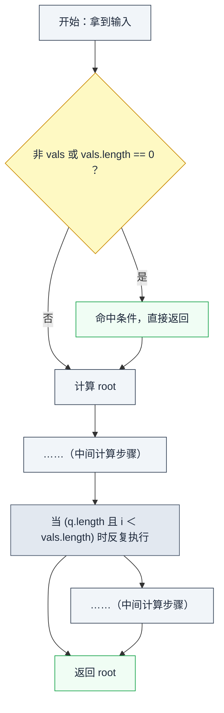

## TypeScript 解题方案（1 个方案逐个讲）

> **运行与提交**：每个方案都是自包含文件（内嵌用例自测，输出 PASS），整块复制到 `.ts` 文件后 `node 文件名` 即可运行。提交 LeetCode 时，把 `demo` 内的算法函数与辅助类型/函数整体取出、置于文件顶层即可。概念演示（非 LeetCode 编号题），在本地运行即可。

### 方案 1：迭代指针处理

**分析与思路**：核心做法是「迭代指针处理」。代码里依次做这些事：队列或堆的调度。

**运行方式**：`node 本文件`，内嵌用例全部通过会输出 PASS。


**方案专属流程图**（真实控制流）：

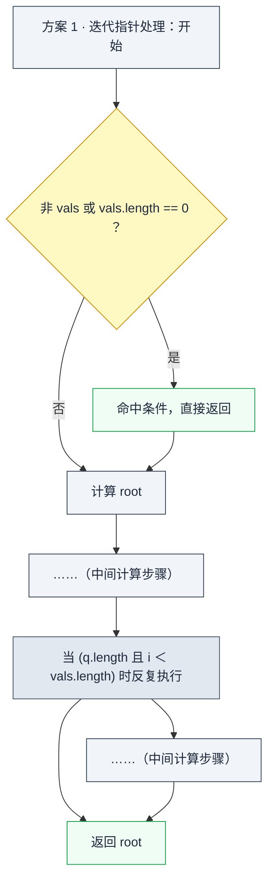

```typescript
class TreeNode {
  // 定义类型
  val: any;
  left: any;
  right: any; // 值: any; 左边界: any; 右边界: any;
  constructor(val?: any, left?: any, right?: any) {
    // constructor(值?: any, 左边界?: any, 右边界?: any) {
    this.val = val === undefined ? 0 : val; // 把 (值 全等于 undefined ? 0 : 值); 写入 值
    this.left = left === undefined ? null : left; // 把 (左边界 全等于 undefined ? null : 左边界); 写入 左边界
    this.right = right === undefined ? null : right; // 把 (右边界 全等于 undefined ? null : 右边界); 写入 右边界
  }
}
function buildTree(vals: any): any {
  // 定义函数/方法 buildTree
  if (!vals || vals.length === 0) return null; // 若 取反 vals 或 vals.长度 全等于 0，直接返回 null
  const root = new TreeNode(vals[0]);
  const q: any[] = [root];
  let i = 1;
  while (q.length && i < vals.length) {
    // 循环，直到不满足「节点.长度 且 下标 i 小于 vals.长度」
    const node = q.shift(); // 把 节点.shift() 存入 节点
    if (vals[i] !== null && vals[i] !== undefined) {
      node.left = new TreeNode(vals[i]);
      q.push(node.left);
    }
    i++; // 下标 i 加一
    if (i < vals.length && vals[i] !== null && vals[i] !== undefined) {
      node.right = new TreeNode(vals[i]);
      q.push(node.right);
    }
    i++; // 下标 i 加一
  }
  return root; // 返回 根节点
}
function treeToLevel(root: any): any[] {
  // 定义函数/方法 treeToLevel
  if (!root) return []; // 若 取反 根节点，直接返回 []
  const out: any[] = [];
  const q: any[] = [root]; // 把 []; const 节点: any[] 赋值为 [根节点]; 写入 const out: any[]
  while (q.length) {
    // 循环，直到不满足「节点.长度」
    const n = q.shift(); // 把 节点.shift() 存入 元素个数
    if (n === null || n === undefined) {
      out.push(null);
      continue;
    }
    out.push(n.val);
    q.push(n.left);
    q.push(n.right); // 把 元素个数.值 压入栈/数组尾部
  }
  while (out.length && out[out.length - 1] === null) out.pop(); // 循环，直到不满足「out.长度 且 out[out.长度 减 1] 全等于 null) out 弹出 );」
  return out; // 返回 out
}
class ListNode {
  // 定义类型
  val: any;
  next: any; // 值: any; 下一个: any;
  constructor(val?: any, next?: any) {
    this.val = val === undefined ? 0 : val;
    this.next = next === undefined ? null : next;
  }
}
function buildList(vals: any): any {
  // 定义函数/方法 buildList
  const dummy = new ListNode(0);
  let cur = dummy; // 把 new ListNode(0); let 当前值 赋值为 哨兵节点 存入 哨兵节点
  for (const v of vals) {
    cur.next = new ListNode(v);
    cur = cur.next;
  } // 把 new ListNode(值); 当前值 赋值为 当前值.下一个; } 写入 下一个
  return dummy.next; // 返回 哨兵节点.下一个
}
function listToArray(head: any): any[] {
  // 定义函数/方法 listToArray
  const out: any[] = [];
  let p = head; // 把 []; let 节点 赋值为 头节点; 写入 const out: any[]
  while (p) {
    out.push(p.val);
    p = p.next;
  } // 循环，直到不满足「节点) { out 追加 节点.值); 节点 赋值为 节点.下一个; }」
  return out; // 返回 out
}
// python-runtime shims
function pyLen(a: any): number {
  // 定义函数/方法 pyLen
  if (a === null || a === undefined) return 0; // 若 数组 全等于 null 或 数组 全等于 undefined，直接返回 0
  if (
    typeof a === 'string' ||
    Array.isArray(a) ||
    a instanceof Set ||
    a instanceof Map
  )
    return a.length ?? a.size;
  if (typeof a === 'object') return Object.keys(a).length; // 若 typeof 数组 全等于 'object'，直接返回 Object.keys(数组).长度
  return 0; // 返回 0
}
function pySlice(a: any, i: any, j: any, step?: any): any {
  // 定义函数/方法 pySlice
  if (typeof a === 'string') {
    const r = [...a].slice(i ?? 0, j ?? a.length);
    return step ? r.reverse().join('') : r.join('');
  }
  const arr = Array.isArray(a) ? a : [...a]; // 把 Array.isArray(数组) ? 数组 : 复制的 数组 存入 数组
  return arr.slice(i ?? 0, j ?? arr.length); // 返回 数组 截取 下标 i ?? 0, 下标 j ?? 数组.长度)
}
function pyRange(a: any, b?: any, step?: any): any[] {
  // 定义函数/方法 pyRange
  let s = 0,
    e = a,
    st = 1; // 把 0, e 赋值为 数组, st 赋值为 1 存入 字符串
  if (b !== undefined) {
    s = a;
    e = b;
  } // 若 b 不等于 undefined) { 字符串 赋值为 数组; e 赋值为 b; }
  if (step !== undefined) st = step; // 若 步数 不等于 undefined) st 赋值为 步数;
  const out: any[] = []; // 把 []; 写入 const out: any[]
  if (st > 0) for (let i = s; i < e; i += st) out.push(i);
  else for (let i = s; i > e; i += st) out.push(i); // 否则
  return out; // 返回 out
}
function pyIn(x: any, coll: any): boolean {
  // 定义函数/方法 pyIn
  if (coll === null || coll === undefined) return false; // 若 coll 全等于 null 或 coll 全等于 undefined，直接返回 false
  if (Array.isArray(coll)) return coll.includes(x); // 若 Array.isArray(coll)，直接返回 coll 是否包含 x)
  if (coll instanceof Set || coll instanceof Map) return coll.has(x); // 若 coll instanceof Set 或 coll instanceof Map，直接返回 coll.has(x)
  if (typeof coll === 'object') return x in coll; // 若 typeof coll 全等于 'object'，直接返回 x in coll
  if (typeof coll === 'string') return coll.indexOf(x) >= 0; // 若 typeof coll 全等于 'string'，直接返回 coll 查找 x) 不低于 0
  return false; // 返回 false
}
function pySorted(a: any): any[] {
  // 定义函数/方法 pySorted
  const arr = typeof a === 'string' ? [...a] : [...a]; // 把 (typeof 数组 全等于 'string') ? 复制的 数组 : 复制的 数组 存入 数组
  return arr.sort((x: any, y: any) => (x < y ? -1 : x > y ? 1 : 0));
}
function pyMin(a: any, b?: any): any {
  if (b !== undefined) return Math.min(a, b);
  if (Array.isArray(a) || a instanceof Set) return Math.min(...a);
  return Math.min(a);
} // 定义函数/方法 pyMin
function pyMax(a: any, b?: any): any {
  if (b !== undefined) return Math.max(a, b);
  if (Array.isArray(a) || a instanceof Set) return Math.max(...a);
  return Math.max(a);
} // 定义函数/方法 pyMax
function pySum(a: any): number {
  let s = 0;
  for (const v of a) s += v;
  return s;
} // 定义函数/方法 pySum
function pyAbs(x: any): number {
  return Math.abs(x);
} // 定义函数/方法 pyAbs
function pyEnumerate(a: any): any[] {
  const out: any[] = [];
  let i = 0;
  for (const v of a) {
    out.push([i, v]);
    i++;
  }
  return out;
} // 定义函数/方法 pyEnumerate
function pyZip(a: any, b: any): any[] {
  const n = Math.min(a.length, b.length);
  const out: any[] = [];
  for (let i = 0; i < n; i++) out.push([a[i], b[i]]);
  return out;
} // 定义函数/方法 pyZip
function pyDictGet(d: any, k: any, def?: any): any {
  return k in d ? d[k] : def === undefined ? null : def;
} // 定义函数/方法 pyDictGet
function pyPrint(...args: any[]): void {
  console.log(
    args
      .map((a) => (typeof a === 'object' && a !== null ? JSON.stringify(a) : a))
      .join(' '),
  );
} // 定义函数/方法 pyPrint
// collections / heapq
function heapPush(h: any[], x: any): void {
  h.push(x);
  let i = h.length - 1;
  while (i > 0) {
    const p = (i - 1) >> 1;
    if (h[p] <= h[i]) break;
    [h[p], h[i]] = [h[i], h[p]];
    i = p;
  }
} // 定义函数/方法 heapPush
function heapPop(h: any[]): any {
  const top = h[0];
  const last = h.pop();
  if (h.length) {
    h[0] = last;
    let i = 0;
    const n = h.length;
    while (true) {
      let l = 2 * i + 1,
        r = 2 * i + 2,
        s = i;
      if (l < n && h[l] < h[s]) s = l;
      if (r < n && h[r] < h[s]) s = r;
      if (s === i) break;
      [h[s], h[i]] = [h[i], h[s]];
      i = s;
    }
  }
  return top;
} // 定义函数/方法 heapPop
class Deque {
  private a: any[] = [];
  push(x: any) {
    this.a.push(x);
  }
  pushLeft(x: any) {
    this.a.unshift(x);
  }
  pop() {
    return this.a.pop();
  }
  popLeft() {
    return this.a.shift();
  }
  get length() {
    return this.a.length;
  }
  toArray() {
    return this.a.slice();
  }
} // 定义类型
function Counter(iter: any): any {
  const m: any = {};
  for (const v of iter) m[v] = (m[v] || 0) + 1;
  return m;
} // 定义函数/方法 Counter
function gcd(a: any, b: any): any {
  while (b) {
    [a, b] = [b, a % b];
  }
  return a;
} // 定义函数/方法 gcd
function pyInf(): number {
  return Infinity;
} // 定义函数/方法 pyInf

function norm(x: any): any {
  // 定义函数/方法 norm
  if (x === null || x === undefined) return null; // 若 x 全等于 null 或 x 全等于 undefined，直接返回 null
  if (typeof x === 'object') {
    // 若 typeof x 全等于 'object'
    if (x instanceof Deque) return x.toArray(); // 若 x instanceof Deque，直接返回 x.toArray()
    if (Array.isArray(x)) return x.map(norm); // 若 Array.isArray(x)，直接返回 x.映射表(norm)
    if (
      typeof x.val === 'number' &&
      (typeof x.left !== 'undefined' || typeof x.right !== 'undefined')
    )
      return treeToLevel(x);
    if (typeof x.next !== 'undefined' && typeof x.val === 'number')
      return listToArray(x);
    if (x instanceof Set) return [...x].sort(); // 若 x instanceof Set，直接返回 复制的 x 排序 )
    if (x instanceof Map) return Object.fromEntries(x); // 若 x instanceof Map，直接返回 Object.fromEntries(x)
    const o: any = {};
    for (const k of Object.keys(x)) o[k] = norm(x[k]);
    return o;
  }
  return x; // 返回 x
}
function eq(a: any, b: any): boolean {
  // 定义函数/方法 eq
  const x = norm(a),
    y = norm(b); // 把 norm(数组), y 赋值为 norm(b) 存入 x
  if (x === y) return true; // 若 x 全等于 y，直接返回 true
  if (x === null || y === null) return x === y; // 若 x 全等于 null 或 y 全等于 null，直接返回 x 全等于 y
  if (Array.isArray(x) && Array.isArray(y)) {
    // 若 Array.isArray(x) 且 Array.isArray(y
    if (x.length !== y.length) return false; // 若 x.长度 不等于 y.长度，直接返回 false
    for (let i = 0; i < x.length; i++) if (!eq(x[i], y[i])) return false; // 让 下标 i 从 0 开始计数，下标 i 小于 x.长度 就继续
    return true; // 返回 true
  }
  if (typeof x === 'object' && typeof y === 'object') {
    // 若 typeof x 全等于 'object' 且 typeof y 全等于 'object'
    const kx = Object.keys(x),
      ky = Object.keys(y); // 把 Object.keys(x), ky 赋值为 Object.keys(y) 存入 kx
    if (kx.length !== ky.length) return false; // 若 kx.长度 不等于 ky.长度，直接返回 false
    for (const k of kx) if (!eq(x[k], y[k])) return false;
    return true; // 返回 true
  }
  return x === y; // 返回 x 全等于 y
}

function classify(coeffs) {
  // 定义函数/方法 classify
  for (let deg = coeffs.length - 1; deg >= 0; deg--) {
    // 让 deg 从 coeffs.长度 减 1 开始计数，deg 不低于 0 就继续
    if (coeffs[deg] !== 0)
      return deg > 1 ? `O(n^${deg})` : deg === 1 ? 'O(n)' : 'O(1)';
  }
  return 'O(1)'; // 返回 「O(1)」
}
export function demo(): void {
  // 程序入口：跑内嵌自测用例
  const cases = [
    { got: classify([1, 0, 0, 0]), want: 'O(1)' },
    { got: classify([0, 0, 0, 35]), want: 'O(n^3)' },
    { got: classify([0, 0, 1, 0]), want: 'O(n^2)' },
    { got: classify([0, 1, 0, 0]), want: 'O(n)' },
  ];
  let fail = false; // 把 false 存入 fail
  for (const c of cases)
    if (!eq(c.got, c.want)) {
      fail = true;
      console.log(
        'FAIL',
        JSON.stringify(c.got),
        'want',
        JSON.stringify(c.want),
      );
    } // 打印输出
  if (fail) throw new Error('FAILED'); // 若 fail) throw new Error(「FAILED」);
  console.log('PASS'); // 全部用例通过，输出 PASS
}
demo(); // demo();
```

## 逐步拆解与面试追问

**复杂度**：时间 O(n)（单趟线性扫描），空间 O(1) 到 O(n)（视辅助结构）

**为什么是这个量级**：每个元素被常数次访问，辅助哈希或栈的开销与 n 同阶

**面试官可能会追问**：

- 这个策略能推广到什么场景？
- 与暴力做法差在哪一步？
- 有没有更简单的等价写法？

## 关键 API 速查（TS 主解法实际用到，附官方链接）

| API | 作用 | 使用要点 | 官方文档 |
|---|---|---|---|
| `Array.prototype.sort()` | 原地排序 | 默认按字符串 Unicode 序（10 会排在 2 前），数字必须传 (a,b)=>a-b；V8 用 TimSort，稳定，O(n log n)；返回原数组引用 | [官方文档](https://developer.mozilla.org/zh-CN/docs/Web/JavaScript/Reference/Global_Objects/Array/sort) |
| `Array.prototype.map()` | 逐元素映射为新数组 | 回调 (v,i,arr)；返回等长新数组，不改变原数组；稀疏位跳过；链式调用注意中间数组开销 | [官方文档](https://developer.mozilla.org/zh-CN/docs/Web/JavaScript/Reference/Global_Objects/Array/map) |
| `Array.prototype.push()` | 尾部追加 | 返回新长度；可一次多个；均摊 O(1)；会改变原数组 | [官方文档](https://developer.mozilla.org/zh-CN/docs/Web/JavaScript/Reference/Global_Objects/Array/push) |
| `Array.prototype.pop()` | 尾部弹出 | 返回被删元素（空数组返回 undefined）；O(1) | [官方文档](https://developer.mozilla.org/zh-CN/docs/Web/JavaScript/Reference/Global_Objects/Array/pop) |
| `Array.prototype.shift()` | 头部取出 | O(n)（后续元素整体前移）；大量头部操作请用链表或双端结构 | [官方文档](https://developer.mozilla.org/zh-CN/docs/Web/JavaScript/Reference/Global_Objects/Array/shift) |
| `Array.prototype.unshift()` | 头部插入 | O(n)；与 shift 组合可当双端队列 | [官方文档](https://developer.mozilla.org/zh-CN/docs/Web/JavaScript/Reference/Global_Objects/Array/unshift) |
| `Array/String includes()` | 是否包含 | 数组用 SameValueZero（NaN 可判）；字符串按子串；第二个参数为起始下标 | [官方文档](https://developer.mozilla.org/zh-CN/docs/Web/JavaScript/Reference/Global_Objects/Array/includes) |
| `Array/String indexOf()` | 首次出现的下标 | 找不到返回 -1；无法判 NaN（用 includes）；字符串可传起始位 | [官方文档](https://developer.mozilla.org/zh-CN/docs/Web/JavaScript/Reference/Global_Objects/Array/indexOf) |
| `Array/String slice()` | 切片（不改原数组） | slice(start,end) 含头不含尾；负数从尾计；常用于复制数组（slice()） | [官方文档](https://developer.mozilla.org/zh-CN/docs/Web/JavaScript/Reference/Global_Objects/Array/slice) |
| `Array.prototype.join()` | 数组拼接为字符串 | undefined/null 转空串；嵌套数组会展平一层；join('') 用于字符数组还原 | [官方文档](https://developer.mozilla.org/zh-CN/docs/Web/JavaScript/Reference/Global_Objects/Array/join) |
| `Object.keys()` | 对象键名数组 | 仅自身可枚举字符串键（不含 symbol）；配 length 可当计数器 | [官方文档](https://developer.mozilla.org/zh-CN/docs/Web/JavaScript/Reference/Global_Objects/Object/keys) |
| `Object.fromEntries()` | 键值对数组转对象 | 参数为 [k,v] 可迭代；map 出来的键值对可直接转对象 | [官方文档](https://developer.mozilla.org/zh-CN/docs/Web/JavaScript/Reference/Global_Objects/Object/fromEntries) |
| `JSON.stringify()` | 序列化为 JSON 字符串 | 常用于结构化比较（深度相等判定）；undefined/函数/循环引用会被丢弃或抛错 | [官方文档](https://developer.mozilla.org/zh-CN/docs/Web/JavaScript/Reference/Global_Objects/JSON/stringify) |
| `Math.max()` | 最大值 | 配展开 Math.max(...arr)；空参返回 -Infinity；超大数组注意展开参数上限 | [官方文档](https://developer.mozilla.org/zh-CN/docs/Web/JavaScript/Reference/Global_Objects/Math/max) |
| `Math.min()` | 最小值 | 同 max；空参返回 Infinity | [官方文档](https://developer.mozilla.org/zh-CN/docs/Web/JavaScript/Reference/Global_Objects/Math/min) |
| `Math.abs()` | 绝对值 | 入参会被隐式转数字；-0 返回 +0 | [官方文档](https://developer.mozilla.org/zh-CN/docs/Web/JavaScript/Reference/Global_Objects/Math/abs) |

### 各语言官方文档导航

- **TypeScript / JS**：[MDN 中文参考](https://developer.mozilla.org/zh-CN/)
- **Python**：[Python 官方文档](https://docs.python.org/zh-cn/3/)
- **Go**：[Go 标准库](https://pkg.go.dev/std)
- **Java**：[JDK 17 API](https://docs.oracle.com/en/java/javase/17/docs/api/)
- **Rust**：[Rust 标准库](https://doc.rust-lang.org/std/)
- **Lua**：[Lua 5.4 手册](https://www.lua.org/manual/5.4/)
- **C**：[Cppreference C](https://zh.cppreference.com/w/c)
- **C++**：[Cppreference C++](https://zh.cppreference.com/w/cpp)
- **R**：[R 官方手册](https://stat.ethz.ch/R-manual/)
- **Zig**：[Zig 语言文档](https://ziglang.org/documentation/master/)
- **Dart**：[Dart API](https://api.dart.dev/)

## 附录：其他 10 种语言全部实现（每种语言列举其全部方案）

> TypeScript 的全部方案见「TypeScript 解题方案」一节；下面是其余 10 种语言的对应实现，每种语言的每个方案都带思路分析、代码走读与专属运行架构图。
> 每个方案都内嵌用例自测，可独立运行（老仓库 python/go 文件遵循「打印结果」约定）。
> 完整解法文件见 `dsa/<语言>/notes/lc_107836586_big-o记号_数据结构与算法的关系以及几种基本的数据结构/`。

### Python 实现（1 种方案）

Python 的全部方案如下，每个方案都内嵌用例自测，可独立运行（老仓库 python/go 文件遵循「打印结果」约定）：

#### 方案 1：迭代指针处理

**思路与代码分析**：核心是「迭代指针处理」。Python 版用切片与字典推导式简化操作，突出可读性。**走读**：方案 1 · 迭代指针处理：开始 → 更新 print('T(n) → 遍历 [1, 10, 100, 1000]: 中的每个元素 n → 更新 t → 处理 5 * n * (3 * n * (n + 2) + 4 → 处理 ) → 更新 n → 更新 print(' → 返回结果。

**运行架构**（真实控制流）：

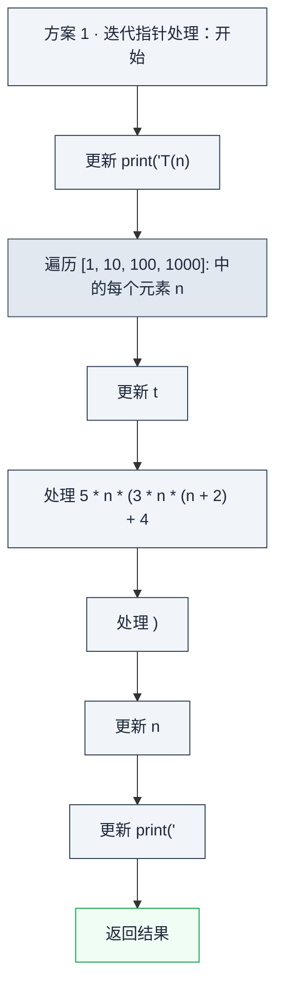

```python
import sys  # 提高递归深度上限（深输入防 RecursionError）

sys.setrecursionlimit(200000)  # 树/链表类题目节点数可达 1e4 量级

def asymptotic_example():  # 定义函数 asymptotic_example（参数：无）
    """例：T(n) = 5n·[3n·(n+2)+4] + 6 = 35n^3 + 30n^2 + 20n + 6  => O(n^3)。"""
    print("T(n) = 5n·[3n·(n+2)+4] + 6 的增长：")  # 打印输出
    for n in [1, 10, 100, 1000]:  # for 元素个数 in [1, 10, 100, 1000]:
        t = (
            5 * n * (3 * n * (n + 2) + 4) + 6
        )  # 把 5 乘 元素个数 乘 (3 乘 元素个数 乘 (元素个数 加 2) 加 4) 加 6 存入 另一字符串
        print(f"  n={n:5d}  T(n)={t}")  # 打印输出
    print("  => 主导项为 n^3，故 T(n) = O(n^3)")

def compare_constants_and_low_order():  # 定义函数 compare_constants_and_low_order（参数：无）
    """Big-O 忽略常数因子与低次项：n^2 与 2n^2+1000n 同阶 O(n^2)。"""
    print("\n忽略常数与低次项：")  # 打印输出
    for n in [10, 100, 1000]:  # for 元素个数 in [10, 100, 1000]:
        a = n * n  # 把 元素个数 乘 元素个数 存入 数组
        b = 2 * n * n + 1000 * n  # 把 2 乘 元素个数 乘 元素个数 加 1000 乘 元素个数 存入 b
        print(f"  n={n:5d}  n^2={a:8d}  2n^2+1000n={b:8d}  (同阶 O(n^2))")  # 打印输出

def classify(coeffs):  # 定义函数 classify（参数：coeffs）
    """给定各次项系数（索引为次数），返回最高次非零项对应的 Big-O 记号。"""
    for deg in range(len(coeffs) - 1, -1, -1):  # 让 deg 从 长度(coeffs) 减 1 倒数回去（每步减 1）
        if coeffs[deg] != 0:  # 若 coeffs[deg] 不等于 0
            return f"O(n^{deg})" if deg > 1 else ("O(n)" if deg == 1 else "O(1)")
    return "O(1)"  # 返回 「O(1)」

if __name__ == "__main__":  # 若 __name__ 等于 '__main__'
    asymptotic_example()  # asymptotic_example()
    compare_constants_and_low_order()  # compare_constants_and_low_order()
    print("\nclassify([6, 20, 30, 35]) =", classify([6, 20, 30, 35]), "(对应 35n^3+30n^2+20n+6)")  # 打印输出
```

### Go 实现（1 种方案）

Go 的全部方案如下，每个方案都内嵌用例自测，可独立运行（老仓库 python/go 文件遵循「打印结果」约定）：

#### 方案 1：迭代指针处理

**思路与代码分析**：核心是「迭代指针处理」。Go 版用切片与多返回值惯用法，显式处理索引边界。**走读**：方案 1 · 迭代指针处理：开始 → 返回 5*n*(3*n*(n+2)+4) + 6。

**运行架构**（真实控制流）：

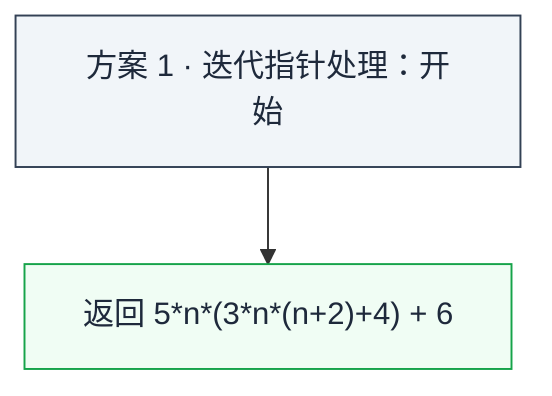

```go
package main // 引入依赖

import (
	"fmt" // 「fmt」
	"os"  // 「os」
)

// asymptoticT T(n) = 5n·[3n·(n+2)+4] + 6
func asymptoticT(n int) int { // 定义函数/方法 asymptoticT
	return 5*n*(3*n*(n+2)+4) + 6 // 返回 5 乘 元素个数 乘 (3 乘 元素个数 乘 (元素个数 加 2) 加 4) 加 6
}

// classify 给定各次项系数（索引为次数），返回最高次非零项对应的 Big-O 记号
func classify(coeffs []int) string { // 定义函数/方法 classify
	for deg := len(coeffs) - 1; deg >= 0; deg-- { // 把 长度(coeffs) 减 1; deg 不低于 0; deg 减一 { 写入 for deg :
		if coeffs[deg] != 0 { // 若 coeffs[deg] 不等于 0
			if deg > 1 { // 若 deg 超过 1
				return fmt.Sprintf("O(n^%d)", deg) // 返回 fmt.Sprintf(「O(元素个数 按位异或 对…取模 d)」, deg)
			} else if deg == 1 { // 否则，若 deg 等于 1
				return "O(n)" // 返回 「O(元素个数)」
			}
			return "O(1)" // 返回 「O(1)」
		}
	}
	return "O(1)" // 返回 「O(1)」
}

func main() { // 程序入口：跑内嵌自测用例
	// 验证 T(n) 增长公式
	if asymptoticT(1) != 71 { // 若 asymptoticT(1) 不等于 71
		fmt.Println("FAIL T(1)") // 打印输出
		os.Exit(1)               // os.Exit(1)
	}
	if asymptoticT(10) != 18206 { // 若 asymptoticT(10) 不等于 18206
		fmt.Println("FAIL T(10)") // 打印输出
		os.Exit(1)                // os.Exit(1)
	}
	if asymptoticT(100) != 15302006 { // 若 asymptoticT(100) 不等于 15302006
		fmt.Println("FAIL T(100)") // 打印输出
		os.Exit(1)                 // os.Exit(1)
	}
	if asymptoticT(1000) != 15030020006 { // 若 asymptoticT(1000) 不等于 15030020006
		fmt.Println("FAIL T(1000)") // 打印输出
		os.Exit(1)                  // os.Exit(1)
	}
	// 验证 classify
	if classify([]int{6, 20, 30, 35}) != "O(n^3)" { // 若 classify([]int{6, 20, 30, 35}) 不等于 「O(元素个数 按位异或 3)」
		fmt.Println("FAIL classify") // 打印输出
		os.Exit(1)                   // os.Exit(1)
	}
	fmt.Println("PASS") // 全部用例通过，输出 PASS
}
```

### Java 实现（1 种方案）

Java 的全部方案如下，每个方案都内嵌用例自测，可独立运行（老仓库 python/go 文件遵循「打印结果」约定）：

#### 方案 1：迭代指针处理

**思路与代码分析**：核心是「迭代指针处理」。Java 版用类与静态方法组织，集合操作显式明了。代码里依次做这些事：单循环线性扫描。**走读**：方案 1 · 迭代指针处理：开始 → 遍历循环 → 若 coeffs[deg] ≠ 0 则： → 命中条件，直接返回 → 命中条件，直接返回 → 返回 O(1)。

**运行架构**（真实控制流）：

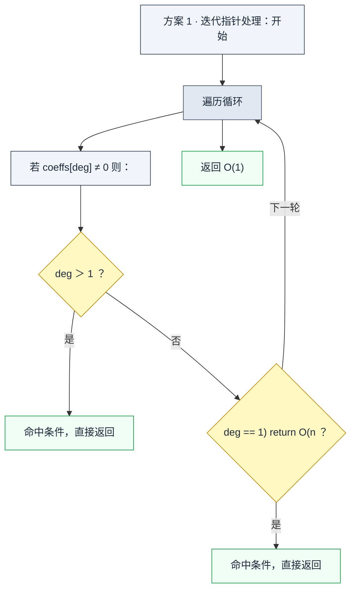

```java
package com.webfault.dsa; // 引入依赖

class lc107836586_solution1 { // 定义类型
  // 给定各次项系数（索引为次数），返回最高次非零项对应的 Big-O 记号。
  String classify(int[] coeffs) { // 定义函数/方法 classify
    for (int deg = coeffs.length - 1; deg >= 0; deg--) { // 让 deg 从 coeffs.长度 减 1 开始计数，deg 不低于 0 就继续
      if (coeffs[deg] != 0) { // 若 coeffs[deg] 不等于 0
        if (deg > 1)
          return "O(n^" + deg + ")"; // 若 deg 超过 1，直接返回 「O(元素个数 按位异或 」 加 deg 加 「O(元素个数 按位异或 」
        if (deg == 1) return "O(n)"; // 若 deg 等于 1，直接返回 「O(元素个数)」
        return "O(1)"; // 返回 「O(1)」
      }
    }
    return "O(1)"; // 返回 「O(1)」
  }

  public static void main(String[] args) { // public static void main(String[] args) {
    lc107836586_solution1 s =
        new lc107836586_solution1(); // 把 new lc107836586_solution1(); 写入 lc107836586_solution1 s
    String[][] cases = { // 把 { 写入 String[][] cases
      {s.classify(new int[] {6, 20, 30, 35}), "O(n^3)"},
      {s.classify(new int[] {5}), "O(1)"},
      {s.classify(new int[] {0, 5}), "O(n)"},
      {s.classify(new int[] {0, 0, 7}), "O(n^2)"},
    };
    boolean ok = true; // 把 true; 写入 boolean ok
    for (String[] c : cases) { // for (String[] 字符 : cases) {
      if (!c[0].equals(c[1])) { // 若 取反 字符[0].equals(字符[1]
        ok = false; // 把 false; 写入 ok
        System.out.println("FAIL classify=" + c[0] + " want " + c[1]); // 打印输出
      }
    }
    if (!ok) throw new RuntimeException("FAILED"); // 若 取反 ok) throw new RuntimeException(「FAILED」);
    System.out.println("PASS"); // 全部用例通过，输出 PASS
  }
}
```

### Rust 实现（1 种方案）

Rust 的全部方案如下，每个方案都内嵌用例自测，可独立运行（老仓库 python/go 文件遵循「打印结果」约定）：

#### 方案 1：迭代指针处理

**思路与代码分析**：核心是「迭代指针处理」。Rust 版用所有权移动与切片借用改写同一逻辑，注意 Option 与引用边界。**走读**：方案 1 · 迭代指针处理：开始 → 遍历 (0..coeffs.len()).rev() 中的每个元素 deg → 处理 if coeffs[deg] ≠ 0 → 处理 if deg ＞ 1 → 返回 format非 (O(n^ → 返回 O(n).to_string() → 返回 O(1).to_string() → 处理 O(1).to_string()。

**运行架构**（真实控制流）：

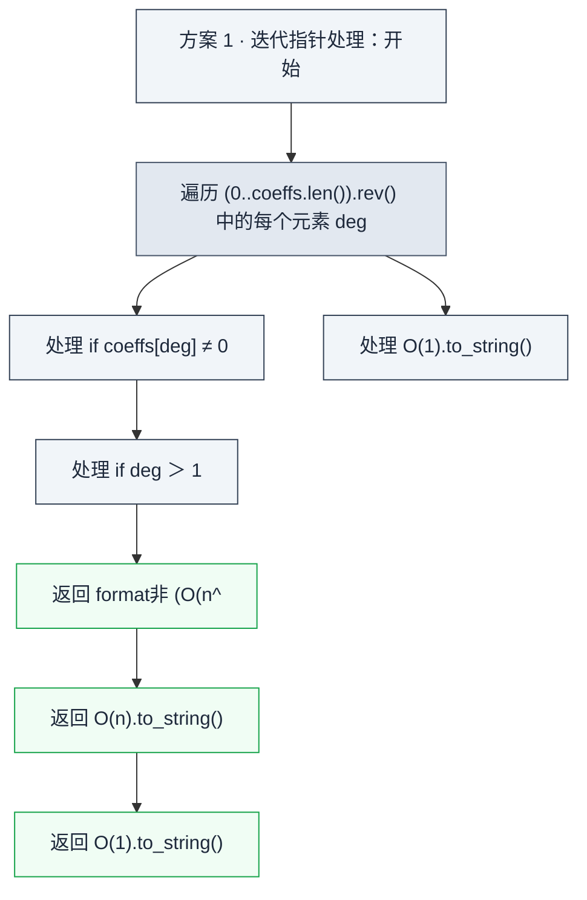

```rust
// LeetCode 107836586. Big-O 记号 — Rust 版（Big-O 记号：按最高次非零系数给出多项式复杂度分类）

// coeffs[i] 为 n^i 的系数，返回最高次非零项对应的复杂度记号
fn classify(coeffs: &[i64]) -> String {
    // 定义函数/方法 classify
    for deg in (0..coeffs.len()).rev() {
        // for deg in (0..coeffs.长度()).rev() {
        if coeffs[deg] != 0 {
            // 若 coeffs[deg] 不等于 0
            if deg > 1 {
                // 若 deg 超过 1
                return format!("O(n^{})", deg); // 返回 format取反 (「O(元素个数 按位异或 {})」, deg)
            } else if deg == 1 {
                // 否则，若 deg 等于 1
                return "O(n)".to_string(); // 返回 「O(元素个数)」.to_string()
            } else {
                // 否则
                return "O(1)".to_string(); // 返回 「O(1)」.to_string()
            }
        }
    }
    "O(1)".to_string() // 「O(1)」.to_string()
}

fn main() {
    // 程序入口：跑内嵌自测用例
    let cases: Vec<(Vec<i64>, &str)> = vec![
        (vec![1, 0, 0, 0], "O(1)"),
        (vec![0, 0, 0, 35], "O(n^3)"),
        (vec![0, 0, 1, 0], "O(n^2)"),
        (vec![0, 1, 0, 0], "O(n)"),
    ];
    for (idx, (c, want)) in cases.iter().enumerate() {
        // for (idx, (字符, want)) in cases.iter().enumerate() {
        let got = classify(c); // 把 classify(字符) 存入 got
        assert_eq!(got, *want, "case {} failed", idx); // 断言校验
    }
    println!("PASS"); // 全部用例通过，输出 PASS
}
```

### Lua 实现（1 种方案）

Lua 的全部方案如下，每个方案都内嵌用例自测，可独立运行（老仓库 python/go 文件遵循「打印结果」约定）：

#### 方案 1：迭代指针处理

**思路与代码分析**：核心是「迭代指针处理」。Lua 版用表与 ipairs 遍历，注意 ipairs 遇 nil 即停的语义。**走读**：方案 1 · 迭代指针处理：开始 → 循环 deg：从 #coeffs 到 1, -1 do → 处理 if coeffs[deg] ~= 0 then → 更新 d → 处理 if d ＞ 1 then → 返回 string.format(O(n^%d), d) → 返回 O(n) → 返回 O(1) → 返回 O(1) → 更新 cases → 遍历 ipairs(cases) do 中的每个元素 c → 更新 got → 更新 = → 调用 print(PASS)。

**运行架构**（真实控制流）：

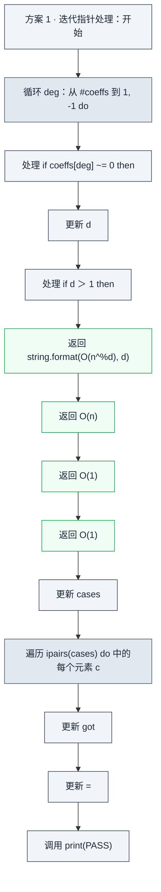

```lua
-- LeetCode 107836586. Big-O 记号 — Lua 版（Big-O 记号：按最高次非零系数给出多项式复杂度分类）
local function classify(coeffs) -- local function classify(coeffs)
	for deg = #coeffs, 1, -1 do -- 把 #coeffs, 1, 减 1 do 写入 for deg
		if coeffs[deg] ~= 0 then -- 若 coeffs[deg] ~ 赋值为 0 then
			local d = deg - 1 -- 转 0 基次数
			if d > 1 then -- 若 d 超过 1 then
				return string.format("O(n^%d)", d) -- 返回 string.format(「O(元素个数 按位异或 对…取模 d)」, d)
			elseif d == 1 then -- 把 赋值为 1 then 写入 elseif d
				return "O(n)" -- 返回 「O(元素个数)」
			else -- 否则
				return "O(1)" -- 返回 「O(1)」
			end -- 终点
		end -- 终点
	end -- 终点
	return "O(1)" -- 返回 「O(1)」
end -- 终点

local cases = { -- 把 { 写入 local cases
	{ { 1, 0, 0, 0 }, "O(1)" },
	{ { 0, 0, 0, 35 }, "O(n^3)" },
	{ { 0, 0, 1, 0 }, "O(n^2)" },
	{ { 0, 1, 0, 0 }, "O(n)" },
}
for idx, c in ipairs(cases) do -- 遍历取 字符
	local got = classify(c[1]) -- 把 classify(字符[1]) 写入 local got
	assert(got == c[2], string.format("case %d failed: got %s want %s", idx, got, c[2])) -- 断言校验
end -- 终点
print("PASS") -- 全部用例通过，输出 PASS
```

### C 实现（1 种方案）

C 的全部方案如下，每个方案都内嵌用例自测，可独立运行（老仓库 python/go 文件遵循「打印结果」约定）：

#### 方案 1：迭代指针处理

**思路与代码分析**：核心是「迭代指针处理」。C 版手动管理下标与内存，循环边界全部显式写出。代码里依次做这些事：单循环线性扫描。**走读**：方案 1 · 迭代指针处理：开始 → 遍历循环 → 若 coeffs[deg] ≠ 0 则： → 若 deg ＞ 1：调用 snprintf(out, out_size, O(n → 调用 snprintf(out, out_size, O(n → 调用 snprintf(out, out_size, → 处理 O(n)) → 调用 snprintf(out, out_size, O(1 → 返回  → 调用 snprintf(out, out_size, O(1。

**运行架构**（真实控制流）：

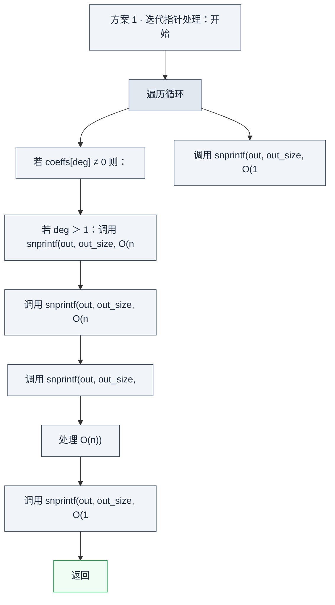

```c
* LeetCode 107836586. Big-O 记号 — C 版（Big-O 记号：按最高次非零系数给出多项式复杂度分类）
 */
#include <stdio.h>  // 引入头文件
#include <string.h> // 引入头文件

/* coeffs[i] 为 n^i 的系数，deg_count 为个数 */
static void classify(const long long *coeffs, int deg_count, char *out,
                     int out_size) {                 // 定义函数/方法 classify
    for (int deg = deg_count - 1; deg >= 0; deg--) { // 让 deg 从 deg_count 减 1 开始计数，deg 不低于 0 就继续
        if (coeffs[deg] != 0) {                      // 若 coeffs[deg] 不等于 0
            if (deg > 1)
                snprintf(out, out_size, "O(n^%d)", deg);
            else if (deg == 1)
                snprintf(out, out_size,
                         "O(n)"); // 否则，若 deg 等于 1) snprintf(out, out_size, 「O(元素个数)」);
            else
                snprintf(out, out_size, "O(1)"); // 否则
            return;                              // return;
        }
    }
    snprintf(out, out_size, "O(1)"); // 打印输出
}

int main(void) {                     // 程序入口：跑内嵌自测用例
    long long c0[4] = {1, 0, 0, 0};  // 把 {1, 0, 0, 0}; 写入 long long c0[4]
    long long c1[4] = {0, 0, 0, 35}; // 把 {0, 0, 0, 35}; 写入 long long c1[4]
    long long c2[4] = {0, 0, 1, 0};  // 把 {0, 0, 1, 0}; 写入 long long c2[4]
    long long c3[4] = {0, 1, 0, 0};  // 把 {0, 1, 0, 0}; 写入 long long c3[4]
    const char *wants[4] = {"O(1)", "O(n^3)", "O(n^2)",
                            "O(n)"}; // 把 {「O(1)」, 「O(1)」, 「O(1)」, 「O(1)」}; 写入 const char *wants[4]
    long long *as[4] = {c0, c1, c2, c3};      // 把 {c0, c1, c2, c3}; 写入 long long *as[4]
    char got[32];                             // char got[32];
    for (int i = 0; i < 4; i++) {             // 让 下标 i 从 0 开始计数，下标 i 小于 4 就继续
        classify(as[i], 4, got, sizeof(got)); // classify(as[下标 i], 4, got, sizeof(got));
        if (strcmp(got, wants[i]) != 0) {     // 若 strcmp(got, wants[下标 i]) 不等于 0
            printf("case %d failed: got %s want %s\n", i, got, wants[i]); // 打印输出
            return 1;                                                     // 返回 1
        }
    }
    printf("PASS\n"); // 全部用例通过，输出 PASS
    return 0;         // 返回 0
}
```

### C++ 实现（1 种方案）

C++ 的全部方案如下，每个方案都内嵌用例自测，可独立运行（老仓库 python/go 文件遵循「打印结果」约定）：

#### 方案 1：迭代指针处理

**思路与代码分析**：核心是「迭代指针处理」。C++ 版用 STL 容器与迭代器，减少手写下标错误。代码里依次做这些事：单循环线性扫描。**走读**：方案 1 · 迭代指针处理：开始 → 遍历循环 → 若 coeffs[deg] ≠ 0 则： → 命中条件，直接返回 → 命中条件，直接返回 → 返回 O(1) → 返回 O(1)。

**运行架构**（真实控制流）：

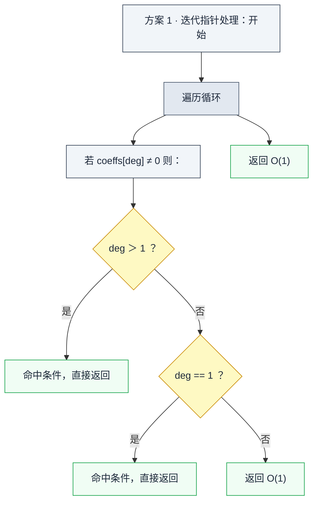

```cpp
// LeetCode 107836586. Big-O 记号 — C++ 版（Big-O 记号：按最高次非零系数给出多项式复杂度分类）
#include <iostream> // 引入头文件
#include <string>   // 引入头文件
#include <vector>   // 引入头文件

// coeffs[i] 为 n^i 的系数，返回最高次非零项对应的复杂度记号
static std::string classify(const std::vector<long long> &coeffs) {
    for (int deg = static_cast<int>(coeffs.size()) - 1; deg >= 0; --deg) {
        if (coeffs[deg] != 0) { // 若 coeffs[deg] 不等于 0
            if (deg > 1)
                return "O(n^" + std::to_string(deg) + ")";
            if (deg == 1)
                return "O(n)"; // 若 deg 等于 1，直接返回 「O(元素个数)」
            return "O(1)";     // 返回 「O(1)」
        }
    }
    return "O(1)"; // 返回 「O(1)」
}

int main() { // 程序入口：跑内嵌自测用例
    std::vector<std::pair<std::vector<long long>, std::string>> cases = {
        {{1, 0, 0, 0}, "O(1)"},
        {{0, 0, 0, 35}, "O(n^3)"},
        {{0, 0, 1, 0}, "O(n^2)"},
        {{0, 1, 0, 0}, "O(n)"},
    };
    for (size_t idx = 0; idx < cases.size(); ++idx) { // 让 idx 从 0 开始计数，idx 小于 cases.大小() 就继续
        std::string got = classify(cases[idx].first); // 把 classify(cases[idx].first); 写入 std::string got
        if (got != cases[idx].second) {               // 若 got 不等于 cases[idx].second
            std::cout << "case " << idx << " failed: got " << got << " want " << cases[idx].second
                      << std::endl; // 打印输出
            return 1;               // 返回 1
        }
    }
    std::cout << "PASS" << std::endl; // 全部用例通过，输出 PASS
    return 0;                         // 返回 0
}
```

### R 实现（1 种方案）

R 的全部方案如下，每个方案都内嵌用例自测，可独立运行（老仓库 python/go 文件遵循「打印结果」约定）：

#### 方案 1：迭代指针处理

**思路与代码分析**：核心是「迭代指针处理」。R 版用向量化思维与 1 起始下标，注意 1:n 的降序陷阱。代码里依次做这些事：单循环线性扫描。**走读**：方案 1 · 迭代指针处理：开始 → 循环 deg：遍历 length(coeffs):1 → 若 coeffs[deg] ≠ 0 则： → 处理 d ＜- deg - 1L → 命中条件，直接返回 → 命中条件，直接返回 → 返回 (O(1)) → 处理 O(1)。

**运行架构**（真实控制流）：

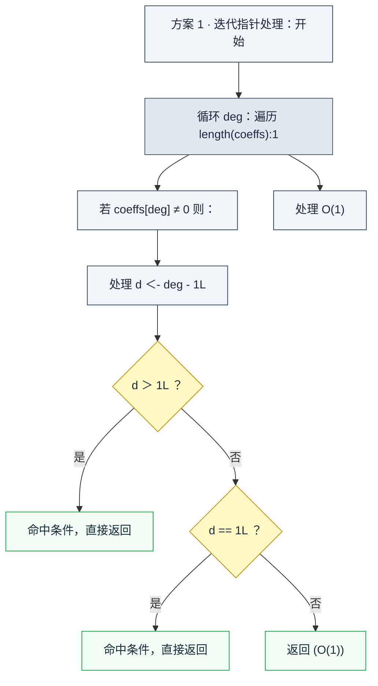

```r
# 版（Big-O 记号：按最高次非零系数给出多项式复杂度分类）
# coeffs[i] 为 n^i 的系数（R 下标从 1 起），返回最高次非零项对应的复杂度记号 定义函数
# classify（参数：coeffs） for (deg in 长度(coeffs):1) { 若 coeffs[deg] 不等于 0
classify <- function(coeffs) {
    for (deg in length(coeffs):1) {
        if (coeffs[deg] != 0) {
            d <- deg - 1L  # 转 0 基次数
            if (d > 1L)
                return(sprintf("O(n^%d)", d))  # 若 d 超过 1L) return(sprintf(「O(元素个数 按位异或 对…取模 d)」, d
            if (d == 1L)
                return("O(n)")  # 若 d 等于 1L) return(「O(元素个数)」
            return("O(1)")  # 返回 「O(1)」
        }
    }
    "O(1)"  # 「O(1)」
}
cases <- list(list(c(1, 0, 0, 0), "O(1)"), list(c(0, 0, 0, 35), "O(n^3)"), list(c(0, 0, 1, 0), "O(n^2)"), list(c(0,
    1, 0, 0), "O(n)")  # 列表(字符(0, 1, 0, 0), 「O(元素个数)」)
)
for (idx in seq_along(cases)) {
    # for (idx in seq_along(cases)) {
    got <- classify(cases[[idx]][[1]])  # 把 classify(cases[[idx]][[1]]) 存入 got
    stopifnot(identical(got, cases[[idx]][[2]]))  # 断言校验
}
cat("PASS\n")  # 全部用例通过，输出 PASS
```

### Zig 实现（1 种方案）

Zig 的全部方案如下，每个方案都内嵌用例自测，可独立运行（老仓库 python/go 文件遵循「打印结果」约定）：

#### 方案 1：迭代指针处理

**思路与代码分析**：核心是「迭代指针处理」。Zig 版显式分配与清零，整型边界处理严格。**走读**：方案 1 · 迭代指针处理：开始 → 计算 deg → 当 (deg ＞ 0) 时反复执行 → 更新 - → 若 coeffs[deg] ≠ 0 则： → 命中条件，直接返回 → 返回 std.fmt.bufPrint(buf, O(n), . → 返回 std.fmt.bufPrint(buf, O(1), . → 返回 std.fmt.bufPrint(buf, O(1), .。

**运行架构**（真实控制流）：

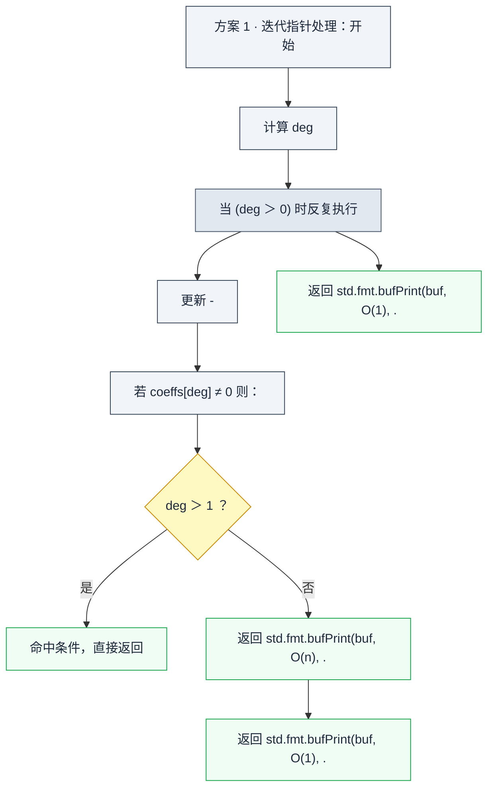

```zig
// LeetCode 107836586. Big-O 记号 — Zig 版（Big-O 记号：按最高次非零系数给出多项式复杂度分类）
const std = @import("std"); // 把 @import(「std」) 存入 std

// coeffs[i] 为 n^i 的系数，返回最高次非零项对应的复杂度记号
fn classify(buf: []u8, coeffs: []const i64) ![]u8 { // 定义函数/方法 classify
    var deg: usize = coeffs.len; // 把 coeffs.长度; 写入 var deg: usize
    while (deg > 0) { // 循环，直到不满足「deg 超过 0」
        deg -= 1; // deg累减 1
        if (coeffs[deg] != 0) { // 若 coeffs[deg] 不等于 0
            if (deg > 1) { // 若 deg 超过 1
                return std.fmt.bufPrint(buf, "O(n^{d})", .{deg}); // 返回 std.fmt.bufPrint(buf, 「O(元素个数 按位异或 {d})」, .{deg})
            } else if (deg == 1) { // 否则，若 deg 等于 1
                return std.fmt.bufPrint(buf, "O(n)", .{}); // 返回 std.fmt.bufPrint(buf, 「O(元素个数)」, .{})
            } else { // 否则
                return std.fmt.bufPrint(buf, "O(1)", .{}); // 返回 std.fmt.bufPrint(buf, 「O(1)」, .{})
            }
        }
    }
    return std.fmt.bufPrint(buf, "O(1)", .{}); // 返回 std.fmt.bufPrint(buf, 「O(1)」, .{})
}

pub fn main() !void { // 程序入口：跑内嵌自测用例
    var buf: [32]u8 = undefined; // 把 undefined; 写入 var buf: [32]u8
    const Case = struct { coeffs: []const i64, want: []const u8 }; // 把 struct { coeffs: []const i64, want: []const u8 } 存入 Case
    const cases = [_]Case{ // 把 [_]Case{ 存入 cases
        .{ .coeffs = &[_]i64{ 1, 0, 0, 0 }, .want = "O(1)" },
        .{ .coeffs = &[_]i64{ 0, 0, 0, 35 }, .want = "O(n^3)" },
        .{ .coeffs = &[_]i64{ 0, 0, 1, 0 }, .want = "O(n^2)" },
        .{ .coeffs = &[_]i64{ 0, 1, 0, 0 }, .want = "O(n)" },
    };
    for (cases, 0..) |c, idx| { // for (cases, 0..) 按位或 字符, idx 按位或 {
        const got = try classify(&buf, c.coeffs); // 把 try classify( 按位与 buf, 字符.coeffs) 存入 got
        if (!std.mem.eql(u8, got, c.want)) { // 若 取反 std.mem.eql(u8, got, 字符.want
            std.debug.print("case {d} failed: got {s} want {s}\n", .{ idx, got, c.want }); // 打印输出
            return error.TestFailed; // 返回 error.TestFailed
        }
    }
    std.debug.print("PASS\n", .{}); // 全部用例通过，输出 PASS
}
```

### Dart 实现（1 种方案）

Dart 的全部方案如下，每个方案都内嵌用例自测，可独立运行（老仓库 python/go 文件遵循「打印结果」约定）：

#### 方案 1：迭代指针处理

**思路与代码分析**：核心是「迭代指针处理」。Dart 版用可空类型标注与集合方法，注意空安全。代码里依次做这些事：单循环线性扫描。**走读**：方案 1 · 迭代指针处理：开始 → 遍历循环 → 命中条件，直接返回 → 命中条件，直接返回 → 返回 'O(1)'。

**运行架构**（真实控制流）：

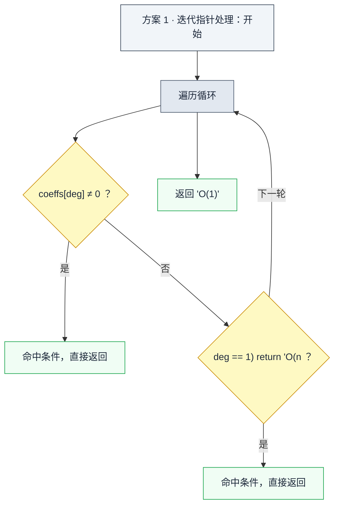

```dart
// LeetCode 107836586. Big-O 记号 — Dart 版（Big-O 记号：按最高次非零系数给出多项式复杂度分类）

// coeffs[i] 为 n^i 的系数，返回最高次非零项对应的复杂度记号
String classify(List<int> coeffs) {
  // 定义函数/方法 classify
  for (var deg = coeffs.length - 1; deg >= 0; deg--) {
    // 让 deg 从 coeffs.长度 减 1 开始计数，deg 不低于 0 就继续
    if (coeffs[deg] != 0) {
      // 若 coeffs[deg] 不等于 0
      if (deg > 1) return 'O(n^$deg)'; // 若 deg 超过 1，直接返回 'O(元素个数 按位异或 $deg)'
      if (deg == 1) return 'O(n)'; // 若 deg 等于 1，直接返回 'O(元素个数)'
      return 'O(1)'; // 返回 'O(1)'
    }
  }
  return 'O(1)'; // 返回 'O(1)'
}

void main() {
  // 程序入口：跑内嵌自测用例
  final cases = <List<int>, String>{
    // 把 小于 List 小于 int 超过 , String 超过 { 存入 cases
    [1, 0, 0, 0]: 'O(1)',
    [0, 0, 0, 35]: 'O(n^3)',
    [0, 0, 1, 0]: 'O(n^2)',
    [0, 1, 0, 0]: 'O(n)',
  };
  var idx = 0; // 把 0 存入 idx
  cases.forEach((coeffs, want) {
    // cases.forEach((coeffs, want) {
    final got = classify(coeffs); // 把 classify(coeffs) 存入 got
    if (got != want) throw StateError('case $idx failed: got $got want $want');
    idx++; // idx 加一
  }); // });
  print('PASS'); // 全部用例通过，输出 PASS
}
```

---

## 内容总结

- **big-o记号 数据结构与算法的关系以及几种基本的数据结构**（算法笔记 · Medium）：共 1 个方案，主线思路「迭代指针处理」；时间 O(n)（单趟线性扫描）；动画演示归并分治过程，附录给出 11 种语言 × 全部方案的可运行实现。
- 来源博客：[https://blog.csdn.net/tyro_java/article/details/107836586](https://blog.csdn.net/tyro_java/article/details/107836586)
- 导航：[📋 总目录](../) ｜ [← 208 抽象思维之代码重构 隔离变化](../208_抽象思维之代码重构_隔离变化/) ｜ [210 gnome sort bubbl →](../210_gnome_sort_bubble_sort以及贪心策略的相关对比改进/)
