# 210 · gnome sort bubble sort以及贪心策略的相关对比改进（第附阶段 · 专题补充 · Medium）

> **难度**：⭐⭐ Medium ｜ **专题**：算法笔记
> **学习定位**：第附阶段 · 专题补充第 210 篇 ｜ **解法数**：1
> **内容总结**：**gnome sort bubble sort以及贪心策略的相关对比改进**（算法笔记 · Medium）：共 1 个方案，主线思路「直接实现」；时间 O(n) 量级；动画演示归并分治过程，附录给出 11 种语言 × 全部方案的可运行实现。

---

## 题目描述

gnome sort bubble sort以及贪心策略的相关对比改进。具体输入输出约定见函数签名与用例。

- 主函数签名：`function assertEq(actual: any, expected: any, msg: string = ''): void`

**数据范围与注意事项**：

- **易错点**：先看小例子手推一遍再对照代码，比直接读代码快得多。

## 题目分析

**场景是什么**：综合练习：把数据结构与策略组合起来解决一个完整问题。本题就是该场景的 Medium 级练习，主线做法是「直接实现」。

**主线怎么解**：主解法结构简单：读入、处理、返回。

## 解题思路

**方案对比**（共 1 个方案，由浅入深）：

| 方案 | 时间复杂度 | 空间复杂度 |
|---|---|---|
| 方案 1 · 直接实现 | O(n) 量级 | O(n) |

**怎么读这一篇**：

- 🐣 **新手路线**：把「题目描述」的示例 1 在纸上手推一遍 → 读方案 1（最直观的写法）与它的代码走读 → 按「运行方式」本地跑通看 PASS → 回头对比方案 2 之后的写法差在哪
- 🦅 **大佬路线**：直接锁定最优方案 1（直接实现，O(n) 量级）→ 跳读该方案代码与走读 → 用「逐步拆解与面试追问」补齐复杂度推导与边界追问

### 动态算法图（归并分治，GIF 自动循环）


动画演示算法笔记专题里归并分治的典型过程；每个方案在「TypeScript 解题方案」一节还配了专属动画与专属流程图。

### 主解法流程图（真实控制流）

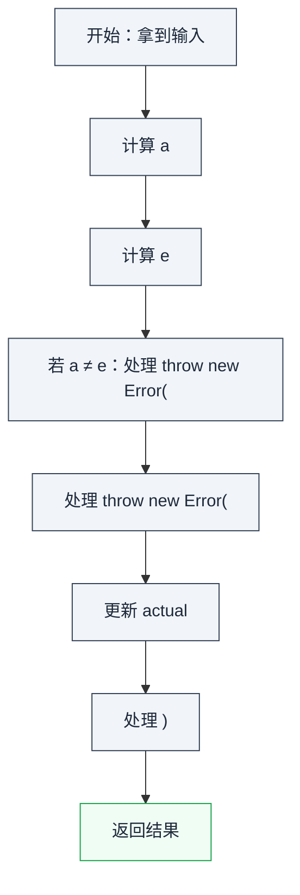

## TypeScript 解题方案（1 个方案逐个讲）

> **运行与提交**：每个方案都是自包含文件（内嵌用例自测，输出 PASS），整块复制到 `.ts` 文件后 `node 文件名` 即可运行。提交 LeetCode 时，把 `demo` 内的算法函数与辅助类型/函数整体取出、置于文件顶层即可。概念演示（非 LeetCode 编号题），在本地运行即可。

### 方案 1：直接实现

**分析与思路**：核心做法是「直接实现」。

**运行方式**：`node 本文件`，内嵌用例全部通过会输出 PASS。

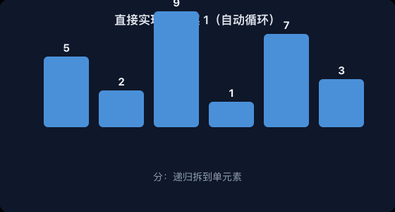

**方案专属流程图**（真实控制流）：

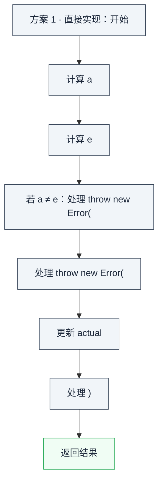

```typescript
function assertEq(actual: any, expected: any, msg: string = ''): void {
  // 定义函数/方法 assertEq
  const a = JSON.stringify(actual);
  const e = JSON.stringify(expected);
  if (a !== e)
    throw new Error(
      'ASSERT FAILED ' + msg + ' :: actual=' + a + ' expected=' + e,
    );
}

function gnome_sort(arr: number[]): number[] {
  // 定义函数/方法 gnome_sort
  const a = arr.slice();
  let i = 0; // 把 数组 截取 ); let 下标 i 赋值为 0 存入 数组
  while (i < a.length) {
    if (i === 0 || a[i] >= a[i - 1]) i++;
    else {
      [a[i - 1], a[i]] = [a[i], a[i - 1]];
      i--;
    }
  }
  return a; // 返回 数组
}
function bubble_sort(arr: number[]): number[] {
  // 定义函数/方法 bubble_sort
  const a = arr.slice();
  let swapped = true; // 把 数组 截取 ); let swapped 赋值为 true 存入 数组
  while (swapped) {
    swapped = false;
    for (let i = 0; i < a.length - 1; i++)
      if (a[i] > a[i + 1]) {
        [a[i], a[i + 1]] = [a[i + 1], a[i]];
        swapped = true;
      }
  }
  return a; // 返回 数组
}
function coin_change(coins: number[], amount: number): number {
  // 定义函数/方法 coin_change
  const cs = coins.slice().sort((a, b) => b - a);
  let remaining = amount;
  let count = 0;
  for (const coin of cs)
    while (remaining >= coin) {
      remaining -= coin;
      count++;
    }
  return remaining === 0 ? count : -1; // 返回 remaining 全等于 0 ? 计数 : 减 1
}
export function demo(): void {
  // 程序入口：跑内嵌自测用例
  assertEq(gnome_sort([3, 2, 1]), [1, 2, 3], 'g'); // 断言校验
  assertEq(bubble_sort([3, 2, 1]), [1, 2, 3], 'b'); // 断言校验
  assertEq(coin_change([1, 5, 10, 25], 63), 6, 'c'); // 断言校验
  console.log('PASS'); // 全部用例通过，输出 PASS
}
demo(); // demo();
```

## 逐步拆解与面试追问

**复杂度**：时间 O(n) 量级，空间 O(n)

**为什么是这个量级**：整体只对数据做有限趟处理

**面试官可能会追问**：

- 这个策略能推广到什么场景？
- 与暴力做法差在哪一步？
- 有没有更简单的等价写法？

## 关键 API 速查（TS 主解法实际用到，附官方链接）

| API | 作用 | 使用要点 | 官方文档 |
|---|---|---|---|
| `Array.prototype.sort()` | 原地排序 | 默认按字符串 Unicode 序（10 会排在 2 前），数字必须传 (a,b)=>a-b；V8 用 TimSort，稳定，O(n log n)；返回原数组引用 | [官方文档](https://developer.mozilla.org/zh-CN/docs/Web/JavaScript/Reference/Global_Objects/Array/sort) |
| `Array/String slice()` | 切片（不改原数组） | slice(start,end) 含头不含尾；负数从尾计；常用于复制数组（slice()） | [官方文档](https://developer.mozilla.org/zh-CN/docs/Web/JavaScript/Reference/Global_Objects/Array/slice) |
| `JSON.stringify()` | 序列化为 JSON 字符串 | 常用于结构化比较（深度相等判定）；undefined/函数/循环引用会被丢弃或抛错 | [官方文档](https://developer.mozilla.org/zh-CN/docs/Web/JavaScript/Reference/Global_Objects/JSON/stringify) |

### 各语言官方文档导航

- **TypeScript / JS**：[MDN 中文参考](https://developer.mozilla.org/zh-CN/)
- **Python**：[Python 官方文档](https://docs.python.org/zh-cn/3/)
- **Go**：[Go 标准库](https://pkg.go.dev/std)
- **Java**：[JDK 17 API](https://docs.oracle.com/en/java/javase/17/docs/api/)
- **Rust**：[Rust 标准库](https://doc.rust-lang.org/std/)
- **Lua**：[Lua 5.4 手册](https://www.lua.org/manual/5.4/)
- **C**：[Cppreference C](https://zh.cppreference.com/w/c)
- **C++**：[Cppreference C++](https://zh.cppreference.com/w/cpp)
- **R**：[R 官方手册](https://stat.ethz.ch/R-manual/)
- **Zig**：[Zig 语言文档](https://ziglang.org/documentation/master/)
- **Dart**：[Dart API](https://api.dart.dev/)

## 附录：其他 10 种语言全部实现（每种语言列举其全部方案）

> TypeScript 的全部方案见「TypeScript 解题方案」一节；下面是其余 10 种语言的对应实现，每种语言的每个方案都带思路分析、代码走读与专属运行架构图。
> 每个方案都内嵌用例自测，可独立运行（老仓库 python/go 文件遵循「打印结果」约定）。
> 完整解法文件见 `dsa/<语言>/notes/lc_107849059_gnome_sort_bubble_sort以及贪心策略的相关对比改进/`。

### Python 实现（1 种方案）

Python 的全部方案如下，每个方案都内嵌用例自测，可独立运行（老仓库 python/go 文件遵循「打印结果」约定）：

#### 方案 1：直接实现

**思路与代码分析**：核心是「直接实现」。Python 版用切片与字典推导式简化操作，突出可读性。**走读**：方案 1 · 直接实现：开始 → 更新 i → 当 i ＜ len(arr): 时反复执行 → 若 i == 0 or arr[i] ≥ arr[i - 1]：更新 + → 更新 + → 更新 arr[i] → 处理 arr[i], → 处理 arr[i - 1], → 处理 ) → 更新 - → 返回 arr。

**运行架构**（真实控制流）：

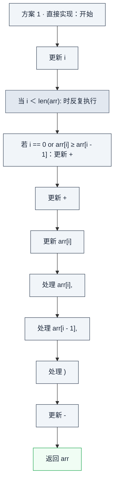

```python
# Gnome Sort (侏儒排序) + Bubble Sort + 贪心找零
import sys  # 提高递归深度上限（深输入防 RecursionError）

sys.setrecursionlimit(200000)  # 树/链表类题目节点数可达 1e4 量级

def gnome_sort(arr):  # 定义函数 gnome_sort（参数：数组）
    i = 0  # 把 0 存入 下标 i
    while i < len(arr):  # 循环，直到不满足「下标 i 小于 长度(数组」
        if i == 0 or arr[i] >= arr[i - 1]:  # 若 下标 i 等于 0 or 数组[下标 i] 不低于 数组[下标 i 减 1]
            i += 1  # 下标 i累加 1
        else:  # 否则
            arr[i - 1], arr[i] = (
                arr[i],
                arr[i - 1],
            )  # 把 数组[下标 i], 数组[下标 i 减 1] 写入 arr[i - 1], arr[i]
            i -= 1  # 下标 i累减 1
    return arr  # 返回 数组

def bubble_sort(arr):  # 定义函数 bubble_sort（参数：数组）
    arr = arr[:]  # 把 复制 数组 存入 数组
    swapped = True  # 把 True 存入 swapped
    while swapped:  # 循环，直到不满足「swapped」
        swapped = False  # 把 False 存入 swapped
        for i in range(len(arr) - 1):  # 让 下标 i 从 长度(数组 遍历
            if arr[i] > arr[i + 1]:  # 若 数组[下标 i] 超过 数组[下标 i 加 1]
                arr[i], arr[i + 1] = (
                    arr[i + 1],
                    arr[i],
                )  # 把 数组[下标 i 加 1], 数组[下标 i] 写入 arr[i], arr[i + 1]
                swapped = True  # 把 True 存入 swapped
    return arr  # 返回 数组

def coin_change(coins, amount):  # 定义函数 coin_change（参数：硬币面额, 目标金额）
    coins = sorted(coins, reverse=True)  # 把 sorted(硬币面额, reverse 赋值为 True) 存入 硬币面额
    remaining = amount  # 把 目标金额 存入 remaining
    count = 0  # 把 0 存入 计数
    for coin in coins:  # 逐个取出 硬币面额 的元素（coin）
        while remaining >= coin:  # 循环，直到不满足「remaining 不低于 coin」
            remaining -= coin  # remaining累减 coin
            count += 1  # 计数累加 1
    return count if remaining == 0 else -1  # 返回 计数 if remaining 等于 0 else 减 1

if __name__ == "__main__":  # 若 __name__ 等于 '__main__'
    print(gnome_sort([3, 2, 1]))  # [1, 2, 3]
    print(bubble_sort([3, 2, 1]))  # [1, 2, 3]
    print(coin_change([1, 5, 10, 25], 63))  # 6
```

### Go 实现（1 种方案）

Go 的全部方案如下，每个方案都内嵌用例自测，可独立运行（老仓库 python/go 文件遵循「打印结果」约定）：

#### 方案 1：直接实现

**思路与代码分析**：核心是「直接实现」。Go 版用切片与多返回值惯用法，显式处理索引边界。**走读**：方案 1 · 直接实现：开始 → 更新 : → 遍历循环 → 处理 if i == 0 或 arr[i] ≥ arr[i → 处理 i++ → 更新 arr[i] → 处理 i-- → 返回 arr。

**运行架构**（真实控制流）：

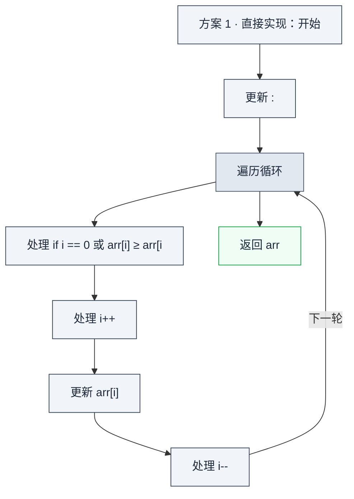

```go
package main // 引入依赖

import (
	"fmt"     // 「fmt」
	"os"      // 「os」
	"reflect" // 「reflect」
	"sort"    // 「sort」
)

// gnomeSort 侏儒排序
func gnomeSort(arr []int) []int { // 定义函数/方法 gnomeSort
	i := 0             // 把 0 写入 i :
	for i < len(arr) { // for 下标 i 小于 长度(数组) {
		if i == 0 || arr[i] >= arr[i-1] { // 若 下标 i 等于 0 或 数组[下标 i] 不低于 数组[下标 i 减 1]
			i++ // 下标 i 加一
		} else { // 否则
			arr[i-1], arr[i] = arr[i], arr[i-1] // 把 数组[下标 i], 数组[下标 i 减 1] 写入 arr[i-1], arr[i]
			i--                                 // 下标 i 减一
		}
	}
	return arr // 返回 数组
}

// bubbleSort 冒泡排序
func bubbleSort(arr []int) []int { // 定义函数/方法 bubbleSort
	a := make([]int, len(arr)) // 把 make([]int, 长度(数组)) 写入 a :
	copy(a, arr)               // copy(数组, 数组)
	swapped := true            // 把 true 写入 swapped :
	for swapped {              // for swapped {
		swapped = false                 // 把 false 写入 swapped
		for i := 0; i < len(a)-1; i++ { // 让 下标 i 从 0 开始计数
			if a[i] > a[i+1] { // 若 数组[下标 i] 超过 数组[下标 i 加 1]
				a[i], a[i+1] = a[i+1], a[i] // 把 数组[下标 i 加 1], 数组[下标 i] 写入 a[i], a[i+1]
				swapped = true              // 把 true 写入 swapped
			}
		}
	}
	return a // 返回 数组
}

// coinChange 贪心找零
func coinChange(coins []int, amount int) int { // 定义函数/方法 coinChange
	c := make([]int, len(coins))              // 把 make([]int, 长度(硬币面额)) 写入 c :
	copy(c, coins)                            // copy(字符, 硬币面额)
	sort.Sort(sort.Reverse(sort.IntSlice(c))) // sort.Sort(sort.Reverse(sort.IntSlice(字符)))
	remaining := amount                       // 把 目标金额 写入 remaining :
	count := 0                                // 把 0 写入 count :
	for _, coin := range c {                  // 同时取 _ 与 coin 遍历
		for remaining >= coin { // 把 coin { 写入 for remaining >
			remaining -= coin // remaining累减 coin
			count++           // 计数 加一
		}
	}
	if remaining == 0 { // 若 remaining 等于 0
		return count // 返回 计数
	}
	return -1 // 返回 减 1
}

func main() { // 程序入口：跑内嵌自测用例
	g := gnomeSort([]int{3, 2, 1})             // 把 gnomeSort([]int{3, 2, 1}) 写入 g :
	if !reflect.DeepEqual(g, []int{1, 2, 3}) { // 若 取反 reflect.DeepEqual(g, []int{1, 2, 3}
		fmt.Printf("FAIL gnomeSort=%v\n", g) // 打印输出
		os.Exit(1)                           // os.Exit(1)
	}
	b := bubbleSort([]int{3, 2, 1})            // 把 bubbleSort([]int{3, 2, 1}) 写入 b :
	if !reflect.DeepEqual(b, []int{1, 2, 3}) { // 若 取反 reflect.DeepEqual(b, []int{1, 2, 3}
		fmt.Printf("FAIL bubbleSort=%v\n", b) // 打印输出
		os.Exit(1)                            // os.Exit(1)
	}
	if coinChange([]int{1, 5, 10, 25}, 63) != 6 { // 若 coinChange([]int{1, 5, 10, 25}, 63) 不等于 6
		fmt.Println("FAIL coinChange") // 打印输出
		os.Exit(1)                     // os.Exit(1)
	}
	fmt.Println("PASS") // 全部用例通过，输出 PASS
}
```

### Java 实现（1 种方案）

Java 的全部方案如下，每个方案都内嵌用例自测，可独立运行（老仓库 python/go 文件遵循「打印结果」约定）：

#### 方案 1：直接实现

**思路与代码分析**：核心是「直接实现」。Java 版用类与静态方法组织，集合操作显式明了。**走读**：方案 1 · 直接实现：开始 → 更新 i → 当 (i ＜ arr.length) 时反复执行 → 若 i == 0 或 arr[i] ≥ arr[i - 1] 则： → 更新 + → 更新 t → 更新 1] → 更新 arr[i] → 更新 - → 返回 arr。

**运行架构**（真实控制流）：

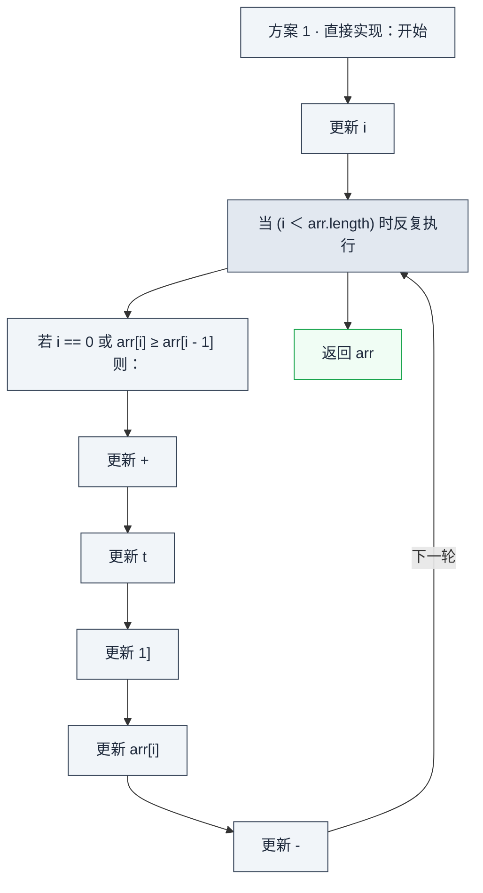

```java
package com.webfault.dsa; // 引入依赖

import java.util.Arrays; // 引入依赖

// 忠实翻译 python solution_1：Gnome Sort + Bubble Sort + 贪心找零
class Main { // 定义类型

  static int[] gnomeSort(int[] arr) { // 定义函数/方法 gnomeSort
    int i = 0; // 把 0 存入 下标 i
    while (i < arr.length) { // 循环，直到不满足「下标 i 小于 数组.长度」
      if (i == 0 || arr[i] >= arr[i - 1]) { // 若 下标 i 等于 0 或 数组[下标 i] 不低于 数组[下标 i 减 1]
        i += 1; // 下标 i累加 1
      } else { // 否则
        int t = arr[i - 1]; // 把 数组[下标 i 减 1] 存入 另一字符串
        arr[i - 1] = arr[i]; // 把 数组[下标 i]; 写入 arr[i - 1]
        arr[i] = t; // 把 另一字符串; 写入 arr[i]
        i -= 1; // 下标 i累减 1
      }
    }
    return arr; // 返回 数组
  }

  static int[] bubbleSort(int[] arr) { // 定义函数/方法 bubbleSort
    int[] a = arr.clone(); // 把 数组.clone(); 写入 int[] a
    boolean swapped = true; // 把 true; 写入 boolean swapped
    while (swapped) { // 循环，直到不满足「swapped」
      swapped = false; // 把 false; 写入 swapped
      for (int i = 0; i + 1 < a.length; i++) { // 让 下标 i 从 0 开始计数，下标 i 加 1 小于 数组.长度 就继续
        if (a[i] > a[i + 1]) { // 若 数组[下标 i] 超过 数组[下标 i 加 1]
          int t = a[i]; // 把 数组[下标 i] 存入 另一字符串
          a[i] = a[i + 1]; // 把 数组[下标 i 加 1]; 写入 a[i]
          a[i + 1] = t; // 把 另一字符串; 写入 a[i + 1]
          swapped = true; // 把 true; 写入 swapped
        }
      }
    }
    return a; // 返回 数组
  }

  static int coinChange(int[] coins, int amount) { // 定义函数/方法 coinChange
    int[] cs = coins.clone(); // 把 硬币面额.clone(); 写入 int[] cs
    Arrays.sort(cs); // 排序
    int remaining = amount; // 把 目标金额 存入 remaining
    int count = 0; // 把 0 存入 计数
    for (int i = cs.length - 1; i >= 0; i--) { // 让 下标 i 从 cs.长度 减 1 开始计数，下标 i 不低于 0 就继续
      while (remaining >= cs[i]) { // 循环，直到不满足「remaining 不低于 cs[下标 i]」
        remaining -= cs[i]; // remaining累减 cs[下标 i]
        count += 1; // 计数累加 1
      }
    }
    return remaining == 0 ? count : -1; // 返回 remaining 等于 0 ? 计数 : 减 1
  }

  static boolean eqArr(int[] a, int[] b) { // 定义函数/方法 eqArr
    if (a.length != b.length) { // 若 数组.长度 不等于 b.长度
      return false; // 返回 false
    }
    for (int i = 0; i < a.length; i++) { // 让 下标 i 从 0 开始计数，下标 i 小于 数组.长度 就继续
      if (a[i] != b[i]) { // 若 数组[下标 i] 不等于 b[下标 i]
        return false; // 返回 false
      }
    }
    return true; // 返回 true
  }

  static String show(int[] a) { // 定义函数/方法 show
    return Arrays.toString(a); // 返回 Arrays.toString(数组)
  }

  public static void main(String[] args) { // public static void main(String[] args) {
    int[][] gnomeCases = { // 把 { 写入 int[][] gnomeCases
      {3, 2, 1}, {1, 1, 2, 0}, {} // {3, 2, 1}, {1, 1, 2, 0}, {}
    };
    int[][] gnomeWant = { // 把 { 写入 int[][] gnomeWant
      {1, 2, 3}, {0, 1, 1, 2}, {} // {1, 2, 3}, {0, 1, 1, 2}, {}
    };
    int[][] bubbleCases = { // 把 { 写入 int[][] bubbleCases
      {3, 2, 1}, {2, 2, 1}, {} // {3, 2, 1}, {2, 2, 1}, {}
    };
    int[][] bubbleWant = { // 把 { 写入 int[][] bubbleWant
      {1, 2, 3}, {1, 2, 2}, {} // {1, 2, 3}, {1, 2, 2}, {}
    };
    int[][] coinCoins = { // 把 { 写入 int[][] coinCoins
      {1, 5, 10, 25}, {2}, {1, 2, 5} // {1, 5, 10, 25}, {2}, {1, 2, 5}
    };
    int[] coinAmount = {63, 3, 11}; // 把 {63, 3, 11}; 写入 int[] coinAmount
    int[] coinWant = {6, -1, 3}; // 把 {6, 减 1, 3}; 写入 int[] coinWant

    boolean ok = true; // 把 true; 写入 boolean ok
    for (int i = 0; i < gnomeCases.length; i++) { // 让 下标 i 从 0 开始计数，下标 i 小于 gnomeCases.长度 就继续
      int[] got =
          gnomeSort(gnomeCases[i].clone()); // 把 gnomeSort(gnomeCases[下标 i].clone()); 写入 int[] got
      if (!eqArr(got, gnomeWant[i])) { // 若 取反 eqArr(got, gnomeWant[下标 i]
        ok = false; // 把 false; 写入 ok
        System.out.println(
            "FAIL gnome_sort("
                + show(gnomeCases[i])
                + ")="
                + show(got) // 打印输出
                + " want "
                + show(gnomeWant[i])); // 加 「 want 」 加 show(gnomeWant[下标 i]));
      }
    }
    for (int i = 0; i < bubbleCases.length; i++) { // 让 下标 i 从 0 开始计数，下标 i 小于 bubbleCases.长度 就继续
      int[] got = bubbleSort(bubbleCases[i]); // 把 bubbleSort(bubbleCases[下标 i]); 写入 int[] got
      if (!eqArr(got, bubbleWant[i])) { // 若 取反 eqArr(got, bubbleWant[下标 i]
        ok = false; // 把 false; 写入 ok
        System.out.println(
            "FAIL bubble_sort("
                + show(bubbleCases[i])
                + ")="
                + show(got) // 打印输出
                + " want "
                + show(bubbleWant[i])); // 加 「 want 」 加 show(bubbleWant[下标 i]));
      }
    }
    for (int i = 0; i < coinAmount.length; i++) { // 让 下标 i 从 0 开始计数，下标 i 小于 coinAmount.长度 就继续
      int got =
          coinChange(
              coinCoins[i],
              coinAmount[i]); // 把 coinChange(coinCoins[下标 i], coinAmount[下标 i]) 存入 got
      if (got != coinWant[i]) { // 若 got 不等于 coinWant[下标 i]
        ok = false; // 把 false; 写入 ok
        System.out.println(
            "FAIL coin_change("
                + show(coinCoins[i])
                + ", "
                + coinAmount[i] // 打印输出
                + ")="
                + got
                + " want "
                + coinWant[i]); // 把 「 加 got 加 」 want " 加 coinWant[下标 i]); 写入 + ")
      }
    }
    if (!ok) { // 若 取反 ok
      throw new RuntimeException("FAILED"); // throw new RuntimeException(「FAILED」);
    }
    System.out.println("PASS"); // 全部用例通过，输出 PASS
  }
}
```

### Rust 实现（1 种方案）

Rust 的全部方案如下，每个方案都内嵌用例自测，可独立运行（老仓库 python/go 文件遵循「打印结果」约定）：

#### 方案 1：直接实现

**思路与代码分析**：核心是「直接实现」。Rust 版用所有权移动与切片借用改写同一逻辑，注意 Option 与引用边界。**走读**：方案 1 · 直接实现：开始 → 计算 a → 计算 i → 当 i ＜ a.len() 时反复执行 → 处理 if i == 0 或 a[i] ≥ a[i - 1 → 更新 + → 调用 a.swap(i - 1, i) → 更新 - → 处理 a → 返回结果。

**运行架构**（真实控制流）：

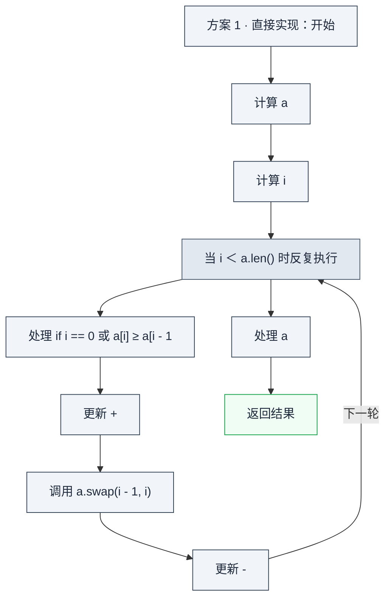

```rust
// Gnome Sort（侏儒排序）+ Bubble Sort（冒泡排序）+ 贪心找零 对比
fn gnome_sort(arr: &[i32]) -> Vec<i32> {
    // 定义函数/方法 gnome_sort
    let mut a = arr.to_vec(); // 把 数组.to_vec(); 写入 let mut a
    let mut i = 0usize; // 把 0usize; 写入 let mut i
    while i < a.len() {
        // while 下标 i 小于 数组.长度() {
        if i == 0 || a[i] >= a[i - 1] {
            // 若 下标 i 等于 0 或 数组[下标 i] 不低于 数组[下标 i 减 1]
            i += 1; // 下标 i累加 1
        } else {
            // 否则
            a.swap(i - 1, i); // 数组.交换 下标 i 减 1, 下标 i);
            i -= 1; // 下标 i累减 1
        }
    }
    a // 数组
}

fn bubble_sort(arr: &[i32]) -> Vec<i32> {
    // 定义函数/方法 bubble_sort
    let mut a = arr.to_vec(); // 把 数组.to_vec(); 写入 let mut a
    let mut swapped = true; // 把 true; 写入 let mut swapped
    while swapped {
        // while swapped {
        swapped = false; // 把 false; 写入 swapped
        for i in 0..a.len().saturating_sub(1) {
            // 逐个取出 0 的元素（下标 i）
            if a[i] > a[i + 1] {
                // 若 数组[下标 i] 超过 数组[下标 i 加 1]
                a.swap(i, i + 1); // 数组.交换 下标 i, 下标 i 加 1);
                swapped = true; // 把 true; 写入 swapped
            }
        }
    }
    a // 数组
}

fn coin_change(coins: &[i32], amount: i32) -> i32 {
    // 定义函数/方法 coin_change
    let mut cs = coins.to_vec(); // 把 硬币面额.to_vec(); 写入 let mut cs
    cs.sort_by(|x, y| y.cmp(x)); // cs.sort_by( 按位或 x, y 按位或 y.cmp(x));
    let mut remaining = amount; // 把 目标金额; 写入 let mut remaining
    let mut count = 0; // 把 0; 写入 let mut count
    for coin in cs {
        // 逐个取出 cs 的元素（coin）
        while remaining >= coin {
            // 把 coin { 写入 while remaining >
            remaining -= coin; // remaining累减 coin
            count += 1; // 计数累加 1
        }
    }
    if remaining == 0 {
        count
    } else {
        -1
    } // 若 remaining 等于 0 { 计数 } else { 减 1 }
}

fn main() {
    // 程序入口：跑内嵌自测用例
    assert_eq!(gnome_sort(&[3, 2, 1]), vec![1, 2, 3], "g"); // 断言校验
    assert_eq!(bubble_sort(&[3, 2, 1]), vec![1, 2, 3], "b"); // 断言校验
    assert_eq!(coin_change(&[1, 5, 10, 25], 63), 6, "c"); // 断言校验
    println!("PASS"); // 全部用例通过，输出 PASS
}
```

### Lua 实现（1 种方案）

Lua 的全部方案如下，每个方案都内嵌用例自测，可独立运行（老仓库 python/go 文件遵循「打印结果」约定）：

#### 方案 1：直接实现

**思路与代码分析**：核心是「直接实现」。Lua 版用表与 ipairs 遍历，注意 ipairs 遇 nil 即停的语义。**走读**：方案 1 · 直接实现：开始 → 更新 a → 遍历 ipairs(arr) do 中的每个元素 v → 更新 a[i] → 更新 i → 当 i ≤ #a do 时反复执行 → 处理 if i == 1 or a[i] ≥ a[i - 1 → 更新 i → 更新 a[i] → 更新 i → 返回 a。

**运行架构**（真实控制流）：

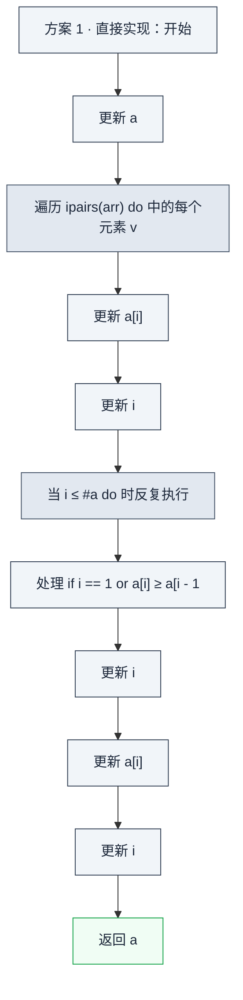

```lua
-- Gnome Sort（侏儒排序）+ Bubble Sort（冒泡排序）+ 贪心找零 对比
local function gnome_sort(arr) -- local function gnome_sort(数组)
	local a = {} -- 把 {} 写入 local a
	for i, v in ipairs(arr) do
		a[i] = v
	end -- 遍历取 值
	local i = 1 -- 把 1 写入 local i
	while i <= #a do -- 把 #数组 do 写入 while i <
		if i == 1 or a[i] >= a[i - 1] then -- 若 下标 i 等于 1 or 数组[下标 i] 不低于 数组[下标 i 减 1] then
			i = i + 1 -- 把 下标 i 加 1 存入 下标 i
		else -- 否则
			a[i - 1], a[i] = a[i], a[i - 1] -- 把 数组[下标 i], 数组[下标 i 减 1] 写入 a[i - 1], a[i]
			i = i - 1 -- 把 下标 i 减 1 存入 下标 i
		end -- 终点
	end -- 终点
	return a -- 返回 数组
end -- 终点

local function bubble_sort(arr) -- local function bubble_sort(数组)
	local a = {} -- 把 {} 写入 local a
	for i, v in ipairs(arr) do
		a[i] = v
	end -- 遍历取 值
	local swapped = true -- 把 true 写入 local swapped
	while swapped do -- while swapped do
		swapped = false -- 把 false 存入 swapped
		for i = 1, #a - 1 do -- 把 1, #数组 减 1 do 写入 for i
			if a[i] > a[i + 1] then -- 若 数组[下标 i] 超过 数组[下标 i 加 1] then
				a[i], a[i + 1] = a[i + 1], a[i] -- 把 数组[下标 i 加 1], 数组[下标 i] 写入 a[i], a[i + 1]
				swapped = true -- 把 true 存入 swapped
			end -- 终点
		end -- 终点
	end -- 终点
	return a -- 返回 数组
end -- 终点

local function coin_change(coins, amount) -- local function coin_change(硬币面额, 目标金额)
	local cs = {} -- 把 {} 写入 local cs
	for i, v in ipairs(coins) do
		cs[i] = v
	end -- 遍历取 值
	table.sort(cs, function(x, y)
		return x > y
	end) -- 排序
	local remaining = amount -- 把 目标金额 写入 local remaining
	local count = 0 -- 把 0 写入 local count
	for _, coin in ipairs(cs) do -- 遍历取 coin
		while remaining >= coin do -- 把 coin do 写入 while remaining >
			remaining = remaining - coin -- 把 remaining 减 coin 存入 remaining
			count = count + 1 -- 把 计数 加 1 存入 计数
		end -- 终点
	end -- 终点
	if remaining == 0 then
		return count
	else
		return -1
	end -- 若 remaining 等于 0 then return 计数 else return 减 1 终点
end -- 终点

local function eq_arr(x, y) -- local function eq_arr(x, y)
	if #x ~= #y then
		return false
	end -- 若 #x ~ 赋值为 #y then return false 终点
	for i = 1, #x do
		if x[i] ~= y[i] then
			return false
		end
	end
	return true -- 返回 true
end -- 终点

assert(eq_arr(gnome_sort({ 3, 2, 1 }), { 1, 2, 3 }), "g") -- 断言校验
assert(eq_arr(bubble_sort({ 3, 2, 1 }), { 1, 2, 3 }), "b") -- 断言校验
assert(coin_change({ 1, 5, 10, 25 }, 63) == 6, "c") -- 断言校验
print("PASS") -- 全部用例通过，输出 PASS
```

### C 实现（1 种方案）

C 的全部方案如下，每个方案都内嵌用例自测，可独立运行（老仓库 python/go 文件遵循「打印结果」约定）：

#### 方案 1：直接实现

**思路与代码分析**：核心是「直接实现」。C 版手动管理下标与内存，循环边界全部显式写出。**走读**：方案 1 · 直接实现：开始 → 更新 i → 当 (i ＜ n) 时反复执行 → 若 i == 0 或 a[i] ≥ a[i - 1]：处理 i++ → 处理 i++ → 更新 t → 更新 1] → 更新 a[i] → 处理 i-- → 返回结果。

**运行架构**（真实控制流）：

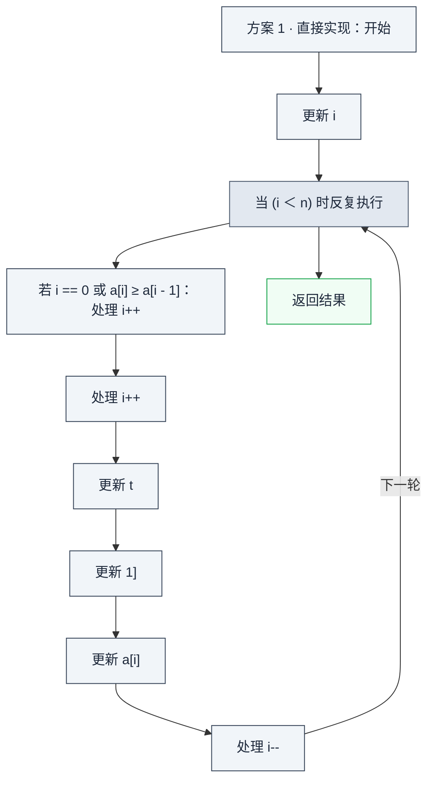

```c
// Gnome Sort（侏儒排序）+ Bubble Sort（冒泡排序）+ 贪心找零 对比
#include <stdio.h> // 引入头文件

static void gnome_sort(int *a, int n) { // 定义函数/方法 gnome_sort
    int i = 0;                          // 把 0 存入 下标 i
    while (i < n) {                     // 循环，直到不满足「下标 i 小于 元素个数」
        if (i == 0 || a[i] >= a[i - 1])
            i++; // 若 下标 i 等于 0 或 数组[下标 i] 不低于 数组[下标 i 减 1]) 下标 i 加一 ;
        else {
            int t = a[i - 1];
            a[i - 1] = a[i];
            a[i] = t;
            i--;
        } // 否则
    }
}

static void bubble_sort(int *a, int n) { // 定义函数/方法 bubble_sort
    int swapped = 1;                     // 把 1 存入 swapped
    while (swapped) {                    // 循环，直到不满足「swapped」
        swapped = 0;                     // 把 0; 写入 swapped
        for (int i = 0; i < n - 1; i++) { // 让 下标 i 从 0 开始计数，下标 i 小于 元素个数 减 1 就继续
            if (a[i] > a[i + 1]) {
                int t = a[i];
                a[i] = a[i + 1];
                a[i + 1] = t;
                swapped = 1;
            }
        }
    }
}

static int coin_change(const int *coins, int n, int amount) { // 定义函数/方法 coin_change
    int cs[64];                                               // int cs[64];
    for (int i = 0; i < n; i++)
        cs[i] = coins[i]; // 让 下标 i 从 0 开始计数，下标 i 小于 元素个数 就继续
    for (int i = 0; i < n - 1; i++) // 让 下标 i 从 0 开始计数，下标 i 小于 元素个数 减 1 就继续
        for (int j = 0; j < n - 1 - i;
             j++) // 让 下标 j 从 0 开始计数，下标 j 小于 元素个数 减 1 减 下标 i 就继续
            if (cs[j] < cs[j + 1]) {
                int t = cs[j];
                cs[j] = cs[j + 1];
                cs[j + 1] = t;
            }
    int remaining = amount, count = 0; // 把 目标金额, 计数 赋值为 0 存入 remaining
    for (int i = 0; i < n; i++) // 让 下标 i 从 0 开始计数，下标 i 小于 元素个数 就继续
        while (remaining >= cs[i]) {
            remaining -= cs[i];
            count++;
        }
    return remaining == 0 ? count : -1; // 返回 remaining 等于 0 ? 计数 : 减 1
}

static int eq_arr(const int *x, const int *y, int n) { // 定义函数/方法 eq_arr
    for (int i = 0; i < n; i++)
        if (x[i] != y[i])
            return 0; // 让 下标 i 从 0 开始计数，下标 i 小于 元素个数 就继续
    return 1;         // 返回 1
}

int main(void) {             // 程序入口：跑内嵌自测用例
    int a[3] = {3, 2, 1};    // 把 {3, 2, 1}; 写入 int a[3]
    int want[3] = {1, 2, 3}; // 把 {1, 2, 3}; 写入 int want[3]
    gnome_sort(a, 3);        // gnome_sort(数组, 3);
    if (!eq_arr(a, want, 3)) {
        printf("g failed\n");
        return 1;
    }                     // 若 取反 eq_arr(数组, want, 3)) { 输出「g failed 」); return 1; }
    int b[3] = {3, 2, 1}; // 把 {3, 2, 1}; 写入 int b[3]
    bubble_sort(b, 3);    // bubble_sort(b, 3);
    if (!eq_arr(b, want, 3)) {
        printf("b failed\n");
        return 1;
    }                              // 若 取反 eq_arr(b, want, 3)) { 输出「b failed 」); return 1; }
    int coins[4] = {1, 5, 10, 25}; // 把 {1, 5, 10, 25}; 写入 int coins[4]
    if (coin_change(coins, 4, 63) != 6) {
        printf("c failed\n");
        return 1;
    }
    printf("PASS\n"); // 全部用例通过，输出 PASS
    return 0;         // 返回 0
}
```

### C++ 实现（1 种方案）

C++ 的全部方案如下，每个方案都内嵌用例自测，可独立运行（老仓库 python/go 文件遵循「打印结果」约定）：

#### 方案 1：直接实现

**思路与代码分析**：核心是「直接实现」。C++ 版用 STL 容器与迭代器，减少手写下标错误。代码里依次做这些事：单循环线性扫描。**走读**：方案 1 · 直接实现：开始 → 更新 swapped → 当 (swapped) 时反复执行 → 更新 swapped → 遍历循环 → 处理 i++) → 若 a[i] ＞ a[i + 1] 则： → 处理 std::swap(a[i], a[i + 1]) → 更新 swapped → 返回结果。

**运行架构**（真实控制流）：

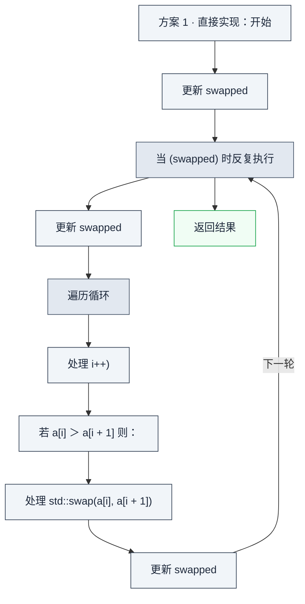

```cpp
// Gnome Sort（侏儒排序）+ Bubble Sort（冒泡排序）+ 贪心找零 对比
#include <algorithm> // 引入头文件
#include <cassert>   // 引入头文件
#include <iostream>  // 引入头文件
#include <vector>    // 引入头文件

static void gnome_sort_inplace(std::vector<int> &a) { // 定义函数/方法 gnome_sort_inplace
    size_t i = 0;                                     // 把 0; 写入 size_t i
    while (i < a.size()) { // 循环，直到不满足「下标 i 小于 数组.大小(」
        if (i == 0 || a[i] >= a[i - 1])
            i++; // 若 下标 i 等于 0 或 数组[下标 i] 不低于 数组[下标 i 减 1]) 下标 i 加一 ;
        else {
            std::swap(a[i - 1], a[i]);
            i--;
        } // 否则
    }
}

static void bubble_sort_inplace(std::vector<int> &a) { // 定义函数/方法 bubble_sort_inplace
    bool swapped = true;                               // 把 true 存入 swapped
    while (swapped) {                                  // 循环，直到不满足「swapped」
        swapped = false;                               // 把 false; 写入 swapped
        for (size_t i = 0; i + 1 < a.size();
             i++) { // 让 下标 i 从 0 开始计数，下标 i 加 1 小于 数组.大小() 就继续
            if (a[i] > a[i + 1]) {
                std::swap(a[i], a[i + 1]);
                swapped = true;
            }
        }
    }
}

static int coin_change(std::vector<int> coins, int amount) { // 定义函数/方法 coin_change
    std::sort(coins.begin(), coins.end(),
              std::greater<int>()); // std::sort(硬币面额 迭代位置 , 硬币面额.终点(), std::greater 小于 int
                                    // 超过 ());
    int remaining = amount, count = 0; // 把 目标金额, 计数 赋值为 0 存入 remaining
    for (int coin : coins)             // for (int coin : 硬币面额)
        while (remaining >= coin) {
            remaining -= coin;
            count++;
        } // 循环，直到不满足「remaining 不低于 coin) { remaining 累减 coin; 计数 加一 ; }」
    return remaining == 0 ? count : -1; // 返回 remaining 等于 0 ? 计数 : 减 1
}

int main() {                                      // 程序入口：跑内嵌自测用例
    std::vector<int> a{3, 2, 1};                  // std::vector 小于 int 超过 数组{3, 2, 1};
    gnome_sort_inplace(a);                        // gnome_sort_inplace(数组);
    assert((a == std::vector<int>{1, 2, 3}));     // 断言校验
    std::vector<int> b{3, 2, 1};                  // std::vector 小于 int 超过 b{3, 2, 1};
    bubble_sort_inplace(b);                       // bubble_sort_inplace(b);
    assert((b == std::vector<int>{1, 2, 3}));     // 断言校验
    assert(coin_change({1, 5, 10, 25}, 63) == 6); // 断言校验
    std::cout << "PASS" << std::endl;             // 全部用例通过，输出 PASS
    return 0;                                     // 返回 0
}
```

### R 实现（1 种方案）

R 的全部方案如下，每个方案都内嵌用例自测，可独立运行（老仓库 python/go 文件遵循「打印结果」约定）：

#### 方案 1：直接实现

**思路与代码分析**：核心是「直接实现」。R 版用向量化思维与 1 起始下标，注意 1:n 的降序陷阱。**走读**：方案 1 · 直接实现：开始 → 处理 a ＜- as.list(arr) → 处理 i ＜- 1L → 处理 n ＜- length(a) → 当 (i ≤ n) 时反复执行 → 若 i == 1L 或 a[[i]] ≥ a[[i - 1L]] 则： → 处理 i ＜- i + 1L → 处理 tmp ＜- a[[i - 1L]] → 处理 a[[i - 1L]] ＜- a[[i]] → 处理 a[[i]] ＜- tmp → 处理 i ＜- i - 1L → 调用 as.integer(vapply(a, functio → 返回结果。

**运行架构**（真实控制流）：

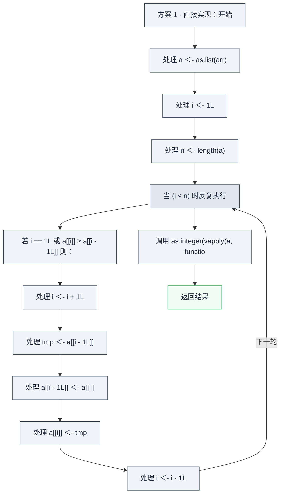

```r
# Sort（冒泡排序）+ 贪心找零 对比 定义函数 gnome_sort（参数：数组）
gnome_sort <- function(arr) {
    a <- as.list(arr)  # 把 as.列表(数组) 存入 数组
    i <- 1L  # 把 1L 存入 下标 i
    n <- length(a)  # 把 长度(数组) 存入 元素个数
    while (i <= n) {
        # 循环，直到不满足「下标 i 不超过 元素个数」 若 下标 i 等于 1L 或 数组[[下标 i]] 不低于 数组[[下标 i
        # 减 1L]]
        if (i == 1L || a[[i]] >= a[[i - 1L]]) {
            i <- i + 1L  # 把 下标 i 加 1L 存入 下标 i
        } else {
            # 否则
            tmp <- a[[i - 1L]]  # 把 数组[[下标 i 减 1L]] 存入 临时变量
            a[[i - 1L]] <- a[[i]]  # 数组[[下标 i 减 1L]] 小于 减 数组[[下标 i]]
            a[[i]] <- tmp  # 把 临时变量 存入 a[[i]]
            i <- i - 1L  # 把 下标 i 减 1L 存入 下标 i
        }
    }
    as.integer(vapply(a, function(x) x, integer(1)))  # as.integer(vapply(数组, function(x) x, integer(1)))
}
bubble_sort <- function(arr) {
    # 定义函数 bubble_sort（参数：数组）
    a <- as.list(arr)  # 把 as.列表(数组) 存入 数组
    n <- length(a)  # 把 长度(数组) 存入 元素个数
    swapped <- TRUE  # 把 TRUE 存入 swapped
    while (swapped) {
        # 循环，直到不满足「swapped」
        swapped <- FALSE  # 把 FALSE 存入 swapped
        for (i in 1:(n - 1L)) {
            # for (下标 i in 1:(元素个数 减 1L)) { 若 数组[[下标 i]] 超过 数组[[下标 i 加 1L]]
            if (a[[i]] > a[[i + 1L]]) {
                tmp <- a[[i]]  # 把 数组[[下标 i]] 存入 临时变量
                a[[i]] <- a[[i + 1L]]  # 把 数组[[下标 i 加 1L]] 存入 a[[i]]
                a[[i + 1L]] <- tmp  # 数组[[下标 i 加 1L]] 小于 减 临时变量
                swapped <- TRUE  # 把 TRUE 存入 swapped
            }
        }
    }
    as.integer(vapply(a, function(x) x, integer(1)))  # as.integer(vapply(数组, function(x) x, integer(1)))
}
coin_change <- function(coins, amount) {
    # 定义函数 coin_change（参数：硬币面额, 目标金额）
    cs <- sort(coins, decreasing = TRUE)  # 把 sort(硬币面额, decreasing 赋值为 TRUE) 存入 cs
    remaining <- amount  # 把 目标金额 存入 remaining
    count <- 0L  # 把 0L 存入 计数
    for (coin in cs) {
        # for (coin in cs) { 循环，直到不满足「remaining 不低于 coin」
        while (remaining >= coin) {
            remaining <- remaining - coin  # 把 remaining 减 coin 存入 remaining
            count <- count + 1L  # 把 计数 加 1L 存入 计数
        }
    }
    if (remaining == 0)
        count else -1L  # 若 remaining 等于 0) 计数 else 减 1L
}
g <- gnome_sort(c(3L, 2L, 1L))  # 把 gnome_sort(字符(3L, 2L, 1L)) 存入 g
stopifnot(identical(as.integer(g), 1:3))  # 断言校验
b <- bubble_sort(c(3L, 2L, 1L))  # 把 bubble_sort(字符(3L, 2L, 1L)) 存入 b
stopifnot(identical(as.integer(b), 1:3))  # 断言校验
stopifnot(coin_change(c(1L, 5L, 10L, 25L), 63L) == 6L)  # 断言校验
cat("PASS\n")  # 全部用例通过，输出 PASS
```

### Zig 实现（1 种方案）

Zig 的全部方案如下，每个方案都内嵌用例自测，可独立运行（老仓库 python/go 文件遵循「打印结果」约定）：

#### 方案 1：直接实现

**思路与代码分析**：核心是「直接实现」。Zig 版显式分配与清零，整型边界处理严格。**走读**：方案 1 · 直接实现：开始 → 计算 i → 当 (i ＜ a.len) 时反复执行 → 若 i == 0 or a[i] ≥ a[i - 1] 则： → 更新 + → 计算 t → 更新 1] → 更新 a[i] → 更新 - → 返回结果。

**运行架构**（真实控制流）：

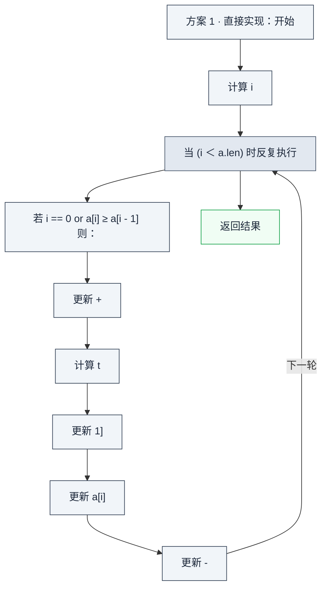

```zig
// Gnome Sort（侏儒排序）+ Bubble Sort（冒泡排序）+ 贪心找零 对比
const std = @import("std"); // 把 @import(「std」) 存入 std

fn gnomeSort(a: []i32) void { // 定义函数/方法 gnomeSort
    var i: usize = 0; // 把 0; 写入 var i: usize
    while (i < a.len) { // 循环，直到不满足「下标 i 小于 数组.长度」
        if (i == 0 or a[i] >= a[i - 1]) { // 若 下标 i 等于 0 or 数组[下标 i] 不低于 数组[下标 i 减 1]
            i += 1; // 下标 i累加 1
        } else { // 否则
            const t = a[i - 1]; // 把 数组[下标 i 减 1] 存入 另一字符串
            a[i - 1] = a[i]; // 把 数组[下标 i]; 写入 a[i - 1]
            a[i] = t; // 把 另一字符串; 写入 a[i]
            i -= 1; // 下标 i累减 1
        }
    }
}

fn bubbleSort(a: []i32) void { // 定义函数/方法 bubbleSort
    var swapped = true; // 把 true 存入 swapped
    while (swapped) { // 循环，直到不满足「swapped」
        swapped = false; // 把 false; 写入 swapped
        var i: usize = 0; // 把 0; 写入 var i: usize
        while (i + 1 < a.len) : (i += 1) { // 循环，直到不满足「下标 i 加 1 小于 数组.长度) : (下标 i 累加 1」
            if (a[i] > a[i + 1]) { // 若 数组[下标 i] 超过 数组[下标 i 加 1]
                const t = a[i]; // 把 数组[下标 i] 存入 另一字符串
                a[i] = a[i + 1]; // 把 数组[下标 i 加 1]; 写入 a[i]
                a[i + 1] = t; // 把 另一字符串; 写入 a[i + 1]
                swapped = true; // 把 true; 写入 swapped
            }
        }
    }
}

fn coinChange(coins: []const i32, amount: i32) i32 { // 定义函数/方法 coinChange
    var cs: [64]i32 = undefined; // 把 undefined; 写入 var cs: [64]i32
    var n: usize = 0; // 把 0; 写入 var n: usize
    for (coins) |c| { // 逐个取出 硬币面额 的元素（字符）
        cs[n] = c; // 把 字符; 写入 cs[n]
        n += 1; // 元素个数累加 1
    }
    // 降序冒泡
    var i: usize = 0; // 把 0; 写入 var i: usize
    while (i + 1 < n) : (i += 1) { // 循环，直到不满足「下标 i 加 1 小于 元素个数) : (下标 i 累加 1」
        var j: usize = 0; // 把 0; 写入 var j: usize
        while (j + 1 < n - i) : (j += 1) { // 循环，直到不满足「下标 j 加 1 小于 元素个数 减 下标 i) : (下标 j 累加 1」
            if (cs[j] < cs[j + 1]) { // 若 cs[下标 j] 小于 cs[下标 j 加 1]
                const t = cs[j]; // 把 cs[下标 j] 存入 另一字符串
                cs[j] = cs[j + 1]; // 把 cs[下标 j 加 1]; 写入 cs[j]
                cs[j + 1] = t; // 把 另一字符串; 写入 cs[j + 1]
            }
        }
    }
    var remaining = amount; // 把 目标金额 存入 remaining
    var count: i32 = 0; // 把 0; 写入 var count: i32
    for (cs[0..n]) |coin| { // for (cs[0..元素个数]) 按位或 coin 按位或 {
        while (remaining >= coin) { // 循环，直到不满足「remaining 不低于 coin」
            remaining -= coin; // remaining累减 coin
            count += 1; // 计数累加 1
        }
    }
    if (remaining == 0) return count; // 若 remaining 等于 0，直接返回 计数
    return -1; // 返回 减 1
}

pub fn main() !void { // 程序入口：跑内嵌自测用例
    var gpa = std.heap.GeneralPurposeAllocator(.{}){}; // 把 std.堆.GeneralPurposeAllocator(.{}){} 存入 gpa
    defer _ = gpa.deinit(); // 把 gpa.deinit(); 写入 defer _
    const allocator = gpa.allocator(); // 把 gpa.allocator() 存入 allocator

    var g = [_]i32{ 3, 2, 1 }; // 把 [_]i32{ 3, 2, 1 } 存入 g
    gnomeSort(&g); // gnomeSort( 按位与 g);
    const want = [_]i32{ 1, 2, 3 }; // 把 [_]i32{ 1, 2, 3 } 存入 want
    if (!std.mem.eql(i32, &g, &want)) return error.TestFailed; // 若 取反 std.mem.eql(i32, 按位与 g, 按位与 want)，直接返回 error.TestFailed

    var b = [_]i32{ 3, 2, 1 }; // 把 [_]i32{ 3, 2, 1 } 存入 b
    bubbleSort(&b); // bubbleSort( 按位与 b);
    if (!std.mem.eql(i32, &b, &want)) return error.TestFailed; // 若 取反 std.mem.eql(i32, 按位与 b, 按位与 want)，直接返回 error.TestFailed

    const coins = [_]i32{ 1, 5, 10, 25 }; // 把 [_]i32{ 1, 5, 10, 25 } 存入 硬币面额
    if (coinChange(&coins, 63) != 6) return error.TestFailed; // 若 coinChange( 按位与 硬币面额, 63) 不等于 6，直接返回 error.TestFailed

    _ = allocator; // 把 allocator; 写入 _
    std.debug.print("PASS\n", .{}); // 全部用例通过，输出 PASS
}
```

### Dart 实现（1 种方案）

Dart 的全部方案如下，每个方案都内嵌用例自测，可独立运行（老仓库 python/go 文件遵循「打印结果」约定）：

#### 方案 1：直接实现

**思路与代码分析**：核心是「直接实现」。Dart 版用可空类型标注与集合方法，注意空安全。**走读**：方案 1 · 直接实现：开始 → 更新 a → 计算 i → 当 (i ＜ a.length) 时反复执行 → 若 i == 0 或 a[i] ≥ a[i - 1] 则： → 处理 i++ → 更新 t → 更新 1] → 更新 a[i] → 处理 i-- → 返回 a。

**运行架构**（真实控制流）：

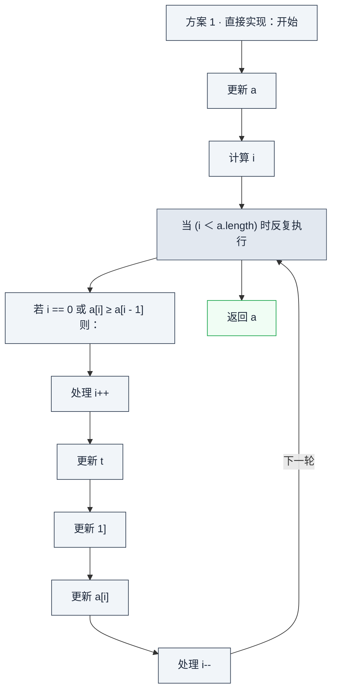

```dart
// Gnome Sort（侏儒排序）+ Bubble Sort（冒泡排序）+ 贪心找零 对比
List<int> gnomeSort(List<int> arr) {
  // 定义函数/方法 gnomeSort
  final a = List<int>.from(arr); // 把 List 小于 int 超过 .from(数组) 存入 数组
  var i = 0; // 把 0 存入 下标 i
  while (i < a.length) {
    // 循环，直到不满足「下标 i 小于 数组.长度」
    if (i == 0 || a[i] >= a[i - 1]) {
      // 若 下标 i 等于 0 或 数组[下标 i] 不低于 数组[下标 i 减 1]
      i++; // 下标 i 加一
    } else {
      // 否则
      final t = a[i - 1]; // 把 数组[下标 i 减 1] 存入 另一字符串
      a[i - 1] = a[i]; // 把 数组[下标 i]; 写入 a[i - 1]
      a[i] = t; // 把 另一字符串; 写入 a[i]
      i--; // 下标 i 减一
    }
  }
  return a; // 返回 数组
}

List<int> bubbleSort(List<int> arr) {
  // 定义函数/方法 bubbleSort
  final a = List<int>.from(arr); // 把 List 小于 int 超过 .from(数组) 存入 数组
  var swapped = true; // 把 true 存入 swapped
  while (swapped) {
    // 循环，直到不满足「swapped」
    swapped = false; // 把 false 存入 swapped
    for (var i = 0; i < a.length - 1; i++) {
      // 让 下标 i 从 0 开始计数，下标 i 小于 数组.长度 减 1 就继续
      if (a[i] > a[i + 1]) {
        // 若 数组[下标 i] 超过 数组[下标 i 加 1]
        final t = a[i]; // 把 数组[下标 i] 存入 另一字符串
        a[i] = a[i + 1]; // 把 数组[下标 i 加 1]; 写入 a[i]
        a[i + 1] = t; // 把 另一字符串; 写入 a[i + 1]
        swapped = true; // 把 true 存入 swapped
      }
    }
  }
  return a; // 返回 数组
}

int coinChange(List<int> coins, int amount) {
  // 定义函数/方法 coinChange
  final cs = List<int>.from(coins)..sort((x, y) => y.compareTo(x));
  var remaining = amount; // 把 目标金额 存入 remaining
  var count = 0; // 把 0 存入 计数
  for (final coin in cs) {
    // for (final coin in cs) {
    while (remaining >= coin) {
      // 循环，直到不满足「remaining 不低于 coin」
      remaining -= coin; // remaining累减 coin
      count++; // 计数 加一
    }
  }
  return remaining == 0 ? count : -1; // 返回 remaining 等于 0 ? 计数 : 减 1
}

void main() {
  // 程序入口：跑内嵌自测用例
  final want = <int>[1, 2, 3]; // 把 小于 int 超过 [1, 2, 3] 存入 want
  assert(gnomeSort([3, 2, 1]).toString() == want.toString(), 'g'); // 断言校验
  assert(bubbleSort([3, 2, 1]).toString() == want.toString(), 'b'); // 断言校验
  assert(coinChange([1, 5, 10, 25], 63) == 6, 'c'); // 断言校验
  print('PASS'); // 全部用例通过，输出 PASS
}
```

---

## 内容总结

- **gnome sort bubble sort以及贪心策略的相关对比改进**（算法笔记 · Medium）：共 1 个方案，主线思路「直接实现」；时间 O(n) 量级；动画演示归并分治过程，附录给出 11 种语言 × 全部方案的可运行实现。
- 来源博客：[https://blog.csdn.net/tyro_java/article/details/107849059](https://blog.csdn.net/tyro_java/article/details/107849059)
- 导航：[📋 总目录](../) ｜ [← 209 big-o记号 数据结构与算法的](../209_big-o记号_数据结构与算法的关系以及几种基本的数据结构/) ｜ [211 贪心策略之matrixsorti →](../211_贪心策略之matrixsorting_pfc_coding_huffmantre/)
