# 211 · 贪心策略之matrixsorting pfc coding huffmantre（第附阶段 · 专题补充 · Medium）

> **难度**：⭐⭐ Medium ｜ **专题**：算法笔记
> **学习定位**：第附阶段 · 专题补充第 211 篇 ｜ **解法数**：1
> **内容总结**：**贪心策略之matrixsorting pfc coding huffmantre**（算法笔记 · Medium）：共 1 个方案，主线思路「迭代指针处理」；时间 O(n)（单趟线性扫描）；动画演示归并分治过程，附录给出 11 种语言 × 全部方案的可运行实现。

---

## 题目描述

贪心策略之matrixsorting pfc coding huffmantre。具体输入输出约定见函数签名与用例。

- 主函数签名：`function treeToLevel(root: any): any[]`

**用例演示**（摘自主解法内嵌自测，输入到输出一目了然）：

```typescript
  const cases = [
    {
      got: sortedMat,
      want: [
        [1, 2, 3],
        [4, 5, 6],
        [7, 8, 9],
      ],
    },
    { got: wpl, want: 224 },
    { got: prefixFree, want: true },
  ];
```

**数据范围与注意事项**：

- **易错点**：先看小例子手推一遍再对照代码，比直接读代码快得多。

## 题目分析

**场景是什么**：综合练习：把数据结构与策略组合起来解决一个完整问题。本题就是该场景的 Medium 级练习，主线做法是「迭代指针处理」。

**主线怎么解**：把主解法从头到尾过一遍，它其实在依次做这几件事：队列或堆的调度。

## 解题思路

**方案对比**（共 1 个方案，由浅入深）：

| 方案 | 时间复杂度 | 空间复杂度 |
|---|---|---|
| 方案 1 · 迭代指针处理 | O(n)（单趟线性扫描） | O(1) 到 O(n)（视辅助结构） |

**怎么读这一篇**：

- 🐣 **新手路线**：把「题目描述」的示例 1 在纸上手推一遍 → 读方案 1（最直观的写法）与它的代码走读 → 按「运行方式」本地跑通看 PASS → 回头对比方案 2 之后的写法差在哪
- 🦅 **大佬路线**：直接锁定最优方案 1（迭代指针处理，O(n)（单趟线性扫描））→ 跳读该方案代码与走读 → 用「逐步拆解与面试追问」补齐复杂度推导与边界追问

### 动态算法图（归并分治，GIF 自动循环）


动画演示算法笔记专题里归并分治的典型过程；每个方案在「TypeScript 解题方案」一节还配了专属动画与专属流程图。

### 主解法流程图（真实控制流）

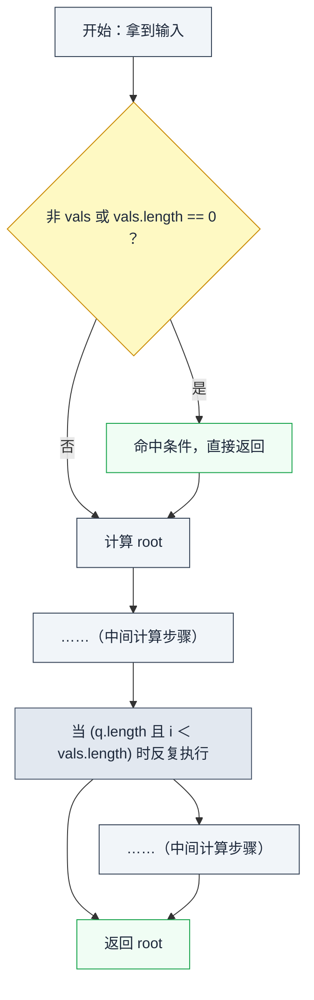

## TypeScript 解题方案（1 个方案逐个讲）

> **运行与提交**：每个方案都是自包含文件（内嵌用例自测，输出 PASS），整块复制到 `.ts` 文件后 `node 文件名` 即可运行。提交 LeetCode 时，把 `demo` 内的算法函数与辅助类型/函数整体取出、置于文件顶层即可。概念演示（非 LeetCode 编号题），在本地运行即可。

### 方案 1：迭代指针处理

**分析与思路**：核心做法是「迭代指针处理」。代码里依次做这些事：队列或堆的调度。

**运行方式**：`node 本文件`，内嵌用例全部通过会输出 PASS。


**方案专属流程图**（真实控制流）：

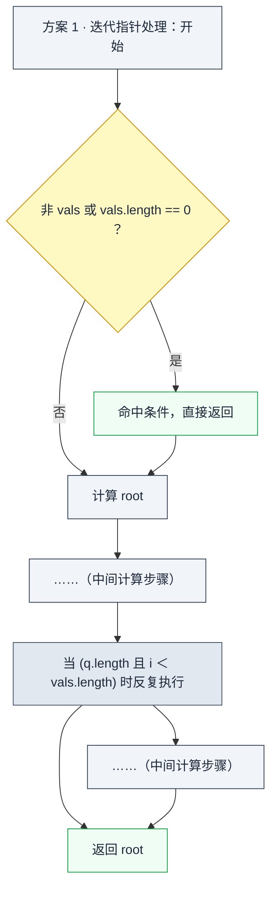

```typescript
class TreeNode {
  // 定义类型
  val: any;
  left: any;
  right: any; // 值: any; 左边界: any; 右边界: any;
  constructor(val?: any, left?: any, right?: any) {
    // constructor(值?: any, 左边界?: any, 右边界?: any) {
    this.val = val === undefined ? 0 : val; // 把 (值 全等于 undefined ? 0 : 值); 写入 值
    this.left = left === undefined ? null : left; // 把 (左边界 全等于 undefined ? null : 左边界); 写入 左边界
    this.right = right === undefined ? null : right; // 把 (右边界 全等于 undefined ? null : 右边界); 写入 右边界
  }
}
function buildTree(vals: any): any {
  // 定义函数/方法 buildTree
  if (!vals || vals.length === 0) return null; // 若 取反 vals 或 vals.长度 全等于 0，直接返回 null
  const root = new TreeNode(vals[0]);
  const q: any[] = [root];
  let i = 1;
  while (q.length && i < vals.length) {
    // 循环，直到不满足「节点.长度 且 下标 i 小于 vals.长度」
    const node = q.shift(); // 把 节点.shift() 存入 节点
    if (vals[i] !== null && vals[i] !== undefined) {
      node.left = new TreeNode(vals[i]);
      q.push(node.left);
    }
    i++; // 下标 i 加一
    if (i < vals.length && vals[i] !== null && vals[i] !== undefined) {
      node.right = new TreeNode(vals[i]);
      q.push(node.right);
    }
    i++; // 下标 i 加一
  }
  return root; // 返回 根节点
}
function treeToLevel(root: any): any[] {
  // 定义函数/方法 treeToLevel
  if (!root) return []; // 若 取反 根节点，直接返回 []
  const out: any[] = [];
  const q: any[] = [root]; // 把 []; const 节点: any[] 赋值为 [根节点]; 写入 const out: any[]
  while (q.length) {
    // 循环，直到不满足「节点.长度」
    const n = q.shift(); // 把 节点.shift() 存入 元素个数
    if (n === null || n === undefined) {
      out.push(null);
      continue;
    }
    out.push(n.val);
    q.push(n.left);
    q.push(n.right); // 把 元素个数.值 压入栈/数组尾部
  }
  while (out.length && out[out.length - 1] === null) out.pop(); // 循环，直到不满足「out.长度 且 out[out.长度 减 1] 全等于 null) out 弹出 );」
  return out; // 返回 out
}
class ListNode {
  // 定义类型
  val: any;
  next: any; // 值: any; 下一个: any;
  constructor(val?: any, next?: any) {
    this.val = val === undefined ? 0 : val;
    this.next = next === undefined ? null : next;
  }
}
function buildList(vals: any): any {
  // 定义函数/方法 buildList
  const dummy = new ListNode(0);
  let cur = dummy; // 把 new ListNode(0); let 当前值 赋值为 哨兵节点 存入 哨兵节点
  for (const v of vals) {
    cur.next = new ListNode(v);
    cur = cur.next;
  } // 把 new ListNode(值); 当前值 赋值为 当前值.下一个; } 写入 下一个
  return dummy.next; // 返回 哨兵节点.下一个
}
function listToArray(head: any): any[] {
  // 定义函数/方法 listToArray
  const out: any[] = [];
  let p = head; // 把 []; let 节点 赋值为 头节点; 写入 const out: any[]
  while (p) {
    out.push(p.val);
    p = p.next;
  } // 循环，直到不满足「节点) { out 追加 节点.值); 节点 赋值为 节点.下一个; }」
  return out; // 返回 out
}
// python-runtime shims
function pyLen(a: any): number {
  // 定义函数/方法 pyLen
  if (a === null || a === undefined) return 0; // 若 数组 全等于 null 或 数组 全等于 undefined，直接返回 0
  if (
    typeof a === 'string' ||
    Array.isArray(a) ||
    a instanceof Set ||
    a instanceof Map
  )
    return a.length ?? a.size;
  if (typeof a === 'object') return Object.keys(a).length; // 若 typeof 数组 全等于 'object'，直接返回 Object.keys(数组).长度
  return 0; // 返回 0
}
function pySlice(a: any, i: any, j: any, step?: any): any {
  // 定义函数/方法 pySlice
  if (typeof a === 'string') {
    const r = [...a].slice(i ?? 0, j ?? a.length);
    return step ? r.reverse().join('') : r.join('');
  }
  const arr = Array.isArray(a) ? a : [...a]; // 把 Array.isArray(数组) ? 数组 : 复制的 数组 存入 数组
  return arr.slice(i ?? 0, j ?? arr.length); // 返回 数组 截取 下标 i ?? 0, 下标 j ?? 数组.长度)
}
function pyRange(a: any, b?: any, step?: any): any[] {
  // 定义函数/方法 pyRange
  let s = 0,
    e = a,
    st = 1; // 把 0, e 赋值为 数组, st 赋值为 1 存入 字符串
  if (b !== undefined) {
    s = a;
    e = b;
  } // 若 b 不等于 undefined) { 字符串 赋值为 数组; e 赋值为 b; }
  if (step !== undefined) st = step; // 若 步数 不等于 undefined) st 赋值为 步数;
  const out: any[] = []; // 把 []; 写入 const out: any[]
  if (st > 0) for (let i = s; i < e; i += st) out.push(i);
  else for (let i = s; i > e; i += st) out.push(i); // 否则
  return out; // 返回 out
}
function pyIn(x: any, coll: any): boolean {
  // 定义函数/方法 pyIn
  if (coll === null || coll === undefined) return false; // 若 coll 全等于 null 或 coll 全等于 undefined，直接返回 false
  if (Array.isArray(coll)) return coll.includes(x); // 若 Array.isArray(coll)，直接返回 coll 是否包含 x)
  if (coll instanceof Set || coll instanceof Map) return coll.has(x); // 若 coll instanceof Set 或 coll instanceof Map，直接返回 coll.has(x)
  if (typeof coll === 'object') return x in coll; // 若 typeof coll 全等于 'object'，直接返回 x in coll
  if (typeof coll === 'string') return coll.indexOf(x) >= 0; // 若 typeof coll 全等于 'string'，直接返回 coll 查找 x) 不低于 0
  return false; // 返回 false
}
function pySorted(a: any): any[] {
  // 定义函数/方法 pySorted
  const arr = typeof a === 'string' ? [...a] : [...a]; // 把 (typeof 数组 全等于 'string') ? 复制的 数组 : 复制的 数组 存入 数组
  return arr.sort((x: any, y: any) => (x < y ? -1 : x > y ? 1 : 0));
}
function pyMin(a: any, b?: any): any {
  if (b !== undefined) return Math.min(a, b);
  if (Array.isArray(a) || a instanceof Set) return Math.min(...a);
  return Math.min(a);
} // 定义函数/方法 pyMin
function pyMax(a: any, b?: any): any {
  if (b !== undefined) return Math.max(a, b);
  if (Array.isArray(a) || a instanceof Set) return Math.max(...a);
  return Math.max(a);
} // 定义函数/方法 pyMax
function pySum(a: any): number {
  let s = 0;
  for (const v of a) s += v;
  return s;
} // 定义函数/方法 pySum
function pyAbs(x: any): number {
  return Math.abs(x);
} // 定义函数/方法 pyAbs
function pyEnumerate(a: any): any[] {
  const out: any[] = [];
  let i = 0;
  for (const v of a) {
    out.push([i, v]);
    i++;
  }
  return out;
} // 定义函数/方法 pyEnumerate
function pyZip(a: any, b: any): any[] {
  const n = Math.min(a.length, b.length);
  const out: any[] = [];
  for (let i = 0; i < n; i++) out.push([a[i], b[i]]);
  return out;
} // 定义函数/方法 pyZip
function pyDictGet(d: any, k: any, def?: any): any {
  return k in d ? d[k] : def === undefined ? null : def;
} // 定义函数/方法 pyDictGet
function pyPrint(...args: any[]): void {
  console.log(
    args
      .map((a) => (typeof a === 'object' && a !== null ? JSON.stringify(a) : a))
      .join(' '),
  );
} // 定义函数/方法 pyPrint
// collections / heapq
function heapPush(h: any[], x: any): void {
  h.push(x);
  let i = h.length - 1;
  while (i > 0) {
    const p = (i - 1) >> 1;
    if (h[p] <= h[i]) break;
    [h[p], h[i]] = [h[i], h[p]];
    i = p;
  }
} // 定义函数/方法 heapPush
function heapPop(h: any[]): any {
  const top = h[0];
  const last = h.pop();
  if (h.length) {
    h[0] = last;
    let i = 0;
    const n = h.length;
    while (true) {
      let l = 2 * i + 1,
        r = 2 * i + 2,
        s = i;
      if (l < n && h[l] < h[s]) s = l;
      if (r < n && h[r] < h[s]) s = r;
      if (s === i) break;
      [h[s], h[i]] = [h[i], h[s]];
      i = s;
    }
  }
  return top;
} // 定义函数/方法 heapPop
class Deque {
  private a: any[] = [];
  push(x: any) {
    this.a.push(x);
  }
  pushLeft(x: any) {
    this.a.unshift(x);
  }
  pop() {
    return this.a.pop();
  }
  popLeft() {
    return this.a.shift();
  }
  get length() {
    return this.a.length;
  }
  toArray() {
    return this.a.slice();
  }
} // 定义类型
function Counter(iter: any): any {
  const m: any = {};
  for (const v of iter) m[v] = (m[v] || 0) + 1;
  return m;
} // 定义函数/方法 Counter
function gcd(a: any, b: any): any {
  while (b) {
    [a, b] = [b, a % b];
  }
  return a;
} // 定义函数/方法 gcd
function pyInf(): number {
  return Infinity;
} // 定义函数/方法 pyInf

function norm(x: any): any {
  // 定义函数/方法 norm
  if (x === null || x === undefined) return null; // 若 x 全等于 null 或 x 全等于 undefined，直接返回 null
  if (typeof x === 'object') {
    // 若 typeof x 全等于 'object'
    if (x instanceof Deque) return x.toArray(); // 若 x instanceof Deque，直接返回 x.toArray()
    if (Array.isArray(x)) return x.map(norm); // 若 Array.isArray(x)，直接返回 x.映射表(norm)
    if (
      typeof x.val === 'number' &&
      (typeof x.left !== 'undefined' || typeof x.right !== 'undefined')
    )
      return treeToLevel(x);
    if (typeof x.next !== 'undefined' && typeof x.val === 'number')
      return listToArray(x);
    if (x instanceof Set) return [...x].sort(); // 若 x instanceof Set，直接返回 复制的 x 排序 )
    if (x instanceof Map) return Object.fromEntries(x); // 若 x instanceof Map，直接返回 Object.fromEntries(x)
    const o: any = {};
    for (const k of Object.keys(x)) o[k] = norm(x[k]);
    return o;
  }
  return x; // 返回 x
}
function eq(a: any, b: any): boolean {
  // 定义函数/方法 eq
  const x = norm(a),
    y = norm(b); // 把 norm(数组), y 赋值为 norm(b) 存入 x
  if (x === y) return true; // 若 x 全等于 y，直接返回 true
  if (x === null || y === null) return x === y; // 若 x 全等于 null 或 y 全等于 null，直接返回 x 全等于 y
  if (Array.isArray(x) && Array.isArray(y)) {
    // 若 Array.isArray(x) 且 Array.isArray(y
    if (x.length !== y.length) return false; // 若 x.长度 不等于 y.长度，直接返回 false
    for (let i = 0; i < x.length; i++) if (!eq(x[i], y[i])) return false; // 让 下标 i 从 0 开始计数，下标 i 小于 x.长度 就继续
    return true; // 返回 true
  }
  if (typeof x === 'object' && typeof y === 'object') {
    // 若 typeof x 全等于 'object' 且 typeof y 全等于 'object'
    const kx = Object.keys(x),
      ky = Object.keys(y); // 把 Object.keys(x), ky 赋值为 Object.keys(y) 存入 kx
    if (kx.length !== ky.length) return false; // 若 kx.长度 不等于 ky.长度，直接返回 false
    for (const k of kx) if (!eq(x[k], y[k])) return false;
    return true; // 返回 true
  }
  return x === y; // 返回 x 全等于 y
}

function matrixSort(matrix) {
  // 定义函数/方法 matrixSort
  if (!matrix || !matrix[0]) return matrix; // 若 取反 矩阵 或 取反 矩阵[0]，直接返回 矩阵
  const rows = matrix.length,
    cols = matrix[0].length; // 把 矩阵.长度, 列数 赋值为 矩阵[0].长度 存入 行数
  for (let c = 0; c < cols; c++) {
    // 让 字符 从 0 开始计数，字符 小于 列数 就继续
    const col = matrix.map((r) => r[c]).sort((a, b) => a - b);
    for (let r = 0; r < rows; r++) matrix[r][c] = col[r]; // 让 右指针 从 0 开始计数，右指针 小于 行数 就继续
  }
  for (let r = 0; r < rows; r++)
    matrix[r] = matrix[r].slice().sort((a, b) => a - b); // 让 右指针 从 0 开始计数，右指针 小于 行数 就继续
  return matrix; // 返回 矩阵
}
function buildHuffman(freqs) {
  // 定义函数/方法 buildHuffman
  const nodes = Object.keys(freqs).map((k) => [freqs[k], k]);
  nodes.sort((a, b) => a[0] - b[0]);
  while (nodes.length > 1) {
    // 循环，直到不满足「nodes.长度 超过 1」
    const a = nodes.shift(),
      b = nodes.shift(); // 把 nodes.shift(), b 赋值为 nodes.shift() 存入 数组
    const merged = [a[0] + b[0], [a, b]]; // 把 [数组[0] 加 b[0], [数组,b]] 存入 merged
    let i = 0;
    while (i < nodes.length && nodes[i][0] < merged[0]) i++;
    nodes.splice(i, 0, merged); // nodes.splice(下标 i,0,merged);
  }
  return nodes[0]; // 返回 nodes[0]
}
function huffmanCodes(freqs) {
  // 定义函数/方法 huffmanCodes
  const root = buildHuffman(freqs);
  const codes = {}; // 把 buildHuffman(freqs); const codes 赋值为 {} 存入 根节点
  function walk(node, prefix) {
    // 定义函数/方法 walk
    if (Array.isArray(node)) {
      // 若 Array.isArray(节点
      const content = node[1]; // 把 节点[1] 存入 content
      if (typeof content === 'string') codes[content] = prefix || '0';
      else {
        walk(content[0], prefix + '0');
        walk(content[1], prefix + '1');
      } // 否则
    }
  }
  walk(root, ''); // walk(根节点, '');
  return codes; // 返回 codes
}
export function demo(): void {
  // 程序入口：跑内嵌自测用例
  const freqs = { A: 5, B: 9, C: 12, D: 13, E: 16, F: 45 }; // 把 {'A':5,'B':9,'C':12,'D':13,'E':16,'F':45} 存入 freqs
  const sortedMat = matrixSort(
    [
      [5, 3, 4],
      [1, 6, 2],
      [7, 9, 8],
    ].map((r) => r.slice()),
  );
  const codes = huffmanCodes(freqs); // 把 huffmanCodes(freqs) 存入 codes
  let wpl = 0;
  for (const k of Object.keys(codes)) wpl += freqs[k] * codes[k].length;
  const arr = Object.values(codes);
  let prefixFree = true; // 把 Object.values(codes); let prefixFree 赋值为 true 存入 数组
  for (let i = 0; i < arr.length; i++)
    for (let j = 0; j < arr.length; j++)
      if (i !== j && arr[j].startsWith(arr[i])) prefixFree = false; // 让 下标 i 从 0 开始计数，下标 i 小于 数组.长度 就继续
  const cases = [
    {
      got: sortedMat,
      want: [
        [1, 2, 3],
        [4, 5, 6],
        [7, 8, 9],
      ],
    },
    { got: wpl, want: 224 },
    { got: prefixFree, want: true },
  ];
  let fail = false; // 把 false 存入 fail
  for (const c of cases)
    if (!eq(c.got, c.want)) {
      fail = true;
      console.log('FAIL', JSON.stringify(c.got));
    } // 打印输出
  if (fail) throw new Error('FAILED'); // 若 fail) throw new Error(「FAILED」);
  console.log('PASS'); // 全部用例通过，输出 PASS
}
demo(); // demo();
```

## 逐步拆解与面试追问

**复杂度**：时间 O(n)（单趟线性扫描），空间 O(1) 到 O(n)（视辅助结构）

**为什么是这个量级**：每个元素被常数次访问，辅助哈希或栈的开销与 n 同阶

**面试官可能会追问**：

- 这个策略能推广到什么场景？
- 与暴力做法差在哪一步？
- 有没有更简单的等价写法？

## 关键 API 速查（TS 主解法实际用到，附官方链接）

| API | 作用 | 使用要点 | 官方文档 |
|---|---|---|---|
| `Array.prototype.sort()` | 原地排序 | 默认按字符串 Unicode 序（10 会排在 2 前），数字必须传 (a,b)=>a-b；V8 用 TimSort，稳定，O(n log n)；返回原数组引用 | [官方文档](https://developer.mozilla.org/zh-CN/docs/Web/JavaScript/Reference/Global_Objects/Array/sort) |
| `Array.prototype.map()` | 逐元素映射为新数组 | 回调 (v,i,arr)；返回等长新数组，不改变原数组；稀疏位跳过；链式调用注意中间数组开销 | [官方文档](https://developer.mozilla.org/zh-CN/docs/Web/JavaScript/Reference/Global_Objects/Array/map) |
| `Array.prototype.push()` | 尾部追加 | 返回新长度；可一次多个；均摊 O(1)；会改变原数组 | [官方文档](https://developer.mozilla.org/zh-CN/docs/Web/JavaScript/Reference/Global_Objects/Array/push) |
| `Array.prototype.pop()` | 尾部弹出 | 返回被删元素（空数组返回 undefined）；O(1) | [官方文档](https://developer.mozilla.org/zh-CN/docs/Web/JavaScript/Reference/Global_Objects/Array/pop) |
| `Array.prototype.shift()` | 头部取出 | O(n)（后续元素整体前移）；大量头部操作请用链表或双端结构 | [官方文档](https://developer.mozilla.org/zh-CN/docs/Web/JavaScript/Reference/Global_Objects/Array/shift) |
| `Array.prototype.unshift()` | 头部插入 | O(n)；与 shift 组合可当双端队列 | [官方文档](https://developer.mozilla.org/zh-CN/docs/Web/JavaScript/Reference/Global_Objects/Array/unshift) |
| `Array/String includes()` | 是否包含 | 数组用 SameValueZero（NaN 可判）；字符串按子串；第二个参数为起始下标 | [官方文档](https://developer.mozilla.org/zh-CN/docs/Web/JavaScript/Reference/Global_Objects/Array/includes) |
| `Array/String indexOf()` | 首次出现的下标 | 找不到返回 -1；无法判 NaN（用 includes）；字符串可传起始位 | [官方文档](https://developer.mozilla.org/zh-CN/docs/Web/JavaScript/Reference/Global_Objects/Array/indexOf) |
| `Array/String slice()` | 切片（不改原数组） | slice(start,end) 含头不含尾；负数从尾计；常用于复制数组（slice()） | [官方文档](https://developer.mozilla.org/zh-CN/docs/Web/JavaScript/Reference/Global_Objects/Array/slice) |
| `Array.prototype.splice()` | 任意位置增删 | splice(i, delCount, ...items) 原地修改并返回被删数组；注意与 slice 拼写区分 | [官方文档](https://developer.mozilla.org/zh-CN/docs/Web/JavaScript/Reference/Global_Objects/Array/splice) |
| `Array.prototype.join()` | 数组拼接为字符串 | undefined/null 转空串；嵌套数组会展平一层；join('') 用于字符数组还原 | [官方文档](https://developer.mozilla.org/zh-CN/docs/Web/JavaScript/Reference/Global_Objects/Array/join) |
| `String startsWith()` | 前缀判定 | 第二参为起始位；大小写敏感 | [官方文档](https://developer.mozilla.org/zh-CN/docs/Web/JavaScript/Reference/Global_Objects/String/startsWith) |
| `Object.keys()` | 对象键名数组 | 仅自身可枚举字符串键（不含 symbol）；配 length 可当计数器 | [官方文档](https://developer.mozilla.org/zh-CN/docs/Web/JavaScript/Reference/Global_Objects/Object/keys) |
| `Object.values()` | 对象值数组 | 顺序与 keys 一致（整数键升序优先） | [官方文档](https://developer.mozilla.org/zh-CN/docs/Web/JavaScript/Reference/Global_Objects/Object/values) |
| `Object.fromEntries()` | 键值对数组转对象 | 参数为 [k,v] 可迭代；map 出来的键值对可直接转对象 | [官方文档](https://developer.mozilla.org/zh-CN/docs/Web/JavaScript/Reference/Global_Objects/Object/fromEntries) |
| `JSON.stringify()` | 序列化为 JSON 字符串 | 常用于结构化比较（深度相等判定）；undefined/函数/循环引用会被丢弃或抛错 | [官方文档](https://developer.mozilla.org/zh-CN/docs/Web/JavaScript/Reference/Global_Objects/JSON/stringify) |
| `Math.max()` | 最大值 | 配展开 Math.max(...arr)；空参返回 -Infinity；超大数组注意展开参数上限 | [官方文档](https://developer.mozilla.org/zh-CN/docs/Web/JavaScript/Reference/Global_Objects/Math/max) |
| `Math.min()` | 最小值 | 同 max；空参返回 Infinity | [官方文档](https://developer.mozilla.org/zh-CN/docs/Web/JavaScript/Reference/Global_Objects/Math/min) |
| `Math.abs()` | 绝对值 | 入参会被隐式转数字；-0 返回 +0 | [官方文档](https://developer.mozilla.org/zh-CN/docs/Web/JavaScript/Reference/Global_Objects/Math/abs) |

### 各语言官方文档导航

- **TypeScript / JS**：[MDN 中文参考](https://developer.mozilla.org/zh-CN/)
- **Python**：[Python 官方文档](https://docs.python.org/zh-cn/3/)
- **Go**：[Go 标准库](https://pkg.go.dev/std)
- **Java**：[JDK 17 API](https://docs.oracle.com/en/java/javase/17/docs/api/)
- **Rust**：[Rust 标准库](https://doc.rust-lang.org/std/)
- **Lua**：[Lua 5.4 手册](https://www.lua.org/manual/5.4/)
- **C**：[Cppreference C](https://zh.cppreference.com/w/c)
- **C++**：[Cppreference C++](https://zh.cppreference.com/w/cpp)
- **R**：[R 官方手册](https://stat.ethz.ch/R-manual/)
- **Zig**：[Zig 语言文档](https://ziglang.org/documentation/master/)
- **Dart**：[Dart API](https://api.dart.dev/)

## 附录：其他 10 种语言全部实现（每种语言列举其全部方案）

> TypeScript 的全部方案见「TypeScript 解题方案」一节；下面是其余 10 种语言的对应实现，每种语言的每个方案都带思路分析、代码走读与专属运行架构图。
> 每个方案都内嵌用例自测，可独立运行（老仓库 python/go 文件遵循「打印结果」约定）。
> 完整解法文件见 `dsa/<语言>/notes/lc_107868749_贪心策略之matrixsorting_pfc_coding_huffmantre/`。

### Python 实现（1 种方案）

Python 的全部方案如下，每个方案都内嵌用例自测，可独立运行（老仓库 python/go 文件遵循「打印结果」约定）：

#### 方案 1：迭代指针处理

**思路与代码分析**：核心是「迭代指针处理」。Python 版用切片与字典推导式简化操作，突出可读性。代码里依次做这些事：先排序再处理。**走读**：方案 1 · 迭代指针处理：开始 → 命中条件，直接返回 → 更新 cols → 循环 c：从 0 到 cols 前 → 排序整理 → 处理 matrix[r][c] for r in range( → 处理 ) → 循环 r：从 0 到 rows 前 → 更新 matrix[r][c] → 循环 r：从 0 到 rows 前 → 排序整理 → 返回 matrix。

**运行架构**（真实控制流）：

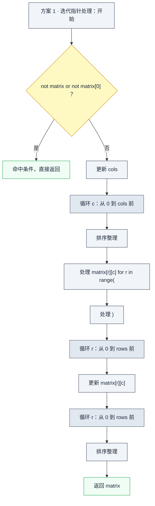

```python
import sys  # 提高递归深度上限（深输入防 RecursionError）

sys.setrecursionlimit(200000)  # 树/链表类题目节点数可达 1e4 量级
import heapq  # 引入依赖

def matrix_sort(matrix):  # 定义函数 matrix_sort（参数：矩阵）
    # 矩阵排序：先对每一列排序，再对每一行排序
    if not matrix or not matrix[0]:  # 若 not 矩阵 or not 矩阵[0]
        return matrix  # 返回 矩阵
    rows, cols = len(matrix), len(matrix[0])  # 把 长度(矩阵), 长度(矩阵[0]) 写入 rows, cols
    # 逐列排序
    for c in range(cols):  # 让 字符 从 列数 遍历
        col = sorted(
            matrix[r][c] for r in range(rows)
        )  # 把 sorted(矩阵[右指针][字符] for 右指针 in range(行数)) 存入 col
        for r in range(rows):  # 让 右指针 从 行数 遍历
            matrix[r][c] = col[r]  # 把 col[右指针] 写入 matrix[r][c]
    # 逐行排序
    for r in range(rows):  # 让 右指针 从 行数 遍历
        matrix[r] = sorted(matrix[r])  # 把 sorted(矩阵[右指针]) 写入 matrix[r]
    return matrix  # 返回 矩阵

def build_huffman(freqs):  # 定义函数 build_huffman（参数：freqs）
    # 哈夫曼树：每次合并权值最小的两棵子树（贪心）
    nodes = [
        [w, ch] for ch, w in freqs.items()
    ]  # 把 [[权重, 字符] for 字符, 权重 in freqs.items()] 存入 nodes
    heapq.heapify(nodes)  # heapq.heapify(nodes)
    while len(nodes) > 1:  # 循环，直到不满足「长度(nodes) 超过 1」
        a = heapq.heappop(nodes)  # 把 heapq.heappop(nodes) 存入 数组
        b = heapq.heappop(nodes)  # 把 heapq.heappop(nodes) 存入 b
        heapq.heappush(nodes, [a[0] + b[0], [a, b]])  # heapq.heappush(nodes, [数组[0] 加 b[0], [数组, b]])
    return nodes[0] if nodes else None  # 返回 nodes[0] if nodes else None

def huffman_codes(freqs):  # 定义函数 huffman_codes（参数：freqs）
    root = build_huffman(freqs)  # 把 build_huffman(freqs) 存入 根节点
    codes = {}  # 把 {} 存入 codes

    def walk(node, prefix):  # 定义函数 walk（参数：节点, prefix）
        if isinstance(node, list):  # 若 isinstance(节点, 列表
            w, content = node  # 把 节点 写入 w, content
            if isinstance(content, str):  # 若 isinstance(content, str
                codes[content] = prefix or "0"  # 把 prefix or '0' 写入 codes[content]
            else:  # 否则
                walk(content[0], prefix + "0")  # walk(content[0], prefix 加 '0')
                walk(content[1], prefix + "1")  # walk(content[1], prefix 加 '1')

    walk(root, "")  # walk(根节点, '')
    return codes  # 返回 codes

if __name__ == "__main__":  # 若 __name__ 等于 '__main__'
    mat = [
        [5, 3, 4],
        [1, 6, 2],
        [7, 9, 8],
    ]
    sorted_mat = matrix_sort(
        [row[:] for row in mat]
    )  # 把 matrix_sort([复制 row for row in mat]) 存入 sorted_mat
    print("矩阵排序结果:")  # 打印输出
    for row in sorted_mat:  # 逐个取出 sorted_mat 的元素（row）
        print(row)  # 打印输出

    freqs = {"A": 5, "B": 9, "C": 12, "D": 13, "E": 16, "F": 45}
    codes = huffman_codes(freqs)  # 把 huffman_codes(freqs) 存入 codes
    total_bits = sum(freqs[ch] * len(codes[ch]) for ch in freqs)
    print("哈夫曼编码:", codes)  # 打印输出
    print("总编码比特数:", total_bits)  # 打印输出
```

### Go 实现（1 种方案）

Go 的全部方案如下，每个方案都内嵌用例自测，可独立运行（老仓库 python/go 文件遵循「打印结果」约定）：

#### 方案 1：迭代指针处理

**思路与代码分析**：核心是「迭代指针处理」。Go 版用切片与多返回值惯用法，显式处理索引边界。**走读**：方案 1 · 迭代指针处理：开始 → 处理 if len(matrix) == 0 或 len(m → 返回 matrix → 更新 : → 遍历循环 → 更新 : → 遍历循环 → 更新 col[r] → 调用 sort.Ints(col) → 遍历循环 → 更新 matrix[r][c] → 遍历循环 → 调用 sort.Ints(matrix[r]) → 返回 matrix。

**运行架构**（真实控制流）：

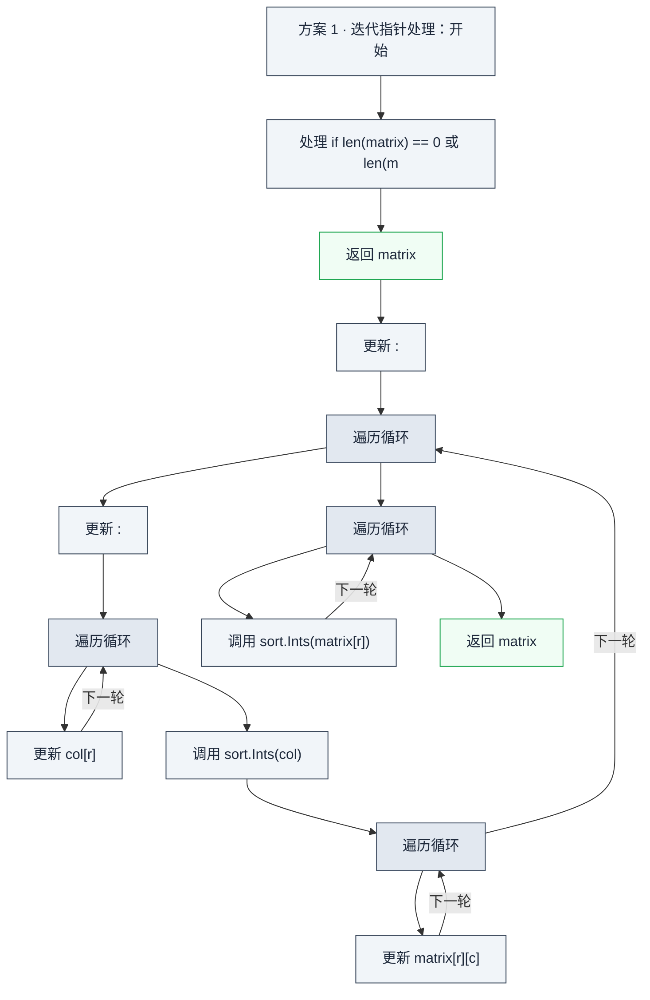

```go
package main // 引入依赖

import (
	"fmt"     // 「fmt」
	"os"      // 「os」
	"reflect" // 「reflect」
	"sort"    // 「sort」
)

func matrixSort(matrix [][]int) [][]int { // 定义函数/方法 matrixSort
	if len(matrix) == 0 || len(matrix[0]) == 0 { // 若 长度(矩阵) 等于 0 或 长度(矩阵[0]) 等于 0
		return matrix // 返回 矩阵
	}
	rows, cols := len(matrix), len(matrix[0]) // 把 长度(矩阵), 长度(矩阵[0]) 写入 rows, cols :
	for c := 0; c < cols; c++ {               // 让 字符 从 0 开始计数
		col := make([]int, rows)    // 把 make([]int, 行数) 写入 col :
		for r := 0; r < rows; r++ { // 让 右指针 从 0 开始计数
			col[r] = matrix[r][c] // 把 矩阵[右指针][字符] 写入 col[r]
		}
		sort.Ints(col)              // sort.Ints(col)
		for r := 0; r < rows; r++ { // 让 右指针 从 0 开始计数
			matrix[r][c] = col[r] // 把 col[右指针] 写入 matrix[r][c]
		}
	}
	for r := 0; r < rows; r++ { // 让 右指针 从 0 开始计数
		sort.Ints(matrix[r]) // sort.Ints(矩阵[右指针])
	}
	return matrix // 返回 矩阵
}

type huffNode struct { // 定义类型
	weight int       // weight int
	ch     byte      // 字符 byte
	left   *huffNode // 左边界 乘 huffNode
	right  *huffNode // 右边界 乘 huffNode
}

func buildHuffman(freqs map[byte]int) *huffNode { // 定义函数/方法 buildHuffman
	nodes := []*huffNode{}     // 把 [] 乘 huffNode{} 写入 nodes :
	for ch, w := range freqs { // 同时取 字符 与 权重 遍历
		nodes = append(nodes, &huffNode{weight: w, ch: ch}) // 把 append(nodes, 按位与 huffNode{weight: 权重, 字符: 字符}) 写入 nodes
	}
	for len(nodes) > 1 { // for 长度(nodes) 超过 1 {
		sort.Slice(nodes, func(i, j int) bool { return nodes[i].weight < nodes[j].weight })
		a := nodes[0]     // 把 nodes[0] 写入 a :
		b := nodes[1]     // 把 nodes[1] 写入 b :
		nodes = nodes[2:] // 把 nodes[2:] 写入 nodes
		nodes = append(nodes, &huffNode{weight: a.weight + b.weight, left: a, right: b})
	}
	if len(nodes) == 0 { // 若 长度(nodes) 等于 0
		return nil // 返回 nil
	}
	return nodes[0] // 返回 nodes[0]
}

func huffmanCodes(freqs map[byte]int) map[byte]string { // 定义函数/方法 huffmanCodes
	root := buildHuffman(freqs)               // 把 buildHuffman(freqs) 写入 root :
	codes := map[byte]string{}                // 把 映射表[byte]string{} 写入 codes :
	var walk func(*huffNode, string)          // var walk func( 乘 huffNode, string)
	walk = func(n *huffNode, prefix string) { // 把 func(元素个数 乘 huffNode, prefix string) { 写入 walk
		if n == nil { // 若 元素个数 等于 nil
			return // return
		}
		if n.left == nil && n.right == nil { // 若 元素个数.左边界 等于 nil 且 元素个数.右边界 等于 nil
			if prefix == "" { // 若 prefix 等于 「」
				codes[n.ch] = "0" // 把 「0」 写入 codes[n.ch]
			} else { // 否则
				codes[n.ch] = prefix // 把 prefix 写入 codes[n.ch]
			}
			return // return
		}
		walk(n.left, prefix+"0")  // walk(元素个数.左边界, prefix 加 「0」)
		walk(n.right, prefix+"1") // walk(元素个数.右边界, prefix 加 「1」)
	}
	walk(root, "") // walk(根节点, 「」)
	return codes   // 返回 codes
}

func main() { // 程序入口：跑内嵌自测用例
	mat := [][]int{{5, 3, 4}, {1, 6, 2}, {7, 9, 8}}     // 把 [][]int{{5, 3, 4}, {1, 6, 2}, {7, 9, 8}} 写入 mat :
	sortedMat := matrixSort(mat)                        // 把 matrixSort(mat) 写入 sortedMat :
	wantMat := [][]int{{1, 2, 3}, {4, 5, 6}, {7, 8, 9}} // 把 [][]int{{1, 2, 3}, {4, 5, 6}, {7, 8, 9}} 写入 wantMat :
	if !reflect.DeepEqual(sortedMat, wantMat) {         // 若 取反 reflect.DeepEqual(sortedMat, wantMat
		fmt.Printf("FAIL matrixSort=%v\n", sortedMat) // 打印输出
		os.Exit(1)                                    // os.Exit(1)
	}
	freqs := map[byte]int{'A': 5, 'B': 9, 'C': 12, 'D': 13, 'E': 16, 'F': 45}
	codes := huffmanCodes(freqs) // 把 huffmanCodes(freqs) 写入 codes :
	totalBits := 0               // 把 0 写入 totalBits :
	for ch := range freqs {      // 把 range freqs { 写入 for ch :
		totalBits += freqs[ch] * len(codes[ch]) // totalBits累加 freqs[字符] 乘 长度(codes[字符])
	}
	if totalBits != 224 { // 若 totalBits 不等于 224
		fmt.Printf("FAIL huffman totalBits=%d want=224\n", totalBits) // 打印输出
		os.Exit(1)                                                    // os.Exit(1)
	}
	fmt.Println("PASS") // 全部用例通过，输出 PASS
}
```

### Java 实现（1 种方案）

Java 的全部方案如下，每个方案都内嵌用例自测，可独立运行（老仓库 python/go 文件遵循「打印结果」约定）：

#### 方案 1：迭代指针处理

**思路与代码分析**：核心是「迭代指针处理」。Java 版用类与静态方法组织，集合操作显式明了。代码里依次做这些事：先排序再处理；双重循环遍历。**走读**：方案 1 · 迭代指针处理：开始 → 更新 rows → 遍历循环 → 更新 col → 遍历循环 → 排序整理 → 遍历循环 → 遍历循环 → 返回 matrix。

**运行架构**（真实控制流）：

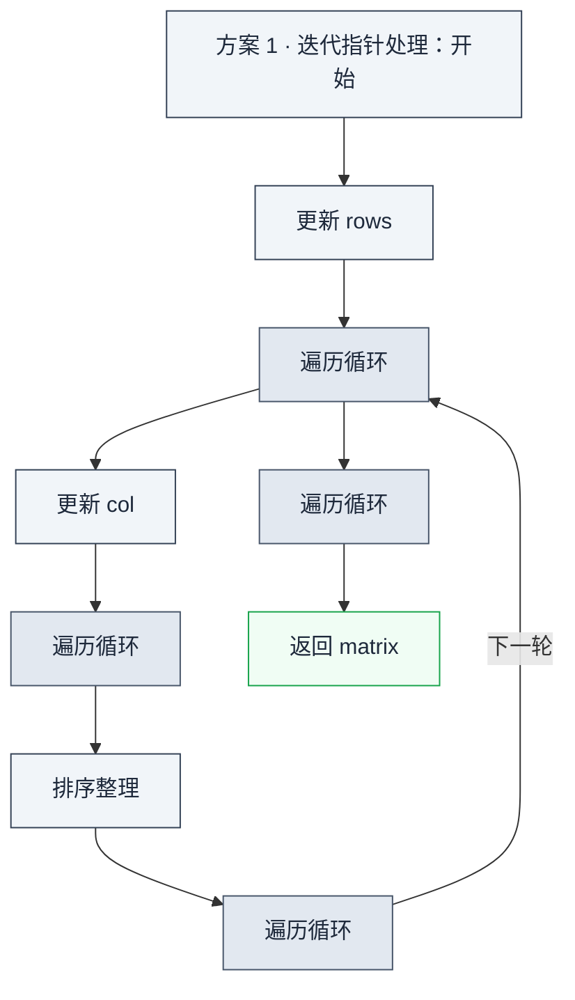

```java
package com.webfault.dsa; // 引入依赖

import java.util.*; // 引入依赖

class lc107868749_solution1 { // 定义类型
  static int[][] matrixSort(int[][] matrix) { // 定义函数/方法 matrixSort
    int rows = matrix.length, cols = matrix[0].length; // 把 矩阵.长度, 列数 赋值为 矩阵[0].长度 存入 行数
    for (int c = 0; c < cols; c++) { // 让 字符 从 0 开始计数，字符 小于 列数 就继续
      int[] col = new int[rows]; // 把 new int[行数]; 写入 int[] col
      for (int r = 0; r < rows; r++) col[r] = matrix[r][c]; // 让 右指针 从 0 开始计数，右指针 小于 行数 就继续
      Arrays.sort(col); // 排序
      for (int r = 0; r < rows; r++) matrix[r][c] = col[r]; // 让 右指针 从 0 开始计数，右指针 小于 行数 就继续
    }
    for (int r = 0; r < rows; r++) Arrays.sort(matrix[r]); // 让 右指针 从 0 开始计数，右指针 小于 行数 就继续
    return matrix; // 返回 矩阵
  }

  static class Node { // static class Node {
    int weight; // int weight;
    Node left, right; // Node 左边界, 右边界;
    Character ch; // Character 字符;

    Node(int w, Character c) {
      weight = w;
      ch = c;
    } // 把 权重; 字符 赋值为 字符; } 写入 Node(int w, Character c) { weight

    Node(int w, Node l, Node r) {
      weight = w;
      left = l;
      right = r;
    }
  }

  static Node buildHuffman(Map<Character, Integer> freqs) { // 定义函数/方法 buildHuffman
    PriorityQueue<Node> pq = new PriorityQueue<>(Comparator.comparingInt(n -> n.weight));
    for (Map.Entry<Character, Integer> e : freqs.entrySet()) {
      pq.add(new Node(e.getValue(), e.getKey())); // 优先队列 追加 new Node(e.getValue(), e.getKey()));
    }
    while (pq.size() > 1) { // 循环，直到不满足「优先队列.大小() 超过 1」
      Node a = pq.poll(); // 把 优先队列.poll(); 写入 Node a
      Node b = pq.poll(); // 把 优先队列.poll(); 写入 Node b
      pq.add(
          new Node(a.weight + b.weight, a, b)); // 优先队列 追加 new Node(数组.weight 加 b.weight, 数组, b));
    }
    return pq.poll(); // 返回 优先队列.poll()
  }

  static void walk(Node node, String prefix, Map<Character, String> codes) { // 定义函数/方法 walk
    if (node.ch != null) { // 若 节点.字符 不等于 null
      codes.put(
          node.ch,
          prefix.isEmpty() ? "0" : prefix); // codes.put(节点.字符, prefix.isEmpty() ? 「0」 : prefix);
      return; // return;
    }
    walk(node.left, prefix + "0", codes); // walk(节点.左边界, prefix 加 「0」, codes);
    walk(node.right, prefix + "1", codes); // walk(节点.右边界, prefix 加 「1」, codes);
  }

  public static void main(String[] args) { // public static void main(String[] args) {
    int[][] mat = {
      {5, 3, 4}, {1, 6, 2}, {7, 9, 8}
    }; // 把 {{5, 3, 4}, {1, 6, 2}, {7, 9, 8}}; 写入 int[][] mat
    matrixSort(mat); // matrixSort(mat);

    Map<Character, Integer> freqs = new LinkedHashMap<>();
    freqs.put('A', 5);
    freqs.put('B', 9);
    freqs.put('C', 12); // freqs.put('A', 5); freqs.put('B', 9); freqs.put('C', 12);
    freqs.put('D', 13);
    freqs.put('E', 16);
    freqs.put('F', 45); // freqs.put('D', 13); freqs.put('E', 16); freqs.put('F', 45);
    Node root = buildHuffman(freqs); // 把 buildHuffman(freqs); 写入 Node root
    Map<Character, String> codes =
        new HashMap<>(); // 把 new HashMap 小于 超过 (); 写入 Map<Character, String> codes
    walk(root, "", codes); // walk(根节点, 「」, codes);
    int totalBits = 0; // 把 0 存入 totalBits
    for (Map.Entry<Character, Integer> e : freqs.entrySet()) {
      totalBits +=
          e.getValue()
              * codes
                  .get(e.getKey())
                  .length(); // totalBits累加 e.getValue() 乘 codes 查找 e.getKey()).长度()
    }
    if (totalBits != 224) { // 若 totalBits 不等于 224
      System.out.println("FAIL totalBits " + totalBits); // 打印输出
      throw new RuntimeException("FAILED"); // throw new RuntimeException(「FAILED」);
    }
    System.out.println("PASS"); // 全部用例通过，输出 PASS
  }
}
```

### Rust 实现（1 种方案）

Rust 的全部方案如下，每个方案都内嵌用例自测，可独立运行（老仓库 python/go 文件遵循「打印结果」约定）：

#### 方案 1：迭代指针处理

**思路与代码分析**：核心是「迭代指针处理」。Rust 版用所有权移动与切片借用改写同一逻辑，注意 Option 与引用边界。代码里依次做这些事：哈希结构做计数或查重。**走读**：方案 1 · 迭代指针处理：开始 → 计算 root → 计算 codes → 处理 match node → 处理 Huff::Leaf → 计算 code → 处理 0.to_string() → 调用 prefix.to_string() → 调用 codes.insert(sym.clone(), co → 处理 Huff::Internal → 调用 walk(left, &format非 ( → 调用 walk(right, &format非 ( → 调用 walk(&root, , &mut codes) → 处理 codes → 返回结果。

**运行架构**（真实控制流）：

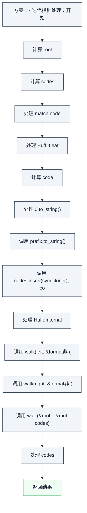

```rust
// LeetCode 107868749. 贪心策略 — Rust 版（贪心策略之 matrixSort / PFC 编码 / Huffman 树）
use std::collections::HashMap; // 引入依赖

// 每列升序排序后每行升序排序
fn matrix_sort(matrix: &mut Vec<Vec<i32>>) {
    // 定义函数/方法 matrix_sort
    if matrix.is_empty() {
        // 若 矩阵.is_empty(
        return; // return;
    }
    let rows = matrix.len(); // 把 矩阵.长度() 存入 行数
    let cols = matrix[0].len(); // 把 矩阵[0].长度() 存入 列数
    for c in 0..cols {
        // 逐个取出 0 的元素（字符）
        let mut col: Vec<i32> = matrix.iter().map(|r| r[c]).collect();
        col.sort(); // 排序
        for r in 0..rows {
            // 逐个取出 0 的元素（右指针）
            matrix[r][c] = col[r]; // 把 col[右指针]; 写入 matrix[r][c]
        }
    }
    for r in 0..rows {
        // 逐个取出 0 的元素（右指针）
        matrix[r].sort(); // 排序
    }
}

#[derive(Clone)]
enum Huff {
    // 定义类型
    Leaf {
        freq: i64,
        sym: String,
    },
    Internal {
        freq: i64,
        left: Box<Huff>,
        right: Box<Huff>,
    },
}

impl Huff {
    // 实现块
    fn freq(&self) -> i64 {
        // 定义函数/方法 freq
        match self {
            // 按情况匹配处理
            Huff::Leaf { freq, .. } => *freq,
            Huff::Internal { freq, .. } => *freq,
        }
    }
}

fn build_huffman(freqs: &[(&str, i64)]) -> Huff {
    // 定义函数/方法 build_huffman
    let mut nodes: Vec<(i64, Huff)> = freqs // 把 freqs 写入 let mut nodes: Vec<(i64, Huff)>
        .iter() // iter()
        .map(|&(k, v)| {
            (
                v,
                Huff::Leaf {
                    freq: v,
                    sym: k.to_string(),
                },
            )
        })
        .collect(); // collect();
    nodes.sort_by_key(|n| n.0); // nodes.sort_by_key( 按位或 元素个数 按位或 元素个数.0);
    while nodes.len() > 1 {
        // while nodes.长度() 超过 1 {
        let a = nodes.remove(0); // 把 nodes 弹出 0) 存入 数组
        let b = nodes.remove(0); // 把 nodes 弹出 0) 存入 b
        let merged = (
            a.0 + b.0,
            Huff::Internal {
                freq: a.0 + b.0,
                left: Box::new(a.1),
                right: Box::new(b.1),
            },
        );
        let mut i = 0; // 把 0; 写入 let mut i
        while i < nodes.len() && nodes[i].0 < merged.0 {
            // while 下标 i 小于 nodes.长度() 且 nodes[下标 i].0 小于 merged.0 {
            i += 1; // 下标 i累加 1
        }
        nodes.insert(i, merged); // nodes 插入 下标 i, merged);
    }
    nodes.remove(0).1 // nodes 弹出 0).1
}

fn huffman_codes(freqs: &[(&str, i64)]) -> HashMap<String, String> {
    // 定义函数/方法 huffman_codes
    let root = build_huffman(freqs); // 把 build_huffman(freqs) 存入 根节点
    let mut codes: HashMap<String, String> = HashMap::new(); // 把 HashMap::new(); 写入 let mut codes: HashMap<String, String>
    fn walk(node: &Huff, prefix: &str, codes: &mut HashMap<String, String>) {
        // 定义函数/方法 walk
        match node {
            // 按情况匹配处理
            Huff::Leaf { sym, .. } => {
                let code = if prefix.is_empty() {
                    "0".to_string()
                } else {
                    prefix.to_string()
                };
                codes.insert(sym.clone(), code); // codes 插入 sym.clone(), code);
            }
            Huff::Internal { left, right, .. } => {
                walk(left, &format!("{}0", prefix), codes); // walk(左边界, 按位与 format取反 (「{}0」, prefix), codes);
                walk(right, &format!("{}1", prefix), codes); // walk(右边界, 按位与 format取反 (「{}1」, prefix), codes);
            }
        }
    }
    walk(&root, "", &mut codes); // walk( 按位与 根节点, 「」, 按位与 mut codes);
    codes // codes
}

fn main() {
    // 程序入口：跑内嵌自测用例
    let freqs = [
        ("A", 5i64),
        ("B", 9),
        ("C", 12),
        ("D", 13),
        ("E", 16),
        ("F", 45),
    ];

    // case1: matrixSort
    let mut mat = vec![vec![5, 3, 4], vec![1, 6, 2], vec![7, 9, 8]];
    matrix_sort(&mut mat); // matrix_sort( 按位与 mut mat);
    let want_mat = vec![vec![1, 2, 3], vec![4, 5, 6], vec![7, 8, 9]];
    assert_eq!(mat, want_mat, "matrixSort mismatch"); // 断言校验

    // case2: WPL
    let codes = huffman_codes(&freqs); // 把 huffman_codes( 按位与 freqs) 存入 codes
    let mut wpl = 0i64; // 把 0i64; 写入 let mut wpl
    let mut code_list: Vec<String> = vec![]; // 把 vec取反 []; 写入 let mut code_list: Vec<String>
    for &(k, v) in &freqs {
        // for 按位与 (下标 k, 值) in 按位与 freqs {
        let c = codes.get(k).unwrap(); // 把 codes 查找 下标 k).unwrap() 存入 字符
        wpl += v * c.len() as i64; // wpl累加 值 乘 字符.长度() as i64
        code_list.push(c.clone()); // 把 字符.clone( 压入栈/数组尾部
    }
    assert_eq!(wpl, 224, "WPL mismatch"); // 断言校验

    // case3: 前缀无关
    let mut prefix_free = true; // 把 true; 写入 let mut prefix_free
    for i in 0..code_list.len() {
        // 逐个取出 0 的元素（下标 i）
        for j in 0..code_list.len() {
            // 逐个取出 0 的元素（下标 j）
            if i != j && code_list[j].starts_with(&code_list[i]) {
                prefix_free = false; // 把 false; 写入 prefix_free
            }
        }
    }
    assert!(prefix_free, "codes not prefix-free"); // 断言校验

    println!("PASS"); // 全部用例通过，输出 PASS
}
```

### Lua 实现（1 种方案）

Lua 的全部方案如下，每个方案都内嵌用例自测，可独立运行（老仓库 python/go 文件遵循「打印结果」约定）：

#### 方案 1：迭代指针处理

**思路与代码分析**：核心是「迭代指针处理」。Lua 版用表与 ipairs 遍历，注意 ipairs 遇 nil 即停的语义。代码里依次做这些事：先排序再处理。**走读**：方案 1 · 迭代指针处理：开始 → 更新 cols → 循环 c：从 1 到 cols do → 更新 col → 循环 r：从 1 到 rows do → 更新 col[r] → 排序整理 → 循环 r：从 1 到 rows do → 更新 matrix[r][c] → 循环 r：从 1 到 rows do → 排序整理 → 返回 matrix。

**运行架构**（真实控制流）：

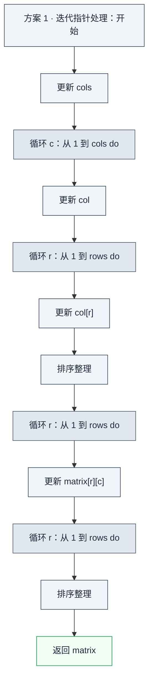

```lua
-- LeetCode 107868749. 贪心策略 — Lua 版（贪心策略之 matrixSort / PFC 编码 / Huffman 树）
local function matrix_sort(matrix) -- local function matrix_sort(矩阵)
	local rows, cols = #matrix, #matrix[1] -- 把 #矩阵, #矩阵[1] 写入 local rows, cols
	for c = 1, cols do -- 让 字符 从 1 走到 列数（Lua 1 基）
		local col = {} -- 把 {} 写入 local col
		for r = 1, rows do
			col[r] = matrix[r][c]
		end -- 让 右指针 从 1 走到 行数（Lua 1 基）
		table.sort(col) -- 排序
		for r = 1, rows do
			matrix[r][c] = col[r]
		end -- 让 右指针 从 1 走到 行数（Lua 1 基）
	end -- 终点
	for r = 1, rows do -- 让 右指针 从 1 走到 行数（Lua 1 基）
		table.sort(matrix[r]) -- 排序
	end -- 终点
	return matrix -- 返回 矩阵
end -- 终点

-- 节点：{freq=..., sym=...} 叶子 或 {freq=..., left=..., right=...} 内部
local function build_huffman(freqs) -- local function build_huffman(freqs)
	local nodes = {} -- 把 {} 写入 local nodes
	for sym, f in pairs(freqs) do -- 遍历取 f
		nodes[#nodes + 1] = { freq = f, sym = sym } -- 把 { 频次表 赋值为 f, sym 赋值为 sym } 写入 nodes[#nodes + 1]
	end -- 终点
	table.sort(nodes, function(a, b)
		return a.freq < b.freq
	end) -- 排序
	while #nodes > 1 do -- while #nodes 超过 1 do
		local a = table.remove(nodes, 1) -- 把 table 弹出 nodes, 1) 写入 local a
		local b = table.remove(nodes, 1) -- 把 table 弹出 nodes, 1) 写入 local b
		local merged = { freq = a.freq + b.freq, left = a, right = b }
		local i = 1 -- 把 1 写入 local i
		while i <= #nodes and nodes[i].freq < merged.freq do
			i = i + 1
		end
		table.insert(nodes, i, merged) -- table 插入 nodes, 下标 i, merged)
	end -- 终点
	return nodes[1] -- 返回 nodes[1]
end -- 终点

local function huffman_codes(freqs) -- local function huffman_codes(freqs)
	local root = build_huffman(freqs) -- 把 build_huffman(freqs) 写入 local root
	local codes = {} -- 把 {} 写入 local codes
	local function walk(node, prefix) -- local function walk(节点, prefix)
		if node.sym ~= nil then -- 若 节点.sym ~ 赋值为 nil then
			codes[node.sym] = (prefix == "" and "0") or prefix -- 把 (prefix 等于 「」 and 「」) or prefix 写入 codes[node.sym]
		else -- 否则
			walk(node.left, prefix .. "0") -- walk(节点.左边界, prefix .. 「0」)
			walk(node.right, prefix .. "1") -- walk(节点.右边界, prefix .. 「1」)
		end -- 终点
	end -- 终点
	walk(root, "") -- walk(根节点, 「」)
	return codes -- 返回 codes
end -- 终点

local freqs = { A = 5, B = 9, C = 12, D = 13, E = 16, F = 45 }

-- case1: matrixSort
local mat = { { 5, 3, 4 }, { 1, 6, 2 }, { 7, 9, 8 } } -- 把 {{5, 3, 4}, {1, 6, 2}, {7, 9, 8}} 写入 local mat
matrix_sort(mat) -- matrix_sort(mat)
local want_mat = { { 1, 2, 3 }, { 4, 5, 6 }, { 7, 8, 9 } } -- 把 {{1, 2, 3}, {4, 5, 6}, {7, 8, 9}} 写入 local want_mat
for i = 1, 3 do -- 让 下标 i 从 1 走到 3（Lua 1 基）
	for j = 1, 3 do -- 让 下标 j 从 1 走到 3（Lua 1 基）
		assert(mat[i][j] == want_mat[i][j], "matrixSort mismatch") -- 断言校验
	end -- 终点
end -- 终点

-- case2: WPL
local codes = huffman_codes(freqs) -- 把 huffman_codes(freqs) 写入 local codes
local wpl = 0 -- 把 0 写入 local wpl
local code_list = {} -- 把 {} 写入 local code_list
for sym, f in pairs(freqs) do -- 遍历取 f
	local c = codes[sym] -- 把 codes[sym] 写入 local c
	wpl = wpl + f * #c -- 把 wpl 加 f 乘 #字符 存入 wpl
	code_list[#code_list + 1] = c -- 把 字符 写入 code_list[#code_list + 1]
end -- 终点
assert(wpl == 224, "WPL mismatch: " .. tostring(wpl)) -- 断言校验

-- case3: 前缀无关
local prefix_free = true -- 把 true 写入 local prefix_free
for i = 1, #code_list do -- 把 1, #code_list do 写入 for i
	for j = 1, #code_list do -- 把 1, #code_list do 写入 for j
		if i ~= j and code_list[j]:sub(1, #code_list[i]) == code_list[i] then
			prefix_free = false -- 把 false 存入 prefix_free
		end -- 终点
	end -- 终点
end -- 终点
assert(prefix_free, "codes not prefix-free") -- 断言校验

print("PASS") -- 全部用例通过，输出 PASS
```

### C 实现（1 种方案）

C 的全部方案如下，每个方案都内嵌用例自测，可独立运行（老仓库 python/go 文件遵循「打印结果」约定）：

#### 方案 1：迭代指针处理

**思路与代码分析**：核心是「迭代指针处理」。C 版手动管理下标与内存，循环边界全部显式写出。代码里依次做这些事：双重循环遍历。**走读**：方案 1 · 迭代指针处理：开始 → 处理 int order[16] → 遍历循环 → 当 (count ＞ 1) 时反复执行 → 遍历循环 → 遍历循环 → 命中条件，直接返回 → 返回 -1。

**运行架构**（真实控制流）：

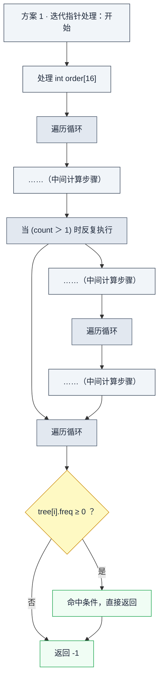

```c
* LeetCode 107868749. 贪心策略 — C 版（贪心策略之 matrixSort / PFC 编码 / Huffman 树）
 */
#include <stdio.h>  // 引入头文件
#include <string.h> // 引入头文件

#define MATRIX_SORT_INPLACE(rows, cols, m)                                                                   \
    do {                                                                                                     \
        for (int c = 0; c < (cols); c++) {                                                                   \
            for (int i = 0; i < (rows)-1; i++)                                                               \
                for (int j = 0; j < (rows)-1 - i; j++)                                                       \
                    if (m[j][c] > m[j + 1][c]) {                                                             \
                        int t = m[j][c];                                                                     \
                        m[j][c] = m[j + 1][c];                                                               \
                        m[j + 1][c] = t;                                                                     \
                    }                                                                                        \
        }                                                                                                    \
        for (int r = 0; r < (rows); r++) {                                                                   \
            for (int i = 0; i < (cols)-1; i++)                                                               \
                for (int j = 0; j < (cols)-1 - i; j++)                                                       \
                    if (m[r][j] > m[r][j + 1]) {                                                             \
                        int t = m[r][j];                                                                     \
                        m[r][j] = m[r][j + 1];                                                               \
                        m[r][j + 1] = t;                                                                     \
                    }                                                                                        \
        }                                                                                                    \
    } while (0) // } while (0)

/* Huffman 节点：left/right < 0 表示叶子 */
typedef struct {     // typedef struct {
    long long freq;  // long long 频次表;
    char sym;        // char sym;
    int left, right; // int 左边界, 右边界;
} HNode;             // } HNode;

static HNode tree[16]; // static HNode tree[16];
static int tree_n = 0; // 把 0; 写入 static int tree_n

static int build_huffman(const char *syms, const long long *freqs, int n) { // 定义函数/方法 build_huffman
    int order[16];                                                          // int order[16];
    for (int i = 0; i < n; i++) { // 让 下标 i 从 0 开始计数，下标 i 小于 元素个数 就继续
        tree[i].freq = freqs[i];  // 把 freqs[下标 i]; 写入 频次表
        tree[i].sym = syms[i];    // 把 syms[下标 i]; 写入 tree[i].sym
        tree[i].left = tree[i].right = -1; // 把 tree[下标 i].右边界 赋值为 减 1; 写入 左边界
        order[i] = i;                      // 把 下标 i; 写入 order[i]
    }
    int count = n;      // 把 元素个数 存入 计数
    tree_n = n;         // 把 元素个数; 写入 tree_n
    while (count > 1) { // 循环，直到不满足「计数 超过 1」
        /* 找最小的两个（按 order 中未合并者）——用简单线性选择 */
        int a = -1, b = -1;                // 把 减 1, b 赋值为 减 1 存入 数组
        for (int i = 0; i < tree_n; i++) { // 让 下标 i 从 0 开始计数，下标 i 小于 tree_n 就继续
            if (tree[i].freq < 0)
                continue; // 若 tree[下标 i].频次表 小于 0) continue;
            if (a < 0 || tree[i].freq < tree[a].freq) {
                b = a;
                a = i;
            } else if (b < 0 || tree[i].freq < tree[b].freq) {
                b = i;
            } // 否则，若 b 小于 0 或 tree[下标 i].频次表 小于 tree[b].频次表) { b 赋值为 下标 i; }
        }
        if (b < 0)
            break; // 若 b 小于 0) break;
        /* 合并（同权重时先取先出现的，保持与 JS 版本一致的稳定性不追求完全一致） */
        long long fa = tree[a].freq,
                  fb = tree[b].freq; // 把 tree[数组].频次表, fb 赋值为 tree[b].频次表 存入 fa
        if (fa > fb) {
            int t = a;
            a = b;
            b = t;
        } // 若 fa 超过 fb) { int 另一字符串 赋值为 数组; 数组 赋值为 b; b 赋值为 另一字符串; }
        tree[tree_n].freq =
            tree[a].freq + tree[b].freq; // 把 tree[数组].频次表 加 tree[b].频次表; 写入 频次表
        tree[tree_n].sym = 0;            // 把 0; 写入 tree[tree_n].sym
        tree[tree_n].left = a;           // 把 数组; 写入 左边界
        tree[tree_n].right = b;          // 把 b; 写入 右边界
        tree[a].freq = -1;               // 把 减 1; 写入 频次表
        tree[b].freq = -1;               // 把 减 1; 写入 频次表
        tree_n++;                        // tree_n 加一
        count--;                         // 计数 减一
    }
    /* 根 = 唯一 freq >= 0 的节点 */
    for (int i = 0; i < tree_n; i++) // 让 下标 i 从 0 开始计数，下标 i 小于 tree_n 就继续
        if (tree[i].freq >= 0)
            return i; // 若 tree[下标 i].频次表 不低于 0，直接返回 下标 i
    return -1;        // 返回 减 1
}

static char codes[8][8]; // static char codes[8][8];
static int code_len[8];  // static int code_len[8];

static void walk(int node, char *prefix, int depth) {    // 定义函数/方法 walk
    if (tree[node].left < 0) {                           // 若 tree[节点].左边界 小于 0
        if (depth == 0) {                                // 若 深度 等于 0
            strcpy(codes[tree[node].sym - 'A'], "0");    // strcpy(codes[tree[节点].sym 减 'A'], 「0」);
            code_len[tree[node].sym - 'A'] = 1;          // 把 1; 写入 code_len[tree[node].sym - 'A']
        } else {                                         // 否则
            prefix[depth] = 0;                           // 把 0; 写入 prefix[depth]
            strcpy(codes[tree[node].sym - 'A'], prefix); // strcpy(codes[tree[节点].sym 减 'A'], prefix);
            code_len[tree[node].sym - 'A'] = depth;      // 把 深度; 写入 code_len[tree[node].sym - 'A']
        }
        return; // return;
    }
    prefix[depth] = '0';                       // 把 '0'; 写入 prefix[depth]
    walk(tree[node].left, prefix, depth + 1);  // walk(tree[节点].左边界, prefix, 深度 加 1);
    prefix[depth] = '1';                       // 把 '1'; 写入 prefix[depth]
    walk(tree[node].right, prefix, depth + 1); // walk(tree[节点].右边界, prefix, 深度 加 1);
}

int main(void) { // 程序入口：跑内嵌自测用例
    /* case1: matrixSort */
    int mat[3][3] = {
        {5, 3, 4}, {1, 6, 2}, {7, 9, 8}}; // 把 {{5, 3, 4}, {1, 6, 2}, {7, 9, 8}}; 写入 int mat[3][3]
    int want[3][3] = {
        {1, 2, 3}, {4, 5, 6}, {7, 8, 9}}; // 把 {{1, 2, 3}, {4, 5, 6}, {7, 8, 9}}; 写入 int want[3][3]
    MATRIX_SORT_INPLACE(3, 3, mat);       // MATRIX_SORT_INPLACE(3, 3, mat);
    for (int i = 0; i < 3; i++)           // 让 下标 i 从 0 开始计数，下标 i 小于 3 就继续
        for (int j = 0; j < 3; j++)       // 让 下标 j 从 0 开始计数，下标 j 小于 3 就继续
            if (mat[i][j] != want[i][j]) {
                printf("matrixSort mismatch\n");
                return 1;
            }

    /* case2: WPL（频次 5,9,12,13,16,45 的最优 WPL = 224） */
    const char syms[6] = {'A', 'B', 'C',
                          'D', 'E', 'F'}; // 把 {'A', 'B', 'C', 'D', 'E', 'F'}; 写入 const char syms[6]
    long long freqs[6] = {5, 9, 12, 13, 16, 45}; // 把 {5, 9, 12, 13, 16, 45}; 写入 long long freqs[6]
    int root = build_huffman(syms, freqs, 6);    // 把 build_huffman(syms, freqs, 6) 存入 根节点
    char prefix[16];                             // char prefix[16];
    memset(codes, 0, sizeof(codes));             // memset(codes, 0, sizeof(codes));
    walk(root, prefix, 0);                       // walk(根节点, prefix, 0);
    long long wpl = 0;                           // 把 0 存入 wpl
    for (int i = 0; i < 6; i++)
        wpl += freqs[i] * code_len[i]; // 让 下标 i 从 0 开始计数，下标 i 小于 6 就继续
    if (wpl != 224) {
        printf("WPL mismatch: %lld\n", wpl);
        return 1;
    }

    /* case3: 前缀无关 */
    for (int i = 0; i < 6; i++)       // 让 下标 i 从 0 开始计数，下标 i 小于 6 就继续
        for (int j = 0; j < 6; j++) { // 让 下标 j 从 0 开始计数，下标 j 小于 6 就继续
            if (i == j)
                continue; // 若 下标 i 等于 下标 j) continue;
            if (strncmp(codes[j], codes[i], strlen(codes[i])) == 0) {
                printf("not prefix-free\n"); // 打印输出
                return 1;                    // 返回 1
            }
        }

    printf("PASS\n"); // 全部用例通过，输出 PASS
    return 0;         // 返回 0
}
```

### C++ 实现（1 种方案）

C++ 的全部方案如下，每个方案都内嵌用例自测，可独立运行（老仓库 python/go 文件遵循「打印结果」约定）：

#### 方案 1：迭代指针处理

**思路与代码分析**：核心是「迭代指针处理」。C++ 版用 STL 容器与迭代器，减少手写下标错误。代码里依次做这些事：双重循环遍历。**走读**：方案 1 · 迭代指针处理：开始 → 命中条件，直接返回 → 更新 rows → 更新 cols → 遍历循环 → 处理 std::vector＜int＞ col → 遍历循环 → 调用 col.push_back(matrix[r][c]) → 处理 std::sort(col.begin(), col.e → 遍历循环 → 更新 matrix[r][c] → 遍历循环 → 处理 std::sort(matrix[r].begin(),。

**运行架构**（真实控制流）：

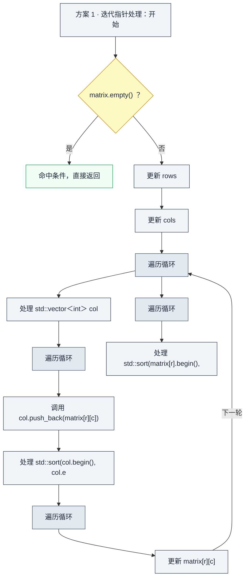

```cpp
// LeetCode 107868749. 贪心策略 — C++ 版（贪心策略之 matrixSort / PFC 编码 / Huffman 树）
#include <algorithm>     // 引入头文件
#include <iostream>      // 引入头文件
#include <string>        // 引入头文件
#include <unordered_map> // 引入头文件
#include <vector>        // 引入头文件

static void matrix_sort(std::vector<std::vector<int>> &matrix) { // 定义函数/方法 matrix_sort
    if (matrix.empty())
        return; // 若 矩阵 是否为空) return;
    size_t rows = matrix.size(),
           cols = matrix[0].size(); // 把 矩阵.大小(), 列数 赋值为 矩阵[0].大小(); 写入 size_t rows
    for (size_t c = 0; c < cols; ++c) { // 让 字符 从 0 开始计数，字符 小于 列数 就继续
        std::vector<int> col;           // std::vector 小于 int 超过 col;
        for (size_t r = 0; r < rows; ++r)
            col.push_back(matrix[r][c]); // 让 右指针 从 0 开始计数，右指针 小于 行数 就继续
        std::sort(col.begin(), col.end()); // std::sort(col 迭代位置 , col.终点());
        for (size_t r = 0; r < rows; ++r)
            matrix[r][c] = col[r]; // 让 右指针 从 0 开始计数，右指针 小于 行数 就继续
    }
    for (size_t r = 0; r < rows; ++r)
        std::sort(matrix[r].begin(), matrix[r].end()); // 让 右指针 从 0 开始计数，右指针 小于 行数 就继续
}

struct Huff {              // 定义类型
    long long freq;        // long long 频次表;
    std::string sym;       // 叶子时非空
    Huff *left = nullptr;  // 把 nullptr; 写入 Huff *left
    Huff *right = nullptr; // 把 nullptr; 写入 Huff *right
    bool leaf = false;     // 把 false 存入 leaf
};

static Huff *build_huffman(const std::vector<std::pair<std::string, long long>> &freqs) {
    std::vector<std::pair<long long, Huff *>>
        nodes; // std::vector 小于 std::pair 小于 long long, Huff 乘 超过 超过 nodes;
    for (const auto &p : freqs) { // 逐个取出 freqs 的元素（节点）
        nodes.push_back({p.second, new Huff{p.second, p.first, nullptr, nullptr, true}});
    }
    std::sort(nodes.begin(), nodes.end(), [](const auto &a, const auto &b) { return a.first < b.first; });
    while (nodes.size() > 1) {          // 循环，直到不满足「nodes.大小() 超过 1」
        Huff *a = nodes.front().second; // 把 nodes.front().second; 写入 Huff *a
        nodes.erase(nodes.begin());     // nodes 删除 nodes 迭代位置 );
        Huff *b = nodes.front().second; // 把 nodes.front().second; 写入 Huff *b
        nodes.erase(nodes.begin());     // nodes 删除 nodes 迭代位置 );
        Huff *merged = new Huff{a->freq + b->freq, "", a, b, false};
        size_t i = 0; // 把 0; 写入 size_t i
        while (i < nodes.size() && nodes[i].first < merged->freq)
            ++i;
        nodes.insert(
            nodes.begin() + i,
            {merged->freq, merged}); // nodes 插入 nodes 迭代位置 加 下标 i, {merged 减 超过 频次表, merged});
    }
    return nodes.front().second; // 返回 nodes.front().second
}

static void walk(Huff *node, const std::string &prefix, std::unordered_map<std::string, std::string> &codes) {
    if (node->leaf) { // 若 节点 减 超过 leaf
        codes[node->sym] =
            prefix.empty() ? "0" : prefix; // 把 prefix 是否为空 ? 「0」 : prefix; 写入 codes[node->sym]
        return;                            // return;
    }
    walk(node->left, prefix + "0", codes);  // walk(节点 减 超过 左边界, prefix 加 「0」, codes);
    walk(node->right, prefix + "1", codes); // walk(节点 减 超过 右边界, prefix 加 「1」, codes);
}

int main() { // 程序入口：跑内嵌自测用例
    std::vector<std::pair<std::string, long long>> freqs = {
        // 把 { 写入 std::vector<std::pair<std::string, long long>> freqs
        {"A", 5}, {"B", 9}, {"C", 12}, {"D", 13}, {"E", 16}, {"F", 45}};

    // case1: matrixSort
    std::vector<std::vector<int>> mat = {{5, 3, 4}, {1, 6, 2}, {7, 9, 8}};
    matrix_sort(mat); // matrix_sort(mat);
    std::vector<std::vector<int>> want = {{1, 2, 3}, {4, 5, 6}, {7, 8, 9}};
    if (mat != want) {
        std::cout << "matrixSort mismatch" << std::endl;
        return 1;
    }

    // case2: WPL
    auto codes = std::unordered_map<std::string, std::string>{};
    walk(build_huffman(freqs), "", codes);     // walk(build_huffman(freqs), 「」, codes);
    long long wpl = 0;                         // 把 0 存入 wpl
    std::vector<std::string> code_list;        // std::vector 小于 std::string 超过 code_list;
    for (const auto &p : freqs) {              // 逐个取出 freqs 的元素（节点）
        const std::string &c = codes[p.first]; // 把 codes[节点.first]; 写入 const std::string &c
        wpl +=
            p.second * static_cast<long long>(
                           c.size()); // wpl累加 节点.second 乘 static_cast 小于 long long 超过 (字符.大小())
        code_list.push_back(c); // code_list 追加 字符);
    }
    if (wpl != 224) {
        std::cout << "WPL mismatch: " << wpl << std::endl;
        return 1;
    }

    // case3: 前缀无关
    bool prefix_free = true; // 把 true 存入 prefix_free
    for (size_t i = 0; i < code_list.size();
         ++i) // 让 下标 i 从 0 开始计数，下标 i 小于 code_list.大小() 就继续
        for (size_t j = 0; j < code_list.size();
             ++j) // 让 下标 j 从 0 开始计数，下标 j 小于 code_list.大小() 就继续
            if (i != j && code_list[j].compare(0, code_list[i].size(), code_list[i]) == 0)
                prefix_free = false; // 把 false; 写入 prefix_free
    if (!prefix_free) {
        std::cout << "not prefix-free" << std::endl;
        return 1;
    }

    std::cout << "PASS" << std::endl; // 全部用例通过，输出 PASS
    return 0;                         // 返回 0
}
```

### R 实现（1 种方案）

R 的全部方案如下，每个方案都内嵌用例自测，可独立运行（老仓库 python/go 文件遵循「打印结果」约定）：

#### 方案 1：迭代指针处理

**思路与代码分析**：核心是「迭代指针处理」。R 版用向量化思维与 1 起始下标，注意 1:n 的降序陷阱。代码里依次做这些事：双重循环遍历。**走读**：方案 1 · 迭代指针处理：开始 → 处理 rows ＜- nrow(matrix) → 处理 cols ＜- ncol(matrix) → 循环 c：遍历 1:cols → 处理 col ＜- sort(matrix[, c]) → 循环 r：遍历 1:rows → 循环 r：遍历 1:rows) matrix[r, ] <- sort(matrix[r, ] → 处理 matrix → 返回结果。

**运行架构**（真实控制流）：

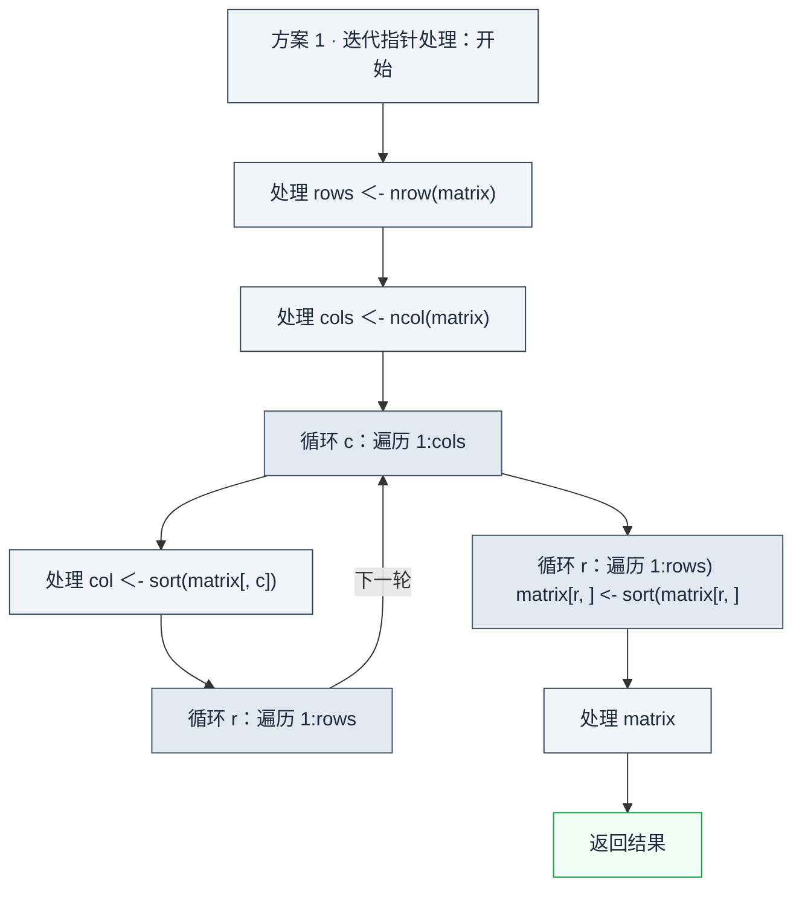

```r
# 版（贪心策略之 matrixSort / PFC 编码 / Huffman 树）
matrix_sort <- function(matrix) {
    # 定义函数 matrix_sort（参数：矩阵）
    rows <- nrow(matrix)  # 把 nrow(矩阵) 存入 行数
    cols <- ncol(matrix)  # 把 ncol(矩阵) 存入 列数
    for (c in 1:cols) {
        # for (字符 in 1:列数) {
        col <- sort(matrix[, c])  # 把 sort(矩阵[, 字符]) 存入 col
        for (r in 1:rows) matrix[r, c] <- col[r]  # for (右指针 in 1:行数) 矩阵[右指针, 字符] 小于 减 col[右指针]
    }
    for (r in 1:rows) matrix[r, ] <- sort(matrix[r, ])  # for (右指针 in 1:行数) 矩阵[右指针, ] 小于 减 sort(矩阵[右指针, ])
    matrix  # 矩阵
}
# 节点：list(freq=, sym=) 叶子 或 list(freq=, left=, right=) 内部 定义函数 build_huffman（参数：freqs）
build_huffman <- function(freqs) {
    nodes <- list()  # 把 列表() 存入 nodes
    for (nm in names(freqs)) {
        # for (nm in names(freqs)) {
        nodes[[length(nodes) + 1L]] <- list(freq = freqs[[nm]], sym = nm)
    }
    nodes <- nodes[order(vapply(nodes, function(n) n$freq, numeric(1)))]
    while (length(nodes) > 1L) {
        # 循环，直到不满足「长度(nodes) 超过 1L」
        a <- nodes[[1]]  # 把 nodes[[1]] 存入 数组
        b <- nodes[[2]]  # 把 nodes[[2]] 存入 b
        nodes <- nodes[-c(1, 2)]  # 把 nodes[ 减 字符(1, 2)] 存入 nodes
        merged <- list(freq = a$freq + b$freq, left = a, right = b)
        i <- 1L  # 把 1L 存入 下标 i
        while (i <= length(nodes) && nodes[[i]]$freq < merged$freq) i <- i + 1L
        nodes <- append(nodes, list(merged), after = i - 1L)  # 把 append(nodes, 列表(merged), after 赋值为 下标 i 减 1L) 存入 nodes
    }
    nodes[[1]]  # nodes[[1]]
}
huffman_codes <- function(freqs) {
    # 定义函数 huffman_codes（参数：freqs）
    root <- build_huffman(freqs)  # 把 build_huffman(freqs) 存入 根节点
    codes <- list()  # 把 列表() 存入 codes
    walk <- function(node, prefix) {
        # 定义函数 walk（参数：节点, prefix） 若 取反 is.null(节点$sym
        if (!is.null(node$sym)) {
            codes[[node$sym]] <<- if (nchar(prefix) == 0)
                "0" else prefix
        } else {
            # 否则
            walk(node$left, paste0(prefix, "0"))  # walk(节点$左边界, paste0(prefix, 「0」))
            walk(node$right, paste0(prefix, "1"))  # walk(节点$右边界, paste0(prefix, 「1」))
        }
    }
    walk(root, "")  # walk(根节点, 「」)
    codes  # codes
}
freqs <- list(A = 5, B = 9, C = 12, D = 13, E = 16, F = 45)
# case1: matrixSort
mat <- matrix_sort(matrix(c(5, 3, 4, 1, 6, 2, 7, 9, 8), nrow = 3, byrow = TRUE))
want <- matrix(c(1, 2, 3, 4, 5, 6, 7, 8, 9), nrow = 3, byrow = TRUE)
stopifnot(all(mat == want))  # 断言校验
# case2: WPL
codes <- huffman_codes(freqs)  # 把 huffman_codes(freqs) 存入 codes
wpl <- 0  # 把 0 存入 wpl
code_list <- c()  # 把 字符() 存入 code_list
for (nm in names(freqs)) {
    # for (nm in names(freqs)) {
    c <- codes[[nm]]  # 把 codes[[nm]] 存入 字符
    wpl <- wpl + freqs[[nm]] * nchar(c)  # 把 wpl 加 freqs[[nm]] 乘 nchar(字符) 存入 wpl
    code_list <- c(code_list, c)  # 把 字符(code_list, 字符) 存入 code_list
}
stopifnot(wpl == 224)  # 断言校验
# case3: 前缀无关
prefix_free <- TRUE  # 把 TRUE 存入 prefix_free
for (i in seq_along(code_list)) {
    # for (下标 i in seq_along(code_list)) { for (下标 j in seq_along(code_list)) {
    for (j in seq_along(code_list)) {
        if (i != j && substr(code_list[j], 1, nchar(code_list[i])) == code_list[i]) {
            prefix_free <- FALSE  # 把 FALSE 存入 prefix_free
        }
    }
}
stopifnot(prefix_free)  # 断言校验
cat("PASS\n")  # 全部用例通过，输出 PASS
```

### Zig 实现（1 种方案）

Zig 的全部方案如下，每个方案都内嵌用例自测，可独立运行（老仓库 python/go 文件遵循「打印结果」约定）：

#### 方案 1：迭代指针处理

**思路与代码分析**：核心是「迭代指针处理」。Zig 版显式分配与清零，整型边界处理严格。**走读**：方案 1 · 迭代指针处理：开始 → 计算 c → 当 (c ＜ 3) : (c += 1) 时反复执行 → 当 (i ＜ 2) : (i += 1) 时反复执行 → 当 (j ＜ 2 - i) : (j += 1) 时反复执行 → 当 (r ＜ 3) : (r += 1) 时反复执行 → 当 (bi ＜ 2) : (bi += 1) 时反复执行 → 当 (bj ＜ 2 - bi) : (bj += 1) 时反复执行 → 返回结果。

**运行架构**（真实控制流）：

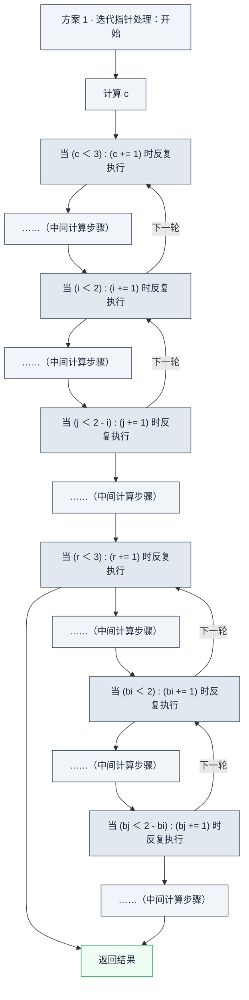

```zig
// LeetCode 107868749. 贪心策略 — Zig 版（贪心策略之 matrixSort / PFC 编码 / Huffman 树）
const std = @import("std"); // 把 @import(「std」) 存入 std

// 每列升序排序后每行升序排序
fn matrixSort(m: *[3][3]i32) void { // 定义函数/方法 matrixSort
    var c: usize = 0; // 把 0; 写入 var c: usize
    while (c < 3) : (c += 1) { // 循环，直到不满足「字符 小于 3) : (字符 累加 1」
        var i: usize = 0; // 把 0; 写入 var i: usize
        while (i < 2) : (i += 1) { // 循环，直到不满足「下标 i 小于 2) : (下标 i 累加 1」
            var j: usize = 0; // 把 0; 写入 var j: usize
            while (j < 2 - i) : (j += 1) { // 循环，直到不满足「下标 j 小于 2 减 下标 i) : (下标 j 累加 1」
                if (m[j][c] > m[j + 1][c]) { // 若 映射表[下标 j][字符] 超过 映射表[下标 j 加 1][字符]
                    const t = m[j][c]; // 把 映射表[下标 j][字符] 存入 另一字符串
                    m[j][c] = m[j + 1][c]; // 把 映射表[下标 j 加 1][字符]; 写入 m[j][c]
                    m[j + 1][c] = t; // 把 另一字符串; 写入 m[j + 1][c]
                }
            }
        }
    }
    var r: usize = 0; // 把 0; 写入 var r: usize
    while (r < 3) : (r += 1) { // 循环，直到不满足「右指针 小于 3) : (右指针 累加 1」
        var bi: usize = 0; // 把 0; 写入 var bi: usize
        while (bi < 2) : (bi += 1) { // 循环，直到不满足「bi 小于 2) : (bi 累加 1」
            var bj: usize = 0; // 把 0; 写入 var bj: usize
            while (bj < 2 - bi) : (bj += 1) { // 循环，直到不满足「bj 小于 2 减 bi) : (bj 累加 1」
                if (m[r][bj] > m[r][bj + 1]) { // 若 映射表[右指针][bj] 超过 映射表[右指针][bj 加 1]
                    const t = m[r][bj]; // 把 映射表[右指针][bj] 存入 另一字符串
                    m[r][bj] = m[r][bj + 1]; // 把 映射表[右指针][bj 加 1]; 写入 m[r][bj]
                    m[r][bj + 1] = t; // 把 另一字符串; 写入 m[r][bj + 1]
                }
            }
        }
    }
}

const MAX_NODES = 16; // 把 16 存入 MAX_NODES
const HNode = struct { // 把 struct { 存入 HNode
    freq: i64,
    sym: u8 = 0,
    left: i16 = -1,
    right: i16 = -1,
};

var tree: [MAX_NODES]HNode = undefined; // 把 undefined; 写入 var tree: [MAX_NODES]HNode
var tree_n: usize = 0; // 把 0; 写入 var tree_n: usize

fn buildHuffman(syms: []const u8, freqs: []const i64) i16 { // 定义函数/方法 buildHuffman
    tree_n = freqs.len; // 把 freqs.长度; 写入 tree_n
    for (freqs, 0..) |f, i| { // for (freqs, 0..) 按位或 f, 下标 i 按位或 {
        tree[i] = .{ .freq = f, .sym = syms[i] }; // 把 { .频次表 赋值为 f, .sym 赋值为 syms[下标 i] }; 写入 tree[i]
    }
    var count = freqs.len; // 把 freqs.长度 存入 计数
    while (count > 1) { // 循环，直到不满足「计数 超过 1」
        var a: i16 = -1; // 把 减 1; 写入 var a: i16
        var b: i16 = -1; // 把 减 1; 写入 var b: i16
        var i: usize = 0; // 把 0; 写入 var i: usize
        while (i < tree_n) : (i += 1) { // 循环，直到不满足「下标 i 小于 tree_n) : (下标 i 累加 1」
            if (tree[i].freq < 0) continue; // 若 tree[下标 i].频次表 小于 0) continue;
            if (a < 0 or tree[i].freq < tree[@intCast(a)].freq) { // 若 数组 小于 0 or tree[下标 i].频次表 小于 tree[@intCast(数组)].频次表
                b = a; // 把 数组; 写入 b
                a = @intCast(i); // 把 @intCast(下标 i); 写入 数组
            } else if (b < 0 or tree[i].freq < tree[@intCast(b)].freq) { // 否则，若 b 小于 0 or tree[下标 i].频次表 小于 tree[@intCast(b)].频次表
                b = @intCast(i); // 把 @intCast(下标 i); 写入 b
            }
        }
        if (b < 0) break; // 若 b 小于 0) break;
        if (tree[@intCast(a)].freq > tree[@intCast(b)].freq) { // 若 tree[@intCast(数组)].频次表 超过 tree[@intCast(b)].频次表
            const t = a; // 把 数组 存入 另一字符串
            a = b; // 把 b; 写入 数组
            b = t; // 把 另一字符串; 写入 b
        }
        tree[tree_n] = .{ // 把 { 写入 tree[tree_n]
            .freq = tree[@intCast(a)].freq + tree[@intCast(b)].freq,
            .left = a,
            .right = b,
        };
        tree[@intCast(a)].freq = -1; // 把 减 1; 写入 频次表
        tree[@intCast(b)].freq = -1; // 把 减 1; 写入 频次表
        tree_n += 1; // tree_n累加 1
        count -= 1; // 计数累减 1
    }
    var bi: usize = 0; // 把 0; 写入 var bi: usize
    while (bi < tree_n) : (bi += 1) { // 循环，直到不满足「bi 小于 tree_n) : (bi 累加 1」
        if (tree[bi].freq >= 0) return @intCast(bi); // 若 tree[bi].频次表 不低于 0，直接返回 @intCast(bi)
    }
    return -1; // 返回 减 1
}

var codes: [8][8]u8 = undefined; // 把 undefined; 写入 var codes: [8][8]u8
var code_len: [8]usize = undefined; // 把 undefined; 写入 var code_len: [8]usize

fn walk(node: i16, prefix: []u8, depth: usize) void { // 定义函数/方法 walk
    const n = &tree[@intCast(node)]; // 把 按位与 tree[@intCast(节点)] 存入 元素个数
    if (n.left < 0) { // 若 元素个数.左边界 小于 0
        const idx = n.sym - 'A'; // 把 元素个数.sym 减 'A' 存入 idx
        if (depth == 0) { // 若 深度 等于 0
            codes[idx][0] = '0'; // 把 '0'; 写入 codes[idx][0]
            code_len[idx] = 1; // 把 1; 写入 code_len[idx]
        } else { // 否则
            for (prefix[0..depth], 0..) |ch, k| codes[idx][k] = ch; // 把 字符; 写入 for (prefix[0..depth], 0..) |ch, k| codes[idx][k]
            code_len[idx] = depth; // 把 深度; 写入 code_len[idx]
        }
        return; // return;
    }
    prefix[depth] = '0'; // 把 '0'; 写入 prefix[depth]
    walk(n.left, prefix, depth + 1); // walk(元素个数.左边界, prefix, 深度 加 1);
    prefix[depth] = '1'; // 把 '1'; 写入 prefix[depth]
    walk(n.right, prefix, depth + 1); // walk(元素个数.右边界, prefix, 深度 加 1);
}

pub fn main() !void { // 程序入口：跑内嵌自测用例
    // case1: matrixSort
    var mat = [3][3]i32{ .{ 5, 3, 4 }, .{ 1, 6, 2 }, .{ 7, 9, 8 } };
    const want = [3][3]i32{ .{ 1, 2, 3 }, .{ 4, 5, 6 }, .{ 7, 8, 9 } };
    matrixSort(&mat); // matrixSort( 按位与 mat);
    for (want, 0..) |row, i| { // for (want, 0..) 按位或 row, 下标 i 按位或 {
        for (row, 0..) |x, j| { // for (row, 0..) 按位或 x, 下标 j 按位或 {
            if (mat[i][j] != x) { // 若 mat[下标 i][下标 j] 不等于 x
                std.debug.print("matrixSort mismatch\n", .{}); // 打印输出
                return error.TestFailed; // 返回 error.TestFailed
            }
        }
    }

    // case2: WPL
    const syms = "ABCDEF"; // 把 「ABCDEF」 存入 syms
    const freqs = [_]i64{ 5, 9, 12, 13, 16, 45 }; // 把 [_]i64{ 5, 9, 12, 13, 16, 45 } 存入 freqs
    const root = buildHuffman(syms, &freqs); // 把 buildHuffman(syms, 按位与 freqs) 存入 根节点
    var prefix: [16]u8 = undefined; // 把 undefined; 写入 var prefix: [16]u8
    walk(root, &prefix, 0); // walk(根节点, 按位与 prefix, 0);
    var wpl: i64 = 0; // 把 0; 写入 var wpl: i64
    for (freqs, 0..) |f, i| { // for (freqs, 0..) 按位或 f, 下标 i 按位或 {
        wpl += f * @as(i64, @intCast(code_len[i])); // wpl累加 f 乘 @as(i64, @intCast(code_len[下标 i]))
    }
    if (wpl != 224) { // 若 wpl 不等于 224
        std.debug.print("WPL mismatch: {d}\n", .{wpl}); // 打印输出
        return error.TestFailed; // 返回 error.TestFailed
    }

    // case3: 前缀无关
    var ci: usize = 0; // 把 0; 写入 var ci: usize
    while (ci < 6) : (ci += 1) { // 循环，直到不满足「ci 小于 6) : (ci 累加 1」
        var cj: usize = 0; // 把 0; 写入 var cj: usize
        while (cj < 6) : (cj += 1) { // 循环，直到不满足「cj 小于 6) : (cj 累加 1」
            if (ci == cj) continue; // 若 ci 等于 cj) continue;
            if (std.mem.eql(u8, codes[cj][0..code_len[ci]], codes[ci][0..code_len[ci]])) {
                std.debug.print("not prefix-free\n", .{}); // 打印输出
                return error.TestFailed; // 返回 error.TestFailed
            }
        }
    }

    std.debug.print("PASS\n", .{}); // 全部用例通过，输出 PASS
}
```

### Dart 实现（1 种方案）

Dart 的全部方案如下，每个方案都内嵌用例自测，可独立运行（老仓库 python/go 文件遵循「打印结果」约定）：

#### 方案 1：迭代指针处理

**思路与代码分析**：核心是「迭代指针处理」。Dart 版用可空类型标注与集合方法，注意空安全。代码里依次做这些事：先排序再处理；双重循环遍历。**走读**：方案 1 · 迭代指针处理：开始 → 更新 rows → 更新 cols → 遍历循环 → 更新 col → 排序整理 → 遍历循环 → 更新 matrix[r][c] → 遍历循环 → 排序整理 → 返回结果。

**运行架构**（真实控制流）：

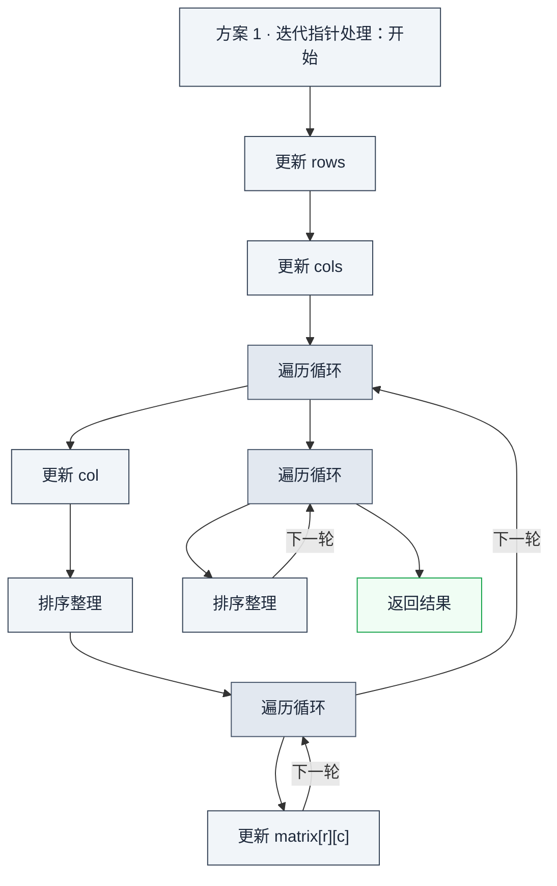

```dart
// LeetCode 107868749. 贪心策略 — Dart 版（贪心策略之 matrixSort / PFC 编码 / Huffman 树）
void matrixSort(List<List<int>> matrix) {
  // 定义函数/方法 matrixSort
  final rows = matrix.length,
      cols = matrix[0].length; // 把 矩阵.长度, 列数 赋值为 矩阵[0].长度 存入 行数
  for (var c = 0; c < cols; c++) {
    // 让 字符 从 0 开始计数，字符 小于 列数 就继续
    final col = <int>[for (final r in matrix) r[c]]
      ..sort(); // 把 小于 int 超过 [for (final 右指针 in 矩阵) 右指针[字符]]. 排序 ) 存入 col
    for (var r = 0; r < rows; r++) {
      // 让 右指针 从 0 开始计数，右指针 小于 行数 就继续
      matrix[r][c] = col[r]; // 把 col[右指针]; 写入 matrix[r][c]
    }
  }
  for (var r = 0; r < rows; r++) {
    // 让 右指针 从 0 开始计数，右指针 小于 行数 就继续
    matrix[r].sort(); // 排序
  }
}

class Huff {
  // 定义类型
  int freq; // int 频次表;
  String? sym; // String? sym;
  Huff? left, right; // Huff? 左边界, 右边界;
  bool get isLeaf => sym != null;
  Huff.leaf(this.freq, this.sym); // Huff.leaf(this.频次表, this.sym);
  Huff.internal(
    this.freq,
    this.left,
    this.right,
  ); // Huff.internal(this.频次表, this.左边界, this.右边界);
}

Huff buildHuffman(Map<String, int> freqs) {
  // 定义函数/方法 buildHuffman
  var nodes = <Huff>[for (final e in freqs.entries) Huff.leaf(e.value, e.key)]
    ..sort((a, b) => a.freq.compareTo(b.freq));
  while (nodes.length > 1) {
    // 循环，直到不满足「nodes.长度 超过 1」
    final a = nodes.removeAt(0); // 把 nodes.removeAt(0) 存入 数组
    final b = nodes.removeAt(0); // 把 nodes.removeAt(0) 存入 b
    final merged = Huff.internal(
      a.freq + b.freq,
      a,
      b,
    ); // 把 Huff.internal(数组.频次表 加 b.频次表, 数组, b) 存入 merged
    var i = 0; // 把 0 存入 下标 i
    while (i < nodes.length && nodes[i].freq < merged.freq) {
      // 循环，直到不满足「下标 i 小于 nodes.长度 且 nodes[下标 i].频次表 小于 merged.频次表」
      i++; // 下标 i 加一
    }
    nodes.insert(i, merged); // nodes 插入 下标 i, merged);
  }
  return nodes[0]; // 返回 nodes[0]
}

Map<String, String> huffmanCodes(Map<String, int> freqs) {
  final root = buildHuffman(freqs); // 把 buildHuffman(freqs) 存入 根节点
  final codes = <String, String>{}; // 把 小于 String, String 超过 {} 存入 codes
  void walk(Huff node, String prefix) {
    // 定义函数/方法 walk
    if (node.isLeaf) {
      // 若 节点.isLeaf
      codes[node.sym!] = prefix.isEmpty
          ? '0'
          : prefix; // 把 prefix.isEmpty ? '0' : prefix; 写入 codes[node.sym!]
    } else {
      // 否则
      walk(node.left!, prefix + '0'); // walk(节点.左边界取反 , prefix 加 '0');
      walk(node.right!, prefix + '1'); // walk(节点.右边界取反 , prefix 加 '1');
    }
  }

  walk(root, ''); // walk(根节点, '');
  return codes; // 返回 codes
}

void main() {
  // 程序入口：跑内嵌自测用例
  final freqs = <String, int>{
    'A': 5,
    'B': 9,
    'C': 12,
    'D': 13,
    'E': 16,
    'F': 45,
  };

  // case1: matrixSort
  final mat = <List<int>>[
    [5, 3, 4],
    [1, 6, 2],
    [7, 9, 8],
  ];
  matrixSort(mat); // matrixSort(mat);
  if (mat.toString() != '[[1, 2, 3], [4, 5, 6], [7, 8, 9]]') {
    // 若 mat.toString() 不等于 '[[1, 2, 3], [4, 5, 6], [7, 8, 9]]'
    throw StateError(
      'matrixSort mismatch',
    ); // throw StateError('matrixSort mismatch');
  }

  // case2: WPL
  final codes = huffmanCodes(freqs); // 把 huffmanCodes(freqs) 存入 codes
  var wpl = 0; // 把 0 存入 wpl
  final codeList = <String>[]; // 把 小于 String 超过 [] 存入 codeList
  freqs.forEach((sym, f) {
    // freqs.forEach((sym, f) {
    final c = codes[sym]!; // 把 codes[sym]取反 存入 字符
    wpl += f * c.length; // wpl累加 f 乘 字符.长度
    codeList.add(c); // codeList 追加 字符);
  }); // });
  if (wpl != 224)
    throw StateError(
      'WPL mismatch: $wpl',
    ); // 若 wpl 不等于 224) throw StateError('WPL mismatch: $wpl');

  // case3: 前缀无关
  var prefixFree = true; // 把 true 存入 prefixFree
  for (var i = 0; i < codeList.length; i++) {
    // 让 下标 i 从 0 开始计数，下标 i 小于 codeList.长度 就继续
    for (var j = 0; j < codeList.length; j++) {
      // 让 下标 j 从 0 开始计数，下标 j 小于 codeList.长度 就继续
      if (i != j && codeList[j].startsWith(codeList[i])) prefixFree = false;
    }
  }
  if (!prefixFree)
    throw StateError(
      'not prefix-free',
    ); // 若 取反 prefixFree) throw StateError('not prefix 减 free');

  print('PASS'); // 全部用例通过，输出 PASS
}
```

---

## 内容总结

- **贪心策略之matrixsorting pfc coding huffmantre**（算法笔记 · Medium）：共 1 个方案，主线思路「迭代指针处理」；时间 O(n)（单趟线性扫描）；动画演示归并分治过程，附录给出 11 种语言 × 全部方案的可运行实现。
- 来源博客：[https://blog.csdn.net/tyro_java/article/details/107868749](https://blog.csdn.net/tyro_java/article/details/107868749)
- 导航：[📋 总目录](../) ｜ [← 210 gnome sort bubbl](../210_gnome_sort_bubble_sort以及贪心策略的相关对比改进/) ｜ [212 贪心策略之bst&bbst ha →](../212_贪心策略之bst&bbst_hashtable+dictionary+map_p/)
