# 212 · 贪心策略之bst&bbst hashtable+dictionary+map p（第附阶段 · 专题补充 · Medium）

> **难度**：⭐⭐ Medium ｜ **专题**：算法笔记
> **学习定位**：第附阶段 · 专题补充第 212 篇 ｜ **解法数**：1
> **内容总结**：**贪心策略之bst&bbst hashtable+dictionary+map p**（算法笔记 · Medium）：共 1 个方案，主线思路「迭代指针处理」；时间 O(n)（单趟线性扫描）；动画演示归并分治过程，附录给出 11 种语言 × 全部方案的可运行实现。

---

## 题目描述

贪心策略之bst&bbst hashtable+dictionary+map p。具体输入输出约定见函数签名与用例。

- 主函数签名：`function treeToLevel(root: any): any[]`

**用例演示**（摘自主解法内嵌自测，输入到输出一目了然）：

```typescript
  const cases = [
    {
      in: [
        [
          [0, 1, 10],
          [0, 2, 6],
          [0, 3, 5],
          [1, 3, 15],
          [2, 3, 4],
        ],
      ],
      want: 19,
    },
    {
```

**数据范围与注意事项**：

- **易错点**：先看小例子手推一遍再对照代码，比直接读代码快得多。

## 题目分析

**场景是什么**：综合练习：把数据结构与策略组合起来解决一个完整问题。本题就是该场景的 Medium 级练习，主线做法是「迭代指针处理」。

**主线怎么解**：把主解法从头到尾过一遍，它其实在依次做这几件事：队列或堆的调度。

## 解题思路

**方案对比**（共 1 个方案，由浅入深）：

| 方案 | 时间复杂度 | 空间复杂度 |
|---|---|---|
| 方案 1 · 迭代指针处理 | O(n)（单趟线性扫描） | O(1) 到 O(n)（视辅助结构） |

**怎么读这一篇**：

- 🐣 **新手路线**：把「题目描述」的示例 1 在纸上手推一遍 → 读方案 1（最直观的写法）与它的代码走读 → 按「运行方式」本地跑通看 PASS → 回头对比方案 2 之后的写法差在哪
- 🦅 **大佬路线**：直接锁定最优方案 1（迭代指针处理，O(n)（单趟线性扫描））→ 跳读该方案代码与走读 → 用「逐步拆解与面试追问」补齐复杂度推导与边界追问

### 动态算法图（归并分治，GIF 自动循环）


动画演示算法笔记专题里归并分治的典型过程；每个方案在「TypeScript 解题方案」一节还配了专属动画与专属流程图。

### 主解法流程图（真实控制流）

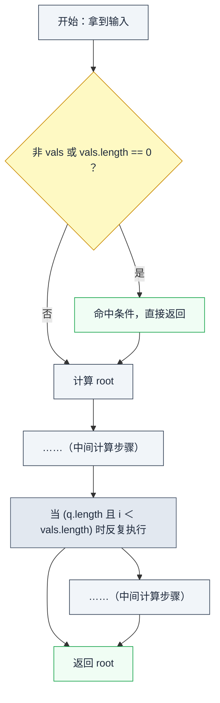

## TypeScript 解题方案（1 个方案逐个讲）

> **运行与提交**：每个方案都是自包含文件（内嵌用例自测，输出 PASS），整块复制到 `.ts` 文件后 `node 文件名` 即可运行。提交 LeetCode 时，把 `demo` 内的算法函数与辅助类型/函数整体取出、置于文件顶层即可。概念演示（非 LeetCode 编号题），在本地运行即可。

### 方案 1：迭代指针处理

**分析与思路**：核心做法是「迭代指针处理」。代码里依次做这些事：队列或堆的调度。

**运行方式**：`node 本文件`，内嵌用例全部通过会输出 PASS。


**方案专属流程图**（真实控制流）：

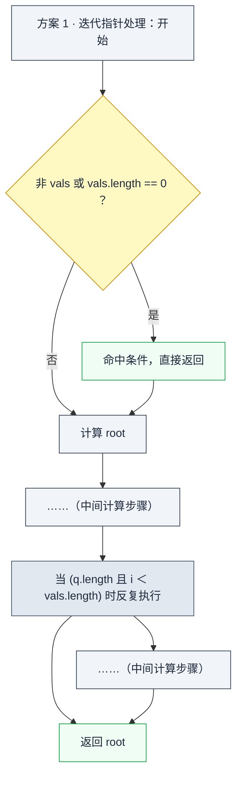

```typescript
class TreeNode {
  // 定义类型
  val: any;
  left: any;
  right: any; // 值: any; 左边界: any; 右边界: any;
  constructor(val?: any, left?: any, right?: any) {
    // constructor(值?: any, 左边界?: any, 右边界?: any) {
    this.val = val === undefined ? 0 : val; // 把 (值 全等于 undefined ? 0 : 值); 写入 值
    this.left = left === undefined ? null : left; // 把 (左边界 全等于 undefined ? null : 左边界); 写入 左边界
    this.right = right === undefined ? null : right; // 把 (右边界 全等于 undefined ? null : 右边界); 写入 右边界
  }
}
function buildTree(vals: any): any {
  // 定义函数/方法 buildTree
  if (!vals || vals.length === 0) return null; // 若 取反 vals 或 vals.长度 全等于 0，直接返回 null
  const root = new TreeNode(vals[0]);
  const q: any[] = [root];
  let i = 1;
  while (q.length && i < vals.length) {
    // 循环，直到不满足「节点.长度 且 下标 i 小于 vals.长度」
    const node = q.shift(); // 把 节点.shift() 存入 节点
    if (vals[i] !== null && vals[i] !== undefined) {
      node.left = new TreeNode(vals[i]);
      q.push(node.left);
    }
    i++; // 下标 i 加一
    if (i < vals.length && vals[i] !== null && vals[i] !== undefined) {
      node.right = new TreeNode(vals[i]);
      q.push(node.right);
    }
    i++; // 下标 i 加一
  }
  return root; // 返回 根节点
}
function treeToLevel(root: any): any[] {
  // 定义函数/方法 treeToLevel
  if (!root) return []; // 若 取反 根节点，直接返回 []
  const out: any[] = [];
  const q: any[] = [root]; // 把 []; const 节点: any[] 赋值为 [根节点]; 写入 const out: any[]
  while (q.length) {
    // 循环，直到不满足「节点.长度」
    const n = q.shift(); // 把 节点.shift() 存入 元素个数
    if (n === null || n === undefined) {
      out.push(null);
      continue;
    }
    out.push(n.val);
    q.push(n.left);
    q.push(n.right); // 把 元素个数.值 压入栈/数组尾部
  }
  while (out.length && out[out.length - 1] === null) out.pop(); // 循环，直到不满足「out.长度 且 out[out.长度 减 1] 全等于 null) out 弹出 );」
  return out; // 返回 out
}
class ListNode {
  // 定义类型
  val: any;
  next: any; // 值: any; 下一个: any;
  constructor(val?: any, next?: any) {
    this.val = val === undefined ? 0 : val;
    this.next = next === undefined ? null : next;
  }
}
function buildList(vals: any): any {
  // 定义函数/方法 buildList
  const dummy = new ListNode(0);
  let cur = dummy; // 把 new ListNode(0); let 当前值 赋值为 哨兵节点 存入 哨兵节点
  for (const v of vals) {
    cur.next = new ListNode(v);
    cur = cur.next;
  } // 把 new ListNode(值); 当前值 赋值为 当前值.下一个; } 写入 下一个
  return dummy.next; // 返回 哨兵节点.下一个
}
function listToArray(head: any): any[] {
  // 定义函数/方法 listToArray
  const out: any[] = [];
  let p = head; // 把 []; let 节点 赋值为 头节点; 写入 const out: any[]
  while (p) {
    out.push(p.val);
    p = p.next;
  } // 循环，直到不满足「节点) { out 追加 节点.值); 节点 赋值为 节点.下一个; }」
  return out; // 返回 out
}
// python-runtime shims
function pyLen(a: any): number {
  // 定义函数/方法 pyLen
  if (a === null || a === undefined) return 0; // 若 数组 全等于 null 或 数组 全等于 undefined，直接返回 0
  if (
    typeof a === 'string' ||
    Array.isArray(a) ||
    a instanceof Set ||
    a instanceof Map
  )
    return a.length ?? a.size;
  if (typeof a === 'object') return Object.keys(a).length; // 若 typeof 数组 全等于 'object'，直接返回 Object.keys(数组).长度
  return 0; // 返回 0
}
function pySlice(a: any, i: any, j: any, step?: any): any {
  // 定义函数/方法 pySlice
  if (typeof a === 'string') {
    const r = [...a].slice(i ?? 0, j ?? a.length);
    return step ? r.reverse().join('') : r.join('');
  }
  const arr = Array.isArray(a) ? a : [...a]; // 把 Array.isArray(数组) ? 数组 : 复制的 数组 存入 数组
  return arr.slice(i ?? 0, j ?? arr.length); // 返回 数组 截取 下标 i ?? 0, 下标 j ?? 数组.长度)
}
function pyRange(a: any, b?: any, step?: any): any[] {
  // 定义函数/方法 pyRange
  let s = 0,
    e = a,
    st = 1; // 把 0, e 赋值为 数组, st 赋值为 1 存入 字符串
  if (b !== undefined) {
    s = a;
    e = b;
  } // 若 b 不等于 undefined) { 字符串 赋值为 数组; e 赋值为 b; }
  if (step !== undefined) st = step; // 若 步数 不等于 undefined) st 赋值为 步数;
  const out: any[] = []; // 把 []; 写入 const out: any[]
  if (st > 0) for (let i = s; i < e; i += st) out.push(i);
  else for (let i = s; i > e; i += st) out.push(i); // 否则
  return out; // 返回 out
}
function pyIn(x: any, coll: any): boolean {
  // 定义函数/方法 pyIn
  if (coll === null || coll === undefined) return false; // 若 coll 全等于 null 或 coll 全等于 undefined，直接返回 false
  if (Array.isArray(coll)) return coll.includes(x); // 若 Array.isArray(coll)，直接返回 coll 是否包含 x)
  if (coll instanceof Set || coll instanceof Map) return coll.has(x); // 若 coll instanceof Set 或 coll instanceof Map，直接返回 coll.has(x)
  if (typeof coll === 'object') return x in coll; // 若 typeof coll 全等于 'object'，直接返回 x in coll
  if (typeof coll === 'string') return coll.indexOf(x) >= 0; // 若 typeof coll 全等于 'string'，直接返回 coll 查找 x) 不低于 0
  return false; // 返回 false
}
function pySorted(a: any): any[] {
  // 定义函数/方法 pySorted
  const arr = typeof a === 'string' ? [...a] : [...a]; // 把 (typeof 数组 全等于 'string') ? 复制的 数组 : 复制的 数组 存入 数组
  return arr.sort((x: any, y: any) => (x < y ? -1 : x > y ? 1 : 0));
}
function pyMin(a: any, b?: any): any {
  if (b !== undefined) return Math.min(a, b);
  if (Array.isArray(a) || a instanceof Set) return Math.min(...a);
  return Math.min(a);
} // 定义函数/方法 pyMin
function pyMax(a: any, b?: any): any {
  if (b !== undefined) return Math.max(a, b);
  if (Array.isArray(a) || a instanceof Set) return Math.max(...a);
  return Math.max(a);
} // 定义函数/方法 pyMax
function pySum(a: any): number {
  let s = 0;
  for (const v of a) s += v;
  return s;
} // 定义函数/方法 pySum
function pyAbs(x: any): number {
  return Math.abs(x);
} // 定义函数/方法 pyAbs
function pyEnumerate(a: any): any[] {
  const out: any[] = [];
  let i = 0;
  for (const v of a) {
    out.push([i, v]);
    i++;
  }
  return out;
} // 定义函数/方法 pyEnumerate
function pyZip(a: any, b: any): any[] {
  const n = Math.min(a.length, b.length);
  const out: any[] = [];
  for (let i = 0; i < n; i++) out.push([a[i], b[i]]);
  return out;
} // 定义函数/方法 pyZip
function pyDictGet(d: any, k: any, def?: any): any {
  return k in d ? d[k] : def === undefined ? null : def;
} // 定义函数/方法 pyDictGet
function pyPrint(...args: any[]): void {
  console.log(
    args
      .map((a) => (typeof a === 'object' && a !== null ? JSON.stringify(a) : a))
      .join(' '),
  );
} // 定义函数/方法 pyPrint
// collections / heapq
function heapPush(h: any[], x: any): void {
  h.push(x);
  let i = h.length - 1;
  while (i > 0) {
    const p = (i - 1) >> 1;
    if (h[p] <= h[i]) break;
    [h[p], h[i]] = [h[i], h[p]];
    i = p;
  }
} // 定义函数/方法 heapPush
function heapPop(h: any[]): any {
  const top = h[0];
  const last = h.pop();
  if (h.length) {
    h[0] = last;
    let i = 0;
    const n = h.length;
    while (true) {
      let l = 2 * i + 1,
        r = 2 * i + 2,
        s = i;
      if (l < n && h[l] < h[s]) s = l;
      if (r < n && h[r] < h[s]) s = r;
      if (s === i) break;
      [h[s], h[i]] = [h[i], h[s]];
      i = s;
    }
  }
  return top;
} // 定义函数/方法 heapPop
class Deque {
  private a: any[] = [];
  push(x: any) {
    this.a.push(x);
  }
  pushLeft(x: any) {
    this.a.unshift(x);
  }
  pop() {
    return this.a.pop();
  }
  popLeft() {
    return this.a.shift();
  }
  get length() {
    return this.a.length;
  }
  toArray() {
    return this.a.slice();
  }
} // 定义类型
function Counter(iter: any): any {
  const m: any = {};
  for (const v of iter) m[v] = (m[v] || 0) + 1;
  return m;
} // 定义函数/方法 Counter
function gcd(a: any, b: any): any {
  while (b) {
    [a, b] = [b, a % b];
  }
  return a;
} // 定义函数/方法 gcd
function pyInf(): number {
  return Infinity;
} // 定义函数/方法 pyInf

function norm(x: any): any {
  // 定义函数/方法 norm
  if (x === null || x === undefined) return null; // 若 x 全等于 null 或 x 全等于 undefined，直接返回 null
  if (typeof x === 'object') {
    // 若 typeof x 全等于 'object'
    if (x instanceof Deque) return x.toArray(); // 若 x instanceof Deque，直接返回 x.toArray()
    if (Array.isArray(x)) return x.map(norm); // 若 Array.isArray(x)，直接返回 x.映射表(norm)
    if (
      typeof x.val === 'number' &&
      (typeof x.left !== 'undefined' || typeof x.right !== 'undefined')
    )
      return treeToLevel(x);
    if (typeof x.next !== 'undefined' && typeof x.val === 'number')
      return listToArray(x);
    if (x instanceof Set) return [...x].sort(); // 若 x instanceof Set，直接返回 复制的 x 排序 )
    if (x instanceof Map) return Object.fromEntries(x); // 若 x instanceof Map，直接返回 Object.fromEntries(x)
    const o: any = {};
    for (const k of Object.keys(x)) o[k] = norm(x[k]);
    return o;
  }
  return x; // 返回 x
}
function eq(a: any, b: any): boolean {
  // 定义函数/方法 eq
  const x = norm(a),
    y = norm(b); // 把 norm(数组), y 赋值为 norm(b) 存入 x
  if (x === y) return true; // 若 x 全等于 y，直接返回 true
  if (x === null || y === null) return x === y; // 若 x 全等于 null 或 y 全等于 null，直接返回 x 全等于 y
  if (Array.isArray(x) && Array.isArray(y)) {
    // 若 Array.isArray(x) 且 Array.isArray(y
    if (x.length !== y.length) return false; // 若 x.长度 不等于 y.长度，直接返回 false
    for (let i = 0; i < x.length; i++) if (!eq(x[i], y[i])) return false; // 让 下标 i 从 0 开始计数，下标 i 小于 x.长度 就继续
    return true; // 返回 true
  }
  if (typeof x === 'object' && typeof y === 'object') {
    // 若 typeof x 全等于 'object' 且 typeof y 全等于 'object'
    const kx = Object.keys(x),
      ky = Object.keys(y); // 把 Object.keys(x), ky 赋值为 Object.keys(y) 存入 kx
    if (kx.length !== ky.length) return false; // 若 kx.长度 不等于 ky.长度，直接返回 false
    for (const k of kx) if (!eq(x[k], y[k])) return false;
    return true; // 返回 true
  }
  return x === y; // 返回 x 全等于 y
}

function kruskalMst(edges) {
  // 定义函数/方法 kruskalMst
  // edges: list of [u, v, w]; return total weight of MST
  const sorted = edges.slice().sort((a, b) => a[2] - b[2]);
  const parent = {}; // 把 {} 存入 parent
  function find(x) {
    if (parent[x] === undefined) parent[x] = x;
    while (parent[x] !== x) {
      parent[x] = parent[parent[x]];
      x = parent[x];
    }
    return x;
  } // 定义函数/方法 find
  function union(a, b) {
    parent[find(a)] = find(b);
  } // 定义函数/方法 union
  let total = 0; // 把 0 存入 总和
  for (const [u, v, w] of sorted) {
    // for (const [节点 u, 值, 权重] of sorted) {
    if (find(u) !== find(v)) {
      union(u, v);
      total += w;
    } // 若 find(节点 u) 不等于 find(值)) { union(节点 u, 值); 总和 累加 权重; }
  }
  return total; // 返回 总和
}
export function demo(): void {
  // 程序入口：跑内嵌自测用例
  const cases = [
    {
      in: [
        [
          [0, 1, 10],
          [0, 2, 6],
          [0, 3, 5],
          [1, 3, 15],
          [2, 3, 4],
        ],
      ],
      want: 19,
    },
    {
      in: [
        [
          [0, 1, 1],
          [1, 2, 2],
          [2, 3, 3],
          [3, 4, 4],
        ],
      ],
      want: 10,
    },
    {
      in: [
        [
          [0, 1, 2],
          [1, 2, 3],
        ],
      ],
      want: 5,
    },
    { in: [[]], want: 0 },
  ];
  let fail = false; // 把 false 存入 fail
  for (const c of cases) {
    // for (const 字符 of cases) {
    const got = kruskalMst(...c.in); // 把 kruskalMst(...字符.in) 存入 got
    if (!eq(got, c.want)) {
      fail = true;
      console.log(
        'FAIL',
        JSON.stringify(c.in),
        '=>',
        JSON.stringify(got),
        'want',
        JSON.stringify(c.want),
      );
    }
  }
  if (fail) throw new Error('FAILED'); // 若 fail) throw new Error('FAILED');
  console.log('PASS'); // 全部用例通过，输出 PASS
}
demo(); // demo();
```

## 逐步拆解与面试追问

**复杂度**：时间 O(n)（单趟线性扫描），空间 O(1) 到 O(n)（视辅助结构）

**为什么是这个量级**：每个元素被常数次访问，辅助哈希或栈的开销与 n 同阶

**面试官可能会追问**：

- 这个策略能推广到什么场景？
- 与暴力做法差在哪一步？
- 有没有更简单的等价写法？

## 关键 API 速查（TS 主解法实际用到，附官方链接）

| API | 作用 | 使用要点 | 官方文档 |
|---|---|---|---|
| `Array.prototype.sort()` | 原地排序 | 默认按字符串 Unicode 序（10 会排在 2 前），数字必须传 (a,b)=>a-b；V8 用 TimSort，稳定，O(n log n)；返回原数组引用 | [官方文档](https://developer.mozilla.org/zh-CN/docs/Web/JavaScript/Reference/Global_Objects/Array/sort) |
| `Array.prototype.map()` | 逐元素映射为新数组 | 回调 (v,i,arr)；返回等长新数组，不改变原数组；稀疏位跳过；链式调用注意中间数组开销 | [官方文档](https://developer.mozilla.org/zh-CN/docs/Web/JavaScript/Reference/Global_Objects/Array/map) |
| `Array.prototype.push()` | 尾部追加 | 返回新长度；可一次多个；均摊 O(1)；会改变原数组 | [官方文档](https://developer.mozilla.org/zh-CN/docs/Web/JavaScript/Reference/Global_Objects/Array/push) |
| `Array.prototype.pop()` | 尾部弹出 | 返回被删元素（空数组返回 undefined）；O(1) | [官方文档](https://developer.mozilla.org/zh-CN/docs/Web/JavaScript/Reference/Global_Objects/Array/pop) |
| `Array.prototype.shift()` | 头部取出 | O(n)（后续元素整体前移）；大量头部操作请用链表或双端结构 | [官方文档](https://developer.mozilla.org/zh-CN/docs/Web/JavaScript/Reference/Global_Objects/Array/shift) |
| `Array.prototype.unshift()` | 头部插入 | O(n)；与 shift 组合可当双端队列 | [官方文档](https://developer.mozilla.org/zh-CN/docs/Web/JavaScript/Reference/Global_Objects/Array/unshift) |
| `Array/String includes()` | 是否包含 | 数组用 SameValueZero（NaN 可判）；字符串按子串；第二个参数为起始下标 | [官方文档](https://developer.mozilla.org/zh-CN/docs/Web/JavaScript/Reference/Global_Objects/Array/includes) |
| `Array/String indexOf()` | 首次出现的下标 | 找不到返回 -1；无法判 NaN（用 includes）；字符串可传起始位 | [官方文档](https://developer.mozilla.org/zh-CN/docs/Web/JavaScript/Reference/Global_Objects/Array/indexOf) |
| `Array/String slice()` | 切片（不改原数组） | slice(start,end) 含头不含尾；负数从尾计；常用于复制数组（slice()） | [官方文档](https://developer.mozilla.org/zh-CN/docs/Web/JavaScript/Reference/Global_Objects/Array/slice) |
| `Array.prototype.join()` | 数组拼接为字符串 | undefined/null 转空串；嵌套数组会展平一层；join('') 用于字符数组还原 | [官方文档](https://developer.mozilla.org/zh-CN/docs/Web/JavaScript/Reference/Global_Objects/Array/join) |
| `Object.keys()` | 对象键名数组 | 仅自身可枚举字符串键（不含 symbol）；配 length 可当计数器 | [官方文档](https://developer.mozilla.org/zh-CN/docs/Web/JavaScript/Reference/Global_Objects/Object/keys) |
| `Object.fromEntries()` | 键值对数组转对象 | 参数为 [k,v] 可迭代；map 出来的键值对可直接转对象 | [官方文档](https://developer.mozilla.org/zh-CN/docs/Web/JavaScript/Reference/Global_Objects/Object/fromEntries) |
| `JSON.stringify()` | 序列化为 JSON 字符串 | 常用于结构化比较（深度相等判定）；undefined/函数/循环引用会被丢弃或抛错 | [官方文档](https://developer.mozilla.org/zh-CN/docs/Web/JavaScript/Reference/Global_Objects/JSON/stringify) |
| `Math.max()` | 最大值 | 配展开 Math.max(...arr)；空参返回 -Infinity；超大数组注意展开参数上限 | [官方文档](https://developer.mozilla.org/zh-CN/docs/Web/JavaScript/Reference/Global_Objects/Math/max) |
| `Math.min()` | 最小值 | 同 max；空参返回 Infinity | [官方文档](https://developer.mozilla.org/zh-CN/docs/Web/JavaScript/Reference/Global_Objects/Math/min) |
| `Math.abs()` | 绝对值 | 入参会被隐式转数字；-0 返回 +0 | [官方文档](https://developer.mozilla.org/zh-CN/docs/Web/JavaScript/Reference/Global_Objects/Math/abs) |

### 各语言官方文档导航

- **TypeScript / JS**：[MDN 中文参考](https://developer.mozilla.org/zh-CN/)
- **Python**：[Python 官方文档](https://docs.python.org/zh-cn/3/)
- **Go**：[Go 标准库](https://pkg.go.dev/std)
- **Java**：[JDK 17 API](https://docs.oracle.com/en/java/javase/17/docs/api/)
- **Rust**：[Rust 标准库](https://doc.rust-lang.org/std/)
- **Lua**：[Lua 5.4 手册](https://www.lua.org/manual/5.4/)
- **C**：[Cppreference C](https://zh.cppreference.com/w/c)
- **C++**：[Cppreference C++](https://zh.cppreference.com/w/cpp)
- **R**：[R 官方手册](https://stat.ethz.ch/R-manual/)
- **Zig**：[Zig 语言文档](https://ziglang.org/documentation/master/)
- **Dart**：[Dart API](https://api.dart.dev/)

## 附录：其他 10 种语言全部实现（每种语言列举其全部方案）

> TypeScript 的全部方案见「TypeScript 解题方案」一节；下面是其余 10 种语言的对应实现，每种语言的每个方案都带思路分析、代码走读与专属运行架构图。
> 每个方案都内嵌用例自测，可独立运行（老仓库 python/go 文件遵循「打印结果」约定）。
> 完整解法文件见 `dsa/<语言>/notes/lc_108013114_贪心策略之bst&bbst_hashtable+dictionary+map_p/`。

### Python 实现（1 种方案）

Python 的全部方案如下，每个方案都内嵌用例自测，可独立运行（老仓库 python/go 文件遵循「打印结果」约定）：

#### 方案 1：迭代指针处理

**思路与代码分析**：核心是「迭代指针处理」。Python 版用切片与字典推导式简化操作，突出可读性。代码里依次做这些事：先排序再处理。**走读**：方案 1 · 迭代指针处理：开始 → 更新 parent → 当 parent[x] ≠ x: 时反复执行 → 返回 x → 命中条件，直接返回 → 返回 True → 遍历 sorted( 中的每个元素 w → 返回 total。

**运行架构**（真实控制流）：

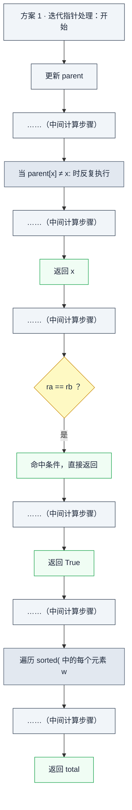

```python
import sys  # 提高递归深度上限（深输入防 RecursionError）

sys.setrecursionlimit(200000)  # 树/链表类题目节点数可达 1e4 量级

class BST:  # 定义类
    """二叉搜索树（BST）：左子树 < 根 < 右子树。"""

    class Node:  # 定义类
        def __init__(self, val):  # 构造函数：初始化成员
            self.val = val  # 把 值 写入 值
            self.left = None  # 把 None 写入 左边界
            self.right = None  # 把 None 写入 右边界

    def __init__(self):  # 构造函数：初始化成员
        self.root = None  # 把 None 写入 根节点

    def insert(self, val):  # 定义函数 insert（参数：self, 值）
        if not self.root:  # 若 not self.根节点
            self.root = self.Node(val)  # 把 self.Node(值) 写入 根节点
            return  # return
        cur = self.root  # 把 self.根节点 存入 当前值
        while True:  # 循环，直到不满足「True」
            if val < cur.val:  # 若 值 小于 当前值.值
                if cur.left is None:  # 若 当前值.左边界 is None
                    cur.left = self.Node(val)  # 把 self.Node(值) 写入 左边界
                    break  # 跳出循环
                cur = cur.left  # 把 当前值.左边界 存入 当前值
            elif val > cur.val:  # 否则，若 值 超过 当前值.值
                if cur.right is None:  # 若 当前值.右边界 is None
                    cur.right = self.Node(val)  # 把 self.Node(值) 写入 右边界
                    break  # 跳出循环
                cur = cur.right  # 把 当前值.右边界 存入 当前值
            else:  # 否则
                break  # 已存在

    def search(self, val):  # 定义函数 search（参数：self, 值）
        cur = self.root  # 把 self.根节点 存入 当前值
        while cur:  # 循环，直到不满足「当前值」
            if val == cur.val:  # 若 值 等于 当前值.值
                return True  # 返回 True
            cur = (
                cur.left if val < cur.val else cur.right
            )  # 把 当前值.左边界 if 值 小于 当前值.值 else 当前值.右边界 存入 当前值
        return False  # 返回 False

def kruskal_mst(edges):  # 定义函数 kruskal_mst（参数：边集）
    """Kruskal 最小生成树：按权重升序加边，用并查集避免成环。edges = [(u, v, w), ...]"""
    parent = {}  # 把 {} 存入 parent

    def find(x):  # 定义函数 find（参数：x）
        parent.setdefault(x, x)  # parent.setdefault(x, x)
        while parent[x] != x:  # 循环，直到不满足「parent[x] 不等于 x」
            parent[x] = parent[parent[x]]  # 把 parent[parent[x]] 写入 parent[x]
            x = parent[x]  # 把 parent[x] 存入 x
        return x  # 返回 x

    def union(a, b):  # 定义函数 union（参数：数组, b）
        ra, rb = find(a), find(b)  # 把 find(数组), find(b) 写入 ra, rb
        if ra == rb:  # 若 ra 等于 rb
            return False  # 返回 False
        parent[ra] = rb  # 把 rb 写入 parent[ra]
        return True  # 返回 True

    total = 0  # 把 0 存入 总和
    for u, v, w in sorted(
        edges, key=lambda e: e[2]
    ):  # 把 lambda e: e[2]): 写入 for u, v, w in sorted(edges, key
        if union(u, v):  # 若 union(节点 u, 值
            total += w  # 总和累加 权重
    return total  # 返回 总和

if __name__ == "__main__":  # 若 __name__ 等于 '__main__'
    bst = BST()  # 把 BST() 存入 bst
    for v in [5, 3, 7, 1, 9]:  # for 值 in [5, 3, 7, 1, 9]:
        bst.insert(v)  # bst 插入 值)
    print("search 7:", bst.search(7), " search 4:", bst.search(4))  # 打印输出
    print("mst cost:", kruskal_mst([[0, 1, 4], [0, 2, 3], [1, 2, 1], [1, 3, 2]]))  # 打印输出
```

### Go 实现（1 种方案）

Go 的全部方案如下，每个方案都内嵌用例自测，可独立运行（老仓库 python/go 文件遵循「打印结果」约定）：

#### 方案 1：迭代指针处理

**思路与代码分析**：核心是「迭代指针处理」。Go 版用切片与多返回值惯用法，显式处理索引边界。代码里依次做这些事：哈希结构做计数或查重。**走读**：方案 1 · 迭代指针处理：开始 → 更新 : → 遍历循环 → 返回 x → 返回 false → 返回 true → 遍历循环 → 遍历循环 → 遍历 sorted 的下标与元素 e → 返回 total。

**运行架构**（真实控制流）：

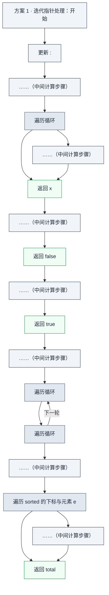

```go
package main // 引入依赖

import (
	"fmt" // 「fmt」
	"os"  // 「os」
)

// BST 二叉搜索树
type bstNode struct { // 定义类型
	val         int      // 值 int
	left, right *bstNode // 左边界, 右边界 乘 bstNode
}

type BST struct { // 定义类型
	root *bstNode // 根节点 乘 bstNode
}

func (t *BST) insert(val int) { // 定义函数/方法 insert
	if t.root == nil { // 若 另一字符串.根节点 等于 nil
		t.root = &bstNode{val: val} // 把 按位与 bstNode{值: 值} 写入 根节点
		return                      // return
	}
	cur := t.root // 把 另一字符串.根节点 写入 cur :
	for {         // for {
		if val < cur.val { // 若 值 小于 当前值.值
			if cur.left == nil { // 若 当前值.左边界 等于 nil
				cur.left = &bstNode{val: val} // 把 按位与 bstNode{值: 值} 写入 左边界
				return                        // return
			}
			cur = cur.left // 把 当前值.左边界 写入 当前值
		} else if val > cur.val { // 否则，若 值 超过 当前值.值
			if cur.right == nil { // 若 当前值.右边界 等于 nil
				cur.right = &bstNode{val: val} // 把 按位与 bstNode{值: 值} 写入 右边界
				return                         // return
			}
			cur = cur.right // 把 当前值.右边界 写入 当前值
		} else { // 否则
			return // return
		}
	}
}

func (t *BST) search(val int) bool { // 定义函数/方法 search
	cur := t.root    // 把 另一字符串.根节点 写入 cur :
	for cur != nil { // 把 nil { 写入 for cur !
		if val == cur.val { // 若 值 等于 当前值.值
			return true // 返回 true
		}
		if val < cur.val { // 若 值 小于 当前值.值
			cur = cur.left // 把 当前值.左边界 写入 当前值
		} else { // 否则
			cur = cur.right // 把 当前值.右边界 写入 当前值
		}
	}
	return false // 返回 false
}

// kruskalMST Kruskal 最小生成树
func kruskalMST(edges [][3]int) int { // 定义函数/方法 kruskalMST
	parent := map[int]int{}  // 把 映射表[int]int{} 写入 parent :
	var find func(int) int   // var find func(int) int
	find = func(x int) int { // 把 func(x int) int { 写入 find
		if _, ok := parent[x]; !ok { // 若 _, ok : 赋值为 parent[x]; 取反 ok
			parent[x] = x // 把 x 写入 parent[x]
		}
		for parent[x] != x { // 把 x { 写入 for parent[x] !
			parent[x] = parent[parent[x]] // 把 parent[parent[x]] 写入 parent[x]
			x = parent[x]                 // 把 parent[x] 写入 x
		}
		return x // 返回 x
	}
	union := func(a, b int) bool { // 把 func(数组, b int) bool { 写入 union :
		ra, rb := find(a), find(b) // 把 find(数组), find(b) 写入 ra, rb :
		if ra == rb {              // 若 ra 等于 rb
			return false // 返回 false
		}
		parent[ra] = rb // 把 rb 写入 parent[ra]
		return true     // 返回 true
	}
	// 按权重排序
	sorted := make([][3]int, len(edges)) // 把 make([][3]int, 长度(边集)) 写入 sorted :
	copy(sorted, edges)                  // copy(sorted, 边集)
	for i := 0; i < len(sorted); i++ {   // 让 下标 i 从 0 开始计数
		for j := i + 1; j < len(sorted); j++ { // 把 下标 i 加 1; 下标 j 小于 长度(sorted); 下标 j 加一 { 写入 for j :
			if sorted[j][2] < sorted[i][2] { // 若 sorted[下标 j][2] 小于 sorted[下标 i][2]
				sorted[i], sorted[j] = sorted[j], sorted[i] // 把 sorted[下标 j], sorted[下标 i] 写入 sorted[i], sorted[j]
			}
		}
	}
	total := 0                 // 把 0 写入 total :
	for _, e := range sorted { // 同时取 _ 与 e 遍历
		if union(e[0], e[1]) { // 定义函数/方法 union
			total += e[2] // 总和累加 e[2]
		}
	}
	return total // 返回 总和
}

func main() { // 程序入口：跑内嵌自测用例
	bst := &BST{}                            // 把 按位与 BST{} 写入 bst :
	for _, v := range []int{5, 3, 7, 1, 9} { // 同时取 _ 与 值 遍历
		bst.insert(v) // bst 插入 值)
	}
	if !bst.search(7) { // 若 取反 bst.search(7
		fmt.Println("FAIL search 7") // 打印输出
		os.Exit(1)                   // os.Exit(1)
	}
	if bst.search(4) { // 若 bst.search(4
		fmt.Println("FAIL search 4") // 打印输出
		os.Exit(1)                   // os.Exit(1)
	}
	mst := kruskalMST([][3]int{{0, 1, 4}, {0, 2, 3}, {1, 2, 1}, {1, 3, 2}})
	if mst != 6 { // 若 mst 不等于 6
		fmt.Printf("FAIL mst=%d want=6\n", mst) // 打印输出
		os.Exit(1)                              // os.Exit(1)
	}
	fmt.Println("PASS") // 全部用例通过，输出 PASS
}
```

### Java 实现（1 种方案）

Java 的全部方案如下，每个方案都内嵌用例自测，可独立运行（老仓库 python/go 文件遵循「打印结果」约定）：

#### 方案 1：迭代指针处理

**思路与代码分析**：核心是「迭代指针处理」。Java 版用类与静态方法组织，集合操作显式明了。代码里依次做这些事：哈希结构做计数或查重；先排序再处理；单循环线性扫描。**走读**：方案 1 · 迭代指针处理：开始 → 更新 parent → 当 (parent.get(x) ≠ x) 时反复执行 → 返回 x → 命中条件，直接返回 → 返回 true → 遍历循环 → 返回 total。

**运行架构**（真实控制流）：

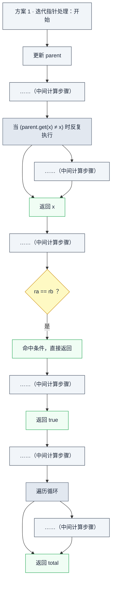

```java
package com.webfault.dsa; // 引入依赖

import java.util.*; // 引入依赖

class lc108013114_solution11 { // 定义类型
  static class BST { // static class BST {
    class Node { // 定义类型
      int val; // int 值;
      Node left, right; // Node 左边界, 右边界;

      Node(int v) {
        val = v;
      } // 把 值; } 写入 Node(int v) { val
    }

    Node root; // Node 根节点;

    void insert(int val) { // 定义函数/方法 insert
      if (root == null) {
        root = new Node(val);
        return;
      } // 若 根节点 等于 null) { 根节点 赋值为 new Node(值); return; }
      Node cur = root; // 把 根节点; 写入 Node cur
      while (true) { // 循环，直到不满足「true」
        if (val < cur.val) { // 若 值 小于 当前值.值
          if (cur.left == null) {
            cur.left = new Node(val);
            break;
          } // 若 当前值.左边界 等于 null) { 当前值.左边界 赋值为 new Node(值); break; }
          cur = cur.left; // 把 当前值.左边界; 写入 当前值
        } else if (val > cur.val) { // 否则，若 值 超过 当前值.值
          if (cur.right == null) {
            cur.right = new Node(val);
            break;
          } // 若 当前值.右边界 等于 null) { 当前值.右边界 赋值为 new Node(值); break; }
          cur = cur.right; // 把 当前值.右边界; 写入 当前值
        } else break; // 否则
      }
    }

    boolean search(int val) { // 定义函数/方法 search
      Node cur = root; // 把 根节点; 写入 Node cur
      while (cur != null) { // 循环，直到不满足「当前值 不等于 null」
        if (val == cur.val) return true; // 若 值 等于 当前值.值，直接返回 true
        cur = (val < cur.val) ? cur.left : cur.right; // 把 (值 小于 当前值.值) ? 当前值.左边界 : 当前值.右边界; 写入 当前值
      }
      return false; // 返回 false
    }
  }

  static int kruskalMst(int[][] edges) { // 定义函数/方法 kruskalMst
    Map<Integer, Integer> parent =
        new HashMap<>(); // 把 new HashMap 小于 超过 (); 写入 Map<Integer, Integer> parent
    class UF { // 定义类型
      int find(int x) { // 定义函数/方法 find
        parent.putIfAbsent(x, x); // parent.putIfAbsent(x, x);
        while (parent.get(x) != x) { // 循环，直到不满足「parent 查找 x) 不等于 x」
          int p = parent.get(x); // 把 parent 查找 x) 存入 节点
          parent.put(x, parent.get(p)); // parent.put(x, parent 查找 节点));
          x = p; // 把 节点; 写入 x
        }
        return x; // 返回 x
      }

      boolean union(int a, int b) { // 定义函数/方法 union
        int ra = find(a), rb = find(b); // 把 find(数组), rb 赋值为 find(b) 存入 ra
        if (ra == rb) return false; // 若 ra 等于 rb，直接返回 false
        parent.put(ra, rb); // parent.put(ra, rb);
        return true; // 返回 true
      }
    }
    UF uf = new UF(); // 把 new UF(); 写入 UF uf
    Arrays.sort(edges, Comparator.comparingInt(e -> e[2])); // 排序
    int total = 0; // 把 0 存入 总和
    for (int[] e : edges) { // for (int[] e : 边集) {
      if (uf.union(e[0], e[1])) total += e[2]; // 若 uf.union(e[0], e[1])) 总和 累加 e[2];
    }
    return total; // 返回 总和
  }

  public static void main(String[] args) { // public static void main(String[] args) {
    BST bst = new BST(); // 把 new BST(); 写入 BST bst
    for (int v : new int[] {5, 3, 7, 1, 9})
      bst.insert(v); // for (int 值 : new int[]{5, 3, 7, 1, 9}) bst 插入 值);
    boolean s7 = bst.search(7); // 把 bst.search(7); 写入 boolean s7
    boolean s4 = bst.search(4); // 把 bst.search(4); 写入 boolean s4
    int mst = kruskalMst(new int[][] {{0, 1, 4}, {0, 2, 3}, {1, 2, 1}, {1, 3, 2}});
    if (s7 != true) {
      System.out.println("FAIL search7");
      throw new RuntimeException("FAILED");
    }
    if (s4 != false) {
      System.out.println("FAIL search4");
      throw new RuntimeException("FAILED");
    }
    if (mst != 6) {
      System.out.println("FAIL mst " + mst);
      throw new RuntimeException("FAILED");
    }
    System.out.println("PASS"); // 全部用例通过，输出 PASS
  }
}
```

### Rust 实现（1 种方案）

Rust 的全部方案如下，每个方案都内嵌用例自测，可独立运行（老仓库 python/go 文件遵循「打印结果」约定）：

#### 方案 1：迭代指针处理

**思路与代码分析**：核心是「迭代指针处理」。Rust 版用所有权移动与切片借用改写同一逻辑，注意 Option 与引用边界。代码里依次做这些事：哈希结构做计数或查重。**走读**：方案 1 · 迭代指针处理：开始 → 计算 sorted → 当 parent[&x] ≠ x 时反复执行 → 遍历循环 → 返回结果。

**运行架构**（真实控制流）：

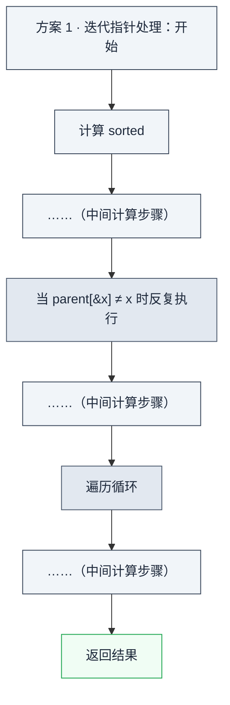

```rust
// LeetCode 108013114. 贪心策略之BST&BBST_hashtable+dictionary+map — Rust 版（贪心策略之 BST/BBST/哈希表：Kruskal 最小生成树（并查集 + 排序））
use std::collections::HashMap; // 引入依赖

fn kruskal_mst(edges: &[(i32, i32, i32)]) -> i32 {
    // 定义函数/方法 kruskal_mst
    let mut sorted = edges.to_vec(); // 把 边集.to_vec(); 写入 let mut sorted
    sorted.sort_by_key(|e| e.2); // sorted.sort_by_key( 按位或 e 按位或 e.2);
    let mut parent: HashMap<i32, i32> = HashMap::new(); // 把 HashMap::new(); 写入 let mut parent: HashMap<i32, i32>

    fn find(parent: &mut HashMap<i32, i32>, x: i32) -> i32 {
        // 定义函数/方法 find
        parent.entry(x).or_insert(x); // parent.entry(x).or_insert(x);
        let mut x = x; // 把 x; 写入 let mut x
        while parent[&x] != x {
            // 把 x { 写入 while parent[&x] !
            let px = parent[&x]; // 把 parent[ 按位与 x] 存入 px
            let ppx = parent[&px]; // 把 parent[ 按位与 px] 存入 ppx
            parent.insert(x, ppx); // parent 插入 x, ppx);
            x = ppx; // 把 ppx; 写入 x
        }
        x
    }

    let mut total = 0; // 把 0; 写入 let mut total
    for &(u, v, w) in &sorted {
        // for 按位与 (节点 u, 值, 权重) in 按位与 sorted {
        let ru = find(&mut parent, u); // 把 find( 按位与 mut parent, 节点 u) 存入 ru
        let rv = find(&mut parent, v); // 把 find( 按位与 mut parent, 值) 存入 rv
        if ru != rv {
            // 若 ru 不等于 rv
            parent.insert(ru, rv); // parent 插入 ru, rv);
            total += w; // 总和累加 权重
        }
    }
    total // 总和
}

fn main() {
    // 程序入口：跑内嵌自测用例
    let cases: Vec<(Vec<(i32, i32, i32)>, i32)> = vec![
        (
            vec![(0, 1, 10), (0, 2, 6), (0, 3, 5), (1, 3, 15), (2, 3, 4)],
            19,
        ),
        (vec![(0, 1, 1), (1, 2, 2), (2, 3, 3), (3, 4, 4)], 10),
        (vec![(0, 1, 2), (1, 2, 3)], 5),
        (vec![], 0),
    ];
    for (idx, (edges, want)) in cases.iter().enumerate() {
        // for (idx, (边集, want)) in cases.iter().enumerate() {
        let got = kruskal_mst(edges); // 把 kruskal_mst(边集) 存入 got
        assert_eq!(got, *want, "case {} failed", idx); // 断言校验
    }
    println!("PASS"); // 全部用例通过，输出 PASS
}
```

### Lua 实现（1 种方案）

Lua 的全部方案如下，每个方案都内嵌用例自测，可独立运行（老仓库 python/go 文件遵循「打印结果」约定）：

#### 方案 1：迭代指针处理

**思路与代码分析**：核心是「迭代指针处理」。Lua 版用表与 ipairs 遍历，注意 ipairs 遇 nil 即停的语义。代码里依次做这些事：先排序再处理；递归求解子问题。**走读**：方案 1 · 迭代指针处理：开始 → 更新 sorted → 遍历 ipairs(edges) do 中的每个元素 e → 返回 a[3] ＜ b[3] → 当 parent[x] ~= x do 时反复执行 → 返回 x → 遍历 ipairs(sorted) do 中的每个元素 e → 返回 total。

**运行架构**（真实控制流）：

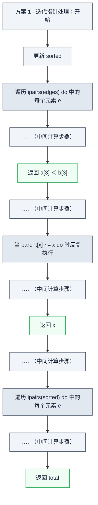

```lua
-- LeetCode 108013114. 贪心策略之BST&BBST_hashtable+dictionary+map — Lua 版（贪心策略之 BST/BBST/哈希表：Kruskal 最小生成树（并查集 + 排序））
local function kruskal_mst(edges) -- local function kruskal_mst(边集)
	local sorted = {} -- 把 {} 写入 local sorted
	for i, e in ipairs(edges) do
		sorted[i] = e
	end -- 遍历取 e
	table.sort(sorted, function(a, b)
		return a[3] < b[3]
	end) -- 排序
	local parent = {} -- 把 {} 写入 local parent

	local function find(x) -- local function find(x)
		if parent[x] == nil then
			parent[x] = x
		end -- 若 parent[x] 等于 nil then parent[x] 赋值为 x 终点
		while parent[x] ~= x do -- 把 x do 写入 while parent[x] ~
			parent[x] = parent[parent[x]] -- 把 parent[parent[x]] 写入 parent[x]
			x = parent[x] -- 把 parent[x] 存入 x
		end -- 终点
		return x -- 返回 x
	end -- 终点

	local total = 0 -- 把 0 写入 local total
	for _, e in ipairs(sorted) do -- 遍历取 e
		local u, v, w = e[1], e[2], e[3] -- 把 e[1], e[2], e[3] 写入 local u, v, w
		local ru, rv = find(u), find(v) -- 把 find(节点 u), find(值) 写入 local ru, rv
		if ru ~= rv then -- 若 ru ~ 赋值为 rv then
			parent[ru] = rv -- 把 rv 写入 parent[ru]
			total = total + w -- 把 总和 加 权重 存入 总和
		end -- 终点
	end -- 终点
	return total -- 返回 总和
end -- 终点

local cases = { -- 把 { 写入 local cases
	{ { { 0, 1, 10 }, { 0, 2, 6 }, { 0, 3, 5 }, { 1, 3, 15 }, { 2, 3, 4 } }, 19 },
	{ { { 0, 1, 1 }, { 1, 2, 2 }, { 2, 3, 3 }, { 3, 4, 4 } }, 10 },
	{ { { 0, 1, 2 }, { 1, 2, 3 } }, 5 },
	{ {}, 0 },
}
for idx, c in ipairs(cases) do -- 遍历取 字符
	local got = kruskal_mst(c[1]) -- 把 kruskal_mst(字符[1]) 写入 local got
	assert(got == c[2], string.format("case %d failed: got %d want %d", idx, got, c[2])) -- 断言校验
end -- 终点
print("PASS") -- 全部用例通过，输出 PASS
```

### C 实现（1 种方案）

C 的全部方案如下，每个方案都内嵌用例自测，可独立运行（老仓库 python/go 文件遵循「打印结果」约定）：

#### 方案 1：迭代指针处理

**思路与代码分析**：核心是「迭代指针处理」。C 版手动管理下标与内存，循环边界全部显式写出。代码里依次做这些事：双重循环遍历。**走读**：方案 1 · 迭代指针处理：开始 → 处理 int idx[64] → 遍历循环 → 遍历循环 → 遍历循环 → 遍历循环 → 遍历循环 → 返回 total。

**运行架构**（真实控制流）：

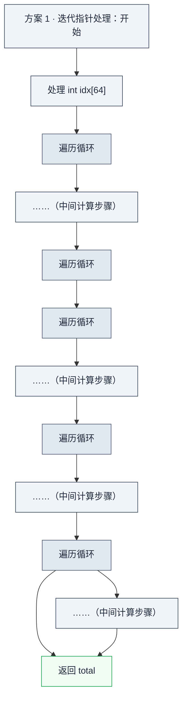

```c
* LeetCode 108013114. 贪心策略之BST&BBST_hashtable+dictionary+map — C 版（贪心策略之 BST/BBST/哈希表：Kruskal
 * 最小生成树（并查集 + 排序））
 */
#include <stdio.h> // 引入头文件

#define MAX_NODES 100 // #define MAX_NODES 100

static int parent[MAX_NODES + 1]; // static int parent[MAX_NODES 加 1];

static int find(int x) { // 定义函数/方法 find
    if (parent[x] == -1)
        parent[x] = x;                 // 若 parent[x] 等于 减 1) parent[x] 赋值为 x;
    while (parent[x] != x) {           // 循环，直到不满足「parent[x] 不等于 x」
        parent[x] = parent[parent[x]]; // 把 parent[parent[x]]; 写入 parent[x]
        x = parent[x];                 // 把 parent[x]; 写入 x
    }
    return x; // 返回 x
}

static int kruskal_mst(const int edges[][3], int n) { // 定义函数/方法 kruskal_mst
    /* 按权重的简单选择排序（保持稳定足够） */
    int idx[64]; // int idx[64];
    for (int i = 0; i < n; i++)
        idx[i] = i; // 让 下标 i 从 0 开始计数，下标 i 小于 元素个数 就继续
    for (int i = 0; i < n - 1; i++) // 让 下标 i 从 0 开始计数，下标 i 小于 元素个数 减 1 就继续
        for (int j = 0; j < n - 1 - i;
             j++) // 让 下标 j 从 0 开始计数，下标 j 小于 元素个数 减 1 减 下标 i 就继续
            if (edges[idx[j]][2] >
                edges[idx[j + 1]][2]) { // 若 边集[idx[下标 j]][2] 超过 边集[idx[下标 j 加 1]][2]
                int t = idx[j];
                idx[j] = idx[j + 1];
                idx[j + 1] = t;
            }
    for (int i = 0; i <= MAX_NODES; i++)
        parent[i] = -1;           // 让 下标 i 从 0 开始计数，下标 i 不超过 MAX_NODES 就继续
    int total = 0;                // 把 0 存入 总和
    for (int i = 0; i < n; i++) { // 让 下标 i 从 0 开始计数，下标 i 小于 元素个数 就继续
        int u = edges[idx[i]][0], v = edges[idx[i]][1], w = edges[idx[i]][2];
        int ru = find(u), rv = find(v); // 把 find(节点 u), rv 赋值为 find(值) 存入 ru
        if (ru != rv) {                 // 若 ru 不等于 rv
            parent[ru] = rv;            // 把 rv; 写入 parent[ru]
            total += w;                 // 总和累加 权重
        }
    }
    return total; // 返回 总和
}

int main(void) { // 程序入口：跑内嵌自测用例
    int e0[5][3] = {{0, 1, 10}, {0, 2, 6}, {0, 3, 5}, {1, 3, 15}, {2, 3, 4}};
    int e1[4][3] = {{0, 1, 1}, {1, 2, 2}, {2, 3, 3}, {3, 4, 4}};
    int e2[2][3] = {{0, 1, 2}, {1, 2, 3}};     // 把 {{0, 1, 2}, {1, 2, 3}}; 写入 int e2[2][3]
    int ws[4] = {19, 10, 5, 0};                // 把 {19, 10, 5, 0}; 写入 int ws[4]
    int ns[4] = {5, 4, 2, 0};                  // 把 {5, 4, 2, 0}; 写入 int ns[4]
    const int(*es[4])[3] = {e0, e1, e2, NULL}; // 把 {e0, e1, e2, NULL}; 写入 const int (*es[4])[3]
    for (int i = 0; i < 4; i++) {            // 让 下标 i 从 0 开始计数，下标 i 小于 4 就继续
        int got = kruskal_mst(es[i], ns[i]); // 把 kruskal_mst(es[下标 i], ns[下标 i]) 存入 got
        if (got != ws[i]) {
            printf("case %d failed: got %d want %d\n", i, got, ws[i]);
            return 1;
        }
    }
    printf("PASS\n"); // 全部用例通过，输出 PASS
    return 0;         // 返回 0
}
```

### C++ 实现（1 种方案）

C++ 的全部方案如下，每个方案都内嵌用例自测，可独立运行（老仓库 python/go 文件遵循「打印结果」约定）：

#### 方案 1：迭代指针处理

**思路与代码分析**：核心是「迭代指针处理」。C++ 版用 STL 容器与迭代器，减少手写下标错误。代码里依次做这些事：单循环线性扫描。**走读**：方案 1 · 迭代指针处理：开始 → 处理 std::sort(edges.begin(), edg → 配置比较器（lambda） → 调用 parent.clear() → 更新 total → 遍历循环 → 更新 u → 更新 ru → 若 ru ≠ rv 则： → 更新 parent[ru] → 更新 + → 返回 total。

**运行架构**（真实控制流）：

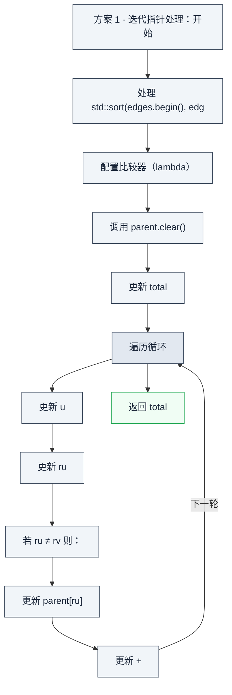

```cpp
// LeetCode 108013114. 贪心策略之BST&BBST_hashtable+dictionary+map — C++ 版（贪心策略之
// BST/BBST/哈希表：Kruskal 最小生成树（并查集 + 排序））
#include <algorithm>     // 引入头文件
#include <iostream>      // 引入头文件
#include <unordered_map> // 引入头文件
#include <vector>        // 引入头文件

static std::unordered_map<int, int> parent; // static std::unordered_map 小于 int, int 超过 parent;

static int find(int x) { // 定义函数/方法 find
    if (parent.find(x) == parent.end())
        parent[x] = x;                 // 若 parent 查找 x) 等于 parent.终点()) parent[x] 赋值为 x;
    while (parent[x] != x) {           // 循环，直到不满足「parent[x] 不等于 x」
        parent[x] = parent[parent[x]]; // 把 parent[parent[x]]; 写入 parent[x]
        x = parent[x];                 // 把 parent[x]; 写入 x
    }
    return x; // 返回 x
}

static int kruskal_mst(std::vector<std::vector<int>> edges) { // 定义函数/方法 kruskal_mst
    std::sort(edges.begin(), edges.end(),
              [](const std::vector<int> &a, const std::vector<int> &b) { return a[2] < b[2]; });
    parent.clear();                       // parent.clear();
    int total = 0;                        // 把 0 存入 总和
    for (const auto &e : edges) {         // 逐个取出 边集 的元素（e）
        int u = e[0], v = e[1], w = e[2]; // 把 e[0], 值 赋值为 e[1], 权重 赋值为 e[2] 存入 节点 u
        int ru = find(u), rv = find(v);   // 把 find(节点 u), rv 赋值为 find(值) 存入 ru
        if (ru != rv) {                   // 若 ru 不等于 rv
            parent[ru] = rv;              // 把 rv; 写入 parent[ru]
            total += w;                   // 总和累加 权重
        }
    }
    return total; // 返回 总和
}

int main() { // 程序入口：跑内嵌自测用例
    std::vector<std::pair<std::vector<std::vector<int>>, int>> cases = {
        {{{0, 1, 10}, {0, 2, 6}, {0, 3, 5}, {1, 3, 15}, {2, 3, 4}}, 19},
        {{{0, 1, 1}, {1, 2, 2}, {2, 3, 3}, {3, 4, 4}}, 10},
        {{{0, 1, 2}, {1, 2, 3}}, 5},
        {{}, 0},
    };
    for (size_t idx = 0; idx < cases.size(); ++idx) { // 让 idx 从 0 开始计数，idx 小于 cases.大小() 就继续
        int got = kruskal_mst(cases[idx].first); // 把 kruskal_mst(cases[idx].first) 存入 got
        if (got != cases[idx].second) {          // 若 got 不等于 cases[idx].second
            std::cout << "case " << idx << " failed: got " << got << " want " << cases[idx].second
                      << std::endl; // 打印输出
            return 1;               // 返回 1
        }
    }
    std::cout << "PASS" << std::endl; // 全部用例通过，输出 PASS
    return 0;                         // 返回 0
}
```

### R 实现（1 种方案）

R 的全部方案如下，每个方案都内嵌用例自测，可独立运行（老仓库 python/go 文件遵循「打印结果」约定）：

#### 方案 1：迭代指针处理

**思路与代码分析**：核心是「迭代指针处理」。R 版用向量化思维与 1 起始下标，注意 1:n 的降序陷阱。代码里依次做这些事：单循环线性扫描。**走读**：方案 1 · 迭代指针处理：开始 → 命中条件，直接返回 → 处理 ord ＜- order(edges[, 3]) → 当 (parent[[as.character(x)]] ≠ x) 时反复执行 → 循环 i：遍历 ord。

**运行架构**（真实控制流）：

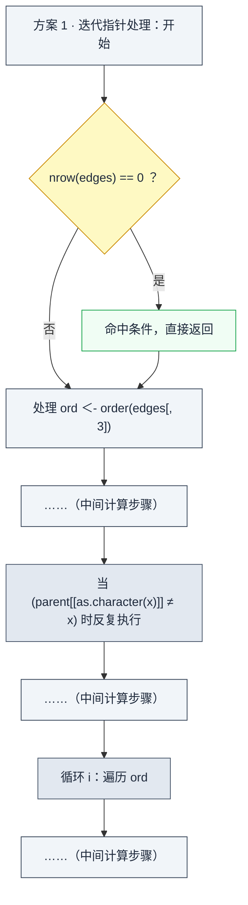

```r
# 贪心策略之BST&BBST_hashtable+dictionary+map — R 版（贪心策略之 BST/BBST/哈希表：Kruskal 最小生成树（并查集
# + 排序））
kruskal_mst <- function(edges) {
    # 定义函数 kruskal_mst（参数：边集） edges: 3 列矩阵 [u, v, w]
    if (nrow(edges) == 0)
        return(0L)  # 若 nrow(边集) 等于 0) return(0L
    ord <- order(edges[, 3])  # 把 order(边集[, 3]) 存入 ord
    parent <- new.env(parent = emptyenv())  # 把 new.env(parent 赋值为 emptyenv()) 存入 parent
    find <- function(x) {
        # 定义函数 find（参数：x）
        if (is.null(parent[[as.character(x)]]))
            parent[[as.character(x)]] <- x
        while (parent[[as.character(x)]] != x) {
            # 循环，直到不满足「parent[[as.character(x)]] 不等于 x」
            parent[[as.character(x)]] <- parent[[as.character(parent[[as.character(x)]])]]
            x <- parent[[as.character(x)]]  # 把 parent[[as.character(x)]] 存入 x
        }
        x
    }
    total <- 0L  # 把 0L 存入 总和
    for (i in ord) {
        # for (下标 i in ord) {
        u <- edges[i, 1]
        v <- edges[i, 2]
        w <- edges[i, 3]
        ru <- find(u)
        rv <- find(v)  # 把 find(节点 u); rv 小于 减 find(值) 存入 ru
        if (ru != rv) {
            # 若 ru 不等于 rv
            parent[[as.character(ru)]] <- rv  # 把 rv 存入 parent[[as.character(ru)]]
            total <- total + w  # 把 总和 加 权重 存入 总和
        }
    }
    total  # 总和
}
cases <- list(list(matrix(c(0, 1, 10, 0, 2, 6, 0, 3, 5, 1, 3, 15, 2, 3, 4), ncol = 3, byrow = TRUE), 19L), list(matrix(c(0,
    1, 1, 1, 2, 2, 2, 3, 3, 3, 4, 4), ncol = 3, byrow = TRUE), 10L), list(matrix(c(0, 1, 2, 1, 2, 3), ncol = 3,
    byrow = TRUE), 5L), list(matrix(integer(0), ncol = 3), 0L)  # 把 3), 0L) 写入 list(matrix(integer(0), ncol
)
for (idx in seq_along(cases)) {
    # for (idx in seq_along(cases)) {
    got <- kruskal_mst(cases[[idx]][[1]])  # 把 kruskal_mst(cases[[idx]][[1]]) 存入 got
    stopifnot(got == cases[[idx]][[2]])  # 断言校验
}
cat("PASS\n")  # 全部用例通过，输出 PASS
```

### Zig 实现（1 种方案）

Zig 的全部方案如下，每个方案都内嵌用例自测，可独立运行（老仓库 python/go 文件遵循「打印结果」约定）：

#### 方案 1：迭代指针处理

**思路与代码分析**：核心是「迭代指针处理」。Zig 版显式分配与清零，整型边界处理严格。代码里依次做这些事：双重循环遍历。**走读**：方案 1 · 迭代指针处理：开始 → 遍历集合元素 → 计算 buf → 遍历集合元素 → 当 (i + 1 ＜ n) : (i += 1) 时反复执行 → 当 (j + 1 ＜ n - i) : (j += 1) 时反复执行 → 遍历集合元素 → 返回 total。

**运行架构**（真实控制流）：

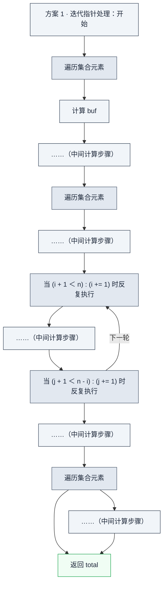

```zig
// LeetCode 108013114. 贪心策略之BST&BBST_hashtable+dictionary+map — Zig 版（贪心策略之 BST/BBST/哈希表：Kruskal 最小生成树（并查集 + 排序））
const std = @import("std"); // 把 @import(「std」) 存入 std

const Edge = struct { u: i32, v: i32, w: i32 }; // 把 struct { 节点 u: i32, 值: i32, 权重: i32 } 存入 Edge

var parent: [101]i32 = undefined; // 把 undefined; 写入 var parent: [101]i32

fn find(x: i32) i32 { // 定义函数/方法 find
    var xi = x; // 把 x 存入 xi
    if (parent[@intCast(xi)] == -1) parent[@intCast(xi)] = xi; // 若 parent[@intCast(xi)] 等于 减 1) parent[@intCast(xi)] 赋值为 xi;
    while (parent[@intCast(xi)] != xi) { // 循环，直到不满足「parent[@intCast(xi)] 不等于 xi」
        const px = parent[@intCast(xi)]; // 把 parent[@intCast(xi)] 存入 px
        parent[@intCast(xi)] = parent[@intCast(px)]; // 把 parent[@intCast(px)]; 写入 parent[@intCast(xi)]
        xi = parent[@intCast(xi)]; // 把 parent[@intCast(xi)]; 写入 xi
    }
    return xi; // 返回 xi
}

fn kruskalMst(edges: []const Edge) i32 { // 定义函数/方法 kruskalMst
    for (0..parent.len) |i| parent[i] = -1; // 逐个取出 0..parent.长度 的元素（下标 i）
    // 拷贝并按权重排序
    var buf: [64]Edge = undefined; // 把 undefined; 写入 var buf: [64]Edge
    const n = edges.len; // 把 边集.长度 存入 元素个数
    for (edges, 0..) |e, i| buf[i] = e; // 把 e; 写入 for (edges, 0..) |e, i| buf[i]
    var i: usize = 0; // 把 0; 写入 var i: usize
    while (i + 1 < n) : (i += 1) { // 循环，直到不满足「下标 i 加 1 小于 元素个数) : (下标 i 累加 1」
        var j: usize = 0; // 把 0; 写入 var j: usize
        while (j + 1 < n - i) : (j += 1) { // 循环，直到不满足「下标 j 加 1 小于 元素个数 减 下标 i) : (下标 j 累加 1」
            if (buf[j].w > buf[j + 1].w) { // 若 buf[下标 j].权重 超过 buf[下标 j 加 1].权重
                const t = buf[j]; // 把 buf[下标 j] 存入 另一字符串
                buf[j] = buf[j + 1]; // 把 buf[下标 j 加 1]; 写入 buf[j]
                buf[j + 1] = t; // 把 另一字符串; 写入 buf[j + 1]
            }
        }
    }
    var total: i32 = 0; // 把 0; 写入 var total: i32
    for (buf[0..n]) |e| { // for (buf[0..元素个数]) 按位或 e 按位或 {
        const ru = find(e.u); // 把 find(e.节点 u) 存入 ru
        const rv = find(e.v); // 把 find(e.值) 存入 rv
        if (ru != rv) { // 若 ru 不等于 rv
            parent[@intCast(ru)] = rv; // 把 rv; 写入 parent[@intCast(ru)]
            total += e.w; // 总和累加 e.权重
        }
    }
    return total; // 返回 总和
}

pub fn main() !void { // 程序入口：跑内嵌自测用例
    const e0 = [_]Edge{ .{ .u = 0, .v = 1, .w = 10 }, .{ .u = 0, .v = 2, .w = 6 }, .{ .u = 0, .v = 3, .w = 5 }, .{ .u = 1, .v = 3, .w = 15 }, .{ .u = 2, .v = 3, .w = 4 } };
    const e1 = [_]Edge{ .{ .u = 0, .v = 1, .w = 1 }, .{ .u = 1, .v = 2, .w = 2 }, .{ .u = 2, .v = 3, .w = 3 }, .{ .u = 3, .v = 4, .w = 4 } };
    const e2 = [_]Edge{ .{ .u = 0, .v = 1, .w = 2 }, .{ .u = 1, .v = 2, .w = 3 } };
    const empty = [_]Edge{}; // 把 [_]Edge{} 存入 empty
    const Case = struct { edges: []const Edge, want: i32 }; // 把 struct { 边集: []const Edge, want: i32 } 存入 Case
    const cases = [_]Case{ // 把 [_]Case{ 存入 cases
        .{ .edges = &e0, .want = 19 },
        .{ .edges = &e1, .want = 10 },
        .{ .edges = &e2, .want = 5 },
        .{ .edges = &empty, .want = 0 },
    };
    for (cases, 0..) |c, idx| { // for (cases, 0..) 按位或 字符, idx 按位或 {
        const got = kruskalMst(c.edges); // 把 kruskalMst(字符.边集) 存入 got
        if (got != c.want) { // 若 got 不等于 字符.want
            std.debug.print("case {d} failed: got {d} want {d}\n", .{ idx, got, c.want }); // 打印输出
            return error.TestFailed; // 返回 error.TestFailed
        }
    }
    std.debug.print("PASS\n", .{}); // 全部用例通过，输出 PASS
}
```

### Dart 实现（1 种方案）

Dart 的全部方案如下，每个方案都内嵌用例自测，可独立运行（老仓库 python/go 文件遵循「打印结果」约定）：

#### 方案 1：迭代指针处理

**思路与代码分析**：核心是「迭代指针处理」。Dart 版用可空类型标注与集合方法，注意空安全。代码里依次做这些事：先排序再处理；单循环线性扫描。**走读**：方案 1 · 迭代指针处理：开始 → 更新 sorted → 排序整理 → 调用 parent.clear() → 计算 total → 遍历循环 → 更新 ru → 更新 rv → 若 ru ≠ rv 则： → 更新 parent[ru] → 更新 + → 返回 total。

**运行架构**（真实控制流）：

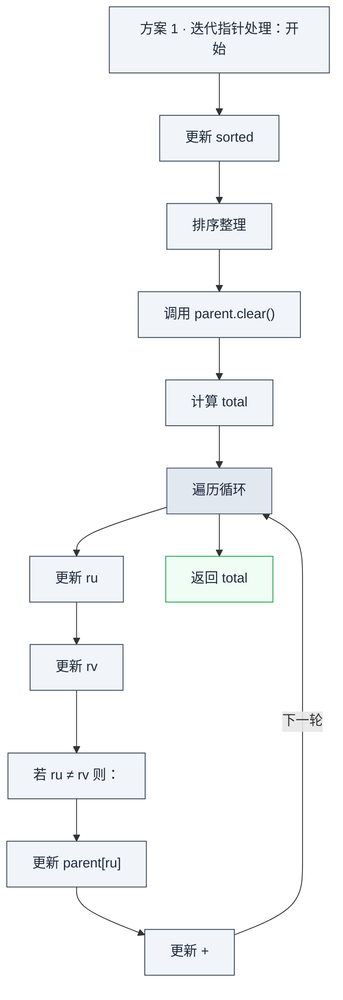

```dart
// LeetCode 108013114. 贪心策略之BST&BBST_hashtable+dictionary+map — Dart 版（贪心策略之 BST/BBST/哈希表：Kruskal 最小生成树（并查集 + 排序））
final parent = <int, int>{}; // 把 小于 int, int 超过 {} 存入 parent

int find(int x) {
  // 定义函数/方法 find
  parent.putIfAbsent(x, () => x);
  while (parent[x] != x) {
    // 循环，直到不满足「parent[x] 不等于 x」
    parent[x] = parent[parent[x]]!; // 把 parent[parent[x]]取反 ; 写入 parent[x]
    x = parent[x]!; // 把 parent[x]取反 存入 x
  }
  return x!; // 返回 x取反
}

int kruskalMst(List<List<int>> edges) {
  // 定义函数/方法 kruskalMst
  final sorted = List<List<int>>.from(edges)
    ..sort((a, b) => a[2].compareTo(b[2]));
  parent.clear(); // parent.clear();
  var total = 0; // 把 0 存入 总和
  for (final e in sorted) {
    // for (final e in sorted) {
    final ru = find(e[0]); // 把 find(e[0]) 存入 ru
    final rv = find(e[1]); // 把 find(e[1]) 存入 rv
    if (ru != rv) {
      // 若 ru 不等于 rv
      parent[ru] = rv; // 把 rv; 写入 parent[ru]
      total += e[2]; // 总和累加 e[2]
    }
  }
  return total; // 返回 总和
}

void main() {
  // 程序入口：跑内嵌自测用例
  final cases = <List<List<int>>, int>{
    // 把 小于 List 小于 List 小于 int 超过 超过 , int 超过 { 存入 cases
    [
      [0, 1, 10],
      [0, 2, 6],
      [0, 3, 5],
      [1, 3, 15],
      [2, 3, 4],
    ]: 19,
    [
      [0, 1, 1],
      [1, 2, 2],
      [2, 3, 3],
      [3, 4, 4],
    ]: 10,
    [
      [0, 1, 2],
      [1, 2, 3],
    ]: 5,
    <List<int>>[]: 0,
  };
  var idx = 0; // 把 0 存入 idx
  cases.forEach((edges, want) {
    // cases.forEach((边集, want) {
    final got = kruskalMst(edges); // 把 kruskalMst(边集) 存入 got
    if (got != want) throw StateError('case $idx failed: got $got want $want');
    idx++; // idx 加一
  }); // });
  print('PASS'); // 全部用例通过，输出 PASS
}
```

---

## 内容总结

- **贪心策略之bst&bbst hashtable+dictionary+map p**（算法笔记 · Medium）：共 1 个方案，主线思路「迭代指针处理」；时间 O(n)（单趟线性扫描）；动画演示归并分治过程，附录给出 11 种语言 × 全部方案的可运行实现。
- 来源博客：[https://blog.csdn.net/tyro_java/article/details/108013114](https://blog.csdn.net/tyro_java/article/details/108013114)
- 导航：[📋 总目录](../) ｜ [← 211 贪心策略之matrixsorti](../211_贪心策略之matrixsorting_pfc_coding_huffmantre/) ｜ [213 减治策略之heap binary →](../213_减治策略之heap_binarysearch_selectionsort_hea/)
