# 213 · 减治策略之heap binarysearch selectionsort hea（第附阶段 · 专题补充 · Medium）

> **难度**：⭐⭐ Medium ｜ **专题**：算法笔记
> **学习定位**：第附阶段 · 专题补充第 213 篇 ｜ **解法数**：3
> **内容总结**：**减治策略之heap binarysearch selectionsort hea**（算法笔记 · Medium）：共 3 个方案，主线思路「二分查找」；时间 O(log n)；动画演示归并分治过程，附录给出 11 种语言 × 全部方案的可运行实现。

---

## 题目描述

减治策略之heap binarysearch selectionsort hea。具体输入输出约定见函数签名与用例。

- 主函数签名：`function binarySearch(arr: number[], target: number): number`

**用例演示**（摘自主解法内嵌自测，输入到输出一目了然）：

```typescript
  const cases = [
    { a: [1, 3, 5, 7, 9], t: 5, want: 2 },
    { a: [1, 3, 5, 7, 9], t: 4, want: -1 },
    { a: [], t: 5, want: -1 },
    { a: [1, 3, 5, 7, 9], t: 1, want: 0 },
  ];
```

**数据范围与注意事项**：

- **易错点**：先看小例子手推一遍再对照代码，比直接读代码快得多。

## 题目分析

**场景是什么**：综合练习：把数据结构与策略组合起来解决一个完整问题。本题就是该场景的 Medium 级练习，主线做法是「二分查找」。

**主线怎么解**：把主解法从头到尾过一遍，它其实在依次做这几件事：二分收缩区间。

## 解题思路

**方案对比**（共 3 个方案，由浅入深）：

| 方案 | 时间复杂度 | 空间复杂度 |
|---|---|---|
| 方案 1 · 二分查找 | O(log n) | O(1) |
| 方案 2 · 单趟扫描 | O(n)（单趟线性扫描） | O(1) 到 O(n)（视辅助结构） |
| 方案 3 · 双重循环枚举 | O(n)（单趟线性扫描） | O(1) 到 O(n)（视辅助结构） |

**由浅入深的路径**：二分查找 → 单趟扫描 → 双重循环枚举；每往右一步，都在补上一步的短板。

**方案间的取舍**：方案 1（二分查找）；方案 2（单趟扫描）；方案 3（双重循环枚举）。数据规模小、可读性优先时选靠前的方案；规模大、性能优先时选靠后的方案。

**怎么读这一篇**：

- 🐣 **新手路线**：把「题目描述」的示例 1 在纸上手推一遍 → 读方案 1（最直观的写法）与它的代码走读 → 按「运行方式」本地跑通看 PASS → 回头对比方案 2 之后的写法差在哪
- 🦅 **大佬路线**：直接锁定最优方案 1（二分查找，O(log n)）→ 跳读该方案代码与走读 → 用「逐步拆解与面试追问」补齐复杂度推导与边界追问

### 动态算法图（归并分治，GIF 自动循环）


动画演示算法笔记专题里归并分治的典型过程；每个方案在「TypeScript 解题方案」一节还配了专属动画与专属流程图。

### 主解法流程图（真实控制流）

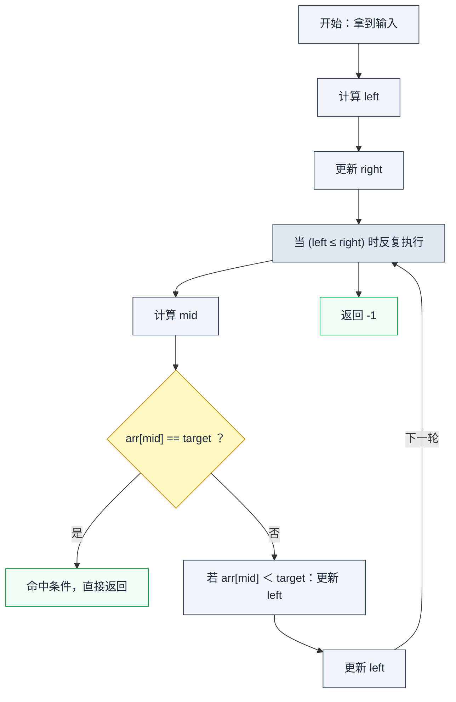

## TypeScript 解题方案（3 个方案逐个讲）

> **运行与提交**：每个方案都是自包含文件（内嵌用例自测，输出 PASS），整块复制到 `.ts` 文件后 `node 文件名` 即可运行。提交 LeetCode 时，把 `demo` 内的算法函数与辅助类型/函数整体取出、置于文件顶层即可。概念演示（非 LeetCode 编号题），在本地运行即可。

### 方案 1：二分查找

**分析与思路**：核心做法是「二分查找」。代码里依次做这些事：二分收缩区间。

**运行方式**：`node 本文件`，内嵌用例全部通过会输出 PASS。


**方案专属流程图**（真实控制流）：

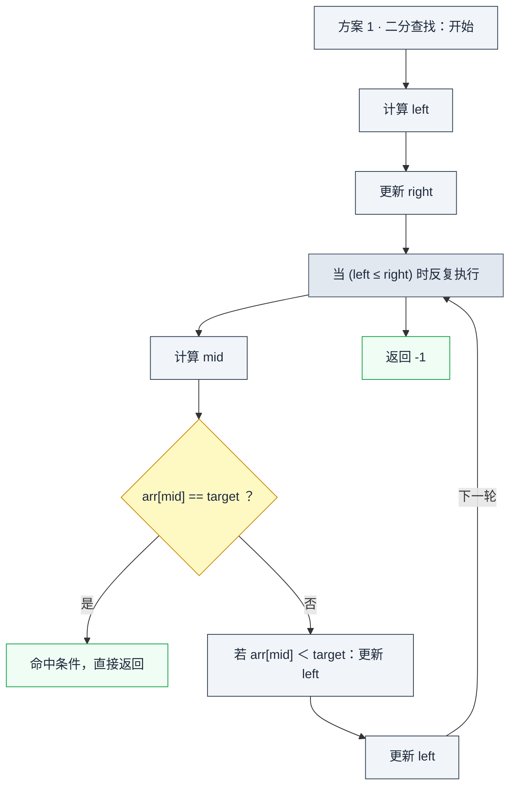

```typescript
export function demo(): void {
  // 程序入口：跑内嵌自测用例
  function binarySearch(arr: number[], target: number): number {
    // 定义函数/方法 binarySearch
    let left = 0,
      right = arr.length - 1; // 把 0, 右边界 赋值为 数组.长度 减 1 存入 左边界
    while (left <= right) {
      // 循环，直到不满足「左边界 不超过 右边界」
      const mid = Math.floor((left + right) / 2); // 把 向下取整((左边界 加 右边界) 除以 2) 存入 中点
      if (arr[mid] === target) return mid; // 若 数组[中点] 全等于 目标值，直接返回 中点
      if (arr[mid] < target)
        left = mid + 1; // 若 数组[中点] 小于 目标值) 左边界 赋值为 中点 加 1;
      else right = mid - 1; // 否则
    }
    return -1; // 返回 减 1
  }
  const cases = [
    { a: [1, 3, 5, 7, 9], t: 5, want: 2 },
    { a: [1, 3, 5, 7, 9], t: 4, want: -1 },
    { a: [], t: 5, want: -1 },
    { a: [1, 3, 5, 7, 9], t: 1, want: 0 },
  ];
  let fail = false; // 把 false 存入 fail
  for (const c of cases) {
    // for (const 字符 of cases) {
    const got = binarySearch(c.a, c.t); // 把 binarySearch(字符.数组, 字符.另一字符串) 存入 got
    if (got !== c.want) {
      fail = true;
      console.log('FAIL', c, 'got', got);
    }
  }
  if (fail) throw new Error('FAILED'); // 若 fail) throw new Error(「FAILED」);
  console.log('PASS'); // 全部用例通过，输出 PASS
}
demo(); // demo();
```

### 方案 2：单趟扫描

**分析与思路**：核心做法是「单趟扫描」。代码里依次做这些事：单循环线性扫描。

**运行方式**：`node 本文件`，内嵌用例全部通过会输出 PASS。


**方案专属流程图**（真实控制流）：

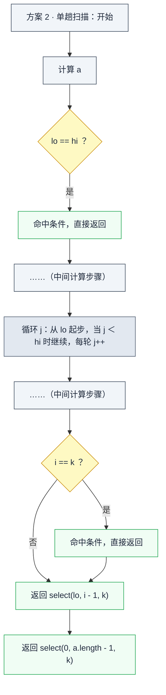

```typescript
export function demo(): void {
  // 程序入口：跑内嵌自测用例
  function quickSelect(arr: number[], k: number): number {
    // 定义函数/方法 quickSelect
    const a = arr.slice(); // 把 数组 截取 ) 存入 数组
    function select(lo: number, hi: number, k: number): number {
      // 定义函数/方法 select
      if (lo === hi) return a[lo]; // 若 左边界 全等于 右边界，直接返回 数组[左边界]
      const pivot = a[hi]; // 把 数组[右边界] 存入 pivot
      let i = lo; // 把 左边界 存入 下标 i
      for (let j = lo; j < hi; j++) {
        // 让 下标 j 从 左边界 开始计数，下标 j 小于 右边界 就继续
        if (a[j] <= pivot) {
          // 若 数组[下标 j] 不超过 pivot
          const tmp = a[i];
          a[i] = a[j];
          a[j] = tmp; // 把 数组[下标 i]; 数组[下标 i] 赋值为 数组[下标 j]; 数组[下标 j] 赋值为 临时变量 存入 临时变量
          i++; // 下标 i 加一
        }
      }
      const tmp = a[i];
      a[i] = a[hi];
      a[hi] = tmp; // 把 数组[下标 i]; 数组[下标 i] 赋值为 数组[右边界]; 数组[右边界] 赋值为 临时变量 存入 临时变量
      if (i === k)
        return a[i]; // 若 下标 i 全等于 下标 k，直接返回 数组[下标 i]
      else if (i > k)
        return select(lo, i - 1, k); // 否则，若 下标 i 超过 下标 k) return select(左边界, 下标 i 减 1, 下标 k);
      else return select(i + 1, hi, k); // 否则
    }
    return select(0, a.length - 1, k); // 返回 select(0, 数组.长度 减 1, 下标 k)
  }
  const cases = [
    { a: [3, 1, 4, 1, 5, 9, 2, 6], k: 2, want: 2 },
    { a: [3, 1, 4, 1, 5, 9, 2, 6], k: 3, want: 3 },
    { a: [3, 1, 4, 1, 5, 9, 2, 6], k: 0, want: 1 },
    { a: [3, 1, 4, 1, 5, 9, 2, 6], k: 7, want: 9 },
  ];
  let fail = false; // 把 false 存入 fail
  for (const c of cases) {
    // for (const 字符 of cases) {
    const got = quickSelect(c.a, c.k); // 把 quickSelect(字符.数组, 字符.下标 k) 存入 got
    if (got !== c.want) {
      fail = true;
      console.log('FAIL', c, 'got', got);
    }
  }
  if (fail) throw new Error('FAILED'); // 若 fail) throw new Error(「FAILED」);
  console.log('PASS'); // 全部用例通过，输出 PASS
}
demo(); // demo();
```

### 方案 3：双重循环枚举

**分析与思路**：核心做法是「双重循环枚举」。代码里依次做这些事：双重循环遍历。

**运行方式**：`node 本文件`，内嵌用例全部通过会输出 PASS。

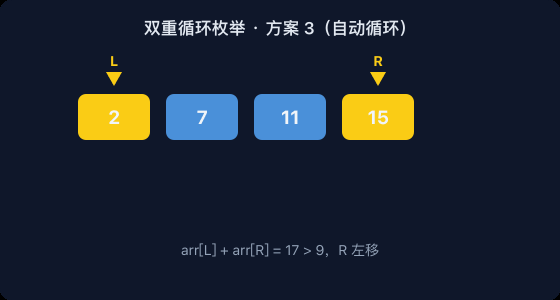

**方案专属流程图**（真实控制流）：

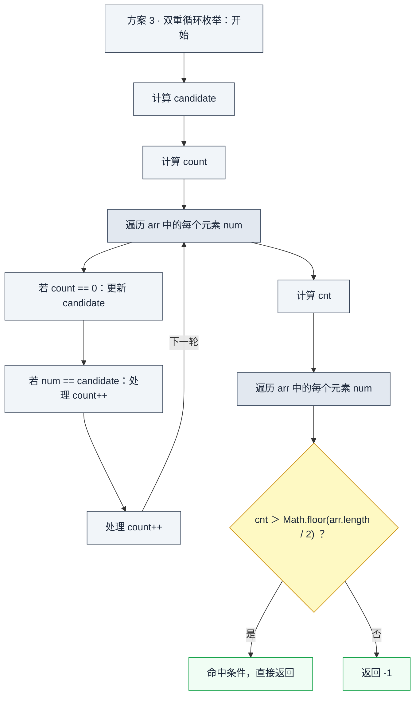

```typescript
export function demo(): void {
  // 程序入口：跑内嵌自测用例
  function majorityElement(arr: number[]): number {
    // 定义函数/方法 majorityElement
    let candidate: number | null = null; // 把 null; 写入 let candidate: number | null
    let count = 0; // 把 0 存入 计数
    for (const num of arr) {
      // for (const num of 数组) {
      if (count === 0) candidate = num; // 若 计数 全等于 0) candidate 赋值为 num;
      if (num === candidate)
        count++; // 若 num 全等于 candidate) 计数 加一 ;
      else count--; // 否则
    }
    let cnt = 0; // 把 0 存入 计数
    for (const num of arr) if (num === candidate) cnt++; // 把 等于 candidate) 计数 加一 ; 写入 for (const num of arr) if (num
    if (cnt > Math.floor(arr.length / 2)) return candidate as number; // 若 计数 超过 向下取整(数组.长度 除以 2)，直接返回 candidate as number
    return -1; // 返回 减 1
  }
  const cases = [
    { a: [2, 2, 1, 1, 1, 1, 1], want: 1 },
    { a: [1, 2, 3], want: -1 },
    { a: [3, 3, 4], want: 3 },
  ];
  let fail = false; // 把 false 存入 fail
  for (const c of cases) {
    // for (const 字符 of cases) {
    const got = majorityElement(c.a); // 把 majorityElement(字符.数组) 存入 got
    if (got !== c.want) {
      fail = true;
      console.log('FAIL', c, 'got', got);
    }
  }
  if (fail) throw new Error('FAILED'); // 若 fail) throw new Error(「FAILED」);
  console.log('PASS'); // 全部用例通过，输出 PASS
}
demo(); // demo();
```

## 逐步拆解与面试追问

**复杂度**：时间 O(log n)，空间 O(1)

**为什么是这个量级**：每轮把候选区间砍半，n 个元素最多砍 log2(n) 轮

**面试官可能会追问**：

- 这个策略能推广到什么场景？
- 与暴力做法差在哪一步？
- 有没有更简单的等价写法？

## 关键 API 速查（TS 主解法实际用到，附官方链接）

| API | 作用 | 使用要点 | 官方文档 |
|---|---|---|---|
| `Math.floor()` | 向下取整 | 负数向负无穷（-1.5 → -2）；大数用位运算前注意 2^31 界 | [官方文档](https://developer.mozilla.org/zh-CN/docs/Web/JavaScript/Reference/Global_Objects/Math/floor) |

### 各语言官方文档导航

- **TypeScript / JS**：[MDN 中文参考](https://developer.mozilla.org/zh-CN/)
- **Python**：[Python 官方文档](https://docs.python.org/zh-cn/3/)
- **Go**：[Go 标准库](https://pkg.go.dev/std)
- **Java**：[JDK 17 API](https://docs.oracle.com/en/java/javase/17/docs/api/)
- **Rust**：[Rust 标准库](https://doc.rust-lang.org/std/)
- **Lua**：[Lua 5.4 手册](https://www.lua.org/manual/5.4/)
- **C**：[Cppreference C](https://zh.cppreference.com/w/c)
- **C++**：[Cppreference C++](https://zh.cppreference.com/w/cpp)
- **R**：[R 官方手册](https://stat.ethz.ch/R-manual/)
- **Zig**：[Zig 语言文档](https://ziglang.org/documentation/master/)
- **Dart**：[Dart API](https://api.dart.dev/)

## 附录：其他 10 种语言全部实现（每种语言列举其全部方案）

> TypeScript 的全部方案见「TypeScript 解题方案」一节；下面是其余 10 种语言的对应实现，每种语言的每个方案都带思路分析、代码走读与专属运行架构图。
> 每个方案都内嵌用例自测，可独立运行（老仓库 python/go 文件遵循「打印结果」约定）。
> 完整解法文件见 `dsa/<语言>/notes/lc_108673483_减治策略之heap_binarysearch_selectionsort_hea/`。

### Python 实现（3 种方案）

Python 的全部方案如下，每个方案都内嵌用例自测，可独立运行（老仓库 python/go 文件遵循「打印结果」约定）：

#### 方案 1：二分查找

**思路与代码分析**：核心是「二分查找」。Python 版用切片与字典推导式简化操作，突出可读性。代码里依次做这些事：二分收缩区间。**走读**：方案 1 · 二分查找：开始 → 更新 right → 当 left ≤ right: 时反复执行 → 更新 mid → 命中条件，直接返回 → 若 arr[mid] ＜ target：更新 left → 更新 left → 更新 right → 返回 -1。

**运行架构**（真实控制流）：

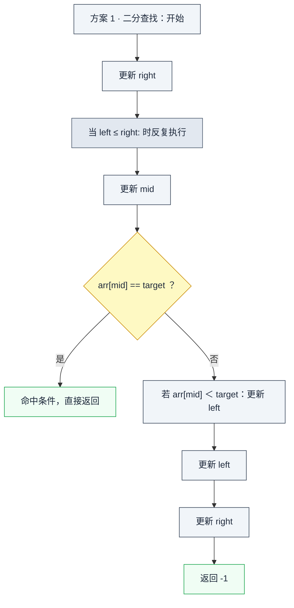

```python
import sys  # 提高递归深度上限（深输入防 RecursionError）

sys.setrecursionlimit(200000)  # 树/链表类题目节点数可达 1e4 量级

def binarySearch(arr, target):  # 定义函数 binarySearch（参数：数组, 目标值）
    """二分查找（减治策略）：在有序数组 arr 中查找 target，返回下标，未找到返回 -1。"""
    left, right = 0, len(arr) - 1  # 把 0, 长度(数组) 减 1 写入 left, right
    while left <= right:  # 循环，直到不满足「左边界 不超过 右边界」
        mid = (left + right) // 2  # 把 (左边界 加 右边界) 除以 除以 2 存入 中点
        if arr[mid] == target:  # 若 数组[中点] 等于 目标值
            return mid  # 返回 中点
        if arr[mid] < target:  # 若 数组[中点] 小于 目标值
            left = mid + 1  # 把 中点 加 1 存入 左边界
        else:  # 否则
            right = mid - 1  # 把 中点 减 1 存入 右边界
    return -1  # 返回 减 1

if __name__ == "__main__":  # 若 __name__ 等于 '__main__'
    print(binarySearch([1, 3, 5, 7, 9], 5))  # 打印输出
    print(binarySearch([1, 3, 5, 7, 9], 4))  # 打印输出
```

#### 方案 2：单趟扫描

**思路与代码分析**：核心是「单趟扫描」。Python 版用切片与字典推导式简化操作，突出可读性。**走读**：方案 2 · 单趟扫描：开始 → 更新 a → 命中条件，直接返回 → 循环 j：从 lo 到 hi 前 → 命中条件，直接返回 → 返回 select(lo, i - 1, k) → 返回 select(i + 1, hi, k) → 返回 select(0, len(a) - 1, k)。

**运行架构**（真实控制流）：

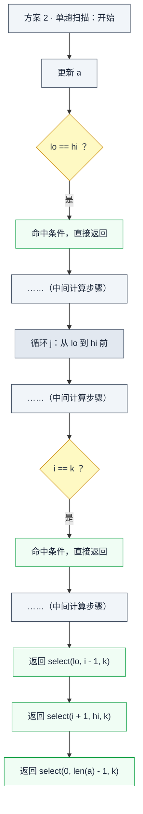

```python
import sys  # 提高递归深度上限（深输入防 RecursionError）

sys.setrecursionlimit(200000)  # 树/链表类题目节点数可达 1e4 量级

def quick_select(arr, k):  # 定义函数 quick_select（参数：数组, 下标 k）
    # 快速选择：返回 arr 中第 k 小元素（k 为 0-based 索引），平均 O(n)
    a = arr[:]  # 把 复制 数组 存入 数组

    def select(lo, hi, k):  # 定义函数 select（参数：左边界, 右边界, 下标 k）
        if lo == hi:  # 若 左边界 等于 右边界
            return a[lo]  # 返回 数组[左边界]
        pivot = a[hi]  # 把 数组[右边界] 存入 pivot
        i = lo  # 把 左边界 存入 下标 i
        for j in range(lo, hi):  # 让 下标 j 从 左边界 到 右边界 遍历
            if a[j] <= pivot:  # 若 数组[下标 j] 不超过 pivot
                a[i], a[j] = a[j], a[i]  # 把 数组[下标 j], 数组[下标 i] 写入 a[i], a[j]
                i += 1  # 下标 i累加 1
        a[i], a[hi] = a[hi], a[i]  # 把 数组[右边界], 数组[下标 i] 写入 a[i], a[hi]
        if i == k:  # 若 下标 i 等于 下标 k
            return a[i]  # 返回 数组[下标 i]
        elif i > k:  # 否则，若 下标 i 超过 下标 k
            return select(lo, i - 1, k)  # 返回 select(左边界, 下标 i 减 1, 下标 k)
        else:  # 否则
            return select(i + 1, hi, k)  # 返回 select(下标 i 加 1, 右边界, 下标 k)

    return select(0, len(a) - 1, k)  # 返回 select(0, 长度(数组) 减 1, 下标 k)

if __name__ == "__main__":  # 若 __name__ 等于 '__main__'
    arr = [3, 1, 4, 1, 5, 9, 2, 6]  # 把 [3, 1, 4, 1, 5, 9, 2, 6] 存入 数组
    print("第3小元素:", quick_select(arr, 2))  # 2
    print("中位数(第4小):", quick_select(arr, 3))  # 3
    s = sorted(arr)  # 把 sorted(数组) 存入 字符串
    print("校验:", s)  # 打印输出
```

#### 方案 3：双重循环枚举

**思路与代码分析**：核心是「双重循环枚举」。Python 版用切片与字典推导式简化操作，突出可读性。**走读**：方案 3 · 双重循环枚举：开始 → 更新 candidate → 更新 count → 遍历 arr: 中的每个元素 num → 若 count == 0：更新 candidate → 更新 candidate → 更新 + → 命中条件，直接返回 → 返回 -1。

**运行架构**（真实控制流）：

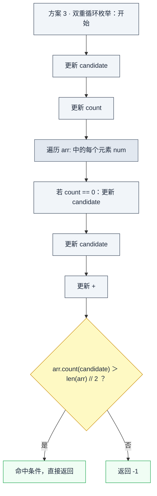

```python
import sys  # 提高递归深度上限（深输入防 RecursionError）

sys.setrecursionlimit(200000)  # 树/链表类题目节点数可达 1e4 量级

def majorityElement(arr):  # 定义函数 majorityElement（参数：数组）
    """求多数元素（出现次数 > n/2），使用 Boyer-Moore 投票法。无多数元素时返回 -1。"""
    candidate = None  # 把 None 存入 candidate
    count = 0  # 把 0 存入 计数
    for num in arr:  # 逐个取出 数组 的元素（num）
        if count == 0:  # 若 计数 等于 0
            candidate = num  # 把 num 存入 candidate
        count += 1 if num == candidate else -1  # 计数累加 1 if num 等于 candidate else 减 1
    # 验证候选是否真的为多数元素
    if arr.count(candidate) > len(arr) // 2:  # 若 数组.计数(candidate) 超过 长度(数组) 除以 除以 2
        return candidate  # 返回 candidate
    return -1  # 返回 减 1

if __name__ == "__main__":  # 若 __name__ 等于 '__main__'
    print(majorityElement([2, 2, 1, 1, 1, 1, 1]))  # 打印输出
    print(majorityElement([1, 2, 3]))  # 打印输出
```

### Go 实现（3 种方案）

Go 的全部方案如下，每个方案都内嵌用例自测，可独立运行（老仓库 python/go 文件遵循「打印结果」约定）：

#### 方案 1：二分查找

**思路与代码分析**：核心是「二分查找」。Go 版用切片与多返回值惯用法，显式处理索引边界。**走读**：方案 1 · 二分查找：开始 → 更新 : → 遍历循环 → 更新 : → 处理 if arr[mid] == target → 返回 mid → 处理 if arr[mid] ＜ target → 更新 left → 更新 right → 返回 -1。

**运行架构**（真实控制流）：

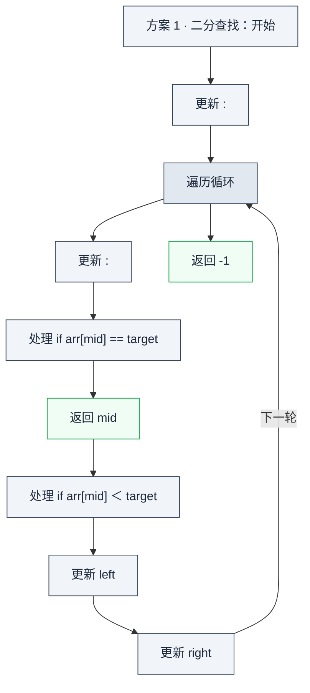

```go
package main // 引入依赖

import (
	"fmt" // 「fmt」
	"os"  // 「os」
)

// binarySearch 二分查找（减治策略）
func binarySearch(arr []int, target int) int { // 定义函数/方法 binarySearch
	left, right := 0, len(arr)-1 // 把 0, 长度(数组) 减 1 写入 left, right :
	for left <= right {          // 把 右边界 { 写入 for left <
		mid := (left + right) / 2 // 把 (左边界 加 右边界) 除以 2 写入 mid :
		if arr[mid] == target {   // 若 数组[中点] 等于 目标值
			return mid // 返回 中点
		}
		if arr[mid] < target { // 若 数组[中点] 小于 目标值
			left = mid + 1 // 把 中点 加 1 写入 左边界
		} else { // 否则
			right = mid - 1 // 把 中点 减 1 写入 右边界
		}
	}
	return -1 // 返回 减 1
}

func main() { // 程序入口：跑内嵌自测用例
	if binarySearch([]int{1, 3, 5, 7, 9}, 5) != 2 { // 若 binarySearch([]int{1, 3, 5, 7, 9}, 5) 不等于 2
		fmt.Println("FAIL binarySearch 5") // 打印输出
		os.Exit(1)                         // os.Exit(1)
	}
	if binarySearch([]int{1, 3, 5, 7, 9}, 4) != -1 { // 若 binarySearch([]int{1, 3, 5, 7, 9}, 4) 不等于 减 1
		fmt.Println("FAIL binarySearch 4") // 打印输出
		os.Exit(1)                         // os.Exit(1)
	}
	fmt.Println("PASS") // 全部用例通过，输出 PASS
}
```

#### 方案 2：单趟扫描

**思路与代码分析**：核心是「单趟扫描」。Go 版用切片与多返回值惯用法，显式处理索引边界。**走读**：方案 2 · 单趟扫描：开始 → 更新 : → 返回 a[lo] → 遍历循环 → 返回 a[i] → 返回 selectK(lo, i-1, k) → 返回 selectK(i+1, hi, k) → 返回 selectK(0, len(a)-1, k)。

**运行架构**（真实控制流）：

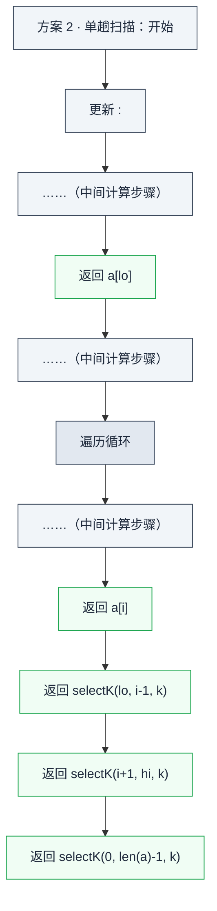

```go
package main // 引入依赖

import (
	"fmt"     // 「fmt」
	"os"      // 「os」
	"reflect" // 「reflect」
	"sort"    // 「sort」
)

// quickSelect 快速选择：返回 arr 中第 k 小元素（k 为 0-based 索引），平均 O(n)
func quickSelect(arr []int, k int) int { // 定义函数/方法 quickSelect
	a := make([]int, len(arr))          // 把 make([]int, 长度(数组)) 写入 a :
	copy(a, arr)                        // copy(数组, 数组)
	var selectK func(lo, hi, k int) int // var selectK func(左边界, 右边界, 下标 k int) int
	selectK = func(lo, hi, k int) int { // 把 func(左边界, 右边界, 下标 k int) int { 写入 selectK
		if lo == hi { // 若 左边界 等于 右边界
			return a[lo] // 返回 数组[左边界]
		}
		pivot := a[hi]             // 把 数组[右边界] 写入 pivot :
		i := lo                    // 把 左边界 写入 i :
		for j := lo; j < hi; j++ { // 把 左边界; 下标 j 小于 右边界; 下标 j 加一 { 写入 for j :
			if a[j] <= pivot { // 若 数组[下标 j] 不超过 pivot
				a[i], a[j] = a[j], a[i] // 把 数组[下标 j], 数组[下标 i] 写入 a[i], a[j]
				i++                     // 下标 i 加一
			}
		}
		a[i], a[hi] = a[hi], a[i] // 把 数组[右边界], 数组[下标 i] 写入 a[i], a[hi]
		if i == k {               // 若 下标 i 等于 下标 k
			return a[i] // 返回 数组[下标 i]
		} else if i > k { // 否则，若 下标 i 超过 下标 k
			return selectK(lo, i-1, k) // 定义函数/方法 selectK
		}
		return selectK(i+1, hi, k) // 定义函数/方法 selectK
	}
	return selectK(0, len(a)-1, k) // 定义函数/方法 selectK
}

func main() { // 程序入口：跑内嵌自测用例
	arr := []int{3, 1, 4, 1, 5, 9, 2, 6} // 把 []int{3, 1, 4, 1, 5, 9, 2, 6} 写入 arr :
	if quickSelect(arr, 2) != 2 {        // 若 quickSelect(数组, 2) 不等于 2
		fmt.Println("FAIL quickSelect 2nd") // 打印输出
		os.Exit(1)                          // os.Exit(1)
	}
	if quickSelect(arr, 3) != 3 { // 若 quickSelect(数组, 3) 不等于 3
		fmt.Println("FAIL quickSelect 3rd") // 打印输出
		os.Exit(1)                          // os.Exit(1)
	}
	s := make([]int, len(arr))                                // 把 make([]int, 长度(数组)) 写入 s :
	copy(s, arr)                                              // copy(字符串, 数组)
	sort.Ints(s)                                              // sort.Ints(字符串)
	if !reflect.DeepEqual(s, []int{1, 1, 2, 3, 4, 5, 6, 9}) { // 若 取反 reflect.DeepEqual(字符串, []int{1, 1, 2, 3, 4, 5, 6, 9}
		fmt.Printf("FAIL sorted=%v\n", s) // 打印输出
		os.Exit(1)                        // os.Exit(1)
	}
	fmt.Println("PASS") // 全部用例通过，输出 PASS
}
```

#### 方案 3：双重循环枚举

**思路与代码分析**：核心是「双重循环枚举」。Go 版用切片与多返回值惯用法，显式处理索引边界。**走读**：方案 3 · 双重循环枚举：开始 → 更新 : → 更新 : → 遍历 arr 的下标与元素 num → 处理 if count == 0 → 更新 candidate → 处理 if num == candidate → 处理 count++ → 处理 count-- → 更新 : → 遍历 arr 的下标与元素 num → 处理 if num == candidate → 处理 cnt++ → 处理 if cnt ＞ len(arr)/2 → 返回 candidate → 返回 -1。

**运行架构**（真实控制流）：

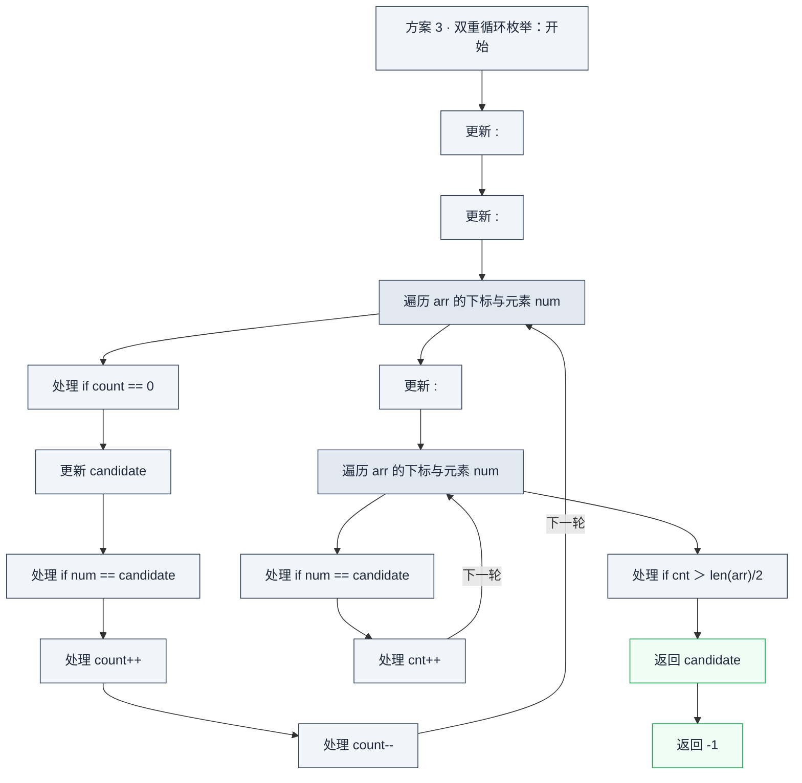

```go
package main // 引入依赖

import (
	"fmt" // 「fmt」
	"os"  // 「os」
)

// majorityElement 求多数元素（出现次数 > n/2），使用 Boyer-Moore 投票法。无多数元素时返回 -1。
func majorityElement(arr []int) int { // 定义函数/方法 majorityElement
	candidate := 0            // 把 0 写入 candidate :
	count := 0                // 把 0 写入 count :
	for _, num := range arr { // 同时取 _ 与 num 遍历
		if count == 0 { // 若 计数 等于 0
			candidate = num // 把 num 写入 candidate
		}
		if num == candidate { // 若 num 等于 candidate
			count++ // 计数 加一
		} else { // 否则
			count-- // 计数 减一
		}
	}
	// 验证候选是否真的为多数元素
	cnt := 0                  // 把 0 写入 cnt :
	for _, num := range arr { // 同时取 _ 与 num 遍历
		if num == candidate { // 若 num 等于 candidate
			cnt++ // 计数 加一
		}
	}
	if cnt > len(arr)/2 { // 若 计数 超过 长度(数组) 除以 2
		return candidate // 返回 candidate
	}
	return -1 // 返回 减 1
}

func main() { // 程序入口：跑内嵌自测用例
	if majorityElement([]int{2, 2, 1, 1, 1, 1, 1}) != 1 { // 若 majorityElement([]int{2, 2, 1, 1, 1, 1, 1}) 不等于 1
		fmt.Println("FAIL majorityElement 1") // 打印输出
		os.Exit(1)                            // os.Exit(1)
	}
	if majorityElement([]int{1, 2, 3}) != -1 { // 若 majorityElement([]int{1, 2, 3}) 不等于 减 1
		fmt.Println("FAIL majorityElement -1") // 打印输出
		os.Exit(1)                             // os.Exit(1)
	}
	fmt.Println("PASS") // 全部用例通过，输出 PASS
}
```

### Java 实现（3 种方案）

Java 的全部方案如下，每个方案都内嵌用例自测，可独立运行（老仓库 python/go 文件遵循「打印结果」约定）：

#### 方案 1：二分查找

**思路与代码分析**：核心是「二分查找」。Java 版用类与静态方法组织，集合操作显式明了。代码里依次做这些事：二分收缩区间。**走读**：方案 1 · 二分查找：开始 → 更新 left → 当 (left ≤ right) 时反复执行 → 更新 mid → 命中条件，直接返回 → 若 arr[mid] ＜ target：更新 left → 返回 -1。

**运行架构**（真实控制流）：

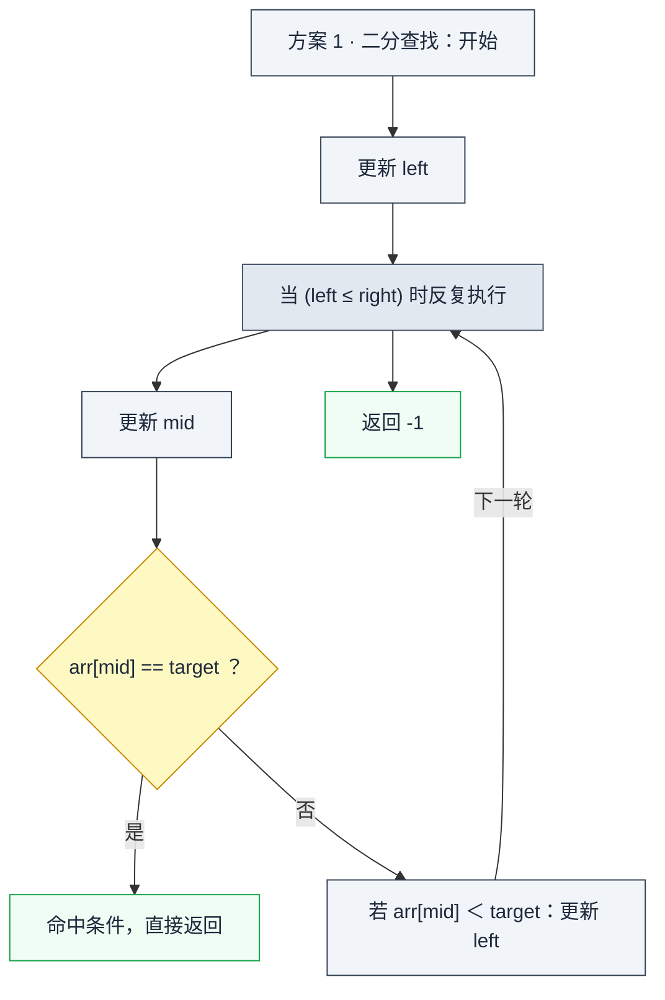

```java
package com.webfault.dsa; // 引入依赖

class notes108_bs { // 定义类型
  int binarySearch(int[] arr, int target) { // 定义函数/方法 binarySearch
    int left = 0, right = arr.length - 1; // 把 0, 右边界 赋值为 数组.长度 减 1 存入 左边界
    while (left <= right) { // 循环，直到不满足「左边界 不超过 右边界」
      int mid = left + (right - left) / 2; // 把 (左边界 加 右边界) 除以 2 存入 中点
      if (arr[mid] == target) return mid; // 若 数组[中点] 等于 目标值，直接返回 中点
      if (arr[mid] < target) left = mid + 1; // 若 数组[中点] 小于 目标值) 左边界 赋值为 中点 加 1;
      else right = mid - 1; // 否则
    }
    return -1; // 返回 减 1
  }

  public static void main(String[] args) { // public static void main(String[] args) {
    notes108_bs s = new notes108_bs(); // 把 new notes108_bs(); 写入 notes108_bs s
    boolean ok = true; // 把 true; 写入 boolean ok
    if (s.binarySearch(new int[] {1, 3, 5, 7, 9}, 5) != 2) {
      ok = false;
      System.out.println("FAIL1");
    }
    if (s.binarySearch(new int[] {1, 3, 5, 7, 9}, 4) != -1) {
      ok = false;
      System.out.println("FAIL2");
    }
    if (s.binarySearch(new int[] {}, 5) != -1) {
      ok = false;
      System.out.println("FAIL3");
    }
    if (s.binarySearch(new int[] {1, 3, 5, 7, 9}, 1) != 0) {
      ok = false;
      System.out.println("FAIL4");
    }
    if (!ok) throw new RuntimeException("FAILED"); // 若 取反 ok) throw new RuntimeException(「FAILED」);
    System.out.println("PASS"); // 全部用例通过，输出 PASS
  }
}
```

#### 方案 2：单趟扫描

**思路与代码分析**：核心是「单趟扫描」。Java 版用类与静态方法组织，集合操作显式明了。**走读**：方案 2 · 单趟扫描：开始 → 更新 a → 返回 select(a, 0, a.length - 1, k)。

**运行架构**（真实控制流）：

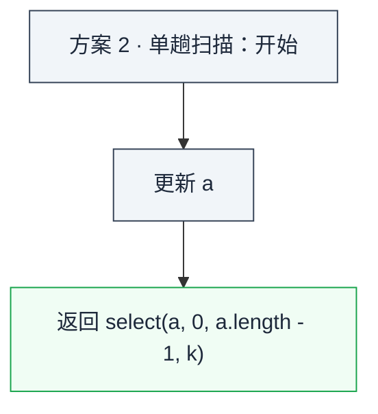

```java
package com.webfault.dsa; // 引入依赖

class notes108_qs { // 定义类型
  int quickSelect(int[] arr, int k) { // 定义函数/方法 quickSelect
    int[] a = arr.clone(); // 把 数组.clone(); 写入 int[] a
    return select(a, 0, a.length - 1, k); // 返回 select(数组, 0, 数组.长度 减 1, 下标 k)
  }

  int select(int[] a, int lo, int hi, int k) { // 定义函数/方法 select
    if (lo == hi) return a[lo]; // 若 左边界 等于 右边界，直接返回 数组[左边界]
    int pivot = a[hi]; // 把 数组[右边界] 存入 pivot
    int i = lo; // 把 左边界 存入 下标 i
    for (int j = lo; j < hi; j++) { // 让 下标 j 从 左边界 开始计数，下标 j 小于 右边界 就继续
      if (a[j] <= pivot) { // 若 数组[下标 j] 不超过 pivot
        int tmp = a[i];
        a[i] = a[j];
        a[j] = tmp; // 把 数组[下标 i]; 数组[下标 i] 赋值为 数组[下标 j]; 数组[下标 j] 赋值为 临时变量 存入 临时变量
        i++; // 下标 i 加一
      }
    }
    int tmp = a[i];
    a[i] = a[hi];
    a[hi] = tmp; // 把 数组[下标 i]; 数组[下标 i] 赋值为 数组[右边界]; 数组[右边界] 赋值为 临时变量 存入 临时变量
    if (i == k) return a[i]; // 若 下标 i 等于 下标 k，直接返回 数组[下标 i]
    else if (i > k)
      return select(a, lo, i - 1, k); // 否则，若 下标 i 超过 下标 k) return select(数组, 左边界, 下标 i 减 1, 下标 k);
    else return select(a, i + 1, hi, k); // 否则
  }

  public static void main(String[] args) { // public static void main(String[] args) {
    notes108_qs s = new notes108_qs(); // 把 new notes108_qs(); 写入 notes108_qs s
    boolean ok = true; // 把 true; 写入 boolean ok
    if (s.quickSelect(new int[] {3, 1, 4, 1, 5, 9, 2, 6}, 2) != 2) {
      ok = false;
      System.out.println("FAIL1");
    }
    if (s.quickSelect(new int[] {3, 1, 4, 1, 5, 9, 2, 6}, 3) != 3) {
      ok = false;
      System.out.println("FAIL2");
    }
    if (s.quickSelect(new int[] {3, 1, 4, 1, 5, 9, 2, 6}, 0) != 1) {
      ok = false;
      System.out.println("FAIL3");
    }
    if (s.quickSelect(new int[] {3, 1, 4, 1, 5, 9, 2, 6}, 7) != 9) {
      ok = false;
      System.out.println("FAIL4");
    }
    if (!ok) throw new RuntimeException("FAILED"); // 若 取反 ok) throw new RuntimeException(「FAILED」);
    System.out.println("PASS"); // 全部用例通过，输出 PASS
  }
}
```

#### 方案 3：双重循环枚举

**思路与代码分析**：核心是「双重循环枚举」。Java 版用类与静态方法组织，集合操作显式明了。代码里依次做这些事：双重循环遍历。**走读**：方案 3 · 双重循环枚举：开始 → 更新 candidate → 更新 count → 遍历循环 → 若 count == 0：更新 candidate → 若 num == candidate：处理 count++ → 更新 cnt → 遍历循环 → 命中条件，直接返回 → 返回 -1。

**运行架构**（真实控制流）：

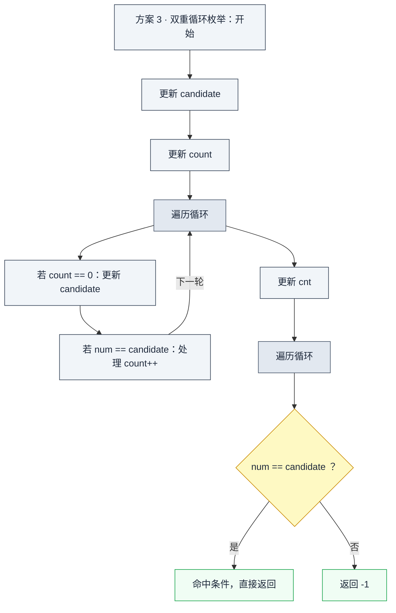

```java
package com.webfault.dsa; // 引入依赖

class notes108_me { // 定义类型
  int majorityElement(int[] arr) { // 定义函数/方法 majorityElement
    Integer candidate = null; // 把 null 存入 candidate
    int count = 0; // 把 0 存入 计数
    for (int num : arr) { // for (int num : 数组) {
      if (count == 0) candidate = num; // 若 计数 等于 0) candidate 赋值为 num;
      if (num == candidate) count++; // 若 num 等于 candidate) 计数 加一 ;
      else count--; // 否则
    }
    int cnt = 0; // 把 0 存入 计数
    for (int num : arr)
      if (num == candidate) cnt++; // 把 赋值为 candidate) 计数 加一 ; 写入 for (int num : arr) if (num
    if (cnt > arr.length / 2) return candidate; // 若 计数 超过 数组.长度 除以 2，直接返回 candidate
    return -1; // 返回 减 1
  }

  public static void main(String[] args) { // public static void main(String[] args) {
    notes108_me s = new notes108_me(); // 把 new notes108_me(); 写入 notes108_me s
    boolean ok = true; // 把 true; 写入 boolean ok
    if (s.majorityElement(new int[] {2, 2, 1, 1, 1, 1, 1}) != 1) {
      ok = false;
      System.out.println("FAIL1");
    }
    if (s.majorityElement(new int[] {1, 2, 3}) != -1) {
      ok = false;
      System.out.println("FAIL2");
    }
    if (s.majorityElement(new int[] {3, 3, 4}) != 3) {
      ok = false;
      System.out.println("FAIL3");
    }
    if (!ok) throw new RuntimeException("FAILED"); // 若 取反 ok) throw new RuntimeException(「FAILED」);
    System.out.println("PASS"); // 全部用例通过，输出 PASS
  }
}
```

### Rust 实现（3 种方案）

Rust 的全部方案如下，每个方案都内嵌用例自测，可独立运行（老仓库 python/go 文件遵循「打印结果」约定）：

#### 方案 1：二分查找

**思路与代码分析**：核心是「二分查找」。Rust 版用所有权移动与切片借用改写同一逻辑，注意 Option 与引用边界。代码里依次做这些事：二分收缩区间。**走读**：方案 1 · 二分查找：开始 → 计算 left → 计算 right → 当 left ≤ right 时反复执行 → 计算 mid → 处理 if arr[mid] == target → 返回 mid as i32 → 处理 if arr[mid] ＜ target → 更新 left → 更新 right → 处理 -1。

**运行架构**（真实控制流）：

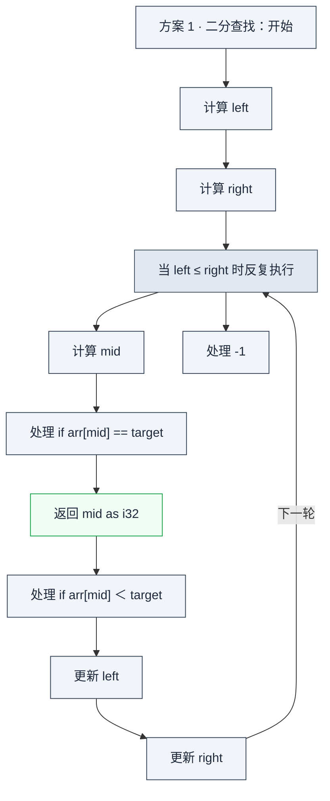

```rust
// LeetCode 108673483. 减治策略之 heap/binarysearch/selectionsort — Rust 版（方案1：二分查找）
fn binary_search(arr: &[i32], target: i32) -> i32 {
    // 定义函数/方法 binary_search
    let mut left: i64 = 0; // 把 0; 写入 let mut left: i64
    let mut right = arr.len() as i64 - 1; // 把 数组.长度() as i64 减 1; 写入 let mut right
    while left <= right {
        // 把 右边界 { 写入 while left <
        let mid = ((left + right) / 2) as usize; // 把 ((左边界 加 右边界) 除以 2) as usize 存入 中点
        if arr[mid] == target {
            // 若 数组[中点] 等于 目标值
            return mid as i32; // 返回 中点 as i32
        }
        if arr[mid] < target {
            // 若 数组[中点] 小于 目标值
            left = mid as i64 + 1; // 把 中点 as i64 加 1; 写入 左边界
        } else {
            // 否则
            right = mid as i64 - 1; // 把 中点 as i64 减 1; 写入 右边界
        }
    }
    -1 // 减 1
}

fn main() {
    // 程序入口：跑内嵌自测用例
    let cases: Vec<(Vec<i32>, i32, i32)> = vec![
        (vec![1, 3, 5, 7, 9], 5, 2),
        (vec![1, 3, 5, 7, 9], 4, -1),
        (vec![], 5, -1),
        (vec![1, 3, 5, 7, 9], 1, 0),
    ];
    for (idx, (a, t, want)) in cases.iter().enumerate() {
        // for (idx, (数组, 另一字符串, want)) in cases.iter().enumerate() {
        let got = binary_search(a, *t); // 把 binary_search(数组, 乘 另一字符串) 存入 got
        assert_eq!(got, *want, "case {} failed", idx); // 断言校验
    }
    println!("PASS"); // 全部用例通过，输出 PASS
}
```

#### 方案 2：单趟扫描

**思路与代码分析**：核心是「单趟扫描」。Rust 版用所有权移动与切片借用改写同一逻辑，注意 Option 与引用边界。**走读**：方案 2 · 单趟扫描：开始 → 处理 if lo == hi → 返回 a[lo] → 计算 pivot → 计算 i → 遍历 lo..hi 中的每个元素 j → 处理 if a[j] ≤ pivot → 调用 a.swap(i, j) → 更新 + → 调用 a.swap(i, hi) → 处理 if i == k → 处理 a[i] → 调用 select(a, lo, i - 1, k) → 调用 select(a, i + 1, hi, k)。

**运行架构**（真实控制流）：

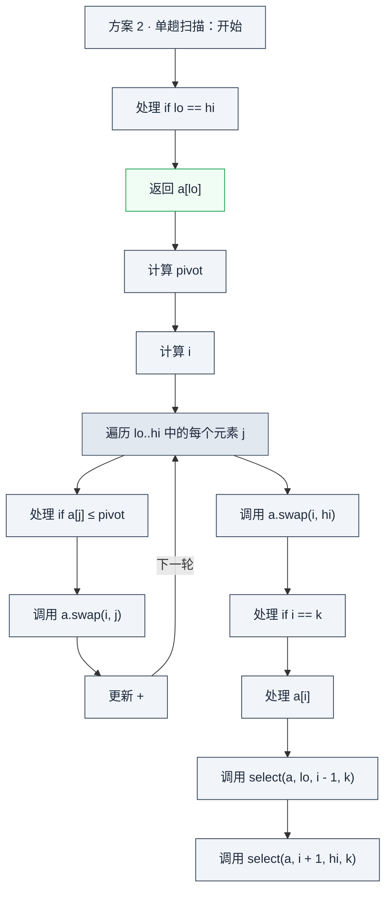

```rust
// LeetCode 108673483. 减治策略 — Rust 版（方案2：快速选择求第 k 小）
fn select(a: &mut Vec<i32>, lo: usize, hi: usize, k: usize) -> i32 {
    // 定义函数/方法 select
    if lo == hi {
        // 若 左边界 等于 右边界
        return a[lo]; // 返回 数组[左边界]
    }
    let pivot = a[hi]; // 把 数组[右边界] 存入 pivot
    let mut i = lo; // 把 左边界; 写入 let mut i
    for j in lo..hi {
        // 逐个取出 左边界 的元素（下标 j）
        if a[j] <= pivot {
            // 若 数组[下标 j] 不超过 pivot
            a.swap(i, j); // 数组.交换 下标 i, 下标 j);
            i += 1; // 下标 i累加 1
        }
    }
    a.swap(i, hi); // 数组.交换 下标 i, 右边界);
    if i == k {
        // 若 下标 i 等于 下标 k
        a[i] // 数组[下标 i]
    } else if i > k {
        // 否则，若 下标 i 超过 下标 k
        select(a, lo, i - 1, k) // select(数组, 左边界, 下标 i 减 1, 下标 k)
    } else {
        // 否则
        select(a, i + 1, hi, k) // select(数组, 下标 i 加 1, 右边界, 下标 k)
    }
}

fn quick_select(arr: &[i32], k: usize) -> i32 {
    // 定义函数/方法 quick_select
    let mut a = arr.to_vec(); // 把 数组.to_vec(); 写入 let mut a
    let n = a.len(); // 把 数组.长度() 存入 元素个数
    select(&mut a, 0, n - 1, k) // select( 按位与 mut 数组, 0, 元素个数 减 1, 下标 k)
}

fn main() {
    // 程序入口：跑内嵌自测用例
    let base = vec![3, 1, 4, 1, 5, 9, 2, 6]; // 把 vec取反 [3, 1, 4, 1, 5, 9, 2, 6] 存入 base
    let cases: Vec<(usize, i32)> = vec![(2, 2), (3, 3), (0, 1), (7, 9)];
    for (idx, (k, want)) in cases.iter().enumerate() {
        // for (idx, (下标 k, want)) in cases.iter().enumerate() {
        let got = quick_select(&base, *k); // 把 quick_select( 按位与 base, 乘 下标 k) 存入 got
        assert_eq!(got, *want, "case {} failed", idx); // 断言校验
    }
    println!("PASS"); // 全部用例通过，输出 PASS
}
```

#### 方案 3：双重循环枚举

**思路与代码分析**：核心是「双重循环枚举」。Rust 版用所有权移动与切片借用改写同一逻辑，注意 Option 与引用边界。**走读**：方案 3 · 双重循环枚举：开始 → 计算 candidate → 遍历 arr 中的每个元素 num → 遍历 arr 中的每个元素 num → 返回 cand。

**运行架构**（真实控制流）：

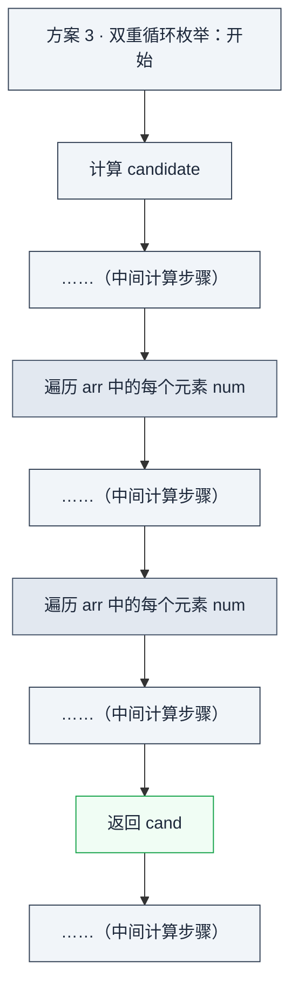

```rust
// LeetCode 108673483. 减治策略 — Rust 版（方案3：Boyer-Moore 摩尔投票求多数元素）
fn majority_element(arr: &[i32]) -> i32 {
    // 定义函数/方法 majority_element
    let mut candidate: Option<i32> = None; // 把 None; 写入 let mut candidate: Option<i32>
    let mut count = 0; // 把 0; 写入 let mut count
    for &num in arr {
        // for 按位与 num in 数组 {
        if count == 0 {
            // 若 计数 等于 0
            candidate = Some(num); // 把 Some(num); 写入 candidate
        }
        if Some(num) == candidate {
            // 若 Some(num) 等于 candidate
            count += 1; // 计数累加 1
        } else {
            // 否则
            count -= 1; // 计数累减 1
        }
    }
    let cand = candidate.unwrap(); // 把 candidate.unwrap() 存入 cand
    let mut cnt = 0; // 把 0; 写入 let mut cnt
    for &num in arr {
        // for 按位与 num in 数组 {
        if num == cand {
            // 若 num 等于 cand
            cnt += 1; // 计数累加 1
        }
    }
    if cnt > arr.len() as i32 / 2 {
        // 若 计数 超过 数组.长度() as i32 除以 2
        return cand; // 返回 cand
    }
    -1 // 减 1
}

fn main() {
    // 程序入口：跑内嵌自测用例
    let cases: Vec<(Vec<i32>, i32)> = vec![
        (vec![2, 2, 1, 1, 1, 1, 1], 1),
        (vec![1, 2, 3], -1),
        (vec![3, 3, 4], 3),
    ];
    for (idx, (a, want)) in cases.iter().enumerate() {
        // for (idx, (数组, want)) in cases.iter().enumerate() {
        let got = majority_element(a); // 把 majority_element(数组) 存入 got
        assert_eq!(got, *want, "case {} failed", idx); // 断言校验
    }
    println!("PASS"); // 全部用例通过，输出 PASS
}
```

### Lua 实现（3 种方案）

Lua 的全部方案如下，每个方案都内嵌用例自测，可独立运行（老仓库 python/go 文件遵循「打印结果」约定）：

#### 方案 1：二分查找

**思路与代码分析**：核心是「二分查找」。Lua 版用表与 ipairs 遍历，注意 ipairs 遇 nil 即停的语义。代码里依次做这些事：二分收缩区间。**走读**：方案 1 · 二分查找：开始 → 更新 right → 当 left ≤ right do 时反复执行 → 更新 mid → 处理 if arr[mid] == target then → 返回 mid - 1 → 处理 if arr[mid] ＜ target then → 更新 left → 更新 right → 返回 -1。

**运行架构**（真实控制流）：

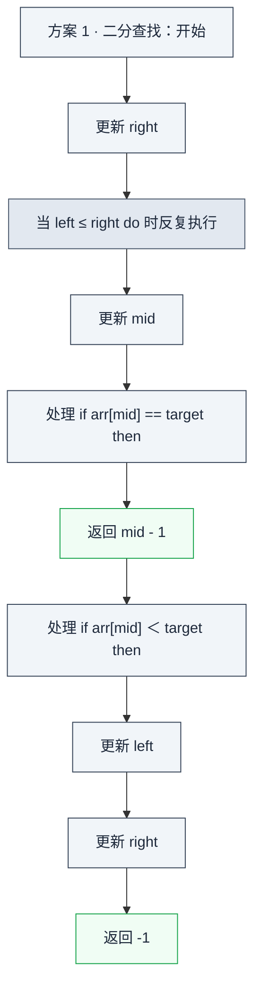

```lua
-- LeetCode 108673483. 减治策略 — Lua 版（方案1：二分查找）
local function binary_search(arr, target) -- local function binary_search(数组, 目标值)
	local left, right = 1, #arr -- 把 1, #数组 写入 local left, right
	while left <= right do -- 把 右边界 do 写入 while left <
		local mid = math.floor((left + right) / 2) -- 把 math.floor((左边界 加 右边界) 除以 2) 写入 local mid
		if arr[mid] == target then
			return mid - 1
		end -- 若 数组[中点] 等于 目标值 then return 中点 减 1 终点
		if arr[mid] < target then
			left = mid + 1
		else
			right = mid - 1
		end -- 若 数组[中点] 小于 目标值 then 左边界 赋值为 中点 加 1 else 右边界 赋值为 中点 减 1 终点
	end -- 终点
	return -1 -- 返回 减 1
end -- 终点

local cases = { -- 把 { 写入 local cases
	{ { 1, 3, 5, 7, 9 }, 5, 2 },
	{ { 1, 3, 5, 7, 9 }, 4, -1 },
	{ {}, 5, -1 },
	{ { 1, 3, 5, 7, 9 }, 1, 0 },
}
for idx, c in ipairs(cases) do -- 遍历取 字符
	local got = binary_search(c[1], c[2]) -- 把 binary_search(字符[1], 字符[2]) 写入 local got
	assert(got == c[3], string.format("case %d failed: got %d want %d", idx, got, c[3])) -- 断言校验
end -- 终点
print("PASS") -- 全部用例通过，输出 PASS
```

#### 方案 2：单趟扫描

**思路与代码分析**：核心是「单趟扫描」。Lua 版用表与 ipairs 遍历，注意 ipairs 遇 nil 即停的语义。**走读**：方案 2 · 单趟扫描：开始 → 处理 if lo == hi then → 返回 a[lo] → 更新 pivot → 更新 i → 循环 j：从 lo 到 hi - 1 do → 处理 if a[j] ≤ pivot then → 更新 a[j] → 更新 i → 更新 a[hi] → 处理 if i == k then → 返回 a[i] → 处理 if i ＞ k then → 返回 select_k(a, lo, i - 1, k) → 返回 select_k(a, i + 1, hi, k)。

**运行架构**（真实控制流）：

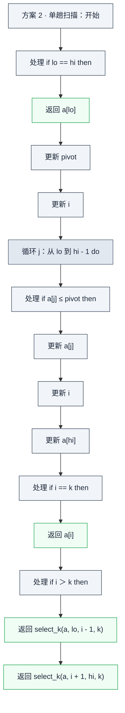

```lua
-- LeetCode 108673483. 减治策略 — Lua 版（方案2：快速选择求第 k 小，k 从 0 起）
local function select_k(a, lo, hi, k) -- local function select_k(数组, 左边界, 右边界, 下标 k)
	if lo == hi then
		return a[lo]
	end -- 若 左边界 等于 右边界 then return 数组[左边界] 终点
	local pivot = a[hi] -- 把 数组[右边界] 写入 local pivot
	local i = lo -- 把 左边界 写入 local i
	for j = lo, hi - 1 do -- 把 左边界, 右边界 减 1 do 写入 for j
		if a[j] <= pivot then -- 若 数组[下标 j] 不超过 pivot then
			a[i], a[j] = a[j], a[i] -- 把 数组[下标 j], 数组[下标 i] 写入 a[i], a[j]
			i = i + 1 -- 把 下标 i 加 1 存入 下标 i
		end -- 终点
	end -- 终点
	a[i], a[hi] = a[hi], a[i] -- 把 数组[右边界], 数组[下标 i] 写入 a[i], a[hi]
	if i == k then
		return a[i]
	end -- 若 下标 i 等于 下标 k then return 数组[下标 i] 终点
	if i > k then
		return select_k(a, lo, i - 1, k)
	end
	return select_k(a, i + 1, hi, k) -- 返回 select_k(数组, 下标 i 加 1, 右边界, 下标 k)
end -- 终点

local function quick_select(arr, k) -- local function quick_select(数组, 下标 k)
	local a = {} -- 把 {} 写入 local a
	for i, v in ipairs(arr) do
		a[i] = v
	end -- 遍历取 值
	return select_k(a, 1, #a, k + 1) -- 内部 1 基
end -- 终点

local base = { 3, 1, 4, 1, 5, 9, 2, 6 } -- 把 {3, 1, 4, 1, 5, 9, 2, 6} 写入 local base
local cases = { { 2, 2 }, { 3, 3 }, { 0, 1 }, { 7, 9 } } -- 把 {{2, 2}, {3, 3}, {0, 1}, {7, 9}} 写入 local cases
for idx, c in ipairs(cases) do -- 遍历取 字符
	local got = quick_select(base, c[1]) -- 把 quick_select(base, 字符[1]) 写入 local got
	assert(got == c[2], string.format("case %d failed: got %d want %d", idx, got, c[2])) -- 断言校验
end -- 终点
print("PASS") -- 全部用例通过，输出 PASS
```

#### 方案 3：双重循环枚举

**思路与代码分析**：核心是「双重循环枚举」。Lua 版用表与 ipairs 遍历，注意 ipairs 遇 nil 即停的语义。**走读**：方案 3 · 双重循环枚举：开始 → 更新 candidate → 更新 count → 遍历 ipairs(arr) do 中的每个元素 num → 处理 if count == 0 then → 更新 candidate → 处理 if num == candidate then → 更新 count → 更新 count → 更新 cnt → 遍历 ipairs(arr) do 中的每个元素 num → 处理 if num == candidate then → 更新 cnt → 处理 if cnt ＞ math.floor(#arr / 2 → 返回 candidate → 返回 -1。

**运行架构**（真实控制流）：

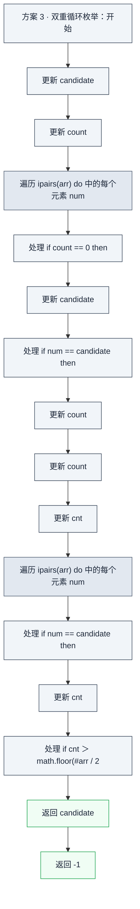

```lua
-- LeetCode 108673483. 减治策略 — Lua 版（方案3：Boyer-Moore 摩尔投票求多数元素）
local function majority_element(arr) -- local function majority_element(数组)
	local candidate = nil -- 把 nil 写入 local candidate
	local count = 0 -- 把 0 写入 local count
	for _, num in ipairs(arr) do -- 遍历取 num
		if count == 0 then
			candidate = num
		end -- 若 计数 等于 0 then candidate 赋值为 num 终点
		if num == candidate then
			count = count + 1
		else
			count = count - 1
		end -- 若 num 等于 candidate then 计数 赋值为 计数 加 1 else 计数 赋值为 计数 减 1 终点
	end -- 终点
	local cnt = 0 -- 把 0 写入 local cnt
	for _, num in ipairs(arr) do -- 遍历取 num
		if num == candidate then
			cnt = cnt + 1
		end -- 若 num 等于 candidate then 计数 赋值为 计数 加 1 终点
	end -- 终点
	if cnt > math.floor(#arr / 2) then
		return candidate
	end -- 若 计数 超过 math.floor(#数组 除以 2) then return candidate 终点
	return -1 -- 返回 减 1
end -- 终点

local cases = { -- 把 { 写入 local cases
	{ { 2, 2, 1, 1, 1, 1, 1 }, 1 },
	{ { 1, 2, 3 }, -1 },
	{ { 3, 3, 4 }, 3 },
}
for idx, c in ipairs(cases) do -- 遍历取 字符
	local got = majority_element(c[1]) -- 把 majority_element(字符[1]) 写入 local got
	assert(got == c[2], string.format("case %d failed: got %d want %d", idx, got, c[2])) -- 断言校验
end -- 终点
print("PASS") -- 全部用例通过，输出 PASS
```

### C 实现（3 种方案）

C 的全部方案如下，每个方案都内嵌用例自测，可独立运行（老仓库 python/go 文件遵循「打印结果」约定）：

#### 方案 1：二分查找

**思路与代码分析**：核心是「二分查找」。C 版手动管理下标与内存，循环边界全部显式写出。代码里依次做这些事：二分收缩区间。**走读**：方案 1 · 二分查找：开始 → 更新 left → 当 (left ≤ right) 时反复执行 → 更新 mid → 命中条件，直接返回 → 若 arr[mid] ＜ target：更新 left → 更新 left → 更新 right → 返回 -1。

**运行架构**（真实控制流）：

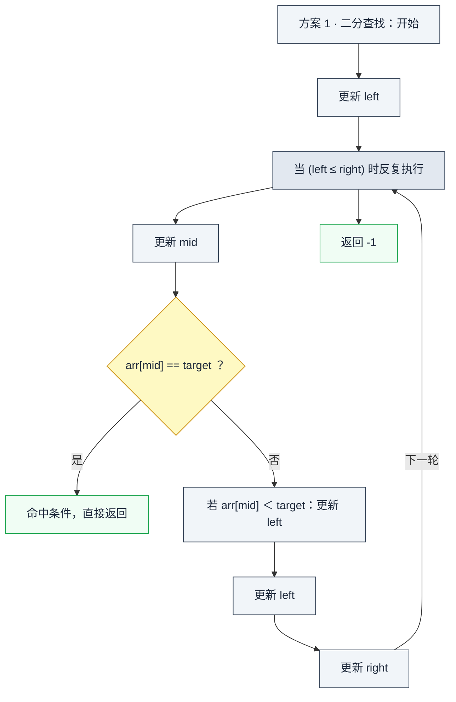

```c
* LeetCode 108673483. 减治策略 — C 版（方案1：二分查找）
 */
#include <stdio.h> // 引入头文件

static int binary_search(const int *arr, int n, int target) { // 定义函数/方法 binary_search
    int left = 0, right = n - 1;             // 把 0, 右边界 赋值为 元素个数 减 1 存入 左边界
    while (left <= right) {                  // 循环，直到不满足「左边界 不超过 右边界」
        int mid = left + (right - left) / 2; // 把 左边界 加 (右边界 减 左边界) 除以 2 存入 中点
        if (arr[mid] == target)
            return mid; // 若 数组[中点] 等于 目标值，直接返回 中点
        if (arr[mid] < target)
            left = mid + 1; // 若 数组[中点] 小于 目标值) 左边界 赋值为 中点 加 1;
        else
            right = mid - 1; // 否则
    }
    return -1; // 返回 减 1
}

int main(void) {                // 程序入口：跑内嵌自测用例
    int a[5] = {1, 3, 5, 7, 9}; // 把 {1, 3, 5, 7, 9}; 写入 int a[5]
    if (binary_search(a, 5, 5) != 2) {
        printf("case 0 failed\n");
        return 1;
    }
    if (binary_search(a, 5, 4) != -1) {
        printf("case 1 failed\n");
        return 1;
    }
    if (binary_search(a, 0, 5) != -1) {
        printf("case 2 failed\n");
        return 1;
    }
    if (binary_search(a, 5, 1) != 0) {
        printf("case 3 failed\n");
        return 1;
    }
    printf("PASS\n"); // 全部用例通过，输出 PASS
    return 0;         // 返回 0
}
```

#### 方案 2：单趟扫描

**思路与代码分析**：核心是「单趟扫描」。C 版手动管理下标与内存，循环边界全部显式写出。代码里依次做这些事：单循环线性扫描。**走读**：方案 2 · 单趟扫描：开始 → 命中条件，直接返回 → 更新 pivot → 遍历循环 → 命中条件，直接返回 → 命中条件，直接返回 → 返回 select_k(a, i + 1, hi, k)。

**运行架构**（真实控制流）：

```mermaid
graph TD
    N0["方案 2 · 单趟扫描：开始"]
    N1{"lo == hi ？"}
    N2["命中条件，直接返回"]
    N3["更新 pivot"]
    D1["……（中间计算步骤）"]
    N5["遍历循环"]
    D2["……（中间计算步骤）"]
    N14{"i == k ？"}
    N15["命中条件，直接返回"]
    N16{"i ＞ k ？"}
    N17["命中条件，直接返回"]
    D3["……（中间计算步骤）"]
    N19["返回 select_k(a, i + 1, hi, k)"]
    N0 --> N1
    N1 -- 是 --> N2
    N1 -- 否 --> N3
    N14 -- 是 --> N15
    N14 -- 否 --> N16
    N16 -- 是 --> N17
    N2 --> N3
    N3 --> D1
    D1 --> N5
    N5 --> D2
    D2 --> N14
    N15 --> N16
    N17 --> D3
    D3 --> N19
    classDef n fill:#f1f5f9,stroke:#334155,color:#1e293b;
    classDef lp fill:#e2e8f0,stroke:#475569,color:#1e293b;
    classDef dc fill:#fef9c3,stroke:#ca8a04,color:#1e293b;
    classDef tm fill:#f0fdf4,stroke:#16a34a,color:#1e293b;
    class N0,N3,D1,D2,D3 n;
    class N5 lp;
    class N1,N14,N16 dc;
    class N2,N15,N17,N19 tm;
```

```c
* LeetCode 108673483. 减治策略 — C 版（方案2：快速选择求第 k 小，k 从 0 起）
 */
#include <stdio.h> // 引入头文件

static int select_k(int *a, int lo, int hi, int k) { // 定义函数/方法 select_k
    if (lo == hi)
        return a[lo];               // 若 左边界 等于 右边界，直接返回 数组[左边界]
    int pivot = a[hi];              // 把 数组[右边界] 存入 pivot
    int i = lo;                     // 把 左边界 存入 下标 i
    for (int j = lo; j < hi; j++) { // 让 下标 j 从 左边界 开始计数，下标 j 小于 右边界 就继续
        if (a[j] <= pivot) {        // 若 数组[下标 j] 不超过 pivot
            int t = a[i];
            a[i] = a[j];
            a[j] = t;
            i++; // 下标 i 加一
        }
    }
    int t = a[i];
    a[i] = a[hi];
    a[hi] = t; // 把 数组[下标 i]; 数组[下标 i] 赋值为 数组[右边界]; 数组[右边界] 赋值为 另一字符串 存入
               // 另一字符串
    if (i == k)
        return a[i]; // 若 下标 i 等于 下标 k，直接返回 数组[下标 i]
    if (i > k)
        return select_k(a, lo, i - 1,
                        k); // 若 下标 i 超过 下标 k，直接返回 select_k(数组, 左边界, 下标 i 减 1, 下标 k)
    return select_k(a, i + 1, hi, k); // 返回 select_k(数组, 下标 i 加 1, 右边界, 下标 k)
}

int main(void) {                            // 程序入口：跑内嵌自测用例
    int base[8] = {3, 1, 4, 1, 5, 9, 2, 6}; // 把 {3, 1, 4, 1, 5, 9, 2, 6}; 写入 int base[8]
    int ks[4] = {2, 3, 0, 7};               // 把 {2, 3, 0, 7}; 写入 int ks[4]
    int ws[4] = {2, 3, 1, 9};               // 把 {2, 3, 1, 9}; 写入 int ws[4]
    for (int idx = 0; idx < 4; idx++) {     // 让 idx 从 0 开始计数，idx 小于 4 就继续
        int a[8];                           // int 数组[8];
        for (int i = 0; i < 8; i++)
            a[i] = base[i];                   // 让 下标 i 从 0 开始计数，下标 i 小于 8 就继续
        int got = select_k(a, 0, 7, ks[idx]); // 把 select_k(数组, 0, 7, ks[idx]) 存入 got
        if (got != ws[idx]) {
            printf("case %d failed\n", idx);
            return 1;
        }
    }
    printf("PASS\n"); // 全部用例通过，输出 PASS
    return 0;         // 返回 0
}
```

#### 方案 3：双重循环枚举

**思路与代码分析**：核心是「双重循环枚举」。C 版手动管理下标与内存，循环边界全部显式写出。代码里依次做这些事：双重循环遍历。**走读**：方案 3 · 双重循环枚举：开始 → 更新 candidate → 更新 count → 遍历循环 → 若 count == 0：更新 candidate → 更新 candidate → 若 arr[i] == candidate：处理 count++ → 处理 count++ → 处理 count-- → 更新 cnt → 遍历循环 → 若 arr[i] == candidate：处理 cnt++ → 处理 cnt++ → 命中条件，直接返回 → 返回 -1。

**运行架构**（真实控制流）：

```mermaid
graph TD
    N0["方案 3 · 双重循环枚举：开始"]
    N1["更新 candidate"]
    N2["更新 count"]
    N3["遍历循环"]
    N4["若 count == 0：更新 candidate"]
    N5["更新 candidate"]
    N6["若 arr[i] == candidate：处理 count++"]
    N7["处理 count++"]
    N8["处理 count--"]
    N9["更新 cnt"]
    N10["遍历循环"]
    N11["若 arr[i] == candidate：处理 cnt++"]
    N12["处理 cnt++"]
    N13{"cnt ＞ n / 2 ？"}
    N14["命中条件，直接返回"]
    N15["返回 -1"]
    N0 --> N1
    N1 --> N2
    N2 --> N3
    N3 --> N4
    N4 --> N5
    N5 --> N6
    N6 --> N7
    N7 --> N8
    N8 -- 下一轮 --> N3
    N3 --> N9
    N9 --> N10
    N10 --> N11
    N11 --> N12
    N12 --> N13
    N13 -- 是 --> N14
    N13 -- 否 --> N15
    classDef n fill:#f1f5f9,stroke:#334155,color:#1e293b;
    classDef lp fill:#e2e8f0,stroke:#475569,color:#1e293b;
    classDef dc fill:#fef9c3,stroke:#ca8a04,color:#1e293b;
    classDef tm fill:#f0fdf4,stroke:#16a34a,color:#1e293b;
    class N0,N1,N2,N4,N5,N6,N7,N8,N9,N11,N12 n;
    class N3,N10 lp;
    class N13 dc;
    class N14,N15 tm;
```

```c
* LeetCode 108673483. 减治策略 — C 版（方案3：Boyer-Moore 摩尔投票求多数元素）
 */
#include <stdio.h> // 引入头文件

static int majority_element(const int *arr, int n) { // 定义函数/方法 majority_element
    int candidate = 0;                               // 把 0 存入 candidate
    int count = 0;                                   // 把 0 存入 计数
    for (int i = 0; i < n; i++) { // 让 下标 i 从 0 开始计数，下标 i 小于 元素个数 就继续
        if (count == 0)
            candidate = arr[i]; // 若 计数 等于 0) candidate 赋值为 数组[下标 i];
        if (arr[i] == candidate)
            count++; // 若 数组[下标 i] 等于 candidate) 计数 加一 ;
        else
            count--; // 否则
    }
    int cnt = 0; // 把 0 存入 计数
    for (int i = 0; i < n; i++)
        if (arr[i] == candidate)
            cnt++; // 让 下标 i 从 0 开始计数，下标 i 小于 元素个数 就继续
    if (cnt > n / 2)
        return candidate; // 若 计数 超过 元素个数 除以 2，直接返回 candidate
    return -1;            // 返回 减 1
}

int main(void) {                       // 程序入口：跑内嵌自测用例
    int a0[7] = {2, 2, 1, 1, 1, 1, 1}; // 把 {2, 2, 1, 1, 1, 1, 1}; 写入 int a0[7]
    int a1[3] = {1, 2, 3};             // 把 {1, 2, 3}; 写入 int a1[3]
    int a2[3] = {3, 3, 4};             // 把 {3, 3, 4}; 写入 int a2[3]
    if (majority_element(a0, 7) != 1) {
        printf("case 0 failed\n");
        return 1;
    }
    if (majority_element(a1, 3) != -1) {
        printf("case 1 failed\n");
        return 1;
    }
    if (majority_element(a2, 3) != 3) {
        printf("case 2 failed\n");
        return 1;
    }
    printf("PASS\n"); // 全部用例通过，输出 PASS
    return 0;         // 返回 0
}
```

### C++ 实现（3 种方案）

C++ 的全部方案如下，每个方案都内嵌用例自测，可独立运行（老仓库 python/go 文件遵循「打印结果」约定）：

#### 方案 1：二分查找

**思路与代码分析**：核心是「二分查找」。C++ 版用 STL 容器与迭代器，减少手写下标错误。代码里依次做这些事：二分收缩区间。**走读**：方案 1 · 二分查找：开始 → 更新 left → 处理 1 → 当 (left ≤ right) 时反复执行 → 更新 mid → 命中条件，直接返回 → 若 arr[mid] ＜ target：更新 left → 更新 left → 更新 right → 返回 -1。

**运行架构**（真实控制流）：

```mermaid
graph TD
    N0["方案 1 · 二分查找：开始"]
    N1["更新 left"]
    N2["处理 1"]
    N3["当 (left ≤ right) 时反复执行"]
    N4["更新 mid"]
    N5{"arr[mid] == target ？"}
    N6["命中条件，直接返回"]
    N7["若 arr[mid] ＜ target：更新 left"]
    N8["更新 left"]
    N9["更新 right"]
    N10["返回 -1"]
    N0 --> N1
    N1 --> N2
    N2 --> N3
    N3 --> N4
    N4 --> N5
    N5 -- 是 --> N6
    N5 -- 否 --> N7
    N7 --> N8
    N8 --> N9
    N9 -- 下一轮 --> N3
    N3 --> N10
    classDef n fill:#f1f5f9,stroke:#334155,color:#1e293b;
    classDef lp fill:#e2e8f0,stroke:#475569,color:#1e293b;
    classDef dc fill:#fef9c3,stroke:#ca8a04,color:#1e293b;
    classDef tm fill:#f0fdf4,stroke:#16a34a,color:#1e293b;
    class N0,N1,N2,N4,N7,N8,N9 n;
    class N3 lp;
    class N5 dc;
    class N6,N10 tm;
```

```cpp
// LeetCode 108673483. 减治策略 — C++ 版（方案1：二分查找）
#include <iostream> // 引入头文件
#include <vector>   // 引入头文件

static int binary_search(const std::vector<int> &arr, int target) { // 定义函数/方法 binary_search
    int left = 0, right = static_cast<int>(arr.size()) -
                          1; // 把 0, 右边界 赋值为 static_cast 小于 int 超过 (数组.大小()) 减 1 存入 左边界
    while (left <= right) {                  // 循环，直到不满足「左边界 不超过 右边界」
        int mid = left + (right - left) / 2; // 把 左边界 加 (右边界 减 左边界) 除以 2 存入 中点
        if (arr[mid] == target)
            return mid; // 若 数组[中点] 等于 目标值，直接返回 中点
        if (arr[mid] < target)
            left = mid + 1; // 若 数组[中点] 小于 目标值) 左边界 赋值为 中点 加 1;
        else
            right = mid - 1; // 否则
    }
    return -1; // 返回 减 1
}

int main() { // 程序入口：跑内嵌自测用例
    std::vector<std::vector<int>> as = {
        // 把 { 写入 std::vector<std::vector<int>> as
        {1, 3, 5, 7, 9},
        {1, 3, 5, 7, 9},
        {},
        {1, 3, 5, 7, 9},
    };
    int ts[4] = {5, 4, 5, 1};     // 把 {5, 4, 5, 1}; 写入 int ts[4]
    int ws[4] = {2, -1, -1, 0};   // 把 {2, 减 1, 减 1, 0}; 写入 int ws[4]
    for (int i = 0; i < 4; ++i) { // 让 下标 i 从 0 开始计数，下标 i 小于 4 就继续
        int got = binary_search(as[i], ts[i]); // 把 binary_search(as[下标 i], ts[下标 i]) 存入 got
        if (got != ws[i]) {
            std::cout << "case " << i << " failed" << std::endl;
            return 1;
        }
    }
    std::cout << "PASS" << std::endl; // 全部用例通过，输出 PASS
    return 0;                         // 返回 0
}
```

#### 方案 2：单趟扫描

**思路与代码分析**：核心是「单趟扫描」。C++ 版用 STL 容器与迭代器，减少手写下标错误。代码里依次做这些事：单循环线性扫描。**走读**：方案 2 · 单趟扫描：开始 → 命中条件，直接返回 → 更新 pivot → 更新 i → 遍历循环 → 若 a[j] ≤ pivot 则： → 处理 std::swap(a[i], a[j]) → 处理 ++i → 处理 std::swap(a[i], a[hi]) → 命中条件，直接返回 → 命中条件，直接返回 → 处理 k) → 返回 select_k(a, i + 1, hi, k)。

**运行架构**（真实控制流）：

```mermaid
graph TD
    N0["方案 2 · 单趟扫描：开始"]
    N1{"lo == hi ？"}
    N2["命中条件，直接返回"]
    N3["更新 pivot"]
    N4["更新 i"]
    N5["遍历循环"]
    N6["若 a[j] ≤ pivot 则："]
    N7["处理 std::swap(a[i], a[j])"]
    N8["处理 ++i"]
    N9["处理 std::swap(a[i], a[hi])"]
    N10{"i == k ？"}
    N11["命中条件，直接返回"]
    N12{"i ＞ k ？"}
    N13["命中条件，直接返回"]
    N14["处理 k)"]
    N15["返回 select_k(a, i + 1, hi, k)"]
    N0 --> N1
    N1 -- 是 --> N2
    N1 -- 否 --> N3
    N3 --> N4
    N4 --> N5
    N5 --> N6
    N6 --> N7
    N7 --> N8
    N8 -- 下一轮 --> N5
    N5 --> N9
    N9 --> N10
    N10 -- 是 --> N11
    N10 -- 否 --> N12
    N12 -- 是 --> N13
    N12 -- 否 --> N14
    N14 --> N15
    classDef n fill:#f1f5f9,stroke:#334155,color:#1e293b;
    classDef lp fill:#e2e8f0,stroke:#475569,color:#1e293b;
    classDef dc fill:#fef9c3,stroke:#ca8a04,color:#1e293b;
    classDef tm fill:#f0fdf4,stroke:#16a34a,color:#1e293b;
    class N0,N3,N4,N6,N7,N8,N9,N14 n;
    class N5 lp;
    class N1,N10,N12 dc;
    class N2,N11,N13,N15 tm;
```

```cpp
// LeetCode 108673483. 减治策略 — C++ 版（方案2：快速选择求第 k 小）
#include <iostream> // 引入头文件
#include <vector>   // 引入头文件

static int select_k(std::vector<int> &a, int lo, int hi, int k) { // 定义函数/方法 select_k
    if (lo == hi)
        return a[lo];               // 若 左边界 等于 右边界，直接返回 数组[左边界]
    int pivot = a[hi];              // 把 数组[右边界] 存入 pivot
    int i = lo;                     // 把 左边界 存入 下标 i
    for (int j = lo; j < hi; ++j) { // 让 下标 j 从 左边界 开始计数，下标 j 小于 右边界 就继续
        if (a[j] <= pivot) {        // 若 数组[下标 j] 不超过 pivot
            std::swap(a[i], a[j]); // 交换 数组[下标 i] 与 数组[下标 j]
            ++i;                   // 加一 下标 i;
        }
    }
    std::swap(a[i], a[hi]); // 交换 数组[下标 i] 与 数组[右边界]
    if (i == k)
        return a[i]; // 若 下标 i 等于 下标 k，直接返回 数组[下标 i]
    if (i > k)
        return select_k(a, lo, i - 1,
                        k); // 若 下标 i 超过 下标 k，直接返回 select_k(数组, 左边界, 下标 i 减 1, 下标 k)
    return select_k(a, i + 1, hi, k); // 返回 select_k(数组, 下标 i 加 1, 右边界, 下标 k)
}

int main() {                                       // 程序入口：跑内嵌自测用例
    std::vector<int> base{3, 1, 4, 1, 5, 9, 2, 6}; // std::vector 小于 int 超过 base{3, 1, 4, 1, 5, 9, 2, 6};
    int ks[4] = {2, 3, 0, 7};                      // 把 {2, 3, 0, 7}; 写入 int ks[4]
    int ws[4] = {2, 3, 1, 9};                      // 把 {2, 3, 1, 9}; 写入 int ws[4]
    for (int idx = 0; idx < 4; ++idx) {            // 让 idx 从 0 开始计数，idx 小于 4 就继续
        std::vector<int> a = base;                 // 把 base; 写入 std::vector<int> a
        int got = select_k(a, 0, static_cast<int>(a.size()) - 1, ks[idx]);
        if (got != ws[idx]) {
            std::cout << "case " << idx << " failed" << std::endl;
            return 1;
        }
    }
    std::cout << "PASS" << std::endl; // 全部用例通过，输出 PASS
    return 0;                         // 返回 0
}
```

#### 方案 3：双重循环枚举

**思路与代码分析**：核心是「双重循环枚举」。C++ 版用 STL 容器与迭代器，减少手写下标错误。代码里依次做这些事：双重循环遍历。**走读**：方案 3 · 双重循环枚举：开始 → 更新 candidate → 更新 count → 遍历循环 → 若 count == 0：更新 candidate → 更新 candidate → 若 num == candidate：处理 ++count → 处理 ++count → 处理 --count → 更新 cnt → 遍历循环 → 若 num == candidate：处理 ++cnt → 处理 ++cnt → 命中条件，直接返回 → 返回 -1。

**运行架构**（真实控制流）：

```mermaid
graph TD
    N0["方案 3 · 双重循环枚举：开始"]
    N1["更新 candidate"]
    N2["更新 count"]
    N3["遍历循环"]
    N4["若 count == 0：更新 candidate"]
    N5["更新 candidate"]
    N6["若 num == candidate：处理 ++count"]
    N7["处理 ++count"]
    N8["处理 --count"]
    N9["更新 cnt"]
    N10["遍历循环"]
    N11["若 num == candidate：处理 ++cnt"]
    N12["处理 ++cnt"]
    N13{"cnt ＞ static_cast＜int＞(arr.size()) / 2 ？"}
    N14["命中条件，直接返回"]
    N15["返回 -1"]
    N0 --> N1
    N1 --> N2
    N2 --> N3
    N3 --> N4
    N4 --> N5
    N5 --> N6
    N6 --> N7
    N7 --> N8
    N8 -- 下一轮 --> N3
    N3 --> N9
    N9 --> N10
    N10 --> N11
    N11 --> N12
    N12 --> N13
    N13 -- 是 --> N14
    N13 -- 否 --> N15
    classDef n fill:#f1f5f9,stroke:#334155,color:#1e293b;
    classDef lp fill:#e2e8f0,stroke:#475569,color:#1e293b;
    classDef dc fill:#fef9c3,stroke:#ca8a04,color:#1e293b;
    classDef tm fill:#f0fdf4,stroke:#16a34a,color:#1e293b;
    class N0,N1,N2,N4,N5,N6,N7,N8,N9,N11,N12 n;
    class N3,N10 lp;
    class N13 dc;
    class N14,N15 tm;
```

```cpp
// LeetCode 108673483. 减治策略 — C++ 版（方案3：Boyer-Moore 摩尔投票求多数元素）
#include <iostream> // 引入头文件
#include <vector>   // 引入头文件

static int majority_element(const std::vector<int> &arr) { // 定义函数/方法 majority_element
    int candidate = 0;                                     // 把 0 存入 candidate
    int count = 0;                                         // 把 0 存入 计数
    for (int num : arr) {                                  // for (int num : 数组) {
        if (count == 0)
            candidate = num; // 若 计数 等于 0) candidate 赋值为 num;
        if (num == candidate)
            ++count; // 若 num 等于 candidate) 加一 计数;
        else
            --count; // 否则
    }
    int cnt = 0; // 把 0 存入 计数
    for (int num : arr)
        if (num == candidate)
            ++cnt; // 把 赋值为 candidate) 加一 计数; 写入 for (int num : arr) if (num
    if (cnt > static_cast<int>(arr.size()) / 2)
        return candidate; // 若 计数 超过 static_cast 小于 int 超过 (数组.大小()) 除以 2，直接返回 candidate
    return -1; // 返回 减 1
}

int main() { // 程序入口：跑内嵌自测用例
    std::vector<std::vector<int>> as = {
        // 把 { 写入 std::vector<std::vector<int>> as
        {2, 2, 1, 1, 1, 1, 1},
        {1, 2, 3},
        {3, 3, 4},
    };
    int ws[3] = {1, -1, 3};                // 把 {1, 减 1, 3}; 写入 int ws[3]
    for (int i = 0; i < 3; ++i) {          // 让 下标 i 从 0 开始计数，下标 i 小于 3 就继续
        int got = majority_element(as[i]); // 把 majority_element(as[下标 i]) 存入 got
        if (got != ws[i]) {
            std::cout << "case " << i << " failed" << std::endl;
            return 1;
        }
    }
    std::cout << "PASS" << std::endl; // 全部用例通过，输出 PASS
    return 0;                         // 返回 0
}
```

### R 实现（3 种方案）

R 的全部方案如下，每个方案都内嵌用例自测，可独立运行（老仓库 python/go 文件遵循「打印结果」约定）：

#### 方案 1：二分查找

**思路与代码分析**：核心是「二分查找」。R 版用向量化思维与 1 起始下标，注意 1:n 的降序陷阱。代码里依次做这些事：二分收缩区间。**走读**：方案 1 · 二分查找：开始 → 处理 left ＜- 1L → 处理 right ＜- length(arr) → 当 (left ≤ right) 时反复执行 → 处理 mid ＜- as.integer((left + ri → 命中条件，直接返回 → 若 arr[mid] ＜ target：处理 left ＜- mid + 1L else right → 处理 left ＜- mid + 1L else right → 处理 -1L。

**运行架构**（真实控制流）：

```mermaid
graph TD
    N0["方案 1 · 二分查找：开始"]
    N1["处理 left ＜- 1L"]
    N2["处理 right ＜- length(arr)"]
    N3["当 (left ≤ right) 时反复执行"]
    N4["处理 mid ＜- as.integer((left + ri"]
    N5{"arr[mid] == target ？"}
    N6["命中条件，直接返回"]
    N7["若 arr[mid] ＜ target：处理 left ＜- mid + 1L else right"]
    N8["处理 left ＜- mid + 1L else right"]
    N9["处理 -1L"]
    N0 --> N1
    N1 --> N2
    N2 --> N3
    N3 --> N4
    N4 --> N5
    N5 -- 是 --> N6
    N5 -- 否 --> N7
    N7 --> N8
    N8 -- 下一轮 --> N3
    N3 --> N9
    classDef n fill:#f1f5f9,stroke:#334155,color:#1e293b;
    classDef lp fill:#e2e8f0,stroke:#475569,color:#1e293b;
    classDef dc fill:#fef9c3,stroke:#ca8a04,color:#1e293b;
    classDef tm fill:#f0fdf4,stroke:#16a34a,color:#1e293b;
    class N0,N1,N2,N4,N7,N8,N9 n;
    class N3 lp;
    class N5 dc;
    class N6 tm;
```

```r
# 版（方案1：二分查找） 定义函数 binary_search（参数：数组, 目标值）
binary_search <- function(arr, target) {
    left <- 1L  # 把 1L 存入 左边界
    right <- length(arr)  # 把 长度(数组) 存入 右边界
    while (left <= right) {
        # 循环，直到不满足「左边界 不超过 右边界」
        mid <- as.integer((left + right)%/%2)  # 把 as.integer((左边界 加 右边界) 对…取模 除以 对…取模 2) 存入 中点
        if (arr[mid] == target)
            return(as.integer(mid - 1L))  # 若 数组[中点] 等于 目标值) return(as.integer(中点 减 1L
        if (arr[mid] < target)
            left <- mid + 1L else right <- mid - 1L  # 若 数组[中点] 小于 目标值) 左边界 小于 减 中点 加 1L else 右边界 小于 减 中点 减 1L
    }
    -1L  # 减 1L
}
cases <- list(list(c(1L, 3L, 5L, 7L, 9L), 5L, 2L), list(c(1L, 3L, 5L, 7L, 9L), 4L, -1L), list(c(), 5L, -1L), list(c(1L,
    3L, 5L, 7L, 9L), 1L, 0L)  # 列表(字符(1L, 3L, 5L, 7L, 9L), 1L, 0L)
)
for (idx in seq_along(cases)) {
    # for (idx in seq_along(cases)) {
    got <- binary_search(cases[[idx]][[1]], cases[[idx]][[2]])  # 把 binary_search(cases[[idx]][[1]], cases[[idx]][[2]]) 存入 got
    stopifnot(got == cases[[idx]][[3]])  # 断言校验
}
cat("PASS\n")  # 全部用例通过，输出 PASS
```

#### 方案 2：单趟扫描

**思路与代码分析**：核心是「单趟扫描」。R 版用向量化思维与 1 起始下标，注意 1:n 的降序陷阱。代码里依次做这些事：单循环线性扫描。**走读**：方案 2 · 单趟扫描：开始 → 命中条件，直接返回 → 处理 pivot ＜- a[[hi]] → 循环 j：遍历 lo:(hi - 1L) → 命中条件，直接返回 → 命中条件，直接返回。

**运行架构**（真实控制流）：

```mermaid
graph TD
    N0["方案 2 · 单趟扫描：开始"]
    N1{"lo == hi ？"}
    N2["命中条件，直接返回"]
    N3["处理 pivot ＜- a[[hi]]"]
    D1["……（中间计算步骤）"]
    N5["循环 j：遍历 lo:(hi - 1L)"]
    D2["……（中间计算步骤）"]
    N14{"i == k ？"}
    N15["命中条件，直接返回"]
    N16{"i ＞ k ？"}
    N17["命中条件，直接返回"]
    Dend["……（中间计算步骤）"]
    N0 --> N1
    N1 -- 是 --> N2
    N1 -- 否 --> N3
    N14 -- 是 --> N15
    N14 -- 否 --> N16
    N16 -- 是 --> N17
    N2 --> N3
    N3 --> D1
    D1 --> N5
    N5 --> D2
    D2 --> N14
    N15 --> N16
    N17 --> Dend
    classDef n fill:#f1f5f9,stroke:#334155,color:#1e293b;
    classDef lp fill:#e2e8f0,stroke:#475569,color:#1e293b;
    classDef dc fill:#fef9c3,stroke:#ca8a04,color:#1e293b;
    classDef tm fill:#f0fdf4,stroke:#16a34a,color:#1e293b;
    class N0,N3,D1,D2,Dend n;
    class N5 lp;
    class N1,N14,N16 dc;
    class N2,N15,N17 tm;
```

```r
# 版（方案2：快速选择求第 k 小，k 从 0 起） 定义函数 select_k（参数：数组, 左边界, 右边界, 下标 k）
select_k <- function(a, lo, hi, k) {
    if (lo == hi)
        return(a[[lo]])  # 若 左边界 等于 右边界) return(数组[[左边界]]
    pivot <- a[[hi]]  # 把 数组[[右边界]] 存入 pivot
    i <- lo  # 把 左边界 存入 下标 i
    for (j in lo:(hi - 1L)) {
        # for (下标 j in 左边界:(右边界 减 1L)) { 若 数组[[下标 j]] 不超过 pivot
        if (a[[j]] <= pivot) {
            tmp <- a[[i]]  # 把 数组[[下标 i]] 存入 临时变量
            a[[i]] <- a[[j]]  # 把 数组[[下标 j]] 存入 a[[i]]
            a[[j]] <- tmp  # 把 临时变量 存入 a[[j]]
            i <- i + 1L  # 把 下标 i 加 1L 存入 下标 i
        }
    }
    tmp <- a[[i]]  # 把 数组[[下标 i]] 存入 临时变量
    a[[i]] <- a[[hi]]  # 把 数组[[右边界]] 存入 a[[i]]
    a[[hi]] <- tmp  # 把 临时变量 存入 a[[hi]]
    # R 列表按引用不可变，用环境回传
    if (i == k)
        return(a[[i]])  # 若 下标 i 等于 下标 k) return(数组[[下标 i]]
    if (i > k)
        return(select_k_rec(a, lo, i - 1L, k))  # 若 下标 i 超过 下标 k) return(select_k_rec(数组, 左边界, 下标 i 减 1L, 下标 k
    select_k_rec(a, i + 1L, hi, k)  # select_k_rec(数组, 下标 i 加 1L, 右边界, 下标 k)
}
# R 值语义：递归用环境包装保存数组
select_k_rec <- function(a, lo, hi, k) select_k(a, lo, hi, k)  # 定义函数 select_k_rec（参数：数组, 左边界, 右边界, 下标 k）
quick_select <- function(arr, k) {
    # 定义函数 quick_select（参数：数组, 下标 k）
    e <- new.env(parent = emptyenv())  # 把 new.env(parent 赋值为 emptyenv()) 存入 e
    e$a <- as.list(arr)  # 把 as.列表(数组) 存入 e$a
    get_k <- function(lo, hi, k) {
        # 定义函数 get_k（参数：左边界, 右边界, 下标 k）
        if (lo == hi)
            return(e$a[[lo]])  # 若 左边界 等于 右边界) return(e$数组[[左边界]]
        pivot <- e$a[[hi]]  # 把 e$数组[[右边界]] 存入 pivot
        i <- lo  # 把 左边界 存入 下标 i
        for (j in lo:(hi - 1L)) {
            # for (下标 j in 左边界:(右边界 减 1L)) { 若 e$数组[[下标 j]] 不超过 pivot
            if (e$a[[j]] <= pivot) {
                tmp <- e$a[[i]]  # 把 e$数组[[下标 i]] 存入 临时变量
                e$a[[i]] <- e$a[[j]]  # 把 e$数组[[下标 j]] 存入 e$a[[i]]
                e$a[[j]] <- tmp  # 把 临时变量 存入 e$a[[j]]
                i <- i + 1L  # 把 下标 i 加 1L 存入 下标 i
            }
        }
        tmp <- e$a[[i]]  # 把 e$数组[[下标 i]] 存入 临时变量
        e$a[[i]] <- e$a[[hi]]  # 把 e$数组[[右边界]] 存入 e$a[[i]]
        e$a[[hi]] <- tmp  # 把 临时变量 存入 e$a[[hi]]
        if (i == k)
            return(e$a[[i]])  # 若 下标 i 等于 下标 k) return(e$数组[[下标 i]]
        if (i > k)
            return(get_k(lo, i - 1L, k))  # 若 下标 i 超过 下标 k) return(get_k(左边界, 下标 i 减 1L, 下标 k
        get_k(i + 1L, hi, k)  # get_k(下标 i 加 1L, 右边界, 下标 k)
    }
    get_k(1L, length(e$a), k + 1L)  # get_k(1L, 长度(e$数组), 下标 k 加 1L)
}
base <- c(3L, 1L, 4L, 1L, 5L, 9L, 2L, 6L)  # 把 字符(3L, 1L, 4L, 1L, 5L, 9L, 2L, 6L) 存入 base
cases <- list(list(2L, 2L), list(3L, 3L), list(0L, 1L), list(7L, 9L))
for (idx in seq_along(cases)) {
    # for (idx in seq_along(cases)) {
    got <- quick_select(base, cases[[idx]][[1]])  # 把 quick_select(base, cases[[idx]][[1]]) 存入 got
    stopifnot(got == cases[[idx]][[2]])  # 断言校验
}
cat("PASS\n")  # 全部用例通过，输出 PASS
```

#### 方案 3：双重循环枚举

**思路与代码分析**：核心是「双重循环枚举」。R 版用向量化思维与 1 起始下标，注意 1:n 的降序陷阱。代码里依次做这些事：单循环线性扫描。**走读**：方案 3 · 双重循环枚举：开始 → 处理 candidate ＜- NULL → 处理 count ＜- 0L → 循环 num：遍历 arr → 若 count == 0L：处理 candidate ＜- num → 处理 candidate ＜- num → 若 num == candidate：处理 count ＜- count + 1L else cou → 处理 count ＜- count + 1L else cou → 更新 = → 命中条件，直接返回 → 处理 -1L。

**运行架构**（真实控制流）：

```mermaid
graph TD
    N0["方案 3 · 双重循环枚举：开始"]
    N1["处理 candidate ＜- NULL"]
    N2["处理 count ＜- 0L"]
    N3["循环 num：遍历 arr"]
    N4["若 count == 0L：处理 candidate ＜- num"]
    N5["处理 candidate ＜- num"]
    N6["若 num == candidate：处理 count ＜- count + 1L else cou"]
    N7["处理 count ＜- count + 1L else cou"]
    N8["更新 ="]
    N9{"cnt ＞ length(arr)%/%2L ？"}
    N10["命中条件，直接返回"]
    N11["处理 -1L"]
    N0 --> N1
    N1 --> N2
    N2 --> N3
    N3 --> N4
    N4 --> N5
    N5 --> N6
    N6 --> N7
    N7 -- 下一轮 --> N3
    N3 --> N8
    N8 --> N9
    N9 -- 是 --> N10
    N9 -- 否 --> N11
    classDef n fill:#f1f5f9,stroke:#334155,color:#1e293b;
    classDef lp fill:#e2e8f0,stroke:#475569,color:#1e293b;
    classDef dc fill:#fef9c3,stroke:#ca8a04,color:#1e293b;
    classDef tm fill:#f0fdf4,stroke:#16a34a,color:#1e293b;
    class N0,N1,N2,N4,N5,N6,N7,N8,N11 n;
    class N3 lp;
    class N9 dc;
    class N10 tm;
```

```r
# 版（方案3：Boyer-Moore 摩尔投票求多数元素） 定义函数 majority_element（参数：数组）
majority_element <- function(arr) {
    candidate <- NULL  # 把 NULL 存入 candidate
    count <- 0L  # 把 0L 存入 计数
    for (num in arr) {
        # for (num in 数组) {
        if (count == 0L)
            candidate <- num  # 若 计数 等于 0L) candidate 小于 减 num
        if (num == candidate)
            count <- count + 1L else count <- count - 1L  # 若 num 等于 candidate) 计数 小于 减 计数 加 1L else 计数 小于 减 计数 减 1L
    }
    cnt <- sum(arr == candidate)  # 把 累计和(数组 等于 candidate) 存入 计数
    if (cnt > length(arr)%/%2L)
        return(as.integer(candidate))  # 若 计数 超过 长度(数组) 对…取模 除以 对…取模 2L) return(as.integer(candidate
    -1L  # 减 1L
}
cases <- list(list(c(2L, 2L, 1L, 1L, 1L, 1L, 1L), 1L), list(c(1L, 2L, 3L), -1L), list(c(3L, 3L, 4L), 3L)  # 列表(字符(3L, 3L, 4L), 3L)
)
for (idx in seq_along(cases)) {
    # for (idx in seq_along(cases)) {
    got <- majority_element(cases[[idx]][[1]])  # 把 majority_element(cases[[idx]][[1]]) 存入 got
    stopifnot(got == cases[[idx]][[2]])  # 断言校验
}
cat("PASS\n")  # 全部用例通过，输出 PASS
```

### Zig 实现（3 种方案）

Zig 的全部方案如下，每个方案都内嵌用例自测，可独立运行（老仓库 python/go 文件遵循「打印结果」约定）：

#### 方案 1：二分查找

**思路与代码分析**：核心是「二分查找」。Zig 版显式分配与清零，整型边界处理严格。代码里依次做这些事：二分收缩区间。**走读**：方案 1 · 二分查找：开始 → 计算 left → 计算 right → 当 (left ＜ right) 时反复执行 → 计算 mid → 若 arr[mid] == target) return @intCast(mid：None → 若 arr[mid] ＜ target：更新 left → 返回 -1。

**运行架构**（真实控制流）：

```mermaid
graph TD
    N0["方案 1 · 二分查找：开始"]
    N1["计算 left"]
    N2["计算 right"]
    N3["当 (left ＜ right) 时反复执行"]
    N4["计算 mid"]
    N5["若 arr[mid] == target) return @intCast(mid：None"]
    N6["若 arr[mid] ＜ target：更新 left"]
    N7["返回 -1"]
    N0 --> N1
    N1 --> N2
    N2 --> N3
    N3 --> N4
    N4 --> N5
    N5 --> N6
    N6 -- 下一轮 --> N3
    N3 --> N7
    classDef n fill:#f1f5f9,stroke:#334155,color:#1e293b;
    classDef lp fill:#e2e8f0,stroke:#475569,color:#1e293b;
    classDef dc fill:#fef9c3,stroke:#ca8a04,color:#1e293b;
    classDef tm fill:#f0fdf4,stroke:#16a34a,color:#1e293b;
    class N0,N1,N2,N4,N5,N6 n;
    class N3 lp;
    class N7 tm;
```

```zig
// LeetCode 108673483. 减治策略 — Zig 版（方案1：二分查找）
const std = @import("std"); // 把 @import(「std」) 存入 std

fn binarySearch(arr: []const i32, target: i32) i32 { // 定义函数/方法 binarySearch
    var left: usize = 0; // 把 0; 写入 var left: usize
    var right: usize = arr.len; // 把 数组.长度; 写入 var right: usize
    while (left < right) { // 循环，直到不满足「左边界 小于 右边界」
        const mid = left + (right - left) / 2; // 把 左边界 加 (右边界 减 左边界) 除以 2 存入 中点
        if (arr[mid] == target) return @intCast(mid); // 若 数组[中点] 等于 目标值，直接返回 @intCast(中点)
        if (arr[mid] < target) left = mid + 1 else right = mid; // 若 数组[中点] 小于 目标值) 左边界 赋值为 中点 加 1 else 右边界 赋值为 中点;
    }
    return -1; // 返回 减 1
}

pub fn main() !void { // 程序入口：跑内嵌自测用例
    const a = [_]i32{ 1, 3, 5, 7, 9 }; // 把 [_]i32{ 1, 3, 5, 7, 9 } 存入 数组
    const empty = [_]i32{}; // 把 [_]i32{} 存入 empty
    const Case = struct { arr: []const i32, t: i32, want: i32 }; // 把 struct { 数组: []const i32, 另一字符串: i32, want: i32 } 存入 Case
    const cases = [_]Case{ // 把 [_]Case{ 存入 cases
        .{ .arr = &a, .t = 5, .want = 2 },
        .{ .arr = &a, .t = 4, .want = -1 },
        .{ .arr = &empty, .t = 5, .want = -1 },
        .{ .arr = &a, .t = 1, .want = 0 },
    };
    for (cases, 0..) |c, idx| { // for (cases, 0..) 按位或 字符, idx 按位或 {
        const got = binarySearch(c.arr, c.t); // 把 binarySearch(字符.数组, 字符.另一字符串) 存入 got
        if (got != c.want) { // 若 got 不等于 字符.want
            std.debug.print("case {d} failed: got {d} want {d}\n", .{ idx, got, c.want }); // 打印输出
            return error.TestFailed; // 返回 error.TestFailed
        }
    }
    std.debug.print("PASS\n", .{}); // 全部用例通过，输出 PASS
}
```

#### 方案 2：单趟扫描

**思路与代码分析**：核心是「单趟扫描」。Zig 版显式分配与清零，整型边界处理严格。**走读**：方案 2 · 单趟扫描：开始 → 命中条件，直接返回 → 计算 pivot → 当 (j ＜ hi) : (j += 1) 时反复执行 → 命中条件，直接返回 → 命中条件，直接返回。

**运行架构**（真实控制流）：

```mermaid
graph TD
    N0["方案 2 · 单趟扫描：开始"]
    N1{"lo == hi ？"}
    N2["命中条件，直接返回"]
    N3["计算 pivot"]
    D1["……（中间计算步骤）"]
    N6["当 (j ＜ hi) : (j += 1) 时反复执行"]
    D2["……（中间计算步骤）"]
    N15{"i == k ？"}
    N16["命中条件，直接返回"]
    N17{"i ＞ k) return selectK(a, lo, i - 1, k ？"}
    N18["命中条件，直接返回"]
    N0 --> N1
    N1 -- 是 --> N2
    N1 -- 否 --> N3
    N15 -- 是 --> N16
    N15 -- 否 --> N17
    N17 -- 是 --> N18
    N2 --> N3
    N3 --> D1
    D1 --> N6
    N6 --> D2
    D2 --> N15
    N16 --> N17
    classDef n fill:#f1f5f9,stroke:#334155,color:#1e293b;
    classDef lp fill:#e2e8f0,stroke:#475569,color:#1e293b;
    classDef dc fill:#fef9c3,stroke:#ca8a04,color:#1e293b;
    classDef tm fill:#f0fdf4,stroke:#16a34a,color:#1e293b;
    class N0,N3,D1,D2 n;
    class N6 lp;
    class N1,N15,N17 dc;
    class N2,N16,N18 tm;
```

```zig
// LeetCode 108673483. 减治策略 — Zig 版（方案2：快速选择求第 k 小）
const std = @import("std"); // 把 @import(「std」) 存入 std

fn selectK(a: []i32, lo: usize, hi: usize, k: usize) i32 { // 定义函数/方法 selectK
    if (lo == hi) return a[lo]; // 若 左边界 等于 右边界，直接返回 数组[左边界]
    const pivot = a[hi]; // 把 数组[右边界] 存入 pivot
    var i = lo; // 把 左边界 存入 下标 i
    var j = lo; // 把 左边界 存入 下标 j
    while (j < hi) : (j += 1) { // 循环，直到不满足「下标 j 小于 右边界) : (下标 j 累加 1」
        if (a[j] <= pivot) { // 若 数组[下标 j] 不超过 pivot
            const t = a[i]; // 把 数组[下标 i] 存入 另一字符串
            a[i] = a[j]; // 把 数组[下标 j]; 写入 a[i]
            a[j] = t; // 把 另一字符串; 写入 a[j]
            i += 1; // 下标 i累加 1
        }
    }
    const t = a[i]; // 把 数组[下标 i] 存入 另一字符串
    a[i] = a[hi]; // 把 数组[右边界]; 写入 a[i]
    a[hi] = t; // 把 另一字符串; 写入 a[hi]
    if (i == k) return a[i]; // 若 下标 i 等于 下标 k，直接返回 数组[下标 i]
    if (i > k) return selectK(a, lo, i - 1, k); // 若 下标 i 超过 下标 k，直接返回 selectK(数组, 左边界, 下标 i 减 1, 下标 k)
    return selectK(a, i + 1, hi, k); // 返回 selectK(数组, 下标 i 加 1, 右边界, 下标 k)
}

pub fn main() !void { // 程序入口：跑内嵌自测用例
    var gpa = std.heap.GeneralPurposeAllocator(.{}){}; // 把 std.堆.GeneralPurposeAllocator(.{}){} 存入 gpa
    defer _ = gpa.deinit(); // 把 gpa.deinit(); 写入 defer _
    const allocator = gpa.allocator(); // 把 gpa.allocator() 存入 allocator

    const base = [_]i32{ 3, 1, 4, 1, 5, 9, 2, 6 }; // 把 [_]i32{ 3, 1, 4, 1, 5, 9, 2, 6 } 存入 base
    const Case = struct { k: usize, want: i32 }; // 把 struct { 下标 k: usize, want: i32 } 存入 Case
    const cases = [_]Case{ // 把 [_]Case{ 存入 cases
        .{ .k = 2, .want = 2 },
        .{ .k = 3, .want = 3 },
        .{ .k = 0, .want = 1 },
        .{ .k = 7, .want = 9 },
    };
    for (cases, 0..) |c, idx| { // for (cases, 0..) 按位或 字符, idx 按位或 {
        const a = try allocator.dupe(i32, &base); // 把 try allocator.dupe(i32, 按位与 base) 存入 数组
        defer allocator.free(a); // defer allocator.free(数组);
        const got = selectK(a, 0, a.len - 1, c.k); // 把 selectK(数组, 0, 数组.长度 减 1, 字符.下标 k) 存入 got
        if (got != c.want) { // 若 got 不等于 字符.want
            std.debug.print("case {d} failed: got {d} want {d}\n", .{ idx, got, c.want }); // 打印输出
            return error.TestFailed; // 返回 error.TestFailed
        }
    }
    std.debug.print("PASS\n", .{}); // 全部用例通过，输出 PASS
}
```

#### 方案 3：双重循环枚举

**思路与代码分析**：核心是「双重循环枚举」。Zig 版显式分配与清零，整型边界处理严格。代码里依次做这些事：双重循环遍历。**走读**：方案 3 · 双重循环枚举：开始 → 计算 candidate → 计算 count → 遍历集合元素 → 若 count == 0 则： → 更新 candidate → 若 num == candidate 则： → 更新 + → 更新 - → 计算 cnt → 遍历集合元素 → 若 num == candidate：更新 + → 命中条件，直接返回 → 返回 -1。

**运行架构**（真实控制流）：

```mermaid
graph TD
    N0["方案 3 · 双重循环枚举：开始"]
    N1["计算 candidate"]
    N2["计算 count"]
    N3["遍历集合元素"]
    N4["若 count == 0 则："]
    N5["更新 candidate"]
    N6["若 num == candidate 则："]
    N7["更新 +"]
    N8["更新 -"]
    N9["计算 cnt"]
    N10["遍历集合元素"]
    N11["若 num == candidate：更新 +"]
    N12{"cnt ＞ @divTrunc(@as(i32, @intCast(arr.len)), 2) ？"}
    N13["命中条件，直接返回"]
    N14["返回 -1"]
    N0 --> N1
    N1 --> N2
    N2 --> N3
    N3 --> N4
    N4 --> N5
    N5 --> N6
    N6 --> N7
    N7 --> N8
    N8 -- 下一轮 --> N3
    N3 --> N9
    N9 --> N10
    N10 --> N11
    N11 -- 下一轮 --> N10
    N10 --> N12
    N12 -- 是 --> N13
    N12 -- 否 --> N14
    classDef n fill:#f1f5f9,stroke:#334155,color:#1e293b;
    classDef lp fill:#e2e8f0,stroke:#475569,color:#1e293b;
    classDef dc fill:#fef9c3,stroke:#ca8a04,color:#1e293b;
    classDef tm fill:#f0fdf4,stroke:#16a34a,color:#1e293b;
    class N0,N1,N2,N4,N5,N6,N7,N8,N9,N11 n;
    class N3,N10 lp;
    class N12 dc;
    class N13,N14 tm;
```

```zig
// LeetCode 108673483. 减治策略 — Zig 版（方案3：Boyer-Moore 摩尔投票求多数元素）
const std = @import("std"); // 把 @import(「std」) 存入 std

fn majorityElement(arr: []const i32) i32 { // 定义函数/方法 majorityElement
    var candidate: i32 = 0; // 把 0; 写入 var candidate: i32
    var count: i32 = 0; // 把 0; 写入 var count: i32
    for (arr) |num| { // 逐个取出 数组 的元素（num）
        if (count == 0) { // 若 计数 等于 0
            candidate = num; // 把 num; 写入 candidate
        }
        if (num == candidate) { // 若 num 等于 candidate
            count += 1; // 计数累加 1
        } else { // 否则
            count -= 1; // 计数累减 1
        }
    }
    var cnt: i32 = 0; // 把 0; 写入 var cnt: i32
    for (arr) |num| { // 逐个取出 数组 的元素（num）
        if (num == candidate) cnt += 1; // 若 num 等于 candidate) 计数 累加 1;
    }
    if (cnt > @divTrunc(@as(i32, @intCast(arr.len)), 2)) return candidate;
    return -1; // 返回 减 1
}

pub fn main() !void { // 程序入口：跑内嵌自测用例
    const Case = struct { arr: []const i32, want: i32 }; // 把 struct { 数组: []const i32, want: i32 } 存入 Case
    const cases = [_]Case{ // 把 [_]Case{ 存入 cases
        .{ .arr = &[_]i32{ 2, 2, 1, 1, 1, 1, 1 }, .want = 1 },
        .{ .arr = &[_]i32{ 1, 2, 3 }, .want = -1 },
        .{ .arr = &[_]i32{ 3, 3, 4 }, .want = 3 },
    };
    for (cases, 0..) |c, idx| { // for (cases, 0..) 按位或 字符, idx 按位或 {
        const got = majorityElement(c.arr); // 把 majorityElement(字符.数组) 存入 got
        if (got != c.want) { // 若 got 不等于 字符.want
            std.debug.print("case {d} failed: got {d} want {d}\n", .{ idx, got, c.want }); // 打印输出
            return error.TestFailed; // 返回 error.TestFailed
        }
    }
    std.debug.print("PASS\n", .{}); // 全部用例通过，输出 PASS
}
```

### Dart 实现（3 种方案）

Dart 的全部方案如下，每个方案都内嵌用例自测，可独立运行（老仓库 python/go 文件遵循「打印结果」约定）：

#### 方案 1：二分查找

**思路与代码分析**：核心是「二分查找」。Dart 版用可空类型标注与集合方法，注意空安全。代码里依次做这些事：二分收缩区间。**走读**：方案 1 · 二分查找：开始 → 计算 left → 当 (left ≤ right) 时反复执行 → 更新 mid → 命中条件，直接返回 → 若 arr[mid] ＜ target 则： → 更新 left → 更新 right → 返回 -1。

**运行架构**（真实控制流）：

```mermaid
graph TD
    N0["方案 1 · 二分查找：开始"]
    N1["计算 left"]
    N2["当 (left ≤ right) 时反复执行"]
    N3["更新 mid"]
    N4{"arr[mid] == target ？"}
    N5["命中条件，直接返回"]
    N6["若 arr[mid] ＜ target 则："]
    N7["更新 left"]
    N8["更新 right"]
    N9["返回 -1"]
    N0 --> N1
    N1 --> N2
    N2 --> N3
    N3 --> N4
    N4 -- 是 --> N5
    N4 -- 否 --> N6
    N6 --> N7
    N7 --> N8
    N8 -- 下一轮 --> N2
    N2 --> N9
    classDef n fill:#f1f5f9,stroke:#334155,color:#1e293b;
    classDef lp fill:#e2e8f0,stroke:#475569,color:#1e293b;
    classDef dc fill:#fef9c3,stroke:#ca8a04,color:#1e293b;
    classDef tm fill:#f0fdf4,stroke:#16a34a,color:#1e293b;
    class N0,N1,N3,N6,N7,N8 n;
    class N2 lp;
    class N4 dc;
    class N5,N9 tm;
```

```dart
// LeetCode 108673483. 减治策略 — Dart 版（方案1：二分查找）
int binarySearch(List<int> arr, int target) {
  // 定义函数/方法 binarySearch
  var left = 0, right = arr.length - 1; // 把 0, 右边界 赋值为 数组.长度 减 1 存入 左边界
  while (left <= right) {
    // 循环，直到不满足「左边界 不超过 右边界」
    final mid = left + (right - left) ~/ 2; // 把 左边界 加 (右边界 减 左边界) ~ 除以 2 存入 中点
    if (arr[mid] == target) return mid; // 若 数组[中点] 等于 目标值，直接返回 中点
    if (arr[mid] < target) {
      // 若 数组[中点] 小于 目标值
      left = mid + 1; // 把 中点 加 1 存入 左边界
    } else {
      // 否则
      right = mid - 1; // 把 中点 减 1 存入 右边界
    }
  }
  return -1; // 返回 减 1
}

void main() {
  // 程序入口：跑内嵌自测用例
  final cases = <List<int>, List<int>>{
    // 把 小于 List 小于 int 超过 , List 小于 int 超过 超过 { 存入 cases
    // arr -> [target, want]
  };
  final arrs = <List<int>>[
    [1, 3, 5, 7, 9],
    [1, 3, 5, 7, 9],
    <int>[],
    [1, 3, 5, 7, 9],
  ];
  final ts = <int>[5, 4, 5, 1]; // 把 小于 int 超过 [5, 4, 5, 1] 存入 ts
  final ws = <int>[2, -1, -1, 0]; // 把 小于 int 超过 [2, 减 1, 减 1, 0] 存入 ws
  for (var i = 0; i < 4; i++) {
    // 让 下标 i 从 0 开始计数，下标 i 小于 4 就继续
    final got = binarySearch(
      arrs[i],
      ts[i],
    ); // 把 binarySearch(arrs[下标 i], ts[下标 i]) 存入 got
    if (got != ws[i])
      throw StateError('case $i failed: got $got want ${ws[i]}');
  }
  print('PASS'); // 全部用例通过，输出 PASS
}
```

#### 方案 2：单趟扫描

**思路与代码分析**：核心是「单趟扫描」。Dart 版用可空类型标注与集合方法，注意空安全。**走读**：方案 2 · 单趟扫描：开始 → 更新 a → 返回 selectK(a, 0, a.length - 1, k)。

**运行架构**（真实控制流）：

```mermaid
graph TD
    N0["方案 2 · 单趟扫描：开始"]
    N1["更新 a"]
    N2["返回 selectK(a, 0, a.length - 1, k)"]
    N0 --> N1
    N1 --> N2
    classDef n fill:#f1f5f9,stroke:#334155,color:#1e293b;
    classDef lp fill:#e2e8f0,stroke:#475569,color:#1e293b;
    classDef dc fill:#fef9c3,stroke:#ca8a04,color:#1e293b;
    classDef tm fill:#f0fdf4,stroke:#16a34a,color:#1e293b;
    class N0,N1 n;
    class N2 tm;
```

```dart
// LeetCode 108673483. 减治策略 — Dart 版（方案2：快速选择求第 k 小）
int selectK(List<int> a, int lo, int hi, int k) {
  // 定义函数/方法 selectK
  if (lo == hi) return a[lo]; // 若 左边界 等于 右边界，直接返回 数组[左边界]
  final pivot = a[hi]; // 把 数组[右边界] 存入 pivot
  var i = lo; // 把 左边界 存入 下标 i
  for (var j = lo; j < hi; j++) {
    // 让 下标 j 从 左边界 开始计数，下标 j 小于 右边界 就继续
    if (a[j] <= pivot) {
      // 若 数组[下标 j] 不超过 pivot
      final t = a[i]; // 把 数组[下标 i] 存入 另一字符串
      a[i] = a[j]; // 把 数组[下标 j]; 写入 a[i]
      a[j] = t; // 把 另一字符串; 写入 a[j]
      i++; // 下标 i 加一
    }
  }
  final t = a[i]; // 把 数组[下标 i] 存入 另一字符串
  a[i] = a[hi]; // 把 数组[右边界]; 写入 a[i]
  a[hi] = t; // 把 另一字符串; 写入 a[hi]
  if (i == k) return a[i]; // 若 下标 i 等于 下标 k，直接返回 数组[下标 i]
  if (i > k)
    return selectK(
      a,
      lo,
      i - 1,
      k,
    ); // 若 下标 i 超过 下标 k，直接返回 selectK(数组, 左边界, 下标 i 减 1, 下标 k)
  return selectK(a, i + 1, hi, k); // 返回 selectK(数组, 下标 i 加 1, 右边界, 下标 k)
}

int quickSelect(List<int> arr, int k) {
  // 定义函数/方法 quickSelect
  final a = List<int>.from(arr); // 把 List 小于 int 超过 .from(数组) 存入 数组
  return selectK(a, 0, a.length - 1, k); // 返回 selectK(数组, 0, 数组.长度 减 1, 下标 k)
}

void main() {
  // 程序入口：跑内嵌自测用例
  final base = <int>[
    3,
    1,
    4,
    1,
    5,
    9,
    2,
    6,
  ]; // 把 小于 int 超过 [3, 1, 4, 1, 5, 9, 2, 6] 存入 base
  final ks = <int>[2, 3, 0, 7]; // 把 小于 int 超过 [2, 3, 0, 7] 存入 ks
  final ws = <int>[2, 3, 1, 9]; // 把 小于 int 超过 [2, 3, 1, 9] 存入 ws
  for (var idx = 0; idx < 4; idx++) {
    // 让 idx 从 0 开始计数，idx 小于 4 就继续
    final got = quickSelect(
      base,
      ks[idx],
    ); // 把 quickSelect(base, ks[idx]) 存入 got
    if (got != ws[idx])
      throw StateError('case $idx failed: got $got want ${ws[idx]}');
  }
  print('PASS'); // 全部用例通过，输出 PASS
}
```

#### 方案 3：双重循环枚举

**思路与代码分析**：核心是「双重循环枚举」。Dart 版用可空类型标注与集合方法，注意空安全。代码里依次做这些事：双重循环遍历。**走读**：方案 3 · 双重循环枚举：开始 → 处理 int? candidate → 计算 count → 遍历循环 → 若 count == 0：更新 candidate → 若 num == candidate 则： → 处理 count++ → 处理 count-- → 计算 cnt → 遍历循环 → 若 num == candidate：处理 cnt++ → 命中条件，直接返回 → 返回 -1。

**运行架构**（真实控制流）：

```mermaid
graph TD
    N0["方案 3 · 双重循环枚举：开始"]
    N1["处理 int? candidate"]
    N2["计算 count"]
    N3["遍历循环"]
    N4["若 count == 0：更新 candidate"]
    N5["若 num == candidate 则："]
    N6["处理 count++"]
    N7["处理 count--"]
    N8["计算 cnt"]
    N9["遍历循环"]
    N10["若 num == candidate：处理 cnt++"]
    N11{"cnt ＞ arr.length ~/ 2 ？"}
    N12["命中条件，直接返回"]
    N13["返回 -1"]
    N0 --> N1
    N1 --> N2
    N2 --> N3
    N3 --> N4
    N4 --> N5
    N5 --> N6
    N6 --> N7
    N7 -- 下一轮 --> N3
    N3 --> N8
    N8 --> N9
    N9 --> N10
    N10 -- 下一轮 --> N9
    N9 --> N11
    N11 -- 是 --> N12
    N11 -- 否 --> N13
    classDef n fill:#f1f5f9,stroke:#334155,color:#1e293b;
    classDef lp fill:#e2e8f0,stroke:#475569,color:#1e293b;
    classDef dc fill:#fef9c3,stroke:#ca8a04,color:#1e293b;
    classDef tm fill:#f0fdf4,stroke:#16a34a,color:#1e293b;
    class N0,N1,N2,N4,N5,N6,N7,N8,N10 n;
    class N3,N9 lp;
    class N11 dc;
    class N12,N13 tm;
```

```dart
// LeetCode 108673483. 减治策略 — Dart 版（方案3：Boyer-Moore 摩尔投票求多数元素）
int majorityElement(List<int> arr) {
  // 定义函数/方法 majorityElement
  int? candidate; // int? candidate;
  var count = 0; // 把 0 存入 计数
  for (final num in arr) {
    // for (final num in 数组) {
    if (count == 0) candidate = num; // 若 计数 等于 0) candidate 赋值为 num;
    if (num == candidate) {
      // 若 num 等于 candidate
      count++; // 计数 加一
    } else {
      // 否则
      count--; // 计数 减一
    }
  }
  var cnt = 0; // 把 0 存入 计数
  for (final num in arr) {
    // for (final num in 数组) {
    if (num == candidate) cnt++; // 若 num 等于 candidate) 计数 加一 ;
  }
  if (cnt > arr.length ~/ 2)
    return candidate!; // 若 计数 超过 数组.长度 ~ 除以 2，直接返回 candidate取反
  return -1; // 返回 减 1
}

void main() {
  // 程序入口：跑内嵌自测用例
  final cases = <List<int>, int>{
    // 把 小于 List 小于 int 超过 , int 超过 { 存入 cases
    [2, 2, 1, 1, 1, 1, 1]: 1,
    [1, 2, 3]: -1,
    [3, 3, 4]: 3,
  };
  var idx = 0; // 把 0 存入 idx
  cases.forEach((arr, want) {
    // cases.forEach((数组, want) {
    final got = majorityElement(arr); // 把 majorityElement(数组) 存入 got
    if (got != want) throw StateError('case $idx failed: got $got want $want');
    idx++; // idx 加一
  }); // });
  print('PASS'); // 全部用例通过，输出 PASS
}
```

---

## 内容总结

- **减治策略之heap binarysearch selectionsort hea**（算法笔记 · Medium）：共 3 个方案，主线思路「二分查找」；时间 O(log n)；动画演示归并分治过程，附录给出 11 种语言 × 全部方案的可运行实现。
- 来源博客：[https://blog.csdn.net/tyro_java/article/details/108673483](https://blog.csdn.net/tyro_java/article/details/108673483)
- 导航：[📋 总目录](../) ｜ [← 212 贪心策略之bst&bbst ha](../212_贪心策略之bst&bbst_hashtable+dictionary+map_p/) ｜ [214 减治策略之详解dijkstra算 →](../214_减治策略之详解dijkstra算法/)
