# 214 · 减治策略之详解dijkstra算法（第附阶段 · 专题补充 · Medium）

> **难度**：⭐⭐ Medium ｜ **专题**：算法笔记
> **学习定位**：第附阶段 · 专题补充第 214 篇 ｜ **解法数**：1
> **内容总结**：**减治策略之详解dijkstra算法**（算法笔记 · Medium）：共 1 个方案，主线思路「方案1（优先队列实现单源最短路）」；时间 O(n²)（两层嵌套扫描）；动画演示归并分治过程，附录给出 11 种语言 × 全部方案的可运行实现。

---

## 题目描述

减治策略之详解dijkstra算法。具体输入输出约定见函数签名与用例。

**用例演示**（摘自主解法内嵌自测，输入到输出一目了然）：

```typescript
  const cases: { src: number; wantDist: number[]; wantParent: number[] }[] = [
    { src: 0, wantDist: [0, 3, 1, 4, 7], wantParent: [-1, 2, 0, 1, 3] },
  ];
```

**数据范围与注意事项**：

- **易错点**：先看小例子手推一遍再对照代码，比直接读代码快得多。

## 题目分析

**场景是什么**：综合练习：把数据结构与策略组合起来解决一个完整问题。本题就是该场景的 Medium 级练习，主线做法是「方案1（优先队列实现单源最短路）」。

**主线怎么解**：把主解法从头到尾过一遍，它其实在依次做这几件事：单循环线性扫描 → 栈的后进先出操作。

## 解题思路

**方案对比**（共 1 个方案，由浅入深）：

| 方案 | 时间复杂度 | 空间复杂度 |
|---|---|---|
| 方案 1 · 方案1（优先队列实现单源最短路） | O(n²)（两层嵌套扫描） | O(1) 到 O(n) |

**怎么读这一篇**：

- 🐣 **新手路线**：把「题目描述」的示例 1 在纸上手推一遍 → 读方案 1（最直观的写法）与它的代码走读 → 按「运行方式」本地跑通看 PASS → 回头对比方案 2 之后的写法差在哪
- 🦅 **大佬路线**：直接锁定最优方案 1（方案1（优先队列实现单源最短路），O(n²)（两层嵌套扫描））→ 跳读该方案代码与走读 → 用「逐步拆解与面试追问」补齐复杂度推导与边界追问

### 动态算法图（归并分治，GIF 自动循环）


动画演示算法笔记专题里归并分治的典型过程；每个方案在「TypeScript 解题方案」一节还配了专属动画与专属流程图。

### 主解法流程图（真实控制流）

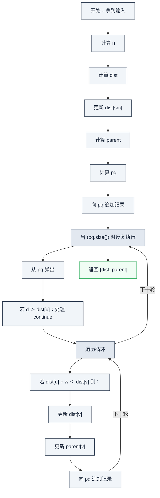

## TypeScript 解题方案（1 个方案逐个讲）

> **运行与提交**：每个方案都是自包含文件（内嵌用例自测，输出 PASS），整块复制到 `.ts` 文件后 `node 文件名` 即可运行。提交 LeetCode 时，把 `demo` 内的算法函数与辅助类型/函数整体取出、置于文件顶层即可。概念演示（非 LeetCode 编号题），在本地运行即可。

### 方案 1：方案1（优先队列实现单源最短路）

**分析与思路**：核心做法是「方案1（优先队列实现单源最短路）」。代码里依次做这些事：单循环线性扫描；栈的后进先出操作。

**运行方式**：`node 本文件`，内嵌用例全部通过会输出 PASS。

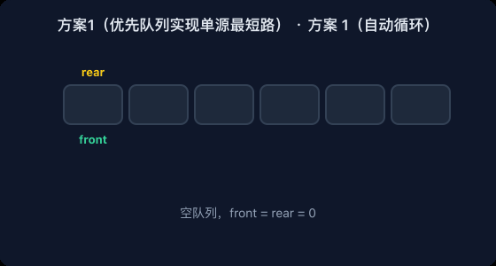

**方案专属流程图**（真实控制流）：

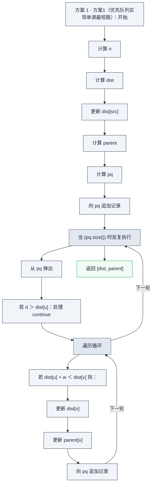

```typescript
/**
 ** 笔记：减治策略之详解 Dijkstra 算法
 ** 方案：方案1（优先队列实现单源最短路）
 ** 来源：python 参考忠实移植
 */

class MinHeap {
  // 定义类型
  private a: [number, number][] = []; // 把 []; 写入 private a: [number, number][]
  size(): number {
    return this.a.length;
  } // 大小(): number { return this.数组.长度; }
  push(x: [number, number]): void {
    // push(x: [number, number]): void {
    this.a.push(x); // 把 x 压入栈/数组尾部
    let i = this.a.length - 1; // 把 this.数组.长度 减 1 存入 下标 i
    while (i > 0) {
      // 循环，直到不满足「下标 i 超过 0」
      const p = (i - 1) >> 1; // 把 (下标 i 减 1) 超过 超过 1 存入 节点
      if (this.a[p][0] <= this.a[i][0]) break; // 若 this.数组[节点][0] 不超过 this.数组[下标 i][0]) break;
      [this.a[p], this.a[i]] = [this.a[i], this.a[p]]; // 把 [this.数组[下标 i], this.数组[节点]]; 写入 [this.a[p], this.a[i]]
      i = p; // 把 节点 存入 下标 i
    }
  }
  pop(): [number, number] | undefined {
    // pop(): [number, number] 按位或 undefined {
    if (!this.a.length) return undefined; // 若 取反 this.数组.长度，直接返回 undefined
    const top = this.a[0]; // 把 this.数组[0] 存入 top
    const last = this.a.pop()!; // 把 this.数组 弹出 )取反 存入 last
    if (this.a.length) {
      // 若 this.数组.长度
      this.a[0] = last; // 把 last; 写入 this.a[0]
      let i = 0; // 把 0 存入 下标 i
      const n = this.a.length; // 把 this.数组.长度 存入 元素个数
      while (true) {
        // 循环，直到不满足「true」
        let l = 2 * i + 1,
          r = 2 * i + 2,
          s = i; // 把 2 乘 下标 i 加 1, 右指针 赋值为 2 乘 下标 i 加 2, 字符串 赋值为 下标 i 存入 左指针
        if (l < n && this.a[l][0] < this.a[s][0]) s = l;
        if (r < n && this.a[r][0] < this.a[s][0]) s = r;
        if (s === i) break; // 若 字符串 全等于 下标 i) break;
        [this.a[s], this.a[i]] = [this.a[i], this.a[s]]; // 把 [this.数组[下标 i], this.数组[字符串]]; 写入 [this.a[s], this.a[i]]
        i = s; // 把 字符串 存入 下标 i
      }
    }
    return top; // 返回 top
  }
}

function dijkstra(
  graph: [number, number][][],
  src: number,
): [number[], number[]] {
  // 定义函数/方法 dijkstra
  const n = graph.length; // 把 graph.长度 存入 元素个数
  const dist: number[] = new Array(n).fill(Infinity); // 把 new Array(元素个数).fill(Infinity); 写入 const dist: number[]
  dist[src] = 0; // 把 0; 写入 dist[src]
  const parent: number[] = new Array(n).fill(-1); // 把 new Array(元素个数).fill( 减 1); 写入 const parent: number[]
  const pq = new MinHeap(); // 把 new MinHeap() 存入 优先队列
  pq.push([0, src]); // 把 [0, src] 压入栈/数组尾部
  while (pq.size()) {
    // 循环，直到不满足「优先队列.大小(」
    const [d, u] = pq.pop()!; // 弹出栈顶元素
    if (d > dist[u]) continue; // 若 d 超过 dist[节点 u]) continue;
    for (const [v, w] of graph[u]) {
      // for (const [值, 权重] of graph[节点 u]) {
      if (dist[u] + w < dist[v]) {
        // 若 dist[节点 u] 加 权重 小于 dist[值]
        dist[v] = dist[u] + w; // 把 dist[节点 u] 加 权重; 写入 dist[v]
        parent[v] = u; // 把 节点 u; 写入 parent[v]
        pq.push([dist[v], v]); // 把 [dist[值], 值] 压入栈/数组尾部
      }
    }
  }
  return [dist, parent]; // 返回 [dist, parent]
}

export function demo(): void {
  // 程序入口：跑内嵌自测用例
  function eqArr(a: number[], b: number[]): boolean {
    // 定义函数/方法 eqArr
    if (a.length !== b.length) return false; // 若 数组.长度 不等于 b.长度，直接返回 false
    for (let i = 0; i < a.length; i++) if (a[i] !== b[i]) return false; // 让 下标 i 从 0 开始计数，下标 i 小于 数组.长度 就继续
    return true; // 返回 true
  }
  const graph: [number, number][][] = [
    [
      [1, 4],
      [2, 1],
    ],
    [[3, 1]],
    [
      [1, 2],
      [3, 5],
    ],
    [[4, 3]],
    [],
  ];
  const cases: { src: number; wantDist: number[]; wantParent: number[] }[] = [
    { src: 0, wantDist: [0, 3, 1, 4, 7], wantParent: [-1, 2, 0, 1, 3] },
  ];
  let fail = false; // 把 false 存入 fail
  for (const c of cases) {
    // for (const 字符 of cases) {
    const [gotDist, gotParent] = dijkstra(graph, c.src); // 把 dijkstra(graph, 字符.src); 写入 const [gotDist, gotParent]
    if (!eqArr(gotDist, c.wantDist) || !eqArr(gotParent, c.wantParent)) {
      fail = true; // 把 true 存入 fail
      console.log(
        'FAIL src',
        c.src,
        'want',
        JSON.stringify(c.wantDist),
        JSON.stringify(c.wantParent),
        'got',
        JSON.stringify(gotDist),
        JSON.stringify(gotParent),
      ); // 「got」, JSON.stringify(gotDist), JSON.stringify(gotParent));
    }
  }
  if (fail) throw new Error('FAILED'); // 若 fail) throw new Error(「FAILED」);
  console.log('PASS'); // 全部用例通过，输出 PASS
}
demo(); // demo();
```

## 逐步拆解与面试追问

**复杂度**：时间 O(n²)（两层嵌套扫描），空间 O(1) 到 O(n)

**为什么是这个量级**：外层定起点、内层扫终点，n 个起点各扫 n 次

**面试官可能会追问**：

- 这个策略能推广到什么场景？
- 与暴力做法差在哪一步？
- 有没有更简单的等价写法？

## 关键 API 速查（TS 主解法实际用到，附官方链接）

| API | 作用 | 使用要点 | 官方文档 |
|---|---|---|---|
| `Array.prototype.push()` | 尾部追加 | 返回新长度；可一次多个；均摊 O(1)；会改变原数组 | [官方文档](https://developer.mozilla.org/zh-CN/docs/Web/JavaScript/Reference/Global_Objects/Array/push) |
| `Array.prototype.pop()` | 尾部弹出 | 返回被删元素（空数组返回 undefined）；O(1) | [官方文档](https://developer.mozilla.org/zh-CN/docs/Web/JavaScript/Reference/Global_Objects/Array/pop) |
| `JSON.stringify()` | 序列化为 JSON 字符串 | 常用于结构化比较（深度相等判定）；undefined/函数/循环引用会被丢弃或抛错 | [官方文档](https://developer.mozilla.org/zh-CN/docs/Web/JavaScript/Reference/Global_Objects/JSON/stringify) |

### 各语言官方文档导航

- **TypeScript / JS**：[MDN 中文参考](https://developer.mozilla.org/zh-CN/)
- **Python**：[Python 官方文档](https://docs.python.org/zh-cn/3/)
- **Go**：[Go 标准库](https://pkg.go.dev/std)
- **Java**：[JDK 17 API](https://docs.oracle.com/en/java/javase/17/docs/api/)
- **Rust**：[Rust 标准库](https://doc.rust-lang.org/std/)
- **Lua**：[Lua 5.4 手册](https://www.lua.org/manual/5.4/)
- **C**：[Cppreference C](https://zh.cppreference.com/w/c)
- **C++**：[Cppreference C++](https://zh.cppreference.com/w/cpp)
- **R**：[R 官方手册](https://stat.ethz.ch/R-manual/)
- **Zig**：[Zig 语言文档](https://ziglang.org/documentation/master/)
- **Dart**：[Dart API](https://api.dart.dev/)

## 附录：其他 10 种语言全部实现（每种语言列举其全部方案）

> TypeScript 的全部方案见「TypeScript 解题方案」一节；下面是其余 10 种语言的对应实现，每种语言的每个方案都带思路分析、代码走读与专属运行架构图。
> 每个方案都内嵌用例自测，可独立运行（老仓库 python/go 文件遵循「打印结果」约定）。
> 完整解法文件见 `dsa/<语言>/notes/lc_108717090_减治策略之详解dijkstra算法/`。

### Python 实现（1 种方案）

Python 的全部方案如下，每个方案都内嵌用例自测，可独立运行（老仓库 python/go 文件遵循「打印结果」约定）：

#### 方案 1：方案1（优先队列实现单源最短路）

**思路与代码分析**：核心是「方案1（优先队列实现单源最短路）」。Python 版用切片与字典推导式简化操作，突出可读性。代码里依次做这些事：队列或堆的调度。**走读**：方案 1 · 方案1（优先队列实现单源最短路）：开始 → 更新 n → 更新 dist → 更新 dist[src] → 更新 parent → 更新 pq → 当 pq: 时反复执行 → 更新 u → 若 d ＞ dist[u]：处理 continue → 遍历 graph[u]: 中的每个元素 w → 若 dist[u] + w ＜ dist[v]：更新 dist[v] → 更新 dist[v] → 更新 parent[v] → 调用 heapq.heappush(pq, (dist[v], → 返回 dist, parent。

**运行架构**（真实控制流）：

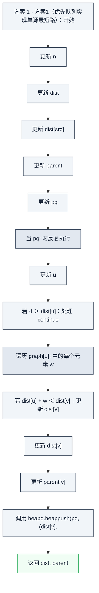

```python
import sys  # 提高递归深度上限（深输入防 RecursionError）

sys.setrecursionlimit(200000)  # 树/链表类题目节点数可达 1e4 量级
import heapq  # 引入依赖

def dijkstra(graph, src):  # 定义函数 dijkstra（参数：graph, src）
    """Dijkstra 单源最短路径（优先队列实现）。graph: 邻接表 list[list[(to, weight)]]。"""
    n = len(graph)  # 把 长度(graph) 存入 元素个数
    dist = [float("inf")] * n  # 把 [float('inf')] 乘 元素个数 存入 dist
    dist[src] = 0  # 把 0 写入 dist[src]
    parent = [-1] * n  # 把 [ 减 1] 乘 元素个数 存入 parent
    pq = [(0, src)]  # 把 [(0, src)] 存入 优先队列
    while pq:  # 循环，直到不满足「优先队列」
        d, u = heapq.heappop(pq)  # 把 heapq.heappop(优先队列) 写入 d, u
        if d > dist[u]:  # 若 d 超过 dist[节点 u]
            continue  # 跳过本轮，进入下一次
        for v, w in graph[u]:  # for 值, 权重 in graph[节点 u]:
            if dist[u] + w < dist[v]:  # 若 dist[节点 u] 加 权重 小于 dist[值]
                dist[v] = dist[u] + w  # 把 dist[节点 u] 加 权重 写入 dist[v]
                parent[v] = u  # 把 节点 u 写入 parent[v]
                heapq.heappush(pq, (dist[v], v))  # heapq.heappush(优先队列, (dist[值], 值))
    return dist, parent  # 返回 dist, parent

if __name__ == "__main__":  # 若 __name__ 等于 '__main__'
    # 带权有向图
    graph = [
        [(1, 4), (2, 1)],  # 0
        [(3, 1)],  # 1
        [(1, 2), (3, 5)],  # 2
        [(4, 3)],  # 3
        [],  # 4
    ]
    dist, parent = dijkstra(graph, 0)  # 把 dijkstra(graph, 0) 写入 dist, parent
    print("从源点 0 出发的最短距离:", dist)  # 打印输出
    print("父指针:", parent)  # 打印输出
```

### Go 实现（1 种方案）

Go 的全部方案如下，每个方案都内嵌用例自测，可独立运行（老仓库 python/go 文件遵循「打印结果」约定）：

#### 方案 1：方案1（优先队列实现单源最短路）

**思路与代码分析**：核心是「方案1（优先队列实现单源最短路）」。Go 版用切片与多返回值惯用法，显式处理索引边界。代码里依次做这些事：队列或堆的调度。**走读**：方案 1 · 方案1（优先队列实现单源最短路）：开始 → 更新 : → 遍历 dist 的下标与元素 i → 遍历循环 → 遍历 graph[u] 的下标与元素 e → 返回 dist, parent。

**运行架构**（真实控制流）：

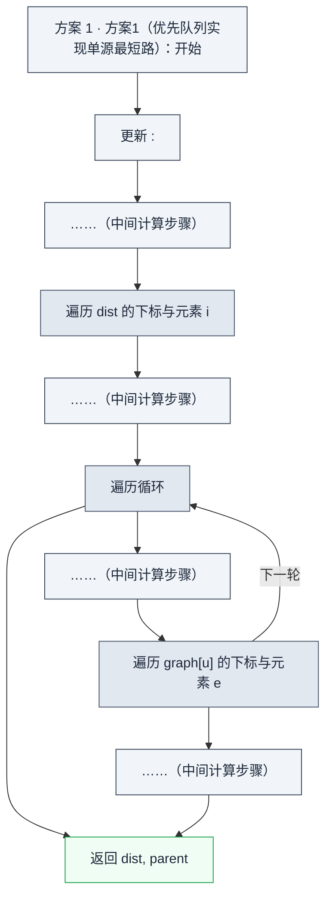

```go
package main // 引入依赖

import (
	"container/heap" // 「container 除以 堆」
	"fmt"            // 「fmt」
	"os"             // 「os」
	"reflect"        // 「reflect」
)

type Edge struct{ to, w int }          // 定义类型
type Item struct{ node, d, index int } // 定义类型
type PQ []*Item                        // 定义类型
func (pq PQ) Len() int                 { return len(pq) }                                                // 定义函数/方法 Len
func (pq PQ) Less(i, j int) bool       { return pq[i].d < pq[j].d }                                      // 定义函数/方法 Less
func (pq PQ) Swap(i, j int)            { pq[i], pq[j] = pq[j], pq[i]; pq[i].index = i; pq[j].index = j } // 定义函数/方法 Swap
func (pq *PQ) Push(x interface{})      { it := x.(*Item); it.index = len(*pq); *pq = append(*pq, it) }   // 定义函数/方法 Push
func (pq *PQ) Pop() interface{} {
	old := *pq
	n := len(old)
	it := old[n-1]
	old[n-1] = nil
	*pq = old[:n-1]
	return it
} // 定义函数/方法 Pop

// 忠实翻译 python/notes/lc_108717090_减治策略之详解dijkstra算法/solution_1___1.py
func dijkstra(graph [][]Edge, src int) ([]int, []int) { // 定义函数/方法 dijkstra
	n := len(graph)          // 把 长度(graph) 写入 n :
	dist := make([]int, n)   // 把 make([]int, 元素个数) 写入 dist :
	parent := make([]int, n) // 把 make([]int, 元素个数) 写入 parent :
	for i := range dist {
		dist[i] = 1 << 62
		parent[i] = -1
	}
	dist[src] = 0                          // 把 0 写入 dist[src]
	pq := make(PQ, 0)                      // 把 make(PQ, 0) 写入 pq :
	heap.Push(&pq, &Item{node: src, d: 0}) // 堆.Push( 按位与 优先队列, 按位与 Item{节点: src, d: 0})
	for pq.Len() > 0 {                     // for 优先队列.Len() 超过 0 {
		it := heap.Pop(&pq).(*Item) // 把 堆.Pop( 按位与 优先队列).( 乘 Item) 写入 it :
		u := it.node
		d := it.d // 把 it.节点; d : 赋值为 it.d 写入 u :
		if d > dist[u] {
			continue
		} // 若 d 超过 dist[节点 u] { continue }
		for _, e := range graph[u] { // 同时取 _ 与 e 遍历
			if dist[u]+e.w < dist[e.to] { // 若 dist[节点 u] 加 e.权重 小于 dist[e.to]
				dist[e.to] = dist[u] + e.w                       // 把 dist[节点 u] 加 e.权重 写入 dist[e.to]
				parent[e.to] = u                                 // 把 节点 u 写入 parent[e.to]
				heap.Push(&pq, &Item{node: e.to, d: dist[e.to]}) // 堆.Push( 按位与 优先队列, 按位与 Item{节点: e.to, d: dist[e.to]})
			}
		}
	}
	return dist, parent // 返回 dist, parent
}

func eqIntSlice(a, b []int) bool { return reflect.DeepEqual(a, b) } // 定义函数/方法 eqIntSlice

func main() { // 程序入口：跑内嵌自测用例
	graph1 := [][]Edge{{{1, 4}, {2, 1}}, {{3, 1}}, {{1, 2}, {3, 5}}, {{4, 3}}, {}}
	graph2 := [][]Edge{{{1, 10}}, {{2, 5}}, {{3, 1}}, {}} // 把 [][]Edge{ {{1, 10}}, {{2, 5}}, {{3, 1}}, {} } 写入 graph2 :
	type caseT struct {
		graph [][]Edge
		src   int
		distW []int
		parW  []int
	} // 定义类型
	cases := []caseT{ // 把 []caseT{ 写入 cases :
		{graph1, 0, []int{0, 3, 1, 4, 7}, []int{-1, 2, 0, 1, 3}},
		{graph2, 0, []int{0, 10, 15, 16}, []int{-1, 0, 1, 2}},
	}
	ok := true                // 把 true 写入 ok :
	for _, c := range cases { // 同时取 _ 与 字符 遍历
		dist, parent := dijkstra(c.graph, c.src) // 把 dijkstra(字符.graph, 字符.src) 写入 dist, parent :
		if !eqIntSlice(dist, c.distW) || !eqIntSlice(parent, c.parW) {
			ok = false                                                                                // 把 false 写入 ok
			fmt.Printf("FAIL dijkstra dist=%v parent=%v want %v %v\n", dist, parent, c.distW, c.parW) // 打印输出
		}
	}
	if !ok {
		os.Exit(1)
	} // 若 取反 ok { os.Exit(1) }
	fmt.Println("PASS") // 全部用例通过，输出 PASS
}
```

### Java 实现（1 种方案）

Java 的全部方案如下，每个方案都内嵌用例自测，可独立运行（老仓库 python/go 文件遵循「打印结果」约定）：

#### 方案 1：方案1（优先队列实现单源最短路）

**思路与代码分析**：核心是「方案1（优先队列实现单源最短路）」。Java 版用类与静态方法组织，集合操作显式明了。**走读**：方案 1 · 方案1（优先队列实现单源最短路）：开始 → 更新 this.to → 更新 this.w → 返回结果。

**运行架构**（真实控制流）：

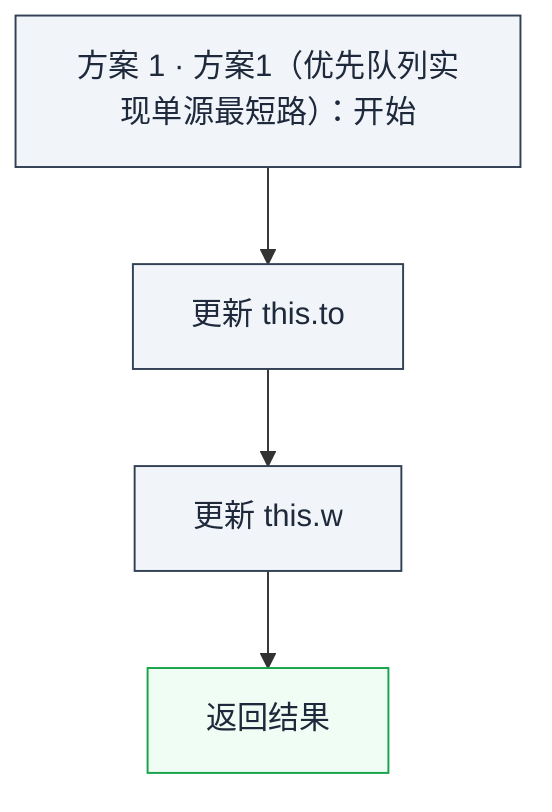

```java
package com.webfault.dsa; // 引入依赖

import java.util.*; // 引入依赖

class lc108717090_solution11 { // 定义类型
  static class Edge { // static class Edge {
    int to, w; // int to, 权重;

    Edge(int to, int w) {
      this.to = to;
      this.w = w;
    } // 把 to; this.权重 赋值为 权重; } 写入 Edge(int to, int w) { this.to
  }

  static class DResult { // static class DResult {
    int[] dist; // int[] dist;
    int[] parent; // int[] parent;
  }

  static DResult dijkstra(List<List<Edge>> graph, int src) { // 定义函数/方法 dijkstra
    int n = graph.size(); // 把 graph.大小() 存入 元素个数
    int[] dist = new int[n]; // 把 new int[元素个数]; 写入 int[] dist
    Arrays.fill(dist, Integer.MAX_VALUE); // Arrays.fill(dist, Integer.MAX_VALUE);
    dist[src] = 0; // 把 0; 写入 dist[src]
    int[] parent = new int[n]; // 把 new int[元素个数]; 写入 int[] parent
    Arrays.fill(parent, -1); // Arrays.fill(parent, 减 1);
    PriorityQueue<int[]> pq = new PriorityQueue<>(Comparator.comparingInt(a -> a[0]));
    pq.add(new int[] {0, src}); // 优先队列 追加 new int[]{0, src});
    while (!pq.isEmpty()) { // 循环，直到不满足「取反 优先队列.isEmpty(」
      int[] cur = pq.poll(); // 把 优先队列.poll(); 写入 int[] cur
      int d = cur[0], u = cur[1]; // 把 当前值[0], 节点 u 赋值为 当前值[1] 存入 d
      if (d > dist[u]) continue; // 若 d 超过 dist[节点 u]) continue;
      for (Edge e : graph.get(u)) { // for (Edge e : graph 查找 节点 u)) {
        if (dist[u] + e.w < dist[e.to]) { // 若 dist[节点 u] 加 e.权重 小于 dist[e.to]
          dist[e.to] = dist[u] + e.w; // 把 dist[节点 u] 加 e.权重; 写入 dist[e.to]
          parent[e.to] = u; // 把 节点 u; 写入 parent[e.to]
          pq.add(new int[] {dist[e.to], e.to}); // 优先队列 追加 new int[]{dist[e.to], e.to});
        }
      }
    }
    DResult r = new DResult(); // 把 new DResult(); 写入 DResult r
    r.dist = dist; // 把 dist; 写入 r.dist
    r.parent = parent; // 把 parent; 写入 r.parent
    return r; // 返回 右指针
  }

  public static void main(String[] args) { // public static void main(String[] args) {
    List<List<Edge>> graph =
        new ArrayList<>(); // 把 new ArrayList 小于 超过 (); 写入 List<List<Edge>> graph
    for (int i = 0; i < 5; i++) graph.add(new ArrayList<>()); // 让 下标 i 从 0 开始计数，下标 i 小于 5 就继续
    graph.get(0).add(new Edge(1, 4)); // graph 查找 0) 追加 new Edge(1, 4));
    graph.get(0).add(new Edge(2, 1)); // graph 查找 0) 追加 new Edge(2, 1));
    graph.get(1).add(new Edge(3, 1)); // graph 查找 1) 追加 new Edge(3, 1));
    graph.get(2).add(new Edge(1, 2)); // graph 查找 2) 追加 new Edge(1, 2));
    graph.get(2).add(new Edge(3, 5)); // graph 查找 2) 追加 new Edge(3, 5));
    graph.get(3).add(new Edge(4, 3)); // graph 查找 3) 追加 new Edge(4, 3));
    DResult res = dijkstra(graph, 0); // 把 dijkstra(graph, 0); 写入 DResult res
    int[] expectDist = {0, 3, 1, 4, 7}; // 把 {0, 3, 1, 4, 7}; 写入 int[] expectDist
    int[] expectParent = {-1, 2, 0, 1, 3}; // 把 { 减 1, 2, 0, 1, 3}; 写入 int[] expectParent
    for (int i = 0; i < 5; i++) { // 让 下标 i 从 0 开始计数，下标 i 小于 5 就继续
      if (res.dist[i] != expectDist[i]) { // 若 结果.dist[下标 i] 不等于 expectDist[下标 i]
        System.out.println("FAIL dist[" + i + "]=" + res.dist[i]); // 打印输出
        throw new RuntimeException("FAILED"); // throw new RuntimeException(「FAILED」);
      }
      if (res.parent[i] != expectParent[i]) { // 若 结果.parent[下标 i] 不等于 expectParent[下标 i]
        System.out.println("FAIL parent[" + i + "]=" + res.parent[i]); // 打印输出
        throw new RuntimeException("FAILED"); // throw new RuntimeException(「FAILED」);
      }
    }
    System.out.println("PASS"); // 全部用例通过，输出 PASS
  }
}
```

### Rust 实现（1 种方案）

Rust 的全部方案如下，每个方案都内嵌用例自测，可独立运行（老仓库 python/go 文件遵循「打印结果」约定）：

#### 方案 1：方案1（优先队列实现单源最短路）

**思路与代码分析**：核心是「方案1（优先队列实现单源最短路）」。Rust 版用所有权移动与切片借用改写同一逻辑，注意 Option 与引用边界。**走读**：方案 1 · 方案1（优先队列实现单源最短路）：开始 → 计算 n → 遍历 0..n 中的每个元素 i → 遍历循环 → 返回结果。

**运行架构**（真实控制流）：

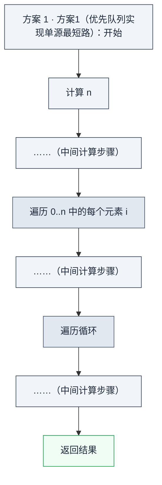

```rust
// 减治策略之详解Dijkstra算法 — Rust 版（方案1）
fn dijkstra_shortest(graph: &[Vec<(usize, i32)>], start: usize) -> Vec<i32> {
    // 定义函数/方法 dijkstra_shortest
    let n = graph.len(); // 把 graph.长度() 存入 元素个数
    let mut dist = vec![i32::MAX; n]; // 把 vec取反 [i32::MAX; 元素个数]; 写入 let mut dist
    dist[start] = 0; // 把 0; 写入 dist[start]
    let mut visited = vec![false; n]; // 把 vec取反 [false; 元素个数]; 写入 let mut visited
    loop {
        // loop {
        let mut u = usize::MAX; // 把 usize::MAX; 写入 let mut u
        for i in 0..n {
            // 逐个取出 0 的元素（下标 i）
            if !visited[i] && (u == usize::MAX || dist[i] < dist[u]) {
                u = i;
            }
        }
        if u == usize::MAX || dist[u] == i32::MAX {
            break;
        } // 若 节点 u 等于 usize::MAX 或 dist[节点 u] 等于 i32::MAX { break; }
        visited[u] = true; // 把 true; 写入 visited[u]
        for &(v, w) in &graph[u] {
            // for 按位与 (值, 权重) in 按位与 graph[节点 u] {
            if dist[u] + w < dist[v] {
                dist[v] = dist[u] + w;
            }
        }
    }
    dist // dist
}
fn main() {
    // 程序入口：跑内嵌自测用例
    // 5节点: 0->1(10), 0->2(3), 1->2(1), 2->1(4), 1->3(2), 2->3(8), 3->4(7)
    let g = vec![
        vec![(1, 10), (2, 3)],
        vec![(2, 1), (3, 2)],
        vec![(1, 4), (3, 8)],
        vec![(4, 7)],
        vec![],
    ];
    let d = dijkstra_shortest(&g, 0); // 把 dijkstra_shortest( 按位与 g, 0) 存入 d
    assert_eq!(d[0], 0); // 断言校验
    assert_eq!(d[1], 7); // 0->2->1 = 3+4
    assert_eq!(d[2], 3); // 断言校验
    assert_eq!(d[3], 9); // 0->2->1->3 = 3+4+2
    assert_eq!(d[4], 16); // 断言校验
    println!("PASS");
} // 全部用例通过，输出 PASS
```

### Lua 实现（1 种方案）

Lua 的全部方案如下，每个方案都内嵌用例自测，可独立运行（老仓库 python/go 文件遵循「打印结果」约定）：

#### 方案 1：方案1（优先队列实现单源最短路）

**思路与代码分析**：核心是「方案1（优先队列实现单源最短路）」。Lua 版用表与 ipairs 遍历，注意 ipairs 遇 nil 即停的语义。**走读**：方案 1 · 方案1（优先队列实现单源最短路）：开始 → 更新 n → 循环 i：从 1 到 n do → 当 true do 时反复执行 → 循环 i：从 1 到 n do → 遍历 ipairs(graph[u] or 中的每个元素 e → 循环 i：从 1 到 n do → 返回 out。

**运行架构**（真实控制流）：

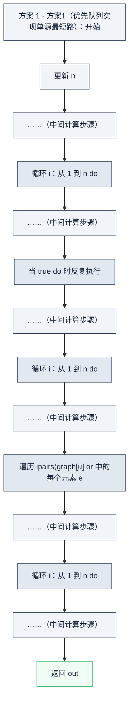

```lua
-- 减治策略之详解Dijkstra算法 — Lua 版（方案1）
local function dijkstra_shortest(graph, start) -- local function dijkstra_shortest(graph, 起点)
	local n = #graph -- 把 #graph 写入 local n
	local dist, visited = {}, {} -- 把 {}, {} 写入 local dist, visited
	for i = 1, n do
		dist[i] = math.huge
		visited[i] = false
	end -- 让 下标 i 从 1 走到 元素个数（Lua 1 基）
	dist[start + 1] = 0 -- 把 0 写入 dist[start + 1]
	while true do -- while true do
		local u = nil -- 把 nil 写入 local u
		for i = 1, n do -- 让 下标 i 从 1 走到 元素个数（Lua 1 基）
			if not visited[i] and (u == nil or dist[i] < dist[u]) then
				u = i
			end
		end -- 终点
		if u == nil or dist[u] == math.huge then
			break
		end -- 若 节点 u 等于 nil or dist[节点 u] 等于 math.huge then break 终点
		visited[u] = true -- 把 true 写入 visited[u]
		for _, e in ipairs(graph[u] or {}) do -- 遍历取 e
			local v, w = e[1] + 1, e[2] -- 把 e[1] 加 1, e[2] 写入 local v, w
			if dist[u] + w < dist[v] then
				dist[v] = dist[u] + w
			end
		end -- 终点
	end -- 终点
	local out = {} -- 把 {} 写入 local out
	for i = 1, n do
		out[i] = dist[i]
	end -- 让 下标 i 从 1 走到 元素个数（Lua 1 基）
	return out -- 返回 out
end -- 终点
local g = { { { 1, 10 }, { 2, 3 } }, { { 2, 1 }, { 3, 2 } }, { { 1, 4 }, { 3, 8 } }, { { 4, 7 } }, {} }
local d = dijkstra_shortest(g, 0) -- 把 dijkstra_shortest(g, 0) 写入 local d
assert(d[1] == 0 and d[2] == 7 and d[3] == 3 and d[4] == 9 and d[5] == 16) -- 断言校验
print("PASS") -- 全部用例通过，输出 PASS
```

### C 实现（1 种方案）

C 的全部方案如下，每个方案都内嵌用例自测，可独立运行（老仓库 python/go 文件遵循「打印结果」约定）：

#### 方案 1：方案1（优先队列实现单源最短路）

**思路与代码分析**：核心是「方案1（优先队列实现单源最短路）」。C 版手动管理下标与内存，循环边界全部显式写出。代码里依次做这些事：双重循环遍历。**走读**：方案 1 · 方案1（优先队列实现单源最短路）：开始 → 更新 visited[64] → 遍历循环 → 当 (1) 时反复执行 → 遍历循环 → 遍历循环 → 遍历循环 → 返回结果。

**运行架构**（真实控制流）：

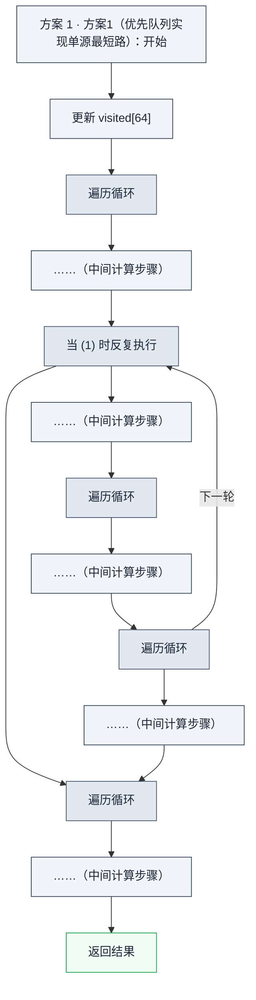

```c
/* 减治策略之详解Dijkstra算法 — C 版（方案1） */
#include <stdio.h> // 引入头文件
static void dijkstra_shortest(const int edges[][6], const int esizes[], int n, int start,
                              int out[]) { // 定义函数/方法 dijkstra_shortest
    int dist[64], visited[64] = {0};       // 把 {0}; 写入 int dist[64], visited[64]
    for (int i = 0; i < n; i++)
        dist[i] = 0x3f3f3f3f; // 让 下标 i 从 0 开始计数，下标 i 小于 元素个数 就继续
    dist[start] = 0;          // 把 0; 写入 dist[start]
    while (1) {               // 循环，直到不满足「1」
        int u = -1;           // 把 减 1 存入 节点 u
        for (int i = 0; i < n; i++) { // 让 下标 i 从 0 开始计数，下标 i 小于 元素个数 就继续
            if (!visited[i] && (u < 0 || dist[i] < dist[u]))
                u = i;
        }
        if (u < 0 || dist[u] == 0x3f3f3f3f)
            break;      // 若 节点 u 小于 0 或 dist[节点 u] 等于 0x3f3f3f3f) break;
        visited[u] = 1; // 把 1; 写入 visited[u]
        for (int i = 0; i < esizes[u]; i++) { // 让 下标 i 从 0 开始计数，下标 i 小于 esizes[节点 u] 就继续
            int v = edges[u][i * 2], w = edges[u][i * 2 + 1]; // 把 边集[节点 u][下标 i 乘 2], 权重 赋值为
                                                              // 边集[节点 u][下标 i 乘 2 加 1] 存入 值
            if (dist[u] + w < dist[v])
                dist[v] = dist[u] +
                          w; // 若 dist[节点 u] 加 权重 小于 dist[值]) dist[值] 赋值为 dist[节点 u] 加 权重;
        }
    }
    for (int i = 0; i < n; i++)
        out[i] = dist[i]; // 让 下标 i 从 0 开始计数，下标 i 小于 元素个数 就继续
}
int main(void) { // 程序入口：跑内嵌自测用例
    /* 5节点: 0->1(10),0->2(3),1->2(1),1->3(2),2->1(4),2->3(8),3->4(7) */
    static const int edges[5][6] = {{1, 10, 2, 3}, {2, 1, 3, 2}, {1, 4, 3, 8}, {4, 7}, {}};
    static const int esizes[5] = {2, 2, 2, 1, 0}; // 把 {2,2,2,1,0}; 写入 static const int esizes[5]
    int out[64];                                  // int out[64];
    dijkstra_shortest(edges, esizes, 5, 0, out);  // dijkstra_shortest(边集, esizes, 5, 0, out);
    int want[] = {0, 7, 3, 9, 16};                // 把 {0,7,3,9,16}; 写入 int want[]
    for (int i = 0; i < 5; i++)
        if (out[i] != want[i]) {
            printf("FAIL %d\n", i);
            return 1;
        } // 让 下标 i 从 0 开始计数，下标 i 小于 5 就继续
    printf("PASS\n");
    return 0;
} // 全部用例通过，输出 PASS
```

### C++ 实现（1 种方案）

C++ 的全部方案如下，每个方案都内嵌用例自测，可独立运行（老仓库 python/go 文件遵循「打印结果」约定）：

#### 方案 1：方案1（优先队列实现单源最短路）

**思路与代码分析**：核心是「方案1（优先队列实现单源最短路）」。C++ 版用 STL 容器与迭代器，减少手写下标错误。代码里依次做这些事：双重循环遍历。**走读**：方案 1 · 方案1（优先队列实现单源最短路）：开始 → 更新 n → 当 (true) 时反复执行 → 遍历循环 → 遍历循环 → 返回 dist。

**运行架构**（真实控制流）：

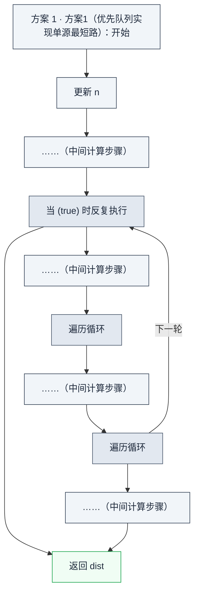

```cpp
// 减治策略之详解Dijkstra算法 — C++ 版（方案1）
#include <cassert>  // 引入头文件
#include <iostream> // 引入头文件
#include <vector>   // 引入头文件
static std::vector<int> dijkstraShortest(const std::vector<std::vector<std::pair<int, int>>> &graph,
                                         int start) {
    size_t n = graph.size();              // 把 graph.大小(); 写入 size_t n
    std::vector<int> dist(n, 0x3f3f3f3f); // std::vector 小于 int 超过 dist(元素个数, 0x3f3f3f3f);
    std::vector<bool> visited(n, false); // std::vector 小于 bool 超过 已访问集合(元素个数, false);
    dist[start] = 0;                     // 把 0; 写入 dist[start]
    while (true) {                       // 循环，直到不满足「true」
        int u = -1;                      // 把 减 1 存入 节点 u
        for (size_t i = 0; i < n; ++i) { // 让 下标 i 从 0 开始计数，下标 i 小于 元素个数 就继续
            if (!visited[i] && (u < 0 || dist[i] < dist[u]))
                u = static_cast<int>(i);
        }
        if (u < 0 || dist[u] == 0x3f3f3f3f)
            break;                      // 若 节点 u 小于 0 或 dist[节点 u] 等于 0x3f3f3f3f) break;
        visited[u] = true;              // 把 true; 写入 visited[u]
        for (auto &[v, w] : graph[u]) { // for (auto 按位与 [值, 权重] : graph[节点 u]) {
            if (dist[u] + w < dist[v])
                dist[v] = dist[u] +
                          w; // 若 dist[节点 u] 加 权重 小于 dist[值]) dist[值] 赋值为 dist[节点 u] 加 权重;
        }
    }
    return dist; // 返回 dist
}
int main() { // 程序入口：跑内嵌自测用例
    std::vector<std::vector<std::pair<int, int>>> g = {
        // 把 { 写入 std::vector<std::vector<std::pair<int, int>>> g
        {{1, 10}, {2, 3}},
        {{2, 1}, {3, 2}},
        {{1, 4}, {3, 8}},
        {{4, 7}},
        {} // {{1,10},{2,3}}, {{2,1},{3,2}}, {{1,4},{3,8}}, {{4,7}}, {}
    };
    auto d = dijkstraShortest(g, 0); // 把 dijkstraShortest(g, 0) 存入 d
    assert(d[0] == 0 && d[1] == 7 && d[2] == 3 && d[3] == 9 && d[4] == 16); // 断言校验
    std::cout << "PASS" << std::endl;
} // 全部用例通过，输出 PASS
```

### R 实现（1 种方案）

R 的全部方案如下，每个方案都内嵌用例自测，可独立运行（老仓库 python/go 文件遵循「打印结果」约定）：

#### 方案 1：方案1（优先队列实现单源最短路）

**思路与代码分析**：核心是「方案1（优先队列实现单源最短路）」。R 版用向量化思维与 1 起始下标，注意 1:n 的降序陷阱。代码里依次做这些事：双重循环遍历。**走读**：方案 1 · 方案1（优先队列实现单源最短路）：开始 → 处理 n ＜- length(edges_list) → 循环 i：遍历 1:n → 循环 e：遍历 nb → 返回结果。

**运行架构**（真实控制流）：

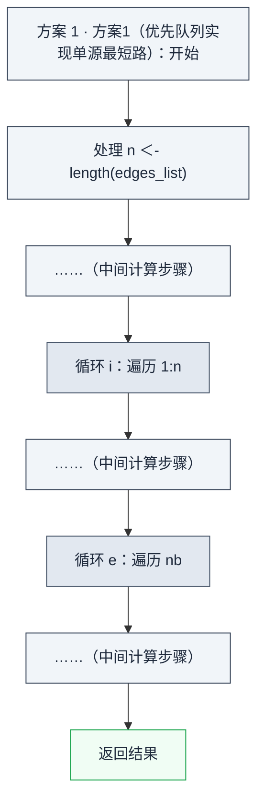

```r
# 版（方案1） 定义函数 dijkstra_shortest（参数：edges_list, 起点）
dijkstra_shortest <- function(edges_list, start) {
    n <- length(edges_list)  # 把 长度(edges_list) 存入 元素个数
    dist <- rep(.Machine$integer.max, n)  # 把 rep(.Machine$integer.max, 元素个数) 存入 dist
    visited <- rep(FALSE, n)  # 把 rep(FALSE, 元素个数) 存入 已访问集合
    dist[start + 1L] <- 0L  # dist[起点 加 1L] 小于 减 0L
    repeat {
        # repeat {
        u <- NA  # 把 NA 存入 节点 u
        for (i in 1:n) {
            # for (下标 i in 1:元素个数) {
            if (!visited[i] && (is.na(u) || dist[i] < dist[u]))
                u <- i
        }
        if (is.na(u) || dist[u] == .Machine$integer.max)
            break  # 若 is.na(节点 u) 或 dist[节点 u] 等于 .Machine$integer.max) break
        visited[u] <- TRUE  # 把 TRUE 存入 visited[u]
        nb <- if (!is.null(edges_list[[u]]))
            edges_list[[u]] else list()
        if (length(nb) > 0) {
            # 若 长度(nb) 超过 0 for (e in nb) {
            for (e in nb) {
                v <- e[1] + 1L  # 把 e[1] 加 1L 存入 值
                w <- e[2]  # 把 e[2] 存入 权重
                nd <- as.numeric(dist[u]) + w  # 把 as.numeric(dist[节点 u]) 加 权重 存入 nd
                if (nd < dist[v] && nd < .Machine$integer.max)
                  dist[v] <- as.integer(nd)
            }
        }
    }
    dist  # dist
}
g <- list(list(c(1L, 10L), c(2L, 3L)), list(c(2L, 1L), c(3L, 2L)), list(c(1L, 4L), c(3L, 8L)), list(c(4L, 7L)),
    list())
d <- dijkstra_shortest(g, 0)  # 把 dijkstra_shortest(g, 0) 存入 d
stopifnot(d[1] == 0, d[2] == 7, d[3] == 3, d[4] == 9, d[5] == 16)  # 断言校验
cat("PASS\n")  # 全部用例通过，输出 PASS
```

### Zig 实现（1 种方案）

Zig 的全部方案如下，每个方案都内嵌用例自测，可独立运行（老仓库 python/go 文件遵循「打印结果」约定）：

#### 方案 1：方案1（优先队列实现单源最短路）

**思路与代码分析**：核心是「方案1（优先队列实现单源最短路）」。Zig 版显式分配与清零，整型边界处理严格。代码里依次做这些事：双重循环遍历。**走读**：方案 1 · 方案1（优先队列实现单源最短路）：开始 → 计算 n → 遍历集合元素 → 当 (true) 时反复执行 → 遍历集合元素 → 遍历集合元素 → 返回 dist。

**运行架构**（真实控制流）：

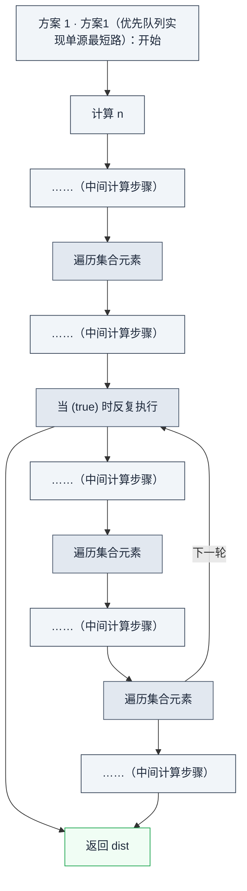

```zig
// 减治策略之详解Dijkstra算法 — Zig 版（方案1）
const std = @import("std"); // 把 @import(「std」) 存入 std
const INF: i32 = 0x3f3f3f3f; // 把 0x3f3f3f3f; 写入 const INF: i32
fn dijkstraShortest(graph: []const []const [2]i32, start: usize) [8]i32 { // 定义函数/方法 dijkstraShortest
    const n = graph.len; // 把 graph.长度 存入 元素个数
    var dist: [8]i32 = undefined; // 把 undefined; 写入 var dist: [8]i32
    var visited: [8]bool = undefined; // 把 undefined; 写入 var visited: [8]bool
    for (0..n) |i| { // 让 下标 i 从 0 走到 元素个数 减一
        dist[i] = INF; // 把 INF; 写入 dist[i]
        visited[i] = false; // 把 false; 写入 visited[i]
    }
    dist[start] = 0; // 把 0; 写入 dist[start]
    while (true) { // 循环，直到不满足「true」
        var u: usize = std.math.maxInt(usize); // 把 std.math.maxInt(usize); 写入 var u: usize
        for (0..n) |i| { // 让 下标 i 从 0 走到 元素个数 减一
            if (!visited[i] and (u == std.math.maxInt(usize) or dist[i] < dist[u])) u = i;
        }
        if (u == std.math.maxInt(usize) or dist[u] == INF) break;
        visited[u] = true; // 把 true; 写入 visited[u]
        for (graph[u]) |e| { // for (graph[节点 u]) 按位或 e 按位或 {
            const v: usize = @intCast(e[0]); // 把 @intCast(e[0]); 写入 const v: usize
            if (dist[u] + e[1] < dist[v]) dist[v] = dist[u] + e[1];
        }
    }
    return dist; // 返回 dist
}
pub fn main() !void { // 程序入口：跑内嵌自测用例
    const g0 = [_][2]i32{ .{ 1, 10 }, .{ 2, 3 } }; // 把 [_][2]i32{ .{ 1, 10 }, .{ 2, 3 } } 存入 g0
    const g1 = [_][2]i32{ .{ 2, 1 }, .{ 3, 2 } }; // 把 [_][2]i32{ .{ 2, 1 }, .{ 3, 2 } } 存入 g1
    const g2 = [_][2]i32{ .{ 1, 4 }, .{ 3, 8 } }; // 把 [_][2]i32{ .{ 1, 4 }, .{ 3, 8 } } 存入 g2
    const g3 = [_][2]i32{.{ 4, 7 }}; // 把 [_][2]i32{.{ 4, 7 }} 存入 g3
    const g4 = [_][2]i32{}; // 把 [_][2]i32{} 存入 g4
    const g = [_][]const [2]i32{ &g0, &g1, &g2, &g3, &g4 };
    const d = dijkstraShortest(&g, 0); // 把 dijkstraShortest( 按位与 g, 0) 存入 d
    if (d[0] != 0 or d[1] != 7 or d[2] != 3 or d[3] != 9 or d[4] != 16) return error.TestFailed;
    std.debug.print("PASS\n", .{});
} // 全部用例通过，输出 PASS
```

### Dart 实现（1 种方案）

Dart 的全部方案如下，每个方案都内嵌用例自测，可独立运行（老仓库 python/go 文件遵循「打印结果」约定）：

#### 方案 1：方案1（优先队列实现单源最短路）

**思路与代码分析**：核心是「方案1（优先队列实现单源最短路）」。Dart 版用可空类型标注与集合方法，注意空安全。代码里依次做这些事：双重循环遍历。**走读**：方案 1 · 方案1（优先队列实现单源最短路）：开始 → 更新 n → 当 (true) 时反复执行 → 遍历循环 → 遍历循环 → 返回 dist。

**运行架构**（真实控制流）：


```dart
// 减治策略之详解Dijkstra算法 — Dart 版（方案1）
List<int> dijkstraShortest(List<List<List<int>>> graph, int start) {
  // 定义函数/方法 dijkstraShortest
  final n = graph.length; // 把 graph.长度 存入 元素个数
  final dist = List<int>.filled(
    n,
    0x3f3f3f3f,
  ); // 把 List 小于 int 超过 .filled(元素个数, 0x3f3f3f3f) 存入 dist
  final visited = List<bool>.filled(
    n,
    false,
  ); // 把 List 小于 bool 超过 .filled(元素个数, false) 存入 已访问集合
  dist[start] = 0; // 把 0; 写入 dist[start]
  while (true) {
    // 循环，直到不满足「true」
    int u = -1; // 把 减 1 存入 节点 u
    for (var i = 0; i < n; i++) {
      // 让 下标 i 从 0 开始计数，下标 i 小于 元素个数 就继续
      if (!visited[i] && (u < 0 || dist[i] < dist[u])) u = i;
    }
    if (u < 0 || dist[u] == 0x3f3f3f3f)
      break; // 若 节点 u 小于 0 或 dist[节点 u] 等于 0x3f3f3f3f) break;
    visited[u] = true; // 把 true; 写入 visited[u]
    for (final e in graph[u]) {
      // for (final e in graph[节点 u]) {
      final v = e[0], w = e[1]; // 把 e[0], 权重 赋值为 e[1] 存入 值
      if (dist[u] + w < dist[v])
        dist[v] =
            dist[u] +
            w; // 若 dist[节点 u] 加 权重 小于 dist[值]) dist[值] 赋值为 dist[节点 u] 加 权重;
    }
  }
  return dist; // 返回 dist
}

void main() {
  // 程序入口：跑内嵌自测用例
  final g = <List<List<int>>>[
    [
      [1, 10],
      [2, 3],
    ],
    [
      [2, 1],
      [3, 2],
    ],
    [
      [1, 4],
      [3, 8],
    ],
    [
      [4, 7],
    ],
    [], // []
  ];
  final d = dijkstraShortest(g, 0); // 把 dijkstraShortest(g, 0) 存入 d
  if (d[0] != 0 || d[1] != 7 || d[2] != 3 || d[3] != 9 || d[4] != 16)
    throw StateError('x');
  print('PASS');
} // 全部用例通过，输出 PASS
```

---

## 内容总结

- **减治策略之详解dijkstra算法**（算法笔记 · Medium）：共 1 个方案，主线思路「方案1（优先队列实现单源最短路）」；时间 O(n²)（两层嵌套扫描）；动画演示归并分治过程，附录给出 11 种语言 × 全部方案的可运行实现。
- 来源博客：[https://blog.csdn.net/tyro_java/article/details/108717090](https://blog.csdn.net/tyro_java/article/details/108717090)
- 导航：[📋 总目录](../) ｜ [← 213 减治策略之heap binary](../213_减治策略之heap_binarysearch_selectionsort_hea/) ｜ [215 分治策略之greatest sl →](../215_分治策略之greatest_slice_2-way_merge_counting/)
