# 215 · 分治策略之greatest slice 2-way merge counting（第附阶段 · 专题补充 · Medium）

> **难度**：⭐⭐ Medium ｜ **专题**：算法笔记
> **学习定位**：第附阶段 · 专题补充第 215 篇 ｜ **解法数**：5
> **内容总结**：**分治策略之greatest slice 2-way merge counting**（算法笔记 · Medium）：共 5 个方案，主线思路「迭代指针处理」；时间 O(n)（单趟线性扫描）；动画演示归并分治过程，附录给出 11 种语言 × 全部方案的可运行实现。

---

## 题目描述

分治策略之greatest slice 2-way merge counting。具体输入输出约定见函数签名与用例。

- 主函数签名：`function treeToLevel(root: any): any[]`

**用例演示**（摘自主解法内嵌自测，输入到输出一目了然）：

```typescript
  const cases = [
    { in: [[-2, 1, -3, 4, -1, 2, 1, -5, 4]], want: 6 },
    { in: [[1]], want: 1 },
    { in: [[-1, -2, -3]], want: -1 },
    { in: [[5, 4, -1, 7, 8]], want: 23 },
  ];
```

**数据范围与注意事项**：

- **易错点**：先看小例子手推一遍再对照代码，比直接读代码快得多。

## 题目分析

**场景是什么**：综合练习：把数据结构与策略组合起来解决一个完整问题。本题就是该场景的 Medium 级练习，主线做法是「迭代指针处理」。

**主线怎么解**：把主解法从头到尾过一遍，它其实在依次做这几件事：队列或堆的调度。

## 解题思路

**方案对比**（共 5 个方案，由浅入深）：

| 方案 | 时间复杂度 | 空间复杂度 |
|---|---|---|
| 方案 1 · 迭代指针处理 | O(n)（单趟线性扫描） | O(1) 到 O(n)（视辅助结构） |
| 方案 2 · 直接实现 | O(n) 量级 | O(n) |
| 方案 3 · 直接实现 | O(n) 量级 | O(n) |
| 方案 4 · 直接实现 | O(n) 量级 | O(n) |
| 方案 5 · 迭代指针处理 | O(n)（单趟线性扫描） | O(1) 到 O(n)（视辅助结构） |

**由浅入深的路径**：迭代指针处理 → 直接实现；每往右一步，都在补上一步的短板。

**方案间的取舍**：方案 1（迭代指针处理）；方案 2（直接实现）；方案 3（直接实现）；方案 4（直接实现）；方案 5（迭代指针处理）。数据规模小、可读性优先时选靠前的方案；规模大、性能优先时选靠后的方案。

**怎么读这一篇**：

- 🐣 **新手路线**：把「题目描述」的示例 1 在纸上手推一遍 → 读方案 1（最直观的写法）与它的代码走读 → 按「运行方式」本地跑通看 PASS → 回头对比方案 2 之后的写法差在哪
- 🦅 **大佬路线**：直接锁定最优方案 1（迭代指针处理，O(n)（单趟线性扫描））→ 跳读该方案代码与走读 → 用「逐步拆解与面试追问」补齐复杂度推导与边界追问

### 动态算法图（归并分治，GIF 自动循环）


动画演示算法笔记专题里归并分治的典型过程；每个方案在「TypeScript 解题方案」一节还配了专属动画与专属流程图。

### 主解法流程图（真实控制流）

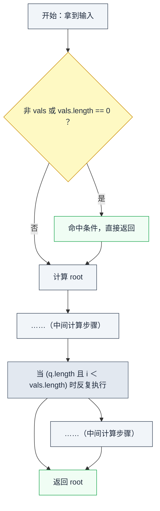

## TypeScript 解题方案（5 个方案逐个讲）

> **运行与提交**：每个方案都是自包含文件（内嵌用例自测，输出 PASS），整块复制到 `.ts` 文件后 `node 文件名` 即可运行。提交 LeetCode 时，把 `demo` 内的算法函数与辅助类型/函数整体取出、置于文件顶层即可。概念演示（非 LeetCode 编号题），在本地运行即可。

### 方案 1：迭代指针处理

**分析与思路**：核心做法是「迭代指针处理」。代码里依次做这些事：队列或堆的调度。

**运行方式**：`node 本文件`，内嵌用例全部通过会输出 PASS。


**方案专属流程图**（真实控制流）：

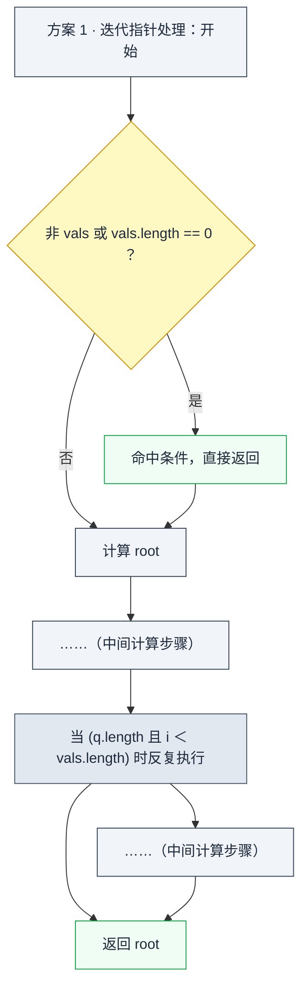

```typescript
class TreeNode {
  // 定义类型
  val: any;
  left: any;
  right: any; // 值: any; 左边界: any; 右边界: any;
  constructor(val?: any, left?: any, right?: any) {
    // constructor(值?: any, 左边界?: any, 右边界?: any) {
    this.val = val === undefined ? 0 : val; // 把 (值 全等于 undefined ? 0 : 值); 写入 值
    this.left = left === undefined ? null : left; // 把 (左边界 全等于 undefined ? null : 左边界); 写入 左边界
    this.right = right === undefined ? null : right; // 把 (右边界 全等于 undefined ? null : 右边界); 写入 右边界
  }
}
function buildTree(vals: any): any {
  // 定义函数/方法 buildTree
  if (!vals || vals.length === 0) return null; // 若 取反 vals 或 vals.长度 全等于 0，直接返回 null
  const root = new TreeNode(vals[0]);
  const q: any[] = [root];
  let i = 1;
  while (q.length && i < vals.length) {
    // 循环，直到不满足「节点.长度 且 下标 i 小于 vals.长度」
    const node = q.shift(); // 把 节点.shift() 存入 节点
    if (vals[i] !== null && vals[i] !== undefined) {
      node.left = new TreeNode(vals[i]);
      q.push(node.left);
    }
    i++; // 下标 i 加一
    if (i < vals.length && vals[i] !== null && vals[i] !== undefined) {
      node.right = new TreeNode(vals[i]);
      q.push(node.right);
    }
    i++; // 下标 i 加一
  }
  return root; // 返回 根节点
}
function treeToLevel(root: any): any[] {
  // 定义函数/方法 treeToLevel
  if (!root) return []; // 若 取反 根节点，直接返回 []
  const out: any[] = [];
  const q: any[] = [root]; // 把 []; const 节点: any[] 赋值为 [根节点]; 写入 const out: any[]
  while (q.length) {
    // 循环，直到不满足「节点.长度」
    const n = q.shift(); // 把 节点.shift() 存入 元素个数
    if (n === null || n === undefined) {
      out.push(null);
      continue;
    }
    out.push(n.val);
    q.push(n.left);
    q.push(n.right); // 把 元素个数.值 压入栈/数组尾部
  }
  while (out.length && out[out.length - 1] === null) out.pop(); // 循环，直到不满足「out.长度 且 out[out.长度 减 1] 全等于 null) out 弹出 );」
  return out; // 返回 out
}
class ListNode {
  // 定义类型
  val: any;
  next: any; // 值: any; 下一个: any;
  constructor(val?: any, next?: any) {
    this.val = val === undefined ? 0 : val;
    this.next = next === undefined ? null : next;
  }
}
function buildList(vals: any): any {
  // 定义函数/方法 buildList
  const dummy = new ListNode(0);
  let cur = dummy; // 把 new ListNode(0); let 当前值 赋值为 哨兵节点 存入 哨兵节点
  for (const v of vals) {
    cur.next = new ListNode(v);
    cur = cur.next;
  } // 把 new ListNode(值); 当前值 赋值为 当前值.下一个; } 写入 下一个
  return dummy.next; // 返回 哨兵节点.下一个
}
function listToArray(head: any): any[] {
  // 定义函数/方法 listToArray
  const out: any[] = [];
  let p = head; // 把 []; let 节点 赋值为 头节点; 写入 const out: any[]
  while (p) {
    out.push(p.val);
    p = p.next;
  } // 循环，直到不满足「节点) { out 追加 节点.值); 节点 赋值为 节点.下一个; }」
  return out; // 返回 out
}
// python-runtime shims
function pyLen(a: any): number {
  // 定义函数/方法 pyLen
  if (a === null || a === undefined) return 0; // 若 数组 全等于 null 或 数组 全等于 undefined，直接返回 0
  if (
    typeof a === 'string' ||
    Array.isArray(a) ||
    a instanceof Set ||
    a instanceof Map
  )
    return a.length ?? a.size;
  if (typeof a === 'object') return Object.keys(a).length; // 若 typeof 数组 全等于 'object'，直接返回 Object.keys(数组).长度
  return 0; // 返回 0
}
function pySlice(a: any, i: any, j: any, step?: any): any {
  // 定义函数/方法 pySlice
  if (typeof a === 'string') {
    const r = [...a].slice(i ?? 0, j ?? a.length);
    return step ? r.reverse().join('') : r.join('');
  }
  const arr = Array.isArray(a) ? a : [...a]; // 把 Array.isArray(数组) ? 数组 : 复制的 数组 存入 数组
  return arr.slice(i ?? 0, j ?? arr.length); // 返回 数组 截取 下标 i ?? 0, 下标 j ?? 数组.长度)
}
function pyRange(a: any, b?: any, step?: any): any[] {
  // 定义函数/方法 pyRange
  let s = 0,
    e = a,
    st = 1; // 把 0, e 赋值为 数组, st 赋值为 1 存入 字符串
  if (b !== undefined) {
    s = a;
    e = b;
  } // 若 b 不等于 undefined) { 字符串 赋值为 数组; e 赋值为 b; }
  if (step !== undefined) st = step; // 若 步数 不等于 undefined) st 赋值为 步数;
  const out: any[] = []; // 把 []; 写入 const out: any[]
  if (st > 0) for (let i = s; i < e; i += st) out.push(i);
  else for (let i = s; i > e; i += st) out.push(i); // 否则
  return out; // 返回 out
}
function pyIn(x: any, coll: any): boolean {
  // 定义函数/方法 pyIn
  if (coll === null || coll === undefined) return false; // 若 coll 全等于 null 或 coll 全等于 undefined，直接返回 false
  if (Array.isArray(coll)) return coll.includes(x); // 若 Array.isArray(coll)，直接返回 coll 是否包含 x)
  if (coll instanceof Set || coll instanceof Map) return coll.has(x); // 若 coll instanceof Set 或 coll instanceof Map，直接返回 coll.has(x)
  if (typeof coll === 'object') return x in coll; // 若 typeof coll 全等于 'object'，直接返回 x in coll
  if (typeof coll === 'string') return coll.indexOf(x) >= 0; // 若 typeof coll 全等于 'string'，直接返回 coll 查找 x) 不低于 0
  return false; // 返回 false
}
function pySorted(a: any): any[] {
  // 定义函数/方法 pySorted
  const arr = typeof a === 'string' ? [...a] : [...a]; // 把 (typeof 数组 全等于 'string') ? 复制的 数组 : 复制的 数组 存入 数组
  return arr.sort((x: any, y: any) => (x < y ? -1 : x > y ? 1 : 0));
}
function pyMin(a: any, b?: any): any {
  if (b !== undefined) return Math.min(a, b);
  if (Array.isArray(a) || a instanceof Set) return Math.min(...a);
  return Math.min(a);
} // 定义函数/方法 pyMin
function pyMax(a: any, b?: any): any {
  if (b !== undefined) return Math.max(a, b);
  if (Array.isArray(a) || a instanceof Set) return Math.max(...a);
  return Math.max(a);
} // 定义函数/方法 pyMax
function pySum(a: any): number {
  let s = 0;
  for (const v of a) s += v;
  return s;
} // 定义函数/方法 pySum
function pyAbs(x: any): number {
  return Math.abs(x);
} // 定义函数/方法 pyAbs
function pyEnumerate(a: any): any[] {
  const out: any[] = [];
  let i = 0;
  for (const v of a) {
    out.push([i, v]);
    i++;
  }
  return out;
} // 定义函数/方法 pyEnumerate
function pyZip(a: any, b: any): any[] {
  const n = Math.min(a.length, b.length);
  const out: any[] = [];
  for (let i = 0; i < n; i++) out.push([a[i], b[i]]);
  return out;
} // 定义函数/方法 pyZip
function pyDictGet(d: any, k: any, def?: any): any {
  return k in d ? d[k] : def === undefined ? null : def;
} // 定义函数/方法 pyDictGet
function pyPrint(...args: any[]): void {
  console.log(
    args
      .map((a) => (typeof a === 'object' && a !== null ? JSON.stringify(a) : a))
      .join(' '),
  );
} // 定义函数/方法 pyPrint
// collections / heapq
function heapPush(h: any[], x: any): void {
  h.push(x);
  let i = h.length - 1;
  while (i > 0) {
    const p = (i - 1) >> 1;
    if (h[p] <= h[i]) break;
    [h[p], h[i]] = [h[i], h[p]];
    i = p;
  }
} // 定义函数/方法 heapPush
function heapPop(h: any[]): any {
  const top = h[0];
  const last = h.pop();
  if (h.length) {
    h[0] = last;
    let i = 0;
    const n = h.length;
    while (true) {
      let l = 2 * i + 1,
        r = 2 * i + 2,
        s = i;
      if (l < n && h[l] < h[s]) s = l;
      if (r < n && h[r] < h[s]) s = r;
      if (s === i) break;
      [h[s], h[i]] = [h[i], h[s]];
      i = s;
    }
  }
  return top;
} // 定义函数/方法 heapPop
class Deque {
  private a: any[] = [];
  push(x: any) {
    this.a.push(x);
  }
  pushLeft(x: any) {
    this.a.unshift(x);
  }
  pop() {
    return this.a.pop();
  }
  popLeft() {
    return this.a.shift();
  }
  get length() {
    return this.a.length;
  }
  toArray() {
    return this.a.slice();
  }
} // 定义类型
function Counter(iter: any): any {
  const m: any = {};
  for (const v of iter) m[v] = (m[v] || 0) + 1;
  return m;
} // 定义函数/方法 Counter
function gcd(a: any, b: any): any {
  while (b) {
    [a, b] = [b, a % b];
  }
  return a;
} // 定义函数/方法 gcd
function pyInf(): number {
  return Infinity;
} // 定义函数/方法 pyInf

function norm(x: any): any {
  // 定义函数/方法 norm
  if (x === null || x === undefined) return null; // 若 x 全等于 null 或 x 全等于 undefined，直接返回 null
  if (typeof x === 'object') {
    // 若 typeof x 全等于 'object'
    if (x instanceof Deque) return x.toArray(); // 若 x instanceof Deque，直接返回 x.toArray()
    if (Array.isArray(x)) return x.map(norm); // 若 Array.isArray(x)，直接返回 x.映射表(norm)
    if (
      typeof x.val === 'number' &&
      (typeof x.left !== 'undefined' || typeof x.right !== 'undefined')
    )
      return treeToLevel(x);
    if (typeof x.next !== 'undefined' && typeof x.val === 'number')
      return listToArray(x);
    if (x instanceof Set) return [...x].sort(); // 若 x instanceof Set，直接返回 复制的 x 排序 )
    if (x instanceof Map) return Object.fromEntries(x); // 若 x instanceof Map，直接返回 Object.fromEntries(x)
    const o: any = {};
    for (const k of Object.keys(x)) o[k] = norm(x[k]);
    return o;
  }
  return x; // 返回 x
}
function eq(a: any, b: any): boolean {
  // 定义函数/方法 eq
  const x = norm(a),
    y = norm(b); // 把 norm(数组), y 赋值为 norm(b) 存入 x
  if (x === y) return true; // 若 x 全等于 y，直接返回 true
  if (x === null || y === null) return x === y; // 若 x 全等于 null 或 y 全等于 null，直接返回 x 全等于 y
  if (Array.isArray(x) && Array.isArray(y)) {
    // 若 Array.isArray(x) 且 Array.isArray(y
    if (x.length !== y.length) return false; // 若 x.长度 不等于 y.长度，直接返回 false
    for (let i = 0; i < x.length; i++) if (!eq(x[i], y[i])) return false; // 让 下标 i 从 0 开始计数，下标 i 小于 x.长度 就继续
    return true; // 返回 true
  }
  if (typeof x === 'object' && typeof y === 'object') {
    // 若 typeof x 全等于 'object' 且 typeof y 全等于 'object'
    const kx = Object.keys(x),
      ky = Object.keys(y); // 把 Object.keys(x), ky 赋值为 Object.keys(y) 存入 kx
    if (kx.length !== ky.length) return false; // 若 kx.长度 不等于 ky.长度，直接返回 false
    for (const k of kx) if (!eq(x[k], y[k])) return false;
    return true; // 返回 true
  }
  return x === y; // 返回 x 全等于 y
}

function maxSubArrayBf(arr) {
  // 定义函数/方法 maxSubArrayBf
  let best = -Infinity; // 把 减 Infinity 存入 当前最优
  for (let i = 0; i < arr.length; i++) {
    // 让 下标 i 从 0 开始计数，下标 i 小于 数组.长度 就继续
    let s = 0; // 把 0 存入 字符串
    for (let j = i; j < arr.length; j++) {
      s += arr[j];
      best = Math.max(best, s);
    } // 让 下标 j 从 下标 i 开始计数，下标 j 小于 数组.长度 就继续
  }
  return best; // 返回 当前最优
}
export function demo(): void {
  // 程序入口：跑内嵌自测用例
  const cases = [
    { in: [[-2, 1, -3, 4, -1, 2, 1, -5, 4]], want: 6 },
    { in: [[1]], want: 1 },
    { in: [[-1, -2, -3]], want: -1 },
    { in: [[5, 4, -1, 7, 8]], want: 23 },
  ];
  let fail = false; // 把 false 存入 fail
  for (const c of cases) {
    // for (const 字符 of cases) {
    const got = maxSubArrayBf(...c.in); // 把 maxSubArrayBf(...字符.in) 存入 got
    if (!eq(got, c.want)) {
      fail = true;
      console.log(
        'FAIL',
        JSON.stringify(c.in),
        '=>',
        JSON.stringify(got),
        'want',
        JSON.stringify(c.want),
      );
    }
  }
  if (fail) throw new Error('FAILED'); // 若 fail) throw new Error('FAILED');
  console.log('PASS'); // 全部用例通过，输出 PASS
}
demo(); // demo();
```

### 方案 2：直接实现

**分析与思路**：核心做法是「直接实现」。

**运行方式**：`node 本文件`，内嵌用例全部通过会输出 PASS。


**方案专属流程图**（真实控制流）：


```typescript
function assertEq(actual: any, expected: any, msg: string = ''): void {
  // 定义函数/方法 assertEq
  const a = JSON.stringify(actual);
  const e = JSON.stringify(expected);
  if (a !== e)
    throw new Error(
      'ASSERT FAILED ' + msg + ' :: actual=' + a + ' expected=' + e,
    );
}

function max_sub_array_ic(arr: number[]): number {
  // 定义函数/方法 max_sub_array_ic
  const n = arr.length; // 把 数组.长度 存入 元素个数
  if (n === 0) return 0; // 若 元素个数 全等于 0，直接返回 0
  let gs = arr[0]; // 把 数组[0] 存入 gs
  for (let i = 0; i < n; i++) {
    // 让 下标 i 从 0 开始计数，下标 i 小于 元素个数 就继续
    let s = 0; // 把 0 存入 字符串
    for (let j = i; j < n; j++) {
      // 让 下标 j 从 下标 i 开始计数，下标 j 小于 元素个数 就继续
      s += arr[j]; // 字符串累加 数组[下标 j]
      if (gs < s) gs = s; // 若 gs 小于 字符串) gs 赋值为 字符串;
    }
  }
  return gs; // 返回 gs
}
export function demo(): void {
  // 程序入口：跑内嵌自测用例
  assertEq(max_sub_array_ic([-2, 1, -3, 4, -1, 2, 1]), 6, 'ms1'); // 断言校验
  assertEq(max_sub_array_ic([-1, -2, -3]), -1, 'ms2'); // 断言校验
  console.log('PASS'); // 全部用例通过，输出 PASS
}
demo(); // demo();
```

### 方案 3：直接实现

**分析与思路**：核心做法是「直接实现」。

**运行方式**：`node 本文件`，内嵌用例全部通过会输出 PASS。


**方案专属流程图**（真实控制流）：

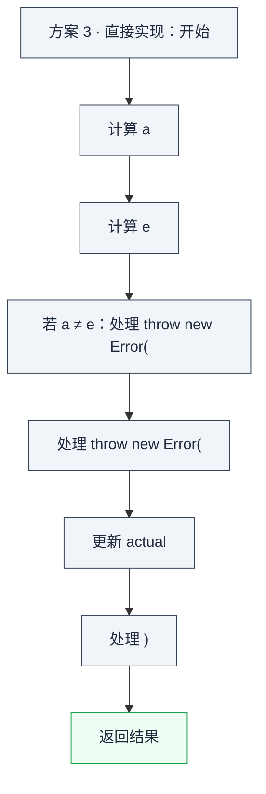

```typescript
function assertEq(actual: any, expected: any, msg: string = ''): void {
  // 定义函数/方法 assertEq
  const a = JSON.stringify(actual);
  const e = JSON.stringify(expected);
  if (a !== e)
    throw new Error(
      'ASSERT FAILED ' + msg + ' :: actual=' + a + ' expected=' + e,
    );
}

function max_sub_array_dc(arr: number[]): number {
  // 定义函数/方法 max_sub_array_dc
  function helper(lo: number, hi: number): [number, number, number, number] {
    // 定义函数/方法 helper
    if (hi - lo === 1) {
      const v = arr[lo];
      return [v, v, v, v];
    }
    const mi = Math.floor((lo + hi) / 2); // 把 向下取整((左边界 加 右边界) 除以 2) 存入 mi
    const [l_best, l_pre, l_suf, l_sum] = helper(lo, mi); // 把 helper(左边界, mi); 写入 const [l_best, l_pre, l_suf, l_sum]
    const [r_best, r_pre, r_suf, r_sum] = helper(mi, hi); // 把 helper(mi, 右边界); 写入 const [r_best, r_pre, r_suf, r_sum]
    const crossing = l_suf + r_pre; // 把 l_suf 加 r_pre 存入 crossing
    const best = Math.max(l_best, r_best, crossing); // 把 Math.取较大值 l_best, r_best, crossing) 存入 当前最优
    const prefix = Math.max(l_pre, l_sum + r_pre); // 把 Math.取较大值 l_pre, l_sum 加 r_pre) 存入 prefix
    const suffix = Math.max(r_suf, r_sum + l_suf); // 把 Math.取较大值 r_suf, r_sum 加 l_suf) 存入 suffix
    const total = l_sum + r_sum; // 把 l_sum 加 r_sum 存入 总和
    return [best, prefix, suffix, total]; // 返回 [当前最优, prefix, suffix, 总和]
  }
  if (!arr.length) return 0; // 若 取反 数组.长度，直接返回 0
  return helper(0, arr.length)[0]; // 返回 helper(0, 数组.长度)[0]
}
export function demo(): void {
  // 程序入口：跑内嵌自测用例
  assertEq(max_sub_array_dc([-2, 1, -3, 4, -1, 2, 1]), 6, 'ms1'); // 断言校验
  assertEq(max_sub_array_dc([1, 2, 3]), 6, 'ms2'); // 断言校验
  console.log('PASS'); // 全部用例通过，输出 PASS
}
demo(); // demo();
```

### 方案 4：直接实现

**分析与思路**：核心做法是「直接实现」。

**运行方式**：`node 本文件`，内嵌用例全部通过会输出 PASS。

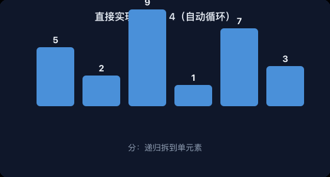

**方案专属流程图**（真实控制流）：


```typescript
function assertEq(actual: any, expected: any, msg: string = ''): void {
  // 定义函数/方法 assertEq
  const a = JSON.stringify(actual);
  const e = JSON.stringify(expected);
  if (a !== e)
    throw new Error(
      'ASSERT FAILED ' + msg + ' :: actual=' + a + ' expected=' + e,
    );
}

function max_sub_array_dc(arr: number[]): number {
  // 定义函数/方法 max_sub_array_dc
  function helper(lo: number, hi: number): [number, number, number, number] {
    // 定义函数/方法 helper
    if (hi - lo === 1) {
      const v = arr[lo];
      return [v, v, v, v];
    }
    const mi = Math.floor((lo + hi) / 2); // 把 向下取整((左边界 加 右边界) 除以 2) 存入 mi
    const [l_best, l_pre, l_suf, l_sum] = helper(lo, mi); // 把 helper(左边界, mi); 写入 const [l_best, l_pre, l_suf, l_sum]
    const [r_best, r_pre, r_suf, r_sum] = helper(mi, hi); // 把 helper(mi, 右边界); 写入 const [r_best, r_pre, r_suf, r_sum]
    const crossing = l_suf + r_pre; // 把 l_suf 加 r_pre 存入 crossing
    const best = Math.max(l_best, r_best, crossing); // 把 Math.取较大值 l_best, r_best, crossing) 存入 当前最优
    const prefix = Math.max(l_pre, l_sum + r_pre); // 把 Math.取较大值 l_pre, l_sum 加 r_pre) 存入 prefix
    const suffix = Math.max(r_suf, r_sum + l_suf); // 把 Math.取较大值 r_suf, r_sum 加 l_suf) 存入 suffix
    const total = l_sum + r_sum; // 把 l_sum 加 r_sum 存入 总和
    return [best, prefix, suffix, total]; // 返回 [当前最优, prefix, suffix, 总和]
  }
  if (!arr.length) return 0; // 若 取反 数组.长度，直接返回 0
  return helper(0, arr.length)[0]; // 返回 helper(0, 数组.长度)[0]
}
export function demo(): void {
  // 程序入口：跑内嵌自测用例
  assertEq(max_sub_array_dc([-2, 1, -3, 4, -1, 2, 1]), 6, 'ms1'); // 断言校验
  assertEq(max_sub_array_dc([1, 2, 3]), 6, 'ms2'); // 断言校验
  console.log('PASS'); // 全部用例通过，输出 PASS
}
demo(); // demo();
```

### 方案 5：迭代指针处理

**分析与思路**：核心做法是「迭代指针处理」。代码里依次做这些事：队列或堆的调度。

**运行方式**：`node 本文件`，内嵌用例全部通过会输出 PASS。


**方案专属流程图**（真实控制流）：


```typescript
class TreeNode {
  // 定义类型
  val: any;
  left: any;
  right: any; // 值: any; 左边界: any; 右边界: any;
  constructor(val?: any, left?: any, right?: any) {
    // constructor(值?: any, 左边界?: any, 右边界?: any) {
    this.val = val === undefined ? 0 : val; // 把 (值 全等于 undefined ? 0 : 值); 写入 值
    this.left = left === undefined ? null : left; // 把 (左边界 全等于 undefined ? null : 左边界); 写入 左边界
    this.right = right === undefined ? null : right; // 把 (右边界 全等于 undefined ? null : 右边界); 写入 右边界
  }
}
function buildTree(vals: any): any {
  // 定义函数/方法 buildTree
  if (!vals || vals.length === 0) return null; // 若 取反 vals 或 vals.长度 全等于 0，直接返回 null
  const root = new TreeNode(vals[0]);
  const q: any[] = [root];
  let i = 1;
  while (q.length && i < vals.length) {
    // 循环，直到不满足「节点.长度 且 下标 i 小于 vals.长度」
    const node = q.shift(); // 把 节点.shift() 存入 节点
    if (vals[i] !== null && vals[i] !== undefined) {
      node.left = new TreeNode(vals[i]);
      q.push(node.left);
    }
    i++; // 下标 i 加一
    if (i < vals.length && vals[i] !== null && vals[i] !== undefined) {
      node.right = new TreeNode(vals[i]);
      q.push(node.right);
    }
    i++; // 下标 i 加一
  }
  return root; // 返回 根节点
}
function treeToLevel(root: any): any[] {
  // 定义函数/方法 treeToLevel
  if (!root) return []; // 若 取反 根节点，直接返回 []
  const out: any[] = [];
  const q: any[] = [root]; // 把 []; const 节点: any[] 赋值为 [根节点]; 写入 const out: any[]
  while (q.length) {
    // 循环，直到不满足「节点.长度」
    const n = q.shift(); // 把 节点.shift() 存入 元素个数
    if (n === null || n === undefined) {
      out.push(null);
      continue;
    }
    out.push(n.val);
    q.push(n.left);
    q.push(n.right); // 把 元素个数.值 压入栈/数组尾部
  }
  while (out.length && out[out.length - 1] === null) out.pop(); // 循环，直到不满足「out.长度 且 out[out.长度 减 1] 全等于 null) out 弹出 );」
  return out; // 返回 out
}
class ListNode {
  // 定义类型
  val: any;
  next: any; // 值: any; 下一个: any;
  constructor(val?: any, next?: any) {
    this.val = val === undefined ? 0 : val;
    this.next = next === undefined ? null : next;
  }
}
function buildList(vals: any): any {
  // 定义函数/方法 buildList
  const dummy = new ListNode(0);
  let cur = dummy; // 把 new ListNode(0); let 当前值 赋值为 哨兵节点 存入 哨兵节点
  for (const v of vals) {
    cur.next = new ListNode(v);
    cur = cur.next;
  } // 把 new ListNode(值); 当前值 赋值为 当前值.下一个; } 写入 下一个
  return dummy.next; // 返回 哨兵节点.下一个
}
function listToArray(head: any): any[] {
  // 定义函数/方法 listToArray
  const out: any[] = [];
  let p = head; // 把 []; let 节点 赋值为 头节点; 写入 const out: any[]
  while (p) {
    out.push(p.val);
    p = p.next;
  } // 循环，直到不满足「节点) { out 追加 节点.值); 节点 赋值为 节点.下一个; }」
  return out; // 返回 out
}
// python-runtime shims
function pyLen(a: any): number {
  // 定义函数/方法 pyLen
  if (a === null || a === undefined) return 0; // 若 数组 全等于 null 或 数组 全等于 undefined，直接返回 0
  if (
    typeof a === 'string' ||
    Array.isArray(a) ||
    a instanceof Set ||
    a instanceof Map
  )
    return a.length ?? a.size;
  if (typeof a === 'object') return Object.keys(a).length; // 若 typeof 数组 全等于 'object'，直接返回 Object.keys(数组).长度
  return 0; // 返回 0
}
function pySlice(a: any, i: any, j: any, step?: any): any {
  // 定义函数/方法 pySlice
  if (typeof a === 'string') {
    const r = [...a].slice(i ?? 0, j ?? a.length);
    return step ? r.reverse().join('') : r.join('');
  }
  const arr = Array.isArray(a) ? a : [...a]; // 把 Array.isArray(数组) ? 数组 : 复制的 数组 存入 数组
  return arr.slice(i ?? 0, j ?? arr.length); // 返回 数组 截取 下标 i ?? 0, 下标 j ?? 数组.长度)
}
function pyRange(a: any, b?: any, step?: any): any[] {
  // 定义函数/方法 pyRange
  let s = 0,
    e = a,
    st = 1; // 把 0, e 赋值为 数组, st 赋值为 1 存入 字符串
  if (b !== undefined) {
    s = a;
    e = b;
  } // 若 b 不等于 undefined) { 字符串 赋值为 数组; e 赋值为 b; }
  if (step !== undefined) st = step; // 若 步数 不等于 undefined) st 赋值为 步数;
  const out: any[] = []; // 把 []; 写入 const out: any[]
  if (st > 0) for (let i = s; i < e; i += st) out.push(i);
  else for (let i = s; i > e; i += st) out.push(i); // 否则
  return out; // 返回 out
}
function pyIn(x: any, coll: any): boolean {
  // 定义函数/方法 pyIn
  if (coll === null || coll === undefined) return false; // 若 coll 全等于 null 或 coll 全等于 undefined，直接返回 false
  if (Array.isArray(coll)) return coll.includes(x); // 若 Array.isArray(coll)，直接返回 coll 是否包含 x)
  if (coll instanceof Set || coll instanceof Map) return coll.has(x); // 若 coll instanceof Set 或 coll instanceof Map，直接返回 coll.has(x)
  if (typeof coll === 'object') return x in coll; // 若 typeof coll 全等于 'object'，直接返回 x in coll
  if (typeof coll === 'string') return coll.indexOf(x) >= 0; // 若 typeof coll 全等于 'string'，直接返回 coll 查找 x) 不低于 0
  return false; // 返回 false
}
function pySorted(a: any): any[] {
  // 定义函数/方法 pySorted
  const arr = typeof a === 'string' ? [...a] : [...a]; // 把 (typeof 数组 全等于 'string') ? 复制的 数组 : 复制的 数组 存入 数组
  return arr.sort((x: any, y: any) => (x < y ? -1 : x > y ? 1 : 0));
}
function pyMin(a: any, b?: any): any {
  if (b !== undefined) return Math.min(a, b);
  if (Array.isArray(a) || a instanceof Set) return Math.min(...a);
  return Math.min(a);
} // 定义函数/方法 pyMin
function pyMax(a: any, b?: any): any {
  if (b !== undefined) return Math.max(a, b);
  if (Array.isArray(a) || a instanceof Set) return Math.max(...a);
  return Math.max(a);
} // 定义函数/方法 pyMax
function pySum(a: any): number {
  let s = 0;
  for (const v of a) s += v;
  return s;
} // 定义函数/方法 pySum
function pyAbs(x: any): number {
  return Math.abs(x);
} // 定义函数/方法 pyAbs
function pyEnumerate(a: any): any[] {
  const out: any[] = [];
  let i = 0;
  for (const v of a) {
    out.push([i, v]);
    i++;
  }
  return out;
} // 定义函数/方法 pyEnumerate
function pyZip(a: any, b: any): any[] {
  const n = Math.min(a.length, b.length);
  const out: any[] = [];
  for (let i = 0; i < n; i++) out.push([a[i], b[i]]);
  return out;
} // 定义函数/方法 pyZip
function pyDictGet(d: any, k: any, def?: any): any {
  return k in d ? d[k] : def === undefined ? null : def;
} // 定义函数/方法 pyDictGet
function pyPrint(...args: any[]): void {
  console.log(
    args
      .map((a) => (typeof a === 'object' && a !== null ? JSON.stringify(a) : a))
      .join(' '),
  );
} // 定义函数/方法 pyPrint
// collections / heapq
function heapPush(h: any[], x: any): void {
  h.push(x);
  let i = h.length - 1;
  while (i > 0) {
    const p = (i - 1) >> 1;
    if (h[p] <= h[i]) break;
    [h[p], h[i]] = [h[i], h[p]];
    i = p;
  }
} // 定义函数/方法 heapPush
function heapPop(h: any[]): any {
  const top = h[0];
  const last = h.pop();
  if (h.length) {
    h[0] = last;
    let i = 0;
    const n = h.length;
    while (true) {
      let l = 2 * i + 1,
        r = 2 * i + 2,
        s = i;
      if (l < n && h[l] < h[s]) s = l;
      if (r < n && h[r] < h[s]) s = r;
      if (s === i) break;
      [h[s], h[i]] = [h[i], h[s]];
      i = s;
    }
  }
  return top;
} // 定义函数/方法 heapPop
class Deque {
  private a: any[] = [];
  push(x: any) {
    this.a.push(x);
  }
  pushLeft(x: any) {
    this.a.unshift(x);
  }
  pop() {
    return this.a.pop();
  }
  popLeft() {
    return this.a.shift();
  }
  get length() {
    return this.a.length;
  }
  toArray() {
    return this.a.slice();
  }
} // 定义类型
function Counter(iter: any): any {
  const m: any = {};
  for (const v of iter) m[v] = (m[v] || 0) + 1;
  return m;
} // 定义函数/方法 Counter
function gcd(a: any, b: any): any {
  while (b) {
    [a, b] = [b, a % b];
  }
  return a;
} // 定义函数/方法 gcd
function pyInf(): number {
  return Infinity;
} // 定义函数/方法 pyInf

function norm(x: any): any {
  // 定义函数/方法 norm
  if (x === null || x === undefined) return null; // 若 x 全等于 null 或 x 全等于 undefined，直接返回 null
  if (typeof x === 'object') {
    // 若 typeof x 全等于 'object'
    if (x instanceof Deque) return x.toArray(); // 若 x instanceof Deque，直接返回 x.toArray()
    if (Array.isArray(x)) return x.map(norm); // 若 Array.isArray(x)，直接返回 x.映射表(norm)
    if (
      typeof x.val === 'number' &&
      (typeof x.left !== 'undefined' || typeof x.right !== 'undefined')
    )
      return treeToLevel(x);
    if (typeof x.next !== 'undefined' && typeof x.val === 'number')
      return listToArray(x);
    if (x instanceof Set) return [...x].sort(); // 若 x instanceof Set，直接返回 复制的 x 排序 )
    if (x instanceof Map) return Object.fromEntries(x); // 若 x instanceof Map，直接返回 Object.fromEntries(x)
    const o: any = {};
    for (const k of Object.keys(x)) o[k] = norm(x[k]);
    return o;
  }
  return x; // 返回 x
}
function eq(a: any, b: any): boolean {
  // 定义函数/方法 eq
  const x = norm(a),
    y = norm(b); // 把 norm(数组), y 赋值为 norm(b) 存入 x
  if (x === y) return true; // 若 x 全等于 y，直接返回 true
  if (x === null || y === null) return x === y; // 若 x 全等于 null 或 y 全等于 null，直接返回 x 全等于 y
  if (Array.isArray(x) && Array.isArray(y)) {
    // 若 Array.isArray(x) 且 Array.isArray(y
    if (x.length !== y.length) return false; // 若 x.长度 不等于 y.长度，直接返回 false
    for (let i = 0; i < x.length; i++) if (!eq(x[i], y[i])) return false; // 让 下标 i 从 0 开始计数，下标 i 小于 x.长度 就继续
    return true; // 返回 true
  }
  if (typeof x === 'object' && typeof y === 'object') {
    // 若 typeof x 全等于 'object' 且 typeof y 全等于 'object'
    const kx = Object.keys(x),
      ky = Object.keys(y); // 把 Object.keys(x), ky 赋值为 Object.keys(y) 存入 kx
    if (kx.length !== ky.length) return false; // 若 kx.长度 不等于 ky.长度，直接返回 false
    for (const k of kx) if (!eq(x[k], y[k])) return false;
    return true; // 返回 true
  }
  return x === y; // 返回 x 全等于 y
}

function maxSubArrayBf(arr) {
  // 定义函数/方法 maxSubArrayBf
  let best = -Infinity; // 把 减 Infinity 存入 当前最优
  for (let i = 0; i < arr.length; i++) {
    // 让 下标 i 从 0 开始计数，下标 i 小于 数组.长度 就继续
    let s = 0; // 把 0 存入 字符串
    for (let j = i; j < arr.length; j++) {
      s += arr[j];
      best = Math.max(best, s);
    } // 让 下标 j 从 下标 i 开始计数，下标 j 小于 数组.长度 就继续
  }
  return best; // 返回 当前最优
}
export function demo(): void {
  // 程序入口：跑内嵌自测用例
  const cases = [
    { in: [[-2, 1, -3, 4, -1, 2, 1, -5, 4]], want: 6 },
    { in: [[1]], want: 1 },
    { in: [[-1, -2, -3]], want: -1 },
    { in: [[5, 4, -1, 7, 8]], want: 23 },
  ];
  let fail = false; // 把 false 存入 fail
  for (const c of cases) {
    // for (const 字符 of cases) {
    const got = maxSubArrayBf(...c.in); // 把 maxSubArrayBf(...字符.in) 存入 got
    if (!eq(got, c.want)) {
      fail = true;
      console.log(
        'FAIL',
        JSON.stringify(c.in),
        '=>',
        JSON.stringify(got),
        'want',
        JSON.stringify(c.want),
      );
    }
  }
  if (fail) throw new Error('FAILED'); // 若 fail) throw new Error('FAILED');
  console.log('PASS'); // 全部用例通过，输出 PASS
}
demo(); // demo();
```

## 逐步拆解与面试追问

**复杂度**：时间 O(n)（单趟线性扫描），空间 O(1) 到 O(n)（视辅助结构）

**为什么是这个量级**：每个元素被常数次访问，辅助哈希或栈的开销与 n 同阶

**面试官可能会追问**：

- 这个策略能推广到什么场景？
- 与暴力做法差在哪一步？
- 有没有更简单的等价写法？

## 关键 API 速查（TS 主解法实际用到，附官方链接）

| API | 作用 | 使用要点 | 官方文档 |
|---|---|---|---|
| `Array.prototype.sort()` | 原地排序 | 默认按字符串 Unicode 序（10 会排在 2 前），数字必须传 (a,b)=>a-b；V8 用 TimSort，稳定，O(n log n)；返回原数组引用 | [官方文档](https://developer.mozilla.org/zh-CN/docs/Web/JavaScript/Reference/Global_Objects/Array/sort) |
| `Array.prototype.map()` | 逐元素映射为新数组 | 回调 (v,i,arr)；返回等长新数组，不改变原数组；稀疏位跳过；链式调用注意中间数组开销 | [官方文档](https://developer.mozilla.org/zh-CN/docs/Web/JavaScript/Reference/Global_Objects/Array/map) |
| `Array.prototype.push()` | 尾部追加 | 返回新长度；可一次多个；均摊 O(1)；会改变原数组 | [官方文档](https://developer.mozilla.org/zh-CN/docs/Web/JavaScript/Reference/Global_Objects/Array/push) |
| `Array.prototype.pop()` | 尾部弹出 | 返回被删元素（空数组返回 undefined）；O(1) | [官方文档](https://developer.mozilla.org/zh-CN/docs/Web/JavaScript/Reference/Global_Objects/Array/pop) |
| `Array.prototype.shift()` | 头部取出 | O(n)（后续元素整体前移）；大量头部操作请用链表或双端结构 | [官方文档](https://developer.mozilla.org/zh-CN/docs/Web/JavaScript/Reference/Global_Objects/Array/shift) |
| `Array.prototype.unshift()` | 头部插入 | O(n)；与 shift 组合可当双端队列 | [官方文档](https://developer.mozilla.org/zh-CN/docs/Web/JavaScript/Reference/Global_Objects/Array/unshift) |
| `Array/String includes()` | 是否包含 | 数组用 SameValueZero（NaN 可判）；字符串按子串；第二个参数为起始下标 | [官方文档](https://developer.mozilla.org/zh-CN/docs/Web/JavaScript/Reference/Global_Objects/Array/includes) |
| `Array/String indexOf()` | 首次出现的下标 | 找不到返回 -1；无法判 NaN（用 includes）；字符串可传起始位 | [官方文档](https://developer.mozilla.org/zh-CN/docs/Web/JavaScript/Reference/Global_Objects/Array/indexOf) |
| `Array/String slice()` | 切片（不改原数组） | slice(start,end) 含头不含尾；负数从尾计；常用于复制数组（slice()） | [官方文档](https://developer.mozilla.org/zh-CN/docs/Web/JavaScript/Reference/Global_Objects/Array/slice) |
| `Array.prototype.join()` | 数组拼接为字符串 | undefined/null 转空串；嵌套数组会展平一层；join('') 用于字符数组还原 | [官方文档](https://developer.mozilla.org/zh-CN/docs/Web/JavaScript/Reference/Global_Objects/Array/join) |
| `Object.keys()` | 对象键名数组 | 仅自身可枚举字符串键（不含 symbol）；配 length 可当计数器 | [官方文档](https://developer.mozilla.org/zh-CN/docs/Web/JavaScript/Reference/Global_Objects/Object/keys) |
| `Object.fromEntries()` | 键值对数组转对象 | 参数为 [k,v] 可迭代；map 出来的键值对可直接转对象 | [官方文档](https://developer.mozilla.org/zh-CN/docs/Web/JavaScript/Reference/Global_Objects/Object/fromEntries) |
| `JSON.stringify()` | 序列化为 JSON 字符串 | 常用于结构化比较（深度相等判定）；undefined/函数/循环引用会被丢弃或抛错 | [官方文档](https://developer.mozilla.org/zh-CN/docs/Web/JavaScript/Reference/Global_Objects/JSON/stringify) |
| `Math.max()` | 最大值 | 配展开 Math.max(...arr)；空参返回 -Infinity；超大数组注意展开参数上限 | [官方文档](https://developer.mozilla.org/zh-CN/docs/Web/JavaScript/Reference/Global_Objects/Math/max) |
| `Math.min()` | 最小值 | 同 max；空参返回 Infinity | [官方文档](https://developer.mozilla.org/zh-CN/docs/Web/JavaScript/Reference/Global_Objects/Math/min) |
| `Math.abs()` | 绝对值 | 入参会被隐式转数字；-0 返回 +0 | [官方文档](https://developer.mozilla.org/zh-CN/docs/Web/JavaScript/Reference/Global_Objects/Math/abs) |

### 各语言官方文档导航

- **TypeScript / JS**：[MDN 中文参考](https://developer.mozilla.org/zh-CN/)
- **Python**：[Python 官方文档](https://docs.python.org/zh-cn/3/)
- **Go**：[Go 标准库](https://pkg.go.dev/std)
- **Java**：[JDK 17 API](https://docs.oracle.com/en/java/javase/17/docs/api/)
- **Rust**：[Rust 标准库](https://doc.rust-lang.org/std/)
- **Lua**：[Lua 5.4 手册](https://www.lua.org/manual/5.4/)
- **C**：[Cppreference C](https://zh.cppreference.com/w/c)
- **C++**：[Cppreference C++](https://zh.cppreference.com/w/cpp)
- **R**：[R 官方手册](https://stat.ethz.ch/R-manual/)
- **Zig**：[Zig 语言文档](https://ziglang.org/documentation/master/)
- **Dart**：[Dart API](https://api.dart.dev/)

## 附录：其他 10 种语言全部实现（每种语言列举其全部方案）

> TypeScript 的全部方案见「TypeScript 解题方案」一节；下面是其余 10 种语言的对应实现，每种语言的每个方案都带思路分析、代码走读与专属运行架构图。
> 每个方案都内嵌用例自测，可独立运行（老仓库 python/go 文件遵循「打印结果」约定）。
> 完整解法文件见 `dsa/<语言>/notes/lc_110240695_分治策略之greatest_slice_2-way_merge_counting/`。

### Python 实现（5 种方案）

Python 的全部方案如下，每个方案都内嵌用例自测，可独立运行（老仓库 python/go 文件遵循「打印结果」约定）：

#### 方案 1：迭代指针处理

**思路与代码分析**：核心是「迭代指针处理」。Python 版用切片与字典推导式简化操作，突出可读性。**走读**：方案 1 · 迭代指针处理：开始 → 更新 n → 命中条件，直接返回 → 更新 gs → 循环 i：从 0 到 n 前 → 循环 j：从 i 到 n 前 → 更新 s → 循环 k：从 i 到 j + 1 前 → 更新 + → 若 gs ＜ s：更新 gs → 更新 gs → 返回 gs。

**运行架构**（真实控制流）：

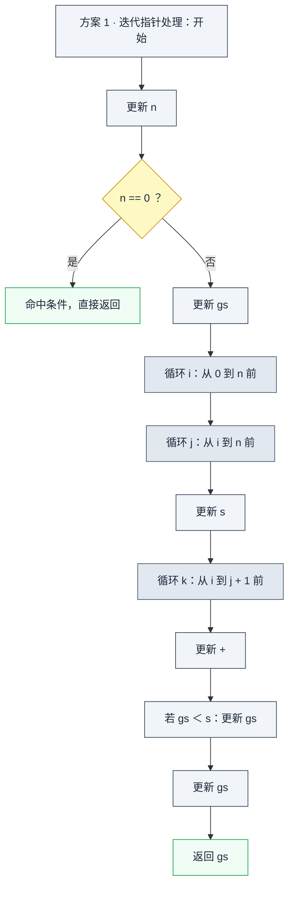

```python
# Greatest Slice - 方案1: Brute Force (枚举所有区间)
import sys  # 提高递归深度上限（深输入防 RecursionError）

sys.setrecursionlimit(200000)  # 树/链表类题目节点数可达 1e4 量级

def max_sub_array_bf(arr):  # 定义函数 max_sub_array_bf（参数：数组）
    n = len(arr)  # 把 长度(数组) 存入 元素个数
    if n == 0:  # 若 元素个数 等于 0
        return 0  # 返回 0
    gs = arr[0]  # 把 数组[0] 存入 gs
    for i in range(n):  # 让 下标 i 从 元素个数 遍历
        for j in range(i, n):  # 让 下标 j 从 下标 i 到 元素个数 遍历
            s = 0  # 把 0 存入 字符串
            for k in range(i, j + 1):  # 让 下标 k 从 下标 i 到 下标 j 加 1 遍历
                s += arr[k]  # 字符串累加 数组[下标 k]
            if gs < s:  # 若 gs 小于 字符串
                gs = s  # 把 字符串 存入 gs
    return gs  # 返回 gs

if __name__ == "__main__":  # 若 __name__ 等于 '__main__'
    print(max_sub_array_bf([-2, 1, -3, 4, -1, 2, 1]))  # 6
```

#### 方案 2：直接实现

**思路与代码分析**：核心是「直接实现」。Python 版用切片与字典推导式简化操作，突出可读性。**走读**：方案 2 · 直接实现：开始 → 更新 n → 命中条件，直接返回 → 更新 gs → 循环 i：从 0 到 n 前 → 更新 s → 循环 j：从 i 到 n 前 → 更新 + → 若 gs ＜ s：更新 gs → 更新 gs → 返回 gs。

**运行架构**（真实控制流）：

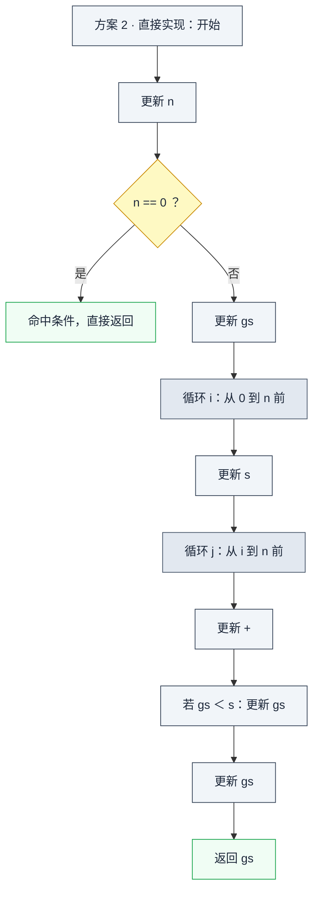

```python
# Greatest Slice - 方案2: Incremental (递增求和, O(n^2))
import sys  # 提高递归深度上限（深输入防 RecursionError）

sys.setrecursionlimit(200000)  # 树/链表类题目节点数可达 1e4 量级

def max_sub_array_ic(arr):  # 定义函数 max_sub_array_ic（参数：数组）
    n = len(arr)  # 把 长度(数组) 存入 元素个数
    if n == 0:  # 若 元素个数 等于 0
        return 0  # 返回 0
    gs = arr[0]  # 把 数组[0] 存入 gs
    for i in range(n):  # 让 下标 i 从 元素个数 遍历
        s = 0  # 把 0 存入 字符串
        for j in range(i, n):  # 让 下标 j 从 下标 i 到 元素个数 遍历
            s += arr[j]  # 递增得到当前区间总和: O(1)
            if gs < s:  # 若 gs 小于 字符串
                gs = s  # 把 字符串 存入 gs
    return gs  # 返回 gs

if __name__ == "__main__":  # 若 __name__ 等于 '__main__'
    print(max_sub_array_ic([-2, 1, -3, 4, -1, 2, 1]))  # 6
```

#### 方案 3：直接实现

**思路与代码分析**：核心是「直接实现」。Python 版用切片与字典推导式简化操作，突出可读性。**走读**：方案 3 · 直接实现：开始 → 若 hi - lo == 1：更新 v → 更新 v → 返回 v, v, v, v → 更新 mi → 更新 l_sum → 更新 r_sum → 更新 crossing → 更新 best → 更新 prefix → 更新 suffix → 更新 total → 返回 best, prefix, suffix, total → 命中条件，直接返回 → 返回 helper(0, len(arr))[0]。

**运行架构**（真实控制流）：

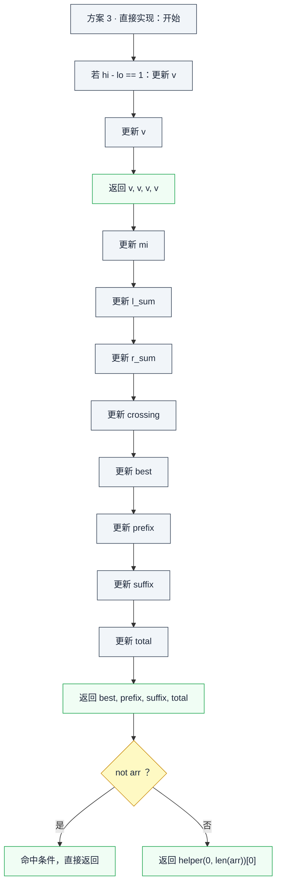

```python
# Greatest Slice - 方案3: Divide and Conquer (O(n log n))
import sys  # 提高递归深度上限（深输入防 RecursionError）

sys.setrecursionlimit(200000)  # 树/链表类题目节点数可达 1e4 量级

def max_sub_array_dc(arr):  # 定义函数 max_sub_array_dc（参数：数组）
    def helper(lo, hi):  # 定义函数 helper（参数：左边界, 右边界）
        # 返回 (best, prefix, suffix, total)
        if hi - lo == 1:  # 若 右边界 减 左边界 等于 1
            v = arr[lo]  # 把 数组[左边界] 存入 值
            return v, v, v, v  # 返回 值, 值, 值, 值
        mi = (lo + hi) // 2  # 把 (左边界 加 右边界) 除以 除以 2 存入 mi
        l_best, l_pre, l_suf, l_sum = helper(lo, mi)  # 把 helper(左边界, mi) 写入 l_best, l_pre, l_suf, l_sum
        r_best, r_pre, r_suf, r_sum = helper(mi, hi)  # 把 helper(mi, 右边界) 写入 r_best, r_pre, r_suf, r_sum
        crossing = l_suf + r_pre  # 把 l_suf 加 r_pre 存入 crossing
        best = max(l_best, r_best, crossing)  # 把 取较大值 l_best, r_best, crossing) 存入 当前最优
        prefix = max(l_pre, l_sum + r_pre)  # 把 取较大值 l_pre, l_sum 加 r_pre) 存入 prefix
        suffix = max(r_suf, r_sum + l_suf)  # 把 取较大值 r_suf, r_sum 加 l_suf) 存入 suffix
        total = l_sum + r_sum  # 把 l_sum 加 r_sum 存入 总和
        return best, prefix, suffix, total  # 返回 当前最优, prefix, suffix, 总和

    if not arr:  # 若 not 数组
        return 0  # 返回 0
    return helper(0, len(arr))[0]  # 返回 helper(0, 长度(数组))[0]

if __name__ == "__main__":  # 若 __name__ 等于 '__main__'
    print(max_sub_array_dc([-2, 1, -3, 4, -1, 2, 1]))  # 6
```

#### 方案 4：直接实现

**思路与代码分析**：核心是「直接实现」。Python 版用切片与字典推导式简化操作，突出可读性。**走读**：方案 4 · 直接实现：开始 → 命中条件，直接返回 → 更新 max_sum → 更新 current_sum → 循环 i：从 1 到 len(arr 前 → 更新 current_sum → 处理 arr[i], current_sum + arr[i] → 处理 ) → 更新 max_sum → 返回 max_sum。

**运行架构**（真实控制流）：

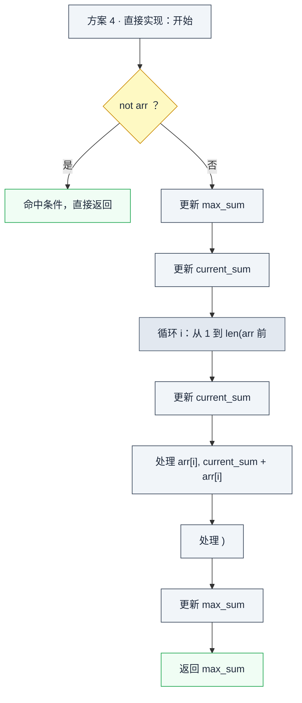

```python
# Greatest Slice - 方案4: Linear Scan (Kadane, O(n))
import sys  # 提高递归深度上限（深输入防 RecursionError）

sys.setrecursionlimit(200000)  # 树/链表类题目节点数可达 1e4 量级

def max_sub_array(arr):  # 定义函数 max_sub_array（参数：数组）
    if not arr:  # 若 not 数组
        return 0  # 返回 0
    max_sum = arr[0]  # 把 数组[0] 存入 max_sum
    current_sum = arr[0]  # 把 数组[0] 存入 current_sum
    for i in range(1, len(arr)):  # 让 下标 i 从 1 到 长度(数组 遍历
        current_sum = max(
            arr[i], current_sum + arr[i]
        )  # 把 取较大值 数组[下标 i], current_sum 加 数组[下标 i]) 存入 current_sum
        max_sum = max(max_sum, current_sum)  # 把 取较大值 max_sum, current_sum) 存入 max_sum
    return max_sum  # 返回 max_sum

if __name__ == "__main__":  # 若 __name__ 等于 '__main__'
    print(max_sub_array([-2, 1, -3, 4, -1, 2, 1]))  # 6
```

#### 方案 5：迭代指针处理

**思路与代码分析**：核心是「迭代指针处理」。Python 版用切片与字典推导式简化操作，突出可读性。**走读**：方案 5 · 迭代指针处理：开始 → 命中条件，直接返回 → 更新 mid → 更新 left → 更新 right → 返回 merge(left, right)。

**运行架构**（真实控制流）：

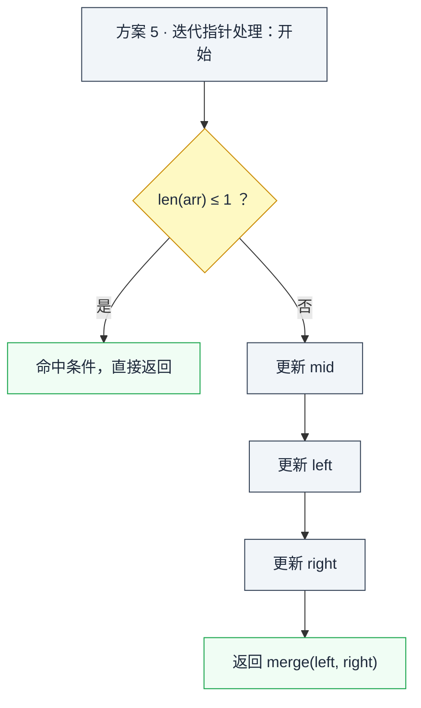

```python
# 2-Way Merge - 方案5: Merge Sort (O(n log n))
import sys  # 提高递归深度上限（深输入防 RecursionError）

sys.setrecursionlimit(200000)  # 树/链表类题目节点数可达 1e4 量级

def merge_sort(arr):  # 定义函数 merge_sort（参数：数组）
    if len(arr) <= 1:  # 若 长度(数组) 不超过 1
        return arr  # 返回 数组
    mid = len(arr) // 2  # 把 长度(数组) 除以 除以 2 存入 中点
    left = merge_sort(arr[:mid])  # 把 merge_sort(数组[:中点]) 存入 左边界
    right = merge_sort(arr[mid:])  # 把 merge_sort(数组[中点:]) 存入 右边界
    return merge(left, right)  # 返回 merge(左边界, 右边界)

def merge(left, right):  # 定义函数 merge（参数：左边界, 右边界）
    result = []  # 把 [] 存入 结果
    i = j = 0  # 把 下标 j 赋值为 0 存入 下标 i
    while i < len(left) and j < len(
        right
    ):  # 循环，直到不满足「下标 i 小于 长度(左边界) and 下标 j 小于 长度(右边界」
        if left[i] < right[j]:  # 若 左边界[下标 i] 小于 右边界[下标 j]
            result.append(left[i])  # 把 左边界[下标 i] 追加到列表尾部
            i += 1  # 下标 i累加 1
        else:  # 否则
            result.append(right[j])  # 把 右边界[下标 j] 追加到列表尾部
            j += 1  # 下标 j累加 1
    result.extend(left[i:])  # 结果.extend(左边界[下标 i:])
    result.extend(right[j:])  # 结果.extend(右边界[下标 j:])
    return result  # 返回 结果

if __name__ == "__main__":  # 若 __name__ 等于 '__main__'
    print(merge_sort([3, 1, 4, 1, 5]))  # [1, 1, 3, 4, 5]
```

### Go 实现（5 种方案）

Go 的全部方案如下，每个方案都内嵌用例自测，可独立运行（老仓库 python/go 文件遵循「打印结果」约定）：

#### 方案 1：迭代指针处理

**思路与代码分析**：核心是「迭代指针处理」。Go 版用切片与多返回值惯用法，显式处理索引边界。**走读**：方案 1 · 迭代指针处理：开始 → 更新 : → 处理 if n == 0 → 返回 0 → 更新 : → 遍历循环 → 遍历循环 → 更新 : → 遍历循环 → 更新 + → 处理 if gs ＜ s → 更新 gs → 返回 gs。

**运行架构**（真实控制流）：

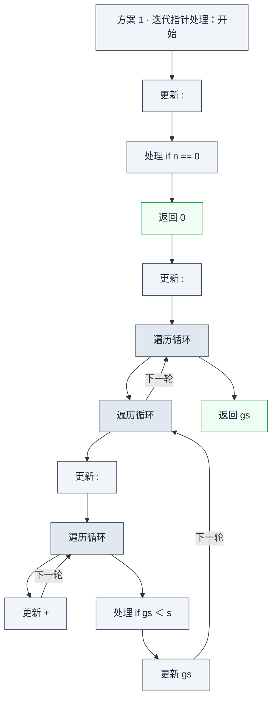

```go
package main // 引入依赖

import (
	"fmt" // 「fmt」
	"os"  // 「os」
)

// Greatest Slice - 方案1: Brute Force (枚举所有区间)
func maxSubArrayBF(arr []int) int { // 定义函数/方法 maxSubArrayBF
	n := len(arr) // 把 长度(数组) 写入 n :
	if n == 0 {   // 若 元素个数 等于 0
		return 0 // 返回 0
	}
	gs := arr[0]             // 把 数组[0] 写入 gs :
	for i := 0; i < n; i++ { // 让 下标 i 从 0 开始计数
		for j := i; j < n; j++ { // 把 下标 i; 下标 j 小于 元素个数; 下标 j 加一 { 写入 for j :
			s := 0                    // 把 0 写入 s :
			for k := i; k <= j; k++ { // 把 下标 i; 下标 k 不超过 下标 j; 下标 k 加一 { 写入 for k :
				s += arr[k] // 字符串累加 数组[下标 k]
			}
			if gs < s { // 若 gs 小于 字符串
				gs = s // 把 字符串 写入 gs
			}
		}
	}
	return gs // 返回 gs
}

func main() { // 程序入口：跑内嵌自测用例
	cases := []struct { // 把 []struct { 写入 cases :
		in   []int // in []int
		want int   // want int
	}{ // }{
		{[]int{-2, 1, -3, 4, -1, 2, 1}, 6},
		{[]int{-1}, -1},
		{[]int{1}, 1},
		{[]int{-2, -1}, -1},
		{[]int{}, 0},
		{[]int{5, 4, -1, 7, 8}, 23},
	}
	ok := true                // 把 true 写入 ok :
	for _, c := range cases { // 同时取 _ 与 字符 遍历
		if got := maxSubArrayBF(c.in); got != c.want { // 若 got : 赋值为 maxSubArrayBF(字符.in); got 不等于 字符.want
			ok = false                                                           // 把 false 写入 ok
			fmt.Printf("FAIL maxSubArrayBF(%v)=%d want %d\n", c.in, got, c.want) // 打印输出
		}
	}
	if !ok { // 若 取反 ok
		os.Exit(1) // os.Exit(1)
	}
	fmt.Println("PASS") // 全部用例通过，输出 PASS
}
```

#### 方案 2：直接实现

**思路与代码分析**：核心是「直接实现」。Go 版用切片与多返回值惯用法，显式处理索引边界。**走读**：方案 2 · 直接实现：开始 → 更新 : → 处理 if n == 0 → 返回 0 → 更新 : → 遍历循环 → 更新 : → 遍历循环 → 更新 + → 处理 if gs ＜ s → 更新 gs → 返回 gs。

**运行架构**（真实控制流）：

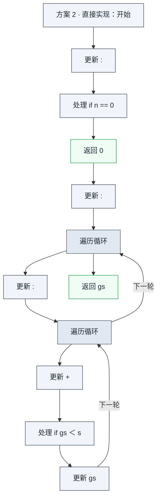

```go
package main // 引入依赖

import (
	"fmt" // 「fmt」
	"os"  // 「os」
)

// Greatest Slice - 方案2: Incremental (递增求和, O(n^2))
func maxSubArrayIC(arr []int) int { // 定义函数/方法 maxSubArrayIC
	n := len(arr) // 把 长度(数组) 写入 n :
	if n == 0 {   // 若 元素个数 等于 0
		return 0 // 返回 0
	}
	gs := arr[0]             // 把 数组[0] 写入 gs :
	for i := 0; i < n; i++ { // 让 下标 i 从 0 开始计数
		s := 0                   // 把 0 写入 s :
		for j := i; j < n; j++ { // 把 下标 i; 下标 j 小于 元素个数; 下标 j 加一 { 写入 for j :
			s += arr[j] // 递增得到当前区间总和: O(1)
			if gs < s { // 若 gs 小于 字符串
				gs = s // 把 字符串 写入 gs
			}
		}
	}
	return gs // 返回 gs
}

func main() { // 程序入口：跑内嵌自测用例
	cases := []struct { // 把 []struct { 写入 cases :
		in   []int // in []int
		want int   // want int
	}{ // }{
		{[]int{-2, 1, -3, 4, -1, 2, 1}, 6},
		{[]int{-1}, -1},
		{[]int{1}, 1},
		{[]int{-2, -1}, -1},
		{[]int{}, 0},
		{[]int{5, 4, -1, 7, 8}, 23},
	}
	ok := true                // 把 true 写入 ok :
	for _, c := range cases { // 同时取 _ 与 字符 遍历
		if got := maxSubArrayIC(c.in); got != c.want { // 若 got : 赋值为 maxSubArrayIC(字符.in); got 不等于 字符.want
			ok = false                                                           // 把 false 写入 ok
			fmt.Printf("FAIL maxSubArrayIC(%v)=%d want %d\n", c.in, got, c.want) // 打印输出
		}
	}
	if !ok { // 若 取反 ok
		os.Exit(1) // os.Exit(1)
	}
	fmt.Println("PASS") // 全部用例通过，输出 PASS
}
```

#### 方案 3：直接实现

**思路与代码分析**：核心是「直接实现」。Go 版用切片与多返回值惯用法，显式处理索引边界。**走读**：方案 3 · 直接实现：开始 → 计算 helper → 返回 v, v, v, v → 返回 best, prefix, suffix, lSum + rSum → 返回 0 → 返回 b。

**运行架构**（真实控制流）：

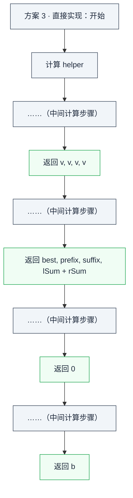

```go
package main // 引入依赖

import (
	"fmt" // 「fmt」
	"os"  // 「os」
)

// Greatest Slice - 方案3: Divide and Conquer (O(n log n))
func maxSubArrayDC(arr []int) int { // 定义函数/方法 maxSubArrayDC
	var helper func(int, int) (int, int, int, int)   // var helper func(int, int) (int, int, int, int)
	helper = func(lo, hi int) (int, int, int, int) { // 把 func(左边界, 右边界 int) (int, int, int, int) { 写入 helper
		// 返回 (best, prefix, suffix, total)
		if hi-lo == 1 { // 若 右边界 减 左边界 等于 1
			v := arr[lo]      // 把 数组[左边界] 写入 v :
			return v, v, v, v // 返回 值, 值, 值, 值
		}
		mi := (lo + hi) / 2                       // 把 (左边界 加 右边界) 除以 2 写入 mi :
		lBest, lPre, lSuf, lSum := helper(lo, mi) // 把 helper(左边界, mi) 写入 lBest, lPre, lSuf, lSum :
		rBest, rPre, rSuf, rSum := helper(mi, hi) // 把 helper(mi, 右边界) 写入 rBest, rPre, rSuf, rSum :
		crossing := lSuf + rPre                   // 把 lSuf 加 rPre 写入 crossing :
		best := lBest                             // 把 lBest 写入 best :
		if rBest > best {                         // 若 rBest 超过 当前最优
			best = rBest // 把 rBest 写入 当前最优
		}
		if crossing > best { // 若 crossing 超过 当前最优
			best = crossing // 把 crossing 写入 当前最优
		}
		prefix := lPre          // 把 lPre 写入 prefix :
		if lSum+rPre > prefix { // 若 lSum 加 rPre 超过 prefix
			prefix = lSum + rPre // 把 lSum 加 rPre 写入 prefix
		}
		suffix := rSuf          // 把 rSuf 写入 suffix :
		if rSum+lSuf > suffix { // 若 rSum 加 lSuf 超过 suffix
			suffix = rSum + lSuf // 把 rSum 加 lSuf 写入 suffix
		}
		return best, prefix, suffix, lSum + rSum // 返回 当前最优, prefix, suffix, lSum 加 rSum
	}
	if len(arr) == 0 { // 若 长度(数组) 等于 0
		return 0 // 返回 0
	}
	b, _, _, _ := helper(0, len(arr)) // 把 helper(0, 长度(数组)) 写入 b, _, _, _ :
	return b                          // 返回 b
}

func main() { // 程序入口：跑内嵌自测用例
	cases := []struct { // 把 []struct { 写入 cases :
		in   []int // in []int
		want int   // want int
	}{ // }{
		{[]int{-2, 1, -3, 4, -1, 2, 1}, 6},
		{[]int{-1}, -1},
		{[]int{1}, 1},
		{[]int{-2, -1}, -1},
		{[]int{}, 0},
		{[]int{5, 4, -1, 7, 8}, 23},
	}
	ok := true                // 把 true 写入 ok :
	for _, c := range cases { // 同时取 _ 与 字符 遍历
		if got := maxSubArrayDC(c.in); got != c.want { // 若 got : 赋值为 maxSubArrayDC(字符.in); got 不等于 字符.want
			ok = false                                                           // 把 false 写入 ok
			fmt.Printf("FAIL maxSubArrayDC(%v)=%d want %d\n", c.in, got, c.want) // 打印输出
		}
	}
	if !ok { // 若 取反 ok
		os.Exit(1) // os.Exit(1)
	}
	fmt.Println("PASS") // 全部用例通过，输出 PASS
}
```

#### 方案 4：直接实现

**思路与代码分析**：核心是「直接实现」。Go 版用切片与多返回值惯用法，显式处理索引边界。**走读**：方案 4 · 直接实现：开始 → 处理 if len(arr) == 0 → 返回 0 → 更新 : → 更新 : → 遍历循环 → 更新 currentSum → 更新 maxSum → 返回 maxSum。

**运行架构**（真实控制流）：

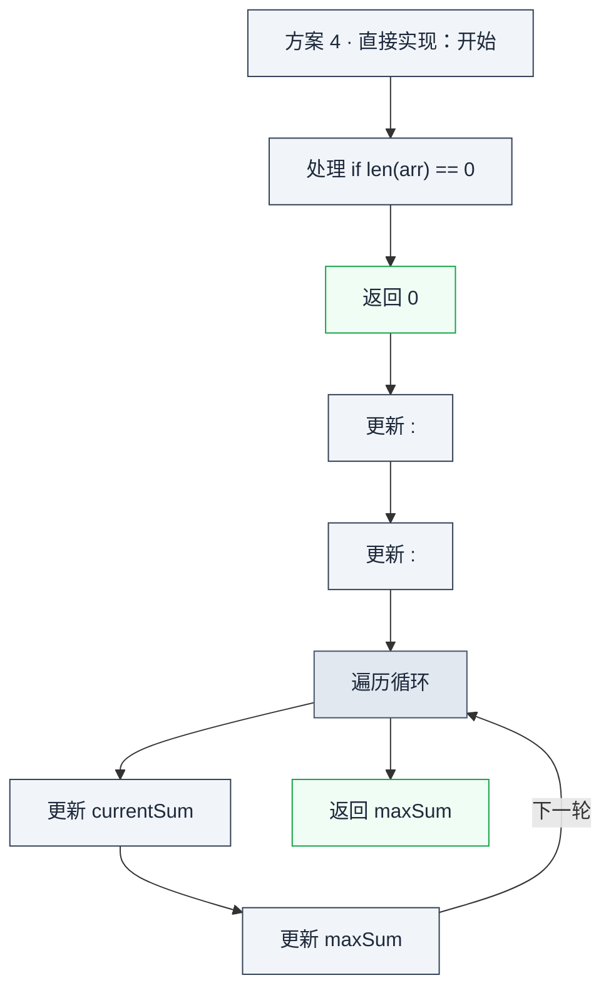

```go
package main // 引入依赖

import (
	"fmt" // 「fmt」
	"os"  // 「os」
)

// Greatest Slice - 方案4: Linear Scan (Kadane, O(n))
func maxSubArray(arr []int) int { // 定义函数/方法 maxSubArray
	if len(arr) == 0 { // 若 长度(数组) 等于 0
		return 0 // 返回 0
	}
	maxSum := arr[0]                // 把 数组[0] 写入 maxSum :
	currentSum := arr[0]            // 把 数组[0] 写入 currentSum :
	for i := 1; i < len(arr); i++ { // 让 下标 i 从 1 开始计数
		currentSum = max2(arr[i], currentSum+arr[i]) // 把 max2(数组[下标 i], currentSum 加 数组[下标 i]) 写入 currentSum
		maxSum = max2(maxSum, currentSum)            // 把 max2(maxSum, currentSum) 写入 maxSum
	}
	return maxSum // 返回 maxSum
}

func max2(a, b int) int { // 定义函数/方法 max2
	if a > b { // 若 数组 超过 b
		return a // 返回 数组
	}
	return b // 返回 b
}

func main() { // 程序入口：跑内嵌自测用例
	cases := []struct { // 把 []struct { 写入 cases :
		in   []int // in []int
		want int   // want int
	}{ // }{
		{[]int{-2, 1, -3, 4, -1, 2, 1}, 6},
		{[]int{-1}, -1},
		{[]int{1}, 1},
		{[]int{-2, -1}, -1},
		{[]int{}, 0},
		{[]int{5, 4, -1, 7, 8}, 23},
	}
	ok := true                // 把 true 写入 ok :
	for _, c := range cases { // 同时取 _ 与 字符 遍历
		if got := maxSubArray(c.in); got != c.want { // 若 got : 赋值为 maxSubArray(字符.in); got 不等于 字符.want
			ok = false                                                         // 把 false 写入 ok
			fmt.Printf("FAIL maxSubArray(%v)=%d want %d\n", c.in, got, c.want) // 打印输出
		}
	}
	if !ok { // 若 取反 ok
		os.Exit(1) // os.Exit(1)
	}
	fmt.Println("PASS") // 全部用例通过，输出 PASS
}
```

#### 方案 5：迭代指针处理

**思路与代码分析**：核心是「迭代指针处理」。Go 版用切片与多返回值惯用法，显式处理索引边界。**走读**：方案 5 · 迭代指针处理：开始 → 处理 if len(arr) ≤ 1 → 返回 arr → 更新 : → 更新 : → 更新 : → 返回 merge(left, right)。

**运行架构**（真实控制流）：

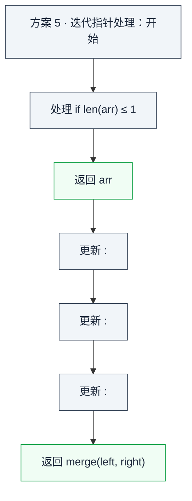

```go
package main // 引入依赖

import (
	"fmt"     // 「fmt」
	"os"      // 「os」
	"reflect" // 「reflect」
)

// 2-Way Merge - 方案5: Merge Sort (O(n log n))
func mergeSort(arr []int) []int { // 定义函数/方法 mergeSort
	if len(arr) <= 1 { // 若 长度(数组) 不超过 1
		return arr // 返回 数组
	}
	mid := len(arr) / 2                                  // 把 长度(数组) 除以 2 写入 mid :
	left := mergeSort(append([]int(nil), arr[:mid]...))  // 把 mergeSort(append([]int(nil), 数组[:中点]...)) 写入 left :
	right := mergeSort(append([]int(nil), arr[mid:]...)) // 把 mergeSort(append([]int(nil), 数组[中点:]...)) 写入 right :
	return merge(left, right)                            // 定义函数/方法 merge
}

func merge(left, right []int) []int { // 定义函数/方法 merge
	result := []int{}                     // 把 []int{} 写入 result :
	i, j := 0, 0                          // 把 0, 0 写入 i, j :
	for i < len(left) && j < len(right) { // for 下标 i 小于 长度(左边界) 且 下标 j 小于 长度(右边界) {
		if left[i] < right[j] { // 若 左边界[下标 i] 小于 右边界[下标 j]
			result = append(result, left[i]) // 把 append(结果, 左边界[下标 i]) 写入 结果
			i++                              // 下标 i 加一
		} else { // 否则
			result = append(result, right[j]) // 把 append(结果, 右边界[下标 j]) 写入 结果
			j++                               // 下标 j 加一
		}
	}
	result = append(result, left[i:]...)  // 把 append(结果, 左边界[下标 i:]...) 写入 结果
	result = append(result, right[j:]...) // 把 append(结果, 右边界[下标 j:]...) 写入 结果
	return result                         // 返回 结果
}

func main() { // 程序入口：跑内嵌自测用例
	cases := []struct { // 把 []struct { 写入 cases :
		in   []int // in []int
		want []int // want []int
	}{ // }{
		{[]int{3, 1, 4, 1, 5}, []int{1, 1, 3, 4, 5}},
		{[]int{}, []int{}},
		{[]int{1}, []int{1}},
		{[]int{5, 4, 3, 2, 1}, []int{1, 2, 3, 4, 5}},
		{[]int{2, 2, 2}, []int{2, 2, 2}},
	}
	ok := true                // 把 true 写入 ok :
	for _, c := range cases { // 同时取 _ 与 字符 遍历
		if got := mergeSort(c.in); !reflect.DeepEqual(got, c.want) {
			ok = false                                                       // 把 false 写入 ok
			fmt.Printf("FAIL mergeSort(%v)=%v want %v\n", c.in, got, c.want) // 打印输出
		}
	}
	if !ok { // 若 取反 ok
		os.Exit(1) // os.Exit(1)
	}
	fmt.Println("PASS") // 全部用例通过，输出 PASS
}
```

### Java 实现（5 种方案）

Java 的全部方案如下，每个方案都内嵌用例自测，可独立运行（老仓库 python/go 文件遵循「打印结果」约定）：

#### 方案 1：迭代指针处理

**思路与代码分析**：核心是「迭代指针处理」。Java 版用类与静态方法组织，集合操作显式明了。代码里依次做这些事：双重循环遍历。**走读**：方案 1 · 迭代指针处理：开始 → 更新 n → 命中条件，直接返回 → 更新 gs → 遍历循环 → 遍历循环 → 更新 s → 遍历循环 → 若 gs ＜ s：更新 gs → 返回 gs。

**运行架构**（真实控制流）：

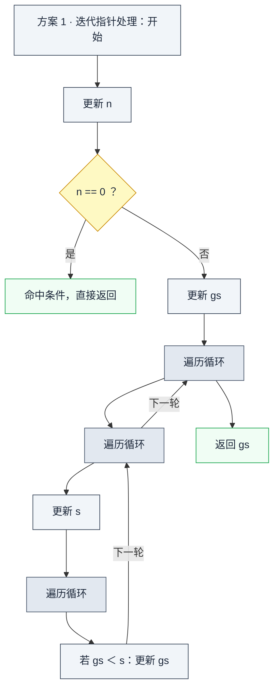

```java
package com.webfault.dsa; // 引入依赖

class lc110240695_solution11 { // 定义类型
  // 暴力枚举所有区间
  static int maxSubArrayBf(int[] arr) { // 定义函数/方法 maxSubArrayBf
    int n = arr.length; // 把 数组.长度 存入 元素个数
    if (n == 0) return 0; // 若 元素个数 等于 0，直接返回 0
    int gs = arr[0]; // 把 数组[0] 存入 gs
    for (int i = 0; i < n; i++) { // 让 下标 i 从 0 开始计数，下标 i 小于 元素个数 就继续
      for (int j = i; j < n; j++) { // 让 下标 j 从 下标 i 开始计数，下标 j 小于 元素个数 就继续
        int s = 0; // 把 0 存入 字符串
        for (int k = i; k <= j; k++) s += arr[k]; // 让 下标 k 从 下标 i 开始计数，下标 k 不超过 下标 j 就继续
        if (gs < s) gs = s; // 若 gs 小于 字符串) gs 赋值为 字符串;
      }
    }
    return gs; // 返回 gs
  }

  public static void main(String[] args) { // public static void main(String[] args) {
    int r = maxSubArrayBf(new int[] {-2, 1, -3, 4, -1, 2, 1});
    if (r != 6) { // 若 右指针 不等于 6
      System.out.println("FAIL " + r); // 打印输出
      throw new RuntimeException("FAILED"); // throw new RuntimeException(「FAILED」);
    }
    System.out.println("PASS"); // 全部用例通过，输出 PASS
  }
}
```

#### 方案 2：直接实现

**思路与代码分析**：核心是「直接实现」。Java 版用类与静态方法组织，集合操作显式明了。代码里依次做这些事：双重循环遍历。**走读**：方案 2 · 直接实现：开始 → 更新 n → 命中条件，直接返回 → 更新 gs → 遍历循环 → 更新 s → 遍历循环 → 更新 + → 若 gs ＜ s：更新 gs → 返回 gs。

**运行架构**（真实控制流）：

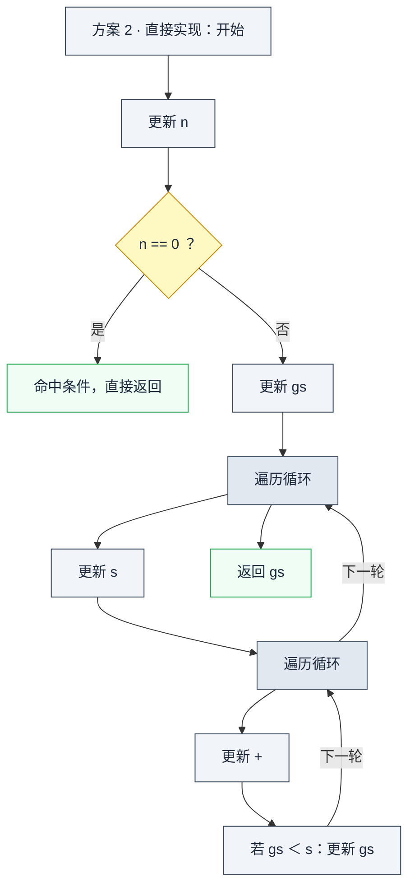

```java
package com.webfault.dsa; // 引入依赖

class lc110240695_solution22 { // 定义类型
  // 递增求和 O(n^2)
  static int maxSubArrayIc(int[] arr) { // 定义函数/方法 maxSubArrayIc
    int n = arr.length; // 把 数组.长度 存入 元素个数
    if (n == 0) return 0; // 若 元素个数 等于 0，直接返回 0
    int gs = arr[0]; // 把 数组[0] 存入 gs
    for (int i = 0; i < n; i++) { // 让 下标 i 从 0 开始计数，下标 i 小于 元素个数 就继续
      int s = 0; // 把 0 存入 字符串
      for (int j = i; j < n; j++) { // 让 下标 j 从 下标 i 开始计数，下标 j 小于 元素个数 就继续
        s += arr[j]; // 字符串累加 数组[下标 j]
        if (gs < s) gs = s; // 若 gs 小于 字符串) gs 赋值为 字符串;
      }
    }
    return gs; // 返回 gs
  }

  public static void main(String[] args) { // public static void main(String[] args) {
    int r = maxSubArrayIc(new int[] {-2, 1, -3, 4, -1, 2, 1});
    if (r != 6) { // 若 右指针 不等于 6
      System.out.println("FAIL " + r); // 打印输出
      throw new RuntimeException("FAILED"); // throw new RuntimeException(「FAILED」);
    }
    System.out.println("PASS"); // 全部用例通过，输出 PASS
  }
}
```

#### 方案 3：直接实现

**思路与代码分析**：核心是「直接实现」。Java 版用类与静态方法组织，集合操作显式明了。**走读**：方案 3 · 直接实现：开始 → 命中条件，直接返回 → 返回 helper(arr, 0, arr.length).best。

**运行架构**（真实控制流）：

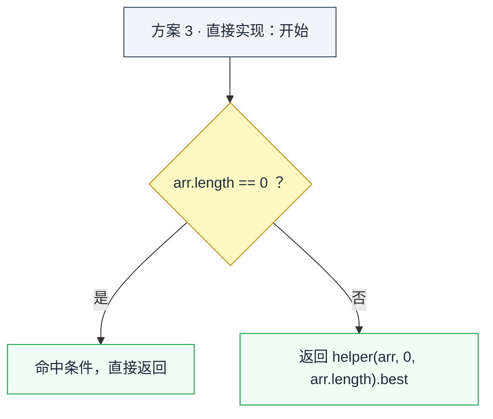

```java
package com.webfault.dsa; // 引入依赖

class lc110240695_solution33 { // 定义类型
  // 分治 O(n log n)
  static class T { // static class T {
    int best, prefix, suffix, total; // int 当前最优, prefix, suffix, 总和;

    T(int b, int p, int s, int t) {
      best = b;
      prefix = p;
      suffix = s;
      total = t;
    }
  }

  static T helper(int[] arr, int lo, int hi) { // 定义函数/方法 helper
    if (hi - lo == 1) { // 若 右边界 减 左边界 等于 1
      int v = arr[lo]; // 把 数组[左边界] 存入 值
      return new T(v, v, v, v); // 返回 new T(值, 值, 值, 值)
    }
    int mi = lo + (hi - lo) / 2; // 把 (左边界 加 右边界) 除以 2 存入 mi
    T l = helper(arr, lo, mi); // 把 helper(数组, 左边界, mi); 写入 T l
    T r = helper(arr, mi, hi); // 把 helper(数组, mi, 右边界); 写入 T r
    int crossing = l.suffix + r.prefix; // 把 左指针.suffix 加 右指针.prefix 存入 crossing
    int best =
        Math.max(
            Math.max(l.best, r.best),
            crossing); // 把 Math.取较大值 Math.取较大值 左指针.当前最优, 右指针.当前最优), crossing) 存入 当前最优
    int prefix =
        Math.max(
            l.prefix, l.total + r.prefix); // 把 Math.取较大值 左指针.prefix, 左指针.总和 加 右指针.prefix) 存入 prefix
    int suffix =
        Math.max(
            r.suffix, r.total + l.suffix); // 把 Math.取较大值 右指针.suffix, 右指针.总和 加 左指针.suffix) 存入 suffix
    int total = l.total + r.total; // 把 左指针.总和 加 右指针.总和 存入 总和
    return new T(best, prefix, suffix, total); // 返回 new T(当前最优, prefix, suffix, 总和)
  }

  static int maxSubArrayDc(int[] arr) { // 定义函数/方法 maxSubArrayDc
    if (arr.length == 0) return 0; // 若 数组.长度 等于 0，直接返回 0
    return helper(arr, 0, arr.length).best; // 返回 helper(数组, 0, 数组.长度).当前最优
  }

  public static void main(String[] args) { // public static void main(String[] args) {
    int r = maxSubArrayDc(new int[] {-2, 1, -3, 4, -1, 2, 1});
    if (r != 6) { // 若 右指针 不等于 6
      System.out.println("FAIL " + r); // 打印输出
      throw new RuntimeException("FAILED"); // throw new RuntimeException(「FAILED」);
    }
    System.out.println("PASS"); // 全部用例通过，输出 PASS
  }
}
```

#### 方案 4：直接实现

**思路与代码分析**：核心是「直接实现」。Java 版用类与静态方法组织，集合操作显式明了。代码里依次做这些事：单循环线性扫描。**走读**：方案 4 · 直接实现：开始 → 命中条件，直接返回 → 更新 maxSum → 更新 cur → 遍历循环 → 更新 cur → 更新 maxSum → 返回 maxSum。

**运行架构**（真实控制流）：

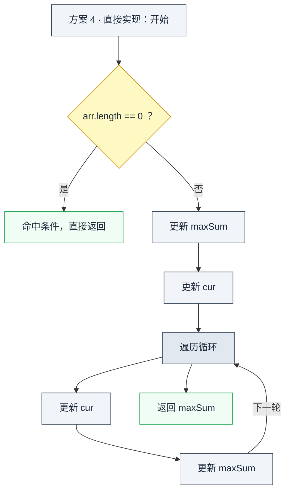

```java
package com.webfault.dsa; // 引入依赖

class lc110240695_solution44 { // 定义类型
  // Kadane 线性扫描 O(n)
  static int maxSubArray(int[] arr) { // 定义函数/方法 maxSubArray
    if (arr.length == 0) return 0; // 若 数组.长度 等于 0，直接返回 0
    int maxSum = arr[0]; // 把 数组[0] 存入 maxSum
    int cur = arr[0]; // 把 数组[0] 存入 当前值
    for (int i = 1; i < arr.length; i++) { // 让 下标 i 从 1 开始计数，下标 i 小于 数组.长度 就继续
      cur = Math.max(arr[i], cur + arr[i]); // 把 Math.取较大值 数组[下标 i], 当前值 加 数组[下标 i]); 写入 当前值
      maxSum = Math.max(maxSum, cur); // 把 Math.取较大值 maxSum, 当前值); 写入 maxSum
    }
    return maxSum; // 返回 maxSum
  }

  public static void main(String[] args) { // public static void main(String[] args) {
    int r =
        maxSubArray(
            new int[] {
              -2, 1, -3, 4, -1, 2, 1
            }); // 把 maxSubArray(new int[]{ 减 2, 1, 减 3, 4, 减 1, 2, 1}) 存入 右指针
    if (r != 6) { // 若 右指针 不等于 6
      System.out.println("FAIL " + r); // 打印输出
      throw new RuntimeException("FAILED"); // throw new RuntimeException(「FAILED」);
    }
    System.out.println("PASS"); // 全部用例通过，输出 PASS
  }
}
```

#### 方案 5：迭代指针处理

**思路与代码分析**：核心是「迭代指针处理」。Java 版用类与静态方法组织，集合操作显式明了。**走读**：方案 5 · 迭代指针处理：开始 → 若 arr.length ≤ 1) return arr.clone(：None → 更新 mid → 更新 left → 调用 mergeSort( → 调用 Arrays.copyOfRange( → 处理 arr, 0, mid)) → 更新 right → 返回 merge(left, right)。

**运行架构**（真实控制流）：

```mermaid
graph TD
    N0["方案 5 · 迭代指针处理：开始"]
    N1["若 arr.length ≤ 1) return arr.clone(：None"]
    N2["更新 mid"]
    N3["更新 left"]
    N4["调用 mergeSort("]
    N5["调用 Arrays.copyOfRange("]
    N6["处理 arr, 0, mid))"]
    N7["更新 right"]
    N8["返回 merge(left, right)"]
    N0 --> N1
    N1 --> N2
    N2 --> N3
    N3 --> N4
    N4 --> N5
    N5 --> N6
    N6 --> N7
    N7 --> N8
    classDef n fill:#f1f5f9,stroke:#334155,color:#1e293b;
    classDef lp fill:#e2e8f0,stroke:#475569,color:#1e293b;
    classDef dc fill:#fef9c3,stroke:#ca8a04,color:#1e293b;
    classDef tm fill:#f0fdf4,stroke:#16a34a,color:#1e293b;
    class N0,N1,N2,N3,N4,N5,N6,N7 n;
    class N8 tm;
```

```java
package com.webfault.dsa; // 引入依赖

import java.util.*; // 引入依赖

class lc110240695_solution55 { // 定义类型
  // 二路归并排序
  static int[] mergeSort(int[] arr) { // 定义函数/方法 mergeSort
    if (arr.length <= 1) return arr.clone(); // 若 数组.长度 不超过 1，直接返回 数组.clone()
    int mid = arr.length / 2; // 把 数组.长度 除以 2 存入 中点
    int[] left =
        mergeSort(
            Arrays.copyOfRange(
                arr, 0, mid)); // 把 mergeSort(Arrays.copyOfRange(数组, 0, 中点)); 写入 int[] left
    int[] right = mergeSort(Arrays.copyOfRange(arr, mid, arr.length));
    return merge(left, right); // 返回 merge(左边界, 右边界)
  }

  static int[] merge(int[] left, int[] right) { // 定义函数/方法 merge
    int[] res = new int[left.length + right.length]; // 把 new int[左边界.长度 加 右边界.长度]; 写入 int[] res
    int i = 0, j = 0, k = 0; // 把 0, 下标 j 赋值为 0, 下标 k 赋值为 0 存入 下标 i
    while (i < left.length && j < right.length) { // 循环，直到不满足「下标 i 小于 左边界.长度 且 下标 j 小于 右边界.长度」
      if (left[i] < right[j])
        res[k++] = left[i++]; // 若 左边界[下标 i] 小于 右边界[下标 j]) 结果[下标 k 加一 ] 赋值为 左边界[下标 i 加一 ];
      else res[k++] = right[j++]; // 否则
    }
    while (i < left.length)
      res[k++] = left[i++]; // 循环，直到不满足「下标 i 小于 左边界.长度) 结果[下标 k 加一 ] 赋值为 左边界[下标 i 加一 ];」
    while (j < right.length)
      res[k++] = right[j++]; // 循环，直到不满足「下标 j 小于 右边界.长度) 结果[下标 k 加一 ] 赋值为 右边界[下标 j 加一 ];」
    return res; // 返回 结果
  }

  public static void main(String[] args) { // public static void main(String[] args) {
    int[] r =
        mergeSort(new int[] {3, 1, 4, 1, 5}); // 把 mergeSort(new int[]{3, 1, 4, 1, 5}); 写入 int[] r
    int[] expect = {1, 1, 3, 4, 5}; // 把 {1, 1, 3, 4, 5}; 写入 int[] expect
    if (!Arrays.equals(r, expect)) { // 若 取反 Arrays.equals(右指针, expect
      System.out.println("FAIL " + Arrays.toString(r)); // 打印输出
      throw new RuntimeException("FAILED"); // throw new RuntimeException(「FAILED」);
    }
    System.out.println("PASS"); // 全部用例通过，输出 PASS
  }
}
```

### Rust 实现（5 种方案）

Rust 的全部方案如下，每个方案都内嵌用例自测，可独立运行（老仓库 python/go 文件遵循「打印结果」约定）：

#### 方案 1：迭代指针处理

**思路与代码分析**：核心是「迭代指针处理」。Rust 版用所有权移动与切片借用改写同一逻辑，注意 Option 与引用边界。**走读**：方案 1 · 迭代指针处理：开始 → 计算 best → 遍历 0..arr.len() 中的每个元素 i → 计算 s → 遍历 i..arr.len() 中的每个元素 j → 更新 + → 处理 if s ＞ best → 更新 best → 处理 best → 返回结果。

**运行架构**（真实控制流）：

```mermaid
graph TD
    N0["方案 1 · 迭代指针处理：开始"]
    N1["计算 best"]
    N2["遍历 0..arr.len() 中的每个元素 i"]
    N3["计算 s"]
    N4["遍历 i..arr.len() 中的每个元素 j"]
    N5["更新 +"]
    N6["处理 if s ＞ best"]
    N7["更新 best"]
    N8["处理 best"]
    N9["返回结果"]
    N0 --> N1
    N1 --> N2
    N2 --> N3
    N3 --> N4
    N4 --> N5
    N5 --> N6
    N6 --> N7
    N7 -- 下一轮 --> N4
    N4 -- 下一轮 --> N2
    N2 --> N8
    N8 --> N9
    classDef n fill:#f1f5f9,stroke:#334155,color:#1e293b;
    classDef lp fill:#e2e8f0,stroke:#475569,color:#1e293b;
    classDef dc fill:#fef9c3,stroke:#ca8a04,color:#1e293b;
    classDef tm fill:#f0fdf4,stroke:#16a34a,color:#1e293b;
    class N0,N1,N3,N5,N6,N7,N8 n;
    class N2,N4 lp;
    class N9 tm;
```

```rust
// LeetCode 110240695. 分治策略之 greatest slice — Rust 版（方案A：暴力枚举所有子段）
fn max_sub_array_bf(arr: &[i32]) -> i64 {
    // 定义函数/方法 max_sub_array_bf
    let mut best = i64::MIN; // 把 i64::MIN; 写入 let mut best
    for i in 0..arr.len() {
        // 逐个取出 0 的元素（下标 i）
        let mut s = 0i64; // 把 0i64; 写入 let mut s
        for j in i..arr.len() {
            // 逐个取出 下标 i 的元素（下标 j）
            s += arr[j] as i64; // 字符串累加 数组[下标 j] as i64
            if s > best {
                // 若 字符串 超过 当前最优
                best = s; // 把 字符串; 写入 当前最优
            }
        }
    }
    best // 当前最优
}

fn main() {
    // 程序入口：跑内嵌自测用例
    let cases: Vec<(Vec<i32>, i64)> = vec![
        (vec![-2, 1, -3, 4, -1, 2, 1, -5, 4], 6),
        (vec![1], 1),
        (vec![-1, -2, -3], -1),
        (vec![5, 4, -1, 7, 8], 23),
    ];
    for (idx, (arr, want)) in cases.iter().enumerate() {
        // for (idx, (数组, want)) in cases.iter().enumerate() {
        assert_eq!(max_sub_array_bf(arr), *want, "case {} failed", idx); // 断言校验
    }
    println!("PASS"); // 全部用例通过，输出 PASS
}
```

#### 方案 2：直接实现

**思路与代码分析**：核心是「直接实现」。Rust 版用所有权移动与切片借用改写同一逻辑，注意 Option 与引用边界。**走读**：方案 2 · 直接实现：开始 → 计算 n → 处理 if n == 0 → 返回 0 → 计算 gs → 遍历 0..n 中的每个元素 i → 计算 s → 遍历 i..n 中的每个元素 j → 更新 + → 处理 if gs ＜ s → 更新 gs → 处理 gs。

**运行架构**（真实控制流）：

```mermaid
graph TD
    N0["方案 2 · 直接实现：开始"]
    N1["计算 n"]
    N2["处理 if n == 0"]
    N3["返回 0"]
    N4["计算 gs"]
    N5["遍历 0..n 中的每个元素 i"]
    N6["计算 s"]
    N7["遍历 i..n 中的每个元素 j"]
    N8["更新 +"]
    N9["处理 if gs ＜ s"]
    N10["更新 gs"]
    N11["处理 gs"]
    N0 --> N1
    N1 --> N2
    N2 --> N3
    N3 --> N4
    N4 --> N5
    N5 --> N6
    N6 --> N7
    N7 --> N8
    N8 --> N9
    N9 --> N10
    N10 -- 下一轮 --> N7
    N7 -- 下一轮 --> N5
    N5 --> N11
    classDef n fill:#f1f5f9,stroke:#334155,color:#1e293b;
    classDef lp fill:#e2e8f0,stroke:#475569,color:#1e293b;
    classDef dc fill:#fef9c3,stroke:#ca8a04,color:#1e293b;
    classDef tm fill:#f0fdf4,stroke:#16a34a,color:#1e293b;
    class N0,N1,N2,N4,N6,N8,N9,N10,N11 n;
    class N5,N7 lp;
    class N3 tm;
```

```rust
// LeetCode 110240695. 分治策略之 greatest slice — Rust 版（方案B：增量扫描）
fn max_sub_array_ic(arr: &[i32]) -> i64 {
    // 定义函数/方法 max_sub_array_ic
    let n = arr.len(); // 把 数组.长度() 存入 元素个数
    if n == 0 {
        // 若 元素个数 等于 0
        return 0; // 返回 0
    }
    let mut gs = arr[0] as i64; // 把 数组[0] as i64; 写入 let mut gs
    for i in 0..n {
        // 逐个取出 0 的元素（下标 i）
        let mut s = 0i64; // 把 0i64; 写入 let mut s
        for j in i..n {
            // 逐个取出 下标 i 的元素（下标 j）
            s += arr[j] as i64; // 字符串累加 数组[下标 j] as i64
            if gs < s {
                // 若 gs 小于 字符串
                gs = s; // 把 字符串; 写入 gs
            }
        }
    }
    gs // gs
}

fn main() {
    // 程序入口：跑内嵌自测用例
    assert_eq!(max_sub_array_ic(&[-2, 1, -3, 4, -1, 2, 1]), 6, "ms1"); // 断言校验
    assert_eq!(max_sub_array_ic(&[-1, -2, -3]), -1, "ms2"); // 断言校验
    println!("PASS"); // 全部用例通过，输出 PASS
}
```

#### 方案 3：直接实现

**思路与代码分析**：核心是「直接实现」。Rust 版用所有权移动与切片借用改写同一逻辑，注意 Option 与引用边界。**走读**：方案 3 · 直接实现：开始 → 处理 if hi - lo == 1 → 计算 v → 返回 (v, v, v, v) → 计算 mi → 计算 let (l_best, l_pre, l_su → 计算 let (r_best, r_pre, r_su → 计算 crossing → 计算 best → 计算 prefix → 计算 suffix → 计算 total → 处理 (best, prefix, suffix, total → 处理 if arr.is_empty() → 返回 0 → 调用 helper(arr, 0, arr.len()).0。

**运行架构**（真实控制流）：

```mermaid
graph TD
    N0["方案 3 · 直接实现：开始"]
    N1["处理 if hi - lo == 1"]
    N2["计算 v"]
    N3["返回 (v, v, v, v)"]
    N4["计算 mi"]
    N5["计算 let (l_best, l_pre, l_su"]
    N6["计算 let (r_best, r_pre, r_su"]
    N7["计算 crossing"]
    N8["计算 best"]
    N9["计算 prefix"]
    N10["计算 suffix"]
    N11["计算 total"]
    N12["处理 (best, prefix, suffix, total"]
    N13["处理 if arr.is_empty()"]
    N14["返回 0"]
    N15["调用 helper(arr, 0, arr.len()).0"]
    N0 --> N1
    N1 --> N2
    N2 --> N3
    N3 --> N4
    N4 --> N5
    N5 --> N6
    N6 --> N7
    N7 --> N8
    N8 --> N9
    N9 --> N10
    N10 --> N11
    N11 --> N12
    N12 --> N13
    N13 --> N14
    N14 --> N15
    classDef n fill:#f1f5f9,stroke:#334155,color:#1e293b;
    classDef lp fill:#e2e8f0,stroke:#475569,color:#1e293b;
    classDef dc fill:#fef9c3,stroke:#ca8a04,color:#1e293b;
    classDef tm fill:#f0fdf4,stroke:#16a34a,color:#1e293b;
    class N0,N1,N2,N4,N5,N6,N7,N8,N9,N10,N11,N12,N13,N15 n;
    class N3,N14 tm;
```

```rust
// LeetCode 110240695. 分治策略之 greatest slice — Rust 版（方案C：分治 best/prefix/suffix/total）
fn max_sub_array_dc(arr: &[i32]) -> i64 {
    // 定义函数/方法 max_sub_array_dc
    fn helper(arr: &[i32], lo: usize, hi: usize) -> (i64, i64, i64, i64) {
        // 定义函数/方法 helper
        // (best, prefix, suffix, total)
        if hi - lo == 1 {
            // 若 右边界 减 左边界 等于 1
            let v = arr[lo] as i64; // 把 数组[左边界] as i64 存入 值
            return (v, v, v, v); // 返回 (值, 值, 值, 值)
        }
        let mi = (lo + hi) / 2; // 把 (左边界 加 右边界) 除以 2 存入 mi
        let (l_best, l_pre, l_suf, l_sum) = helper(arr, lo, mi); // 把 helper(数组, 左边界, mi); 写入 let (l_best, l_pre, l_suf, l_sum)
        let (r_best, r_pre, r_suf, r_sum) = helper(arr, mi, hi); // 把 helper(数组, mi, 右边界); 写入 let (r_best, r_pre, r_suf, r_sum)
        let crossing = l_suf + r_pre; // 把 l_suf 加 r_pre 存入 crossing
        let best = l_best.max(r_best).max(crossing); // 把 l_best.取较大值 r_best).取较大值 crossing) 存入 当前最优
        let prefix = l_pre.max(l_sum + r_pre); // 把 l_pre.取较大值 l_sum 加 r_pre) 存入 prefix
        let suffix = r_suf.max(r_sum + l_suf); // 把 r_suf.取较大值 r_sum 加 l_suf) 存入 suffix
        let total = l_sum + r_sum; // 把 l_sum 加 r_sum 存入 总和
        (best, prefix, suffix, total) // (当前最优, prefix, suffix, 总和)
    }
    if arr.is_empty() {
        // 若 数组.is_empty(
        return 0; // 返回 0
    }
    helper(arr, 0, arr.len()).0 // helper(数组, 0, 数组.长度()).0
}

fn main() {
    // 程序入口：跑内嵌自测用例
    assert_eq!(max_sub_array_dc(&[-2, 1, -3, 4, -1, 2, 1]), 6, "ms1"); // 断言校验
    assert_eq!(max_sub_array_dc(&[1, 2, 3]), 6, "ms2"); // 断言校验
    println!("PASS"); // 全部用例通过，输出 PASS
}
```

#### 方案 4：直接实现

**思路与代码分析**：核心是「直接实现」。Rust 版用所有权移动与切片借用改写同一逻辑，注意 Option 与引用边界。**走读**：方案 4 · 直接实现：开始 → 处理 if hi - lo == 1 → 计算 v → 返回 (v, v, v, v) → 计算 mi → 计算 let (l_best, l_pre, l_su → 计算 let (r_best, r_pre, r_su → 计算 crossing → 计算 best → 计算 prefix → 计算 suffix → 计算 total → 处理 (best, prefix, suffix, total → 处理 if arr.is_empty() → 返回 0 → 调用 helper(arr, 0, arr.len()).0。

**运行架构**（真实控制流）：

```mermaid
graph TD
    N0["方案 4 · 直接实现：开始"]
    N1["处理 if hi - lo == 1"]
    N2["计算 v"]
    N3["返回 (v, v, v, v)"]
    N4["计算 mi"]
    N5["计算 let (l_best, l_pre, l_su"]
    N6["计算 let (r_best, r_pre, r_su"]
    N7["计算 crossing"]
    N8["计算 best"]
    N9["计算 prefix"]
    N10["计算 suffix"]
    N11["计算 total"]
    N12["处理 (best, prefix, suffix, total"]
    N13["处理 if arr.is_empty()"]
    N14["返回 0"]
    N15["调用 helper(arr, 0, arr.len()).0"]
    N0 --> N1
    N1 --> N2
    N2 --> N3
    N3 --> N4
    N4 --> N5
    N5 --> N6
    N6 --> N7
    N7 --> N8
    N8 --> N9
    N9 --> N10
    N10 --> N11
    N11 --> N12
    N12 --> N13
    N13 --> N14
    N14 --> N15
    classDef n fill:#f1f5f9,stroke:#334155,color:#1e293b;
    classDef lp fill:#e2e8f0,stroke:#475569,color:#1e293b;
    classDef dc fill:#fef9c3,stroke:#ca8a04,color:#1e293b;
    classDef tm fill:#f0fdf4,stroke:#16a34a,color:#1e293b;
    class N0,N1,N2,N4,N5,N6,N7,N8,N9,N10,N11,N12,N13,N15 n;
    class N3,N14 tm;
```

```rust
// LeetCode 110240695. 分治策略之 greatest slice — Rust 版（方案C：分治 best/prefix/suffix/total）
fn max_sub_array_dc(arr: &[i32]) -> i64 {
    // 定义函数/方法 max_sub_array_dc
    fn helper(arr: &[i32], lo: usize, hi: usize) -> (i64, i64, i64, i64) {
        // 定义函数/方法 helper
        // (best, prefix, suffix, total)
        if hi - lo == 1 {
            // 若 右边界 减 左边界 等于 1
            let v = arr[lo] as i64; // 把 数组[左边界] as i64 存入 值
            return (v, v, v, v); // 返回 (值, 值, 值, 值)
        }
        let mi = (lo + hi) / 2; // 把 (左边界 加 右边界) 除以 2 存入 mi
        let (l_best, l_pre, l_suf, l_sum) = helper(arr, lo, mi); // 把 helper(数组, 左边界, mi); 写入 let (l_best, l_pre, l_suf, l_sum)
        let (r_best, r_pre, r_suf, r_sum) = helper(arr, mi, hi); // 把 helper(数组, mi, 右边界); 写入 let (r_best, r_pre, r_suf, r_sum)
        let crossing = l_suf + r_pre; // 把 l_suf 加 r_pre 存入 crossing
        let best = l_best.max(r_best).max(crossing); // 把 l_best.取较大值 r_best).取较大值 crossing) 存入 当前最优
        let prefix = l_pre.max(l_sum + r_pre); // 把 l_pre.取较大值 l_sum 加 r_pre) 存入 prefix
        let suffix = r_suf.max(r_sum + l_suf); // 把 r_suf.取较大值 r_sum 加 l_suf) 存入 suffix
        let total = l_sum + r_sum; // 把 l_sum 加 r_sum 存入 总和
        (best, prefix, suffix, total) // (当前最优, prefix, suffix, 总和)
    }
    if arr.is_empty() {
        // 若 数组.is_empty(
        return 0; // 返回 0
    }
    helper(arr, 0, arr.len()).0 // helper(数组, 0, 数组.长度()).0
}

fn main() {
    // 程序入口：跑内嵌自测用例
    assert_eq!(max_sub_array_dc(&[-2, 1, -3, 4, -1, 2, 1]), 6, "ms1"); // 断言校验
    assert_eq!(max_sub_array_dc(&[1, 2, 3]), 6, "ms2"); // 断言校验
    println!("PASS"); // 全部用例通过，输出 PASS
}
```

#### 方案 5：迭代指针处理

**思路与代码分析**：核心是「迭代指针处理」。Rust 版用所有权移动与切片借用改写同一逻辑，注意 Option 与引用边界。**走读**：方案 5 · 迭代指针处理：开始 → 计算 best → 遍历 0..arr.len() 中的每个元素 i → 计算 s → 遍历 i..arr.len() 中的每个元素 j → 更新 + → 处理 if s ＞ best → 更新 best → 处理 best → 返回结果。

**运行架构**（真实控制流）：

```mermaid
graph TD
    N0["方案 5 · 迭代指针处理：开始"]
    N1["计算 best"]
    N2["遍历 0..arr.len() 中的每个元素 i"]
    N3["计算 s"]
    N4["遍历 i..arr.len() 中的每个元素 j"]
    N5["更新 +"]
    N6["处理 if s ＞ best"]
    N7["更新 best"]
    N8["处理 best"]
    N9["返回结果"]
    N0 --> N1
    N1 --> N2
    N2 --> N3
    N3 --> N4
    N4 --> N5
    N5 --> N6
    N6 --> N7
    N7 -- 下一轮 --> N4
    N4 -- 下一轮 --> N2
    N2 --> N8
    N8 --> N9
    classDef n fill:#f1f5f9,stroke:#334155,color:#1e293b;
    classDef lp fill:#e2e8f0,stroke:#475569,color:#1e293b;
    classDef dc fill:#fef9c3,stroke:#ca8a04,color:#1e293b;
    classDef tm fill:#f0fdf4,stroke:#16a34a,color:#1e293b;
    class N0,N1,N3,N5,N6,N7,N8 n;
    class N2,N4 lp;
    class N9 tm;
```

```rust
// LeetCode 110240695. 分治策略之 greatest slice — Rust 版（方案A：暴力枚举所有子段）
fn max_sub_array_bf(arr: &[i32]) -> i64 {
    // 定义函数/方法 max_sub_array_bf
    let mut best = i64::MIN; // 把 i64::MIN; 写入 let mut best
    for i in 0..arr.len() {
        // 逐个取出 0 的元素（下标 i）
        let mut s = 0i64; // 把 0i64; 写入 let mut s
        for j in i..arr.len() {
            // 逐个取出 下标 i 的元素（下标 j）
            s += arr[j] as i64; // 字符串累加 数组[下标 j] as i64
            if s > best {
                // 若 字符串 超过 当前最优
                best = s; // 把 字符串; 写入 当前最优
            }
        }
    }
    best // 当前最优
}

fn main() {
    // 程序入口：跑内嵌自测用例
    let cases: Vec<(Vec<i32>, i64)> = vec![
        (vec![-2, 1, -3, 4, -1, 2, 1, -5, 4], 6),
        (vec![1], 1),
        (vec![-1, -2, -3], -1),
        (vec![5, 4, -1, 7, 8], 23),
    ];
    for (idx, (arr, want)) in cases.iter().enumerate() {
        // for (idx, (数组, want)) in cases.iter().enumerate() {
        assert_eq!(max_sub_array_bf(arr), *want, "case {} failed", idx); // 断言校验
    }
    println!("PASS"); // 全部用例通过，输出 PASS
}
```

### Lua 实现（5 种方案）

Lua 的全部方案如下，每个方案都内嵌用例自测，可独立运行（老仓库 python/go 文件遵循「打印结果」约定）：

#### 方案 1：迭代指针处理

**思路与代码分析**：核心是「迭代指针处理」。Lua 版用表与 ipairs 遍历，注意 ipairs 遇 nil 即停的语义。**走读**：方案 1 · 迭代指针处理：开始 → 更新 best → 循环 i：从 1 到 #arr do → 更新 s → 循环 j：从 i 到 #arr do → 更新 s → 处理 if s ＞ best then → 更新 best → 返回 best。

**运行架构**（真实控制流）：

```mermaid
graph TD
    N0["方案 1 · 迭代指针处理：开始"]
    N1["更新 best"]
    N2["循环 i：从 1 到 #arr do"]
    N3["更新 s"]
    N4["循环 j：从 i 到 #arr do"]
    N5["更新 s"]
    N6["处理 if s ＞ best then"]
    N7["更新 best"]
    N8["返回 best"]
    N0 --> N1
    N1 --> N2
    N2 --> N3
    N3 --> N4
    N4 --> N5
    N5 --> N6
    N6 --> N7
    N7 --> N8
    classDef n fill:#f1f5f9,stroke:#334155,color:#1e293b;
    classDef lp fill:#e2e8f0,stroke:#475569,color:#1e293b;
    classDef dc fill:#fef9c3,stroke:#ca8a04,color:#1e293b;
    classDef tm fill:#f0fdf4,stroke:#16a34a,color:#1e293b;
    class N0,N1,N3,N5,N6,N7 n;
    class N2,N4 lp;
    class N8 tm;
```

```lua
-- LeetCode 110240695. 分治策略之 greatest slice — Lua 版（方案A：暴力枚举所有子段）
local function max_sub_array_bf(arr) -- local function max_sub_array_bf(数组)
	local best = -math.huge -- 把 减 math.huge 写入 local best
	for i = 1, #arr do -- 把 1, #数组 do 写入 for i
		local s = 0 -- 把 0 写入 local s
		for j = i, #arr do -- 把 下标 i, #数组 do 写入 for j
			s = s + arr[j] -- 把 字符串 加 数组[下标 j] 存入 字符串
			if s > best then
				best = s
			end -- 若 字符串 超过 当前最优 then 当前最优 赋值为 字符串 终点
		end -- 终点
	end -- 终点
	return best -- 返回 当前最优
end -- 终点

local cases = { -- 把 { 写入 local cases
	{ { -2, 1, -3, 4, -1, 2, 1, -5, 4 }, 6 },
	{ { 1 }, 1 },
	{ { -1, -2, -3 }, -1 },
	{ { 5, 4, -1, 7, 8 }, 23 },
}
for idx, c in ipairs(cases) do -- 遍历取 字符
	assert(max_sub_array_bf(c[1]) == c[2], "case " .. idx .. " failed") -- 断言校验
end -- 终点
print("PASS") -- 全部用例通过，输出 PASS
```

#### 方案 2：直接实现

**思路与代码分析**：核心是「直接实现」。Lua 版用表与 ipairs 遍历，注意 ipairs 遇 nil 即停的语义。**走读**：方案 2 · 直接实现：开始 → 更新 n → 处理 if n == 0 then → 返回 0 → 更新 gs → 循环 i：从 1 到 n do → 更新 s → 循环 j：从 i 到 n do → 更新 s → 处理 if gs ＜ s then → 更新 gs → 返回 gs。

**运行架构**（真实控制流）：

```mermaid
graph TD
    N0["方案 2 · 直接实现：开始"]
    N1["更新 n"]
    N2["处理 if n == 0 then"]
    N3["返回 0"]
    N4["更新 gs"]
    N5["循环 i：从 1 到 n do"]
    N6["更新 s"]
    N7["循环 j：从 i 到 n do"]
    N8["更新 s"]
    N9["处理 if gs ＜ s then"]
    N10["更新 gs"]
    N11["返回 gs"]
    N0 --> N1
    N1 --> N2
    N2 --> N3
    N3 --> N4
    N4 --> N5
    N5 --> N6
    N6 --> N7
    N7 --> N8
    N8 --> N9
    N9 --> N10
    N10 --> N11
    classDef n fill:#f1f5f9,stroke:#334155,color:#1e293b;
    classDef lp fill:#e2e8f0,stroke:#475569,color:#1e293b;
    classDef dc fill:#fef9c3,stroke:#ca8a04,color:#1e293b;
    classDef tm fill:#f0fdf4,stroke:#16a34a,color:#1e293b;
    class N0,N1,N2,N4,N6,N8,N9,N10 n;
    class N5,N7 lp;
    class N3,N11 tm;
```

```lua
-- LeetCode 110240695. 分治策略之 greatest slice — Lua 版（方案B：增量扫描）
local function max_sub_array_ic(arr) -- local function max_sub_array_ic(数组)
	local n = #arr -- 把 #数组 写入 local n
	if n == 0 then
		return 0
	end -- 若 元素个数 等于 0 then return 0 终点
	local gs = arr[1] -- 把 数组[1] 写入 local gs
	for i = 1, n do -- 让 下标 i 从 1 走到 元素个数（Lua 1 基）
		local s = 0 -- 把 0 写入 local s
		for j = i, n do -- 把 下标 i, 元素个数 do 写入 for j
			s = s + arr[j] -- 把 字符串 加 数组[下标 j] 存入 字符串
			if gs < s then
				gs = s
			end -- 若 gs 小于 字符串 then gs 赋值为 字符串 终点
		end -- 终点
	end -- 终点
	return gs -- 返回 gs
end -- 终点

assert(max_sub_array_ic({ -2, 1, -3, 4, -1, 2, 1 }) == 6, "ms1") -- 断言校验
assert(max_sub_array_ic({ -1, -2, -3 }) == -1, "ms2") -- 断言校验
print("PASS") -- 全部用例通过，输出 PASS
```

#### 方案 3：直接实现

**思路与代码分析**：核心是「直接实现」。Lua 版用表与 ipairs 遍历，注意 ipairs 遇 nil 即停的语义。**走读**：方案 3 · 直接实现：开始 → 更新 n → 返回 0 → 返回 v, v, v, v → 返回 best, prefix, suffix, total → 返回 helper(0, n)。

**运行架构**（真实控制流）：

```mermaid
graph TD
    N0["方案 3 · 直接实现：开始"]
    N1["更新 n"]
    D1["……（中间计算步骤）"]
    N3["返回 0"]
    D2["……（中间计算步骤）"]
    N8["返回 v, v, v, v"]
    D3["……（中间计算步骤）"]
    N17["返回 best, prefix, suffix, total"]
    N18["返回 helper(0, n)"]
    N0 --> N1
    N17 --> N18
    N1 --> D1
    D1 --> N3
    N3 --> D2
    D2 --> N8
    N8 --> D3
    D3 --> N17
    classDef n fill:#f1f5f9,stroke:#334155,color:#1e293b;
    classDef lp fill:#e2e8f0,stroke:#475569,color:#1e293b;
    classDef dc fill:#fef9c3,stroke:#ca8a04,color:#1e293b;
    classDef tm fill:#f0fdf4,stroke:#16a34a,color:#1e293b;
    class N0,N1,D1,D2,D3 n;
    class N3,N8,N17,N18 tm;
```

```lua
-- LeetCode 110240695. 分治策略之 greatest slice — Lua 版（方案C：分治 best/prefix/suffix/total）
local function max_sub_array_dc(arr) -- local function max_sub_array_dc(数组)
	local n = #arr -- 把 #数组 写入 local n
	if n == 0 then
		return 0
	end -- 若 元素个数 等于 0 then return 0 终点

	local helper -- local helper
	helper = function(lo, hi) -- 把 function(左边界, 右边界) 存入 helper
		if hi - lo == 1 then -- 若 右边界 减 左边界 等于 1 then
			local v = arr[lo + 1] -- lo 为 0 基
			return v, v, v, v -- 返回 值, 值, 值, 值
		end -- 终点
		local mi = math.floor((lo + hi) / 2) -- 把 math.floor((左边界 加 右边界) 除以 2) 写入 local mi
		local l_best, l_pre, l_suf, l_sum = helper(lo, mi) -- 把 helper(左边界, mi) 写入 local l_best, l_pre, l_suf, l_sum
		local r_best, r_pre, r_suf, r_sum = helper(mi, hi) -- 把 helper(mi, 右边界) 写入 local r_best, r_pre, r_suf, r_sum
		local crossing = l_suf + r_pre -- 把 l_suf 加 r_pre 写入 local crossing
		local best = math.max(l_best, r_best, crossing) -- 把 math.取较大值 l_best, r_best, crossing) 写入 local best
		local prefix = math.max(l_pre, l_sum + r_pre) -- 把 math.取较大值 l_pre, l_sum 加 r_pre) 写入 local prefix
		local suffix = math.max(r_suf, r_sum + l_suf) -- 把 math.取较大值 r_suf, r_sum 加 l_suf) 写入 local suffix
		local total = l_sum + r_sum -- 把 l_sum 加 r_sum 写入 local total
		return best, prefix, suffix, total -- 返回 当前最优, prefix, suffix, 总和
	end -- 终点

	return helper(0, n) -- 返回 helper(0, 元素个数)
end -- 终点

assert(max_sub_array_dc({ -2, 1, -3, 4, -1, 2, 1 }) == 6, "ms1") -- 断言校验
assert(max_sub_array_dc({ 1, 2, 3 }) == 6, "ms2") -- 断言校验
print("PASS") -- 全部用例通过，输出 PASS
```

#### 方案 4：直接实现

**思路与代码分析**：核心是「直接实现」。Lua 版用表与 ipairs 遍历，注意 ipairs 遇 nil 即停的语义。**走读**：方案 4 · 直接实现：开始 → 更新 n → 返回 0 → 返回 v, v, v, v → 返回 best, prefix, suffix, total → 返回 helper(0, n)。

**运行架构**（真实控制流）：

```mermaid
graph TD
    N0["方案 4 · 直接实现：开始"]
    N1["更新 n"]
    D1["……（中间计算步骤）"]
    N3["返回 0"]
    D2["……（中间计算步骤）"]
    N8["返回 v, v, v, v"]
    D3["……（中间计算步骤）"]
    N17["返回 best, prefix, suffix, total"]
    N18["返回 helper(0, n)"]
    N0 --> N1
    N17 --> N18
    N1 --> D1
    D1 --> N3
    N3 --> D2
    D2 --> N8
    N8 --> D3
    D3 --> N17
    classDef n fill:#f1f5f9,stroke:#334155,color:#1e293b;
    classDef lp fill:#e2e8f0,stroke:#475569,color:#1e293b;
    classDef dc fill:#fef9c3,stroke:#ca8a04,color:#1e293b;
    classDef tm fill:#f0fdf4,stroke:#16a34a,color:#1e293b;
    class N0,N1,D1,D2,D3 n;
    class N3,N8,N17,N18 tm;
```

```lua
-- LeetCode 110240695. 分治策略之 greatest slice — Lua 版（方案C：分治 best/prefix/suffix/total）
local function max_sub_array_dc(arr) -- local function max_sub_array_dc(数组)
	local n = #arr -- 把 #数组 写入 local n
	if n == 0 then
		return 0
	end -- 若 元素个数 等于 0 then return 0 终点

	local helper -- local helper
	helper = function(lo, hi) -- 把 function(左边界, 右边界) 存入 helper
		if hi - lo == 1 then -- 若 右边界 减 左边界 等于 1 then
			local v = arr[lo + 1] -- lo 为 0 基
			return v, v, v, v -- 返回 值, 值, 值, 值
		end -- 终点
		local mi = math.floor((lo + hi) / 2) -- 把 math.floor((左边界 加 右边界) 除以 2) 写入 local mi
		local l_best, l_pre, l_suf, l_sum = helper(lo, mi) -- 把 helper(左边界, mi) 写入 local l_best, l_pre, l_suf, l_sum
		local r_best, r_pre, r_suf, r_sum = helper(mi, hi) -- 把 helper(mi, 右边界) 写入 local r_best, r_pre, r_suf, r_sum
		local crossing = l_suf + r_pre -- 把 l_suf 加 r_pre 写入 local crossing
		local best = math.max(l_best, r_best, crossing) -- 把 math.取较大值 l_best, r_best, crossing) 写入 local best
		local prefix = math.max(l_pre, l_sum + r_pre) -- 把 math.取较大值 l_pre, l_sum 加 r_pre) 写入 local prefix
		local suffix = math.max(r_suf, r_sum + l_suf) -- 把 math.取较大值 r_suf, r_sum 加 l_suf) 写入 local suffix
		local total = l_sum + r_sum -- 把 l_sum 加 r_sum 写入 local total
		return best, prefix, suffix, total -- 返回 当前最优, prefix, suffix, 总和
	end -- 终点

	return helper(0, n) -- 返回 helper(0, 元素个数)
end -- 终点

assert(max_sub_array_dc({ -2, 1, -3, 4, -1, 2, 1 }) == 6, "ms1") -- 断言校验
assert(max_sub_array_dc({ 1, 2, 3 }) == 6, "ms2") -- 断言校验
print("PASS") -- 全部用例通过，输出 PASS
```

#### 方案 5：迭代指针处理

**思路与代码分析**：核心是「迭代指针处理」。Lua 版用表与 ipairs 遍历，注意 ipairs 遇 nil 即停的语义。**走读**：方案 5 · 迭代指针处理：开始 → 更新 best → 循环 i：从 1 到 #arr do → 更新 s → 循环 j：从 i 到 #arr do → 更新 s → 处理 if s ＞ best then → 更新 best → 返回 best。

**运行架构**（真实控制流）：

```mermaid
graph TD
    N0["方案 5 · 迭代指针处理：开始"]
    N1["更新 best"]
    N2["循环 i：从 1 到 #arr do"]
    N3["更新 s"]
    N4["循环 j：从 i 到 #arr do"]
    N5["更新 s"]
    N6["处理 if s ＞ best then"]
    N7["更新 best"]
    N8["返回 best"]
    N0 --> N1
    N1 --> N2
    N2 --> N3
    N3 --> N4
    N4 --> N5
    N5 --> N6
    N6 --> N7
    N7 --> N8
    classDef n fill:#f1f5f9,stroke:#334155,color:#1e293b;
    classDef lp fill:#e2e8f0,stroke:#475569,color:#1e293b;
    classDef dc fill:#fef9c3,stroke:#ca8a04,color:#1e293b;
    classDef tm fill:#f0fdf4,stroke:#16a34a,color:#1e293b;
    class N0,N1,N3,N5,N6,N7 n;
    class N2,N4 lp;
    class N8 tm;
```

```lua
-- LeetCode 110240695. 分治策略之 greatest slice — Lua 版（方案A：暴力枚举所有子段）
local function max_sub_array_bf(arr) -- local function max_sub_array_bf(数组)
	local best = -math.huge -- 把 减 math.huge 写入 local best
	for i = 1, #arr do -- 把 1, #数组 do 写入 for i
		local s = 0 -- 把 0 写入 local s
		for j = i, #arr do -- 把 下标 i, #数组 do 写入 for j
			s = s + arr[j] -- 把 字符串 加 数组[下标 j] 存入 字符串
			if s > best then
				best = s
			end -- 若 字符串 超过 当前最优 then 当前最优 赋值为 字符串 终点
		end -- 终点
	end -- 终点
	return best -- 返回 当前最优
end -- 终点

local cases = { -- 把 { 写入 local cases
	{ { -2, 1, -3, 4, -1, 2, 1, -5, 4 }, 6 },
	{ { 1 }, 1 },
	{ { -1, -2, -3 }, -1 },
	{ { 5, 4, -1, 7, 8 }, 23 },
}
for idx, c in ipairs(cases) do -- 遍历取 字符
	assert(max_sub_array_bf(c[1]) == c[2], "case " .. idx .. " failed") -- 断言校验
end -- 终点
print("PASS") -- 全部用例通过，输出 PASS
```

### C 实现（5 种方案）

C 的全部方案如下，每个方案都内嵌用例自测，可独立运行（老仓库 python/go 文件遵循「打印结果」约定）：

#### 方案 1：迭代指针处理

**思路与代码分析**：核心是「迭代指针处理」。C 版手动管理下标与内存，循环边界全部显式写出。代码里依次做这些事：双重循环遍历。**走读**：方案 1 · 迭代指针处理：开始 → 更新 best → 更新 first → 遍历循环 → 更新 s → 遍历循环 → 更新 + → 若 first 或 s ＞ best 则： → 更新 best → 更新 first → 返回 best。

**运行架构**（真实控制流）：

```mermaid
graph TD
    N0["方案 1 · 迭代指针处理：开始"]
    N1["更新 best"]
    N2["更新 first"]
    N3["遍历循环"]
    N4["更新 s"]
    N5["遍历循环"]
    N6["更新 +"]
    N7["若 first 或 s ＞ best 则："]
    N8["更新 best"]
    N9["更新 first"]
    N10["返回 best"]
    N0 --> N1
    N1 --> N2
    N2 --> N3
    N3 --> N4
    N4 --> N5
    N5 --> N6
    N6 --> N7
    N7 --> N8
    N8 --> N9
    N9 -- 下一轮 --> N5
    N5 -- 下一轮 --> N3
    N3 --> N10
    classDef n fill:#f1f5f9,stroke:#334155,color:#1e293b;
    classDef lp fill:#e2e8f0,stroke:#475569,color:#1e293b;
    classDef dc fill:#fef9c3,stroke:#ca8a04,color:#1e293b;
    classDef tm fill:#f0fdf4,stroke:#16a34a,color:#1e293b;
    class N0,N1,N2,N4,N6,N7,N8,N9 n;
    class N3,N5 lp;
    class N10 tm;
```

```c
* LeetCode 110240695. 分治策略之 greatest slice — C 版（方案A：暴力枚举所有子段）
 */
#include <stdio.h> // 引入头文件

static long long max_sub_array_bf(const int *arr, int n) {
    long long best = 0;           // 把 0 存入 当前最优
    int first = 1;                // 把 1 存入 first
    for (int i = 0; i < n; i++) { // 让 下标 i 从 0 开始计数，下标 i 小于 元素个数 就继续
        long long s = 0;          // 把 0 存入 字符串
        for (int j = i; j < n; j++) { // 让 下标 j 从 下标 i 开始计数，下标 j 小于 元素个数 就继续
            s += arr[j];              // 字符串累加 数组[下标 j]
            if (first || s > best) {
                best = s;
                first = 0;
            } // 若 first 或 字符串 超过 当前最优) { 当前最优 赋值为 字符串; first 赋值为 0; }
        }
    }
    return best; // 返回 当前最优
}

int main(void) { // 程序入口：跑内嵌自测用例
    int a0[9] = {-2, 1, -3, 4, -1,
                 2,  1, -5, 4};   // 把 { 减 2, 1, 减 3, 4, 减 1, 2, 1, 减 5, 4}; 写入 int a0[9]
    int a1[1] = {1};              // 把 {1}; 写入 int a1[1]
    int a2[3] = {-1, -2, -3};     // 把 { 减 1, 减 2, 减 3}; 写入 int a2[3]
    int a3[5] = {5, 4, -1, 7, 8}; // 把 {5, 4, 减 1, 7, 8}; 写入 int a3[5]
    if (max_sub_array_bf(a0, 9) != 6) {
        printf("case 0 failed\n");
        return 1;
    }
    if (max_sub_array_bf(a1, 1) != 1) {
        printf("case 1 failed\n");
        return 1;
    }
    if (max_sub_array_bf(a2, 3) != -1) {
        printf("case 2 failed\n");
        return 1;
    }
    if (max_sub_array_bf(a3, 5) != 23) {
        printf("case 3 failed\n");
        return 1;
    }
    printf("PASS\n"); // 全部用例通过，输出 PASS
    return 0;         // 返回 0
}
```

#### 方案 2：直接实现

**思路与代码分析**：核心是「直接实现」。C 版手动管理下标与内存，循环边界全部显式写出。代码里依次做这些事：双重循环遍历。**走读**：方案 2 · 直接实现：开始 → 命中条件，直接返回 → 更新 gs → 遍历循环 → 更新 s → 遍历循环 → 更新 + → 若 gs ＜ s：更新 gs → 更新 gs → 返回 gs。

**运行架构**（真实控制流）：

```mermaid
graph TD
    N0["方案 2 · 直接实现：开始"]
    N1{"n == 0 ？"}
    N2["命中条件，直接返回"]
    N3["更新 gs"]
    N4["遍历循环"]
    N5["更新 s"]
    N6["遍历循环"]
    N7["更新 +"]
    N8["若 gs ＜ s：更新 gs"]
    N9["更新 gs"]
    N10["返回 gs"]
    N0 --> N1
    N1 -- 是 --> N2
    N1 -- 否 --> N3
    N3 --> N4
    N4 --> N5
    N5 --> N6
    N6 --> N7
    N7 --> N8
    N8 --> N9
    N9 -- 下一轮 --> N6
    N6 -- 下一轮 --> N4
    N4 --> N10
    classDef n fill:#f1f5f9,stroke:#334155,color:#1e293b;
    classDef lp fill:#e2e8f0,stroke:#475569,color:#1e293b;
    classDef dc fill:#fef9c3,stroke:#ca8a04,color:#1e293b;
    classDef tm fill:#f0fdf4,stroke:#16a34a,color:#1e293b;
    class N0,N3,N5,N7,N8,N9 n;
    class N4,N6 lp;
    class N1 dc;
    class N2,N10 tm;
```

```c
* LeetCode 110240695. 分治策略之 greatest slice — C 版（方案B：增量扫描）
 */
#include <stdio.h> // 引入头文件

static long long max_sub_array_ic(const int *arr, int n) {
    if (n == 0)
        return 0;                 // 若 元素个数 等于 0，直接返回 0
    long long gs = arr[0];        // 把 数组[0] 存入 gs
    for (int i = 0; i < n; i++) { // 让 下标 i 从 0 开始计数，下标 i 小于 元素个数 就继续
        long long s = 0;          // 把 0 存入 字符串
        for (int j = i; j < n; j++) { // 让 下标 j 从 下标 i 开始计数，下标 j 小于 元素个数 就继续
            s += arr[j];              // 字符串累加 数组[下标 j]
            if (gs < s)
                gs = s; // 若 gs 小于 字符串) gs 赋值为 字符串;
        }
    }
    return gs; // 返回 gs
}

int main(void) {                          // 程序入口：跑内嵌自测用例
    int a0[7] = {-2, 1, -3, 4, -1, 2, 1}; // 把 { 减 2, 1, 减 3, 4, 减 1, 2, 1}; 写入 int a0[7]
    int a1[3] = {-1, -2, -3};             // 把 { 减 1, 减 2, 减 3}; 写入 int a1[3]
    if (max_sub_array_ic(a0, 7) != 6) {
        printf("ms1 failed\n");
        return 1;
    }
    if (max_sub_array_ic(a1, 3) != -1) {
        printf("ms2 failed\n");
        return 1;
    }
    printf("PASS\n"); // 全部用例通过，输出 PASS
    return 0;         // 返回 0
}
```

#### 方案 3：直接实现

**思路与代码分析**：核心是「直接实现」。C 版手动管理下标与内存，循环边界全部显式写出。**走读**：方案 3 · 直接实现：开始 → 命中条件，直接返回 → 返回 helper(arr, 0, n).best。

**运行架构**（真实控制流）：

```mermaid
graph TD
    N0["方案 3 · 直接实现：开始"]
    N1{"n == 0 ？"}
    N2["命中条件，直接返回"]
    N3["返回 helper(arr, 0, n).best"]
    N0 --> N1
    N1 -- 是 --> N2
    N1 -- 否 --> N3
    classDef n fill:#f1f5f9,stroke:#334155,color:#1e293b;
    classDef lp fill:#e2e8f0,stroke:#475569,color:#1e293b;
    classDef dc fill:#fef9c3,stroke:#ca8a04,color:#1e293b;
    classDef tm fill:#f0fdf4,stroke:#16a34a,color:#1e293b;
    class N0 n;
    class N1 dc;
    class N2,N3 tm;
```

```c
* LeetCode 110240695. 分治策略之 greatest slice — C 版（方案C：分治 best/prefix/suffix/total）
 */
#include <stdio.h> // 引入头文件

typedef struct {                           // typedef struct {
    long long best, prefix, suffix, total; // long long 当前最优, prefix, suffix, 总和;
} Quad;                                    // } Quad;

static Quad helper(const int *arr, int lo, int hi) { // 定义函数/方法 helper
    Quad q;                                          // Quad 节点;
    if (hi - lo == 1) {                              // 若 右边界 减 左边界 等于 1
        q.best = q.prefix = q.suffix = q.total =
            arr[lo]; // 把 节点.prefix 赋值为 节点.suffix 赋值为 节点.总和 赋值为 数组[左边界]; 写入 当前最优
        return q;    // 返回 节点
    }
    int mi = lo + (hi - lo) / 2;              // 把 (左边界 加 右边界) 除以 2 存入 mi
    Quad l = helper(arr, lo, mi);             // 把 helper(数组, 左边界, mi); 写入 Quad l
    Quad r = helper(arr, mi, hi);             // 把 helper(数组, mi, 右边界); 写入 Quad r
    long long crossing = l.suffix + r.prefix; // 把 左指针.suffix 加 右指针.prefix 存入 crossing
    q.best = l.best > r.best ? l.best : r.best; // 把 左指针.当前最优 超过 右指针.当前最优 ? 左指针.当前最优 :
                                                // 右指针.当前最优; 写入 当前最优
    if (crossing > q.best)
        q.best = crossing; // 若 crossing 超过 节点.当前最优) 节点.当前最优 赋值为 crossing;
    q.prefix = l.prefix > l.total + r.prefix ? l.prefix : l.total + r.prefix;
    q.suffix = r.suffix > r.total + l.suffix ? r.suffix : r.total + l.suffix;
    q.total = l.total + r.total; // 把 左指针.总和 加 右指针.总和; 写入 总和
    return q;                    // 返回 节点
}

static long long max_sub_array_dc(const int *arr, int n) {
    if (n == 0)
        return 0;                  // 若 元素个数 等于 0，直接返回 0
    return helper(arr, 0, n).best; // 返回 helper(数组, 0, 元素个数).当前最优
}

int main(void) {                          // 程序入口：跑内嵌自测用例
    int a0[7] = {-2, 1, -3, 4, -1, 2, 1}; // 把 { 减 2, 1, 减 3, 4, 减 1, 2, 1}; 写入 int a0[7]
    int a1[3] = {1, 2, 3};                // 把 {1, 2, 3}; 写入 int a1[3]
    if (max_sub_array_dc(a0, 7) != 6) {
        printf("ms1 failed\n");
        return 1;
    }
    if (max_sub_array_dc(a1, 3) != 6) {
        printf("ms2 failed\n");
        return 1;
    }
    printf("PASS\n"); // 全部用例通过，输出 PASS
    return 0;         // 返回 0
}
```

#### 方案 4：直接实现

**思路与代码分析**：核心是「直接实现」。C 版手动管理下标与内存，循环边界全部显式写出。**走读**：方案 4 · 直接实现：开始 → 命中条件，直接返回 → 返回 helper(arr, 0, n).best。

**运行架构**（真实控制流）：

```mermaid
graph TD
    N0["方案 4 · 直接实现：开始"]
    N1{"n == 0 ？"}
    N2["命中条件，直接返回"]
    N3["返回 helper(arr, 0, n).best"]
    N0 --> N1
    N1 -- 是 --> N2
    N1 -- 否 --> N3
    classDef n fill:#f1f5f9,stroke:#334155,color:#1e293b;
    classDef lp fill:#e2e8f0,stroke:#475569,color:#1e293b;
    classDef dc fill:#fef9c3,stroke:#ca8a04,color:#1e293b;
    classDef tm fill:#f0fdf4,stroke:#16a34a,color:#1e293b;
    class N0 n;
    class N1 dc;
    class N2,N3 tm;
```

```c
* LeetCode 110240695. 分治策略之 greatest slice — C 版（方案C：分治 best/prefix/suffix/total）
 */
#include <stdio.h> // 引入头文件

typedef struct {                           // typedef struct {
    long long best, prefix, suffix, total; // long long 当前最优, prefix, suffix, 总和;
} Quad;                                    // } Quad;

static Quad helper(const int *arr, int lo, int hi) { // 定义函数/方法 helper
    Quad q;                                          // Quad 节点;
    if (hi - lo == 1) {                              // 若 右边界 减 左边界 等于 1
        q.best = q.prefix = q.suffix = q.total =
            arr[lo]; // 把 节点.prefix 赋值为 节点.suffix 赋值为 节点.总和 赋值为 数组[左边界]; 写入 当前最优
        return q;    // 返回 节点
    }
    int mi = lo + (hi - lo) / 2;              // 把 (左边界 加 右边界) 除以 2 存入 mi
    Quad l = helper(arr, lo, mi);             // 把 helper(数组, 左边界, mi); 写入 Quad l
    Quad r = helper(arr, mi, hi);             // 把 helper(数组, mi, 右边界); 写入 Quad r
    long long crossing = l.suffix + r.prefix; // 把 左指针.suffix 加 右指针.prefix 存入 crossing
    q.best = l.best > r.best ? l.best : r.best; // 把 左指针.当前最优 超过 右指针.当前最优 ? 左指针.当前最优 :
                                                // 右指针.当前最优; 写入 当前最优
    if (crossing > q.best)
        q.best = crossing; // 若 crossing 超过 节点.当前最优) 节点.当前最优 赋值为 crossing;
    q.prefix = l.prefix > l.total + r.prefix ? l.prefix : l.total + r.prefix;
    q.suffix = r.suffix > r.total + l.suffix ? r.suffix : r.total + l.suffix;
    q.total = l.total + r.total; // 把 左指针.总和 加 右指针.总和; 写入 总和
    return q;                    // 返回 节点
}

static long long max_sub_array_dc(const int *arr, int n) {
    if (n == 0)
        return 0;                  // 若 元素个数 等于 0，直接返回 0
    return helper(arr, 0, n).best; // 返回 helper(数组, 0, 元素个数).当前最优
}

int main(void) {                          // 程序入口：跑内嵌自测用例
    int a0[7] = {-2, 1, -3, 4, -1, 2, 1}; // 把 { 减 2, 1, 减 3, 4, 减 1, 2, 1}; 写入 int a0[7]
    int a1[3] = {1, 2, 3};                // 把 {1, 2, 3}; 写入 int a1[3]
    if (max_sub_array_dc(a0, 7) != 6) {
        printf("ms1 failed\n");
        return 1;
    }
    if (max_sub_array_dc(a1, 3) != 6) {
        printf("ms2 failed\n");
        return 1;
    }
    printf("PASS\n"); // 全部用例通过，输出 PASS
    return 0;         // 返回 0
}
```

#### 方案 5：迭代指针处理

**思路与代码分析**：核心是「迭代指针处理」。C 版手动管理下标与内存，循环边界全部显式写出。代码里依次做这些事：双重循环遍历。**走读**：方案 5 · 迭代指针处理：开始 → 更新 best → 更新 first → 遍历循环 → 更新 s → 遍历循环 → 更新 + → 若 first 或 s ＞ best 则： → 更新 best → 更新 first → 返回 best。

**运行架构**（真实控制流）：

```mermaid
graph TD
    N0["方案 5 · 迭代指针处理：开始"]
    N1["更新 best"]
    N2["更新 first"]
    N3["遍历循环"]
    N4["更新 s"]
    N5["遍历循环"]
    N6["更新 +"]
    N7["若 first 或 s ＞ best 则："]
    N8["更新 best"]
    N9["更新 first"]
    N10["返回 best"]
    N0 --> N1
    N1 --> N2
    N2 --> N3
    N3 --> N4
    N4 --> N5
    N5 --> N6
    N6 --> N7
    N7 --> N8
    N8 --> N9
    N9 -- 下一轮 --> N5
    N5 -- 下一轮 --> N3
    N3 --> N10
    classDef n fill:#f1f5f9,stroke:#334155,color:#1e293b;
    classDef lp fill:#e2e8f0,stroke:#475569,color:#1e293b;
    classDef dc fill:#fef9c3,stroke:#ca8a04,color:#1e293b;
    classDef tm fill:#f0fdf4,stroke:#16a34a,color:#1e293b;
    class N0,N1,N2,N4,N6,N7,N8,N9 n;
    class N3,N5 lp;
    class N10 tm;
```

```c
* LeetCode 110240695. 分治策略之 greatest slice — C 版（方案A：暴力枚举所有子段）
 */
#include <stdio.h> // 引入头文件

static long long max_sub_array_bf(const int *arr, int n) {
    long long best = 0;           // 把 0 存入 当前最优
    int first = 1;                // 把 1 存入 first
    for (int i = 0; i < n; i++) { // 让 下标 i 从 0 开始计数，下标 i 小于 元素个数 就继续
        long long s = 0;          // 把 0 存入 字符串
        for (int j = i; j < n; j++) { // 让 下标 j 从 下标 i 开始计数，下标 j 小于 元素个数 就继续
            s += arr[j];              // 字符串累加 数组[下标 j]
            if (first || s > best) {
                best = s;
                first = 0;
            } // 若 first 或 字符串 超过 当前最优) { 当前最优 赋值为 字符串; first 赋值为 0; }
        }
    }
    return best; // 返回 当前最优
}

int main(void) { // 程序入口：跑内嵌自测用例
    int a0[9] = {-2, 1, -3, 4, -1,
                 2,  1, -5, 4};   // 把 { 减 2, 1, 减 3, 4, 减 1, 2, 1, 减 5, 4}; 写入 int a0[9]
    int a1[1] = {1};              // 把 {1}; 写入 int a1[1]
    int a2[3] = {-1, -2, -3};     // 把 { 减 1, 减 2, 减 3}; 写入 int a2[3]
    int a3[5] = {5, 4, -1, 7, 8}; // 把 {5, 4, 减 1, 7, 8}; 写入 int a3[5]
    if (max_sub_array_bf(a0, 9) != 6) {
        printf("case 0 failed\n");
        return 1;
    }
    if (max_sub_array_bf(a1, 1) != 1) {
        printf("case 1 failed\n");
        return 1;
    }
    if (max_sub_array_bf(a2, 3) != -1) {
        printf("case 2 failed\n");
        return 1;
    }
    if (max_sub_array_bf(a3, 5) != 23) {
        printf("case 3 failed\n");
        return 1;
    }
    printf("PASS\n"); // 全部用例通过，输出 PASS
    return 0;         // 返回 0
}
```

### C++ 实现（5 种方案）

C++ 的全部方案如下，每个方案都内嵌用例自测，可独立运行（老仓库 python/go 文件遵循「打印结果」约定）：

#### 方案 1：迭代指针处理

**思路与代码分析**：核心是「迭代指针处理」。C++ 版用 STL 容器与迭代器，减少手写下标错误。代码里依次做这些事：双重循环遍历。**走读**：方案 1 · 迭代指针处理：开始 → 更新 best → 更新 first → 遍历循环 → 更新 s → 遍历循环 → 处理 ++j) → 更新 + → 若 first 或 s ＞ best 则： → 更新 best → 更新 first → 返回 best。

**运行架构**（真实控制流）：

```mermaid
graph TD
    N0["方案 1 · 迭代指针处理：开始"]
    N1["更新 best"]
    N2["更新 first"]
    N3["遍历循环"]
    N4["更新 s"]
    N5["遍历循环"]
    N6["处理 ++j)"]
    N7["更新 +"]
    N8["若 first 或 s ＞ best 则："]
    N9["更新 best"]
    N10["更新 first"]
    N11["返回 best"]
    N0 --> N1
    N1 --> N2
    N2 --> N3
    N3 --> N4
    N4 --> N5
    N5 --> N6
    N6 --> N7
    N7 --> N8
    N8 --> N9
    N9 --> N10
    N10 -- 下一轮 --> N3
    N3 --> N11
    classDef n fill:#f1f5f9,stroke:#334155,color:#1e293b;
    classDef lp fill:#e2e8f0,stroke:#475569,color:#1e293b;
    classDef dc fill:#fef9c3,stroke:#ca8a04,color:#1e293b;
    classDef tm fill:#f0fdf4,stroke:#16a34a,color:#1e293b;
    class N0,N1,N2,N4,N6,N7,N8,N9,N10 n;
    class N3,N5 lp;
    class N11 tm;
```

```cpp
// LeetCode 110240695. 分治策略之 greatest slice — C++ 版（方案A：暴力枚举所有子段）
#include <iostream> // 引入头文件
#include <vector>   // 引入头文件

static long long max_sub_array_bf(const std::vector<int> &arr) {
    long long best = 0;                       // 把 0 存入 当前最优
    bool first = true;                        // 把 true 存入 first
    for (size_t i = 0; i < arr.size(); ++i) { // 让 下标 i 从 0 开始计数，下标 i 小于 数组.大小() 就继续
        long long s = 0;                      // 把 0 存入 字符串
        for (size_t j = i; j < arr.size();
             ++j) {      // 让 下标 j 从 下标 i 开始计数，下标 j 小于 数组.大小() 就继续
            s += arr[j]; // 字符串累加 数组[下标 j]
            if (first || s > best) {
                best = s;
                first = false;
            } // 若 first 或 字符串 超过 当前最优) { 当前最优 赋值为 字符串; first 赋值为 false; }
        }
    }
    return best; // 返回 当前最优
}

int main() { // 程序入口：跑内嵌自测用例
    std::vector<std::pair<std::vector<int>, long long>> cases = {
        {{-2, 1, -3, 4, -1, 2, 1, -5, 4}, 6},
        {{1}, 1},
        {{-1, -2, -3}, -1},
        {{5, 4, -1, 7, 8}, 23},
    };
    for (size_t idx = 0; idx < cases.size(); ++idx) { // 让 idx 从 0 开始计数，idx 小于 cases.大小() 就继续
        if (max_sub_array_bf(cases[idx].first) !=
            cases[idx].second) { // 若 max_sub_array_bf(cases[idx].first) 不等于 cases[idx].second
            std::cout << "case " << idx << " failed" << std::endl; // 打印输出
            return 1;                                              // 返回 1
        }
    }
    std::cout << "PASS" << std::endl; // 全部用例通过，输出 PASS
    return 0;                         // 返回 0
}
```

#### 方案 2：直接实现

**思路与代码分析**：核心是「直接实现」。C++ 版用 STL 容器与迭代器，减少手写下标错误。代码里依次做这些事：双重循环遍历。**走读**：方案 2 · 直接实现：开始 → 命中条件，直接返回 → 更新 gs → 遍历循环 → 更新 s → 遍历循环 → 处理 ++j) → 更新 + → 若 gs ＜ s：更新 gs → 更新 gs → 返回 gs。

**运行架构**（真实控制流）：

```mermaid
graph TD
    N0["方案 2 · 直接实现：开始"]
    N1{"arr.empty() ？"}
    N2["命中条件，直接返回"]
    N3["更新 gs"]
    N4["遍历循环"]
    N5["更新 s"]
    N6["遍历循环"]
    N7["处理 ++j)"]
    N8["更新 +"]
    N9["若 gs ＜ s：更新 gs"]
    N10["更新 gs"]
    N11["返回 gs"]
    N0 --> N1
    N1 -- 是 --> N2
    N1 -- 否 --> N3
    N3 --> N4
    N4 --> N5
    N5 --> N6
    N6 --> N7
    N7 --> N8
    N8 --> N9
    N9 --> N10
    N10 -- 下一轮 --> N4
    N4 --> N11
    classDef n fill:#f1f5f9,stroke:#334155,color:#1e293b;
    classDef lp fill:#e2e8f0,stroke:#475569,color:#1e293b;
    classDef dc fill:#fef9c3,stroke:#ca8a04,color:#1e293b;
    classDef tm fill:#f0fdf4,stroke:#16a34a,color:#1e293b;
    class N0,N3,N5,N7,N8,N9,N10 n;
    class N4,N6 lp;
    class N1 dc;
    class N2,N11 tm;
```

```cpp
// LeetCode 110240695. 分治策略之 greatest slice — C++ 版（方案B：增量扫描）
#include <iostream> // 引入头文件
#include <vector>   // 引入头文件

static long long max_sub_array_ic(const std::vector<int> &arr) {
    if (arr.empty())
        return 0;                             // 若 数组 是否为空，直接返回 0
    long long gs = arr[0];                    // 把 数组[0] 存入 gs
    for (size_t i = 0; i < arr.size(); ++i) { // 让 下标 i 从 0 开始计数，下标 i 小于 数组.大小() 就继续
        long long s = 0;                      // 把 0 存入 字符串
        for (size_t j = i; j < arr.size();
             ++j) {      // 让 下标 j 从 下标 i 开始计数，下标 j 小于 数组.大小() 就继续
            s += arr[j]; // 字符串累加 数组[下标 j]
            if (gs < s)
                gs = s; // 若 gs 小于 字符串) gs 赋值为 字符串;
        }
    }
    return gs; // 返回 gs
}

int main() { // 程序入口：跑内嵌自测用例
    if (max_sub_array_ic({-2, 1, -3, 4, -1, 2, 1}) != 6) {
        std::cout << "ms1 failed" << std::endl;
        return 1;
    }
    if (max_sub_array_ic({-1, -2, -3}) != -1) {
        std::cout << "ms2 failed" << std::endl;
        return 1;
    }
    std::cout << "PASS" << std::endl; // 全部用例通过，输出 PASS
    return 0;                         // 返回 0
}
```

#### 方案 3：直接实现

**思路与代码分析**：核心是「直接实现」。C++ 版用 STL 容器与迭代器，减少手写下标错误。**走读**：方案 3 · 直接实现：开始 → 命中条件，直接返回 → 返回 helper(arr, 0, static_cast＜int＞(arr.size())) → 处理 .best。

**运行架构**（真实控制流）：

```mermaid
graph TD
    N0["方案 3 · 直接实现：开始"]
    N1{"arr.empty() ？"}
    N2["命中条件，直接返回"]
    N3["返回 helper(arr, 0, static_cast＜int＞(arr.size()))"]
    N4["处理 .best"]
    N0 --> N1
    N1 -- 是 --> N2
    N1 -- 否 --> N3
    N3 --> N4
    classDef n fill:#f1f5f9,stroke:#334155,color:#1e293b;
    classDef lp fill:#e2e8f0,stroke:#475569,color:#1e293b;
    classDef dc fill:#fef9c3,stroke:#ca8a04,color:#1e293b;
    classDef tm fill:#f0fdf4,stroke:#16a34a,color:#1e293b;
    class N0,N4 n;
    class N1 dc;
    class N2,N3 tm;
```

```cpp
// LeetCode 110240695. 分治策略之 greatest slice — C++ 版（方案C：分治 best/prefix/suffix/total）
#include <algorithm> // 引入头文件
#include <iostream>  // 引入头文件
#include <vector>    // 引入头文件

struct Quad {                              // 定义类型
    long long best, prefix, suffix, total; // long long 当前最优, prefix, suffix, 总和;
};

static Quad helper(const std::vector<int> &arr, int lo, int hi) { // 定义函数/方法 helper
    if (hi - lo == 1) {                                           // 若 右边界 减 左边界 等于 1
        long long v = arr[lo];                                    // 把 数组[左边界] 存入 值
        return {v, v, v, v};                                      // 返回 {值, 值, 值, 值}
    }
    int mi = lo + (hi - lo) / 2;              // 把 (左边界 加 右边界) 除以 2 存入 mi
    Quad l = helper(arr, lo, mi);             // 把 helper(数组, 左边界, mi); 写入 Quad l
    Quad r = helper(arr, mi, hi);             // 把 helper(数组, mi, 右边界); 写入 Quad r
    long long crossing = l.suffix + r.prefix; // 把 左指针.suffix 加 右指针.prefix 存入 crossing
    Quad q;                                   // Quad 节点;
    q.best =
        std::max({l.best, r.best,
                  crossing}); // 把 std::取较大值 {左指针.当前最优, 右指针.当前最优, crossing}); 写入 当前最优
    q.prefix = std::max(
        l.prefix,
        l.total + r.prefix); // 把 std::取较大值 左指针.prefix, 左指针.总和 加 右指针.prefix); 写入 q.prefix
    q.suffix = std::max(
        r.suffix,
        r.total + l.suffix); // 把 std::取较大值 右指针.suffix, 右指针.总和 加 左指针.suffix); 写入 q.suffix
    q.total = l.total + r.total; // 把 左指针.总和 加 右指针.总和; 写入 总和
    return q;                    // 返回 节点
}

static long long max_sub_array_dc(const std::vector<int> &arr) {
    if (arr.empty())
        return 0; // 若 数组 是否为空，直接返回 0
    return helper(arr, 0, static_cast<int>(arr.size()))
        .best; // 返回 helper(数组, 0, static_cast 小于 int 超过 (数组.大小())).当前最优
}

int main() { // 程序入口：跑内嵌自测用例
    if (max_sub_array_dc({-2, 1, -3, 4, -1, 2, 1}) != 6) {
        std::cout << "ms1 failed" << std::endl;
        return 1;
    }
    if (max_sub_array_dc({1, 2, 3}) != 6) {
        std::cout << "ms2 failed" << std::endl;
        return 1;
    }
    std::cout << "PASS" << std::endl; // 全部用例通过，输出 PASS
    return 0;                         // 返回 0
}
```

#### 方案 4：直接实现

**思路与代码分析**：核心是「直接实现」。C++ 版用 STL 容器与迭代器，减少手写下标错误。**走读**：方案 4 · 直接实现：开始 → 命中条件，直接返回 → 返回 helper(arr, 0, static_cast＜int＞(arr.size())) → 处理 .best。

**运行架构**（真实控制流）：

```mermaid
graph TD
    N0["方案 4 · 直接实现：开始"]
    N1{"arr.empty() ？"}
    N2["命中条件，直接返回"]
    N3["返回 helper(arr, 0, static_cast＜int＞(arr.size()))"]
    N4["处理 .best"]
    N0 --> N1
    N1 -- 是 --> N2
    N1 -- 否 --> N3
    N3 --> N4
    classDef n fill:#f1f5f9,stroke:#334155,color:#1e293b;
    classDef lp fill:#e2e8f0,stroke:#475569,color:#1e293b;
    classDef dc fill:#fef9c3,stroke:#ca8a04,color:#1e293b;
    classDef tm fill:#f0fdf4,stroke:#16a34a,color:#1e293b;
    class N0,N4 n;
    class N1 dc;
    class N2,N3 tm;
```

```cpp
// LeetCode 110240695. 分治策略之 greatest slice — C++ 版（方案C：分治 best/prefix/suffix/total）
#include <algorithm> // 引入头文件
#include <iostream>  // 引入头文件
#include <vector>    // 引入头文件

struct Quad {                              // 定义类型
    long long best, prefix, suffix, total; // long long 当前最优, prefix, suffix, 总和;
};

static Quad helper(const std::vector<int> &arr, int lo, int hi) { // 定义函数/方法 helper
    if (hi - lo == 1) {                                           // 若 右边界 减 左边界 等于 1
        long long v = arr[lo];                                    // 把 数组[左边界] 存入 值
        return {v, v, v, v};                                      // 返回 {值, 值, 值, 值}
    }
    int mi = lo + (hi - lo) / 2;              // 把 (左边界 加 右边界) 除以 2 存入 mi
    Quad l = helper(arr, lo, mi);             // 把 helper(数组, 左边界, mi); 写入 Quad l
    Quad r = helper(arr, mi, hi);             // 把 helper(数组, mi, 右边界); 写入 Quad r
    long long crossing = l.suffix + r.prefix; // 把 左指针.suffix 加 右指针.prefix 存入 crossing
    Quad q;                                   // Quad 节点;
    q.best =
        std::max({l.best, r.best,
                  crossing}); // 把 std::取较大值 {左指针.当前最优, 右指针.当前最优, crossing}); 写入 当前最优
    q.prefix = std::max(
        l.prefix,
        l.total + r.prefix); // 把 std::取较大值 左指针.prefix, 左指针.总和 加 右指针.prefix); 写入 q.prefix
    q.suffix = std::max(
        r.suffix,
        r.total + l.suffix); // 把 std::取较大值 右指针.suffix, 右指针.总和 加 左指针.suffix); 写入 q.suffix
    q.total = l.total + r.total; // 把 左指针.总和 加 右指针.总和; 写入 总和
    return q;                    // 返回 节点
}

static long long max_sub_array_dc(const std::vector<int> &arr) {
    if (arr.empty())
        return 0; // 若 数组 是否为空，直接返回 0
    return helper(arr, 0, static_cast<int>(arr.size()))
        .best; // 返回 helper(数组, 0, static_cast 小于 int 超过 (数组.大小())).当前最优
}

int main() { // 程序入口：跑内嵌自测用例
    if (max_sub_array_dc({-2, 1, -3, 4, -1, 2, 1}) != 6) {
        std::cout << "ms1 failed" << std::endl;
        return 1;
    }
    if (max_sub_array_dc({1, 2, 3}) != 6) {
        std::cout << "ms2 failed" << std::endl;
        return 1;
    }
    std::cout << "PASS" << std::endl; // 全部用例通过，输出 PASS
    return 0;                         // 返回 0
}
```

#### 方案 5：迭代指针处理

**思路与代码分析**：核心是「迭代指针处理」。C++ 版用 STL 容器与迭代器，减少手写下标错误。代码里依次做这些事：双重循环遍历。**走读**：方案 5 · 迭代指针处理：开始 → 更新 best → 更新 first → 遍历循环 → 更新 s → 遍历循环 → 处理 ++j) → 更新 + → 若 first 或 s ＞ best 则： → 更新 best → 更新 first → 返回 best。

**运行架构**（真实控制流）：

```mermaid
graph TD
    N0["方案 5 · 迭代指针处理：开始"]
    N1["更新 best"]
    N2["更新 first"]
    N3["遍历循环"]
    N4["更新 s"]
    N5["遍历循环"]
    N6["处理 ++j)"]
    N7["更新 +"]
    N8["若 first 或 s ＞ best 则："]
    N9["更新 best"]
    N10["更新 first"]
    N11["返回 best"]
    N0 --> N1
    N1 --> N2
    N2 --> N3
    N3 --> N4
    N4 --> N5
    N5 --> N6
    N6 --> N7
    N7 --> N8
    N8 --> N9
    N9 --> N10
    N10 -- 下一轮 --> N3
    N3 --> N11
    classDef n fill:#f1f5f9,stroke:#334155,color:#1e293b;
    classDef lp fill:#e2e8f0,stroke:#475569,color:#1e293b;
    classDef dc fill:#fef9c3,stroke:#ca8a04,color:#1e293b;
    classDef tm fill:#f0fdf4,stroke:#16a34a,color:#1e293b;
    class N0,N1,N2,N4,N6,N7,N8,N9,N10 n;
    class N3,N5 lp;
    class N11 tm;
```

```cpp
// LeetCode 110240695. 分治策略之 greatest slice — C++ 版（方案A：暴力枚举所有子段）
#include <iostream> // 引入头文件
#include <vector>   // 引入头文件

static long long max_sub_array_bf(const std::vector<int> &arr) {
    long long best = 0;                       // 把 0 存入 当前最优
    bool first = true;                        // 把 true 存入 first
    for (size_t i = 0; i < arr.size(); ++i) { // 让 下标 i 从 0 开始计数，下标 i 小于 数组.大小() 就继续
        long long s = 0;                      // 把 0 存入 字符串
        for (size_t j = i; j < arr.size();
             ++j) {      // 让 下标 j 从 下标 i 开始计数，下标 j 小于 数组.大小() 就继续
            s += arr[j]; // 字符串累加 数组[下标 j]
            if (first || s > best) {
                best = s;
                first = false;
            } // 若 first 或 字符串 超过 当前最优) { 当前最优 赋值为 字符串; first 赋值为 false; }
        }
    }
    return best; // 返回 当前最优
}

int main() { // 程序入口：跑内嵌自测用例
    std::vector<std::pair<std::vector<int>, long long>> cases = {
        {{-2, 1, -3, 4, -1, 2, 1, -5, 4}, 6},
        {{1}, 1},
        {{-1, -2, -3}, -1},
        {{5, 4, -1, 7, 8}, 23},
    };
    for (size_t idx = 0; idx < cases.size(); ++idx) { // 让 idx 从 0 开始计数，idx 小于 cases.大小() 就继续
        if (max_sub_array_bf(cases[idx].first) !=
            cases[idx].second) { // 若 max_sub_array_bf(cases[idx].first) 不等于 cases[idx].second
            std::cout << "case " << idx << " failed" << std::endl; // 打印输出
            return 1;                                              // 返回 1
        }
    }
    std::cout << "PASS" << std::endl; // 全部用例通过，输出 PASS
    return 0;                         // 返回 0
}
```

### R 实现（5 种方案）

R 的全部方案如下，每个方案都内嵌用例自测，可独立运行（老仓库 python/go 文件遵循「打印结果」约定）：

#### 方案 1：迭代指针处理

**思路与代码分析**：核心是「迭代指针处理」。R 版用向量化思维与 1 起始下标，注意 1:n 的降序陷阱。代码里依次做这些事：双重循环遍历。**走读**：方案 1 · 迭代指针处理：开始 → 处理 n ＜- length(arr) → 处理 best ＜- NULL → 循环 i：遍历 1:n → 处理 s ＜- 0L → 循环 j：遍历 i:n → 处理 s ＜- s + arr[j] → 若 is.null(best) 或 s ＞ best：处理 best ＜- s → 处理 best ＜- s → 调用 as.integer(best) → 返回结果。

**运行架构**（真实控制流）：

```mermaid
graph TD
    N0["方案 1 · 迭代指针处理：开始"]
    N1["处理 n ＜- length(arr)"]
    N2["处理 best ＜- NULL"]
    N3["循环 i：遍历 1:n"]
    N4["处理 s ＜- 0L"]
    N5["循环 j：遍历 i:n"]
    N6["处理 s ＜- s + arr[j]"]
    N7["若 is.null(best) 或 s ＞ best：处理 best ＜- s"]
    N8["处理 best ＜- s"]
    N9["调用 as.integer(best)"]
    N10["返回结果"]
    N0 --> N1
    N1 --> N2
    N2 --> N3
    N3 --> N4
    N4 --> N5
    N5 --> N6
    N6 --> N7
    N7 --> N8
    N8 -- 下一轮 --> N5
    N5 -- 下一轮 --> N3
    N3 --> N9
    N9 --> N10
    classDef n fill:#f1f5f9,stroke:#334155,color:#1e293b;
    classDef lp fill:#e2e8f0,stroke:#475569,color:#1e293b;
    classDef dc fill:#fef9c3,stroke:#ca8a04,color:#1e293b;
    classDef tm fill:#f0fdf4,stroke:#16a34a,color:#1e293b;
    class N0,N1,N2,N4,N6,N7,N8,N9 n;
    class N3,N5 lp;
    class N10 tm;
```

```r
# greatest slice — R 版（方案A：暴力枚举所有子段） 定义函数 max_sub_array_bf（参数：数组）
max_sub_array_bf <- function(arr) {
    n <- length(arr)  # 把 长度(数组) 存入 元素个数
    best <- NULL  # 把 NULL 存入 当前最优
    for (i in 1:n) {
        # for (下标 i in 1:元素个数) {
        s <- 0L  # 把 0L 存入 字符串
        for (j in i:n) {
            # for (下标 j in 下标 i:元素个数) {
            s <- s + arr[j]  # 把 字符串 加 数组[下标 j] 存入 字符串
            if (is.null(best) || s > best)
                best <- s  # 若 is.null(当前最优) 或 字符串 超过 当前最优) 当前最优 小于 减 字符串
        }
    }
    as.integer(best)  # as.integer(当前最优)
}
cases <- list(list(c(-2L, 1L, -3L, 4L, -1L, 2L, 1L, -5L, 4L), 6L), list(c(1L), 1L), list(c(-1L, -2L, -3L), -1L),
    list(c(5L, 4L, -1L, 7L, 8L), 23L)  # 列表(字符(5L, 4L, 减 1L, 7L, 8L), 23L)
)
for (idx in seq_along(cases)) {
    # for (idx in seq_along(cases)) {
    stopifnot(max_sub_array_bf(cases[[idx]][[1]]) == cases[[idx]][[2]])  # 断言校验
}
cat("PASS\n")  # 全部用例通过，输出 PASS
```

#### 方案 2：直接实现

**思路与代码分析**：核心是「直接实现」。R 版用向量化思维与 1 起始下标，注意 1:n 的降序陷阱。代码里依次做这些事：双重循环遍历。**走读**：方案 2 · 直接实现：开始 → 处理 n ＜- length(arr) → 命中条件，直接返回 → 处理 gs ＜- arr[1] → 循环 i：遍历 1:n → 处理 s ＜- 0L → 循环 j：遍历 i:n → 处理 s ＜- s + arr[j] → 若 gs ＜ s：处理 gs ＜- s → 处理 gs ＜- s → 调用 as.integer(gs)。

**运行架构**（真实控制流）：

```mermaid
graph TD
    N0["方案 2 · 直接实现：开始"]
    N1["处理 n ＜- length(arr)"]
    N2{"n == 0L ？"}
    N3["命中条件，直接返回"]
    N4["处理 gs ＜- arr[1]"]
    N5["循环 i：遍历 1:n"]
    N6["处理 s ＜- 0L"]
    N7["循环 j：遍历 i:n"]
    N8["处理 s ＜- s + arr[j]"]
    N9["若 gs ＜ s：处理 gs ＜- s"]
    N10["处理 gs ＜- s"]
    N11["调用 as.integer(gs)"]
    N0 --> N1
    N1 --> N2
    N2 -- 是 --> N3
    N2 -- 否 --> N4
    N4 --> N5
    N5 --> N6
    N6 --> N7
    N7 --> N8
    N8 --> N9
    N9 --> N10
    N10 -- 下一轮 --> N7
    N7 -- 下一轮 --> N5
    N5 --> N11
    classDef n fill:#f1f5f9,stroke:#334155,color:#1e293b;
    classDef lp fill:#e2e8f0,stroke:#475569,color:#1e293b;
    classDef dc fill:#fef9c3,stroke:#ca8a04,color:#1e293b;
    classDef tm fill:#f0fdf4,stroke:#16a34a,color:#1e293b;
    class N0,N1,N4,N6,N8,N9,N10,N11 n;
    class N5,N7 lp;
    class N2 dc;
    class N3 tm;
```

```r
# greatest slice — R 版（方案B：增量扫描） 定义函数 max_sub_array_ic（参数：数组）
max_sub_array_ic <- function(arr) {
    n <- length(arr)  # 把 长度(数组) 存入 元素个数
    if (n == 0L)
        return(0L)  # 若 元素个数 等于 0L) return(0L
    gs <- arr[1]  # 把 数组[1] 存入 gs
    for (i in 1:n) {
        # for (下标 i in 1:元素个数) {
        s <- 0L  # 把 0L 存入 字符串
        for (j in i:n) {
            # for (下标 j in 下标 i:元素个数) {
            s <- s + arr[j]  # 把 字符串 加 数组[下标 j] 存入 字符串
            if (gs < s)
                gs <- s  # 若 gs 小于 字符串) gs 小于 减 字符串
        }
    }
    as.integer(gs)  # as.integer(gs)
}
stopifnot(max_sub_array_ic(c(-2L, 1L, -3L, 4L, -1L, 2L, 1L)) == 6L)  # 断言校验
stopifnot(max_sub_array_ic(c(-1L, -2L, -3L)) == -1L)  # 断言校验
cat("PASS\n")  # 全部用例通过，输出 PASS
```

#### 方案 3：直接实现

**思路与代码分析**：核心是「直接实现」。R 版用向量化思维与 1 起始下标，注意 1:n 的降序陷阱。**走读**：方案 3 · 直接实现：开始 → 处理 n ＜- length(arr) → 命中条件，直接返回 → 返回 (c(v, v, v, v))。

**运行架构**（真实控制流）：

```mermaid
graph TD
    N0["方案 3 · 直接实现：开始"]
    N1["处理 n ＜- length(arr)"]
    N2{"n == 0L ？"}
    N3["命中条件，直接返回"]
    D1["……（中间计算步骤）"]
    N7["返回 (c(v, v, v, v))"]
    Dend["……（中间计算步骤）"]
    N0 --> N1
    N1 --> N2
    N2 -- 是 --> N3
    N3 --> D1
    D1 --> N7
    N7 --> Dend
    classDef n fill:#f1f5f9,stroke:#334155,color:#1e293b;
    classDef lp fill:#e2e8f0,stroke:#475569,color:#1e293b;
    classDef dc fill:#fef9c3,stroke:#ca8a04,color:#1e293b;
    classDef tm fill:#f0fdf4,stroke:#16a34a,color:#1e293b;
    class N0,N1,D1,Dend n;
    class N2 dc;
    class N3,N7 tm;
```

```r
# greatest slice — R 版（方案C：分治 best/prefix/suffix/total） 定义函数 max_sub_array_dc（参数：数组）
max_sub_array_dc <- function(arr) {
    n <- length(arr)  # 把 长度(数组) 存入 元素个数
    if (n == 0L)
        return(0L)  # 若 元素个数 等于 0L) return(0L
    helper <- function(lo, hi) {
        # 定义函数 helper（参数：左边界, 右边界） 若 右边界 减 左边界 等于 1L
        if (hi - lo == 1L) {
            v <- as.integer(arr[lo + 1L])  # lo 为 0 基
            return(c(v, v, v, v))  # 返回 字符(值, 值, 值, 值
        }
        mi <- as.integer((lo + hi)%/%2L)  # 把 as.integer((左边界 加 右边界) 对…取模 除以 对…取模 2L) 存入 mi
        l <- helper(lo, mi)  # 把 helper(左边界, mi) 存入 左指针
        r <- helper(mi, hi)  # 把 helper(mi, 右边界) 存入 右指针
        crossing <- l[3] + r[2]  # 把 左指针[3] 加 右指针[2] 存入 crossing
        best <- max(l[1], r[1], crossing)  # 把 取较大值 左指针[1], 右指针[1], crossing) 存入 当前最优
        prefix <- max(l[2], l[4] + r[2])  # 把 取较大值 左指针[2], 左指针[4] 加 右指针[2]) 存入 prefix
        suffix <- max(r[3], r[4] + l[3])  # 把 取较大值 右指针[3], 右指针[4] 加 左指针[3]) 存入 suffix
        total <- l[4] + r[4]  # 把 左指针[4] 加 右指针[4] 存入 总和
        c(best, prefix, suffix, total)  # 字符(当前最优, prefix, suffix, 总和)
    }
    helper(0L, n)[1]  # helper(0L, 元素个数)[1]
}
stopifnot(max_sub_array_dc(c(-2L, 1L, -3L, 4L, -1L, 2L, 1L)) == 6L)  # 断言校验
stopifnot(max_sub_array_dc(c(1L, 2L, 3L)) == 6L)  # 断言校验
cat("PASS\n")  # 全部用例通过，输出 PASS
```

#### 方案 4：直接实现

**思路与代码分析**：核心是「直接实现」。R 版用向量化思维与 1 起始下标，注意 1:n 的降序陷阱。**走读**：方案 4 · 直接实现：开始 → 处理 n ＜- length(arr) → 命中条件，直接返回 → 返回 (c(v, v, v, v))。

**运行架构**（真实控制流）：

```mermaid
graph TD
    N0["方案 4 · 直接实现：开始"]
    N1["处理 n ＜- length(arr)"]
    N2{"n == 0L ？"}
    N3["命中条件，直接返回"]
    D1["……（中间计算步骤）"]
    N7["返回 (c(v, v, v, v))"]
    Dend["……（中间计算步骤）"]
    N0 --> N1
    N1 --> N2
    N2 -- 是 --> N3
    N3 --> D1
    D1 --> N7
    N7 --> Dend
    classDef n fill:#f1f5f9,stroke:#334155,color:#1e293b;
    classDef lp fill:#e2e8f0,stroke:#475569,color:#1e293b;
    classDef dc fill:#fef9c3,stroke:#ca8a04,color:#1e293b;
    classDef tm fill:#f0fdf4,stroke:#16a34a,color:#1e293b;
    class N0,N1,D1,Dend n;
    class N2 dc;
    class N3,N7 tm;
```

```r
# greatest slice — R 版（方案C：分治 best/prefix/suffix/total） 定义函数 max_sub_array_dc（参数：数组）
max_sub_array_dc <- function(arr) {
    n <- length(arr)  # 把 长度(数组) 存入 元素个数
    if (n == 0L)
        return(0L)  # 若 元素个数 等于 0L) return(0L
    helper <- function(lo, hi) {
        # 定义函数 helper（参数：左边界, 右边界） 若 右边界 减 左边界 等于 1L
        if (hi - lo == 1L) {
            v <- as.integer(arr[lo + 1L])  # lo 为 0 基
            return(c(v, v, v, v))  # 返回 字符(值, 值, 值, 值
        }
        mi <- as.integer((lo + hi)%/%2L)  # 把 as.integer((左边界 加 右边界) 对…取模 除以 对…取模 2L) 存入 mi
        l <- helper(lo, mi)  # 把 helper(左边界, mi) 存入 左指针
        r <- helper(mi, hi)  # 把 helper(mi, 右边界) 存入 右指针
        crossing <- l[3] + r[2]  # 把 左指针[3] 加 右指针[2] 存入 crossing
        best <- max(l[1], r[1], crossing)  # 把 取较大值 左指针[1], 右指针[1], crossing) 存入 当前最优
        prefix <- max(l[2], l[4] + r[2])  # 把 取较大值 左指针[2], 左指针[4] 加 右指针[2]) 存入 prefix
        suffix <- max(r[3], r[4] + l[3])  # 把 取较大值 右指针[3], 右指针[4] 加 左指针[3]) 存入 suffix
        total <- l[4] + r[4]  # 把 左指针[4] 加 右指针[4] 存入 总和
        c(best, prefix, suffix, total)  # 字符(当前最优, prefix, suffix, 总和)
    }
    helper(0L, n)[1]  # helper(0L, 元素个数)[1]
}
stopifnot(max_sub_array_dc(c(-2L, 1L, -3L, 4L, -1L, 2L, 1L)) == 6L)  # 断言校验
stopifnot(max_sub_array_dc(c(1L, 2L, 3L)) == 6L)  # 断言校验
cat("PASS\n")  # 全部用例通过，输出 PASS
```

#### 方案 5：迭代指针处理

**思路与代码分析**：核心是「迭代指针处理」。R 版用向量化思维与 1 起始下标，注意 1:n 的降序陷阱。代码里依次做这些事：双重循环遍历。**走读**：方案 5 · 迭代指针处理：开始 → 处理 n ＜- length(arr) → 处理 best ＜- NULL → 循环 i：遍历 1:n → 处理 s ＜- 0L → 循环 j：遍历 i:n → 处理 s ＜- s + arr[j] → 若 is.null(best) 或 s ＞ best：处理 best ＜- s → 处理 best ＜- s → 调用 as.integer(best) → 返回结果。

**运行架构**（真实控制流）：

```mermaid
graph TD
    N0["方案 5 · 迭代指针处理：开始"]
    N1["处理 n ＜- length(arr)"]
    N2["处理 best ＜- NULL"]
    N3["循环 i：遍历 1:n"]
    N4["处理 s ＜- 0L"]
    N5["循环 j：遍历 i:n"]
    N6["处理 s ＜- s + arr[j]"]
    N7["若 is.null(best) 或 s ＞ best：处理 best ＜- s"]
    N8["处理 best ＜- s"]
    N9["调用 as.integer(best)"]
    N10["返回结果"]
    N0 --> N1
    N1 --> N2
    N2 --> N3
    N3 --> N4
    N4 --> N5
    N5 --> N6
    N6 --> N7
    N7 --> N8
    N8 -- 下一轮 --> N5
    N5 -- 下一轮 --> N3
    N3 --> N9
    N9 --> N10
    classDef n fill:#f1f5f9,stroke:#334155,color:#1e293b;
    classDef lp fill:#e2e8f0,stroke:#475569,color:#1e293b;
    classDef dc fill:#fef9c3,stroke:#ca8a04,color:#1e293b;
    classDef tm fill:#f0fdf4,stroke:#16a34a,color:#1e293b;
    class N0,N1,N2,N4,N6,N7,N8,N9 n;
    class N3,N5 lp;
    class N10 tm;
```

```r
# greatest slice — R 版（方案A：暴力枚举所有子段） 定义函数 max_sub_array_bf（参数：数组）
max_sub_array_bf <- function(arr) {
    n <- length(arr)  # 把 长度(数组) 存入 元素个数
    best <- NULL  # 把 NULL 存入 当前最优
    for (i in 1:n) {
        # for (下标 i in 1:元素个数) {
        s <- 0L  # 把 0L 存入 字符串
        for (j in i:n) {
            # for (下标 j in 下标 i:元素个数) {
            s <- s + arr[j]  # 把 字符串 加 数组[下标 j] 存入 字符串
            if (is.null(best) || s > best)
                best <- s  # 若 is.null(当前最优) 或 字符串 超过 当前最优) 当前最优 小于 减 字符串
        }
    }
    as.integer(best)  # as.integer(当前最优)
}
cases <- list(list(c(-2L, 1L, -3L, 4L, -1L, 2L, 1L, -5L, 4L), 6L), list(c(1L), 1L), list(c(-1L, -2L, -3L), -1L),
    list(c(5L, 4L, -1L, 7L, 8L), 23L)  # 列表(字符(5L, 4L, 减 1L, 7L, 8L), 23L)
)
for (idx in seq_along(cases)) {
    # for (idx in seq_along(cases)) {
    stopifnot(max_sub_array_bf(cases[[idx]][[1]]) == cases[[idx]][[2]])  # 断言校验
}
cat("PASS\n")  # 全部用例通过，输出 PASS
```

### Zig 实现（5 种方案）

Zig 的全部方案如下，每个方案都内嵌用例自测，可独立运行（老仓库 python/go 文件遵循「打印结果」约定）：

#### 方案 1：迭代指针处理

**思路与代码分析**：核心是「迭代指针处理」。Zig 版显式分配与清零，整型边界处理严格。代码里依次做这些事：双重循环遍历。**走读**：方案 1 · 迭代指针处理：开始 → 计算 best → 遍历集合元素 → 计算 s → 遍历集合元素 → 更新 + → 若 s ＞ best：更新 best → 返回 best。

**运行架构**（真实控制流）：

```mermaid
graph TD
    N0["方案 1 · 迭代指针处理：开始"]
    N1["计算 best"]
    N2["遍历集合元素"]
    N3["计算 s"]
    N4["遍历集合元素"]
    N5["更新 +"]
    N6["若 s ＞ best：更新 best"]
    N7["返回 best"]
    N0 --> N1
    N1 --> N2
    N2 --> N3
    N3 --> N4
    N4 --> N5
    N5 --> N6
    N6 -- 下一轮 --> N4
    N4 -- 下一轮 --> N2
    N2 --> N7
    classDef n fill:#f1f5f9,stroke:#334155,color:#1e293b;
    classDef lp fill:#e2e8f0,stroke:#475569,color:#1e293b;
    classDef dc fill:#fef9c3,stroke:#ca8a04,color:#1e293b;
    classDef tm fill:#f0fdf4,stroke:#16a34a,color:#1e293b;
    class N0,N1,N3,N5,N6 n;
    class N2,N4 lp;
    class N7 tm;
```

```zig
// LeetCode 110240695. 分治策略之 greatest slice — Zig 版（方案A：暴力枚举所有子段）
const std = @import("std"); // 把 @import(「std」) 存入 std

fn maxSubArrayBf(arr: []const i32) i64 { // 定义函数/方法 maxSubArrayBf
    var best: i64 = std.math.minInt(i64); // 把 std.math.minInt(i64); 写入 var best: i64
    for (0..arr.len) |i| { // 逐个取出 0..数组.长度 的元素（下标 i）
        var s: i64 = 0; // 把 0; 写入 var s: i64
        for (i..arr.len) |j| { // 逐个取出 下标 i..数组.长度 的元素（下标 j）
            s += arr[j]; // 字符串累加 数组[下标 j]
            if (s > best) best = s; // 若 字符串 超过 当前最优) 当前最优 赋值为 字符串;
        }
    }
    return best; // 返回 当前最优
}

pub fn main() !void { // 程序入口：跑内嵌自测用例
    const a0 = [_]i32{ -2, 1, -3, 4, -1, 2, 1, -5, 4 }; // 把 [_]i32{ 减 2, 1, 减 3, 4, 减 1, 2, 1, 减 5, 4 } 存入 a0
    const a1 = [_]i32{1}; // 把 [_]i32{1} 存入 a1
    const a2 = [_]i32{ -1, -2, -3 }; // 把 [_]i32{ 减 1, 减 2, 减 3 } 存入 a2
    const a3 = [_]i32{ 5, 4, -1, 7, 8 }; // 把 [_]i32{ 5, 4, 减 1, 7, 8 } 存入 a3
    const Case = struct { arr: []const i32, want: i64 }; // 把 struct { 数组: []const i32, want: i64 } 存入 Case
    const cases = [_]Case{ // 把 [_]Case{ 存入 cases
        .{ .arr = &a0, .want = 6 },
        .{ .arr = &a1, .want = 1 },
        .{ .arr = &a2, .want = -1 },
        .{ .arr = &a3, .want = 23 },
    };
    for (cases, 0..) |c, idx| { // for (cases, 0..) 按位或 字符, idx 按位或 {
        if (maxSubArrayBf(c.arr) != c.want) { // 若 maxSubArrayBf(字符.数组) 不等于 字符.want
            std.debug.print("case {d} failed\n", .{idx}); // 打印输出
            return error.TestFailed; // 返回 error.TestFailed
        }
    }
    std.debug.print("PASS\n", .{}); // 全部用例通过，输出 PASS
}
```

#### 方案 2：直接实现

**思路与代码分析**：核心是「直接实现」。Zig 版显式分配与清零，整型边界处理严格。代码里依次做这些事：双重循环遍历。**走读**：方案 2 · 直接实现：开始 → 命中条件，直接返回 → 计算 gs → 遍历集合元素 → 计算 s → 遍历集合元素 → 更新 + → 若 gs ＜ s：更新 gs → 返回 gs。

**运行架构**（真实控制流）：

```mermaid
graph TD
    N0["方案 2 · 直接实现：开始"]
    N1{"arr.len == 0 ？"}
    N2["命中条件，直接返回"]
    N3["计算 gs"]
    N4["遍历集合元素"]
    N5["计算 s"]
    N6["遍历集合元素"]
    N7["更新 +"]
    N8["若 gs ＜ s：更新 gs"]
    N9["返回 gs"]
    N0 --> N1
    N1 -- 是 --> N2
    N1 -- 否 --> N3
    N3 --> N4
    N4 --> N5
    N5 --> N6
    N6 --> N7
    N7 --> N8
    N8 -- 下一轮 --> N6
    N6 -- 下一轮 --> N4
    N4 --> N9
    classDef n fill:#f1f5f9,stroke:#334155,color:#1e293b;
    classDef lp fill:#e2e8f0,stroke:#475569,color:#1e293b;
    classDef dc fill:#fef9c3,stroke:#ca8a04,color:#1e293b;
    classDef tm fill:#f0fdf4,stroke:#16a34a,color:#1e293b;
    class N0,N3,N5,N7,N8 n;
    class N4,N6 lp;
    class N1 dc;
    class N2,N9 tm;
```

```zig
// LeetCode 110240695. 分治策略之 greatest slice — Zig 版（方案B：增量扫描）
const std = @import("std"); // 把 @import(「std」) 存入 std

fn maxSubArrayIc(arr: []const i32) i64 { // 定义函数/方法 maxSubArrayIc
    if (arr.len == 0) return 0; // 若 数组.长度 等于 0，直接返回 0
    var gs: i64 = arr[0]; // 把 数组[0]; 写入 var gs: i64
    for (0..arr.len) |i| { // 逐个取出 0..数组.长度 的元素（下标 i）
        var s: i64 = 0; // 把 0; 写入 var s: i64
        for (i..arr.len) |j| { // 逐个取出 下标 i..数组.长度 的元素（下标 j）
            s += arr[j]; // 字符串累加 数组[下标 j]
            if (gs < s) gs = s; // 若 gs 小于 字符串) gs 赋值为 字符串;
        }
    }
    return gs; // 返回 gs
}

pub fn main() !void { // 程序入口：跑内嵌自测用例
    const a0 = [_]i32{ -2, 1, -3, 4, -1, 2, 1 }; // 把 [_]i32{ 减 2, 1, 减 3, 4, 减 1, 2, 1 } 存入 a0
    const a1 = [_]i32{ -1, -2, -3 }; // 把 [_]i32{ 减 1, 减 2, 减 3 } 存入 a1
    if (maxSubArrayIc(&a0) != 6) return error.TestFailed; // 若 maxSubArrayIc( 按位与 a0) 不等于 6，直接返回 error.TestFailed
    if (maxSubArrayIc(&a1) != -1) return error.TestFailed; // 若 maxSubArrayIc( 按位与 a1) 不等于 减 1，直接返回 error.TestFailed
    std.debug.print("PASS\n", .{}); // 全部用例通过，输出 PASS
}
```

#### 方案 3：直接实现

**思路与代码分析**：核心是「直接实现」。Zig 版显式分配与清零，整型边界处理严格。**走读**：方案 3 · 直接实现：开始 → 命中条件，直接返回 → 返回 helper(arr, 0, arr.len).best。

**运行架构**（真实控制流）：

```mermaid
graph TD
    N0["方案 3 · 直接实现：开始"]
    N1{"arr.len == 0 ？"}
    N2["命中条件，直接返回"]
    N3["返回 helper(arr, 0, arr.len).best"]
    N0 --> N1
    N1 -- 是 --> N2
    N1 -- 否 --> N3
    classDef n fill:#f1f5f9,stroke:#334155,color:#1e293b;
    classDef lp fill:#e2e8f0,stroke:#475569,color:#1e293b;
    classDef dc fill:#fef9c3,stroke:#ca8a04,color:#1e293b;
    classDef tm fill:#f0fdf4,stroke:#16a34a,color:#1e293b;
    class N0 n;
    class N1 dc;
    class N2,N3 tm;
```

```zig
// LeetCode 110240695. 分治策略之 greatest slice — Zig 版（方案C：分治 best/prefix/suffix/total）
const std = @import("std"); // 把 @import(「std」) 存入 std

const Quad = struct { best: i64, prefix: i64, suffix: i64, total: i64 };

fn helper(arr: []const i32, lo: usize, hi: usize) Quad { // 定义函数/方法 helper
    if (hi - lo == 1) { // 若 右边界 减 左边界 等于 1
        const v: i64 = arr[lo]; // 把 数组[左边界]; 写入 const v: i64
        return .{ .best = v, .prefix = v, .suffix = v, .total = v }; // 返回 { .当前最优 赋值为 值, .prefix 赋值为 值, .suffix 赋值为 值, .总和 赋值为 值 }
    }
    const mi = (lo + hi) / 2; // 把 (左边界 加 右边界) 除以 2 存入 mi
    const l = helper(arr, lo, mi); // 把 helper(数组, 左边界, mi) 存入 左指针
    const r = helper(arr, mi, hi); // 把 helper(数组, mi, 右边界) 存入 右指针
    const crossing = l.suffix + r.prefix; // 把 左指针.suffix 加 右指针.prefix 存入 crossing
    return .{ // 返回 {
        .best = @max(l.best, @max(r.best, crossing)),
        .prefix = @max(l.prefix, l.total + r.prefix),
        .suffix = @max(r.suffix, r.total + l.suffix),
        .total = l.total + r.total,
    };
}

fn maxSubArrayDc(arr: []const i32) i64 { // 定义函数/方法 maxSubArrayDc
    if (arr.len == 0) return 0; // 若 数组.长度 等于 0，直接返回 0
    return helper(arr, 0, arr.len).best; // 返回 helper(数组, 0, 数组.长度).当前最优
}

pub fn main() !void { // 程序入口：跑内嵌自测用例
    const a0 = [_]i32{ -2, 1, -3, 4, -1, 2, 1 }; // 把 [_]i32{ 减 2, 1, 减 3, 4, 减 1, 2, 1 } 存入 a0
    const a1 = [_]i32{ 1, 2, 3 }; // 把 [_]i32{ 1, 2, 3 } 存入 a1
    if (maxSubArrayDc(&a0) != 6) return error.TestFailed; // 若 maxSubArrayDc( 按位与 a0) 不等于 6，直接返回 error.TestFailed
    if (maxSubArrayDc(&a1) != 6) return error.TestFailed; // 若 maxSubArrayDc( 按位与 a1) 不等于 6，直接返回 error.TestFailed
    std.debug.print("PASS\n", .{}); // 全部用例通过，输出 PASS
}
```

#### 方案 4：直接实现

**思路与代码分析**：核心是「直接实现」。Zig 版显式分配与清零，整型边界处理严格。**走读**：方案 4 · 直接实现：开始 → 命中条件，直接返回 → 返回 helper(arr, 0, arr.len).best。

**运行架构**（真实控制流）：

```mermaid
graph TD
    N0["方案 4 · 直接实现：开始"]
    N1{"arr.len == 0 ？"}
    N2["命中条件，直接返回"]
    N3["返回 helper(arr, 0, arr.len).best"]
    N0 --> N1
    N1 -- 是 --> N2
    N1 -- 否 --> N3
    classDef n fill:#f1f5f9,stroke:#334155,color:#1e293b;
    classDef lp fill:#e2e8f0,stroke:#475569,color:#1e293b;
    classDef dc fill:#fef9c3,stroke:#ca8a04,color:#1e293b;
    classDef tm fill:#f0fdf4,stroke:#16a34a,color:#1e293b;
    class N0 n;
    class N1 dc;
    class N2,N3 tm;
```

```zig
// LeetCode 110240695. 分治策略之 greatest slice — Zig 版（方案C：分治 best/prefix/suffix/total）
const std = @import("std"); // 把 @import(「std」) 存入 std

const Quad = struct { best: i64, prefix: i64, suffix: i64, total: i64 };

fn helper(arr: []const i32, lo: usize, hi: usize) Quad { // 定义函数/方法 helper
    if (hi - lo == 1) { // 若 右边界 减 左边界 等于 1
        const v: i64 = arr[lo]; // 把 数组[左边界]; 写入 const v: i64
        return .{ .best = v, .prefix = v, .suffix = v, .total = v }; // 返回 { .当前最优 赋值为 值, .prefix 赋值为 值, .suffix 赋值为 值, .总和 赋值为 值 }
    }
    const mi = (lo + hi) / 2; // 把 (左边界 加 右边界) 除以 2 存入 mi
    const l = helper(arr, lo, mi); // 把 helper(数组, 左边界, mi) 存入 左指针
    const r = helper(arr, mi, hi); // 把 helper(数组, mi, 右边界) 存入 右指针
    const crossing = l.suffix + r.prefix; // 把 左指针.suffix 加 右指针.prefix 存入 crossing
    return .{ // 返回 {
        .best = @max(l.best, @max(r.best, crossing)),
        .prefix = @max(l.prefix, l.total + r.prefix),
        .suffix = @max(r.suffix, r.total + l.suffix),
        .total = l.total + r.total,
    };
}

fn maxSubArrayDc(arr: []const i32) i64 { // 定义函数/方法 maxSubArrayDc
    if (arr.len == 0) return 0; // 若 数组.长度 等于 0，直接返回 0
    return helper(arr, 0, arr.len).best; // 返回 helper(数组, 0, 数组.长度).当前最优
}

pub fn main() !void { // 程序入口：跑内嵌自测用例
    const a0 = [_]i32{ -2, 1, -3, 4, -1, 2, 1 }; // 把 [_]i32{ 减 2, 1, 减 3, 4, 减 1, 2, 1 } 存入 a0
    const a1 = [_]i32{ 1, 2, 3 }; // 把 [_]i32{ 1, 2, 3 } 存入 a1
    if (maxSubArrayDc(&a0) != 6) return error.TestFailed; // 若 maxSubArrayDc( 按位与 a0) 不等于 6，直接返回 error.TestFailed
    if (maxSubArrayDc(&a1) != 6) return error.TestFailed; // 若 maxSubArrayDc( 按位与 a1) 不等于 6，直接返回 error.TestFailed
    std.debug.print("PASS\n", .{}); // 全部用例通过，输出 PASS
}
```

#### 方案 5：迭代指针处理

**思路与代码分析**：核心是「迭代指针处理」。Zig 版显式分配与清零，整型边界处理严格。代码里依次做这些事：双重循环遍历。**走读**：方案 5 · 迭代指针处理：开始 → 计算 best → 遍历集合元素 → 计算 s → 遍历集合元素 → 更新 + → 若 s ＞ best：更新 best → 返回 best。

**运行架构**（真实控制流）：

```mermaid
graph TD
    N0["方案 5 · 迭代指针处理：开始"]
    N1["计算 best"]
    N2["遍历集合元素"]
    N3["计算 s"]
    N4["遍历集合元素"]
    N5["更新 +"]
    N6["若 s ＞ best：更新 best"]
    N7["返回 best"]
    N0 --> N1
    N1 --> N2
    N2 --> N3
    N3 --> N4
    N4 --> N5
    N5 --> N6
    N6 -- 下一轮 --> N4
    N4 -- 下一轮 --> N2
    N2 --> N7
    classDef n fill:#f1f5f9,stroke:#334155,color:#1e293b;
    classDef lp fill:#e2e8f0,stroke:#475569,color:#1e293b;
    classDef dc fill:#fef9c3,stroke:#ca8a04,color:#1e293b;
    classDef tm fill:#f0fdf4,stroke:#16a34a,color:#1e293b;
    class N0,N1,N3,N5,N6 n;
    class N2,N4 lp;
    class N7 tm;
```

```zig
// LeetCode 110240695. 分治策略之 greatest slice — Zig 版（方案A：暴力枚举所有子段）
const std = @import("std"); // 把 @import(「std」) 存入 std

fn maxSubArrayBf(arr: []const i32) i64 { // 定义函数/方法 maxSubArrayBf
    var best: i64 = std.math.minInt(i64); // 把 std.math.minInt(i64); 写入 var best: i64
    for (0..arr.len) |i| { // 逐个取出 0..数组.长度 的元素（下标 i）
        var s: i64 = 0; // 把 0; 写入 var s: i64
        for (i..arr.len) |j| { // 逐个取出 下标 i..数组.长度 的元素（下标 j）
            s += arr[j]; // 字符串累加 数组[下标 j]
            if (s > best) best = s; // 若 字符串 超过 当前最优) 当前最优 赋值为 字符串;
        }
    }
    return best; // 返回 当前最优
}

pub fn main() !void { // 程序入口：跑内嵌自测用例
    const a0 = [_]i32{ -2, 1, -3, 4, -1, 2, 1, -5, 4 }; // 把 [_]i32{ 减 2, 1, 减 3, 4, 减 1, 2, 1, 减 5, 4 } 存入 a0
    const a1 = [_]i32{1}; // 把 [_]i32{1} 存入 a1
    const a2 = [_]i32{ -1, -2, -3 }; // 把 [_]i32{ 减 1, 减 2, 减 3 } 存入 a2
    const a3 = [_]i32{ 5, 4, -1, 7, 8 }; // 把 [_]i32{ 5, 4, 减 1, 7, 8 } 存入 a3
    const Case = struct { arr: []const i32, want: i64 }; // 把 struct { 数组: []const i32, want: i64 } 存入 Case
    const cases = [_]Case{ // 把 [_]Case{ 存入 cases
        .{ .arr = &a0, .want = 6 },
        .{ .arr = &a1, .want = 1 },
        .{ .arr = &a2, .want = -1 },
        .{ .arr = &a3, .want = 23 },
    };
    for (cases, 0..) |c, idx| { // for (cases, 0..) 按位或 字符, idx 按位或 {
        if (maxSubArrayBf(c.arr) != c.want) { // 若 maxSubArrayBf(字符.数组) 不等于 字符.want
            std.debug.print("case {d} failed\n", .{idx}); // 打印输出
            return error.TestFailed; // 返回 error.TestFailed
        }
    }
    std.debug.print("PASS\n", .{}); // 全部用例通过，输出 PASS
}
```

### Dart 实现（5 种方案）

Dart 的全部方案如下，每个方案都内嵌用例自测，可独立运行（老仓库 python/go 文件遵循「打印结果」约定）：

#### 方案 1：迭代指针处理

**思路与代码分析**：核心是「迭代指针处理」。Dart 版用可空类型标注与集合方法，注意空安全。代码里依次做这些事：双重循环遍历。**走读**：方案 1 · 迭代指针处理：开始 → 计算 best → 计算 first → 遍历循环 → 计算 s → 遍历循环 → 更新 + → 若 first 或 s ＞ best 则： → 更新 best → 更新 first → 返回 best。

**运行架构**（真实控制流）：

```mermaid
graph TD
    N0["方案 1 · 迭代指针处理：开始"]
    N1["计算 best"]
    N2["计算 first"]
    N3["遍历循环"]
    N4["计算 s"]
    N5["遍历循环"]
    N6["更新 +"]
    N7["若 first 或 s ＞ best 则："]
    N8["更新 best"]
    N9["更新 first"]
    N10["返回 best"]
    N0 --> N1
    N1 --> N2
    N2 --> N3
    N3 --> N4
    N4 --> N5
    N5 --> N6
    N6 --> N7
    N7 --> N8
    N8 --> N9
    N9 -- 下一轮 --> N5
    N5 -- 下一轮 --> N3
    N3 --> N10
    classDef n fill:#f1f5f9,stroke:#334155,color:#1e293b;
    classDef lp fill:#e2e8f0,stroke:#475569,color:#1e293b;
    classDef dc fill:#fef9c3,stroke:#ca8a04,color:#1e293b;
    classDef tm fill:#f0fdf4,stroke:#16a34a,color:#1e293b;
    class N0,N1,N2,N4,N6,N7,N8,N9 n;
    class N3,N5 lp;
    class N10 tm;
```

```dart
// LeetCode 110240695. 分治策略之 greatest slice — Dart 版（方案A：暴力枚举所有子段）
int maxSubArrayBf(List<int> arr) {
  // 定义函数/方法 maxSubArrayBf
  var best = 0; // 把 0 存入 当前最优
  var first = true; // 把 true 存入 first
  for (var i = 0; i < arr.length; i++) {
    // 让 下标 i 从 0 开始计数，下标 i 小于 数组.长度 就继续
    var s = 0; // 把 0 存入 字符串
    for (var j = i; j < arr.length; j++) {
      // 让 下标 j 从 下标 i 开始计数，下标 j 小于 数组.长度 就继续
      s += arr[j]; // 字符串累加 数组[下标 j]
      if (first || s > best) {
        // 若 first 或 字符串 超过 当前最优
        best = s; // 把 字符串 存入 当前最优
        first = false; // 把 false 存入 first
      }
    }
  }
  return best; // 返回 当前最优
}

void main() {
  // 程序入口：跑内嵌自测用例
  final cases = <List<int>, int>{
    // 把 小于 List 小于 int 超过 , int 超过 { 存入 cases
    [-2, 1, -3, 4, -1, 2, 1, -5, 4]: 6,
    [1]: 1,
    [-1, -2, -3]: -1,
    [5, 4, -1, 7, 8]: 23,
  };
  var idx = 0; // 把 0 存入 idx
  cases.forEach((arr, want) {
    // cases.forEach((数组, want) {
    if (maxSubArrayBf(arr) != want) throw StateError('case $idx failed');
    idx++; // idx 加一
  }); // });
  print('PASS'); // 全部用例通过，输出 PASS
}
```

#### 方案 2：直接实现

**思路与代码分析**：核心是「直接实现」。Dart 版用可空类型标注与集合方法，注意空安全。代码里依次做这些事：双重循环遍历。**走读**：方案 2 · 直接实现：开始 → 命中条件，直接返回 → 计算 gs → 遍历循环 → 计算 s → 遍历循环 → 更新 + → 若 gs ＜ s：更新 gs → 返回 gs。

**运行架构**（真实控制流）：

```mermaid
graph TD
    N0["方案 2 · 直接实现：开始"]
    N1{"arr.isEmpty ？"}
    N2["命中条件，直接返回"]
    N3["计算 gs"]
    N4["遍历循环"]
    N5["计算 s"]
    N6["遍历循环"]
    N7["更新 +"]
    N8["若 gs ＜ s：更新 gs"]
    N9["返回 gs"]
    N0 --> N1
    N1 -- 是 --> N2
    N1 -- 否 --> N3
    N3 --> N4
    N4 --> N5
    N5 --> N6
    N6 --> N7
    N7 --> N8
    N8 -- 下一轮 --> N6
    N6 -- 下一轮 --> N4
    N4 --> N9
    classDef n fill:#f1f5f9,stroke:#334155,color:#1e293b;
    classDef lp fill:#e2e8f0,stroke:#475569,color:#1e293b;
    classDef dc fill:#fef9c3,stroke:#ca8a04,color:#1e293b;
    classDef tm fill:#f0fdf4,stroke:#16a34a,color:#1e293b;
    class N0,N3,N5,N7,N8 n;
    class N4,N6 lp;
    class N1 dc;
    class N2,N9 tm;
```

```dart
// LeetCode 110240695. 分治策略之 greatest slice — Dart 版（方案B：增量扫描）
int maxSubArrayIc(List<int> arr) {
  // 定义函数/方法 maxSubArrayIc
  if (arr.isEmpty) return 0; // 若 数组.isEmpty，直接返回 0
  var gs = arr[0]; // 把 数组[0] 存入 gs
  for (var i = 0; i < arr.length; i++) {
    // 让 下标 i 从 0 开始计数，下标 i 小于 数组.长度 就继续
    var s = 0; // 把 0 存入 字符串
    for (var j = i; j < arr.length; j++) {
      // 让 下标 j 从 下标 i 开始计数，下标 j 小于 数组.长度 就继续
      s += arr[j]; // 字符串累加 数组[下标 j]
      if (gs < s) gs = s; // 若 gs 小于 字符串) gs 赋值为 字符串;
    }
  }
  return gs; // 返回 gs
}

void main() {
  // 程序入口：跑内嵌自测用例
  if (maxSubArrayIc([-2, 1, -3, 4, -1, 2, 1]) != 6)
    throw StateError('ms1 failed');
  if (maxSubArrayIc([-1, -2, -3]) != -1) throw StateError('ms2 failed');
  print('PASS'); // 全部用例通过，输出 PASS
}
```

#### 方案 3：直接实现

**思路与代码分析**：核心是「直接实现」。Dart 版用可空类型标注与集合方法，注意空安全。**走读**：方案 3 · 直接实现：开始 → 命中条件，直接返回 → 返回 helper(arr, 0, arr.length)[0]。

**运行架构**（真实控制流）：

```mermaid
graph TD
    N0["方案 3 · 直接实现：开始"]
    N1{"arr.isEmpty ？"}
    N2["命中条件，直接返回"]
    N3["返回 helper(arr, 0, arr.length)[0]"]
    N0 --> N1
    N1 -- 是 --> N2
    N1 -- 否 --> N3
    classDef n fill:#f1f5f9,stroke:#334155,color:#1e293b;
    classDef lp fill:#e2e8f0,stroke:#475569,color:#1e293b;
    classDef dc fill:#fef9c3,stroke:#ca8a04,color:#1e293b;
    classDef tm fill:#f0fdf4,stroke:#16a34a,color:#1e293b;
    class N0 n;
    class N1 dc;
    class N2,N3 tm;
```

```dart
// LeetCode 110240695. 分治策略之 greatest slice — Dart 版（方案C：分治 best/prefix/suffix/total）
List<int> helper(List<int> arr, int lo, int hi) {
  // 定义函数/方法 helper
  if (hi - lo == 1) {
    // 若 右边界 减 左边界 等于 1
    final v = arr[lo]; // 把 数组[左边界] 存入 值
    return [v, v, v, v]; // 返回 [值, 值, 值, 值]
  }
  final mi = (lo + hi) ~/ 2; // 把 (左边界 加 右边界) ~ 除以 2 存入 mi
  final l = helper(arr, lo, mi); // 把 helper(数组, 左边界, mi) 存入 左指针
  final r = helper(arr, mi, hi); // 把 helper(数组, mi, 右边界) 存入 右指针
  final crossing = l[2] + r[1]; // 把 左指针[2] 加 右指针[1] 存入 crossing
  final best = [l[0], r[0], crossing].reduce((a, b) => a > b ? a : b);
  final prefix = l[1] > l[3] + r[1] ? l[1] : l[3] + r[1];
  final suffix = r[2] > r[3] + l[2] ? r[2] : r[3] + l[2];
  return [
    best,
    prefix,
    suffix,
    l[3] + r[3],
  ]; // 返回 [当前最优, prefix, suffix, 左指针[3] 加 右指针[3]]
}

int maxSubArrayDc(List<int> arr) {
  // 定义函数/方法 maxSubArrayDc
  if (arr.isEmpty) return 0; // 若 数组.isEmpty，直接返回 0
  return helper(arr, 0, arr.length)[0]; // 返回 helper(数组, 0, 数组.长度)[0]
}

void main() {
  // 程序入口：跑内嵌自测用例
  if (maxSubArrayDc([-2, 1, -3, 4, -1, 2, 1]) != 6)
    throw StateError('ms1 failed');
  if (maxSubArrayDc([1, 2, 3]) != 6) throw StateError('ms2 failed');
  print('PASS'); // 全部用例通过，输出 PASS
}
```

#### 方案 4：直接实现

**思路与代码分析**：核心是「直接实现」。Dart 版用可空类型标注与集合方法，注意空安全。**走读**：方案 4 · 直接实现：开始 → 命中条件，直接返回 → 返回 helper(arr, 0, arr.length)[0]。

**运行架构**（真实控制流）：

```mermaid
graph TD
    N0["方案 4 · 直接实现：开始"]
    N1{"arr.isEmpty ？"}
    N2["命中条件，直接返回"]
    N3["返回 helper(arr, 0, arr.length)[0]"]
    N0 --> N1
    N1 -- 是 --> N2
    N1 -- 否 --> N3
    classDef n fill:#f1f5f9,stroke:#334155,color:#1e293b;
    classDef lp fill:#e2e8f0,stroke:#475569,color:#1e293b;
    classDef dc fill:#fef9c3,stroke:#ca8a04,color:#1e293b;
    classDef tm fill:#f0fdf4,stroke:#16a34a,color:#1e293b;
    class N0 n;
    class N1 dc;
    class N2,N3 tm;
```

```dart
// LeetCode 110240695. 分治策略之 greatest slice — Dart 版（方案C：分治 best/prefix/suffix/total）
List<int> helper(List<int> arr, int lo, int hi) {
  // 定义函数/方法 helper
  if (hi - lo == 1) {
    // 若 右边界 减 左边界 等于 1
    final v = arr[lo]; // 把 数组[左边界] 存入 值
    return [v, v, v, v]; // 返回 [值, 值, 值, 值]
  }
  final mi = (lo + hi) ~/ 2; // 把 (左边界 加 右边界) ~ 除以 2 存入 mi
  final l = helper(arr, lo, mi); // 把 helper(数组, 左边界, mi) 存入 左指针
  final r = helper(arr, mi, hi); // 把 helper(数组, mi, 右边界) 存入 右指针
  final crossing = l[2] + r[1]; // 把 左指针[2] 加 右指针[1] 存入 crossing
  final best = [l[0], r[0], crossing].reduce((a, b) => a > b ? a : b);
  final prefix = l[1] > l[3] + r[1] ? l[1] : l[3] + r[1];
  final suffix = r[2] > r[3] + l[2] ? r[2] : r[3] + l[2];
  return [
    best,
    prefix,
    suffix,
    l[3] + r[3],
  ]; // 返回 [当前最优, prefix, suffix, 左指针[3] 加 右指针[3]]
}

int maxSubArrayDc(List<int> arr) {
  // 定义函数/方法 maxSubArrayDc
  if (arr.isEmpty) return 0; // 若 数组.isEmpty，直接返回 0
  return helper(arr, 0, arr.length)[0]; // 返回 helper(数组, 0, 数组.长度)[0]
}

void main() {
  // 程序入口：跑内嵌自测用例
  if (maxSubArrayDc([-2, 1, -3, 4, -1, 2, 1]) != 6)
    throw StateError('ms1 failed');
  if (maxSubArrayDc([1, 2, 3]) != 6) throw StateError('ms2 failed');
  print('PASS'); // 全部用例通过，输出 PASS
}
```

#### 方案 5：迭代指针处理

**思路与代码分析**：核心是「迭代指针处理」。Dart 版用可空类型标注与集合方法，注意空安全。代码里依次做这些事：双重循环遍历。**走读**：方案 5 · 迭代指针处理：开始 → 计算 best → 计算 first → 遍历循环 → 计算 s → 遍历循环 → 更新 + → 若 first 或 s ＞ best 则： → 更新 best → 更新 first → 返回 best。

**运行架构**（真实控制流）：

```mermaid
graph TD
    N0["方案 5 · 迭代指针处理：开始"]
    N1["计算 best"]
    N2["计算 first"]
    N3["遍历循环"]
    N4["计算 s"]
    N5["遍历循环"]
    N6["更新 +"]
    N7["若 first 或 s ＞ best 则："]
    N8["更新 best"]
    N9["更新 first"]
    N10["返回 best"]
    N0 --> N1
    N1 --> N2
    N2 --> N3
    N3 --> N4
    N4 --> N5
    N5 --> N6
    N6 --> N7
    N7 --> N8
    N8 --> N9
    N9 -- 下一轮 --> N5
    N5 -- 下一轮 --> N3
    N3 --> N10
    classDef n fill:#f1f5f9,stroke:#334155,color:#1e293b;
    classDef lp fill:#e2e8f0,stroke:#475569,color:#1e293b;
    classDef dc fill:#fef9c3,stroke:#ca8a04,color:#1e293b;
    classDef tm fill:#f0fdf4,stroke:#16a34a,color:#1e293b;
    class N0,N1,N2,N4,N6,N7,N8,N9 n;
    class N3,N5 lp;
    class N10 tm;
```

```dart
// LeetCode 110240695. 分治策略之 greatest slice — Dart 版（方案A：暴力枚举所有子段）
int maxSubArrayBf(List<int> arr) {
  // 定义函数/方法 maxSubArrayBf
  var best = 0; // 把 0 存入 当前最优
  var first = true; // 把 true 存入 first
  for (var i = 0; i < arr.length; i++) {
    // 让 下标 i 从 0 开始计数，下标 i 小于 数组.长度 就继续
    var s = 0; // 把 0 存入 字符串
    for (var j = i; j < arr.length; j++) {
      // 让 下标 j 从 下标 i 开始计数，下标 j 小于 数组.长度 就继续
      s += arr[j]; // 字符串累加 数组[下标 j]
      if (first || s > best) {
        // 若 first 或 字符串 超过 当前最优
        best = s; // 把 字符串 存入 当前最优
        first = false; // 把 false 存入 first
      }
    }
  }
  return best; // 返回 当前最优
}

void main() {
  // 程序入口：跑内嵌自测用例
  final cases = <List<int>, int>{
    // 把 小于 List 小于 int 超过 , int 超过 { 存入 cases
    [-2, 1, -3, 4, -1, 2, 1, -5, 4]: 6,
    [1]: 1,
    [-1, -2, -3]: -1,
    [5, 4, -1, 7, 8]: 23,
  };
  var idx = 0; // 把 0 存入 idx
  cases.forEach((arr, want) {
    // cases.forEach((数组, want) {
    if (maxSubArrayBf(arr) != want) throw StateError('case $idx failed');
    idx++; // idx 加一
  }); // });
  print('PASS'); // 全部用例通过，输出 PASS
}
```

---

## 内容总结

- **分治策略之greatest slice 2-way merge counting**（算法笔记 · Medium）：共 5 个方案，主线思路「迭代指针处理」；时间 O(n)（单趟线性扫描）；动画演示归并分治过程，附录给出 11 种语言 × 全部方案的可运行实现。
- 来源博客：[https://blog.csdn.net/tyro_java/article/details/110240695](https://blog.csdn.net/tyro_java/article/details/110240695)
- 导航：[📋 总目录](../) ｜ [← 214 减治策略之详解dijkstra算](../214_减治策略之详解dijkstra算法/) ｜ [216 按序打印 →](../216_按序打印/)
