# 216 · 按序打印（第附阶段 · 专题补充 · Medium）

> **难度**：⭐⭐ Medium ｜ **专题**：并发
> **学习定位**：第附阶段 · 专题补充第 216 篇 ｜ **解法数**：1
> **内容总结**：**按序打印**（并发 · Medium）：共 1 个方案，主线思路「使用 synchronization」；时间 O(n) 量级；动画演示异步时序过程，附录给出 11 种语言 × 全部方案的可运行实现。

---

## 题目描述

给你一个类：

public class Foo {
 public void first() { print(「first」); }
 public void second() { print(「second」); }
 public void third() { print(「third」); }
}

三个不同的线程 A、B、C 将会共用一个 `Foo` 实例。

 线程 A 将会调用 `first()` 方法
 线程 B 将会调用 `second()` 方法
 线程 C 将会调用 `third()` 方法

请设计修改程序，以确保 `second()` 方法在 `first()` 方法之后被执行，`third()` 方法在 `second()` 方法之后被执行。

提示：

 尽管输入中的数字似乎暗示了顺序，但是我们并不保证线程在操作系统中的调度顺序。
 你看到的输入格式主要是为了确保测试的全面性。

**用例（来自原题）**：

**示例 1**

```text
输入：nums = [1,2,3]
输出："firstsecondthird"
```

解释：有三个线程会被异步启动。输入 [1,2,3] 表示线程 A 将会调用 first() 方法，线程 B 将会调用 second() 方法，线程 C 将会调用 third() 方法。正确的输出是 「firstsecondthird」。

**示例 2**

```text
输入：nums = [1,3,2]
输出："firstsecondthird"
```

解释：输入 [1,3,2] 表示线程 A 将会调用 first() 方法，线程 B 将会调用 third() 方法，线程 C 将会调用 second() 方法。正确的输出是 「firstsecondthird」。
> 题面与 [leetcode.cn 官方](https://leetcode.cn/problems/print-in-order/)一致，示例配图取自官方题面。

**数据范围与注意事项**：

- 尽管输入中的数字似乎暗示了顺序，但是我们并不保证线程在操作系统中的调度顺序。
- 你看到的输入格式主要是为了确保测试的全面性。
- `nums` 是 `[1, 2, 3]` 的一组排列
- **易错点**：异步的完成顺序不等于书写顺序，等待谁要想清楚。

## 题目分析

**场景是什么**：多个异步任务的时序与协作，对应真实开发里的请求并发控制、竞态处理。本题就是该场景的 Medium 级练习，主线做法是「使用 synchronization」。

**主线怎么解**：主解法结构简单：读入、处理、返回。

## 解题思路

**方案对比**（共 1 个方案，由浅入深）：

| 方案 | 时间复杂度 | 空间复杂度 |
|---|---|---|
| 方案 1 · 使用 synchronization | O(n) 量级 | O(n) |

**怎么读这一篇**：

- 🐣 **新手路线**：把「题目描述」的示例 1 在纸上手推一遍 → 读方案 1（最直观的写法）与它的代码走读 → 按「运行方式」本地跑通看 PASS → 回头对比方案 2 之后的写法差在哪
- 🦅 **大佬路线**：直接锁定最优方案 1（使用 synchronization，O(n) 量级）→ 跳读该方案代码与走读 → 用「逐步拆解与面试追问」补齐复杂度推导与边界追问

### 动态算法图（异步时序，GIF 自动循环）

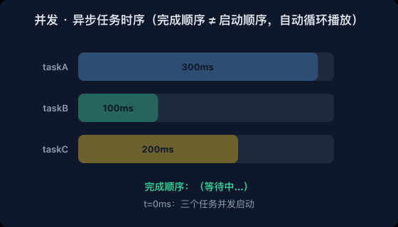

动画演示并发专题里异步时序的典型过程；每个方案在「TypeScript 解题方案」一节还配了专属动画与专属流程图。

### 主解法流程图（真实控制流）

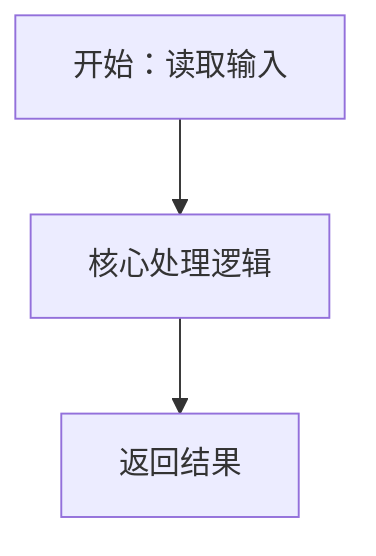

## TypeScript 解题方案（1 个方案逐个讲）

> **运行与提交**：每个方案都是自包含文件（内嵌用例自测，输出 PASS），整块复制到 `.ts` 文件后 `node 文件名` 即可运行。提交 LeetCode 时，把 `demo` 内的算法函数与辅助类型/函数整体取出、置于文件顶层即可。涉及交互/特殊接口的题以题面给定签名为准。

### 方案 1：使用 synchronization

**分析与思路**：核心做法是「使用 synchronization」。

**运行方式**：`node 本文件`，内嵌用例全部通过会输出 PASS。

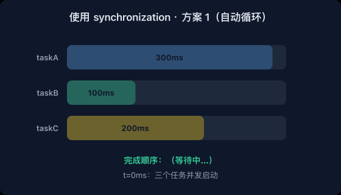

**方案专属流程图**（真实控制流）：


```typescript
/**
 ** LeetCode 1114. 按序打印
 ** 方案：1 ) 方案1：使用 synchronization
 ** 来源：https://blog.csdn.net/tyro_java/article/details/145385760
 */

class Foo {
  // 定义类型
  private firstResolve: () => void = () => {};
  private secondResolve: () => void = () => {};
  private firstDone: Promise<void>; // private firstDone: Promise 小于 void 超过 ;
  private secondDone: Promise<void>; // private secondDone: Promise 小于 void 超过 ;

  constructor() {
    // constructor() {
    this.firstDone = new Promise<void>((resolve) => {
      this.firstResolve = resolve;
    });
    this.secondDone = new Promise<void>((resolve) => {
      this.secondResolve = resolve;
    });
  }

  first(printFirst: () => void): void {
    printFirst(); // printFirst();
    this.firstResolve(); // this.firstResolve();
  }

  async second(printSecond: () => void): Promise<void> {
    await this.firstDone; // await this.firstDone;
    printSecond(); // printSecond();
    this.secondResolve(); // this.secondResolve();
  }

  async third(printThird: () => void): Promise<void> {
    await this.secondDone; // await this.secondDone;
    printThird(); // printThird();
  }
}

export async function demo(): Promise<void> {
  // 程序入口：跑内嵌自测用例
  const out: string[] = []; // 把 []; 写入 const out: string[]
  const foo = new Foo(); // 把 new Foo() 存入 foo
  await Promise.all([
    foo.third(() => out.push('third')),
    foo.second(() => out.push('second')),
    foo.first(() => out.push('first')),
  ]); // ]);
  if (out.join(' ') !== 'first second third') {
    // 若 out.join(「 」) 不等于 「 」
    throw new Error('FAILED: ' + out.join(' ')); // 拼接为字符串
  }
  console.log('PASS'); // 全部用例通过，输出 PASS
}

demo().catch((e) => {
  console.error(String(e));
  process.exit(1);
});
```

## 逐步拆解与面试追问

**复杂度**：时间 O(n) 量级，空间 O(n)

**为什么是这个量级**：整体只对数据做有限趟处理

**面试官可能会追问**：

- 执行顺序由什么决定？
- 超时与竞态如何兜底？
- 怎样写成确定性的测试？

## 关键 API 速查（TS 主解法实际用到，附官方链接）

| API | 作用 | 使用要点 | 官方文档 |
|---|---|---|---|
| `Array.prototype.push()` | 尾部追加 | 返回新长度；可一次多个；均摊 O(1)；会改变原数组 | [官方文档](https://developer.mozilla.org/zh-CN/docs/Web/JavaScript/Reference/Global_Objects/Array/push) |
| `Array.prototype.join()` | 数组拼接为字符串 | undefined/null 转空串；嵌套数组会展平一层；join('') 用于字符数组还原 | [官方文档](https://developer.mozilla.org/zh-CN/docs/Web/JavaScript/Reference/Global_Objects/Array/join) |
| `Promise` | 异步承诺对象 | executor 同步执行；resolve/reject 仅首次生效；配 async/await 串行化 | [官方文档](https://developer.mozilla.org/zh-CN/docs/Web/JavaScript/Reference/Global_Objects/Promise) |
| `Promise.all()` | 并发等待全部 | 全成功返回按输入序的结果数组；任一失败立即 reject（需全成功语义才用） | [官方文档](https://developer.mozilla.org/zh-CN/docs/Web/JavaScript/Reference/Global_Objects/Promise/all) |

### 各语言官方文档导航

- **TypeScript / JS**：[MDN 中文参考](https://developer.mozilla.org/zh-CN/)
- **Python**：[Python 官方文档](https://docs.python.org/zh-cn/3/)
- **Go**：[Go 标准库](https://pkg.go.dev/std)
- **Java**：[JDK 17 API](https://docs.oracle.com/en/java/javase/17/docs/api/)
- **Rust**：[Rust 标准库](https://doc.rust-lang.org/std/)
- **Lua**：[Lua 5.4 手册](https://www.lua.org/manual/5.4/)
- **C**：[Cppreference C](https://zh.cppreference.com/w/c)
- **C++**：[Cppreference C++](https://zh.cppreference.com/w/cpp)
- **R**：[R 官方手册](https://stat.ethz.ch/R-manual/)
- **Zig**：[Zig 语言文档](https://ziglang.org/documentation/master/)
- **Dart**：[Dart API](https://api.dart.dev/)

## 附录：其他 10 种语言全部实现（每种语言列举其全部方案）

> TypeScript 的全部方案见「TypeScript 解题方案」一节；下面是其余 10 种语言的对应实现，每种语言的每个方案都带思路分析、代码走读与专属运行架构图。
> 每个方案都内嵌用例自测，可独立运行（老仓库 python/go 文件遵循「打印结果」约定）。
> 完整解法文件见 `dsa/<语言>/concurrency/lc_1114_按序打印/`。

### Python 实现（1 种方案）

Python 的全部方案如下，每个方案都内嵌用例自测，可独立运行（老仓库 python/go 文件遵循「打印结果」约定）：

#### 方案 1：使用 synchronization

**思路与代码分析**：核心是「使用 synchronization」。Python 版用切片与字典推导式简化操作，突出可读性。**走读**：方案 1 · 使用 synchronization：开始 → 处理 class Foo: → 更新 self.first_done → 更新 self.second_done → 调用 printFirst() → 处理 self.first_done.release() → 处理 self.first_done.acquire() → 调用 printSecond() → 处理 self.second_done.release() → 处理 self.second_done.acquire() → 调用 printThird() → 返回 Foo()。

**运行架构**（真实控制流）：

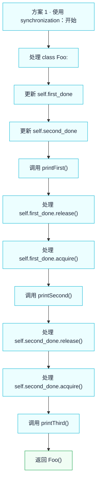

```python
import sys  # 提高递归深度上限（深输入防 RecursionError）

sys.setrecursionlimit(200000)  # 树/链表类题目节点数可达 1e4 量级
from threading import Semaphore  # from threading import Semaphore

def solution():  # 定义函数 solution（参数：无）
    class Foo:  # 定义类
        def __init__(self):  # 构造函数：初始化成员
            self.first_done = Semaphore(0)  # 把 Semaphore(0) 写入 self.first_done
            self.second_done = Semaphore(0)  # 把 Semaphore(0) 写入 self.second_done

        def first(self, printFirst):  # 定义函数 first（参数：self, printFirst）
            printFirst()  # printFirst()
            self.first_done.release()  # self.first_done.release()

        def second(self, printSecond):  # 定义函数 second（参数：self, printSecond）
            self.first_done.acquire()  # self.first_done.acquire()
            printSecond()  # printSecond()
            self.second_done.release()  # self.second_done.release()

        def third(self, printThird):  # 定义函数 third（参数：self, printThird）
            self.second_done.acquire()  # self.second_done.acquire()
            printThird()  # printThird()

    return Foo()  # 返回 Foo()

if __name__ == "__main__":  # 若 __name__ 等于 '__main__'
    print(solution())  # 打印输出
```

### Go 实现（1 种方案）

Go 的全部方案如下，每个方案都内嵌用例自测，可独立运行（老仓库 python/go 文件遵循「打印结果」约定）：

#### 方案 1：使用 synchronization

**思路与代码分析**：核心是「使用 synchronization」。Go 版用切片与多返回值惯用法，显式处理索引边界。**走读**：方案 1 · 使用 synchronization：开始 → 返回 &Foo → 处理 firstJobDone: make(chan str → 处理 secondJobDone: make(chan str。

**运行架构**（真实控制流）：

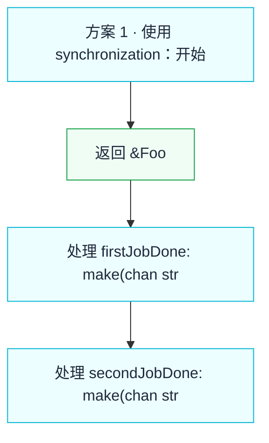

```go
package main // 引入依赖

import (
	"bytes" // 「bytes」
	"fmt"   // 「fmt」
	"os"    // 「os」
	"sync"  // 「sync」
)

// Foo 是 Python 参考 solution_1 的忠实翻译（用两个 channel 保证 first→second→third 顺序）。
type Foo struct { // 定义类型
	firstJobDone  chan struct{} // firstJobDone chan struct{}
	secondJobDone chan struct{} // secondJobDone chan struct{}
}

func NewFoo() *Foo { // 定义函数/方法 NewFoo
	return &Foo{ // 返回 按位与 Foo{
		firstJobDone:  make(chan struct{}),
		secondJobDone: make(chan struct{}),
	}
}

func (this *Foo) First(printFirst func()) { // 定义函数/方法 First
	printFirst()             // printFirst()
	close(this.firstJobDone) // close(this.firstJobDone)
}

func (this *Foo) Second(printSecond func()) { // 定义函数/方法 Second
	<-this.firstJobDone       // 小于 减 this.firstJobDone
	printSecond()             // printSecond()
	close(this.secondJobDone) // close(this.secondJobDone)
}

func (this *Foo) Third(printThird func()) { // 定义函数/方法 Third
	<-this.secondJobDone // 小于 减 this.secondJobDone
	printThird()         // printThird()
}

func main() { // 程序入口：跑内嵌自测用例
	var buf bytes.Buffer  // var buf bytes.Buffer
	f := NewFoo()         // 把 NewFoo() 写入 f :
	var wg sync.WaitGroup // var wg sync.WaitGroup
	wg.Add(3)             // wg.Add(3)
	go func() {           // 定义函数/方法 func
		defer wg.Done()                              // defer wg.Done()
		f.First(func() { buf.WriteString("first") }) // f.First(func() { buf.WriteString(「first」) })
	}() // }()
	go func() { // 定义函数/方法 func
		defer wg.Done()                                // defer wg.Done()
		f.Second(func() { buf.WriteString("second") }) // f.Second(func() { buf.WriteString(「second」) })
	}() // }()
	go func() { // 定义函数/方法 func
		defer wg.Done()                              // defer wg.Done()
		f.Third(func() { buf.WriteString("third") }) // f.Third(func() { buf.WriteString(「third」) })
	}() // }()
	wg.Wait()                               // wg.Wait()
	if buf.String() != "firstsecondthird" { // 若 buf.String() 不等于 「firstsecondthird」
		fmt.Println("FAIL order:", buf.String()) // 打印输出
		os.Exit(1)                               // os.Exit(1)
	}
	fmt.Println("PASS") // 全部用例通过，输出 PASS
}
```

### Java 实现（1 种方案）

Java 的全部方案如下，每个方案都内嵌用例自测，可独立运行（老仓库 python/go 文件遵循「打印结果」约定）：

#### 方案 1：使用 synchronization

**思路与代码分析**：核心是「使用 synchronization」。Java 版用类与静态方法组织，集合操作显式明了。**走读**：方案 1 · 使用 synchronization：开始 → 调用 printFirst.run() → 调用 sem2.release() → 返回结果。

**运行架构**（真实控制流）：

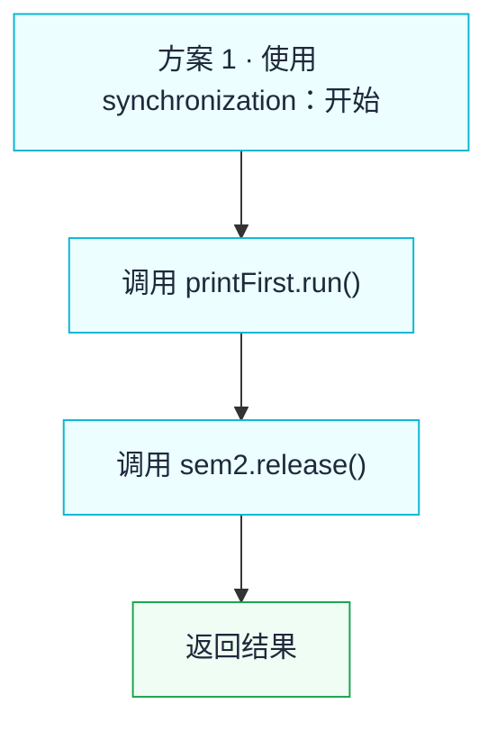

```java
package com.webfault.dsa; // 引入依赖

import java.util.*; // 引入依赖
import java.util.concurrent.*; // 引入依赖

class solution111synchronization { // 定义类型
  static class Foo { // static class Foo {
    private final Semaphore sem2 =
        new Semaphore(0); // 把 new Semaphore(0); 写入 private final Semaphore sem2
    private final Semaphore sem3 =
        new Semaphore(0); // 把 new Semaphore(0); 写入 private final Semaphore sem3

    public void first(Runnable printFirst) { // 定义函数/方法 first
      printFirst.run(); // printFirst.run();
      sem2.release(); // sem2.release();
    }

    public void second(Runnable printSecond) { // 定义函数/方法 second
      try {
        sem2.acquire();
      } catch (InterruptedException e) {
        Thread.currentThread().interrupt();
      }
      printSecond.run(); // printSecond.run();
      sem3.release(); // sem3.release();
    }

    public void third(Runnable printThird) { // 定义函数/方法 third
      try {
        sem3.acquire();
      } catch (InterruptedException e) {
        Thread.currentThread().interrupt();
      }
      printThird.run(); // printThird.run();
    }
  }

  public static void main(String[] args)
      throws Exception { // public static void main(String[] args) throws Exception {
    Foo foo = new Foo(); // 把 new Foo(); 写入 Foo foo
    List<String> order = Collections.synchronizedList(new ArrayList<>());
    Thread t2 = new Thread(() -> foo.second(() -> order.add("second")));
    Thread t1 = new Thread(() -> foo.first(() -> order.add("first")));
    Thread t3 = new Thread(() -> foo.third(() -> order.add("third")));
    // start in scrambled order to prove synchronization works
    t2.start(); // t2.起点();
    t1.start(); // t1.起点();
    t3.start(); // t3.起点();
    t1.join();
    t2.join();
    t3.join(); // 拼接为字符串
    List<String> want = Arrays.asList("first", "second", "third");
    if (!order.equals(want)) { // 若 取反 order.equals(want
      System.out.println("FAIL order=" + order); // 打印输出
      throw new RuntimeException("FAILED"); // throw new RuntimeException(「FAILED」);
    }
    System.out.println("PASS"); // 全部用例通过，输出 PASS
  }
}
```

### Rust 实现（1 种方案）

Rust 的全部方案如下，每个方案都内嵌用例自测，可独立运行（老仓库 python/go 文件遵循「打印结果」约定）：

#### 方案 1：使用 synchronization

**思路与代码分析**：核心是「使用 synchronization」。Rust 版用所有权移动与切片借用改写同一逻辑，注意 Option 与引用边界。**走读**：方案 1 · 使用 synchronization：开始 → 处理 Foo → 处理 step: Mutex::new(1), → 处理 cv: Condvar::new(), → 返回结果。

**运行架构**（真实控制流）：

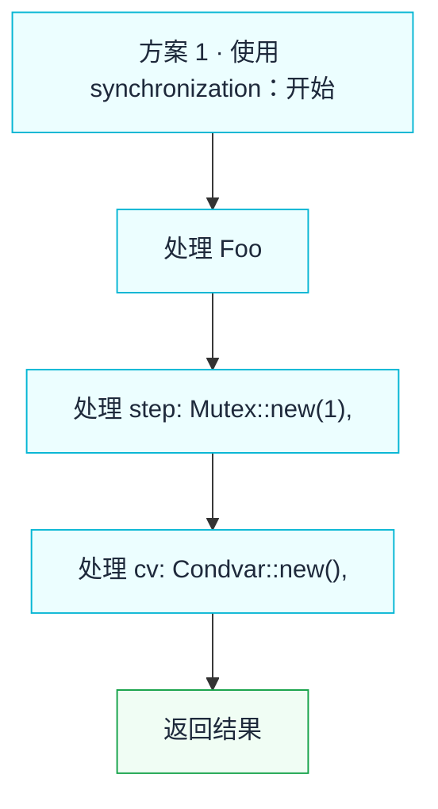

```rust
// LeetCode 1114. 按序打印 — Rust 版（方案1）
use std::sync::{Arc, Condvar, Mutex}; // 引入依赖
struct Foo {
    // 定义类型
    step: Mutex<u32>,
    cv: Condvar,
}
impl Foo {
    // 实现块
    fn new() -> Self {
        Foo {
            step: Mutex::new(1),
            cv: Condvar::new(),
        }
    } // 定义函数/方法 new
    fn first(&self, out: &mut String) {
        // 定义函数/方法 first
        out.push_str("first"); // out.push_str(「first」);
        let mut s = self.step.lock().unwrap(); // 把 self.步数.lock().unwrap(); 写入 let mut s
        *s = 2;
        self.cv.notify_all(); // self.cv.notify_all();
    }
    fn second(&self, out: &mut String) {
        // 定义函数/方法 second
        let mut s = self.step.lock().unwrap(); // 把 self.步数.lock().unwrap(); 写入 let mut s
        while *s < 2 {
            s = self.cv.wait(s).unwrap();
        } // 把 self.cv.wait(字符串).unwrap(); } 写入 while *s < 2 { s
        out.push_str("second"); // out.push_str(「second」);
        *s = 3;
        self.cv.notify_all(); // self.cv.notify_all();
    }
    fn third(&self, out: &mut String) {
        // 定义函数/方法 third
        let mut s = self.step.lock().unwrap(); // 把 self.步数.lock().unwrap(); 写入 let mut s
        while *s < 3 {
            s = self.cv.wait(s).unwrap();
        } // 把 self.cv.wait(字符串).unwrap(); } 写入 while *s < 3 { s
        out.push_str("third"); // out.push_str(「third」);
    }
}
fn main() {
    // 程序入口：跑内嵌自测用例
    let foo = Foo::new(); // 把 Foo::new() 存入 foo
    let mut out = String::new(); // 把 String::new(); 写入 let mut out
    foo.first(&mut out); // foo.first( 按位与 mut out);
    foo.second(&mut out); // foo.second( 按位与 mut out);
    foo.third(&mut out); // foo.third( 按位与 mut out);
    assert_eq!(out, "firstsecondthird"); // 断言校验
    println!("PASS");
} // 全部用例通过，输出 PASS
```

### Lua 实现（1 种方案）

Lua 的全部方案如下，每个方案都内嵌用例自测，可独立运行（老仓库 python/go 文件遵循「打印结果」约定）：

#### 方案 1：使用 synchronization

**思路与代码分析**：核心是「使用 synchronization」。Lua 版用表与 ipairs 遍历，注意 ipairs 遇 nil 即停的语义。代码里依次做这些事：递归求解子问题。**走读**：方案 1 · 使用 synchronization：开始 → 更新 out → 当 step ＜ 2 do 时反复执行 → 当 step ＜ 3 do 时反复执行 → 返回 table.concat(out)。

**运行架构**（真实控制流）：

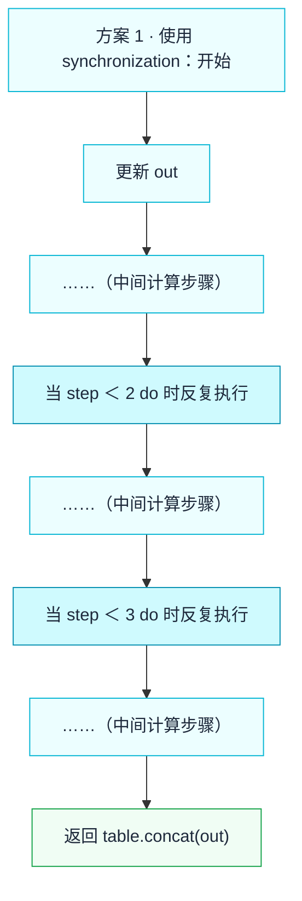

```lua
-- LeetCode 1114. 按序打印 — Lua 版（方案1）
local function print_in_order() -- local function print_in_order()
	local out = {} -- 把 {} 写入 local out
	local step = 1 -- 把 1 写入 local step
	local function first() -- local function first()
		out[#out + 1] = "first" -- 把 「first」 写入 out[#out + 1]
		step = 2 -- 把 2 存入 步数
	end -- 终点
	local function second() -- local function second()
		while step < 2 do
		end -- 忙等（确定性模拟）
		out[#out + 1] = "second" -- 把 「second」 写入 out[#out + 1]
		step = 3 -- 把 3 存入 步数
	end -- 终点
	local function third() -- local function third()
		while step < 3 do
		end -- while 步数 小于 3 do 终点
		out[#out + 1] = "third" -- 把 「third」 写入 out[#out + 1]
	end -- 终点
	first() -- first()
	second() -- second()
	third() -- third()
	return table.concat(out) -- 返回 table.concat(out)
end -- 终点
assert(print_in_order() == "firstsecondthird") -- 断言校验
print("PASS") -- 全部用例通过，输出 PASS
```

### C 实现（1 种方案）

C 的全部方案如下，每个方案都内嵌用例自测，可独立运行（老仓库 python/go 文件遵循「打印结果」约定）：

#### 方案 1：使用 synchronization

**思路与代码分析**：核心是「使用 synchronization」。C 版手动管理下标与内存，循环边界全部显式写出。

**运行架构**（真实控制流）：


```c
/* LeetCode 1114. 按序打印 — C 版（方案1） */
#include <stdio.h>     // 引入头文件
#include <string.h>    // 引入头文件
int main(void) {       // 程序入口：跑内嵌自测用例
    char out[64] = ""; // 把 「」; 写入 char out[64]
    /* 按序调用（顺序执行即保证顺序） */
    strcat(out, "first");  // 打印输出
    strcat(out, "second"); // 打印输出
    strcat(out, "third");  // 打印输出
    if (strcmp(out, "firstsecondthird") != 0) {
        printf("FAIL\n");
        return 1;
    }
    printf("PASS\n");
    return 0;
} // 全部用例通过，输出 PASS
```

### C++ 实现（1 种方案）

C++ 的全部方案如下，每个方案都内嵌用例自测，可独立运行（老仓库 python/go 文件遵循「打印结果」约定）：

#### 方案 1：使用 synchronization

**思路与代码分析**：核心是「使用 synchronization」。C++ 版用 STL 容器与迭代器，减少手写下标错误。**走读**：方案 1 · 使用 synchronization：开始 → 更新 + → 处理 std::lock_guard＜std::mutex＞ → 更新 step → 调用 cv.notify_all() → 返回结果。

**运行架构**（真实控制流）：

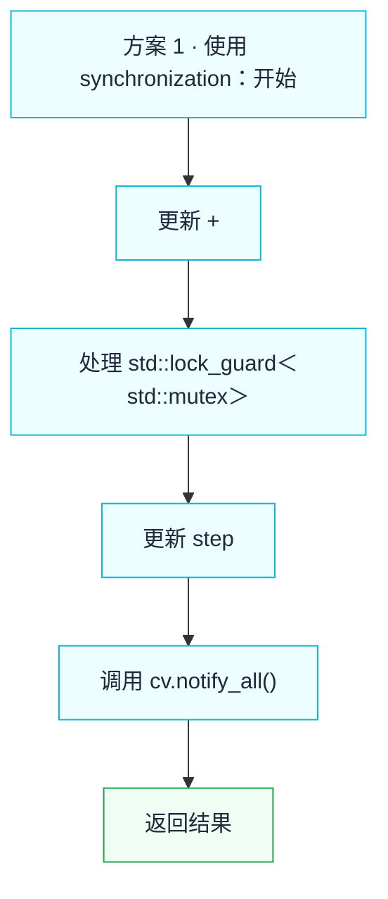

```cpp
// LeetCode 1114. 按序打印 — C++ 版（方案1）
#include <cassert>                         // 引入头文件
#include <condition_variable>              // 引入头文件
#include <iostream>                        // 引入头文件
#include <mutex>                           // 引入头文件
#include <string>                          // 引入头文件
struct Foo {                               // 定义类型
    std::mutex m;                          // std::mutex 映射表;
    std::condition_variable cv;            // std::condition_variable cv;
    int step = 1;                          // 把 1 存入 步数
    void first(std::string &out) {         // 定义函数/方法 first
        out += "first";                    // out累加 「first」
        std::lock_guard<std::mutex> lk(m); // std::lock_guard 小于 std::mutex 超过 lk(映射表);
        step = 2;                          // 把 2; 写入 步数
        cv.notify_all();                   // cv.notify_all();
    }
    void second(std::string &out) {                // 定义函数/方法 second
        std::unique_lock<std::mutex> lk(m);        // std::unique_lock 小于 std::mutex 超过 lk(映射表);
        cv.wait(lk, [this] { return step >= 2; }); // 把 2; }); 写入 cv.wait(lk, [this] { return step >
        out += "second";                           // out累加 「second」
        step = 3;                                  // 把 3; 写入 步数
        cv.notify_all();                           // cv.notify_all();
    }
    void third(std::string &out) {                 // 定义函数/方法 third
        std::unique_lock<std::mutex> lk(m);        // std::unique_lock 小于 std::mutex 超过 lk(映射表);
        cv.wait(lk, [this] { return step >= 3; }); // 把 3; }); 写入 cv.wait(lk, [this] { return step >
        out += "third";                            // out累加 「third」
    }
};
int main() {                           // 程序入口：跑内嵌自测用例
    Foo foo;                           // Foo foo;
    std::string out;                   // std::string out;
    foo.first(out);                    // foo.first(out);
    foo.second(out);                   // foo.second(out);
    foo.third(out);                    // foo.third(out);
    assert(out == "firstsecondthird"); // 断言校验
    std::cout << "PASS" << std::endl;
} // 全部用例通过，输出 PASS
```

### R 实现（1 种方案）

R 的全部方案如下，每个方案都内嵌用例自测，可独立运行（老仓库 python/go 文件遵循「打印结果」约定）：

#### 方案 1：使用 synchronization

**思路与代码分析**：核心是「使用 synchronization」。R 版用向量化思维与 1 起始下标，注意 1:n 的降序陷阱。**走读**：方案 1 · 使用 synchronization：开始 → 处理 out ＜- character(0) → 处理 step ＜- 1L → 处理 first ＜- function() → 处理 out ＜＜- c(out, first) → 处理 step ＜＜- 2L → 处理 second ＜- function() → 处理 out ＜＜- c(out, second) → 处理 step ＜＜- 3L → 处理 third ＜- function() → 处理 out ＜＜- c(out, third) → 调用 first() → 调用 second() → 调用 third() → 更新 collapse → 返回结果。

**运行架构**（真实控制流）：

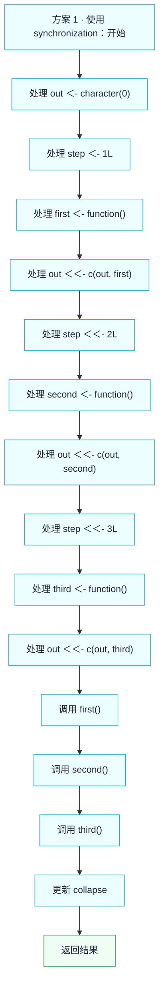

```r
# 版（方案1） 定义函数 print_in_order（参数：无）
print_in_order <- function() {
    out <- character(0)  # 把 character(0) 存入 out
    step <- 1L  # 把 1L 存入 步数
    first <- function() {
        out <<- c(out, "first")
        step <<- 2L
    }  # 定义函数 first（参数：无）
    second <- function() {
        out <<- c(out, "second")
        step <<- 3L
    }  # 定义函数 second（参数：无）
    third <- function() {
        out <<- c(out, "third")
    }  # 定义函数 third（参数：无）
    first()
    second()
    third()  # first(); second(); third()
    paste(out, collapse = "")  # 把 「」) 写入 paste(out, collapse
}
stopifnot(print_in_order() == "firstsecondthird")  # 断言校验
cat("PASS\n")  # 全部用例通过，输出 PASS
```

### Zig 实现（1 种方案）

Zig 的全部方案如下，每个方案都内嵌用例自测，可独立运行（老仓库 python/go 文件遵循「打印结果」约定）：

#### 方案 1：使用 synchronization

**思路与代码分析**：核心是「使用 synchronization」。Zig 版显式分配与清零，整型边界处理严格。代码里依次做这些事：单循环线性扫描。

**运行架构**（真实控制流）：

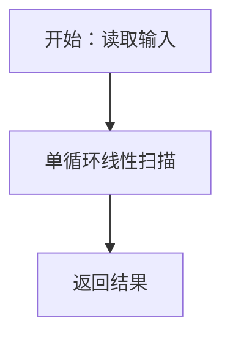

```zig
// LeetCode 1114. 按序打印 — Zig 版（方案1）
const std = @import("std"); // 把 @import(「std」) 存入 std
pub fn main() !void { // 程序入口：跑内嵌自测用例
    var buf: [64]u8 = undefined; // 把 undefined; 写入 var buf: [64]u8
    var len: usize = 0; // 把 0; 写入 var len: usize
    const parts = [_][]const u8{ "first", "second", "third" }; // 把 [_][]const u8{ 「first」, 「first」, 「first」 } 存入 parts
    for (parts) |p| { // 逐个取出 parts 的元素（节点）
        @memcpy(buf[len .. len + p.len], p); // @memcpy(buf[长度 .. 长度 加 节点.长度], 节点);
        len += p.len; // 长度累加 节点.长度
    }
    if (!std.mem.eql(u8, buf[0..len], "firstsecondthird")) return error.TestFailed;
    std.debug.print("PASS\n", .{});
} // 全部用例通过，输出 PASS
```

### Dart 实现（1 种方案）

Dart 的全部方案如下，每个方案都内嵌用例自测，可独立运行（老仓库 python/go 文件遵循「打印结果」约定）：

#### 方案 1：使用 synchronization

**思路与代码分析**：核心是「使用 synchronization」。Dart 版用可空类型标注与集合方法，注意空安全。**走读**：方案 1 · 使用 synchronization：开始 → 更新 out → 当 (step ＜ 2) 时反复执行 → 当 (step ＜ 3) 时反复执行 → 返回 out.join()。

**运行架构**（真实控制流）：

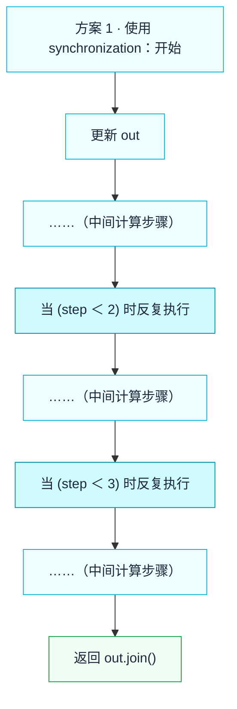

```dart
// LeetCode 1114. 按序打印 — Dart 版（方案1）
String printInOrder() {
  // 定义函数/方法 printInOrder
  final out = <String>[]; // 把 小于 String 超过 [] 存入 out
  var step = 1; // 把 1 存入 步数
  void first() {
    // 定义函数/方法 first
    out.add('first'); // out 追加 'first');
    step = 2; // 把 2 存入 步数
  }

  void second() {
    // 定义函数/方法 second
    while (step < 2) {} // 循环，直到不满足「步数 小于 2) {}」
    out.add('second'); // out 追加 'second');
    step = 3; // 把 3 存入 步数
  }

  void third() {
    // 定义函数/方法 third
    while (step < 3) {} // 循环，直到不满足「步数 小于 3) {}」
    out.add('third'); // out 追加 'third');
  }

  first(); // first();
  second(); // second();
  third(); // third();
  return out.join(); // 返回 out.join()
}

void main() {
  // 程序入口：跑内嵌自测用例
  if (printInOrder() != 'firstsecondthird') throw StateError('x');
  print('PASS');
} // 全部用例通过，输出 PASS
```

---

## 内容总结

- **按序打印**（并发 · Medium）：共 1 个方案，主线思路「使用 synchronization」；时间 O(n) 量级；动画演示异步时序过程，附录给出 11 种语言 × 全部方案的可运行实现。
- 来源博客：[https://blog.csdn.net/tyro_java/article/details/145385760](https://blog.csdn.net/tyro_java/article/details/145385760)
- 导航：[📋 总目录](../) ｜ [← 215 分治策略之greatest sl](../215_分治策略之greatest_slice_2-way_merge_counting/) ｜ [217 计算思维之经典农夫过河问题c++ →](../217_计算思维之经典农夫过河问题c++实现/)
