# 217 · 计算思维之经典农夫过河问题c++实现（第附阶段 · 专题补充 · Medium）

> **难度**：⭐⭐ Medium ｜ **专题**：算法笔记
> **学习定位**：第附阶段 · 专题补充第 217 篇 ｜ **解法数**：1
> **内容总结**：**计算思维之经典农夫过河问题c++实现**（算法笔记 · Medium）：共 1 个方案，主线思路「哈希辅助」；时间 O(n)（单趟线性扫描）；动画演示归并分治过程，附录给出 11 种语言 × 全部方案的可运行实现。

---

## 题目描述

计算思维之经典农夫过河问题c++实现。具体输入输出约定见函数签名与用例。

- 主函数签名：`function invalid(st: number[]): boolean`

**数据范围与注意事项**：

- **易错点**：先看小例子手推一遍再对照代码，比直接读代码快得多。

## 题目分析

**场景是什么**：综合练习：把数据结构与策略组合起来解决一个完整问题。本题就是该场景的 Medium 级练习，主线做法是「哈希辅助」。

**主线怎么解**：把主解法从头到尾过一遍，它其实在依次做这几件事：哈希结构做计数或查重 → 单循环线性扫描。

## 解题思路

**方案对比**（共 1 个方案，由浅入深）：

| 方案 | 时间复杂度 | 空间复杂度 |
|---|---|---|
| 方案 1 · 哈希辅助 | O(n)（单趟线性扫描） | O(1) 到 O(n)（视辅助结构） |

**怎么读这一篇**：

- 🐣 **新手路线**：把「题目描述」的示例 1 在纸上手推一遍 → 读方案 1（最直观的写法）与它的代码走读 → 按「运行方式」本地跑通看 PASS → 回头对比方案 2 之后的写法差在哪
- 🦅 **大佬路线**：直接锁定最优方案 1（哈希辅助，O(n)（单趟线性扫描））→ 跳读该方案代码与走读 → 用「逐步拆解与面试追问」补齐复杂度推导与边界追问

### 动态算法图（归并分治，GIF 自动循环）


动画演示算法笔记专题里归并分治的典型过程；每个方案在「TypeScript 解题方案」一节还配了专属动画与专属流程图。

### 主解法流程图（真实控制流）

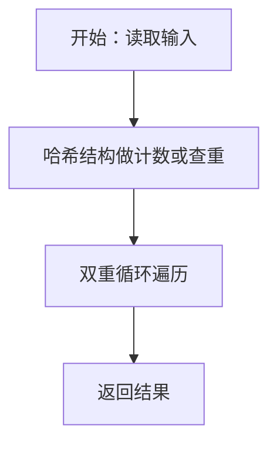

## TypeScript 解题方案（1 个方案逐个讲）

> **运行与提交**：每个方案都是自包含文件（内嵌用例自测，输出 PASS），整块复制到 `.ts` 文件后 `node 文件名` 即可运行。提交 LeetCode 时，把 `demo` 内的算法函数与辅助类型/函数整体取出、置于文件顶层即可。概念演示（非 LeetCode 编号题），在本地运行即可。

### 方案 1：哈希辅助

**分析与思路**：核心做法是「哈希辅助」。代码里依次做这些事：哈希结构做计数或查重；单循环线性扫描。

**运行方式**：`node 本文件`，内嵌用例全部通过会输出 PASS。


**方案专属流程图**（真实控制流）：


```typescript
/**
 ** LeetCode 112548608. 计算思维之经典农夫过河问题C++实现
 ** 来源：https://blog.csdn.net/tyro_java/article/details/112548608
 */

export function demo(): void {
  // 程序入口：跑内嵌自测用例
  // solveFarmer 忠实翻译 python ref solution_1___1.py
  // 农夫过河（狼、羊、菜）：状态 (h,w,s,v) 每位 0/1 表示是否在起点岸。
  // 农夫每次必过河，可单独或带狼/羊/菜之一；无人看管时羊吃菜、狼吃羊则非法。目标全部到达对岸。
  function solveFarmer(): string[] {
    // 定义函数/方法 solveFarmer
    function invalid(st: number[]): boolean {
      // 定义函数/方法 invalid
      const h = st[0],
        w = st[1],
        s = st[2],
        v = st[3]; // 把 st[0], 权重 赋值为 st[1], 字符串 赋值为 st[2], 值 赋值为 st[3] 存入 h
      if (h !== s && s === w) {
        // 若 h 不等于 字符串 且 字符串 全等于 权重
        return true; // 返回 true
      }
      if (h !== s && s === v) {
        // 若 h 不等于 字符串 且 字符串 全等于 值
        return true; // 返回 true
      }
      return false; // 返回 false
    }

    const itemIndex: { [key: string]: number } = { W: 1, S: 2, V: 3 };
    const path: string[] = []; // 把 []; 写入 const path: string[]
    const visited = new Set<string>(); // 把 new Set 小于 string 超过 () 存入 已访问集合

    function go(st: number[]): boolean {
      // 定义函数/方法 go
      if (st[0] === 1 && st[1] === 1 && st[2] === 1 && st[3] === 1) {
        // 若 st[0] 全等于 1 且 st[1] 全等于 1 且 st[2] 全等于 1 且 st[3] 全等于 1
        return true; // 返回 true
      }
      const key = st.join(','); // 把 st.join(',') 存入 key
      if (visited.has(key)) {
        // 若 已访问集合.has(key
        return false; // 返回 false
      }
      visited.add(key); // 已访问集合 追加 key);
      for (const role of ['-', 'W', 'S', 'V']) {
        // for (const role of [' 减 ', 'W', 'S', 'V']) {
        const ns = [...st]; // 把 复制的 st 存入 ns
        ns[0] = 1 - ns[0]; // 农夫总是过河
        if (role !== '-') {
          // 若 role 不等于 ' 减 '
          const idx = itemIndex[role]; // 把 itemIndex[role] 存入 idx
          // 农夫必须与所带物品在出发前同岸
          if (st[0] !== st[idx]) {
            // 若 st[0] 不等于 st[idx]
            continue; // 跳过本轮，进入下一次
          }
          ns[idx] = 1 - ns[idx]; // 把 1 减 ns[idx]; 写入 ns[idx]
        }
        if (invalid(ns)) {
          // 若 invalid(ns
          continue; // 跳过本轮，进入下一次
        }
        if (go(ns)) {
          // 若 go(ns
          path.push(role); // 把 role 压入栈/数组尾部
          return true; // 返回 true
        }
      }
      return false; // 返回 false
    }

    go([0, 0, 0, 0]); // go([0, 0, 0, 0]);
    path.reverse(); // 反转
    return path; // 返回 当前路径
  }

  // 模拟走 path，校验每步合法且终点为 (1,1,1,1)
  function simulate(path: string[]): boolean {
    // 定义函数/方法 simulate
    const st = [0, 0, 0, 0]; // 把 [0, 0, 0, 0] 存入 st
    const itemIndex: { [key: string]: number } = { W: 1, S: 2, V: 3 };
    for (const role of path) {
      // for (const role of 当前路径) {
      const before = [...st]; // 把 复制的 st 存入 before
      st[0] = 1 - st[0]; // 把 1 减 st[0]; 写入 st[0]
      if (role !== '-') {
        // 若 role 不等于 ' 减 '
        const idx = itemIndex[role]; // 把 itemIndex[role] 存入 idx
        if (before[0] !== before[idx]) {
          // 若 before[0] 不等于 before[idx]
          return false; // 返回 false
        }
        st[idx] = 1 - st[idx]; // 把 1 减 st[idx]; 写入 st[idx]
      }
      const h = st[0],
        w = st[1],
        s = st[2],
        v = st[3]; // 把 st[0], 权重 赋值为 st[1], 字符串 赋值为 st[2], 值 赋值为 st[3] 存入 h
      if (h !== s && s === w) {
        // 若 h 不等于 字符串 且 字符串 全等于 权重
        return false; // 返回 false
      }
      if (h !== s && s === v) {
        // 若 h 不等于 字符串 且 字符串 全等于 值
        return false; // 返回 false
      }
    }
    return st[0] === 1 && st[1] === 1 && st[2] === 1 && st[3] === 1; // 返回 st[0] 全等于 1 且 st[1] 全等于 1 且 st[2] 全等于 1 且 st[3] 全等于 1
  }

  // want 由 python ref solution_1___1.py 实跑得到
  const wantPath = ['S', '-', 'W', 'S', 'V', '-', 'S']; // 把 ['S', ' 减 ', 'W', 'S', 'V', ' 减 ', 'S'] 存入 wantPath
  const wantReadable = 'HS H HW HS HV H HS'; // 把 'HS H HW HS HV H HS' 存入 wantReadable

  let fail = false; // 把 false 存入 fail
  const gotPath = solveFarmer(); // 把 solveFarmer() 存入 gotPath

  // case1 normal: 完整路径与 python ref 一致
  if (gotPath.length !== wantPath.length) {
    // 若 gotPath.长度 不等于 wantPath.长度
    fail = true; // 把 true 存入 fail
    console.log(
      `FAIL path length got ${gotPath.length} want ${wantPath.length}`,
    );
  } else {
    // 否则
    for (let i = 0; i < gotPath.length; i++) {
      // 让 下标 i 从 0 开始计数，下标 i 小于 gotPath.长度 就继续
      if (gotPath[i] !== wantPath[i]) {
        // 若 gotPath[下标 i] 不等于 wantPath[下标 i]
        fail = true; // 把 true 存入 fail
        console.log(`FAIL path[${i}] got ${gotPath[i]} want ${wantPath[i]}`);
      }
    }
  }

  // case2 normal: 可读方案串与 python ref 输出一致
  const gotReadable = gotPath.map((r) => 'H' + (r !== '-' ? r : '')).join(' ');
  if (gotReadable !== wantReadable) {
    // 若 gotReadable 不等于 wantReadable
    fail = true; // 把 true 存入 fail
    console.log(`FAIL readable got "${gotReadable}" want "${wantReadable}"`);
  }

  // case3 boundary: 路径 7 步
  if (gotPath.length !== 7) {
    // 若 gotPath.长度 不等于 7
    fail = true; // 把 true 存入 fail
    console.log(`FAIL steps got ${gotPath.length} want 7`);
  }

  // case4 boundary: 模拟校验每步合法且到达终点
  if (!simulate(gotPath)) {
    // 若 取反 simulate(gotPath
    fail = true; // 把 true 存入 fail
    console.log('FAIL simulate path illegal or not reaching goal'); // 打印输出
  }

  if (fail) {
    // 若 fail
    throw new Error('FAILED'); // throw new Error(「FAILED」);
  }
  console.log('PASS'); // 全部用例通过，输出 PASS
}
demo(); // demo();
```

## 逐步拆解与面试追问

**复杂度**：时间 O(n)（单趟线性扫描），空间 O(1) 到 O(n)（视辅助结构）

**为什么是这个量级**：每个元素被常数次访问，辅助哈希或栈的开销与 n 同阶

**面试官可能会追问**：

- 这个策略能推广到什么场景？
- 与暴力做法差在哪一步？
- 有没有更简单的等价写法？

## 关键 API 速查（TS 主解法实际用到，附官方链接）

| API | 作用 | 使用要点 | 官方文档 |
|---|---|---|---|
| `Set` | 集合：元素唯一 | add/add.has/delete；has 均摊 O(1)；NaN 视为相同；去重常用 [...new Set(arr)] | [官方文档](https://developer.mozilla.org/zh-CN/docs/Web/JavaScript/Reference/Global_Objects/Set) |
| `Array.prototype.map()` | 逐元素映射为新数组 | 回调 (v,i,arr)；返回等长新数组，不改变原数组；稀疏位跳过；链式调用注意中间数组开销 | [官方文档](https://developer.mozilla.org/zh-CN/docs/Web/JavaScript/Reference/Global_Objects/Array/map) |
| `Array.prototype.push()` | 尾部追加 | 返回新长度；可一次多个；均摊 O(1)；会改变原数组 | [官方文档](https://developer.mozilla.org/zh-CN/docs/Web/JavaScript/Reference/Global_Objects/Array/push) |
| `Array.prototype.join()` | 数组拼接为字符串 | undefined/null 转空串；嵌套数组会展平一层；join('') 用于字符数组还原 | [官方文档](https://developer.mozilla.org/zh-CN/docs/Web/JavaScript/Reference/Global_Objects/Array/join) |

### 各语言官方文档导航

- **TypeScript / JS**：[MDN 中文参考](https://developer.mozilla.org/zh-CN/)
- **Python**：[Python 官方文档](https://docs.python.org/zh-cn/3/)
- **Go**：[Go 标准库](https://pkg.go.dev/std)
- **Java**：[JDK 17 API](https://docs.oracle.com/en/java/javase/17/docs/api/)
- **Rust**：[Rust 标准库](https://doc.rust-lang.org/std/)
- **Lua**：[Lua 5.4 手册](https://www.lua.org/manual/5.4/)
- **C**：[Cppreference C](https://zh.cppreference.com/w/c)
- **C++**：[Cppreference C++](https://zh.cppreference.com/w/cpp)
- **R**：[R 官方手册](https://stat.ethz.ch/R-manual/)
- **Zig**：[Zig 语言文档](https://ziglang.org/documentation/master/)
- **Dart**：[Dart API](https://api.dart.dev/)

## 附录：其他 10 种语言全部实现（每种语言列举其全部方案）

> TypeScript 的全部方案见「TypeScript 解题方案」一节；下面是其余 10 种语言的对应实现，每种语言的每个方案都带思路分析、代码走读与专属运行架构图。
> 每个方案都内嵌用例自测，可独立运行（老仓库 python/go 文件遵循「打印结果」约定）。
> 完整解法文件见 `dsa/<语言>/notes/lc_112548608_计算思维之经典农夫过河问题c++实现/`。

### Python 实现（1 种方案）

Python 的全部方案如下，每个方案都内嵌用例自测，可独立运行（老仓库 python/go 文件遵循「打印结果」约定）：

#### 方案 1：哈希辅助

**思路与代码分析**：核心是「哈希辅助」。Python 版用切片与字典推导式简化操作，突出可读性。

**运行架构**（真实控制流）：

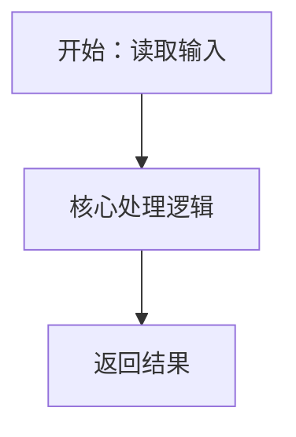

```python
import sys  # 提高递归深度上限（深输入防 RecursionError）

sys.setrecursionlimit(200000)  # 树/链表类题目节点数可达 1e4 量级

def solve_farmer():  # 定义函数 solve_farmer（参数：无）
    """农夫过河（狼、羊、菜）：状态 (h,w,s,v) 每位 0/1 表示是否在起点岸。
    农夫每次必过河，可单独或带狼/羊/菜之一；无人看管时羊吃菜、狼吃羊则非法。目标全部到达对岸。"""

    def invalid(st):  # 定义函数 invalid（参数：st）
        h, w, s, v = st  # 把 st 写入 h, w, s, v
        if h != s and s == w:  # 若 h 不等于 字符串 and 字符串 等于 权重
            return True  # 返回 True
        if h != s and s == v:  # 若 h 不等于 字符串 and 字符串 等于 值
            return True  # 返回 True
        return False  # 返回 False

    item_index = {"W": 1, "S": 2, "V": 3}  # 把 {'W': 1, 'S': 2, 'V': 3} 存入 item_index
    path = []  # 把 [] 存入 当前路径
    visited = set()  # 把 set() 存入 已访问集合

    def go(st, step):  # 定义函数 go（参数：st, 步数）
        if st == (1, 1, 1, 1):  # 若 st 等于 (1, 1, 1, 1
            return True  # 返回 True
        if st in visited:  # 若 st in 已访问集合
            return False  # 返回 False
        visited.add(st)  # 已访问集合 追加 st)
        h, w, s, v = st  # 把 st 写入 h, w, s, v
        for role in ("-", "W", "S", "V"):  # for role in (' 减 ', 'W', 'S', 'V'):
            ns = list(st)  # 把 列表(st) 存入 ns
            ns[0] = 1 - ns[0]  # 农夫总是过河
            if role != "-":  # 若 role 不等于 ' 减 '
                idx = item_index[role]  # 把 item_index[role] 存入 idx
                # 农夫必须与所带物品在出发前同岸
                if st[0] != st[idx]:  # 若 st[0] 不等于 st[idx]
                    continue  # 跳过本轮，进入下一次
                ns[idx] = 1 - ns[idx]  # 把 1 减 ns[idx] 写入 ns[idx]
            ns = tuple(ns)  # 把 tuple(ns) 存入 ns
            if invalid(ns):  # 若 invalid(ns
                continue  # 跳过本轮，进入下一次
            if go(ns, step + 1):  # 若 go(ns, 步数 加 1
                path.append(role)  # 把 role 追加到列表尾部
                return True  # 返回 True
        return False  # 返回 False

    go((0, 0, 0, 0), 0)  # go((0, 0, 0, 0), 0)
    path.reverse()  # 反转
    return path  # 返回 当前路径

if __name__ == "__main__":  # 若 __name__ 等于 '__main__'
    plan = solve_farmer()  # 把 solve_farmer() 存入 plan
    # 还原可读方案：H 表示农夫单独过河，其后字母表示带走的角色
    print("农夫过河方案:", " ".join(("H" + (r if r != "-" else "")) for r in plan))  # 打印输出
```

### Go 实现（1 种方案）

Go 的全部方案如下，每个方案都内嵌用例自测，可独立运行（老仓库 python/go 文件遵循「打印结果」约定）：

#### 方案 1：哈希辅助

**思路与代码分析**：核心是「哈希辅助」。Go 版用切片与多返回值惯用法，显式处理索引边界。代码里依次做这些事：哈希结构做计数或查重。

**运行架构**（真实控制流）：

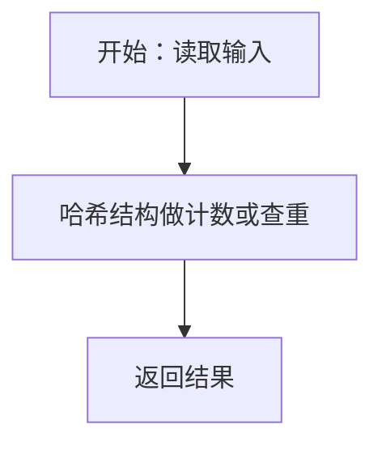

```go
package main // 引入依赖

import (
	"fmt"     // 「fmt」
	"os"      // 「os」
	"strings" // 「strings」
)

// solveFarmer 农夫过河（狼、羊、菜）：状态 (h,w,s,v) 每位 0/1 表示是否在起点岸。
// 农夫每次必过河，可单独或带狼/羊/菜之一；无人看管时羊吃菜、狼吃羊则非法。目标全部到达对岸。
func solveFarmer() string { // 定义函数/方法 solveFarmer
	invalid := func(st [4]int) bool { // 把 func(st [4]int) bool { 写入 invalid :
		h, w, s, v := st[0], st[1], st[2], st[3] // 把 st[0], st[1], st[2], st[3] 写入 h, w, s, v :
		if h != s && s == w {                    // 若 h 不等于 字符串 且 字符串 等于 权重
			return true // 返回 true
		}
		if h != s && s == v { // 若 h 不等于 字符串 且 字符串 等于 值
			return true // 返回 true
		}
		return false // 返回 false
	}
	itemIndex := map[byte]int{'W': 1, 'S': 2, 'V': 3} // 把 映射表[byte]int{'W': 1, 'S': 2, 'V': 3} 写入 itemIndex :
	visited := map[[4]int]bool{}                      // 把 映射表[[4]int]bool{} 写入 visited :
	path := []byte{}                                  // 把 []byte{} 写入 path :

	var goFn func(st [4]int) bool // var goFn func(st [4]int) bool
	goFn = func(st [4]int) bool { // 把 func(st [4]int) bool { 写入 goFn
		if st == [4]int{1, 1, 1, 1} { // 若 st 等于 [4]int{1, 1, 1, 1}
			return true // 返回 true
		}
		if visited[st] { // 若 已访问集合[st]
			return false // 返回 false
		}
		visited[st] = true                                // 把 true 写入 visited[st]
		for _, role := range []byte{'-', 'W', 'S', 'V'} { // 同时取 _ 与 role 遍历
			ns := st          // 把 st 写入 ns :
			ns[0] = 1 - ns[0] // 农夫总是过河
			if role != '-' {  // 若 role 不等于 ' 减 '
				idx := itemIndex[role] // 把 itemIndex[role] 写入 idx :
				if st[0] != st[idx] {  // 农夫必须与所带物品在出发前同岸
					continue // 跳过本轮，进入下一次
				}
				ns[idx] = 1 - ns[idx] // 把 1 减 ns[idx] 写入 ns[idx]
			}
			if invalid(ns) { // 定义函数/方法 invalid
				continue // 跳过本轮，进入下一次
			}
			if goFn(ns) { // 定义函数/方法 goFn
				path = append(path, role) // 把 append(当前路径, role) 写入 当前路径
				return true               // 返回 true
			}
		}
		return false // 返回 false
	}
	goFn([4]int{0, 0, 0, 0}) // goFn([4]int{0, 0, 0, 0})

	// 还原可读方案
	for i, j := 0, len(path)-1; i < j; i, j = i+1, j-1 {
		path[i], path[j] = path[j], path[i] // 把 当前路径[下标 j], 当前路径[下标 i] 写入 path[i], path[j]
	}
	parts := []string{}      // 把 []string{} 写入 parts :
	for _, r := range path { // 同时取 _ 与 右指针 遍历
		if r == '-' { // 若 右指针 等于 ' 减 '
			parts = append(parts, "H") // 把 append(parts, 「H」) 写入 parts
		} else { // 否则
			parts = append(parts, "H"+string(r)) // 把 append(parts, 「H」 加 string(右指针)) 写入 parts
		}
	}
	return strings.Join(parts, " ") // 返回 strings.Join(parts, 「 」)
}

func main() { // 程序入口：跑内嵌自测用例
	plan := solveFarmer()             // 把 solveFarmer() 写入 plan :
	if plan != "HS H HW HS HV H HS" { // 若 plan 不等于 「HS H HW HS HV H HS」
		fmt.Printf("FAIL plan=%q\n", plan) // 打印输出
		os.Exit(1)                         // os.Exit(1)
	}
	fmt.Println("PASS") // 全部用例通过，输出 PASS
}
```

### Java 实现（1 种方案）

Java 的全部方案如下，每个方案都内嵌用例自测，可独立运行（老仓库 python/go 文件遵循「打印结果」约定）：

#### 方案 1：哈希辅助

**思路与代码分析**：核心是「哈希辅助」。Java 版用类与静态方法组织，集合操作显式明了。代码里依次做这些事：单循环线性扫描。**走读**：方案 1 · 哈希辅助：开始 → 命中条件，直接返回 → 更新 key → 命中条件，直接返回 → 遍历循环 → 返回 true → 返回 false。

**运行架构**（真实控制流）：

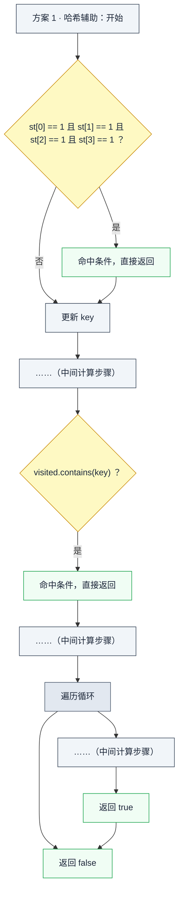

```java
package com.webfault.dsa; // 引入依赖

import java.util.*; // 引入依赖

class lc112548608_solution11 { // 定义类型
  static boolean invalid(int[] st) { // 定义函数/方法 invalid
    int h = st[0],
        s = st[2],
        w = st[1],
        v = st[3]; // 把 st[0], 字符串 赋值为 st[2], 权重 赋值为 st[1], 值 赋值为 st[3] 存入 h
    if (h != s && s == w) return true; // 若 h 不等于 字符串 且 字符串 等于 权重，直接返回 true
    if (h != s && s == v) return true; // 若 h 不等于 字符串 且 字符串 等于 值，直接返回 true
    return false; // 返回 false
  }

  static Map<String, Integer> itemIndex = new HashMap<>();
  static List<String> path =
      new ArrayList<>(); // 把 new ArrayList 小于 超过 (); 写入 static List<String> path
  static Set<String> visited =
      new HashSet<>(); // 把 new HashSet 小于 超过 (); 写入 static Set<String> visited

  static boolean go(int[] st) { // 定义函数/方法 go
    if (st[0] == 1 && st[1] == 1 && st[2] == 1 && st[3] == 1) return true;
    String key =
        st[0] + "," + st[1] + "," + st[2] + ","
            + st[3]; // 把 st[0] 加 「,」 加 st[1] 加 「,」 加 st[2] 加 「,」 加 st[3] 存入 key
    if (visited.contains(key)) return false; // 若 已访问集合 是否包含 key)，直接返回 false
    visited.add(key); // 已访问集合 追加 key);
    for (String role : new String[] {"-", "W", "S", "V"}) {
      int[] ns = st.clone(); // 把 st.clone(); 写入 int[] ns
      ns[0] = 1 - ns[0]; // 把 1 减 ns[0]; 写入 ns[0]
      if (!role.equals("-")) { // 若 取反 role.equals(「 减 」
        int idx = itemIndex.get(role); // 把 itemIndex 查找 role) 存入 idx
        if (st[0] != st[idx]) continue; // 若 st[0] 不等于 st[idx]) continue;
        ns[idx] = 1 - ns[idx]; // 把 1 减 ns[idx]; 写入 ns[idx]
      }
      if (invalid(ns)) continue; // 若 invalid(ns)) continue;
      if (go(ns)) { // 若 go(ns
        path.add(role); // 当前路径 追加 role);
        return true; // 返回 true
      }
    }
    return false; // 返回 false
  }

  public static void main(String[] args) { // public static void main(String[] args) {
    itemIndex.put("W", 1); // itemIndex.put(「W」, 1);
    itemIndex.put("S", 2); // itemIndex.put(「S」, 2);
    itemIndex.put("V", 3); // itemIndex.put(「V」, 3);
    go(new int[] {0, 0, 0, 0}); // go(new int[]{0, 0, 0, 0});
    Collections.reverse(path); // 反转
    List<String> steps = new ArrayList<>(); // 把 new ArrayList 小于 超过 (); 写入 List<String> steps
    for (String r : path) steps.add("H" + (r.equals("-") ? "" : r));
    String plan = String.join(" ", steps); // 把 String.join(「 」, steps) 存入 plan
    if (!plan.equals("HS H HW HS HV H HS")) { // 若 取反 plan.equals(「HS H HW HS HV H HS」
      System.out.println("FAIL " + plan); // 打印输出
      throw new RuntimeException("FAILED"); // throw new RuntimeException(「FAILED」);
    }
    System.out.println("PASS"); // 全部用例通过，输出 PASS
  }
}
```

### Rust 实现（1 种方案）

Rust 的全部方案如下，每个方案都内嵌用例自测，可独立运行（老仓库 python/go 文件遵循「打印结果」约定）：

#### 方案 1：哈希辅助

**思路与代码分析**：核心是「哈希辅助」。Rust 版用所有权移动与切片借用改写同一逻辑，注意 Option 与引用边界。**走读**：方案 1 · 哈希辅助：开始 → 计算 st → 遍历 path 中的每个元素 role → 返回 false → 返回 false。

**运行架构**（真实控制流）：

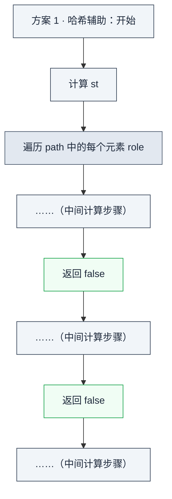

```rust
// LeetCode 112548608. 计算思维之经典农夫过河问题C++实现（DFS 求任一可行过河序列）
fn invalid(st: &[i32; 4]) -> bool {
    // 定义函数/方法 invalid
    let (h, w, s, v) = (st[0], st[1], st[2], st[3]); // 把 (st[0], st[1], st[2], st[3]); 写入 let (h, w, s, v)
    if h != s && s == w {
        // 若 h 不等于 字符串 且 字符串 等于 权重
        return true; // 返回 true
    }
    if h != s && s == v {
        // 若 h 不等于 字符串 且 字符串 等于 值
        return true; // 返回 true
    }
    false // false
}

const ROLES: [char; 4] = ['-', 'W', 'S', 'V']; // 把 [' 减 ', 'W', 'S', 'V']; 写入 const ROLES: [char; 4]
const ROLE_IDX: [usize; 4] = [0, 1, 2, 3]; // '-'->0 占位, W->1, S->2, V->3

fn solve_farmer() -> Vec<char> {
    // 定义函数/方法 solve_farmer
    let mut path: Vec<char> = vec![]; // 把 vec取反 []; 写入 let mut path: Vec<char>
    let mut visited: std::collections::HashSet<[i32; 4]> = std::collections::HashSet::new();

    fn go(
        st: [i32; 4],
        visited: &mut std::collections::HashSet<[i32; 4]>,
        path: &mut Vec<char>,
    ) -> bool {
        // 定义函数/方法 go
        if st == [1, 1, 1, 1] {
            // 若 st 等于 [1, 1, 1, 1]
            return true; // 返回 true
        }
        if visited.contains(&st) {
            // 若 已访问集合 是否包含 按位与 st
            return false; // 返回 false
        }
        visited.insert(st); // 已访问集合 插入 st);
        for ri in 0..4usize {
            // 逐个取出 0 的元素（ri）
            let mut ns = st; // 把 st; 写入 let mut ns
            ns[0] = 1 - ns[0]; // 农夫总是过河
            if ri != 0 {
                // 若 ri 不等于 0
                let idx = ROLE_IDX[ri]; // 把 ROLE_IDX[ri] 存入 idx
                                        // 农夫必须与所带物品在出发前同岸
                if st[0] != st[idx] {
                    // 若 st[0] 不等于 st[idx]
                    continue; // 跳过本轮，进入下一次
                }
                ns[idx] = 1 - ns[idx]; // 把 1 减 ns[idx]; 写入 ns[idx]
            }
            if invalid(&ns) {
                // 定义函数/方法 invalid
                continue; // 跳过本轮，进入下一次
            }
            if go(ns, visited, path) {
                // 定义函数/方法 go
                path.push(ROLES[ri]); // 把 ROLES[ri] 压入栈/数组尾部
                return true; // 返回 true
            }
        }
        false // false
    }

    go([0, 0, 0, 0], &mut visited, &mut path); // go([0, 0, 0, 0], 按位与 mut 已访问集合, 按位与 mut 当前路径);
    path.reverse(); // 反转
    path // 当前路径
}

// 模拟走 path，校验每步合法且终点为 (1,1,1,1)
fn simulate(path: &[char]) -> bool {
    // 定义函数/方法 simulate
    let mut st = [0i32; 4]; // 把 [0i32; 4]; 写入 let mut st
    for &role in path {
        // for 按位与 role in 当前路径 {
        let before = st; // 把 st 存入 before
        st[0] = 1 - st[0]; // 把 1 减 st[0]; 写入 st[0]
        if role != '-' {
            // 若 role 不等于 ' 减 '
            let idx = match role {
                // 把 match role { 存入 idx
                'W' => 1,
                'S' => 2,
                'V' => 3,
                _ => 0,
            };
            if before[0] != before[idx] {
                // 若 before[0] 不等于 before[idx]
                return false; // 返回 false
            }
            st[idx] = 1 - st[idx]; // 把 1 减 st[idx]; 写入 st[idx]
        }
        if invalid(&st) {
            // 定义函数/方法 invalid
            return false; // 返回 false
        }
    }
    st == [1, 1, 1, 1] // 把 赋值为 [1, 1, 1, 1] 写入 st
}

fn main() {
    // 程序入口：跑内嵌自测用例
    let want_path = ['S', '-', 'W', 'S', 'V', '-', 'S']; // 把 ['S', ' 减 ', 'W', 'S', 'V', ' 减 ', 'S'] 存入 want_path
    let want_readable = "HS H HW HS HV H HS"; // 把 「HS H HW HS HV H HS」 存入 want_readable

    let got_path = solve_farmer(); // 把 solve_farmer() 存入 got_path

    // case1: 完整路径与参考实现一致
    assert_eq!(got_path.len(), want_path.len(), "path length mismatch"); // 断言校验
    for (i, (g, w)) in got_path.iter().zip(want_path.iter()).enumerate() {
        assert_eq!(g, w, "path[{}] mismatch", i); // 断言校验
    }

    // case2: 可读方案串一致
    let got_readable: String = got_path // 把 got_path 写入 let got_readable: String
        .iter() // iter()
        .map(|&r| {
            // 映射表( 按位或 按位与 右指针 按位或 {
            if r != '-' {
                // 若 右指针 不等于 ' 减 '
                format!("H{}", r) // format取反 (「H{}」, 右指针)
            } else {
                // 否则
                "H".to_string() // 「H」.to_string()
            }
        }) // })
        .collect::<Vec<_>>() // collect:: 小于 Vec 小于 _ 超过 超过 ()
        .join(" "); // 拼接为字符串
    assert_eq!(got_readable, want_readable, "readable mismatch"); // 断言校验

    // case3: 路径 7 步
    assert_eq!(got_path.len(), 7, "steps mismatch"); // 断言校验

    // case4: 模拟校验每步合法且到达终点
    assert!(simulate(&got_path), "simulate failed"); // 断言校验

    println!("PASS"); // 全部用例通过，输出 PASS
}
```

### Lua 实现（1 种方案）

Lua 的全部方案如下，每个方案都内嵌用例自测，可独立运行（老仓库 python/go 文件遵循「打印结果」约定）：

#### 方案 1：哈希辅助

**思路与代码分析**：核心是「哈希辅助」。Lua 版用表与 ipairs 遍历，注意 ipairs 遇 nil 即停的语义。**走读**：方案 1 · 哈希辅助：开始 → 更新 v → 处理 if h ~= s and s == w then → 返回 true → 处理 if h ~= s and s == v then → 返回 true → 返回 false。

**运行架构**（真实控制流）：

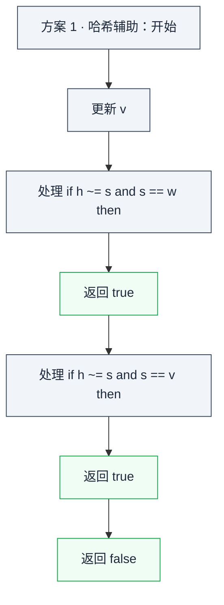

```lua
-- LeetCode 112548608. 计算思维之经典农夫过河问题C++实现（DFS 求任一可行过河序列）

local function invalid(st) -- local function invalid(st)
	local h, w, s, v = st[1], st[2], st[3], st[4] -- 把 st[1], st[2], st[3], st[4] 写入 local h, w, s, v
	if h ~= s and s == w then
		return true
	end -- 若 h ~ 赋值为 字符串 and 字符串 等于 权重 then return true 终点
	if h ~= s and s == v then
		return true
	end -- 若 h ~ 赋值为 字符串 and 字符串 等于 值 then return true 终点
	return false -- 返回 false
end -- 终点

local role_idx = { ["-"] = 0, ["W"] = 1, ["S"] = 2, ["V"] = 3 }

local function solve_farmer() -- local function solve_farmer()
	local path = {} -- 把 {} 写入 local path
	local visited = {} -- 把 {} 写入 local visited

	local go -- local go
	go = function(st) -- 把 function(st) 存入 go
		if st[1] == 1 and st[2] == 1 and st[3] == 1 and st[4] == 1 then
			return true -- 返回 true
		end -- 终点
		local key = table.concat(st, ",") -- 打印输出
		if visited[key] then
			return false
		end -- 若 已访问集合[key] then return false 终点
		visited[key] = true -- 把 true 写入 visited[key]
		for _, role in ipairs({ "-", "W", "S", "V" }) do -- 遍历取 role
			local ns = { st[1], st[2], st[3], st[4] } -- 把 { st[1], st[2], st[3], st[4] } 写入 local ns
			ns[1] = 1 - ns[1] -- 农夫总是过河
			if role ~= "-" then -- 若 role ~ 赋值为 「 减 」 then
				local idx = role_idx[role] + 1 -- 把 role_idx[role] 加 1 写入 local idx
				-- 农夫必须与所带物品在出发前同岸
				if st[1] ~= st[idx] then -- 若 st[1] ~ 赋值为 st[idx] then
					-- continue 语义：不递归
					goto continue_role -- goto continue_role
				end -- 终点
				ns[idx] = 1 - ns[idx] -- 把 1 减 ns[idx] 写入 ns[idx]
			end -- 终点
			if not invalid(ns) then -- 若 not invalid(ns) then
				if go(ns) then -- 若 go(ns) then
					path[#path + 1] = role -- 把 role 写入 path[#path + 1]
					return true -- 返回 true
				end -- 终点
			end -- 终点
			::continue_role:: -- ::continue_role::
		end -- 终点
		return false -- 返回 false
	end -- 终点

	go({ 0, 0, 0, 0 }) -- go({0, 0, 0, 0})
	-- 反转
	local n = #path -- 把 #当前路径 写入 local n
	for i = 1, math.floor(n / 2) do -- 让 下标 i 从 1 走到 math（Lua 1 基）
		path[i], path[n - i + 1] = path[n - i + 1], path[i]
	end -- 终点
	return path -- 返回 当前路径
end -- 终点

-- 模拟走 path，校验每步合法且终点为 (1,1,1,1)
local function simulate(path) -- local function simulate(当前路径)
	local st = { 0, 0, 0, 0 } -- 把 {0, 0, 0, 0} 写入 local st
	for _, role in ipairs(path) do -- 遍历取 role
		local before = { st[1], st[2], st[3], st[4] } -- 把 { st[1], st[2], st[3], st[4] } 写入 local before
		st[1] = 1 - st[1] -- 把 1 减 st[1] 写入 st[1]
		if role ~= "-" then -- 若 role ~ 赋值为 「 减 」 then
			local idx = role_idx[role] + 1 -- 把 role_idx[role] 加 1 写入 local idx
			if before[1] ~= before[idx] then
				return false
			end -- 若 before[1] ~ 赋值为 before[idx] then return false 终点
			st[idx] = 1 - st[idx] -- 把 1 减 st[idx] 写入 st[idx]
		end -- 终点
		if invalid(st) then
			return false
		end -- 若 invalid(st) then return false 终点
	end -- 终点
	return st[1] == 1 and st[2] == 1 and st[3] == 1 and st[4] == 1 -- 返回 st[1] 等于 1 and st[2] 等于 1 and st[3] 等于 1 and st[4] 等于 1
end -- 终点

local wantPath = { "S", "-", "W", "S", "V", "-", "S" } -- 把 {「S」, 「S」, 「S」, 「S」, 「S」, 「S」, 「S」} 写入 local wantPath
local wantReadable = "HS H HW HS HV H HS" -- 把 「HS H HW HS HV H HS」 写入 local wantReadable

local gotPath = solve_farmer() -- 把 solve_farmer() 写入 local gotPath

-- case1: 完整路径一致
assert(#gotPath == #wantPath, "path length mismatch") -- 断言校验
for i = 1, #wantPath do -- 把 1, #wantPath do 写入 for i
	assert(gotPath[i] == wantPath[i], "path[" .. i .. "] mismatch: got " .. tostring(gotPath[i])) -- 断言校验
end -- 终点

-- case2: 可读方案串一致
local parts = {} -- 把 {} 写入 local parts
for i, r in ipairs(gotPath) do -- 遍历取 右指针
	if r ~= "-" then
		parts[i] = "H" .. r
	else
		parts[i] = "H"
	end
end -- 终点
local gotReadable = table.concat(parts, " ") -- 打印输出
assert(gotReadable == wantReadable, "readable mismatch: got " .. gotReadable) -- 断言校验

-- case3: 路径 7 步
assert(#gotPath == 7, "steps mismatch") -- 断言校验

-- case4: 模拟校验
assert(simulate(gotPath), "simulate failed") -- 断言校验

print("PASS") -- 全部用例通过，输出 PASS
```

### C 实现（1 种方案）

C 的全部方案如下，每个方案都内嵌用例自测，可独立运行（老仓库 python/go 文件遵循「打印结果」约定）：

#### 方案 1：哈希辅助

**思路与代码分析**：核心是「哈希辅助」。C 版手动管理下标与内存，循环边界全部显式写出。代码里依次做这些事：单循环线性扫描。**走读**：方案 1 · 哈希辅助：开始 → 命中条件，直接返回 → 命中条件，直接返回 → 更新 visited[st] → 遍历循环 → 返回 1 → 返回 0。

**运行架构**（真实控制流）：

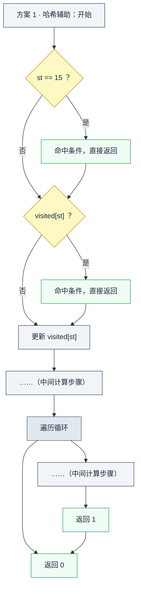

```c
* LeetCode 112548608. 计算思维之经典农夫过河问题C++实现（DFS 求任一可行过河序列）
 * 状态编码 4bit：bit3=农夫 bit2=狼(W) bit1=羊(S) bit0=菜(V)
 */
#include <stdio.h>  // 引入头文件
#include <string.h> // 引入头文件

static int invalid(int s) { // 定义函数/方法 invalid
    int h = (s >> 3) & 1, w = (s >> 2) & 1, sg = (s >> 1) & 1, v = s & 1;
    if (h != sg && sg == w)
        return 1; // 若 h 不等于 sg 且 sg 等于 权重，直接返回 1
    if (h != sg && sg == v)
        return 1; // 若 h 不等于 sg 且 sg 等于 值，直接返回 1
    return 0;     // 返回 0
}

static char path[16];    // static char 当前路径[16];
static int path_len = 0; // 把 0; 写入 static int path_len
static int visited[16];  // static int 已访问集合[16];

static int go(int st) { // 定义函数/方法 go
    if (st == 15)
        return 1; // 若 st 等于 15，直接返回 1
    if (visited[st])
        return 0;    // 若 已访问集合[st]，直接返回 0
    visited[st] = 1; // 把 1; 写入 visited[st]
    static const char roles[4] = {'-', 'W', 'S',
                                  'V'}; // 把 { ' 减 ', 'W', 'S', 'V' }; 写入 static const char roles[4]
    for (int ri = 0; ri < 4; ri++) {    // 让 ri 从 0 开始计数，ri 小于 4 就继续
        int shift = (ri == 0) ? -1 : (3 - ri); /* W->bit2 S->bit1 V->bit0 */
        int ns = st ^ 8; /* 农夫总是过河 */ // 把 st 按位异或 8; 除以 乘 农夫总是过河 乘 除以 存入 ns
        if (ri != 0) {                      // 若 ri 不等于 0
            if (((st >> 3) & 1) != ((st >> shift) & 1))
                continue;           /* 出发前同岸 */
            ns = ns ^ (1 << shift); // 把 ns 按位异或 (1 小于 小于 shift); 写入 ns
        }
        if (invalid(ns))
            continue;                     // 若 invalid(ns)) continue;
        if (go(ns)) {                     // 若 go(ns
            path[path_len++] = roles[ri]; // 把 roles[ri]; 写入 path[path_len++]
            return 1;                     // 返回 1
        }
    }
    return 0; // 返回 0
}

static int simulate(const char *p, int n) { // 定义函数/方法 simulate
    int st = 0;                             // 把 0 存入 st
    for (int i = n - 1; i >= 0; i--) {
        /* path 逆序存放，模拟按正序走 */ // 让 下标 i 从 元素个数 减 1 开始计数，下标 i 不低于 0 就继续
        char role = p[i];                 // 把 节点[下标 i]; 写入 char role
        int before = st;                  // 把 st 存入 before
        st ^= 8;                          // 把 8; 写入 st ^
        if (role != '-') { // 若 role 不等于 ' 减 '
            int shift = (role == 'W')   ? 2
                        : (role == 'S') ? 1
                                        : 0; // 把 (role 等于 'W') ? 2 : (role 等于 'S') ? 1 : 0 存入 shift
            if (((before >> 3) & 1) != ((before >> shift) & 1))
                return 0;
            st ^= (1 << shift); // 把 (1 小于 小于 shift); 写入 st ^
        }
        if (invalid(st))
            return 0; // 若 invalid(st)，直接返回 0
    }
    return st == 15; // 返回 st 等于 15
}

int main(void) { // 程序入口：跑内嵌自测用例
    const char want_path[7] = {'S', '-', 'W', 'S', 'V', '-', 'S'};
    const char *want_readable =
        "HS H HW HS HV H HS"; // 把 「HS H HW HS HV H HS」; 写入 const char *want_readable

    memset(visited, 0, sizeof(visited)); // memset(已访问集合, 0, sizeof(已访问集合));
    go(0);                               // go(0);

    /* case1: 路径一致（path 为逆序存放） */
    if (path_len != 7) {
        printf("FAIL length %d\n", path_len);
        return 1;
    }
    for (int i = 0; i < 7; i++) {          // 让 下标 i 从 0 开始计数，下标 i 小于 7 就继续
        if (path[6 - i] != want_path[i]) { // 若 当前路径[6 减 下标 i] 不等于 want_path[下标 i]
            printf("FAIL path[%d] got %c want %c\n", i, path[6 - i], want_path[i]); // 打印输出
            return 1;                                                               // 返回 1
        }
    }

    /* case2: 可读方案串 */
    char got_readable[64] = "";   // 把 「」; 写入 char got_readable[64]
    for (int i = 0; i < 7; i++) { // 让 下标 i 从 0 开始计数，下标 i 小于 7 就继续
        char role = path[6 - i];  // 把 当前路径[6 减 下标 i]; 写入 char role
        char piece[4];            // char piece[4];
        if (role != '-')
            snprintf(piece, sizeof(piece), "H%c", role);
        else
            snprintf(piece, sizeof(piece), "H"); // 否则
        if (i)
            strcat(got_readable, " "); // 若 下标 i) strcat(got_readable, 「 」);
        strcat(got_readable, piece);   // 打印输出
    }
    if (strcmp(got_readable, want_readable) != 0) {     // 若 strcmp(got_readable, want_readable) 不等于 0
        printf("FAIL readable got %s\n", got_readable); // 打印输出
        return 1;                                       // 返回 1
    }

    /* case3 + case4 */
    if (!simulate(path, path_len)) {
        printf("FAIL simulate\n");
        return 1;
    }

    printf("PASS\n"); // 全部用例通过，输出 PASS
    return 0;         // 返回 0
}
```

### C++ 实现（1 种方案）

C++ 的全部方案如下，每个方案都内嵌用例自测，可独立运行（老仓库 python/go 文件遵循「打印结果」约定）：

#### 方案 1：哈希辅助

**思路与代码分析**：核心是「哈希辅助」。C++ 版用 STL 容器与迭代器，减少手写下标错误。代码里依次做这些事：双重循环遍历。**走读**：方案 1 · 哈希辅助：开始 → 处理 std::vector＜char＞ path → 返回 true → 遍历循环 → 命中条件，直接返回 → 遍历循环 → 返回 true → 返回 false → 返回 path。

**运行架构**（真实控制流）：

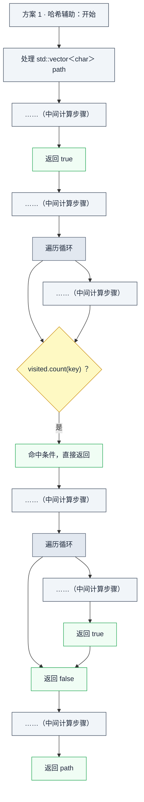

```cpp
// LeetCode 112548608. 计算思维之经典农夫过河问题C++实现（DFS 求任一可行过河序列）
#include <iostream> // 引入头文件
#include <set>      // 引入头文件
#include <string>   // 引入头文件
#include <vector>   // 引入头文件

static bool invalid(const std::vector<int> &st) { // 定义函数/方法 invalid
    int h = st[0], w = st[1], s = st[2],
        v = st[3]; // 把 st[0], 权重 赋值为 st[1], 字符串 赋值为 st[2], 值 赋值为 st[3] 存入 h
    if (h != s && s == w)
        return true; // 若 h 不等于 字符串 且 字符串 等于 权重，直接返回 true
    if (h != s && s == v)
        return true; // 若 h 不等于 字符串 且 字符串 等于 值，直接返回 true
    return false;    // 返回 false
}

static std::vector<char> solve_farmer() { // static std::vector 小于 char 超过 solve_farmer() {
    std::vector<char> path;               // std::vector 小于 char 超过 当前路径;
    std::set<std::string> visited;        // std::set 小于 std::string 超过 已访问集合;
    static const char roles[4] = {'-', 'W', 'S',
                                  'V'}; // 把 { ' 减 ', 'W', 'S', 'V' }; 写入 static const char roles[4]
    static const int role_idx[4] = {0, 1, 2, 3}; // 把 { 0, 1, 2, 3 }; 写入 static const int role_idx[4]

    std::function<bool(std::vector<int>)> go = [&](std::vector<int> st) -> bool {
        if (st == std::vector<int>{1, 1, 1, 1})
            return true; // 若 st 等于 std::vector 小于 int 超过 {1, 1, 1, 1}，直接返回 true
        std::string key; // std::string key;
        for (size_t i = 0; i < 4; ++i) {
            if (i)
                key += ",";
            key += std::to_string(st[i]);
        } // 让 下标 i 从 0 开始计数，下标 i 小于 4 就继续
        if (visited.count(key))
            return false;                // 若 已访问集合.计数(key)，直接返回 false
        visited.insert(key);             // 已访问集合 插入 key);
        for (int ri = 0; ri < 4; ++ri) { // 让 ri 从 0 开始计数，ri 小于 4 就继续
            std::vector<int> ns = st;    // 把 st; 写入 std::vector<int> ns
            ns[0] = 1 - ns[0];           // 农夫总是过河
            if (ri != 0) {               // 若 ri 不等于 0
                int idx = role_idx[ri];  // 把 role_idx[ri] 存入 idx
                if (st[0] != st[idx])
                    continue;          // 出发前同岸
                ns[idx] = 1 - ns[idx]; // 把 1 减 ns[idx]; 写入 ns[idx]
            }
            if (invalid(ns))
                continue;                  // 若 invalid(ns)) continue;
            if (go(ns)) {                  // 若 go(ns
                path.push_back(roles[ri]); // 当前路径 追加 roles[ri]);
                return true;               // 返回 true
            }
        }
        return false; // 返回 false
    };

    go({0, 0, 0, 0});                       // go({0, 0, 0, 0});
    std::reverse(path.begin(), path.end()); // std::reverse(当前路径 迭代位置 , 当前路径.终点());
    return path;                            // 返回 当前路径
}

static bool simulate(const std::vector<char> &path) { // 定义函数/方法 simulate
    std::vector<int> st{0, 0, 0, 0};                  // std::vector 小于 int 超过 st{0, 0, 0, 0};
    for (char role : path) {                          // for (char role : 当前路径) {
        std::vector<int> before = st;                 // 把 st; 写入 std::vector<int> before
        st[0] = 1 - st[0];                            // 把 1 减 st[0]; 写入 st[0]
        if (role != '-') {                            // 若 role 不等于 ' 减 '
            int idx = (role == 'W')   ? 1
                      : (role == 'S') ? 2
                                      : 3; // 把 (role 等于 'W') ? 1 : (role 等于 'S') ? 2 : 3 存入 idx
            if (before[0] != before[idx])
                return false;      // 若 before[0] 不等于 before[idx]，直接返回 false
            st[idx] = 1 - st[idx]; // 把 1 减 st[idx]; 写入 st[idx]
        }
        if (invalid(st))
            return false; // 若 invalid(st)，直接返回 false
    }
    return st == std::vector<int>{1, 1, 1, 1}; // 返回 st 等于 std::vector 小于 int 超过 {1, 1, 1, 1}
}

int main() { // 程序入口：跑内嵌自测用例
    std::vector<char> want_path = {'S', '-', 'W', 'S', 'V', '-', 'S'};
    std::string want_readable =
        "HS H HW HS HV H HS"; // 把 「HS H HW HS HV H HS」; 写入 std::string want_readable

    std::vector<char> got_path = solve_farmer(); // 把 solve_farmer(); 写入 std::vector<char> got_path

    // case1: 路径一致
    if (got_path != want_path) {
        std::cout << "FAIL path mismatch" << std::endl;
        return 1;
    }

    // case2: 可读方案串
    std::string got_readable; // std::string got_readable;
    for (size_t i = 0; i < got_path.size();
         ++i) {               // 让 下标 i 从 0 开始计数，下标 i 小于 got_path.大小() 就继续
        char r = got_path[i]; // 把 got_path[下标 i]; 写入 char r
        if (i)
            got_readable += " "; // 若 下标 i) got_readable 累加 「 」;
        got_readable += 'H';     // got_readable累加 'H'
        if (r != '-')
            got_readable += r; // 若 右指针 不等于 ' 减 ') got_readable 累加 右指针;
    }
    if (got_readable != want_readable) {
        std::cout << "FAIL readable: " << got_readable << std::endl;
        return 1;
    }

    // case3: 7 步
    if (got_path.size() != 7) {
        std::cout << "FAIL steps" << std::endl;
        return 1;
    }

    // case4: 模拟校验
    if (!simulate(got_path)) {
        std::cout << "FAIL simulate" << std::endl;
        return 1;
    }

    std::cout << "PASS" << std::endl; // 全部用例通过，输出 PASS
    return 0;                         // 返回 0
}
```

### R 实现（1 种方案）

R 的全部方案如下，每个方案都内嵌用例自测，可独立运行（老仓库 python/go 文件遵循「打印结果」约定）：

#### 方案 1：哈希辅助

**思路与代码分析**：核心是「哈希辅助」。R 版用向量化思维与 1 起始下标，注意 1:n 的降序陷阱。**走读**：方案 1 · 哈希辅助：开始 → 处理 h ＜- st[1] → 处理 w ＜- st[2] → 处理 s ＜- st[3] → 处理 v ＜- st[4] → 命中条件，直接返回 → 命中条件，直接返回 → 处理 FALSE。

**运行架构**（真实控制流）：

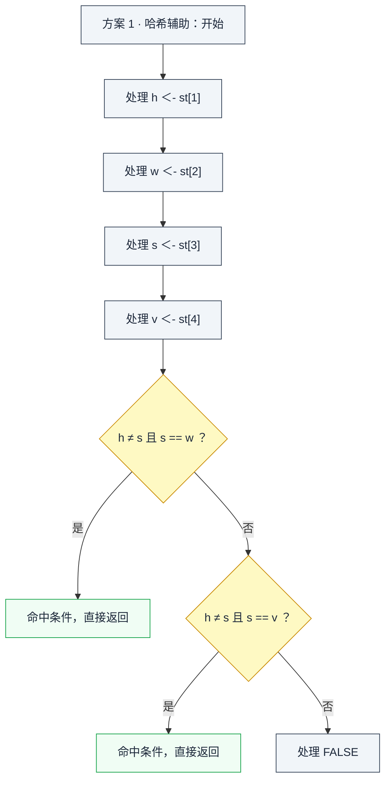

```r
# 计算思维之经典农夫过河问题C++实现（DFS 求任一可行过河序列）
invalid <- function(st) {
    # 定义函数 invalid（参数：st）
    h <- st[1]
    w <- st[2]
    s <- st[3]
    v <- st[4]  # 把 st[1]; 权重 小于 减 st[2]; 字符串 小于 减 st[3]; 值 小于 减 st[4] 存入 h
    if (h != s && s == w)
        return(TRUE)  # 若 h 不等于 字符串 且 字符串 等于 权重) return(TRUE
    if (h != s && s == v)
        return(TRUE)  # 若 h 不等于 字符串 且 字符串 等于 值) return(TRUE
    FALSE  # FALSE
}
role_idx <- c(`-` = 0, W = 1, S = 2, V = 3)
solve_farmer <- function() {
    # 定义函数 solve_farmer（参数：无）
    path <- character(0)  # 把 character(0) 存入 当前路径
    visited <- new.env(parent = emptyenv())  # 把 new.env(parent 赋值为 emptyenv()) 存入 已访问集合
    go <- function(st) {
        # 定义函数 go（参数：st）
        if (st[1] == 1L && st[2] == 1L && st[3] == 1L && st[4] == 1L)
            return(TRUE)
        key <- paste(st, collapse = ",")  # 把 paste(st, collapse 赋值为 「,」) 存入 key
        if (!is.null(visited[[key]]))
            return(FALSE)  # 若 取反 is.null(已访问集合[[key]])) return(FALSE
        visited[[key]] <- TRUE  # 把 TRUE 存入 visited[[key]]
        for (role in c("-", "W", "S", "V")) {
            # for (role in 字符(「 减 」, 「 减 」, 「 减 」, 「 减 」)) {
            ns <- st  # 把 st 存入 ns
            ns[1] <- 1L - ns[1]  # 农夫总是过河
            ok <- TRUE  # 把 TRUE 存入 ok
            if (role != "-") {
                # 若 role 不等于 「 减 」
                idx <- as.integer(role_idx[[role]]) + 1L  # 把 as.integer(role_idx[[role]]) 加 1L 存入 idx
                if (st[1] != st[idx]) {
                  # 若 st[1] 不等于 st[idx]
                  ok <- FALSE  # 出发前不同岸，跳过
                } else {
                  # 否则
                  ns[idx] <- 1L - ns[idx]  # 把 1L 减 ns[idx] 存入 ns[idx]
                }
            }
            if (ok && !invalid(ns)) {
                # 若 ok 且 取反 invalid(ns 若 go(ns
                if (go(ns)) {
                  path <<- c(path, role)  # 当前路径 小于 小于 减 字符(当前路径, role)
                  return(TRUE)  # 返回 TRUE
                }
            }
        }
        FALSE  # FALSE
    }
    go(c(0L, 0L, 0L, 0L))  # go(字符(0L, 0L, 0L, 0L))
    rev(path)  # rev(当前路径)
}
simulate <- function(p) {
    # 定义函数 simulate（参数：节点）
    st <- c(0L, 0L, 0L, 0L)  # 把 字符(0L, 0L, 0L, 0L) 存入 st
    for (role in p) {
        # for (role in 节点) {
        before <- st  # 把 st 存入 before
        st[1] <- 1L - st[1]  # 把 1L 减 st[1] 存入 st[1]
        if (role != "-") {
            # 若 role 不等于 「 减 」
            idx <- as.integer(role_idx[[role]]) + 1L  # 把 as.integer(role_idx[[role]]) 加 1L 存入 idx
            if (before[1] != before[idx])
                return(FALSE)  # 若 before[1] 不等于 before[idx]) return(FALSE
            st[idx] <- 1L - st[idx]  # 把 1L 减 st[idx] 存入 st[idx]
        }
        if (invalid(st))
            return(FALSE)  # 若 invalid(st)) return(FALSE
    }
    st[1] == 1L && st[2] == 1L && st[3] == 1L && st[4] == 1L  # 把 赋值为 1L 且 st[2] 等于 1L 且 st[3] 等于 1L 且 st[4] 等于 1L 写入 st[1]
}
wantPath <- c("S", "-", "W", "S", "V", "-", "S")  # 把 字符(「S」, 「S」, 「S」, 「S」, 「S」, 「S」, 「S」) 存入 wantPath
wantReadable <- "HS H HW HS HV H HS"  # 把 「HS H HW HS HV H HS」 存入 wantReadable
gotPath <- solve_farmer()  # 把 solve_farmer() 存入 gotPath
# case1: 路径一致
stopifnot(length(gotPath) == length(wantPath))  # 断言校验
for (i in seq_along(wantPath)) {
    # for (下标 i in seq_along(wantPath)) {
    stopifnot(identical(gotPath[i], wantPath[i]))  # 断言校验
}
# case2: 可读方案串
parts <- ifelse(gotPath != "-", paste0("H", gotPath), "H")
gotReadable <- paste(parts, collapse = " ")  # 把 paste(parts, collapse 赋值为 「 」) 存入 gotReadable
stopifnot(identical(gotReadable, wantReadable))  # 断言校验
# case3: 7 步
stopifnot(length(gotPath) == 7L)  # 断言校验
# case4: 模拟校验
stopifnot(simulate(gotPath))  # 断言校验
cat("PASS\n")  # 全部用例通过，输出 PASS
```

### Zig 实现（1 种方案）

Zig 的全部方案如下，每个方案都内嵌用例自测，可独立运行（老仓库 python/go 文件遵循「打印结果」约定）：

#### 方案 1：哈希辅助

**思路与代码分析**：核心是「哈希辅助」。Zig 版显式分配与清零，整型边界处理严格。**走读**：方案 1 · 哈希辅助：开始 → 命中条件，直接返回 → 命中条件，直接返回 → 更新 visited[st] → 当 (ri ＜ 4) : (ri += 1) 时反复执行 → 返回 true → 返回 false。

**运行架构**（真实控制流）：

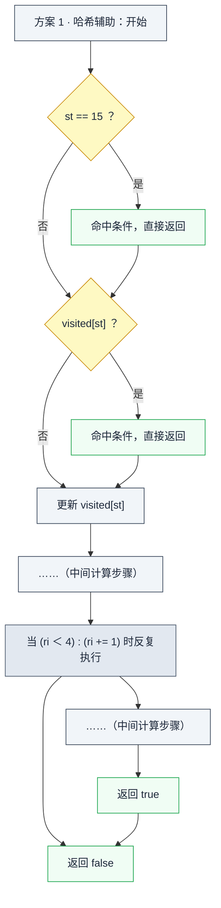

```zig
// LeetCode 112548608. 计算思维之经典农夫过河问题C++实现（DFS 求任一可行过河序列）
// 状态编码 4bit：bit3=农夫 bit2=狼(W) bit1=羊(S) bit0=菜(V)
const std = @import("std"); // 把 @import(「std」) 存入 std

fn invalid(s: u4) bool { // 定义函数/方法 invalid
    const h: u1 = @truncate(s >> 3); // 把 @truncate(字符串 超过 超过 3); 写入 const h: u1
    const w: u1 = @truncate(s >> 2); // 把 @truncate(字符串 超过 超过 2); 写入 const w: u1
    const sg: u1 = @truncate(s >> 1); // 把 @truncate(字符串 超过 超过 1); 写入 const sg: u1
    const v: u1 = @truncate(s); // 把 @truncate(字符串); 写入 const v: u1
    if (h != sg and sg == w) return true; // 若 h 不等于 sg and sg 等于 权重，直接返回 true
    if (h != sg and sg == v) return true; // 若 h 不等于 sg and sg 等于 值，直接返回 true
    return false; // 返回 false
}

var path_buf: [16]u8 = undefined; // 把 undefined; 写入 var path_buf: [16]u8
var path_len: usize = 0; // 把 0; 写入 var path_len: usize
var visited: [16]bool = undefined; // 把 undefined; 写入 var visited: [16]bool

fn go(st: u4) bool { // 定义函数/方法 go
    if (st == 15) return true; // 若 st 等于 15，直接返回 true
    if (visited[st]) return false; // 若 已访问集合[st]，直接返回 false
    visited[st] = true; // 把 true; 写入 visited[st]
    const roles = [4]u8{ '-', 'W', 'S', 'V' }; // 把 [4]u8{ ' 减 ', 'W', 'S', 'V' } 存入 roles
    var ri: usize = 0; // 把 0; 写入 var ri: usize
    while (ri < 4) : (ri += 1) { // 循环，直到不满足「ri 小于 4) : (ri 累加 1」
        const shift: u2 = if (ri == 0) 0 else @intCast(3 - ri); // W->2 S->1 V->0
        var ns: u4 = st ^ 8; // 农夫总是过河
        if (ri != 0) { // 若 ri 不等于 0
            if ((st >> 3 & 1) != (st >> shift & 1)) continue; // 出发前同岸
            ns = ns ^ (@as(u4, 1) << shift); // 把 ns 按位异或 (@as(u4, 1) 小于 小于 shift); 写入 ns
        }
        if (invalid(ns)) continue; // 若 invalid(ns)) continue;
        if (go(ns)) { // 若 go(ns
            path_buf[path_len] = roles[ri]; // 把 roles[ri]; 写入 path_buf[path_len]
            path_len += 1; // path_len累加 1
            return true; // 返回 true
        }
    }
    return false; // 返回 false
}

fn simulate(p: []const u8) bool { // 定义函数/方法 simulate
    var st: u4 = 0; // 把 0; 写入 var st: u4
    var i: usize = p.len; // 把 节点.长度; 写入 var i: usize
    while (i > 0) { // path 逆序存放，模拟按正序走
        i -= 1; // 下标 i累减 1
        const role = p[i]; // 把 节点[下标 i] 存入 role
        const before = st; // 把 st 存入 before
        st = st ^ 8; // 把 st 按位异或 8; 写入 st
        if (role != '-') { // 若 role 不等于 ' 减 '
            const shift: u2 = if (role == 'W') 2 else if (role == 'S') 1 else 0;
            if ((before >> 3 & 1) != (before >> shift & 1)) return false;
            st = st ^ (@as(u4, 1) << shift); // 把 st 按位异或 (@as(u4, 1) 小于 小于 shift); 写入 st
        }
        if (invalid(st)) return false; // 若 invalid(st)，直接返回 false
    }
    return st == 15; // 返回 st 等于 15
}

pub fn main() !void { // 程序入口：跑内嵌自测用例
    const want_path = [7]u8{ 'S', '-', 'W', 'S', 'V', '-', 'S' };
    const want_readable = "HS H HW HS HV H HS"; // 把 「HS H HW HS HV H HS」 存入 want_readable

    @memset(&visited, false); // @memset( 按位与 已访问集合, false);
    _ = go(0); // 把 go(0); 写入 _

    // case1: 路径一致（path_buf 逆序存放）
    if (path_len != 7) { // 若 path_len 不等于 7
        std.debug.print("FAIL length {d}\n", .{path_len}); // 打印输出
        return error.TestFailed; // 返回 error.TestFailed
    }
    for (want_path, 0..) |w, i| { // for (want_path, 0..) 按位或 权重, 下标 i 按位或 {
        if (path_buf[6 - i] != w) { // 若 path_buf[6 减 下标 i] 不等于 权重
            std.debug.print("FAIL path[{d}] got {c} want {c}\n", .{ i, path_buf[6 - i], w }); // 打印输出
            return error.TestFailed; // 返回 error.TestFailed
        }
    }

    // case2: 可读方案串
    var buf: [64]u8 = undefined; // 把 undefined; 写入 var buf: [64]u8
    var n: usize = 0; // 把 0; 写入 var n: usize
    for (0..7) |i| { // 让 下标 i 从 0 走到 7 减一
        const role = path_buf[6 - i]; // 把 path_buf[6 减 下标 i] 存入 role
        if (i != 0) { // 若 下标 i 不等于 0
            buf[n] = ' '; // 把 ' '; 写入 buf[n]
            n += 1; // 元素个数累加 1
        }
        buf[n] = 'H'; // 把 'H'; 写入 buf[n]
        n += 1; // 元素个数累加 1
        if (role != '-') { // 若 role 不等于 ' 减 '
            buf[n] = role; // 把 role; 写入 buf[n]
            n += 1; // 元素个数累加 1
        }
    }
    const got_readable = buf[0..n]; // 把 buf[0..元素个数] 存入 got_readable
    if (!std.mem.eql(u8, got_readable, want_readable)) { // 若 取反 std.mem.eql(u8, got_readable, want_readable
        std.debug.print("FAIL readable: {s}\n", .{got_readable}); // 打印输出
        return error.TestFailed; // 返回 error.TestFailed
    }

    // case3 + case4
    if (!simulate(path_buf[0..path_len])) { // 若 取反 simulate(path_buf[0..path_len]
        std.debug.print("FAIL simulate\n", .{}); // 打印输出
        return error.TestFailed; // 返回 error.TestFailed
    }

    std.debug.print("PASS\n", .{}); // 全部用例通过，输出 PASS
}
```

### Dart 实现（1 种方案）

Dart 的全部方案如下，每个方案都内嵌用例自测，可独立运行（老仓库 python/go 文件遵循「打印结果」约定）：

#### 方案 1：哈希辅助

**思路与代码分析**：核心是「哈希辅助」。Dart 版用可空类型标注与集合方法，注意空安全。代码里依次做这些事：单循环线性扫描。**走读**：方案 1 · 哈希辅助：开始 → 更新 path → 命中条件，直接返回 → 命中条件，直接返回 → 遍历循环 → 返回 true → 返回 false → 返回 path.reversed.toList()。

**运行架构**（真实控制流）：

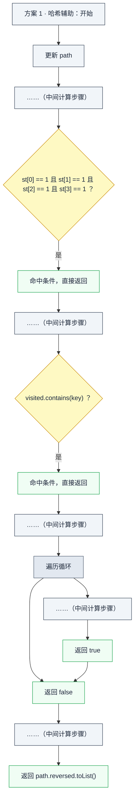

```dart
// LeetCode 112548608. 计算思维之经典农夫过河问题C++实现（DFS 求任一可行过河序列）

bool invalid(List<int> st) {
  // 定义函数/方法 invalid
  final h = st[0],
      w = st[1],
      s = st[2],
      v = st[3]; // 把 st[0], 权重 赋值为 st[1], 字符串 赋值为 st[2], 值 赋值为 st[3] 存入 h
  if (h != s && s == w) return true; // 若 h 不等于 字符串 且 字符串 等于 权重，直接返回 true
  if (h != s && s == v) return true; // 若 h 不等于 字符串 且 字符串 等于 值，直接返回 true
  return false; // 返回 false
}

const roleIdx = {
  'W': 1,
  'S': 2,
  'V': 3,
}; // 把 {'W': 1, 'S': 2, 'V': 3} 存入 roleIdx

List<String> solveFarmer() {
  // 定义函数/方法 solveFarmer
  final path = <String>[]; // 把 小于 String 超过 [] 存入 当前路径
  final visited = <String>{}; // 把 小于 String 超过 {} 存入 已访问集合

  bool go(List<int> st) {
    // 定义函数/方法 go
    if (st[0] == 1 && st[1] == 1 && st[2] == 1 && st[3] == 1) return true;
    final key = st.join(','); // 把 st.join(',') 存入 key
    if (visited.contains(key)) return false; // 若 已访问集合 是否包含 key)，直接返回 false
    visited.add(key); // 已访问集合 追加 key);
    for (final role in ['-', 'W', 'S', 'V']) {
      // for (final role in [' 减 ', 'W', 'S', 'V']) {
      final ns = List<int>.from(st); // 把 List 小于 int 超过 .from(st) 存入 ns
      ns[0] = 1 - ns[0]; // 农夫总是过河
      if (role != '-') {
        // 若 role 不等于 ' 减 '
        final idx = roleIdx[role]!; // 把 roleIdx[role]取反 存入 idx
        if (st[0] != st[idx]) continue; // 出发前同岸
        ns[idx] = 1 - ns[idx]; // 把 1 减 ns[idx]; 写入 ns[idx]
      }
      if (invalid(ns)) continue; // 若 invalid(ns)) continue;
      if (go(ns)) {
        // 若 go(ns
        path.add(role); // 当前路径 追加 role);
        return true; // 返回 true
      }
    }
    return false; // 返回 false
  }

  go(<int>[0, 0, 0, 0]); // go( 小于 int 超过 [0, 0, 0, 0]);
  return path.reversed.toList(); // 返回 当前路径.reversed.toList()
}

bool simulate(List<String> path) {
  // 定义函数/方法 simulate
  final st = <int>[0, 0, 0, 0]; // 把 小于 int 超过 [0, 0, 0, 0] 存入 st
  for (final role in path) {
    // for (final role in 当前路径) {
    final before = List<int>.from(st); // 把 List 小于 int 超过 .from(st) 存入 before
    st[0] = 1 - st[0]; // 把 1 减 st[0]; 写入 st[0]
    if (role != '-') {
      // 若 role 不等于 ' 减 '
      final idx = roleIdx[role]!; // 把 roleIdx[role]取反 存入 idx
      if (before[0] != before[idx])
        return false; // 若 before[0] 不等于 before[idx]，直接返回 false
      st[idx] = 1 - st[idx]; // 把 1 减 st[idx]; 写入 st[idx]
    }
    if (invalid(st)) return false; // 若 invalid(st)，直接返回 false
  }
  return st[0] == 1 &&
      st[1] == 1 &&
      st[2] == 1 &&
      st[3] == 1; // 返回 st[0] 等于 1 且 st[1] 等于 1 且 st[2] 等于 1 且 st[3] 等于 1
}

void main() {
  // 程序入口：跑内嵌自测用例
  final wantPath = <String>['S', '-', 'W', 'S', 'V', '-', 'S'];
  final wantReadable =
      'HS H HW HS HV H HS'; // 把 'HS H HW HS HV H HS' 存入 wantReadable

  final gotPath = solveFarmer(); // 把 solveFarmer() 存入 gotPath

  // case1: 路径一致
  if (gotPath.toString() != wantPath.toString()) {
    // 若 gotPath.toString() 不等于 wantPath.toString(
    throw StateError('FAIL path mismatch: ' + gotPath.toString());
  }

  // case2: 可读方案串
  final gotReadable = gotPath.map((r) => r != '-' ? 'H' + r : 'H').join(' ');
  if (gotReadable != wantReadable) {
    // 若 gotReadable 不等于 wantReadable
    throw StateError(
      'FAIL readable: ' + gotReadable,
    ); // throw StateError('FAIL readable: ' 加 gotReadable);
  }

  // case3: 7 步
  if (gotPath.length != 7)
    throw StateError(
      'FAIL steps',
    ); // 若 gotPath.长度 不等于 7) throw StateError('FAIL steps');

  // case4: 模拟校验
  if (!simulate(gotPath))
    throw StateError(
      'FAIL simulate',
    ); // 若 取反 simulate(gotPath)) throw StateError('FAIL simulate');

  print('PASS'); // 全部用例通过，输出 PASS
}
```

---

## 内容总结

- **计算思维之经典农夫过河问题c++实现**（算法笔记 · Medium）：共 1 个方案，主线思路「哈希辅助」；时间 O(n)（单趟线性扫描）；动画演示归并分治过程，附录给出 11 种语言 × 全部方案的可运行实现。
- 来源博客：[https://blog.csdn.net/tyro_java/article/details/112548608](https://blog.csdn.net/tyro_java/article/details/112548608)
- 导航：[📋 总目录](../) ｜ [← 216 按序打印](../216_按序打印/) ｜ [218 图搜索之bfs详解 →](../218_图搜索之bfs详解/)
