# 218 · 图搜索之bfs详解（第附阶段 · 专题补充 · Medium）

> **难度**：⭐⭐ Medium ｜ **专题**：算法笔记
> **学习定位**：第附阶段 · 专题补充第 218 篇 ｜ **解法数**：1
> **内容总结**：**图搜索之bfs详解**（算法笔记 · Medium）：共 1 个方案，主线思路「直接实现」；时间 O(n) 量级；动画演示归并分治过程，附录给出 11 种语言 × 全部方案的可运行实现。

---

## 题目描述

图搜索之bfs详解。具体输入输出约定见函数签名与用例。

- 主函数签名：`function assertEq(actual: any, expected: any, msg: string = ''): void`

**数据范围与注意事项**：

- **易错点**：先看小例子手推一遍再对照代码，比直接读代码快得多。

## 题目分析

**场景是什么**：综合练习：把数据结构与策略组合起来解决一个完整问题。本题就是该场景的 Medium 级练习，主线做法是「直接实现」。

**主线怎么解**：主解法结构简单：读入、处理、返回。

## 解题思路

**方案对比**（共 1 个方案，由浅入深）：

| 方案 | 时间复杂度 | 空间复杂度 |
|---|---|---|
| 方案 1 · 直接实现 | O(n) 量级 | O(n) |

**怎么读这一篇**：

- 🐣 **新手路线**：把「题目描述」的示例 1 在纸上手推一遍 → 读方案 1（最直观的写法）与它的代码走读 → 按「运行方式」本地跑通看 PASS → 回头对比方案 2 之后的写法差在哪
- 🦅 **大佬路线**：直接锁定最优方案 1（直接实现，O(n) 量级）→ 跳读该方案代码与走读 → 用「逐步拆解与面试追问」补齐复杂度推导与边界追问

### 动态算法图（归并分治，GIF 自动循环）


动画演示算法笔记专题里归并分治的典型过程；每个方案在「TypeScript 解题方案」一节还配了专属动画与专属流程图。

### 主解法流程图（真实控制流）

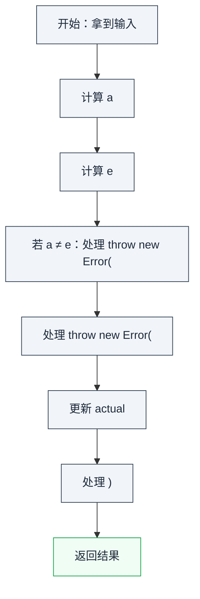

## TypeScript 解题方案（1 个方案逐个讲）

> **运行与提交**：每个方案都是自包含文件（内嵌用例自测，输出 PASS），整块复制到 `.ts` 文件后 `node 文件名` 即可运行。提交 LeetCode 时，把 `demo` 内的算法函数与辅助类型/函数整体取出、置于文件顶层即可。概念演示（非 LeetCode 编号题），在本地运行即可。

### 方案 1：直接实现

**分析与思路**：核心做法是「直接实现」。

**运行方式**：`node 本文件`，内嵌用例全部通过会输出 PASS。


**方案专属流程图**（真实控制流）：

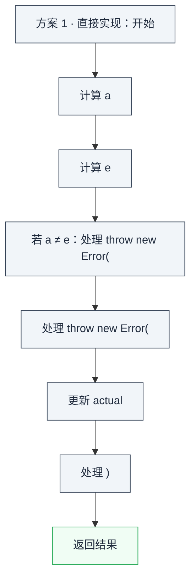

```typescript
function assertEq(actual: any, expected: any, msg: string = ''): void {
  // 定义函数/方法 assertEq
  const a = JSON.stringify(actual);
  const e = JSON.stringify(expected);
  if (a !== e)
    throw new Error(
      'ASSERT FAILED ' + msg + ' :: actual=' + a + ' expected=' + e,
    );
}

function bfs(graph: number[][], start: number): [number[], number[]] {
  // 定义函数/方法 bfs
  const n = graph.length; // 把 graph.长度 存入 元素个数
  const status: string[] = new Array(n).fill('UNDISCOVERED');
  const parent: number[] = new Array(n).fill(-1); // 把 new Array(元素个数).fill( 减 1); 写入 const parent: number[]
  const order: number[] = []; // 把 []; 写入 const order: number[]
  const q: number[] = [start]; // 把 [起点]; 写入 const q: number[]
  status[start] = 'DISCOVERED'; // 把 'DISCOVERED'; 写入 status[start]
  while (q.length) {
    // 循环，直到不满足「节点.长度」
    const v = q.shift()!; // 把 节点.shift()取反 存入 值
    order.push(v); // 把 值 压入栈/数组尾部
    for (const u of graph[v]) {
      // for (const 节点 u of graph[值]) {
      if (status[u] === 'UNDISCOVERED') {
        status[u] = 'DISCOVERED';
        parent[u] = v;
        q.push(u);
      }
    }
    status[v] = 'VISITED'; // 把 'VISITED'; 写入 status[v]
  }
  return [order, parent]; // 返回 [order, parent]
}
export function demo(): void {
  // 程序入口：跑内嵌自测用例
  const graph = [[1, 2], [0, 3, 4], [0, 5], [1], [1], [2]]; // 把 [[1, 2], [0, 3, 4], [0, 5], [1], [1], [2]] 存入 graph
  const [order, parent] = bfs(graph, 0); // 把 bfs(graph, 0); 写入 const [order, parent]
  assertEq(order, [0, 1, 2, 3, 4, 5], 'order'); // 断言校验
  assertEq(parent, [-1, 0, 0, 1, 1, 2], 'parent'); // 断言校验
  console.log('PASS'); // 全部用例通过，输出 PASS
}
demo(); // demo();
```

## 逐步拆解与面试追问

**复杂度**：时间 O(n) 量级，空间 O(n)

**为什么是这个量级**：整体只对数据做有限趟处理

**面试官可能会追问**：

- 这个策略能推广到什么场景？
- 与暴力做法差在哪一步？
- 有没有更简单的等价写法？

## 关键 API 速查（TS 主解法实际用到，附官方链接）

| API | 作用 | 使用要点 | 官方文档 |
|---|---|---|---|
| `Array.prototype.push()` | 尾部追加 | 返回新长度；可一次多个；均摊 O(1)；会改变原数组 | [官方文档](https://developer.mozilla.org/zh-CN/docs/Web/JavaScript/Reference/Global_Objects/Array/push) |
| `Array.prototype.shift()` | 头部取出 | O(n)（后续元素整体前移）；大量头部操作请用链表或双端结构 | [官方文档](https://developer.mozilla.org/zh-CN/docs/Web/JavaScript/Reference/Global_Objects/Array/shift) |
| `JSON.stringify()` | 序列化为 JSON 字符串 | 常用于结构化比较（深度相等判定）；undefined/函数/循环引用会被丢弃或抛错 | [官方文档](https://developer.mozilla.org/zh-CN/docs/Web/JavaScript/Reference/Global_Objects/JSON/stringify) |

### 各语言官方文档导航

- **TypeScript / JS**：[MDN 中文参考](https://developer.mozilla.org/zh-CN/)
- **Python**：[Python 官方文档](https://docs.python.org/zh-cn/3/)
- **Go**：[Go 标准库](https://pkg.go.dev/std)
- **Java**：[JDK 17 API](https://docs.oracle.com/en/java/javase/17/docs/api/)
- **Rust**：[Rust 标准库](https://doc.rust-lang.org/std/)
- **Lua**：[Lua 5.4 手册](https://www.lua.org/manual/5.4/)
- **C**：[Cppreference C](https://zh.cppreference.com/w/c)
- **C++**：[Cppreference C++](https://zh.cppreference.com/w/cpp)
- **R**：[R 官方手册](https://stat.ethz.ch/R-manual/)
- **Zig**：[Zig 语言文档](https://ziglang.org/documentation/master/)
- **Dart**：[Dart API](https://api.dart.dev/)

## 附录：其他 10 种语言全部实现（每种语言列举其全部方案）

> TypeScript 的全部方案见「TypeScript 解题方案」一节；下面是其余 10 种语言的对应实现，每种语言的每个方案都带思路分析、代码走读与专属运行架构图。
> 每个方案都内嵌用例自测，可独立运行（老仓库 python/go 文件遵循「打印结果」约定）。
> 完整解法文件见 `dsa/<语言>/notes/lc_113548046_图搜索之bfs详解/`。

### Python 实现（1 种方案）

Python 的全部方案如下，每个方案都内嵌用例自测，可独立运行（老仓库 python/go 文件遵循「打印结果」约定）：

#### 方案 1：直接实现

**思路与代码分析**：核心是「直接实现」。Python 版用切片与字典推导式简化操作，突出可读性。代码里依次做这些事：队列或堆的调度。**走读**：方案 1 · 直接实现：开始 → 更新 n → 当 q: 时反复执行 → 遍历 graph[v]: 中的每个元素 u → 返回 order, parent。

**运行架构**（真实控制流）：

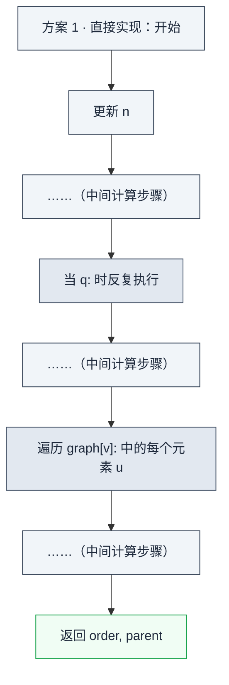

```python
import sys  # 提高递归深度上限（深输入防 RecursionError）

sys.setrecursionlimit(200000)  # 树/链表类题目节点数可达 1e4 量级
from collections import deque  # from collections import deque

def bfs(graph, start):  # 定义函数 bfs（参数：graph, 起点）
    """广度优先搜索：逐层扩散（前锋面），返回访问顺序与生成树父指针。"""
    n = len(graph)  # 把 长度(graph) 存入 元素个数
    status = ["UNDISCOVERED"] * n  # UNDISCOVERED / DISCOVERED / VISITED
    parent = [-1] * n  # 把 [ 减 1] 乘 元素个数 存入 parent
    order = []  # 把 [] 存入 order
    q = deque([start])  # 把 deque([起点]) 存入 节点
    status[start] = "DISCOVERED"  # 把 'DISCOVERED' 写入 status[start]
    clock = 0  # 把 0 存入 clock
    while q:  # 循环，直到不满足「节点」
        v = q.popleft()  # 把 节点.popleft() 存入 值
        clock += 1  # clock累加 1
        order.append(v)  # 把 值 追加到列表尾部
        for u in graph[v]:  # 逐个取出 graph 的元素（节点 u）
            if status[u] == "UNDISCOVERED":  # 若 status[节点 u] 等于 'UNDISCOVERED'
                status[u] = "DISCOVERED"  # 把 'DISCOVERED' 写入 status[u]
                parent[u] = v  # 把 值 写入 parent[u]
                q.append(u)  # 把 节点 u 追加到列表尾部
            # 否则为跨边 CROSS，无需处理
        status[v] = "VISITED"  # 把 'VISITED' 写入 status[v]
    return order, parent  # 返回 order, parent

if __name__ == "__main__":  # 若 __name__ 等于 '__main__'
    # 无向图邻接表
    graph = [
        [1, 2],  # 0
        [0, 3, 4],  # 1
        [0, 5],  # 2
        [1],  # 3
        [1],  # 4
        [2],  # 5
    ]
    order, parent = bfs(graph, 0)  # 把 bfs(graph, 0) 写入 order, parent
    print("BFS 访问顺序:", order)  # 打印输出
    print("父指针:", parent)  # 打印输出
```

### Go 实现（1 种方案）

Go 的全部方案如下，每个方案都内嵌用例自测，可独立运行（老仓库 python/go 文件遵循「打印结果」约定）：

#### 方案 1：直接实现

**思路与代码分析**：核心是「直接实现」。Go 版用切片与多返回值惯用法，显式处理索引边界。**走读**：方案 1 · 直接实现：开始 → 更新 : → 遍历 status 的下标与元素 i → 遍历 parent 的下标与元素 i → 遍历循环 → 遍历 graph[v] 的下标与元素 u → 返回 order, parent。

**运行架构**（真实控制流）：

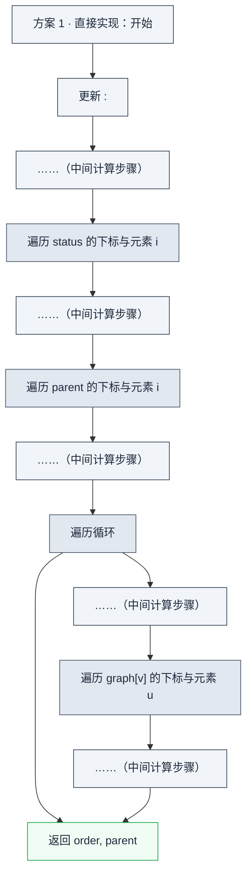

```go
package main // 引入依赖

import (
	"fmt"     // 「fmt」
	"os"      // 「os」
	"reflect" // 「reflect」
)

// bfs 广度优先搜索：逐层扩散（前锋面），返回访问顺序与生成树父指针。
func bfs(graph [][]int, start int) ([]int, []int) { // 定义函数/方法 bfs
	n := len(graph)             // 把 长度(graph) 写入 n :
	status := make([]string, n) // 把 make([]string, 元素个数) 写入 status :
	for i := range status {     // 把 range status { 写入 for i :
		status[i] = "UNDISCOVERED" // 把 「UNDISCOVERED」 写入 status[i]
	}
	parent := make([]int, n) // 把 make([]int, 元素个数) 写入 parent :
	for i := range parent {  // 把 range parent { 写入 for i :
		parent[i] = -1 // 把 减 1 写入 parent[i]
	}
	order := []int{}             // 把 []int{} 写入 order :
	q := []int{start}            // 把 []int{起点} 写入 q :
	status[start] = "DISCOVERED" // 把 「DISCOVERED」 写入 status[start]
	for len(q) > 0 {             // for 长度(节点) 超过 0 {
		v := q[0]                    // 把 节点[0] 写入 v :
		q = q[1:]                    // 把 节点[1:] 写入 节点
		order = append(order, v)     // 把 append(order, 值) 写入 order
		for _, u := range graph[v] { // 同时取 _ 与 节点 u 遍历
			if status[u] == "UNDISCOVERED" { // 若 status[节点 u] 等于 「UNDISCOVERED」
				status[u] = "DISCOVERED" // 把 「DISCOVERED」 写入 status[u]
				parent[u] = v            // 把 值 写入 parent[u]
				q = append(q, u)         // 把 append(节点, 节点 u) 写入 节点
			}
		}
		status[v] = "VISITED" // 把 「VISITED」 写入 status[v]
	}
	return order, parent // 返回 order, parent
}

func main() { // 程序入口：跑内嵌自测用例
	graph := [][]int{ // 把 [][]int{ 写入 graph :
		{1, 2},
		{0, 3, 4},
		{0, 5},
		{1},
		{1},
		{2},
	}
	order, parent := bfs(graph, 0)                          // 把 bfs(graph, 0) 写入 order, parent :
	if !reflect.DeepEqual(order, []int{0, 1, 2, 3, 4, 5}) { // 若 取反 reflect.DeepEqual(order, []int{0, 1, 2, 3, 4, 5}
		fmt.Printf("FAIL order=%v\n", order) // 打印输出
		os.Exit(1)                           // os.Exit(1)
	}
	if !reflect.DeepEqual(parent, []int{-1, 0, 0, 1, 1, 2}) { // 若 取反 reflect.DeepEqual(parent, []int{ 减 1, 0, 0, 1, 1, 2}
		fmt.Printf("FAIL parent=%v\n", parent) // 打印输出
		os.Exit(1)                             // os.Exit(1)
	}
	fmt.Println("PASS") // 全部用例通过，输出 PASS
}
```

### Java 实现（1 种方案）

Java 的全部方案如下，每个方案都内嵌用例自测，可独立运行（老仓库 python/go 文件遵循「打印结果」约定）：

#### 方案 1：直接实现

**思路与代码分析**：核心是「直接实现」。Java 版用类与静态方法组织，集合操作显式明了。代码里依次做这些事：双重循环遍历。**走读**：方案 1 · 直接实现：开始 → 更新 n → 遍历循环 → 遍历循环 → 当 (非 q.isEmpty()) 时反复执行 → 遍历循环 → 返回 order。

**运行架构**（真实控制流）：

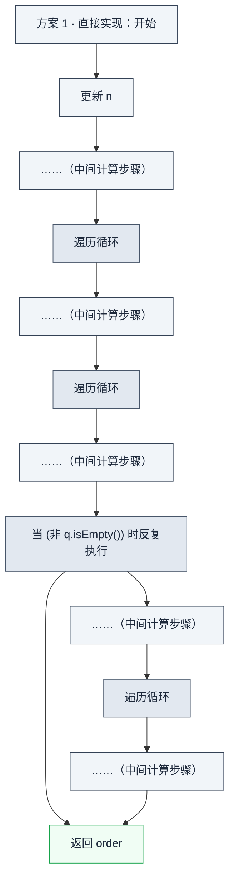

```java
package com.webfault.dsa; // 引入依赖

import java.util.*; // 引入依赖

class lc113548046_solution11 { // 定义类型
  int[] parent; // int[] parent;

  List<Integer> bfs(int[][] graph, int start) { // 定义函数/方法 bfs
    int n = graph.length; // 把 graph.长度 存入 元素个数
    String[] status = new String[n]; // 把 new String[元素个数]; 写入 String[] status
    for (int i = 0; i < n; i++) status[i] = "UNDISCOVERED"; // 让 下标 i 从 0 开始计数，下标 i 小于 元素个数 就继续
    parent = new int[n]; // 把 new int[元素个数]; 写入 parent
    for (int i = 0; i < n; i++) parent[i] = -1; // 让 下标 i 从 0 开始计数，下标 i 小于 元素个数 就继续
    List<Integer> order =
        new ArrayList<Integer>(); // 把 new ArrayList 小于 Integer 超过 (); 写入 List<Integer> order
    ArrayDeque<Integer> q =
        new ArrayDeque<Integer>(); // 把 new ArrayDeque 小于 Integer 超过 (); 写入 ArrayDeque<Integer> q
    q.add(start); // 节点 追加 起点);
    status[start] = "DISCOVERED"; // 把 「DISCOVERED」; 写入 status[start]
    while (!q.isEmpty()) { // 循环，直到不满足「取反 节点.isEmpty(」
      int v = q.poll(); // 把 节点.poll() 存入 值
      order.add(v); // order 追加 值);
      for (int u : graph[v]) { // for (int 节点 u : graph[值]) {
        if (status[u].equals("UNDISCOVERED")) { // 若 status[节点 u].equals(「UNDISCOVERED」
          status[u] = "DISCOVERED"; // 把 「DISCOVERED」; 写入 status[u]
          parent[u] = v; // 把 值; 写入 parent[u]
          q.add(u); // 节点 追加 节点 u);
        }
      }
      status[v] = "VISITED"; // 把 「VISITED」; 写入 status[v]
    }
    return order; // 返回 order
  }

  public static void main(String[] args) { // public static void main(String[] args) {
    lc113548046_solution11 s =
        new lc113548046_solution11(); // 把 new lc113548046_solution11(); 写入 lc113548046_solution11 s
    int[][] graph = {{1, 2}, {0, 3, 4}, {0, 5}, {1}, {1}, {2}};
    List<Integer> order = s.bfs(graph, 0); // 把 字符串.bfs(graph, 0); 写入 List<Integer> order
    boolean ok = true; // 把 true; 写入 boolean ok
    List<Integer> want =
        Arrays.asList(0, 1, 2, 3, 4, 5); // 把 Arrays.asList(0, 1, 2, 3, 4, 5); 写入 List<Integer> want
    if (!order.equals(want)) {
      ok = false;
      System.out.println("FAIL order " + order);
    }
    int[] wantP = {-1, 0, 0, 1, 1, 2}; // 把 { 减 1, 0, 0, 1, 1, 2}; 写入 int[] wantP
    for (int i = 0; i < wantP.length; i++) { // 让 下标 i 从 0 开始计数，下标 i 小于 wantP.长度 就继续
      if (s.parent[i] != wantP[i]) {
        ok = false;
        System.out.println("FAIL parent " + i);
      }
    }
    if (!ok) throw new RuntimeException("FAILED"); // 若 取反 ok) throw new RuntimeException(「FAILED」);
    System.out.println("PASS"); // 全部用例通过，输出 PASS
  }
}
```

### Rust 实现（1 种方案）

Rust 的全部方案如下，每个方案都内嵌用例自测，可独立运行（老仓库 python/go 文件遵循「打印结果」约定）：

#### 方案 1：直接实现

**思路与代码分析**：核心是「直接实现」。Rust 版用所有权移动与切片借用改写同一逻辑，注意 Option 与引用边界。**走读**：方案 1 · 直接实现：开始 → 计算 n → 计算 visited → 计算 order → 计算 queue → 更新 visited[start] → 调用 queue.push_back(start) → 当 let Some(c) = queue.pop_front() 时反复执行 → 向 order 追加记录 → 遍历 &graph[c] 中的每个元素 nx → 处理 if 非 visited[nx as usize] → 更新 usize] → 调用 queue.push_back(nx as usize) → 处理 order → 返回结果。

**运行架构**（真实控制流）：

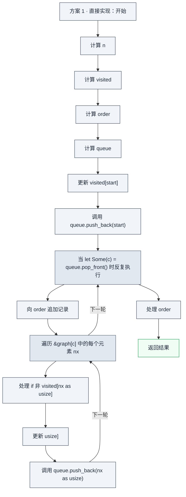

```rust
// 图搜索之BFS详解 — Rust 版（方案1）
fn bfs_order(graph: &[Vec<i32>], start: usize) -> Vec<i32> {
    // 定义函数/方法 bfs_order
    let n = graph.len(); // 把 graph.长度() 存入 元素个数
    let mut visited = vec![false; n]; // 把 vec取反 [false; 元素个数]; 写入 let mut visited
    let mut order = Vec::new(); // 把 Vec::new(); 写入 let mut order
    let mut queue = std::collections::VecDeque::new(); // 把 std::collections::VecDeque::new(); 写入 let mut queue
    visited[start] = true; // 把 true; 写入 visited[start]
    queue.push_back(start); // 队列 追加 起点);
    while let Some(c) = queue.pop_front() {
        // 边取边处理，取空即停
        order.push(c as i32); // 把 字符 as i32 压入栈/数组尾部
        for &nx in &graph[c] {
            // for 按位与 nx in 按位与 graph[字符] {
            if !visited[nx as usize] {
                // 若 取反 已访问集合[nx as usize]
                visited[nx as usize] = true; // 把 true; 写入 visited[nx as usize]
                queue.push_back(nx as usize); // 队列 追加 nx as usize);
            }
        }
    }
    order // order
}
fn main() {
    // 程序入口：跑内嵌自测用例
    // 6节点图: 0-1,0-2,1-3,1-4,2-5
    let g = vec![vec![1, 2], vec![3, 4], vec![5], vec![], vec![], vec![]];
    assert_eq!(bfs_order(&g, 0), vec![0, 1, 2, 3, 4, 5]); // 断言校验
    println!("PASS");
} // 全部用例通过，输出 PASS
```

### Lua 实现（1 种方案）

Lua 的全部方案如下，每个方案都内嵌用例自测，可独立运行（老仓库 python/go 文件遵循「打印结果」约定）：

#### 方案 1：直接实现

**思路与代码分析**：核心是「直接实现」。Lua 版用表与 ipairs 遍历，注意 ipairs 遇 nil 即停的语义。**走读**：方案 1 · 直接实现：开始 → 更新 n → 更新 visited → 更新 order → 更新 queue → 更新 head → 更新 1] → 当 head ≤ #queue do 时反复执行 → 更新 c → 更新 head → 更新 1] → 遍历 ipairs(graph[c + 1] or 中的每个元素 nx → 处理 if not visited[nx + 1] then → 更新 1] → 更新 1] → 返回 order。

**运行架构**（真实控制流）：

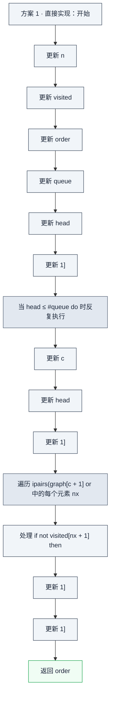

```lua
-- 图搜索之BFS详解 — Lua 版（方案1）
local function bfs_order(graph, start) -- local function bfs_order(graph, 起点)
	local n = #graph -- 把 #graph 写入 local n
	local visited = {} -- 把 {} 写入 local visited
	local order = {} -- 把 {} 写入 local order
	local queue = { start } -- 把 {起点} 写入 local queue
	local head = 1 -- 把 1 写入 local head
	visited[start + 1] = true -- 把 true 写入 visited[start + 1]
	while head <= #queue do -- 把 #队列 do 写入 while head <
		local c = queue[head] -- 把 队列[头节点] 写入 local c
		head = head + 1 -- 把 头节点 加 1 存入 头节点
		order[#order + 1] = c -- 把 字符 写入 order[#order + 1]
		for _, nx in ipairs(graph[c + 1] or {}) do -- 遍历取 nx
			if not visited[nx + 1] then -- 若 not 已访问集合[nx 加 1] then
				visited[nx + 1] = true -- 把 true 写入 visited[nx + 1]
				queue[#queue + 1] = nx -- 把 nx 写入 queue[#queue + 1]
			end -- 终点
		end -- 终点
	end -- 终点
	return order -- 返回 order
end -- 终点
local g = { { 1, 2 }, { 3, 4 }, { 5 }, {}, {}, {} } -- 把 {{1,2},{3,4},{5},{},{},{}} 写入 local g
assert(table.concat(bfs_order(g, 0), ",") == "0,1,2,3,4,5") -- 打印输出
print("PASS") -- 全部用例通过，输出 PASS
```

### C 实现（1 种方案）

C 的全部方案如下，每个方案都内嵌用例自测，可独立运行（老仓库 python/go 文件遵循「打印结果」约定）：

#### 方案 1：直接实现

**思路与代码分析**：核心是「直接实现」。C 版手动管理下标与内存，循环边界全部显式写出。代码里依次做这些事：单循环线性扫描。**走读**：方案 1 · 直接实现：开始 → 更新 visited[64] → 处理 int queue[64] → 更新 head → 更新 visited[start] → 更新 queue[tail++] → 当 (head ＜ tail) 时反复执行 → 更新 c → 更新 out[on++] → 遍历循环 → 更新 nx → 若 非 visited[nx] 则： → 更新 visited[nx] → 更新 queue[tail++] → 返回结果。

**运行架构**（真实控制流）：

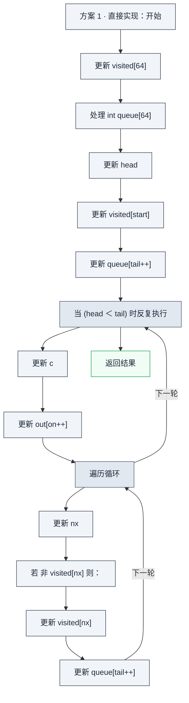

```c
/* 图搜索之BFS详解 — C 版（方案1） */
#include <stdio.h> // 引入头文件
static void bfs_order(const int graph[][8], const int gsize[], int n, int start,
                      int out[]) {  // 定义函数/方法 bfs_order
    int visited[64] = {0};          // 把 {0}; 写入 int visited[64]
    int queue[64];                  // int 队列[64];
    int head = 0, tail = 0, on = 0; // 把 0, 尾节点 赋值为 0, on 赋值为 0 存入 头节点
    visited[start] = 1;             // 把 1; 写入 visited[start]
    queue[tail++] = start;          // 把 起点; 写入 queue[tail++]
    while (head < tail) {           // 循环，直到不满足「头节点 小于 尾节点」
        int c = queue[head++];      // 把 队列[头节点 加一 ] 存入 字符
        out[on++] = c;              // 把 字符; 写入 out[on++]
        for (int i = 0; i < gsize[c]; i++) { // 让 下标 i 从 0 开始计数，下标 i 小于 gsize[字符] 就继续
            int nx = graph[c][i];            // 把 graph[字符][下标 i] 存入 nx
            if (!visited[nx]) {              // 若 取反 已访问集合[nx]
                visited[nx] = 1;             // 把 1; 写入 visited[nx]
                queue[tail++] = nx; // 把 nx; 写入 queue[tail++]
            }
        }
    }
}
int main(void) { // 程序入口：跑内嵌自测用例
    int graph[6][8] = {{1, 2}, {3, 4}, {5},
                       {},     {},     {}}; // 把 {{1,2},{3,4},{5},{},{},{}}; 写入 int graph[6][8]
    int gsize[6] = {2, 2, 1, 0, 0, 0};      // 把 {2,2,1,0,0,0}; 写入 int gsize[6]
    int out[64];                            // int out[64];
    bfs_order(graph, gsize, 6, 0, out);     // bfs_order(graph, gsize, 6, 0, out);
    for (int i = 0; i < 6; i++)
        if (out[i] != i) {
            printf("FAIL\n");
            return 1;
        } // 让 下标 i 从 0 开始计数，下标 i 小于 6 就继续
    printf("PASS\n");
    return 0;
} // 全部用例通过，输出 PASS
```

### C++ 实现（1 种方案）

C++ 的全部方案如下，每个方案都内嵌用例自测，可独立运行（老仓库 python/go 文件遵循「打印结果」约定）：

#### 方案 1：直接实现

**思路与代码分析**：核心是「直接实现」。C++ 版用 STL 容器与迭代器，减少手写下标错误。代码里依次做这些事：单循环线性扫描；栈的后进先出操作。**走读**：方案 1 · 直接实现：开始 → 更新 n → 处理 std::vector＜bool＞ visited(n, → 处理 std::vector＜int＞ order → 处理 std::queue＜int＞ q → 更新 visited[start] → 向 q 追加记录 → 当 (非 q.empty()) 时反复执行 → 更新 c → 从 q 弹出 → 调用 order.push_back(c) → 遍历循环 → 若 非 visited[nx] 则： → 更新 visited[nx] → 向 q 追加记录 → 返回 order。

**运行架构**（真实控制流）：

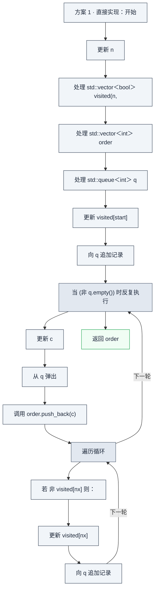

```cpp
// 图搜索之BFS详解 — C++ 版（方案1）
#include <cassert>  // 引入头文件
#include <iostream> // 引入头文件
#include <queue>    // 引入头文件
#include <vector>   // 引入头文件
static std::vector<int> bfsOrder(const std::vector<std::vector<int>> &graph, int start) {
    size_t n = graph.size();             // 把 graph.大小(); 写入 size_t n
    std::vector<bool> visited(n, false); // std::vector 小于 bool 超过 已访问集合(元素个数, false);
    std::vector<int> order;              // std::vector 小于 int 超过 order;
    std::queue<int> q;                   // std::队列 小于 int 超过 节点;
    visited[start] = true;               // 把 true; 写入 visited[start]
    q.push(start);                       // 把 起点 压入栈/数组尾部
    while (!q.empty()) {                 // 循环，直到不满足「取反 节点.empty(」
        int c = q.front();               // 把 节点.front() 存入 字符
        q.pop();                         // 弹出栈顶元素
        order.push_back(c);              // order 追加 字符);
        for (int nx : graph[c]) {        // for (int nx : graph[字符]) {
            if (!visited[nx]) {          // 若 取反 已访问集合[nx]
                visited[nx] = true;      // 把 true; 写入 visited[nx]
                q.push(nx);              // 把 nx 压入栈/数组尾部
            }
        }
    }
    return order; // 返回 order
}
int main() { // 程序入口：跑内嵌自测用例
    std::vector<std::vector<int>> g = {{1, 2}, {3, 4}, {5}, {}, {}, {}};
    assert((bfsOrder(g, 0) == std::vector<int>{0, 1, 2, 3, 4, 5})); // 断言校验
    std::cout << "PASS" << std::endl;
} // 全部用例通过，输出 PASS
```

### R 实现（1 种方案）

R 的全部方案如下，每个方案都内嵌用例自测，可独立运行（老仓库 python/go 文件遵循「打印结果」约定）：

#### 方案 1：直接实现

**思路与代码分析**：核心是「直接实现」。R 版用向量化思维与 1 起始下标，注意 1:n 的降序陷阱。代码里依次做这些事：单循环线性扫描。**走读**：方案 1 · 直接实现：开始 → 处理 n ＜- length(graph) → 当 (head ≤ length(queue)) 时反复执行 → 循环 nx：遍历 nb → 返回结果。

**运行架构**（真实控制流）：

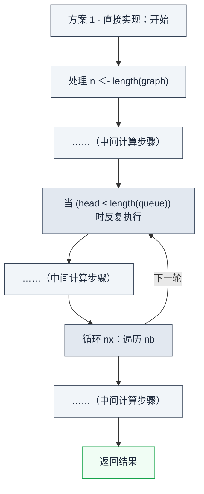

```r
# 定义函数 bfs_order（参数：graph, 起点）
bfs_order <- function(graph, start) {
    n <- length(graph)  # 把 长度(graph) 存入 元素个数
    visited <- rep(FALSE, 100L)  # 预分配足够大
    order_ <- integer(0)  # 把 integer(0) 存入 order_
    queue <- start + 1L  # 把 起点 加 1L 存入 队列
    head <- 1L  # 把 1L 存入 头节点
    visited[start + 1L] <- TRUE  # 已访问集合[起点 加 1L] 小于 减 TRUE
    while (head <= length(queue)) {
        # 循环，直到不满足「头节点 不超过 长度(队列」
        c <- queue[head]  # 把 队列[头节点] 存入 字符
        head <- head + 1L  # 把 头节点 加 1L 存入 头节点
        order_ <- c(order_, c - 1L)  # 把 字符(order_, 字符 减 1L) 存入 order_
        nb <- if (c <= length(graph) && !is.null(graph[[c]]))
            graph[[c]] else integer(0)
        if (length(nb) > 0) {
            # 若 长度(nb) 超过 0 for (nx in nb) { 若 取反 已访问集合[nx]
            for (nx in nb) {
                if (!visited[nx]) {
                  visited[nx] <- TRUE  # 把 TRUE 存入 visited[nx]
                  queue <- c(queue, nx)  # 把 字符(队列, nx) 存入 队列
                }
            }
        }
    }
    order_  # order_
}
g <- list(c(2, 3), c(4, 5), c(6), NULL, NULL, NULL)  # 把 列表(字符(2, 3), 字符(4, 5), 字符(6), NULL, NULL, NULL) 存入 g
stopifnot(identical(as.integer(bfs_order(g, 0)), 0:5))  # 断言校验
cat("PASS\n")  # 全部用例通过，输出 PASS
```

### Zig 实现（1 种方案）

Zig 的全部方案如下，每个方案都内嵌用例自测，可独立运行（老仓库 python/go 文件遵循「打印结果」约定）：

#### 方案 1：直接实现

**思路与代码分析**：核心是「直接实现」。Zig 版显式分配与清零，整型边界处理严格。代码里依次做这些事：双重循环遍历。**走读**：方案 1 · 直接实现：开始 → 计算 n → 遍历集合元素 → 当 (head ＜ tail) 时反复执行 → 遍历集合元素 → 返回结果。

**运行架构**（真实控制流）：

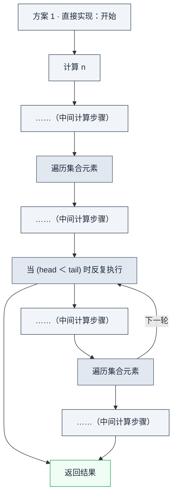

```zig
// 图搜索之BFS详解 — Zig 版（方案1）
const std = @import("std"); // 把 @import(「std」) 存入 std
fn bfsOrder(graph: []const []const i32, start: usize, out: *std.ArrayList(i32)) void { // 定义函数/方法 bfsOrder
    const n = graph.len; // 把 graph.长度 存入 元素个数
    var visited: [64]bool = undefined; // 把 undefined; 写入 var visited: [64]bool
    for (0..n) |i| visited[i] = false; // 让 下标 i 从 0 走到 元素个数 减一
    var queue: [64]usize = undefined; // 把 undefined; 写入 var queue: [64]usize
    var head: usize = 0; // 把 0; 写入 var head: usize
    var tail: usize = 0; // 把 0; 写入 var tail: usize
    visited[start] = true; // 把 true; 写入 visited[start]
    queue[tail] = start; // 把 起点; 写入 queue[tail]
    tail += 1; // 尾节点累加 1
    while (head < tail) { // 循环，直到不满足「头节点 小于 尾节点」
        const c = queue[head]; // 把 队列[头节点] 存入 字符
        head += 1; // 头节点累加 1
        out.append(@intCast(c)) catch unreachable; // 把 @intCast(字符 追加到列表尾部
        for (graph[c]) |nx| { // for (graph[字符]) 按位或 nx 按位或 {
            const u: usize = @intCast(nx); // 把 @intCast(nx); 写入 const u: usize
            if (!visited[u]) { // 若 取反 已访问集合[节点 u]
                visited[u] = true; // 把 true; 写入 visited[u]
                queue[tail] = u; // 把 节点 u; 写入 queue[tail]
                tail += 1; // 尾节点累加 1
            }
        }
    }
}
pub fn main() !void { // 程序入口：跑内嵌自测用例
    var out = std.ArrayList(i32).init(std.heap.page_allocator); // 把 std.ArrayList(i32).init(std.堆.page_allocator) 存入 out
    defer out.deinit(); // defer out.deinit();
    const g0 = [_]i32{ 1, 2 }; // 把 [_]i32{ 1, 2 } 存入 g0
    const g1 = [_]i32{ 3, 4 }; // 把 [_]i32{ 3, 4 } 存入 g1
    const g2 = [_]i32{5}; // 把 [_]i32{5} 存入 g2
    const g3 = [_]i32{}; // 把 [_]i32{} 存入 g3
    const g4 = [_]i32{}; // 把 [_]i32{} 存入 g4
    const g5 = [_]i32{}; // 把 [_]i32{} 存入 g5
    const g = [_][]const i32{ &g0, &g1, &g2, &g3, &g4, &g5 };
    bfsOrder(&g, 0, &out); // bfsOrder( 按位与 g, 0, 按位与 out);
    for (out.items, 0..) |v, i| if (v != @as(i32, @intCast(i))) return error.TestFailed;
    std.debug.print("PASS\n", .{});
} // 全部用例通过，输出 PASS
```

### Dart 实现（1 种方案）

Dart 的全部方案如下，每个方案都内嵌用例自测，可独立运行（老仓库 python/go 文件遵循「打印结果」约定）：

#### 方案 1：直接实现

**思路与代码分析**：核心是「直接实现」。Dart 版用可空类型标注与集合方法，注意空安全。代码里依次做这些事：单循环线性扫描。**走读**：方案 1 · 直接实现：开始 → 更新 n → 当 (head ＜ queue.length) 时反复执行 → 遍历循环 → 返回 order。

**运行架构**（真实控制流）：

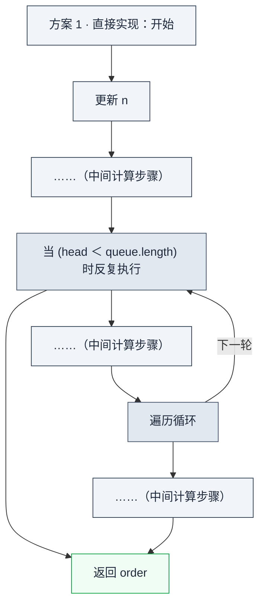

```dart
// 图搜索之BFS详解 — Dart 版（方案1）
List<int> bfsOrder(List<List<int>> graph, int start) {
  // 定义函数/方法 bfsOrder
  final n = graph.length; // 把 graph.长度 存入 元素个数
  final visited = List<bool>.filled(
    n,
    false,
  ); // 把 List 小于 bool 超过 .filled(元素个数, false) 存入 已访问集合
  final order = <int>[]; // 把 小于 int 超过 [] 存入 order
  final queue = <int>[start]; // 把 小于 int 超过 [起点] 存入 队列
  var head = 0; // 把 0 存入 头节点
  visited[start] = true; // 把 true; 写入 visited[start]
  while (head < queue.length) {
    // 循环，直到不满足「头节点 小于 队列.长度」
    final c = queue[head++]; // 把 队列[头节点 加一 ] 存入 字符
    order.add(c); // order 追加 字符);
    for (final nx in graph[c]) {
      // for (final nx in graph[字符]) {
      if (!visited[nx]) {
        // 若 取反 已访问集合[nx]
        visited[nx] = true; // 把 true; 写入 visited[nx]
        queue.add(nx); // 队列 追加 nx);
      }
    }
  }
  return order; // 返回 order
}

void main() {
  // 程序入口：跑内嵌自测用例
  final g = <List<int>>[
    <int>[1, 2],
    <int>[3, 4],
    <int>[5],
    <int>[],
    <int>[],
    <int>[], // 小于 int 超过 []
  ];
  if (bfsOrder(g, 0).toString() != '[0, 1, 2, 3, 4, 5]') throw StateError('c1');
  print('PASS');
} // 全部用例通过，输出 PASS
```

---

## 内容总结

- **图搜索之bfs详解**（算法笔记 · Medium）：共 1 个方案，主线思路「直接实现」；时间 O(n) 量级；动画演示归并分治过程，附录给出 11 种语言 × 全部方案的可运行实现。
- 来源博客：[https://blog.csdn.net/tyro_java/article/details/113548046](https://blog.csdn.net/tyro_java/article/details/113548046)
- 导航：[📋 总目录](../) ｜ [← 217 计算思维之经典农夫过河问题c++](../217_计算思维之经典农夫过河问题c++实现/) ｜ [219 图搜索之dfs详解 →](../219_图搜索之dfs详解/)
