# 219 · 图搜索之dfs详解（第附阶段 · 专题补充 · Medium）

> **难度**：⭐⭐ Medium ｜ **专题**：算法笔记
> **学习定位**：第附阶段 · 专题补充第 219 篇 ｜ **解法数**：2
> **内容总结**：**图搜索之dfs详解**（算法笔记 · Medium）：共 2 个方案，主线思路「方案1（递归 DFS，记录发现/结束时间与边分类）」；时间 O(n)（单趟线性扫描）；动画演示归并分治过程，附录给出 11 种语言 × 全部方案的可运行实现。

---

## 题目描述

图搜索之dfs详解。具体输入输出约定见函数签名与用例。

**用例演示**（摘自主解法内嵌自测，输入到输出一目了然）：

```typescript
  const cases: { start: number; wantD: number[]; wantP: number[] }[] = [
    { start: 0, wantD: [1, 2, 3, 0, 0, 6, 7], wantP: [-1, 0, 1, -1, -1, 0, 5] },
  ];
```

**数据范围与注意事项**：

- **易错点**：先看小例子手推一遍再对照代码，比直接读代码快得多。

## 题目分析

**场景是什么**：综合练习：把数据结构与策略组合起来解决一个完整问题。本题就是该场景的 Medium 级练习，主线做法是「方案1（递归 DFS，记录发现/结束时间与边分类）」。

**主线怎么解**：把主解法从头到尾过一遍，它其实在依次做这几件事：单循环线性扫描。

## 解题思路

**方案对比**（共 2 个方案，由浅入深）：

| 方案 | 时间复杂度 | 空间复杂度 |
|---|---|---|
| 方案 1 · 方案1（递归 DFS，记录发现/结束时间与边分类） | O(n)（单趟线性扫描） | O(1) 到 O(n)（视辅助结构） |
| 方案 2 · 迭代指针处理 | O(n)（单趟线性扫描） | O(1) 到 O(n)（视辅助结构） |

**由浅入深的路径**：方案1（递归 DFS，记录发现/结束时间与边分类） → 迭代指针处理；每往右一步，都在补上一步的短板。

**方案间的取舍**：方案 1（方案1（递归 DFS，记录发现/结束时间与边分类））；方案 2（迭代指针处理）。数据规模小、可读性优先时选靠前的方案；规模大、性能优先时选靠后的方案。

**怎么读这一篇**：

- 🐣 **新手路线**：把「题目描述」的示例 1 在纸上手推一遍 → 读方案 1（最直观的写法）与它的代码走读 → 按「运行方式」本地跑通看 PASS → 回头对比方案 2 之后的写法差在哪
- 🦅 **大佬路线**：直接锁定最优方案 1（方案1（递归 DFS，记录发现/结束时间与边分类），O(n)（单趟线性扫描））→ 跳读该方案代码与走读 → 用「逐步拆解与面试追问」补齐复杂度推导与边界追问

### 动态算法图（归并分治，GIF 自动循环）


动画演示算法笔记专题里归并分治的典型过程；每个方案在「TypeScript 解题方案」一节还配了专属动画与专属流程图。

### 主解法流程图（真实控制流）

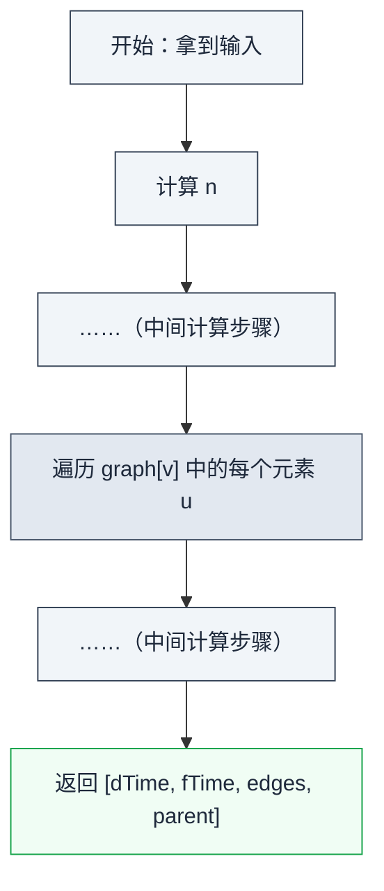

## TypeScript 解题方案（2 个方案逐个讲）

> **运行与提交**：每个方案都是自包含文件（内嵌用例自测，输出 PASS），整块复制到 `.ts` 文件后 `node 文件名` 即可运行。提交 LeetCode 时，把 `demo` 内的算法函数与辅助类型/函数整体取出、置于文件顶层即可。概念演示（非 LeetCode 编号题），在本地运行即可。

### 方案 1：方案1（递归 DFS，记录发现/结束时间与边分类）

**分析与思路**：核心做法是「方案1（递归 DFS，记录发现/结束时间与边分类）」。代码里依次做这些事：单循环线性扫描。

**运行方式**：`node 本文件`，内嵌用例全部通过会输出 PASS。


**方案专属流程图**（真实控制流）：

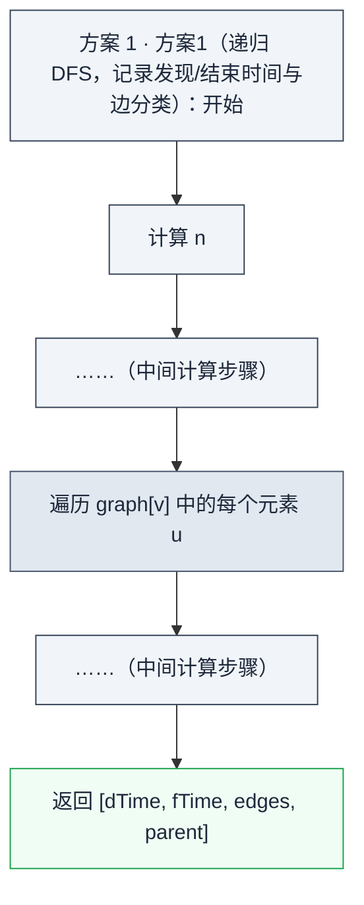

```typescript
/**
 ** 笔记：图搜索之 DFS 详解
 ** 方案：方案1（递归 DFS，记录发现/结束时间与边分类）
 ** 来源：python 参考忠实移植
 */

function dfs(
  graph: number[][],
  start: number,
): [number[], number[], Record<string, string>, number[]] {
  // 定义函数/方法 dfs
  const n = graph.length; // 把 graph.长度 存入 元素个数
  const status: string[] = new Array(n).fill('UNDISCOVERED');
  const dTime: number[] = new Array(n).fill(0); // 把 new Array(元素个数).fill(0); 写入 const dTime: number[]
  const fTime: number[] = new Array(n).fill(0); // 把 new Array(元素个数).fill(0); 写入 const fTime: number[]
  const parent: number[] = new Array(n).fill(-1); // 把 new Array(元素个数).fill( 减 1); 写入 const parent: number[]
  const edges: Record<string, string> = {}; // 把 {}; 写入 const edges: Record<string, string>
  let clock = 0; // 把 0 存入 clock
  const visit = (v: number): void => {
    clock++; // clock 加一
    dTime[v] = clock; // 把 clock; 写入 dTime[v]
    status[v] = 'DISCOVERED'; // 把 「DISCOVERED」; 写入 status[v]
    for (const u of graph[v]) {
      // for (const 节点 u of graph[值]) {
      if (status[u] === 'UNDISCOVERED') {
        // 若 status[节点 u] 全等于 「UNDISCOVERED」
        edges[`${v}, ${u}`] = 'TREE';
        parent[u] = v; // 把 值; 写入 parent[u]
        visit(u); // visit(节点 u);
      } else if (status[u] === 'DISCOVERED') {
        // 否则，若 status[节点 u] 全等于 「DISCOVERED」
        edges[`${v}, ${u}`] = 'BACKWARD';
      } else {
        // 否则
        edges[`${v}, ${u}`] = dTime[v] < dTime[u] ? 'FORWARD' : 'CROSS';
      }
    }
    clock++; // clock 加一
    fTime[v] = clock; // 把 clock; 写入 fTime[v]
    status[v] = 'VISITED'; // 把 「VISITED」; 写入 status[v]
  };
  visit(start); // visit(起点);
  return [dTime, fTime, edges, parent]; // 返回 [dTime, fTime, 边集, parent]
}

export function demo(): void {
  // 程序入口：跑内嵌自测用例
  function eqArr(a: number[], b: number[]): boolean {
    // 定义函数/方法 eqArr
    if (a.length !== b.length) return false; // 若 数组.长度 不等于 b.长度，直接返回 false
    for (let i = 0; i < a.length; i++) if (a[i] !== b[i]) return false; // 让 下标 i 从 0 开始计数，下标 i 小于 数组.长度 就继续
    return true; // 返回 true
  }
  const graph: number[][] = [[1, 5], [2], [], [4], [5, 6], [1, 6], []];
  const cases: { start: number; wantD: number[]; wantP: number[] }[] = [
    { start: 0, wantD: [1, 2, 3, 0, 0, 6, 7], wantP: [-1, 0, 1, -1, -1, 0, 5] },
  ];
  let fail = false; // 把 false 存入 fail
  for (const c of cases) {
    // for (const 字符 of cases) {
    const [gotD, , , gotP] = dfs(graph, c.start); // 把 dfs(graph, 字符.起点); 写入 const [gotD, , , gotP]
    if (!eqArr(gotD, c.wantD) || !eqArr(gotP, c.wantP)) {
      // 若 取反 eqArr(gotD, 字符.wantD) 或 取反 eqArr(gotP, 字符.wantP
      fail = true; // 把 true 存入 fail
      console.log(
        'FAIL start',
        c.start,
        'want',
        JSON.stringify(c.wantD),
        JSON.stringify(c.wantP),
        'got',
        JSON.stringify(gotD),
        JSON.stringify(gotP),
      ); // 「got」, JSON.stringify(gotD), JSON.stringify(gotP));
    }
  }
  if (fail) throw new Error('FAILED'); // 若 fail) throw new Error(「FAILED」);
  console.log('PASS'); // 全部用例通过，输出 PASS
}
demo(); // demo();
```

### 方案 2：迭代指针处理

**分析与思路**：核心做法是「迭代指针处理」。代码里依次做这些事：队列或堆的调度。

**运行方式**：`node 本文件`，内嵌用例全部通过会输出 PASS。


**方案专属流程图**（真实控制流）：

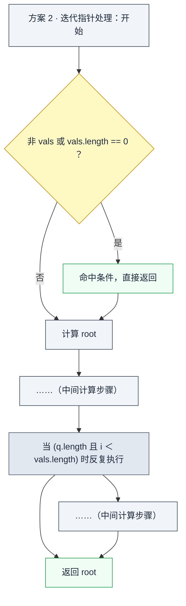

```typescript
class TreeNode {
  // 定义类型
  val: any;
  left: any;
  right: any; // 值: any; 左边界: any; 右边界: any;
  constructor(val?: any, left?: any, right?: any) {
    // constructor(值?: any, 左边界?: any, 右边界?: any) {
    this.val = val === undefined ? 0 : val; // 把 (值 全等于 undefined ? 0 : 值); 写入 值
    this.left = left === undefined ? null : left; // 把 (左边界 全等于 undefined ? null : 左边界); 写入 左边界
    this.right = right === undefined ? null : right; // 把 (右边界 全等于 undefined ? null : 右边界); 写入 右边界
  }
}
function buildTree(vals: any): any {
  // 定义函数/方法 buildTree
  if (!vals || vals.length === 0) return null; // 若 取反 vals 或 vals.长度 全等于 0，直接返回 null
  const root = new TreeNode(vals[0]);
  const q: any[] = [root];
  let i = 1;
  while (q.length && i < vals.length) {
    // 循环，直到不满足「节点.长度 且 下标 i 小于 vals.长度」
    const node = q.shift(); // 把 节点.shift() 存入 节点
    if (vals[i] !== null && vals[i] !== undefined) {
      node.left = new TreeNode(vals[i]);
      q.push(node.left);
    }
    i++; // 下标 i 加一
    if (i < vals.length && vals[i] !== null && vals[i] !== undefined) {
      node.right = new TreeNode(vals[i]);
      q.push(node.right);
    }
    i++; // 下标 i 加一
  }
  return root; // 返回 根节点
}
function treeToLevel(root: any): any[] {
  // 定义函数/方法 treeToLevel
  if (!root) return []; // 若 取反 根节点，直接返回 []
  const out: any[] = [];
  const q: any[] = [root]; // 把 []; const 节点: any[] 赋值为 [根节点]; 写入 const out: any[]
  while (q.length) {
    // 循环，直到不满足「节点.长度」
    const n = q.shift(); // 把 节点.shift() 存入 元素个数
    if (n === null || n === undefined) {
      out.push(null);
      continue;
    }
    out.push(n.val);
    q.push(n.left);
    q.push(n.right); // 把 元素个数.值 压入栈/数组尾部
  }
  while (out.length && out[out.length - 1] === null) out.pop(); // 循环，直到不满足「out.长度 且 out[out.长度 减 1] 全等于 null) out 弹出 );」
  return out; // 返回 out
}
class ListNode {
  // 定义类型
  val: any;
  next: any; // 值: any; 下一个: any;
  constructor(val?: any, next?: any) {
    this.val = val === undefined ? 0 : val;
    this.next = next === undefined ? null : next;
  }
}
function buildList(vals: any): any {
  // 定义函数/方法 buildList
  const dummy = new ListNode(0);
  let cur = dummy; // 把 new ListNode(0); let 当前值 赋值为 哨兵节点 存入 哨兵节点
  for (const v of vals) {
    cur.next = new ListNode(v);
    cur = cur.next;
  } // 把 new ListNode(值); 当前值 赋值为 当前值.下一个; } 写入 下一个
  return dummy.next; // 返回 哨兵节点.下一个
}
function listToArray(head: any): any[] {
  // 定义函数/方法 listToArray
  const out: any[] = [];
  let p = head; // 把 []; let 节点 赋值为 头节点; 写入 const out: any[]
  while (p) {
    out.push(p.val);
    p = p.next;
  } // 循环，直到不满足「节点) { out 追加 节点.值); 节点 赋值为 节点.下一个; }」
  return out; // 返回 out
}
// python-runtime shims
function pyLen(a: any): number {
  // 定义函数/方法 pyLen
  if (a === null || a === undefined) return 0; // 若 数组 全等于 null 或 数组 全等于 undefined，直接返回 0
  if (
    typeof a === 'string' ||
    Array.isArray(a) ||
    a instanceof Set ||
    a instanceof Map
  )
    return a.length ?? a.size;
  if (typeof a === 'object') return Object.keys(a).length; // 若 typeof 数组 全等于 'object'，直接返回 Object.keys(数组).长度
  return 0; // 返回 0
}
function pySlice(a: any, i: any, j: any, step?: any): any {
  // 定义函数/方法 pySlice
  if (typeof a === 'string') {
    const r = [...a].slice(i ?? 0, j ?? a.length);
    return step ? r.reverse().join('') : r.join('');
  }
  const arr = Array.isArray(a) ? a : [...a]; // 把 Array.isArray(数组) ? 数组 : 复制的 数组 存入 数组
  return arr.slice(i ?? 0, j ?? arr.length); // 返回 数组 截取 下标 i ?? 0, 下标 j ?? 数组.长度)
}
function pyRange(a: any, b?: any, step?: any): any[] {
  // 定义函数/方法 pyRange
  let s = 0,
    e = a,
    st = 1; // 把 0, e 赋值为 数组, st 赋值为 1 存入 字符串
  if (b !== undefined) {
    s = a;
    e = b;
  } // 若 b 不等于 undefined) { 字符串 赋值为 数组; e 赋值为 b; }
  if (step !== undefined) st = step; // 若 步数 不等于 undefined) st 赋值为 步数;
  const out: any[] = []; // 把 []; 写入 const out: any[]
  if (st > 0) for (let i = s; i < e; i += st) out.push(i);
  else for (let i = s; i > e; i += st) out.push(i); // 否则
  return out; // 返回 out
}
function pyIn(x: any, coll: any): boolean {
  // 定义函数/方法 pyIn
  if (coll === null || coll === undefined) return false; // 若 coll 全等于 null 或 coll 全等于 undefined，直接返回 false
  if (Array.isArray(coll)) return coll.includes(x); // 若 Array.isArray(coll)，直接返回 coll 是否包含 x)
  if (coll instanceof Set || coll instanceof Map) return coll.has(x); // 若 coll instanceof Set 或 coll instanceof Map，直接返回 coll.has(x)
  if (typeof coll === 'object') return x in coll; // 若 typeof coll 全等于 'object'，直接返回 x in coll
  if (typeof coll === 'string') return coll.indexOf(x) >= 0; // 若 typeof coll 全等于 'string'，直接返回 coll 查找 x) 不低于 0
  return false; // 返回 false
}
function pySorted(a: any): any[] {
  // 定义函数/方法 pySorted
  const arr = typeof a === 'string' ? [...a] : [...a]; // 把 (typeof 数组 全等于 'string') ? 复制的 数组 : 复制的 数组 存入 数组
  return arr.sort((x: any, y: any) => (x < y ? -1 : x > y ? 1 : 0));
}
function pyMin(a: any, b?: any): any {
  if (b !== undefined) return Math.min(a, b);
  if (Array.isArray(a) || a instanceof Set) return Math.min(...a);
  return Math.min(a);
} // 定义函数/方法 pyMin
function pyMax(a: any, b?: any): any {
  if (b !== undefined) return Math.max(a, b);
  if (Array.isArray(a) || a instanceof Set) return Math.max(...a);
  return Math.max(a);
} // 定义函数/方法 pyMax
function pySum(a: any): number {
  let s = 0;
  for (const v of a) s += v;
  return s;
} // 定义函数/方法 pySum
function pyAbs(x: any): number {
  return Math.abs(x);
} // 定义函数/方法 pyAbs
function pyEnumerate(a: any): any[] {
  const out: any[] = [];
  let i = 0;
  for (const v of a) {
    out.push([i, v]);
    i++;
  }
  return out;
} // 定义函数/方法 pyEnumerate
function pyZip(a: any, b: any): any[] {
  const n = Math.min(a.length, b.length);
  const out: any[] = [];
  for (let i = 0; i < n; i++) out.push([a[i], b[i]]);
  return out;
} // 定义函数/方法 pyZip
function pyDictGet(d: any, k: any, def?: any): any {
  return k in d ? d[k] : def === undefined ? null : def;
} // 定义函数/方法 pyDictGet
function pyPrint(...args: any[]): void {
  console.log(
    args
      .map((a) => (typeof a === 'object' && a !== null ? JSON.stringify(a) : a))
      .join(' '),
  );
} // 定义函数/方法 pyPrint
// collections / heapq
function heapPush(h: any[], x: any): void {
  h.push(x);
  let i = h.length - 1;
  while (i > 0) {
    const p = (i - 1) >> 1;
    if (h[p] <= h[i]) break;
    [h[p], h[i]] = [h[i], h[p]];
    i = p;
  }
} // 定义函数/方法 heapPush
function heapPop(h: any[]): any {
  const top = h[0];
  const last = h.pop();
  if (h.length) {
    h[0] = last;
    let i = 0;
    const n = h.length;
    while (true) {
      let l = 2 * i + 1,
        r = 2 * i + 2,
        s = i;
      if (l < n && h[l] < h[s]) s = l;
      if (r < n && h[r] < h[s]) s = r;
      if (s === i) break;
      [h[s], h[i]] = [h[i], h[s]];
      i = s;
    }
  }
  return top;
} // 定义函数/方法 heapPop
class Deque {
  private a: any[] = [];
  push(x: any) {
    this.a.push(x);
  }
  pushLeft(x: any) {
    this.a.unshift(x);
  }
  pop() {
    return this.a.pop();
  }
  popLeft() {
    return this.a.shift();
  }
  get length() {
    return this.a.length;
  }
  toArray() {
    return this.a.slice();
  }
} // 定义类型
function Counter(iter: any): any {
  const m: any = {};
  for (const v of iter) m[v] = (m[v] || 0) + 1;
  return m;
} // 定义函数/方法 Counter
function gcd(a: any, b: any): any {
  while (b) {
    [a, b] = [b, a % b];
  }
  return a;
} // 定义函数/方法 gcd
function pyInf(): number {
  return Infinity;
} // 定义函数/方法 pyInf

function norm(x: any): any {
  // 定义函数/方法 norm
  if (x === null || x === undefined) return null; // 若 x 全等于 null 或 x 全等于 undefined，直接返回 null
  if (typeof x === 'object') {
    // 若 typeof x 全等于 'object'
    if (x instanceof Deque) return x.toArray(); // 若 x instanceof Deque，直接返回 x.toArray()
    if (Array.isArray(x)) return x.map(norm); // 若 Array.isArray(x)，直接返回 x.映射表(norm)
    if (
      typeof x.val === 'number' &&
      (typeof x.left !== 'undefined' || typeof x.right !== 'undefined')
    )
      return treeToLevel(x);
    if (typeof x.next !== 'undefined' && typeof x.val === 'number')
      return listToArray(x);
    if (x instanceof Set) return [...x].sort(); // 若 x instanceof Set，直接返回 复制的 x 排序 )
    if (x instanceof Map) return Object.fromEntries(x); // 若 x instanceof Map，直接返回 Object.fromEntries(x)
    const o: any = {};
    for (const k of Object.keys(x)) o[k] = norm(x[k]);
    return o;
  }
  return x; // 返回 x
}
function eq(a: any, b: any): boolean {
  // 定义函数/方法 eq
  const x = norm(a),
    y = norm(b); // 把 norm(数组), y 赋值为 norm(b) 存入 x
  if (x === y) return true; // 若 x 全等于 y，直接返回 true
  if (x === null || y === null) return x === y; // 若 x 全等于 null 或 y 全等于 null，直接返回 x 全等于 y
  if (Array.isArray(x) && Array.isArray(y)) {
    // 若 Array.isArray(x) 且 Array.isArray(y
    if (x.length !== y.length) return false; // 若 x.长度 不等于 y.长度，直接返回 false
    for (let i = 0; i < x.length; i++) if (!eq(x[i], y[i])) return false; // 让 下标 i 从 0 开始计数，下标 i 小于 x.长度 就继续
    return true; // 返回 true
  }
  if (typeof x === 'object' && typeof y === 'object') {
    // 若 typeof x 全等于 'object' 且 typeof y 全等于 'object'
    const kx = Object.keys(x),
      ky = Object.keys(y); // 把 Object.keys(x), ky 赋值为 Object.keys(y) 存入 kx
    if (kx.length !== ky.length) return false; // 若 kx.长度 不等于 ky.长度，直接返回 false
    for (const k of kx) if (!eq(x[k], y[k])) return false;
    return true; // 返回 true
  }
  return x === y; // 返回 x 全等于 y
}

function topoSortDfs(graph) {
  // 定义函数/方法 topoSortDfs
  const n = graph.length; // 把 graph.长度 存入 元素个数
  const status = new Array(n).fill('UNDISCOVERED'); // 把 new Array(元素个数).fill('UNDISCOVERED') 存入 status
  const stack = []; // 把 [] 存入 栈
  function visit(v) {
    // 定义函数/方法 visit
    status[v] = 'DISCOVERED'; // 把 'DISCOVERED'; 写入 status[v]
    for (const u of graph[v]) if (status[u] === 'UNDISCOVERED') visit(u);
    status[v] = 'VISITED'; // 把 'VISITED'; 写入 status[v]
    stack.push(v); // 把 值 压入栈/数组尾部
  }
  for (let i = 0; i < n; i++) if (status[i] === 'UNDISCOVERED') visit(i); // 让 下标 i 从 0 开始计数，下标 i 小于 元素个数 就继续
  return stack.reverse(); // 返回 栈.reverse()
}
export function demo(): void {
  // 程序入口：跑内嵌自测用例
  const graph = [[2], [2], [3], [4], [5], []]; // 把 [[2],[2],[3],[4],[5],[]] 存入 graph
  const cases = [{ got: topoSortDfs(graph), want: [1, 0, 2, 3, 4, 5] }];
  let fail = false; // 把 false 存入 fail
  for (const c of cases)
    if (!eq(c.got, c.want)) {
      fail = true;
      console.log(
        'FAIL',
        JSON.stringify(c.got),
        'want',
        JSON.stringify(c.want),
      );
    } // 打印输出
  if (fail) throw new Error('FAILED'); // 若 fail) throw new Error(「FAILED」);
  console.log('PASS'); // 全部用例通过，输出 PASS
}
demo(); // demo();
```

## 逐步拆解与面试追问

**复杂度**：时间 O(n)（单趟线性扫描），空间 O(1) 到 O(n)（视辅助结构）

**为什么是这个量级**：每个元素被常数次访问，辅助哈希或栈的开销与 n 同阶

**面试官可能会追问**：

- 这个策略能推广到什么场景？
- 与暴力做法差在哪一步？
- 有没有更简单的等价写法？

## 关键 API 速查（TS 主解法实际用到，附官方链接）

| API | 作用 | 使用要点 | 官方文档 |
|---|---|---|---|
| `JSON.stringify()` | 序列化为 JSON 字符串 | 常用于结构化比较（深度相等判定）；undefined/函数/循环引用会被丢弃或抛错 | [官方文档](https://developer.mozilla.org/zh-CN/docs/Web/JavaScript/Reference/Global_Objects/JSON/stringify) |

### 各语言官方文档导航

- **TypeScript / JS**：[MDN 中文参考](https://developer.mozilla.org/zh-CN/)
- **Python**：[Python 官方文档](https://docs.python.org/zh-cn/3/)
- **Go**：[Go 标准库](https://pkg.go.dev/std)
- **Java**：[JDK 17 API](https://docs.oracle.com/en/java/javase/17/docs/api/)
- **Rust**：[Rust 标准库](https://doc.rust-lang.org/std/)
- **Lua**：[Lua 5.4 手册](https://www.lua.org/manual/5.4/)
- **C**：[Cppreference C](https://zh.cppreference.com/w/c)
- **C++**：[Cppreference C++](https://zh.cppreference.com/w/cpp)
- **R**：[R 官方手册](https://stat.ethz.ch/R-manual/)
- **Zig**：[Zig 语言文档](https://ziglang.org/documentation/master/)
- **Dart**：[Dart API](https://api.dart.dev/)

## 附录：其他 10 种语言全部实现（每种语言列举其全部方案）

> TypeScript 的全部方案见「TypeScript 解题方案」一节；下面是其余 10 种语言的对应实现，每种语言的每个方案都带思路分析、代码走读与专属运行架构图。
> 每个方案都内嵌用例自测，可独立运行（老仓库 python/go 文件遵循「打印结果」约定）。
> 完整解法文件见 `dsa/<语言>/notes/lc_113764246_图搜索之dfs详解/`。

### Python 实现（2 种方案）

Python 的全部方案如下，每个方案都内嵌用例自测，可独立运行（老仓库 python/go 文件遵循「打印结果」约定）：

#### 方案 1：方案1（递归 DFS，记录发现/结束时间与边分类）

**思路与代码分析**：核心是「方案1（递归 DFS，记录发现/结束时间与边分类）」。Python 版用切片与字典推导式简化操作，突出可读性。**走读**：方案 1 · 方案1（递归 DFS，记录发现/结束时间与边分类）：开始 → 更新 n → 遍历 graph[v]: 中的每个元素 u → 返回 d_time, f_time, edges, parent。

**运行架构**（真实控制流）：

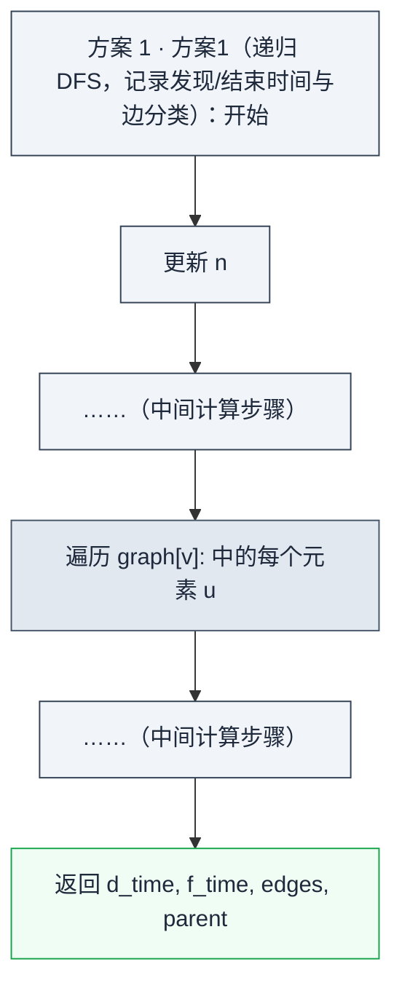

```python
import sys  # 引入依赖

sys.setrecursionlimit(10000)  # sys.setrecursionlimit(10000)

def dfs(graph, start):  # 定义函数 dfs（参数：graph, 起点）
    """深度优先搜索：记录发现/结束时间戳，并对边分类(TREE/BACKWARD/FORWARD/CROSS)。"""
    n = len(graph)  # 把 长度(graph) 存入 元素个数
    status = ["UNDISCOVERED"] * n  # 把 ['UNDISCOVERED'] 乘 元素个数 存入 status
    d_time = [0] * n  # 把 [0] 乘 元素个数 存入 d_time
    f_time = [0] * n  # 把 [0] 乘 元素个数 存入 f_time
    parent = [-1] * n  # 把 [ 减 1] 乘 元素个数 存入 parent
    edges = {}  # 把 {} 存入 边集
    clock = 0  # 把 0 存入 clock

    def visit(v):  # 定义函数 visit（参数：值）
        nonlocal clock  # nonlocal clock
        clock += 1  # clock累加 1
        d_time[v] = clock  # 把 clock 写入 d_time[v]
        status[v] = "DISCOVERED"  # 把 'DISCOVERED' 写入 status[v]
        for u in graph[v]:  # 逐个取出 graph 的元素（节点 u）
            if status[u] == "UNDISCOVERED":  # 若 status[节点 u] 等于 'UNDISCOVERED'
                edges[(v, u)] = "TREE"  # 把 'TREE' 写入 edges[(v, u)]
                parent[u] = v  # 把 值 写入 parent[u]
                visit(u)  # visit(节点 u)
            elif status[u] == "DISCOVERED":  # 否则，若 status[节点 u] 等于 'DISCOVERED'
                edges[(v, u)] = "BACKWARD"  # 把 'BACKWARD' 写入 edges[(v, u)]
            else:  # 否则
                edges[(v, u)] = "FORWARD" if d_time[v] < d_time[u] else "CROSS"
        clock += 1  # clock累加 1
        f_time[v] = clock  # 把 clock 写入 f_time[v]
        status[v] = "VISITED"  # 把 'VISITED' 写入 status[v]

    visit(start)  # visit(起点)
    return d_time, f_time, edges, parent  # 返回 d_time, f_time, 边集, parent

if __name__ == "__main__":  # 若 __name__ 等于 '__main__'
    # 有向图
    graph = [
        [1, 5],  # 0
        [2],  # 1
        [],  # 2
        [4],  # 3
        [5, 6],  # 4
        [1, 6],  # 5
        [],  # 6
    ]
    d, f, edges, parent = dfs(graph, 0)  # 把 dfs(graph, 0) 写入 d, f, edges, parent
    print("dTime:", d)  # 打印输出
    print("fTime:", f)  # 打印输出
    print("边分类:", edges)  # 打印输出
```

#### 方案 2：迭代指针处理

**思路与代码分析**：核心是「迭代指针处理」。Python 版用切片与字典推导式简化操作，突出可读性。**走读**：方案 2 · 迭代指针处理：开始 → 更新 n → 更新 status → 更新 stack → 更新 status[v] → 遍历 graph[v]: 中的每个元素 u → 若 status[u] == UNDISCOVERED：调用 visit(u) → 调用 visit(u) → 更新 status[v] → 向 stack 追加记录 → 循环 i：从 0 到 n 前 → 若 status[i] == UNDISCOVERED：调用 visit(i) → 调用 visit(i) → 返回 stack[::-1]。

**运行架构**（真实控制流）：

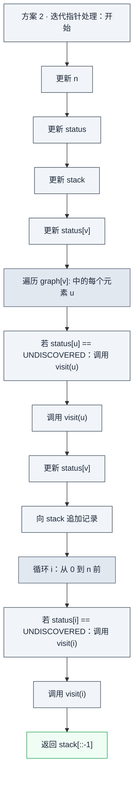

```python
import sys  # 引入依赖

sys.setrecursionlimit(10000)  # sys.setrecursionlimit(10000)

def topo_sort_dfs(graph):  # 定义函数 topo_sort_dfs（参数：graph）
    """基于 DFS 的拓扑排序：以终为始，回溯时将结点压栈，逆序即为拓扑序。"""
    n = len(graph)  # 把 长度(graph) 存入 元素个数
    status = ["UNDISCOVERED"] * n  # 把 ['UNDISCOVERED'] 乘 元素个数 存入 status
    stack = []  # 把 [] 存入 栈

    def visit(v):  # 定义函数 visit（参数：值）
        status[v] = "DISCOVERED"  # 把 'DISCOVERED' 写入 status[v]
        for u in graph[v]:  # 逐个取出 graph 的元素（节点 u）
            if status[u] == "UNDISCOVERED":  # 若 status[节点 u] 等于 'UNDISCOVERED'
                visit(u)  # visit(节点 u)
        status[v] = "VISITED"  # 把 'VISITED' 写入 status[v]
        stack.append(v)  # 回溯时入栈（出度为 0 的点最先入栈）

    for i in range(n):  # 让 下标 i 从 元素个数 遍历
        if status[i] == "UNDISCOVERED":  # 若 status[下标 i] 等于 'UNDISCOVERED'
            visit(i)  # visit(下标 i)

    return stack[::-1]  # 逆序得到拓扑序

if __name__ == "__main__":  # 若 __name__ 等于 '__main__'
    # 课程依赖：A(0)->C(2), B(1)->C(2), C(2)->D(3), D(3)->E(4), E(4)->F(5)
    graph = [
        [2],  # 0 A
        [2],  # 1 B
        [3],  # 2 C
        [4],  # 3 D
        [5],  # 4 E
        [],  # 5 F
    ]
    print("拓扑序:", topo_sort_dfs(graph))  # [0, 1, 2, 3, 4, 5] 等合法序
```

### Go 实现（2 种方案）

Go 的全部方案如下，每个方案都内嵌用例自测，可独立运行（老仓库 python/go 文件遵循「打印结果」约定）：

#### 方案 1：方案1（递归 DFS，记录发现/结束时间与边分类）

**思路与代码分析**：核心是「方案1（递归 DFS，记录发现/结束时间与边分类）」。Go 版用切片与多返回值惯用法，显式处理索引边界。代码里依次做这些事：哈希结构做计数或查重。**走读**：方案 1 · 方案1（递归 DFS，记录发现/结束时间与边分类）：开始 → 更新 : → 遍历 status 的下标与元素 i → 遍历 parent 的下标与元素 i → 遍历 graph[v] 的下标与元素 u → 返回 dTime, fTime, edges, parent。

**运行架构**（真实控制流）：

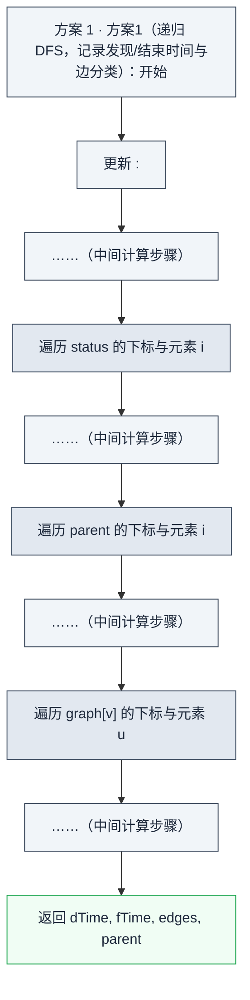

```go
package main // 引入依赖

import (
	"fmt"     // 「fmt」
	"os"      // 「os」
	"reflect" // 「reflect」
)

// dfs 深度优先搜索：记录发现/结束时间戳，并对边分类
func dfs(graph [][]int, start int) ([]int, []int, map[[2]int]string, []int) { // 定义函数/方法 dfs
	n := len(graph)             // 把 长度(graph) 写入 n :
	status := make([]string, n) // 把 make([]string, 元素个数) 写入 status :
	for i := range status {     // 把 range status { 写入 for i :
		status[i] = "UNDISCOVERED" // 把 「UNDISCOVERED」 写入 status[i]
	}
	dTime := make([]int, n)  // 把 make([]int, 元素个数) 写入 dTime :
	fTime := make([]int, n)  // 把 make([]int, 元素个数) 写入 fTime :
	parent := make([]int, n) // 把 make([]int, 元素个数) 写入 parent :
	for i := range parent {  // 把 range parent { 写入 for i :
		parent[i] = -1 // 把 减 1 写入 parent[i]
	}
	edges := map[[2]int]string{} // 把 映射表[[2]int]string{} 写入 edges :
	clock := 0                   // 把 0 写入 clock :
	var visit func(v int)        // var visit func(值 int)
	visit = func(v int) {        // 把 func(值 int) { 写入 visit
		clock++                      // clock 加一
		dTime[v] = clock             // 把 clock 写入 dTime[v]
		status[v] = "DISCOVERED"     // 把 「DISCOVERED」 写入 status[v]
		for _, u := range graph[v] { // 同时取 _ 与 节点 u 遍历
			if status[u] == "UNDISCOVERED" { // 若 status[节点 u] 等于 「UNDISCOVERED」
				edges[[2]int{v, u}] = "TREE" // 把 「TREE」 写入 edges[[2]int{v, u}]
				parent[u] = v                // 把 值 写入 parent[u]
				visit(u)                     // visit(节点 u)
			} else if status[u] == "DISCOVERED" { // 否则，若 status[节点 u] 等于 「DISCOVERED」
				edges[[2]int{v, u}] = "BACKWARD" // 把 「BACKWARD」 写入 edges[[2]int{v, u}]
			} else { // 否则
				if dTime[v] < dTime[u] { // 若 dTime[值] 小于 dTime[节点 u]
					edges[[2]int{v, u}] = "FORWARD" // 把 「FORWARD」 写入 edges[[2]int{v, u}]
				} else { // 否则
					edges[[2]int{v, u}] = "CROSS" // 把 「CROSS」 写入 edges[[2]int{v, u}]
				}
			}
		}
		clock++               // clock 加一
		fTime[v] = clock      // 把 clock 写入 fTime[v]
		status[v] = "VISITED" // 把 「VISITED」 写入 status[v]
	}
	visit(start)                       // visit(起点)
	return dTime, fTime, edges, parent // 返回 dTime, fTime, 边集, parent
}

func main() { // 程序入口：跑内嵌自测用例
	graph := [][]int{ // 把 [][]int{ 写入 graph :
		{1, 5},
		{2},
		{},
		{4},
		{5, 6},
		{1, 6},
		{},
	}
	d, f, edges, _ := dfs(graph, 0)                        // 把 dfs(graph, 0) 写入 d, f, edges, _ :
	if !reflect.DeepEqual(d, []int{1, 2, 3, 0, 0, 6, 7}) { // 若 取反 reflect.DeepEqual(d, []int{1, 2, 3, 0, 0, 6, 7}
		fmt.Printf("FAIL dTime=%v\n", d) // 打印输出
		os.Exit(1)                       // os.Exit(1)
	}
	if !reflect.DeepEqual(f, []int{10, 5, 4, 0, 0, 9, 8}) { // 若 取反 reflect.DeepEqual(f, []int{10, 5, 4, 0, 0, 9, 8}
		fmt.Printf("FAIL fTime=%v\n", f) // 打印输出
		os.Exit(1)                       // os.Exit(1)
	}
	wantEdges := map[[2]int]string{ // 把 映射表[[2]int]string{ 写入 wantEdges :
		{0, 1}: "TREE",
		{1, 2}: "TREE",
		{0, 5}: "TREE",
		{5, 1}: "CROSS",
		{5, 6}: "TREE",
	}
	if !reflect.DeepEqual(edges, wantEdges) { // 若 取反 reflect.DeepEqual(边集, wantEdges
		fmt.Printf("FAIL edges=%v\n", edges) // 打印输出
		os.Exit(1)                           // os.Exit(1)
	}
	fmt.Println("PASS") // 全部用例通过，输出 PASS
}
```

#### 方案 2：迭代指针处理

**思路与代码分析**：核心是「迭代指针处理」。Go 版用切片与多返回值惯用法，显式处理索引边界。**走读**：方案 2 · 迭代指针处理：开始 → 更新 : → 遍历 status 的下标与元素 i → 遍历 graph[v] 的下标与元素 u → 遍历循环 → 遍历循环 → 返回 stack。

**运行架构**（真实控制流）：

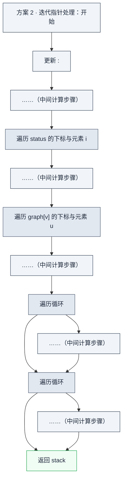

```go
package main // 引入依赖

import (
	"fmt"     // 「fmt」
	"os"      // 「os」
	"reflect" // 「reflect」
)

// topoSortDFS 基于 DFS 的拓扑排序：回溯时将结点压栈，逆序即为拓扑序。
func topoSortDFS(graph [][]int) []int { // 定义函数/方法 topoSortDFS
	n := len(graph)             // 把 长度(graph) 写入 n :
	status := make([]string, n) // 把 make([]string, 元素个数) 写入 status :
	for i := range status {     // 把 range status { 写入 for i :
		status[i] = "UNDISCOVERED" // 把 「UNDISCOVERED」 写入 status[i]
	}
	stack := []int{}      // 把 []int{} 写入 stack :
	var visit func(v int) // var visit func(值 int)
	visit = func(v int) { // 把 func(值 int) { 写入 visit
		status[v] = "DISCOVERED"     // 把 「DISCOVERED」 写入 status[v]
		for _, u := range graph[v] { // 同时取 _ 与 节点 u 遍历
			if status[u] == "UNDISCOVERED" { // 若 status[节点 u] 等于 「UNDISCOVERED」
				visit(u) // visit(节点 u)
			}
		}
		status[v] = "VISITED"    // 把 「VISITED」 写入 status[v]
		stack = append(stack, v) // 把 append(栈, 值) 写入 栈
	}
	for i := 0; i < n; i++ { // 让 下标 i 从 0 开始计数
		if status[i] == "UNDISCOVERED" { // 若 status[下标 i] 等于 「UNDISCOVERED」
			visit(i) // visit(下标 i)
		}
	}
	for i, j := 0, len(stack)-1; i < j; i, j = i+1, j-1 {
		stack[i], stack[j] = stack[j], stack[i] // 把 栈[下标 j], 栈[下标 i] 写入 stack[i], stack[j]
	}
	return stack // 返回 栈
}

func main() { // 程序入口：跑内嵌自测用例
	graph := [][]int{ // 把 [][]int{ 写入 graph :
		{2}, // 0 A
		{2}, // 1 B
		{3}, // 2 C
		{4}, // 3 D
		{5}, // 4 E
		{},  // 5 F
	}
	got := topoSortDFS(graph)                             // 把 topoSortDFS(graph) 写入 got :
	if !reflect.DeepEqual(got, []int{1, 0, 2, 3, 4, 5}) { // 若 取反 reflect.DeepEqual(got, []int{1, 0, 2, 3, 4, 5}
		fmt.Printf("FAIL topo=%v\n", got) // 打印输出
		os.Exit(1)                        // os.Exit(1)
	}
	fmt.Println("PASS") // 全部用例通过，输出 PASS
}
```

### Java 实现（2 种方案）

Java 的全部方案如下，每个方案都内嵌用例自测，可独立运行（老仓库 python/go 文件遵循「打印结果」约定）：

#### 方案 1：方案1（递归 DFS，记录发现/结束时间与边分类）

**思路与代码分析**：核心是「方案1（递归 DFS，记录发现/结束时间与边分类）」。Java 版用类与静态方法组织，集合操作显式明了。代码里依次做这些事：单循环线性扫描。**走读**：方案 1 · 方案1（递归 DFS，记录发现/结束时间与边分类）：开始 → 处理 clock++ → 更新 dTime[v] → 更新 status[v] → 遍历循环 → 若 status[u].equals(UNDISCOVERED) 则： → 调用 edges.put(v + - + u, TREE → 更新 parent[u] → 调用 visit(u) → 调用 edges.put(v + - + u, BACK → 调用 edges.put(v + - + u, dTime → 处理 clock++ → 更新 fTime[v] → 更新 status[v] → 返回结果。

**运行架构**（真实控制流）：

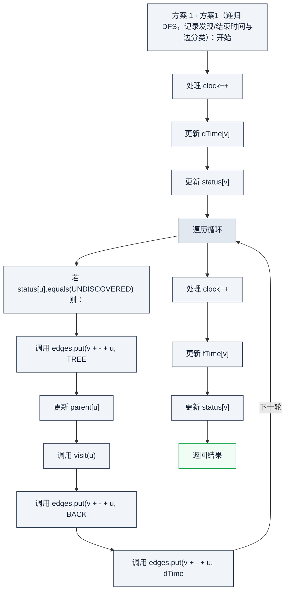

```java
package com.webfault.dsa; // 引入依赖

import java.util.*; // 引入依赖

class lc113764246_solution11 { // 定义类型
  static int[] dTime, fTime, parent; // static int[] dTime, fTime, parent;
  static String[] status; // static String[] status;
  static Map<String, String> edges; // static Map 小于 String, String 超过 边集;
  static int clock; // static int clock;
  static List<List<Integer>> graph; // static List 小于 List 小于 Integer 超过 超过 graph;

  static void visit(int v) { // 定义函数/方法 visit
    clock++; // clock 加一
    dTime[v] = clock; // 把 clock; 写入 dTime[v]
    status[v] = "DISCOVERED"; // 把 「DISCOVERED」; 写入 status[v]
    for (int u : graph.get(v)) { // for (int 节点 u : graph 查找 值)) {
      if (status[u].equals("UNDISCOVERED")) { // 若 status[节点 u].equals(「UNDISCOVERED」
        edges.put(v + "-" + u, "TREE"); // 边集.put(值 加 「 减 」 加 节点 u, 「 减 」);
        parent[u] = v; // 把 值; 写入 parent[u]
        visit(u); // visit(节点 u);
      } else if (status[u].equals("DISCOVERED")) { // 否则，若 status[节点 u].equals(「DISCOVERED」
        edges.put(v + "-" + u, "BACKWARD"); // 边集.put(值 加 「 减 」 加 节点 u, 「 减 」);
      } else { // 否则
        edges.put(v + "-" + u, dTime[v] < dTime[u] ? "FORWARD" : "CROSS");
      }
    }
    clock++; // clock 加一
    fTime[v] = clock; // 把 clock; 写入 fTime[v]
    status[v] = "VISITED"; // 把 「VISITED」; 写入 status[v]
  }

  public static void main(String[] args) { // public static void main(String[] args) {
    graph =
        Arrays.asList(
            Arrays.asList(1, 5),
            Arrays.asList(2),
            Arrays.asList(),
            Arrays.asList(4),
            Arrays.asList(5, 6),
            Arrays.asList(1, 6),
            Arrays.asList()); // Arrays.asList());
    int n = graph.size(); // 把 graph.大小() 存入 元素个数
    dTime = new int[n]; // 把 new int[元素个数]; 写入 dTime
    fTime = new int[n]; // 把 new int[元素个数]; 写入 fTime
    parent = new int[n]; // 把 new int[元素个数]; 写入 parent
    status = new String[n]; // 把 new String[元素个数]; 写入 status
    edges = new HashMap<>(); // 把 new HashMap 小于 超过 (); 写入 边集
    for (int i = 0; i < n; i++) { // 让 下标 i 从 0 开始计数，下标 i 小于 元素个数 就继续
      status[i] = "UNDISCOVERED"; // 把 「UNDISCOVERED」; 写入 status[i]
      parent[i] = -1; // 把 减 1; 写入 parent[i]
    }
    clock = 0; // 把 0; 写入 clock
    visit(0); // visit(0);
    int[] expD = {1, 2, 3, 0, 0, 6, 7}; // 把 {1, 2, 3, 0, 0, 6, 7}; 写入 int[] expD
    int[] expF = {10, 5, 4, 0, 0, 9, 8}; // 把 {10, 5, 4, 0, 0, 9, 8}; 写入 int[] expF
    int[] expP = {-1, 0, 1, -1, -1, 0, 5}; // 把 { 减 1, 0, 1, 减 1, 减 1, 0, 5}; 写入 int[] expP
    for (int i = 0; i < n; i++) { // 让 下标 i 从 0 开始计数，下标 i 小于 元素个数 就继续
      if (dTime[i] != expD[i] || fTime[i] != expF[i] || parent[i] != expP[i]) {
        System.out.println(
            "FAIL node " + i + " d=" + dTime[i] + " f=" + fTime[i] + " p=" + parent[i]); // 打印输出
        throw new RuntimeException("FAILED"); // throw new RuntimeException(「FAILED」);
      }
    }
    if (!"TREE".equals(edges.get("0-1"))) {
      System.out.println("FAIL 0-1");
      throw new RuntimeException("FAILED");
    }
    if (!"TREE".equals(edges.get("1-2"))) {
      System.out.println("FAIL 1-2");
      throw new RuntimeException("FAILED");
    }
    if (!"TREE".equals(edges.get("0-5"))) {
      System.out.println("FAIL 0-5");
      throw new RuntimeException("FAILED");
    }
    if (!"CROSS".equals(edges.get("5-1"))) {
      System.out.println("FAIL 5-1 " + edges.get("5-1"));
      throw new RuntimeException("FAILED");
    }
    if (!"TREE".equals(edges.get("5-6"))) {
      System.out.println("FAIL 5-6");
      throw new RuntimeException("FAILED");
    }
    System.out.println("PASS"); // 全部用例通过，输出 PASS
  }
}
```

#### 方案 2：迭代指针处理

**思路与代码分析**：核心是「迭代指针处理」。Java 版用类与静态方法组织，集合操作显式明了。代码里依次做这些事：双重循环遍历。**走读**：方案 2 · 迭代指针处理：开始 → 更新 n → 遍历循环 → 遍历循环 → 遍历循环 → 返回 stack。

**运行架构**（真实控制流）：

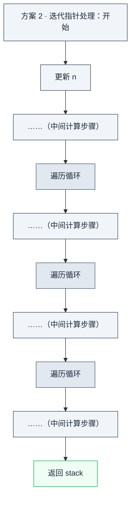

```java
package com.webfault.dsa; // 引入依赖

import java.util.*; // 引入依赖

class lc113764246_solution22 { // 定义类型
  static List<Integer> topoSortDfs(List<List<Integer>> graph) { // 定义函数/方法 topoSortDfs
    int n = graph.size(); // 把 graph.大小() 存入 元素个数
    String[] status = new String[n]; // 把 new String[元素个数]; 写入 String[] status
    for (int i = 0; i < n; i++) status[i] = "UNDISCOVERED"; // 让 下标 i 从 0 开始计数，下标 i 小于 元素个数 就继续
    List<Integer> stack = new ArrayList<>(); // 把 new ArrayList 小于 超过 (); 写入 List<Integer> stack
    class Vis { // 定义类型
      void visit(int v) { // 定义函数/方法 visit
        status[v] = "DISCOVERED"; // 把 「DISCOVERED」; 写入 status[v]
        for (int u : graph.get(v)) { // for (int 节点 u : graph 查找 值)) {
          if (status[u].equals("UNDISCOVERED"))
            visit(u); // 若 status[节点 u].equals(「UNDISCOVERED」)) visit(节点 u);
        }
        status[v] = "VISITED"; // 把 「VISITED」; 写入 status[v]
        stack.add(v); // 栈 追加 值);
      }
    }
    Vis vis = new Vis(); // 把 new Vis(); 写入 Vis vis
    for (int i = 0; i < n; i++) { // 让 下标 i 从 0 开始计数，下标 i 小于 元素个数 就继续
      if (status[i].equals("UNDISCOVERED"))
        vis.visit(i); // 若 status[下标 i].equals(「UNDISCOVERED」)) vis.visit(下标 i);
    }
    Collections.reverse(stack); // 反转
    return stack; // 返回 栈
  }

  public static void main(String[] args) { // public static void main(String[] args) {
    List<List<Integer>> graph =
        Arrays.asList(
            Arrays.asList(2),
            Arrays.asList(2),
            Arrays.asList(3),
            Arrays.asList(4),
            Arrays.asList(5),
            Arrays.asList()); // Arrays.asList());
    List<Integer> topo = topoSortDfs(graph); // 把 topoSortDfs(graph); 写入 List<Integer> topo
    List<Integer> expect =
        Arrays.asList(
            1, 0, 2, 3, 4, 5); // 把 Arrays.asList(1, 0, 2, 3, 4, 5); 写入 List<Integer> expect
    if (!topo.equals(expect)) { // 若 取反 topo.equals(expect
      System.out.println("FAIL " + topo); // 打印输出
      throw new RuntimeException("FAILED"); // throw new RuntimeException(「FAILED」);
    }
    System.out.println("PASS"); // 全部用例通过，输出 PASS
  }
}
```

### Rust 实现（2 种方案）

Rust 的全部方案如下，每个方案都内嵌用例自测，可独立运行（老仓库 python/go 文件遵循「打印结果」约定）：

#### 方案 1：方案1（递归 DFS，记录发现/结束时间与边分类）

**思路与代码分析**：核心是「方案1（递归 DFS，记录发现/结束时间与边分类）」。Rust 版用所有权移动与切片借用改写同一逻辑，注意 Option 与引用边界。**走读**：方案 1 · 方案1（递归 DFS，记录发现/结束时间与边分类）：开始 → 计算 visited → 计算 order → 更新 visited[c] → 向 order 追加记录 → 遍历 &graph[c] 中的每个元素 nx → 处理 if 非 visited[nx as usize] → 调用 go(nx as usize, graph, visit → 调用 go(start, graph, &mut visite → 处理 order → 返回结果。

**运行架构**（真实控制流）：

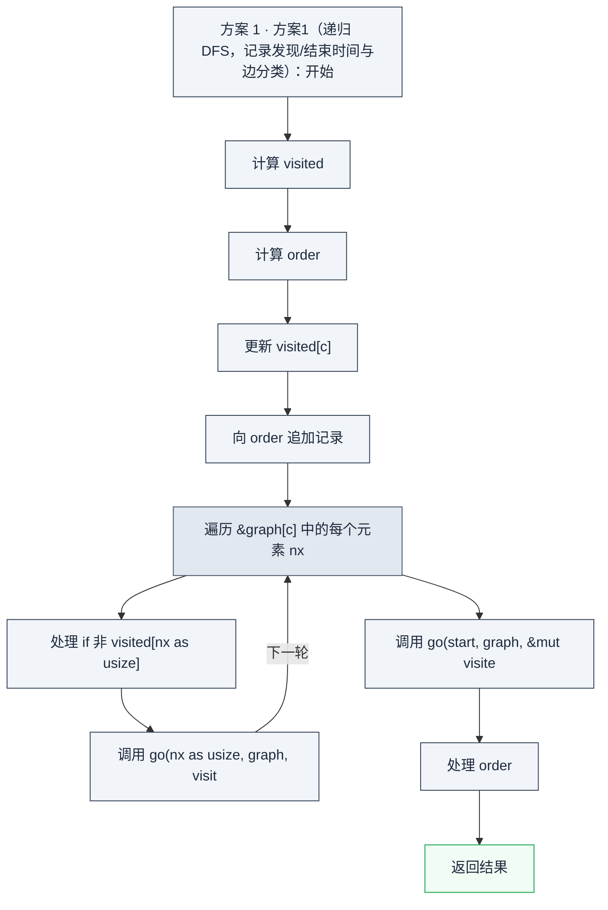

```rust
// 图搜索之DFS详解 — Rust 版（方案1）
fn dfs_order(graph: &[Vec<i32>], start: usize) -> Vec<i32> {
    // 定义函数/方法 dfs_order
    let mut visited = vec![false; graph.len()]; // 把 vec取反 [false; graph.长度()]; 写入 let mut visited
    let mut order = Vec::new(); // 把 Vec::new(); 写入 let mut order
    fn go(c: usize, graph: &[Vec<i32>], visited: &mut Vec<bool>, order: &mut Vec<i32>) {
        // 定义函数/方法 go
        visited[c] = true; // 把 true; 写入 visited[c]
        order.push(c as i32); // 把 字符 as i32 压入栈/数组尾部
        for &nx in &graph[c] {
            // for 按位与 nx in 按位与 graph[字符] {
            if !visited[nx as usize] {
                go(nx as usize, graph, visited, order);
            }
        }
    }
    go(start, graph, &mut visited, &mut order); // go(起点, graph, 按位与 mut 已访问集合, 按位与 mut order);
    order // order
}
fn main() {
    // 程序入口：跑内嵌自测用例
    let g = vec![vec![1, 2], vec![3, 4], vec![5], vec![], vec![], vec![]];
    assert_eq!(dfs_order(&g, 0), vec![0, 1, 3, 4, 2, 5]); // 断言校验
    println!("PASS");
} // 全部用例通过，输出 PASS
```

#### 方案 2：迭代指针处理

**思路与代码分析**：核心是「迭代指针处理」。Rust 版用所有权移动与切片借用改写同一逻辑，注意 Option 与引用边界。**走读**：方案 2 · 迭代指针处理：开始 → 计算 visited → 计算 order → 更新 visited[c] → 向 order 追加记录 → 遍历 &graph[c] 中的每个元素 nx → 处理 if 非 visited[nx as usize] → 调用 go(nx as usize, graph, visit → 调用 go(start, graph, &mut visite → 处理 order → 返回结果。

**运行架构**（真实控制流）：

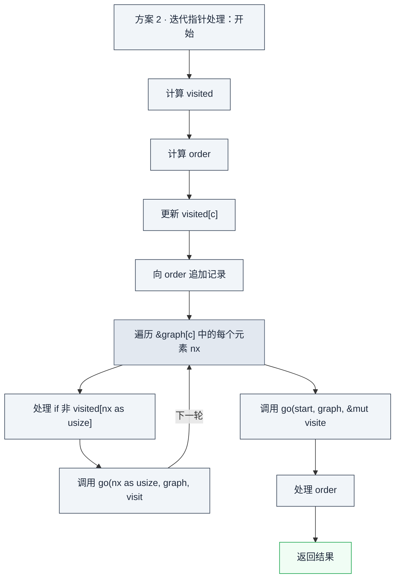

```rust
// 图搜索之DFS详解 — Rust 版（方案2）
fn dfs_order(graph: &[Vec<i32>], start: usize) -> Vec<i32> {
    // 定义函数/方法 dfs_order
    let mut visited = vec![false; graph.len()]; // 把 vec取反 [false; graph.长度()]; 写入 let mut visited
    let mut order = Vec::new(); // 把 Vec::new(); 写入 let mut order
    fn go(c: usize, graph: &[Vec<i32>], visited: &mut Vec<bool>, order: &mut Vec<i32>) {
        // 定义函数/方法 go
        visited[c] = true; // 把 true; 写入 visited[c]
        order.push(c as i32); // 把 字符 as i32 压入栈/数组尾部
        for &nx in &graph[c] {
            // for 按位与 nx in 按位与 graph[字符] {
            if !visited[nx as usize] {
                go(nx as usize, graph, visited, order);
            }
        }
    }
    go(start, graph, &mut visited, &mut order); // go(起点, graph, 按位与 mut 已访问集合, 按位与 mut order);
    order // order
}
fn main() {
    // 程序入口：跑内嵌自测用例
    let g = vec![vec![1, 2], vec![3, 4], vec![5], vec![], vec![], vec![]];
    assert_eq!(dfs_order(&g, 0), vec![0, 1, 3, 4, 2, 5]); // 断言校验
    println!("PASS");
} // 全部用例通过，输出 PASS
```

### Lua 实现（2 种方案）

Lua 的全部方案如下，每个方案都内嵌用例自测，可独立运行（老仓库 python/go 文件遵循「打印结果」约定）：

#### 方案 1：方案1（递归 DFS，记录发现/结束时间与边分类）

**思路与代码分析**：核心是「方案1（递归 DFS，记录发现/结束时间与边分类）」。Lua 版用表与 ipairs 遍历，注意 ipairs 遇 nil 即停的语义。代码里依次做这些事：递归求解子问题。**走读**：方案 1 · 方案1（递归 DFS，记录发现/结束时间与边分类）：开始 → 更新 visited → 更新 order → 处理 local function go(c) → 更新 1] → 更新 1] → 遍历 ipairs(graph[c + 1] or 中的每个元素 nx → 处理 if not visited[nx + 1] then → 调用 go(nx) → 调用 go(start) → 返回 order。

**运行架构**（真实控制流）：

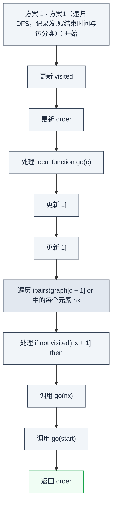

```lua
-- 图搜索之DFS详解 — Lua 版（方案1）
local function dfs_order(graph, start) -- local function dfs_order(graph, 起点)
	local visited = {} -- 把 {} 写入 local visited
	local order = {} -- 把 {} 写入 local order
	local function go(c) -- local function go(字符)
		visited[c + 1] = true -- 把 true 写入 visited[c + 1]
		order[#order + 1] = c -- 把 字符 写入 order[#order + 1]
		for _, nx in ipairs(graph[c + 1] or {}) do -- 遍历取 nx
			if not visited[nx + 1] then
				go(nx)
			end -- 若 not 已访问集合[nx 加 1] then go(nx) 终点
		end -- 终点
	end -- 终点
	go(start) -- go(起点)
	return order -- 返回 order
end -- 终点
local g = { { 1, 2 }, { 3, 4 }, { 5 }, {}, {}, {} } -- 把 {{1,2},{3,4},{5},{},{},{}} 写入 local g
assert(table.concat(dfs_order(g, 0), ",") == "0,1,3,4,2,5") -- 打印输出
print("PASS") -- 全部用例通过，输出 PASS
```

#### 方案 2：迭代指针处理

**思路与代码分析**：核心是「迭代指针处理」。Lua 版用表与 ipairs 遍历，注意 ipairs 遇 nil 即停的语义。代码里依次做这些事：递归求解子问题。**走读**：方案 2 · 迭代指针处理：开始 → 更新 visited → 更新 order → 处理 local function go(c) → 更新 1] → 更新 1] → 遍历 ipairs(graph[c + 1] or 中的每个元素 nx → 处理 if not visited[nx + 1] then → 调用 go(nx) → 调用 go(start) → 返回 order。

**运行架构**（真实控制流）：

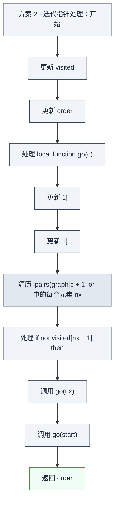

```lua
-- 图搜索之DFS详解 — Lua 版（方案2）
local function dfs_order(graph, start) -- local function dfs_order(graph, 起点)
	local visited = {} -- 把 {} 写入 local visited
	local order = {} -- 把 {} 写入 local order
	local function go(c) -- local function go(字符)
		visited[c + 1] = true -- 把 true 写入 visited[c + 1]
		order[#order + 1] = c -- 把 字符 写入 order[#order + 1]
		for _, nx in ipairs(graph[c + 1] or {}) do -- 遍历取 nx
			if not visited[nx + 1] then
				go(nx)
			end -- 若 not 已访问集合[nx 加 1] then go(nx) 终点
		end -- 终点
	end -- 终点
	go(start) -- go(起点)
	return order -- 返回 order
end -- 终点
local g = { { 1, 2 }, { 3, 4 }, { 5 }, {}, {}, {} } -- 把 {{1,2},{3,4},{5},{},{},{}} 写入 local g
assert(table.concat(dfs_order(g, 0), ",") == "0,1,3,4,2,5") -- 打印输出
print("PASS") -- 全部用例通过，输出 PASS
```

### C 实现（2 种方案）

C 的全部方案如下，每个方案都内嵌用例自测，可独立运行（老仓库 python/go 文件遵循「打印结果」约定）：

#### 方案 1：方案1（递归 DFS，记录发现/结束时间与边分类）

**思路与代码分析**：核心是「方案1（递归 DFS，记录发现/结束时间与边分类）」。C 版手动管理下标与内存，循环边界全部显式写出。代码里依次做这些事：单循环线性扫描。**走读**：方案 1 · 方案1（递归 DFS，记录发现/结束时间与边分类）：开始 → 更新 visited_g[c] → 更新 order_g[on_g++] → 遍历循环 → 若 非 visited_g[graph_g[c][i]]：调用 go(graph_g[c][i]) → 调用 go(graph_g[c][i]) → 返回结果。

**运行架构**（真实控制流）：

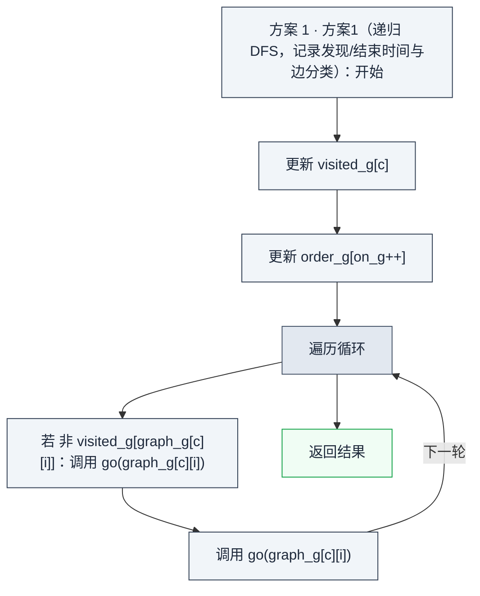

```c
/* 图搜索之DFS详解 — C 版（方案1） */
#include <stdio.h>                         // 引入头文件
static int visited_g[64];                  // static int visited_g[64];
static int order_g[64];                    // static int order_g[64];
static int on_g;                           // static int on_g;
static const int (*graph_g)[8];            // static const int ( 乘 graph_g)[8];
static const int *gsize_g;                 // static const int 乘 gsize_g;
static void go(int c) {                    // 定义函数/方法 go
    visited_g[c] = 1;                      // 把 1; 写入 visited_g[c]
    order_g[on_g++] = c;                   // 把 字符; 写入 order_g[on_g++]
    for (int i = 0; i < gsize_g[c]; i++) { // 让 下标 i 从 0 开始计数，下标 i 小于 gsize_g[字符] 就继续
        if (!visited_g[graph_g[c][i]])
            go(graph_g[c][i]); // 若 取反 visited_g[graph_g[字符][下标 i]]) go(graph_g[字符][下标 i]);
    }
}
int main(void) { // 程序入口：跑内嵌自测用例
    static const int graph[6][8] = {{1, 2}, {3, 4}, {5}, {}, {}, {}};
    static const int gsize[6] = {2, 2, 1, 0, 0, 0}; // 把 {2,2,1,0,0,0}; 写入 static const int gsize[6]
    graph_g = graph;                                // 把 graph; 写入 graph_g
    gsize_g = gsize;                                // 把 gsize; 写入 gsize_g
    go(0);                                          // go(0);
    int want[] = {0, 1, 3, 4, 2, 5};                // 把 {0,1,3,4,2,5}; 写入 int want[]
    for (int i = 0; i < 6; i++)
        if (order_g[i] != want[i]) {
            printf("FAIL\n");
            return 1;
        } // 让 下标 i 从 0 开始计数，下标 i 小于 6 就继续
    printf("PASS\n");
    return 0;
} // 全部用例通过，输出 PASS
```

#### 方案 2：迭代指针处理

**思路与代码分析**：核心是「迭代指针处理」。C 版手动管理下标与内存，循环边界全部显式写出。代码里依次做这些事：单循环线性扫描。**走读**：方案 2 · 迭代指针处理：开始 → 更新 visited_g[c] → 更新 order_g[on_g++] → 遍历循环 → 若 非 visited_g[graph_g[c][i]]：调用 go(graph_g[c][i]) → 调用 go(graph_g[c][i]) → 返回结果。

**运行架构**（真实控制流）：

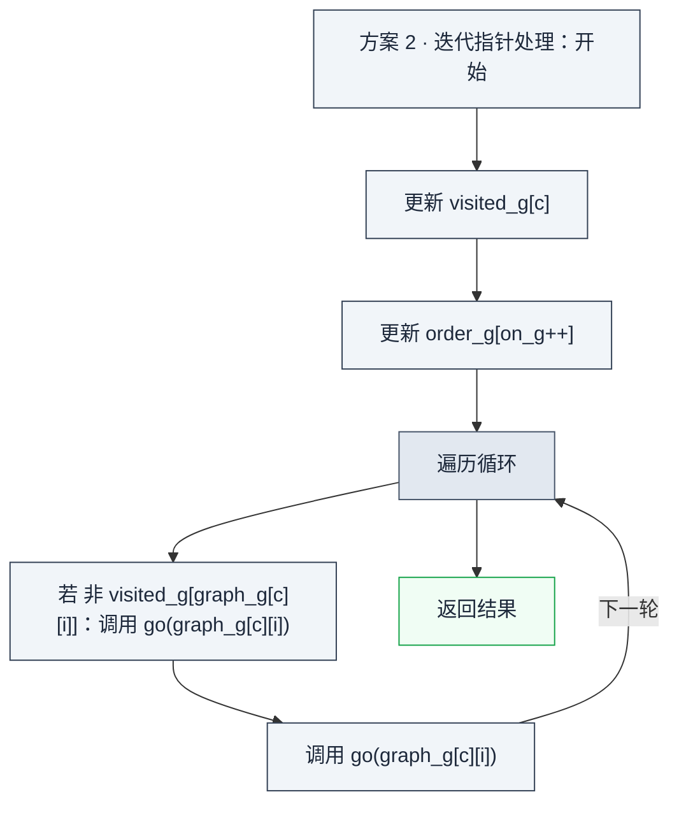

```c
/* 图搜索之DFS详解 — C 版（方案2） */
#include <stdio.h>                         // 引入头文件
static int visited_g[64];                  // static int visited_g[64];
static int order_g[64];                    // static int order_g[64];
static int on_g;                           // static int on_g;
static const int (*graph_g)[8];            // static const int ( 乘 graph_g)[8];
static const int *gsize_g;                 // static const int 乘 gsize_g;
static void go(int c) {                    // 定义函数/方法 go
    visited_g[c] = 1;                      // 把 1; 写入 visited_g[c]
    order_g[on_g++] = c;                   // 把 字符; 写入 order_g[on_g++]
    for (int i = 0; i < gsize_g[c]; i++) { // 让 下标 i 从 0 开始计数，下标 i 小于 gsize_g[字符] 就继续
        if (!visited_g[graph_g[c][i]])
            go(graph_g[c][i]); // 若 取反 visited_g[graph_g[字符][下标 i]]) go(graph_g[字符][下标 i]);
    }
}
int main(void) { // 程序入口：跑内嵌自测用例
    static const int graph[6][8] = {{1, 2}, {3, 4}, {5}, {}, {}, {}};
    static const int gsize[6] = {2, 2, 1, 0, 0, 0}; // 把 {2,2,1,0,0,0}; 写入 static const int gsize[6]
    graph_g = graph;                                // 把 graph; 写入 graph_g
    gsize_g = gsize;                                // 把 gsize; 写入 gsize_g
    go(0);                                          // go(0);
    int want[] = {0, 1, 3, 4, 2, 5};                // 把 {0,1,3,4,2,5}; 写入 int want[]
    for (int i = 0; i < 6; i++)
        if (order_g[i] != want[i]) {
            printf("FAIL\n");
            return 1;
        } // 让 下标 i 从 0 开始计数，下标 i 小于 6 就继续
    printf("PASS\n");
    return 0;
} // 全部用例通过，输出 PASS
```

### C++ 实现（2 种方案）

C++ 的全部方案如下，每个方案都内嵌用例自测，可独立运行（老仓库 python/go 文件遵循「打印结果」约定）：

#### 方案 1：方案1（递归 DFS，记录发现/结束时间与边分类）

**思路与代码分析**：核心是「方案1（递归 DFS，记录发现/结束时间与边分类）」。C++ 版用 STL 容器与迭代器，减少手写下标错误。代码里依次做这些事：单循环线性扫描。**走读**：方案 1 · 方案1（递归 DFS，记录发现/结束时间与边分类）：开始 → 更新 visited[c] → 调用 order.push_back(static_cast＜ → 遍历循环 → 若 非 visited[nx]：调用 dfsGo(static_cast＜size_t＞(nx → 调用 dfsGo(static_cast＜size_t＞(nx → 返回结果。

**运行架构**（真实控制流）：

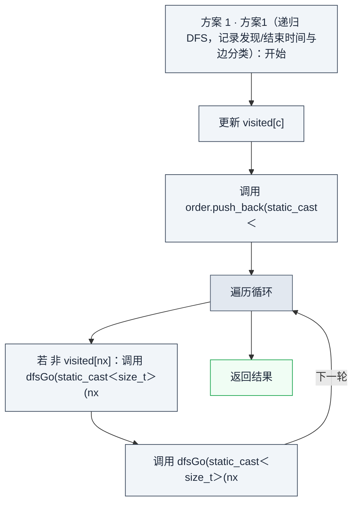

```cpp
// 图搜索之DFS详解 — C++ 版（方案1）
#include <cassert>  // 引入头文件
#include <iostream> // 引入头文件
#include <vector>   // 引入头文件
static void dfsGo(size_t c, const std::vector<std::vector<int>> &graph, std::vector<bool> &visited,
                  std::vector<int> &order) {
    visited[c] = true;                    // 把 true; 写入 visited[c]
    order.push_back(static_cast<int>(c)); // order 追加 static_cast 小于 int 超过 (字符));
    for (int nx : graph[c]) {             // for (int nx : graph[字符]) {
        if (!visited[nx])
            dfsGo(static_cast<size_t>(nx), graph, visited, order);
    }
}
int main() { // 程序入口：跑内嵌自测用例
    std::vector<std::vector<int>> g = {{1, 2}, {3, 4}, {5}, {}, {}, {}};
    std::vector<bool> visited(g.size(), false); // std::vector 小于 bool 超过 已访问集合(g.大小(), false);
    std::vector<int> order;                     // std::vector 小于 int 超过 order;
    dfsGo(0, g, visited, order);                // dfsGo(0, g, 已访问集合, order);
    assert((order == std::vector<int>{0, 1, 3, 4, 2, 5})); // 断言校验
    std::cout << "PASS" << std::endl;
} // 全部用例通过，输出 PASS
```

#### 方案 2：迭代指针处理

**思路与代码分析**：核心是「迭代指针处理」。C++ 版用 STL 容器与迭代器，减少手写下标错误。代码里依次做这些事：单循环线性扫描。**走读**：方案 2 · 迭代指针处理：开始 → 更新 visited[c] → 调用 order.push_back(static_cast＜ → 遍历循环 → 若 非 visited[nx]：调用 dfsGo(static_cast＜size_t＞(nx → 调用 dfsGo(static_cast＜size_t＞(nx → 返回结果。

**运行架构**（真实控制流）：

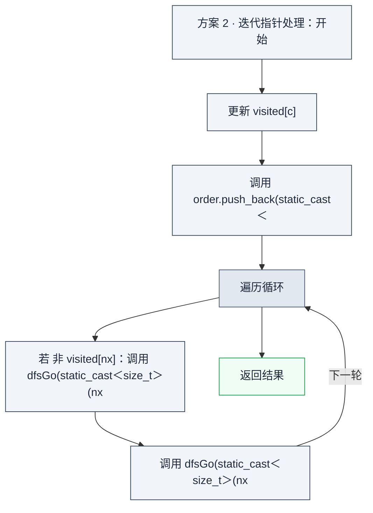

```cpp
// 图搜索之DFS详解 — C++ 版（方案2）
#include <cassert>  // 引入头文件
#include <iostream> // 引入头文件
#include <vector>   // 引入头文件
static void dfsGo(size_t c, const std::vector<std::vector<int>> &graph, std::vector<bool> &visited,
                  std::vector<int> &order) {
    visited[c] = true;                    // 把 true; 写入 visited[c]
    order.push_back(static_cast<int>(c)); // order 追加 static_cast 小于 int 超过 (字符));
    for (int nx : graph[c]) {             // for (int nx : graph[字符]) {
        if (!visited[nx])
            dfsGo(static_cast<size_t>(nx), graph, visited, order);
    }
}
int main() { // 程序入口：跑内嵌自测用例
    std::vector<std::vector<int>> g = {{1, 2}, {3, 4}, {5}, {}, {}, {}};
    std::vector<bool> visited(g.size(), false); // std::vector 小于 bool 超过 已访问集合(g.大小(), false);
    std::vector<int> order;                     // std::vector 小于 int 超过 order;
    dfsGo(0, g, visited, order);                // dfsGo(0, g, 已访问集合, order);
    assert((order == std::vector<int>{0, 1, 3, 4, 2, 5})); // 断言校验
    std::cout << "PASS" << std::endl;
} // 全部用例通过，输出 PASS
```

### R 实现（2 种方案）

R 的全部方案如下，每个方案都内嵌用例自测，可独立运行（老仓库 python/go 文件遵循「打印结果」约定）：

#### 方案 1：方案1（递归 DFS，记录发现/结束时间与边分类）

**思路与代码分析**：核心是「方案1（递归 DFS，记录发现/结束时间与边分类）」。R 版用向量化思维与 1 起始下标，注意 1:n 的降序陷阱。代码里依次做这些事：单循环线性扫描。**走读**：方案 1 · 方案1（递归 DFS，记录发现/结束时间与边分类）：开始 → 处理 visited ＜- rep(FALSE, 100L) → 处理 order_ ＜- integer(0) → 处理 go ＜- function(c) → 处理 visited[c + 1L] ＜＜- TRUE → 处理 order_ ＜＜- c(order_, c) → 更新 < → 处理 graph[[c + 1L]] else integer → 若 length(nb) ＞ 0 则： → 循环 nx：遍历 nb → 若 非 visited[nx + 1L]：调用 go(nx) → 调用 go(nx) → 调用 go(start) → 处理 order_ → 返回结果。

**运行架构**（真实控制流）：

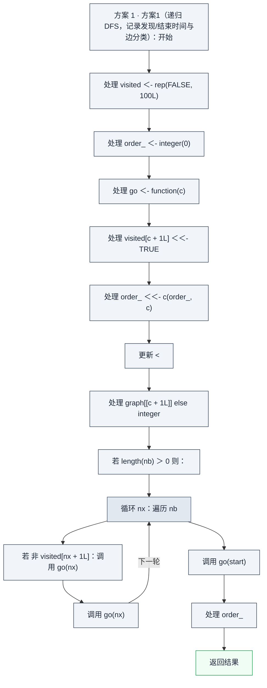

```r
# 定义函数 dfs_order_graph（参数：graph, 起点）
dfs_order_graph <- function(graph, start) {
    visited <- rep(FALSE, 100L)  # 把 rep(FALSE, 100L) 存入 已访问集合
    order_ <- integer(0)  # 把 integer(0) 存入 order_
    go <- function(c) {
        # 定义函数 go（参数：字符）
        visited[c + 1L] <<- TRUE  # 已访问集合[字符 加 1L] 小于 小于 减 TRUE
        order_ <<- c(order_, c)  # order_ 小于 小于 减 字符(order_, 字符)
        nb <- if (c + 1L <= length(graph) && !is.null(graph[[c + 1L]]))
            graph[[c + 1L]] else integer(0)
        if (length(nb) > 0) {
            # 若 长度(nb) 超过 0 for (nx in nb) {
            for (nx in nb) {
                if (!visited[nx + 1L])
                  go(nx)  # 若 取反 已访问集合[nx 加 1L]) go(nx
            }
        }
    }
    go(start)  # go(起点)
    order_  # order_
}
g <- list(c(1, 2), c(3, 4), c(5), NULL, NULL, NULL)  # 把 列表(字符(1, 2), 字符(3, 4), 字符(5), NULL, NULL, NULL) 存入 g
stopifnot(identical(as.integer(dfs_order_graph(g, 0)), c(0L, 1L, 3L, 4L, 2L, 5L)))  # 断言校验
cat("PASS\n")  # 全部用例通过，输出 PASS
```

#### 方案 2：迭代指针处理

**思路与代码分析**：核心是「迭代指针处理」。R 版用向量化思维与 1 起始下标，注意 1:n 的降序陷阱。代码里依次做这些事：单循环线性扫描。**走读**：方案 2 · 迭代指针处理：开始 → 处理 visited ＜- rep(FALSE, 100L) → 处理 order_ ＜- integer(0) → 处理 go ＜- function(c) → 处理 visited[c + 1L] ＜＜- TRUE → 处理 order_ ＜＜- c(order_, c) → 更新 < → 处理 graph[[c + 1L]] else integer → 若 length(nb) ＞ 0 则： → 循环 nx：遍历 nb → 若 非 visited[nx + 1L]：调用 go(nx) → 调用 go(nx) → 调用 go(start) → 处理 order_ → 返回结果。

**运行架构**（真实控制流）：

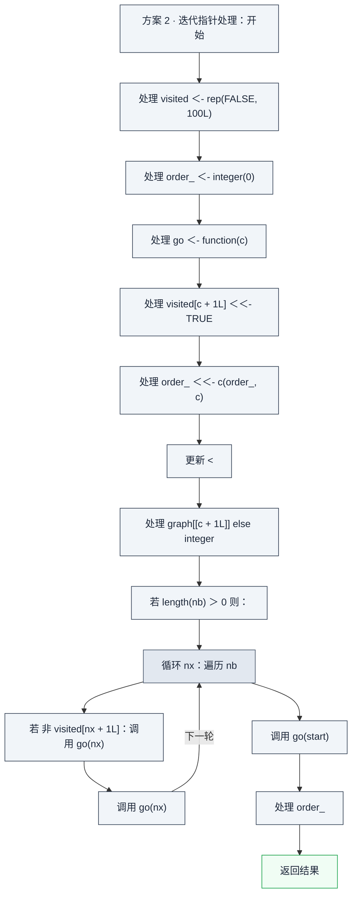

```r
# 定义函数 dfs_order_graph（参数：graph, 起点）
dfs_order_graph <- function(graph, start) {
    visited <- rep(FALSE, 100L)  # 把 rep(FALSE, 100L) 存入 已访问集合
    order_ <- integer(0)  # 把 integer(0) 存入 order_
    go <- function(c) {
        # 定义函数 go（参数：字符）
        visited[c + 1L] <<- TRUE  # 已访问集合[字符 加 1L] 小于 小于 减 TRUE
        order_ <<- c(order_, c)  # order_ 小于 小于 减 字符(order_, 字符)
        nb <- if (c + 1L <= length(graph) && !is.null(graph[[c + 1L]]))
            graph[[c + 1L]] else integer(0)
        if (length(nb) > 0) {
            # 若 长度(nb) 超过 0 for (nx in nb) {
            for (nx in nb) {
                if (!visited[nx + 1L])
                  go(nx)  # 若 取反 已访问集合[nx 加 1L]) go(nx
            }
        }
    }
    go(start)  # go(起点)
    order_  # order_
}
g <- list(c(1, 2), c(3, 4), c(5), NULL, NULL, NULL)  # 把 列表(字符(1, 2), 字符(3, 4), 字符(5), NULL, NULL, NULL) 存入 g
stopifnot(identical(as.integer(dfs_order_graph(g, 0)), c(0L, 1L, 3L, 4L, 2L, 5L)))  # 断言校验
cat("PASS\n")  # 全部用例通过，输出 PASS
```

### Zig 实现（2 种方案）

Zig 的全部方案如下，每个方案都内嵌用例自测，可独立运行（老仓库 python/go 文件遵循「打印结果」约定）：

#### 方案 1：方案1（递归 DFS，记录发现/结束时间与边分类）

**思路与代码分析**：核心是「方案1（递归 DFS，记录发现/结束时间与边分类）」。Zig 版显式分配与清零，整型边界处理严格。代码里依次做这些事：单循环线性扫描。**走读**：方案 1 · 方案1（递归 DFS，记录发现/结束时间与边分类）：开始 → 更新 g.visited[c] → 向 order 追加记录 → 遍历集合元素 → 计算 u → 若 非 g.visited[u]) dfsGo(g, u：None → 返回结果。

**运行架构**（真实控制流）：

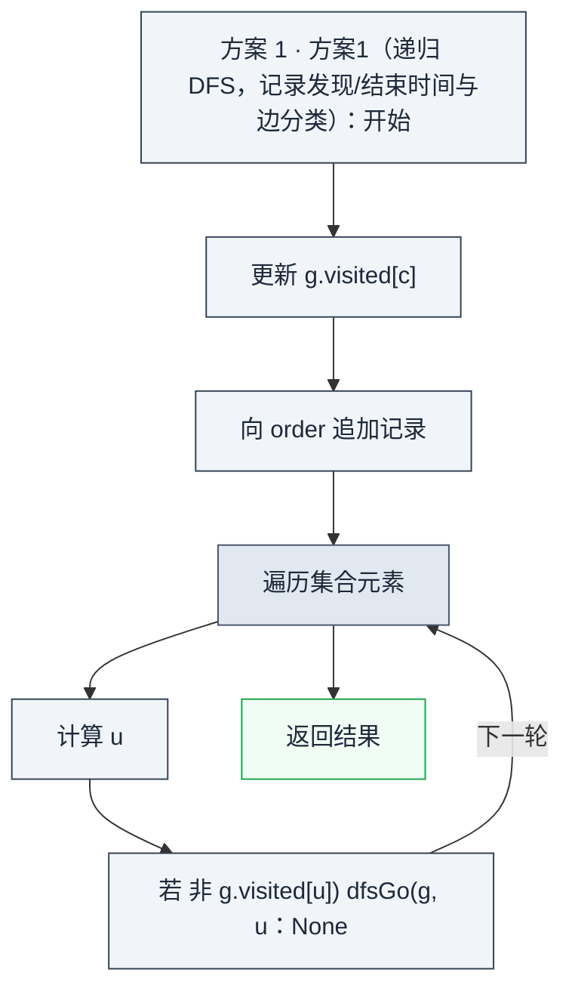

```zig
// 图搜索之DFS详解 — Zig 版（方案1）
const std = @import("std"); // 把 @import(「std」) 存入 std
const G = struct { // 把 struct { 存入 G
    graph: []const []const i32,
    visited: [64]bool,
    order: std.ArrayList(i32),
};
fn dfsGo(g: *G, c: usize) void { // 定义函数/方法 dfsGo
    g.visited[c] = true; // 把 true; 写入 g.visited[c]
    g.order.append(@intCast(c)) catch unreachable; // 把 @intCast(字符 追加到列表尾部
    for (g.graph[c]) |nx| { // for (g.graph[字符]) 按位或 nx 按位或 {
        const u: usize = @intCast(nx); // 把 @intCast(nx); 写入 const u: usize
        if (!g.visited[u]) dfsGo(g, u); // 若 取反 g.已访问集合[节点 u]) dfsGo(g, 节点 u);
    }
}
pub fn main() !void { // 程序入口：跑内嵌自测用例
    var arena = std.heap.ArenaAllocator.init(std.heap.page_allocator); // 把 std.堆.ArenaAllocator.init(std.堆.page_allocator) 存入 arena
    defer arena.deinit(); // defer arena.deinit();
    const g0 = [_]i32{ 1, 2 }; // 把 [_]i32{ 1, 2 } 存入 g0
    const g1 = [_]i32{ 3, 4 }; // 把 [_]i32{ 3, 4 } 存入 g1
    const g2 = [_]i32{5}; // 把 [_]i32{5} 存入 g2
    const g3 = [_]i32{}; // 把 [_]i32{} 存入 g3
    const g4 = [_]i32{}; // 把 [_]i32{} 存入 g4
    const g5 = [_]i32{}; // 把 [_]i32{} 存入 g5
    const graph = [_][]const i32{ &g0, &g1, &g2, &g3, &g4, &g5 };
    var g = G{ .graph = &graph, .visited = undefined, .order = std.ArrayList(i32).init(std.heap.page_allocator) };
    defer g.order.deinit(); // defer g.order.deinit();
    for (0..6) |i| g.visited[i] = false; // 让 下标 i 从 0 走到 6 减一
    dfsGo(&g, 0); // dfsGo( 按位与 g, 0);
    const want = [_]i32{ 0, 1, 3, 4, 2, 5 }; // 把 [_]i32{ 0, 1, 3, 4, 2, 5 } 存入 want
    for (want, 0..) |w, i| if (g.order.items[i] != w) return error.TestFailed;
    std.debug.print("PASS\n", .{});
} // 全部用例通过，输出 PASS
```

#### 方案 2：迭代指针处理

**思路与代码分析**：核心是「迭代指针处理」。Zig 版显式分配与清零，整型边界处理严格。代码里依次做这些事：单循环线性扫描。**走读**：方案 2 · 迭代指针处理：开始 → 更新 g.visited[c] → 向 order 追加记录 → 遍历集合元素 → 计算 u → 若 非 g.visited[u]) dfsGo(g, u：None → 返回结果。

**运行架构**（真实控制流）：

```mermaid
graph TD
    N0["方案 2 · 迭代指针处理：开始"]
    N1["更新 g.visited[c]"]
    N2["向 order 追加记录"]
    N3["遍历集合元素"]
    N4["计算 u"]
    N5["若 非 g.visited[u]) dfsGo(g, u：None"]
    N6["返回结果"]
    N0 --> N1
    N1 --> N2
    N2 --> N3
    N3 --> N4
    N4 --> N5
    N5 -- 下一轮 --> N3
    N3 --> N6
    classDef n fill:#f1f5f9,stroke:#334155,color:#1e293b;
    classDef lp fill:#e2e8f0,stroke:#475569,color:#1e293b;
    classDef dc fill:#fef9c3,stroke:#ca8a04,color:#1e293b;
    classDef tm fill:#f0fdf4,stroke:#16a34a,color:#1e293b;
    class N0,N1,N2,N4,N5 n;
    class N3 lp;
    class N6 tm;
```

```zig
// 图搜索之DFS详解 — Zig 版（方案2）
const std = @import("std"); // 把 @import(「std」) 存入 std
const G = struct { // 把 struct { 存入 G
    graph: []const []const i32,
    visited: [64]bool,
    order: std.ArrayList(i32),
};
fn dfsGo(g: *G, c: usize) void { // 定义函数/方法 dfsGo
    g.visited[c] = true; // 把 true; 写入 g.visited[c]
    g.order.append(@intCast(c)) catch unreachable; // 把 @intCast(字符 追加到列表尾部
    for (g.graph[c]) |nx| { // for (g.graph[字符]) 按位或 nx 按位或 {
        const u: usize = @intCast(nx); // 把 @intCast(nx); 写入 const u: usize
        if (!g.visited[u]) dfsGo(g, u); // 若 取反 g.已访问集合[节点 u]) dfsGo(g, 节点 u);
    }
}
pub fn main() !void { // 程序入口：跑内嵌自测用例
    var arena = std.heap.ArenaAllocator.init(std.heap.page_allocator); // 把 std.堆.ArenaAllocator.init(std.堆.page_allocator) 存入 arena
    defer arena.deinit(); // defer arena.deinit();
    const g0 = [_]i32{ 1, 2 }; // 把 [_]i32{ 1, 2 } 存入 g0
    const g1 = [_]i32{ 3, 4 }; // 把 [_]i32{ 3, 4 } 存入 g1
    const g2 = [_]i32{5}; // 把 [_]i32{5} 存入 g2
    const g3 = [_]i32{}; // 把 [_]i32{} 存入 g3
    const g4 = [_]i32{}; // 把 [_]i32{} 存入 g4
    const g5 = [_]i32{}; // 把 [_]i32{} 存入 g5
    const graph = [_][]const i32{ &g0, &g1, &g2, &g3, &g4, &g5 };
    var g = G{ .graph = &graph, .visited = undefined, .order = std.ArrayList(i32).init(std.heap.page_allocator) };
    defer g.order.deinit(); // defer g.order.deinit();
    for (0..6) |i| g.visited[i] = false; // 让 下标 i 从 0 走到 6 减一
    dfsGo(&g, 0); // dfsGo( 按位与 g, 0);
    const want = [_]i32{ 0, 1, 3, 4, 2, 5 }; // 把 [_]i32{ 0, 1, 3, 4, 2, 5 } 存入 want
    for (want, 0..) |w, i| if (g.order.items[i] != w) return error.TestFailed;
    std.debug.print("PASS\n", .{});
} // 全部用例通过，输出 PASS
```

### Dart 实现（2 种方案）

Dart 的全部方案如下，每个方案都内嵌用例自测，可独立运行（老仓库 python/go 文件遵循「打印结果」约定）：

#### 方案 1：方案1（递归 DFS，记录发现/结束时间与边分类）

**思路与代码分析**：核心是「方案1（递归 DFS，记录发现/结束时间与边分类）」。Dart 版用可空类型标注与集合方法，注意空安全。代码里依次做这些事：单循环线性扫描。**走读**：方案 1 · 方案1（递归 DFS，记录发现/结束时间与边分类）：开始 → 更新 visited → 处理 graph.length, → 处理 false, → 处理 ) → 更新 order → 处理 void go(int c) → 更新 visited[c] → 调用 order.add(c) → 遍历循环 → 若 非 visited[nx]) go(nx：None → 调用 go(start) → 返回 order。

**运行架构**（真实控制流）：

```mermaid
graph TD
    N0["方案 1 · 方案1（递归 DFS，记录发现/结束时间与边分类）：开始"]
    N1["更新 visited"]
    N2["处理 graph.length,"]
    N3["处理 false,"]
    N4["处理 )"]
    N5["更新 order"]
    N6["处理 void go(int c)"]
    N7["更新 visited[c]"]
    N8["调用 order.add(c)"]
    N9["遍历循环"]
    N10["若 非 visited[nx]) go(nx：None"]
    N11["调用 go(start)"]
    N12["返回 order"]
    N0 --> N1
    N1 --> N2
    N2 --> N3
    N3 --> N4
    N4 --> N5
    N5 --> N6
    N6 --> N7
    N7 --> N8
    N8 --> N9
    N9 --> N10
    N10 -- 下一轮 --> N9
    N9 --> N11
    N11 --> N12
    classDef n fill:#f1f5f9,stroke:#334155,color:#1e293b;
    classDef lp fill:#e2e8f0,stroke:#475569,color:#1e293b;
    classDef dc fill:#fef9c3,stroke:#ca8a04,color:#1e293b;
    classDef tm fill:#f0fdf4,stroke:#16a34a,color:#1e293b;
    class N0,N1,N2,N3,N4,N5,N6,N7,N8,N10,N11 n;
    class N9 lp;
    class N12 tm;
```

```dart
// 图搜索之DFS详解 — Dart 版（方案1）
List<int> dfsOrder(List<List<int>> graph, int start) {
  // 定义函数/方法 dfsOrder
  final visited = List<bool>.filled(
    graph.length,
    false,
  ); // 把 List 小于 bool 超过 .filled(graph.长度, false) 存入 已访问集合
  final order = <int>[]; // 把 小于 int 超过 [] 存入 order
  void go(int c) {
    // 定义函数/方法 go
    visited[c] = true; // 把 true; 写入 visited[c]
    order.add(c); // order 追加 字符);
    for (final nx in graph[c]) {
      // for (final nx in graph[字符]) {
      if (!visited[nx]) go(nx); // 若 取反 已访问集合[nx]) go(nx);
    }
  }

  go(start); // go(起点);
  return order; // 返回 order
}

void main() {
  // 程序入口：跑内嵌自测用例
  final g = <List<int>>[
    <int>[1, 2],
    <int>[3, 4],
    <int>[5],
    <int>[],
    <int>[],
    <int>[], // 小于 int 超过 []
  ];
  if (dfsOrder(g, 0).toString() != '[0, 1, 3, 4, 2, 5]') throw StateError('c1');
  print('PASS');
} // 全部用例通过，输出 PASS
```

#### 方案 2：迭代指针处理

**思路与代码分析**：核心是「迭代指针处理」。Dart 版用可空类型标注与集合方法，注意空安全。代码里依次做这些事：单循环线性扫描。**走读**：方案 2 · 迭代指针处理：开始 → 更新 visited → 处理 graph.length, → 处理 false, → 处理 ) → 更新 order → 处理 void go(int c) → 更新 visited[c] → 调用 order.add(c) → 遍历循环 → 若 非 visited[nx]) go(nx：None → 调用 go(start) → 返回 order。

**运行架构**（真实控制流）：

```mermaid
graph TD
    N0["方案 2 · 迭代指针处理：开始"]
    N1["更新 visited"]
    N2["处理 graph.length,"]
    N3["处理 false,"]
    N4["处理 )"]
    N5["更新 order"]
    N6["处理 void go(int c)"]
    N7["更新 visited[c]"]
    N8["调用 order.add(c)"]
    N9["遍历循环"]
    N10["若 非 visited[nx]) go(nx：None"]
    N11["调用 go(start)"]
    N12["返回 order"]
    N0 --> N1
    N1 --> N2
    N2 --> N3
    N3 --> N4
    N4 --> N5
    N5 --> N6
    N6 --> N7
    N7 --> N8
    N8 --> N9
    N9 --> N10
    N10 -- 下一轮 --> N9
    N9 --> N11
    N11 --> N12
    classDef n fill:#f1f5f9,stroke:#334155,color:#1e293b;
    classDef lp fill:#e2e8f0,stroke:#475569,color:#1e293b;
    classDef dc fill:#fef9c3,stroke:#ca8a04,color:#1e293b;
    classDef tm fill:#f0fdf4,stroke:#16a34a,color:#1e293b;
    class N0,N1,N2,N3,N4,N5,N6,N7,N8,N10,N11 n;
    class N9 lp;
    class N12 tm;
```

```dart
// 图搜索之DFS详解 — Dart 版（方案2）
List<int> dfsOrder(List<List<int>> graph, int start) {
  // 定义函数/方法 dfsOrder
  final visited = List<bool>.filled(
    graph.length,
    false,
  ); // 把 List 小于 bool 超过 .filled(graph.长度, false) 存入 已访问集合
  final order = <int>[]; // 把 小于 int 超过 [] 存入 order
  void go(int c) {
    // 定义函数/方法 go
    visited[c] = true; // 把 true; 写入 visited[c]
    order.add(c); // order 追加 字符);
    for (final nx in graph[c]) {
      // for (final nx in graph[字符]) {
      if (!visited[nx]) go(nx); // 若 取反 已访问集合[nx]) go(nx);
    }
  }

  go(start); // go(起点);
  return order; // 返回 order
}

void main() {
  // 程序入口：跑内嵌自测用例
  final g = <List<int>>[
    <int>[1, 2],
    <int>[3, 4],
    <int>[5],
    <int>[],
    <int>[],
    <int>[], // 小于 int 超过 []
  ];
  if (dfsOrder(g, 0).toString() != '[0, 1, 3, 4, 2, 5]') throw StateError('c1');
  print('PASS');
} // 全部用例通过，输出 PASS
```

---

## 内容总结

- **图搜索之dfs详解**（算法笔记 · Medium）：共 2 个方案，主线思路「方案1（递归 DFS，记录发现/结束时间与边分类）」；时间 O(n)（单趟线性扫描）；动画演示归并分治过程，附录给出 11 种语言 × 全部方案的可运行实现。
- 来源博客：[https://blog.csdn.net/tyro_java/article/details/113764246](https://blog.csdn.net/tyro_java/article/details/113764246)
- 导航：[📋 总目录](../) ｜ [← 218 图搜索之bfs详解](../218_图搜索之bfs详解/) ｜ [220 动态规划之fibonacci p →](../220_动态规划之fibonacci_power_spu_lmp/)
