# 220 · 动态规划之fibonacci power spu lmp（第附阶段 · 专题补充 · Medium）

> **难度**：⭐⭐ Medium ｜ **专题**：算法笔记
> **学习定位**：第附阶段 · 专题补充第 220 篇 ｜ **解法数**：3
> **内容总结**：**动态规划之fibonacci power spu lmp**（算法笔记 · Medium）：共 3 个方案，主线思路「直接实现」；时间 O(n) 量级；动画演示归并分治过程，附录给出 11 种语言 × 全部方案的可运行实现。

---

## 题目描述

动态规划之fibonacci power spu lmp。具体输入输出约定见函数签名与用例。

- 主函数签名：`function assertEq(actual: any, expected: any, msg: string = ''): void`

**数据范围与注意事项**：

- **易错点**：先看小例子手推一遍再对照代码，比直接读代码快得多。

## 题目分析

**场景是什么**：综合练习：把数据结构与策略组合起来解决一个完整问题。本题就是该场景的 Medium 级练习，主线做法是「直接实现」。

**主线怎么解**：主解法结构简单：读入、处理、返回。

## 解题思路

**方案对比**（共 3 个方案，由浅入深）：

| 方案 | 时间复杂度 | 空间复杂度 |
|---|---|---|
| 方案 1 · 直接实现 | O(n) 量级 | O(n) |
| 方案 2 · 迭代指针处理 | O(n)（单趟线性扫描） | O(1) 到 O(n)（视辅助结构） |
| 方案 3 · 迭代指针处理 | O(n)（单趟线性扫描） | O(1) 到 O(n)（视辅助结构） |

**由浅入深的路径**：直接实现 → 迭代指针处理；每往右一步，都在补上一步的短板。

**方案间的取舍**：方案 1（直接实现）；方案 2（迭代指针处理）；方案 3（迭代指针处理）。数据规模小、可读性优先时选靠前的方案；规模大、性能优先时选靠后的方案。

**怎么读这一篇**：

- 🐣 **新手路线**：把「题目描述」的示例 1 在纸上手推一遍 → 读方案 1（最直观的写法）与它的代码走读 → 按「运行方式」本地跑通看 PASS → 回头对比方案 2 之后的写法差在哪
- 🦅 **大佬路线**：直接锁定最优方案 1（直接实现，O(n) 量级）→ 跳读该方案代码与走读 → 用「逐步拆解与面试追问」补齐复杂度推导与边界追问

### 动态算法图（归并分治，GIF 自动循环）


动画演示算法笔记专题里归并分治的典型过程；每个方案在「TypeScript 解题方案」一节还配了专属动画与专属流程图。

### 主解法流程图（真实控制流）

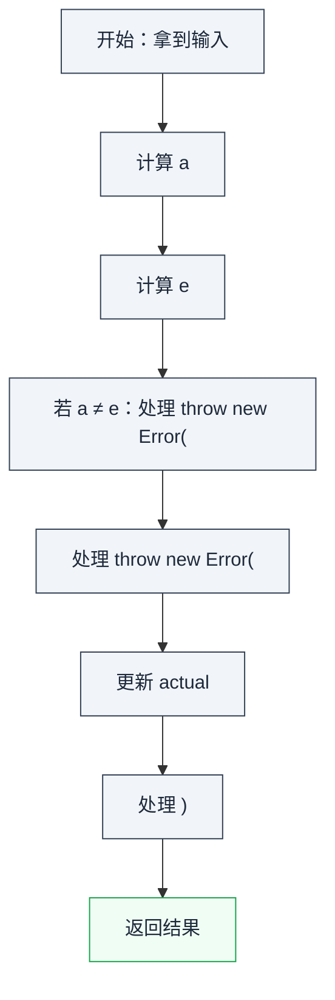

## TypeScript 解题方案（3 个方案逐个讲）

> **运行与提交**：每个方案都是自包含文件（内嵌用例自测，输出 PASS），整块复制到 `.ts` 文件后 `node 文件名` 即可运行。提交 LeetCode 时，把 `demo` 内的算法函数与辅助类型/函数整体取出、置于文件顶层即可。概念演示（非 LeetCode 编号题），在本地运行即可。

### 方案 1：直接实现

**分析与思路**：核心做法是「直接实现」。

**运行方式**：`node 本文件`，内嵌用例全部通过会输出 PASS。


**方案专属流程图**（真实控制流）：

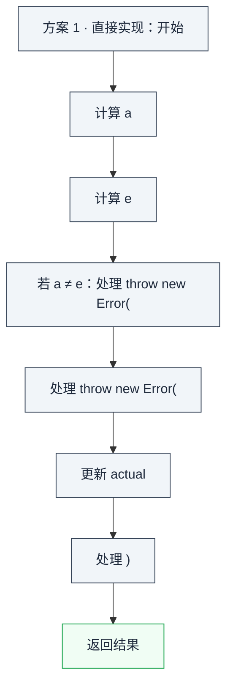

```typescript
function assertEq(actual: any, expected: any, msg: string = ''): void {
  // 定义函数/方法 assertEq
  const a = JSON.stringify(actual);
  const e = JSON.stringify(expected);
  if (a !== e)
    throw new Error(
      'ASSERT FAILED ' + msg + ' :: actual=' + a + ' expected=' + e,
    );
}

function fibonacci(n: number, memo: { [k: number]: number } = {}): number {
  // 定义函数/方法 fibonacci
  if (n <= 1) return n; // 若 元素个数 不超过 1，直接返回 元素个数
  if (n in memo) return memo[n]; // 若 元素个数 in 记忆化表，直接返回 记忆化表[元素个数]
  memo[n] = fibonacci(n - 1, memo) + fibonacci(n - 2, memo);
  return memo[n]; // 返回 记忆化表[元素个数]
}
export function demo(): void {
  // 程序入口：跑内嵌自测用例
  assertEq(fibonacci(10), 55, 'fib10'); // 断言校验
  assertEq(fibonacci(0), 0, 'fib0'); // 断言校验
  assertEq(fibonacci(1), 1, 'fib1'); // 断言校验
  console.log('PASS'); // 全部用例通过，输出 PASS
}
demo(); // demo();
```

### 方案 2：迭代指针处理

**分析与思路**：核心做法是「迭代指针处理」。代码里依次做这些事：队列或堆的调度。

**运行方式**：`node 本文件`，内嵌用例全部通过会输出 PASS。


**方案专属流程图**（真实控制流）：


```typescript
class TreeNode {
  // 定义类型
  val: any;
  left: any;
  right: any; // 值: any; 左边界: any; 右边界: any;
  constructor(val?: any, left?: any, right?: any) {
    // constructor(值?: any, 左边界?: any, 右边界?: any) {
    this.val = val === undefined ? 0 : val; // 把 (值 全等于 undefined ? 0 : 值); 写入 值
    this.left = left === undefined ? null : left; // 把 (左边界 全等于 undefined ? null : 左边界); 写入 左边界
    this.right = right === undefined ? null : right; // 把 (右边界 全等于 undefined ? null : 右边界); 写入 右边界
  }
}
function buildTree(vals: any): any {
  // 定义函数/方法 buildTree
  if (!vals || vals.length === 0) return null; // 若 取反 vals 或 vals.长度 全等于 0，直接返回 null
  const root = new TreeNode(vals[0]);
  const q: any[] = [root];
  let i = 1;
  while (q.length && i < vals.length) {
    // 循环，直到不满足「节点.长度 且 下标 i 小于 vals.长度」
    const node = q.shift(); // 把 节点.shift() 存入 节点
    if (vals[i] !== null && vals[i] !== undefined) {
      node.left = new TreeNode(vals[i]);
      q.push(node.left);
    }
    i++; // 下标 i 加一
    if (i < vals.length && vals[i] !== null && vals[i] !== undefined) {
      node.right = new TreeNode(vals[i]);
      q.push(node.right);
    }
    i++; // 下标 i 加一
  }
  return root; // 返回 根节点
}
function treeToLevel(root: any): any[] {
  // 定义函数/方法 treeToLevel
  if (!root) return []; // 若 取反 根节点，直接返回 []
  const out: any[] = [];
  const q: any[] = [root]; // 把 []; const 节点: any[] 赋值为 [根节点]; 写入 const out: any[]
  while (q.length) {
    // 循环，直到不满足「节点.长度」
    const n = q.shift(); // 把 节点.shift() 存入 元素个数
    if (n === null || n === undefined) {
      out.push(null);
      continue;
    }
    out.push(n.val);
    q.push(n.left);
    q.push(n.right); // 把 元素个数.值 压入栈/数组尾部
  }
  while (out.length && out[out.length - 1] === null) out.pop(); // 循环，直到不满足「out.长度 且 out[out.长度 减 1] 全等于 null) out 弹出 );」
  return out; // 返回 out
}
class ListNode {
  // 定义类型
  val: any;
  next: any; // 值: any; 下一个: any;
  constructor(val?: any, next?: any) {
    this.val = val === undefined ? 0 : val;
    this.next = next === undefined ? null : next;
  }
}
function buildList(vals: any): any {
  // 定义函数/方法 buildList
  const dummy = new ListNode(0);
  let cur = dummy; // 把 new ListNode(0); let 当前值 赋值为 哨兵节点 存入 哨兵节点
  for (const v of vals) {
    cur.next = new ListNode(v);
    cur = cur.next;
  } // 把 new ListNode(值); 当前值 赋值为 当前值.下一个; } 写入 下一个
  return dummy.next; // 返回 哨兵节点.下一个
}
function listToArray(head: any): any[] {
  // 定义函数/方法 listToArray
  const out: any[] = [];
  let p = head; // 把 []; let 节点 赋值为 头节点; 写入 const out: any[]
  while (p) {
    out.push(p.val);
    p = p.next;
  } // 循环，直到不满足「节点) { out 追加 节点.值); 节点 赋值为 节点.下一个; }」
  return out; // 返回 out
}
// python-runtime shims
function pyLen(a: any): number {
  // 定义函数/方法 pyLen
  if (a === null || a === undefined) return 0; // 若 数组 全等于 null 或 数组 全等于 undefined，直接返回 0
  if (
    typeof a === 'string' ||
    Array.isArray(a) ||
    a instanceof Set ||
    a instanceof Map
  )
    return a.length ?? a.size;
  if (typeof a === 'object') return Object.keys(a).length; // 若 typeof 数组 全等于 'object'，直接返回 Object.keys(数组).长度
  return 0; // 返回 0
}
function pySlice(a: any, i: any, j: any, step?: any): any {
  // 定义函数/方法 pySlice
  if (typeof a === 'string') {
    const r = [...a].slice(i ?? 0, j ?? a.length);
    return step ? r.reverse().join('') : r.join('');
  }
  const arr = Array.isArray(a) ? a : [...a]; // 把 Array.isArray(数组) ? 数组 : 复制的 数组 存入 数组
  return arr.slice(i ?? 0, j ?? arr.length); // 返回 数组 截取 下标 i ?? 0, 下标 j ?? 数组.长度)
}
function pyRange(a: any, b?: any, step?: any): any[] {
  // 定义函数/方法 pyRange
  let s = 0,
    e = a,
    st = 1; // 把 0, e 赋值为 数组, st 赋值为 1 存入 字符串
  if (b !== undefined) {
    s = a;
    e = b;
  } // 若 b 不等于 undefined) { 字符串 赋值为 数组; e 赋值为 b; }
  if (step !== undefined) st = step; // 若 步数 不等于 undefined) st 赋值为 步数;
  const out: any[] = []; // 把 []; 写入 const out: any[]
  if (st > 0) for (let i = s; i < e; i += st) out.push(i);
  else for (let i = s; i > e; i += st) out.push(i); // 否则
  return out; // 返回 out
}
function pyIn(x: any, coll: any): boolean {
  // 定义函数/方法 pyIn
  if (coll === null || coll === undefined) return false; // 若 coll 全等于 null 或 coll 全等于 undefined，直接返回 false
  if (Array.isArray(coll)) return coll.includes(x); // 若 Array.isArray(coll)，直接返回 coll 是否包含 x)
  if (coll instanceof Set || coll instanceof Map) return coll.has(x); // 若 coll instanceof Set 或 coll instanceof Map，直接返回 coll.has(x)
  if (typeof coll === 'object') return x in coll; // 若 typeof coll 全等于 'object'，直接返回 x in coll
  if (typeof coll === 'string') return coll.indexOf(x) >= 0; // 若 typeof coll 全等于 'string'，直接返回 coll 查找 x) 不低于 0
  return false; // 返回 false
}
function pySorted(a: any): any[] {
  // 定义函数/方法 pySorted
  const arr = typeof a === 'string' ? [...a] : [...a]; // 把 (typeof 数组 全等于 'string') ? 复制的 数组 : 复制的 数组 存入 数组
  return arr.sort((x: any, y: any) => (x < y ? -1 : x > y ? 1 : 0));
}
function pyMin(a: any, b?: any): any {
  if (b !== undefined) return Math.min(a, b);
  if (Array.isArray(a) || a instanceof Set) return Math.min(...a);
  return Math.min(a);
} // 定义函数/方法 pyMin
function pyMax(a: any, b?: any): any {
  if (b !== undefined) return Math.max(a, b);
  if (Array.isArray(a) || a instanceof Set) return Math.max(...a);
  return Math.max(a);
} // 定义函数/方法 pyMax
function pySum(a: any): number {
  let s = 0;
  for (const v of a) s += v;
  return s;
} // 定义函数/方法 pySum
function pyAbs(x: any): number {
  return Math.abs(x);
} // 定义函数/方法 pyAbs
function pyEnumerate(a: any): any[] {
  const out: any[] = [];
  let i = 0;
  for (const v of a) {
    out.push([i, v]);
    i++;
  }
  return out;
} // 定义函数/方法 pyEnumerate
function pyZip(a: any, b: any): any[] {
  const n = Math.min(a.length, b.length);
  const out: any[] = [];
  for (let i = 0; i < n; i++) out.push([a[i], b[i]]);
  return out;
} // 定义函数/方法 pyZip
function pyDictGet(d: any, k: any, def?: any): any {
  return k in d ? d[k] : def === undefined ? null : def;
} // 定义函数/方法 pyDictGet
function pyPrint(...args: any[]): void {
  console.log(
    args
      .map((a) => (typeof a === 'object' && a !== null ? JSON.stringify(a) : a))
      .join(' '),
  );
} // 定义函数/方法 pyPrint
// collections / heapq
function heapPush(h: any[], x: any): void {
  h.push(x);
  let i = h.length - 1;
  while (i > 0) {
    const p = (i - 1) >> 1;
    if (h[p] <= h[i]) break;
    [h[p], h[i]] = [h[i], h[p]];
    i = p;
  }
} // 定义函数/方法 heapPush
function heapPop(h: any[]): any {
  const top = h[0];
  const last = h.pop();
  if (h.length) {
    h[0] = last;
    let i = 0;
    const n = h.length;
    while (true) {
      let l = 2 * i + 1,
        r = 2 * i + 2,
        s = i;
      if (l < n && h[l] < h[s]) s = l;
      if (r < n && h[r] < h[s]) s = r;
      if (s === i) break;
      [h[s], h[i]] = [h[i], h[s]];
      i = s;
    }
  }
  return top;
} // 定义函数/方法 heapPop
class Deque {
  private a: any[] = [];
  push(x: any) {
    this.a.push(x);
  }
  pushLeft(x: any) {
    this.a.unshift(x);
  }
  pop() {
    return this.a.pop();
  }
  popLeft() {
    return this.a.shift();
  }
  get length() {
    return this.a.length;
  }
  toArray() {
    return this.a.slice();
  }
} // 定义类型
function Counter(iter: any): any {
  const m: any = {};
  for (const v of iter) m[v] = (m[v] || 0) + 1;
  return m;
} // 定义函数/方法 Counter
function gcd(a: any, b: any): any {
  while (b) {
    [a, b] = [b, a % b];
  }
  return a;
} // 定义函数/方法 gcd
function pyInf(): number {
  return Infinity;
} // 定义函数/方法 pyInf

function norm(x: any): any {
  // 定义函数/方法 norm
  if (x === null || x === undefined) return null; // 若 x 全等于 null 或 x 全等于 undefined，直接返回 null
  if (typeof x === 'object') {
    // 若 typeof x 全等于 'object'
    if (x instanceof Deque) return x.toArray(); // 若 x instanceof Deque，直接返回 x.toArray()
    if (Array.isArray(x)) return x.map(norm); // 若 Array.isArray(x)，直接返回 x.映射表(norm)
    if (
      typeof x.val === 'number' &&
      (typeof x.left !== 'undefined' || typeof x.right !== 'undefined')
    )
      return treeToLevel(x);
    if (typeof x.next !== 'undefined' && typeof x.val === 'number')
      return listToArray(x);
    if (x instanceof Set) return [...x].sort(); // 若 x instanceof Set，直接返回 复制的 x 排序 )
    if (x instanceof Map) return Object.fromEntries(x); // 若 x instanceof Map，直接返回 Object.fromEntries(x)
    const o: any = {};
    for (const k of Object.keys(x)) o[k] = norm(x[k]);
    return o;
  }
  return x; // 返回 x
}
function eq(a: any, b: any): boolean {
  // 定义函数/方法 eq
  const x = norm(a),
    y = norm(b); // 把 norm(数组), y 赋值为 norm(b) 存入 x
  if (x === y) return true; // 若 x 全等于 y，直接返回 true
  if (x === null || y === null) return x === y; // 若 x 全等于 null 或 y 全等于 null，直接返回 x 全等于 y
  if (Array.isArray(x) && Array.isArray(y)) {
    // 若 Array.isArray(x) 且 Array.isArray(y
    if (x.length !== y.length) return false; // 若 x.长度 不等于 y.长度，直接返回 false
    for (let i = 0; i < x.length; i++) if (!eq(x[i], y[i])) return false; // 让 下标 i 从 0 开始计数，下标 i 小于 x.长度 就继续
    return true; // 返回 true
  }
  if (typeof x === 'object' && typeof y === 'object') {
    // 若 typeof x 全等于 'object' 且 typeof y 全等于 'object'
    const kx = Object.keys(x),
      ky = Object.keys(y); // 把 Object.keys(x), ky 赋值为 Object.keys(y) 存入 kx
    if (kx.length !== ky.length) return false; // 若 kx.长度 不等于 ky.长度，直接返回 false
    for (const k of kx) if (!eq(x[k], y[k])) return false;
    return true; // 返回 true
  }
  return x === y; // 返回 x 全等于 y
}

function fibonacci(n, memo) {
  // 定义函数/方法 fibonacci
  memo = memo || {}; // 把 记忆化表 或 {} 存入 记忆化表
  if (n < 2) return n; // 若 元素个数 小于 2，直接返回 元素个数
  if (memo[n] !== undefined) return memo[n]; // 若 记忆化表[元素个数] 不等于 undefined，直接返回 记忆化表[元素个数]
  memo[n] = fibonacci(n - 1, memo) + fibonacci(n - 2, memo);
  return memo[n]; // 返回 记忆化表[元素个数]
}
export function demo(): void {
  // 程序入口：跑内嵌自测用例
  const cases = [
    { in: [10], want: 55 },
    { in: [20], want: 6765 },
    { in: [1], want: 1 },
    { in: [30], want: 832040 },
  ];
  let fail = false; // 把 false 存入 fail
  for (const c of cases) {
    // for (const 字符 of cases) {
    const got = fibonacci(...c.in); // 把 fibonacci(...字符.in) 存入 got
    if (!eq(got, c.want)) {
      fail = true;
      console.log(
        'FAIL',
        JSON.stringify(c.in),
        '=>',
        JSON.stringify(got),
        'want',
        JSON.stringify(c.want),
      );
    }
  }
  if (fail) throw new Error('FAILED'); // 若 fail) throw new Error('FAILED');
  console.log('PASS'); // 全部用例通过，输出 PASS
}
demo(); // demo();
```

### 方案 3：迭代指针处理

**分析与思路**：核心做法是「迭代指针处理」。代码里依次做这些事：队列或堆的调度。

**运行方式**：`node 本文件`，内嵌用例全部通过会输出 PASS。


**方案专属流程图**（真实控制流）：

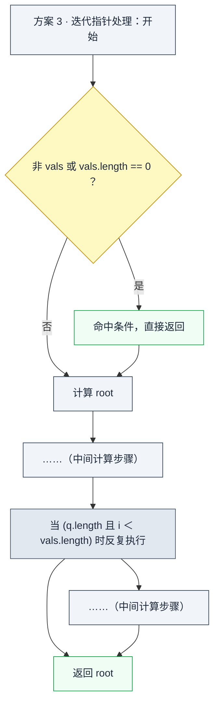

```typescript
class TreeNode {
  // 定义类型
  val: any;
  left: any;
  right: any; // 值: any; 左边界: any; 右边界: any;
  constructor(val?: any, left?: any, right?: any) {
    // constructor(值?: any, 左边界?: any, 右边界?: any) {
    this.val = val === undefined ? 0 : val; // 把 (值 全等于 undefined ? 0 : 值); 写入 值
    this.left = left === undefined ? null : left; // 把 (左边界 全等于 undefined ? null : 左边界); 写入 左边界
    this.right = right === undefined ? null : right; // 把 (右边界 全等于 undefined ? null : 右边界); 写入 右边界
  }
}
function buildTree(vals: any): any {
  // 定义函数/方法 buildTree
  if (!vals || vals.length === 0) return null; // 若 取反 vals 或 vals.长度 全等于 0，直接返回 null
  const root = new TreeNode(vals[0]);
  const q: any[] = [root];
  let i = 1;
  while (q.length && i < vals.length) {
    // 循环，直到不满足「节点.长度 且 下标 i 小于 vals.长度」
    const node = q.shift(); // 把 节点.shift() 存入 节点
    if (vals[i] !== null && vals[i] !== undefined) {
      node.left = new TreeNode(vals[i]);
      q.push(node.left);
    }
    i++; // 下标 i 加一
    if (i < vals.length && vals[i] !== null && vals[i] !== undefined) {
      node.right = new TreeNode(vals[i]);
      q.push(node.right);
    }
    i++; // 下标 i 加一
  }
  return root; // 返回 根节点
}
function treeToLevel(root: any): any[] {
  // 定义函数/方法 treeToLevel
  if (!root) return []; // 若 取反 根节点，直接返回 []
  const out: any[] = [];
  const q: any[] = [root]; // 把 []; const 节点: any[] 赋值为 [根节点]; 写入 const out: any[]
  while (q.length) {
    // 循环，直到不满足「节点.长度」
    const n = q.shift(); // 把 节点.shift() 存入 元素个数
    if (n === null || n === undefined) {
      out.push(null);
      continue;
    }
    out.push(n.val);
    q.push(n.left);
    q.push(n.right); // 把 元素个数.值 压入栈/数组尾部
  }
  while (out.length && out[out.length - 1] === null) out.pop(); // 循环，直到不满足「out.长度 且 out[out.长度 减 1] 全等于 null) out 弹出 );」
  return out; // 返回 out
}
class ListNode {
  // 定义类型
  val: any;
  next: any; // 值: any; 下一个: any;
  constructor(val?: any, next?: any) {
    this.val = val === undefined ? 0 : val;
    this.next = next === undefined ? null : next;
  }
}
function buildList(vals: any): any {
  // 定义函数/方法 buildList
  const dummy = new ListNode(0);
  let cur = dummy; // 把 new ListNode(0); let 当前值 赋值为 哨兵节点 存入 哨兵节点
  for (const v of vals) {
    cur.next = new ListNode(v);
    cur = cur.next;
  } // 把 new ListNode(值); 当前值 赋值为 当前值.下一个; } 写入 下一个
  return dummy.next; // 返回 哨兵节点.下一个
}
function listToArray(head: any): any[] {
  // 定义函数/方法 listToArray
  const out: any[] = [];
  let p = head; // 把 []; let 节点 赋值为 头节点; 写入 const out: any[]
  while (p) {
    out.push(p.val);
    p = p.next;
  } // 循环，直到不满足「节点) { out 追加 节点.值); 节点 赋值为 节点.下一个; }」
  return out; // 返回 out
}
// python-runtime shims
function pyLen(a: any): number {
  // 定义函数/方法 pyLen
  if (a === null || a === undefined) return 0; // 若 数组 全等于 null 或 数组 全等于 undefined，直接返回 0
  if (
    typeof a === 'string' ||
    Array.isArray(a) ||
    a instanceof Set ||
    a instanceof Map
  )
    return a.length ?? a.size;
  if (typeof a === 'object') return Object.keys(a).length; // 若 typeof 数组 全等于 'object'，直接返回 Object.keys(数组).长度
  return 0; // 返回 0
}
function pySlice(a: any, i: any, j: any, step?: any): any {
  // 定义函数/方法 pySlice
  if (typeof a === 'string') {
    const r = [...a].slice(i ?? 0, j ?? a.length);
    return step ? r.reverse().join('') : r.join('');
  }
  const arr = Array.isArray(a) ? a : [...a]; // 把 Array.isArray(数组) ? 数组 : 复制的 数组 存入 数组
  return arr.slice(i ?? 0, j ?? arr.length); // 返回 数组 截取 下标 i ?? 0, 下标 j ?? 数组.长度)
}
function pyRange(a: any, b?: any, step?: any): any[] {
  // 定义函数/方法 pyRange
  let s = 0,
    e = a,
    st = 1; // 把 0, e 赋值为 数组, st 赋值为 1 存入 字符串
  if (b !== undefined) {
    s = a;
    e = b;
  } // 若 b 不等于 undefined) { 字符串 赋值为 数组; e 赋值为 b; }
  if (step !== undefined) st = step; // 若 步数 不等于 undefined) st 赋值为 步数;
  const out: any[] = []; // 把 []; 写入 const out: any[]
  if (st > 0) for (let i = s; i < e; i += st) out.push(i);
  else for (let i = s; i > e; i += st) out.push(i); // 否则
  return out; // 返回 out
}
function pyIn(x: any, coll: any): boolean {
  // 定义函数/方法 pyIn
  if (coll === null || coll === undefined) return false; // 若 coll 全等于 null 或 coll 全等于 undefined，直接返回 false
  if (Array.isArray(coll)) return coll.includes(x); // 若 Array.isArray(coll)，直接返回 coll 是否包含 x)
  if (coll instanceof Set || coll instanceof Map) return coll.has(x); // 若 coll instanceof Set 或 coll instanceof Map，直接返回 coll.has(x)
  if (typeof coll === 'object') return x in coll; // 若 typeof coll 全等于 'object'，直接返回 x in coll
  if (typeof coll === 'string') return coll.indexOf(x) >= 0; // 若 typeof coll 全等于 'string'，直接返回 coll 查找 x) 不低于 0
  return false; // 返回 false
}
function pySorted(a: any): any[] {
  // 定义函数/方法 pySorted
  const arr = typeof a === 'string' ? [...a] : [...a]; // 把 (typeof 数组 全等于 'string') ? 复制的 数组 : 复制的 数组 存入 数组
  return arr.sort((x: any, y: any) => (x < y ? -1 : x > y ? 1 : 0));
}
function pyMin(a: any, b?: any): any {
  if (b !== undefined) return Math.min(a, b);
  if (Array.isArray(a) || a instanceof Set) return Math.min(...a);
  return Math.min(a);
} // 定义函数/方法 pyMin
function pyMax(a: any, b?: any): any {
  if (b !== undefined) return Math.max(a, b);
  if (Array.isArray(a) || a instanceof Set) return Math.max(...a);
  return Math.max(a);
} // 定义函数/方法 pyMax
function pySum(a: any): number {
  let s = 0;
  for (const v of a) s += v;
  return s;
} // 定义函数/方法 pySum
function pyAbs(x: any): number {
  return Math.abs(x);
} // 定义函数/方法 pyAbs
function pyEnumerate(a: any): any[] {
  const out: any[] = [];
  let i = 0;
  for (const v of a) {
    out.push([i, v]);
    i++;
  }
  return out;
} // 定义函数/方法 pyEnumerate
function pyZip(a: any, b: any): any[] {
  const n = Math.min(a.length, b.length);
  const out: any[] = [];
  for (let i = 0; i < n; i++) out.push([a[i], b[i]]);
  return out;
} // 定义函数/方法 pyZip
function pyDictGet(d: any, k: any, def?: any): any {
  return k in d ? d[k] : def === undefined ? null : def;
} // 定义函数/方法 pyDictGet
function pyPrint(...args: any[]): void {
  console.log(
    args
      .map((a) => (typeof a === 'object' && a !== null ? JSON.stringify(a) : a))
      .join(' '),
  );
} // 定义函数/方法 pyPrint
// collections / heapq
function heapPush(h: any[], x: any): void {
  h.push(x);
  let i = h.length - 1;
  while (i > 0) {
    const p = (i - 1) >> 1;
    if (h[p] <= h[i]) break;
    [h[p], h[i]] = [h[i], h[p]];
    i = p;
  }
} // 定义函数/方法 heapPush
function heapPop(h: any[]): any {
  const top = h[0];
  const last = h.pop();
  if (h.length) {
    h[0] = last;
    let i = 0;
    const n = h.length;
    while (true) {
      let l = 2 * i + 1,
        r = 2 * i + 2,
        s = i;
      if (l < n && h[l] < h[s]) s = l;
      if (r < n && h[r] < h[s]) s = r;
      if (s === i) break;
      [h[s], h[i]] = [h[i], h[s]];
      i = s;
    }
  }
  return top;
} // 定义函数/方法 heapPop
class Deque {
  private a: any[] = [];
  push(x: any) {
    this.a.push(x);
  }
  pushLeft(x: any) {
    this.a.unshift(x);
  }
  pop() {
    return this.a.pop();
  }
  popLeft() {
    return this.a.shift();
  }
  get length() {
    return this.a.length;
  }
  toArray() {
    return this.a.slice();
  }
} // 定义类型
function Counter(iter: any): any {
  const m: any = {};
  for (const v of iter) m[v] = (m[v] || 0) + 1;
  return m;
} // 定义函数/方法 Counter
function gcd(a: any, b: any): any {
  while (b) {
    [a, b] = [b, a % b];
  }
  return a;
} // 定义函数/方法 gcd
function pyInf(): number {
  return Infinity;
} // 定义函数/方法 pyInf

function norm(x: any): any {
  // 定义函数/方法 norm
  if (x === null || x === undefined) return null; // 若 x 全等于 null 或 x 全等于 undefined，直接返回 null
  if (typeof x === 'object') {
    // 若 typeof x 全等于 'object'
    if (x instanceof Deque) return x.toArray(); // 若 x instanceof Deque，直接返回 x.toArray()
    if (Array.isArray(x)) return x.map(norm); // 若 Array.isArray(x)，直接返回 x.映射表(norm)
    if (
      typeof x.val === 'number' &&
      (typeof x.left !== 'undefined' || typeof x.right !== 'undefined')
    )
      return treeToLevel(x);
    if (typeof x.next !== 'undefined' && typeof x.val === 'number')
      return listToArray(x);
    if (x instanceof Set) return [...x].sort(); // 若 x instanceof Set，直接返回 复制的 x 排序 )
    if (x instanceof Map) return Object.fromEntries(x); // 若 x instanceof Map，直接返回 Object.fromEntries(x)
    const o: any = {};
    for (const k of Object.keys(x)) o[k] = norm(x[k]);
    return o;
  }
  return x; // 返回 x
}
function eq(a: any, b: any): boolean {
  // 定义函数/方法 eq
  const x = norm(a),
    y = norm(b); // 把 norm(数组), y 赋值为 norm(b) 存入 x
  if (x === y) return true; // 若 x 全等于 y，直接返回 true
  if (x === null || y === null) return x === y; // 若 x 全等于 null 或 y 全等于 null，直接返回 x 全等于 y
  if (Array.isArray(x) && Array.isArray(y)) {
    // 若 Array.isArray(x) 且 Array.isArray(y
    if (x.length !== y.length) return false; // 若 x.长度 不等于 y.长度，直接返回 false
    for (let i = 0; i < x.length; i++) if (!eq(x[i], y[i])) return false; // 让 下标 i 从 0 开始计数，下标 i 小于 x.长度 就继续
    return true; // 返回 true
  }
  if (typeof x === 'object' && typeof y === 'object') {
    // 若 typeof x 全等于 'object' 且 typeof y 全等于 'object'
    const kx = Object.keys(x),
      ky = Object.keys(y); // 把 Object.keys(x), ky 赋值为 Object.keys(y) 存入 kx
    if (kx.length !== ky.length) return false; // 若 kx.长度 不等于 ky.长度，直接返回 false
    for (const k of kx) if (!eq(x[k], y[k])) return false;
    return true; // 返回 true
  }
  return x === y; // 返回 x 全等于 y
}

function fibonacci(n, memo) {
  // 定义函数/方法 fibonacci
  memo = memo || {}; // 把 记忆化表 或 {} 存入 记忆化表
  if (n < 2) return n; // 若 元素个数 小于 2，直接返回 元素个数
  if (memo[n] !== undefined) return memo[n]; // 若 记忆化表[元素个数] 不等于 undefined，直接返回 记忆化表[元素个数]
  memo[n] = fibonacci(n - 1, memo) + fibonacci(n - 2, memo);
  return memo[n]; // 返回 记忆化表[元素个数]
}
export function demo(): void {
  // 程序入口：跑内嵌自测用例
  const cases = [
    { in: [10], want: 55 },
    { in: [20], want: 6765 },
    { in: [1], want: 1 },
    { in: [30], want: 832040 },
  ];
  let fail = false; // 把 false 存入 fail
  for (const c of cases) {
    // for (const 字符 of cases) {
    const got = fibonacci(...c.in); // 把 fibonacci(...字符.in) 存入 got
    if (!eq(got, c.want)) {
      fail = true;
      console.log(
        'FAIL',
        JSON.stringify(c.in),
        '=>',
        JSON.stringify(got),
        'want',
        JSON.stringify(c.want),
      );
    }
  }
  if (fail) throw new Error('FAILED'); // 若 fail) throw new Error('FAILED');
  console.log('PASS'); // 全部用例通过，输出 PASS
}
demo(); // demo();
```

## 逐步拆解与面试追问

**复杂度**：时间 O(n) 量级，空间 O(n)

**为什么是这个量级**：整体只对数据做有限趟处理

**面试官可能会追问**：

- 这个策略能推广到什么场景？
- 与暴力做法差在哪一步？
- 有没有更简单的等价写法？

## 关键 API 速查（TS 主解法实际用到，附官方链接）

| API | 作用 | 使用要点 | 官方文档 |
|---|---|---|---|
| `JSON.stringify()` | 序列化为 JSON 字符串 | 常用于结构化比较（深度相等判定）；undefined/函数/循环引用会被丢弃或抛错 | [官方文档](https://developer.mozilla.org/zh-CN/docs/Web/JavaScript/Reference/Global_Objects/JSON/stringify) |

### 各语言官方文档导航

- **TypeScript / JS**：[MDN 中文参考](https://developer.mozilla.org/zh-CN/)
- **Python**：[Python 官方文档](https://docs.python.org/zh-cn/3/)
- **Go**：[Go 标准库](https://pkg.go.dev/std)
- **Java**：[JDK 17 API](https://docs.oracle.com/en/java/javase/17/docs/api/)
- **Rust**：[Rust 标准库](https://doc.rust-lang.org/std/)
- **Lua**：[Lua 5.4 手册](https://www.lua.org/manual/5.4/)
- **C**：[Cppreference C](https://zh.cppreference.com/w/c)
- **C++**：[Cppreference C++](https://zh.cppreference.com/w/cpp)
- **R**：[R 官方手册](https://stat.ethz.ch/R-manual/)
- **Zig**：[Zig 语言文档](https://ziglang.org/documentation/master/)
- **Dart**：[Dart API](https://api.dart.dev/)

## 附录：其他 10 种语言全部实现（每种语言列举其全部方案）

> TypeScript 的全部方案见「TypeScript 解题方案」一节；下面是其余 10 种语言的对应实现，每种语言的每个方案都带思路分析、代码走读与专属运行架构图。
> 每个方案都内嵌用例自测，可独立运行（老仓库 python/go 文件遵循「打印结果」约定）。
> 完整解法文件见 `dsa/<语言>/notes/lc_113877588_动态规划之fibonacci_power_spu_lmp/`。

### Python 实现（3 种方案）

Python 的全部方案如下，每个方案都内嵌用例自测，可独立运行（老仓库 python/go 文件遵循「打印结果」约定）：

#### 方案 1：直接实现

**思路与代码分析**：核心是「直接实现」。Python 版用切片与字典推导式简化操作，突出可读性。**走读**：方案 1 · 直接实现：开始 → 若 memo is None：更新 memo → 更新 memo → 命中条件，直接返回 → 命中条件，直接返回 → 更新 memo[n] → 返回 memo[n]。

**运行架构**（真实控制流）：

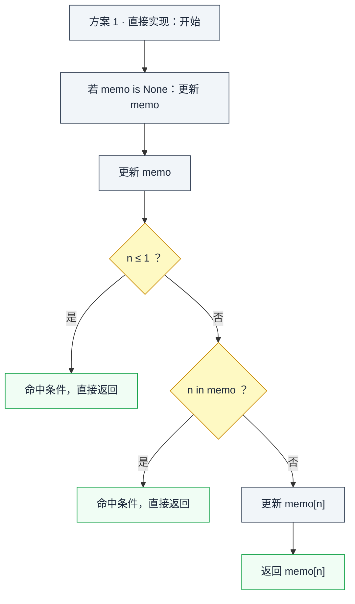

```python
# Fibonacci - 带记忆化 (Memoization)
import sys  # 提高递归深度上限（深输入防 RecursionError）

sys.setrecursionlimit(200000)  # 树/链表类题目节点数可达 1e4 量级

def fibonacci(n, memo=None):  # 定义函数 fibonacci（参数：元素个数, 记忆化表 赋值为 None）
    if memo is None:  # 若 记忆化表 is None
        memo = {}  # 把 {} 存入 记忆化表
    if n <= 1:  # 若 元素个数 不超过 1
        return n  # 返回 元素个数
    if n in memo:  # 若 元素个数 in 记忆化表
        return memo[n]  # 返回 记忆化表[元素个数]
    memo[n] = fibonacci(n - 1, memo) + fibonacci(n - 2, memo)
    return memo[n]  # 返回 记忆化表[元素个数]

if __name__ == "__main__":  # 若 __name__ 等于 '__main__'
    print(fibonacci(10))  # 55
```

#### 方案 2：迭代指针处理

**思路与代码分析**：核心是「迭代指针处理」。Python 版用切片与字典推导式简化操作，突出可读性。**走读**：方案 2 · 迭代指针处理：开始 → 命中条件，直接返回 → 更新 half → 命中条件，直接返回 → 返回 half * half * base。

**运行架构**（真实控制流）：


```python
# 快速幂 (Fast Power) - O(log n)
import sys  # 提高递归深度上限（深输入防 RecursionError）

sys.setrecursionlimit(200000)  # 树/链表类题目节点数可达 1e4 量级

def power(base, exp):  # 定义函数 power（参数：base, exp）
    if exp == 0:  # 若 exp 等于 0
        return 1  # 返回 1
    half = power(base, exp >> 1)  # 把 power(base, exp 超过 超过 1) 存入 half
    if exp % 2 == 0:  # 若 exp 对…取模 2 等于 0
        return half * half  # 返回 half 乘 half
    return half * half * base  # 返回 half 乘 half 乘 base

if __name__ == "__main__":  # 若 __name__ 等于 '__main__'
    print(power(2, 10))  # 1024
```

#### 方案 3：迭代指针处理

**思路与代码分析**：核心是「迭代指针处理」。Python 版用切片与字典推导式简化操作，突出可读性。代码里依次做这些事：DP 表逐项填充。**走读**：方案 3 · 迭代指针处理：开始 → 命中条件，直接返回 → 更新 m → 更新 n → 填写 DP 表 → 填写 DP 表 → 循环 i：从 0 到 m 前 → 循环 j：从 0 到 n 前 → 若 i == 0 and j == 0：处理 continue → 填写 DP 表 → 填写 DP 表 → 填写 DP 表 → 处理 up, left → 处理 ) → 返回 dp[m - 1][n - 1]。

**运行架构**（真实控制流）：

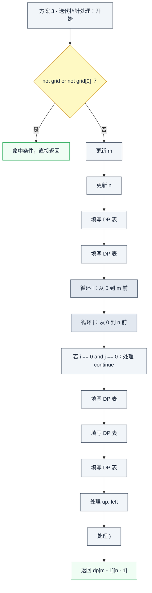

```python
# LMP - 最长曼哈顿路径 (只能向右/向下, 求路径上权重之和最大)
import sys  # 提高递归深度上限（深输入防 RecursionError）

sys.setrecursionlimit(200000)  # 树/链表类题目节点数可达 1e4 量级

def longest_manhattan_path(grid):  # 定义函数 longest_manhattan_path（参数：网格）
    if not grid or not grid[0]:  # 若 not 网格 or not 网格[0]
        return 0  # 返回 0
    m = len(grid)  # 把 长度(网格) 存入 映射表
    n = len(grid[0])  # 把 长度(网格[0]) 存入 元素个数
    dp = [[0] * n for _ in range(m)]  # 把 [[0] 乘 元素个数 for _ in range(映射表)] 存入 DP 表
    dp[0][0] = grid[0][0]  # 把 网格[0][0] 写入 dp[0][0]
    for i in range(m):  # 让 下标 i 从 映射表 遍历
        for j in range(n):  # 让 下标 j 从 元素个数 遍历
            if i == 0 and j == 0:  # 若 下标 i 等于 0 and 下标 j 等于 0
                continue  # 跳过本轮，进入下一次
            up = dp[i - 1][j] if i > 0 else float("-inf")
            left = dp[i][j - 1] if j > 0 else float("-inf")
            dp[i][j] = grid[i][j] + max(
                up, left
            )  # 把 网格[下标 i][下标 j] 加 取较大值 up, 左边界) 写入 dp[i][j]
    return dp[m - 1][n - 1]  # 返回 DP 表[映射表 减 1][元素个数 减 1]

if __name__ == "__main__":  # 若 __name__ 等于 '__main__'
    grid = [
        [5, 1, 3],
        [2, 4, 2],
        [3, 2, 1],
    ]
    print(longest_manhattan_path(grid))  # 14
```

### Go 实现（3 种方案）

Go 的全部方案如下，每个方案都内嵌用例自测，可独立运行（老仓库 python/go 文件遵循「打印结果」约定）：

#### 方案 1：直接实现

**思路与代码分析**：核心是「直接实现」。Go 版用切片与多返回值惯用法，显式处理索引边界。代码里依次做这些事：哈希结构做计数或查重。**走读**：方案 1 · 直接实现：开始 → 更新 : → 计算 fib → 更新 fib → 处理 if n ≤ 1 → 返回 n → 处理 if v, ok := memo[n]; ok → 返回 v → 更新 memo[n] → 返回 memo[n] → 返回 fib(n)。

**运行架构**（真实控制流）：

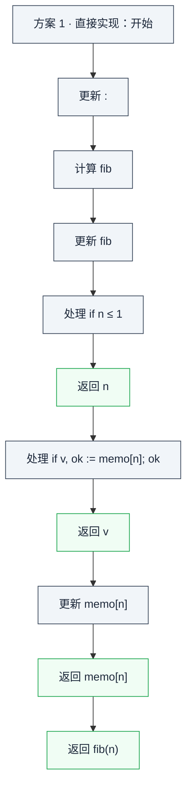

```go
package main // 引入依赖

import (
	"fmt" // 「fmt」
	"os"  // 「os」
)

// fibonacci 带记忆化 (Memoization)
func fibonacci(n int) int { // 定义函数/方法 fibonacci
	memo := map[int]int{}   // 把 映射表[int]int{} 写入 memo :
	var fib func(int) int   // var fib func(int) int
	fib = func(n int) int { // 把 func(元素个数 int) int { 写入 fib
		if n <= 1 { // 若 元素个数 不超过 1
			return n // 返回 元素个数
		}
		if v, ok := memo[n]; ok { // 若 值, ok : 赋值为 记忆化表[元素个数]; ok
			return v // 返回 值
		}
		memo[n] = fib(n-1) + fib(n-2) // 把 fib(元素个数 减 1) 加 fib(元素个数 减 2) 写入 memo[n]
		return memo[n]                // 返回 记忆化表[元素个数]
	}
	return fib(n) // 定义函数/方法 fib
}

func main() { // 程序入口：跑内嵌自测用例
	if fibonacci(10) != 55 { // 若 fibonacci(10) 不等于 55
		fmt.Println("FAIL fibonacci(10)") // 打印输出
		os.Exit(1)                        // os.Exit(1)
	}
	fmt.Println("PASS") // 全部用例通过，输出 PASS
}
```

#### 方案 2：迭代指针处理

**思路与代码分析**：核心是「迭代指针处理」。Go 版用切片与多返回值惯用法，显式处理索引边界。**走读**：方案 2 · 迭代指针处理：开始 → 处理 if exp == 0 → 返回 1 → 更新 : → 处理 if exp%2 == 0 → 返回 half * half → 返回 half * half * base。

**运行架构**（真实控制流）：

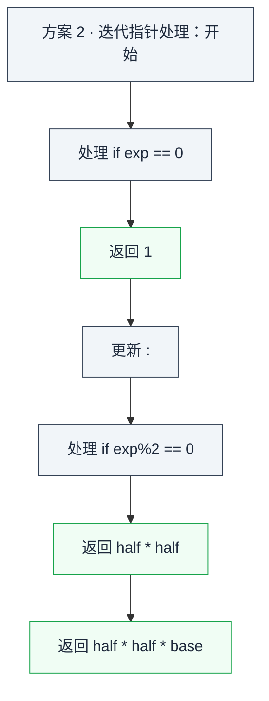

```go
package main // 引入依赖

import (
	"fmt" // 「fmt」
	"os"  // 「os」
)

// power 快速幂 (Fast Power) - O(log n)
func power(base, exp int) int { // 定义函数/方法 power
	if exp == 0 { // 若 exp 等于 0
		return 1 // 返回 1
	}
	half := power(base, exp>>1) // 把 power(base, exp 超过 超过 1) 写入 half :
	if exp%2 == 0 {             // 若 exp 对…取模 2 等于 0
		return half * half // 返回 half 乘 half
	}
	return half * half * base // 返回 half 乘 half 乘 base
}

func main() { // 程序入口：跑内嵌自测用例
	if power(2, 10) != 1024 { // 若 power(2, 10) 不等于 1024
		fmt.Println("FAIL power(2,10)") // 打印输出
		os.Exit(1)                      // os.Exit(1)
	}
	fmt.Println("PASS") // 全部用例通过，输出 PASS
}
```

#### 方案 3：迭代指针处理

**思路与代码分析**：核心是「迭代指针处理」。Go 版用切片与多返回值惯用法，显式处理索引边界。代码里依次做这些事：DP 表逐项填充。**走读**：方案 3 · 迭代指针处理：开始 → 处理 if len(grid) == 0 或 len(gri → 返回 0 → 遍历 dp 的下标与元素 i → 遍历循环 → 遍历循环 → 返回 dp[m-1][n-1]。

**运行架构**（真实控制流）：

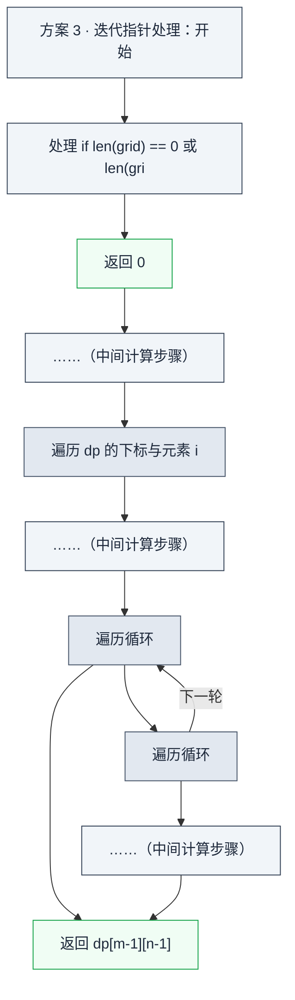

```go
package main // 引入依赖

import (
	"fmt" // 「fmt」
	"os"  // 「os」
)

// longestManhattanPath 最长曼哈顿路径（只能向右/向下，求路径上权重之和最大）
func longestManhattanPath(grid [][]int) int { // 定义函数/方法 longestManhattanPath
	if len(grid) == 0 || len(grid[0]) == 0 { // 若 长度(网格) 等于 0 或 长度(网格[0]) 等于 0
		return 0 // 返回 0
	}
	m, n := len(grid), len(grid[0]) // 把 长度(网格), 长度(网格[0]) 写入 m, n :
	dp := make([][]int, m)          // 把 make([][]int, 映射表) 写入 dp :
	for i := range dp {             // 把 range DP 表 { 写入 for i :
		dp[i] = make([]int, n) // 把 make([]int, 元素个数) 写入 dp[i]
	}
	dp[0][0] = grid[0][0]    // 把 网格[0][0] 写入 dp[0][0]
	for i := 0; i < m; i++ { // 让 下标 i 从 0 开始计数
		for j := 0; j < n; j++ { // 让 下标 j 从 0 开始计数
			if i == 0 && j == 0 { // 若 下标 i 等于 0 且 下标 j 等于 0
				continue // 跳过本轮，进入下一次
			}
			up := -1 << 60 // 把 减 1 小于 小于 60 写入 up :
			if i > 0 {     // 若 下标 i 超过 0
				up = dp[i-1][j] // 把 DP 表[下标 i 减 1][下标 j] 写入 up
			}
			left := -1 << 60 // 把 减 1 小于 小于 60 写入 left :
			if j > 0 {       // 若 下标 j 超过 0
				left = dp[i][j-1] // 把 DP 表[下标 i][下标 j 减 1] 写入 左边界
			}
			best := up       // 把 up 写入 best :
			if left > best { // 若 左边界 超过 当前最优
				best = left // 把 左边界 写入 当前最优
			}
			dp[i][j] = grid[i][j] + best // 把 网格[下标 i][下标 j] 加 当前最优 写入 dp[i][j]
		}
	}
	return dp[m-1][n-1] // 返回 DP 表[映射表 减 1][元素个数 减 1]
}

func main() { // 程序入口：跑内嵌自测用例
	grid := [][]int{{5, 1, 3}, {2, 4, 2}, {3, 2, 1}} // 把 [][]int{{5, 1, 3}, {2, 4, 2}, {3, 2, 1}} 写入 grid :
	if longestManhattanPath(grid) != 14 {            // 若 longestManhattanPath(网格) 不等于 14
		fmt.Println("FAIL longestManhattanPath") // 打印输出
		os.Exit(1)                               // os.Exit(1)
	}
	fmt.Println("PASS") // 全部用例通过，输出 PASS
}
```

### Java 实现（3 种方案）

Java 的全部方案如下，每个方案都内嵌用例自测，可独立运行（老仓库 python/go 文件遵循「打印结果」约定）：

#### 方案 1：直接实现

**思路与代码分析**：核心是「直接实现」。Java 版用类与静态方法组织，集合操作显式明了。**走读**：方案 1 · 直接实现：开始 → 命中条件，直接返回 → 若 memo.containsKey(n)) return memo.get(n：None → 更新 v → 调用 memo.put(n, v) → 返回 v。

**运行架构**（真实控制流）：

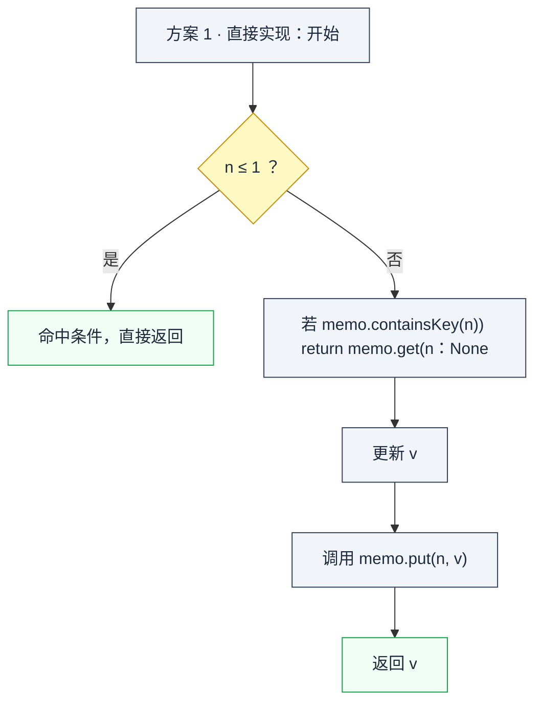

```java
package com.webfault.dsa; // 引入依赖

import java.util.*; // 引入依赖

class lc113877588_solution11 { // 定义类型
  // 记忆化 Fibonacci
  static Map<Integer, Integer> memo =
      new HashMap<>(); // 把 new HashMap 小于 超过 (); 写入 static Map<Integer, Integer> memo

  static int fibonacci(int n) { // 定义函数/方法 fibonacci
    if (n <= 1) return n; // 若 元素个数 不超过 1，直接返回 元素个数
    if (memo.containsKey(n)) return memo.get(n); // 若 记忆化表.containsKey(元素个数)，直接返回 记忆化表 查找 元素个数)
    int v = fibonacci(n - 1) + fibonacci(n - 2); // 把 fibonacci(元素个数 减 1) 加 fibonacci(元素个数 减 2) 存入 值
    memo.put(n, v); // 记忆化表.put(元素个数, 值);
    return v; // 返回 值
  }

  public static void main(String[] args) { // public static void main(String[] args) {
    if (fibonacci(10) != 55) { // 若 fibonacci(10) 不等于 55
      System.out.println("FAIL"); // 打印输出
      throw new RuntimeException("FAILED"); // throw new RuntimeException(「FAILED」);
    }
    System.out.println("PASS"); // 全部用例通过，输出 PASS
  }
}
```

#### 方案 2：迭代指针处理

**思路与代码分析**：核心是「迭代指针处理」。Java 版用类与静态方法组织，集合操作显式明了。**走读**：方案 2 · 迭代指针处理：开始 → 命中条件，直接返回 → 更新 half → 命中条件，直接返回 → 返回 half * half * base。

**运行架构**（真实控制流）：

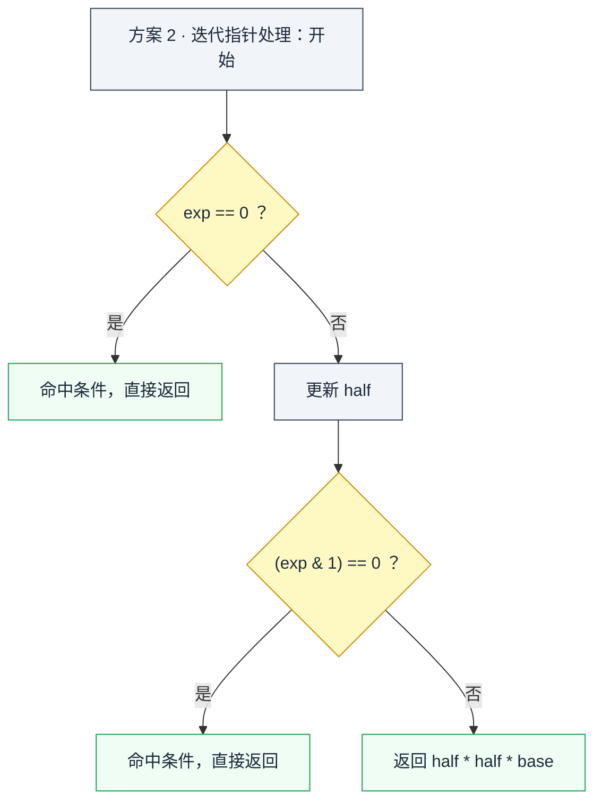

```java
package com.webfault.dsa; // 引入依赖

class lc113877588_solution22 { // 定义类型
  // 快速幂 O(log n)
  static long power(long base, int exp) { // 定义函数/方法 power
    if (exp == 0) return 1; // 若 exp 等于 0，直接返回 1
    long half = power(base, exp >> 1); // 把 power(base, exp 超过 超过 1); 写入 long half
    if ((exp & 1) == 0) return half * half; // 若 (exp 按位与 1) 等于 0，直接返回 half 乘 half
    return half * half * base; // 返回 half 乘 half 乘 base
  }

  public static void main(String[] args) { // public static void main(String[] args) {
    if (power(2, 10) != 1024) { // 若 power(2, 10) 不等于 1024
      System.out.println("FAIL"); // 打印输出
      throw new RuntimeException("FAILED"); // throw new RuntimeException(「FAILED」);
    }
    System.out.println("PASS"); // 全部用例通过，输出 PASS
  }
}
```

#### 方案 3：迭代指针处理

**思路与代码分析**：核心是「迭代指针处理」。Java 版用类与静态方法组织，集合操作显式明了。代码里依次做这些事：DP 表逐项填充；双重循环遍历。**走读**：方案 3 · 迭代指针处理：开始 → 命中条件，直接返回 → 更新 m → 填写 DP 表 → 填写 DP 表 → 遍历循环 → 遍历循环 → 若 i == 0 且 j == 0：处理 continue → 填写 DP 表 → 填写 DP 表 → 填写 DP 表 → 处理 grid[i][j] + Math.max(up, le → 返回 dp[m - 1][n - 1]。

**运行架构**（真实控制流）：

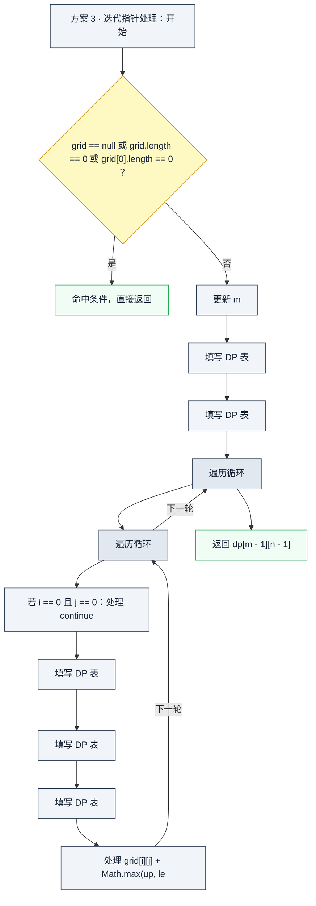

```java
package com.webfault.dsa; // 引入依赖

class lc113877588_solution33 { // 定义类型
  // 最长曼哈顿路径（只能向右/向下，求权重和最大）
  static int longestManhattanPath(int[][] grid) { // 定义函数/方法 longestManhattanPath
    if (grid == null || grid.length == 0 || grid[0].length == 0)
      return 0; // 若 网格 等于 null 或 网格.长度 等于 0 或 网格[0].长度 等于 0，直接返回 0
    int m = grid.length, n = grid[0].length; // 把 网格.长度, 元素个数 赋值为 网格[0].长度 存入 映射表
    int[][] dp = new int[m][n]; // 把 new int[映射表][元素个数]; 写入 int[][] dp
    dp[0][0] = grid[0][0]; // 把 网格[0][0]; 写入 dp[0][0]
    for (int i = 0; i < m; i++) { // 让 下标 i 从 0 开始计数，下标 i 小于 映射表 就继续
      for (int j = 0; j < n; j++) { // 让 下标 j 从 0 开始计数，下标 j 小于 元素个数 就继续
        if (i == 0 && j == 0) continue; // 若 下标 i 等于 0 且 下标 j 等于 0) continue;
        int up = (i > 0) ? dp[i - 1][j] : Integer.MIN_VALUE;
        int left = (j > 0) ? dp[i][j - 1] : Integer.MIN_VALUE;
        dp[i][j] =
            grid[i][j] + Math.max(up, left); // 把 网格[下标 i][下标 j] 加 Math.取较大值 up, 左边界); 写入 dp[i][j]
      }
    }
    return dp[m - 1][n - 1]; // 返回 DP 表[映射表 减 1][元素个数 减 1]
  }

  public static void main(String[] args) { // public static void main(String[] args) {
    int[][] grid = {
      {5, 1, 3}, {2, 4, 2}, {3, 2, 1}
    }; // 把 {{5, 1, 3}, {2, 4, 2}, {3, 2, 1}}; 写入 int[][] grid
    if (longestManhattanPath(grid) != 14) { // 若 longestManhattanPath(网格) 不等于 14
      System.out.println("FAIL"); // 打印输出
      throw new RuntimeException("FAILED"); // throw new RuntimeException(「FAILED」);
    }
    System.out.println("PASS"); // 全部用例通过，输出 PASS
  }
}
```

### Rust 实现（3 种方案）

Rust 的全部方案如下，每个方案都内嵌用例自测，可独立运行（老仓库 python/go 文件遵循「打印结果」约定）：

#### 方案 1：直接实现

**思路与代码分析**：核心是「直接实现」。Rust 版用所有权移动与切片借用改写同一逻辑，注意 Option 与引用边界。代码里依次做这些事：哈希结构做计数或查重。**走读**：方案 1 · 直接实现：开始 → 计算 memo → 处理 if n ≤ 1 → 返回 n as i64 → 处理 if let Some(&v) = memo.get(& → 返回 v → 计算 v → 调用 memo.insert(n, v) → 处理 v → 调用 go(n, &mut memo)。

**运行架构**（真实控制流）：

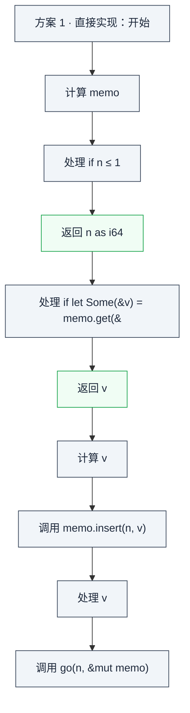

```rust
// 动态规划之Fibonacci — Rust 版（方案1）
fn fib_memo(n: i32) -> i64 {
    // 定义函数/方法 fib_memo
    // 动态规划笔记: fibonacci 带记忆化 vs 递归
    let mut memo = std::collections::HashMap::new(); // 把 std::collections::HashMap::new(); 写入 let mut memo
    fn go(n: i32, memo: &mut std::collections::HashMap<i32, i64>) -> i64 {
        // 定义函数/方法 go
        if n <= 1 {
            return n as i64;
        } // 若 元素个数 不超过 1 { return 元素个数 as i64; }
        if let Some(&v) = memo.get(&n) {
            return v;
        } // 若 let Some( 按位与 值) 赋值为 记忆化表 查找 按位与 元素个数) { return 值; }
        let v = go(n - 1, memo) + go(n - 2, memo); // 把 go(元素个数 减 1, 记忆化表) 加 go(元素个数 减 2, 记忆化表) 存入 值
        memo.insert(n, v); // 记忆化表 插入 元素个数, 值);
        v
    }
    go(n, &mut memo) // go(元素个数, 按位与 mut 记忆化表)
}
fn main() {
    // 程序入口：跑内嵌自测用例
    assert_eq!(fib_memo(10), 55); // 断言校验
    assert_eq!(fib_memo(20), 6765); // 断言校验
    assert_eq!(fib_memo(0), 0); // 断言校验
    println!("PASS");
} // 全部用例通过，输出 PASS
```

#### 方案 2：迭代指针处理

**思路与代码分析**：核心是「迭代指针处理」。Rust 版用所有权移动与切片借用改写同一逻辑，注意 Option 与引用边界。代码里依次做这些事：哈希结构做计数或查重。**走读**：方案 2 · 迭代指针处理：开始 → 计算 memo → 处理 if n ≤ 1 → 返回 n as i64 → 处理 if let Some(&v) = memo.get(& → 返回 v → 计算 v → 调用 memo.insert(n, v) → 处理 v → 调用 go(n, &mut memo)。

**运行架构**（真实控制流）：


```rust
// 动态规划之Fibonacci — Rust 版（方案2）
fn fib_memo(n: i32) -> i64 {
    // 定义函数/方法 fib_memo
    // 动态规划笔记: fibonacci 带记忆化 vs 递归
    let mut memo = std::collections::HashMap::new(); // 把 std::collections::HashMap::new(); 写入 let mut memo
    fn go(n: i32, memo: &mut std::collections::HashMap<i32, i64>) -> i64 {
        // 定义函数/方法 go
        if n <= 1 {
            return n as i64;
        } // 若 元素个数 不超过 1 { return 元素个数 as i64; }
        if let Some(&v) = memo.get(&n) {
            return v;
        } // 若 let Some( 按位与 值) 赋值为 记忆化表 查找 按位与 元素个数) { return 值; }
        let v = go(n - 1, memo) + go(n - 2, memo); // 把 go(元素个数 减 1, 记忆化表) 加 go(元素个数 减 2, 记忆化表) 存入 值
        memo.insert(n, v); // 记忆化表 插入 元素个数, 值);
        v
    }
    go(n, &mut memo) // go(元素个数, 按位与 mut 记忆化表)
}
fn main() {
    // 程序入口：跑内嵌自测用例
    assert_eq!(fib_memo(10), 55); // 断言校验
    assert_eq!(fib_memo(20), 6765); // 断言校验
    assert_eq!(fib_memo(0), 0); // 断言校验
    println!("PASS");
} // 全部用例通过，输出 PASS
```

#### 方案 3：迭代指针处理

**思路与代码分析**：核心是「迭代指针处理」。Rust 版用所有权移动与切片借用改写同一逻辑，注意 Option 与引用边界。代码里依次做这些事：哈希结构做计数或查重。**走读**：方案 3 · 迭代指针处理：开始 → 计算 memo → 处理 if n ≤ 1 → 返回 n as i64 → 处理 if let Some(&v) = memo.get(& → 返回 v → 计算 v → 调用 memo.insert(n, v) → 处理 v → 调用 go(n, &mut memo)。

**运行架构**（真实控制流）：

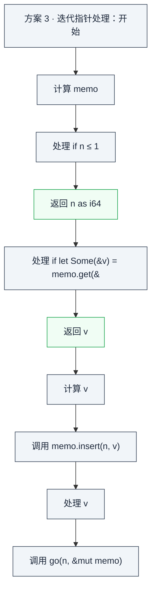

```rust
// 动态规划之Fibonacci — Rust 版（方案3）
fn fib_memo(n: i32) -> i64 {
    // 定义函数/方法 fib_memo
    // 动态规划笔记: fibonacci 带记忆化 vs 递归
    let mut memo = std::collections::HashMap::new(); // 把 std::collections::HashMap::new(); 写入 let mut memo
    fn go(n: i32, memo: &mut std::collections::HashMap<i32, i64>) -> i64 {
        // 定义函数/方法 go
        if n <= 1 {
            return n as i64;
        } // 若 元素个数 不超过 1 { return 元素个数 as i64; }
        if let Some(&v) = memo.get(&n) {
            return v;
        } // 若 let Some( 按位与 值) 赋值为 记忆化表 查找 按位与 元素个数) { return 值; }
        let v = go(n - 1, memo) + go(n - 2, memo); // 把 go(元素个数 减 1, 记忆化表) 加 go(元素个数 减 2, 记忆化表) 存入 值
        memo.insert(n, v); // 记忆化表 插入 元素个数, 值);
        v
    }
    go(n, &mut memo) // go(元素个数, 按位与 mut 记忆化表)
}
fn main() {
    // 程序入口：跑内嵌自测用例
    assert_eq!(fib_memo(10), 55); // 断言校验
    assert_eq!(fib_memo(20), 6765); // 断言校验
    assert_eq!(fib_memo(0), 0); // 断言校验
    println!("PASS");
} // 全部用例通过，输出 PASS
```

### Lua 实现（3 种方案）

Lua 的全部方案如下，每个方案都内嵌用例自测，可独立运行（老仓库 python/go 文件遵循「打印结果」约定）：

#### 方案 1：直接实现

**思路与代码分析**：核心是「直接实现」。Lua 版用表与 ipairs 遍历，注意 ipairs 遇 nil 即停的语义。代码里依次做这些事：递归求解子问题。**走读**：方案 1 · 直接实现：开始 → 更新 memo → 处理 local function go(k) → 处理 if k ≤ 1 then → 返回 k → 处理 if memo[k] then → 返回 memo[k] → 更新 memo[k] → 返回 memo[k] → 返回 go(n)。

**运行架构**（真实控制流）：

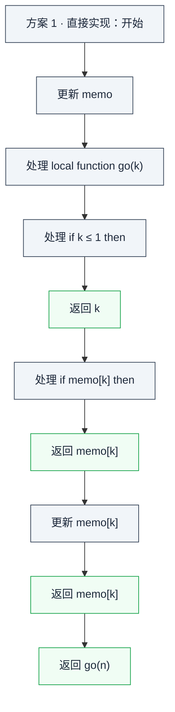

```lua
-- 动态规划之Fibonacci — Lua 版（方案1）
local function fib_memo(n) -- local function fib_memo(元素个数)
	local memo = {} -- 把 {} 写入 local memo
	local function go(k) -- local function go(下标 k)
		if k <= 1 then
			return k
		end -- 若 下标 k 不超过 1 then return 下标 k 终点
		if memo[k] then
			return memo[k]
		end -- 若 记忆化表[下标 k] then return 记忆化表[下标 k] 终点
		memo[k] = go(k - 1) + go(k - 2) -- 把 go(下标 k 减 1) 加 go(下标 k 减 2) 写入 memo[k]
		return memo[k] -- 返回 记忆化表[下标 k]
	end -- 终点
	return go(n) -- 返回 go(元素个数)
end -- 终点
assert(fib_memo(10) == 55) -- 断言校验
assert(fib_memo(20) == 6765) -- 断言校验
assert(fib_memo(0) == 0) -- 断言校验
print("PASS") -- 全部用例通过，输出 PASS
```

#### 方案 2：迭代指针处理

**思路与代码分析**：核心是「迭代指针处理」。Lua 版用表与 ipairs 遍历，注意 ipairs 遇 nil 即停的语义。代码里依次做这些事：递归求解子问题。**走读**：方案 2 · 迭代指针处理：开始 → 更新 memo → 处理 local function go(k) → 处理 if k ≤ 1 then → 返回 k → 处理 if memo[k] then → 返回 memo[k] → 更新 memo[k] → 返回 memo[k] → 返回 go(n)。

**运行架构**（真实控制流）：


```lua
-- 动态规划之Fibonacci — Lua 版（方案2）
local function fib_memo(n) -- local function fib_memo(元素个数)
	local memo = {} -- 把 {} 写入 local memo
	local function go(k) -- local function go(下标 k)
		if k <= 1 then
			return k
		end -- 若 下标 k 不超过 1 then return 下标 k 终点
		if memo[k] then
			return memo[k]
		end -- 若 记忆化表[下标 k] then return 记忆化表[下标 k] 终点
		memo[k] = go(k - 1) + go(k - 2) -- 把 go(下标 k 减 1) 加 go(下标 k 减 2) 写入 memo[k]
		return memo[k] -- 返回 记忆化表[下标 k]
	end -- 终点
	return go(n) -- 返回 go(元素个数)
end -- 终点
assert(fib_memo(10) == 55) -- 断言校验
assert(fib_memo(20) == 6765) -- 断言校验
assert(fib_memo(0) == 0) -- 断言校验
print("PASS") -- 全部用例通过，输出 PASS
```

#### 方案 3：迭代指针处理

**思路与代码分析**：核心是「迭代指针处理」。Lua 版用表与 ipairs 遍历，注意 ipairs 遇 nil 即停的语义。代码里依次做这些事：递归求解子问题。**走读**：方案 3 · 迭代指针处理：开始 → 更新 memo → 处理 local function go(k) → 处理 if k ≤ 1 then → 返回 k → 处理 if memo[k] then → 返回 memo[k] → 更新 memo[k] → 返回 memo[k] → 返回 go(n)。

**运行架构**（真实控制流）：

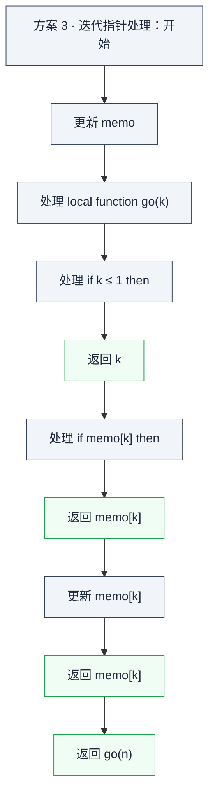

```lua
-- 动态规划之Fibonacci — Lua 版（方案3）
local function fib_memo(n) -- local function fib_memo(元素个数)
	local memo = {} -- 把 {} 写入 local memo
	local function go(k) -- local function go(下标 k)
		if k <= 1 then
			return k
		end -- 若 下标 k 不超过 1 then return 下标 k 终点
		if memo[k] then
			return memo[k]
		end -- 若 记忆化表[下标 k] then return 记忆化表[下标 k] 终点
		memo[k] = go(k - 1) + go(k - 2) -- 把 go(下标 k 减 1) 加 go(下标 k 减 2) 写入 memo[k]
		return memo[k] -- 返回 记忆化表[下标 k]
	end -- 终点
	return go(n) -- 返回 go(元素个数)
end -- 终点
assert(fib_memo(10) == 55) -- 断言校验
assert(fib_memo(20) == 6765) -- 断言校验
assert(fib_memo(0) == 0) -- 断言校验
print("PASS") -- 全部用例通过，输出 PASS
```

### C 实现（3 种方案）

C 的全部方案如下，每个方案都内嵌用例自测，可独立运行（老仓库 python/go 文件遵循「打印结果」约定）：

#### 方案 1：直接实现

**思路与代码分析**：核心是「直接实现」。C 版手动管理下标与内存，循环边界全部显式写出。代码里依次做这些事：单循环线性扫描。**走读**：方案 1 · 直接实现：开始 → 遍历循环 → 更新 memo_g[i] → 返回 go(n)。

**运行架构**（真实控制流）：

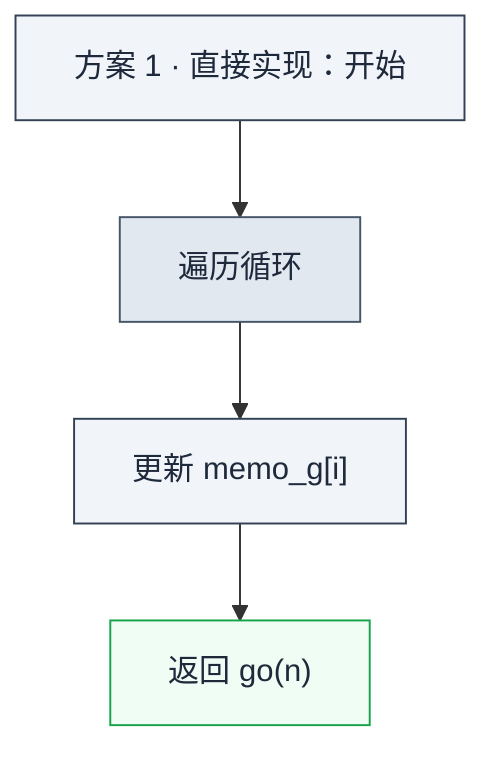

```c
/* 动态规划之Fibonacci — C 版（方案1） */
#include <stdio.h>      // 引入头文件
static long memo_g[64]; // static long memo_g[64];
static long go(int n) { // 定义函数/方法 go
    if (n <= 1)
        return n; // 若 元素个数 不超过 1，直接返回 元素个数
    if (memo_g[n])
        return memo_g[n];              // 若 memo_g[元素个数]，直接返回 memo_g[元素个数]
    memo_g[n] = go(n - 1) + go(n - 2); // 把 go(元素个数 减 1) 加 go(元素个数 减 2); 写入 memo_g[n]
    return memo_g[n];                  // 返回 memo_g[元素个数]
}
static long fib_memo(int n) { // 定义函数/方法 fib_memo
    for (int i = 0; i < 64; i++)
        memo_g[i] = 0; // 让 下标 i 从 0 开始计数，下标 i 小于 64 就继续
    return go(n);      // 返回 go(元素个数)
}
int main(void) { // 程序入口：跑内嵌自测用例
    if (fib_memo(10) != 55 || fib_memo(20) != 6765 || fib_memo(0) != 0) {
        printf("FAIL\n");
        return 1;
    }
    printf("PASS\n");
    return 0;
} // 全部用例通过，输出 PASS
```

#### 方案 2：迭代指针处理

**思路与代码分析**：核心是「迭代指针处理」。C 版手动管理下标与内存，循环边界全部显式写出。代码里依次做这些事：单循环线性扫描。**走读**：方案 2 · 迭代指针处理：开始 → 遍历循环 → 更新 memo_g[i] → 返回 go(n)。

**运行架构**（真实控制流）：

```mermaid
graph TD
    N0["方案 2 · 迭代指针处理：开始"]
    N1["遍历循环"]
    N2["更新 memo_g[i]"]
    N3["返回 go(n)"]
    N0 --> N1
    N1 --> N2
    N2 --> N3
    classDef n fill:#f1f5f9,stroke:#334155,color:#1e293b;
    classDef lp fill:#e2e8f0,stroke:#475569,color:#1e293b;
    classDef dc fill:#fef9c3,stroke:#ca8a04,color:#1e293b;
    classDef tm fill:#f0fdf4,stroke:#16a34a,color:#1e293b;
    class N0,N2 n;
    class N1 lp;
    class N3 tm;
```

```c
/* 动态规划之Fibonacci — C 版（方案2） */
#include <stdio.h>      // 引入头文件
static long memo_g[64]; // static long memo_g[64];
static long go(int n) { // 定义函数/方法 go
    if (n <= 1)
        return n; // 若 元素个数 不超过 1，直接返回 元素个数
    if (memo_g[n])
        return memo_g[n];              // 若 memo_g[元素个数]，直接返回 memo_g[元素个数]
    memo_g[n] = go(n - 1) + go(n - 2); // 把 go(元素个数 减 1) 加 go(元素个数 减 2); 写入 memo_g[n]
    return memo_g[n];                  // 返回 memo_g[元素个数]
}
static long fib_memo(int n) { // 定义函数/方法 fib_memo
    for (int i = 0; i < 64; i++)
        memo_g[i] = 0; // 让 下标 i 从 0 开始计数，下标 i 小于 64 就继续
    return go(n);      // 返回 go(元素个数)
}
int main(void) { // 程序入口：跑内嵌自测用例
    if (fib_memo(10) != 55 || fib_memo(20) != 6765 || fib_memo(0) != 0) {
        printf("FAIL\n");
        return 1;
    }
    printf("PASS\n");
    return 0;
} // 全部用例通过，输出 PASS
```

#### 方案 3：迭代指针处理

**思路与代码分析**：核心是「迭代指针处理」。C 版手动管理下标与内存，循环边界全部显式写出。代码里依次做这些事：单循环线性扫描。**走读**：方案 3 · 迭代指针处理：开始 → 遍历循环 → 更新 memo_g[i] → 返回 go(n)。

**运行架构**（真实控制流）：

```mermaid
graph TD
    N0["方案 3 · 迭代指针处理：开始"]
    N1["遍历循环"]
    N2["更新 memo_g[i]"]
    N3["返回 go(n)"]
    N0 --> N1
    N1 --> N2
    N2 --> N3
    classDef n fill:#f1f5f9,stroke:#334155,color:#1e293b;
    classDef lp fill:#e2e8f0,stroke:#475569,color:#1e293b;
    classDef dc fill:#fef9c3,stroke:#ca8a04,color:#1e293b;
    classDef tm fill:#f0fdf4,stroke:#16a34a,color:#1e293b;
    class N0,N2 n;
    class N1 lp;
    class N3 tm;
```

```c
/* 动态规划之Fibonacci — C 版（方案3） */
#include <stdio.h>      // 引入头文件
static long memo_g[64]; // static long memo_g[64];
static long go(int n) { // 定义函数/方法 go
    if (n <= 1)
        return n; // 若 元素个数 不超过 1，直接返回 元素个数
    if (memo_g[n])
        return memo_g[n];              // 若 memo_g[元素个数]，直接返回 memo_g[元素个数]
    memo_g[n] = go(n - 1) + go(n - 2); // 把 go(元素个数 减 1) 加 go(元素个数 减 2); 写入 memo_g[n]
    return memo_g[n];                  // 返回 memo_g[元素个数]
}
static long fib_memo(int n) { // 定义函数/方法 fib_memo
    for (int i = 0; i < 64; i++)
        memo_g[i] = 0; // 让 下标 i 从 0 开始计数，下标 i 小于 64 就继续
    return go(n);      // 返回 go(元素个数)
}
int main(void) { // 程序入口：跑内嵌自测用例
    if (fib_memo(10) != 55 || fib_memo(20) != 6765 || fib_memo(0) != 0) {
        printf("FAIL\n");
        return 1;
    }
    printf("PASS\n");
    return 0;
} // 全部用例通过，输出 PASS
```

### C++ 实现（3 种方案）

C++ 的全部方案如下，每个方案都内嵌用例自测，可独立运行（老仓库 python/go 文件遵循「打印结果」约定）：

#### 方案 1：直接实现

**思路与代码分析**：核心是「直接实现」。C++ 版用 STL 容器与迭代器，减少手写下标错误。代码里依次做这些事：哈希结构做计数或查重。**走读**：方案 1 · 直接实现：开始 → 处理 std::unordered_map＜int, long → 更新 go → 命中条件，直接返回 → 命中条件，直接返回 → 返回 memo[k] = → 调用 go(k - 1) + go(k - 2) → 返回 go(n)。

**运行架构**（真实控制流）：

```mermaid
graph TD
    N0["方案 1 · 直接实现：开始"]
    N1["处理 std::unordered_map＜int, long"]
    N2["更新 go"]
    N3{"k ≤ 1 ？"}
    N4["命中条件，直接返回"]
    N5{"memo.count(k) ？"}
    N6["命中条件，直接返回"]
    N7["返回 memo[k] ="]
    N8["调用 go(k - 1) + go(k - 2)"]
    N9["返回 go(n)"]
    N0 --> N1
    N1 --> N2
    N2 --> N3
    N3 -- 是 --> N4
    N3 -- 否 --> N5
    N5 -- 是 --> N6
    N5 -- 否 --> N7
    N7 --> N8
    N8 --> N9
    classDef n fill:#f1f5f9,stroke:#334155,color:#1e293b;
    classDef lp fill:#e2e8f0,stroke:#475569,color:#1e293b;
    classDef dc fill:#fef9c3,stroke:#ca8a04,color:#1e293b;
    classDef tm fill:#f0fdf4,stroke:#16a34a,color:#1e293b;
    class N0,N1,N2,N8 n;
    class N3,N5 dc;
    class N4,N6,N7,N9 tm;
```

```cpp
// 动态规划之Fibonacci — C++ 版（方案1）
#include <cassert>                           // 引入头文件
#include <iostream>                          // 引入头文件
#include <unordered_map>                     // 引入头文件
static long long fibMemo(int n) {            // static long long fibMemo(int 元素个数) {
    std::unordered_map<int, long long> memo; // std::unordered_map 小于 int, long long 超过 记忆化表;
    std::function<long long(int)> go = [&](int k) -> long long {
        if (k <= 1)
            return k; // 若 下标 k 不超过 1，直接返回 下标 k
        if (memo.count(k))
            return memo[k]; // 若 记忆化表.计数(下标 k)，直接返回 记忆化表[下标 k]
        return memo[k] =
                   go(k - 1) + go(k - 2); // 返回 记忆化表[下标 k] 赋值为 go(下标 k 减 1) 加 go(下标 k 减 2)
    };
    return go(n); // 返回 go(元素个数)
}
int main() {
    assert(fibMemo(10) == 55);
    assert(fibMemo(20) == 6765);
    assert(fibMemo(0) == 0);
    std::cout << "PASS" << std::endl;
} // 全部用例通过，输出 PASS
```

#### 方案 2：迭代指针处理

**思路与代码分析**：核心是「迭代指针处理」。C++ 版用 STL 容器与迭代器，减少手写下标错误。代码里依次做这些事：哈希结构做计数或查重。**走读**：方案 2 · 迭代指针处理：开始 → 处理 std::unordered_map＜int, long → 更新 go → 命中条件，直接返回 → 命中条件，直接返回 → 返回 memo[k] = → 调用 go(k - 1) + go(k - 2) → 返回 go(n)。

**运行架构**（真实控制流）：

```mermaid
graph TD
    N0["方案 2 · 迭代指针处理：开始"]
    N1["处理 std::unordered_map＜int, long"]
    N2["更新 go"]
    N3{"k ≤ 1 ？"}
    N4["命中条件，直接返回"]
    N5{"memo.count(k) ？"}
    N6["命中条件，直接返回"]
    N7["返回 memo[k] ="]
    N8["调用 go(k - 1) + go(k - 2)"]
    N9["返回 go(n)"]
    N0 --> N1
    N1 --> N2
    N2 --> N3
    N3 -- 是 --> N4
    N3 -- 否 --> N5
    N5 -- 是 --> N6
    N5 -- 否 --> N7
    N7 --> N8
    N8 --> N9
    classDef n fill:#f1f5f9,stroke:#334155,color:#1e293b;
    classDef lp fill:#e2e8f0,stroke:#475569,color:#1e293b;
    classDef dc fill:#fef9c3,stroke:#ca8a04,color:#1e293b;
    classDef tm fill:#f0fdf4,stroke:#16a34a,color:#1e293b;
    class N0,N1,N2,N8 n;
    class N3,N5 dc;
    class N4,N6,N7,N9 tm;
```

```cpp
// 动态规划之Fibonacci — C++ 版（方案2）
#include <cassert>                           // 引入头文件
#include <iostream>                          // 引入头文件
#include <unordered_map>                     // 引入头文件
static long long fibMemo(int n) {            // static long long fibMemo(int 元素个数) {
    std::unordered_map<int, long long> memo; // std::unordered_map 小于 int, long long 超过 记忆化表;
    std::function<long long(int)> go = [&](int k) -> long long {
        if (k <= 1)
            return k; // 若 下标 k 不超过 1，直接返回 下标 k
        if (memo.count(k))
            return memo[k]; // 若 记忆化表.计数(下标 k)，直接返回 记忆化表[下标 k]
        return memo[k] =
                   go(k - 1) + go(k - 2); // 返回 记忆化表[下标 k] 赋值为 go(下标 k 减 1) 加 go(下标 k 减 2)
    };
    return go(n); // 返回 go(元素个数)
}
int main() {
    assert(fibMemo(10) == 55);
    assert(fibMemo(20) == 6765);
    assert(fibMemo(0) == 0);
    std::cout << "PASS" << std::endl;
} // 全部用例通过，输出 PASS
```

#### 方案 3：迭代指针处理

**思路与代码分析**：核心是「迭代指针处理」。C++ 版用 STL 容器与迭代器，减少手写下标错误。代码里依次做这些事：哈希结构做计数或查重。**走读**：方案 3 · 迭代指针处理：开始 → 处理 std::unordered_map＜int, long → 更新 go → 命中条件，直接返回 → 命中条件，直接返回 → 返回 memo[k] = → 调用 go(k - 1) + go(k - 2) → 返回 go(n)。

**运行架构**（真实控制流）：

```mermaid
graph TD
    N0["方案 3 · 迭代指针处理：开始"]
    N1["处理 std::unordered_map＜int, long"]
    N2["更新 go"]
    N3{"k ≤ 1 ？"}
    N4["命中条件，直接返回"]
    N5{"memo.count(k) ？"}
    N6["命中条件，直接返回"]
    N7["返回 memo[k] ="]
    N8["调用 go(k - 1) + go(k - 2)"]
    N9["返回 go(n)"]
    N0 --> N1
    N1 --> N2
    N2 --> N3
    N3 -- 是 --> N4
    N3 -- 否 --> N5
    N5 -- 是 --> N6
    N5 -- 否 --> N7
    N7 --> N8
    N8 --> N9
    classDef n fill:#f1f5f9,stroke:#334155,color:#1e293b;
    classDef lp fill:#e2e8f0,stroke:#475569,color:#1e293b;
    classDef dc fill:#fef9c3,stroke:#ca8a04,color:#1e293b;
    classDef tm fill:#f0fdf4,stroke:#16a34a,color:#1e293b;
    class N0,N1,N2,N8 n;
    class N3,N5 dc;
    class N4,N6,N7,N9 tm;
```

```cpp
// 动态规划之Fibonacci — C++ 版（方案3）
#include <cassert>                           // 引入头文件
#include <iostream>                          // 引入头文件
#include <unordered_map>                     // 引入头文件
static long long fibMemo(int n) {            // static long long fibMemo(int 元素个数) {
    std::unordered_map<int, long long> memo; // std::unordered_map 小于 int, long long 超过 记忆化表;
    std::function<long long(int)> go = [&](int k) -> long long {
        if (k <= 1)
            return k; // 若 下标 k 不超过 1，直接返回 下标 k
        if (memo.count(k))
            return memo[k]; // 若 记忆化表.计数(下标 k)，直接返回 记忆化表[下标 k]
        return memo[k] =
                   go(k - 1) + go(k - 2); // 返回 记忆化表[下标 k] 赋值为 go(下标 k 减 1) 加 go(下标 k 减 2)
    };
    return go(n); // 返回 go(元素个数)
}
int main() {
    assert(fibMemo(10) == 55);
    assert(fibMemo(20) == 6765);
    assert(fibMemo(0) == 0);
    std::cout << "PASS" << std::endl;
} // 全部用例通过，输出 PASS
```

### R 实现（3 种方案）

R 的全部方案如下，每个方案都内嵌用例自测，可独立运行（老仓库 python/go 文件遵循「打印结果」约定）：

#### 方案 1：直接实现

**思路与代码分析**：核心是「直接实现」。R 版用向量化思维与 1 起始下标，注意 1:n 的降序陷阱。**走读**：方案 1 · 直接实现：开始 → 更新 new.env(parent → 处理 go ＜- function(k) → 命中条件，直接返回 → 处理 key ＜- as.character(k) → 命中条件，直接返回 → 处理 memo[[key]] ＜＜- go(k - 1L) + → 处理 memo[[key]] → 调用 go(n)。

**运行架构**（真实控制流）：

```mermaid
graph TD
    N0["方案 1 · 直接实现：开始"]
    N1["更新 new.env(parent"]
    N2["处理 go ＜- function(k)"]
    N3{"k ≤ 1 ？"}
    N4["命中条件，直接返回"]
    N5["处理 key ＜- as.character(k)"]
    N6{"非 is.null(memo[[key]]) ？"}
    N7["命中条件，直接返回"]
    N8["处理 memo[[key]] ＜＜- go(k - 1L) +"]
    N9["处理 memo[[key]]"]
    N10["调用 go(n)"]
    N0 --> N1
    N1 --> N2
    N2 --> N3
    N3 -- 是 --> N4
    N3 -- 否 --> N5
    N5 --> N6
    N6 -- 是 --> N7
    N6 -- 否 --> N8
    N8 --> N9
    N9 --> N10
    classDef n fill:#f1f5f9,stroke:#334155,color:#1e293b;
    classDef lp fill:#e2e8f0,stroke:#475569,color:#1e293b;
    classDef dc fill:#fef9c3,stroke:#ca8a04,color:#1e293b;
    classDef tm fill:#f0fdf4,stroke:#16a34a,color:#1e293b;
    class N0,N1,N2,N5,N8,N9,N10 n;
    class N3,N6 dc;
    class N4,N7 tm;
```

```r
# 定义函数 fib_memo（参数：元素个数）
fib_memo <- function(n) {
    memo <- new.env(parent = emptyenv())  # 把 new.env(parent 赋值为 emptyenv()) 存入 记忆化表
    go <- function(k) {
        # 定义函数 go（参数：下标 k）
        if (k <= 1)
            return(k)  # 若 下标 k 不超过 1) return(下标 k
        key <- as.character(k)  # 把 as.character(下标 k) 存入 key
        if (!is.null(memo[[key]]))
            return(memo[[key]])  # 若 取反 is.null(记忆化表[[key]])) return(记忆化表[[key]]
        memo[[key]] <<- go(k - 1L) + go(k - 2L)  # 记忆化表[[key]] 小于 小于 减 go(下标 k 减 1L) 加 go(下标 k 减 2L)
        memo[[key]]  # 记忆化表[[key]]
    }
    go(n)  # go(元素个数)
}
stopifnot(fib_memo(10) == 55, fib_memo(20) == 6765, fib_memo(0) == 0)  # 断言校验
cat("PASS\n")  # 全部用例通过，输出 PASS
```

#### 方案 2：迭代指针处理

**思路与代码分析**：核心是「迭代指针处理」。R 版用向量化思维与 1 起始下标，注意 1:n 的降序陷阱。**走读**：方案 2 · 迭代指针处理：开始 → 更新 new.env(parent → 处理 go ＜- function(k) → 命中条件，直接返回 → 处理 key ＜- as.character(k) → 命中条件，直接返回 → 处理 memo[[key]] ＜＜- go(k - 1L) + → 处理 memo[[key]] → 调用 go(n)。

**运行架构**（真实控制流）：

```mermaid
graph TD
    N0["方案 2 · 迭代指针处理：开始"]
    N1["更新 new.env(parent"]
    N2["处理 go ＜- function(k)"]
    N3{"k ≤ 1 ？"}
    N4["命中条件，直接返回"]
    N5["处理 key ＜- as.character(k)"]
    N6{"非 is.null(memo[[key]]) ？"}
    N7["命中条件，直接返回"]
    N8["处理 memo[[key]] ＜＜- go(k - 1L) +"]
    N9["处理 memo[[key]]"]
    N10["调用 go(n)"]
    N0 --> N1
    N1 --> N2
    N2 --> N3
    N3 -- 是 --> N4
    N3 -- 否 --> N5
    N5 --> N6
    N6 -- 是 --> N7
    N6 -- 否 --> N8
    N8 --> N9
    N9 --> N10
    classDef n fill:#f1f5f9,stroke:#334155,color:#1e293b;
    classDef lp fill:#e2e8f0,stroke:#475569,color:#1e293b;
    classDef dc fill:#fef9c3,stroke:#ca8a04,color:#1e293b;
    classDef tm fill:#f0fdf4,stroke:#16a34a,color:#1e293b;
    class N0,N1,N2,N5,N8,N9,N10 n;
    class N3,N6 dc;
    class N4,N7 tm;
```

```r
# 定义函数 fib_memo（参数：元素个数）
fib_memo <- function(n) {
    memo <- new.env(parent = emptyenv())  # 把 new.env(parent 赋值为 emptyenv()) 存入 记忆化表
    go <- function(k) {
        # 定义函数 go（参数：下标 k）
        if (k <= 1)
            return(k)  # 若 下标 k 不超过 1) return(下标 k
        key <- as.character(k)  # 把 as.character(下标 k) 存入 key
        if (!is.null(memo[[key]]))
            return(memo[[key]])  # 若 取反 is.null(记忆化表[[key]])) return(记忆化表[[key]]
        memo[[key]] <<- go(k - 1L) + go(k - 2L)  # 记忆化表[[key]] 小于 小于 减 go(下标 k 减 1L) 加 go(下标 k 减 2L)
        memo[[key]]  # 记忆化表[[key]]
    }
    go(n)  # go(元素个数)
}
stopifnot(fib_memo(10) == 55, fib_memo(20) == 6765, fib_memo(0) == 0)  # 断言校验
cat("PASS\n")  # 全部用例通过，输出 PASS
```

#### 方案 3：迭代指针处理

**思路与代码分析**：核心是「迭代指针处理」。R 版用向量化思维与 1 起始下标，注意 1:n 的降序陷阱。**走读**：方案 3 · 迭代指针处理：开始 → 更新 new.env(parent → 处理 go ＜- function(k) → 命中条件，直接返回 → 处理 key ＜- as.character(k) → 命中条件，直接返回 → 处理 memo[[key]] ＜＜- go(k - 1L) + → 处理 memo[[key]] → 调用 go(n)。

**运行架构**（真实控制流）：

```mermaid
graph TD
    N0["方案 3 · 迭代指针处理：开始"]
    N1["更新 new.env(parent"]
    N2["处理 go ＜- function(k)"]
    N3{"k ≤ 1 ？"}
    N4["命中条件，直接返回"]
    N5["处理 key ＜- as.character(k)"]
    N6{"非 is.null(memo[[key]]) ？"}
    N7["命中条件，直接返回"]
    N8["处理 memo[[key]] ＜＜- go(k - 1L) +"]
    N9["处理 memo[[key]]"]
    N10["调用 go(n)"]
    N0 --> N1
    N1 --> N2
    N2 --> N3
    N3 -- 是 --> N4
    N3 -- 否 --> N5
    N5 --> N6
    N6 -- 是 --> N7
    N6 -- 否 --> N8
    N8 --> N9
    N9 --> N10
    classDef n fill:#f1f5f9,stroke:#334155,color:#1e293b;
    classDef lp fill:#e2e8f0,stroke:#475569,color:#1e293b;
    classDef dc fill:#fef9c3,stroke:#ca8a04,color:#1e293b;
    classDef tm fill:#f0fdf4,stroke:#16a34a,color:#1e293b;
    class N0,N1,N2,N5,N8,N9,N10 n;
    class N3,N6 dc;
    class N4,N7 tm;
```

```r
# 定义函数 fib_memo（参数：元素个数）
fib_memo <- function(n) {
    memo <- new.env(parent = emptyenv())  # 把 new.env(parent 赋值为 emptyenv()) 存入 记忆化表
    go <- function(k) {
        # 定义函数 go（参数：下标 k）
        if (k <= 1)
            return(k)  # 若 下标 k 不超过 1) return(下标 k
        key <- as.character(k)  # 把 as.character(下标 k) 存入 key
        if (!is.null(memo[[key]]))
            return(memo[[key]])  # 若 取反 is.null(记忆化表[[key]])) return(记忆化表[[key]]
        memo[[key]] <<- go(k - 1L) + go(k - 2L)  # 记忆化表[[key]] 小于 小于 减 go(下标 k 减 1L) 加 go(下标 k 减 2L)
        memo[[key]]  # 记忆化表[[key]]
    }
    go(n)  # go(元素个数)
}
stopifnot(fib_memo(10) == 55, fib_memo(20) == 6765, fib_memo(0) == 0)  # 断言校验
cat("PASS\n")  # 全部用例通过，输出 PASS
```

### Zig 实现（3 种方案）

Zig 的全部方案如下，每个方案都内嵌用例自测，可独立运行（老仓库 python/go 文件遵循「打印结果」约定）：

#### 方案 1：直接实现

**思路与代码分析**：核心是「直接实现」。Zig 版显式分配与清零，整型边界处理严格。代码里依次做这些事：单循环线性扫描。**走读**：方案 1 · 直接实现：开始 → 计算 memo → 遍历集合元素 → 计算 D → 命中条件，直接返回 → 若 m[@intCast(k)] ≠ -1) return m[@intCast(k：处理 ] → 更新 m[@intCast(k)] → 返回 m[@intCast(k)] → 返回 D.go(n, &memo)。

**运行架构**（真实控制流）：

```mermaid
graph TD
    N0["方案 1 · 直接实现：开始"]
    N1["计算 memo"]
    N2["遍历集合元素"]
    N3["计算 D"]
    N4{"k ≤ 1 ？"}
    N5["命中条件，直接返回"]
    N6["若 m[@intCast(k)] ≠ -1) return m[@intCast(k：处理 ]"]
    N7["更新 m[@intCast(k)]"]
    N8["返回 m[@intCast(k)]"]
    N9["返回 D.go(n, &memo)"]
    N0 --> N1
    N1 --> N2
    N2 --> N3
    N3 --> N4
    N4 -- 是 --> N5
    N4 -- 否 --> N6
    N6 --> N7
    N7 --> N8
    N8 --> N9
    classDef n fill:#f1f5f9,stroke:#334155,color:#1e293b;
    classDef lp fill:#e2e8f0,stroke:#475569,color:#1e293b;
    classDef dc fill:#fef9c3,stroke:#ca8a04,color:#1e293b;
    classDef tm fill:#f0fdf4,stroke:#16a34a,color:#1e293b;
    class N0,N1,N3,N6,N7 n;
    class N2 lp;
    class N4 dc;
    class N5,N8,N9 tm;
```

```zig
// 动态规划之Fibonacci — Zig 版（方案1）
const std = @import("std"); // 把 @import(「std」) 存入 std
fn fibMemo(n: i32) i64 { // 定义函数/方法 fibMemo
    var memo: [64]i64 = undefined; // 把 undefined; 写入 var memo: [64]i64
    for (0..64) |i| memo[i] = -1; // 让 下标 i 从 0 走到 64 减一
    const D = struct { // 把 struct { 存入 D
        fn go(k: i32, m: []i64) i64 { // 定义函数/方法 go
            if (k <= 1) return k; // 若 下标 k 不超过 1，直接返回 下标 k
            if (m[@intCast(k)] != -1) return m[@intCast(k)]; // 若 映射表[@intCast(下标 k)] 不等于 减 1，直接返回 映射表[@intCast(下标 k)]
            m[@intCast(k)] = go(k - 1, m) + go(k - 2, m); // 把 go(下标 k 减 1, 映射表) 加 go(下标 k 减 2, 映射表); 写入 m[@intCast(k)]
            return m[@intCast(k)]; // 返回 映射表[@intCast(下标 k)]
        }
    };
    return D.go(n, &memo); // 返回 D.go(元素个数, 按位与 记忆化表)
}
pub fn main() !void { // 程序入口：跑内嵌自测用例
    if (fibMemo(10) != 55 or fibMemo(20) != 6765 or fibMemo(0) != 0) return error.TestFailed;
    std.debug.print("PASS\n", .{});
} // 全部用例通过，输出 PASS
```

#### 方案 2：迭代指针处理

**思路与代码分析**：核心是「迭代指针处理」。Zig 版显式分配与清零，整型边界处理严格。代码里依次做这些事：单循环线性扫描。**走读**：方案 2 · 迭代指针处理：开始 → 计算 memo → 遍历集合元素 → 计算 D → 命中条件，直接返回 → 若 m[@intCast(k)] ≠ -1) return m[@intCast(k：处理 ] → 更新 m[@intCast(k)] → 返回 m[@intCast(k)] → 返回 D.go(n, &memo)。

**运行架构**（真实控制流）：

```mermaid
graph TD
    N0["方案 2 · 迭代指针处理：开始"]
    N1["计算 memo"]
    N2["遍历集合元素"]
    N3["计算 D"]
    N4{"k ≤ 1 ？"}
    N5["命中条件，直接返回"]
    N6["若 m[@intCast(k)] ≠ -1) return m[@intCast(k：处理 ]"]
    N7["更新 m[@intCast(k)]"]
    N8["返回 m[@intCast(k)]"]
    N9["返回 D.go(n, &memo)"]
    N0 --> N1
    N1 --> N2
    N2 --> N3
    N3 --> N4
    N4 -- 是 --> N5
    N4 -- 否 --> N6
    N6 --> N7
    N7 --> N8
    N8 --> N9
    classDef n fill:#f1f5f9,stroke:#334155,color:#1e293b;
    classDef lp fill:#e2e8f0,stroke:#475569,color:#1e293b;
    classDef dc fill:#fef9c3,stroke:#ca8a04,color:#1e293b;
    classDef tm fill:#f0fdf4,stroke:#16a34a,color:#1e293b;
    class N0,N1,N3,N6,N7 n;
    class N2 lp;
    class N4 dc;
    class N5,N8,N9 tm;
```

```zig
// 动态规划之Fibonacci — Zig 版（方案2）
const std = @import("std"); // 把 @import(「std」) 存入 std
fn fibMemo(n: i32) i64 { // 定义函数/方法 fibMemo
    var memo: [64]i64 = undefined; // 把 undefined; 写入 var memo: [64]i64
    for (0..64) |i| memo[i] = -1; // 让 下标 i 从 0 走到 64 减一
    const D = struct { // 把 struct { 存入 D
        fn go(k: i32, m: []i64) i64 { // 定义函数/方法 go
            if (k <= 1) return k; // 若 下标 k 不超过 1，直接返回 下标 k
            if (m[@intCast(k)] != -1) return m[@intCast(k)]; // 若 映射表[@intCast(下标 k)] 不等于 减 1，直接返回 映射表[@intCast(下标 k)]
            m[@intCast(k)] = go(k - 1, m) + go(k - 2, m); // 把 go(下标 k 减 1, 映射表) 加 go(下标 k 减 2, 映射表); 写入 m[@intCast(k)]
            return m[@intCast(k)]; // 返回 映射表[@intCast(下标 k)]
        }
    };
    return D.go(n, &memo); // 返回 D.go(元素个数, 按位与 记忆化表)
}
pub fn main() !void { // 程序入口：跑内嵌自测用例
    if (fibMemo(10) != 55 or fibMemo(20) != 6765 or fibMemo(0) != 0) return error.TestFailed;
    std.debug.print("PASS\n", .{});
} // 全部用例通过，输出 PASS
```

#### 方案 3：迭代指针处理

**思路与代码分析**：核心是「迭代指针处理」。Zig 版显式分配与清零，整型边界处理严格。代码里依次做这些事：单循环线性扫描。**走读**：方案 3 · 迭代指针处理：开始 → 计算 memo → 遍历集合元素 → 计算 D → 命中条件，直接返回 → 若 m[@intCast(k)] ≠ -1) return m[@intCast(k：处理 ] → 更新 m[@intCast(k)] → 返回 m[@intCast(k)] → 返回 D.go(n, &memo)。

**运行架构**（真实控制流）：

```mermaid
graph TD
    N0["方案 3 · 迭代指针处理：开始"]
    N1["计算 memo"]
    N2["遍历集合元素"]
    N3["计算 D"]
    N4{"k ≤ 1 ？"}
    N5["命中条件，直接返回"]
    N6["若 m[@intCast(k)] ≠ -1) return m[@intCast(k：处理 ]"]
    N7["更新 m[@intCast(k)]"]
    N8["返回 m[@intCast(k)]"]
    N9["返回 D.go(n, &memo)"]
    N0 --> N1
    N1 --> N2
    N2 --> N3
    N3 --> N4
    N4 -- 是 --> N5
    N4 -- 否 --> N6
    N6 --> N7
    N7 --> N8
    N8 --> N9
    classDef n fill:#f1f5f9,stroke:#334155,color:#1e293b;
    classDef lp fill:#e2e8f0,stroke:#475569,color:#1e293b;
    classDef dc fill:#fef9c3,stroke:#ca8a04,color:#1e293b;
    classDef tm fill:#f0fdf4,stroke:#16a34a,color:#1e293b;
    class N0,N1,N3,N6,N7 n;
    class N2 lp;
    class N4 dc;
    class N5,N8,N9 tm;
```

```zig
// 动态规划之Fibonacci — Zig 版（方案3）
const std = @import("std"); // 把 @import(「std」) 存入 std
fn fibMemo(n: i32) i64 { // 定义函数/方法 fibMemo
    var memo: [64]i64 = undefined; // 把 undefined; 写入 var memo: [64]i64
    for (0..64) |i| memo[i] = -1; // 让 下标 i 从 0 走到 64 减一
    const D = struct { // 把 struct { 存入 D
        fn go(k: i32, m: []i64) i64 { // 定义函数/方法 go
            if (k <= 1) return k; // 若 下标 k 不超过 1，直接返回 下标 k
            if (m[@intCast(k)] != -1) return m[@intCast(k)]; // 若 映射表[@intCast(下标 k)] 不等于 减 1，直接返回 映射表[@intCast(下标 k)]
            m[@intCast(k)] = go(k - 1, m) + go(k - 2, m); // 把 go(下标 k 减 1, 映射表) 加 go(下标 k 减 2, 映射表); 写入 m[@intCast(k)]
            return m[@intCast(k)]; // 返回 映射表[@intCast(下标 k)]
        }
    };
    return D.go(n, &memo); // 返回 D.go(元素个数, 按位与 记忆化表)
}
pub fn main() !void { // 程序入口：跑内嵌自测用例
    if (fibMemo(10) != 55 or fibMemo(20) != 6765 or fibMemo(0) != 0) return error.TestFailed;
    std.debug.print("PASS\n", .{});
} // 全部用例通过，输出 PASS
```

### Dart 实现（3 种方案）

Dart 的全部方案如下，每个方案都内嵌用例自测，可独立运行（老仓库 python/go 文件遵循「打印结果」约定）：

#### 方案 1：直接实现

**思路与代码分析**：核心是「直接实现」。Dart 版用可空类型标注与集合方法，注意空安全。**走读**：方案 1 · 直接实现：开始 → 更新 memo → 处理 int go(int k) → 命中条件，直接返回 → 命中条件，直接返回 → 更新 memo[k] → 调用 go(k - 1) + go(k - 2) → 返回 memo[k]非 → 返回 go(n)。

**运行架构**（真实控制流）：

```mermaid
graph TD
    N0["方案 1 · 直接实现：开始"]
    N1["更新 memo"]
    N2["处理 int go(int k)"]
    N3{"k ≤ 1 ？"}
    N4["命中条件，直接返回"]
    N5{"memo.containsKey(k) ？"}
    N6["命中条件，直接返回"]
    N7["更新 memo[k]"]
    N8["调用 go(k - 1) + go(k - 2)"]
    N9["返回 memo[k]非"]
    N10["返回 go(n)"]
    N0 --> N1
    N1 --> N2
    N2 --> N3
    N3 -- 是 --> N4
    N3 -- 否 --> N5
    N5 -- 是 --> N6
    N5 -- 否 --> N7
    N7 --> N8
    N8 --> N9
    N9 --> N10
    classDef n fill:#f1f5f9,stroke:#334155,color:#1e293b;
    classDef lp fill:#e2e8f0,stroke:#475569,color:#1e293b;
    classDef dc fill:#fef9c3,stroke:#ca8a04,color:#1e293b;
    classDef tm fill:#f0fdf4,stroke:#16a34a,color:#1e293b;
    class N0,N1,N2,N7,N8 n;
    class N3,N5 dc;
    class N4,N6,N9,N10 tm;
```

```dart
// 动态规划之Fibonacci — Dart 版（方案1）
int fibMemo(int n) {
  // 定义函数/方法 fibMemo
  final memo = <int, int>{}; // 把 小于 int, int 超过 {} 存入 记忆化表
  int go(int k) {
    // 定义函数/方法 go
    if (k <= 1) return k; // 若 下标 k 不超过 1，直接返回 下标 k
    if (memo.containsKey(k))
      return memo[k]!; // 若 记忆化表.containsKey(下标 k)，直接返回 记忆化表[下标 k]取反
    memo[k] =
        go(k - 1) + go(k - 2); // 把 go(下标 k 减 1) 加 go(下标 k 减 2); 写入 memo[k]
    return memo[k]!; // 返回 记忆化表[下标 k]取反
  }

  return go(n); // 返回 go(元素个数)
}

void main() {
  if (fibMemo(10) != 55 || fibMemo(20) != 6765 || fibMemo(0) != 0)
    throw StateError('x');
  print('PASS');
} // 全部用例通过，输出 PASS
```

#### 方案 2：迭代指针处理

**思路与代码分析**：核心是「迭代指针处理」。Dart 版用可空类型标注与集合方法，注意空安全。**走读**：方案 2 · 迭代指针处理：开始 → 更新 memo → 处理 int go(int k) → 命中条件，直接返回 → 命中条件，直接返回 → 更新 memo[k] → 调用 go(k - 1) + go(k - 2) → 返回 memo[k]非 → 返回 go(n)。

**运行架构**（真实控制流）：

```mermaid
graph TD
    N0["方案 2 · 迭代指针处理：开始"]
    N1["更新 memo"]
    N2["处理 int go(int k)"]
    N3{"k ≤ 1 ？"}
    N4["命中条件，直接返回"]
    N5{"memo.containsKey(k) ？"}
    N6["命中条件，直接返回"]
    N7["更新 memo[k]"]
    N8["调用 go(k - 1) + go(k - 2)"]
    N9["返回 memo[k]非"]
    N10["返回 go(n)"]
    N0 --> N1
    N1 --> N2
    N2 --> N3
    N3 -- 是 --> N4
    N3 -- 否 --> N5
    N5 -- 是 --> N6
    N5 -- 否 --> N7
    N7 --> N8
    N8 --> N9
    N9 --> N10
    classDef n fill:#f1f5f9,stroke:#334155,color:#1e293b;
    classDef lp fill:#e2e8f0,stroke:#475569,color:#1e293b;
    classDef dc fill:#fef9c3,stroke:#ca8a04,color:#1e293b;
    classDef tm fill:#f0fdf4,stroke:#16a34a,color:#1e293b;
    class N0,N1,N2,N7,N8 n;
    class N3,N5 dc;
    class N4,N6,N9,N10 tm;
```

```dart
// 动态规划之Fibonacci — Dart 版（方案2）
int fibMemo(int n) {
  // 定义函数/方法 fibMemo
  final memo = <int, int>{}; // 把 小于 int, int 超过 {} 存入 记忆化表
  int go(int k) {
    // 定义函数/方法 go
    if (k <= 1) return k; // 若 下标 k 不超过 1，直接返回 下标 k
    if (memo.containsKey(k))
      return memo[k]!; // 若 记忆化表.containsKey(下标 k)，直接返回 记忆化表[下标 k]取反
    memo[k] =
        go(k - 1) + go(k - 2); // 把 go(下标 k 减 1) 加 go(下标 k 减 2); 写入 memo[k]
    return memo[k]!; // 返回 记忆化表[下标 k]取反
  }

  return go(n); // 返回 go(元素个数)
}

void main() {
  if (fibMemo(10) != 55 || fibMemo(20) != 6765 || fibMemo(0) != 0)
    throw StateError('x');
  print('PASS');
} // 全部用例通过，输出 PASS
```

#### 方案 3：迭代指针处理

**思路与代码分析**：核心是「迭代指针处理」。Dart 版用可空类型标注与集合方法，注意空安全。**走读**：方案 3 · 迭代指针处理：开始 → 更新 memo → 处理 int go(int k) → 命中条件，直接返回 → 命中条件，直接返回 → 更新 memo[k] → 调用 go(k - 1) + go(k - 2) → 返回 memo[k]非 → 返回 go(n)。

**运行架构**（真实控制流）：

```mermaid
graph TD
    N0["方案 3 · 迭代指针处理：开始"]
    N1["更新 memo"]
    N2["处理 int go(int k)"]
    N3{"k ≤ 1 ？"}
    N4["命中条件，直接返回"]
    N5{"memo.containsKey(k) ？"}
    N6["命中条件，直接返回"]
    N7["更新 memo[k]"]
    N8["调用 go(k - 1) + go(k - 2)"]
    N9["返回 memo[k]非"]
    N10["返回 go(n)"]
    N0 --> N1
    N1 --> N2
    N2 --> N3
    N3 -- 是 --> N4
    N3 -- 否 --> N5
    N5 -- 是 --> N6
    N5 -- 否 --> N7
    N7 --> N8
    N8 --> N9
    N9 --> N10
    classDef n fill:#f1f5f9,stroke:#334155,color:#1e293b;
    classDef lp fill:#e2e8f0,stroke:#475569,color:#1e293b;
    classDef dc fill:#fef9c3,stroke:#ca8a04,color:#1e293b;
    classDef tm fill:#f0fdf4,stroke:#16a34a,color:#1e293b;
    class N0,N1,N2,N7,N8 n;
    class N3,N5 dc;
    class N4,N6,N9,N10 tm;
```

```dart
// 动态规划之Fibonacci — Dart 版（方案3）
int fibMemo(int n) {
  // 定义函数/方法 fibMemo
  final memo = <int, int>{}; // 把 小于 int, int 超过 {} 存入 记忆化表
  int go(int k) {
    // 定义函数/方法 go
    if (k <= 1) return k; // 若 下标 k 不超过 1，直接返回 下标 k
    if (memo.containsKey(k))
      return memo[k]!; // 若 记忆化表.containsKey(下标 k)，直接返回 记忆化表[下标 k]取反
    memo[k] =
        go(k - 1) + go(k - 2); // 把 go(下标 k 减 1) 加 go(下标 k 减 2); 写入 memo[k]
    return memo[k]!; // 返回 记忆化表[下标 k]取反
  }

  return go(n); // 返回 go(元素个数)
}

void main() {
  if (fibMemo(10) != 55 || fibMemo(20) != 6765 || fibMemo(0) != 0)
    throw StateError('x');
  print('PASS');
} // 全部用例通过，输出 PASS
```

---

## 内容总结

- **动态规划之fibonacci power spu lmp**（算法笔记 · Medium）：共 3 个方案，主线思路「直接实现」；时间 O(n) 量级；动画演示归并分治过程，附录给出 11 种语言 × 全部方案的可运行实现。
- 来源博客：[https://blog.csdn.net/tyro_java/article/details/113877588](https://blog.csdn.net/tyro_java/article/details/113877588)
- 导航：[📋 总目录](../) ｜ [← 219 图搜索之dfs详解](../219_图搜索之dfs详解/) ｜ [221 动态规划之lcs 0 →](../221_动态规划之lcs_0/)
