# 221 · 动态规划之lcs 0（第附阶段 · 专题补充 · Medium）

> **难度**：⭐⭐ Medium ｜ **专题**：算法笔记
> **学习定位**：第附阶段 · 专题补充第 221 篇 ｜ **解法数**：1
> **内容总结**：**动态规划之lcs 0**（算法笔记 · Medium）：共 1 个方案，主线思路「动态规划」；时间 O(n) 到 O(m·n)（取决于状态维度）；动画演示DP 表填充过程，附录给出 11 种语言 × 全部方案的可运行实现。

---

## 题目描述

动态规划之lcs 0。具体输入输出约定见函数签名与用例。

- 主函数签名：`function lcsLength(a: string, b: string): number`

**用例演示**（摘自主解法内嵌自测，输入到输出一目了然）：

```typescript
  const cases: { a: string; b: string; want: number }[] = [
    { a: 'ABCBDAB', b: 'BDCABA', want: 4 }, // 如 BDAB / BCAB / BCBA
    { a: 'AGGTAB', b: 'GXTXAYB', want: 4 }, // GTAB
    { a: 'abc', b: 'abc', want: 3 },
    { a: '', b: 'abc', want: 0 }, // 边界：空串
    { a: 'abc', b: 'xyz', want: 0 }, // 边界：无公共字符
  ];
```

**数据范围与注意事项**：

- **易错点**：先看小例子手推一遍再对照代码，比直接读代码快得多。

## 题目分析

**场景是什么**：综合练习：把数据结构与策略组合起来解决一个完整问题。本题就是该场景的 Medium 级练习，主线做法是「动态规划」。

**主线怎么解**：把主解法从头到尾过一遍，它其实在依次做这几件事：DP 表逐项填充 → 双重循环遍历。

## 解题思路

**方案对比**（共 1 个方案，由浅入深）：

| 方案 | 时间复杂度 | 空间复杂度 |
|---|---|---|
| 方案 1 · 动态规划 | O(n) 到 O(m·n)（取决于状态维度） | 即 DP 表大小 |

**怎么读这一篇**：

- 🐣 **新手路线**：把「题目描述」的示例 1 在纸上手推一遍 → 读方案 1（最直观的写法）与它的代码走读 → 按「运行方式」本地跑通看 PASS → 回头对比方案 2 之后的写法差在哪
- 🦅 **大佬路线**：直接锁定最优方案 1（动态规划，O(n) 到 O(m·n)（取决于状态维度））→ 跳读该方案代码与走读 → 用「逐步拆解与面试追问」补齐复杂度推导与边界追问

### 动态算法图（DP 表填充，GIF 自动循环）


动画演示算法笔记专题里DP 表填充的典型过程；每个方案在「TypeScript 解题方案」一节还配了专属动画与专属流程图。

### 主解法流程图（真实控制流）

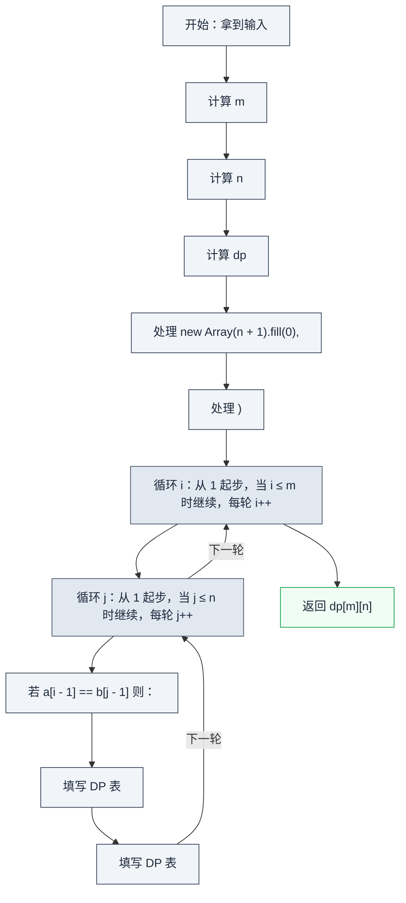

## TypeScript 解题方案（1 个方案逐个讲）

> **运行与提交**：每个方案都是自包含文件（内嵌用例自测，输出 PASS），整块复制到 `.ts` 文件后 `node 文件名` 即可运行。提交 LeetCode 时，把 `demo` 内的算法函数与辅助类型/函数整体取出、置于文件顶层即可。概念演示（非 LeetCode 编号题），在本地运行即可。

### 方案 1：动态规划

**分析与思路**：核心做法是「动态规划」。代码里依次做这些事：DP 表逐项填充；双重循环遍历。

**运行方式**：`node 本文件`，内嵌用例全部通过会输出 PASS。


**方案专属流程图**（真实控制流）：

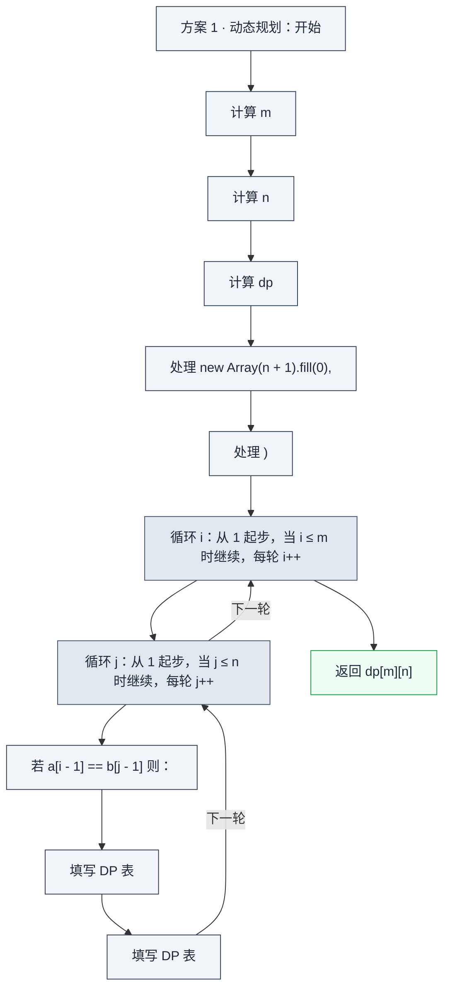

```typescript
// LeetCode 113951689. 动态规划之 LCS — TypeScript 版（最长公共子序列：DP 填表 + 回溯构造）

function lcsLength(a: string, b: string): number {
  // 定义函数/方法 lcsLength
  const m = a.length; // 把 数组.长度 存入 映射表
  const n = b.length; // 把 b.长度 存入 元素个数
  const dp: number[][] = Array.from({ length: m + 1 }, () =>
    new Array(n + 1).fill(0),
  );
  for (let i = 1; i <= m; i++) {
    // 让 下标 i 从 1 开始计数，下标 i 不超过 映射表 就继续
    for (let j = 1; j <= n; j++) {
      // 让 下标 j 从 1 开始计数，下标 j 不超过 元素个数 就继续
      if (a[i - 1] === b[j - 1]) {
        // 若 数组[下标 i 减 1] 全等于 b[下标 j 减 1]
        dp[i][j] = dp[i - 1][j - 1] + 1; // 把 DP 表[下标 i 减 1][下标 j 减 1] 加 1; 写入 dp[i][j]
      } else {
        // 否则
        dp[i][j] = Math.max(dp[i - 1][j], dp[i][j - 1]);
      }
    }
  }
  return dp[m][n]; // 返回 DP 表[映射表][元素个数]
}

function lcsString(a: string, b: string): string {
  // 定义函数/方法 lcsString
  const m = a.length; // 把 数组.长度 存入 映射表
  const n = b.length; // 把 b.长度 存入 元素个数
  const dp: number[][] = Array.from({ length: m + 1 }, () =>
    new Array(n + 1).fill(0),
  );
  for (let i = 1; i <= m; i++) {
    // 让 下标 i 从 1 开始计数，下标 i 不超过 映射表 就继续
    for (let j = 1; j <= n; j++) {
      // 让 下标 j 从 1 开始计数，下标 j 不超过 元素个数 就继续
      dp[i][j] =
        a[i - 1] === b[j - 1] // 把 数组[下标 i 减 1] 全等于 b[下标 j 减 1] 写入 dp[i][j]
          ? dp[i - 1][j - 1] + 1 // ? DP 表[下标 i 减 1][下标 j 减 1] 加 1
          : Math.max(dp[i - 1][j], dp[i][j - 1]); // : Math.取较大值 DP 表[下标 i 减 1][下标 j], DP 表[下标 i][下标 j 减 1]);
    }
  }
  // 回溯构造一条 LCS
  let out = ''; // 把 「」 存入 out
  let i = m,
    j = n; // 把 映射表, 下标 j 赋值为 元素个数 存入 下标 i
  while (i > 0 && j > 0) {
    // 循环，直到不满足「下标 i 超过 0 且 下标 j 超过 0」
    if (a[i - 1] === b[j - 1]) {
      // 若 数组[下标 i 减 1] 全等于 b[下标 j 减 1]
      out = a[i - 1] + out; // 把 数组[下标 i 减 1] 加 out 存入 out
      i--;
      j--; // 下标 i 减一 ; 下标 j 减一 ;
    } else if (dp[i - 1][j] >= dp[i][j - 1]) {
      // 否则，若 DP 表[下标 i 减 1][下标 j] 不低于 DP 表[下标 i][下标 j 减 1]
      i--; // 下标 i 减一
    } else {
      // 否则
      j--; // 下标 j 减一
    }
  }
  return out; // 返回 out
}

export function demo(): void {
  // 程序入口：跑内嵌自测用例
  const cases: { a: string; b: string; want: number }[] = [
    { a: 'ABCBDAB', b: 'BDCABA', want: 4 }, // 如 BDAB / BCAB / BCBA
    { a: 'AGGTAB', b: 'GXTXAYB', want: 4 }, // GTAB
    { a: 'abc', b: 'abc', want: 3 },
    { a: '', b: 'abc', want: 0 }, // 边界：空串
    { a: 'abc', b: 'xyz', want: 0 }, // 边界：无公共字符
  ];
  let fail = false; // 把 false 存入 fail
  for (const c of cases) {
    // for (const 字符 of cases) {
    const got = lcsLength(c.a, c.b); // 把 lcsLength(字符.数组, 字符.b) 存入 got
    if (got !== c.want) {
      // 若 got 不等于 字符.want
      fail = true; // 把 true 存入 fail
      console.log(`FAIL lcsLength(${c.a},${c.b})=${got} want ${c.want}`);
    }
  }
  // 构造一致性：回溯出的串长度 = dp 长度，且是两串的公共子序列
  const pair: [string, string][] = [
    ['ABCBDAB', 'BDCABA'],
    ['AGGTAB', 'GXTXAYB'],
  ];
  for (const [a, b] of pair) {
    // for (const [数组, b] of pair) {
    const s = lcsString(a, b); // 把 lcsString(数组, b) 存入 字符串
    if (s.length !== lcsLength(a, b)) {
      fail = true;
      console.log('FAIL lcsString length', s);
    }
    let ia = 0,
      ib = 0; // 把 0, ib 赋值为 0 存入 ia
    for (const ch of s) {
      // for (const 字符 of 字符串) {
      while (ia < a.length && a[ia] !== ch) ia++; // 循环，直到不满足「ia 小于 数组.长度 且 数组[ia] 不等于 字符) ia 加一 ;」
      while (ib < b.length && b[ib] !== ch) ib++; // 循环，直到不满足「ib 小于 b.长度 且 b[ib] 不等于 字符) ib 加一 ;」
      if (ia >= a.length || ib >= b.length) {
        fail = true;
        console.log('FAIL not subsequence', s);
      }
      ia++;
      ib++; // ia 加一 ; ib 加一 ;
    }
  }
  if (fail) throw new Error('FAILED'); // 若 fail) throw new Error(「FAILED」);
  console.log('PASS'); // 全部用例通过，输出 PASS
}
demo(); // demo();
```

## 逐步拆解与面试追问

**复杂度**：时间 O(n) 到 O(m·n)（取决于状态维度），空间即 DP 表大小

**为什么是这个量级**：动态规划把指数级枚举压成表，每格只算一次，复杂度等于「状态数 × 转移代价」

**面试官可能会追问**：

- 这个策略能推广到什么场景？
- 与暴力做法差在哪一步？
- 有没有更简单的等价写法？

## 关键 API 速查（TS 主解法实际用到，附官方链接）

| API | 作用 | 使用要点 | 官方文档 |
|---|---|---|---|
| `Array.from()` | 类数组/可迭代对象转数组 | Array.from(iterable, mapFn) 可同时映射；对 Set 去重、对字符串按码元拆分；稀疏位会被 undefined 填充 | [官方文档](https://developer.mozilla.org/zh-CN/docs/Web/JavaScript/Reference/Global_Objects/Array/from) |
| `Math.max()` | 最大值 | 配展开 Math.max(...arr)；空参返回 -Infinity；超大数组注意展开参数上限 | [官方文档](https://developer.mozilla.org/zh-CN/docs/Web/JavaScript/Reference/Global_Objects/Math/max) |

### 各语言官方文档导航

- **TypeScript / JS**：[MDN 中文参考](https://developer.mozilla.org/zh-CN/)
- **Python**：[Python 官方文档](https://docs.python.org/zh-cn/3/)
- **Go**：[Go 标准库](https://pkg.go.dev/std)
- **Java**：[JDK 17 API](https://docs.oracle.com/en/java/javase/17/docs/api/)
- **Rust**：[Rust 标准库](https://doc.rust-lang.org/std/)
- **Lua**：[Lua 5.4 手册](https://www.lua.org/manual/5.4/)
- **C**：[Cppreference C](https://zh.cppreference.com/w/c)
- **C++**：[Cppreference C++](https://zh.cppreference.com/w/cpp)
- **R**：[R 官方手册](https://stat.ethz.ch/R-manual/)
- **Zig**：[Zig 语言文档](https://ziglang.org/documentation/master/)
- **Dart**：[Dart API](https://api.dart.dev/)

## 附录：其他 10 种语言全部实现（每种语言列举其全部方案）

> TypeScript 的全部方案见「TypeScript 解题方案」一节；下面是其余 10 种语言的对应实现，每种语言的每个方案都带思路分析、代码走读与专属运行架构图。
> 每个方案都内嵌用例自测，可独立运行（老仓库 python/go 文件遵循「打印结果」约定）。
> 完整解法文件见 `dsa/<语言>/notes/lc_113951689_动态规划之lcs_0/`。

### Python 实现（1 种方案）

Python 的全部方案如下，每个方案都内嵌用例自测，可独立运行（老仓库 python/go 文件遵循「打印结果」约定）：

#### 方案 1：动态规划

**思路与代码分析**：核心是「动态规划」。Python 版用切片与字典推导式简化操作，突出可读性。代码里依次做这些事：DP 表逐项填充。**走读**：方案 1 · 动态规划：开始 → 更新 n → 填写 DP 表 → 处理 [0] * (n + 1) for _ in range → 处理 ] → 循环 i：从 1 到 m + 1 前 → 循环 j：从 1 到 n + 1 前 → 若 a[i - 1] == b[j - 1]：填写 DP 表 → 填写 DP 表 → 填写 DP 表 → 返回 dp[m][n]。

**运行架构**（真实控制流）：

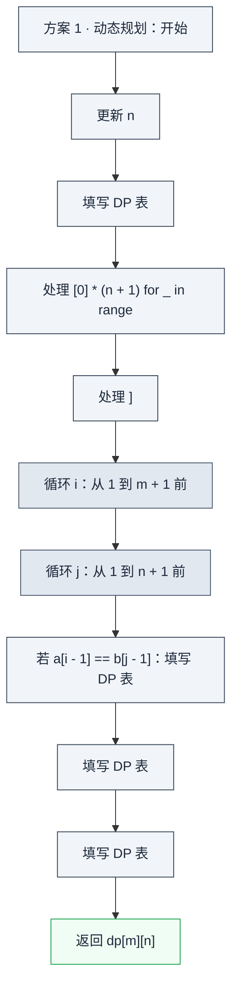

```python
# LeetCode 113951689. 动态规划之 LCS — Python 版（最长公共子序列：DP 填表 + 回溯构造）

import sys  # 提高递归深度上限（深输入防 RecursionError）

sys.setrecursionlimit(200000)  # 树/链表类题目节点数可达 1e4 量级

def lcs_length(a, b):  # 定义函数 lcs_length（参数：数组, b）
    m, n = len(a), len(b)  # 把 长度(数组), 长度(b) 写入 m, n
    dp = [
        [0] * (n + 1) for _ in range(m + 1)
    ]  # 把 [[0] 乘 (元素个数 加 1) for _ in range(映射表 加 1)] 存入 DP 表
    for i in range(1, m + 1):  # 让 下标 i 从 1 到 映射表 加 1 遍历
        for j in range(1, n + 1):  # 让 下标 j 从 1 到 元素个数 加 1 遍历
            if a[i - 1] == b[j - 1]:  # 若 数组[下标 i 减 1] 等于 b[下标 j 减 1]
                dp[i][j] = dp[i - 1][j - 1] + 1  # 把 DP 表[下标 i 减 1][下标 j 减 1] 加 1 写入 dp[i][j]
            else:  # 否则
                dp[i][j] = max(dp[i - 1][j], dp[i][j - 1])
    return dp[m][n]  # 返回 DP 表[映射表][元素个数]

def lcs_string(a, b):  # 定义函数 lcs_string（参数：数组, b）
    m, n = len(a), len(b)  # 把 长度(数组), 长度(b) 写入 m, n
    dp = [
        [0] * (n + 1) for _ in range(m + 1)
    ]  # 把 [[0] 乘 (元素个数 加 1) for _ in range(映射表 加 1)] 存入 DP 表
    for i in range(1, m + 1):  # 让 下标 i 从 1 到 映射表 加 1 遍历
        for j in range(1, n + 1):  # 让 下标 j 从 1 到 元素个数 加 1 遍历
            if a[i - 1] == b[j - 1]:  # 若 数组[下标 i 减 1] 等于 b[下标 j 减 1]
                dp[i][j] = dp[i - 1][j - 1] + 1  # 把 DP 表[下标 i 减 1][下标 j 减 1] 加 1 写入 dp[i][j]
            else:  # 否则
                dp[i][j] = max(dp[i - 1][j], dp[i][j - 1])
    out = []  # 把 [] 存入 out
    i, j = m, n  # 把 映射表, 元素个数 写入 i, j
    while i > 0 and j > 0:  # 循环，直到不满足「下标 i 超过 0 and 下标 j 超过 0」
        if a[i - 1] == b[j - 1]:  # 若 数组[下标 i 减 1] 等于 b[下标 j 减 1]
            out.append(a[i - 1])  # 把 数组[下标 i 减 1] 追加到列表尾部
            i -= 1  # 下标 i累减 1
            j -= 1  # 下标 j累减 1
        elif (
            dp[i - 1][j] >= dp[i][j - 1]
        ):  # 否则，若 DP 表[下标 i 减 1][下标 j] 不低于 DP 表[下标 i][下标 j 减 1]
            i -= 1  # 下标 i累减 1
        else:  # 否则
            j -= 1  # 下标 j累减 1
    return "".join(reversed(out))  # 返回 「」.join(reversed(out))

if __name__ == "__main__":  # 若 __name__ 等于 '__main__'
    cases = [
        ("ABCBDAB", "BDCABA", 4),
        ("AGGTAB", "GXTXAYB", 4),
        ("abc", "abc", 3),
        ("", "abc", 0),
        ("abc", "xyz", 0),
    ]
    for a, b, want in cases:  # for 数组, b, want in cases:
        got = lcs_length(a, b)  # 把 lcs_length(数组, b) 存入 got
        assert got == want, f"lcs_length({a},{b})={got} want {want}"  # 断言校验
    for a, b in [("ABCBDAB", "BDCABA"), ("AGGTAB", "GXTXAYB")]:
        s = lcs_string(a, b)  # 把 lcs_string(数组, b) 存入 字符串
        assert len(s) == lcs_length(a, b), f"lcs_string length mismatch: {s}"  # 断言校验
        ia = ib = 0  # 把 ib 赋值为 0 存入 ia
        for ch in s:  # 逐个取出 字符串 的元素（字符）
            while (
                ia < len(a) and a[ia] != ch
            ):  # 循环，直到不满足「ia 小于 长度(数组) and 数组[ia] 不等于 字符」
                ia += 1  # ia累加 1
            while ib < len(b) and b[ib] != ch:  # 循环，直到不满足「ib 小于 长度(b) and b[ib] 不等于 字符」
                ib += 1  # ib累加 1
            assert ia < len(a) and ib < len(b), f"not a common subsequence: {s}"  # 断言校验
            ia += 1  # ia累加 1
            ib += 1  # ib累加 1
    print("PASS")  # 全部用例通过，输出 PASS
```

### Go 实现（1 种方案）

Go 的全部方案如下，每个方案都内嵌用例自测，可独立运行（老仓库 python/go 文件遵循「打印结果」约定）：

#### 方案 1：动态规划

**思路与代码分析**：核心是「动态规划」。Go 版用切片与多返回值惯用法，显式处理索引边界。代码里依次做这些事：DP 表逐项填充。**走读**：方案 1 · 动态规划：开始 → 更新 : → 更新 : → 遍历 dp 的下标与元素 i → 填写 DP 表 → 遍历循环 → 遍历循环 → 处理 if a[i-1] == b[j-1] → 填写 DP 表 → 填写 DP 表 → 填写 DP 表 → 填写 DP 表 → 返回 dp[m][n]。

**运行架构**（真实控制流）：

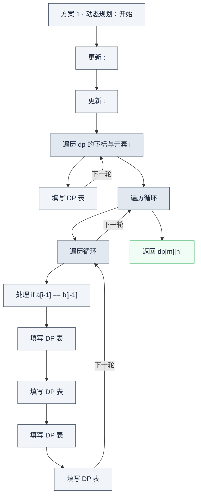

```go
// LeetCode 113951689. 动态规划之 LCS — Go 版（最长公共子序列：DP 填表 + 回溯构造）
package main // 引入依赖

import "fmt" // 引入依赖

func lcsLength(a, b string) int { // 定义函数/方法 lcsLength
	m, n := len(a), len(b)   // 把 长度(数组), 长度(b) 写入 m, n :
	dp := make([][]int, m+1) // 把 make([][]int, 映射表 加 1) 写入 dp :
	for i := range dp {      // 把 range DP 表 { 写入 for i :
		dp[i] = make([]int, n+1) // 把 make([]int, 元素个数 加 1) 写入 dp[i]
	}
	for i := 1; i <= m; i++ { // 让 下标 i 从 1 开始计数
		for j := 1; j <= n; j++ { // 让 下标 j 从 1 开始计数
			if a[i-1] == b[j-1] { // 若 数组[下标 i 减 1] 等于 b[下标 j 减 1]
				dp[i][j] = dp[i-1][j-1] + 1 // 把 DP 表[下标 i 减 1][下标 j 减 1] 加 1 写入 dp[i][j]
			} else { // 否则
				dp[i][j] = dp[i-1][j]      // 把 DP 表[下标 i 减 1][下标 j] 写入 dp[i][j]
				if dp[i][j-1] > dp[i][j] { // 若 DP 表[下标 i][下标 j 减 1] 超过 DP 表[下标 i][下标 j]
					dp[i][j] = dp[i][j-1] // 把 DP 表[下标 i][下标 j 减 1] 写入 dp[i][j]
				}
			}
		}
	}
	return dp[m][n] // 返回 DP 表[映射表][元素个数]
}

func lcsString(a, b string) string { // 定义函数/方法 lcsString
	m, n := len(a), len(b)   // 把 长度(数组), 长度(b) 写入 m, n :
	dp := make([][]int, m+1) // 把 make([][]int, 映射表 加 1) 写入 dp :
	for i := range dp {      // 把 range DP 表 { 写入 for i :
		dp[i] = make([]int, n+1) // 把 make([]int, 元素个数 加 1) 写入 dp[i]
	}
	for i := 1; i <= m; i++ { // 让 下标 i 从 1 开始计数
		for j := 1; j <= n; j++ { // 让 下标 j 从 1 开始计数
			if a[i-1] == b[j-1] { // 若 数组[下标 i 减 1] 等于 b[下标 j 减 1]
				dp[i][j] = dp[i-1][j-1] + 1 // 把 DP 表[下标 i 减 1][下标 j 减 1] 加 1 写入 dp[i][j]
			} else { // 否则
				dp[i][j] = dp[i-1][j]      // 把 DP 表[下标 i 减 1][下标 j] 写入 dp[i][j]
				if dp[i][j-1] > dp[i][j] { // 若 DP 表[下标 i][下标 j 减 1] 超过 DP 表[下标 i][下标 j]
					dp[i][j] = dp[i][j-1] // 把 DP 表[下标 i][下标 j 减 1] 写入 dp[i][j]
				}
			}
		}
	}
	out := make([]byte, 0, dp[m][n]) // 把 make([]byte, 0, DP 表[映射表][元素个数]) 写入 out :
	i, j := m, n                     // 把 映射表, 元素个数 写入 i, j :
	for i > 0 && j > 0 {             // for 下标 i 超过 0 且 下标 j 超过 0 {
		if a[i-1] == b[j-1] { // 若 数组[下标 i 减 1] 等于 b[下标 j 减 1]
			out = append(out, a[i-1]) // 把 append(out, 数组[下标 i 减 1]) 写入 out
			i--                       // 下标 i 减一
			j--                       // 下标 j 减一
		} else if dp[i-1][j] >= dp[i][j-1] { // 否则，若 DP 表[下标 i 减 1][下标 j] 不低于 DP 表[下标 i][下标 j 减 1]
			i-- // 下标 i 减一
		} else { // 否则
			j-- // 下标 j 减一
		}
	}
	// 反转
	for l, r := 0, len(out)-1; l < r; l, r = l+1, r-1 {
		out[l], out[r] = out[r], out[l] // 把 out[右指针], out[左指针] 写入 out[l], out[r]
	}
	return string(out) // 定义函数/方法 string
}

func isCommonSub(a, b, s string) bool { // 定义判定函数 isCommonSub
	ia, ib := 0, 0         // 把 0, 0 写入 ia, ib :
	for _, ch := range s { // 同时取 _ 与 字符 遍历
		for ia < len(a) && a[ia] != byte(ch) { // 把 byte(字符) { 写入 for ia < len(a) && a[ia] !
			ia++ // ia 加一
		}
		for ib < len(b) && b[ib] != byte(ch) { // 把 byte(字符) { 写入 for ib < len(b) && b[ib] !
			ib++ // ib 加一
		}
		if ia >= len(a) || ib >= len(b) { // 若 ia 不低于 长度(数组) 或 ib 不低于 长度(b
			return false // 返回 false
		}
		ia++ // ia 加一
		ib++ // ib 加一
	}
	return true // 返回 true
}

func main() { // 程序入口：跑内嵌自测用例
	cases := []struct { // 把 []struct { 写入 cases :
		a, b string // 数组, b string
		want int    // want int
	}{ // }{
		{"ABCBDAB", "BDCABA", 4},
		{"AGGTAB", "GXTXAYB", 4},
		{"abc", "abc", 3},
		{"", "abc", 0},
		{"abc", "xyz", 0},
	}
	for idx, c := range cases { // 同时取 idx 与 字符 遍历
		if got := lcsLength(c.a, c.b); got != c.want { // 若 got : 赋值为 lcsLength(字符.数组, 字符.b); got 不等于 字符.want
			fmt.Printf("case %d failed: got %d want %d\n", idx, got, c.want) // 打印输出
			return                                                           // return
		}
	}
	for _, p := range [][2]string{{"ABCBDAB", "BDCABA"}, {"AGGTAB", "GXTXAYB"}} { // 同时取 _ 与 节点 遍历
		s := lcsString(p[0], p[1])                                          // 把 lcsString(节点[0], 节点[1]) 写入 s :
		if len(s) != lcsLength(p[0], p[1]) || !isCommonSub(p[0], p[1], s) { // 定义函数/方法 len
			fmt.Println("lcsString failed:", s) // 打印输出
			return                              // return
		}
	}
	fmt.Println("PASS") // 全部用例通过，输出 PASS
}
```

### Java 实现（1 种方案）

Java 的全部方案如下，每个方案都内嵌用例自测，可独立运行（老仓库 python/go 文件遵循「打印结果」约定）：

#### 方案 1：动态规划

**思路与代码分析**：核心是「动态规划」。Java 版用类与静态方法组织，集合操作显式明了。代码里依次做这些事：DP 表逐项填充；双重循环遍历。**走读**：方案 1 · 动态规划：开始 → 更新 m → 填写 DP 表 → 遍历循环 → 遍历循环 → 若 a.charAt(i - 1) == b.charAt(j - 1) 则： → 填写 DP 表 → 填写 DP 表 → 返回 dp[m][n]。

**运行架构**（真实控制流）：

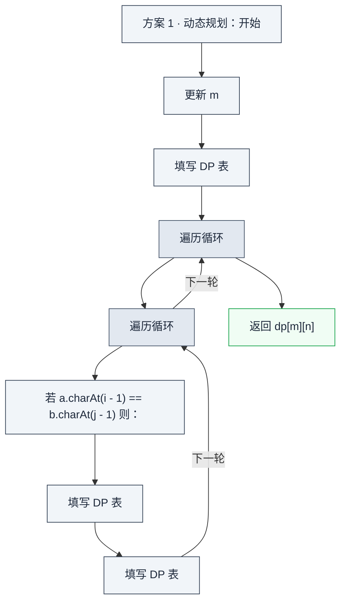

```java
// LeetCode 113951689. 动态规划之 LCS — Java 版（最长公共子序列：DP 填表 + 回溯构造）
package com.webfault.dsa; // 引入依赖

class Lcs { // 定义类型
  static int lcsLength(String a, String b) { // 定义函数/方法 lcsLength
    int m = a.length(), n = b.length(); // 把 数组.长度(), 元素个数 赋值为 b.长度() 存入 映射表
    int[][] dp = new int[m + 1][n + 1]; // 把 new int[映射表 加 1][元素个数 加 1]; 写入 int[][] dp
    for (int i = 1; i <= m; i++) { // 让 下标 i 从 1 开始计数，下标 i 不超过 映射表 就继续
      for (int j = 1; j <= n; j++) { // 让 下标 j 从 1 开始计数，下标 j 不超过 元素个数 就继续
        if (a.charAt(i - 1) == b.charAt(j - 1)) { // 若 数组 取字符 下标 i 减 1) 等于 b 取字符 下标 j 减 1
          dp[i][j] = dp[i - 1][j - 1] + 1; // 把 DP 表[下标 i 减 1][下标 j 减 1] 加 1; 写入 dp[i][j]
        } else { // 否则
          dp[i][j] = Math.max(dp[i - 1][j], dp[i][j - 1]);
        }
      }
    }
    return dp[m][n]; // 返回 DP 表[映射表][元素个数]
  }

  static String lcsString(String a, String b) { // 定义函数/方法 lcsString
    int m = a.length(), n = b.length(); // 把 数组.长度(), 元素个数 赋值为 b.长度() 存入 映射表
    int[][] dp = new int[m + 1][n + 1]; // 把 new int[映射表 加 1][元素个数 加 1]; 写入 int[][] dp
    for (int i = 1; i <= m; i++) { // 让 下标 i 从 1 开始计数，下标 i 不超过 映射表 就继续
      for (int j = 1; j <= n; j++) { // 让 下标 j 从 1 开始计数，下标 j 不超过 元素个数 就继续
        dp[i][j] =
            a.charAt(i - 1) == b.charAt(j - 1) // 逐字符处理
                ? dp[i - 1][j - 1] + 1 // ? DP 表[下标 i 减 1][下标 j 减 1] 加 1
                : Math.max(
                    dp[i - 1][j],
                    dp[i][j - 1]); // : Math.取较大值 DP 表[下标 i 减 1][下标 j], DP 表[下标 i][下标 j 减 1]);
      }
    }
    StringBuilder sb = new StringBuilder(); // 把 new StringBuilder(); 写入 StringBuilder sb
    int i = m, j = n; // 把 映射表, 下标 j 赋值为 元素个数 存入 下标 i
    while (i > 0 && j > 0) { // 循环，直到不满足「下标 i 超过 0 且 下标 j 超过 0」
      if (a.charAt(i - 1) == b.charAt(j - 1)) { // 若 数组 取字符 下标 i 减 1) 等于 b 取字符 下标 j 减 1
        sb.append(a.charAt(i - 1)); // 把 数组 取字符 下标 i 减 1 追加到列表尾部
        i--; // 下标 i 减一
        j--; // 下标 j 减一
      } else if (dp[i - 1][j]
          >= dp[i][j - 1]) { // 否则，若 DP 表[下标 i 减 1][下标 j] 不低于 DP 表[下标 i][下标 j 减 1]
        i--; // 下标 i 减一
      } else { // 否则
        j--; // 下标 j 减一
      }
    }
    return sb.reverse().toString(); // 返回 sb.reverse().toString()
  }

  static boolean isCommonSub(String a, String b, String s) { // 定义判定函数 isCommonSub
    int ia = 0, ib = 0; // 把 0, ib 赋值为 0 存入 ia
    for (char ch : s.toCharArray()) { // for (char 字符 : 字符串.toCharArray()) {
      while (ia < a.length() && a.charAt(ia) != ch)
        ia++; // 循环，直到不满足「ia 小于 数组.长度() 且 数组 取字符 ia) 不等于 字符) ia 加一 ;」
      while (ib < b.length() && b.charAt(ib) != ch)
        ib++; // 循环，直到不满足「ib 小于 b.长度() 且 b 取字符 ib) 不等于 字符) ib 加一 ;」
      if (ia >= a.length() || ib >= b.length())
        return false; // 若 ia 不低于 数组.长度() 或 ib 不低于 b.长度()，直接返回 false
      ia++; // ia 加一
      ib++; // ib 加一
    }
    return true; // 返回 true
  }

  public static void main(String[] args) { // public static void main(String[] args) {
    Object[][] cases = { // 把 { 写入 Object[][] cases
      {"ABCBDAB", "BDCABA", 4},
      {"AGGTAB", "GXTXAYB", 4},
      {"abc", "abc", 3},
      {"", "abc", 0},
      {"abc", "xyz", 0},
    };
    for (Object[] c : cases) { // for (Object[] 字符 : cases) {
      int got =
          lcsLength(
              (String) c[0], (String) c[1]); // 把 lcsLength((String) 字符[0], (String) 字符[1]) 存入 got
      if (got != (int) c[2]) { // 若 got 不等于 (int) 字符[2]
        System.out.println("case failed: got " + got + " want " + c[2]); // 打印输出
        return; // return;
      }
    }
    String[][] pairs = {{"ABCBDAB", "BDCABA"}, {"AGGTAB", "GXTXAYB"}};
    for (String[] p : pairs) { // for (String[] 节点 : pairs) {
      String s = lcsString(p[0], p[1]); // 把 lcsString(节点[0], 节点[1]) 存入 字符串
      if (s.length() != lcsLength(p[0], p[1]) || !isCommonSub(p[0], p[1], s)) {
        System.out.println("lcsString failed: " + s); // 打印输出
        return; // return;
      }
    }
    System.out.println("PASS"); // 全部用例通过，输出 PASS
  }
}
```

### Rust 实现（1 种方案）

Rust 的全部方案如下，每个方案都内嵌用例自测，可独立运行（老仓库 python/go 文件遵循「打印结果」约定）：

#### 方案 1：动态规划

**思路与代码分析**：核心是「动态规划」。Rust 版用所有权移动与切片借用改写同一逻辑，注意 Option 与引用边界。代码里依次做这些事：DP 表逐项填充。**走读**：方案 1 · 动态规划：开始 → 填写 DP 表 → 填写 DP 表 → 返回结果。

**运行架构**（真实控制流）：

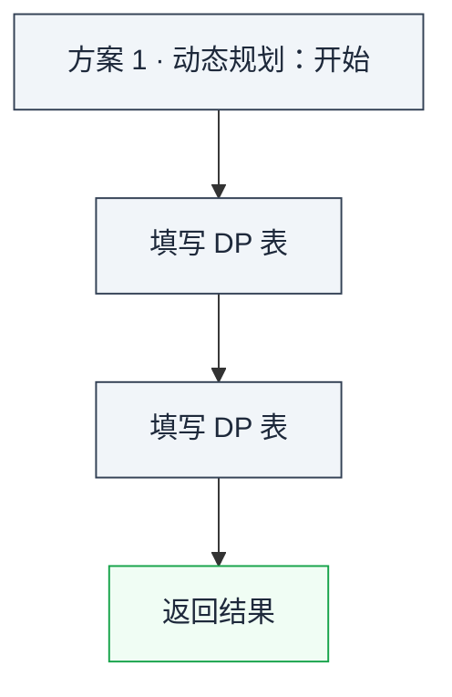

```rust
// LeetCode 113951689. 动态规划之 LCS — Rust 版（最长公共子序列：DP 填表 + 回溯构造）

fn lcs_table(a: &str, b: &str) -> Vec<Vec<usize>> {
    // 定义函数/方法 lcs_table
    let ab = a.as_bytes(); // 把 数组.as_bytes() 存入 ab
    let bb = b.as_bytes(); // 把 b.as_bytes() 存入 bb
    let (m, n) = (ab.len(), bb.len()); // 把 (ab.长度(), bb.长度()); 写入 let (m, n)
    let mut dp = vec![vec![0usize; n + 1]; m + 1]; // 把 vec取反 [vec取反 [0usize; 元素个数 加 1]; 映射表 加 1]; 写入 let mut dp
    for i in 1..=m {
        // 逐个取出 1 的元素（下标 i）
        for j in 1..=n {
            // 逐个取出 1 的元素（下标 j）
            dp[i][j] = if ab[i - 1] == bb[j - 1] {
                // 把 if ab[下标 i 减 1] 等于 bb[下标 j 减 1] { 写入 dp[i][j]
                dp[i - 1][j - 1] + 1 // DP 表[下标 i 减 1][下标 j 减 1] 加 1
            } else {
                // 否则
                dp[i - 1][j].max(dp[i][j - 1]) // DP 表[下标 i 减 1][下标 j].取较大值 DP 表[下标 i][下标 j 减 1])
            };
        }
    }
    dp // DP 表
}

fn lcs_length(a: &str, b: &str) -> usize {
    // 定义函数/方法 lcs_length
    let dp = lcs_table(a, b); // 把 lcs_table(数组, b) 存入 DP 表
    dp[a.len()][b.len()] // DP 表[数组.长度()][b.长度()]
}

fn lcs_string(a: &str, b: &str) -> String {
    // 定义函数/方法 lcs_string
    let ab = a.as_bytes(); // 把 数组.as_bytes() 存入 ab
    let bb = b.as_bytes(); // 把 b.as_bytes() 存入 bb
    let dp = lcs_table(a, b); // 把 lcs_table(数组, b) 存入 DP 表
    let (mut i, mut j) = (ab.len(), bb.len()); // 把 (ab.长度(), bb.长度()); 写入 let (mut i, mut j)
    let mut out = Vec::with_capacity(dp[i][j]); // 把 Vec::with_capacity(DP 表[下标 i][下标 j]); 写入 let mut out
    while i > 0 && j > 0 {
        // while 下标 i 超过 0 且 下标 j 超过 0 {
        if ab[i - 1] == bb[j - 1] {
            // 若 ab[下标 i 减 1] 等于 bb[下标 j 减 1]
            out.push(ab[i - 1]); // 把 ab[下标 i 减 1] 压入栈/数组尾部
            i -= 1; // 下标 i累减 1
            j -= 1; // 下标 j累减 1
        } else if dp[i - 1][j] >= dp[i][j - 1] {
            // 否则，若 DP 表[下标 i 减 1][下标 j] 不低于 DP 表[下标 i][下标 j 减 1]
            i -= 1; // 下标 i累减 1
        } else {
            // 否则
            j -= 1; // 下标 j累减 1
        }
    }
    out.reverse(); // 反转
    String::from_utf8(out).unwrap() // String::from_utf8(out).unwrap()
}

fn is_common_sub(a: &str, b: &str, s: &str) -> bool {
    // 定义判定函数 is_common_sub
    let ab = a.as_bytes(); // 把 数组.as_bytes() 存入 ab
    let bb = b.as_bytes(); // 把 b.as_bytes() 存入 bb
    let (mut ia, mut ib) = (0usize, 0usize); // 把 (0usize, 0usize); 写入 let (mut ia, mut ib)
    for &ch in s.as_bytes() {
        // for 按位与 字符 in 字符串.as_bytes() {
        while ia < ab.len() && ab[ia] != ch {
            // 把 字符 { 写入 while ia < ab.len() && ab[ia] !
            ia += 1; // ia累加 1
        }
        while ib < bb.len() && bb[ib] != ch {
            // 把 字符 { 写入 while ib < bb.len() && bb[ib] !
            ib += 1; // ib累加 1
        }
        if ia >= ab.len() || ib >= bb.len() {
            // 若 ia 不低于 ab.长度() 或 ib 不低于 bb.长度(
            return false; // 返回 false
        }
        ia += 1; // ia累加 1
        ib += 1; // ib累加 1
    }
    true // true
}

fn main() {
    // 程序入口：跑内嵌自测用例
    let cases: Vec<(&str, &str, usize)> = vec![
        ("ABCBDAB", "BDCABA", 4),
        ("AGGTAB", "GXTXAYB", 4),
        ("abc", "abc", 3),
        ("", "abc", 0),
        ("abc", "xyz", 0),
    ];
    for (idx, (a, b, want)) in cases.iter().enumerate() {
        // for (idx, (数组, b, want)) in cases.iter().enumerate() {
        let got = lcs_length(a, b); // 把 lcs_length(数组, b) 存入 got
        assert_eq!(got, *want, "case {} failed: lcs_length({},{})", idx, a, b); // 断言校验
    }
    for (a, b) in [("ABCBDAB", "BDCABA"), ("AGGTAB", "GXTXAYB")] {
        let s = lcs_string(a, b); // 把 lcs_string(数组, b) 存入 字符串
        assert_eq!(
            s.len(),
            lcs_length(a, b),
            "lcs_string length mismatch: {}",
            s
        ); // 断言校验
        assert!(is_common_sub(a, b, &s), "not a common subsequence: {}", s); // 断言校验
    }
    println!("PASS"); // 全部用例通过，输出 PASS
}
```

### Lua 实现（1 种方案）

Lua 的全部方案如下，每个方案都内嵌用例自测，可独立运行（老仓库 python/go 文件遵循「打印结果」约定）：

#### 方案 1：动态规划

**思路与代码分析**：核心是「动态规划」。Lua 版用表与 ipairs 遍历，注意 ipairs 遇 nil 即停的语义。**走读**：方案 1 · 动态规划：开始 → 返回 s:sub(i, i)。

**运行架构**（真实控制流）：

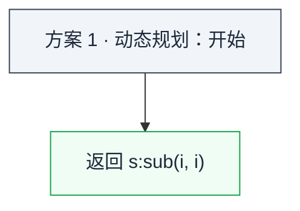

```lua
-- LeetCode 113951689. 动态规划之 LCS — Lua 版（最长公共子序列：DP 填表 + 回溯构造）

local function sub(s, i) -- local function sub(字符串, 下标 i)
	return s:sub(i, i) -- 返回 字符串:sub(下标 i, 下标 i)
end -- 终点

local function lcs_table(a, b) -- local function lcs_table(数组, b)
	local m, n = #a, #b -- 把 #数组, #b 写入 local m, n
	local dp = {} -- 把 {} 写入 local dp
	for i = 0, m do -- 让 下标 i 从 0 走到 映射表（Lua 1 基）
		dp[i] = {} -- 把 {} 写入 dp[i]
		for j = 0, n do
			dp[i][j] = 0
		end -- 让 下标 j 从 0 走到 元素个数（Lua 1 基）
	end -- 终点
	for i = 1, m do -- 让 下标 i 从 1 走到 映射表（Lua 1 基）
		for j = 1, n do -- 让 下标 j 从 1 走到 元素个数（Lua 1 基）
			if sub(a, i) == sub(b, j) then -- 若 sub(数组, 下标 i) 等于 sub(b, 下标 j) then
				dp[i][j] = dp[i - 1][j - 1] + 1 -- 把 DP 表[下标 i 减 1][下标 j 减 1] 加 1 写入 dp[i][j]
			else -- 否则
				dp[i][j] = math.max(dp[i - 1][j], dp[i][j - 1])
			end -- 终点
		end -- 终点
	end -- 终点
	return dp -- 返回 DP 表
end -- 终点

local function lcs_length(a, b) -- local function lcs_length(数组, b)
	local dp = lcs_table(a, b) -- 把 lcs_table(数组, b) 写入 local dp
	return dp[#a][#b] -- 返回 DP 表[#数组][#b]
end -- 终点

local function lcs_string(a, b) -- local function lcs_string(数组, b)
	local dp = lcs_table(a, b) -- 把 lcs_table(数组, b) 写入 local dp
	local i, j = #a, #b -- 把 #数组, #b 写入 local i, j
	local out = {} -- 把 {} 写入 local out
	while i > 0 and j > 0 do -- while 下标 i 超过 0 and 下标 j 超过 0 do
		if sub(a, i) == sub(b, j) then -- 若 sub(数组, 下标 i) 等于 sub(b, 下标 j) then
			out[#out + 1] = sub(a, i) -- 把 sub(数组, 下标 i) 写入 out[#out + 1]
			i = i - 1 -- 把 下标 i 减 1 存入 下标 i
			j = j - 1 -- 把 下标 j 减 1 存入 下标 j
		elseif dp[i - 1][j] >= dp[i][j - 1] then -- 把 DP 表[下标 i][下标 j 减 1] then 写入 elseif dp[i - 1][j] >
			i = i - 1 -- 把 下标 i 减 1 存入 下标 i
		else -- 否则
			j = j - 1 -- 把 下标 j 减 1 存入 下标 j
		end -- 终点
	end -- 终点
	-- 反转拼接
	local s = {} -- 把 {} 写入 local s
	for k = #out, 1, -1 do
		s[#s + 1] = out[k]
	end -- 把 #out, 1, 减 1 do 字符串[#字符串 加 1] 赋值为 out[下标 k] 终点 写入 for k
	return table.concat(s) -- 返回 table.concat(字符串)
end -- 终点

local function is_common_sub(a, b, s) -- local function is_common_sub(数组, b, 字符串)
	local ia, ib = 1, 1 -- 把 1, 1 写入 local ia, ib
	for k = 1, #s do -- 把 1, #字符串 do 写入 for k
		local ch = sub(s, k) -- 把 sub(字符串, 下标 k) 写入 local ch
		while ia <= #a and sub(a, ia) ~= ch do
			ia = ia + 1
		end
		while ib <= #b and sub(b, ib) ~= ch do
			ib = ib + 1
		end
		if ia > #a or ib > #b then
			return false
		end -- 若 ia 超过 #数组 or ib 超过 #b then return false 终点
		ia = ia + 1 -- 把 ia 加 1 存入 ia
		ib = ib + 1 -- 把 ib 加 1 存入 ib
	end -- 终点
	return true -- 返回 true
end -- 终点

local cases = { -- 把 { 写入 local cases
	{ "ABCBDAB", "BDCABA", 4 },
	{ "AGGTAB", "GXTXAYB", 4 },
	{ "abc", "abc", 3 },
	{ "", "abc", 0 },
	{ "abc", "xyz", 0 },
}
for idx, c in ipairs(cases) do -- 遍历取 字符
	local got = lcs_length(c[1], c[2]) -- 把 lcs_length(字符[1], 字符[2]) 写入 local got
	assert(got == c[3], string.format("case %d failed: got %d want %d", idx, got, c[3])) -- 断言校验
end -- 终点
for _, p in ipairs({ { "ABCBDAB", "BDCABA" }, { "AGGTAB", "GXTXAYB" } }) do -- 遍历取 节点
	local s = lcs_string(p[1], p[2]) -- 把 lcs_string(节点[1], 节点[2]) 写入 local s
	assert(#s == lcs_length(p[1], p[2]), "lcs_string length mismatch: " .. s) -- 断言校验
	assert(is_common_sub(p[1], p[2], s), "not a common subsequence: " .. s) -- 断言校验
end -- 终点
print("PASS") -- 全部用例通过，输出 PASS
```

### C 实现（1 种方案）

C 的全部方案如下，每个方案都内嵌用例自测，可独立运行（老仓库 python/go 文件遵循「打印结果」约定）：

#### 方案 1：动态规划

**思路与代码分析**：核心是「动态规划」。C 版手动管理下标与内存，循环边界全部显式写出。代码里依次做这些事：DP 表逐项填充。**走读**：方案 1 · 动态规划：开始 → 填写 DP 表 → 返回 lcs_table(a, b, dp)。

**运行架构**（真实控制流）：

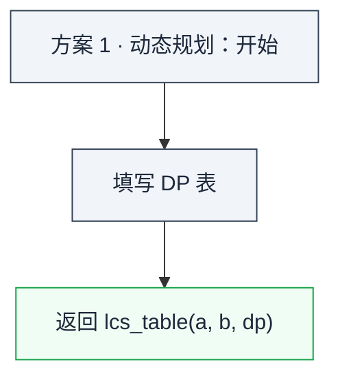

```c
* LeetCode 113951689. 动态规划之 LCS — C 版（最长公共子序列：DP 填表 + 回溯构造）
 */
#include <stdio.h>  // 引入头文件
#include <string.h> // 引入头文件

#define MAXN 64 // #define MAXN 64

static int lcs_table(const char *a, const char *b, int dp[][MAXN]) { // 定义函数/方法 lcs_table
    int m = (int)strlen(a),
        n = (int)strlen(b); // 把 (int)strlen(数组), 元素个数 赋值为 (int)strlen(b) 存入 映射表
    for (int i = 0; i <= m; i++) // 让 下标 i 从 0 开始计数，下标 i 不超过 映射表 就继续
        for (int j = 0; j <= n; j++)
            dp[i][j] = 0; // 让 下标 j 从 0 开始计数，下标 j 不超过 元素个数 就继续
    for (int i = 1; i <= m; i++) { // 让 下标 i 从 1 开始计数，下标 i 不超过 映射表 就继续
        for (int j = 1; j <= n; j++) { // 让 下标 j 从 1 开始计数，下标 j 不超过 元素个数 就继续
            if (a[i - 1] == b[j - 1])
                dp[i][j] = dp[i - 1][j - 1] + 1;
            else
                dp[i][j] = dp[i - 1][j] > dp[i][j - 1] ? dp[i - 1][j] : dp[i][j - 1]; // 否则
        }
    }
    return dp[m][n]; // 返回 DP 表[映射表][元素个数]
}

static int lcs_length(const char *a, const char *b) { // 定义函数/方法 lcs_length
    int dp[MAXN][MAXN];                               // int DP 表[MAXN][MAXN];
    return lcs_table(a, b, dp);                       // 返回 lcs_table(数组, b, DP 表)
}

static void lcs_string(const char *a, const char *b, char *out) { // 定义函数/方法 lcs_string
    int dp[MAXN][MAXN];                                           // int DP 表[MAXN][MAXN];
    lcs_table(a, b, dp);                                          // lcs_table(数组, b, DP 表);
    int m = (int)strlen(a),
        n = (int)strlen(b); // 把 (int)strlen(数组), 元素个数 赋值为 (int)strlen(b) 存入 映射表
    char buf[MAXN];         // char buf[MAXN];
    int k = 0;              // 把 0 存入 下标 k
    int i = m, j = n;       // 把 映射表, 下标 j 赋值为 元素个数 存入 下标 i
    while (i > 0 && j > 0) {        // 循环，直到不满足「下标 i 超过 0 且 下标 j 超过 0」
        if (a[i - 1] == b[j - 1]) { // 若 数组[下标 i 减 1] 等于 b[下标 j 减 1]
            buf[k++] = a[i - 1];    // 把 数组[下标 i 减 1]; 写入 buf[k++]
            i--;
            j--; // 下标 i 减一 ; 下标 j 减一 ;
        } else if (dp[i - 1][j] >=
                   dp[i][j - 1]) { // 否则，若 DP 表[下标 i 减 1][下标 j] 不低于 DP 表[下标 i][下标 j 减 1]
            i--;                   // 下标 i 减一
        } else {                   // 否则
            j--;                   // 下标 j 减一
        }
    }
    /* 反转 */
    for (int t = 0; t < k; t++)
        out[t] = buf[k - 1 - t]; // 让 另一字符串 从 0 开始计数，另一字符串 小于 下标 k 就继续
    out[k] = 0;                  // 把 0; 写入 out[k]
}

static int is_common_sub(const char *a, const char *b, const char *s) { // 定义判定函数 is_common_sub
    int ia = 0, ib = 0;                                                 // 把 0, ib 赋值为 0 存入 ia
    for (int k = 0; s[k]; k++) { // 让 下标 k 从 0 开始计数，字符串[下标 k] 就继续
        while (a[ia] && a[ia] != s[k])
            ia++; // 循环，直到不满足「数组[ia] 且 数组[ia] 不等于 字符串[下标 k]) ia 加一 ;」
        while (b[ib] && b[ib] != s[k])
            ib++; // 循环，直到不满足「b[ib] 且 b[ib] 不等于 字符串[下标 k]) ib 加一 ;」
        if (!a[ia] || !b[ib])
            return 0; // 若 取反 数组[ia] 或 取反 b[ib]，直接返回 0
        ia++;
        ib++; // ia 加一 ; ib 加一 ;
    }
    return 1; // 返回 1
}

int main(void) { // 程序入口：跑内嵌自测用例
    struct {
        const char *a, *b;
        int want;
    } cases[] = {
        // 把 { 写入 struct { const char *a, *b; int want; } cases[]
        {"ABCBDAB", "BDCABA", 4}, {"AGGTAB", "GXTXAYB", 4}, {"abc", "abc", 3},
        {"", "abc", 0},           {"abc", "xyz", 0},
    };
    for (int idx = 0; idx < 5; idx++) { // 让 idx 从 0 开始计数，idx 小于 5 就继续
        int got =
            lcs_length(cases[idx].a, cases[idx].b); // 把 lcs_length(cases[idx].数组, cases[idx].b) 存入 got
        if (got != cases[idx].want) {               // 若 got 不等于 cases[idx].want
            printf("case %d failed: got %d want %d\n", idx, got, cases[idx].want); // 打印输出
            return 1;                                                              // 返回 1
        }
    }
    const char *pairs[2][2] = {{"ABCBDAB", "BDCABA"}, {"AGGTAB", "GXTXAYB"}};
    for (int p = 0; p < 2; p++) {                // 让 节点 从 0 开始计数，节点 小于 2 就继续
        char s[MAXN];                            // char 字符串[MAXN];
        lcs_string(pairs[p][0], pairs[p][1], s); // lcs_string(pairs[节点][0], pairs[节点][1], 字符串);
        if ((int)strlen(s) != lcs_length(pairs[p][0], pairs[p][1]) ||
            !is_common_sub(pairs[p][0], pairs[p][1],
                           s)) { // 取反 is_common_sub(pairs[节点][0], pairs[节点][1], 字符串)) {
            printf("lcs_string failed: %s\n", s); // 打印输出
            return 1;                             // 返回 1
        }
    }
    printf("PASS\n"); // 全部用例通过，输出 PASS
    return 0;         // 返回 0
}
```

### C++ 实现（1 种方案）

C++ 的全部方案如下，每个方案都内嵌用例自测，可独立运行（老仓库 python/go 文件遵循「打印结果」约定）：

#### 方案 1：动态规划

**思路与代码分析**：核心是「动态规划」。C++ 版用 STL 容器与迭代器，减少手写下标错误。**走读**：方案 1 · 动态规划：开始 → 返回 lcs_table(a, b)[a.size()][b.size()]。

**运行架构**（真实控制流）：

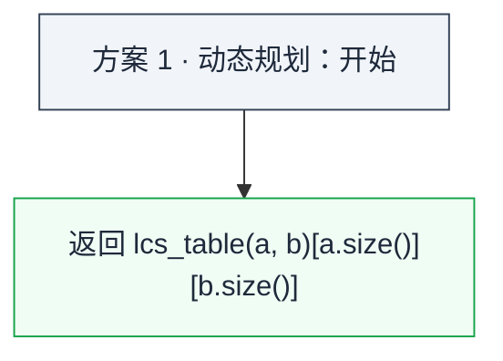

```cpp
// LeetCode 113951689. 动态规划之 LCS — C++ 版（最长公共子序列：DP 填表 + 回溯构造）
#include <algorithm> // 引入头文件
#include <cassert>   // 引入头文件
#include <iostream>  // 引入头文件
#include <string>    // 引入头文件
#include <vector>    // 引入头文件

static std::vector<std::vector<int>> lcs_table(const std::string &a, const std::string &b) {
    int m = static_cast<int>(a.size()), n = static_cast<int>(b.size());
    std::vector<std::vector<int>> dp(m + 1, std::vector<int>(n + 1, 0));
    for (int i = 1; i <= m; ++i) { // 让 下标 i 从 1 开始计数，下标 i 不超过 映射表 就继续
        for (int j = 1; j <= n; ++j) { // 让 下标 j 从 1 开始计数，下标 j 不超过 元素个数 就继续
            if (a[i - 1] == b[j - 1]) {          // 若 数组[下标 i 减 1] 等于 b[下标 j 减 1]
                dp[i][j] = dp[i - 1][j - 1] + 1; // 把 DP 表[下标 i 减 1][下标 j 减 1] 加 1; 写入 dp[i][j]
            } else {                             // 否则
                dp[i][j] = std::max(dp[i - 1][j], dp[i][j - 1]);
            }
        }
    }
    return dp; // 返回 DP 表
}

static int lcs_length(const std::string &a, const std::string &b) { // 定义函数/方法 lcs_length
    return lcs_table(a, b)[a.size()][b.size()]; // 返回 lcs_table(数组, b)[数组.大小()][b.大小()]
}

static std::string lcs_string(const std::string &a, const std::string &b) {
    auto dp = lcs_table(a, b); // 把 lcs_table(数组, b) 存入 DP 表
    int i = static_cast<int>(a.size()), j = static_cast<int>(b.size());
    std::string out;                 // std::string out;
    while (i > 0 && j > 0) {         // 循环，直到不满足「下标 i 超过 0 且 下标 j 超过 0」
        if (a[i - 1] == b[j - 1]) {  // 若 数组[下标 i 减 1] 等于 b[下标 j 减 1]
            out.push_back(a[i - 1]); // out 追加 数组[下标 i 减 1]);
            --i;
            --j; // 减一 下标 i; 减一 下标 j;
        } else if (dp[i - 1][j] >=
                   dp[i][j - 1]) { // 否则，若 DP 表[下标 i 减 1][下标 j] 不低于 DP 表[下标 i][下标 j 减 1]
            --i;                   // 减一 下标 i;
        } else {                   // 否则
            --j;                   // 减一 下标 j;
        }
    }
    std::reverse(out.begin(), out.end()); // std::reverse(out 迭代位置 , out.终点());
    return out;                           // 返回 out
}

static bool is_common_sub(const std::string &a, const std::string &b,
                          const std::string &s) { // 定义判定函数 is_common_sub
    size_t ia = 0, ib = 0;                        // 把 0, ib 赋值为 0; 写入 size_t ia
    for (char ch : s) {                           // for (char 字符 : 字符串) {
        while (ia < a.size() && a[ia] != ch)
            ++ia; // 循环，直到不满足「ia 小于 数组.大小() 且 数组[ia] 不等于 字符) 加一 ia;」
        while (ib < b.size() && b[ib] != ch)
            ++ib; // 循环，直到不满足「ib 小于 b.大小() 且 b[ib] 不等于 字符) 加一 ib;」
        if (ia >= a.size() || ib >= b.size())
            return false; // 若 ia 不低于 数组.大小() 或 ib 不低于 b.大小()，直接返回 false
        ++ia;
        ++ib; // 加一 ia; 加一 ib;
    }
    return true; // 返回 true
}

int main() { // 程序入口：跑内嵌自测用例
    std::vector<std::tuple<std::string, std::string, int>> cases = {
        {"ABCBDAB", "BDCABA", 4}, {"AGGTAB", "GXTXAYB", 4}, {"abc", "abc", 3},
        {"", "abc", 0},           {"abc", "xyz", 0},
    };
    for (size_t idx = 0; idx < cases.size(); ++idx) { // 让 idx 从 0 开始计数，idx 小于 cases.大小() 就继续
        int got = lcs_length(std::get<0>(cases[idx]), std::get<1>(cases[idx]));
        if (got != std::get<2>(cases[idx])) { // 若 got 不等于 std::get 小于 2 超过 (cases[idx]
            std::cout << "case " << idx << " failed: got " << got << " want " << std::get<2>(cases[idx])
                      << std::endl; // 打印输出
            return 1;               // 返回 1
        }
    }
    for (auto &p : {std::pair<std::string, std::string>{"ABCBDAB", "BDCABA"}, {"AGGTAB", "GXTXAYB"}}) {
        std::string s =
            lcs_string(p.first, p.second); // 把 lcs_string(节点.first, 节点.second); 写入 std::string s
        if (static_cast<int>(s.size()) != lcs_length(p.first, p.second) ||
            !is_common_sub(p.first, p.second, s)) { // 取反 is_common_sub(节点.first, 节点.second, 字符串)) {
            std::cout << "lcs_string failed: " << s << std::endl; // 打印输出
            return 1;                                             // 返回 1
        }
    }
    std::cout << "PASS" << std::endl; // 全部用例通过，输出 PASS
    return 0;                         // 返回 0
}
```

### R 实现（1 种方案）

R 的全部方案如下，每个方案都内嵌用例自测，可独立运行（老仓库 python/go 文件遵循「打印结果」约定）：

#### 方案 1：动态规划

**思路与代码分析**：核心是「动态规划」。R 版用向量化思维与 1 起始下标，注意 1:n 的降序陷阱。代码里依次做这些事：DP 表逐项填充；双重循环遍历。**走读**：方案 1 · 动态规划：开始 → 处理 m ＜- nchar(a) → 处理 n ＜- nchar(b) → 更新 nrow → 若 m ≥ 1L 则： → 循环 i：遍历 1:m → 若 n ≥ 1L 则： → 循环 j：遍历 1:n → 若 substr(a, i, i) == substr(b, j, j) 则： → 填写 DP 表 → 填写 DP 表 → 处理 dp → 返回结果。

**运行架构**（真实控制流）：

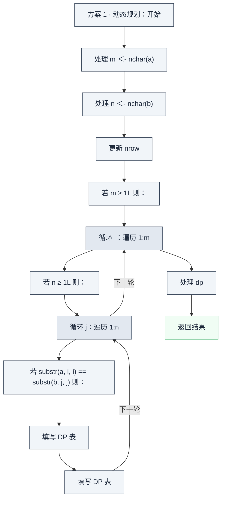

```r
# — R 版（最长公共子序列：DP 填表 + 回溯构造）
lcs_table <- function(a, b) {
    # 定义函数 lcs_table（参数：数组, b）
    m <- nchar(a)  # 把 nchar(数组) 存入 映射表
    n <- nchar(b)  # 把 nchar(b) 存入 元素个数
    dp <- matrix(0L, nrow = m + 1L, ncol = n + 1L)  # 把 矩阵(0L, nrow 赋值为 映射表 加 1L, ncol 赋值为 元素个数 加 1L) 存入 DP 表
    if (m >= 1L) {
        # 若 映射表 不低于 1L for (下标 i in 1:映射表) { 若 元素个数 不低于 1L for (下标 j in 1:元素个数) {
        # 若 substr(数组, 下标 i, 下标 i) 等于 substr(b, 下标 j, 下标 j
        for (i in 1:m) {
            if (n >= 1L) {
                for (j in 1:n) {
                  if (substr(a, i, i) == substr(b, j, j)) {
                    dp[i + 1L, j + 1L] <- dp[i, j] + 1L  # DP 表[下标 i 加 1L, 下标 j 加 1L] 小于 减 DP 表[下标 i, 下标 j] 加 1L
                  } else {
                    # 否则
                    dp[i + 1L, j + 1L] <- max(dp[i, j + 1L], dp[i + 1L, j])
                  }
                }
            }
        }
    }
    dp  # DP 表
}
lcs_length <- function(a, b) {
    # 定义函数 lcs_length（参数：数组, b）
    dp <- lcs_table(a, b)  # 把 lcs_table(数组, b) 存入 DP 表
    as.integer(dp[nchar(a) + 1L, nchar(b) + 1L])  # as.integer(DP 表[nchar(数组) 加 1L, nchar(b) 加 1L])
}
lcs_string <- function(a, b) {
    # 定义函数 lcs_string（参数：数组, b）
    dp <- lcs_table(a, b)  # 把 lcs_table(数组, b) 存入 DP 表
    m <- nchar(a)  # 把 nchar(数组) 存入 映射表
    n <- nchar(b)  # 把 nchar(b) 存入 元素个数
    out <- character(0)  # 把 character(0) 存入 out
    i <- m  # 把 映射表 存入 下标 i
    j <- n  # 把 元素个数 存入 下标 j
    while (i > 0L && j > 0L) {
        # 循环，直到不满足「下标 i 超过 0L 且 下标 j 超过 0L」 若 substr(数组, 下标 i, 下标 i) 等于 substr(b,
        # 下标 j, 下标 j
        if (substr(a, i, i) == substr(b, j, j)) {
            out <- c(substr(a, i, i), out)  # 把 字符(substr(数组, 下标 i, 下标 i), out) 存入 out
            i <- i - 1L  # 把 下标 i 减 1L 存入 下标 i
            j <- j - 1L  # 把 下标 j 减 1L 存入 下标 j
        } else if (dp[i, j + 1L] >= dp[i + 1L, j]) {
            # 否则，若 DP 表[下标 i, 下标 j 加 1L] 不低于 DP 表[下标 i 加 1L, 下标 j]
            i <- i - 1L  # 把 下标 i 减 1L 存入 下标 i
        } else {
            # 否则
            j <- j - 1L  # 把 下标 j 减 1L 存入 下标 j
        }
    }
    paste(out, collapse = "")  # 把 「」) 写入 paste(out, collapse
}
is_common_sub <- function(a, b, s) {
    # 定义函数 is_common_sub（参数：数组, b, 字符串）
    ia <- 1L  # 把 1L 存入 ia
    ib <- 1L  # 把 1L 存入 ib
    for (k in 1:nchar(s)) {
        # for (下标 k in 1:nchar(字符串)) {
        ch <- substr(s, k, k)  # 把 substr(字符串, 下标 k, 下标 k) 存入 字符
        while (ia <= nchar(a) && substr(a, ia, ia) != ch) ia <- ia + 1L
        while (ib <= nchar(b) && substr(b, ib, ib) != ch) ib <- ib + 1L
        if (ia > nchar(a) || ib > nchar(b))
            return(FALSE)  # 若 ia 超过 nchar(数组) 或 ib 超过 nchar(b)) return(FALSE
        ia <- ia + 1L  # 把 ia 加 1L 存入 ia
        ib <- ib + 1L  # 把 ib 加 1L 存入 ib
    }
    TRUE  # TRUE
}
cases <- list(list("ABCBDAB", "BDCABA", 4L), list("AGGTAB", "GXTXAYB", 4L), list("abc", "abc", 3L), list("", "abc",
    0L), list("abc", "xyz", 0L)  # 列表(「abc」, 「abc」, 0L)
)
for (idx in seq_along(cases)) {
    # for (idx in seq_along(cases)) {
    got <- lcs_length(cases[[idx]][[1]], cases[[idx]][[2]])  # 把 lcs_length(cases[[idx]][[1]], cases[[idx]][[2]]) 存入 got
    stopifnot(got == cases[[idx]][[3]])  # 断言校验
}
for (p in list(list("ABCBDAB", "BDCABA"), list("AGGTAB", "GXTXAYB"))) {
    s <- lcs_string(p[[1]], p[[2]])  # 把 lcs_string(节点[[1]], 节点[[2]]) 存入 字符串
    stopifnot(nchar(s) == lcs_length(p[[1]], p[[2]]))  # 断言校验
    stopifnot(is_common_sub(p[[1]], p[[2]], s))  # 断言校验
}
cat("PASS\n")  # 全部用例通过，输出 PASS
```

### Zig 实现（1 种方案）

Zig 的全部方案如下，每个方案都内嵌用例自测，可独立运行（老仓库 python/go 文件遵循「打印结果」约定）：

#### 方案 1：动态规划

**思路与代码分析**：核心是「动态规划」。Zig 版显式分配与清零，整型边界处理严格。**走读**：方案 1 · 动态规划：开始 → 计算 dp → 返回 lcsTable(a, b, &dp)。

**运行架构**（真实控制流）：

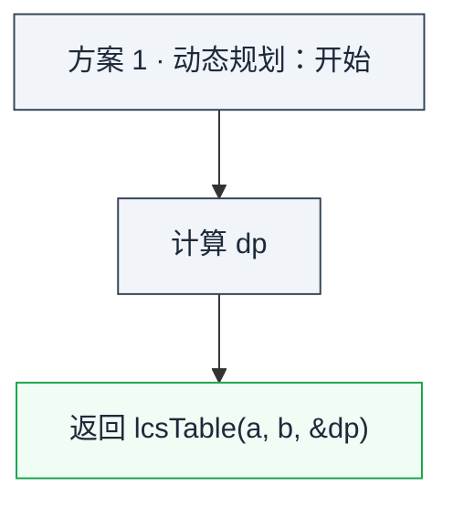

```zig
// LeetCode 113951689. 动态规划之 LCS — Zig 版（最长公共子序列：DP 填表 + 回溯构造）
const std = @import("std"); // 把 @import(「std」) 存入 std

fn lcsTable(a: []const u8, b: []const u8, dp: *[65][65]usize) usize { // 定义函数/方法 lcsTable
    const m = a.len; // 把 数组.长度 存入 映射表
    const n = b.len; // 把 b.长度 存入 元素个数
    for (0..m + 1) |i| { // for (0..映射表 加 1) 按位或 下标 i 按位或 {
        for (0..n + 1) |j| dp[i][j] = 0; // 把 0; 写入 for (0..n + 1) |j| dp[i][j]
    }
    for (1..m + 1) |i| { // for (1..映射表 加 1) 按位或 下标 i 按位或 {
        for (1..n + 1) |j| { // for (1..元素个数 加 1) 按位或 下标 j 按位或 {
            dp[i][j] = if (a[i - 1] == b[j - 1]) // 把 if (数组[下标 i 减 1] 等于 b[下标 j 减 1]) 写入 dp[i][j]
                dp[i - 1][j - 1] + 1 // DP 表[下标 i 减 1][下标 j 减 1] 加 1
            else // 否则
                @max(dp[i - 1][j], dp[i][j - 1]); // @取较大值 DP 表[下标 i 减 1][下标 j], DP 表[下标 i][下标 j 减 1]);
        }
    }
    return dp[m][n]; // 返回 DP 表[映射表][元素个数]
}

fn lcsLength(a: []const u8, b: []const u8) usize { // 定义函数/方法 lcsLength
    var dp: [65][65]usize = undefined; // 把 undefined; 写入 var dp: [65][65]usize
    return lcsTable(a, b, &dp); // 返回 lcsTable(数组, b, 按位与 DP 表)
}

fn lcsString(buf: []u8, a: []const u8, b: []const u8) ![]u8 { // 定义函数/方法 lcsString
    var dp: [65][65]usize = undefined; // 把 undefined; 写入 var dp: [65][65]usize
    _ = lcsTable(a, b, &dp); // 把 lcsTable(数组, b, 按位与 DP 表); 写入 _
    var i = a.len; // 把 数组.长度 存入 下标 i
    var j = b.len; // 把 b.长度 存入 下标 j
    var tmp: [64]u8 = undefined; // 把 undefined; 写入 var tmp: [64]u8
    var k: usize = 0; // 把 0; 写入 var k: usize
    while (i > 0 and j > 0) { // 循环，直到不满足「下标 i 超过 0 and 下标 j 超过 0」
        if (a[i - 1] == b[j - 1]) { // 若 数组[下标 i 减 1] 等于 b[下标 j 减 1]
            tmp[k] = a[i - 1]; // 把 数组[下标 i 减 1]; 写入 tmp[k]
            k += 1; // 下标 k累加 1
            i -= 1; // 下标 i累减 1
            j -= 1; // 下标 j累减 1
        } else if (dp[i - 1][j] >= dp[i][j - 1]) { // 否则，若 DP 表[下标 i 减 1][下标 j] 不低于 DP 表[下标 i][下标 j 减 1]
            i -= 1; // 下标 i累减 1
        } else { // 否则
            j -= 1; // 下标 j累减 1
        }
    }
    for (0..k) |t| buf[t] = tmp[k - 1 - t]; // 让 另一字符串 从 0 走到 下标 k 减一
    return buf[0..k]; // 返回 buf[0..下标 k]
}

fn isCommonSub(a: []const u8, b: []const u8, s: []const u8) bool { // 定义判定函数 isCommonSub
    var ia: usize = 0; // 把 0; 写入 var ia: usize
    var ib: usize = 0; // 把 0; 写入 var ib: usize
    for (s) |ch| { // 逐个取出 字符串 的元素（字符）
        while (ia < a.len and a[ia] != ch) ia += 1; // 循环，直到不满足「ia 小于 数组.长度 and 数组[ia] 不等于 字符) ia 累加 1;」
        while (ib < b.len and b[ib] != ch) ib += 1; // 循环，直到不满足「ib 小于 b.长度 and b[ib] 不等于 字符) ib 累加 1;」
        if (ia >= a.len or ib >= b.len) return false; // 若 ia 不低于 数组.长度 or ib 不低于 b.长度，直接返回 false
        ia += 1; // ia累加 1
        ib += 1; // ib累加 1
    }
    return true; // 返回 true
}

pub fn main() !void { // 程序入口：跑内嵌自测用例
    const Case = struct { a: []const u8, b: []const u8, want: usize };
    const cases = [_]Case{ // 把 [_]Case{ 存入 cases
        .{ .a = "ABCBDAB", .b = "BDCABA", .want = 4 },
        .{ .a = "AGGTAB", .b = "GXTXAYB", .want = 4 },
        .{ .a = "abc", .b = "abc", .want = 3 },
        .{ .a = "", .b = "abc", .want = 0 },
        .{ .a = "abc", .b = "xyz", .want = 0 },
    };
    for (cases, 0..) |c, idx| { // for (cases, 0..) 按位或 字符, idx 按位或 {
        const got = lcsLength(c.a, c.b); // 把 lcsLength(字符.数组, 字符.b) 存入 got
        if (got != c.want) { // 若 got 不等于 字符.want
            std.debug.print("case {d} failed: got {d} want {d}\n", .{ idx, got, c.want }); // 打印输出
            return error.TestFailed; // 返回 error.TestFailed
        }
    }
    const pairs = [_][2][]const u8{ // 把 [_][2][]const u8{ 存入 pairs
        .{ "ABCBDAB", "BDCABA" },
        .{ "AGGTAB", "GXTXAYB" },
    };
    var buf: [64]u8 = undefined; // 把 undefined; 写入 var buf: [64]u8
    for (pairs) |p| { // 逐个取出 pairs 的元素（节点）
        const s = try lcsString(&buf, p[0], p[1]); // 把 try lcsString( 按位与 buf, 节点[0], 节点[1]) 存入 字符串
        if (s.len != lcsLength(p[0], p[1]) or !isCommonSub(p[0], p[1], s)) {
            std.debug.print("lcsString failed: {s}\n", .{s}); // 打印输出
            return error.TestFailed; // 返回 error.TestFailed
        }
    }
    std.debug.print("PASS\n", .{}); // 全部用例通过，输出 PASS
}
```

### Dart 实现（1 种方案）

Dart 的全部方案如下，每个方案都内嵌用例自测，可独立运行（老仓库 python/go 文件遵循「打印结果」约定）：

#### 方案 1：动态规划

**思路与代码分析**：核心是「动态规划」。Dart 版用可空类型标注与集合方法，注意空安全。代码里依次做这些事：DP 表逐项填充。**走读**：方案 1 · 动态规划：开始 → 填写 DP 表 → 返回 dp[a.length][b.length]。

**运行架构**（真实控制流）：

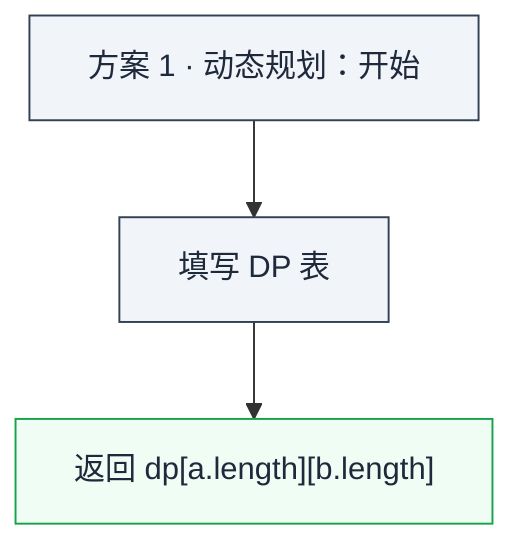

```dart
// LeetCode 113951689. 动态规划之 LCS — Dart 版（最长公共子序列：DP 填表 + 回溯构造）
List<List<int>> lcsTable(String a, String b) {
  // 定义函数/方法 lcsTable
  final m = a.length, n = b.length; // 把 数组.长度, 元素个数 赋值为 b.长度 存入 映射表
  final dp = List.generate(m + 1, (_) => List<int>.filled(n + 1, 0));
  for (var i = 1; i <= m; i++) {
    // 让 下标 i 从 1 开始计数，下标 i 不超过 映射表 就继续
    for (var j = 1; j <= n; j++) {
      // 让 下标 j 从 1 开始计数，下标 j 不超过 元素个数 就继续
      if (a[i - 1] == b[j - 1]) {
        // 若 数组[下标 i 减 1] 等于 b[下标 j 减 1]
        dp[i][j] =
            dp[i - 1][j - 1] + 1; // 把 DP 表[下标 i 减 1][下标 j 减 1] 加 1; 写入 dp[i][j]
      } else {
        // 否则
        dp[i][j] = dp[i - 1][j] >= dp[i][j - 1] ? dp[i - 1][j] : dp[i][j - 1];
      }
    }
  }
  return dp; // 返回 DP 表
}

int lcsLength(String a, String b) {
  // 定义函数/方法 lcsLength
  final dp = lcsTable(a, b); // 把 lcsTable(数组, b) 存入 DP 表
  return dp[a.length][b.length]; // 返回 DP 表[数组.长度][b.长度]
}

String lcsString(String a, String b) {
  // 定义函数/方法 lcsString
  final dp = lcsTable(a, b); // 把 lcsTable(数组, b) 存入 DP 表
  var i = a.length, j = b.length; // 把 数组.长度, 下标 j 赋值为 b.长度 存入 下标 i
  final out = StringBuffer(); // 把 StringBuffer() 存入 out
  final stack = <String>[]; // 把 小于 String 超过 [] 存入 栈
  while (i > 0 && j > 0) {
    // 循环，直到不满足「下标 i 超过 0 且 下标 j 超过 0」
    if (a[i - 1] == b[j - 1]) {
      // 若 数组[下标 i 减 1] 等于 b[下标 j 减 1]
      stack.add(a[i - 1]); // 栈 追加 数组[下标 i 减 1]);
      i--; // 下标 i 减一
      j--; // 下标 j 减一
    } else if (dp[i - 1][j] >= dp[i][j - 1]) {
      // 否则，若 DP 表[下标 i 减 1][下标 j] 不低于 DP 表[下标 i][下标 j 减 1]
      i--; // 下标 i 减一
    } else {
      // 否则
      j--; // 下标 j 减一
    }
  }
  for (var k = stack.length - 1; k >= 0; k--) {
    // 让 下标 k 从 栈.长度 减 1 开始计数，下标 k 不低于 0 就继续
    out.write(stack[k]); // out.write(栈[下标 k]);
  }
  return out.toString(); // 返回 out.toString()
}

bool isCommonSub(String a, String b, String s) {
  // 定义判定函数 isCommonSub
  var ia = 0, ib = 0; // 把 0, ib 赋值为 0 存入 ia
  for (var k = 0; k < s.length; k++) {
    // 让 下标 k 从 0 开始计数，下标 k 小于 字符串.长度 就继续
    final ch = s[k]; // 把 字符串[下标 k] 存入 字符
    while (ia < a.length && a[ia] != ch) {
      // 循环，直到不满足「ia 小于 数组.长度 且 数组[ia] 不等于 字符」
      ia++; // ia 加一
    }
    while (ib < b.length && b[ib] != ch) {
      // 循环，直到不满足「ib 小于 b.长度 且 b[ib] 不等于 字符」
      ib++; // ib 加一
    }
    if (ia >= a.length || ib >= b.length)
      return false; // 若 ia 不低于 数组.长度 或 ib 不低于 b.长度，直接返回 false
    ia++; // ia 加一
    ib++; // ib 加一
  }
  return true; // 返回 true
}

void main() {
  // 程序入口：跑内嵌自测用例
  final cases = <List<dynamic>>[
    ['ABCBDAB', 'BDCABA', 4],
    ['AGGTAB', 'GXTXAYB', 4],
    ['abc', 'abc', 3],
    ['', 'abc', 0],
    ['abc', 'xyz', 0],
  ];
  for (var idx = 0; idx < cases.length; idx++) {
    // 让 idx 从 0 开始计数，idx 小于 cases.长度 就继续
    final c = cases[idx]; // 把 cases[idx] 存入 字符
    final got = lcsLength(
      c[0] as String,
      c[1] as String,
    ); // 把 lcsLength(字符[0] as String, 字符[1] as String) 存入 got
    if (got != c[2] as int) {
      // 若 got 不等于 字符[2] as int
      throw StateError('case $idx failed: got $got want ${c[2]}');
    }
  }
  for (final p in [
    ['ABCBDAB', 'BDCABA'],
    ['AGGTAB', 'GXTXAYB'],
  ]) {
    final s = lcsString(
      p[0] as String,
      p[1] as String,
    ); // 把 lcsString(节点[0] as String, 节点[1] as String) 存入 字符串
    if (s.length != lcsLength(p[0] as String, p[1] as String) ||
        !isCommonSub(p[0] as String, p[1] as String, s)) {
      // 取反 isCommonSub(节点[0] as String, 节点[1] as String, 字符串)) {
      throw StateError(
        'lcsString failed: $s',
      ); // throw StateError('lcsString failed: $字符串');
    }
  }
  print('PASS'); // 全部用例通过，输出 PASS
}
```

---

## 内容总结

- **动态规划之lcs 0**（算法笔记 · Medium）：共 1 个方案，主线思路「动态规划」；时间 O(n) 到 O(m·n)（取决于状态维度）；动画演示DP 表填充过程，附录给出 11 种语言 × 全部方案的可运行实现。
- 来源博客：[https://blog.csdn.net/tyro_java/article/details/113951689](https://blog.csdn.net/tyro_java/article/details/113951689)
- 导航：[📋 总目录](../) ｜ [← 220 动态规划之fibonacci p](../220_动态规划之fibonacci_power_spu_lmp/) ｜ [222 pm →](../222_pm/)
